# Cloud and Container Security: Bachelor's Course

- Language: English (`en`); course 105, Bachelor's course (4 years).
- Editorial state: **published**. Chapters 1–40 of 40 have hand-written teaching text; exercises EX001–EX120 have matching worked results with 0–3 rubrics; Nine offline labs use only the Python 3 standard library on synthetic evidence, and their outputs are embedded from real runs. Independent review and the 300-page A4 verification remain open.
- Audience: bachelor's students learning to review, design, verify and operate security for cloud accounts and containerised platforms.
- Author: [hiagokinlevi](https://github.com/hiagokinlevi). Original text [CC0 1.0](../../../../../LICENSE); cited works keep their rights.
- Ethical and legal boundary: review and test only cloud accounts, clusters and workloads you are authorised to assess; no exploit code, no payloads, no attack procedures and no instructions for bypassing controls. Misconfigurations are taught from the defender's side using synthetic configurations, logs and data. All evidence, people and organisations are **synthetic** unless a sentence cites a public source.

[Course home](../../README.md) · [Chapter index](../SUBJECTS.md) · [Book plan](PLAN.md) · [Course skill](../../skill/SKILL.md) · [Worked results](#worked-results)

## How to use this draft

Read in order: the chapters follow one student working with a university cloud team after a container registry was found allowing anonymous pulls of an image with a database connection string, while audit logging was off in one account. They move from foundations (reasoning, computing, programming, writing, networks, data, identity, privacy, evidence, architecture and cryptography) through research methods, system models, registry and benchmark reviews, controls, verification, failure analysis and operations, to labs, studies, community practice and a posture-report capstone. Run each lab where it appears, attempt the three exercises before the worked results, and score yourself with the rubrics.

### Synthetic running case

| Element | Role | Boundary |
|---|---|---|
| **Samuel Osei** | Bachelor's student | Invented |
| **Dr Clara Jensen** | Academic supervisor | Invented |
| **Tom Becker** | University cloud team lead | Invented |
| **Westmere University** | Fictional university running StudyHub | Invented |
| **Harbourside Youth Trust** | Fictional charity in the community placement | Invented |

### Core sources

NIST [SP 800-145](https://doi.org/10.6028/NIST.SP.800-145), [SP 800-210](https://doi.org/10.6028/NIST.SP.800-210), [SP 800-190](https://doi.org/10.6028/NIST.SP.800-190) and [SP 800-207](https://doi.org/10.6028/NIST.SP.800-207); CSA [Cloud Controls Matrix v4](https://cloudsecurityalliance.org/research/cloud-controls-matrix); [CIS Benchmarks](https://www.cisecurity.org/cis-benchmarks); the [AWS](https://aws.amazon.com/compliance/shared-responsibility-model/), [Azure](https://learn.microsoft.com/en-us/azure/security/fundamentals/shared-responsibility) and [Google Cloud](https://cloud.google.com/architecture/framework/security/shared-responsibility-shared-fate) shared responsibility pages; Kubernetes [Pod Security Standards](https://kubernetes.io/docs/concepts/security/pod-security-standards/) and [RBAC](https://kubernetes.io/docs/reference/access-authn-authz/rbac/) documentation. Full list in [References](#references).

## Contents

| Chapters |
|---|
| [1](#ch-01) · [2](#ch-02) · [3](#ch-03) · [4](#ch-04) · [5](#ch-05) · [6](#ch-06) · [7](#ch-07) · [8](#ch-08) · [9](#ch-09) · [10](#ch-10) |
| [11](#ch-11) · [12](#ch-12) · [13](#ch-13) · [14](#ch-14) · [15](#ch-15) · [16](#ch-16) · [17](#ch-17) · [18](#ch-18) · [19](#ch-19) · [20](#ch-20) |
| [21](#ch-21) · [22](#ch-22) · [23](#ch-23) · [24](#ch-24) · [25](#ch-25) · [26](#ch-26) · [27](#ch-27) · [28](#ch-28) · [29](#ch-29) · [30](#ch-30) |
| [31](#ch-31) · [32](#ch-32) · [33](#ch-33) · [34](#ch-34) · [35](#ch-35) · [36](#ch-36) · [37](#ch-37) · [38](#ch-38) · [39](#ch-39) · [40](#ch-40) |

[Worked results](#worked-results) · [References](#references)

<a id="ch-01"></a>

## Chapter 1 — Mathematical reasoning

<!-- cyberabc:lesson-figures:start ch-01 -->
### Lesson map

Lesson 01 published. Map, example, EX001.

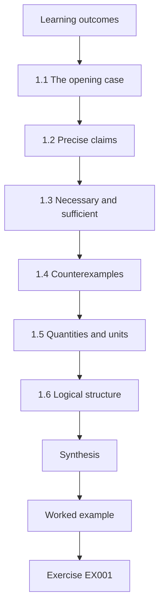

### Logical drawing

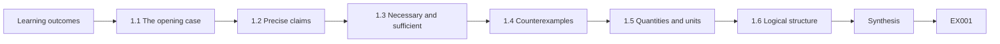

```text
[Learning outcomes]
    |
    v
[1.1 The opening case]
    |
    v
[1.2 Precise claims]
    |
    v
[1.3 Necessary and sufficient]
    |
    v
[1.4 Counterexamples]
    |
    v
[1.5 Quantities and units]
    |
    v
[1.6 Logical structure]
    |
    v
[Synthesis]
    |
    v
[Worked example] --> [Exercise EX001]
```
<!-- cyberabc:lesson-figures:end ch-01 -->


### Learning outcomes

You will (1) use precise reasoning to state and check claims about cloud systems; (2) distinguish necessary and sufficient conditions; (3) use counterexamples; (4) set up the course case.

### 1.1 The opening case

Samuel Osei is a bachelor's student at the fictional Westmere University. His final-year project is with the university's own cloud team, led by Tom Becker, and supervised by Dr Clara Jensen from the computing department. Westmere runs StudyHub, its student services platform, as containers on a managed Kubernetes service. Last term an internal review found that the container registry allowed anonymous pulls of two repositories. One image, records-api, contained a connection string for the student records test database. The test database held synthetic records only, and no unusual access was logged, but nobody could say how long the registry had been open, because audit logging was off in one account.

The case returns throughout the course: each chapter adds a tool or idea that helps answer one of its open questions.

### 1.2 Precise claims

"StudyHub is secure" cannot be checked. "No registry repository allows anonymous pull" can be checked by listing repositories and their settings. The course trains Samuel to turn vague worries into precise, checkable statements, because only checkable statements lead to fixes and evidence.

The precise version also says what evidence would prove it wrong: a single repository with anonymous pull enabled. Samuel's first task is to write such statements for each worry raised in the review, including the missing logs, so that each becomes a check that someone can run and repeat next term.

### 1.3 Necessary and sufficient

Turning off anonymous pull is necessary to stop outsiders downloading images, but not sufficient to protect secrets: anyone with internal access could still read a secret baked into an image. Removing secrets from images and using a secret manager is also needed. Mixing up necessary and sufficient conditions leads to fixes that feel complete but are not.

Samuel lists both conditions in his findings and marks which fixes are done. Closing the registry was finished within a day; removing the connection string from records-api needed a rebuilt image, a new secret in the secret manager and a rotated database password, because the old one had been readable for an unknown period.

### 1.4 Counterexamples

One counterexample disproves a universal claim. The claim "all our images are private" was disproved by a single anonymous pull test on records-api. Engineers look for counterexamples deliberately rather than waiting for them to appear in an incident.

Samuel's test was simple: from a machine with no Westmere credentials, request the image list for each repository. Two requests succeeded where all should have failed. He now runs the same test after every registry change, because a single successful anonymous request is enough to show the claim is false again.

### 1.5 Quantities and units

Exposure is measured in days and resources; costs in money and engineer-hours. Keeping units explicit avoids comparing unlike things.

In the opening case, the exposure involved two repositories and an unknown number of days, while the fix cost about three engineer-days. Writing "two repositories, unknown days" rather than "a small exposure" makes clear what is known and what is missing. Samuel records units beside every figure in his notes, so a later reader never has to guess whether a number means hours, days or resources.

### 1.6 Logical structure

Claims are combined with and, or and not; access policies, later in the course, follow the same logic.

For example, a rule might allow a pull if the caller is in the build group and the request comes from the private network, and not if the repository is marked restricted. Writing such conditions carefully now makes later policies easier to read. Samuel practises by rewriting the registry's intended rule as a single logical statement and checking each repository against it.

### Worked example

Samuel writes the review's findings as four precise statements: two repositories allowed anonymous pull; one image contained a database connection string; audit logging was off in one account; therefore the duration of exposure is unknown. Tom notes that the last statement follows logically from the third, and that fixing logging is necessary before any future exposure can be measured.

> **Synthetic case.** Westmere University, StudyHub, people and events are synthetic.

### Errors and limits

Precise statements can still rest on wrong data; check the data source too.

### Exercises

- **EX001 — Checkable claim.** Rewrite "StudyHub is secure" as a checkable claim. *Rubric:* 3 = e.g. no repo allows anonymous pull; 2 = partial; 1 = vague; 0 = none.
- **EX002 — Not sufficient.** Why is disabling anonymous pull not sufficient? *Rubric:* 3 = internal users could still read baked-in secret; 2 = partial; 1 = vague; 0 = none.
- **EX003 — Unknown duration.** Why was exposure duration unknown? *Rubric:* 3 = audit logging off; 2 = partial; 1 = vague; 0 = none.

### Synthesis

Precise, checkable statements turn worries into work.

### Continue studying — chapter 01 of 40

[← Course home](../../README.md) · [Course chapter index](../SUBJECTS.md) · [Chapter 02 (draft) →](#ch-02)

<a id="ch-02"></a>

## Chapter 2 — Computing systems

<!-- cyberabc:lesson-figures:start ch-02 -->
### Lesson map

Lesson 02 published. Map, example, EX004.

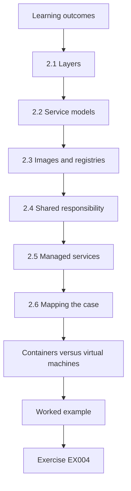

### Logical drawing

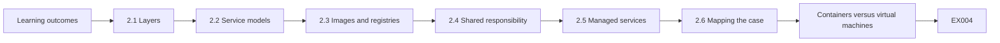

```text
[Learning outcomes]
    |
    v
[2.1 Layers]
    |
    v
[2.2 Service models]
    |
    v
[2.3 Images and registries]
    |
    v
[2.4 Shared responsibility]
    |
    v
[2.5 Managed services]
    |
    v
[2.6 Mapping the case]
    |
    v
[Containers versus virtual machines]
    |
    v
[Worked example] --> [Exercise EX004]
```
<!-- cyberabc:lesson-figures:end ch-02 -->


### Learning outcomes

You will (1) describe the layers of a cloud-hosted application; (2) explain virtual machines, containers and managed services; (3) identify who manages each layer; (4) relate layers to the opening case.

### 2.1 Layers

StudyHub runs on physical servers in the provider's data centres, virtualised into machines that form the Kubernetes worker nodes. Containers run on those nodes, each packaged from an image stored in a registry. Managed services provide the database, storage and identity.

Each layer has its own security settings. The opening case touched three of them: the registry's access rules, the content of an image and the logging of the account that held them. None involved the physical servers or the virtual machines, which is why Samuel's investigation focused on configuration rather than on the provider's infrastructure.

### 2.2 Service models

NIST SP 800-145 (Mell & Grance, 2011) defines infrastructure, platform and software as a service. Managed Kubernetes sits between infrastructure and platform: the provider runs the control plane; Westmere runs the workloads and their configuration.

The split determines who fixes what. If the control plane had a flaw, the provider would patch it. The workloads, their images and their access settings are Westmere's, so the open registry and the leaked connection string were Westmere's to find and fix. Samuel marks this boundary on every diagram he draws.

### 2.3 Images and registries

An image is a stack of file-system layers plus metadata. The registry stores images and controls who may pull or push them. Whatever goes into a layer stays there, which is why a connection string in records-api remained readable even after the application stopped using it.

Deleting the file in a later layer does not help, because earlier layers are still part of the image and can be extracted. Samuel demonstrates this to the team with a synthetic image: a secret added in one layer and removed in the next is still recoverable by unpacking the image's layers one at a time.

### 2.4 Shared responsibility

The AWS, Microsoft and Google shared responsibility pages agree that customers configure access to registries, storage and identities. The open registry was on Westmere's side.

The provider kept the registry service running and secure; it did not choose whether repositories allowed anonymous pull. That choice sat in a setting Westmere controlled. Samuel's summary for managers says this plainly, because some had assumed the provider would have prevented the exposure automatically. The same applied to audit logging: the provider offered it, but switching it on in each account was Westmere's job, and one account had been missed when it was created.

### 2.5 Managed services

Using a managed database removes patching work but leaves access rules, backups and encryption choices to the customer.

StudyHub's records database is managed, so the provider applies patches and runs the hardware. Westmere still decides who may connect, how long backups are kept, whether they are encrypted with its own key and which network can reach the database. The test database's network rule, a customer setting, is what stopped the leaked connection string from being useful outside. Samuel lists these choices for each managed service StudyHub uses.

### 2.6 Mapping the case

Samuel draws StudyHub's layers and marks who manages each, then marks where the opening findings sat: registry settings, image content and account logging, all customer-managed.

Seeing all three findings in the customer-managed part of the drawing changed the conversation with managers. The question became which Westmere team owned each setting and how it would be checked, rather than whether the provider had failed. Each finding now has a named owner on the drawing. The drawing is kept with the team's documentation and updated when a service is added.

### Containers versus virtual machines

A virtual machine includes a whole operating system, while a container shares the node's kernel and packages only the application and its libraries. Containers start quickly and pack densely, which suits StudyHub's many small services, but their isolation depends on kernel features and careful settings.

### Worked example

The layer drawing surprises some university managers, who assumed the cloud provider handled registry security. Tom uses it in a briefing to explain why Westmere's cloud team must own these settings.

> **Synthetic case.** Systems are synthetic.

### Errors and limits

Responsibility boundaries differ between services; check each service's documentation.

### Exercises

- **EX004 — Service models.** Name the three NIST service models. *Rubric:* 3 = IaaS, PaaS, SaaS; 2 = two; 1 = one; 0 = none.
- **EX005 — Layer persistence.** Why did the connection string remain readable? *Rubric:* 3 = stays in image layer; 2 = partial; 1 = vague; 0 = none.
- **EX006 — Briefing use.** How did the drawing help managers? *Rubric:* 3 = showed customer owns registry settings; 2 = partial; 1 = vague; 0 = none.

### Synthesis

Know the layers and who manages each.

### Continue studying — chapter 02 of 40

[← Chapter 01 (draft)](#ch-01) · [Course chapter index](../SUBJECTS.md) · [Chapter 03 (draft) →](#ch-03)

<a id="ch-03"></a>

## Chapter 3 — Programming I

<!-- cyberabc:lesson-figures:start ch-03 -->
### Lesson map

Lesson 03 published. Map, example, EX007.

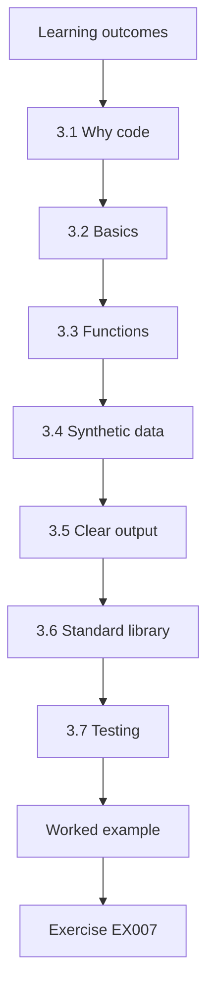

### Logical drawing

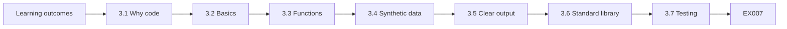

```text
[Learning outcomes]
    |
    v
[3.1 Why code]
    |
    v
[3.2 Basics]
    |
    v
[3.3 Functions]
    |
    v
[3.4 Synthetic data]
    |
    v
[3.5 Clear output]
    |
    v
[3.6 Standard library]
    |
    v
[3.7 Testing]
    |
    v
[Worked example] --> [Exercise EX007]
```
<!-- cyberabc:lesson-figures:end ch-03 -->


### Learning outcomes

You will (1) write small Python programs to read and check configuration data; (2) use variables, conditions, loops and functions; (3) test with synthetic data; (4) produce clear output.

### 3.1 Why code

The cloud team manages hundreds of resources. Reading each one by hand is slow and error-prone; a short program can check every resource the same way every time.

StudyHub alone has dozens of services, each with images, identities and network rules, spread across several accounts. A program that reads exports and applies the same checks to every resource finishes in seconds and gives the same answer each time it runs, which makes changes between runs meaningful. It also leaves a record of exactly what was checked and when.

### 3.2 Basics

Variables hold values; lists hold many items; dictionaries map names to settings. A loop visits each repository; an if statement checks a setting; print shows the result.

Samuel's first program uses all of these: a list of repository dictionaries, a loop over the list, an if statement checking the anonymous setting, and print for each problem. It is about fifteen lines long, short enough for Tom to review in a few minutes before trusting its output. He also adds comments naming the export each list comes from.

### 3.3 Functions

A function such as check_repo(repo) returns a list of problems. Functions make programs easier to test and reuse.

Returning a list rather than printing inside the function means the same check can feed a report, a test or a later tool. Samuel's check_repo returns an empty list when a repository has no problems, which makes tests easy to write: an expected-clean repository should return nothing at all. Functions also let him reuse check_repo when the account checks arrive later in the course, with only the input changed.

### 3.4 Synthetic data

Samuel writes his first programs against a small, made-up list of repositories, so mistakes cannot affect real systems and anyone can rerun them.

His made-up export has four repositories: one public, one private, one with the setting missing and one with an unusual name containing spaces. Each tests a different path through the program. Synthetic data also lets the lab be shared with classmates without revealing anything about Westmere's real accounts. The space in the name caught a formatting bug in his output on the first run.

### 3.5 Clear output

Each line names the resource and the problem in plain words, so non-programmers can act.

A line such as "records-api: anonymous pull enabled" tells a manager exactly what is wrong and where. Output like "repo[2] anon=True" would need translating. Samuel also prints a final count of repositories checked, so readers know the program looked at all of them and did not stop early. When a repository has several problems, each gets its own line, so nothing is hidden behind the first one. Tom forwarded the output directly to the registry owner without rewriting it.

### 3.6 Standard library

Labs use only Python's standard library, so they run on any machine and are easy to read.

Avoiding extra packages also removes a supply-chain risk from the labs themselves: nothing needs downloading from a package index to run them. The json, csv, collections and datetime modules cover everything the early labs need. Later chapters introduce outside tools only where the standard library is not enough. Readability matters too: a classmate or assessor can understand every line without first learning a third-party library's interface. Samuel notes in each lab's header which modules it uses.

### 3.7 Testing

For each check, Samuel writes one example that should pass and one that should fail, and confirms the output.

For the anonymous-pull check, the passing example is a private repository and the failing example is a public one. Samuel added a third case after Dr Jensen's question about missing fields, described in the worked example below. Each test is small enough to understand at a glance, which makes a failure easy to diagnose. Tests live beside the program and run with one command, so anyone changing the check can confirm it still behaves as intended.

### Reading exports

The cloud team can export registry settings as JSON. Samuel's program opens the file with the json module, loops over the repositories and prints any problems. He records the export date in the output so readers know how current the result is. Later in the course, the same pattern checks accounts, identities and logs, so this first program becomes a template he reuses many times.

### Worked example

Samuel's first program lists repositories with anonymous pull enabled from a synthetic export. Dr Jensen asks what happens if a repository record has no "anonymous" field. Samuel adds a rule to report "setting missing" instead of assuming it is off.

> **Synthetic case.** Data are synthetic.

### Errors and limits

Programs that assume missing settings are safe can hide problems.

### Exercises

- **EX007 — Why programs.** Why use programs for configuration checks? *Rubric:* 3 = consistent, fast, many resources; 2 = partial; 1 = vague; 0 = none.
- **EX008 — Function benefit.** Why write checks as functions? *Rubric:* 3 = testable and reusable; 2 = partial; 1 = vague; 0 = none.
- **EX009 — Missing field.** How does Samuel handle a missing field? *Rubric:* 3 = report setting missing; 2 = partial; 1 = vague; 0 = none.

### Synthesis

Small tested programs make checks reliable.

### Continue studying — chapter 03 of 40

[← Chapter 02 (draft)](#ch-02) · [Course chapter index](../SUBJECTS.md) · [Chapter 04 (draft) →](#ch-04)

<a id="ch-04"></a>

## Chapter 4 — Academic writing

<!-- cyberabc:lesson-figures:start ch-04 -->
### Lesson map

Lesson 04 published. Map, example, EX010.

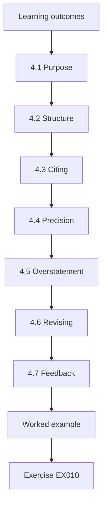

### Logical drawing

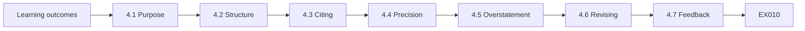

```text
[Learning outcomes]
    |
    v
[4.1 Purpose]
    |
    v
[4.2 Structure]
    |
    v
[4.3 Citing]
    |
    v
[4.4 Precision]
    |
    v
[4.5 Overstatement]
    |
    v
[4.6 Revising]
    |
    v
[4.7 Feedback]
    |
    v
[Worked example] --> [Exercise EX010]
```
<!-- cyberabc:lesson-figures:end ch-04 -->


### Learning outcomes

You will (1) write clear academic and technical prose about cloud security; (2) cite sources correctly; (3) structure arguments; (4) avoid overstatement.

### 4.1 Purpose

Samuel's thesis and reports must persuade careful readers with evidence. Academic writing states claims, supports them with sources or data, and acknowledges limits.

His project report on the registry exposure will be read by Tom, by university managers and by Dr Jensen as an assessor. Each needs to see what was found, how it was found and what remains uncertain. Academic writing's habits of stating claims and evidence serve all three readers at once. Writing for all three also forces him to explain terms such as "anonymous pull" in one plain sentence the first time they appear.

### 4.2 Structure

Each paragraph makes one point: a topic sentence, evidence, and a link to the argument. Sections follow a logical order from problem to conclusion.

A paragraph in Samuel's report begins: "Two of four repositories allowed anonymous pull." The evidence follows, his anonymous test and the registry settings export, and then the link: this exposed records-api and its connection string. Readers can stop after the first sentence and still know the point. His report's sections run from the finding, through causes and fixes, to what remains unknown, so each builds on the last.

### 4.3 Citing

Standards and papers are cited in a consistent style with links or DOIs. Samuel cites NIST SP 800-190 when discussing container image risks and the Kubernetes documentation when describing Pod Security Standards.

Citing the standard lets readers check that Samuel's description of image risks matches the source. Including a link or DOI makes that check quick. He also records the version of the Kubernetes documentation he used, since its pages are updated and an older description of a feature may no longer apply.

### 4.4 Precision

"Anonymous pull was enabled on two of four repositories" is better than "the registry was insecure".

The precise version gives the count, the denominator and the setting, so a reader can verify it and see its size. The vague version invites argument: insecure in what way, and how badly? Samuel goes through his draft looking for adjectives such as "insecure" or "weak" and replaces each with the finding behind it. Precision also helps when progress is reported: "zero of four" next month is clearly better than "two of four", while "less insecure" means little.

### 4.5 Overstatement

"No evidence of misuse was found in available logs" is accurate; "no misuse occurred" is not, since logging was missing.

The difference matters in the opening case because audit logging was off in one account. Claiming no misuse would assert something the evidence cannot show. The accurate statement tells readers exactly where the gap is, which is also why fixing logging became one of the first actions. Samuel's report puts the gap in its own sentence, near the start, so no reader can miss it or assume the logs covered the whole period.

### 4.6 Revising

Samuel reads drafts aloud, removes unnecessary words and checks every number against its source.

Checking numbers caught one error in his first report: he had written three repositories instead of two, copying from an early note. Reading aloud found sentences that were too long to follow. Removing unnecessary words shortened his executive summary from a page to half a page without losing any finding. He keeps the earlier draft so Dr Jensen can see what changed between versions and why each change was made.

### 4.7 Feedback

Dr Jensen comments on drafts within a week; Samuel keeps a list of recurring feedback to avoid repeating mistakes.

After three essays, his list included vague adjectives, missing denominators and claims stronger than the evidence. Before submitting each new draft, he checks it against the list. Dr Jensen's comments gradually moved from these basics to questions about argument and evidence, which showed the list was working. He also notes feedback he disagreed with and why, then discusses it at the next meeting, so the list records decisions rather than only instructions.

### Using sources well

Samuel learns to prefer primary sources: the standard itself, not a blog summary of it. When a secondary source is useful, he checks its claims against the original. He also records the version and access date for web documents, since cloud documentation changes often. A short source log beside each essay lists each source, why it was used and where in the text it supports a claim.

### Worked example

In his first essay, Samuel writes that the registry exposure "had no impact". Dr Jensen asks how he knows. He revises to "no unusual access was found in the logs that existed; the period without logs cannot be assessed", a statement the evidence supports.

> **Synthetic case.** Essays are synthetic.

### Errors and limits

Absence of evidence is not evidence of absence when logging was missing.

### Exercises

- **EX010 — Paragraph structure.** Describe a good paragraph. *Rubric:* 3 = topic sentence, evidence, link; 2 = two; 1 = one; 0 = none.
- **EX011 — Accurate phrasing.** Why is "no misuse occurred" an overstatement? *Rubric:* 3 = logs missing for part of the period; 2 = partial; 1 = vague; 0 = none.
- **EX012 — Revision habit.** Name a revision habit. *Rubric:* 3 = read aloud, cut words, check numbers; 2 = one; 1 = vague; 0 = none.

### Synthesis

Clear, sourced and modest writing persuades careful readers.

### Continue studying — chapter 04 of 40

[← Chapter 03 (draft)](#ch-03) · [Course chapter index](../SUBJECTS.md) · [Chapter 05 (draft) →](#ch-05)

<a id="ch-05"></a>

## Chapter 5 — Security literacy

<!-- cyberabc:lesson-figures:start ch-05 -->
### Lesson map

Lesson 05 published. Map, example, EX013.

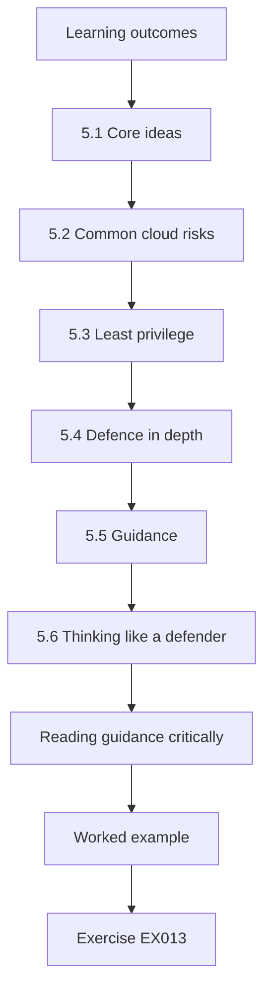

### Logical drawing

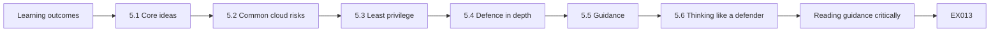

```text
[Learning outcomes]
    |
    v
[5.1 Core ideas]
    |
    v
[5.2 Common cloud risks]
    |
    v
[5.3 Least privilege]
    |
    v
[5.4 Defence in depth]
    |
    v
[5.5 Guidance]
    |
    v
[5.6 Thinking like a defender]
    |
    v
[Reading guidance critically]
    |
    v
[Worked example] --> [Exercise EX013]
```
<!-- cyberabc:lesson-figures:end ch-05 -->


### Learning outcomes

You will (1) explain core security ideas in cloud terms; (2) recognise common cloud risks; (3) understand defence in depth and least privilege; (4) read security guidance critically.

### 5.1 Core ideas

Confidentiality, integrity and availability; authentication and authorisation; least privilege; defence in depth; logging and accountability. Each has a cloud form: identity policies, encryption settings, multi-zone deployment, audit logs.

Mapped to the opening case, confidentiality failed when the registry allowed anonymous pulls; accountability failed when audit logging was off; defence in depth partly worked through the database's network rule. Seeing each idea in a concrete cloud setting makes the terms useful rather than abstract. Availability was not affected, which Samuel also records, since a full picture includes what went right.

### 5.2 Common cloud risks

Misconfigured storage and registries, over-broad identities, leaked credentials, unpatched images, missing logs. Most are configuration choices on the customer's side.

The opening case had three of the five: a misconfigured registry, a leaked credential in an image and missing logs. None required a sophisticated attacker to create; each came from a setting or a habit. That is why so much of the course focuses on checking configuration systematically. Unpatched images and over-broad identities were not involved in the opening case, but the role-path lab later in this part shows the second is present in StudyHub too.

### 5.3 Least privilege

Each person and service gets only the access it needs. If records-api had used a short-lived identity instead of a connection string, there would have been no secret to leak.

The connection string gave whoever held it the same access as records-api, with no expiry. A short-lived identity tied to the running workload would have been useless to anyone who copied the image. Least privilege applies not only to what access is granted but to how long and to whom.

### 5.4 Defence in depth

Several layers: private registry, no secrets in images, scanning before push, limited database permissions, logging. Any one could have reduced the opening case's risk.

In the opening case, the private registry and secret-free images were both missing, scanning did not look for secrets, and logging was off in one account. Only the network restriction on the test database held. Each missing layer is now a separate action with its own owner. Samuel ranks them by how quickly they can be done and how much risk each removes.

### 5.5 Guidance

CIS Benchmarks give configuration checklists; CSA CCM v4 lists cloud controls; NIST SP 800-190 covers containers. Samuel learns to check the date and scope of guidance before using it.

A CIS Benchmark for an older Kubernetes version might recommend settings that no longer exist or miss new ones. Samuel records the version of each guide he uses and checks that it matches StudyHub's services. Where guidance and StudyHub's setup differ, he notes the difference rather than forcing the guidance to fit.

### 5.6 Thinking like a defender

Ask what could go wrong, how it would be noticed and how it would be fixed.

For the registry, those questions become concrete: an image could be downloaded by anyone; that would be noticed only through audit logs, which were missing in one account; and it is fixed by disabling anonymous pull and removing secrets. Asking all three for each component exposes gaps in detection as well as prevention. Samuel writes the three answers in a small table for each StudyHub component, and the empty cells become the next term's work.

### Reading guidance critically

For each piece of guidance, Samuel asks who wrote it, for which systems, how recent it is and what evidence supports it. A CIS Benchmark for a specific managed Kubernetes version is more useful to StudyHub than a general blog post. Vendor guidance may favour the vendor's products; it is still useful for configuration details, but recommendations about which tools to buy need independent checking.

### Worked example

Samuel maps the opening case to defence-in-depth layers and finds that only one layer, network restrictions on the test database, was working. That layer probably prevented harm, which shows why multiple layers matter.

> **Synthetic case.** Case details are synthetic.

### Errors and limits

Guidance can be outdated; check versions.

### Exercises

- **EX013 — Common risks.** Name three common cloud risks. *Rubric:* 3 = storage/registry misconfig, broad identities, leaked creds, unpatched images, missing logs; 2 = two; 1 = one; 0 = none.
- **EX014 — Least privilege example.** How would least privilege have helped records-api? *Rubric:* 3 = short-lived identity, no secret; 2 = partial; 1 = vague; 0 = none.
- **EX015 — Working layer.** Which layer worked? *Rubric:* 3 = network restrictions on test DB; 2 = partial; 1 = vague; 0 = none.

### Synthesis

Core security ideas take specific forms in the cloud.

### Continue studying — chapter 05 of 40

[← Chapter 04 (draft)](#ch-04) · [Course chapter index](../SUBJECTS.md) · [Chapter 06 (draft) →](#ch-06)

<a id="ch-06"></a>

## Chapter 6 — Discrete structures

<!-- cyberabc:lesson-figures:start ch-06 -->
### Lesson map

Lesson 06 published. Map, example, EX016.

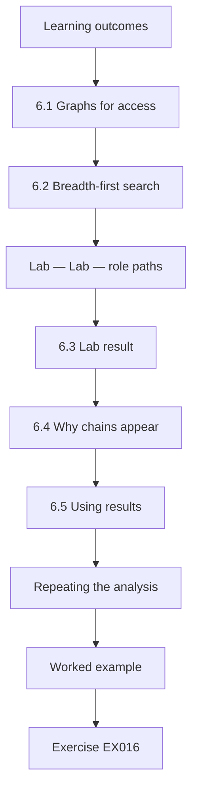

### Logical drawing

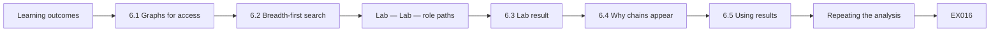

```text
[Learning outcomes]
    |
    v
[6.1 Graphs for access]
    |
    v
[6.2 Breadth-first search]
    |
    v
[Lab — Lab — role paths]
    |
    v
[6.3 Lab result]
    |
    v
[6.4 Why chains appear]
    |
    v
[6.5 Using results]
    |
    v
[Repeating the analysis]
    |
    v
[Worked example] --> [Exercise EX016]
```
<!-- cyberabc:lesson-figures:end ch-06 -->


### Learning outcomes

You will (1) model identities and roles as a graph; (2) find paths to privileged roles; (3) reason about reachability; (4) use graph results to reduce privilege.

### 6.1 Graphs for access

In the cloud, identities can often assume other roles. Treat each identity and role as a node and each "may assume" permission as a directed edge. A path from a person to an administrator role means that person can become an administrator, even if no single permission says so directly.

In StudyHub's accounts, roles are often assumed by pipelines and automation as well as people, so chains can be long and hard to spot by reading policies one at a time. Modelling them as a graph turns the question "who can become administrator?" into a search that a program can answer for every identity.

### 6.2 Breadth-first search

Breadth-first search explores neighbours level by level and finds the shortest path. It is simple to implement with a queue and a set of visited nodes, and it always terminates on a finite graph.

The visited set is what guarantees termination: without it, two roles that can assume each other would send the search round in circles. Finding the shortest path also helps remediation, since a short chain is usually easier to explain and to break than a long one.

### Lab — Lab — role paths

```python
"""Find which identities can reach an admin role through role-assumption chains (BFS, stdlib only)."""
from collections import deque
can_assume = {  # identity -> roles it may assume
    "dev-alice": ["ci-runner"], "ci-runner": ["deployer"], "deployer": ["cluster-admin"],
    "analyst-bo": ["reports-reader"], "reports-reader": [], "support-cy": ["ticket-bot"],
    "ticket-bot": ["deployer"], "cluster-admin": [],
}
def path(start, goal="cluster-admin"):
    q, seen = deque([[start]]), {start}
    while q:
        p = q.popleft()
        if p[-1] == goal: return p
        for n in can_assume.get(p[-1], []):
            if n not in seen: seen.add(n); q.append(p + [n])
for who in ["dev-alice", "analyst-bo", "support-cy"]:
    p = path(who)
    print(f"{who:11} {'REACHES admin: ' + ' -> '.join(p) if p else 'cannot reach admin'}")
```

Run with `python3 lab_graph.py`. Verified output:

```text
dev-alice   REACHES admin: dev-alice -> ci-runner -> deployer -> cluster-admin
analyst-bo  cannot reach admin
support-cy  REACHES admin: support-cy -> ticket-bot -> deployer -> cluster-admin
```

### 6.3 Lab result

dev-alice reaches cluster-admin through dev-alice -> ci-runner -> deployer -> cluster-admin. support-cy also reaches it through support-cy -> ticket-bot -> deployer -> cluster-admin. analyst-bo cannot reach admin. The surprise is support-cy: a helpdesk account can become cluster administrator through a ticket automation bot.

The analyst-bo result matters too: it confirms that the analysis does not flag everyone, and that read-only roles stay contained. A check that found admin paths for every identity would suggest a mistake in the graph rather than a real problem. Nobody had designed this path deliberately.

### 6.4 Why chains appear

Roles are added one at a time for convenience. Each edge looks reasonable alone; the risky path only appears when they are combined. NIST SP 800-210 discusses the difficulty of reasoning about combined access rules in cloud systems.

The ticket-bot was given the deployer role so it could restart failing pods, a reasonable fix for a support problem. Nobody connected that to deployer's ability to become cluster-admin, so a helpdesk account inherited a path to full control. The graph makes such combinations visible before someone finds them by accident.

### 6.5 Using results

Breaking one edge breaks a path. The best edge to remove is one used by many risky paths and needed by few legitimate tasks.

In the lab, the edge from ticket-bot to deployer was used only by the support path, and the bot needed far less than deployment rights. Removing it broke the risky path without harming legitimate work. Removing deployer's link to cluster-admin would also break the path but would stop the pipeline from working. Samuel's recommendation names the edge, the reason it is safe to remove and the narrower role to replace it.

### Repeating the analysis

The graph is rebuilt monthly from exports so new risky paths are found early.

### Worked example

Tom's team finds the ticket-bot needed to restart pods, not deploy. They replace its link to deployer with a narrow restart role. Rerunning the analysis shows only dev-alice's pipeline path remains, which is expected and protected by review rules.

> **Synthetic case.** Identities and roles are synthetic.

### Errors and limits

Graphs built from exports miss conditions such as time limits; check details for each path.

### Exercises

- **EX016 — Edge meaning.** What does an edge represent? *Rubric:* 3 = may assume permission; 2 = partial; 1 = vague; 0 = none.
- **EX017 — Surprise path.** Which path was surprising and why? *Rubric:* 3 = support-cy via ticket-bot; 2 = partial; 1 = vague; 0 = none.
- **EX018 — Fix.** How was it fixed? *Rubric:* 3 = ticket-bot given narrow restart role; 2 = partial; 1 = vague; 0 = none.

### Synthesis

Graphs reveal privilege paths that single permissions hide.

### Continue studying — chapter 06 of 40

[← Chapter 05 (draft)](#ch-05) · [Course chapter index](../SUBJECTS.md) · [Chapter 07 (draft) →](#ch-07)

<a id="ch-07"></a>

## Chapter 7 — Networks and protocols

<!-- cyberabc:lesson-figures:start ch-07 -->
### Lesson map

Lesson 07 published. Map, example, EX019.

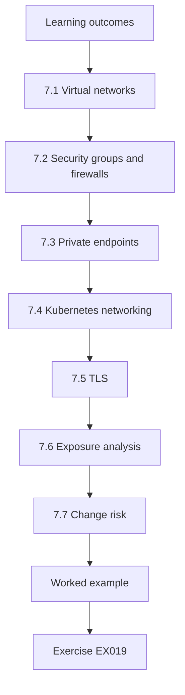

### Logical drawing

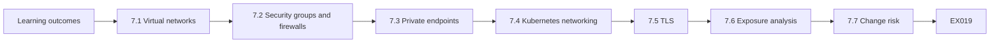

```text
[Learning outcomes]
    |
    v
[7.1 Virtual networks]
    |
    v
[7.2 Security groups and firewalls]
    |
    v
[7.3 Private endpoints]
    |
    v
[7.4 Kubernetes networking]
    |
    v
[7.5 TLS]
    |
    v
[7.6 Exposure analysis]
    |
    v
[7.7 Change risk]
    |
    v
[Worked example] --> [Exercise EX019]
```
<!-- cyberabc:lesson-figures:end ch-07 -->


### Learning outcomes

You will (1) explain cloud networking for StudyHub; (2) describe security groups, private endpoints and Kubernetes services; (3) reason about exposure; (4) plan network restrictions.

### 7.1 Virtual networks

StudyHub's cluster runs in a private network with subnets for nodes and databases. Only the load balancer is public. The test database accepted connections only from the cluster's subnet, which is why the leaked connection string could not be used from outside.

Keeping only the load balancer public means everything else must be reached through it or from inside the network. That design is why the leaked connection string, though readable by anyone who pulled the image, could not be used from outside. The network was the layer that held.

### 7.2 Security groups and firewalls

Rules list allowed sources, destinations and ports. Default-deny with specific allows is safer than broad allows with exceptions.

StudyHub's database security group allows connections on the database port only from the node subnet. A broader rule allowing the whole campus network, with exceptions for student Wi-Fi, would be harder to review and easier to get wrong. Each allow rule in Samuel's table names the reason it exists. Rules without a reason are flagged in review and either explained by their owner or removed after a short notice period, which keeps the rule set from growing without anyone understanding it.

### 7.3 Private endpoints

Managed services such as the registry and storage can be reached through private endpoints inside the network, so traffic need not cross the internet and public access can be disabled.

For the registry, a private endpoint would let the cluster pull images without the registry being reachable from the internet at all. That would have prevented the anonymous pulls in the opening case regardless of the repository setting, which is another layer of defence rather than a replacement for the setting.

### 7.4 Kubernetes networking

Pods can talk to each other freely unless network policies restrict them. Services provide stable names; ingress controllers route external requests.

By default, a compromised pod in StudyHub could connect to any other pod, including records-api. Network policies let the team allow only the connections each service needs, such as the web front end reaching the records service. The flow table described below provides the list of needed connections. Policies are introduced one namespace at a time, starting with records-api, so a missed connection breaks one service rather than all of StudyHub.

### 7.5 TLS

Traffic is encrypted with TLS. Certificates are managed automatically and monitored for expiry.

StudyHub's ingress uses certificates issued and renewed automatically, and an alert fires if any certificate is within a fortnight of expiry without renewal. Inside the cluster, traffic between some services is also encrypted, which matters because the cluster's network is shared by many workloads. Certificates for internal services are issued by a private authority that the cluster trusts, and their lifetimes are short, so a stolen certificate becomes useless quickly. Samuel's exposure table records which flows are encrypted and which are not yet.

### 7.6 Exposure analysis

For each component, Samuel lists what can reach it: internet, campus network, cluster or specific services.

The analysis turned up one surprise, described in the worked example below: the registry was internet-reachable for a reason nobody had questioned. For each component, Samuel also notes why its exposure is needed, so that unexplained exposure stands out. The categories, internet, campus, cluster or specific services, follow the layers of the network design, from widest to narrowest. Most StudyHub components should sit in the narrowest category, so anything wider needs a written reason and an owner who agrees to keep it under review.

### 7.7 Change risk

Network changes can break services, so they are tested in the test environment and rolled out gradually.

Disabling public registry access could break any build that still pushed from outside. The team tested the change with the new internal build runner first, then disabled access in the test account, and only then in production. A rollback step was ready in case an unknown job failed. No job failed. Each stage lasted a few days, long enough for scheduled jobs to run at least once, and the team recorded which jobs had been observed working before moving on.

### Documenting flows

Samuel writes a short table of every allowed network flow with its purpose and owner. When a rule is proposed, reviewers check it against the table. Flows without a known purpose are investigated and, if unused, removed. The table also helps new team members understand StudyHub quickly, and it becomes the basis for Kubernetes network policies later in the course.

### Worked example

The exposure analysis shows the registry is reachable from the internet, needed only because a build server outside the network pushes images. Moving the build to a runner inside the network lets the team disable public registry access entirely.

> **Synthetic case.** Networks are synthetic.

### Errors and limits

Network controls reduce reach but do not replace authentication.

### Exercises

- **EX019 — Why string unusable.** Why couldn't the leaked string be used from outside? *Rubric:* 3 = DB only accepted cluster subnet; 2 = partial; 1 = vague; 0 = none.
- **EX020 — Private endpoint.** What does a private endpoint provide? *Rubric:* 3 = access inside network; public off; 2 = partial; 1 = vague; 0 = none.
- **EX021 — Registry fix.** How was public registry access removed? *Rubric:* 3 = build runner inside network; 2 = partial; 1 = vague; 0 = none.

### Synthesis

Limit what can reach each component.

### Continue studying — chapter 07 of 40

[← Chapter 06 (draft)](#ch-06) · [Course chapter index](../SUBJECTS.md) · [Chapter 08 (draft) →](#ch-08)

<a id="ch-08"></a>

## Chapter 8 — Programming II

<!-- cyberabc:lesson-figures:start ch-08 -->
### Lesson map

Lesson 08 published. Map, example, EX022.

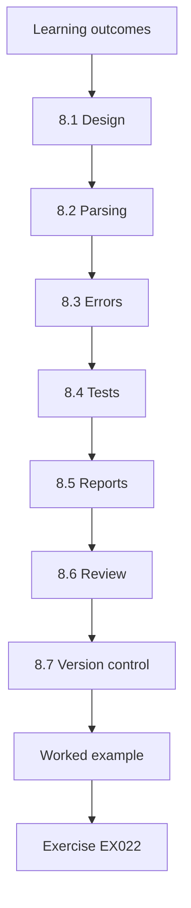

### Logical drawing

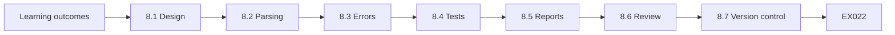

```text
[Learning outcomes]
    |
    v
[8.1 Design]
    |
    v
[8.2 Parsing]
    |
    v
[8.3 Errors]
    |
    v
[8.4 Tests]
    |
    v
[8.5 Reports]
    |
    v
[8.6 Review]
    |
    v
[8.7 Version control]
    |
    v
[Worked example] --> [Exercise EX022]
```
<!-- cyberabc:lesson-figures:end ch-08 -->


### Learning outcomes

You will (1) build a larger configuration checker with modules and tests; (2) parse JSON exports; (3) handle errors; (4) produce reports for different readers.

### 8.1 Design

Samuel's checker has three parts: loaders for each export type, a set of check functions and a report writer. Adding a new check means adding one function and its tests.

The separation paid off when Kubernetes exports arrived in a different shape from the cloud console's: only a new loader was needed, and the existing checks ran on its output unchanged. Each part can be tested on its own, so a bug in the report writer cannot hide a wrong result in a check. Samuel keeps each part in its own file, with a short description at the top saying what it expects and returns.

### 8.2 Parsing

Exports from the cloud console and Kubernetes are JSON. Each loader validates required fields and reports malformed records with their position.

A malformed record might be an export bug or a resource with unusual settings, and either deserves attention. Reporting its position, such as record 17 in the registry export, lets Samuel or Tom find it quickly. The loader still processes the rest of the file, so one bad record does not stop the whole weekly run, and the final report lists how many records were rejected and why.

### 8.3 Errors

A check that cannot run reports "unable to check" rather than silently passing.

This rule follows from the earlier lesson about missing settings. If a check cannot read a repository's anonymous-pull field, silently passing would report the repository as safe when nothing is known. "Unable to check" puts the gap in front of the team, who can then find out why the field is missing. In the first weekly run, three such results pointed to an export that had been cut short.

### 8.4 Tests

Each check has tests with synthetic records: one compliant, one non-compliant, one with missing fields. Tests run automatically on every change.

The missing-fields test is the one that matters most for security, since it checks that the program reports a gap rather than guessing. Running tests on every change means a quick edit cannot break a check without someone noticing. When the case-sensitivity bug was fixed, the new mixed-case test ran alongside the old ones and confirmed that nothing else had changed.

### 8.5 Reports

A detailed report for the cloud team lists every finding; a summary for managers counts findings by severity and account.

The two audiences need different things. The cloud team needs every finding with the resource name and the fix; managers need to know whether things are getting better and where the risk is concentrated. Producing both from the same results keeps them consistent: a manager's count of high-severity findings always matches the number of high-severity lines in the detailed report.

### 8.6 Review

Tom's team reviews the code before it runs against real exports, checking that it only reads files.

Confirming that the checker only reads files matters because it runs with access to sensitive exports. A checker that wrote or deleted anything could damage the very evidence it examines. Reviewers also look at what the reports contain, making sure no secret values from the exports are printed in plain text, only the fact that a secret was found. The review is recorded in the repository alongside the change.

### 8.7 Version control

The checker lives in a repository with a changelog, so results can be linked to the code version.

If a weekly report suddenly shows ten new findings, the changelog helps decide whether StudyHub changed or the checker did. A finding that appears the same week as a new check is probably old and only newly visible. Each report header names the code version, so this question can be answered from the report itself without asking Samuel. Old versions stay available, so a past report can be reproduced exactly.

### Running regularly

The checker runs weekly against fresh exports, and its reports are saved with the export date and code version. Comparing weekly reports shows whether findings are being fixed or new ones appearing. Samuel adds a short section at the top of each report listing what changed since the previous week, which is what the cloud team reads first. Over the term, weekly reports show findings falling from 41 to 9, with the remaining ones assigned to owners and dates.

### Sharing

The checker is shared with other university teams.

### Worked example

During review, a team member notices that the checker treats repository names case-sensitively while the registry does not. A test with mixed-case names is added and the comparison fixed.

> **Synthetic case.** Code and data are synthetic.

### Errors and limits

Checkers need the same care as production code.

### Exercises

- **EX022 — Three parts.** Name the checker's parts. *Rubric:* 3 = loaders, checks, report writer; 2 = two; 1 = one; 0 = none.
- **EX023 — Unable to check.** Why report "unable to check"? *Rubric:* 3 = avoid silent passing; 2 = partial; 1 = vague; 0 = none.
- **EX024 — Case bug.** What bug did review find? *Rubric:* 3 = case-sensitive names; 2 = partial; 1 = vague; 0 = none.

### Synthesis

Structured, reviewed checkers scale to many resources.

### Continue studying — chapter 08 of 40

[← Chapter 07 (draft)](#ch-07) · [Course chapter index](../SUBJECTS.md) · [Chapter 09 (draft) →](#ch-09)

<a id="ch-09"></a>

## Chapter 9 — Data and databases

<!-- cyberabc:lesson-figures:start ch-09 -->
### Lesson map

Lesson 09 published. Map, example, EX025.

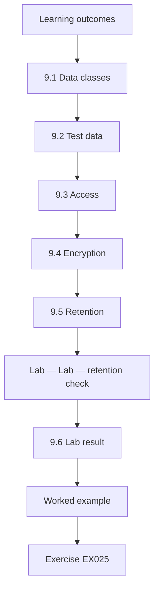

### Logical drawing

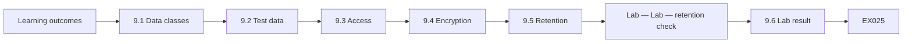

```text
[Learning outcomes]
    |
    v
[9.1 Data classes]
    |
    v
[9.2 Test data]
    |
    v
[9.3 Access]
    |
    v
[9.4 Encryption]
    |
    v
[9.5 Retention]
    |
    v
[Lab — Lab — retention check]
    |
    v
[9.6 Lab result]
    |
    v
[Worked example] --> [Exercise EX025]
```
<!-- cyberabc:lesson-figures:end ch-09 -->


### Learning outcomes

You will (1) classify StudyHub's data; (2) apply access, encryption and retention; (3) separate test and production data; (4) check retention with a lab.

### 9.1 Data classes

Student records (personal, high), coursework uploads (personal, medium), logs (may contain personal data), test data (should be synthetic). Classification guides controls.

Logs are the class most often overlooked. StudyHub's request logs once recorded full student IDs in URLs, which made ordinary application logs personal data. Classifying them correctly meant applying access controls and retention limits that had not been considered before. Samuel's data register lists each store with its class, owner and the controls that class requires. The register is reviewed each term.

### 9.2 Test data

Test databases should never hold real student data. The opening case's test database held synthetic records only, which limited the impact; Samuel confirms with a check against known synthetic markers.

His check looks for marker values that the synthetic data generator always includes, such as student IDs in a reserved range and names from a fixed list. Every record in the test database matched. If any record had lacked the markers, that would have suggested real data had been copied in, and the incident's impact would have been very different.

### 9.3 Access

Applications use database roles with only the needed permissions; administrators use separate, audited accounts.

In StudyHub, records-api's database role can read and update student records but cannot drop tables or create users. Administrators who need those powers use separate accounts whose sessions are logged. If the application's credentials leak, as nearly happened in the opening case, the damage is limited to what that narrow role allows. Each role's permissions are written down beside the service that uses it, so a reviewer can compare what the service needs with what it has and spot any permission that has crept in without a reason.

### 9.4 Encryption

Managed databases and storage encrypt at rest; connections require TLS.

Encryption at rest protects against lost disks or backups but not against someone who connects with valid credentials, since the database decrypts data for any authorised connection. That is why the leaked connection string mattered despite encryption. Requiring TLS stops credentials and records from being read on the network between the cluster and the database. Samuel's checker reports any storage bucket or database that allows unencrypted connections, and the first run found one internal reporting database that still accepted them. It was changed in the next maintenance window, after the reporting tool was updated to connect over TLS.

### 9.5 Retention

Keeping data longer than needed increases risk. Westmere's rules: app logs 90 days, audit logs 365, exam uploads 400, test snapshots 30.

The periods reflect different needs. Application logs help debug recent problems, so ninety days is enough. Audit logs support investigations that may start months later. Exam uploads must be kept through the appeals period. Test snapshots should be short-lived because they may be copied around and forgotten, as the lab below shows. Each period was agreed with the records office and the relevant data owner, and the rules are written into lifecycle settings rather than left to memory.

### Lab — Lab — retention check

```python
"""Compare synthetic data store ages with retention rules (stdlib only)."""
rules = {"app-logs": 90, "audit-logs": 365, "exam-uploads": 400, "test-db-snapshots": 30}
stores = [("app-logs", 120), ("audit-logs", 200), ("exam-uploads", 380), ("test-db-snapshots", 210), ("test-db-snapshots", 12)]
for kind, age in stores:
    print(f"{kind:18} age {age:3} d, limit {rules[kind]:3} d  {'OVER RETENTION' if age > rules[kind] else 'ok'}")
```

Run with `python3 lab_retention.py`. Verified output:

```text
app-logs           age 120 d, limit  90 d  OVER RETENTION
audit-logs         age 200 d, limit 365 d  ok
exam-uploads       age 380 d, limit 400 d  ok
test-db-snapshots  age 210 d, limit  30 d  OVER RETENTION
test-db-snapshots  age  12 d, limit  30 d  ok
```

### 9.6 Lab result

app-logs at 120 days exceed the 90-day limit. One test-db-snapshot at 210 days exceeds its 30-day limit; another at 12 days is fine. audit-logs (200 of 365) and exam-uploads (380 of 400) are within limits. The 210-day snapshot is a forgotten copy that should have been deleted automatically.

Both over-retention findings have a cause. App logs had no lifecycle rule, as described below, and the old snapshot was made by hand outside the rules. Fixing each needs a different action: adding a rule for the logs, and a process change for manual snapshots. Simply deleting the over-age data would leave both causes in place.

### Lifecycle rules

Cloud storage and snapshot services support lifecycle rules that delete or archive data after a set age. Rules are defined in code, reviewed and tested on synthetic objects. They are better than manual deletion because they never forget. Samuel checks each rule against Westmere's retention policy and finds that app logs had no rule at all, which explains why they exceeded 90 days.

### Owner review

Data owners confirm retention periods yearly with the records office.

### Worked example

The snapshot dates from a migration. The team deletes it after confirming nobody needs it, and adds a rule that manual snapshots carry an expiry tag enforced by automation.

> **Synthetic case.** Data stores are synthetic.

### Errors and limits

Deleting data is irreversible; confirm before deleting.

### Exercises

- **EX025 — Test data rule.** What should test databases contain? *Rubric:* 3 = synthetic data only; 2 = partial; 1 = vague; 0 = none.
- **EX026 — Lab over.** Which stores were over retention? *Rubric:* 3 = app-logs 120; snapshot 210; 2 = one; 1 = vague; 0 = none.
- **EX027 — Snapshot fix.** What rule followed? *Rubric:* 3 = expiry tags on manual snapshots; 2 = partial; 1 = vague; 0 = none.

### Synthesis

Classify data, separate test data and enforce retention.

### Continue studying — chapter 09 of 40

[← Chapter 08 (draft)](#ch-08) · [Course chapter index](../SUBJECTS.md) · [Chapter 10 (draft) →](#ch-10)

<a id="ch-10"></a>

## Chapter 10 — Ethics and authorized practice

<!-- cyberabc:lesson-figures:start ch-10 -->
### Lesson map

Lesson 10 published. Map, example, EX028.

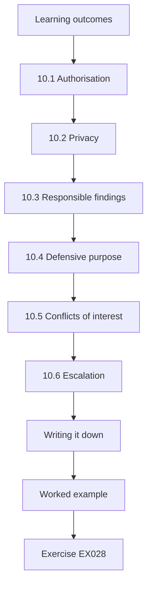

### Logical drawing

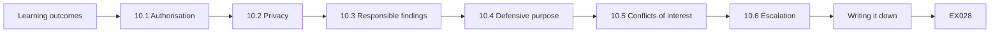

```text
[Learning outcomes]
    |
    v
[10.1 Authorisation]
    |
    v
[10.2 Privacy]
    |
    v
[10.3 Responsible findings]
    |
    v
[10.4 Defensive purpose]
    |
    v
[10.5 Conflicts of interest]
    |
    v
[10.6 Escalation]
    |
    v
[Writing it down]
    |
    v
[Worked example] --> [Exercise EX028]
```
<!-- cyberabc:lesson-figures:end ch-10 -->


### Learning outcomes

You will (1) work within authorisation in cloud projects; (2) respect student privacy; (3) handle findings responsibly; (4) know when to stop and escalate.

### 10.1 Authorisation

Samuel's project agreement lists what he may access: read-only exports, a test account and documentation. He may not access production data or test production systems.

The test account lets him try configuration changes without touching StudyHub's live services. Production data is excluded because his project does not need it; everything he studies can be shown with exports and synthetic records. When he wanted to check a production registry setting, Tom ran the query and shared the result, which stayed within the agreement.

### 10.2 Privacy

Student records are personal data. Samuel's labs use synthetic data. If he encounters real data by mistake, he stops and reports it.

Once, a Kubernetes export contained a pod's environment variables, including a test user's email address that looked real. Samuel stopped, told Tom and deleted his local copy. It turned out to be a staff test account, but the habit of stopping first and asking later protects both the students and Samuel. He recorded the event in his access diary with the time and action taken.

### 10.3 Responsible findings

Findings go to Tom and Dr Jensen, not to classmates or public forums. Reports avoid details that would help misuse before fixes are made.

His project report describes the open registry as fixed and explains the general lesson without listing which other repositories had been checked or how. A classmate asked about the project in a seminar; Samuel described the method and results in general terms, since unresolved findings could still have helped someone misuse them. Detailed findings stay in the cloud team's tracker.

### 10.4 Defensive purpose

The project checks and improves configurations; it does not attempt to break in. Testing that could affect availability needs explicit approval.

Reading configuration exports cannot break StudyHub, but some tests could, such as a scan that floods a service with requests. Samuel's project includes none of those. If he needed such a test, the agreement requires written approval from Tom, a scheduled time and a way to stop it quickly. Keeping the project to reading and checking also makes it easy to explain to anyone who asks what he did, and the access logs confirm that he read exports and changed nothing in production.

### 10.5 Conflicts of interest

If a finding concerns a colleague's work, it is reported factually, without blame.

The open registry had been configured by a colleague on Tom's team who had since moved to another project. Samuel's report describes the setting and its effect without naming who made it. The review focuses on why the setting was possible and unnoticed, which is the useful question for preventing a repeat. Samuel also gave the colleague a chance to read the finding before it was shared, which caught one small factual error and kept the working relationship good. Reports that blame individuals make people defensive and less willing to report their own mistakes.

### 10.6 Escalation

Signs of active misuse go immediately to Westmere's security team.

Signs of active misuse include unexpected sign-ins, unknown resources or unusual data transfers. Samuel's job is not to investigate them himself; the security team has authority and tools he lacks. His agreement lists the team's contact, and he reported the build-log key described below within minutes of seeing it. Speed matters more than certainty here: a false alarm costs the security team a few minutes, while a delay could let an attacker continue. Samuel's agreement says to report first and explain later, and the security team thanked him for doing exactly that.

### Writing it down

Samuel's project agreement is signed by Tom, Dr Jensen and Westmere's data protection officer before he receives any exports. It lists permitted data, storage location, retention and contacts for reporting concerns. Having it in writing protects Samuel as well as the university: if a question arises about what he accessed, the agreement and access logs answer it. He keeps a short access diary recording each export he receives and when he deleted local copies.

### Supervisor role

Dr Jensen checks quarterly that the project stays within its agreement and signs the access diary.

### Worked example

While reviewing exports, Samuel sees an access key printed in a build log. He does not use or test it; he reports it to Tom, who revokes it within an hour and adds log masking to the build system.

> **Synthetic case.** Events are synthetic.

### Errors and limits

Testing a found credential, even to check it works, is using it without authorisation.

### Exercises

- **EX028 — Allowed access.** What may Samuel access? *Rubric:* 3 = read-only exports, test account, documentation; 2 = two; 1 = one; 0 = none.
- **EX029 — Found key.** What did Samuel do with the found key? *Rubric:* 3 = reported, did not use; 2 = partial; 1 = vague; 0 = none.
- **EX030 — Testing a credential.** Why not test a found credential? *Rubric:* 3 = that is unauthorised use; 2 = partial; 1 = vague; 0 = none.

### Synthesis

Stay within authorisation and report findings responsibly.

### Continue studying — chapter 10 of 40

[← Chapter 09 (draft)](#ch-09) · [Course chapter index](../SUBJECTS.md) · [Chapter 11 (draft) →](#ch-11)

<a id="ch-11"></a>

## Chapter 11 — Operating systems

<!-- cyberabc:lesson-figures:start ch-11 -->
### Lesson map

Lesson 11 published. Map, example, EX031.

```mermaid
flowchart TD
  N0["Learning outcomes"]
  N1["11.1 Containers are processes"]
  N2["11.2 Users"]
  N3["11.3 Capabilities"]
  N4["11.4 File systems"]
  N5["11.5 Pod Security Standards"]
  N6["11.6 Patching"]
  N7["11.7 Checking"]
  N0 --> N1 --> N2 --> N3 --> N4 --> N5 --> N6 --> N7
  N7 --> EX["Worked example"]
  EX --> Q["Exercise EX031"]
```

### Logical drawing

```mermaid
flowchart LR
  N0["Learning outcomes"]
  N1["11.1 Containers are processes"]
  N2["11.2 Users"]
  N3["11.3 Capabilities"]
  N4["11.4 File systems"]
  N5["11.5 Pod Security Standards"]
  N6["11.6 Patching"]
  N7["11.7 Checking"]
  N0 --> N1 --> N2 --> N3 --> N4 --> N5 --> N6 --> N7 --> Q["EX031"]
```

```text
[Learning outcomes]
    |
    v
[11.1 Containers are processes]
    |
    v
[11.2 Users]
    |
    v
[11.3 Capabilities]
    |
    v
[11.4 File systems]
    |
    v
[11.5 Pod Security Standards]
    |
    v
[11.6 Patching]
    |
    v
[11.7 Checking]
    |
    v
[Worked example] --> [Exercise EX031]
```
<!-- cyberabc:lesson-figures:end ch-11 -->


### Learning outcomes

You will (1) explain how containers rely on Linux features; (2) describe users, permissions and capabilities in containers; (3) apply secure defaults to StudyHub pods; (4) recognise risky settings.

### 11.1 Containers are processes

A container is a group of processes isolated by Linux namespaces and limited by control groups. It shares the node's kernel, so settings that weaken isolation affect the whole node.

Because the kernel is shared, a container started with privileged settings or with the node's process namespace can see or affect other workloads on the same node. In StudyHub, several services from different teams share nodes, so one weak pod could expose others. The settings below limit what each container's processes can do.

### 11.2 Users

Many images run as root by default. Running as a non-root user means that a flaw in the application gives less power inside the container and less chance to affect the node.

Running as root inside a container is not the same as root on the node, but it removes barriers an attacker would otherwise face. A non-root process cannot change system files in the image or bind to low ports, and it gives fewer options if a kernel flaw allows escape. StudyHub's images now set a dedicated user in their build files.

### 11.3 Capabilities

Root powers are split into capabilities. Most web services need none; dropping all and adding only what is required is the secure default recommended by NIST SP 800-190.

StudyHub's web services listen on high ports and write only to mounted volumes, so they need no capabilities at all. One service that adjusts network settings for diagnostics needs a single capability, which is documented with its reason. Starting from none and adding only what is needed makes each exception visible in the pod specification.

### 11.4 File systems

A read-only root file system prevents changes to the application files at run time; temporary data goes to mounted volumes.

If an attacker exploits a flaw in records-api, a read-only root file system stops them from replacing the application's code or adding tools to the image. Temporary files go to a small volume that is discarded when the pod stops. Some images needed changes to write their caches to the volume, which the team tested before enforcing the setting. The volume is sized small on purpose.

### 11.5 Pod Security Standards

Kubernetes defines Privileged, Baseline and Restricted profiles. Restricted requires non-root, no privilege escalation, dropped capabilities and a seccomp profile. StudyHub targets Restricted for all application namespaces.

Baseline blocks the most dangerous settings, such as privileged containers, while Restricted adds the stricter defaults described above. Targeting Restricted means StudyHub's application pods follow all of them. System components such as log collectors may need Baseline or Privileged, and those namespaces are kept separate with documented exceptions. Namespace labels set which profile applies, so the enforcement level is visible in the cluster configuration and can be reviewed like any other setting.

### 11.6 Patching

Base images include operating system packages that need updates; images are rebuilt regularly from patched bases.

StudyHub's images are rebuilt weekly from the latest patched base, and the image scanner reports known vulnerabilities in each new build. Rebuilding regularly means patches arrive without a separate project each time. Images that have not been rebuilt for more than a month appear in Samuel's checker as findings. Rebuilding also brings application dependencies up to date, which sometimes changes behaviour, so each rebuilt image runs through the test suite in the test cluster before it is promoted to production.

### 11.7 Checking

Samuel's checker reads pod specifications and reports settings that violate Restricted.

The checker reads each pod's security context and reports, for example, "records-api: runs as root; root file system writable". It found the nine root pods described in the worked example below. Running the check before enforcement showed the scale of the work, so the team could plan it rather than discovering failures at admission. Each finding names the pod, its namespace and the exact field that breaks the profile, so owners know what to change. The checker runs weekly, and the list of root pods fell sprint by sprint as images were rebuilt.

### Admission enforcement

Once pods comply, the Restricted profile is enforced at admission for application namespaces, so new non-compliant pods are rejected with a clear message. System namespaces keep documented exceptions with an owner and review date.

### Worked example

The check finds that 9 of 31 StudyHub pods run as root, mostly because their images never set a user. Rebuilding the images with a non-root user and testing them in the test cluster takes two sprints; afterwards all application pods meet Restricted.

> **Synthetic case.** Pods and counts are synthetic.

### Errors and limits

Some system components need more privileges; isolate them rather than weakening the profile everywhere.

### Exercises

- **EX031 — Shared kernel.** Why do isolation-weakening settings affect the node? *Rubric:* 3 = containers share kernel; 2 = partial; 1 = vague; 0 = none.
- **EX032 — Restricted requirements.** Name three Restricted requirements. *Rubric:* 3 = non-root, no escalation, dropped caps, seccomp; 2 = two; 1 = one; 0 = none.
- **EX033 — Root pods.** How many pods ran as root and why? *Rubric:* 3 = 9 of 31; no user set; 2 = partial; 1 = vague; 0 = none.

### Synthesis

Containers should run with minimal privileges by default.

### Continue studying — chapter 11 of 40

[← Chapter 10 (draft)](#ch-10) · [Course chapter index](../SUBJECTS.md) · [Chapter 12 (draft) →](#ch-12)

<a id="ch-12"></a>

## Chapter 12 — Probability and statistics

<!-- cyberabc:lesson-figures:start ch-12 -->
### Lesson map

Lesson 12 published. Map, example, EX034.

```mermaid
flowchart TD
  N0["Learning outcomes"]
  N1["12.1 Skewed data"]
  N2["Lab — Lab — remediation statistics"]
  N3["12.2 Lab result"]
  N4["12.3 Interpreting the interval"]
  N5["12.4 Sample size"]
  N6["12.5 Comparing periods"]
  N7["12.6 Presenting"]
  N0 --> N1 --> N2 --> N3 --> N4 --> N5 --> N6 --> N7
  N7 --> EX["Worked example"]
  EX --> Q["Exercise EX034"]
```

### Logical drawing

```mermaid
flowchart LR
  N0["Learning outcomes"]
  N1["12.1 Skewed data"]
  N2["Lab — Lab — remediation statistics"]
  N3["12.2 Lab result"]
  N4["12.3 Interpreting the interval"]
  N5["12.4 Sample size"]
  N6["12.5 Comparing periods"]
  N7["12.6 Presenting"]
  N0 --> N1 --> N2 --> N3 --> N4 --> N5 --> N6 --> N7 --> Q["EX034"]
```

```text
[Learning outcomes]
    |
    v
[12.1 Skewed data]
    |
    v
[Lab — Lab — remediation statistics]
    |
    v
[12.2 Lab result]
    |
    v
[12.3 Interpreting the interval]
    |
    v
[12.4 Sample size]
    |
    v
[12.5 Comparing periods]
    |
    v
[12.6 Presenting]
    |
    v
[Worked example] --> [Exercise EX034]
```
<!-- cyberabc:lesson-figures:end ch-12 -->


### Learning outcomes

You will (1) summarise remediation times; (2) distinguish mean and median; (3) estimate a proportion with an interval; (4) interpret uncertainty.

### 12.1 Skewed data

Times to fix findings are skewed: most are quick, a few take months. The median describes the typical case; the mean is pulled up by long delays.

In the lab's data, a few findings took more than a month, which drags the mean well above the median. Reporting only the mean would suggest that a typical finding takes nearly three weeks, when half are fixed in under two. Both numbers are true, but they answer different questions, and Samuel reports both.

### Lab — Lab — remediation statistics

```python
"""Remediation times and a 95% interval for the share fixed within 14 days (stdlib only)."""
import math, statistics
days = [2, 3, 3, 5, 6, 7, 8, 9, 10, 12, 13, 15, 18, 21, 25, 30, 33, 41, 55, 70]
k = sum(d <= 14 for d in days); n = len(days); p = k / n
se = math.sqrt(p * (1 - p) / n)
print(f"n {n}, mean {statistics.mean(days):.1f}, median {statistics.median(days)}, within 14 days {k}/{n} = {p:.2f}")
print(f"approx 95% interval {max(0,p-1.96*se):.2f}-{min(1,p+1.96*se):.2f}")
```

Run with `python3 lab_stats.py`. Verified output:

```text
n 20, mean 19.3, median 12.5, within 14 days 11/20 = 0.55
approx 95% interval 0.33-0.77
```

### 12.2 Lab result

Across 20 synthetic findings, the mean time to fix is 19.3 days and the median 12.5. Eleven of 20 (0.55) were fixed within the 14-day target. An approximate 95% interval for that proportion is 0.33 to 0.77.

The two averages differ by almost a week, which is the effect of the long tail. Eleven of twenty fixed on time sounds like a coin toss, but the interval shows how little twenty findings can tell us. Samuel's report puts the count, the rate and the interval in one sentence so readers see all three together.

### 12.3 Interpreting the interval

With only 20 findings, the true on-time rate could plausibly be anywhere from about a third to three quarters. Claims like "we fix 55% on time" should carry this uncertainty.

Samuel's report to the cloud team says the on-time rate is "about half, with wide uncertainty", which is accurate and does not invite either alarm or complacency. When findings accumulate over the year, the interval will narrow and the rate can be compared with the target more confidently. He also notes that the interval assumes findings are independent.

### 12.4 Sample size

Quadrupling the sample roughly halves the interval width. Samuel plans to report quarterly once more findings accumulate.

To halve the width from about forty-four points to twenty-two, the team would need around eighty findings, which a quarter's weekly checks should provide. Waiting for more data is better than reacting to noise. Samuel notes the planned sample size in the report so readers know when firmer conclusions will be possible. Until then, he reports the count and the interval rather than a confident rate, and he explains to the team why a larger sample matters before any target is judged met or missed.

### 12.5 Comparing periods

Differences between periods need intervals too; a rise from 55% to 65% on small samples may be noise.

If next quarter shows 65% on time, the team will want to claim improvement. Samuel's plan is to compute intervals for both periods and check whether they overlap substantially. If they do, the report will say the change is not yet clear, and suggest looking at the long tail instead, where causes are easier to see. A change in what the checker detects can also shift the numbers, since new checks often find old, slow-to-fix problems. Samuel records checker changes beside each period so comparisons stay fair.

### 12.6 Presenting

Charts show medians and percentiles, with sample sizes labelled.

Samuel's chart shows each quarter's median time to fix as a point, with a bar from the twenty-fifth to the seventy-fifth percentile, and the number of findings written beneath. A chart without sample sizes would let a quarter with five findings look as reliable as one with eighty. Labels name the units, days, and the target line at fourteen days is drawn across the chart, so readers can see at once how each quarter compares. Samuel avoids three-dimensional effects and decorative colours, which make values harder to read without adding information.

### Why the median matters here

The median of 12.5 days says a typical finding is fixed within target. The mean of 19.3 days is pulled up by four findings that took 33 to 70 days. Looking at those four, Samuel finds two waited for a vendor patch and two had no clear owner. Fixing ownership is cheap and addresses half the tail. This kind of analysis is more useful to the team than a single average, because it points to causes they can act on.

### Worked example

The cloud team had planned to report "45% of findings late" as a crisis. Samuel shows the wide interval and the median of 12.5 days, below target. The team reframes the report around the long tail of findings over 30 days, which have specific causes.

> **Synthetic case.** Data are synthetic.

### Errors and limits

The simple interval used here is approximate; for small samples better methods exist.

### Exercises

- **EX034 — Lab figures.** What were mean, median and on-time share? *Rubric:* 3 = 19.3, 12.5, 0.55; 2 = two; 1 = one; 0 = none.
- **EX035 — Interval.** What was the interval? *Rubric:* 3 = 0.33-0.77; 2 = partial; 1 = vague; 0 = none.
- **EX036 — Reframing.** How was the report reframed? *Rubric:* 3 = focus on long tail over 30 days; 2 = partial; 1 = vague; 0 = none.

### Synthesis

Report typical values and uncertainty honestly.

### Continue studying — chapter 12 of 40

[← Chapter 11 (draft)](#ch-11) · [Course chapter index](../SUBJECTS.md) · [Chapter 13 (draft) →](#ch-13)

<a id="ch-13"></a>

## Chapter 13 — Identity and access

<!-- cyberabc:lesson-figures:start ch-13 -->
### Lesson map

Lesson 13 published. Map, example, EX037.

```mermaid
flowchart TD
  N0["Learning outcomes"]
  N1["13.1 Human identities"]
  N2["13.2 Service identities"]
  N3["Lab — Lab — account review"]
  N4["13.3 Lab result"]
  N5["13.4 Stale access"]
  N6["13.5 Keys"]
  N7["13.6 Reviews"]
  N0 --> N1 --> N2 --> N3 --> N4 --> N5 --> N6 --> N7
  N7 --> EX["Worked example"]
  EX --> Q["Exercise EX037"]
```

### Logical drawing

```mermaid
flowchart LR
  N0["Learning outcomes"]
  N1["13.1 Human identities"]
  N2["13.2 Service identities"]
  N3["Lab — Lab — account review"]
  N4["13.3 Lab result"]
  N5["13.4 Stale access"]
  N6["13.5 Keys"]
  N7["13.6 Reviews"]
  N0 --> N1 --> N2 --> N3 --> N4 --> N5 --> N6 --> N7 --> Q["EX037"]
```

```text
[Learning outcomes]
    |
    v
[13.1 Human identities]
    |
    v
[13.2 Service identities]
    |
    v
[Lab — Lab — account review]
    |
    v
[13.3 Lab result]
    |
    v
[13.4 Stale access]
    |
    v
[13.5 Keys]
    |
    v
[13.6 Reviews]
    |
    v
[Worked example] --> [Exercise EX037]
```
<!-- cyberabc:lesson-figures:end ch-13 -->


### Learning outcomes

You will (1) review cloud user accounts and keys; (2) enforce multi-factor authentication; (3) remove stale access; (4) prefer federated and short-lived identities.

### 13.1 Human identities

Staff sign in through the university's identity provider with multi-factor authentication. Separate cloud console users should not exist except for documented break-glass accounts.

Federation through the identity provider means that when someone leaves Westmere, disabling their university account also removes cloud access. Separate console users break that link, which is how old-contractor survived long after the contract ended. Break-glass accounts are the only exception, because they must work when the identity provider does not. Samuel's checker lists every console user and flags any that are not break-glass accounts.

### 13.2 Service identities

Services should use workload identity or managed identities that issue short-lived credentials, not long-lived access keys.

svc-backup's 610-day-old key shows the problem with long-lived keys: it could have been copied at any point in that time and would still work. A managed identity issues credentials that last minutes and are tied to the running workload, so there is nothing durable to steal. The opening case's connection string had the same weakness. StudyHub's pods now use workload identity, so each service receives credentials for its own role only, which expire automatically and never appear in images or configuration files.

### Lab — Lab — account review

```python
"""Review synthetic cloud console users: MFA, key age and last sign-in (stdlib only)."""
users = [("c.jensen", True, None, 2), ("t.becker", True, 45, 1), ("svc-backup", False, 610, None),
         ("old-contractor", False, 400, 220), ("s.osei", True, None, 5)]
for u, mfa, key_age, last in users:
    f = []
    if last is not None and not mfa: f.append("console user without MFA")
    if key_age and key_age > 90: f.append(f"access key {key_age} d old")
    if last and last > 90: f.append(f"inactive {last} d")
    print(f"{u:15} {'; '.join(f) or 'ok'}")
```

Run with `python3 lab_mfa.py`. Verified output:

```text
c.jensen        ok
t.becker        ok
svc-backup      access key 610 d old
old-contractor  console user without MFA; access key 400 d old; inactive 220 d
s.osei          ok
```

### 13.3 Lab result

c.jensen, t.becker and s.osei are ok. svc-backup has an access key 610 days old. old-contractor is a console user without MFA, with a 400-day-old key, inactive for 220 days. old-contractor should be removed; svc-backup should move to a managed identity.

Each finding has a different remedy. old-contractor has no reason to exist, so it is removed after checking for dependencies. svc-backup does needed work, so it is moved to a managed identity rather than deleted. The ok results confirm that the checks do not flag every account.

### 13.4 Stale access

Accounts inactive for 90 days are disabled after confirming with owners. Leavers' access is removed through the identity provider, which removes cloud access too when federation is used.

Confirming with owners first matters because an inactive account may still run something, as old-contractor's hidden report showed. Disabling before deleting gives a chance to notice failures and reverse the change. Federated leavers lose access automatically, which removes the most common route to stale accounts. Disabled accounts are deleted after a further thirty days if nothing has broken, and the decision is recorded in the access review.

### 13.5 Keys

Keys older than 90 days are rotated or, better, replaced by short-lived credentials.

Rotation limits how long a stolen key works but still leaves a key to steal. For svc-backup, Samuel's recommendation was replacement rather than rotation, since the backup job runs inside the cloud and can use a managed identity. Keys remain only where an outside system cannot use federation, and each is listed with its owner. Samuel's checker reports any key older than ninety days, with its owner, so rotation is prompted rather than remembered. Each remaining key also has a documented reason.

### 13.6 Reviews

Quarterly access reviews list who has which roles; owners confirm each.

Owners confirm each role or mark it for removal. A review that only lists access without asking owners to act becomes a report nobody reads. Samuel's checker prepares the list from exports, so reviewers spend their time deciding rather than gathering data, and the decisions are recorded with dates. Roles that no owner claims are removed after notice. The first quarterly review removed several roles left from finished projects, and the review record now shows the trend in unclaimed roles from one quarter to the next, which helps the team see whether access is being kept tidy between reviews.

### Break-glass accounts

Two break-glass accounts exist for emergencies when the identity provider is unavailable. Their credentials are sealed, use hardware MFA, and any sign-in raises an immediate alert to the security team. They are tested twice a year. The access review checks they have not been used outside tests, and each test is recorded with who performed it and why.

### Role design

Roles are designed per task, such as read-only support, deployer and database administrator, and reviewed when tasks change.

### Worked example

Removing old-contractor reveals that a scheduled report used that account's key. The report is moved to a service identity with read-only access to one bucket, and the account is deleted. The incident shows why personal accounts must never run automation.

> **Synthetic case.** Accounts are synthetic.

### Errors and limits

Disabling accounts can break hidden dependencies; disable before deleting and watch for failures.

### Exercises

- **EX037 — Lab findings.** What did the lab find for old-contractor? *Rubric:* 3 = no MFA, 400 d key, inactive 220 d; 2 = two; 1 = one; 0 = none.
- **EX038 — svc-backup.** What should happen to svc-backup? *Rubric:* 3 = move to managed identity; 2 = partial; 1 = vague; 0 = none.
- **EX039 — Hidden dependency.** What hidden dependency was found? *Rubric:* 3 = scheduled report used contractor key; 2 = partial; 1 = vague; 0 = none.

### Synthesis

Federated, short-lived identities and regular reviews keep access tidy.

### Continue studying — chapter 13 of 40

[← Chapter 12 (draft)](#ch-12) · [Course chapter index](../SUBJECTS.md) · [Chapter 14 (draft) →](#ch-14)

<a id="ch-14"></a>

## Chapter 14 — Privacy foundations

<!-- cyberabc:lesson-figures:start ch-14 -->
### Lesson map

Lesson 14 published. Map, example, EX040.

```mermaid
flowchart TD
  N0["Learning outcomes"]
  N1["14.1 Principles"]
  N2["14.2 Data location"]
  N3["14.3 Minimisation in design"]
  N4["14.4 Rights"]
  N5["14.5 Breach duties"]
  N6["14.6 Privacy and security"]
  N7["14.7 Test data"]
  N0 --> N1 --> N2 --> N3 --> N4 --> N5 --> N6 --> N7
  N7 --> EX["Worked example"]
  EX --> Q["Exercise EX040"]
```

### Logical drawing

```mermaid
flowchart LR
  N0["Learning outcomes"]
  N1["14.1 Principles"]
  N2["14.2 Data location"]
  N3["14.3 Minimisation in design"]
  N4["14.4 Rights"]
  N5["14.5 Breach duties"]
  N6["14.6 Privacy and security"]
  N7["14.7 Test data"]
  N0 --> N1 --> N2 --> N3 --> N4 --> N5 --> N6 --> N7 --> Q["EX040"]
```

```text
[Learning outcomes]
    |
    v
[14.1 Principles]
    |
    v
[14.2 Data location]
    |
    v
[14.3 Minimisation in design]
    |
    v
[14.4 Rights]
    |
    v
[14.5 Breach duties]
    |
    v
[14.6 Privacy and security]
    |
    v
[14.7 Test data]
    |
    v
[Worked example] --> [Exercise EX040]
```
<!-- cyberabc:lesson-figures:end ch-14 -->


### Learning outcomes

You will (1) apply privacy principles to StudyHub; (2) minimise and protect student data; (3) understand lawful basis and rights; (4) build privacy into cloud designs.

### 14.1 Principles

Collect only what is needed, use it only for stated purposes, keep it only as long as needed, keep it accurate and secure, and be transparent with students.

For StudyHub, collecting only what is needed means the coursework service stores uploads and marks but not students' addresses. Stated purposes are published in the student privacy notice. Retention limits come from the rules in the data chapter. Transparency means students can see what StudyHub holds about them and why. Each principle has a matching check or process.

### 14.2 Data location

Where cloud data is stored affects which laws apply. Westmere keeps student data in its home region and records this in its data register.

Choosing a region is a configuration setting that can be changed by mistake, for example when a new storage bucket is created with a default region. Samuel's checker reports any resource holding student data outside the home region. In its first run, it found a log bucket in another region, which was moved. The register records why each region was chosen.

### 14.3 Minimisation in design

StudyHub's analytics use aggregated data; individual records stay in the records system. Logs mask student IDs.

Analytics that need counts per course do not need names or student IDs, so they receive only aggregates. Masking IDs in logs keeps logs useful for debugging while removing the most identifying field. The analytics job described below had drifted from this design, which a periodic check found. Masking replaces each ID with a token that stays consistent within a day, so engineers can follow one request through the logs without seeing who made it. Analytics jobs are listed in the data register with the fields they read.

### 14.4 Rights

Students can ask for their data; systems need a way to find and export it. Knowing where data lives (chapter 9) makes this possible.

A request for a student's data means searching the records system, coursework store and any logs that still contain the student's ID. Without the data register, the team might miss a store, such as the reporting bucket that once held full copies. The register lists which stores to search and who owns each. Exporting a student's data uses a script that searches each listed store.

### 14.5 Breach duties

Exposure of personal data may need reporting to a regulator and students within strict time limits. Good logging lets Westmere determine what was exposed.

In the opening case, audit logging was off in one account, so Westmere could not say whether the image had been pulled. If the test database had held real data, that gap would have made it impossible to tell the regulator or students what had happened. Turning logging on everywhere is a privacy control as much as a security one.

### 14.6 Privacy and security

Security controls protect privacy, but privacy also asks whether data should be collected at all.

Encrypting the nightly copies of full student records would have satisfied a security checklist, yet the right answer was to stop making them. Samuel's privacy review form asks first whether data is needed, then how to protect it. That order catches problems that a security-only review would leave in place. The review also asks who will use the data and whether they could manage with less. In StudyHub's case, the course reports needed only counts, so neither names nor IDs had to leave the records system at all.

### 14.7 Test data

Synthetic test data avoids privacy risk in testing entirely.

The opening case showed the value: the test database's synthetic records meant that, even with a leaked connection string and missing logs, no student could have been affected. Westmere's generator produces realistic names, courses and marks so tests behave as they would with real data, without any of the risk. Developers sometimes ask for a copy of production to reproduce a bug. The answer is to generate synthetic records with the same shape, or to reproduce the bug with a single consenting test account, never to copy real student data into a test environment.

### Privacy reviews

New StudyHub features go through a short privacy review: what data, why, for how long, who can access it and whether a smaller set would do. The review takes under an hour for most features and is recorded. Samuel helps redesign the review form so developers answer in plain language. In its first term, the review stops one feature from collecting date of birth where age band was enough.

### Worked example

Samuel finds that an old analytics job copies full student records nightly into a reporting bucket, though the reports only need counts per course. The job is changed to produce counts directly, and the bucket's old copies are deleted after approval.

> **Synthetic case.** Data and jobs are synthetic.

### Errors and limits

Aggregated data can still identify people in small groups; suppress small counts.

### Exercises

- **EX040 — Principles.** List three privacy principles. *Rubric:* 3 = minimise, purpose, retention, accuracy, security, transparency; 2 = two; 1 = one; 0 = none.
- **EX041 — Logging and breach.** How does logging help with breach duties? *Rubric:* 3 = determine what was exposed; 2 = partial; 1 = vague; 0 = none.
- **EX042 — Analytics change.** How was the analytics job changed? *Rubric:* 3 = counts instead of full records; 2 = partial; 1 = vague; 0 = none.

### Synthesis

Privacy asks whether data is needed, not only how to protect it.

### Continue studying — chapter 14 of 40

[← Chapter 13 (draft)](#ch-13) · [Course chapter index](../SUBJECTS.md) · [Chapter 15 (draft) →](#ch-15)

<a id="ch-15"></a>

## Chapter 15 — Evidence and measurement

<!-- cyberabc:lesson-figures:start ch-15 -->
### Lesson map

Lesson 15 published. Map, example, EX043.

```mermaid
flowchart TD
  N0["Learning outcomes"]
  N1["15.1 Why logs matter"]
  N2["Lab — Lab — logging coverage"]
  N3["15.2 Lab result"]
  N4["15.3 Fixing gaps"]
  N5["15.4 Trustworthy evidence"]
  N6["15.5 Measures"]
  N7["Evidence log"]
  N0 --> N1 --> N2 --> N3 --> N4 --> N5 --> N6 --> N7
  N7 --> EX["Worked example"]
  EX --> Q["Exercise EX043"]
```

### Logical drawing

```mermaid
flowchart LR
  N0["Learning outcomes"]
  N1["15.1 Why logs matter"]
  N2["Lab — Lab — logging coverage"]
  N3["15.2 Lab result"]
  N4["15.3 Fixing gaps"]
  N5["15.4 Trustworthy evidence"]
  N6["15.5 Measures"]
  N7["Evidence log"]
  N0 --> N1 --> N2 --> N3 --> N4 --> N5 --> N6 --> N7 --> Q["EX043"]
```

```text
[Learning outcomes]
    |
    v
[15.1 Why logs matter]
    |
    v
[Lab — Lab — logging coverage]
    |
    v
[15.2 Lab result]
    |
    v
[15.3 Fixing gaps]
    |
    v
[15.4 Trustworthy evidence]
    |
    v
[15.5 Measures]
    |
    v
[Evidence log]
    |
    v
[Worked example] --> [Exercise EX043]
```
<!-- cyberabc:lesson-figures:end ch-15 -->


### Learning outcomes

You will (1) gather evidence about cloud controls; (2) check audit logging coverage; (3) measure gaps; (4) keep evidence trustworthy.

### 15.1 Why logs matter

The opening case could not measure how long the registry was open because logging was off. Audit logs record who changed what and when, and are the main evidence for investigations.

Without them, the review could only say that the registry had been open at some point, not when it opened, who pulled images or whether records-api was among them. With them, the same questions would have had definite answers within an hour. That difference is why turning logging on everywhere was treated as urgent, even before the registry was fixed, and why coverage is now measured every month rather than assumed.

### Lab — Lab — logging coverage

```python
"""Check audit logging per synthetic account and region (stdlib only)."""
accounts = {"studyhub-prod": {"eu-west": True, "eu-central": True}, "studyhub-test": {"eu-west": True, "eu-central": False},
            "research-sandbox": {"eu-west": False, "eu-central": False}}
gaps = [(a, r) for a, regs in accounts.items() for r, on in regs.items() if not on]
for a, r in gaps: print(f"NO AUDIT LOG: {a} / {r}")
total = sum(len(r) for r in accounts.values())
print(f"logging coverage {total-len(gaps)}/{total}")
```

Run with `python3 lab_logging.py`. Verified output:

```text
NO AUDIT LOG: studyhub-test / eu-central
NO AUDIT LOG: research-sandbox / eu-west
NO AUDIT LOG: research-sandbox / eu-central
logging coverage 3/6
```

### 15.2 Lab result

Audit logging is missing in studyhub-test / eu-central and in both regions of research-sandbox. Coverage is 3 of 6 account-region pairs. studyhub-prod is fully covered; the gaps are in test and research accounts, which are exactly where mistakes are often made.

Test and research accounts are created more often and with less ceremony than production, so a missed setting is more likely there. The opening case's missing logs were in one such account. A coverage figure for production alone would have looked perfect while hiding the very gaps that caused the review's main uncertainty, which is why Samuel reports coverage across every account and region.

### 15.3 Fixing gaps

An organisation-wide logging configuration turns on audit logs for every account and region, sending them to a separate log account that individual accounts cannot alter.

Central configuration removes the need to remember logging when a new account or region is added, which is how the original gap appeared. Sending logs to a separate account matters because an attacker or a careless administrator in one account cannot then delete the evidence of what they did. Samuel's lab check now confirms coverage remains complete each month.

### 15.4 Trustworthy evidence

Logs are stored with integrity protection and restricted access. Evidence collected for reports records source, time and hash.

Integrity protection means stored logs cannot be changed without detection, for example through a storage setting that prevents overwriting for a fixed period. Recording the hash of each extract lets Samuel show later that the figures in his report came from an unaltered file. Only the security team and auditors can read the log account directly. Samuel's evidence log follows the same pattern for every file he uses.

### 15.5 Measures

Logging coverage, time to fix findings and number of high-risk configurations are tracked monthly.

Each measure is defined once, with its formula and source, so that monthly figures are comparable. Coverage is account-region pairs with logging on, divided by all pairs. Time to fix is days from first detection to the checker no longer reporting the finding. The monthly report shows each measure with its trend over the previous six months. Changes to a definition are noted on the report, and earlier months are recalculated where possible, so a trend line never mixes two meanings.

### 15.6 Limits

Logs show actions, not intentions; missing data must be stated in reports.

In the sandbox example below, the log shows a researcher created a public bucket but not why; the friendly conversation that followed established it was a mistake. A report that says "no unusual pulls were logged" must also say which accounts were logging at the time, or readers will assume complete coverage that did not exist. Samuel's reports carry a short coverage statement near the top for that reason. Logs also miss actions taken outside the cloud platform, such as someone copying a downloaded image onto a laptop, which no cloud log can record.

### Evidence log

Samuel keeps an evidence log for his project: each export or log extract received, its date, source, hash and where it is stored. When he quotes a figure in a report, the log shows where it came from. Tom later adopts the same format for the cloud team's audit preparation, because auditors ask exactly these questions.

### Report gaps

Reports state gaps openly.

### Worked example

After organisation-wide logging is enabled, coverage reaches 6 of 6. A month later, logs show a researcher creating a public bucket in the sandbox; the account-level block prevents it, and the log provides clear evidence for a friendly reminder rather than a guess.

> **Synthetic case.** Accounts and events are synthetic.

### Errors and limits

Logging only per account can be switched off by that account's administrators; central configuration is stronger.

### Exercises

- **EX043 — Lab coverage.** What was coverage and where were gaps? *Rubric:* 3 = 3/6; test eu-central and research both; 2 = two; 1 = one; 0 = none.
- **EX044 — Central logging.** Why send logs to a separate account? *Rubric:* 3 = cannot be altered by individual accounts; 2 = partial; 1 = vague; 0 = none.
- **EX045 — Sandbox event.** What did logs show a month later? *Rubric:* 3 = attempted public bucket, blocked; 2 = partial; 1 = vague; 0 = none.

### Synthesis

Logs are evidence; make coverage complete and tamper-resistant.

### Continue studying — chapter 15 of 40

[← Chapter 14 (draft)](#ch-14) · [Course chapter index](../SUBJECTS.md) · [Chapter 16 (draft) →](#ch-16)

<a id="ch-16"></a>

## Chapter 16 — Security architecture

<!-- cyberabc:lesson-figures:start ch-16 -->
### Lesson map

Lesson 16 published. Map, example, EX046.

```mermaid
flowchart TD
  N0["Learning outcomes"]
  N1["16.1 Account structure"]
  N2["16.2 Organisation guardrails"]
  N3["16.3 Cluster design"]
  N4["16.4 Trust boundaries"]
  N5["16.5 Zero trust"]
  N6["16.6 Documentation"]
  N7["16.7 Review"]
  N0 --> N1 --> N2 --> N3 --> N4 --> N5 --> N6 --> N7
  N7 --> EX["Worked example"]
  EX --> Q["Exercise EX046"]
```

### Logical drawing

```mermaid
flowchart LR
  N0["Learning outcomes"]
  N1["16.1 Account structure"]
  N2["16.2 Organisation guardrails"]
  N3["16.3 Cluster design"]
  N4["16.4 Trust boundaries"]
  N5["16.5 Zero trust"]
  N6["16.6 Documentation"]
  N7["16.7 Review"]
  N0 --> N1 --> N2 --> N3 --> N4 --> N5 --> N6 --> N7 --> Q["EX046"]
```

```text
[Learning outcomes]
    |
    v
[16.1 Account structure]
    |
    v
[16.2 Organisation guardrails]
    |
    v
[16.3 Cluster design]
    |
    v
[16.4 Trust boundaries]
    |
    v
[16.5 Zero trust]
    |
    v
[16.6 Documentation]
    |
    v
[16.7 Review]
    |
    v
[Worked example] --> [Exercise EX046]
```
<!-- cyberabc:lesson-figures:end ch-16 -->


### Learning outcomes

You will (1) design a layered architecture for StudyHub; (2) separate accounts and environments; (3) place trust boundaries; (4) use guardrails at organisation level.

### 16.1 Account structure

Westmere uses separate cloud accounts for production, test, research sandboxes, shared tooling and logs. Accounts are strong boundaries: a mistake in a sandbox cannot change production resources.

The research sandbox shows why: researchers experiment freely there, and a mistake such as a public bucket stays inside that account. If the sandbox shared an account with StudyHub production, the same mistake could expose student services. Separate accounts also make it simpler to give each team full control of its own space without access to others.

### 16.2 Organisation guardrails

Policies at the organisation level block public storage, restrict regions to the home region and prevent disabling audit logs. Guardrails apply to every account, including ones created in the future.

Guardrails act before a mistake happens, while checkers find mistakes afterwards. The researcher's public bucket in the evidence chapter was blocked by a guardrail, not found later by a scan. Applying guardrails to future accounts closes the gap that created the opening case, where a new account missed a setting.

### 16.3 Cluster design

Production and test clusters are separate. Within production, namespaces separate services, with default-deny network policies and Restricted pod security.

Separate clusters mean a test deployment cannot accidentally affect production pods. Within production, default-deny network policies stop one compromised service from reaching others, and Restricted pod security limits what any single container can do. Each namespace belongs to one team, which keeps ownership clear. Test clusters may use relaxed settings for debugging, but they never hold real student data, and their credentials cannot reach production resources. Samuel's checker runs against both clusters, with the production checks treated as stricter.

### 16.4 Trust boundaries

Internet to load balancer; cluster to managed database; build system to registry; registry to cluster; accounts to log account. Each boundary has authentication and logging.

The build-to-registry boundary was where the opening case started: the registry trusted anonymous requests from anywhere. Now the build system authenticates with its own identity, and pulls by the cluster use the cluster's identity. Every push and pull is logged in the central log account, so the same question asked again would have an answer.

### 16.5 Zero trust

Following NIST SP 800-207, services authenticate each other and every request is authorised, rather than trusting anything inside the network.

In StudyHub, records-api no longer accepts any request simply because it comes from inside the cluster. Each calling service presents its own identity, and records-api checks that the caller is allowed the specific operation. A compromised pod elsewhere in the cluster therefore cannot query student records just by reaching the service on the network. Network policies still limit which pods can reach records-api, so the two layers support each other.

### 16.6 Documentation

An architecture diagram and decision records explain each choice.

Decision records state the problem, the options considered, the choice and its reasons. When a new team member asked why the sandbox had its own registry, the record answered the question in a few minutes. Without it, the reason might have been forgotten and the registries merged again for convenience. The diagram shows accounts, clusters, trust boundaries and the main flows on one page, and links to the detailed system model. Decision records are short, usually under a page, and are numbered so later records can refer to earlier ones. Superseded decisions stay in the repository with a note pointing to their replacement.

### 16.7 Review

Architecture changes are reviewed by the cloud team and a security reviewer.

The security reviewer looks particularly at new trust boundaries and changes to guardrails. A proposal to let the research sandbox pull from the production registry was rejected in review with a reference to the decision record, and the team found another way to share the base image the researchers needed. Reviews are recorded in the pull request, so the reasoning stays with the change. Small changes that do not touch boundaries or guardrails are reviewed by the cloud team alone, which keeps the security reviewer's time for the decisions that need it.

### Account creation

New accounts are created only through an automated process that applies guardrails, logging and baseline roles from the start. Manual account creation is disabled. This means that a research group requesting a sandbox gets one that already blocks public storage and sends logs centrally, without anyone having to remember. Samuel tests the process with a synthetic request and confirms the new account passes all baseline checks on its first day.

### Worked example

Applying the account structure reveals that the research sandbox shared the production registry, which is how a research image could be pushed alongside StudyHub images. A separate sandbox registry is created, and production accepts images only from its own registry.

> **Synthetic case.** Architecture is synthetic.

### Errors and limits

Guardrails can block legitimate needs; provide a documented exception route.

### Exercises

- **EX046 — Account benefit.** Why use separate accounts? *Rubric:* 3 = strong boundary for mistakes; 2 = partial; 1 = vague; 0 = none.
- **EX047 — Guardrails.** Name two organisation guardrails. *Rubric:* 3 = block public storage, restrict regions, keep audit logs; 2 = one; 1 = vague; 0 = none.
- **EX048 — Shared registry.** What was found and fixed? *Rubric:* 3 = sandbox shared prod registry; separated; 2 = partial; 1 = vague; 0 = none.

### Synthesis

Use accounts, guardrails and boundaries as layered architecture.

### Continue studying — chapter 16 of 40

[← Chapter 15 (draft)](#ch-15) · [Course chapter index](../SUBJECTS.md) · [Chapter 17 (draft) →](#ch-17)

<a id="ch-17"></a>

## Chapter 17 — Cryptography concepts

<!-- cyberabc:lesson-figures:start ch-17 -->
### Lesson map

Lesson 17 published. Map, example, EX049.

```mermaid
flowchart TD
  N0["Learning outcomes"]
  N1["17.1 Encryption in transit"]
  N2["17.2 Encryption at rest"]
  N3["17.3 Key management"]
  N4["17.4 Hashes"]
  N5["17.5 Signatures"]
  N6["17.6 Mistakes"]
  N7["17.7 Secrets"]
  N0 --> N1 --> N2 --> N3 --> N4 --> N5 --> N6 --> N7
  N7 --> EX["Worked example"]
  EX --> Q["Exercise EX049"]
```

### Logical drawing

```mermaid
flowchart LR
  N0["Learning outcomes"]
  N1["17.1 Encryption in transit"]
  N2["17.2 Encryption at rest"]
  N3["17.3 Key management"]
  N4["17.4 Hashes"]
  N5["17.5 Signatures"]
  N6["17.6 Mistakes"]
  N7["17.7 Secrets"]
  N0 --> N1 --> N2 --> N3 --> N4 --> N5 --> N6 --> N7 --> Q["EX049"]
```

```text
[Learning outcomes]
    |
    v
[17.1 Encryption in transit]
    |
    v
[17.2 Encryption at rest]
    |
    v
[17.3 Key management]
    |
    v
[17.4 Hashes]
    |
    v
[17.5 Signatures]
    |
    v
[17.6 Mistakes]
    |
    v
[17.7 Secrets]
    |
    v
[Worked example] --> [Exercise EX049]
```
<!-- cyberabc:lesson-figures:end ch-17 -->


### Learning outcomes

You will (1) explain encryption at rest and in transit; (2) describe key management in the cloud; (3) use hashes and signatures for images; (4) avoid common cryptographic mistakes.

### 17.1 Encryption in transit

TLS protects traffic between users and StudyHub and between services. Certificates are issued and renewed automatically.

Between services inside the cluster, TLS stops a compromised node or a misrouted network from exposing student records as they travel. Automatic issuance and renewal removes the expired-certificate outages that once tempted developers to switch off verification, which is the mistake Samuel found in records-api. Internal certificates come from a private authority with short lifetimes. Samuel's checker reports any service that accepts plain connections or skips certificate verification, and the first run found exactly one, records-api, as the worked example below describes.

### 17.2 Encryption at rest

Managed storage and databases encrypt data at rest. Provider-managed keys are simplest; customer-managed keys in a key service add control over use and rotation, with audit logs of each use.

StudyHub's student records database uses a customer-managed key, so Westmere can see every use of the key in the audit log and could disable it in an emergency. Less sensitive stores such as application logs use provider-managed keys, which are simpler and adequate for their risk. The choice is recorded in the data register for each store.

### 17.3 Key management

Keys live in a managed key service, never in code or images. Access to use a key is granted to specific identities.

Granting key use to specific identities means that even someone with storage access cannot decrypt the student records database's backups without also being allowed to use its key. This two-part check limits the effect of a mistake in either permission. The key service logs each use, which feeds the access review below. Samuel's checker also searches images and code for anything that looks like a key, which complements secret scanning.

### 17.4 Hashes

An image digest is a hash of its content. Deploying by digest guarantees the exact image tested is the one running.

A tag such as latest can be moved to point at a different image at any time, so two deployments of the same tag may run different code. Deploying by digest removes that doubt. StudyHub's deployment files record digests, and the evidence for a release includes the digest that passed testing. Samuel's checker flags deployments that use tags instead of digests, so drift is visible.

### 17.5 Signatures

The build system signs images; the cluster verifies signatures before running them, so images from elsewhere are refused.

Since the sandbox gained its own registry, a research image could only reach production by being signed by StudyHub's build system, which does not build research images. Signature verification adds a second barrier beyond registry separation. A failed verification blocks the pod and raises an alert. Signing keys are held in the key service and used only by the build system's identity, so a developer cannot sign an image from a laptop. Exceptions for third-party system images are verified with the publisher's own signature where one exists.

### 17.6 Mistakes

Hard-coded keys, home-made encryption schemes and disabled certificate checks. All are avoided by using platform services.

Each has a familiar cause: hard-coded keys are quick in development, home-made schemes seem simpler than learning a library, and disabled checks make a certificate error go away. Platform services make the secure option the easy one. Samuel's checker searches code and configuration for the most common signs of all three. Findings are explained to developers with the safer alternative, so the fix is easy to apply and the habit changes rather than just the line of code.

### 17.7 Secrets

Connection strings and passwords belong in a secret manager, delivered to pods at run time, never baked into images like the one in the opening case.

After the opening case, records-api receives its database credentials from the secret manager when the pod starts, and the credentials expire and are replaced automatically. The rebuilt image contains no connection string at all. Pre-push scanning now looks for secret patterns, so a repeat would be stopped before the image reached the registry. The old password was rotated as well.

### Rotation

Customer-managed keys are rotated automatically each year; data encrypted with older key versions remains readable because the key service keeps previous versions for decryption. TLS certificates renew automatically weeks before expiry, and an alert fires if renewal fails. Samuel lists every certificate and key with its owner and renewal method so nothing depends on memory.

### Key access reviews

Who can use each key is reviewed quarterly alongside role reviews.

### Worked example

Samuel finds that records-api checked TLS certificates with verification disabled, a leftover from development. Enabling verification in the test cluster reveals no issues, and the setting is fixed in all environments.

> **Synthetic case.** Settings are synthetic.

### Errors and limits

Encryption protects data from some threats but not from authorised identities misusing access.

### Exercises

- **EX049 — Customer-managed keys.** What do customer-managed keys add? *Rubric:* 3 = control and audit of key use; 2 = partial; 1 = vague; 0 = none.
- **EX050 — Digest benefit.** Why deploy by digest? *Rubric:* 3 = exact tested image runs; 2 = partial; 1 = vague; 0 = none.
- **EX051 — TLS finding.** What TLS issue was found? *Rubric:* 3 = certificate verification disabled; 2 = partial; 1 = vague; 0 = none.

### Synthesis

Use platform cryptography services and never bake secrets into images.

### Continue studying — chapter 17 of 40

[← Chapter 16 (draft)](#ch-16) · [Course chapter index](../SUBJECTS.md) · [Chapter 18 (draft) →](#ch-18)

<a id="ch-18"></a>

## Chapter 18 — Research methods I

<!-- cyberabc:lesson-figures:start ch-18 -->
### Lesson map

Lesson 18 published. Map, example, EX052.

```mermaid
flowchart TD
  N0["Learning outcomes"]
  N1["18.1 Question"]
  N2["18.2 Hypothesis"]
  N3["18.3 Data"]
  N4["18.4 Analysis"]
  N5["18.6 Ethics"]
  N6["18.7 Report"]
  N7["Planning the study"]
  N0 --> N1 --> N2 --> N3 --> N4 --> N5 --> N6 --> N7
  N7 --> EX["Worked example"]
  EX --> Q["Exercise EX052"]
```

### Logical drawing

```mermaid
flowchart LR
  N0["Learning outcomes"]
  N1["18.1 Question"]
  N2["18.2 Hypothesis"]
  N3["18.3 Data"]
  N4["18.4 Analysis"]
  N5["18.6 Ethics"]
  N6["18.7 Report"]
  N7["Planning the study"]
  N0 --> N1 --> N2 --> N3 --> N4 --> N5 --> N6 --> N7 --> Q["EX052"]
```

```text
[Learning outcomes]
    |
    v
[18.1 Question]
    |
    v
[18.2 Hypothesis]
    |
    v
[18.3 Data]
    |
    v
[18.4 Analysis]
    |
    v
[18.6 Ethics]
    |
    v
[18.7 Report]
    |
    v
[Planning the study]
    |
    v
[Worked example] --> [Exercise EX052]
```
<!-- cyberabc:lesson-figures:end ch-18 -->


### Learning outcomes

You will (1) design a small study of StudyHub's configuration; (2) form a question and hypothesis; (3) collect data ethically; (4) analyse and report.

### 18.1 Question

Samuel asks: "Are StudyHub images built from the shared base image less likely to contain high-severity vulnerabilities than images built from public bases?"

The question is narrow and answerable with data the team already has: scan reports and the base image each team chose. It also matters to a real decision, since the team was considering whether to require the shared base. A broader question such as "are our images secure?" could not be answered in a month. Dr Jensen approved the question.

### 18.2 Hypothesis

Images from the shared base, rebuilt weekly, have fewer high-severity findings.

Writing the hypothesis down before looking at the data commits Samuel to a direction of effect. If public-base images turned out to have fewer findings, he would report that rather than rephrasing the question. The weekly rebuild is part of the hypothesis because it is the mechanism by which the shared base stays patched. Samuel also states what result would count against the hypothesis: no difference in the share of images with high findings, or a higher share among shared-base images. Stating it in advance makes the test honest.

### 18.3 Data

Scan reports for 40 images over one month: 22 from the shared base, 18 from public bases.

Forty images over a month is small but covers every StudyHub image in use. The scanner version stayed the same throughout, so differences cannot come from a tool update. The groups are unequal in size, which Samuel handles by reporting proportions as well as counts. Images were counted once each, using the most recent scan in the month, so frequently rebuilt images did not count more than others. Samuel records which scan was used for each image in his evidence log, with the scanner version and date.

### 18.4 Analysis

Median high-severity findings: 0 for shared-base images, 3 for public-base images. Of public-base images, 12 of 18 had at least one high finding versus 3 of 22 shared-base images.

In proportions, two thirds of public-base images had at least one high finding, against about one in seven shared-base images. The medians tell a similar story. Samuel reports both counts and proportions so readers can check the arithmetic and see the size of each group. He does not compute a formal test, since the groups were not randomly formed and a p-value would suggest more certainty than the design supports. Instead, he shows the counts in a small table with the two bases as rows and presence or absence of high findings as columns.

### 18.5 Limits

Images were not randomly assigned to bases; teams using public bases may maintain their images less. Shu, Gu and Enck (2017) also found many vulnerable images on public registries, which is consistent but does not prove cause here.

Samuel states the confounding directly: the difference may come from the base image, from how carefully each team maintains its images, or from both. The study cannot separate them. The recommendation is still reasonable, because moving to the shared base also brings weekly rebuilds, which addresses maintenance as well.

### 18.6 Ethics

Data are scan reports about images, not people; team names are not reported.

Not naming teams avoids turning the study into a league table, which could make teams defensive about adopting the shared base. The data contain no personal information, so no ethics review was needed beyond Dr Jensen's approval of the plan. Scan reports can still reveal which services are vulnerable, so the raw data stay in the team's restricted repository. Only aggregate figures appear in the report and slides, and Samuel's local copies are deleted after the analysis, as his access diary records.

### 18.7 Report

A three-page report with method, results, limits and recommendation: move all images to the shared base.

The recommendation follows from the result and from the practical fact that the shared base is already maintained. The report's limits paragraph sits beside the main finding, so readers who stop early still see that the evidence is observational. It names the decision the team must make, the evidence for it and what would make the recommendation wrong, such as the shared base itself falling behind on patches. Tom read it in one sitting, which was the aim.

### Planning the study

Before collecting data, Samuel writes a one-page plan: question, hypothesis, data source, measures, analysis and limits. Dr Jensen approves it. Writing the plan first prevents changing the question after seeing the results. He also decides in advance to report all images, including the ones that do not fit the hypothesis, and to describe how scan tool versions were kept the same through the month.

### Sharing results

Results are presented to the cloud team in ten minutes, with the limits shown on the same slide as the main finding.

### Worked example

Tom accepts the recommendation and adds a pipeline check that warns when an image uses a non-approved base. Within two months, 34 of 40 images use the shared base.

> **Synthetic case.** Data are synthetic.

### Errors and limits

A correlation in observational data suggests but does not prove that the base causes the difference.

### Exercises

- **EX052 — Hypothesis.** State the hypothesis. *Rubric:* 3 = shared base images have fewer high findings; 2 = partial; 1 = vague; 0 = none.
- **EX053 — Results.** What were the shares with high findings? *Rubric:* 3 = 12/18 public vs 3/22 shared; 2 = partial; 1 = vague; 0 = none.
- **EX054 — Limit.** Why can't the study prove cause? *Rubric:* 3 = not randomly assigned; 2 = partial; 1 = vague; 0 = none.

### Synthesis

Small, careful studies guide practical decisions.

### Continue studying — chapter 18 of 40

[← Chapter 17 (draft)](#ch-17) · [Course chapter index](../SUBJECTS.md) · [Chapter 19 (draft) →](#ch-19)

<a id="ch-19"></a>

## Chapter 19 — Cloud and container security: scope and theory

<!-- cyberabc:lesson-figures:start ch-19 -->
### Lesson map

Lesson 19 published. Map, example, EX055.

```mermaid
flowchart TD
  N0["Learning outcomes"]
  N1["19.1 Definition"]
  N2["19.2 Isolation theory"]
  N3["19.3 Least privilege"]
  N4["19.4 Declarative configuration"]
  N5["19.5 Shared responsibility"]
  N6["19.6 Scope for the course"]
  N7["Why theory matters"]
  N0 --> N1 --> N2 --> N3 --> N4 --> N5 --> N6 --> N7
  N7 --> EX["Worked example"]
  EX --> Q["Exercise EX055"]
```

### Logical drawing

```mermaid
flowchart LR
  N0["Learning outcomes"]
  N1["19.1 Definition"]
  N2["19.2 Isolation theory"]
  N3["19.3 Least privilege"]
  N4["19.4 Declarative configuration"]
  N5["19.5 Shared responsibility"]
  N6["19.6 Scope for the course"]
  N7["Why theory matters"]
  N0 --> N1 --> N2 --> N3 --> N4 --> N5 --> N6 --> N7 --> Q["EX055"]
```

```text
[Learning outcomes]
    |
    v
[19.1 Definition]
    |
    v
[19.2 Isolation theory]
    |
    v
[19.3 Least privilege]
    |
    v
[19.4 Declarative configuration]
    |
    v
[19.5 Shared responsibility]
    |
    v
[19.6 Scope for the course]
    |
    v
[Why theory matters]
    |
    v
[Worked example] --> [Exercise EX055]
```
<!-- cyberabc:lesson-figures:end ch-19 -->


### Learning outcomes

You will (1) define cloud and container security; (2) explain the theories behind isolation, least privilege and declarative configuration; (3) set the scope of the subject.

### 19.1 Definition

Cloud and container security protects workloads, data and identities on shared, on-demand infrastructure and in containerised platforms. NIST SP 800-145 defines the cloud; NIST SP 800-190 sets out container risks: image, registry, orchestrator, container and host.

For StudyHub, the definition covers the cluster, its images, the registry, the managed database and the identities that tie them together. The opening case touched three of SP 800-190's five risk areas. The definition matters because it decides what Samuel's checker must cover and what lies outside his project.

### 19.2 Isolation theory

Security depends on separating tenants, workloads and privileges. Clouds use hypervisors and accounts; containers use kernel features; Kubernetes uses namespaces and policies.

Each mechanism has a different strength. Hypervisors and accounts provide strong separation; kernel features are weaker because containers share one kernel; namespaces and policies depend entirely on correct configuration. StudyHub uses all three, with the strongest boundaries between production and everything else. That ranking guides where Westmere places its most important separations: student records sit in the production account, in their own namespace, behind network policies and with Restricted pods. If one layer fails, the others still separate records-api from less trusted workloads.

### 19.3 Least privilege

Every identity has only needed permissions. Sandhu et al. (1996) formalised role-based access control, which cloud identity systems implement at scale.

The role-path lab earlier showed least privilege failing gradually: each role grant looked reasonable, yet support-cy could reach cluster-admin. Role-based access control makes permissions manageable, but only if roles are designed narrowly and reviewed, as the identity chapter describes. Theory supplies the model; operations must keep it true. Roles drift as people add permissions to fix urgent problems and forget to remove them afterwards. Regular reviews and the graph analysis catch that drift, which is why both appear in Samuel's monthly checks.

### 19.4 Declarative configuration

Kubernetes and infrastructure-as-code describe the desired state; controllers make reality match. Burns et al. (2016) explain this design. Declarative configuration can be reviewed and checked before it is applied.

For Westmere, declarative configuration means a pod running as root can be caught by a check on the configuration file before it ever runs. The same idea underlies the admission enforcement in the operating systems chapter. Reviewing desired state is cheaper than inspecting running systems after the fact. Reviews of desired state also leave a record of who approved each change.

### 19.5 Shared responsibility

Provider and customer responsibilities differ by service model, as provider documentation explains.

For managed Kubernetes, the provider secures the control plane while Westmere secures workloads, images and access. The opening case's three findings all fell on Westmere's side. Samuel's diagram from the computing systems chapter marks the boundary for each StudyHub service. The boundary is not fixed across services: with a managed database the provider patches the engine, while with a database run on Westmere's own virtual machines Westmere would patch it. Samuel checks each service's documentation rather than assuming the same split everywhere, and records the result on the diagram.

### 19.6 Scope for the course

Accounts and identity, networks, registries and images, clusters and workloads, data and logging, operations.

These six areas map onto StudyHub's architecture and onto the opening case. Each later chapter returns to one or more of them. Topics outside the scope, such as the provider's data-centre security, are mentioned only where they affect Westmere's choices. Samuel's checker is organised the same way, with one group of checks per area, so its reports line up with the chapters. When a finding does not fit any area, that is a sign the scope may need extending, and Samuel raises it with Tom.

### Why theory matters

Theory explains why controls work, which helps when a new service appears that no checklist covers. For example, knowing that isolation in containers depends on the shared kernel tells Samuel to be cautious about any setting that gives a pod access to the host, even if a checklist does not mention that specific setting. Theory also helps him explain decisions to colleagues who ask why a rule exists.

### Worked example

Samuel maps the opening case to NIST SP 800-190's risk areas: the anonymous registry is a registry risk, the connection string is an image risk and missing logs is an orchestration and operations gap. The mapping organises the rest of his project.

> **Synthetic case.** Mapping is for the synthetic case.

### Errors and limits

Theories describe ideals; real systems need verification.

### Exercises

- **EX055 — SP 800-190 areas.** Name the five SP 800-190 risk areas. *Rubric:* 3 = image, registry, orchestrator, container, host; 2 = three; 1 = one; 0 = none.
- **EX056 — Declarative benefit.** Why is declarative configuration helpful for security? *Rubric:* 3 = reviewable and checkable before applied; 2 = partial; 1 = vague; 0 = none.
- **EX057 — Case mapping.** Map the connection string to an SP 800-190 area. *Rubric:* 3 = image risk; 2 = partial; 1 = vague; 0 = none.

### Synthesis

Theory gives structure; practice must verify it.

### Continue studying — chapter 19 of 40

[← Chapter 18 (draft)](#ch-18) · [Course chapter index](../SUBJECTS.md) · [Chapter 20 (draft) →](#ch-20)

<a id="ch-20"></a>

## Chapter 20 — Cloud and container security: foundational cases

<!-- cyberabc:lesson-figures:start ch-20 -->
### Lesson map

Lesson 20 published. Map, example, EX058.

```mermaid
flowchart TD
  N0["Learning outcomes"]
  N1["20.1 Case types"]
  N2["20.2 Case A: public storage"]
  N3["20.3 Case B: credential in image"]
  N4["20.4 Case C: over-privileged pipeline"]
  N5["20.5 Comparing"]
  N6["20.6 Hindsight"]
  N7["Sources of cases"]
  N0 --> N1 --> N2 --> N3 --> N4 --> N5 --> N6 --> N7
  N7 --> EX["Worked example"]
  EX --> Q["Exercise EX058"]
```

### Logical drawing

```mermaid
flowchart LR
  N0["Learning outcomes"]
  N1["20.1 Case types"]
  N2["20.2 Case A: public storage"]
  N3["20.3 Case B: credential in image"]
  N4["20.4 Case C: over-privileged pipeline"]
  N5["20.5 Comparing"]
  N6["20.6 Hindsight"]
  N7["Sources of cases"]
  N0 --> N1 --> N2 --> N3 --> N4 --> N5 --> N6 --> N7 --> Q["EX058"]
```

```text
[Learning outcomes]
    |
    v
[20.1 Case types]
    |
    v
[20.2 Case A: public storage]
    |
    v
[20.3 Case B: credential in image]
    |
    v
[20.4 Case C: over-privileged pipeline]
    |
    v
[20.5 Comparing]
    |
    v
[20.6 Hindsight]
    |
    v
[Sources of cases]
    |
    v
[Worked example] --> [Exercise EX058]
```
<!-- cyberabc:lesson-figures:end ch-20 -->


### Learning outcomes

You will (1) study representative cloud security cases; (2) extract causes and lessons; (3) compare them with Westmere; (4) avoid hindsight bias.

### 20.1 Case types

Common patterns in published incident reviews and research include public storage, leaked credentials in code or images, over-privileged identities and unpatched images. Samuel studies synthetic cases modelled on these patterns.

Synthetic cases let Samuel study the patterns without relying on details of real organisations that may be incomplete or disputed. Each synthetic case is built from causes that appear repeatedly in published reviews, so the lessons transfer even though the companies are invented. Samuel writes each case in the same format: what happened, causes, effects and lessons. The common format makes comparison easier.

### 20.2 Case A: public storage

A synthetic company's bucket of backups was public for months. Cause: a test setting copied to production. Lesson: account-level blocks and checks before deployment.

Westmere's guardrail blocking public storage at the organisation level is the control this case argues for. It would have stopped the copied test setting from taking effect, whatever the deployment did. A pre-deployment check adds a second layer by catching the setting in review. The case also shows why months of exposure can pass unnoticed: nobody was checking. Samuel's weekly checker and the guardrail together would have both prevented and detected it.

### 20.3 Case B: credential in image

A synthetic startup pushed an image with a cloud key to a public registry; the key was used to start costly machines. Cause: no secret scanning and long-lived keys. Lesson: short-lived identities and pre-push scanning.

The cloud key in that image had broad rights, so the attacker could start machines and run up costs. Westmere's opening case was similar in mechanism but narrower in effect, because the connection string reached only a test database behind a network rule. Short-lived identities would have removed the secret entirely in both.

### 20.4 Case C: over-privileged pipeline

A build system with administrator rights was misused after its token leaked. Lesson: narrow pipeline permissions.

Westmere's pipeline role review, scheduled after the role-path lab, addresses this pattern. The lab showed dev-alice's path to cluster-admin through the pipeline, which is expected but must be protected. Administrator rights were given to the build system for convenience, so any deployment could create whatever it needed without asking. Once the token leaked, the attacker had the same convenience. Westmere's deployer role is limited to the cluster namespaces it deploys to, and its tokens are short-lived, which limits a leak to a narrow scope.

### 20.5 Comparing

Westmere's opening case resembles Case B, without misuse, partly because of network restrictions on the database.

The comparison shows that luck and design both played a part. The network rule was design; the absence of real data in the test database was good practice; the fact that nobody misused the open registry, as far as anyone can tell, may have been luck. Samuel's report distinguishes the three. He also notes that the comparison may flatter Westmere, since the cases were chosen because they went badly.

### 20.6 Hindsight

Decisions that look wrong afterwards may have been reasonable with what was known. Reviews focus on systems, not blame.

The colleague who configured the registry had a reason at the time: a build server outside the network needed to pull images. The mistake was making whole repositories anonymous instead of giving the build server an identity. Understanding the reason helped the team design a fix that met the original need. Samuel's review report records that reason in one sentence, so readers see the decision in its context and do not conclude that the colleague was careless.

### Sources of cases

Good case sources include published incident reviews, regulator reports and academic studies. Samuel prefers sources that describe causes and fixes, not just headlines. For each case, he notes which details are confirmed and which are speculation, and only uses confirmed causes when drawing lessons. Using synthetic composites in teaching avoids naming real organisations while keeping the patterns accurate.

### Case discussions

Each case is discussed in a seminar.

### Worked example

Samuel builds a table mapping each case's causes to Westmere's controls: Westmere now has account-level storage blocks (A), pre-push scanning in progress (B) and a pipeline role review scheduled (C). The table guides priorities.

> **Synthetic case.** Cases are synthetic composites.

### Errors and limits

Cases are selected because they went wrong; they do not show how common problems are.

### Exercises

- **EX058 — Case B lesson.** What is Case B's lesson? *Rubric:* 3 = short-lived identities, pre-push scanning; 2 = partial; 1 = vague; 0 = none.
- **EX059 — Hindsight.** What is hindsight bias? *Rubric:* 3 = judging past decisions with later knowledge; 2 = partial; 1 = vague; 0 = none.
- **EX060 — Westmere comparison.** Which case resembles Westmere's? *Rubric:* 3 = Case B; 2 = partial; 1 = vague; 0 = none.

### Synthesis

Cases teach patterns; compare them carefully with your own system.

### Continue studying — chapter 20 of 40

[← Chapter 19 (draft)](#ch-19) · [Course chapter index](../SUBJECTS.md) · [Chapter 21 (draft) →](#ch-21)

<a id="ch-21"></a>

## Chapter 21 — Cloud and container security: system models

<!-- cyberabc:lesson-figures:start ch-21 -->
### Lesson map

Lesson 21 published. Map, example, EX061.

```mermaid
flowchart TD
  N0["Learning outcomes"]
  N1["21.1 Components"]
  N2["21.2 Identities"]
  N3["21.3 Data flows"]
  N4["21.4 Trust boundaries"]
  N5["21.5 Finding gaps"]
  N6["21.6 Keeping current"]
  N7["Drawing the model"]
  N0 --> N1 --> N2 --> N3 --> N4 --> N5 --> N6 --> N7
  N7 --> EX["Worked example"]
  EX --> Q["Exercise EX061"]
```

### Logical drawing

```mermaid
flowchart LR
  N0["Learning outcomes"]
  N1["21.1 Components"]
  N2["21.2 Identities"]
  N3["21.3 Data flows"]
  N4["21.4 Trust boundaries"]
  N5["21.5 Finding gaps"]
  N6["21.6 Keeping current"]
  N7["Drawing the model"]
  N0 --> N1 --> N2 --> N3 --> N4 --> N5 --> N6 --> N7 --> Q["EX061"]
```

```text
[Learning outcomes]
    |
    v
[21.1 Components]
    |
    v
[21.2 Identities]
    |
    v
[21.3 Data flows]
    |
    v
[21.4 Trust boundaries]
    |
    v
[21.5 Finding gaps]
    |
    v
[21.6 Keeping current]
    |
    v
[Drawing the model]
    |
    v
[Worked example] --> [Exercise EX061]
```
<!-- cyberabc:lesson-figures:end ch-21 -->


### Learning outcomes

You will (1) model StudyHub's components, identities and data flows; (2) identify trust boundaries; (3) find missing controls from the model; (4) keep the model current.

### 21.1 Components

Load balancer, web front end, records-api, coursework service, message queue, managed database, storage buckets, registry, build system, identity provider, log account.

Listing every component, including supporting ones such as the message queue and the log account, ensures none is forgotten when flows are drawn. The registry and build system are on the list because the opening case showed they belong to the attack surface as much as the services students use. Each component has an owner in the model, which tells reviewers whom to ask about it.

### 21.2 Identities

Each service has a Kubernetes service account mapped to a cloud identity; people sign in through the identity provider; the build system has its own identity.

Mapping each service account to a cloud identity means records-api's pods can reach the database with credentials that are issued at run time and limited to that service. The build system's identity is separate, so a compromise of the build cannot be used to read student records directly. The model lists each identity's permissions beside it, so reviewers can compare them with the flows the identity takes part in. Permissions with no matching flow are candidates for removal.

### 21.3 Data flows

Students to web; web to records-api; records-api to database; coursework service to storage; build to registry; registry to cluster; all accounts to logs.

Each flow has a source, a destination and a purpose. Drawing them shows, for example, that the coursework service writes to storage but never reads the database, which tells reviewers its identity needs no database access. Flows into the log account come from every account, so that boundary is the most widely used. Samuel numbers the flows so findings can refer to them briefly.

### 21.4 Trust boundaries

Marked where flows cross networks, accounts or identity domains. Shostack's (2014) question "what can go wrong?" is asked at each boundary.

At the boundary between the build system and the registry, the answer to Shostack's question was the opening case: anyone could pull images. At the boundary between the cluster and the database, it is a stolen connection string, which the network rule and now short-lived credentials address. Samuel writes the answers beside each boundary on the model, with the control that addresses each one. Boundaries with no listed control stand out immediately and go to the backlog.

### 21.5 Finding gaps

For each flow, Samuel checks authentication, authorisation, encryption and logging. Gaps become backlog items.

The flow from the coursework service to storage passed authentication and encryption but failed authorisation, because the role allowed deleting any object, as the worked example below shows. Logging was present. Recording all four checks per flow makes it obvious which control is missing. In total, the first pass across all StudyHub flows found a handful of gaps, each turned into a backlog item with an owner. The most serious, the coursework role, was fixed within the week; others, such as missing logging on the message queue, were scheduled for later sprints.

### 21.6 Keeping current

The model is stored with the infrastructure code and updated in the same pull request as architecture changes.

Updating the model in the same pull request ties it to the change that requires it. A reviewer who sees a new flow in the code but no update to the model can ask for one before approving. This keeps the model from becoming a picture of last year's system. The model is also reviewed once a term against flow logs, as described next, to catch flows that were added without anyone updating it.

### 21.7 Model limits

The model shows intended flows; flow logs show actual flows. Comparing them finds surprises.

Comparing the model with flow logs found one surprise: an old reporting job still connected directly to the database, a flow not on the model. It was the same analytics job described in the privacy chapter; its connection was added to the model and narrowed to read-only when the job was changed to produce counts directly. Samuel now runs the comparison each term. Flows that appear in the logs but not the model are investigated; flows that appear in the model but not the logs may be dead and are checked with their owners before removal.

### Drawing the model

Samuel draws the model in a simple text-based diagram format stored in the repository, so changes appear in pull request diffs like code. Each box has an owner and a link to its configuration. Reviewers can see when a new flow is added without a matching update to authentication or logging. The format is also easy for screen readers, which matters for one colleague on the team.

### Worked example

The model shows the coursework service writes to storage using a role that can also delete any object in the bucket. Students' submissions could be deleted by a bug. The role is narrowed to write-only for new objects, and deletion is reserved for a retention job.

> **Synthetic case.** The model is synthetic.

### Errors and limits

Models omit details; verify important assumptions with real configuration.

### Exercises

- **EX061 — Per-flow checks.** What is checked for each flow? *Rubric:* 3 = authn, authz, encryption, logging; 2 = three; 1 = one; 0 = none.
- **EX062 — Model vs reality.** How are surprises found? *Rubric:* 3 = compare model with flow logs; 2 = partial; 1 = vague; 0 = none.
- **EX063 — Coursework role.** What was wrong with the coursework role? *Rubric:* 3 = could delete any object; 2 = partial; 1 = vague; 0 = none.

### Synthesis

Models of flows and identities reveal missing controls.

### Continue studying — chapter 21 of 40

[← Chapter 20 (draft)](#ch-20) · [Course chapter index](../SUBJECTS.md) · [Chapter 22 (draft) →](#ch-22)

<a id="ch-22"></a>

## Chapter 22 — Cloud and container security: data and dependencies

<!-- cyberabc:lesson-figures:start ch-22 -->
### Lesson map

Lesson 22 published. Map, example, EX064.

```mermaid
flowchart TD
  N0["Learning outcomes"]
  N1["22.1 Image dependencies"]
  N2["22.2 Base images"]
  N3["22.3 Inventories"]
  N4["22.4 Third-party images"]
  N5["22.5 Managed service dependencies"]
  N6["22.6 Update plan"]
  N7["22.7 Removing dependencies"]
  N0 --> N1 --> N2 --> N3 --> N4 --> N5 --> N6 --> N7
  N7 --> EX["Worked example"]
  EX --> Q["Exercise EX064"]
```

### Logical drawing

```mermaid
flowchart LR
  N0["Learning outcomes"]
  N1["22.1 Image dependencies"]
  N2["22.2 Base images"]
  N3["22.3 Inventories"]
  N4["22.4 Third-party images"]
  N5["22.5 Managed service dependencies"]
  N6["22.6 Update plan"]
  N7["22.7 Removing dependencies"]
  N0 --> N1 --> N2 --> N3 --> N4 --> N5 --> N6 --> N7 --> Q["EX064"]
```

```text
[Learning outcomes]
    |
    v
[22.1 Image dependencies]
    |
    v
[22.2 Base images]
    |
    v
[22.3 Inventories]
    |
    v
[22.4 Third-party images]
    |
    v
[22.5 Managed service dependencies]
    |
    v
[22.6 Update plan]
    |
    v
[22.7 Removing dependencies]
    |
    v
[Worked example] --> [Exercise EX064]
```
<!-- cyberabc:lesson-figures:end ch-22 -->


### Learning outcomes

You will (1) track images, base layers and library dependencies; (2) understand supply chain risk for containers; (3) manage third-party services; (4) plan updates.

### 22.1 Image dependencies

Each image depends on a base image, operating system packages and application libraries. A vulnerability in any of them is a vulnerability in the image.

records-api, for instance, builds on the shared Python base, which itself builds on a minimal operating system image, and adds about forty libraries from the package index. A flaw in any of those layers is shipped with records-api whether or not its own code uses the affected feature. Samuel's research study showed how much the choice of base alone changes the number of high-severity findings an image carries.

### 22.2 Base images

A shared, regularly rebuilt base image (chapter 18) reduces vulnerabilities and gives one place to apply fixes.

When an operating system package needs patching, the cloud team updates the shared base once, and every image built on it picks up the fix at its next rebuild. With many different public bases, the same fix would need to be found and applied separately in each. The pipeline check from the research chapter keeps teams on the approved base, and exceptions are recorded with a reason and an owner.

### 22.3 Inventories

A software bill of materials lists components in each image, so Westmere can answer "which images contain this library?" quickly when an advisory appears.

Without an inventory, answering that question means unpacking and searching every image by hand, which took the team about a week when they estimated it for the compression-library advisory. With one, a search returns the list in minutes. Inventories also help in the other direction: they show which images carry a library nobody remembers adding. Each list is tied to an image digest.

### 22.4 Third-party images

Images from public registries are mirrored into Westmere's registry after checking their digest and scanning them; the cluster runs only images from the internal registry.

Mirroring gives Westmere a copy it controls, so an upstream image being changed or removed cannot alter what StudyHub runs. Checking the digest confirms the mirrored copy matches what was reviewed, and scanning catches known vulnerabilities before the image is admitted. The admission control that accepts only internal images enforces this rule at deployment time.

### 22.5 Managed service dependencies

StudyHub depends on the managed database, identity provider and storage. Their availability and security notices are monitored.

A notice from the provider about a database vulnerability or an identity provider change can affect StudyHub even though Westmere does not run those services. The cloud team subscribes to the provider's notices and records which StudyHub components each one affects. Outages are tracked too, since availability is part of security. For each managed service, Samuel's dependency table records the provider's status page, the notice channel and the StudyHub components that would be affected by an outage or a security change, so the team can judge quickly whether a notice needs action.

### 22.6 Update plan

Base images rebuild weekly; application images rebuild when their base changes; critical advisories trigger immediate rebuilds.

The schedule balances speed and stability. Weekly rebuilds keep images current without surprise; rebuilding application images when the base changes means patches propagate within days; critical advisories skip the queue. Every rebuild passes through the test cluster first, so even an urgent fix is tested before it reaches students. Samuel's checker reports any running image whose base is more than two weekly rebuilds behind the current one. That turns the plan into something measurable, and the weekly report shows how many images are current.

### 22.7 Removing dependencies

Unused libraries and services are removed to shrink what must be tracked.

Each library removed is one fewer item to watch for advisories and one fewer path for a vulnerability. When Samuel compared records-api's inventory with its imports, he found several libraries from an old feature that no longer existed. Removing them shrank the image and removed two known vulnerabilities at once. Unused managed services are treated the same way: an old queue that nothing published to was deleted after a month of empty logs and a confirmation from its owner. Every removal is recorded in the inventory history.

### Generating inventories

The build pipeline generates a component list for every image automatically and stores it with the image digest in the registry. A small script searches all lists for a given library name and version. Samuel tests the script against a synthetic advisory before relying on it, and checks that images built before the pipeline change are rebuilt so they also have lists.

### Worked example

An advisory for a widely used compression library arrives. Using the inventory, Samuel finds it in 7 images within minutes; all are rebuilt from the patched base and deployed within two days. Without the inventory, the team estimates it would have taken a week to find them.

> **Synthetic case.** Images and advisories are synthetic.

### Errors and limits

Inventories must be generated automatically or they go stale.

### Exercises

- **EX064 — Image dependencies.** What does an image depend on? *Rubric:* 3 = base image, OS packages, libraries; 2 = two; 1 = one; 0 = none.
- **EX065 — Third-party images.** How are third-party images handled? *Rubric:* 3 = mirrored, digest-checked, scanned; 2 = partial; 1 = vague; 0 = none.
- **EX066 — Advisory response.** How quickly were affected images found? *Rubric:* 3 = minutes via inventory; 7 images; 2 = partial; 1 = vague; 0 = none.

### Synthesis

Track what goes into images so fixes reach every one.

### Continue studying — chapter 22 of 40

[← Chapter 21 (draft)](#ch-21) · [Course chapter index](../SUBJECTS.md) · [Chapter 23 (draft) →](#ch-23)

<a id="ch-23"></a>

## Chapter 23 — Cloud and container security: methods I

<!-- cyberabc:lesson-figures:start ch-23 -->
### Lesson map

Lesson 23 published. Map, example, EX067.

```mermaid
flowchart TD
  N0["Learning outcomes"]
  N1["23.1 Method"]
  N2["Lab — Lab — registry review"]
  N3["23.2 Lab result"]
  N4["23.3 Prioritising"]
  N5["23.4 Verifying fixes"]
  N6["23.5 Prevention"]
  N7["Writing the review up"]
  N0 --> N1 --> N2 --> N3 --> N4 --> N5 --> N6 --> N7
  N7 --> EX["Worked example"]
  EX --> Q["Exercise EX067"]
```

### Logical drawing

```mermaid
flowchart LR
  N0["Learning outcomes"]
  N1["23.1 Method"]
  N2["Lab — Lab — registry review"]
  N3["23.2 Lab result"]
  N4["23.3 Prioritising"]
  N5["23.4 Verifying fixes"]
  N6["23.5 Prevention"]
  N7["Writing the review up"]
  N0 --> N1 --> N2 --> N3 --> N4 --> N5 --> N6 --> N7 --> Q["EX067"]
```

```text
[Learning outcomes]
    |
    v
[23.1 Method]
    |
    v
[Lab — Lab — registry review]
    |
    v
[23.2 Lab result]
    |
    v
[23.3 Prioritising]
    |
    v
[23.4 Verifying fixes]
    |
    v
[23.5 Prevention]
    |
    v
[Writing the review up]
    |
    v
[Worked example] --> [Exercise EX067]
```
<!-- cyberabc:lesson-figures:end ch-23 -->


### Learning outcomes

You will (1) review registry configuration systematically; (2) check anonymous access, image age and scanning; (3) prioritise fixes; (4) verify results.

### 23.1 Method

For each repository: is anonymous pull enabled? How old is the newest image? Has it ever been scanned? Who owns it?

Each question links to a risk from the opening case or later chapters. Anonymous pull exposes images; old images are likely unpatched; unscanned images may carry anything; and a repository without an owner has nobody to fix its problems. Asking the same four questions of every repository makes the review repeatable and comparable between rounds. The answers go into a table, one row per repository.

### Lab — Lab — registry review

```python
"""Review synthetic container registry repositories: anonymous pull, image age, scan status (stdlib only)."""
repos = [("studyhub/web", False, 12, "scanned"), ("studyhub/records-api", True, 30, "scanned"),
         ("studyhub/legacy-import", True, 540, "never"), ("tools/base-python", False, 200, "scanned")]
for name, anon, age, scan in repos:
    f = [x for x, bad in (("anonymous pull enabled", anon), (f"newest image {age} d old", age > 180), ("never scanned", scan == "never")) if bad]
    print(f"{name:24} {'; '.join(f) or 'ok'}")
```

Run with `python3 lab_registry.py`. Verified output:

```text
studyhub/web             ok
studyhub/records-api     anonymous pull enabled
studyhub/legacy-import   anonymous pull enabled; newest image 540 d old; never scanned
tools/base-python        newest image 200 d old
```

### 23.2 Lab result

studyhub/web is ok. studyhub/records-api has anonymous pull enabled. studyhub/legacy-import has anonymous pull enabled, its newest image is 540 days old and it was never scanned. tools/base-python's newest image is 200 days old, which matters because many services build on it.

The four results match the opening case: records-api's anonymous pull is the setting the internal review found. legacy-import adds three problems at once and was not in the original findings, which shows the value of reviewing every repository rather than only the ones already known to be risky.

### 23.3 Prioritising

Anonymous pull is fixed first because it exposes images to anyone. The stale base image is next because its age spreads to dependent images. legacy-import is checked for use; unused repositories are archived.

Ordering by reach and ease of exploitation puts anonymous pull first, since an outsider needs nothing to exploit it. The stale base comes next because its age is inherited by every image built on it. legacy-import's problems may vanish entirely if it is unused, so checking before fixing saves effort.

### 23.4 Verifying fixes

After changes, an anonymous pull test from outside the network must be refused, and the review is rerun.

Testing from outside the network matters because a test from inside might succeed through internal access and look like the setting still works. The refused request is the evidence that the fix took effect. Samuel records the time, the source and the response in his evidence log for each repository he tests. Rerunning the review on fresh exports then confirms that the settings and the behaviour agree. If they ever disagree, for instance a setting showing private while an anonymous pull succeeds, that disagreement is itself a serious finding.

### 23.5 Prevention

Registry settings are defined in infrastructure code with private access by default; the organisation guardrail rejects public registry settings.

With private access as the default in code, a new repository is private unless someone deliberately changes it and a reviewer approves. The guardrail adds a second layer that blocks public settings even if the code is bypassed. Together they make the opening case's mistake much harder to repeat. The repository definitions also require an owner field, so a repository cannot be created without someone responsible for it, which addresses the fourth question of the method directly and keeps future reviews short.

### Writing the review up

For each finding, the review records repository, setting, evidence (an export line or test result), owner and recommended action. Owners receive their findings directly with a deadline. Samuel follows up after a week and records the outcome. The written record lets the team show auditors that the registry was reviewed and fixed, and becomes the template for later reviews of other services.

### Repeat schedule

The review repeats quarterly, with results compared to the previous round.

### Worked example

Checking legacy-import shows it was last used by a migration finished a year earlier. The repository is archived and deleted after confirming with its owner, removing an unscanned, publicly pullable image entirely.

> **Synthetic case.** Repositories are synthetic.

### Errors and limits

Disabling anonymous access can break external consumers; check who pulls before changing.

### Exercises

- **EX067 — Lab findings.** What did the lab find for legacy-import? *Rubric:* 3 = anonymous, 540 d, never scanned; 2 = two; 1 = one; 0 = none.
- **EX068 — Priority.** Why fix anonymous pull first? *Rubric:* 3 = exposes images to anyone; 2 = partial; 1 = vague; 0 = none.
- **EX069 — legacy-import outcome.** What happened to legacy-import? *Rubric:* 3 = archived and deleted; 2 = partial; 1 = vague; 0 = none.

### Synthesis

Review registries systematically and fix exposure first.

### Continue studying — chapter 23 of 40

[← Chapter 22 (draft)](#ch-22) · [Course chapter index](../SUBJECTS.md) · [Chapter 24 (draft) →](#ch-24)

<a id="ch-24"></a>

## Chapter 24 — Cloud and container security: controls

<!-- cyberabc:lesson-figures:start ch-24 -->
### Lesson map

Lesson 24 published. Map, example, EX070.

```mermaid
flowchart TD
  N0["Learning outcomes"]
  N1["24.1 Preventive controls"]
  N2["24.2 Detective controls"]
  N3["24.3 Response controls"]
  N4["24.4 Mapping"]
  N5["24.5 Control register"]
  N6["24.6 Prioritising"]
  N7["24.7 Cost and effort"]
  N0 --> N1 --> N2 --> N3 --> N4 --> N5 --> N6 --> N7
  N7 --> EX["Worked example"]
  EX --> Q["Exercise EX070"]
```

### Logical drawing

```mermaid
flowchart LR
  N0["Learning outcomes"]
  N1["24.1 Preventive controls"]
  N2["24.2 Detective controls"]
  N3["24.3 Response controls"]
  N4["24.4 Mapping"]
  N5["24.5 Control register"]
  N6["24.6 Prioritising"]
  N7["24.7 Cost and effort"]
  N0 --> N1 --> N2 --> N3 --> N4 --> N5 --> N6 --> N7 --> Q["EX070"]
```

```text
[Learning outcomes]
    |
    v
[24.1 Preventive controls]
    |
    v
[24.2 Detective controls]
    |
    v
[24.3 Response controls]
    |
    v
[24.4 Mapping]
    |
    v
[24.5 Control register]
    |
    v
[24.6 Prioritising]
    |
    v
[24.7 Cost and effort]
    |
    v
[Worked example] --> [Exercise EX070]
```
<!-- cyberabc:lesson-figures:end ch-24 -->


### Learning outcomes

You will (1) select and implement controls for StudyHub; (2) cover prevention, detection and response; (3) map controls to frameworks; (4) record them in a register.

### 24.1 Preventive controls

Organisation guardrails, private registry, admission control for signed images and Restricted pods, default-deny network policies, short-lived identities.

Each of these would have stopped part of the opening case. The guardrail and private registry stop anonymous pulls; short-lived identities remove the secret from the image; signed-image admission stops images from outside the build system. Preventive controls are the first priority because they act before any harm is possible. Default-deny network policies and Restricted pods limit what any compromised workload can reach or do. Each control is configured in code and tested, so its presence can be shown rather than assumed, and the register records its last test result.

### 24.2 Detective controls

Central audit logs, alerts on high-risk changes, weekly configuration checks, image scanning.

Detective controls answer the question the opening case could not: did anything happen? Central logs record pulls and changes; alerts on high-risk changes notice a repository being made public within minutes; weekly checks catch slower drift; scanning finds vulnerable images. Each feeds a person who is expected to act. Alerts are tuned to avoid noise, since a team that receives dozens of meaningless alerts a day stops reading them. The alert for public registry settings has fired once since it was introduced, during a deliberate test, and the on-call engineer responded within ten minutes.

### 24.3 Response controls

Runbooks for credential exposure, public resources and suspicious activity; ability to revoke credentials and isolate namespaces quickly.

For a credential exposure like the opening case, the runbook lists the steps: revoke or rotate the credential, check logs for its use, remove it from images and record the timeline. Being able to isolate a namespace quickly matters if a workload appears compromised. Runbooks are rehearsed each term in the test environment. Revocation is tested by revoking a synthetic credential and confirming it stops working everywhere it was used. Isolation is tested by applying a deny-all policy to a test namespace and checking that its pods can no longer reach anything.

### 24.4 Mapping

Each control maps to CSA CCM v4 domains and relevant CIS Benchmark sections, which helps auditors and shows coverage.

The mapping lets Westmere answer an auditor's question, such as which controls address identity management, by pointing to register entries rather than writing a new explanation. It also shows gaps: a domain with no mapped control needs either a control or a written reason why it does not apply. Samuel keeps the mapping in the register itself, one column per framework, so it stays current when controls change rather than living in a separate document that drifts out of date.

### 24.5 Control register

A register lists each control, owner, evidence source, test method and last test date.

The register makes each control's status visible at a glance. A control with no recent test date is treated as unverified, whatever its configuration says. The evidence source tells auditors where to look, and the owner column tells the team whom to ask when a test fails. Samuel built the first version from the controls named in earlier chapters, then asked each owner to confirm the details. Several owners discovered controls they had not known they owned, which was itself useful. The register is stored in the team's repository and reviewed monthly.

### 24.6 Prioritising

Controls addressing the opening case (registry access, secrets in images, logging) come first.

Starting with the opening case's controls is sensible because those weaknesses are known to have existed, not merely possible. Other controls follow by risk, using the threat model and the failure analysis. Samuel's register orders entries by priority so the team works from the top. Registry access, secrets in images and logging each have a preventive and a detective control in the register, so a failure of one is caught by the other. Lower-priority controls, such as the password policy for break-glass accounts, are scheduled after these are verified.

### 24.7 Cost and effort

Most controls use built-in platform features, keeping cost low.

Guardrails, logging, admission control and workload identity are all features of the platform Westmere already pays for, so their cost is mostly engineer time to configure and test them. The pipeline secret scan uses a free tool. Samuel estimates the effort for each control in engineer-days, which helps the team plan sprints. Where a control would need a new paid product, Samuel's register notes the cost and the risk it reduces, so the decision can be made on evidence. So far, every control in the register uses features Westmere already has, which made approval straightforward.

### Testing controls

Each control in the register has a test that can be run safely: a synthetic unsigned image must be refused, a public bucket request must be blocked, a synthetic high-risk change must raise an alert. Tests run monthly and results update the register. Failed tests become findings with owners. In the first round, 17 of 19 tests pass; the two failures are an alert routed to an old mailbox and a test namespace missing its network policy, both fixed within a week.

### Register owner

The register is owned by Tom, who reviews it monthly with the team.

### Retiring

Obsolete controls are retired with a reason.

### Worked example

The register shows that no control detects secrets in images before push. Samuel proposes a scan in the build pipeline that fails builds containing key-like strings, with a reviewed allow list for test placeholders. The cloud team adopts it.

> **Synthetic case.** Controls are synthetic.

### Errors and limits

A register is only useful if tests are actually run and dates updated.

### Exercises

- **EX070 — Control types.** Name the three control types with an example each. *Rubric:* 3 = preventive guardrail, detective alerts, response runbooks; 2 = two; 1 = one; 0 = none.
- **EX071 — Register fields.** What does the register record? *Rubric:* 3 = control, owner, evidence, test, last test; 2 = three; 1 = one; 0 = none.
- **EX072 — Missing control.** What gap did the register show? *Rubric:* 3 = no pre-push secret detection; 2 = partial; 1 = vague; 0 = none.

### Synthesis

Choose controls across prevention, detection and response, and track them.

### Continue studying — chapter 24 of 40

[← Chapter 23 (draft)](#ch-23) · [Course chapter index](../SUBJECTS.md) · [Chapter 25 (draft) →](#ch-25)

<a id="ch-25"></a>

## Chapter 25 — Laboratory I

<!-- cyberabc:lesson-figures:start ch-25 -->
### Lesson map

Lesson 25 published. Map, example, EX073.

```mermaid
flowchart TD
  N0["Learning outcomes"]
  N1["25.1 Lab environment"]
  N2["25.2 Tasks"]
  N3["25.3 Findings expected"]
  N4["25.4 Report"]
  N5["25.5 Assessment"]
  N6["25.6 Safety"]
  N7["25.7 Debrief"]
  N0 --> N1 --> N2 --> N3 --> N4 --> N5 --> N6 --> N7
  N7 --> EX["Worked example"]
  EX --> Q["Exercise EX073"]
```

### Logical drawing

```mermaid
flowchart LR
  N0["Learning outcomes"]
  N1["25.1 Lab environment"]
  N2["25.2 Tasks"]
  N3["25.3 Findings expected"]
  N4["25.4 Report"]
  N5["25.5 Assessment"]
  N6["25.6 Safety"]
  N7["25.7 Debrief"]
  N0 --> N1 --> N2 --> N3 --> N4 --> N5 --> N6 --> N7 --> Q["EX073"]
```

```text
[Learning outcomes]
    |
    v
[25.1 Lab environment]
    |
    v
[25.2 Tasks]
    |
    v
[25.3 Findings expected]
    |
    v
[25.4 Report]
    |
    v
[25.5 Assessment]
    |
    v
[25.6 Safety]
    |
    v
[25.7 Debrief]
    |
    v
[Worked example] --> [Exercise EX073]
```
<!-- cyberabc:lesson-figures:end ch-25 -->


### Learning outcomes

You will (1) practise configuration review on a synthetic environment; (2) apply registry, identity and logging checks together; (3) write a short lab report.

### 25.1 Lab environment

A synthetic export set models a small university platform: three accounts, a registry, a cluster and identities. No real systems are involved.

The synthetic platform resembles StudyHub closely enough that the lessons transfer, but every name, setting and identity is invented. Students cannot accidentally touch a real system, and the lab can be shared freely between cohorts. The export files are the same format as real cloud exports, so the scripts work unchanged. Each pair receives the same files, so results can be compared.

### 25.2 Tasks

Run the registry review, the account review and the logging coverage check; build the role graph; list findings by severity.

The tasks reuse scripts from earlier chapters on new data, which tests whether students understood the methods rather than memorised the original results. Building the role graph from the lab's identities may produce a different path from the one in the discrete structures chapter, which is part of the exercise. Pairs decide the order in which to run the checks, and record it in their log. Most start with the registry, since it echoes the opening case, but the instructions do not require any particular order.

### 25.3 Findings expected

Students should find an anonymous repository, an account without MFA, missing logging in one region and a role path from a support account to an admin role.

Each expected finding corresponds to one of the course's main lessons: registry exposure, identity hygiene, logging coverage and privilege paths. A report missing one suggests a check was not run or its output was misread. Finding extra issues earns credit if they are supported by evidence. Dr Jensen's marking guide lists the expected findings with the evidence that supports each, so marking is consistent between pairs.

### 25.4 Report

One page: summary, findings with evidence, recommended fixes and order.

One page forces choices: each finding gets a sentence of evidence and a sentence of action, and the order shows priority. The format mirrors what Tom expects from Samuel in the real project, where managers will not read long reports. Samuel's pair wrote theirs as a numbered list with four findings, each giving the resource, the evidence line from the export, the risk in one sentence and the fix in one sentence. A short paragraph at the top stated the assumptions behind their ranking, such as treating outside attackers and insiders as equally likely.

### 25.5 Assessment

Completeness, accuracy, prioritisation and clarity.

Accuracy means each finding is correct and supported; completeness means the expected findings are present; prioritisation means the order is justified; clarity means a non-specialist could act on it. Each counts for a share of the mark, so a long report with poor ordering does not score well. Feedback names the strongest and weakest of the four for each pair. In Samuel's cohort, accuracy was generally high and prioritisation the weakest, because many pairs ranked findings without explaining why. The debrief addresses that directly, using anonymised examples from the reports.

### 25.6 Safety

All data synthetic; scripts read files only.

Scripts that only read files cannot change anything, even if run against the wrong directory by mistake. Students are told to keep the lab files separate from any real exports they might have access to through work, so data from the two never mix in a report. The scripts were reviewed by Dr Jensen before the lab to confirm they contain no network calls or write operations. Students may not add any, and their logs of commands run would show it if they did. This keeps the lab safe even if a student's laptop has real credentials configured for other work.

### 25.7 Debrief

Students compare reports and discuss differences in prioritisation.

Differences usually come from assumptions: one pair might weight outside attackers highest, another insider misuse. Discussing them shows that priorities depend on threat models, and that stating assumptions is what makes a ranking defensible. Samuel's pair ranked the support-to-admin path first because of its impact, while another pair ranked the anonymous repository first because outsiders could exploit it with no effort. Both reasons were sound, and the discussion settled on fixing both together. Dr Jensen used the exchange to show that a ranking is only as good as the assumptions written beside it.

### Lab preparation

Before the lab, students review the scripts from earlier chapters and read the synthetic environment description. Dr Jensen provides a short guide on how findings will be assessed, including that a clear statement of assumptions earns credit even when rankings differ. Students work in pairs, which mirrors real practice where reviews are checked by a second person. Each pair keeps a log of commands run and files read, which is submitted with the report as evidence of method.

### After the lab

Feedback is returned within a week with comments on evidence, ranking reasons and clarity, and each pair revises one section.

### Marks

Marks are shared with each pair.

### Worked example

Samuel's report ranks the support-to-admin path first, ahead of the anonymous repository, because it could give someone full control. Dr Jensen accepts the reasoning but notes that the anonymous repository is easier to exploit by outsiders; the debrief agrees both belong at the top, fixed in parallel.

> **Synthetic case.** The lab is synthetic.

### Errors and limits

Ranking depends on assumptions; state them.

### Exercises

- **EX073 — Lab tasks.** List the lab tasks. *Rubric:* 3 = registry, accounts, logging, role graph; 2 = three; 1 = one; 0 = none.
- **EX074 — Expected findings.** Name two expected findings. *Rubric:* 3 = anonymous repo, no-MFA account, missing log region, support-admin path; 2 = one; 1 = vague; 0 = none.
- **EX075 — Ranking debate.** How was the ranking debate resolved? *Rubric:* 3 = both top, fixed in parallel; 2 = partial; 1 = vague; 0 = none.

### Synthesis

Combine checks and justify priorities.

### Continue studying — chapter 25 of 40

[← Chapter 24 (draft)](#ch-24) · [Course chapter index](../SUBJECTS.md) · [Chapter 26 (draft) →](#ch-26)

<a id="ch-26"></a>

## Chapter 26 — Cloud and container security: methods II

<!-- cyberabc:lesson-figures:start ch-26 -->
### Lesson map

Lesson 26 published. Map, example, EX076.

```mermaid
flowchart TD
  N0["Learning outcomes"]
  N1["26.1 Benchmarks"]
  N2["Lab — Lab — account checklist"]
  N3["26.2 Lab result"]
  N4["26.3 Interpreting"]
  N5["26.4 Prioritising"]
  N6["26.5 Tracking"]
  N7["Adapting the benchmark"]
  N0 --> N1 --> N2 --> N3 --> N4 --> N5 --> N6 --> N7
  N7 --> EX["Worked example"]
  EX --> Q["Exercise EX076"]
```

### Logical drawing

```mermaid
flowchart LR
  N0["Learning outcomes"]
  N1["26.1 Benchmarks"]
  N2["Lab — Lab — account checklist"]
  N3["26.2 Lab result"]
  N4["26.3 Interpreting"]
  N5["26.4 Prioritising"]
  N6["26.5 Tracking"]
  N7["Adapting the benchmark"]
  N0 --> N1 --> N2 --> N3 --> N4 --> N5 --> N6 --> N7 --> Q["EX076"]
```

```text
[Learning outcomes]
    |
    v
[26.1 Benchmarks]
    |
    v
[Lab — Lab — account checklist]
    |
    v
[26.2 Lab result]
    |
    v
[26.3 Interpreting]
    |
    v
[26.4 Prioritising]
    |
    v
[26.5 Tracking]
    |
    v
[Adapting the benchmark]
    |
    v
[Worked example] --> [Exercise EX076]
```
<!-- cyberabc:lesson-figures:end ch-26 -->


### Learning outcomes

You will (1) assess cloud accounts against a benchmark-style checklist; (2) interpret pass and fail results; (3) prioritise by risk; (4) track improvement.

### 26.1 Benchmarks

The CIS Benchmarks provide consensus configuration recommendations for cloud accounts and Kubernetes. Samuel uses a small subset adapted for Westmere, keeping each item's reason.

Adapting means choosing the items that apply to Westmere's services and leaving out those that do not, while keeping each item's original reasoning. Samuel's subset has a column for the benchmark reference, so auditors can see where each check came from and how it was interpreted. Items he leaves out are listed with the reason. Reviewers can challenge those reasons.

### Lab — Lab — account checklist

```python
"""Score synthetic account settings against a small CIS-style checklist (stdlib only)."""
checks = {"root/owner account has MFA": True, "no root access keys": True, "audit logging all regions": False,
          "storage public access blocked": True, "password policy length >= 14": False,
          "default network has no open admin ports": False, "log files encrypted": True}
passed = sum(checks.values())
for c, ok in checks.items(): print(f"[{'PASS' if ok else 'FAIL'}] {c}")
print(f"score {passed}/{len(checks)} = {100*passed/len(checks):.0f}%")
```

Run with `python3 lab_cis.py`. Verified output:

```text
[PASS] root/owner account has MFA
[PASS] no root access keys
[FAIL] audit logging all regions
[PASS] storage public access blocked
[FAIL] password policy length >= 14
[FAIL] default network has no open admin ports
[PASS] log files encrypted
score 4/7 = 57%
```

### 26.2 Lab result

Four of seven checks pass: owner account MFA, no owner access keys, storage public access blocked and log files encrypted. Three fail: audit logging in all regions, password policy length at least 14, and the default network having no open administration ports. The score is 57%.

The failures cluster in the account's networking and logging, which is consistent with an account created before guardrails existed. The passing items, such as MFA and encrypted logs, cover the owner account and storage. Samuel checks each failure against the account's history before recommending changes.

### 26.3 Interpreting

A percentage hides differences in importance. Open administration ports and missing logging matter more than password length, since staff sign in through the identity provider rather than local passwords.

Two accounts could both score 57% while one has open administration ports and the other only a short password policy. Reporting the individual results, not just the score, prevents that confusion. Samuel shows the score for trends but makes decisions from the list of failures. Samuel adds a severity to each item.

### 26.4 Prioritising

Fix open ports first, then logging (already planned centrally), then password policy for the few local accounts.

Open administration ports are reachable from the internet and invite automated attacks, so they come first. Logging is already being fixed through the organisation-wide configuration. The password policy affects only break-glass and a few local accounts, so it is real but less urgent. The order follows exposure: ports reachable from anywhere first, missing evidence second, a weak policy affecting very few accounts last. Samuel records the reasons beside the order so the team can revisit it if circumstances change, for example if more local accounts are created.

### 26.5 Tracking

The checklist runs monthly; results are charted per account.

Charts per account show whether each one improves or slips. A new account should start at full marks because the automated creation process applies the baseline. A drop in an established account suggests a manual change that bypassed review, which the team investigates. Each month's results are stored with the date and the checklist version, so changes in the score can be traced to either a real change in the account or a change in the checklist itself. A drop is investigated within the week.

### 26.6 Limits

Benchmarks cover common settings, not Westmere-specific risks such as role paths.

The role path from support-cy to cluster-admin would pass every benchmark item, because each permission involved is ordinary. Benchmarks also say nothing about secrets in images. Westmere's own checks fill these gaps, which is why Samuel added them to the checklist. Samuel's adapted checklist adds Westmere-specific checks for exactly these reasons, as described below. Even so, he presents the benchmark score as one input among several, alongside the role graph, the registry review and the control tests, rather than as a single measure of how secure an account is.

### Adapting the benchmark

Samuel selects benchmark items relevant to Westmere's services and records why others were left out, for example items for services the university does not use. Each selected item keeps its benchmark reference so auditors can trace it. He also adds two Westmere-specific checks that no benchmark covers: no role path from support accounts to administrator roles, and no repository with anonymous pull. The checklist is reviewed every year when new benchmark versions are published, and changes are noted in its history.

### Worked example

The open administration ports belong to a default network created with the account and never used. Deleting the default network in all accounts removes the issue and simplifies the environment; the guardrail now prevents default networks in new accounts.

> **Synthetic case.** Results are synthetic.

### Errors and limits

Passing a benchmark is not the same as being secure.

### Exercises

- **EX076 — Lab score.** What was the score and which checks failed? *Rubric:* 3 = 4/7; logging, password, open ports; 2 = two; 1 = one; 0 = none.
- **EX077 — Weighting.** Why does password length matter less here? *Rubric:* 3 = staff use identity provider; 2 = partial; 1 = vague; 0 = none.
- **EX078 — Ports fix.** How were the open ports fixed? *Rubric:* 3 = deleted unused default networks; 2 = partial; 1 = vague; 0 = none.

### Synthesis

Use benchmarks as a baseline and prioritise by real risk.

### Continue studying — chapter 26 of 40

[← Chapter 25 (draft)](#ch-25) · [Course chapter index](../SUBJECTS.md) · [Chapter 27 (draft) →](#ch-27)

<a id="ch-27"></a>

## Chapter 27 — Cloud and container security: verification

<!-- cyberabc:lesson-figures:start ch-27 -->
### Lesson map

Lesson 27 published. Map, example, EX079.

```mermaid
flowchart TD
  N0["Learning outcomes"]
  N1["27.1 Why verify"]
  N2["Lab — Lab — control verification"]
  N3["27.2 Lab result"]
  N4["27.3 Investigating"]
  N5["27.4 Safe tests"]
  N6["27.5 Evidence"]
  N7["27.6 Regular runs"]
  N0 --> N1 --> N2 --> N3 --> N4 --> N5 --> N6 --> N7
  N7 --> EX["Worked example"]
  EX --> Q["Exercise EX079"]
```

### Logical drawing

```mermaid
flowchart LR
  N0["Learning outcomes"]
  N1["27.1 Why verify"]
  N2["Lab — Lab — control verification"]
  N3["27.2 Lab result"]
  N4["27.3 Investigating"]
  N5["27.4 Safe tests"]
  N6["27.5 Evidence"]
  N7["27.6 Regular runs"]
  N0 --> N1 --> N2 --> N3 --> N4 --> N5 --> N6 --> N7 --> Q["EX079"]
```

```text
[Learning outcomes]
    |
    v
[27.1 Why verify]
    |
    v
[Lab — Lab — control verification]
    |
    v
[27.2 Lab result]
    |
    v
[27.3 Investigating]
    |
    v
[27.4 Safe tests]
    |
    v
[27.5 Evidence]
    |
    v
[27.6 Regular runs]
    |
    v
[Worked example] --> [Exercise EX079]
```
<!-- cyberabc:lesson-figures:end ch-27 -->


### Learning outcomes

You will (1) verify that controls behave as intended with safe tests; (2) compare expected and observed results; (3) investigate failures; (4) record evidence.

### 27.1 Why verify

Configuration can say a control is on while it does not work, for example because of a wrong label or an old version. Verification observes behaviour.

The failed lab test is an example: the Restricted profile was configured for the cluster, but the test namespace lacked the label that applied it, so a privileged pod was admitted. Reading the configuration would have suggested the control worked; trying to break it showed it did not. Samuel's lab test list covers the main controls.

### Lab — Lab — control verification

```python
"""Compare expected and observed results of synthetic control tests (stdlib only)."""
tests = [("anonymous pull refused", "refused", "refused"), ("public bucket blocked", "blocked", "blocked"),
         ("privileged pod rejected", "rejected", "admitted"), ("MFA required for console", "required", "required"),
         ("audit log written", "written", "written")]
fails = [t for t in tests if t[1] != t[2]]
for name, exp, obs in tests: print(f"{'PASS' if exp == obs else 'FAIL'}  {name:26} expected {exp:9} observed {obs}")
print(f"{len(tests)-len(fails)}/{len(tests)} passed")
```

Run with `python3 lab_verify.py`. Verified output:

```text
PASS  anonymous pull refused     expected refused   observed refused
PASS  public bucket blocked      expected blocked   observed blocked
FAIL  privileged pod rejected    expected rejected  observed admitted
PASS  MFA required for console   expected required  observed required
PASS  audit log written          expected written   observed written
4/5 passed
```

### 27.2 Lab result

Four of five tests pass: anonymous pull refused, public bucket blocked, MFA required for console and audit log written. One fails: a privileged test pod was admitted when it should have been rejected.

Four passing tests confirm that the controls for the opening case's main weaknesses, registry access and audit logging, work as intended. The one failure shows why each control needs its own test: a single missing label undermined pod security in that namespace while everything else looked fine.

### 27.3 Investigating

The failure traces to the test namespace lacking the label that enforces the Restricted profile. The label is added and the test passes; a check now ensures every application namespace carries it.

The fix had two parts: adding the label to the namespace, and adding a check so that any application namespace without it is reported. The second part matters more, because it prevents the same mistake in namespaces created later. Samuel reran the full test set after the fix to confirm nothing else had changed.

### 27.4 Safe tests

Tests use synthetic pods and objects in a test namespace or account; they never touch student data.

A test that tries to create a privileged pod in a production namespace could succeed if the control is broken, which is exactly what the test is looking for. Running it in a dedicated test namespace means a failure exposes nothing, while still showing whether the cluster's controls behave as expected. Synthetic objects are named with a test prefix and deleted after each run, so they never linger or confuse other checks.

### 27.5 Evidence

Each test run records date, environment, expected and observed results and the configuration version.

Recording the configuration version ties each result to the exact state that was tested. If a later change breaks a control, the evidence shows when it last passed and which change came after. Auditors can see both the result and the conditions under which it was obtained. Samuel stores the results in the same evidence log as his exports, with a hash of each test output. This makes test evidence as trustworthy as the configuration data it complements, and keeps all project evidence in one place.

### 27.6 Regular runs

Tests run after changes and monthly.

Running after changes catches breakage close to its cause, when it is easiest to fix. Monthly runs catch drift that no single change caused, such as a provider update. Results go into the control register, which updates each control's last test date automatically. The monthly run happens on a fixed day so its results line up with the configuration checks. When a monthly run fails a test that passed after the last change, the team knows something drifted between, which narrows the search. Results older than a month mark the control as unverified in the register.

### Writing good tests

A good verification test checks one behaviour, uses synthetic inputs, has a clear expected result and cleans up after itself. Tests that leave objects behind can confuse later checks. Samuel writes each test with a name that says what it proves, so a failure message is immediately understandable. He also includes one positive test for each control, checking that compliant actions still succeed, because a control that blocks everything would pass the negative tests while breaking the service.

### Worked example

Running the same tests in production's dedicated test namespace, all five pass. Samuel notes that verification in one namespace does not prove every namespace is labelled correctly, which is why the label check across namespaces was added.

> **Synthetic case.** Tests are synthetic.

### Errors and limits

A passing test shows one case works; coverage of cases matters.

### Exercises

- **EX079 — Lab result.** Which test failed? *Rubric:* 3 = privileged pod admitted; 2 = partial; 1 = vague; 0 = none.
- **EX080 — Cause.** What caused the failure? *Rubric:* 3 = namespace missing Restricted label; 2 = partial; 1 = vague; 0 = none.
- **EX081 — Coverage point.** Why add a label check across namespaces? *Rubric:* 3 = one namespace test doesn't prove all; 2 = partial; 1 = vague; 0 = none.

### Synthesis

Observe behaviour, not just configuration.

### Continue studying — chapter 27 of 40

[← Chapter 26 (draft)](#ch-26) · [Course chapter index](../SUBJECTS.md) · [Chapter 28 (draft) →](#ch-28)

<a id="ch-28"></a>

## Chapter 28 — Cloud and container security: failure analysis

<!-- cyberabc:lesson-figures:start ch-28 -->
### Lesson map

Lesson 28 published. Map, example, EX082.

```mermaid
flowchart TD
  N0["Learning outcomes"]
  N1["28.1 Approach"]
  N2["28.2 Admission control failure"]
  N3["28.3 Identity provider outage"]
  N4["28.4 Logging failure"]
  N5["28.5 Human failures"]
  N6["28.6 Prioritising"]
  N7["28.7 Exercises"]
  N0 --> N1 --> N2 --> N3 --> N4 --> N5 --> N6 --> N7
  N7 --> EX["Worked example"]
  EX --> Q["Exercise EX082"]
```

### Logical drawing

```mermaid
flowchart LR
  N0["Learning outcomes"]
  N1["28.1 Approach"]
  N2["28.2 Admission control failure"]
  N3["28.3 Identity provider outage"]
  N4["28.4 Logging failure"]
  N5["28.5 Human failures"]
  N6["28.6 Prioritising"]
  N7["28.7 Exercises"]
  N0 --> N1 --> N2 --> N3 --> N4 --> N5 --> N6 --> N7 --> Q["EX082"]
```

```text
[Learning outcomes]
    |
    v
[28.1 Approach]
    |
    v
[28.2 Admission control failure]
    |
    v
[28.3 Identity provider outage]
    |
    v
[28.4 Logging failure]
    |
    v
[28.5 Human failures]
    |
    v
[28.6 Prioritising]
    |
    v
[28.7 Exercises]
    |
    v
[Worked example] --> [Exercise EX082]
```
<!-- cyberabc:lesson-figures:end ch-28 -->


### Learning outcomes

You will (1) analyse how StudyHub controls could fail; (2) consider technical and human failures; (3) plan detection and recovery for each; (4) prioritise improvements.

### 28.1 Approach

For each important control, ask how it could fail, how failure would be noticed and how service would recover.

The three questions turn a list of controls into a list of risks. For the registry, failure means images become public again; noticing it depends on the alert for public settings; recovery means reverting the change and checking pull logs. Asking all three for every control finds the silent ones. Samuel works through the register one control at a time. Answers go into the failure table.

### 28.2 Admission control failure

If the admission service is down, deployments may be blocked (fail closed) or allowed without checks (fail open). Westmere chooses fail closed for production with alerts and a runbook.

Fail closed means a broken admission service stops deployments rather than letting unchecked pods through. That protects students' data but can delay urgent fixes, so the runbook explains how to restore the admission service quickly. The alert ensures someone knows within minutes. Test clusters fail open to keep development moving, which is acceptable because they hold no student data.

### 28.3 Identity provider outage

Staff cannot sign in; break-glass accounts allow emergency access.

Without break-glass accounts, an identity provider outage would lock staff out of the cloud console at exactly the moment they might need it. The accounts' sealed credentials and immediate alerts on use keep them from becoming a back door. Their twice-yearly test confirms they still work. Using them also raises an alert, so an outage is never quietly used as cover for unreviewed changes. After each use, the credentials are resealed and the use is recorded in the access review, with who used them and why.

### 28.4 Logging failure

If log delivery stops, an alert fires when no logs arrive for 30 minutes.

Thirty minutes is short enough that a gap in evidence stays small and long enough to avoid alerts from normal delivery delays. The alert goes to the cloud team's on-call rota. The opening case shows why this matters: a logging gap that nobody noticed made the incident impossible to measure. The alert checks the central log account for each source, so a gap in one account is noticed even when others are still delivering. Samuel tested it by pausing delivery from the test account and confirming the alert fired on time.

### 28.5 Human failures

A rushed console change during an incident; a mistaken guardrail exception. Controls: changes through code where possible, exceptions with expiry.

During an incident, pressure tempts people to click through console changes that bypass review. Making changes through code, even urgent ones, keeps a record and allows a quick second look. Exceptions with expiry dates ensure that a temporary guardrail relaxation does not quietly become permanent. Samuel's register records each guardrail exception with its owner and expiry date. A weekly check lists exceptions due to expire, so owners can renew them deliberately or let them lapse. In the first month, two expired exceptions were found still in place and removed.

### 28.6 Prioritising

Failures that would be silent rank highest, because they can last long unnoticed, as in the opening case.

In the opening case, the missing logs were a silent failure: nothing alerted, so nobody knew how long the registry was open. Loud failures, such as blocked deployments, get fixed quickly because people complain. Ranking silent failures first targets the ones most likely to persist. The failure table marks each failure as loud or silent, and silent ones receive a detection check before anything else. For the secret scanner, that meant making its crash fail the build, as the worked example below shows.

### 28.7 Exercises

Failure scenarios are rehearsed in the test environment each term.

Each rehearsal picks one scenario from the failure table, such as the admission service going down, and the team follows the runbook in the test environment. Timings and problems are recorded, and the runbook is updated. Rehearsals have twice found steps that no longer matched the current setup. Rehearsals are short, usually under an hour, so they can run during normal working time. Each one ends with a note of what went well, what did not, and changes made. The note is linked from the failure table, so the next person to rehearse the same scenario starts from the latest lessons.

### Failure table

The analysis is kept as a table: control, failure mode, how it would be noticed, recovery steps and owner. Silent failure modes are highlighted. The table itself is reviewed each term and after incidents. Samuel finds that writing the 'how would we notice' column was the most revealing part, because for four failure modes the honest answer was 'we would not', and each of those became an improvement item with a date.

### Owners

Each failure mode has an owner who checks its detection works.

### Worked example

The analysis finds that if the secret scanner in the pipeline crashed, builds would continue without scanning and nobody would notice. The pipeline is changed so that a scanner error fails the build, and a weekly report shows scan counts.

> **Synthetic case.** Scenarios are synthetic.

### Errors and limits

Fail-closed choices create availability risks; make the control itself reliable.

### Exercises

- **EX082 — Fail closed.** What does fail closed mean for admission? *Rubric:* 3 = deployments blocked if service down; 2 = partial; 1 = vague; 0 = none.
- **EX083 — Silent failures.** Why do silent failures rank highest? *Rubric:* 3 = last long unnoticed; 2 = partial; 1 = vague; 0 = none.
- **EX084 — Scanner fix.** How was the scanner failure addressed? *Rubric:* 3 = scanner error fails build; weekly counts; 2 = partial; 1 = vague; 0 = none.

### Synthesis

Plan for controls failing, especially silently.

### Continue studying — chapter 28 of 40

[← Chapter 27 (draft)](#ch-27) · [Course chapter index](../SUBJECTS.md) · [Chapter 29 (draft) →](#ch-29)

<a id="ch-29"></a>

## Chapter 29 — Cloud and container security: operations

<!-- cyberabc:lesson-figures:start ch-29 -->
### Lesson map

Lesson 29 published. Map, example, EX085.

```mermaid
flowchart TD
  N0["Learning outcomes"]
  N1["29.1 Daily work"]
  N2["Lab — Lab — alert handling"]
  N3["29.2 Lab result"]
  N4["29.3 Tuning"]
  N5["29.4 Runbooks"]
  N6["29.5 Measuring"]
  N7["29.6 Workload"]
  N0 --> N1 --> N2 --> N3 --> N4 --> N5 --> N6 --> N7
  N7 --> EX["Worked example"]
  EX --> Q["Exercise EX085"]
```

### Logical drawing

```mermaid
flowchart LR
  N0["Learning outcomes"]
  N1["29.1 Daily work"]
  N2["Lab — Lab — alert handling"]
  N3["29.2 Lab result"]
  N4["29.3 Tuning"]
  N5["29.4 Runbooks"]
  N6["29.5 Measuring"]
  N7["29.6 Workload"]
  N0 --> N1 --> N2 --> N3 --> N4 --> N5 --> N6 --> N7 --> Q["EX085"]
```

```text
[Learning outcomes]
    |
    v
[29.1 Daily work]
    |
    v
[Lab — Lab — alert handling]
    |
    v
[29.2 Lab result]
    |
    v
[29.3 Tuning]
    |
    v
[29.4 Runbooks]
    |
    v
[29.5 Measuring]
    |
    v
[29.6 Workload]
    |
    v
[Worked example] --> [Exercise EX085]
```
<!-- cyberabc:lesson-figures:end ch-29 -->


### Learning outcomes

You will (1) run day-to-day cloud security operations; (2) measure alert quality and response time; (3) tune alerts; (4) keep runbooks current.

### 29.1 Daily work

The cloud team reviews alerts, check results and exception expiries daily.

The review takes about half an hour each morning and is done by whoever is on duty that week. Alerts are checked first, since they may need immediate action; check results next, since they show what drifted overnight; and exception expiries last, so temporary permissions are renewed deliberately or allowed to lapse. Anything that cannot be finished is written into the handover note described below, with an owner and the next step, so the work is never lost between people.

### Lab — Lab — alert handling

```python
"""Summarise synthetic alert handling: count, actionable share and median minutes to acknowledge (stdlib only)."""
import statistics
alerts = [("public-access-change", True, 6), ("public-access-change", True, 9), ("new-access-key", True, 14),
          ("new-access-key", False, 30), ("login-new-country", False, 45), ("login-new-country", False, 60),
          ("login-new-country", False, 38), ("logging-disabled", True, 4)]
rules = sorted({a[0] for a in alerts})
for r in rules:
    x = [a for a in alerts if a[0] == r]
    print(f"{r:21} n {len(x)}, actionable {sum(a[1] for a in x)}/{len(x)}, median ack {statistics.median(a[2] for a in x)} min")
```

Run with `python3 lab_alerts.py`. Verified output:

```text
logging-disabled      n 1, actionable 1/1, median ack 4 min
login-new-country     n 3, actionable 0/3, median ack 45 min
new-access-key        n 2, actionable 1/2, median ack 22.0 min
public-access-change  n 2, actionable 2/2, median ack 7.5 min
```

### 29.2 Lab result

logging-disabled: 1 alert, 1 actionable, median 4 minutes to acknowledge. public-access-change: 2 alerts, both actionable, median 7.5 minutes. new-access-key: 2 alerts, 1 actionable, median 22.0 minutes. login-new-country: 3 alerts, none actionable, median 45 minutes. Alerts that are never actionable get slow responses, which risks slow responses to real ones too.

The pattern is clear in the numbers: rules whose alerts always need action are answered within minutes, while the rule whose alerts never need action waits the better part of an hour. People learn quickly which alerts matter. The danger is that a real login from an attacker's country would wait just as long as the conference trips, because the rule has taught the team to treat it as noise.

### 29.3 Tuning

login-new-country fires for staff at conferences; it is tuned to exclude known travel from the identity provider's records and to raise severity only for administrator roles.

Using the identity provider's travel records means the rule no longer needs to guess whether a login abroad is expected. Raising severity only for administrator roles focuses attention where a stolen session would do most damage. The tuned rule still records every login from a new country, so the information remains available for investigations even when no alert is raised.

### 29.4 Runbooks

Each alert links to a runbook; runbooks are updated after each real alert.

Linking the runbook from the alert itself means the person on duty does not have to search for it at the moment they need it. Updating after each real alert keeps the runbook matched to how the platform actually behaves, rather than how it behaved when the runbook was written. Samuel's review of all runbooks, described below, found several that had drifted. Each update is reviewed by a second team member.

### 29.5 Measuring

Monthly: alerts by rule, actionable share and acknowledgement time.

These three numbers show whether alerts are worth the team's time. A rule whose actionable share stays near zero is a candidate for tuning or removal; a rising acknowledgement time suggests overload or unclear runbooks. Samuel adds each month's figures to a small chart, so the effect of the login-new-country tuning is visible as a step down in total alerts. The figures are shared with Tom at the monthly register review, so decisions about tuning and staffing rest on the same numbers everyone can see.

### 29.6 Workload

Tuning keeps total alerts manageable for a small team.

The cloud team has a handful of people who also build and run StudyHub, so every unnecessary alert takes time from other work. After tuning, the team receives a few alerts a week instead of several a day, and almost all of them need action. That keeps attention high, which is the point of having alerts at all. Samuel also notes that tuning is revisited each term, since StudyHub changes and a rule that was quiet may become noisy, or a tuned rule may start missing something real.

### Runbook quality

A runbook states what the alert means, how to check whether it is real, what to do first, who to tell and how to close it. Runbooks are short enough to read during an incident. After each real alert, the responder notes what was unclear, and the runbook is updated within a week. Samuel reviews all runbooks once and finds three still referring to an old ticket system, which are corrected. He also adds a 'last tested' date to each runbook, so stale ones are easy to spot.

### Handover notes

At the end of each day, the person on duty writes a short note of open alerts and actions so the next person starts with full context. Notes are kept for a month.

### Worked example

After tuning, login-new-country alerts drop from about 40 a month to 3, and median acknowledgement for all alerts falls below 10 minutes.

> **Synthetic case.** Alerts are synthetic.

### Errors and limits

Tuning can hide real events; review tuned rules periodically.

### Exercises

- **EX085 — Lab worst rule.** Which rule was least actionable? *Rubric:* 3 = login-new-country 0/3; 2 = partial; 1 = vague; 0 = none.
- **EX086 — Why it matters.** Why do non-actionable alerts matter? *Rubric:* 3 = slow responses spread; 2 = partial; 1 = vague; 0 = none.
- **EX087 — Tuning result.** What did tuning achieve? *Rubric:* 3 = 40 to 3 a month; ack under 10 min; 2 = partial; 1 = vague; 0 = none.

### Synthesis

Measure alert quality and tune for action.

### Continue studying — chapter 29 of 40

[← Chapter 28 (draft)](#ch-28) · [Course chapter index](../SUBJECTS.md) · [Chapter 30 (draft) →](#ch-30)

<a id="ch-30"></a>

## Chapter 30 — Laboratory II

<!-- cyberabc:lesson-figures:start ch-30 -->
### Lesson map

Lesson 30 published. Map, example, EX088.

```mermaid
flowchart TD
  N0["Learning outcomes"]
  N1["30.1 Setup"]
  N2["30.2 Expectations"]
  N3["30.3 Observing"]
  N4["30.4 Results"]
  N5["30.5 Report"]
  N6["30.6 Safety"]
  N7["30.7 Reflection"]
  N0 --> N1 --> N2 --> N3 --> N4 --> N5 --> N6 --> N7
  N7 --> EX["Worked example"]
  EX --> Q["Exercise EX088"]
```

### Logical drawing

```mermaid
flowchart LR
  N0["Learning outcomes"]
  N1["30.1 Setup"]
  N2["30.2 Expectations"]
  N3["30.3 Observing"]
  N4["30.4 Results"]
  N5["30.5 Report"]
  N6["30.6 Safety"]
  N7["30.7 Reflection"]
  N0 --> N1 --> N2 --> N3 --> N4 --> N5 --> N6 --> N7 --> Q["EX088"]
```

```text
[Learning outcomes]
    |
    v
[30.1 Setup]
    |
    v
[30.2 Expectations]
    |
    v
[30.3 Observing]
    |
    v
[30.4 Results]
    |
    v
[30.5 Report]
    |
    v
[30.6 Safety]
    |
    v
[30.7 Reflection]
    |
    v
[Worked example] --> [Exercise EX088]
```
<!-- cyberabc:lesson-figures:end ch-30 -->


### Learning outcomes

You will (1) run a combined verification and operations lab; (2) inject synthetic events; (3) observe detection and response; (4) report results.

### 30.1 Setup

In the test account, the lab injects synthetic events: a public access change, a new access key, a privileged pod request and a logging disablement attempt.

Each event is one the controls are meant to stop or catch, and each is harmless: the public change targets an empty synthetic bucket, the new key belongs to a test identity with no permissions, and the privileged pod runs a do-nothing image. The test account is separate from production, so nothing injected can reach StudyHub or student data.

### 30.2 Expectations

The guardrail blocks the public change and logging disablement; admission rejects the privileged pod; alerts fire for the key and the attempts.

Writing expectations before injecting anything turns the lab into a test rather than a demonstration. Each event has a predicted outcome and, where an alert is expected, a target time. If an outcome differs, students know at once that either the control or their understanding of it is wrong, and the observer records which. The expectations sheet is handed in with the report.

### 30.3 Observing

Students record when each event happened, whether it was blocked, when alerts arrived and whether the runbook worked.

Timings come from the observer's clock and the platform's own timestamps, which are compared afterwards. Whether the runbook worked is judged by the responder: could they confirm the alert and take the first step without asking anyone? Notes on unclear steps feed directly into runbook updates. The group also records anything surprising, such as an alert that named the wrong resource or arrived twice. Small details like these often reveal problems in alert routing that a simple pass or fail would hide.

### 30.4 Results

All events are blocked or detected; the new-key alert takes 18 minutes, slower than the 15-minute target, because it waits for a batch log export.

Every control worked, but the key alert's timing missed its target by a few minutes. Batch export means events are collected and sent in groups, which adds delay that real-time event streams avoid. The miss was small in this lab, but in a real key leak those minutes could matter, so it became the group's main recommendation.

### 30.5 Report

A short report with timings, a comparison with targets and recommendations.

Samuel's group reported each event in one row: what was injected, expected outcome, observed outcome, time to alert and target. The key alert's row was marked as missing its target. Recommendations followed from the rows, with the batch-export change first because it addressed the only failure. The report also listed what the group would test next, such as the same events in a production test namespace, and the questions they could not answer in the lab, such as whether delivery times change under heavy load. It fitted on two pages and was shared with the cloud team the same day.

### 30.6 Safety

Synthetic events only, in a test account, with the cloud team present.

The cloud team's presence means someone with full knowledge of the platform can stop the lab at once if anything unexpected happens. Synthetic events in a test account cannot affect production, and the clean-up step checks that nothing is left behind afterwards to confuse later checks or tests. Before the lab starts, the cloud team confirms the test account has no connections to production and that the identities used have no rights elsewhere. Students cannot inject events themselves without the coordinator, and every injection is written in the group's log with the time.

### 30.7 Reflection

Students discuss which detections they would trust in production.

Samuel's group trusted the guardrail blocks most, because they act before anything happens and were tested directly. They trusted the key alert less until it moved to real-time events. Students also noted that the test account may deliver logs differently from production, so production checks are needed before full trust. The discussion also covered the alerts that worked well: the logging-disablement block was immediate and clear, and students agreed it was the control they would most want in place if they could have only one. That view matched the opening case, where missing logs caused the biggest uncertainty.

### Lab roles

Each group has a coordinator who injects events, an observer who records timings and a responder who follows the runbooks. Roles rotate between rounds so everyone experiences each. Having a separate observer makes the timings reliable, because the responder is busy. The cloud team sits in to answer questions about the platform and to make sure no injected event touches anything outside the test account.

### Comparing groups

Groups compare their timings and runbook notes afterwards. Differences in how quickly groups confirmed alerts lead to a clearer first step in two runbooks.

### Clean-up

After the lab, injected objects are removed and the test account is checked for leftovers.

### Worked example

Samuel's group recommends moving key-creation alerts to the real-time event stream instead of batch export. Tom tests it the following week; alerts now arrive in under 2 minutes.

> **Synthetic case.** Lab events are synthetic.

### Errors and limits

Test accounts may differ from production in log delivery; check both.

### Exercises

- **EX088 — Injected events.** List the injected events. *Rubric:* 3 = public change, new key, privileged pod, logging disable; 2 = three; 1 = one; 0 = none.
- **EX089 — Slow alert.** Which alert was slow and why? *Rubric:* 3 = new key, 18 min, batch export; 2 = partial; 1 = vague; 0 = none.
- **EX090 — Fix.** What fixed it? *Rubric:* 3 = real-time event stream; 2 = partial; 1 = vague; 0 = none.

### Synthesis

Inject safe events to test detection and response end to end.

### Continue studying — chapter 30 of 40

[← Chapter 29 (draft)](#ch-29) · [Course chapter index](../SUBJECTS.md) · [Chapter 31 (draft) →](#ch-31)

<a id="ch-31"></a>

## Chapter 31 — Cloud and container security: advanced cases

<!-- cyberabc:lesson-figures:start ch-31 -->
### Lesson map

Lesson 31 published. Map, example, EX091.

```mermaid
flowchart TD
  N0["Learning outcomes"]
  N1["31.1 Combining weaknesses"]
  N2["31.2 Tracing chains"]
  N3["31.3 Layered fixes"]
  N4["31.4 Container case"]
  N5["31.5 Communicating"]
  N6["31.6 Avoiding blame"]
  N7["Teaching through cases"]
  N0 --> N1 --> N2 --> N3 --> N4 --> N5 --> N6 --> N7
  N7 --> EX["Worked example"]
  EX --> Q["Exercise EX091"]
```

### Logical drawing

```mermaid
flowchart LR
  N0["Learning outcomes"]
  N1["31.1 Combining weaknesses"]
  N2["31.2 Tracing chains"]
  N3["31.3 Layered fixes"]
  N4["31.4 Container case"]
  N5["31.5 Communicating"]
  N6["31.6 Avoiding blame"]
  N7["Teaching through cases"]
  N0 --> N1 --> N2 --> N3 --> N4 --> N5 --> N6 --> N7 --> Q["EX091"]
```

```text
[Learning outcomes]
    |
    v
[31.1 Combining weaknesses]
    |
    v
[31.2 Tracing chains]
    |
    v
[31.3 Layered fixes]
    |
    v
[31.4 Container case]
    |
    v
[31.5 Communicating]
    |
    v
[31.6 Avoiding blame]
    |
    v
[Teaching through cases]
    |
    v
[Worked example] --> [Exercise EX091]
```
<!-- cyberabc:lesson-figures:end ch-31 -->


### Learning outcomes

You will (1) analyse complex cloud and container scenarios involving several weaknesses; (2) trace how small issues combine; (3) design layered fixes; (4) communicate complex findings.

### 31.1 Combining weaknesses

Serious incidents often combine several small issues. In a synthetic case, a developer's laptop token with broad rights, a pipeline role that can assume an administrator role and missing alerting on role assumptions together allow an unreviewed change to production.

No single issue in the case is dramatic. Developers have tokens, pipelines assume roles and some events go unalerted in many organisations. Combined, they let someone with the laptop token reach production without review. Samuel uses the case to show why each small weakness deserves attention, even when it looks harmless alone.

### 31.2 Tracing chains

Samuel uses the role graph (chapter 6), the model (chapter 21) and logs to trace each step. Each link is a separate fix opportunity.

The role graph shows the path from the developer's token through the pipeline role to administrator. The system model shows where that path crosses a trust boundary without review. Logs show when each step happened in the synthetic case. Each tool reveals a different part of the chain, and together they show where to break it. Samuel lists the fix for each link beside it.

### 31.3 Layered fixes

Short-lived developer tokens; narrowed pipeline role; alerts on administrator role assumption; required review for production changes. Any one breaks the chain; all together make it robust.

Applying all four means an attacker would need to defeat several independent controls, not one. If a short-lived token were still stolen and used quickly, the narrowed pipeline role would limit what it could reach, and the alert would notify the team. Each fix is cheap, so doing all of them costs little more than doing one.

### 31.4 Container case

A second synthetic case: a privileged debug pod left running with a host path mount, plus no network policies, plus a service account token mounted by default. Fixes: Restricted pod security, default-deny policies, no automatic token mounting where not needed.

Each weakness in the container case enables the next: the privileged pod with a host mount can read node files, the absence of network policies lets it reach any service, and the mounted token gives it an identity to use. StudyHub's Restricted pods and default-deny policies already address two, and the worked example below addresses the third.

### 31.5 Communicating

Complex findings are explained as a short story with a diagram, then a table of fixes with owners.

For the cloud team, the story is a few sentences describing each step, the diagram shows the chain on StudyHub's architecture, and the table lists each fix with an owner and date. Managers read the story and the table; engineers use the diagram. Keeping all three short means the message survives a busy week. The diagram is reused in later briefings, and each fix is checked off on it as completed.

### 31.6 Avoiding blame

The cases show system weaknesses, not individual failure.

The developer whose token appears in the synthetic case followed the team's normal practice at the time. Blaming them would ignore the real causes: broad default token rights, a permissive pipeline role and missing alerts. Focusing on the system makes the fixes stick and keeps people willing to report their own mistakes. Samuel's write-up describes each weakness as a setting or practice and states the change that addresses it. Nobody is named. When presented to the cloud team, this framing led several engineers to mention similar habits of their own, which added two more items to the backlog.

### Teaching through cases

Samuel presents both cases to the cloud team as short stories, then asks the team to find the links in StudyHub. Working on their own system makes the lessons concrete, and the team finds the unused token mounts themselves with his script. The session takes an hour and produces four backlog items.

### Worked example

Applying the container case to StudyHub, Samuel finds 14 pods that mount service account tokens they never use. Turning off automatic mounting for those pods removes credentials that could have been misused if any pod were compromised.

> **Synthetic case.** Cases are synthetic.

### Errors and limits

Fixing one link is good; fixing several protects against unknown links.

### Exercises

- **EX091 — Chain parts.** List the three weaknesses in the first case. *Rubric:* 3 = broad laptop token, pipeline role to admin, no alerting; 2 = two; 1 = one; 0 = none.
- **EX092 — Container fixes.** Name two fixes for the container case. *Rubric:* 3 = Restricted, default-deny, no auto token; 2 = one; 1 = vague; 0 = none.
- **EX093 — StudyHub finding.** What did Samuel find in StudyHub? *Rubric:* 3 = 14 pods mounting unused tokens; 2 = partial; 1 = vague; 0 = none.

### Synthesis

Trace chains of weaknesses and break several links.

### Continue studying — chapter 31 of 40

[← Chapter 30 (draft)](#ch-30) · [Course chapter index](../SUBJECTS.md) · [Chapter 32 (draft) →](#ch-32)

<a id="ch-32"></a>

## Chapter 32 — Cloud and container security: interdisciplinary interfaces

<!-- cyberabc:lesson-figures:start ch-32 -->
### Lesson map

Lesson 32 published. Map, example, EX094.

```mermaid
flowchart TD
  N0["Learning outcomes"]
  N1["32.1 Legal and privacy"]
  N2["32.2 Finance"]
  N3["32.3 Teaching staff"]
  N4["32.4 Students"]
  N5["32.5 Translating"]
  N6["32.6 Decisions"]
  N7["Governance group"]
  N0 --> N1 --> N2 --> N3 --> N4 --> N5 --> N6 --> N7
  N7 --> EX["Worked example"]
  EX --> Q["Exercise EX094"]
```

### Logical drawing

```mermaid
flowchart LR
  N0["Learning outcomes"]
  N1["32.1 Legal and privacy"]
  N2["32.2 Finance"]
  N3["32.3 Teaching staff"]
  N4["32.4 Students"]
  N5["32.5 Translating"]
  N6["32.6 Decisions"]
  N7["Governance group"]
  N0 --> N1 --> N2 --> N3 --> N4 --> N5 --> N6 --> N7 --> Q["EX094"]
```

```text
[Learning outcomes]
    |
    v
[32.1 Legal and privacy]
    |
    v
[32.2 Finance]
    |
    v
[32.3 Teaching staff]
    |
    v
[32.4 Students]
    |
    v
[32.5 Translating]
    |
    v
[32.6 Decisions]
    |
    v
[Governance group]
    |
    v
[Worked example] --> [Exercise EX094]
```
<!-- cyberabc:lesson-figures:end ch-32 -->


### Learning outcomes

You will (1) work with law, finance, teaching staff and students on cloud security decisions; (2) translate between disciplines; (3) balance competing needs.

### 32.1 Legal and privacy

The data protection officer needs to know where student data is stored and how breaches would be detected. Samuel provides the data map and logging coverage.

The data map shows where each kind of student data lives and in which region; logging coverage shows whether a breach in each place would be noticed. With both, the DPO can judge whether Westmere could meet its notification duties. After the opening case, logging coverage was the figure the DPO asked about first.

### 32.2 Finance

Cloud costs are visible per account. Security controls such as logging have costs; Samuel estimates log storage cost and shows retention choices that balance cost and evidence.

Longer log retention costs more, but too short a period may leave investigations without evidence. Samuel's estimate showed that keeping audit logs for a year cost little compared with StudyHub's overall cloud bill, while application logs were the larger cost. That supported the existing retention rules and helped finance see logging as a known, modest expense.

### 32.3 Teaching staff

Lecturers want research sandboxes with freedom to experiment. Guardrails protect against public data exposure without blocking experiments.

Lecturers worried that guardrails would stop experiments in the research sandbox. In practice, the main guardrails block public storage and disabled logging, which few experiments need. Where an experiment does need an exception, the documented route allows it with a time limit, so research continues without opening permanent gaps. Samuel met two lecturers who ran sandbox projects to explain the guardrails and listen to their needs. One asked for a larger machine type that the guardrails had blocked by region, and the governance group approved a time-limited exception.

### 32.4 Students

Students expect StudyHub to be available during deadlines. Changes are scheduled away from submission peaks.

Submission deadlines cluster at the ends of terms, so the cloud team keeps a calendar of peaks and avoids changes in the days before them. Urgent security fixes are still applied, but with extra testing and a rollback ready. Students rarely notice security work when it is scheduled this way. The calendar is shared with the student union, whose representatives can flag events the team might not know about, such as a large resubmission window after a system outage. Planned maintenance notices go out a week ahead through StudyHub itself.

### 32.5 Translating

Each audience gets the same facts in its own terms: risk to students, legal duty, cost, teaching impact.

For the open registry, the DPO hears about potential exposure of personal data and the logging gap; finance hears about the small cost of central logging; lecturers hear that research images now go to a separate registry; students hear that StudyHub's images are private. The facts are the same in every version. Samuel checks each version with someone from that audience before it goes out, which twice caught terms he had assumed everyone knew.

### 32.6 Decisions

Conflicts, such as a research group wanting public datasets, go to a small governance group with a documented decision.

Sending conflicts to a group with members from each discipline means no single team decides alone on a trade-off that affects others. Documented decisions also prevent the same debate from recurring each term. The public-dataset request described below is an example of a decision that satisfied both research and security needs. Each decision record names the trade-off, the options, the choice, who agreed and when it will be reviewed. The records are kept with the governance group's papers, so later members can understand past choices.

### Governance group

The governance group meets monthly with the cloud lead, the data protection officer, a finance representative, an academic and a student representative. It decides exceptions and trade-offs that cross disciplines, records each decision with its reasons, and reviews earlier decisions when circumstances change. Samuel attends as an observer and drafts the papers for two meetings, learning how to present technical options to non-technical members in plain terms with clear choices.

### Plain language

Papers use plain language, with technical terms defined once.

### Worked example

A research group asks for a public bucket to share an open dataset. The governance group approves a dedicated account for public data, with only the open dataset in it and a review of contents before publishing, keeping public data separate from everything else.

> **Synthetic case.** People and decisions are synthetic.

### Errors and limits

Translating risk across disciplines can lose nuance; check understanding.

### Exercises

- **EX094 — DPO needs.** What does the DPO need? *Rubric:* 3 = data location and breach detection; 2 = partial; 1 = vague; 0 = none.
- **EX095 — Scheduling.** How are student needs respected? *Rubric:* 3 = changes away from deadline peaks; 2 = partial; 1 = vague; 0 = none.
- **EX096 — Public dataset.** How was the public dataset request handled? *Rubric:* 3 = dedicated public-data account with review; 2 = partial; 1 = vague; 0 = none.

### Synthesis

Cloud security decisions involve many disciplines; translate carefully.

### Continue studying — chapter 32 of 40

[← Chapter 31 (draft)](#ch-31) · [Course chapter index](../SUBJECTS.md) · [Chapter 33 (draft) →](#ch-33)

<a id="ch-33"></a>

## Chapter 33 — Research methods II

<!-- cyberabc:lesson-figures:start ch-33 -->
### Lesson map

Lesson 33 published. Map, example, EX097.

```mermaid
flowchart TD
  N0["Learning outcomes"]
  N1["33.1 Question"]
  N2["33.2 Design"]
  N3["33.3 Labels"]
  N4["33.4 Results"]
  N5["33.5 Validity"]
  N6["33.6 Reporting"]
  N7["Choosing pairs"]
  N0 --> N1 --> N2 --> N3 --> N4 --> N5 --> N6 --> N7
  N7 --> EX["Worked example"]
  EX --> Q["Exercise EX097"]
```

### Logical drawing

```mermaid
flowchart LR
  N0["Learning outcomes"]
  N1["33.1 Question"]
  N2["33.2 Design"]
  N3["33.3 Labels"]
  N4["33.4 Results"]
  N5["33.5 Validity"]
  N6["33.6 Reporting"]
  N7["Choosing pairs"]
  N0 --> N1 --> N2 --> N3 --> N4 --> N5 --> N6 --> N7 --> Q["EX097"]
```

```text
[Learning outcomes]
    |
    v
[33.1 Question]
    |
    v
[33.2 Design]
    |
    v
[33.3 Labels]
    |
    v
[33.4 Results]
    |
    v
[33.5 Validity]
    |
    v
[33.6 Reporting]
    |
    v
[Choosing pairs]
    |
    v
[Worked example] --> [Exercise EX097]
```
<!-- cyberabc:lesson-figures:end ch-33 -->


### Learning outcomes

You will (1) plan a more rigorous study; (2) compare groups fairly; (3) use reliable labels; (4) consider validity threats.

### 33.1 Question

Samuel asks whether teams that adopted the shared namespace template had fewer configuration findings per service than teams that did not, over one term.

The shared namespace template sets default-deny network policies, Restricted pod security and standard labels when a team creates a namespace. If it reduces findings, offering it to every team would be a cheap improvement. The question is narrow enough to answer with one term's data from Samuel's checker. Dr Jensen approved the plan before any data were collected, and the plan named the measure: confirmed findings per service over the term.

### 33.2 Design

Compare 12 adopting services with 12 non-adopting services of similar size and age, matching pairs to reduce confounding.

Matching pairs compares like with like, so a large old service is not compared with a small new one. Twelve pairs is small, but it covers most of StudyHub's services. Samuel writes the matching rules before looking at any findings, so the pairs cannot be chosen to produce a desired result. He also records the deployment counts for each pair, since busier services might have more findings.

### 33.3 Labels

Findings are labelled real or not by two reviewers independently; agreement is checked with Cohen's kappa, interpreted with Landis and Koch's (1977) bands.

Two independent reviewers reduce the chance that one person's judgement shapes the result. Kappa measures how much they agree beyond what chance would produce. Using the published bands gives a common language for describing agreement, though Samuel notes that the bands are conventions rather than strict thresholds. Disagreements were discussed after the independent labelling and resolved with a short written reason for each. The agreed labels, not either reviewer's original ones, were used in the analysis, and the reasons are kept with the data.

### 33.4 Results

Median findings per service: 1 for adopters, 4 for non-adopters. Reviewer kappa is 0.82, almost perfect agreement.

The difference in medians is large for a small study, and the high kappa means the labels behind it are consistent. Samuel presents the per-pair results in a table, so readers can see that the adopting service had fewer findings in most pairs, not just on average. He reports the pairs where the non-adopting service had fewer findings too, with possible explanations, rather than leaving them out. One such pair involved a very small service with few configuration options to get wrong, which suggests that service size still matters despite the matching.

### 33.5 Validity

Teams chose whether to adopt; more careful teams may adopt first. Matching helps but cannot remove this. One term is short.

Self-selection is the main threat: teams that adopted the template early may also be the ones that follow other good practices. Matching on size, age and team size cannot fix that. Offering the template to everyone and re-measuring, as the recommendation suggests, would give a stronger test. Samuel lists these threats in the report beside the result. A longer study would help too.

### 33.6 Reporting

Results with limits, plus a recommendation to offer the template to all teams and re-measure.

The report presents the result in one sentence, then the limits immediately after, then the recommendation. Samuel avoids saying the template "reduces findings", since the design cannot show cause; he says adopting services "had fewer findings". The recommendation to re-measure is framed as a way to test that more strongly. The report also includes the matched-pair table, so readers can judge the pairing themselves. A short appendix gives the kappa calculation and the blinded relabelling result.

### Choosing pairs

Pairs are matched on number of containers, age of the service and team size, using records from the cloud team. Samuel writes the matching rules before looking at findings so the choice of pairs cannot be influenced by results. Two services have no good match and are excluded, which he reports. He also checks that both groups had similar numbers of deployments over the term, since more changes could mean more findings regardless of the template, and finds the counts close.

### Sharing data

The matched-pair table and labels are kept with the analysis script so another student could rerun the comparison and check the result.

### Ethics note

Findings are reported by service pair, never by person or team name.

### Worked example

Dr Jensen asks whether reviewers knew which services used the template. They did; Samuel repeats the labelling on a sample with service names hidden and gets the same kappa, reducing concern about bias.

> **Synthetic case.** Data are synthetic.

### Errors and limits

Matching reduces some differences but not unmeasured ones.

### Exercises

- **EX097 — Design.** How were groups compared? *Rubric:* 3 = 12 vs 12 matched pairs; 2 = partial; 1 = vague; 0 = none.
- **EX098 — Results.** What were medians and kappa? *Rubric:* 3 = 1 vs 4; kappa 0.82; 2 = partial; 1 = vague; 0 = none.
- **EX099 — Blind check.** How was reviewer bias checked? *Rubric:* 3 = relabel with names hidden; 2 = partial; 1 = vague; 0 = none.

### Synthesis

Fair comparisons and reliable labels make findings credible.

### Continue studying — chapter 33 of 40

[← Chapter 32 (draft)](#ch-32) · [Course chapter index](../SUBJECTS.md) · [Chapter 34 (draft) →](#ch-34)

<a id="ch-34"></a>

## Chapter 34 — Comparative project

<!-- cyberabc:lesson-figures:start ch-34 -->
### Lesson map

Lesson 34 published. Map, example, EX100.

```mermaid
flowchart TD
  N0["Learning outcomes"]
  N1["34.1 The problem"]
  N2["34.2 Criteria"]
  N3["34.3 Testing"]
  N4["34.4 Comparison"]
  N5["34.5 Recommendation"]
  N6["34.6 Cost"]
  N7["Writing the comparison"]
  N0 --> N1 --> N2 --> N3 --> N4 --> N5 --> N6 --> N7
  N7 --> EX["Worked example"]
  EX --> Q["Exercise EX100"]
```

### Logical drawing

```mermaid
flowchart LR
  N0["Learning outcomes"]
  N1["34.1 The problem"]
  N2["34.2 Criteria"]
  N3["34.3 Testing"]
  N4["34.4 Comparison"]
  N5["34.5 Recommendation"]
  N6["34.6 Cost"]
  N7["Writing the comparison"]
  N0 --> N1 --> N2 --> N3 --> N4 --> N5 --> N6 --> N7 --> Q["EX100"]
```

```text
[Learning outcomes]
    |
    v
[34.1 The problem]
    |
    v
[34.2 Criteria]
    |
    v
[34.3 Testing]
    |
    v
[34.4 Comparison]
    |
    v
[34.5 Recommendation]
    |
    v
[34.6 Cost]
    |
    v
[Writing the comparison]
    |
    v
[Worked example] --> [Exercise EX100]
```
<!-- cyberabc:lesson-figures:end ch-34 -->


### Learning outcomes

You will (1) compare two approaches to a cloud security problem; (2) define criteria; (3) test both on synthetic data; (4) recommend with evidence.

### 34.1 The problem

How should Westmere detect public storage and registry exposure: periodic scanning of configuration, or real-time alerts on configuration change events?

Both approaches already exist in some form at Westmere: Samuel's weekly checker is a periodic scan, and the alert for public registry settings is event-based. The question is which to rely on, and the comparison tests both on the same synthetic events so the answer rests on evidence rather than preference. Samuel writes the question and criteria down before building the test, and Tom agrees them.

### 34.2 Criteria

Time to detect, false alerts, cost, coverage of resources created outside code, and effort to maintain.

Each criterion reflects a real concern. Time to detect matters because exposure grows with every hour; false alerts consume the small team's attention; cost must fit the budget; coverage of resources created outside code matters because console changes bypass review; and maintenance effort decides whether the approach will still work in a year. Samuel weights none of them in advance. Results speak for themselves.

### 34.3 Testing

In a test account, Samuel creates 20 synthetic exposure events at random times. Periodic scanning every 24 hours detects all 20 with a median delay of 11 hours. Event-based alerts detect 19 with a median delay of 2 minutes; one is missed because that resource type does not emit the event used.

Creating events at random times avoids flattering either approach, for example by placing all events just before a scheduled scan. Twenty events give a usable comparison while staying quick to run. The missed event shows the value of testing: nobody had known that resource type did not emit the expected event.

### 34.4 Comparison

Event alerts are much faster but miss some types; scanning is complete but slow.

The two approaches fail in different ways. Event alerts depend on every resource type emitting the right event, which one did not; scanning depends only on reading configuration, so it catches everything eventually. Their weaknesses do not overlap, which is why combining them works better than either alone. Speed matters most for exposures that an outsider could find quickly, such as a public bucket; completeness matters most for rare resource types that event alerts might not cover. A table showing both lets the team see which approach protects against which kind of risk.

### 34.5 Recommendation

Use both: event alerts for speed, daily scanning as a safety net, plus prevention through guardrails so most events never happen.

Guardrails come first in the recommendation because an exposure that never happens needs no detection. Event alerts then catch what slips through within minutes, and daily scanning catches anything the alerts miss, such as the resource type found in testing. Each layer covers a gap in the one before. The recommendation also names an owner for each layer: the platform team for guardrails, the cloud team for alerts and Samuel's checker, later handed over, for scanning. Each layer is in the control register with a test.

### 34.6 Cost

Both use built-in services; cost is mainly setup time.

Event alerts and scanning both use features Westmere already pays for, so the main cost is the engineer time to set them up and keep them working. Samuel estimated a few days for setup and a small amount of monthly maintenance, which Tom accepted without needing extra budget. The test scripts and synthetic events are kept, so repeating the comparison after a platform change costs only an afternoon. Samuel notes that the cheapest option of all, relying on guardrails alone, was rejected because guardrails cannot cover every resource type or every console change.

### Writing the comparison

The report presents a table of criteria with results for each approach and a short paragraph on each criterion. Samuel avoids declaring an overall winner, since the approaches complement each other; instead he shows what each contributes. Tom finds this more useful than a single recommendation, because it explains why both are kept and which one to rely on for each kind of risk.

### Repeat plan

The comparison will be repeated after any change to logging or event sources.

### Limits noted

The test account lacked some production services.

### Worked example

The missed event type is reported to the cloud team, who add a second event source for it. A rerun detects all 20 events in under 5 minutes.

> **Synthetic case.** Tests and figures are synthetic.

### Errors and limits

Test accounts may not represent all production behaviours.

### Exercises

- **EX100 — Two approaches.** What two approaches were compared? *Rubric:* 3 = periodic scanning vs event alerts; 2 = partial; 1 = vague; 0 = none.
- **EX101 — Results.** Give the median delays. *Rubric:* 3 = scan 11 h; events 2 min; 2 = partial; 1 = vague; 0 = none.
- **EX102 — Recommendation.** What was recommended? *Rubric:* 3 = both, plus guardrails; 2 = partial; 1 = vague; 0 = none.

### Synthesis

Compare approaches on clear criteria with tests.

### Continue studying — chapter 34 of 40

[← Chapter 33 (draft)](#ch-33) · [Course chapter index](../SUBJECTS.md) · [Chapter 35 (draft) →](#ch-35)

<a id="ch-35"></a>

## Chapter 35 — Capstone proposal

<!-- cyberabc:lesson-figures:start ch-35 -->
### Lesson map

Lesson 35 published. Map, example, EX103.

```mermaid
flowchart TD
  N0["Learning outcomes"]
  N1["35.1 Proposal"]
  N2["35.2 Motivation"]
  N3["35.3 Scope"]
  N4["35.4 Success criteria"]
  N5["35.5 Risks"]
  N6["35.6 Mitigations"]
  N7["35.7 Approval"]
  N0 --> N1 --> N2 --> N3 --> N4 --> N5 --> N6 --> N7
  N7 --> EX["Worked example"]
  EX --> Q["Exercise EX103"]
```

### Logical drawing

```mermaid
flowchart LR
  N0["Learning outcomes"]
  N1["35.1 Proposal"]
  N2["35.2 Motivation"]
  N3["35.3 Scope"]
  N4["35.4 Success criteria"]
  N5["35.5 Risks"]
  N6["35.6 Mitigations"]
  N7["35.7 Approval"]
  N0 --> N1 --> N2 --> N3 --> N4 --> N5 --> N6 --> N7 --> Q["EX103"]
```

```text
[Learning outcomes]
    |
    v
[35.1 Proposal]
    |
    v
[35.2 Motivation]
    |
    v
[35.3 Scope]
    |
    v
[35.4 Success criteria]
    |
    v
[35.5 Risks]
    |
    v
[35.6 Mitigations]
    |
    v
[35.7 Approval]
    |
    v
[Worked example] --> [Exercise EX103]
```
<!-- cyberabc:lesson-figures:end ch-35 -->


### Learning outcomes

You will (1) propose a capstone that improves StudyHub's cloud security; (2) define scope, method and success criteria; (3) identify risks; (4) obtain approval.

### 35.1 Proposal

Samuel proposes a "cloud posture report" for StudyHub: a weekly automated report combining registry, identity, logging, benchmark and pod security checks, with trends and owners, plus a secret scan in the build pipeline.

Each part of the proposal comes from earlier work: the registry review, account review, logging coverage, adapted benchmark and pod security checks already exist as separate scripts, and the secret scan follows the control register's gap. The capstone's contribution is to make them run together every week, in one place, with owners attached, so they keep working after the project ends.

### 35.2 Motivation

The opening case showed that no single view existed; the report gives one, and the scan addresses the root cause.

In the opening case, the registry setting, the image content and the logging gap were each visible to someone, but nobody saw all three together. A combined report would have placed them on one page. The scan goes further, because it stops a secret from reaching the registry at all, which removes the cause rather than detecting the result. Samuel states both aims in the proposal.

### 35.3 Scope

Read-only checks over exports; pipeline scan; report generation. Out of scope: automatic fixing.

Automatic fixing is excluded because a script that changes cloud settings needs much more testing and authority than a read-only report, and a wrong fix could break StudyHub during a deadline. Keeping the scope to reading and reporting also fits Samuel's project agreement, which grants read-only exports. Automatic fixing is listed as possible future work, with the conditions it would need: testing on synthetic accounts, approval from the cloud team and a clear rollback for every change it could make. Naming what is out of scope stops the project from growing during implementation.

### 35.4 Success criteria

All five check families running weekly; zero anonymous repositories; logging 6 of 6; findings median age under 14 days by term end; scan blocking any key-like string except allowed placeholders.

Each criterion can be checked with a number or a test at the end of term. Zero anonymous repositories and full logging coverage address the opening case directly. The fourteen-day median age comes from the remediation target in the statistics chapter, and the scan criterion has a specific exception so that test placeholders do not block builds.

### 35.5 Risks

Noise leading to ignored reports; scanner false positives blocking builds.

Both risks would undermine the project in the same way: people stop paying attention. A weekly report full of minor findings is quickly skimmed and then ignored, and a scanner that blocks builds for harmless test values would be bypassed or switched off. Each risk therefore has a specific mitigation. A third risk, delays in getting exports from the cloud team, is recorded in the risk log rather than the proposal, since it affects timing more than success. Each risk names who watches for it and what early sign would show it happening, such as owners not opening the report.

### 35.6 Mitigations

Owners and severity in the report; reviewed allow list for test placeholders.

Owners make each finding someone's job, and severity lets the summary show the few that matter most first. The allow list is reviewed so that it cannot quietly grow into a list of real secrets. Warning mode before blocking gives two weeks to tune the scanner on real builds without stopping anyone's work. Samuel also plans to ask the cloud team after a month whether the report is useful, so noise can be addressed before it causes the report to be ignored. Their answer, recorded in the evaluation chapter, led to the shorter summary at the top.

### 35.7 Approval

Tom and Dr Jensen approve, with Tom's team owning the report afterwards.

Approval by both Tom and Dr Jensen covers the operational and academic sides. Agreeing that Tom's team will own the report afterwards matters most for its future: a tool built by a student and owned by nobody would stop running within a term of graduation. The approval is recorded in the project log with the date and both names, and it lists the success criteria exactly as written above. Any later change to scope or criteria needs the same two approvals, recorded in the same place, so the final evaluation can be compared fairly with what was agreed at the start.

### Plan and timeline

The capstone runs over ten weeks: two weeks design, four implementation, two verification, two documentation and handover. Weekly check-ins with Tom keep it aligned with the cloud team's priorities. A risk log tracks issues such as delays in getting exports. Samuel builds in a buffer week, which he later needs when an export format changes. He also schedules a mid-point demonstration to developers to collect feedback while there is still time to act on it.

### Supervision

Dr Jensen reviews progress fortnightly against the plan.

### Handover owner

Tom's team names an owner for the report before work begins.

### Worked example

Dr Jensen asks Samuel to state what he will not claim: the report shows configuration state, not that StudyHub cannot be attacked. Samuel adds this to the proposal's limits section.

> **Synthetic case.** Proposal is synthetic.

### Errors and limits

Capstones should solve a real problem, not showcase tools.

### Exercises

- **EX103 — Capstone.** What is the capstone? *Rubric:* 3 = weekly posture report plus pipeline secret scan; 2 = partial; 1 = vague; 0 = none.
- **EX104 — Criteria.** Name two success criteria. *Rubric:* 3 = weekly checks, no anonymous repos, logging 6/6, median <14 d, scan blocks keys; 2 = one; 1 = vague; 0 = none.
- **EX105 — Limit stated.** What will Samuel not claim? *Rubric:* 3 = that StudyHub cannot be attacked; 2 = partial; 1 = vague; 0 = none.

### Synthesis

A good capstone solves a real problem with clear criteria and limits.

### Continue studying — chapter 35 of 40

[← Chapter 34 (draft)](#ch-34) · [Course chapter index](../SUBJECTS.md) · [Chapter 36 (draft) →](#ch-36)

<a id="ch-36"></a>

## Chapter 36 — Field or community practice

<!-- cyberabc:lesson-figures:start ch-36 -->
### Lesson map

Lesson 36 published. Map, example, EX106.

```mermaid
flowchart TD
  N0["Learning outcomes"]
  N1["36.1 The placement"]
  N2["36.2 Adapting methods"]
  N3["36.3 Findings"]
  N4["36.4 Fixes"]
  N5["36.5 Communication"]
  N6["36.6 Reflection"]
  N7["Leaving it sustainable"]
  N0 --> N1 --> N2 --> N3 --> N4 --> N5 --> N6 --> N7
  N7 --> EX["Worked example"]
  EX --> Q["Exercise EX106"]
```

### Logical drawing

```mermaid
flowchart LR
  N0["Learning outcomes"]
  N1["36.1 The placement"]
  N2["36.2 Adapting methods"]
  N3["36.3 Findings"]
  N4["36.4 Fixes"]
  N5["36.5 Communication"]
  N6["36.6 Reflection"]
  N7["Leaving it sustainable"]
  N0 --> N1 --> N2 --> N3 --> N4 --> N5 --> N6 --> N7 --> Q["EX106"]
```

```text
[Learning outcomes]
    |
    v
[36.1 The placement]
    |
    v
[36.2 Adapting methods]
    |
    v
[36.3 Findings]
    |
    v
[36.4 Fixes]
    |
    v
[36.5 Communication]
    |
    v
[36.6 Reflection]
    |
    v
[Leaving it sustainable]
    |
    v
[Worked example] --> [Exercise EX106]
```
<!-- cyberabc:lesson-figures:end ch-36 -->


### Learning outcomes

You will (1) apply cloud security skills in a community setting; (2) adapt methods for small organisations; (3) communicate with non-specialists; (4) reflect on practice.

### 36.1 The placement

Samuel volunteers for four weeks with a fictional local charity, Harbourside Youth Trust, which runs a small booking app on a cloud platform with one part-time IT volunteer.

The app lets families book places at youth activities and stores names, contact details and some event photos. One part-time volunteer manages everything, alongside other duties. Samuel's role is to help, not to take over, so every change is made by the volunteer while he explains what it does and why. Westmere arranged it.

### 36.2 Adapting methods

The full university checklist is too much. Samuel picks five checks that matter most for a small account: owner MFA, no owner keys, storage public access blocked, audit logging on, and budget alerts.

Each of the five checks addresses a risk the charity could realistically face and fix: a stolen owner password, a leaked key, public photos of children, no record of changes and an unexpected bill. Other checks from the university list, such as pod security, do not apply because the charity runs no containers.

### 36.3 Findings

Owner MFA was off; a storage bucket of event photos was public; logging was off. Keys and budgets were fine.

Three of five checks failed, the same pattern as the university's early accounts before guardrails. The public bucket held photos meant for the website, so making it private needed care to avoid breaking the site. Samuel recorded each finding with a short description of what it meant for the charity. He also noted what was working, the keys and budget alerts, so the trustees saw a balanced picture. Each finding had a single recommended fix that the volunteer could make in the console in a few minutes.

### 36.4 Fixes

With the trustees' written permission, the volunteer turns on MFA, blocks public access after moving the intended public photos to the website, and enables logging. Samuel guides; the volunteer makes the changes.

Written permission from the trustees confirms that the changes were authorised by the people responsible for the charity. Moving the intended public photos to the website first meant blocking the bucket did not break anything families relied on. Having the volunteer make each change ensures they understand the settings and could reverse them if needed.

### 36.5 Communication

Samuel explains risks in terms of children's photos and the charity's reputation, not technical jargon.

Trustees understood immediately when Samuel explained that anyone could have downloaded photos of children at the charity's events. That explanation produced faster agreement than any discussion of storage permissions. He also explained what had not happened: there was no sign that anyone had downloaded them, though without logging nobody could be sure. He avoided blame too: the settings had been left at defaults by a volunteer doing their best with no training. The trustees thanked the volunteer for agreeing to fix them, which made follow-up work easier and kept the volunteer engaged.

### 36.6 Reflection

Small organisations need short, prioritised advice and someone to help them act on it.

Samuel's university checklist would have overwhelmed the volunteer; five checks were enough to fix the most serious problems in an afternoon. He also learned that his main contribution was confidence: once the volunteer saw the changes were simple and reversible, they made them without hesitation. Samuel's placement report records which advice was followed and which was not, and why. All five checks were adopted; a suggestion to set up separate accounts for testing was declined because the charity had no capacity to manage two accounts, which Samuel accepted as a reasonable decision for its size.

### Leaving it sustainable

Before leaving, Samuel writes a one-page guide for the charity volunteer: the five checks, how to do each in the console, and how often. He also sets a calendar reminder for the trustees to review who has owner access every six months. The guide uses screenshots described in words so it survives interface changes. The volunteer tries every step while Samuel watches, so the guide is proven to work for the person who will use it.

### Worked example

Three months later the volunteer emails that a budget alert caught an accidentally left-running test machine, saving a month's costs. The charity asks Westmere for a yearly check, which becomes a student volunteering scheme.

> **Synthetic case.** The charity and events are synthetic.

### Errors and limits

Advice must match the organisation's capacity or it will not be followed.

### Exercises

- **EX106 — Five checks.** List the five checks. *Rubric:* 3 = owner MFA, no owner keys, public access blocked, logging, budget alerts; 2 = four; 1 = two; 0 = none.
- **EX107 — Findings.** What did Samuel find? *Rubric:* 3 = MFA off, public bucket, logging off; 2 = two; 1 = one; 0 = none.
- **EX108 — Who changes.** Who made the changes? *Rubric:* 3 = the volunteer, with permission; 2 = partial; 1 = vague; 0 = none.

### Synthesis

Adapt methods to the organisation's size and capacity.

### Continue studying — chapter 36 of 40

[← Chapter 35 (draft)](#ch-35) · [Course chapter index](../SUBJECTS.md) · [Chapter 37 (draft) →](#ch-37)

<a id="ch-37"></a>

## Chapter 37 — Evidence review seminar

<!-- cyberabc:lesson-figures:start ch-37 -->
### Lesson map

Lesson 37 published. Map, example, EX109.

```mermaid
flowchart TD
  N0["Learning outcomes"]
  N1["37.1 Purpose"]
  N2["37.2 Example claim"]
  N3["37.3 Research example"]
  N4["37.4 Internal data"]
  N5["37.5 Presenting"]
  N6["37.6 Using evidence"]
  N7["Grading evidence"]
  N0 --> N1 --> N2 --> N3 --> N4 --> N5 --> N6 --> N7
  N7 --> EX["Worked example"]
  EX --> Q["Exercise EX109"]
```

### Logical drawing

```mermaid
flowchart LR
  N0["Learning outcomes"]
  N1["37.1 Purpose"]
  N2["37.2 Example claim"]
  N3["37.3 Research example"]
  N4["37.4 Internal data"]
  N5["37.5 Presenting"]
  N6["37.6 Using evidence"]
  N7["Grading evidence"]
  N0 --> N1 --> N2 --> N3 --> N4 --> N5 --> N6 --> N7 --> Q["EX109"]
```

```text
[Learning outcomes]
    |
    v
[37.1 Purpose]
    |
    v
[37.2 Example claim]
    |
    v
[37.3 Research example]
    |
    v
[37.4 Internal data]
    |
    v
[37.5 Presenting]
    |
    v
[37.6 Using evidence]
    |
    v
[Grading evidence]
    |
    v
[Worked example] --> [Exercise EX109]
```
<!-- cyberabc:lesson-figures:end ch-37 -->


### Learning outcomes

You will (1) critically review evidence used in cloud security claims; (2) assess vendor reports, studies and internal data; (3) present a critique.

### 37.1 Purpose

Students bring a claim from a source and assess its evidence: who made it, what data, what method, what limits.

The same questions apply to any claim Samuel might use in his thesis. Asking who made a claim and from what data separates research with a described method from marketing, and helps him decide how strongly he can rely on each source when making his own argument. Each student also states how they would use the claim if it held, so the seminar connects evidence to decisions rather than treating criticism as an end in itself.

### 37.2 Example claim

A vendor report states that "most cloud breaches are caused by misconfiguration". Samuel checks: the report's data come from the vendor's customers, the definition of breach is broad and the method is not described. The claim is plausible and consistent with research on configuration errors (Rahman et al., 2019), but the specific percentage is weakly supported.

Samuel's verdict is moderate support for the general idea and weak support for any particular figure. He notes that his own opening case fits the pattern, but one case cannot confirm a broad claim. In his thesis, he uses the idea with a hedge and does not quote the vendor's percentage.

### 37.3 Research example

Shu, Gu and Enck (2017) analysed real Docker Hub images with a described method; their findings are stronger evidence for image vulnerability prevalence at that time.

The paper's method is described, its data can be checked and its limits are stated, which is why it scores higher than the vendor report. Its age is the main weakness, since public images and scanning practices have changed since. Samuel cites it as evidence of the problem at that time, consistent with his own base image study.

### 37.4 Internal data

Samuel's own studies are reviewed by classmates, who point out the short time frames.

Classmates noted that his base image study covered one month and his namespace template study one term. Samuel accepts the criticism and states both time frames prominently in his thesis. He also notes that repeating both studies next year, using the scripts he has kept, would test whether the findings hold. He also accepts a point about reviewer knowledge in the template study, which his blinded relabelling partly addresses. Reviewing his own work with the same grid he applies to others keeps his verdicts consistent, and the scores show where his studies are strongest and weakest.

### 37.5 Presenting

Each student gives a ten-minute critique with a verdict: strong, moderate or weak support.

Ten minutes is enough to state the claim, the evidence, the verdict and the reasons. A clear verdict helps the audience compare critiques, and the reasons make the verdict open to challenge. Samuel's critique of the vendor report followed exactly that structure and drew questions only about the grid scores. Each critique is followed by five minutes of discussion, and the presenter records any change to their verdict. Classmates asked whether moderate support for the general idea was generous; after he showed the configuration-error research beside it, the verdict stayed as it was, with weak support for the figure.

### 37.6 Using evidence

Weak evidence can still guide action if the action is cheap and sensible; it should not be quoted as fact.

For example, the vendor claim, even weakly supported, points in the same direction as the opening case and the research. Acting on it by checking configuration regularly is cheap and sensible. Quoting its percentage in a report to leadership would overstate what is known. Samuel's thesis follows this rule by separating claims he relies on, which have strong evidence, from claims that motivated cheap actions, which are clearly labelled as weaker. Readers can see which conclusions would change if a weak source turned out to be wrong.

### Grading evidence

The seminar uses a simple grid: source type, data described, method described, sample size, conflicts of interest and age. Each criterion scores 0 to 2. The grid does not replace judgement but makes it explicit and comparable. Samuel's grid for the vendor report scores 4 of 12, for Shu et al. 10 of 12 (losing points mainly for age), which matches the seminar's verdicts.

### Reflection

Samuel notes his own studies would score about 7 of 12, mainly for short time frames.

### Worked example

The seminar agrees that the vendor claim should be cited as "a vendor survey reported" rather than as fact. Samuel updates his thesis wording accordingly.

> **Synthetic case.** Seminar content is synthetic; cited papers are real.

### Errors and limits

Even peer-reviewed studies age quickly in fast-changing cloud environments.

### Exercises

- **EX109 — Evidence questions.** What four questions assess evidence? *Rubric:* 3 = who, what data, what method, what limits; 2 = three; 1 = one; 0 = none.
- **EX110 — Vendor claim.** How was the vendor claim judged? *Rubric:* 3 = plausible but weakly supported percentage; 2 = partial; 1 = vague; 0 = none.
- **EX111 — Wording.** How was the thesis wording changed? *Rubric:* 3 = "a vendor survey reported"; 2 = partial; 1 = vague; 0 = none.

### Synthesis

Judge claims by their evidence, not their confidence.

### Continue studying — chapter 37 of 40

[← Chapter 36 (draft)](#ch-36) · [Course chapter index](../SUBJECTS.md) · [Chapter 38 (draft) →](#ch-38)

<a id="ch-38"></a>

## Chapter 38 — Capstone implementation

<!-- cyberabc:lesson-figures:start ch-38 -->
### Lesson map

Lesson 38 published. Map, example, EX112.

```mermaid
flowchart TD
  N0["Learning outcomes"]
  N1["38.1 Building the report"]
  N2["38.2 Pipeline scan"]
  N3["38.3 Testing"]
  N4["38.4 Deployment"]
  N5["38.5 Problems"]
  N6["38.6 Documentation"]
  N7["Code review"]
  N0 --> N1 --> N2 --> N3 --> N4 --> N5 --> N6 --> N7
  N7 --> EX["Worked example"]
  EX --> Q["Exercise EX112"]
```

### Logical drawing

```mermaid
flowchart LR
  N0["Learning outcomes"]
  N1["38.1 Building the report"]
  N2["38.2 Pipeline scan"]
  N3["38.3 Testing"]
  N4["38.4 Deployment"]
  N5["38.5 Problems"]
  N6["38.6 Documentation"]
  N7["Code review"]
  N0 --> N1 --> N2 --> N3 --> N4 --> N5 --> N6 --> N7 --> Q["EX112"]
```

```text
[Learning outcomes]
    |
    v
[38.1 Building the report]
    |
    v
[38.2 Pipeline scan]
    |
    v
[38.3 Testing]
    |
    v
[38.4 Deployment]
    |
    v
[38.5 Problems]
    |
    v
[38.6 Documentation]
    |
    v
[Code review]
    |
    v
[Worked example] --> [Exercise EX112]
```
<!-- cyberabc:lesson-figures:end ch-38 -->


### Learning outcomes

You will (1) build the posture report and pipeline secret scan; (2) test with synthetic data; (3) deploy with the cloud team; (4) handle problems.

### 38.1 Building the report

The report combines the registry, account, logging, benchmark and pod security checks into one weekly document with trends and owners. Each section links to evidence files.

Linking to evidence files lets anyone check a finding without asking Samuel. The trend line shows whether the total is falling, and the owner column shows who should act. The summary at the top lists only new and high-severity findings, which the cloud team asked for during evaluation. Each check family is a separate module.

### 38.2 Pipeline scan

The build pipeline scans image layers for key-like strings using pattern and entropy rules, failing the build on a match unless the string is in a reviewed placeholder allow list.

Pattern rules catch strings that look like known key formats; entropy rules catch random-looking strings that might be secrets of an unknown format. Scanning image layers, not just source code, matters because the opening case's connection string was added during the build, not committed to the repository. Matches report the layer and file, not the secret.

### 38.3 Testing

Synthetic exports and images with known problems confirm each check works; compliant inputs confirm no false failures.

For the scan, Samuel built a synthetic image with a fake key in one layer and confirmed the build failed, and another with only an allowed placeholder and confirmed it passed. For the report, synthetic exports with an anonymous repository and a missing logging region confirmed each finding appeared correctly. Tests run automatically on every change to the report code, as with the earlier checker. Samuel also kept one synthetic export for each check family that should produce no findings at all, which confirms that clean input yields a clean report and catches checks that report problems too eagerly.

### 38.4 Deployment

The report runs in the shared tooling account with read-only access to exports. The scan is added to the pipeline in warning mode for two weeks, then blocking.

The tooling account is separate from production, and the report's identity can read exports but not change anything. Warning mode let the team see what the scan would have blocked without stopping any build. The switch to blocking happened on a planned date, announced to developers a week ahead. The report's output is stored for comparison.

### 38.5 Problems

An export format changed mid-project, breaking the identity check; a loader update and test fixed it. Warning mode revealed three test fixtures with realistic-looking fake keys, which were replaced by obvious placeholders.

The buffer week in the plan absorbed the export format change. The realistic fake keys were a useful find: test fixtures that look exactly like real keys train people to ignore scanner warnings, and some secret scanners outside Westmere might report them. Obvious placeholders avoid both problems. Each was logged in the risk log.

### 38.6 Documentation

A guide explains how to read the report and how to request allow-list entries.

The guide explains what each part of the report means, how severity is assigned and what an owner should do with a finding. Allow-list requests need a reason and a reviewer's approval. Samuel tested the guide by asking a team member who had not seen the report to use it alone. Requests and decisions are kept with the allow list, so reviewers can see why each entry exists. The guide also explains what to do when the report looks wrong, such as checking the export date, so users do not lose trust after a single bad week and know whom to contact.

### Code review

Tom's team reviews the report code before it runs in the tooling account, checking that it only reads exports and writes reports, and that no credentials are stored in it. The reviewer suggests separating each check into its own module with tests, which Samuel does. Review also catches that the report printed full resource identifiers that included a student project name; these are shortened to avoid exposing project details in a widely shared document.

### Worked example

In its first blocking week, the scan stops a build containing a real storage access key copied from a developer's notes. The developer removes it and the key is rotated, exactly the kind of event that caused the opening case.

> **Synthetic case.** Implementation details are synthetic.

### Errors and limits

Warning modes that never end become ignored; set a date.

### Exercises

- **EX112 — Report sources.** Which checks feed the report? *Rubric:* 3 = registry, account, logging, benchmark, pod security; 2 = three; 1 = one; 0 = none.
- **EX113 — Warning mode.** What did warning mode reveal? *Rubric:* 3 = realistic fake keys in fixtures; 2 = partial; 1 = vague; 0 = none.
- **EX114 — First block.** What did the scan block? *Rubric:* 3 = real key from developer's notes; 2 = partial; 1 = vague; 0 = none.

### Synthesis

Build, test and roll out gradually; expect problems.

### Continue studying — chapter 38 of 40

[← Chapter 37 (draft)](#ch-37) · [Course chapter index](../SUBJECTS.md) · [Chapter 39 (draft) →](#ch-39)

<a id="ch-39"></a>

## Chapter 39 — Capstone evaluation

<!-- cyberabc:lesson-figures:start ch-39 -->
### Lesson map

Lesson 39 published. Map, example, EX115.

```mermaid
flowchart TD
  N0["Learning outcomes"]
  N1["39.1 Criteria results"]
  N2["39.2 Trend"]
  N3["39.3 Feedback"]
  N4["39.5 Independent check"]
  N5["39.6 What next"]
  N6["Measuring user value"]
  N7["Survey"]
  N0 --> N1 --> N2 --> N3 --> N4 --> N5 --> N6 --> N7
  N7 --> EX["Worked example"]
  EX --> Q["Exercise EX115"]
```

### Logical drawing

```mermaid
flowchart LR
  N0["Learning outcomes"]
  N1["39.1 Criteria results"]
  N2["39.2 Trend"]
  N3["39.3 Feedback"]
  N4["39.5 Independent check"]
  N5["39.6 What next"]
  N6["Measuring user value"]
  N7["Survey"]
  N0 --> N1 --> N2 --> N3 --> N4 --> N5 --> N6 --> N7 --> Q["EX115"]
```

```text
[Learning outcomes]
    |
    v
[39.1 Criteria results]
    |
    v
[39.2 Trend]
    |
    v
[39.3 Feedback]
    |
    v
[39.5 Independent check]
    |
    v
[39.6 What next]
    |
    v
[Measuring user value]
    |
    v
[Survey]
    |
    v
[Worked example] --> [Exercise EX115]
```
<!-- cyberabc:lesson-figures:end ch-39 -->


### Learning outcomes

You will (1) evaluate the capstone against success criteria; (2) measure outcomes; (3) gather user feedback; (4) state limits honestly.

### 39.1 Criteria results

All five check families run weekly (met). Anonymous repositories: 0 (met). Logging coverage 6 of 6 (met). Median findings age 9 days at term end (met). Scan blocking key-like strings (met, one real key blocked).

Every criterion was met, and each has evidence in the dossier: the weekly reports, the registry export showing no anonymous repositories, the logging coverage check, the findings ages and the scan log showing the blocked key. Samuel presents them in a table with the target, the result and the evidence location.

### 39.2 Trend

Total open findings fell from 41 at the start of term to 9.

The fall came from owners fixing findings, not from checks being removed: the check families stayed the same throughout. Samuel notes that new findings still appear each week, and the trend shows they are being fixed faster than they arrive. He shows the weekly totals on a chart with the start and end marked. The steepest fall came in the first month, when the anonymous repositories, the missing logging and several stale images were fixed together. After that, the total fell more slowly as remaining findings needed more work, such as rebuilding images with non-root users.

### 39.3 Feedback

The cloud team rates the report useful; they ask for a shorter summary at the top, which Samuel adds.

The request for a shorter summary showed how the report is actually read: quickly, on Monday mornings. Samuel's original version listed all findings first, which buried the important ones. The new summary lists only new and high-severity findings, with the full list below. Samuel asked two follow-up questions: which parts were never read, and which were missing. The answers led to the runbook links suggested in the survey below. Feedback was gathered in a short meeting rather than by email, which produced more detail.

### 39.4 Limits

One term of data; configuration state only, not attack resistance; scan may miss secrets that do not look random.

Configuration state shows that settings are correct, not that StudyHub would resist a determined attacker. Secrets that look like ordinary words, such as a simple password, would not trigger entropy rules. Samuel states these limits beside the results so readers do not overestimate what the report proves. He also notes that one term may include unusually active fixing because the project was new and visible. Whether the trend continues once the report becomes routine is something Tom's team will learn over the following terms.

### 39.5 Independent check

A cloud team member reruns the report from scratch using the guide and gets the same results.

Reproducing the results from the guide alone shows the report does not depend on Samuel's knowledge. It also tests the guide: one step needed clarifying, which was updated. This check matters most for handover, since Tom's team must run the report after Samuel leaves. The team member used a different laptop and fresh exports downloaded that day, so the check also showed the report did not rely on anything stored only on Samuel's machine. The results matched line for line, and the run took under ten minutes.

### 39.6 What next

Add Kubernetes role-binding analysis to the report; extend the scan to infrastructure code.

Role-binding analysis would bring the graph from the discrete structures chapter into the weekly report, catching paths like support-cy's automatically. Scanning infrastructure code would find secrets before they reach any image. Both are listed in the handover with estimated effort. Samuel also suggests checking whether the scan's allow list grows over time, since a growing list could signal that real secrets are being allowed through as placeholders. He adds a line to the weekly report showing the list's size, so the trend is visible to the owner without extra work.

### Measuring user value

Beyond criteria, Samuel asks how the report is used. The cloud team says they read the summary every Monday and assign new findings in their planning meeting. Two developers say the report helped them find their own issues before reviews. Usage is the best sign the report will continue after the project. Samuel also checks how many findings were closed by owners without prompting: 22 of 32, which suggests the owner column works.

### Survey

A short survey of the cloud team rates the report's clarity 4.2 of 5 and suggests adding links from each finding to its runbook.

### Next owner

Tom names the report owner.

### Worked example

Tom presents the evaluation to Westmere's IT leadership, who fund continuing the report and the student volunteering scheme. Samuel's limits section is quoted in the presentation, which Tom says increased leadership trust.

> **Synthetic case.** Results are synthetic.

### Errors and limits

Meeting criteria shows the project did what it set out to do; it does not show the criteria were the right ones.

### Exercises

- **EX115 — Findings trend.** How did open findings change? *Rubric:* 3 = 41 to 9; 2 = partial; 1 = vague; 0 = none.
- **EX116 — Median age.** What was the median findings age? *Rubric:* 3 = 9 days; 2 = partial; 1 = vague; 0 = none.
- **EX117 — Limits.** Name two limits. *Rubric:* 3 = one term, config only, scan misses non-random secrets; 2 = one; 1 = vague; 0 = none.

### Synthesis

Evaluate honestly against criteria and say what remains unknown.

### Continue studying — chapter 39 of 40

[← Chapter 38 (draft)](#ch-38) · [Course chapter index](../SUBJECTS.md) · [Chapter 40 (draft) →](#ch-40)

<a id="ch-40"></a>

## Chapter 40 — Thesis and presentation

<!-- cyberabc:lesson-figures:start ch-40 -->
### Lesson map

Lesson 40 published. Map, example, EX118.

```mermaid
flowchart TD
  N0["Learning outcomes"]
  N1["40.1 Structure"]
  N2["40.2 Argument"]
  N3["40.3 Presentation"]
  N4["40.4 Questions"]
  N5["40.5 Reflection"]
  N6["40.6 Outcome"]
  N7["Preparing the talk"]
  N0 --> N1 --> N2 --> N3 --> N4 --> N5 --> N6 --> N7
  N7 --> EX["Worked example"]
  EX --> Q["Exercise EX118"]
```

### Logical drawing

```mermaid
flowchart LR
  N0["Learning outcomes"]
  N1["40.1 Structure"]
  N2["40.2 Argument"]
  N3["40.3 Presentation"]
  N4["40.4 Questions"]
  N5["40.5 Reflection"]
  N6["40.6 Outcome"]
  N7["Preparing the talk"]
  N0 --> N1 --> N2 --> N3 --> N4 --> N5 --> N6 --> N7 --> Q["EX118"]
```

```text
[Learning outcomes]
    |
    v
[40.1 Structure]
    |
    v
[40.2 Argument]
    |
    v
[40.3 Presentation]
    |
    v
[40.4 Questions]
    |
    v
[40.5 Reflection]
    |
    v
[40.6 Outcome]
    |
    v
[Preparing the talk]
    |
    v
[Worked example] --> [Exercise EX118]
```
<!-- cyberabc:lesson-figures:end ch-40 -->


### Learning outcomes

You will (1) write and present the bachelor's thesis; (2) integrate the course's work into one argument; (3) answer questions; (4) reflect on learning.

### 40.1 Structure

Introduction with the opening case; background on cloud and container security; methods; studies from chapters 18, 33 and 34; capstone design, implementation and evaluation; discussion; limits; conclusion.

Starting with the opening case gives readers a concrete problem before any theory. The three studies provide evidence that shaped the capstone's design. The discussion connects results back to the opening case, and the chapter on limits states what the thesis cannot show. Each chapter ends with a short summary that the next one builds on, so readers can follow the argument without reading every detail.

### 40.2 Argument

Westmere's exposure came from missing visibility and secrets in images; combining guardrails, pipeline scanning and a weekly posture report closes these gaps measurably.

The argument rests on evidence from each part of the thesis: the opening case shows the problem, the studies support the choice of controls, and the evaluation shows they work. Samuel avoids claiming StudyHub is secure; he claims the specific gaps are closed and measured. Each claim in the argument points to the chapter where its evidence is presented, so examiners can check it directly. Samuel also states what would weaken the argument, such as the trend reversing once the report becomes routine.

### 40.3 Presentation

A 20-minute talk with the opening case, three key results and the limits, followed by questions.

The three key results are zero anonymous repositories, full logging coverage and the fall in open findings. Each has a single slide with the number and its source. The limits slide comes before the conclusion, so examiners hear them from Samuel rather than raising them as criticisms. Samuel ends with one slide of next steps, the role-binding analysis and infrastructure code scanning, so the audience leaves knowing the work continues. Backup slides cover the studies' detailed results and the grid scores, ready for the questions most likely to come.

### 40.4 Questions

Examiners ask why not buy a commercial posture tool. Samuel answers that built-in services and a small script met the needs, but a tool could be reconsidered if the estate grows. They ask how the report avoids becoming noise; he shows owner assignment and the falling findings trend.

His answers draw on evidence from the project rather than opinion: the cost comparison from the comparative chapter, and the owner column and findings trend from the evaluation. Samuel admits that a commercial tool might offer features he did not build, which examiners noted as a balanced answer.

### 40.5 Reflection

Samuel writes that the most important skill was turning a vague worry into checkable statements and evidence.

He links the skill to the first chapter's lesson: "StudyHub is secure" could not be checked, but "no registry repository allows anonymous pull" could. Every later part of the project, from scripts to studies to the capstone, followed the same pattern of turning concerns into statements that evidence could support or refute. He also reflects on what he would do differently: start the logging fix earlier, since it was the gap that made the opening case impossible to measure, and test the export loaders against format changes from the beginning, which would have saved the buffer week.

### 40.6 Outcome

The thesis passes with a high mark; Westmere's cloud team offers Samuel a graduate role.

The graduate role means Samuel will continue to own parts of the work he started, though the report itself remains with Tom's team as agreed. The student volunteering scheme that grew from his placement continues with a new cohort. Samuel's thesis, scripts and synthetic data are archived with the department, so next year's students can build on them. Tom reports that the weekly posture report is still running each Monday under its new owner, with findings assigned in the planning meeting as before.

### Preparing the talk

Samuel rehearses three times with classmates, cutting slides each time until the talk fits comfortably in 20 minutes. He prepares backup slides with detailed results for likely questions. The opening slide shows the anonymous registry finding in one sentence; the closing slide shows the three layers now in place. Classmates' questions in rehearsal match two of the examiners' questions, so he is ready for them.

### Thanks

The thesis acknowledges the cloud team.

### Worked example

In his final reflection, Samuel notes that the anonymous registry from the opening case would now be blocked by a guardrail, detected by an event alert in minutes and listed in the weekly report, three independent layers where there had been none.

> **Synthetic case.** People and outcomes are synthetic.

### Errors and limits

Presentations should match the thesis claims, not exaggerate them.

### Exercises

- **EX118 — Argument.** State the thesis argument. *Rubric:* 3 = guardrails, scanning, posture report close gaps; 2 = partial; 1 = vague; 0 = none.
- **EX119 — Commercial tool.** How did Samuel answer the tool question? *Rubric:* 3 = built-ins met needs; reconsider if estate grows; 2 = partial; 1 = vague; 0 = none.
- **EX120 — Three layers.** What three layers now cover the registry case? *Rubric:* 3 = guardrail, event alert, weekly report; 2 = two; 1 = one; 0 = none.

### Synthesis

The thesis ties the course together into one evidenced argument.

### Continue studying — chapter 40 of 40

[← Chapter 39 (draft)](#ch-39) · [Course chapter index](../SUBJECTS.md) · [Worked results ↓](#worked-results) · [Next course via chapter index →](../SUBJECTS.md)

<a id="worked-results"></a>

## Worked results

Model answers for EX001–EX120. Samuel Osei, Dr Clara Jensen, Tom Becker, Westmere University, Harbourside Youth Trust and every figure are synthetic. Lab answers quote verified outputs. Any answer meeting the rubric scores equally.

**EX001.** For example, "no registry repository allows anonymous pull".

**EX002.** Internal users could still read a secret baked into an image.

**EX003.** Audit logging was off in one account.

**EX004.** Infrastructure, platform and software as a service.

**EX005.** Content in an image layer stays there.

**EX006.** It showed registry security is Westmere's responsibility.

**EX007.** They check many resources consistently and quickly.

**EX008.** They are easier to test and reuse.

**EX009.** Report "setting missing" rather than assume it is off.

**EX010.** A topic sentence, evidence and a link to the argument.

**EX011.** Logs were missing, so misuse cannot be ruled out.

**EX012.** Reading aloud, cutting words or checking numbers against sources.

**EX013.** Misconfigured storage, over-broad identities, leaked credentials, unpatched images, missing logs.

**EX014.** A short-lived identity would mean no secret in the image.

**EX015.** Network restrictions on the test database.

**EX016.** A "may assume" permission from one identity to a role.

**EX017.** support-cy reached cluster-admin via the ticket bot.

**EX018.** The ticket bot got a narrow restart role instead of deployer.

**EX019.** The database only accepted connections from the cluster subnet.

**EX020.** Access from inside the network so public access can be disabled.

**EX021.** The build moved to a runner inside the network.

**EX022.** Loaders, check functions and report writer.

**EX023.** To avoid silently passing when a check cannot run.

**EX024.** Repository names were compared case-sensitively.

**EX025.** Synthetic data only.

**EX026.** app-logs at 120 days and a test snapshot at 210 days.

**EX027.** Manual snapshots must carry an enforced expiry tag.

**EX028.** Read-only exports, a test account and documentation.

**EX029.** Reported it without using or testing it.

**EX030.** Testing it is using it without authorisation.

**EX031.** Containers share the node's kernel.

**EX032.** Non-root, no privilege escalation, dropped capabilities and a seccomp profile.

**EX033.** Nine of 31, because their images never set a user.

**EX034.** Mean 19.3 days, median 12.5, 11/20 = 0.55 on time.

**EX035.** About 0.33 to 0.77.

**EX036.** Around the long tail of findings over 30 days.

**EX037.** No MFA, a 400-day-old key and 220 days inactive.

**EX038.** Move to a managed identity with short-lived credentials.

**EX039.** A scheduled report used the contractor's key.

**EX040.** Minimisation, purpose limitation, retention limits, accuracy, security and transparency.

**EX041.** It shows what was exposed.

**EX042.** It produces counts per course instead of copying full records.

**EX043.** 3 of 6; gaps in studyhub-test eu-central and both research-sandbox regions.

**EX044.** Individual accounts cannot alter or delete them.

**EX045.** A researcher's attempt to create a public bucket, which was blocked.

**EX046.** A mistake in one account cannot change another's resources.

**EX047.** Block public storage, restrict regions, prevent disabling audit logs.

**EX048.** The sandbox shared the production registry; it was separated.

**EX049.** Control over key use and rotation, with audit logs.

**EX050.** The exact tested image is the one that runs.

**EX051.** Certificate verification was disabled in records-api.

**EX052.** Images from the shared base have fewer high-severity findings.

**EX053.** 12 of 18 public-base versus 3 of 22 shared-base images.

**EX054.** Images were not randomly assigned to bases.

**EX055.** Image, registry, orchestrator, container and host.

**EX056.** It can be reviewed and checked before being applied.

**EX057.** An image risk.

**EX058.** Use short-lived identities and scan before pushing.

**EX059.** Judging past decisions using knowledge not available then.

**EX060.** Case B, the credential in an image.

**EX061.** Authentication, authorisation, encryption and logging.

**EX062.** By comparing the model with flow logs.

**EX063.** It could delete any object in the bucket.

**EX064.** A base image, operating system packages and application libraries.

**EX065.** Mirrored internally after digest checking and scanning.

**EX066.** Within minutes, 7 images, using the inventory.

**EX067.** Anonymous pull, 540-day-old image and never scanned.

**EX068.** It exposes images to anyone.

**EX069.** It was archived and deleted after confirming with its owner.

**EX070.** Preventive (guardrails), detective (alerts), response (runbooks).

**EX071.** Control, owner, evidence source, test method and last test date.

**EX072.** No detection of secrets in images before push.

**EX073.** Registry review, account review, logging coverage and role graph.

**EX074.** An anonymous repository, an account without MFA, a missing logging region, a support-to-admin path.

**EX075.** Both were placed at the top and fixed in parallel.

**EX076.** 57%; audit logging, password length and open admin ports failed.

**EX077.** Staff sign in through the identity provider, not local passwords.

**EX078.** The unused default networks were deleted.

**EX079.** The privileged pod was admitted.

**EX080.** The test namespace lacked the Restricted enforcement label.

**EX081.** A test in one namespace does not prove all are labelled.

**EX082.** Deployments are blocked if the admission service is down.

**EX083.** They can last a long time without anyone noticing.

**EX084.** A scanner error now fails the build, with weekly scan counts reported.

**EX085.** login-new-country, 0 of 3 actionable.

**EX086.** They train slow responses that may affect real alerts.

**EX087.** From about 40 to 3 a month; median acknowledgement under 10 minutes.

**EX088.** A public access change, a new access key, a privileged pod request and a logging disablement attempt.

**EX089.** The new-key alert, 18 minutes, due to batch export.

**EX090.** Using the real-time event stream, bringing it under 2 minutes.

**EX091.** A broad developer token, a pipeline role that can assume admin, and no alerting on role assumption.

**EX092.** Restricted pod security, default-deny policies, no automatic token mounting.

**EX093.** 14 pods mounting service account tokens they did not use.

**EX094.** Where student data is stored and how breaches would be detected.

**EX095.** Changes are scheduled away from submission peaks.

**EX096.** A dedicated account for public data with content review.

**EX097.** 12 adopting and 12 non-adopting services in matched pairs.

**EX098.** 1 versus 4 findings; kappa 0.82.

**EX099.** Relabelling a sample with service names hidden.

**EX100.** Periodic configuration scanning and real-time change alerts.

**EX101.** Scanning 11 hours; event alerts 2 minutes.

**EX102.** Both, plus prevention through guardrails.

**EX103.** A weekly cloud posture report and a pipeline secret scan.

**EX104.** Weekly checks, zero anonymous repositories, full logging, median findings age under 14 days, scan blocking keys.

**EX105.** That the report proves StudyHub cannot be attacked.

**EX106.** Owner MFA, no owner keys, public storage blocked, audit logging, budget alerts.

**EX107.** Owner MFA off, a public bucket and logging off.

**EX108.** The charity's volunteer, with trustees' permission, guided by Samuel.

**EX109.** Who made the claim, what data, what method, what limits.

**EX110.** Plausible, but the specific percentage is weakly supported.

**EX111.** To "a vendor survey reported" rather than stating it as fact.

**EX112.** Registry, account, logging, benchmark and pod security checks.

**EX113.** Three test fixtures with realistic-looking fake keys.

**EX114.** A build with a real storage key copied from notes.

**EX115.** From 41 to 9.

**EX116.** 9 days.

**EX117.** One term of data, configuration only, scan may miss non-random secrets.

**EX118.** Guardrails, pipeline scanning and a weekly posture report close the visibility and secret gaps.

**EX119.** Built-in services met needs; a tool could be reconsidered as the estate grows.

**EX120.** A guardrail, an event alert and the weekly report.

<a id="references"></a>

## References

Links checked 12 October 2026; re-verify editions before citing. Organisations, people, systems, code and data in this book are synthetic unless a sentence cites a public source.

- Amazon Web Services. (n.d.). *Shared responsibility model*. <https://aws.amazon.com/compliance/shared-responsibility-model/>
- Armbrust, M., Fox, A., Griffith, R., Joseph, A. D., Katz, R., Konwinski, A., Lee, G., Patterson, D., Rabkin, A., Stoica, I., & Zaharia, M. (2010). A view of cloud computing. *Communications of the ACM*, 53(4), 50–58. <https://doi.org/10.1145/1721654.1721672>
- Burns, B., Grant, B., Oppenheimer, D., Brewer, E., & Wilkes, J. (2016). Borg, Omega, and Kubernetes. *Communications of the ACM*, 59(5), 50–57. <https://doi.org/10.1145/2890784>
- Center for Internet Security. (n.d.). *CIS Benchmarks*. <https://www.cisecurity.org/cis-benchmarks>
- Cloud Security Alliance. (2021). *Cloud Controls Matrix (CCM) v4*. <https://cloudsecurityalliance.org/research/cloud-controls-matrix>
- Google Cloud. (n.d.). *Shared responsibilities and shared fate on Google Cloud*. <https://cloud.google.com/architecture/framework/security/shared-responsibility-shared-fate>
- Hu, V. C., Iorga, M., Bao, W., Li, A., Li, Q., & Gouglidis, A. (2020). *General access control guidance for cloud systems* (NIST SP 800-210). NIST. <https://doi.org/10.6028/NIST.SP.800-210>
- Jacobs, J., Romanosky, S., Edwards, B., Adjerid, I., & Roytman, M. (2021). Exploit Prediction Scoring System (EPSS). *Digital Threats: Research and Practice*, 2(3), 1–17. <https://doi.org/10.1145/3436242>
- Kubernetes Authors. (n.d.). *Pod Security Standards*. <https://kubernetes.io/docs/concepts/security/pod-security-standards/>
- Kubernetes Authors. (n.d.). *Using RBAC authorization*. <https://kubernetes.io/docs/reference/access-authn-authz/rbac/>
- Kubernetes Authors. (n.d.). *Network policies*. <https://kubernetes.io/docs/concepts/services-networking/network-policies/>
- Kubernetes Authors. (n.d.). *Good practices for Kubernetes Secrets*. <https://kubernetes.io/docs/concepts/security/secrets-good-practices/>
- Landis, J. R., & Koch, G. G. (1977). The measurement of observer agreement for categorical data. *Biometrics*, 33(1), 159–174. <https://doi.org/10.2307/2529310>
- Mell, P., & Grance, T. (2011). *The NIST definition of cloud computing* (NIST SP 800-145). NIST. <https://doi.org/10.6028/NIST.SP.800-145>
- Microsoft. (n.d.). *Shared responsibility in the cloud*. <https://learn.microsoft.com/en-us/azure/security/fundamentals/shared-responsibility>
- Rahman, A., Parnin, C., & Williams, L. (2019). The seven sins: Security smells in infrastructure as code scripts. *41st International Conference on Software Engineering (ICSE)*, 164–175. <https://doi.org/10.1109/ICSE.2019.00033>
- Ristenpart, T., Tromer, E., Shacham, H., & Savage, S. (2009). Hey, you, get off of my cloud: Exploring information leakage in third-party compute clouds. *16th ACM Conference on Computer and Communications Security (CCS '09)*, 199–212. <https://doi.org/10.1145/1653662.1653687>
- Rose, S., Borchert, O., Mitchell, S., & Connelly, S. (2020). *Zero trust architecture* (NIST SP 800-207). NIST. <https://doi.org/10.6028/NIST.SP.800-207>
- Sandhu, R. S., Coyne, E. J., Feinstein, H. L., & Youman, C. E. (1996). Role-based access control models. *Computer*, 29(2), 38–47. <https://doi.org/10.1109/2.485845>
- Shu, R., Gu, X., & Enck, W. (2017). A study of security vulnerabilities on Docker Hub. *7th ACM Conference on Data and Application Security and Privacy (CODASPY '17)*, 269–280. <https://doi.org/10.1145/3029806.3029832>
- Souppaya, M., Morello, J., & Scarfone, K. (2017). *Application container security guide* (NIST SP 800-190). NIST. <https://doi.org/10.6028/NIST.SP.800-190>
- Verma, A., Pedrosa, L., Korupolu, M., Oppenheimer, D., Tune, E., & Wilkes, J. (2015). Large-scale cluster management at Google with Borg. *10th European Conference on Computer Systems (EuroSys '15)*, 1–17. <https://doi.org/10.1145/2741948.2741964>
