# Criptografia e Serviços de Confiança: Curso de Bacharelado

- Idioma: português do Brasil (`pt`); curso 100, curso de bacharelado (4 anos). Edição de referência: [inglês](../../en/book/MANUSCRIPT.md).
- Estado editorial: **publicado**. Os capítulos 1–40 de 40 têm texto didático escrito à mão; os exercícios EX001–EX120 têm resoluções correspondentes com rubricas de 0 a 3; os seis laboratórios offline usam apenas a biblioteca padrão do Python 3 sobre dados sintéticos, e suas saídas foram incorporadas de execuções reais, idênticas às da edição em inglês. Revisão independente, revisão linguística e a verificação de 300 páginas A4 continuam em aberto.
- Público: estudantes de bacharelado que aprendem criptografia desde os fundamentos matemáticos até a operação de serviços de confiança numa organização real.
- Autor: [hiagokinlevi](https://github.com/hiagokinlevi). Texto original sob [CC0 1.0](../../../../../LICENSE); as obras citadas mantêm seus direitos.
- Limites: os laboratórios ilustram conceitos (XOR, cifras clássicas, hash com salt, cadeias de hashes) sobre dados sintéticos; as cifras de brinquedo aparecem apenas para explicar por que falham. Sistemas de produção usam bibliotecas avaliadas; nunca crie sua própria criptografia. Pessoas, organizações e dados são **sintéticos**, salvo quando uma frase cita uma fonte pública.

[Página do curso](../../README.md) · [Índice de capítulos](../SUBJECTS.md) · [Plano do livro](PLAN.md) · [Skill do curso](../../skill/SKILL.md) · [Resoluções](#worked-results)

## Como usar este rascunho

Leia na ordem. Os capítulos acompanham uma estudante ao longo de quatro anos enquanto ela ajuda um consórcio de bibliotecas públicas a proteger os dados dos leitores: fundamentos de matemática, sistemas e programação; letramento em segurança, estruturas discretas, protocolos, bancos de dados, ética, privacidade e evidências; depois, serviços de confiança na teoria e na prática, cifração autenticada, assinaturas, verificação, análise de falhas e operações; e, por fim, pesquisa, um projeto comparativo, um inventário de certificados como trabalho de conclusão, oficinas comunitárias e uma tese. Execute cada laboratório onde ele aparece, tente os exercícios antes de consultar as resoluções e avalie-se com as rubricas.

### Caso sintético

| Elemento | Papel | Natureza |
|---|---|---|
| **Priya Raman** | Estudante de bacharelado | Inventada |
| **Dr. Tomás Echeverría** | Professor | Inventado |
| **Grace Okafor** | Líder de TI do consórcio | Inventada |
| **Ashford University** | Universidade fictícia | Inventada |
| **Tidewell Public Library Consortium** | Parceiro fictício com doze unidades | Inventado |

### Fontes principais

Katz e Lindell (3ª ed.); Menezes et al., [*Handbook of Applied Cryptography*](https://cacr.uwaterloo.ca/hac/); Boneh e Shoup, [*A Graduate Course in Applied Cryptography*](https://toc.cryptobook.us/); [FIPS 180-4](https://doi.org/10.6028/NIST.FIPS.180-4); [SP 800-38D](https://doi.org/10.6028/NIST.SP.800-38D); [RFC 8446](https://www.rfc-editor.org/rfc/rfc8446); [RFC 5280](https://www.rfc-editor.org/rfc/rfc5280); [RFC 9106](https://www.rfc-editor.org/rfc/rfc9106). Lista completa em [Referências](#references).

## Sumário

| Capítulos em português |
|---|
| [1](#ch-01) · [2](#ch-02) · [3](#ch-03) · [4](#ch-04) · [5](#ch-05) · [6](#ch-06) · [7](#ch-07) · [8](#ch-08) · [9](#ch-09) · [10](#ch-10) · [11](#ch-11) · [12](#ch-12) · [13](#ch-13) · [14](#ch-14) · [15](#ch-15) · [16](#ch-16) · [17](#ch-17) · [18](#ch-18) · [19](#ch-19) · [20](#ch-20) · [21](#ch-21) · [22](#ch-22) · [23](#ch-23) · [24](#ch-24) · [25](#ch-25) · [26](#ch-26) · [27](#ch-27) · [28](#ch-28) · [29](#ch-29) · [30](#ch-30) · [31](#ch-31) · [32](#ch-32) · [33](#ch-33) · [34](#ch-34) · [35](#ch-35) · [36](#ch-36) · [37](#ch-37) · [38](#ch-38) · [39](#ch-39) · [40](#ch-40) |

[Resoluções](#worked-results) · [Referências](#references)

<a id="ch-01"></a>

## Capítulo 1 — Raciocínio matemático

<!-- open-cyber-academy:lesson-figures:start ch-01 -->
### Mapa da aula

Aula 01 publicada. Mapa, exemplo, EX001.

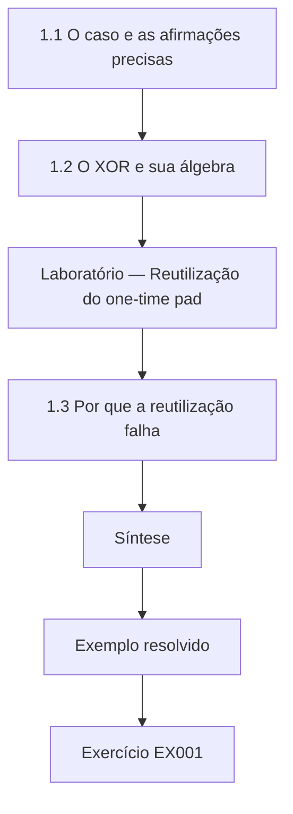

### Desenho lógico

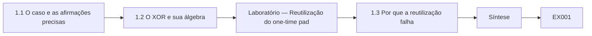

```text
[1.1 O caso e as afirmações precisas]
    |
    v
[1.2 O XOR e sua álgebra]
    |
    v
[Laboratório — Reutilização do one-time pad]
    |
    v
[1.3 Por que a reutilização falha]
    |
    v
[Síntese]
    |
    v
[Exemplo resolvido] --> [Exercício EX001]
```
<!-- open-cyber-academy:lesson-figures:end ch-01 -->


### Objetivos de aprendizagem

Você vai (1) raciocinar com precisão sobre definições e afirmações em criptografia; (2) usar a operação XOR e suas propriedades algébricas; (3) provar por que reutilizar a chave de um one-time pad falha.

### 1.1 O caso e as afirmações precisas

Priya Raman é estudante do primeiro ano de bacharelado na fictícia Ashford University. Ao longo de quatro anos, ela vai trabalhar com o fictício Tidewell Public Library Consortium, doze bibliotecas que compartilham um portal de leitores, um serviço de e-books e sistemas internos, orientada pelo professor Dr. Tomás Echeverría e pela líder de TI do consórcio, Grace Okafor. Todos os leitores, chaves e números aqui são sintéticos. Sua primeira lição é que a criptografia é uma disciplina matemática: uma afirmação como "esta cifra é segura" não significa nada até que a segurança seja definida, o atacante seja descrito e a afirmação seja provada ou reduzida a uma premissa bem estudada, como insistem Katz e Lindell.

### 1.2 O XOR e sua álgebra

O ou exclusivo, escrito XOR, compara dois bits e devolve 1 quando eles diferem. Ele tem propriedades que Priya prova a partir da tabela-verdade: x XOR x = 0, x XOR 0 = x, e o XOR é associativo e comutativo. Isso torna o XOR reversível: se c = p XOR k, então c XOR k = p. O one-time pad cifra fazendo o XOR de uma mensagem com uma chave verdadeiramente aleatória do mesmo tamanho, usada uma única vez, e Shannon provou que ele tem sigilo perfeito nessas condições. Provar com cuidado pequenos fatos algébricos é um treino para ler as provas das disciplinas posteriores.

### Laboratório — Reutilização do one-time pad

```python
"""Why a one-time pad must never be reused: XOR of two ciphertexts cancels the key (toy data)."""
import secrets
def xor(a, b): return bytes(x ^ y for x, y in zip(a, b))

def main():
    p1, p2 = b"RENEW BOOK 0417", b"FINE PAID  0938"
    key = bytes.fromhex("8f1e2a77c03b5d9e4412ab6f0e7c31")  # fixed demo pad, used twice on purpose
    c1, c2 = xor(p1, key), xor(p2, key)
    print("c1 xor c2 == p1 xor p2:", xor(c1, c2) == xor(p1, p2))
    guess = xor(xor(c1, c2), b"RENEW BOOK 0417")
    print("knowing p1 reveals p2:", guess.decode())
    fresh = secrets.token_bytes(len(p1))
    print("fresh pad length matches message:", len(fresh) == len(p1))

if __name__ == "__main__":
    main()
```

Execute com `python3 lab_xor.py`. Saída verificada:

```text
c1 xor c2 == p1 xor p2: True
knowing p1 reveals p2: FINE PAID  0938
fresh pad length matches message: True
```

### 1.3 Por que a reutilização falha

O laboratório cifra de propósito duas mensagens de leitores com o mesmo pad. Fazer o XOR dos dois textos cifrados cancela a chave, já que (p1 XOR k) XOR (p2 XOR k) = p1 XOR p2, o que o laboratório confirma como True. Se um atacante conhece ou adivinha uma das mensagens, como um aviso padrão "RENEW BOOK", a outra aparece em claro: FINE PAID 0938. A prova cabe em três linhas, e a lição dura uma carreira: um esquema perfeito nas suas condições pode falhar completamente quando uma condição, aqui "usar uma vez", é violada. O pad novo, gerado com o módulo secrets, mostra como as chaves devem ser geradas, embora os sistemas reais usem cifras padronizadas em vez de pads.

### Exemplo resolvido

Priya prova x XOR x = 0 a partir da tabela-verdade, deduz c1 XOR c2 = p1 XOR p2 e usa o laboratório para recuperar uma segunda mensagem a partir de uma primeira mensagem conhecida quando um pad é reutilizado.

> **Caso sintético.** A Tidewell, seus leitores e suas mensagens são inventados.

### Erros e limites

O sigilo perfeito só vale para chaves verdadeiramente aleatórias, nunca reutilizadas e do tamanho da mensagem; sistemas práticos usam AES-GCM ou algo semelhante, de bibliotecas avaliadas, e não pads. Demonstrações de brinquedo não são projetos.

### Exercícios

- **EX001 — Definir seguro.** Por que "esta cifra é segura" não significa nada por si só? *Rubrica:* 3 = a segurança precisa ser definida com um modelo de atacante e provada ou reduzida a uma premissa;; 2 = precisa de definição;; 1 = tem significado;; 0 = nenhuma.

- **EX002 — Identidades do XOR.** Enuncie duas identidades do XOR que fazem a decifração funcionar. *Rubrica:* 3 = x XOR x = 0 e x XOR 0 = x (com a associatividade);; 2 = uma;; 1 = errada;; 0 = nenhuma.

- **EX003 — Resultado da reutilização do pad.** O que o laboratório recuperou, e por quê? *Rubrica:* 3 = FINE PAID 0938, porque c1 XOR c2 = p1 XOR p2 e p1 era conhecida;; 2 = a mensagem;; 1 = vago;; 0 = nenhuma.

### Síntese

A criptografia começa com definições e provas precisas; o one-time pad mostra como um esquema perfeito desmorona quando uma condição é violada.

<!-- open-cyber-academy:chapter-navigation:start ch-01 -->
### Continue estudando — aula 01 (capítulo 01 de 40)

[← Início do curso](../../README.md) · [Índice das aulas](../SUBJECTS.md) · [Capítulo 02 →](#ch-02)

Continue para a próxima aula já escrita.
<!-- open-cyber-academy:chapter-navigation:end -->

<a id="ch-02"></a>

## Capítulo 2 — Sistemas computacionais

<!-- open-cyber-academy:lesson-figures:start ch-02 -->
### Mapa da aula

Aula 02 publicada. Mapa, exemplo, EX004.

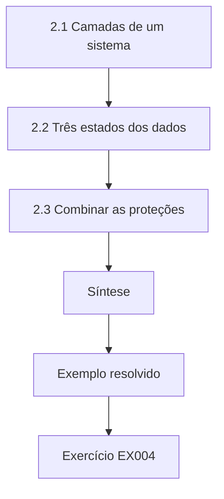

### Desenho lógico

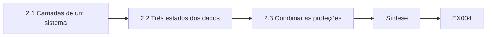

```text
[2.1 Camadas de um sistema]
    |
    v
[2.2 Três estados dos dados]
    |
    v
[2.3 Combinar as proteções]
    |
    v
[Síntese]
    |
    v
[Exemplo resolvido] --> [Exercício EX004]
```
<!-- open-cyber-academy:lesson-figures:end ch-02 -->


### Objetivos de aprendizagem

Você vai (1) descrever onde a criptografia fica num sistema computacional; (2) explicar os dados em repouso, em trânsito e em uso; (3) identificar qual componente protege cada um.

### 2.1 Camadas de um sistema

Priya mapeia os sistemas da Tidewell em camadas: o hardware dos servidores das unidades e dos notebooks dos leitores, os sistemas operacionais, aplicações como o catálogo e o portal dos leitores, as redes que ligam as unidades e os serviços em nuvem que hospedam os e-books. A criptografia aparece em várias camadas: cifração de disco no sistema operacional, TLS nas bibliotecas de rede, hash de senhas na aplicação do portal e assinaturas nas atualizações de software. Ela aprende que uma proteção numa camada não cobre as outras; cifrar um disco não faz nada pelos dados que trafegam entre as unidades, e o TLS não faz nada pelo disco de um notebook roubado.

### 2.2 Três estados dos dados

Os dados existem em três estados. Em repouso, ficam em discos e backups; a cifração de disco completo e a cifração do banco de dados os protegem contra o roubo das mídias. Em trânsito, movem-se pelas redes; o TLS os protege contra escuta e adulteração. Em uso, estão sendo processados na memória, onde costumam estar decifrados e são protegidos principalmente pelo controle de acesso e pelo isolamento do sistema operacional. Priya classifica os registros de leitores da Tidewell em cada estado e anota que o consórcio cifra os notebooks e usa TLS no portal, mas que as fitas de backup enviadas a um depósito externo não são cifradas.

### 2.3 Combinar as proteções

Priya monta uma tabela que associa cada fluxo de dados à sua proteção e ao seu dono. Os logins dos leitores trafegam por TLS e são armazenados como hashes de senha com salt; o histórico de empréstimos fica num banco de dados cifrado; os backups viajam por mensageiro sem cifração. Ela recomenda cifrar os backups com chaves mantidas pelo consórcio, e não pela empresa de mensageiros, e registra que a perda das chaves tornaria os backups ilegíveis, de modo que as chaves precisam de um backup protegido próprio. Grace Okafor aceita a recomendação e pede a Priya que estime o custo da mudança no software de backup.

### Exemplo resolvido

O mapa de camadas e a tabela de estados dos dados de Priya mostram as fitas de backup não cifradas como uma lacuna, e ela recomenda a cifração dos backups com chaves do consórcio e um backup protegido das chaves.

> **Caso sintético.** Os sistemas da Tidewell são inventados.

### Erros e limites

A cifração em repouso não protege os dados em uso por uma aplicação comprometida. Perder as chaves de cifração destrói os dados tão certamente quanto perder as mídias.

### Exercícios

- **EX004 — Limites das camadas.** Por que a cifração de disco não protege os dados que circulam entre as unidades? *Rubrica:* 3 = ela protege apenas dados em repouso; o trânsito precisa de TLS;; 2 = as camadas diferem;; 1 = protege;; 0 = nenhuma.

- **EX005 — Dados em uso.** O que protege principalmente os dados em uso? *Rubrica:* 3 = controle de acesso e isolamento do sistema operacional, já que os dados estão decifrados na memória;; 2 = controle de acesso;; 1 = cifração;; 0 = nenhuma.

- **EX006 — Lacuna dos backups.** Que lacuna Priya encontrou, e o que ela recomendou? *Rubrica:* 3 = fitas de backup não cifradas; cifrar com chaves do consórcio e fazer backup das chaves;; 2 = lacuna;; 1 = vago;; 0 = nenhuma.

### Síntese

A criptografia protege camadas e estados de dados específicos; mapeá-los revela lacunas, como backups não cifrados.

<!-- open-cyber-academy:chapter-navigation:start ch-02 -->
### Continue estudando — aula 02 (capítulo 02 de 40)

[← Capítulo 01](#ch-01) · [Índice das aulas](../SUBJECTS.md) · [Capítulo 03 →](#ch-03)

Continue para a próxima aula já escrita.
<!-- open-cyber-academy:chapter-navigation:end -->

<a id="ch-03"></a>

## Capítulo 3 — Programação I

<!-- open-cyber-academy:lesson-figures:start ch-03 -->
### Mapa da aula

Aula 03 publicada. Mapa, exemplo, EX007.

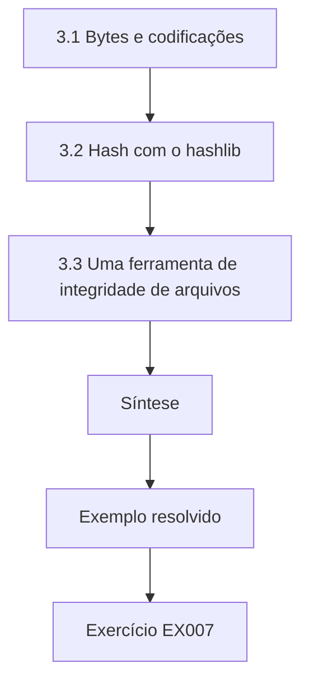

### Desenho lógico

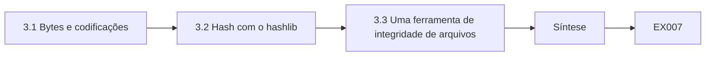

```text
[3.1 Bytes e codificações]
    |
    v
[3.2 Hash com o hashlib]
    |
    v
[3.3 Uma ferramenta de integridade de arquivos]
    |
    v
[Síntese]
    |
    v
[Exemplo resolvido] --> [Exercício EX007]
```
<!-- open-cyber-academy:lesson-figures:end ch-03 -->


### Objetivos de aprendizagem

Você vai (1) lidar com bytes, codificações e hexadecimal em Python; (2) calcular digests SHA-256 com o hashlib; (3) conferir os resultados contra vetores de teste publicados.

### 3.1 Bytes e codificações

Os primeiros programas de Priya mostram que os computadores armazenam texto como bytes, segundo uma codificação. A string "café" vira cinco bytes em UTF-8, porque o é precisa de dois. As funções criptográficas recebem bytes, então ela sempre escreve text.encode("utf-8") antes de calcular o hash. O hexadecimal exibe os bytes de forma legível, dois caracteres por byte. Ela pratica as conversões com bytes.hex() e bytes.fromhex(). Pequenos erros aqui, como calcular o hash de uma string lida de um arquivo com uma quebra de linha no final, produzem digests totalmente diferentes, o que a ensinou a imprimir os tamanhos e as formas hexadecimais ao depurar.

### 3.2 Hash com o hashlib

O hashlib do Python implementa o SHA-256 do FIPS 180-4. Priya calcula o digest da string vazia e de "abc" e os compara com os exemplos publicados com a norma: o digest de "abc" começa com ba7816bf. Coincidir com um vetor publicado prova que ela está chamando a função corretamente. Ela observa o efeito avalanche: trocar "abc" por "abd" muda cerca de metade dos 256 bits da saída. Ela aprende que os hashes são funções públicas, que qualquer pessoa pode calcular; um hash só prova a integridade quando o digest esperado vem de uma fonte confiável.

### 3.3 Uma ferramenta de integridade de arquivos

Priya escreve um pequeno programa que calcula o digest SHA-256 de cada arquivo de uma pasta e salva uma lista e, mais tarde, recalcula e relata as mudanças. Ela usa para os testes os arquivos sintéticos de exportação do catálogo da Tidewell. Os arquivos grandes são lidos em blocos e passados ao método update do objeto de hash, de modo que o uso de memória fica pequeno. Ela documenta um limite: um atacante que consiga modificar tanto os arquivos quanto a lista salva pode esconder as mudanças, então a lista precisa ficar guardada num lugar protegido ou ser assinada. Isso antecipa as assinaturas digitais, que aparecem mais adiante no curso.

### Exemplo resolvido

Priya confirma suas chamadas ao SHA-256 contra o exemplo "abc" do FIPS 180-4, constrói um verificador de integridade de arquivos que lê em blocos e registra que a própria lista de digests precisa de proteção.

> **Caso sintético.** Os arquivos do catálogo são inventados; o FIPS 180-4 é real.

### Erros e limites

Hashes não escondem dados e não autenticam por si sós. Erros de codificação são a causa mais comum de digests que não coincidem.

### Exercícios

- **EX007 — Tamanho em UTF-8.** Por que "café" tem cinco bytes em UTF-8? *Rubrica:* 3 = o é ocupa dois bytes;; 2 = codificação;; 1 = quatro;; 0 = nenhuma.

- **EX008 — Conferência do vetor de teste.** Como Priya confirmou que usou o SHA-256 corretamente? *Rubrica:* 3 = coincidiu com o digest do exemplo "abc" do FIPS 180-4, que começa com ba7816bf;; 2 = vetor coincidiu;; 1 = adivinhou;; 0 = nenhuma.

- **EX009 — Limite da ferramenta de integridade.** Que limite o verificador de integridade tem? *Rubrica:* 3 = um atacante que modifica os arquivos e a lista de digests esconde as mudanças; a lista precisa ser protegida ou assinada;; 2 = proteger a lista;; 1 = vago;; 0 = nenhuma.

### Síntese

O manuseio cuidadoso de bytes, o hash verificado e a consciência do que um resumo prova são as primeiras competências criptográficas de quem programa.

<!-- open-cyber-academy:chapter-navigation:start ch-03 -->
### Continue estudando — aula 03 (capítulo 03 de 40)

[← Capítulo 02](#ch-02) · [Índice das aulas](../SUBJECTS.md) · [Capítulo 04 →](#ch-04)

Continue para a próxima aula já escrita.
<!-- open-cyber-academy:chapter-navigation:end -->

<a id="ch-04"></a>

## Capítulo 4 — Escrita acadêmica

<!-- open-cyber-academy:lesson-figures:start ch-04 -->
### Mapa da aula

Aula 04 publicada. Mapa, exemplo, EX010.

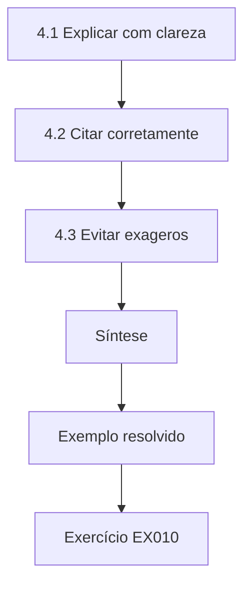

### Desenho lógico

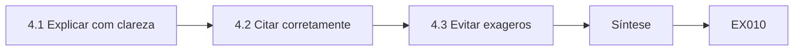

```text
[4.1 Explicar com clareza]
    |
    v
[4.2 Citar corretamente]
    |
    v
[4.3 Evitar exageros]
    |
    v
[Síntese]
    |
    v
[Exemplo resolvido] --> [Exercício EX010]
```
<!-- open-cyber-academy:lesson-figures:end ch-04 -->


### Objetivos de aprendizagem

Você vai (1) escrever explicações claras de ideias criptográficas; (2) citar normas e livros-texto corretamente; (3) evitar exageros na escrita sobre segurança.

### 4.1 Explicar com clareza

O primeiro ensaio de Priya explica a um leitor leigo por que as senhas não devem ser armazenadas em texto claro. Ela usa um exemplo concreto, um banco de dados roubado que expõe a senha de todos os leitores, e depois explica o hash com salt em palavras simples, antes de introduzir os termos. O Dr. Echeverría tira pontos de um parágrafo que usava "hash", "salt" e "derivação de chave" sem defini-los. Ela aprende a definir cada termo uma vez, usá-lo de forma consistente e preferir frases curtas. Escrever com clareza não é simplificar; é uma precisão que os leitores conseguem acompanhar.

### 4.2 Citar corretamente

Para as afirmações criptográficas, Priya cita fontes primárias: o FIPS 180-4 para o SHA-256, a RFC 9106 para o Argon2, Katz e Lindell para as definições e o Handbook of Applied Cryptography de Menezes e colegas para o contexto clássico. Ela cita o documento e a seção exatos sempre que possível e confere se cada link funciona. Ela evita citar posts de blog para fatos que as normas enunciam e nunca inventa uma referência ou um identificador. Quando uma fonte é um rascunho, como o livro-texto online de Boneh e Shoup, ela anota a versão que leu.

### 4.3 Evitar exageros

A escrita sobre segurança costuma exagerar: "inquebrável", "completamente seguro" ou "hackers não conseguem". Priya reescreve essas expressões com afirmações precisas: "O Argon2id torna cada palpite de senha custoso em tempo e memória, desacelerando a adivinhação offline." Ela também declara o que a medida não faz: ela não protege senhas fracas como "library1" contra uma adivinhação determinada. O Dr. Echeverría diz à turma que limites cuidadosos tornam a escrita mais persuasiva para leitores especialistas e protegem os autores quando as afirmações são testadas. Ela mantém ao lado da mesa uma lista de expressões proibidas como lembrete.

### Exemplo resolvido

O ensaio de Priya define os termos uma vez, cita o FIPS 180-4 e a RFC 9106 e substitui "inquebrável" por uma afirmação precisa com o limite declarado.

> **Caso sintético.** O ensaio é inventado; as normas citadas são reais.

### Erros e limites

Citações de fontes secundárias podem carregar erros; confira o documento primário. Uma linguagem precisa ainda precisa de uma base técnica correta.

### Exercícios

- **EX010 — Definir os termos.** O que o Dr. Echeverría penalizou, e por quê? *Rubrica:* 3 = termos como hash e salt usados sem definição;; 2 = jargão indefinido;; 1 = estilo;; 0 = nenhuma.

- **EX011 — Fontes primárias.** Que fontes primárias Priya citou para o SHA-256 e o Argon2? *Rubrica:* 3 = FIPS 180-4 e RFC 9106;; 2 = uma;; 1 = blog;; 0 = nenhuma.

- **EX012 — Reescrita precisa.** Reescreva com precisão "o Argon2 torna as senhas inquebráveis". *Rubrica:* 3 = o Argon2id torna cada palpite custoso em tempo e memória, desacelerando a adivinhação offline; senhas fracas continuam em risco;; 2 = parcial;; 1 = inalterada;; 0 = nenhuma.

### Síntese

Uma boa escrita sobre segurança define os termos, cita fontes primárias e enuncia as afirmações com seus limites.

<!-- open-cyber-academy:chapter-navigation:start ch-04 -->
### Continue estudando — aula 04 (capítulo 04 de 40)

[← Capítulo 03](#ch-03) · [Índice das aulas](../SUBJECTS.md) · [Capítulo 05 →](#ch-05)

Continue para a próxima aula já escrita.
<!-- open-cyber-academy:chapter-navigation:end -->

<a id="ch-05"></a>

## Capítulo 5 — Letramento em segurança

<!-- open-cyber-academy:lesson-figures:start ch-05 -->
### Mapa da aula

Aula 05 publicada. Mapa, exemplo, EX013.

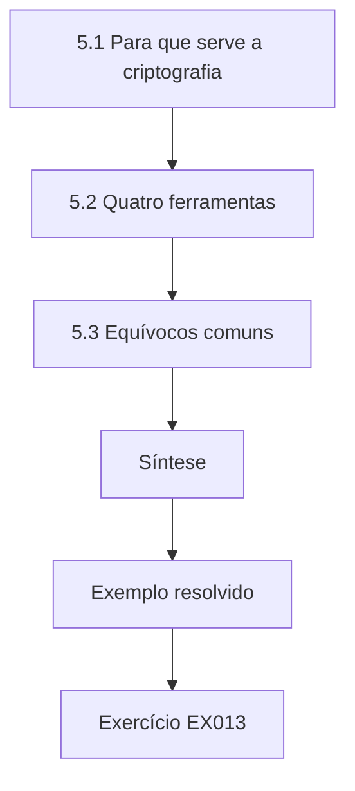

### Desenho lógico

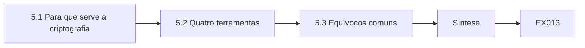

```text
[5.1 Para que serve a criptografia]
    |
    v
[5.2 Quatro ferramentas]
    |
    v
[5.3 Equívocos comuns]
    |
    v
[Síntese]
    |
    v
[Exemplo resolvido] --> [Exercício EX013]
```
<!-- open-cyber-academy:lesson-figures:end ch-05 -->


### Objetivos de aprendizagem

Você vai (1) reconhecer os objetivos a que a criptografia serve; (2) distinguir cifração, hash, MACs e assinaturas; (3) identificar equívocos comuns.

### 5.1 Para que serve a criptografia

Priya lista os objetivos a que a criptografia serve: confidencialidade, manter os dados em segredo; integridade, detectar mudanças; autenticação, confirmar quem enviou algo; e irretratabilidade (não repúdio), impedir que um signatário negue uma assinatura. Ela associa exemplos da Tidewell: o histórico de leitura dos leitores precisa de confidencialidade, as exportações do catálogo precisam de integridade, os logins da equipe precisam de autenticação e os contratos assinados com editoras de e-books se beneficiam da irretratabilidade. Cada objetivo precisa de ferramentas diferentes, e confundi-los é a raiz de muitos erros que ela vai encontrar depois. Ela fixa os quatro objetivos acima de cada discussão de projeto posterior, para que cada ferramenta proposta precise nomear o objetivo a que serve.

### 5.2 Quatro ferramentas

A cifração oferece confidencialidade com uma chave; o AES do FIPS 197 é a cifra simétrica padrão. As funções de hash, como o SHA-256, oferecem uma impressão digital de tamanho fixo, sem chave. Os códigos de autenticação de mensagem, como o HMAC da RFC 2104, oferecem integridade e autenticação entre partes que compartilham uma chave. As assinaturas digitais, como o ECDSA do FIPS 186-5 ou o Ed25519 da RFC 8032, oferecem integridade, autenticação e irretratabilidade, usando uma chave privada para assinar e uma chave pública para verificar. Priya desenha uma tabela de qual ferramenta atende a qual objetivo.

### 5.3 Equívocos comuns

Priya coleta equívocos em entrevistas com a equipe da Tidewell: "o site tem um cadeado, então nossos dados estão seguros em toda parte"; "calculamos o hash dos backups, então eles estão cifrados"; "uma senha mais longa é sempre uma senha mais forte"; e "cifração significa que ninguém pode alterar os dados". Ela corrige cada um: o TLS protege apenas a conexão; hash não é cifração; o comprimento só ajuda se a senha não for previsível; e a cifração não autenticada pode permitir adulterações não detectadas, e é por isso que se prefere a cifração autenticada, como o AES-GCM.

### Exemplo resolvido

Priya associa os quatro objetivos a exemplos da Tidewell, monta uma tabela de ferramentas e objetivos e corrige quatro equívocos da equipe.

> **Caso sintético.** As falas da equipe são inventadas.

### Erros e limites

Tabelas simplificadas omitem nuances, como a cifração autenticada, que combina objetivos. A irretratabilidade também depende da proteção das chaves e do contexto jurídico.

### Exercícios

- **EX013 — Associar objetivos.** A que objetivo servem os contratos assinados com as editoras? *Rubrica:* 3 = irretratabilidade (além de integridade e autenticação);; 2 = integridade;; 1 = confidencialidade;; 0 = nenhuma.

- **EX014 — MAC versus assinatura.** Em que um MAC difere de uma assinatura? *Rubrica:* 3 = o MAC usa uma chave compartilhada, sem irretratabilidade; a assinatura usa chaves privada/pública e sustenta a irretratabilidade;; 2 = parcial;; 1 = iguais;; 0 = nenhuma.

- **EX015 — Equívoco do cadeado.** Corrija "o cadeado significa que nossos dados estão seguros em toda parte". *Rubrica:* 3 = o TLS protege apenas a conexão, não os dados armazenados nos servidores;; 2 = parcial;; 1 = concorda;; 0 = nenhuma.

### Síntese

Saber o que cada ferramenta criptográfica alcança, e o que não alcança, é a base da alfabetização em segurança.

<!-- open-cyber-academy:chapter-navigation:start ch-05 -->
### Continue estudando — aula 05 (capítulo 05 de 40)

[← Capítulo 04](#ch-04) · [Índice das aulas](../SUBJECTS.md) · [Capítulo 06 →](#ch-06)

Continue para a próxima aula já escrita.
<!-- open-cyber-academy:chapter-navigation:end -->

<a id="ch-06"></a>

## Capítulo 6 — Estruturas discretas

<!-- open-cyber-academy:lesson-figures:start ch-06 -->
### Mapa da aula

Aula 06 publicada. Mapa, exemplo, EX016.

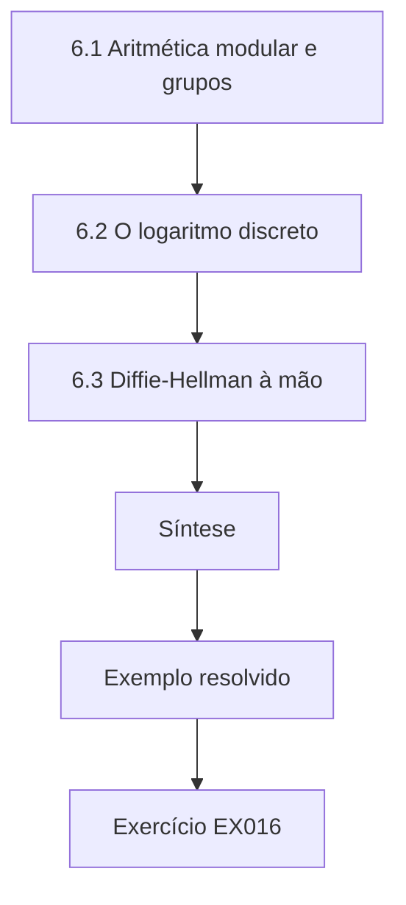

### Desenho lógico

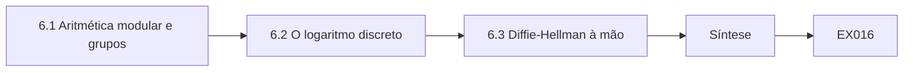

```text
[6.1 Aritmética modular e grupos]
    |
    v
[6.2 O logaritmo discreto]
    |
    v
[6.3 Diffie-Hellman à mão]
    |
    v
[Síntese]
    |
    v
[Exemplo resolvido] --> [Exercício EX016]
```
<!-- open-cyber-academy:lesson-figures:end ch-06 -->


### Objetivos de aprendizagem

Você vai (1) usar aritmética modular e grupos; (2) explicar o problema do logaritmo discreto; (3) relacioná-lo ao acordo de chaves Diffie-Hellman.

### 6.1 Aritmética modular e grupos

Priya estuda os inteiros módulo um primo p. A multiplicação módulo p, excluído o zero, forma um grupo: é fechada, associativa, tem um elemento neutro, e todo elemento tem um inverso. Alguns elementos, chamados geradores, produzem todos os elementos não nulos quando elevados a potências sucessivas. Para p = 23 e gerador 5, as potências de 5 módulo 23 percorrem todos os 22 valores não nulos. Essas estruturas, tratadas no capítulo 2 do Handbook of Applied Cryptography, estão na base de muitos sistemas de chave pública e dão um significado preciso a operações que de outra forma pareceriam aritmética arbitrária.

### 6.2 O logaritmo discreto

Calcular 5^x mod 23 é fácil para qualquer x, usando a exponenciação rápida. Ir para trás, encontrar x a partir do resultado, é o problema do logaritmo discreto. Para primos minúsculos, Priya consegue testar todos os valores, mas, para primos de milhares de bits, não se conhece nenhum algoritmo clássico eficiente. Essa assimetria, fácil para a frente e difícil para trás, é o que a criptografia de chave pública precisa. Priya destaca a palavra "conhece": a segurança se apoia na crença de que o problema é difícil, e o algoritmo de Shor o resolveria num computador quântico grande, o que motiva normas pós-quânticas como o FIPS 203.

### 6.3 Diffie-Hellman à mão

Priya resolve uma troca Diffie-Hellman de brinquedo: Alice escolhe o segredo a = 6 e envia 5^6 mod 23 = 8; Bob escolhe b = 15 e envia 5^15 mod 23 = 19. Alice calcula 19^6 mod 23 = 2 e Bob calcula 8^15 mod 23 = 2, um segredo compartilhado que nenhum dos dois enviou. Quem escuta vê 8 e 19, mas precisa resolver um logaritmo discreto. Ela enfatiza que os sistemas reais usam grupos grandes ou curvas elípticas, como o X25519 da RFC 7748, autenticam a troca para deter atacantes ativos e rodam dentro do TLS 1.3, e não como código escrito à mão. Priya repete o cálculo com uma colega para confirmar que os dois lados chegam de fato ao mesmo valor.

### Exemplo resolvido

Priya verifica que 5 gera o grupo módulo 23, calcula um segredo compartilhado de brinquedo igual a 2 num Diffie-Hellman e explica por que as trocas reais usam o X25519 dentro do TLS, com autenticação.

> **Caso sintético.** Apenas números de brinquedo; a RFC 7748 e o FIPS 203 são reais.

### Erros e limites

O Diffie-Hellman não autenticado está aberto a ataques de intermediário (man-in-the-middle). Grupos de brinquedo são trivialmente quebráveis.

### Exercícios

- **EX016 — Propriedades de grupo.** Liste as quatro propriedades de grupo. *Rubrica:* 3 = fechamento, associatividade, elemento neutro, inversos;; 2 = três;; 1 = uma;; 0 = nenhuma.

- **EX017 — Segredo compartilhado de brinquedo.** Que segredo compartilhado a troca de brinquedo produziu, e a partir de quais valores públicos? *Rubrica:* 3 = 2, a partir dos valores públicos 8 e 19;; 2 = só o segredo;; 1 = errado;; 0 = nenhuma.

- **EX018 — Ameaça quântica.** Por que o algoritmo de Shor importa aqui? *Rubrica:* 3 = resolveria logaritmos discretos num computador quântico grande, motivando o FIPS 203;; 2 = quântico;; 1 = nenhum motivo;; 0 = nenhuma.

### Síntese

Os grupos e o problema do logaritmo discreto explicam o acordo de chaves; os sistemas reais usam curvas padronizadas dentro de protocolos autenticados.

<!-- open-cyber-academy:chapter-navigation:start ch-06 -->
### Continue estudando — aula 06 (capítulo 06 de 40)

[← Capítulo 05](#ch-05) · [Índice das aulas](../SUBJECTS.md) · [Capítulo 07 →](#ch-07)

Continue para a próxima aula já escrita.
<!-- open-cyber-academy:chapter-navigation:end -->

<a id="ch-07"></a>

## Capítulo 7 — Redes e protocolos

<!-- open-cyber-academy:lesson-figures:start ch-07 -->
### Mapa da aula

Aula 07 publicada. Mapa, exemplo, EX019.

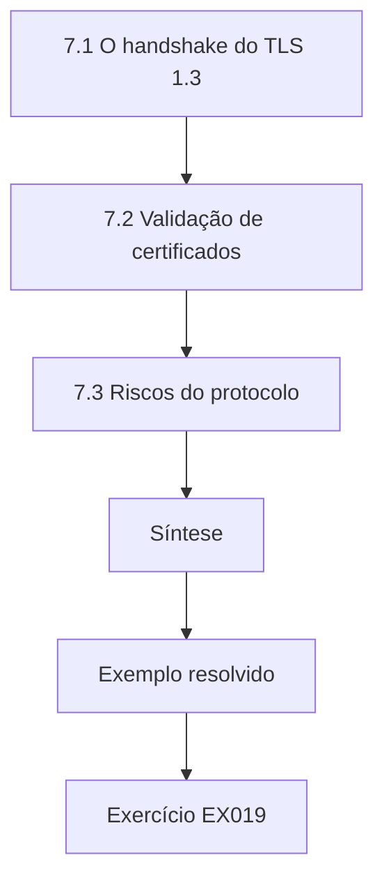

### Desenho lógico

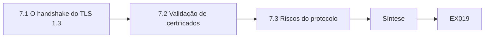

```text
[7.1 O handshake do TLS 1.3]
    |
    v
[7.2 Validação de certificados]
    |
    v
[7.3 Riscos do protocolo]
    |
    v
[Síntese]
    |
    v
[Exemplo resolvido] --> [Exercício EX019]
```
<!-- open-cyber-academy:lesson-figures:end ch-07 -->


### Objetivos de aprendizagem

Você vai (1) explicar em alto nível o handshake do TLS 1.3; (2) descrever a validação de certificados pelos navegadores; (3) identificar riscos no nível do protocolo, como rebaixamento e má configuração.

### 7.1 O handshake do TLS 1.3

Quando um leitor abre o portal da Tidewell, o navegador e o servidor executam um handshake TLS 1.3 da RFC 8446. O cliente envia os algoritmos suportados e um compartilhamento de chave (key share); o servidor responde com o seu, e os dois derivam as chaves usando o HKDF da RFC 5869. O servidor envia seu certificado e assina a transcrição do handshake para provar que tem a chave privada; depois, os dois confirmam o handshake com códigos de autenticação de mensagem. Todos os dados seguintes são cifrados com uma cifra autenticada, como o AES-GCM. Priya captura o handshake num laboratório com um servidor de teste e identifica cada mensagem.

### 7.2 Validação de certificados

O navegador confere que o certificado do servidor se encadeia até uma raiz em que ele confia, que o nome corresponde a portal.tidewell.example, que está dentro das datas de validade e que não foi revogado. A RFC 5280 define os campos do certificado e a validação do caminho. Se qualquer verificação falhar, o navegador mostra um aviso. Priya explica à equipe da biblioteca por que passar por cima desses avisos é perigoso: o aviso pode ser o único sinal de que alguém no Wi-Fi do café está interceptando a conexão com um certificado forjado.

### 7.3 Riscos do protocolo

As versões mais antigas do TLS permitiam que atacantes empurrassem as conexões para algoritmos mais fracos. O TLS 1.3 remove as opções legadas e protege contra o rebaixamento assinando todo o handshake. A maioria dos problemas práticos vem hoje da configuração: servidores que ainda oferecem TLS 1.0, certificados expirados ou aplicações que desativam a verificação. Priya varre os serviços públicos da Tidewell, com permissão, e descobre que a wiki da equipe ainda aceita TLS 1.0. Ela relata o fato a Grace, que agenda uma mudança de configuração, e registra o escopo e a autorização da varredura nas suas anotações. Ela testa de novo depois da mudança.

### Exemplo resolvido

Priya identifica cada mensagem do handshake do TLS 1.3, explica as verificações de certificado à equipe e relata uma configuração de TLS 1.0 encontrada numa varredura autorizada.

> **Caso sintético.** Os hosts da Tidewell são inventados; a RFC 8446, a RFC 5869 e a RFC 5280 são reais.

### Erros e limites

Varrer sistemas sem permissão é antiético e pode ser ilegal. Um certificado válido mostra quem opera um servidor, e não que o servidor é seguro.

### Exercícios

- **EX019 — Assinatura da transcrição.** Por que o servidor assina a transcrição do handshake? *Rubrica:* 3 = para provar que tem a chave privada do certificado e proteger contra adulteração/rebaixamento;; 2 = provar a chave;; 1 = cifrar;; 0 = nenhuma.

- **EX020 — Verificações do navegador.** Liste três verificações que o navegador faz num certificado. *Rubrica:* 3 = três entre cadeia até raiz confiável, correspondência do nome, datas de validade, revogação;; 2 = duas;; 1 = uma;; 0 = nenhuma.

- **EX021 — Achado da varredura.** O que a varredura autorizada de Priya encontrou? *Rubrica:* 3 = a wiki da equipe aceitando TLS 1.0;; 2 = TLS antigo;; 1 = vago;; 0 = nenhuma.

### Síntese

O TLS 1.3 protege as conexões quando os certificados são validados e as configurações se mantêm atualizadas; a maioria das falhas hoje é operacional.

<!-- open-cyber-academy:chapter-navigation:start ch-07 -->
### Continue estudando — aula 07 (capítulo 07 de 40)

[← Capítulo 06](#ch-06) · [Índice das aulas](../SUBJECTS.md) · [Capítulo 08 →](#ch-08)

Continue para a próxima aula já escrita.
<!-- open-cyber-academy:chapter-navigation:end -->

<a id="ch-08"></a>

## Capítulo 8 — Programação II

<!-- open-cyber-academy:lesson-figures:start ch-08 -->
### Mapa da aula

Aula 08 publicada. Mapa, exemplo, EX022.

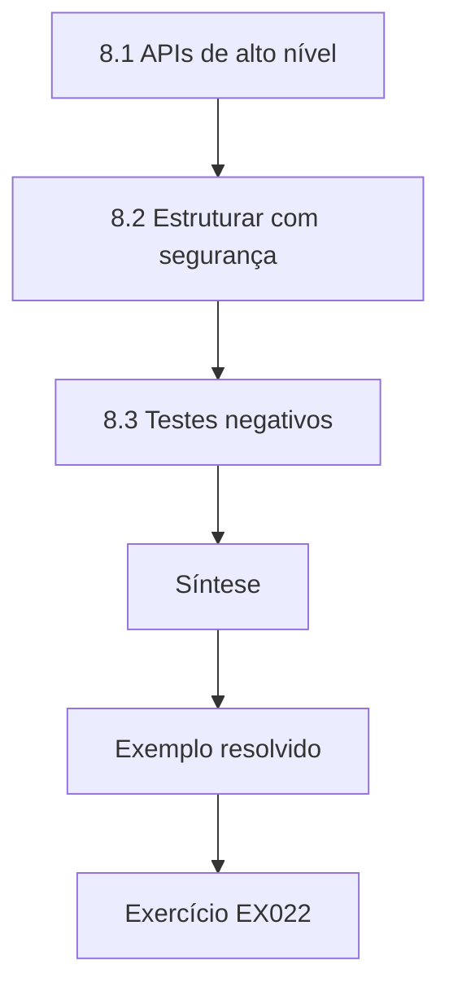

### Desenho lógico

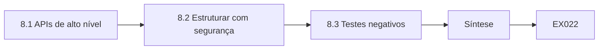

```text
[8.1 APIs de alto nível]
    |
    v
[8.2 Estruturar com segurança]
    |
    v
[8.3 Testes negativos]
    |
    v
[Síntese]
    |
    v
[Exemplo resolvido] --> [Exercício EX022]
```
<!-- open-cyber-academy:lesson-figures:end ch-08 -->


### Objetivos de aprendizagem

Você vai (1) usar com segurança APIs criptográficas de alto nível; (2) estruturar o código para evitar usos indevidos; (3) escrever testes negativos.

### 8.1 APIs de alto nível

Priya aprende que as bibliotecas criptográficas oferecem primitivas de baixo nível e receitas de alto nível. As APIs de baixo nível exigem escolher modos, nonces e preenchimento, onde é fácil errar. As APIs de alto nível, como uma função de cifração autenticada que gera os nonces e devolve um único token, tornam o uso seguro o padrão. Para a ferramenta de exportação da Tidewell, ela usa a receita de cifração autenticada de uma biblioteca mantida, em vez de montar por conta própria o AES e um modo. A regra do curso é explícita: os estudantes aprendem como as primitivas funcionam, mas o código de produção usa APIs de alto nível avaliadas. Os colegas de equipe concordam em segui-la.

### 8.2 Estruturar com segurança

Priya isola a criptografia num módulo com uma interface pequena: protect(data) e unprotect(token). As chaves são carregadas do cofre de segredos do consórcio, nunca do código-fonte. Os erros em unprotect lançam uma única exceção genérica, para que quem chama não possa saber por que um token falhou. Ela escreve anotações de tipo que marcam os valores secretos e evita registrá-los em log. A revisão de código se concentra nesse módulo, que é pequeno o bastante para ser lido com cuidado. A estrutura faz com que futuras mudanças de algoritmo afetem um arquivo, e não a aplicação inteira.

### 8.3 Testes negativos

Priya escreve testes que devem falhar: tokens adulterados, tokens truncados, tokens protegidos com outra chave e entrada vazia. Cada um precisa ser rejeitado. Ela também testa que duas proteções dos mesmos dados produzem tokens diferentes, confirmando que os nonces são novos. Uma versão anterior de um colega passava em todos os testes positivos, mas devolvia os dados mesmo para tokens adulterados, porque pulava a verificação da tag. Os testes negativos pegaram isso. Ela os acrescenta à integração contínua, para que rodem a cada mudança. Cada teste tem um comentário de uma linha que explica seu propósito.

### Exemplo resolvido

Priya usa uma receita de cifração autenticada de alto nível num pequeno módulo protect/unprotect, carrega as chaves de um cofre de segredos e pega, com testes negativos, uma verificação de tag que era pulada.

> **Caso sintético.** A ferramenta de exportação é inventada.

### Erros e limites

As APIs de alto nível ainda precisam de um gerenciamento de chaves correto. Os testes só provam aquilo que verificam.

### Exercícios

- **EX022 — Vantagem do alto nível.** Por que preferir APIs criptográficas de alto nível? *Rubrica:* 3 = padrões seguros cuidam de nonces, modos e preenchimento, reduzindo o uso indevido;; 2 = mais seguras;; 1 = mais rápidas;; 0 = nenhuma.

- **EX023 — Exceção genérica.** Por que unprotect lança uma única exceção genérica? *Rubrica:* 3 = para que quem chama ou atacantes não saibam por que um token falhou;; 2 = esconder o motivo;; 1 = mais simples;; 0 = nenhuma.

- **EX024 — Teste de nonce novo.** O que proteger os mesmos dados duas vezes testa? *Rubrica:* 3 = os tokens diferem, confirmando nonces novos;; 2 = nonces;; 1 = vago;; 0 = nenhuma.

### Síntese

Um código criptográfico seguro se apoia em APIs de alto nível, num módulo pequeno e isolado e em testes negativos que comprovam a rejeição.

<!-- open-cyber-academy:chapter-navigation:start ch-08 -->
### Continue estudando — aula 08 (capítulo 08 de 40)

[← Capítulo 07](#ch-07) · [Índice das aulas](../SUBJECTS.md) · [Capítulo 09 →](#ch-09)

Continue para a próxima aula já escrita.
<!-- open-cyber-academy:chapter-navigation:end -->

<a id="ch-09"></a>

## Capítulo 9 — Dados e bancos de dados

<!-- open-cyber-academy:lesson-figures:start ch-09 -->
### Mapa da aula

Aula 09 publicada. Mapa, exemplo, EX025.

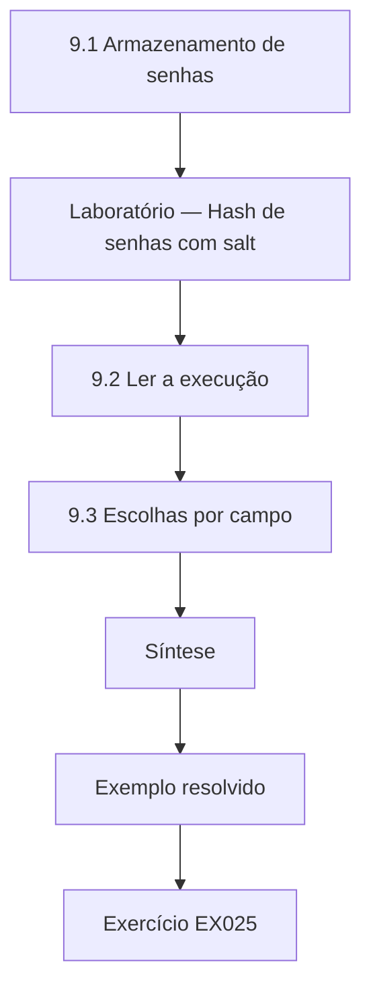

### Desenho lógico

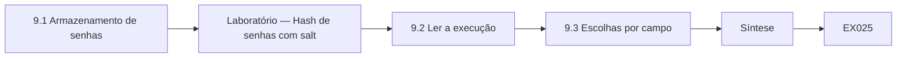

```text
[9.1 Armazenamento de senhas]
    |
    v
[Laboratório — Hash de senhas com salt]
    |
    v
[9.2 Ler a execução]
    |
    v
[9.3 Escolhas por campo]
    |
    v
[Síntese]
    |
    v
[Exemplo resolvido] --> [Exercício EX025]
```
<!-- open-cyber-academy:lesson-figures:end ch-09 -->


### Objetivos de aprendizagem

Você vai (1) armazenar senhas com hash lento e com salt; (2) explicar por que os salts e os fatores de trabalho importam; (3) escolher proteções por campo num banco de dados.

### 9.1 Armazenamento de senhas

O portal antigo da Tidewell armazenava as senhas com SHA-256 puro, o que Priya explica ser inseguro: o SHA-256 é rápido, então um atacante com uma tabela roubada pode testar bilhões de palpites por segundo, e senhas idênticas produzem hashes idênticos. Um esquema adequado acrescenta um salt aleatório único por usuário e usa uma função deliberadamente lenta. A RFC 9106 especifica o Argon2id, a escolha preferida; o PBKDF2, disponível no hashlib do Python, é uma alternativa mais antiga que precisa de um número alto de iterações. O laboratório demonstra o uso de salt com o PBKDF2 porque ele está na biblioteca padrão.

### Laboratório — Hash de senhas com salt

```python
"""Salted password hashing with hashlib.pbkdf2_hmac on synthetic passwords (prefer Argon2id, RFC 9106)."""
import hashlib, hmac
def h(pw, salt, n=600_000):
    return hashlib.pbkdf2_hmac("sha256", pw.encode(), salt, n).hex()

def main():
    s1, s2 = bytes.fromhex("a1" * 16), bytes.fromhex("b2" * 16)  # fixed demo salts for reproducible output
    a, b = h("correct horse 42", s1), h("correct horse 42", s2)
    print("same password, different salts differ:", a != b)
    print("stored:", a[:24], "...")
    print("login with right password:", hmac.compare_digest(a, h("correct horse 42", s1)))
    print("login with wrong password:", hmac.compare_digest(a, h("correct horse 43", s1)))

if __name__ == "__main__":
    main()
```

Execute com `python3 lab_pbkdf2.py`. Saída verificada:

```text
same password, different salts differ: True
stored: c96866459ba12d6a7bc6285d ...
login with right password: True
login with wrong password: False
```

### 9.2 Ler a execução

A mesma senha com dois salts diferentes produz valores armazenados diferentes, de modo que um atacante não consegue ver quais leitores compartilham uma senha nem usar tabelas pré-calculadas. Entrar com a senha certa recalcula o mesmo valor, e compare_digest devolve True; a mudança de um caractere devolve False. Os salts fixos de demonstração existem apenas para tornar a saída repetível; os salts reais vêm de secrets.token_bytes. As 600.000 iterações desaceleram cada palpite. Priya recomenda migrar para o Argon2id, refazendo o hash de cada senha no próximo login bem-sucedido do leitor.

### 9.3 Escolhas por campo

Além das senhas, Priya classifica os campos do banco de dados: nomes e endereços são cifrados no nível do campo, com chaves do serviço de chaves do consórcio; o histórico de empréstimos com mais de noventa dias é apagado, seguindo o princípio de privacidade de guardar apenas o necessário; e os números dos cartões dos leitores são tokenizados para os sistemas de relatórios. Ela registra que apagar dados antigos costuma ser a proteção mais forte, já que dados que não existem não podem vazar. Grace concorda e agenda a mudança de retenção depois da aprovação do conselho. A política é publicada para os leitores.

### Exemplo resolvido

Priya substitui o SHA-256 puro por um hash lento com salt, planeja a migração para o Argon2id no próximo login, cifra os campos pessoais e apaga o histórico de empréstimos depois de noventa dias.

> **Caso sintético.** O banco de dados da Tidewell é inventado; a RFC 9106 é real.

### Erros e limites

O hash lento não salva senhas muito fracas. Chaves de cifração guardadas ao lado do banco de dados oferecem pouca proteção.

### Exercícios

- **EX025 — Por que o SHA-256 falha.** Por que o SHA-256 puro é inseguro para senhas? *Rubrica:* 3 = é rápido, permitindo bilhões de palpites, e senhas idênticas dão hashes idênticos;; 2 = rápido;; 1 = está bom;; 0 = nenhuma.

- **EX026 — Efeito do salt.** O que o laboratório mostrou sobre os salts? *Rubrica:* 3 = a mesma senha com salts diferentes dá valores armazenados diferentes;; 2 = diferem;; 1 = iguais;; 0 = nenhuma.

- **EX027 — Proteção mais forte.** O que Priya diz ser, muitas vezes, a proteção mais forte? *Rubrica:* 3 = apagar os dados que não são necessários;; 2 = apagar;; 1 = cifração;; 0 = nenhuma.

### Síntese

O hash de senhas lento e com salt, a cifração de campos e a minimização de dados protegem os dados dos leitores nos bancos de dados.

<!-- open-cyber-academy:chapter-navigation:start ch-09 -->
### Continue estudando — aula 09 (capítulo 09 de 40)

[← Capítulo 08](#ch-08) · [Índice das aulas](../SUBJECTS.md) · [Capítulo 10 →](#ch-10)

Continue para a próxima aula já escrita.
<!-- open-cyber-academy:chapter-navigation:end -->

<a id="ch-10"></a>

## Capítulo 10 — Ética e prática autorizada

<!-- open-cyber-academy:lesson-figures:start ch-10 -->
### Mapa da aula

Aula 10 publicada. Mapa, exemplo, EX028.

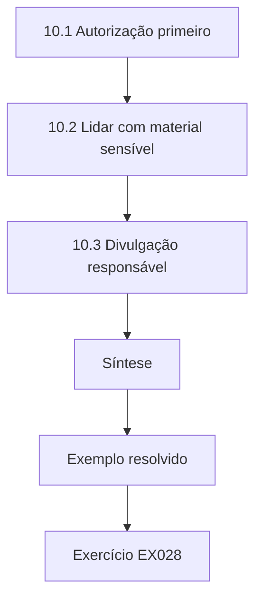

### Desenho lógico

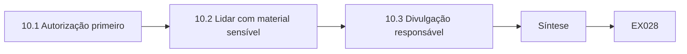

```text
[10.1 Autorização primeiro]
    |
    v
[10.2 Lidar com material sensível]
    |
    v
[10.3 Divulgação responsável]
    |
    v
[Síntese]
    |
    v
[Exemplo resolvido] --> [Exercício EX028]
```
<!-- open-cyber-academy:lesson-figures:end ch-10 -->


### Objetivos de aprendizagem

Você vai (1) aplicar regras éticas aos testes criptográficos; (2) obter e documentar a autorização; (3) tratar com responsabilidade as fraquezas descobertas.

### 10.1 Autorização primeiro

Priya aprende que testar a criptografia de um sistema, por exemplo varrendo as configurações de TLS ou tentando quebrar hashes de senha, exige autorização por escrito do dono. Antes da varredura do Capítulo 7, Grace assinou um escopo que listava os hosts, as datas e as ferramentas permitidas. Testar fora do escopo, mesmo com boas intenções, pode violar leis e a confiança. O Dr. Echeverría diz à turma que o mesmo ato técnico pode ser pesquisa legítima ou crime, conforme a autorização, e é por isso que os profissionais a documentam todas as vezes. Priya guarda uma cópia com suas anotações.

### 10.2 Lidar com material sensível

Durante um exercício de aula sobre a força das senhas, o grupo de Priya recebe um arquivo sintético de hashes de senhas criado pelo professor. Eles são lembrados de nunca usar bancos de dados reais de senhas vazadas, que contêm segredos de pessoas reais, mesmo que estejam publicamente disponíveis. Os resultados são discutidos apenas de forma agregada. Priya aprende a tratar chaves, hashes e dados pessoais como materiais perigosos: minimizar as cópias, armazená-las cifradas, apagá-las ao terminar e registrar quem teve acesso. Os membros do grupo assinam um breve acordo de manuseio no início do exercício, e o professor apaga o arquivo no fim do semestre.

### 10.3 Divulgação responsável

Mais tarde, usando um aplicativo público de e-books fora das atividades do curso, Priya percebe que ele envia os dados de login por HTTP sem cifração. Ela não testa mais nada. Ela relata o problema ao contato de segurança do fornecedor, com uma descrição curta e um prazo de divulgação de noventa dias, seguindo a prática de divulgação coordenada que seu curso ensina, e informa o Dr. Echeverría. O fornecedor corrige o problema em um mês e lhe agradece. Ela anota que explorar a falha para "prová-la" teria sido antiético e desnecessário.

### Exemplo resolvido

Priya documenta um escopo de varredura assinado, usa apenas arquivos sintéticos de hashes e relata uma falha de login por HTTP por divulgação coordenada, sem testes adicionais.

> **Caso sintético.** O fornecedor e os eventos são inventados.

### Erros e limites

A disponibilidade pública de dados vazados não torna ético o seu uso. Divulgar sem dar tempo ao fornecedor pode prejudicar os usuários.

### Exercícios

- **EX028 — Conteúdo da autorização.** O que o escopo assinado por Grace listava? *Rubrica:* 3 = hosts, datas e ferramentas permitidas;; 2 = dois;; 1 = vago;; 0 = nenhuma.

- **EX029 — Bancos de dados vazados.** Por que os estudantes não podem usar bancos de dados reais de senhas vazadas? *Rubrica:* 3 = eles contêm segredos de pessoas reais, mesmo sendo públicos;; 2 = privacidade;; 1 = permitido;; 0 = nenhuma.

- **EX030 — Passos da divulgação.** Como Priya tratou a falha de login por HTTP? *Rubrica:* 3 = parou de testar, relatou ao contato de segurança do fornecedor com prazo de noventa dias, informou o professor;; 2 = relatou;; 1 = explorou;; 0 = nenhuma.

### Síntese

Um escopo autorizado, o manuseio cuidadoso de segredos e a divulgação coordenada tornam éticos os testes criptográficos.

<!-- open-cyber-academy:chapter-navigation:start ch-10 -->
### Continue estudando — aula 10 (capítulo 10 de 40)

[← Capítulo 09](#ch-09) · [Índice das aulas](../SUBJECTS.md) · [Capítulo 11 →](#ch-11)

Continue para a próxima aula já escrita.
<!-- open-cyber-academy:chapter-navigation:end -->

<a id="ch-11"></a>

## Capítulo 11 — Sistemas operacionais

<!-- open-cyber-academy:lesson-figures:start ch-11 -->
### Mapa da aula

Aula 11 publicada. Mapa, exemplo, EX031.

```mermaid
flowchart TD
  N0["11.1 Chaves no sistema operacional"]
  N1["11.2 Aleatoriedade segura"]
  N2["11.3 Cifração de disco completo"]
  N3["Síntese"]
  N0 --> N1 --> N2 --> N3
  N3 --> EX["Exemplo resolvido"]
  EX --> Q["Exercício EX031"]
```

### Desenho lógico

```mermaid
flowchart LR
  N0["11.1 Chaves no sistema operacional"]
  N1["11.2 Aleatoriedade segura"]
  N2["11.3 Cifração de disco completo"]
  N3["Síntese"]
  N0 --> N1 --> N2 --> N3 --> Q["EX031"]
```

```text
[11.1 Chaves no sistema operacional]
    |
    v
[11.2 Aleatoriedade segura]
    |
    v
[11.3 Cifração de disco completo]
    |
    v
[Síntese]
    |
    v
[Exemplo resolvido] --> [Exercício EX031]
```
<!-- open-cyber-academy:lesson-figures:end ch-11 -->


### Objetivos de aprendizagem

Você vai (1) explicar como os sistemas operacionais armazenam e protegem chaves; (2) usar o gerador aleatório seguro do sistema; (3) configurar com bom senso a cifração de disco completo.

### 11.1 Chaves no sistema operacional

Os sistemas operacionais oferecem repositórios de chaves: áreas protegidas onde as aplicações guardam chaves privadas e certificados, muitas vezes apoiadas em hardware, como um TPM (trusted platform module). Priya examina como os notebooks da equipe da Tidewell guardam os certificados usados para se conectar à wiki da equipe. A chave privada é marcada como não exportável, de modo que as aplicações podem usá-la para assinar, mas não podem copiá-la para fora. Ela aprende que esse projeto limita o dano causado por malware: um atacante pode usar a chave indevidamente enquanto está na máquina, mas não consegue levá-la para outro lugar, e remover o malware encerra o uso indevido.

### 11.2 Aleatoriedade segura

O sistema operacional coleta eventos imprevisíveis e oferece um gerador aleatório criptograficamente seguro. O módulo secrets do Python o usa, enquanto o módulo random não o usa e nunca deve ser usado para chaves, tokens ou salts. Priya revisa o script de um voluntário da biblioteca que gerava senhas temporárias do portal com random.choice e o substitui por secrets.choice. Ela explica que as saídas do random podem ser previstas depois de observadas em quantidade suficiente, o que permitiria a alguém adivinhar as senhas temporárias de outros leitores. O NIST SP 800-90A descreve os projetos de gerador em que os sistemas operacionais se baseiam.

### 11.3 Cifração de disco completo

Os notebooks da Tidewell usam cifração de disco completo, que protege os dados se um notebook for perdido enquanto está desligado. Priya confere a configuração: as chaves de recuperação ficam guardadas no sistema de gerenciamento do consórcio, e não em post-its; os notebooks exigem um PIN na inicialização, além do módulo de hardware; e o modo de suspensão é substituído pela hibernação, já que o conteúdo da memória, incluindo as chaves do disco, persiste durante a suspensão. Ela documenta que a cifração de disco completo não protege um notebook roubado enquanto está desbloqueado, de modo que o bloqueio de tela continua essencial.

### Exemplo resolvido

Priya confirma as chaves não exportáveis dos notebooks, substitui random.choice por secrets.choice nas senhas temporárias e reforça a cifração de disco completo com chaves de recuperação centralizadas e PINs na inicialização.

> **Caso sintético.** Os notebooks da Tidewell são inventados; o SP 800-90A é real.

### Erros e limites

Chaves não exportáveis ainda podem ser usadas indevidamente enquanto o malware estiver rodando. A cifração de disco completo não oferece nada depois que o sistema é desbloqueado.

### Exercícios

- **EX031 — Benefício da não exportação.** O que uma chave não exportável impede? *Rubrica:* 3 = copiar a chave para fora da máquina, limitando o dano do malware ao uso indevido local;; 2 = cópia;; 1 = todo uso indevido;; 0 = nenhuma.

- **EX032 — Senhas temporárias.** Por que substituir random.choice por secrets.choice? *Rubrica:* 3 = o random é previsível; o secrets usa o gerador seguro do sistema operacional;; 2 = previsível;; 1 = velocidade;; 0 = nenhuma.

- **EX033 — Suspensão versus hibernação.** Por que preferir a hibernação à suspensão em notebooks cifrados? *Rubrica:* 3 = a memória, incluindo as chaves do disco, continua energizada durante a suspensão;; 2 = chaves na memória;; 1 = bateria;; 0 = nenhuma.

### Síntese

Os sistemas operacionais protegem as chaves com repositórios não exportáveis, aleatoriedade segura e cifração de disco completo, quando configurados com cuidado.

<!-- open-cyber-academy:chapter-navigation:start ch-11 -->
### Continue estudando — aula 11 (capítulo 11 de 40)

[← Capítulo 10](#ch-10) · [Índice das aulas](../SUBJECTS.md) · [Capítulo 12 →](#ch-12)

Continue para a próxima aula já escrita.
<!-- open-cyber-academy:chapter-navigation:end -->

<a id="ch-12"></a>

## Capítulo 12 — Probabilidade e estatística

<!-- open-cyber-academy:lesson-figures:start ch-12 -->
### Mapa da aula

Aula 12 publicada. Mapa, exemplo, EX034.

```mermaid
flowchart TD
  N0["12.1 Espaço de adivinhação em bits"]
  N1["Laboratório — Bits das políticas de senha"]
  N2["12.2 Ler a tabela"]
  N3["12.3 Escolhas humanas e política"]
  N4["Síntese"]
  N0 --> N1 --> N2 --> N3 --> N4
  N4 --> EX["Exemplo resolvido"]
  EX --> Q["Exercício EX034"]
```

### Desenho lógico

```mermaid
flowchart LR
  N0["12.1 Espaço de adivinhação em bits"]
  N1["Laboratório — Bits das políticas de senha"]
  N2["12.2 Ler a tabela"]
  N3["12.3 Escolhas humanas e política"]
  N4["Síntese"]
  N0 --> N1 --> N2 --> N3 --> N4 --> Q["EX034"]
```

```text
[12.1 Espaço de adivinhação em bits]
    |
    v
[Laboratório — Bits das políticas de senha]
    |
    v
[12.2 Ler a tabela]
    |
    v
[12.3 Escolhas humanas e política]
    |
    v
[Síntese]
    |
    v
[Exemplo resolvido] --> [Exercício EX034]
```
<!-- open-cyber-academy:lesson-figures:end ch-12 -->


### Objetivos de aprendizagem

Você vai (1) medir a força das senhas em bits; (2) comparar políticas pelo espaço de adivinhação; (3) reconhecer por que as escolhas humanas reduzem a força real.

### 12.1 Espaço de adivinhação em bits

A força contra a adivinhação é medida pelo número de possibilidades igualmente prováveis, expresso em bits como o logaritmo de base 2. Um segredo escolhido uniformemente entre N possibilidades tem log2(N) bits. Cada bit a mais dobra o trabalho do atacante. Priya calcula isso para as políticas de senha que a Tidewell está considerando. O cálculo supõe que todas as possibilidades são igualmente prováveis, o que vale para segredos gerados por máquina, mas raramente para as escolhas humanas. Ela mantém essa premissa visível em todas as tabelas que produz. Ela também explica os bits à equipe usando lançamentos de moeda.

### Laboratório — Bits das políticas de senha

```python
"""Guessing space for password policies, in bits (synthetic policies, uniform choice assumed)."""
import math
POLICIES = [("8 lowercase letters", 26, 8), ("8 mixed + digits", 62, 8),
            ("4 words from 7776-word list", 7776, 4), ("6 words from 7776-word list", 7776, 6)]

def main():
    for name, alpha, n in POLICIES:
        print(f"{name:<30} {n * math.log2(alpha):5.1f} bits")
    print("human-chosen passwords fall far below these uniform figures")

if __name__ == "__main__":
    main()
```

Execute com `python3 lab_entropy.py`. Saída verificada:

```text
8 lowercase letters             37.6 bits
8 mixed + digits                47.6 bits
4 words from 7776-word list     51.7 bits
6 words from 7776-word list     77.5 bits
human-chosen passwords fall far below these uniform figures
```

### 12.2 Ler a tabela

Oito letras minúsculas aleatórias dão 37,6 bits; oito caracteres aleatórios entre letras e dígitos dão 47,6. Quatro palavras escolhidas ao acaso numa lista de 7.776 palavras dão 51,7 bits, e seis palavras dão 77,5. Uma frase-senha gerada aleatoriamente, portanto, supera uma senha de oito caracteres de aparência complexa e é mais fácil de lembrar. Priya enfatiza a palavra "aleatoriamente": uma frase escolhida por uma pessoa, como o título de um livro favorito, tem muito menos bits efetivos, porque os atacantes tentam primeiro as frases comuns. A última linha do laboratório enuncia esse limite. Grace pede a tabela para o boletim da equipe.

### 12.3 Escolhas humanas e política

Estudos reais sobre senhas mostram que as pessoas escolhem padrões previsíveis: primeira letra maiúscula, anos e pontos de exclamação. As regras de composição muitas vezes tornam as senhas mais difíceis de lembrar sem torná-las muito mais difíceis de adivinhar. Priya recomenda que a Tidewell permita frases-senha longas, confira as novas senhas contra listas de senhas comuns e vazadas, limite a taxa de tentativas de login e ofereça um gerador de frases-senha. Ela enquadra a recomendação como redução da adivinhabilidade, e não como cumprimento de regras, e anota que o hash lento de senhas do Capítulo 9 acrescenta proteção. Grace leva o plano ao conselho.

### Exemplo resolvido

Priya mostra que seis palavras aleatórias dão 77,5 bits contra 47,6 de oito caracteres mistos e recomenda frases-senha longas, verificação contra senhas vazadas e limitação de taxa.

> **Caso sintético.** As políticas são inventadas; os cálculos são padrão.

### Erros e limites

Os cálculos em bits só se aplicam a escolhas uniformemente aleatórias. A limitação de taxa protege contra a adivinhação online, e não contra ataques offline a hashes roubados.

### Exercícios

- **EX034 — Fórmula dos bits.** Quantos bits tem um segredo escolhido uniformemente entre N possibilidades? *Rubrica:* 3 = log2(N);; 2 = logaritmo;; 1 = N;; 0 = nenhuma.

- **EX035 — Resultado da frase-senha.** Compare quatro palavras aleatórias com oito caracteres mistos, a partir do laboratório. *Rubrica:* 3 = 51,7 bits contra 47,6 bits;; 2 = números;; 1 = invertido;; 0 = nenhuma.

- **EX036 — Frases humanas.** Por que uma frase escolhida por uma pessoa tem menos bits efetivos? *Rubrica:* 3 = os atacantes tentam primeiro as frases comuns; as escolhas não são uniformes;; 2 = previsível;; 1 = igual;; 0 = nenhuma.

### Síntese

Medir o espaço de adivinhação em bits mostra por que frases-senha aleatórias superam senhas curtas e complexas, desde que as escolhas sejam realmente aleatórias.

<!-- open-cyber-academy:chapter-navigation:start ch-12 -->
### Continue estudando — aula 12 (capítulo 12 de 40)

[← Capítulo 11](#ch-11) · [Índice das aulas](../SUBJECTS.md) · [Capítulo 13 →](#ch-13)

Continue para a próxima aula já escrita.
<!-- open-cyber-academy:chapter-navigation:end -->

<a id="ch-13"></a>

## Capítulo 13 — Identidade e acesso

<!-- open-cyber-academy:lesson-figures:start ch-13 -->
### Mapa da aula

Aula 13 publicada. Mapa, exemplo, EX037.

```mermaid
flowchart TD
  N0["13.1 Fatores de autenticação"]
  N1["13.2 Comparar os métodos"]
  N2["13.3 Projeto do acesso"]
  N3["Síntese"]
  N0 --> N1 --> N2 --> N3
  N3 --> EX["Exemplo resolvido"]
  EX --> Q["Exercício EX037"]
```

### Desenho lógico

```mermaid
flowchart LR
  N0["13.1 Fatores de autenticação"]
  N1["13.2 Comparar os métodos"]
  N2["13.3 Projeto do acesso"]
  N3["Síntese"]
  N0 --> N1 --> N2 --> N3 --> Q["EX037"]
```

```text
[13.1 Fatores de autenticação]
    |
    v
[13.2 Comparar os métodos]
    |
    v
[13.3 Projeto do acesso]
    |
    v
[Síntese]
    |
    v
[Exemplo resolvido] --> [Exercício EX037]
```
<!-- open-cyber-academy:lesson-figures:end ch-13 -->


### Objetivos de aprendizagem

Você vai (1) explicar como a criptografia sustenta a autenticação; (2) comparar senhas, códigos de uso único e chaves de segurança; (3) projetar o acesso da equipe e dos leitores.

### 13.1 Fatores de autenticação

A autenticação prova a identidade usando algo que você sabe, tem ou é. As senhas são conhecimento; celulares que geram códigos de uso único e chaves de segurança de hardware são posse. Priya estuda como funcionam os códigos de uso único: o celular e o servidor compartilham um segredo e calculam a partir dele e do horário atual códigos curtos usando HMAC, de modo que uma senha roubada sozinha não basta. As chaves de segurança de hardware vão além, usando assinaturas de chave pública vinculadas ao nome do site, o que impede que sites de phishing reutilizem as respostas. Priya demonstra os dois fatores numa oficina para a equipe.

### 13.2 Comparar os métodos

Priya compara os métodos para a equipe da Tidewell. Senhas sozinhas são vulneráveis a phishing e à reutilização. Os códigos baseados em tempo detêm muitos ataques, mas podem ser capturados por phishing em tempo real, por um site falso que retransmite os códigos. As chaves de segurança resistem ao phishing porque a chave assina um desafio que inclui a origem do site real, e a origem de um site falso produz uma assinatura inútil. Ela recomenda chaves de segurança para os administradores e para a equipe com acesso aos dados dos leitores, e códigos de uso único como alternativa, anotando os custos e a necessidade de chaves reservas.

### 13.3 Projeto do acesso

Para os leitores, Priya recomenda senhas ou frases-senha com códigos de uso único opcionais, já que exigir chaves de hardware excluiria muitos usuários. Para a equipe, ela projeta um acesso baseado em papéis: a equipe de cada unidade vê os leitores da sua unidade; os administradores usam contas separadas com chaves de segurança; e as contas de serviço usam certificados, em vez de senhas compartilhadas. Ela documenta que a autenticação prova quem alguém é, mas a autorização decide o que essa pessoa pode fazer, e que as duas precisam ser revistas quando alguém da equipe muda de papel ou sai. As revisões de acesso são agendadas a cada seis meses com os gerentes das unidades.

### Exemplo resolvido

Priya recomenda chaves de segurança para os administradores e para a equipe que lida com dados, códigos de uso único opcionais para os leitores e acesso baseado em papéis, com contas de serviço baseadas em certificados.

> **Caso sintético.** Os papéis da Tidewell são inventados.

### Erros e limites

Uma autenticação forte não corrige permissões excessivas. Os processos de recuperação costumam ser o elo mais fraco.

### Exercícios

- **EX037 — Códigos de uso único.** Como são calculados os códigos de uso único baseados em tempo? *Rubrica:* 3 = HMAC sobre um segredo compartilhado e o horário atual;; 2 = HMAC;; 1 = aleatórios;; 0 = nenhuma.

- **EX038 — Resistência ao phishing.** Por que as chaves de segurança resistem ao phishing? *Rubrica:* 3 = assinam um desafio vinculado à origem do site real, inútil para sites falsos;; 2 = vínculo com a origem;; 1 = não resistem;; 0 = nenhuma.

- **EX039 — Acessibilidade para os leitores.** Por que não exigir chaves de hardware dos leitores? *Rubrica:* 3 = excluiria muitos usuários;; 2 = exclusão;; 1 = só o custo;; 0 = nenhuma.

### Síntese

A criptografia fortalece a autenticação, dos códigos baseados em HMAC às chaves de segurança vinculadas à origem, mas o projeto de acesso precisa equilibrar segurança e inclusão.

<!-- open-cyber-academy:chapter-navigation:start ch-13 -->
### Continue estudando — aula 13 (capítulo 13 de 40)

[← Capítulo 12](#ch-12) · [Índice das aulas](../SUBJECTS.md) · [Capítulo 14 →](#ch-14)

Continue para a próxima aula já escrita.
<!-- open-cyber-academy:chapter-navigation:end -->

<a id="ch-14"></a>

## Capítulo 14 — Fundamentos de privacidade

<!-- open-cyber-academy:lesson-figures:start ch-14 -->
### Mapa da aula

Aula 14 publicada. Mapa, exemplo, EX040.

```mermaid
flowchart TD
  N0["14.1 Privacidade na biblioteca"]
  N1["14.2 Pseudonimização"]
  N2["14.3 Quando a cifração ajuda"]
  N3["Síntese"]
  N0 --> N1 --> N2 --> N3
  N3 --> EX["Exemplo resolvido"]
  EX --> Q["Exercício EX040"]
```

### Desenho lógico

```mermaid
flowchart LR
  N0["14.1 Privacidade na biblioteca"]
  N1["14.2 Pseudonimização"]
  N2["14.3 Quando a cifração ajuda"]
  N3["Síntese"]
  N0 --> N1 --> N2 --> N3 --> Q["EX040"]
```

```text
[14.1 Privacidade na biblioteca]
    |
    v
[14.2 Pseudonimização]
    |
    v
[14.3 Quando a cifração ajuda]
    |
    v
[Síntese]
    |
    v
[Exemplo resolvido] --> [Exercício EX040]
```
<!-- open-cyber-academy:lesson-figures:end ch-14 -->


### Objetivos de aprendizagem

Você vai (1) aplicar princípios de privacidade aos dados da biblioteca; (2) usar a pseudonimização e conhecer seus limites; (3) decidir quando a cifração favorece a privacidade.

### 14.1 Privacidade na biblioteca

As bibliotecas têm uma longa tradição de proteger o que os leitores leem. Priya estuda a política de privacidade da Tidewell e a legislação de proteção de dados aplicável, identificando princípios: coletar apenas os dados necessários, usá-los apenas para as finalidades declaradas, mantê-los apenas pelo tempo necessário e protegê-los de forma adequada. O histórico de leitura é especialmente sensível porque pode revelar saúde, religião ou posições políticas. A criptografia sustenta esses princípios, mas não pode substituí-los; cifrar dados que não deveriam ter sido coletados ainda deixa um risco. Ela lista quais princípios cada sistema da Tidewell atende ou deixa de atender hoje.

### 14.2 Pseudonimização

Para um estudo sobre o uso das unidades, Grace pede os dados de empréstimos sem as identidades. Priya substitui os números dos cartões por pseudônimos com chave calculados com HMAC, usando uma chave mantida pelo consórcio. Um hash sem chave falharia, porque os números dos cartões seguem um formato conhecido e poderiam ter o hash calculado exaustivamente. Ela anota que dados pseudonimizados ainda são dados pessoais segundo muitas leis, porque quem tem a chave pode reidentificá-los, e que combinações raras, como um leitor que pega livros incomuns numa unidade pequena, podem identificar pessoas mesmo sem os números dos cartões.

### 14.3 Quando a cifração ajuda

Priya mapeia onde a cifração favorece a privacidade: o TLS mantém as escolhas de leitura privadas na rede, a cifração do banco de dados protege contra backups roubados e a cifração de ponta a ponta protegeria as mensagens entre leitores e bibliotecários. A cifração não ajuda quando o próprio consórcio usa os dados de forma indevida ou os guarda por tempo demais, e é por isso que os limites de retenção e os logs de acesso importam. Ela recomenda apagar os históricos de empréstimos depois da devolução, a menos que os leitores optem por mantê-los, o que elimina o risco de forma mais eficaz do que qualquer cifra. Grace leva a proposta de exclusão ao conselho para aprovação.

### Exemplo resolvido

Priya pseudonimiza os dados de empréstimos com HMAC sob uma chave do consórcio, sinaliza os riscos de reidentificação e recomenda apagar os históricos depois da devolução, por padrão.

> **Caso sintético.** Os dados e o estudo da Tidewell são inventados.

### Erros e limites

Dados pseudonimizados muitas vezes podem ser reidentificados. A cifração não impede o uso indevido por quem tem acesso autorizado.

### Exercícios

- **EX040 — Leitura sensível.** Por que o histórico de leitura é especialmente sensível? *Rubrica:* 3 = pode revelar saúde, religião ou posições políticas;; 2 = pessoal;; 1 = não é sensível;; 0 = nenhuma.

- **EX041 — Hash sem chave.** Por que o hash sem chave dos números dos cartões falha? *Rubrica:* 3 = o formato conhecido permite calcular o hash de todos e comparar;; 2 = adivinhável;; 1 = funciona;; 0 = nenhuma.

- **EX042 — Exclusão por padrão.** Que padrão Priya recomenda para os históricos de empréstimos? *Rubrica:* 3 = apagar depois da devolução, a menos que os leitores optem por mantê-los;; 2 = apagar;; 1 = manter;; 0 = nenhuma.

### Síntese

A privacidade depende da minimização e dos limites de finalidade; a criptografia, como pseudônimos com chave e cifração, apoia esses princípios, mas não pode substituí-los.

<!-- open-cyber-academy:chapter-navigation:start ch-14 -->
### Continue estudando — aula 14 (capítulo 14 de 40)

[← Capítulo 13](#ch-13) · [Índice das aulas](../SUBJECTS.md) · [Capítulo 15 →](#ch-15)

Continue para a próxima aula já escrita.
<!-- open-cyber-academy:chapter-navigation:end -->

<a id="ch-15"></a>

## Capítulo 15 — Evidências e medição

<!-- open-cyber-academy:lesson-figures:start ch-15 -->
### Mapa da aula

Aula 15 publicada. Mapa, exemplo, EX043.

```mermaid
flowchart TD
  N0["15.1 Por que os logs precisam de proteção"]
  N1["Laboratório — Log de auditoria encadeado por hashes"]
  N2["15.2 Ler a cadeia"]
  N3["15.3 Medir os controles"]
  N4["Síntese"]
  N0 --> N1 --> N2 --> N3 --> N4
  N4 --> EX["Exemplo resolvido"]
  EX --> Q["Exercício EX043"]
```

### Desenho lógico

```mermaid
flowchart LR
  N0["15.1 Por que os logs precisam de proteção"]
  N1["Laboratório — Log de auditoria encadeado por hashes"]
  N2["15.2 Ler a cadeia"]
  N3["15.3 Medir os controles"]
  N4["Síntese"]
  N0 --> N1 --> N2 --> N3 --> N4 --> Q["EX043"]
```

```text
[15.1 Por que os logs precisam de proteção]
    |
    v
[Laboratório — Log de auditoria encadeado por hashes]
    |
    v
[15.2 Ler a cadeia]
    |
    v
[15.3 Medir os controles]
    |
    v
[Síntese]
    |
    v
[Exemplo resolvido] --> [Exercício EX043]
```
<!-- open-cyber-academy:lesson-figures:end ch-15 -->


### Objetivos de aprendizagem

Você vai (1) tornar os logs evidentes a adulterações com cadeias de hashes; (2) medir os controles de segurança com definições claras; (3) interpretar as evidências com honestidade.

### 15.1 Por que os logs precisam de proteção

Quando um leitor reclama que alguém acessou seu registro, a Tidewell confere o log de acesso. Mas um insider que tivesse usado os dados indevidamente também poderia editar o log. Priya aprende que as evidências precisam ser evidentes a adulterações (tamper-evident): as mudanças precisam ser detectáveis. Uma cadeia de hashes faz isso incluindo o hash de cada entrada na entrada seguinte, de modo que editar qualquer entrada muda todos os hashes posteriores. Publicar ou guardar separadamente o hash mais recente, chamado de cabeça (head), permite a um auditor detectar edições. Os logs do Certificate Transparency, definidos na RFC 6962, usam uma estrutura relacionada, uma árvore de Merkle, em escala de internet.

### Laboratório — Log de auditoria encadeado por hashes

```python
"""Tamper-evident audit log: each entry's hash includes the previous hash (SHA-256)."""
import hashlib
def chain(entries):
    prev, out = "0" * 64, []
    for e in entries:
        prev = hashlib.sha256((prev + e).encode()).hexdigest(); out.append(prev)
    return out

def main():
    log = ["2026-05-01 admin login", "2026-05-01 patron export", "2026-05-02 key rotated"]
    good = chain(log)
    print("head:", good[-1][:16])
    log[1] = "2026-05-01 report viewed"
    bad = chain(log)
    print("head after editing entry 2:", bad[-1][:16])
    print("first differing entry:", next(i + 1 for i, (x, y) in enumerate(zip(good, bad)) if x != y))

if __name__ == "__main__":
    main()
```

Execute com `python3 lab_chain.py`. Saída verificada:

```text
head: 4492b592d8b729f0
head after editing entry 2: c36641715cd10666
first differing entry: 2
```

### 15.2 Ler a cadeia

O log de três entradas tem uma cabeça que começa com 4492b592. Quando a segunda entrada é editada de "patron export" para "report viewed", a cabeça passa a ser c3664171, e o primeiro hash diferente está na entrada 2, mostrando exatamente onde a adulteração começou. Priya anota o limite: se um insider puder reescrever a cadeia inteira e a cabeça guardada, nada é detectado. A cabeça precisa, portanto, ser guardada onde o insider não possa alterá-la, por exemplo enviada diariamente ao sistema de um auditor separado ou assinada por outra equipe.

### 15.3 Medir os controles

Priya define medidas para os controles da Tidewell: a porcentagem de contas da equipe que usam chaves de segurança, o número de dias de antecedência com que os certificados são renovados antes da expiração e a proporção de entradas do log de acesso revisadas. Cada medida tem uma definição precisa e uma fonte de dados. Ela relata as linhas de base com honestidade: até agora, apenas 40 por cento da equipe usa chaves de segurança, e as revisões de log acontecem mensalmente, e não semanalmente. Ela resiste a apresentar apenas os números favoráveis, porque as decisões da direção dependem de um quadro preciso. Ela mostra cada medida como uma tendência ao longo dos meses, para que a direção veja se os controles estão melhorando ou piorando.

### Exemplo resolvido

Priya constrói um log encadeado por hashes, mostra que uma edição muda a cabeça de 4492b592 para c3664171 e a localiza na entrada 2, e relata as linhas de base dos controles, incluindo a adoção de 40 por cento das chaves de segurança.

> **Caso sintético.** As entradas do log e as linhas de base são inventadas; a RFC 6962 é real.

### Erros e limites

As cadeias de hashes só detectam adulterações se a cabeça for protegida separadamente. Medidas sem definição produzem números inconsistentes.

### Exercícios

- **EX043 — Propriedade da cadeia.** Por que editar uma entrada muda todos os hashes posteriores? *Rubrica:* 3 = o hash de cada entrada inclui o hash anterior;; 2 = encadeamento;; 1 = não muda;; 0 = nenhuma.

- **EX044 — Cabeças do laboratório.** Informe a cabeça antes e depois da edição e onde começa a diferença. *Rubrica:* 3 = 4492b592 e depois c3664171, diferindo a partir da entrada 2;; 2 = cabeças;; 1 = errado;; 0 = nenhuma.

- **EX045 — Proteger a cabeça.** Onde a cabeça precisa ser guardada, e por quê? *Rubrica:* 3 = num lugar que o insider não possa alterar, por exemplo o sistema de um auditor separado ou assinada por outra equipe;; 2 = separada;; 1 = no mesmo servidor;; 0 = nenhuma.

### Síntese

Logs à prova de adulteração e medidas relatadas com honestidade transformam afirmações de segurança em evidências que outros podem conferir.

<!-- open-cyber-academy:chapter-navigation:start ch-15 -->
### Continue estudando — aula 15 (capítulo 15 de 40)

[← Capítulo 14](#ch-14) · [Índice das aulas](../SUBJECTS.md) · [Capítulo 16 →](#ch-16)

Continue para a próxima aula já escrita.
<!-- open-cyber-academy:chapter-navigation:end -->

<a id="ch-16"></a>

## Capítulo 16 — Arquitetura de segurança

<!-- open-cyber-academy:lesson-figures:start ch-16 -->
### Mapa da aula

Aula 16 publicada. Mapa, exemplo, EX046.

```mermaid
flowchart TD
  N0["16.1 Fronteiras de confiança"]
  N1["16.2 Defesa em profundidade"]
  N2["16.3 Chaves na arquitetura"]
  N3["Síntese"]
  N0 --> N1 --> N2 --> N3
  N3 --> EX["Exemplo resolvido"]
  EX --> Q["Exercício EX046"]
```

### Desenho lógico

```mermaid
flowchart LR
  N0["16.1 Fronteiras de confiança"]
  N1["16.2 Defesa em profundidade"]
  N2["16.3 Chaves na arquitetura"]
  N3["Síntese"]
  N0 --> N1 --> N2 --> N3 --> Q["EX046"]
```

```text
[16.1 Fronteiras de confiança]
    |
    v
[16.2 Defesa em profundidade]
    |
    v
[16.3 Chaves na arquitetura]
    |
    v
[Síntese]
    |
    v
[Exemplo resolvido] --> [Exercício EX046]
```
<!-- open-cyber-academy:lesson-figures:end ch-16 -->


### Objetivos de aprendizagem

Você vai (1) posicionar os controles criptográficos numa arquitetura geral; (2) identificar as fronteiras de confiança; (3) aplicar a defesa em profundidade aos sistemas da biblioteca.

### 16.1 Fronteiras de confiança

Priya desenha a arquitetura da Tidewell com as fronteiras de confiança: linhas em que os dados passam entre áreas com níveis diferentes de confiança, como entre a internet e o portal, entre o portal e o banco de dados de leitores e entre o consórcio e o provedor de e-books. Os controles criptográficos se concentram nas fronteiras: TLS onde a internet encontra o portal, autenticação mútua onde o portal chama o banco de dados e mensagens assinadas onde o consórcio troca dados de empréstimos com o provedor. Desenhar as fronteiras primeiro mostra onde a criptografia é necessária e onde ela só acrescentaria complexidade.

### 16.2 Defesa em profundidade

Priya organiza os controles em camadas, para que uma falha não exponha os leitores. O portal usa TLS e cabeçalhos de segurança; a aplicação autentica os usuários e confere as permissões; o banco de dados cifra os campos sensíveis e só aceita conexões do portal, com certificados; os backups são cifrados; e os logs são encadeados por hashes. Se um atacante explorasse um bug no portal, ainda enfrentaria as permissões do banco de dados e a cifração dos campos. Ela documenta quais ameaças cada camada trata e evita camadas que se duplicam sem acrescentar proteção.

### 16.3 Chaves na arquitetura

Priya acrescenta ao diagrama o gerenciamento de chaves, que os rascunhos anteriores deixavam de fora. Um serviço gerenciado de chaves guarda as chaves do banco de dados e dos backups; a chave privada TLS do portal fica nos servidores web, com permissões restritas; e as chaves de segurança da equipe guardam as próprias chaves privadas. Ela marca o serviço de chaves como um componente de alto valor, que exige administração e monitoramento separados. Grace observa que os documentos de arquitetura anteriores nunca mostravam as chaves, o que tornava impossível planejar a rotação ou avaliar quem podia decifrar o quê. O diagrama revisado é versionado.

### Exemplo resolvido

O diagrama de Priya marca três fronteiras de confiança, cinco camadas de defesa e a localização de cada chave, destacando o serviço de chaves como um componente de alto valor.

> **Caso sintético.** A arquitetura é inventada.

### Erros e limites

Camadas que compartilham uma fraqueza, como uma única conta de administrador que controla tudo, não acrescentam profundidade. Os diagramas precisam ser atualizados à medida que os sistemas mudam.

### Exercícios

- **EX046 — Fronteira de confiança.** Cite duas fronteiras de confiança na arquitetura da Tidewell. *Rubrica:* 3 = duas entre internet-portal, portal-banco de dados, consórcio-provedor;; 2 = uma;; 1 = vago;; 0 = nenhuma.

- **EX047 — Bug no portal.** O que um atacante ainda enfrentaria depois de explorar um bug no portal? *Rubrica:* 3 = as permissões do banco de dados e a cifração dos campos;; 2 = uma camada;; 1 = vago;; 0 = nenhuma.

- **EX048 — Chaves ausentes.** O que os documentos de arquitetura anteriores omitiam, e por que isso importava? *Rubrica:* 3 = a localização das chaves; não era possível avaliar a rotação nem o acesso à decifração;; 2 = chaves;; 1 = vago;; 0 = nenhuma.

### Síntese

As arquiteturas devem mostrar as fronteiras de confiança, os controles em camadas e cada chave, para que a criptografia seja posicionada onde mais protege.

<!-- open-cyber-academy:chapter-navigation:start ch-16 -->
### Continue estudando — aula 16 (capítulo 16 de 40)

[← Capítulo 15](#ch-15) · [Índice das aulas](../SUBJECTS.md) · [Capítulo 17 →](#ch-17)

Continue para a próxima aula já escrita.
<!-- open-cyber-academy:chapter-navigation:end -->

<a id="ch-17"></a>

## Capítulo 17 — Conceitos de criptografia

<!-- open-cyber-academy:lesson-figures:start ch-17 -->
### Mapa da aula

Aula 17 publicada. Mapa, exemplo, EX049.

```mermaid
flowchart TD
  N0["17.1 O princípio de Kerckhoffs"]
  N1["Laboratório — Quebrar uma cifra de César"]
  N2["17.2 Por que as cifras clássicas falham"]
  N3["Síntese"]
  N0 --> N1 --> N2 --> N3
  N3 --> EX["Exemplo resolvido"]
  EX --> Q["Exercício EX049"]
```

### Desenho lógico

```mermaid
flowchart LR
  N0["17.1 O princípio de Kerckhoffs"]
  N1["Laboratório — Quebrar uma cifra de César"]
  N2["17.2 Por que as cifras clássicas falham"]
  N3["Síntese"]
  N0 --> N1 --> N2 --> N3 --> Q["EX049"]
```

```text
[17.1 O princípio de Kerckhoffs]
    |
    v
[Laboratório — Quebrar uma cifra de César]
    |
    v
[17.2 Por que as cifras clássicas falham]
    |
    v
[Síntese]
    |
    v
[Exemplo resolvido] --> [Exercício EX049]
```
<!-- open-cyber-academy:lesson-figures:end ch-17 -->


### Objetivos de aprendizagem

Você vai (1) explicar o princípio de Kerckhoffs; (2) mostrar por que as cifras clássicas falham; (3) definir objetivos modernos de segurança, como a indistinguibilidade.

### 17.1 O princípio de Kerckhoffs

Uma cifra deve continuar segura mesmo que tudo sobre ela, exceto a chave, seja público. Esse princípio, enunciado por Auguste Kerckhoffs no século XIX, orienta a criptografia moderna: o AES é integralmente publicado no FIPS 197, e sua segurança se apoia no sigilo das chaves. Priya aprende por que algoritmos secretos são uma aposta ruim: eles acabam sendo descobertos por engenharia reversa, recebem pouco escrutínio público e mudá-los é caro. Normas públicas e bem analisadas concentram a atenção dos especialistas onde as fraquezas podem ser encontradas e corrigidas cedo. Os fornecedores da Tidewell são solicitados a confirmar que usam algoritmos publicados.

### Laboratório — Quebrar uma cifra de César

```python
"""Break a toy Caesar cipher by frequency analysis to show why classical ciphers fail."""
from collections import Counter
TEXT = "THE LIBRARY OPENS AT NINE AND THE READING ROOM CLOSES AT EIGHT EVERY EVENING"

def shift(s, k):
    return "".join(chr((ord(c) - 65 + k) % 26 + 65) if c.isalpha() else c for c in s)

def main():
    ct = shift(TEXT, 11)
    top = Counter(c for c in ct if c.isalpha()).most_common(1)[0][0]
    k = (ord(top) - ord("E")) % 26
    print("ciphertext:", ct[:30], "...")
    print("most common letter:", top, "-> guessed shift", k)
    print("recovered:", shift(ct, -k)[:30], "...")
    print("keys to try by brute force:", 25)

if __name__ == "__main__":
    main()
```

Execute com `python3 lab_caesar.py`. Saída verificada:

```text
ciphertext: ESP WTMCLCJ ZAPYD LE YTYP LYO  ...
most common letter: P -> guessed shift 11
recovered: THE LIBRARY OPENS AT NINE AND  ...
keys to try by brute force: 25
```

### 17.2 Por que as cifras clássicas falham

O laboratório cifra uma frase sobre o horário da biblioteca com um deslocamento de César de 11. A letra mais comum do texto cifrado é P, e supor que ela representa o E, a letra mais comum do inglês, dá o deslocamento 11 e recupera o texto. Mesmo sem análise de frequência, existem apenas 25 deslocamentos, então a força bruta é instantânea. Priya amplia a lição: as cifras de substituição preservam os padrões das letras, e qualquer cifra que vaze estrutura sobre o texto claro pode ser atacada estatisticamente. O Handbook of Applied Cryptography, no capítulo 7, faz um panorama desses sistemas clássicos e de por que eles foram abandonados.

### 17.3 Objetivos modernos

A criptografia moderna define a segurança com precisão. Katz e Lindell descrevem a indistinguibilidade: um atacante que escolhe duas mensagens e vê a cifração de uma delas não deve conseguir dizer qual, com probabilidade significativamente melhor do que o lançamento de uma moeda. Isso exclui o vazamento de padrões, à parte o tamanho. Um esquema determinístico, em que a mesma mensagem sempre é cifrada da mesma forma, falha nessa definição, porque as mensagens repetidas ficam visíveis. É por isso que a cifração moderna usa nonces aleatórios ou únicos e por que a cifração autenticada também garante a integridade.

### Exemplo resolvido

Priya quebra uma cifra de César com deslocamento 11 por análise de frequência, explica o princípio de Kerckhoffs usando o FIPS 197 e mostra por que a cifração determinística falha na indistinguibilidade.

> **Caso sintético.** A mensagem é inventada; o FIPS 197 e o Handbook são reais.

### Erros e limites

A indistinguibilidade não esconde o tamanho da mensagem. As cifras clássicas servem para a história e o ensino, nunca para a proteção.

### Exercícios

- **EX049 — Kerckhoffs.** Enuncie o princípio de Kerckhoffs. *Rubrica:* 3 = uma cifra deve ser segura mesmo que tudo, exceto a chave, seja público;; 2 = sigilo da chave;; 1 = algoritmo secreto;; 0 = nenhuma.

- **EX050 — Quebra da cifra de César.** Como o laboratório encontrou o deslocamento? *Rubrica:* 3 = a letra mais comum, P, foi tomada como E, dando o deslocamento 11;; 2 = frequência;; 1 = só força bruta;; 0 = nenhuma.

- **EX051 — Falha determinística.** Por que a cifração determinística falha na indistinguibilidade? *Rubrica:* 3 = mensagens repetidas são cifradas de forma idêntica, revelando a repetição;; 2 = padrões;; 1 = passa;; 0 = nenhuma.

### Síntese

Algoritmos públicos, definições precisas e cifração aleatorizada substituíram as cifras clássicas, cujos padrões as denunciavam.

<!-- open-cyber-academy:chapter-navigation:start ch-17 -->
### Continue estudando — aula 17 (capítulo 17 de 40)

[← Capítulo 16](#ch-16) · [Índice das aulas](../SUBJECTS.md) · [Capítulo 18 →](#ch-18)

Continue para a próxima aula já escrita.
<!-- open-cyber-academy:chapter-navigation:end -->

<a id="ch-18"></a>

## Capítulo 18 — Métodos de pesquisa I

<!-- open-cyber-academy:lesson-figures:start ch-18 -->
### Mapa da aula

Aula 18 publicada. Mapa, exemplo, EX052.

```mermaid
flowchart TD
  N0["18.1 Uma questão pesquisável"]
  N1["18.2 Buscar fontes"]
  N2["18.3 Planejamento ético"]
  N3["Síntese"]
  N0 --> N1 --> N2 --> N3
  N3 --> EX["Exemplo resolvido"]
  EX --> Q["Exercício EX052"]
```

### Desenho lógico

```mermaid
flowchart LR
  N0["18.1 Uma questão pesquisável"]
  N1["18.2 Buscar fontes"]
  N2["18.3 Planejamento ético"]
  N3["Síntese"]
  N0 --> N1 --> N2 --> N3 --> Q["EX052"]
```

```text
[18.1 Uma questão pesquisável]
    |
    v
[18.2 Buscar fontes]
    |
    v
[18.3 Planejamento ético]
    |
    v
[Síntese]
    |
    v
[Exemplo resolvido] --> [Exercício EX052]
```
<!-- open-cyber-academy:lesson-figures:end ch-18 -->


### Objetivos de aprendizagem

Você vai (1) formular uma questão pesquisável sobre a prática criptográfica; (2) buscar literatura e normas de forma sistemática; (3) planejar um pequeno estudo de forma ética.

### 18.1 Uma questão pesquisável

Priya quer estudar como a equipe da biblioteca reage aos avisos de certificado TLS. Ela refina um interesse vago numa questão pesquisável: "Quando lhes é mostrado um aviso de certificado simulado num site de treinamento da equipe, que proporção da equipe da Tidewell prossegue, e uma explicação de uma página reduz essa proporção?" A questão nomeia uma população, um comportamento mensurável e uma intervenção. O Dr. Echeverría aponta que uma simulação precisa ficar claramente separada dos sistemas reais, para que a equipe nunca seja posta em risco. Ela refina a redação duas vezes.

### 18.2 Buscar fontes

Priya busca em bases acadêmicas estudos sobre avisos de segurança, registra os termos de busca e as datas e lê a RFC 8446 e a RFC 5280 para descrever o que os avisos indicam tecnicamente. Ela mantém uma tabela das fontes, com a população, o método e os achados de cada estudo, anotando quais usaram participantes de laboratório e quais observaram a navegação real. Ela distingue estudos revisados por pares de relatórios de fornecedores e registra a citação completa de cada fonte, verificando os links antes de acrescentá-los à bibliografia. Ela também pede à bibliotecária da universidade que confira sua estratégia de busca, o que a leva a dois estudos relevantes que ela tinha deixado passar.

### 18.3 Planejamento ético

O estudo envolve pessoas, então Priya submete o projeto ao comitê de ética da universidade. Seu plano explica que a participação é voluntária, que as respostas são anônimas, que o aviso aparece apenas num site de treinamento sem dados reais e que os participantes recebem depois um esclarecimento (debriefing) com a explicação de por que os avisos importam. Grace confirma por escrito o apoio do consórcio. O comitê pede que ela garanta que os gerentes nunca vejam resultados individuais, o que ela acrescenta. A revisão ética molda o desenho do estudo, e não apenas a papelada. Ela também prepara uma folha de informações em linguagem simples para os participantes.

### Exemplo resolvido

Priya escreve uma questão específica sobre avisos de certificado, mantém uma tabela de literatura com as fontes e obtém a aprovação ética para uma simulação anônima num site de treinamento, com esclarecimento posterior.

> **Caso sintético.** O estudo é inventado; a RFC 8446 e a RFC 5280 são reais.

### Erros e limites

As simulações podem não refletir o comportamento real sob pressão. Estudos com a equipe precisam protegê-la de consequências trabalhistas.

### Exercícios

- **EX052 — Partes da questão.** Que três elementos tornam a questão pesquisável? *Rubrica:* 3 = população, comportamento mensurável, intervenção;; 2 = dois;; 1 = um;; 0 = nenhuma.

- **EX053 — Tabela de fontes.** O que Priya registra para cada estudo? *Rubrica:* 3 = população, método, achados (e laboratório versus navegação real);; 2 = dois;; 1 = só a citação;; 0 = nenhuma.

- **EX054 — Pedido do comitê.** O que o comitê de ética pediu que Priya acrescentasse? *Rubrica:* 3 = garantir que os gerentes nunca vejam resultados individuais;; 2 = anonimato;; 1 = vago;; 0 = nenhuma.

### Síntese

Perguntas pesquisáveis, fontes sistemáticas e um desenho ético transformam a curiosidade sobre a prática criptográfica num estudo crível.

<!-- open-cyber-academy:chapter-navigation:start ch-18 -->
### Continue estudando — aula 18 (capítulo 18 de 40)

[← Capítulo 17](#ch-17) · [Índice das aulas](../SUBJECTS.md) · [Capítulo 19 →](#ch-19)

Continue para a próxima aula já escrita.
<!-- open-cyber-academy:chapter-navigation:end -->

<a id="ch-19"></a>

## Capítulo 19 — Criptografia e serviços de confiança: escopo e teoria

<!-- open-cyber-academy:lesson-figures:start ch-19 -->
### Mapa da aula

Aula 19 publicada. Mapa, exemplo, EX055.

```mermaid
flowchart TD
  N0["19.1 O que são os serviços de confiança"]
  N1["19.2 Confiança delegada"]
  N2["19.3 O que as afirmações significam"]
  N3["Síntese"]
  N0 --> N1 --> N2 --> N3
  N3 --> EX["Exemplo resolvido"]
  EX --> Q["Exercício EX055"]
```

### Desenho lógico

```mermaid
flowchart LR
  N0["19.1 O que são os serviços de confiança"]
  N1["19.2 Confiança delegada"]
  N2["19.3 O que as afirmações significam"]
  N3["Síntese"]
  N0 --> N1 --> N2 --> N3 --> Q["EX055"]
```

```text
[19.1 O que são os serviços de confiança]
    |
    v
[19.2 Confiança delegada]
    |
    v
[19.3 O que as afirmações significam]
    |
    v
[Síntese]
    |
    v
[Exemplo resolvido] --> [Exercício EX055]
```
<!-- open-cyber-academy:lesson-figures:end ch-19 -->


### Objetivos de aprendizagem

Você vai (1) definir o escopo dos serviços de confiança; (2) explicar a infraestrutura de chaves públicas como uma teoria de confiança delegada; (3) descrever o que os certificados e os carimbos de tempo afirmam.

### 19.1 O que são os serviços de confiança

Os serviços de confiança ajudam pessoas e sistemas a confiar em informações eletrônicas: as autoridades certificadoras emitem certificados; os serviços de carimbo de tempo provam quando os dados existiam; os serviços de assinatura ajudam a criar e validar assinaturas digitais; e os serviços de gerenciamento de chaves protegem as chaves. Priya mapeia quais deles a Tidewell usa: uma autoridade pública para seus sites, uma autoridade interna para os dispositivos da equipe e um serviço de assinatura para os contratos com as editoras. Cada serviço faz uma afirmação em que outros confiam, de modo que sua própria segurança e seus procedimentos passam a fazer parte da segurança de todos. Priya registra cada afirmação numa tabela.

### 19.2 Confiança delegada

A infraestrutura de chaves públicas delega a confiança. Um navegador não tem como conhecer a chave de cada site, então confia num pequeno conjunto de autoridades raiz, que respondem por intermediárias, que respondem pelos sites. A RFC 5280 define como os certificados se encadeiam e como os clientes os validam. Priya explica o ponto fraco da teoria: qualquer raiz confiável pode emitir um certificado para qualquer nome, então uma única autoridade comprometida ou descuidada pode minar todos. O Certificate Transparency, especificado na RFC 6962, responde tornando a emissão pública, para que os certificados emitidos indevidamente possam ser detectados. Ela mostra à equipe como ver as entradas de CT.

### 19.3 O que as afirmações significam

Um certificado afirma que uma chave pública pertence a um nome durante um período; ele não afirma que a parte nomeada é honesta. Um carimbo de tempo afirma que os dados existiam num momento, e não que os dados são verdadeiros. Uma assinatura afirma que o detentor de uma chave privada aprovou bytes específicos, e não que o detentor os entendeu. Priya escreve essas distinções para o processo de contratos da Tidewell, em que a equipe às vezes supunha que um PDF assinado significava que a editora tinha concordado com termos que, na verdade, estavam num anexo não assinado.

### Exemplo resolvido

Priya mapeia os serviços de confiança da Tidewell, explica a confiança delegada e o Certificate Transparency e esclarece, num caso de contrato, que uma assinatura cobre apenas os bytes assinados.

> **Caso sintético.** Os serviços e o contrato da Tidewell são inventados; a RFC 5280 e a RFC 6962 são reais.

### Erros e limites

Confiar em muitas raízes amplia o risco. As assinaturas provam a aprovação de bytes, e não a intenção ou a compreensão.

### Exercícios

- **EX055 — Quatro serviços.** Cite quatro tipos de serviço de confiança. *Rubrica:* 3 = autoridades certificadoras, carimbo de tempo, serviços de assinatura, gerenciamento de chaves;; 2 = três;; 1 = um;; 0 = nenhuma.

- **EX056 — Fraqueza das raízes.** Qual é a principal fraqueza da confiança delegada? *Rubrica:* 3 = qualquer raiz confiável pode emitir para qualquer nome, então uma autoridade ruim mina todas;; 2 = qualquer raiz;; 1 = vago;; 0 = nenhuma.

- **EX057 — Mal-entendido do contrato.** O que a equipe entendeu mal sobre o PDF assinado? *Rubrica:* 3 = supôs que a assinatura cobria os termos de um anexo não assinado;; 2 = cobertura;; 1 = vago;; 0 = nenhuma.

### Síntese

Os serviços de confiança fazem asserções específicas; entender exatamente o que cada um assere evita uma confiança mal depositada.

<!-- open-cyber-academy:chapter-navigation:start ch-19 -->
### Continue estudando — aula 19 (capítulo 19 de 40)

[← Capítulo 18](#ch-18) · [Índice das aulas](../SUBJECTS.md) · [Capítulo 20 →](#ch-20)

Continue para a próxima aula já escrita.
<!-- open-cyber-academy:chapter-navigation:end -->

<a id="ch-20"></a>

## Capítulo 20 — Criptografia e serviços de confiança: casos fundamentais

<!-- open-cyber-academy:lesson-figures:start ch-20 -->
### Mapa da aula

Aula 20 publicada. Mapa, exemplo, EX058.

```mermaid
flowchart TD
  N0["20.1 Classes de falhas"]
  N1["20.2 Lições para a Tidewell"]
  N2["20.3 Separar as causas"]
  N3["Síntese"]
  N0 --> N1 --> N2 --> N3
  N3 --> EX["Exemplo resolvido"]
  EX --> Q["Exercício EX058"]
```

### Desenho lógico

```mermaid
flowchart LR
  N0["20.1 Classes de falhas"]
  N1["20.2 Lições para a Tidewell"]
  N2["20.3 Separar as causas"]
  N3["Síntese"]
  N0 --> N1 --> N2 --> N3 --> Q["EX058"]
```

```text
[20.1 Classes de falhas]
    |
    v
[20.2 Lições para a Tidewell]
    |
    v
[20.3 Separar as causas]
    |
    v
[Síntese]
    |
    v
[Exemplo resolvido] --> [Exercício EX058]
```
<!-- open-cyber-academy:lesson-figures:end ch-20 -->


### Objetivos de aprendizagem

Você vai (1) analisar classes documentadas de falhas de confiança; (2) extrair lições para uma organização como a Tidewell; (3) separar as causas criptográficas das procedimentais.

### 20.1 Classes de falhas

Priya estuda classes de falhas documentadas em fontes públicas e livros-texto. Autoridades certificadoras já emitiram certificados para as partes erradas por causa de validação fraca; organizações sofreram indisponibilidades quando certificados expiraram; softwares aceitaram certificados sem verificar os nomes; e chaves privadas vazaram por servidores mal configurados. Ela classifica as causas como criptográficas, como algoritmos fracos, ou procedimentais, como validação ou monitoramento deficientes. A maioria dos casos que ela lê é procedimental; a matemática resistiu enquanto as pessoas e os processos falharam. Ela mantém uma tabela-resumo dos casos e das causas.

### 20.2 Lições para a Tidewell

Para cada classe, Priya escreve uma lição: monitorar os logs do Certificate Transparency em busca de certificados emitidos para nomes da Tidewell, o que revelaria emissões indevidas; automatizar as renovações e alertar antes da expiração; testar as aplicações contra certificados com nomes errados; e manter as chaves privadas em servidores com acesso restrito e inventariá-las. Grace adota imediatamente as lições de expiração e de monitoramento, já que um certificado expirado tinha deixado o catálogo fora do ar por meio dia no ano anterior. Priya também acrescenta uma verificação trimestral que procura certificados com nomes errados, usando apenas os hosts autorizados do próprio consórcio.

### 20.3 Separar as causas

Priya pratica a separação das causas usando a indisponibilidade do catálogo da Tidewell. O certificado expirou porque a renovação era manual e a pessoa responsável tinha saído; não existia alerta; e a substituição levou horas porque ninguém sabia que servidor guardava a chave. Nenhuma dessas causas envolvia fraqueza criptográfica. Ela escreve uma análise curta com a linha do tempo, as causas e as ações: renovação automatizada, um dono para cada certificado e um inventário dos locais das chaves. Isso vira o modelo para as análises de falhas posteriores. O modelo é guardado na pasta compartilhada.

### Exemplo resolvido

Priya classifica as falhas de confiança como majoritariamente procedimentais e decompõe a indisponibilidade do catálogo da Tidewell em três causas não criptográficas, com as ações correspondentes.

> **Caso sintético.** A indisponibilidade é inventada; as classes de falhas vêm da literatura pública.

### Erros e limites

Culpar indivíduos esconde as causas de processo. Falhas criptográficas raras ainda acontecem, então as escolhas de algoritmo também importam.

### Exercícios

- **EX058 — Causa dominante.** Que tipo de causa dominou os casos que Priya leu? *Rubrica:* 3 = procedimental, não criptográfica;; 2 = procedimental;; 1 = criptográfica;; 0 = nenhuma.

- **EX059 — Lição do monitoramento de CT.** O que o monitoramento dos logs do Certificate Transparency revela? *Rubrica:* 3 = certificados emitidos para nomes da Tidewell, expondo emissões indevidas;; 2 = emissão indevida;; 1 = expiração;; 0 = nenhuma.

- **EX060 — Causas da indisponibilidade.** Cite as três causas da indisponibilidade do catálogo. *Rubrica:* 3 = renovação manual por pessoa que saiu, nenhum alerta, local da chave desconhecido;; 2 = duas;; 1 = uma;; 0 = nenhuma.

### Síntese

A maioria das falhas de confiança é procedimental; analisá-las sem culpa produz lições práticas para qualquer organização.

<!-- open-cyber-academy:chapter-navigation:start ch-20 -->
### Continue estudando — aula 20 (capítulo 20 de 40)

[← Capítulo 19](#ch-19) · [Índice das aulas](../SUBJECTS.md) · [Capítulo 21 →](#ch-21)

Continue para a próxima aula já escrita.
<!-- open-cyber-academy:chapter-navigation:end -->

<a id="ch-21"></a>

## Capítulo 21 — Criptografia e serviços de confiança: modelos de sistema

<!-- open-cyber-academy:lesson-figures:start ch-21 -->
### Mapa da aula

Aula 21 publicada. Mapa, exemplo, EX061.

```mermaid
flowchart TD
  N0["21.1 Componentes e fluxos"]
  N1["21.2 Quem afirma o quê"]
  N2["21.3 Pontos únicos de confiança"]
  N3["Síntese"]
  N0 --> N1 --> N2 --> N3
  N3 --> EX["Exemplo resolvido"]
  EX --> Q["Exercício EX061"]
```

### Desenho lógico

```mermaid
flowchart LR
  N0["21.1 Componentes e fluxos"]
  N1["21.2 Quem afirma o quê"]
  N2["21.3 Pontos únicos de confiança"]
  N3["Síntese"]
  N0 --> N1 --> N2 --> N3 --> Q["EX061"]
```

```text
[21.1 Componentes e fluxos]
    |
    v
[21.2 Quem afirma o quê]
    |
    v
[21.3 Pontos únicos de confiança]
    |
    v
[Síntese]
    |
    v
[Exemplo resolvido] --> [Exercício EX061]
```
<!-- open-cyber-academy:lesson-figures:end ch-21 -->


### Objetivos de aprendizagem

Você vai (1) modelar os serviços de confiança da Tidewell como componentes e fluxos; (2) identificar qual componente afirma o quê; (3) encontrar pontos únicos de confiança.

### 21.1 Componentes e fluxos

Priya modela os serviços de confiança do consórcio como um sistema. Os componentes incluem a autoridade certificadora pública usada para os sites, a autoridade interna para os dispositivos da equipe, o serviço de chaves, o serviço de assinatura de contratos e o servidor de licenças do provedor de e-books, que verifica tokens de empréstimo assinados. Os fluxos os conectam: solicitações de certificados, tokens assinados, backups cifrados e informações de revogação. Ela desenha o modelo com setas rotuladas com o que cada fluxo transporta e como é protegido, partindo da arquitetura do Capítulo 16. Grace revisa o diagrama com sua equipe para conferir a exatidão.

### 21.2 Quem afirma o quê

Para cada componente, Priya registra sua afirmação e quem confia nela. A autoridade pública afirma que a Tidewell controla seus nomes de domínio, e os navegadores dos leitores confiam nisso. A autoridade interna afirma que um dispositivo pertence à equipe, e a wiki confia nisso. O servidor de licenças confia nos tokens de empréstimo assinados da Tidewell, que afirmam que um leitor pode emprestar um título por catorze dias. Escrever as afirmações explicitamente mostra quais falhas enganariam quem e, portanto, quais componentes precisam dos controles mais fortes. Ela compartilha a tabela com Grace.

### 21.3 Pontos únicos de confiança

O modelo revela pontos únicos de confiança: a chave de assinatura da autoridade interna, se roubada, permitiria a um atacante criar certificados de dispositivos da equipe; e uma única conta de administrador controla tanto o serviço de chaves quanto seus logs de auditoria. Priya recomenda tirar do ar (offline) a raiz da autoridade interna, com uma chave emissora separada, e separar a administração do serviço de chaves da administração dos logs. Cada recomendação reduz o dano que um único comprometimento pode causar. Grace acrescenta as duas ao plano do ano seguinte, com os custos estimados. Os dois itens recebem donos e datas-alvo.

### Exemplo resolvido

O modelo de sistema de Priya rotula cada fluxo, lista a afirmação de cada componente e encontra dois pontos únicos de confiança, com recomendações.

> **Caso sintético.** O modelo é inventado.

### Erros e limites

Os modelos simplificam; confira-os contra as configurações reais. Os pontos únicos de confiança podem se esconder em pessoas, e não apenas em sistemas.

### Exercícios

- **EX061 — Afirmação da licença.** O que os tokens de empréstimo assinados da Tidewell afirmam ao servidor de licenças? *Rubrica:* 3 = que um leitor pode emprestar um título por catorze dias;; 2 = permissão de empréstimo;; 1 = identidade;; 0 = nenhuma.

- **EX062 — Risco da autoridade interna.** O que um atacante poderia fazer com a chave de assinatura da autoridade interna? *Rubrica:* 3 = criar certificados de dispositivos da equipe;; 2 = se passar por dispositivos;; 1 = vago;; 0 = nenhuma.

- **EX063 — Separação da administração.** Que separação Priya recomendou para a administração? *Rubrica:* 3 = separar a administração do serviço de chaves da administração dos logs de auditoria;; 2 = separação;; 1 = unificar;; 0 = nenhuma.

### Síntese

Modelar quem assere o quê, e quem se apoia nisso, expõe pontos únicos de confiança antes que os atacantes os encontrem.

<!-- open-cyber-academy:chapter-navigation:start ch-21 -->
### Continue estudando — aula 21 (capítulo 21 de 40)

[← Capítulo 20](#ch-20) · [Índice das aulas](../SUBJECTS.md) · [Capítulo 22 →](#ch-22)

Continue para a próxima aula já escrita.
<!-- open-cyber-academy:chapter-navigation:end -->

<a id="ch-22"></a>

## Capítulo 22 — Criptografia e serviços de confiança: dados e dependências

<!-- open-cyber-academy:lesson-figures:start ch-22 -->
### Mapa da aula

Aula 22 publicada. Mapa, exemplo, EX064.

```mermaid
flowchart TD
  N0["22.1 Inventário criptográfico"]
  N1["22.2 Dependências de bibliotecas e algoritmos"]
  N2["22.3 Mudanças de fornecedores"]
  N3["Síntese"]
  N0 --> N1 --> N2 --> N3
  N3 --> EX["Exemplo resolvido"]
  EX --> Q["Exercício EX064"]
```

### Desenho lógico

```mermaid
flowchart LR
  N0["22.1 Inventário criptográfico"]
  N1["22.2 Dependências de bibliotecas e algoritmos"]
  N2["22.3 Mudanças de fornecedores"]
  N3["Síntese"]
  N0 --> N1 --> N2 --> N3 --> Q["EX064"]
```

```text
[22.1 Inventário criptográfico]
    |
    v
[22.2 Dependências de bibliotecas e algoritmos]
    |
    v
[22.3 Mudanças de fornecedores]
    |
    v
[Síntese]
    |
    v
[Exemplo resolvido] --> [Exercício EX064]
```
<!-- open-cyber-academy:lesson-figures:end ch-22 -->


### Objetivos de aprendizagem

Você vai (1) inventariar os ativos e as dependências criptográficas; (2) acompanhar as bibliotecas e os algoritmos em uso; (3) planejar mudanças de fornecedores.

### 22.1 Inventário criptográfico

Priya constrói um inventário dos ativos criptográficos da Tidewell: certificados com datas de expiração e donos; chaves com finalidades, algoritmos e locais; e os protocolos em uso em cada serviço. O SP 800-57 Part 1 enfatiza que a organização precisa saber que chaves tem. Ela descobre dois certificados esquecidos em servidores antigos e uma chave de backup guardada numa pasta compartilhada. O inventário transforma riscos invisíveis numa lista com donos e se torna a base de todas as mudanças posteriores, incluindo a migração de algoritmos. O inventário é revisado mensalmente pela equipe de Grace para conferir a exatidão.

### 22.2 Dependências de bibliotecas e algoritmos

Os sistemas da Tidewell dependem de bibliotecas criptográficas nos sistemas operacionais, nos servidores web e nas aplicações. Priya lista cada biblioteca e versão e registra quais algoritmos cada sistema usa. Ela descobre que o serviço de assinatura de contratos usa RSA com chaves de 2048 bits e SHA-256, aceitável hoje, e que uma ferramenta antiga de relatórios usa SHA-1 para conferir arquivos. Ela anota a orientação do NIST no SP 800-131A sobre a transição para longe do SHA-1 e agenda a substituição da ferramenta de relatórios. Ela guarda a lista de dependências no repositório compartilhado, para que qualquer equipe possa ver que sistemas uma atualização de biblioteca afetaria.

### 22.3 Mudanças de fornecedores

Vários serviços vêm de fornecedores, incluindo o provedor de e-books e o hospedeiro do portal. Priya pergunta a cada um sobre suas práticas criptográficas: versões de TLS, armazenamento de chaves e planos de migração pós-quântica. Um fornecedor não consegue responder sobre os planos pós-quânticos; ela registra isso como um risco, e não como uma falha, já que a migração ainda está num estágio inicial. Ela recomenda acrescentar requisitos criptográficos aos contratos futuros, como suportar as versões atuais do TLS e notificar a Tidewell sobre comprometimentos de chaves. Grace inclui o modelo de requisitos na licitação seguinte.

### Exemplo resolvido

O inventário de Priya encontra dois certificados esquecidos e uma chave de backup numa pasta compartilhada, sinaliza uma ferramenta com SHA-1 para substituição e acrescenta requisitos criptográficos aos contratos com fornecedores.

> **Caso sintético.** Os achados do inventário são inventados; o SP 800-57 e o SP 800-131A são reais.

### Erros e limites

Os inventários se degradam sem varreduras regulares de descoberta. As respostas dos fornecedores precisam de evidências, e não apenas de garantias verbais.

### Exercícios

- **EX064 — Achados do inventário.** O que o inventário revelou? *Rubrica:* 3 = dois certificados esquecidos e uma chave de backup numa pasta compartilhada;; 2 = um;; 1 = vago;; 0 = nenhuma.

- **EX065 — Ferramenta com SHA-1.** O que Priya decidiu sobre a ferramenta de relatórios com SHA-1, e que orientação sustenta isso? *Rubrica:* 3 = agendar a substituição; orientação de transição do SP 800-131A;; 2 = substituir;; 1 = manter;; 0 = nenhuma.

- **EX066 — Risco do fornecedor.** Como ela tratou um fornecedor incapaz de responder sobre os planos pós-quânticos? *Rubrica:* 3 = registrou como risco, e não como falha, dado o estágio inicial da migração;; 2 = risco;; 1 = descartou o fornecedor;; 0 = nenhuma.

### Síntese

Um inventário criptográfico de chaves, certificados, bibliotecas e fornecedores é a base de toda mudança segura.

<!-- open-cyber-academy:chapter-navigation:start ch-22 -->
### Continue estudando — aula 22 (capítulo 22 de 40)

[← Capítulo 21](#ch-21) · [Índice das aulas](../SUBJECTS.md) · [Capítulo 23 →](#ch-23)

Continue para a próxima aula já escrita.
<!-- open-cyber-academy:chapter-navigation:end -->

<a id="ch-23"></a>

## Capítulo 23 — Criptografia e serviços de confiança: métodos I

<!-- open-cyber-academy:lesson-figures:start ch-23 -->
### Mapa da aula

Aula 23 publicada. Mapa, exemplo, EX067.

```mermaid
flowchart TD
  N0["23.1 Cifração autenticada"]
  N1["23.2 Regras dos nonces"]
  N2["23.3 Escolher os parâmetros"]
  N3["Síntese"]
  N0 --> N1 --> N2 --> N3
  N3 --> EX["Exemplo resolvido"]
  EX --> Q["Exercício EX067"]
```

### Desenho lógico

```mermaid
flowchart LR
  N0["23.1 Cifração autenticada"]
  N1["23.2 Regras dos nonces"]
  N2["23.3 Escolher os parâmetros"]
  N3["Síntese"]
  N0 --> N1 --> N2 --> N3 --> Q["EX067"]
```

```text
[23.1 Cifração autenticada]
    |
    v
[23.2 Regras dos nonces]
    |
    v
[23.3 Escolher os parâmetros]
    |
    v
[Síntese]
    |
    v
[Exemplo resolvido] --> [Exercício EX067]
```
<!-- open-cyber-academy:lesson-figures:end ch-23 -->


### Objetivos de aprendizagem

Você vai (1) aplicar corretamente a cifração autenticada; (2) entender os nonces e suas regras; (3) escolher os parâmetros do AES-GCM a partir das normas.

### 23.1 Cifração autenticada

A cifração autenticada combina confidencialidade e integridade: a decifração falha se o texto cifrado tiver sido alterado. O AES-GCM, especificado no SP 800-38D usando o AES do FIPS 197, é o esquema mais usado. Priya aprende sua interface: uma chave, um nonce único, o texto claro e dados associados opcionais, que são autenticados, mas não cifrados, como o identificador de um registro. Incluir o identificador como dado associado impede que um atacante troque registros cifrados entre leitores sem ser detectado. Priya demonstra, com registros sintéticos, que mudar o identificador faz a decifração falhar, o que convence colegas céticos.

### 23.2 Regras dos nonces

O GCM exige que um nonce nunca se repita sob a mesma chave. Uma repetição permite a um atacante descobrir o XOR de dois textos claros, como no pad reutilizado do Capítulo 1, e forjar mensagens. O SP 800-38D permite contadores, que nunca podem ser reiniciados, ou nonces aleatórios de 96 bits, limitados a cerca de 2^32 cifrações por chave. Priya recomenda nonces aleatórios gerados pela biblioteca, junto com a rotação das chaves bem antes desse limite. Ela confere que a ferramenta de exportação da Tidewell nunca constrói os nonces por conta própria. Ela documenta a regra no checklist de revisão de código.

### 23.3 Escolher os parâmetros

Priya escreve uma nota de parâmetros para a Tidewell: AES-256-GCM, nonces de 96 bits gerados pela biblioteca, tags de autenticação de 128 bits, dados associados contendo o tipo e o identificador do registro, e chaves rotacionadas anualmente ou depois de um número definido de cifrações. Cada escolha cita o SP 800-38D ou o SP 800-57. Ela anota que a receita de alto nível da biblioteca já escolhe a maioria desses parâmetros, e esse é justamente o ponto: os engenheiros devem verificar os parâmetros, e não inventá-los. Grace arquiva a nota com a documentação do sistema, e Priya agenda uma revisão anual para confirmar que os parâmetros continuam de acordo com as orientações atuais.

### Exemplo resolvido

Priya especifica AES-256-GCM com nonces de 96 bits gerados pela biblioteca, tags completas e dados associados que vinculam os registros aos leitores, citando o SP 800-38D.

> **Caso sintético.** A nota de parâmetros é inventada; o SP 800-38D e o FIPS 197 são reais.

### Erros e limites

A reutilização de nonces quebra o GCM gravemente. Os dados associados precisam ser idênticos na cifração e na decifração.

### Exercícios

- **EX067 — Dados associados.** Por que incluir o identificador do registro como dado associado? *Rubrica:* 3 = para impedir que registros cifrados sejam trocados entre leitores sem detecção;; 2 = vinculação;; 1 = cifra o identificador;; 0 = nenhuma.

- **EX068 — Limite dos nonces aleatórios.** Que limite se aplica aos nonces aleatórios de 96 bits do GCM? *Rubrica:* 3 = cerca de 2^32 cifrações por chave;; 2 = limite;; 1 = vago;; 0 = nenhuma.

- **EX069 — Origem dos parâmetros.** Por que Priya diz que verificar os parâmetros é o ponto? *Rubrica:* 3 = os engenheiros devem verificar, não inventar, os parâmetros; as receitas escolhem a maioria;; 2 = verificar;; 1 = inventar;; 0 = nenhuma.

### Síntese

A cifração autenticada com nonces únicos e dados associados vinculados protege os registros quando os parâmetros seguem as normas.

<!-- open-cyber-academy:chapter-navigation:start ch-23 -->
### Continue estudando — aula 23 (capítulo 23 de 40)

[← Capítulo 22](#ch-22) · [Índice das aulas](../SUBJECTS.md) · [Capítulo 24 →](#ch-24)

Continue para a próxima aula já escrita.
<!-- open-cyber-academy:chapter-navigation:end -->

<a id="ch-24"></a>

## Capítulo 24 — Criptografia e serviços de confiança: controles

<!-- open-cyber-academy:lesson-figures:start ch-24 -->
### Mapa da aula

Aula 24 publicada. Mapa, exemplo, EX070.

```mermaid
flowchart TD
  N0["24.1 Selecionar os controles"]
  N1["24.2 Segregação e controle duplo"]
  N2["24.3 Documentar para a auditoria"]
  N3["Síntese"]
  N0 --> N1 --> N2 --> N3
  N3 --> EX["Exemplo resolvido"]
  EX --> Q["Exercício EX070"]
```

### Desenho lógico

```mermaid
flowchart LR
  N0["24.1 Selecionar os controles"]
  N1["24.2 Segregação e controle duplo"]
  N2["24.3 Documentar para a auditoria"]
  N3["Síntese"]
  N0 --> N1 --> N2 --> N3 --> Q["EX070"]
```

```text
[24.1 Selecionar os controles]
    |
    v
[24.2 Segregação e controle duplo]
    |
    v
[24.3 Documentar para a auditoria]
    |
    v
[Síntese]
    |
    v
[Exemplo resolvido] --> [Exercício EX070]
```
<!-- open-cyber-academy:lesson-figures:end ch-24 -->


### Objetivos de aprendizagem

Você vai (1) selecionar controles para o gerenciamento de chaves; (2) aplicar a segregação de funções e o controle duplo; (3) documentar os controles para auditoria.

### 24.1 Selecionar os controles

Priya seleciona os controles de gerenciamento de chaves da Tidewell com base no SP 800-57: chaves geradas no serviço de chaves, nunca por indivíduos; acesso às chaves limitado por papel; rotação no prazo; procedimentos de revogação; e destruição segura quando as chaves são aposentadas. Para cada controle, ela lista o propósito, o dono e as evidências, como logs ou chamados. Ela prioriza os controles para as chaves de maior valor, a autoridade interna e as chaves de backup, em vez de aplicar todos os controles em toda parte. Ela explica que espalhar o esforço por igual deixaria as chaves mais valiosas tão protegidas quanto as triviais.

### 24.2 Segregação e controle duplo

A segregação de funções significa que nenhuma pessoa sozinha consegue concluir uma ação sensível; o controle duplo significa que duas pessoas precisam agir juntas. Priya aplica os dois: restaurar as chaves de backup exige dois administradores; quem aprova as solicitações de certificado não pode também emiti-los; e os logs de auditoria são revisados por alguém de fora da equipe de TI. Esses controles protegem tanto contra erros quanto contra insiders, e protegem a equipe honesta ao deixar claro que ninguém poderia ter agido sozinho. Ela documenta cada controle na política de acesso.

### 24.3 Documentar para a auditoria

Priya escreve um registro de controles: controle, risco tratado, dono, frequência e local das evidências. Quando os auditores do consórcio visitam, eles fazem uma amostragem do registro: pedem as evidências do teste das chaves de backup do último trimestre e os registros de aprovação de três certificados. Dois itens estão faltando porque as evidências eram guardadas no e-mail pessoal. Priya transfere o armazenamento das evidências para um local compartilhado e com controle de acesso. A documentação é o que permite a uma organização provar que seus controles funcionam, e não apenas afirmá-lo. Grace acrescenta ao checklist trimestral um lembrete para confirmar que as evidências estão guardadas corretamente.

### Exemplo resolvido

Priya constrói um registro de controles com controle duplo para as chaves de backup e segregação na aprovação de certificados e corrige, depois de uma amostragem da auditoria, as evidências guardadas no e-mail pessoal.

> **Caso sintético.** Os controles e a auditoria são inventados; o SP 800-57 é real.

### Erros e limites

Controles sem evidências falham nas auditorias. O controle duplo se desgasta se a equipe compartilhar credenciais para ganhar tempo.

### Exercícios

- **EX070 — Chaves prioritárias.** Que chaves Priya priorizou para os controles? *Rubrica:* 3 = a autoridade interna e as chaves de backup;; 2 = uma;; 1 = todas por igual;; 0 = nenhuma.

- **EX071 — Exemplo de controle duplo.** Dê um controle duplo que Priya aplicou. *Rubrica:* 3 = restaurar as chaves de backup exige dois administradores;; 2 = exemplo;; 1 = vago;; 0 = nenhuma.

- **EX072 — Lacuna da auditoria.** Que lacuna a auditoria encontrou, e como foi corrigida? *Rubrica:* 3 = evidências no e-mail pessoal; transferidas para armazenamento compartilhado com controle de acesso;; 2 = lacuna;; 1 = vago;; 0 = nenhuma.

### Síntese

Controles de gerenciamento de chaves priorizados, com segregação, controle duplo e evidências documentadas, tornam os serviços de confiança auditáveis.

<!-- open-cyber-academy:chapter-navigation:start ch-24 -->
### Continue estudando — aula 24 (capítulo 24 de 40)

[← Capítulo 23](#ch-23) · [Índice das aulas](../SUBJECTS.md) · [Capítulo 25 →](#ch-25)

Continue para a próxima aula já escrita.
<!-- open-cyber-academy:chapter-navigation:end -->

<a id="ch-25"></a>

## Capítulo 25 — Laboratório I

<!-- open-cyber-academy:lesson-figures:start ch-25 -->
### Mapa da aula

Aula 25 publicada. Mapa, exemplo, EX073.

```mermaid
flowchart TD
  N0["25.1 A tarefa do laboratório"]
  N1["25.2 Testes"]
  N2["25.3 O relatório do laboratório"]
  N3["Síntese"]
  N0 --> N1 --> N2 --> N3
  N3 --> EX["Exemplo resolvido"]
  EX --> Q["Exercício EX073"]
```

### Desenho lógico

```mermaid
flowchart LR
  N0["25.1 A tarefa do laboratório"]
  N1["25.2 Testes"]
  N2["25.3 O relatório do laboratório"]
  N3["Síntese"]
  N0 --> N1 --> N2 --> N3 --> Q["EX073"]
```

```text
[25.1 A tarefa do laboratório]
    |
    v
[25.2 Testes]
    |
    v
[25.3 O relatório do laboratório]
    |
    v
[Síntese]
    |
    v
[Exemplo resolvido] --> [Exercício EX073]
```
<!-- open-cyber-academy:lesson-figures:end ch-25 -->


### Objetivos de aprendizagem

Você vai (1) construir num laboratório uma pequena ferramenta de exportação protegida; (2) testá-la com casos positivos e negativos; (3) escrever um relatório de laboratório.

### 25.1 A tarefa do laboratório

No Laboratório I, a equipe de Priya constrói uma ferramenta que exporta registros sintéticos de leitores para uma biblioteca parceira, protegidos com cifração autenticada de uma biblioteca avaliada, usando os parâmetros do Capítulo 23. A ferramenta carrega uma chave de um cofre de segredos de teste, cifra cada registro com dados associados e grava um arquivo que a parceira consegue decifrar com a chave compartilhada. O laboratório usa apenas registros sintéticos; nenhum dado real de leitores entra no ambiente do laboratório. Cada membro da equipe revisa o código de outro antes de os testes rodarem, para que os erros sejam pegos cedo.

### 25.2 Testes

A equipe escreve os testes: a decifração devolve os registros originais; um byte adulterado causa falha; trocar os dados associados de dois registros causa falha; uma chave errada causa falha; e cifrar o mesmo registro duas vezes produz saídas diferentes. Um teste falha de início porque a equipe reutilizou por acidente um nonce fixo de um trecho de exemplo, de modo que as cifrações repetidas coincidiam. Eles removem o nonce fixo e deixam a biblioteca gerá-lo. O teste que falhou impediu que um erro perigoso chegasse à produção. Eles também acrescentam um teste de regressão para o bug do nonce.

### 25.3 O relatório do laboratório

Priya escreve o relatório: objetivo, projeto, parâmetros com citações, testes e resultados, o bug do nonce e sua correção, e as limitações. As limitações incluem o compartilhamento da chave por transferência manual, que um laboratório posterior vai substituir, e a falta de revisão de canais laterais. Ela inclui a saída dos testes e declara claramente que a ferramenta depende da criptografia da biblioteca e que a equipe não implementou nenhuma primitiva. O Dr. Echeverría avalia o relatório pela clareza e pela honestidade, além da correção. Ela também anexa os logs dos testes como apêndice.

### Exemplo resolvido

A ferramenta de exportação da equipe passa em cinco testes depois que um bug de nonce fixo, vindo de um trecho de exemplo, é pego e removido, e o relatório de Priya declara as limitações.

> **Caso sintético.** O laboratório e os registros são inventados.

### Erros e limites

Códigos de exemplo muitas vezes contêm chaves ou nonces fixos para demonstração; nunca os copie. A transferência manual de chaves é um ponto fraco.

### Exercícios

- **EX073 — Cinco testes.** Liste três dos cinco testes. *Rubrica:* 3 = três entre decifração correta, adulteração falha, dados associados trocados falham, chave errada falha, saídas diferentes;; 2 = dois;; 1 = um;; 0 = nenhuma.

- **EX074 — Bug do nonce.** Que bug os testes revelaram? *Rubrica:* 3 = um nonce fixo copiado de um trecho de exemplo, tornando idênticas as cifrações repetidas;; 2 = nonce fixo;; 1 = vago;; 0 = nenhuma.

- **EX075 — Limitações do relatório.** Cite uma limitação do relatório. *Rubrica:* 3 = transferência manual da chave ou falta de revisão de canais laterais;; 2 = uma;; 1 = vago;; 0 = nenhuma.

### Síntese

O trabalho de laboratório comprova as escolhas de projeto com testes, e relatórios honestos registram tanto os bugs quanto os limites.

<!-- open-cyber-academy:chapter-navigation:start ch-25 -->
### Continue estudando — aula 25 (capítulo 25 de 40)

[← Capítulo 24](#ch-24) · [Índice das aulas](../SUBJECTS.md) · [Capítulo 26 →](#ch-26)

Continue para a próxima aula já escrita.
<!-- open-cyber-academy:chapter-navigation:end -->

<a id="ch-26"></a>

## Capítulo 26 — Criptografia e serviços de confiança: métodos II

<!-- open-cyber-academy:lesson-figures:start ch-26 -->
### Mapa da aula

Aula 26 publicada. Mapa, exemplo, EX076.

```mermaid
flowchart TD
  N0["26.1 Como funcionam as assinaturas"]
  N1["26.2 Aplicar as assinaturas"]
  N2["26.3 ECDSA ou Ed25519"]
  N3["Síntese"]
  N0 --> N1 --> N2 --> N3
  N3 --> EX["Exemplo resolvido"]
  EX --> Q["Exercício EX076"]
```

### Desenho lógico

```mermaid
flowchart LR
  N0["26.1 Como funcionam as assinaturas"]
  N1["26.2 Aplicar as assinaturas"]
  N2["26.3 ECDSA ou Ed25519"]
  N3["Síntese"]
  N0 --> N1 --> N2 --> N3 --> Q["EX076"]
```

```text
[26.1 Como funcionam as assinaturas]
    |
    v
[26.2 Aplicar as assinaturas]
    |
    v
[26.3 ECDSA ou Ed25519]
    |
    v
[Síntese]
    |
    v
[Exemplo resolvido] --> [Exercício EX076]
```
<!-- open-cyber-academy:lesson-figures:end ch-26 -->


### Objetivos de aprendizagem

Você vai (1) explicar as assinaturas digitais e a verificação; (2) aplicar assinaturas a documentos e softwares; (3) escolher entre ECDSA e Ed25519.

### 26.1 Como funcionam as assinaturas

Um esquema de assinatura digital tem três operações: geração de chaves, assinatura com uma chave privada e verificação com a chave pública correspondente. O FIPS 186-5 especifica o ECDSA e o EdDSA, e a RFC 8032 especifica o Ed25519. Qualquer pessoa com a chave pública pode verificar que a assinatura corresponde exatamente aos bytes assinados, mas só o detentor da chave privada poderia criá-la. Priya contrasta isso com o HMAC, em que os verificadores compartilham o segredo e poderiam criar as tags eles mesmos. Ela demonstra com uma biblioteca que mudar um byte de um arquivo assinado faz a verificação falhar, enquanto o original é verificado.

### 26.2 Aplicar as assinaturas

A Tidewell assina dois tipos de coisa. Os contratos com as editoras são assinados como documentos PDF com certificados, para que qualquer uma das partes possa verificá-los anos depois. Os scripts de software implantados nos servidores das unidades são assinados pela equipe de TI, e os servidores recusam scripts não assinados. Priya explica que as assinaturas provam a origem e a integridade, mas dependem de proteger as chaves privadas e de distribuir chaves públicas confiáveis. Ela recomenda manter a chave de assinatura dos scripts no serviço de chaves, onde assinar exige uma solicitação aprovada. Grace aprova a mudança para o trimestre seguinte.

### 26.3 ECDSA ou Ed25519

Priya compara os dois. O ECDSA com P-256 é amplamente suportado e permitido pelo FIPS 186-5, mas exige um valor secreto novo a cada assinatura, e implementações que o reutilizaram ou vazaram já expuseram chaves privadas. O Ed25519 deriva esse valor de forma determinística a partir da chave e da mensagem, eliminando esse modo de falha, e é rápido. Ambos estão no FIPS 186-5. Ela recomenda o Ed25519 onde houver suporte e o ECDSA por meio de bibliotecas avaliadas onde a compatibilidade exigir, e anota que as assinaturas pós-quânticas do FIPS 204 serão necessárias mais tarde. Grace adota a recomendação.

### Exemplo resolvido

Priya explica a assinatura e a verificação, aplica assinaturas a contratos e scripts com uma chave de assinatura no serviço de chaves e recomenda o Ed25519 onde houver suporte.

> **Caso sintético.** Os usos de assinatura da Tidewell são inventados; o FIPS 186-5, a RFC 8032 e o FIPS 204 são reais.

### Erros e limites

As assinaturas são inúteis se as chaves privadas vazarem ou se as chaves públicas não forem autenticadas. Falhas na aleatoriedade por assinatura do ECDSA já expuseram chaves.

### Exercícios

- **EX076 — Três operações.** Cite as três operações de um esquema de assinatura. *Rubrica:* 3 = geração de chaves, assinatura, verificação;; 2 = duas;; 1 = uma;; 0 = nenhuma.

- **EX077 — Assinatura de scripts.** O que os servidores das unidades fazem com os scripts, e onde fica a chave de assinatura? *Rubrica:* 3 = recusam scripts não assinados; a chave fica no serviço de chaves, com solicitações aprovadas;; 2 = os dois;; 1 = um;; 0 = nenhuma.

- **EX078 — Vantagem do Ed25519.** Que modo de falha o Ed25519 evita? *Rubrica:* 3 = o segredo por assinatura é derivado de forma determinística, evitando nonces reutilizados/vazados que expõem chaves;; 2 = nonce;; 1 = vago;; 0 = nenhuma.

### Síntese

As assinaturas digitais provam publicamente a origem e a integridade; o projeto determinístico do Ed25519 evita uma falha clássica do ECDSA.

<!-- open-cyber-academy:chapter-navigation:start ch-26 -->
### Continue estudando — aula 26 (capítulo 26 de 40)

[← Capítulo 25](#ch-25) · [Índice das aulas](../SUBJECTS.md) · [Capítulo 27 →](#ch-27)

Continue para a próxima aula já escrita.
<!-- open-cyber-academy:chapter-navigation:end -->

<a id="ch-27"></a>

## Capítulo 27 — Criptografia e serviços de confiança: verificação

<!-- open-cyber-academy:lesson-figures:start ch-27 -->
### Mapa da aula

Aula 27 publicada. Mapa, exemplo, EX079.

```mermaid
flowchart TD
  N0["27.1 Verificação das configurações"]
  N1["27.2 Testar a validação"]
  N2["27.3 Relatar os achados"]
  N3["Síntese"]
  N0 --> N1 --> N2 --> N3
  N3 --> EX["Exemplo resolvido"]
  EX --> Q["Exercício EX079"]
```

### Desenho lógico

```mermaid
flowchart LR
  N0["27.1 Verificação das configurações"]
  N1["27.2 Testar a validação"]
  N2["27.3 Relatar os achados"]
  N3["Síntese"]
  N0 --> N1 --> N2 --> N3 --> Q["EX079"]
```

```text
[27.1 Verificação das configurações]
    |
    v
[27.2 Testar a validação]
    |
    v
[27.3 Relatar os achados]
    |
    v
[Síntese]
    |
    v
[Exemplo resolvido] --> [Exercício EX079]
```
<!-- open-cyber-academy:lesson-figures:end ch-27 -->


### Objetivos de aprendizagem

Você vai (1) verificar as configurações criptográficas em relação aos requisitos; (2) testar a validação de certificados nas aplicações; (3) relatar os achados com evidências.

### 27.1 Verificação das configurações

Priya verifica os serviços da Tidewell em relação aos seus requisitos criptográficos: TLS 1.2 no mínimo, com preferência pelo TLS 1.3, certificados de autoridades aprovadas, nenhuma assinatura com SHA-1 e HSTS nos sites públicos. Com autorização, ela executa scanners de configuração e registra os resultados. O portal dos leitores passa; a wiki da equipe, já sinalizada no Capítulo 7, agora suporta o TLS 1.3, mas ainda aceita o TLS 1.0, então a mudança anterior foi incompleta. A verificação depois das mudanças pega correções parciais. Priya reabre o chamado original e anexa a saída da varredura, para que a equipe veja exatamente quais versões do protocolo continuam habilitadas e por que a mudança ficou incompleta.

### 27.2 Testar a validação

As aplicações precisam rejeitar certificados ruins. Num ambiente de teste, Priya apresenta a uma aplicação de relatórios um certificado expirado, um certificado para o nome errado e um certificado autoassinado. A aplicação rejeita os dois primeiros, mas aceita o autoassinado, porque um desenvolvedor o tinha acrescentado a uma lista de confiança durante os testes e nunca o removeu. Ela relata o problema e sugere que as configurações de confiança de teste fiquem apenas em arquivos de configuração de teste que não possam ir para a produção. O desenvolvedor remove a entrada no mesmo dia.

### 27.3 Relatar os achados

O relatório de Priya lista cada achado com a severidade, as evidências, o sistema afetado e a correção recomendada, e separa os achados confirmados das observações. Ela evita linguagem sensacionalista e inclui o que passou, para que os leitores vejam o estado geral. Grace usa o relatório para agendar as correções, e Priya testa de novo depois de cada uma, registrando as datas. O relatório se torna evidência para a revisão anual de segurança do consórcio. Grace apresenta o resumo ao conselho do consórcio, que aprova o orçamento para as correções restantes. Priya guarda as saídas brutas das varreduras e os logs dos testes no repositório de evidências, com links no relatório, para que revisores posteriores possam conferir cada afirmação que ela fez.

### Exemplo resolvido

Priya verifica as configurações de TLS, descobre que a wiki da equipe ainda aceita o TLS 1.0 e que uma aplicação de relatórios confia num certificado autoassinado esquecido, e relata com evidências e novos testes.

> **Caso sintético.** Os achados são inventados.

### Erros e limites

Os scanners deixam passar falhas de validação no nível da aplicação; teste-as diretamente. Relatórios que omitem o que passou distorcem o quadro.

### Exercícios

- **EX079 — Correção parcial.** O que a verificação revelou sobre a wiki da equipe? *Rubrica:* 3 = suporta o TLS 1.3, mas ainda aceita o TLS 1.0, então a correção anterior foi incompleta;; 2 = parcial;; 1 = corrigida;; 0 = nenhuma.

- **EX080 — Aceitação do autoassinado.** Por que a aplicação de relatórios aceitou um certificado autoassinado? *Rubrica:* 3 = um desenvolvedor o acrescentou à lista de confiança durante os testes e nunca o removeu;; 2 = resto de teste;; 1 = bug no TLS;; 0 = nenhuma.

- **EX081 — Conteúdo do relatório.** O que cada achado do relatório inclui? *Rubrica:* 3 = severidade, evidências, sistema afetado, correção recomendada;; 2 = três;; 1 = um;; 0 = nenhuma.

### Síntese

A verificação após as mudanças, os testes diretos de validação e os relatórios baseados em evidências mantêm honestas as configurações criptográficas.

<!-- open-cyber-academy:chapter-navigation:start ch-27 -->
### Continue estudando — aula 27 (capítulo 27 de 40)

[← Capítulo 26](#ch-26) · [Índice das aulas](../SUBJECTS.md) · [Capítulo 28 →](#ch-28)

Continue para a próxima aula já escrita.
<!-- open-cyber-academy:chapter-navigation:end -->

<a id="ch-28"></a>

## Capítulo 28 — Criptografia e serviços de confiança: análise de falhas

<!-- open-cyber-academy:lesson-figures:start ch-28 -->
### Mapa da aula

Aula 28 publicada. Mapa, exemplo, EX082.

```mermaid
flowchart TD
  N0["28.1 O cenário"]
  N1["28.2 Linha do tempo e causas"]
  N2["28.3 Ações"]
  N3["Síntese"]
  N0 --> N1 --> N2 --> N3
  N3 --> EX["Exemplo resolvido"]
  EX --> Q["Exercício EX082"]
```

### Desenho lógico

```mermaid
flowchart LR
  N0["28.1 O cenário"]
  N1["28.2 Linha do tempo e causas"]
  N2["28.3 Ações"]
  N3["Síntese"]
  N0 --> N1 --> N2 --> N3 --> Q["EX082"]
```

```text
[28.1 O cenário]
    |
    v
[28.2 Linha do tempo e causas]
    |
    v
[28.3 Ações]
    |
    v
[Síntese]
    |
    v
[Exemplo resolvido] --> [Exercício EX082]
```
<!-- open-cyber-academy:lesson-figures:end ch-28 -->


### Objetivos de aprendizagem

Você vai (1) analisar um cenário de comprometimento de chave; (2) construir uma linha do tempo e uma cadeia causal; (3) definir ações corretivas e preventivas.

### 28.1 O cenário

Num exercício de mesa, a Tidewell simula um comprometimento: a chave privada TLS do portal foi encontrada num repositório de código público, enviada por um prestador de serviços meses antes. Priya conduz a análise. As perguntas imediatas são o que a chave permite a um atacante, se passar pelo portal diante dos leitores caso consiga interceptar o tráfego, e o que precisa acontecer agora: revogar o certificado, emitir uma nova chave e um novo certificado, implantá-los e procurar sinais de uso indevido. O exercício não usa nenhuma chave real. Os facilitadores fazem os papéis do atacante e do prestador.

### 28.2 Linha do tempo e causas

Priya constrói uma linha do tempo a partir das evidências simuladas: o prestador copiou a configuração do servidor para um repositório por conveniência, o repositório era público, não havia varredura de segredos e a chave nunca foi rotacionada. Ela desenha uma cadeia causal e identifica os fatores contribuintes: regras pouco claras para prestadores, nenhum alerta do inventário para chaves fora dos locais aprovados e validades longas dos certificados. Ela evita culpar apenas o prestador, já que o processo tornou o erro fácil. Ela apresenta a linha do tempo numa única página, para que os participantes vejam como pequenas decisões se acumularam numa exposição grave.

### 28.3 Ações

Ações corretivas: revogar e substituir o certificado, rotacionar as credenciais relacionadas e procurar sinais de uso indevido nos logs do Certificate Transparency e nos logs de acesso. Ações preventivas: varredura de segredos nos repositórios, orientações para os prestadores, validades de certificado mais curtas com renovação automatizada e chaves geradas nos servidores, para que nunca passem pelas mãos de pessoas. Priya atribui donos e datas e agenda um exercício de acompanhamento para conferir se as ações funcionam. Grace atribui a ação de varredura de segredos ao líder de desenvolvimento e as orientações para prestadores ao setor de compras. Priya anota que gerar as chaves nos servidores também simplifica a rotação futura, porque ninguém precisa mover chaves entre máquinas.

### Exemplo resolvido

Priya analisa um vazamento simulado de chave TLS, constrói uma linha do tempo com as causas de processo e define ações corretivas e preventivas com donos.

> **Caso sintético.** O cenário é inventado e não usa nenhuma chave real.

### Erros e limites

A verificação de revogação é desigual entre os clientes, então as validades curtas importam. Uma análise focada em culpados deixa passar as causas sistêmicas.

### Exercícios

- **EX082 — Capacidade do atacante.** O que um atacante poderia fazer com a chave vazada do portal? *Rubrica:* 3 = se passar pelo portal diante de leitores cujo tráfego ele intercepte;; 2 = se passar pelo portal;; 1 = ler o banco de dados;; 0 = nenhuma.

- **EX083 — Fatores contribuintes.** Cite dois fatores contribuintes. *Rubrica:* 3 = dois entre regras pouco claras para prestadores, nenhum alerta do inventário, validades longas, nenhuma varredura de segredos;; 2 = um;; 1 = culpar o prestador;; 0 = nenhuma.

- **EX084 — Ação preventiva.** Dê duas ações preventivas. *Rubrica:* 3 = duas entre varredura de segredos, orientações para prestadores, validades curtas com automação, chaves geradas no servidor;; 2 = uma;; 1 = revogar;; 0 = nenhuma.

### Síntese

A análise de falhas do comprometimento de chaves se concentra nas causas de processo e combina ações corretivas com ações preventivas.

<!-- open-cyber-academy:chapter-navigation:start ch-28 -->
### Continue estudando — aula 28 (capítulo 28 de 40)

[← Capítulo 27](#ch-27) · [Índice das aulas](../SUBJECTS.md) · [Capítulo 29 →](#ch-29)

Continue para a próxima aula já escrita.
<!-- open-cyber-academy:chapter-navigation:end -->

<a id="ch-29"></a>

## Capítulo 29 — Criptografia e serviços de confiança: operações

<!-- open-cyber-academy:lesson-figures:start ch-29 -->
### Mapa da aula

Aula 29 publicada. Mapa, exemplo, EX085.

```mermaid
flowchart TD
  N0["29.1 Operações de certificados"]
  N1["Laboratório — Janelas dos certificados"]
  N2["29.2 Ler as janelas"]
  N3["29.3 Rotação rotineira"]
  N4["Síntese"]
  N0 --> N1 --> N2 --> N3 --> N4
  N4 --> EX["Exemplo resolvido"]
  EX --> Q["Exercício EX085"]
```

### Desenho lógico

```mermaid
flowchart LR
  N0["29.1 Operações de certificados"]
  N1["Laboratório — Janelas dos certificados"]
  N2["29.2 Ler as janelas"]
  N3["29.3 Rotação rotineira"]
  N4["Síntese"]
  N0 --> N1 --> N2 --> N3 --> N4 --> Q["EX085"]
```

```text
[29.1 Operações de certificados]
    |
    v
[Laboratório — Janelas dos certificados]
    |
    v
[29.2 Ler as janelas]
    |
    v
[29.3 Rotação rotineira]
    |
    v
[Síntese]
    |
    v
[Exemplo resolvido] --> [Exercício EX085]
```
<!-- open-cyber-academy:lesson-figures:end ch-29 -->


### Objetivos de aprendizagem

Você vai (1) operar a renovação e o monitoramento de certificados; (2) ler as validades dos certificados e as janelas de renovação; (3) executar a rotação rotineira de chaves.

### 29.1 Operações de certificados

Seguindo as lições do Capítulo 20, a Tidewell automatiza a renovação dos certificados de seus sites públicos com o ACME, o protocolo da RFC 8555, e monitora as datas de expiração de forma centralizada. A prática do setor caminha para validades de certificado mais curtas, que limitam o dano de chaves vazadas, mas exigem uma automação confiável. Priya revisa os certificados do consórcio numa data sintética para conferir as janelas de renovação e identificar certificados ainda renovados à mão. Ela usa a revisão para decidir quais dos certificados restantes devem passar primeiro para a automação. A prioridade vai para os serviços que os leitores usam diretamente, já que suas indisponibilidades são as mais visíveis e as que mais prejudicam a confiança.

### Laboratório — Janelas dos certificados

```python
"""Certificate validity windows for a synthetic consortium, with the shorter lifetimes trend."""
from datetime import date, timedelta
TODAY = date(2026, 9, 1)
SITES = [("catalog", date(2026, 7, 10), 90), ("patron-portal", date(2026, 6, 20), 90),
         ("ebooks", date(2025, 10, 1), 397), ("staff-wiki", date(2026, 8, 15), 47)]

def main():
    for name, issued, life in SITES:
        exp = issued + timedelta(days=life); left = (exp - TODAY).days
        print(f"{name:<14} life {life:>3} d expires {exp} left {left:>4} d")
    print("renew soon (<21 d):", [n for n, i, l in SITES if (i + timedelta(days=l) - TODAY).days < 21])

if __name__ == "__main__":
    main()
```

Execute com `python3 lab_certdays.py`. Saída verificada:

```text
catalog        life  90 d expires 2026-10-08 left   37 d
patron-portal  life  90 d expires 2026-09-18 left   17 d
ebooks         life 397 d expires 2026-11-02 left   62 d
staff-wiki     life  47 d expires 2026-10-01 left   30 d
renew soon (<21 d): ['patron-portal']
```

### 29.2 Ler as janelas

Em 1º de setembro de 2026, o certificado do portal dos leitores tem dezessete dias restantes e é sinalizado para renovação dentro da janela de três semanas; o catálogo tem trinta e sete dias, a wiki da equipe trinta e o site de e-books sessenta e dois. A validade de 397 dias do site de e-books o marca como gerenciado manualmente, um caso atípico agora que os outros usam noventa dias ou menos. Priya verifica por que a renovação automatizada do portal ainda não rodou e descobre que seu cliente ACME começa quando resta um terço da validade, cerca de trinta dias, mas falhou silenciosamente depois de uma mudança no firewall. Ela corrige a regra e acrescenta um alerta para falhas de renovação.

### 29.3 Rotação rotineira

Além dos certificados, Priya agenda a rotação anual das chaves de backup e do banco de dados usando a cifração envelopada, de modo que apenas as chaves de dados são reembrulhadas. Cada rotação segue um runbook com verificações e rollback e é registrada no inventário. Ela também testa a restauração de um backup cifrado sob a chave anterior, porque uma rotação que deixasse os backups antigos ilegíveis seria um desastre. As operações dão certo quando são rotineiras, documentadas e testadas. Ela registra cada rotação no inventário com a data, para que futuros auditores possam confirmar que as chaves foram trocadas no prazo e que os backups antigos continuaram legíveis.

### Exemplo resolvido

Priya encontra o certificado do portal sinalizado com dezessete dias restantes porque a renovação ACME falhou silenciosamente depois de uma mudança no firewall, corrige o problema com um alerta e agenda uma rotação de chaves testada.

> **Caso sintético.** As datas e os certificados são inventados; a RFC 8555 é real.

### Erros e limites

A automação falha silenciosamente sem alertas. A rotação precisa manter legíveis os backups antigos.

### Exercícios

- **EX085 — Certificado sinalizado.** Que certificado foi sinalizado, e com quantos dias restantes? *Rubrica:* 3 = patron-portal, 17 dias;; 2 = nome;; 1 = errado;; 0 = nenhuma.

- **EX086 — Validade atípica.** Por que o site de e-books é um caso atípico? *Rubrica:* 3 = a validade de 397 dias indica gerenciamento manual, contra 90 dias ou menos nos demais;; 2 = longa;; 1 = curta;; 0 = nenhuma.

- **EX087 — Teste da rotação.** Por que testar a restauração de um backup antigo depois da rotação? *Rubrica:* 3 = a rotação não pode deixar os backups antigos ilegíveis;; 2 = legibilidade;; 1 = desnecessário;; 0 = nenhuma.

### Síntese

A renovação automatizada com alertas e a rotação testada tornam as operações criptográficas rotineiras, em vez de emergências.

<!-- open-cyber-academy:chapter-navigation:start ch-29 -->
### Continue estudando — aula 29 (capítulo 29 de 40)

[← Capítulo 28](#ch-28) · [Índice das aulas](../SUBJECTS.md) · [Capítulo 30 →](#ch-30)

Continue para a próxima aula já escrita.
<!-- open-cyber-academy:chapter-navigation:end -->

<a id="ch-30"></a>

## Capítulo 30 — Laboratório II

<!-- open-cyber-academy:lesson-figures:start ch-30 -->
### Mapa da aula

Aula 30 publicada. Mapa, exemplo, EX088.

```mermaid
flowchart TD
  N0["30.1 Melhorar a ferramenta de exportação"]
  N1["30.2 Testar o novo projeto"]
  N2["30.3 Avaliar o projeto"]
  N3["Síntese"]
  N0 --> N1 --> N2 --> N3
  N3 --> EX["Exemplo resolvido"]
  EX --> Q["Exercício EX088"]
```

### Desenho lógico

```mermaid
flowchart LR
  N0["30.1 Melhorar a ferramenta de exportação"]
  N1["30.2 Testar o novo projeto"]
  N2["30.3 Avaliar o projeto"]
  N3["Síntese"]
  N0 --> N1 --> N2 --> N3 --> Q["EX088"]
```

```text
[30.1 Melhorar a ferramenta de exportação]
    |
    v
[30.2 Testar o novo projeto]
    |
    v
[30.3 Avaliar o projeto]
    |
    v
[Síntese]
    |
    v
[Exemplo resolvido] --> [Exercício EX088]
```
<!-- open-cyber-academy:lesson-figures:end ch-30 -->


### Objetivos de aprendizagem

Você vai (1) substituir num laboratório o compartilhamento manual de chaves por uma troca de chave pública; (2) assinar e verificar os arquivos exportados; (3) avaliar o projeto melhorado.

### 30.1 Melhorar a ferramenta de exportação

O Laboratório II retoma a ferramenta de exportação do Laboratório I, cujo ponto fraco era o compartilhamento manual da chave. A equipe de Priya a reprojeta com cifração híbrida de chave pública: a biblioteca parceira publica uma chave pública, e a ferramenta cifra cada exportação com uma chave simétrica nova, embrulhada para essa chave pública, seguindo o padrão de cifração híbrida de chave pública da RFC 9180, usando uma biblioteca avaliada. A equipe também assina cada exportação com a chave Ed25519 da Tidewell, para que a parceira possa verificar sua origem. Cada exportação leva sua assinatura ao lado.

### 30.2 Testar o novo projeto

Os testes conferem que a parceira consegue decifrar e verificar; que um arquivo assinado com a chave errada falha na verificação; que um arquivo cifrado para outra parceira não pode ser decifrado; e que a adulteração é detectada. Um teste revela que a ferramenta assinava o texto claro, mas a parceira verificava depois da decifração com um valor diferente de dados associados, o que causava falhas falsas. A equipe alinha nas duas ferramentas a definição do conteúdo assinado, aprendendo que o emissor e o receptor precisam concordar exatamente sobre o que é assinado.

### 30.3 Avaliar o projeto

Priya avalia as melhorias: nenhum segredo compartilhado circula por e-mail; cada exportação tem sua própria chave; a origem é verificável. Os problemas restantes incluem distribuir a chave pública da parceira e confiar nela, o que a equipe resolve trocando as impressões digitais das chaves numa reunião, e a rotação das chaves das duas partes. Ela registra que a equipe usou funções da biblioteca o tempo todo e não implementou nenhuma primitiva criptográfica. A avaliação compara os projetos numa tabela com segurança, usabilidade e esforço operacional. Grace concorda em adotar o projeto para as exportações reais às parceiras.

### Exemplo resolvido

A equipe substitui o compartilhamento manual de chaves por cifração híbrida de chave pública baseada em biblioteca e assinaturas Ed25519, corrige uma divergência no conteúdo assinado e avalia o projeto.

> **Caso sintético.** O laboratório é inventado; a RFC 9180 e a RFC 8032 são reais.

### Erros e limites

As chaves públicas precisam ser autenticadas, por exemplo comparando as impressões digitais. Definições divergentes do conteúdo assinado causam falhas falsas ou lacunas.

### Exercícios

- **EX088 — Padrão híbrido.** Como a nova ferramenta cifra as exportações? *Rubrica:* 3 = chave simétrica nova por exportação, embrulhada para a chave pública da parceira (padrão da RFC 9180);; 2 = embrulhada;; 1 = senha compartilhada;; 0 = nenhuma.

- **EX089 — Divergência da assinatura.** O que causou as falhas falsas de verificação? *Rubrica:* 3 = emissor e receptor discordavam sobre a definição do conteúdo assinado;; 2 = divergência;; 1 = chave errada;; 0 = nenhuma.

- **EX090 — Troca de impressões digitais.** Como a equipe passou a confiar na chave pública da parceira? *Rubrica:* 3 = trocando as impressões digitais das chaves numa reunião;; 2 = impressões digitais;; 1 = confiou no e-mail;; 0 = nenhuma.

### Síntese

A cifração e as assinaturas de chave pública eliminam a transferência de segredos compartilhados, desde que as chaves sejam autenticadas e os dois lados concordem sobre o que é assinado.

<!-- open-cyber-academy:chapter-navigation:start ch-30 -->
### Continue estudando — aula 30 (capítulo 30 de 40)

[← Capítulo 29](#ch-29) · [Índice das aulas](../SUBJECTS.md) · [Capítulo 31 →](#ch-31)

Continue para a próxima aula já escrita.
<!-- open-cyber-academy:chapter-navigation:end -->

<a id="ch-31"></a>

## Capítulo 31 — Criptografia e serviços de confiança: casos avançados

<!-- open-cyber-academy:lesson-figures:start ch-31 -->
### Mapa da aula

Aula 31 publicada. Mapa, exemplo, EX091.

```mermaid
flowchart TD
  N0["31.1 Migração pós-quântica"]
  N1["31.2 Mensagens de ponta a ponta"]
  N2["31.3 Capacidade e prioridades"]
  N3["Síntese"]
  N0 --> N1 --> N2 --> N3
  N3 --> EX["Exemplo resolvido"]
  EX --> Q["Exercício EX091"]
```

### Desenho lógico

```mermaid
flowchart LR
  N0["31.1 Migração pós-quântica"]
  N1["31.2 Mensagens de ponta a ponta"]
  N2["31.3 Capacidade e prioridades"]
  N3["Síntese"]
  N0 --> N1 --> N2 --> N3 --> Q["EX091"]
```

```text
[31.1 Migração pós-quântica]
    |
    v
[31.2 Mensagens de ponta a ponta]
    |
    v
[31.3 Capacidade e prioridades]
    |
    v
[Síntese]
    |
    v
[Exemplo resolvido] --> [Exercício EX091]
```
<!-- open-cyber-academy:lesson-figures:end ch-31 -->


### Objetivos de aprendizagem

Você vai (1) analisar a migração pós-quântica para uma organização pequena; (2) avaliar mensagens com cifração de ponta a ponta para os serviços aos leitores; (3) pesar as opções avançadas contra a capacidade disponível.

### 31.1 Migração pós-quântica

Priya estuda as normas pós-quânticas do NIST: o ML-KEM do FIPS 203 para o estabelecimento de chaves e o ML-DSA do FIPS 204 e o SLH-DSA do FIPS 205 para as assinaturas. O principal risco a curto prazo é o "colher agora, decifrar depois" (harvest now, decrypt later): o tráfego gravado poderia ser decifrado quando existirem computadores quânticos grandes. Para a Tidewell, os dados de vida longa mais sensíveis são os históricos de leitura dos leitores. Priya recomenda contar com fornecedores e bibliotecas que adotem a troca de chaves híbrida no TLS, manter os inventários prontos para a migração e não tentar nenhuma implementação própria. Ela registra a recomendação no plano do inventário.

### 31.2 Mensagens de ponta a ponta

A Tidewell considera permitir que os leitores enviem mensagens aos bibliotecários sobre temas sensíveis, como pedidos de informações de saúde. Priya avalia mensagens com cifração de ponta a ponta, em que apenas os dispositivos do leitor e do bibliotecário guardam as chaves, de modo que nem mesmo os servidores do consórcio conseguem ler as mensagens. Os benefícios incluem uma privacidade forte; os custos incluem perder as mensagens se um dispositivo for perdido, dificuldades com caixas de entrada compartilhadas pelos bibliotecários e a impossibilidade de verificar abusos. Ela recomenda um serviço existente e de boa reputação, com projeto de segurança publicado, em vez de construir um. Grace leva a recomendação à equipe de extensão.

### 31.3 Capacidade e prioridades

Priya pesa essas opções avançadas contra a capacidade da Tidewell: uma equipe de TI pequena, orçamento limitado e muitas lacunas básicas ainda abertas. Ela recomenda terminar primeiro os controles básicos, como o inventário, a renovação automatizada e a cifração dos backups, e depois adotar as proteções pós-quânticas por meio das atualizações dos fornecedores, à medida que chegarem. A criptografia avançada só agrega valor quando os fundamentos estão no lugar, e a complexidade além da capacidade de operação da equipe torna-se, ela própria, um risco. Grace concorda e acrescenta as opções avançadas a um roteiro de três anos, a ser revisto quando os controles básicos estiverem concluídos e medidos.

### Exemplo resolvido

Priya recomenda a prontidão pós-quântica por meio dos fornecedores e dos inventários, um serviço existente de mensagens de ponta a ponta para os pedidos sensíveis dos leitores e terminar primeiro os controles básicos.

> **Caso sintético.** As opções da Tidewell são inventadas; o FIPS 203, o 204 e o 205 são reais.

### Erros e limites

Os prazos da migração pós-quântica são incertos; evite tanto o pânico quanto a acomodação. A cifração de ponta a ponta desloca o risco para a perda de dispositivos e de chaves.

### Exercícios

- **EX091 — Colher agora.** O que significa "colher agora, decifrar depois"? *Rubrica:* 3 = o tráfego gravado é decifrado mais tarde, quando existirem computadores quânticos grandes;; 2 = decifração futura;; 1 = vago;; 0 = nenhuma.

- **EX092 — Custo da E2E.** Cite dois custos das mensagens com cifração de ponta a ponta para os leitores. *Rubrica:* 3 = dois entre perda de mensagens com os dispositivos, dificuldade com caixas compartilhadas, nenhuma verificação de abuso;; 2 = um;; 1 = vago;; 0 = nenhuma.

- **EX093 — Conselho de prioridade.** O que Priya aconselhou antes de adotar as opções avançadas? *Rubrica:* 3 = terminar primeiro os controles básicos (inventário, renovação, cifração dos backups);; 2 = o básico;; 1 = apressar;; 0 = nenhuma.

### Síntese

A criptografia avançada deve vir depois de fundamentos sólidos e chegar por meio de fornecedores avaliados, adequados à capacidade da organização.

<!-- open-cyber-academy:chapter-navigation:start ch-31 -->
### Continue estudando — aula 31 (capítulo 31 de 40)

[← Capítulo 30](#ch-30) · [Índice das aulas](../SUBJECTS.md) · [Capítulo 32 →](#ch-32)

Continue para a próxima aula já escrita.
<!-- open-cyber-academy:chapter-navigation:end -->

<a id="ch-32"></a>

## Capítulo 32 — Criptografia e serviços de confiança: interfaces interdisciplinares

<!-- open-cyber-academy:lesson-figures:start ch-32 -->
### Mapa da aula

Aula 32 publicada. Mapa, exemplo, EX094.

```mermaid
flowchart TD
  N0["32.1 Direito e políticas"]
  N1["32.2 Assinaturas eletrônicas"]
  N2["32.3 Experiência do usuário"]
  N3["Síntese"]
  N0 --> N1 --> N2 --> N3
  N3 --> EX["Exemplo resolvido"]
  EX --> Q["Exercício EX094"]
```

### Desenho lógico

```mermaid
flowchart LR
  N0["32.1 Direito e políticas"]
  N1["32.2 Assinaturas eletrônicas"]
  N2["32.3 Experiência do usuário"]
  N3["Síntese"]
  N0 --> N1 --> N2 --> N3 --> Q["EX094"]
```

```text
[32.1 Direito e políticas]
    |
    v
[32.2 Assinaturas eletrônicas]
    |
    v
[32.3 Experiência do usuário]
    |
    v
[Síntese]
    |
    v
[Exemplo resolvido] --> [Exercício EX094]
```
<!-- open-cyber-academy:lesson-figures:end ch-32 -->


### Objetivos de aprendizagem

Você vai (1) ligar as decisões criptográficas ao direito, às políticas e à experiência do usuário; (2) explicar as assinaturas eletrônicas em contextos jurídicos; (3) projetar interações de segurança compreensíveis.

### 32.1 Direito e políticas

As decisões criptográficas tocam o direito. A legislação de proteção de dados pode exigir segurança adequada para os dados pessoais, e a cifração pode reduzir os deveres de notificação de incidentes em algumas jurisdições, quando as chaves continuam seguras. As leis de assinatura eletrônica reconhecem diferentes níveis de assinatura, e alguns contextos exigem prestadores qualificados de serviços de confiança. Priya estuda as obrigações da Tidewell com o assessor jurídico do consórcio e aprende a formular os fatos técnicos com precisão, para que os advogados possam associá-los aos termos jurídicos sem mal-entendidos. Priya mantém um pequeno glossário para o assessor, definindo em linguagem simples termos como chave, certificado e assinatura.

### 32.2 Assinaturas eletrônicas

Priya explica ao assessor jurídico que uma assinatura digital é um mecanismo criptográfico, enquanto uma assinatura eletrônica é um conceito jurídico que pode incluir nomes digitados ou imagens digitalizadas. Os contratos com as editoras usam assinaturas digitais baseadas em certificados, que dão evidências mais fortes de integridade e de origem. Ela documenta por quanto tempo os contratos assinados precisam continuar verificáveis e recomenda acrescentar carimbos de tempo de um serviço de carimbo de tempo confiável, para que as assinaturas possam ser validadas mesmo depois que o certificado de assinatura expirar. O assessor acrescenta a exigência do carimbo de tempo ao modelo de contrato.

### 32.3 Experiência do usuário

As interações de segurança precisam ser compreensíveis. Priya reprojeta as telas de login e de recuperação do portal com uma designer: textos claros sobre frases-senha, uma explicação de por que os códigos de uso único ajudam e um processo de recuperação que não dependa de perguntas fáceis de adivinhar. Ela testa com dez voluntários, incluindo leitores mais velhos, e revisa os textos pouco claros. Ela aprende que uma segurança confusa leva os usuários a soluções de contorno inseguras, de modo que a usabilidade faz parte da segurança, e não é sua adversária. Dois voluntários comentam que o novo texto finalmente explica por que os códigos de uso único valem o passo extra.

### Exemplo resolvido

Priya esclarece ao assessor jurídico a diferença entre assinatura digital e eletrônica, recomenda carimbos de tempo confiáveis para a validação de longo prazo dos contratos e testa com usuários telas de login e de recuperação mais claras.

> **Caso sintético.** O contexto jurídico da Tidewell é inventado; as leis específicas variam conforme a jurisdição.

### Erros e limites

Os requisitos jurídicos diferem conforme a jurisdição; consulte assessores qualificados. Testes de usabilidade com poucos usuários encontram os problemas principais, mas não todos.

### Exercícios

- **EX094 — Digital versus eletrônica.** Distinga uma assinatura digital de uma assinatura eletrônica. *Rubrica:* 3 = a digital é um mecanismo criptográfico; a eletrônica é um conceito jurídico que pode incluir nomes digitados;; 2 = parcial;; 1 = iguais;; 0 = nenhuma.

- **EX095 — Propósito do carimbo de tempo.** Por que acrescentar carimbos de tempo confiáveis aos contratos assinados? *Rubrica:* 3 = para que as assinaturas possam ser validadas depois que o certificado de assinatura expirar;; 2 = longo prazo;; 1 = vago;; 0 = nenhuma.

- **EX096 — Ligação com a usabilidade.** Por que a usabilidade faz parte da segurança? *Rubrica:* 3 = uma segurança confusa leva a soluções de contorno inseguras;; 2 = soluções de contorno;; 1 = não tem relação;; 0 = nenhuma.

### Síntese

A criptografia encontra o direito, as políticas e as pessoas; uma linguagem precisa e projetos usáveis a tornam eficaz entre as disciplinas.

<!-- open-cyber-academy:chapter-navigation:start ch-32 -->
### Continue estudando — aula 32 (capítulo 32 de 40)

[← Capítulo 31](#ch-31) · [Índice das aulas](../SUBJECTS.md) · [Capítulo 33 →](#ch-33)

Continue para a próxima aula já escrita.
<!-- open-cyber-academy:chapter-navigation:end -->

<a id="ch-33"></a>

## Capítulo 33 — Métodos de pesquisa II

<!-- open-cyber-academy:lesson-figures:start ch-33 -->
### Mapa da aula

Aula 33 publicada. Mapa, exemplo, EX097.

```mermaid
flowchart TD
  N0["33.1 Conduzir o estudo"]
  N1["33.2 Relatar com incerteza"]
  N2["33.3 Ameaças à validade"]
  N3["Síntese"]
  N0 --> N1 --> N2 --> N3
  N3 --> EX["Exemplo resolvido"]
  EX --> Q["Exercício EX097"]
```

### Desenho lógico

```mermaid
flowchart LR
  N0["33.1 Conduzir o estudo"]
  N1["33.2 Relatar com incerteza"]
  N2["33.3 Ameaças à validade"]
  N3["Síntese"]
  N0 --> N1 --> N2 --> N3 --> Q["EX097"]
```

```text
[33.1 Conduzir o estudo]
    |
    v
[33.2 Relatar com incerteza]
    |
    v
[33.3 Ameaças à validade]
    |
    v
[Síntese]
    |
    v
[Exemplo resolvido] --> [Exercício EX097]
```
<!-- open-cyber-academy:lesson-figures:end ch-33 -->


### Objetivos de aprendizagem

Você vai (1) analisar os dados de um pequeno estudo de segurança; (2) relatar os resultados com sua incerteza; (3) discutir as ameaças à validade.

### 33.1 Conduzir o estudo

Priya conduz o estudo sobre avisos de certificado planejado no Capítulo 18. Sessenta pessoas da equipe são distribuídas aleatoriamente em dois grupos; um deles lê primeiro uma explicação de uma página sobre os avisos de certificado. Todos veem depois um aviso simulado no site de treinamento. No grupo de controle, 18 de 30 prosseguem apesar do aviso; no grupo da explicação, 9 de 30 prosseguem. Os dados são anônimos e armazenados conforme a aprovação ética. Todos recebem o esclarecimento posterior. Priya confere que os tamanhos dos grupos e os papéis de base são semelhantes nos dois grupos antes de comparar os resultados e registra qualquer desequilíbrio que encontrar.

### 33.2 Relatar com incerteza

As proporções são 60 por cento e 30 por cento. Priya calcula a diferença, 30 pontos percentuais, e usa um teste de permutação, embaralhando os rótulos dos grupos muitas vezes, para estimar com que frequência uma diferença desse tamanho apareceria por acaso; isso é raro, menos de cinco por cento dos embaralhamentos. Ela relata a diferença com sua incerteza, anotando o tamanho pequeno da amostra. Ela evita dizer que a explicação "funciona" e escreve, em vez disso, que ela esteve associada a menos pessoas da equipe prosseguindo nesta simulação. Ela compartilha o script da permutação com a turma, para que outros possam executá-lo de novo.

### 33.3 Ameaças à validade

Priya discute as ameaças. As pessoas do grupo da explicação podem ter adivinhado o propósito do estudo e se comportado de outra forma. Um site de treinamento difere da pressão real do trabalho. Trinta pessoas por grupo não conseguem revelar efeitos pequenos nem efeitos em subgrupos. Os resultados vêm de um único consórcio. Ela recomenda repetir o estudo em outros lugares e medir o comportamento semanas depois, para testar se o efeito dura. A discussão honesta das ameaças faz parte do resultado, e não é um pedido de desculpas por ele. O Dr. Echeverría pede que ela inclua as ameaças no resumo.

### Exemplo resolvido

Priya relata 60 contra 30 por cento prosseguindo apesar de um aviso simulado, um resultado de permutação abaixo de cinco por cento e quatro ameaças à validade.

> **Caso sintético.** Os dados do estudo são inventados.

### Erros e limites

Amostras pequenas dão estimativas instáveis. Contextos simulados podem não refletir o comportamento real.

### Exercícios

- **EX097 — Resultados do estudo.** Informe a proporção que prosseguiu em cada grupo. *Rubrica:* 3 = 60 por cento no controle (18/30) e 30 por cento com a explicação (9/30);; 2 = um;; 1 = errado;; 0 = nenhuma.

- **EX098 — Redação cuidadosa.** Como Priya descreve o efeito? *Rubrica:* 3 = associado a menos pessoas prosseguindo nesta simulação, e não "funciona";; 2 = cuidadosa;; 1 = "funciona";; 0 = nenhuma.

- **EX099 — Ameaça à validade.** Cite duas ameaças à validade. *Rubrica:* 3 = duas entre adivinhar o propósito, simulação versus pressão real, amostra pequena, único consórcio;; 2 = uma;; 1 = vago;; 0 = nenhuma.

### Síntese

Estudos pequenos podem orientar a prática quando os resultados vêm com sua incerteza e com as ameaças discutidas abertamente.

<!-- open-cyber-academy:chapter-navigation:start ch-33 -->
### Continue estudando — aula 33 (capítulo 33 de 40)

[← Capítulo 32](#ch-32) · [Índice das aulas](../SUBJECTS.md) · [Capítulo 34 →](#ch-34)

Continue para a próxima aula já escrita.
<!-- open-cyber-academy:chapter-navigation:end -->

<a id="ch-34"></a>

## Capítulo 34 — Projeto comparativo

<!-- open-cyber-academy:lesson-figures:start ch-34 -->
### Mapa da aula

Aula 34 publicada. Mapa, exemplo, EX100.

```mermaid
flowchart TD
  N0["34.1 A comparação"]
  N1["34.2 Critérios e evidências"]
  N2["34.3 Recomendação"]
  N3["Síntese"]
  N0 --> N1 --> N2 --> N3
  N3 --> EX["Exemplo resolvido"]
  EX --> Q["Exercício EX100"]
```

### Desenho lógico

```mermaid
flowchart LR
  N0["34.1 A comparação"]
  N1["34.2 Critérios e evidências"]
  N2["34.3 Recomendação"]
  N3["Síntese"]
  N0 --> N1 --> N2 --> N3 --> Q["EX100"]
```

```text
[34.1 A comparação]
    |
    v
[34.2 Critérios e evidências]
    |
    v
[34.3 Recomendação]
    |
    v
[Síntese]
    |
    v
[Exemplo resolvido] --> [Exercício EX100]
```
<!-- open-cyber-academy:lesson-figures:end ch-34 -->


### Objetivos de aprendizagem

Você vai (1) comparar duas abordagens para um problema de confiança; (2) definir critérios justos; (3) recomendar com justificativa.

### 34.1 A comparação

O projeto comparativo de Priya pergunta como a Tidewell deveria dar à equipe das unidades acesso à wiki da equipe: senhas com códigos de uso único, ou certificados de dispositivo emitidos pela autoridade interna mais chaves de segurança para os administradores. Ela define o problema, os usuários e as ameaças e declara que as duas abordagens precisam funcionar para voluntários de meio período que usam computadores compartilhados nas unidades. As comparações só são justas quando as duas opções são testadas contra os mesmos requisitos. Ela também define um orçamento de tempo, para que a comparação termine dentro do semestre, e o combina com Grace e o Dr. Echeverría.

### 34.2 Critérios e evidências

Priya define os critérios: resistência ao phishing, esforço da equipe, esforço administrativo, custo, comportamento em computadores compartilhados e recuperação quando as credenciais são perdidas. Ela reúne evidências de um teste de duas semanas em duas unidades, registra os pedidos de suporte e entrevista a equipe. Os certificados de dispositivo eliminam as senhas, mas falham em computadores compartilhados usados por várias pessoas; os códigos de uso único funcionam em qualquer lugar, mas continuam vulneráveis ao phishing. As chaves de segurança resistem ao phishing, mas custam dinheiro e se perdem. Ela tabula os pedidos de suporte por tipo e descobre que os dispositivos de códigos de uso único perdidos causam a maioria das chamadas durante o teste.

### 34.3 Recomendação

Priya recomenda uma abordagem mista: certificados de dispositivo para identificar os computadores das unidades, combinados com login individual usando frases-senha e códigos de uso único para os voluntários, e chaves de segurança para a equipe com acesso aos dados dos leitores e para os administradores. Ela justifica cada escolha pelos critérios e pelas evidências e declara o que mudaria sua opinião, como preços menores das chaves de segurança. O método comparativo torna sua recomendação rastreável, e não uma questão de preferência. Grace aceita a recomendação e pede um plano de implantação que cubra as doze unidades em dois semestres.

### Exemplo resolvido

Priya compara as abordagens de acesso contra seis critérios num teste em duas unidades e recomenda certificados de dispositivo mais login individual, com chaves de segurança para a equipe privilegiada.

> **Caso sintético.** O teste é inventado.

### Erros e limites

Testes curtos deixam passar problemas de longo prazo. Abordagens mistas acrescentam complexidade, que precisa ser documentada.

### Exercícios

- **EX100 — Computadores compartilhados.** Por que os certificados de dispositivo sozinhos falham para os voluntários das unidades? *Rubrica:* 3 = computadores compartilhados são usados por várias pessoas, então o dispositivo não identifica indivíduos;; 2 = compartilhados;; 1 = funcionam;; 0 = nenhuma.

- **EX101 — Critérios.** Liste quatro dos critérios de Priya. *Rubrica:* 3 = quatro entre resistência ao phishing, esforço da equipe, esforço administrativo, custo, computadores compartilhados, recuperação;; 2 = três;; 1 = um;; 0 = nenhuma.

- **EX102 — Mudar de opinião.** O que mudaria a recomendação de Priya? *Rubrica:* 3 = preços menores das chaves de segurança (ou mudança semelhante nas evidências);; 2 = condição;; 1 = vago;; 0 = nenhuma.

### Síntese

Comparar as opções com critérios compartilhados e evidências de teste produz recomendações rastreáveis.

<!-- open-cyber-academy:chapter-navigation:start ch-34 -->
### Continue estudando — aula 34 (capítulo 34 de 40)

[← Capítulo 33](#ch-33) · [Índice das aulas](../SUBJECTS.md) · [Capítulo 35 →](#ch-35)

Continue para a próxima aula já escrita.
<!-- open-cyber-academy:chapter-navigation:end -->

<a id="ch-35"></a>

## Capítulo 35 — Proposta de trabalho de conclusão

<!-- open-cyber-academy:lesson-figures:start ch-35 -->
### Mapa da aula

Aula 35 publicada. Mapa, exemplo, EX103.

```mermaid
flowchart TD
  N0["35.1 Escolher o trabalho de conclusão"]
  N1["35.2 Escopo e entregas"]
  N2["35.3 Avaliação e acordo"]
  N3["Síntese"]
  N0 --> N1 --> N2 --> N3
  N3 --> EX["Exemplo resolvido"]
  EX --> Q["Exercício EX103"]
```

### Desenho lógico

```mermaid
flowchart LR
  N0["35.1 Escolher o trabalho de conclusão"]
  N1["35.2 Escopo e entregas"]
  N2["35.3 Avaliação e acordo"]
  N3["Síntese"]
  N0 --> N1 --> N2 --> N3 --> Q["EX103"]
```

```text
[35.1 Escolher o trabalho de conclusão]
    |
    v
[35.2 Escopo e entregas]
    |
    v
[35.3 Avaliação e acordo]
    |
    v
[Síntese]
    |
    v
[Exemplo resolvido] --> [Exercício EX103]
```
<!-- open-cyber-academy:lesson-figures:end ch-35 -->


### Objetivos de aprendizagem

Você vai (1) propor um trabalho de conclusão que melhore um serviço de confiança; (2) definir o escopo, as entregas e a avaliação; (3) obter o acordo do parceiro.

### 35.1 Escolher o trabalho de conclusão

Priya propõe um trabalho de conclusão: um inventário de certificados e chaves para a Tidewell, com descoberta automatizada, monitoramento da expiração e alertas aos donos, partindo das lições da indisponibilidade do catálogo e do exercício da chave vazada. O problema é claro, o parceiro precisa dele e o escopo cabe num ano letivo. Ela declara o objetivo: todo certificado e toda chave no escopo são listados com um dono, e nenhum certificado expira sem pelo menos dois alertas, com trinta e com sete dias de antecedência. Ela confere com Grace se o objetivo corresponde às prioridades do consórcio.

### 35.2 Escopo e entregas

Estão no escopo os certificados TLS públicos e internos e as chaves do serviço de chaves; ficam fora do escopo as chaves de segurança da equipe e as chaves mantidas pelos fornecedores. As entregas são um script de descoberta que varre os hosts autorizados em busca de certificados, um banco de dados de inventário, um serviço de alertas, a documentação e a passagem para a equipe de Grace. As ferramentas usam a biblioteca padrão e scanners existentes; nenhuma primitiva criptográfica é implementada. Ela lista os riscos, como o acesso às redes internas, com as mitigações. Ela também escreve um breve plano de manuseio de dados para os resultados das varreduras.

### 35.3 Avaliação e acordo

Priya define a avaliação: a descoberta encontra todos os certificados num ambiente de teste semeado com certificados conhecidos; os alertas disparam corretamente para datas de expiração sintéticas; e a equipe consegue usar o inventário sem ajuda depois de um treinamento curto. Grace assina a proposta, incluindo a autorização para varrer os hosts listados. O Dr. Echeverría a aprova com uma mudança: acrescentar uma medida de alertas falsos, já que alertas ruidosos minariam a adoção. Priya acrescenta a meta de alertas falsos ao plano de avaliação, buscando menos de um alerta falso por mês, e combina com Grace como os alertas serão revisados.

### Exemplo resolvido

Priya propõe um inventário de certificados e chaves com descoberta e alertas, define seu escopo e a avaliação e obtém a autorização assinada do parceiro, acrescentando uma medida de alertas falsos.

> **Caso sintético.** O trabalho de conclusão é inventado.

### Erros e limites

Varrer além dos hosts autorizados não é permitido, nem mesmo com bons propósitos. Um escopo amplo demais ameaça a entrega.

### Exercícios

- **EX103 — Objetivo do trabalho de conclusão.** Enuncie o objetivo do trabalho de conclusão. *Rubrica:* 3 = todo certificado e toda chave no escopo listados com dono; nenhuma expiração sem alertas aos 30 e aos 7 dias;; 2 = objetivo;; 1 = vago;; 0 = nenhuma.

- **EX104 — Fora do escopo.** O que está fora do escopo? *Rubrica:* 3 = as chaves de segurança da equipe e as chaves mantidas por fornecedores;; 2 = uma;; 1 = vago;; 0 = nenhuma.

- **EX105 — Medida acrescentada.** Que mudança o Dr. Echeverría exigiu? *Rubrica:* 3 = acrescentar uma medida de alertas falsos;; 2 = alertas falsos;; 1 = vago;; 0 = nenhuma.

### Síntese

Uma proposta de trabalho de conclusão com objetivo, escopo, entregas, avaliação e autorização claros prepara um projeto útil e viável.

<!-- open-cyber-academy:chapter-navigation:start ch-35 -->
### Continue estudando — aula 35 (capítulo 35 de 40)

[← Capítulo 34](#ch-34) · [Índice das aulas](../SUBJECTS.md) · [Capítulo 36 →](#ch-36)

Continue para a próxima aula já escrita.
<!-- open-cyber-academy:chapter-navigation:end -->

<a id="ch-36"></a>

## Capítulo 36 — Prática de campo ou comunitária

<!-- open-cyber-academy:lesson-figures:start ch-36 -->
### Mapa da aula

Aula 36 publicada. Mapa, exemplo, EX106.

```mermaid
flowchart TD
  N0["36.1 Oficinas comunitárias"]
  N1["36.2 Ensinar com eficácia"]
  N2["Síntese"]
  N0 --> N1 --> N2
  N2 --> EX["Exemplo resolvido"]
  EX --> Q["Exercício EX106"]
```

### Desenho lógico

```mermaid
flowchart LR
  N0["36.1 Oficinas comunitárias"]
  N1["36.2 Ensinar com eficácia"]
  N2["Síntese"]
  N0 --> N1 --> N2 --> Q["EX106"]
```

```text
[36.1 Oficinas comunitárias]
    |
    v
[36.2 Ensinar com eficácia]
    |
    v
[Síntese]
    |
    v
[Exemplo resolvido] --> [Exercício EX106]
```
<!-- open-cyber-academy:lesson-figures:end ch-36 -->


### Objetivos de aprendizagem

Você vai (1) aplicar os conhecimentos criptográficos num serviço à comunidade; (2) ensinar o básico de segurança a não especialistas; (3) respeitar os limites do aconselhamento.

### 36.1 Oficinas comunitárias

Como parte da prática de campo, Priya conduz oficinas sobre segurança digital para os leitores nas unidades da Tidewell. Os temas incluem reconhecer os avisos de certificado do navegador, usar frases-senha e gerenciadores de senhas, ativar o login em duas etapas e entender o que as mensagens cifradas protegem. Ela adapta a linguagem a cada público: adolescentes, pessoas em busca de emprego e idosos. Ela leva folhetos impressos e evita coletar qualquer informação pessoal dos participantes. Cada oficina dura uma hora e termina com um exercício prático curto, como ativar o login em duas etapas numa conta de demonstração fornecida pela biblioteca.

### 36.2 Ensinar com eficácia

Priya usa demonstrações concretas: comparar o aviso do cadeado num site de teste deliberadamente mal configurado com um site normal e gerar uma frase-senha aleatória com dados, para mostrar por que as escolhas aleatórias importam. Ela confere a compreensão com perguntas curtas, em vez de dar palestras. O retorno mostra que o que os participantes mais valorizaram foi aprender a usar um gerenciador de senhas. Ela revisa a oficina para dedicar mais tempo a isso, aprendendo que o ensino deve seguir as necessidades de quem aprende, e não os interesses de quem ensina. Ela também mantém um registro de quais demonstrações funcionam melhor.

### 36.3 Limites do aconselhamento

Alguns participantes pedem a Priya que conserte seus dispositivos pessoais ou recupere contas invadidas. Ela explica os limites do seu papel, indica as páginas oficiais de recuperação e a lista de encaminhamentos da biblioteca e nunca pede senhas nem acessa as contas deles. Ela registra os temas das perguntas de forma anônima, para melhorar as oficinas futuras. O Dr. Echeverría a elogia por manter os limites, o que protege tanto os participantes quanto a estudante. Ela compartilha o registro anônimo das perguntas com a equipe de extensão, que o usa para planejar as sessões futuras e atualizar os guias impressos da biblioteca sobre segurança online.

### Exemplo resolvido

Priya conduz oficinas para os leitores com demonstrações, adapta o conteúdo depois do retorno para dar mais espaço aos gerenciadores de senhas e mantém limites claros quanto à ajuda com dispositivos pessoais.

> **Caso sintético.** As oficinas são inventadas.

### Erros e limites

Uma ajuda pessoal bem-intencionada pode expor os dados dos participantes. As demonstrações nunca devem usar contas reais.

### Exercícios

- **EX106 — Demonstração com dados.** Por que usar dados para gerar uma frase-senha nas oficinas? *Rubrica:* 3 = mostra que as escolhas aleatórias são mais fortes do que as escolhidas;; 2 = aleatoriedade;; 1 = diversão;; 0 = nenhuma.

- **EX107 — Revisão da oficina.** Como Priya revisou a oficina? *Rubrica:* 3 = mais tempo para os gerenciadores de senhas, com base no retorno;; 2 = retorno;; 1 = vago;; 0 = nenhuma.

- **EX108 — Limite.** Como ela respondeu aos pedidos para consertar contas pessoais? *Rubrica:* 3 = explicou os limites, indicou a recuperação oficial e os encaminhamentos, nunca pediu senhas;; 2 = limite;; 1 = consertou;; 0 = nenhuma.

### Síntese

A prática comunitária transforma o conhecimento criptográfico em segurança prática para o público, dentro de limites claros.

<!-- open-cyber-academy:chapter-navigation:start ch-36 -->
### Continue estudando — aula 36 (capítulo 36 de 40)

[← Capítulo 35](#ch-35) · [Índice das aulas](../SUBJECTS.md) · [Capítulo 37 →](#ch-37)

Continue para a próxima aula já escrita.
<!-- open-cyber-academy:chapter-navigation:end -->

<a id="ch-37"></a>

## Capítulo 37 — Seminário de revisão de evidências

<!-- open-cyber-academy:lesson-figures:start ch-37 -->
### Mapa da aula

Aula 37 publicada. Mapa, exemplo, EX109.

```mermaid
flowchart TD
  N0["37.1 A tarefa do seminário"]
  N1["37.2 Avaliar a qualidade"]
  N2["37.3 Síntese equilibrada"]
  N3["Síntese"]
  N0 --> N1 --> N2 --> N3
  N3 --> EX["Exemplo resolvido"]
  EX --> Q["Exercício EX109"]
```

### Desenho lógico

```mermaid
flowchart LR
  N0["37.1 A tarefa do seminário"]
  N1["37.2 Avaliar a qualidade"]
  N2["37.3 Síntese equilibrada"]
  N3["Síntese"]
  N0 --> N1 --> N2 --> N3 --> Q["EX109"]
```

```text
[37.1 A tarefa do seminário]
    |
    v
[37.2 Avaliar a qualidade]
    |
    v
[37.3 Síntese equilibrada]
    |
    v
[Síntese]
    |
    v
[Exemplo resolvido] --> [Exercício EX109]
```
<!-- open-cyber-academy:lesson-figures:end ch-37 -->


### Objetivos de aprendizagem

Você vai (1) revisar criticamente as evidências sobre a prática criptográfica; (2) avaliar a qualidade das fontes; (3) apresentar uma síntese equilibrada.

### 37.1 A tarefa do seminário

No seminário de revisão de evidências, cada estudante revisa as evidências sobre uma questão. A de Priya é: "O gerenciamento automatizado de certificados reduz as indisponibilidades por expiração?" Ela reúne as fontes: a especificação do ACME, a RFC 8555, que descreve o protocolo, mas não os resultados; estudos de medição revisados por pares sobre o ecossistema de certificados; relatórios de operadores; e seus próprios dados da Tidewell. Ela classifica cada uma por tipo e força, anotando que uma especificação explica como algo funciona, mas não se melhora os resultados. Ela registra cada fonte numa tabela com o tipo, a data e o autor, para que os colegas possam acompanhar seu raciocínio.

### 37.2 Avaliar a qualidade

Priya avalia cada fonte: quem a produziu, o método, a amostra, possíveis conflitos de interesse e se os resultados podem ser conferidos. Os relatórios de fornecedores afirmam grandes reduções, mas não dão o método. Os estudos de medição oferecem amostras grandes, mas medem as validades dos certificados, e não as indisponibilidades. Seus dados da Tidewell são precisos, mas minúsculos. Ela aprende a pesar as evidências pela qualidade, e não pela frequência com que uma afirmação é repetida, e a dizer quando as evidências são indiretas. Ela pede a um colega que classifique as fontes de forma independente e compara as classificações dos dois.

### 37.3 Síntese equilibrada

A síntese de Priya diz que as evidências sugerem de forma consistente que a automação encurta as validades dos certificados e reduz o trabalho manual, que as evidências diretas sobre a redução de indisponibilidades são limitadas e vêm principalmente de relatórios de operadores e que a automação introduz modos de falha silenciosos que exigem monitoramento, como mostrou o próprio caso do portal da Tidewell. Ela apresenta a síntese com uma tabela das fontes e de suas forças. Os colegas questionam seu tratamento dos relatórios de fornecedores, e ela acrescenta uma nota explicando por que lhes deu pouco peso. O coordenador do seminário elogia a síntese como um modelo.

### Exemplo resolvido

Priya revisa as fontes sobre o gerenciamento automatizado de certificados, pesa pela qualidade os dados de fornecedores, de medição e locais e apresenta uma síntese equilibrada que aponta os riscos de falhas silenciosas.

> **Caso sintético.** Seus dados locais são inventados; a RFC 8555 é real.

### Erros e limites

Evidências amplamente repetidas não são necessariamente fortes. Dados locais raramente se generalizam.

### Exercícios

- **EX109 — Limite da especificação.** O que a RFC 8555 pode dizer a Priya, e o que não pode? *Rubrica:* 3 = como o ACME funciona, não se ele reduz as indisponibilidades;; 2 = parcial;; 1 = resultados;; 0 = nenhuma.

- **EX110 — Peso dos fornecedores.** Por que os relatórios de fornecedores receberam pouco peso? *Rubrica:* 3 = não dão o método e podem ter conflitos de interesse;; 2 = sem método;; 1 = peso alto;; 0 = nenhuma.

- **EX111 — Ressalva da síntese.** Que ressalva a síntese inclui sobre a automação? *Rubrica:* 3 = a automação introduz modos de falha silenciosos que exigem monitoramento;; 2 = falhas silenciosas;; 1 = vago;; 0 = nenhuma.

### Síntese

A revisão crítica pesa as evidências pela qualidade e pelo caráter direto, produzindo conclusões equilibradas com ressalvas declaradas.

<!-- open-cyber-academy:chapter-navigation:start ch-37 -->
### Continue estudando — aula 37 (capítulo 37 de 40)

[← Capítulo 36](#ch-36) · [Índice das aulas](../SUBJECTS.md) · [Capítulo 38 →](#ch-38)

Continue para a próxima aula já escrita.
<!-- open-cyber-academy:chapter-navigation:end -->

<a id="ch-38"></a>

## Capítulo 38 — Implementação do trabalho de conclusão

<!-- open-cyber-academy:lesson-figures:start ch-38 -->
### Mapa da aula

Aula 38 publicada. Mapa, exemplo, EX112.

```mermaid
flowchart TD
  N0["38.1 Construir o inventário"]
  N1["38.2 Testar num ambiente semeado"]
  N2["38.3 Gerenciar as mudanças"]
  N3["Síntese"]
  N0 --> N1 --> N2 --> N3
  N3 --> EX["Exemplo resolvido"]
  EX --> Q["Exercício EX112"]
```

### Desenho lógico

```mermaid
flowchart LR
  N0["38.1 Construir o inventário"]
  N1["38.2 Testar num ambiente semeado"]
  N2["38.3 Gerenciar as mudanças"]
  N3["Síntese"]
  N0 --> N1 --> N2 --> N3 --> Q["EX112"]
```

```text
[38.1 Construir o inventário]
    |
    v
[38.2 Testar num ambiente semeado]
    |
    v
[38.3 Gerenciar as mudanças]
    |
    v
[Síntese]
    |
    v
[Exemplo resolvido] --> [Exercício EX112]
```
<!-- open-cyber-academy:lesson-figures:end ch-38 -->


### Objetivos de aprendizagem

Você vai (1) implementar o inventário e os alertas do trabalho de conclusão; (2) testar num ambiente semeado; (3) gerenciar as mudanças durante a implementação.

### 38.1 Construir o inventário

Priya implementa o trabalho de conclusão. Um script de descoberta se conecta aos hosts autorizados, obtém os certificados usando o módulo ssl da biblioteca padrão e registra os nomes dos titulares, os emissores, as datas de validade e as impressões digitais. As chaves são listadas pela interface de metadados do serviço de chaves, nunca lendo o material de chave. Cada registro se liga a um dono do diretório da equipe. Um serviço de alertas confere diariamente os certificados a trinta e a sete dias da expiração e envia mensagens aos donos e a uma caixa de correio compartilhada. O código é revisado por um colega antes da implantação.

### 38.2 Testar num ambiente semeado

Priya semeia um ambiente de teste com quinze certificados: alguns válidos, alguns perto de expirar, alguns expirados e dois escondidos em portas incomuns. A descoberta encontra treze de início, deixando passar os dois das portas incomuns. Ela acrescenta essas portas ao perfil de varredura depois de confirmar que estão dentro da autorização, e a descoberta encontra os quinze. Os alertas disparam corretamente para as datas sintéticas, com um alerta falso causado por um erro de fuso horário, que ela corrige armazenando todas as datas em UTC. Ela mantém o ambiente semeado para os testes de regressão.

### 38.3 Gerenciar as mudanças

No meio do caminho, Grace pergunta se a ferramenta também poderia acompanhar as chaves de assinatura de código. Priya avalia o pedido em relação à proposta: ele acrescentaria escopo e risco ao cronograma. Ela o registra como uma melhoria futura, combina com Grace e o Dr. Echeverría manter o escopo original e projeta o inventário para que o acréscimo seja fácil mais tarde. Gerenciar o escopo protege a entrega e mantém a avaliação significativa. Ela também escreve uma breve nota de projeto descrevendo como as chaves de assinatura de código poderiam ser acrescentadas depois, para que o próximo mantenedor tenha um ponto de partida claro e um esforço estimado.

### Exemplo resolvido

A descoberta de Priya encontra os quinze certificados semeados depois de acrescentar as portas autorizadas, corrige com UTC um alerta falso de fuso horário e adia as chaves de assinatura de código como uma melhoria planejada.

> **Caso sintético.** O ambiente é inventado.

### Erros e limites

O tratamento do tempo causa erros sutis; armazene em UTC. As varreduras precisam ficar dentro da autorização, mesmo ao ampliar a cobertura.

### Exercícios

- **EX112 — Lacuna da descoberta.** O que a descoberta deixou passar de início, e como isso foi corrigido? *Rubrica:* 3 = dois certificados em portas incomuns; portas autorizadas acrescentadas ao perfil de varredura;; 2 = deixou passar;; 1 = vago;; 0 = nenhuma.

- **EX113 — Causa do alerta falso.** O que causou o alerta falso? *Rubrica:* 3 = um erro de fuso horário, corrigido armazenando as datas em UTC;; 2 = fuso horário;; 1 = bug;; 0 = nenhuma.

- **EX114 — Pedido de escopo.** Como Priya tratou o pedido sobre a assinatura de código? *Rubrica:* 3 = registrou como melhoria futura, manteve o escopo, projetou para facilitar o acréscimo;; 2 = adiou;; 1 = acrescentou;; 0 = nenhuma.

### Síntese

Uma implementação testada contra dados semeados e um gerenciamento disciplinado do escopo entregam um trabalho de conclusão confiável.

<!-- open-cyber-academy:chapter-navigation:start ch-38 -->
### Continue estudando — aula 38 (capítulo 38 de 40)

[← Capítulo 37](#ch-37) · [Índice das aulas](../SUBJECTS.md) · [Capítulo 39 →](#ch-39)

Continue para a próxima aula já escrita.
<!-- open-cyber-academy:chapter-navigation:end -->

<a id="ch-39"></a>

## Capítulo 39 — Avaliação do trabalho de conclusão

<!-- open-cyber-academy:lesson-figures:start ch-39 -->
### Mapa da aula

Aula 39 publicada. Mapa, exemplo, EX115.

```mermaid
flowchart TD
  N0["39.1 Resultados da avaliação"]
  N1["39.3 Próximos passos"]
  N2["Síntese"]
  N0 --> N1 --> N2
  N2 --> EX["Exemplo resolvido"]
  EX --> Q["Exercício EX115"]
```

### Desenho lógico

```mermaid
flowchart LR
  N0["39.1 Resultados da avaliação"]
  N1["39.3 Próximos passos"]
  N2["Síntese"]
  N0 --> N1 --> N2 --> Q["EX115"]
```

```text
[39.1 Resultados da avaliação]
    |
    v
[39.3 Próximos passos]
    |
    v
[Síntese]
    |
    v
[Exemplo resolvido] --> [Exercício EX115]
```
<!-- open-cyber-academy:lesson-figures:end ch-39 -->


### Objetivos de aprendizagem

Você vai (1) avaliar o trabalho de conclusão em relação aos seus critérios; (2) medir a adoção e os alertas falsos; (3) recomendar os próximos passos.

### 39.1 Resultados da avaliação

Priya avalia o trabalho de conclusão em relação à proposta. No ambiente de teste semeado, a descoberta encontra quinze de quinze certificados. Em produção, ela encontra quarenta e dois certificados, incluindo três que ninguém tinha registrado. Ao longo de dois meses, os alertas disparam para seis expirações reais, todas renovadas a tempo, com um alerta falso no total. A equipe conclui as tarefas comuns do inventário depois de um treinamento de vinte minutos. O objetivo é atingido para os sistemas do escopo. Ela apresenta esses resultados numa tabela que compara cada valor medido com a meta definida na proposta, mostrando exatamente onde o objetivo foi atingido.

### 39.2 Adoção e limites

A adoção é desigual: dois voluntários de TI das unidades ignoram as mensagens de alerta enviadas aos seus endereços pessoais, então Priya encaminha os alertas para a caixa de correio compartilhada monitorada pela equipe de Grace. Ela lista os limites: o inventário cobre apenas os hosts varridos, não consegue ver certificados em dispositivos fora da rede e depende de o diretório da equipe estar atualizado. Ela relata que um alerta só foi atendido depois do lembrete de sete dias, o que mostra o valor do segundo alerta. Ela acrescenta uma verificação mensal de que o diretório da equipe corresponde aos donos atuais.

### 39.3 Próximos passos

Priya recomenda os próximos passos: acrescentar as chaves de assinatura de código, como Grace pediu; integrar com os logs de renovação do ACME para perceber mais cedo as renovações que falham; e revisar os donos trimestralmente. Ela também recomenda que o consórcio mantenha a ferramenta simples e mantida, em vez de acrescentar recursos que exigiriam competências que a equipe não tem. Seu relatório de avaliação inclui tabelas de dados, capturas de tela e um guia curto para os mantenedores. Grace concorda em designar um membro da equipe como mantenedor da ferramenta, com tempo reservado todo mês. Priya se oferece para ajudar durante o primeiro ciclo de manutenção, para que o conhecimento seja transferido sem tropeços.

### Exemplo resolvido

A avaliação de Priya encontra quarenta e dois certificados em produção, incluindo três não registrados, e seis expirações tratadas com um alerta falso, e recomenda encaminhar os alertas a uma caixa compartilhada e próximos passos modestos.

> **Caso sintético.** Os resultados são inventados.

### Erros e limites

Dois meses é pouco para avaliar a confiabilidade. Ferramentas sem mantenedores se degradam.

### Exercícios

- **EX115 — Achados em produção.** Quantos certificados foram encontrados em produção, e quantos não estavam registrados? *Rubrica:* 3 = 42, incluindo 3 não registrados;; 2 = um número;; 1 = errado;; 0 = nenhuma.

- **EX116 — Encaminhamento dos alertas.** Por que os alertas foram transferidos para uma caixa compartilhada? *Rubrica:* 3 = os voluntários ignoravam os alertas enviados aos endereços pessoais;; 2 = ignorados;; 1 = preferência;; 0 = nenhuma.

- **EX117 — Valor do segundo alerta.** O que mostrou o valor do lembrete de sete dias? *Rubrica:* 3 = um alerta só foi atendido depois do lembrete de sete dias;; 2 = lembrete;; 1 = vago;; 0 = nenhuma.

### Síntese

Uma avaliação honesta mede os resultados, a adoção e os limites e leva a próximos passos modestos e sustentáveis.

<!-- open-cyber-academy:chapter-navigation:start ch-39 -->
### Continue estudando — aula 39 (capítulo 39 de 40)

[← Capítulo 38](#ch-38) · [Índice das aulas](../SUBJECTS.md) · [Capítulo 40 →](#ch-40)

Continue para a próxima aula já escrita.
<!-- open-cyber-academy:chapter-navigation:end -->

<a id="ch-40"></a>

## Capítulo 40 — Tese e apresentação

<!-- open-cyber-academy:lesson-figures:start ch-40 -->
### Mapa da aula

Aula 40 publicada. Mapa, exemplo, EX118.

```mermaid
flowchart TD
  N0["40.1 Escrever a tese"]
  N1["40.2 Apresentar"]
  N2["40.3 Reflexão"]
  N3["Síntese"]
  N0 --> N1 --> N2 --> N3
  N3 --> EX["Exemplo resolvido"]
  EX --> Q["Exercício EX118"]
```

### Desenho lógico

```mermaid
flowchart LR
  N0["40.1 Escrever a tese"]
  N1["40.2 Apresentar"]
  N2["40.3 Reflexão"]
  N3["Síntese"]
  N0 --> N1 --> N2 --> N3 --> Q["EX118"]
```

```text
[40.1 Escrever a tese]
    |
    v
[40.2 Apresentar]
    |
    v
[40.3 Reflexão]
    |
    v
[Síntese]
    |
    v
[Exemplo resolvido] --> [Exercício EX118]
```
<!-- open-cyber-academy:lesson-figures:end ch-40 -->


### Objetivos de aprendizagem

Você vai (1) escrever uma tese de bacharelado sobre o trabalho de conclusão; (2) apresentar os achados a públicos acadêmicos e ao parceiro; (3) refletir sobre a aprendizagem.

### 40.1 Escrever a tese

A tese de Priya apresenta o problema dos certificados e das chaves não gerenciados na Tidewell, as normas e as evidências relacionadas, o projeto e a implementação do inventário, a avaliação e as conclusões. Cada afirmação cita evidências: a indisponibilidade do catálogo, o exercício da chave vazada, os testes semeados e os resultados em produção. Ela descreve a dependência da ferramenta em relação às funções da biblioteca padrão e aos scanners existentes e declara que nenhuma primitiva criptográfica foi implementada. O Dr. Echeverría lembra a ela de manter a tese focada no que ela consegue mostrar. Ela revisa dois capítulos de acordo.

### 40.2 Apresentar

Priya faz duas apresentações. Para a banca acadêmica, ela enfatiza o método, a avaliação e os limites; para o conselho da Tidewell, enfatiza os resultados em palavras simples: nenhuma expiração de certificado desde que a ferramenta entrou em operação, três certificados esquecidos encontrados e um dono definido para cada chave. Ela se prepara para perguntas sobre custo, manutenção e privacidade e responde à pergunta de um conselheiro sobre se a ferramenta lê dados dos leitores: não lê, já que lida apenas com certificados e metadados de chaves. O conselho pede para receber relatórios trimestrais do inventário.

### 40.3 Reflexão

Na sua reflexão, Priya olha para trás, para os quatro anos: das provas de identidades do XOR à operação de uma ferramenta real. Ela anota que os problemas mais difíceis raramente foram matemáticos; foram inventários, propriedade, comunicação e falhas silenciosas. Ela também anota o valor dos fundamentos: entender por que os nonces precisam ser únicos ou por que os salts importam permitiu que ela julgasse ferramentas e fornecedores. Ela planeja continuar num curso de pós-graduação e seguir como voluntária nas oficinas da Tidewell. O Dr. Echeverría a incentiva a submeter a avaliação como um artigo curto para profissionais.

### Exemplo resolvido

A tese de Priya argumenta a partir das evidências, sua apresentação ao conselho relata nenhuma expiração desde a entrada em operação e sua reflexão identifica os problemas operacionais como mais difíceis do que os matemáticos.

> **Caso sintético.** Os resultados são inventados.

### Erros e limites

Teses que vão além das evidências perdem credibilidade. As apresentações precisam se adequar ao público sem mudar os fatos.

### Exercícios

- **EX118 — Ênfase para o conselho.** O que Priya enfatizou para o conselho? *Rubrica:* 3 = resultados em palavras simples: nenhuma expiração, três certificados esquecidos encontrados, um dono para cada chave;; 2 = resultados;; 1 = método;; 0 = nenhuma.

- **EX119 — Pergunta sobre dados dos leitores.** Como ela respondeu se a ferramenta lê dados dos leitores? *Rubrica:* 3 = não lê; lida apenas com certificados e metadados de chaves;; 2 = não;; 1 = sim;; 0 = nenhuma.

- **EX120 — Problemas mais difíceis.** O que Priya achou mais difícil ao longo dos quatro anos? *Rubrica:* 3 = inventários, propriedade, comunicação e falhas silenciosas, mais do que a matemática;; 2 = operacionais;; 1 = matemática;; 0 = nenhuma.

### Síntese

Uma tese de bacharelado fundamentada em evidências, apresentada com honestidade a cada público, encerra quatro anos de aprendizagem com impacto prático.

<!-- open-cyber-academy:chapter-navigation:start ch-40 -->
### Continue estudando — aula 40 (capítulo 40 de 40)

[← Capítulo 39](#ch-39) · [Índice das aulas](../SUBJECTS.md) · [Próximo curso pelo índice →](../SUBJECTS.md)

O índice aponta para o próximo curso do percurso de estudos.
<!-- open-cyber-academy:chapter-navigation:end -->

<a id="worked-results"></a>

## Resoluções

Respostas-modelo para EX001–EX120. Priya Raman, o Dr. Tomás Echeverría, Grace Okafor, a Ashford University, o Tidewell Public Library Consortium e todos os números são sintéticos; as respostas dos laboratórios citam saídas verificadas. Qualquer resposta que atenda à rubrica recebe a mesma pontuação.

**EX001.** Sem uma definição precisa da segurança e do atacante, a afirmação não pode ser provada nem testada.

**EX002.** x XOR x é igual a 0 e x XOR 0 é igual a x, então fazer de novo o XOR com a chave restaura a mensagem.

**EX003.** Recuperou "FINE PAID 0938", já que o XOR dos textos cifrados cancela a chave e a primeira mensagem era conhecida.

**EX004.** A cifração de disco cobre os dados armazenados, enquanto os dados em trânsito precisam de proteção de rede, como o TLS.

**EX005.** Principalmente o controle de acesso e o isolamento do sistema operacional, porque os dados precisam ser decifrados para serem processados.

**EX006.** As fitas de backup externas não eram cifradas; ela propôs cifrá-las com chaves controladas pelo consórcio, com um backup seguro das chaves.

**EX007.** Porque o é é codificado com dois bytes em UTF-8, mais um byte para cada uma das outras letras.

**EX008.** Comparando seu digest de "abc" com o exemplo publicado no FIPS 180-4, que começa com ba7816bf.

**EX009.** Se um atacante conseguir mudar tanto os arquivos quanto a lista armazenada, as mudanças passam despercebidas, então a lista precisa de proteção ou de uma assinatura.

**EX010.** Um parágrafo que usava hash, salt e derivação de chave sem defini-los para um leitor leigo.

**EX011.** O FIPS 180-4 para o SHA-256 e a RFC 9106 para o Argon2.

**EX012.** O Argon2id torna cada palpite caro em tempo e memória, desacelerando os ataques offline, embora senhas fracas ainda possam ser adivinhadas.

**EX013.** Irretratabilidade, junto com integridade e autenticação.

**EX014.** Um MAC usa uma única chave secreta compartilhada e não consegue provar qual detentor o gerou; uma assinatura usa uma chave privada e verificação pública, sustentando a irretratabilidade.

**EX015.** O cadeado mostra que o TLS protege a conexão em trânsito, e não os dados armazenados em servidores ou dispositivos.

**EX016.** Fechamento, associatividade, um elemento neutro e um inverso para cada elemento.

**EX017.** As duas partes calcularam 2, depois de trocar os valores públicos 8 e 19.

**EX018.** Um computador quântico grande que o executasse resolveria logaritmos discretos com eficiência, e é por isso que existem normas pós-quânticas como o FIPS 203.

**EX019.** Para provar a posse da chave privada do certificado e proteger o handshake contra adulteração.

**EX020.** Confere a cadeia até uma raiz confiável, que o nome corresponde e que a data está dentro da validade.

**EX021.** A wiki da equipe ainda aceitava o protocolo desatualizado TLS 1.0.

**EX022.** Elas fazem escolhas seguras sobre nonces, modos e preenchimento por padrão, de modo que menos erros são possíveis.

**EX023.** Para que nem quem chama nem os atacantes saibam qual verificação falhou.

**EX024.** Que os tokens diferem, o que mostra que um nonce novo é usado a cada vez.

**EX025.** Ele é tão rápido que hashes roubados podem ser adivinhados a taxas enormes, e senhas iguais produzem hashes iguais.

**EX026.** A mesma senha armazenada com dois salts produziu dois valores diferentes.

**EX027.** Apagar os dados que não são mais necessários, já que dados ausentes não podem vazar.

**EX028.** Os hosts no escopo, as datas dos testes e as ferramentas permitidas.

**EX029.** Porque eles guardam senhas e dados pessoais de pessoas reais, qualquer que seja sua disponibilidade pública.

**EX030.** Ela parou de testar, relatou ao contato de segurança do fornecedor com um prazo de noventa dias e avisou seu professor.

**EX031.** Impede que a chave seja copiada para outro lugar, de modo que o malware só pode usá-la indevidamente enquanto estiver naquela máquina.

**EX032.** Porque a saída do random pode ser prevista, enquanto o secrets obtém valores do gerador seguro do sistema operacional.

**EX033.** Durante a suspensão, a memória, incluindo as chaves de cifração do disco, continua energizada e poderia ser lida.

**EX034.** O logaritmo de base 2 de N.

**EX035.** Quatro palavras aleatórias dão 51,7 bits, mais do que os 47,6 bits de oito caracteres mistos aleatórios.

**EX036.** As pessoas escolhem frases previsíveis que os atacantes tentam cedo, então as escolhas estão longe de ser uniformes.

**EX037.** Os dois lados calculam o HMAC sobre o segredo compartilhado e a janela de tempo atual.

**EX038.** A assinatura inclui a origem do site real, então um site falso recebe uma resposta que não consegue reutilizar.

**EX039.** Exigi-las afastaria muitos leitores que não têm esses dispositivos ou não conseguem usá-los.

**EX040.** Porque pode revelar condições de saúde, crenças religiosas ou posições políticas.

**EX041.** Os números dos cartões seguem um formato conhecido, então um atacante pode calcular o hash de todos os números possíveis e comparar.

**EX042.** Apagar cada registro de empréstimo depois da devolução, a menos que o leitor escolha manter um histórico.

**EX043.** Cada hash cobre o hash anterior, então uma mudança se propaga pelo restante da cadeia.

**EX044.** A cabeça mudou de 4492b592 para c3664171, com a primeira diferença na entrada 2.

**EX045.** Fora do controle do insider, como o sistema de um auditor separado; do contrário, a cadeia inteira pode ser reescrita.

**EX046.** Entre a internet e o portal, e entre o portal e o banco de dados de leitores.

**EX047.** As permissões do banco de dados e a cifração no nível dos campos.

**EX048.** Deixavam de fora onde as chaves ficavam, então ninguém conseguia planejar a rotação nem julgar quem podia decifrar os dados.

**EX049.** Um sistema deve continuar seguro quando tudo sobre ele, exceto a chave, é publicamente conhecido.

**EX050.** Tomou a letra mais frequente do texto cifrado, P, como E, o que deu um deslocamento de 11.

**EX051.** Mensagens idênticas produzem textos cifrados idênticos, então um atacante consegue saber quando as mensagens se repetem.

**EX052.** Uma população definida, um comportamento mensurável e uma intervenção a comparar.

**EX053.** A população, o método e os achados de cada estudo, anotando se ele observou comportamento de laboratório ou real.

**EX054.** Que os gerentes nunca vissem os resultados de nenhum indivíduo.

**EX055.** Autoridades certificadoras, serviços de carimbo de tempo, serviços de criação e validação de assinaturas e serviços de gerenciamento de chaves.

**EX056.** Toda raiz confiável pode certificar qualquer nome, então uma única autoridade comprometida pode minar todos.

**EX057.** Acharam que a assinatura cobria termos de um anexo que não fazia parte dos bytes assinados.

**EX058.** Causas procedimentais, como validação ou monitoramento deficientes, e não matemática quebrada.

**EX059.** Qualquer certificado emitido para os nomes da Tidewell, para que os emitidos indevidamente possam ser percebidos.

**EX060.** Renovação manual a cargo de alguém que tinha saído, nenhum alerta de expiração e nenhum registro de que servidor guardava a chave.

**EX061.** Que determinado leitor tem direito a emprestar um título específico por catorze dias.

**EX062.** Emitir certificados que fazem seus próprios dispositivos parecerem dispositivos da equipe.

**EX063.** Que as pessoas que administram o serviço de chaves não devem também controlar seus logs de auditoria.

**EX064.** Dois certificados esquecidos em servidores antigos e uma chave de backup guardada numa pasta compartilhada.

**EX065.** Ela agendou a substituição, seguindo a orientação de transição do SP 800-131A.

**EX066.** Ela o registrou como um risco, e não como uma falha, já que a migração ainda está no início.

**EX067.** Para que mover um registro cifrado para o identificador de outro leitor faça a decifração falhar.

**EX068.** Aproximadamente 2^32 cifrações sob uma mesma chave.

**EX069.** Porque os engenheiros devem conferir se as escolhas da biblioteca atendem à norma, em vez de projetar as próprias.

**EX070.** A chave da autoridade certificadora interna e as chaves de backup.

**EX071.** Restaurar as chaves de backup exige dois administradores agindo juntos.

**EX072.** As evidências estavam no e-mail pessoal, então o armazenamento foi transferido para um local compartilhado e com controle de acesso.

**EX073.** Decifração correta, falha com um byte adulterado e falha com uma chave errada.

**EX074.** Um nonce fixo tirado de um código de exemplo, de modo que as cifrações repetidas eram idênticas.

**EX075.** As chaves eram compartilhadas por transferência manual.

**EX076.** Gerar as chaves, assinar com a chave privada e verificar com a chave pública.

**EX077.** Eles rejeitam scripts não assinados, e a chave de assinatura fica no serviço de chaves, usada apenas em solicitações aprovadas.

**EX078.** Ele deriva o segredo de cada assinatura de forma determinística, evitando os valores aleatórios reutilizados ou vazados que expuseram chaves ECDSA.

**EX079.** Ela agora oferecia o TLS 1.3, mas ainda aceitava o TLS 1.0, então a mudança anterior tinha sido incompleta.

**EX080.** Um desenvolvedor tinha confiado nele durante os testes e esqueceu de removê-lo.

**EX081.** Severidade, evidências, o sistema afetado e uma correção recomendada.

**EX082.** Passar-se pelo portal diante de qualquer leitor cuja conexão ele consiga interceptar.

**EX083.** Regras pouco claras para os prestadores e a ausência de varredura de segredos.

**EX084.** Varredura de segredos nos repositórios e geração das chaves nos servidores, para que as pessoas nunca as manuseiem.

**EX085.** O certificado do portal dos leitores, com dezessete dias restantes.

**EX086.** Sua validade de 397 dias mostra um manuseio manual, enquanto os outros usam noventa dias ou menos.

**EX087.** Para garantir que a rotação não deixou os backups anteriores impossíveis de decifrar.

**EX088.** Ela cifra cada exportação com uma nova chave simétrica embrulhada para a chave pública da parceira, seguindo a RFC 9180.

**EX089.** As duas ferramentas definiam o conteúdo assinado de formas diferentes.

**EX090.** Comparando as impressões digitais das chaves numa reunião presencial.

**EX091.** Adversários gravam hoje o tráfego cifrado, na esperança de decifrá-lo quando existirem computadores quânticos grandes.

**EX092.** As mensagens se perdem se os dispositivos forem perdidos, e as caixas de entrada compartilhadas pelos bibliotecários ficam difíceis.

**EX093.** Concluir primeiro os controles básicos, como o inventário, a renovação automatizada e a cifração dos backups.

**EX094.** Uma assinatura digital é um mecanismo criptográfico; uma assinatura eletrônica é uma noção jurídica que pode incluir marcas simples, como nomes digitados.

**EX095.** Para que a assinatura ainda possa ser validada depois que o certificado do signatário tiver expirado.

**EX096.** Porque controles confusos empurram os usuários para soluções de contorno inseguras.

**EX097.** Dezoito de trinta (60 por cento) no grupo de controle e nove de trinta (30 por cento) com a explicação.

**EX098.** Como uma associação com menos pessoas da equipe prosseguindo nesta simulação, em vez de afirmar que funciona.

**EX099.** Os participantes adivinharem o propósito e a diferença entre um site de treinamento e a pressão real do trabalho.

**EX100.** Várias pessoas usam o mesmo computador da unidade, então um certificado de dispositivo não consegue distinguir os indivíduos.

**EX101.** Resistência ao phishing, esforço da equipe, custo e recuperação após perda.

**EX102.** Uma queda nos preços das chaves de segurança tornaria vantajoso um uso mais amplo das chaves.

**EX103.** Todo certificado e toda chave no escopo têm um dono no inventário, e nenhum expira sem alertas com trinta e com sete dias de antecedência.

**EX104.** As chaves de segurança da equipe e as chaves mantidas pelos fornecedores.

**EX105.** Acrescentar uma medida de alertas falsos.

**EX106.** Para mostrar que escolhas de palavras verdadeiramente aleatórias são mais fortes do que as frases que as pessoas escolhem.

**EX107.** Ela dedicou mais tempo aos gerenciadores de senhas, porque foi o que os participantes mais valorizaram.

**EX108.** Ela explicou os limites do seu papel, encaminhou-os aos recursos oficiais de recuperação e nunca pediu suas senhas.

**EX109.** Explica como o protocolo funciona, mas não fornece nenhuma evidência sobre a redução de indisponibilidades.

**EX110.** Relatam resultados sem métodos e podem ter conflitos de interesse.

**EX111.** Que a automação traz modos de falha silenciosos que precisam de monitoramento.

**EX112.** Dois certificados em portas incomuns passaram despercebidos até que essas portas autorizadas fossem acrescentadas.

**EX113.** Um erro de fuso horário, corrigido mantendo todas as datas em UTC.

**EX114.** Ela o registrou como uma melhoria futura, manteve o escopo combinado e tornou o projeto fácil de estender.

**EX115.** Quarenta e dois certificados, três deles antes não registrados.

**EX116.** Porque os voluntários ignoravam os alertas enviados aos seus endereços pessoais.

**EX117.** Uma expiração só foi tratada depois do lembrete de sete dias.

**EX118.** Resultados em linguagem simples: nenhuma expiração de certificado desde o lançamento, três certificados esquecidos descobertos e um dono para cada chave.

**EX119.** Não lê; ela lida apenas com certificados e metadados de chaves.

**EX120.** Questões operacionais, como inventários, propriedade, comunicação e falhas silenciosas, mais do que a matemática.

<a id="references"></a>
## Referências

Todos os DOIs foram resolvidos em doi.org em 12 de outubro de 2026, e as normas foram conferidas nas páginas de seus editores. A lista é idêntica à da edição em inglês e cobre o livro inteiro; nenhuma das normas técnicas citadas foi verificada aqui como adotada pela ABNT, por isso são citadas em sua edição internacional. Organizações, pessoas, sistemas e números dos casos são sintéticos; somente as obras abaixo são reais.

- Barker, E. (2020). *Recommendation for key management: Part 1 — General* (NIST SP 800-57 Part 1 Rev. 5). NIST. <https://doi.org/10.6028/NIST.SP.800-57pt1r5>
- Barker, E., & Kelsey, J. (2015). *Recommendation for random number generation using deterministic random bit generators* (NIST SP 800-90A Rev. 1). NIST. <https://doi.org/10.6028/NIST.SP.800-90Ar1>
- Barker, E., & Roginsky, A. (2019). *Transitioning the use of cryptographic algorithms and key lengths* (NIST SP 800-131A Rev. 2). NIST. <https://doi.org/10.6028/NIST.SP.800-131Ar2>
- Barnes, R., Bhargavan, K., Lipp, B., & Wood, C. (2022). *Hybrid public key encryption* (RFC 9180). IETF. <https://www.rfc-editor.org/rfc/rfc9180>
- Barnes, R., Hoffman-Andrews, J., McCarney, D., & Kasten, J. (2019). *Automatic certificate management environment (ACME)* (RFC 8555). IETF. <https://www.rfc-editor.org/rfc/rfc8555>
- Biryukov, A., Dinu, D., Khovratovich, D., & Josefsson, S. (2021). *Argon2 memory-hard function for password hashing and proof-of-work applications* (RFC 9106). IETF. <https://www.rfc-editor.org/rfc/rfc9106>
- Boneh, D., & Shoup, V. (2023). *A graduate course in applied cryptography* (version 0.6, draft). <https://toc.cryptobook.us/>
- Cooper, D., Santesson, S., Farrell, S., Boeyen, S., Housley, R., & Polk, W. (2008). *Internet X.509 public key infrastructure certificate and CRL profile* (RFC 5280). IETF. <https://www.rfc-editor.org/rfc/rfc5280>
- Dworkin, M. (2007). *Recommendation for block cipher modes of operation: Galois/Counter Mode (GCM) and GMAC* (NIST SP 800-38D). NIST. <https://doi.org/10.6028/NIST.SP.800-38D>
- Josefsson, S., & Liusvaara, I. (2017). *Edwards-curve digital signature algorithm (EdDSA)* (RFC 8032). IETF. <https://www.rfc-editor.org/rfc/rfc8032>
- Katz, J., & Lindell, Y. (2020). *Introduction to modern cryptography* (3rd ed.). CRC Press.
- Krawczyk, H., & Eronen, P. (2010). *HMAC-based extract-and-expand key derivation function (HKDF)* (RFC 5869). IETF. <https://www.rfc-editor.org/rfc/rfc5869>
- Krawczyk, H., Bellare, M., & Canetti, R. (1997). *HMAC: Keyed-hashing for message authentication* (RFC 2104). IETF. <https://www.rfc-editor.org/rfc/rfc2104>
- Landis, J. R., & Koch, G. G. (1977). The measurement of observer agreement for categorical data. *Biometrics*, 33(1), 159–174. <https://doi.org/10.2307/2529310>
- Langley, A., Hamburg, M., & Turner, S. (2016). *Elliptic curves for security* (RFC 7748). IETF. <https://www.rfc-editor.org/rfc/rfc7748>
- Laurie, B., Langley, A., & Kasper, E. (2013). *Certificate transparency* (RFC 6962). IETF. <https://www.rfc-editor.org/rfc/rfc6962>
- Menezes, A. J., van Oorschot, P. C., & Vanstone, S. A. (1996). *Handbook of applied cryptography*. CRC Press. Chapters free online: <https://cacr.uwaterloo.ca/hac/>
- Moriarty, K., Kaliski, B., Jonsson, J., & Rusch, A. (2016). *PKCS #1: RSA cryptography specifications version 2.2* (RFC 8017). IETF. <https://www.rfc-editor.org/rfc/rfc8017>
- National Institute of Standards and Technology. (2001, updated 2023). *Advanced Encryption Standard (AES)* (FIPS 197). <https://doi.org/10.6028/NIST.FIPS.197-upd1>
- National Institute of Standards and Technology. (2008). *The keyed-hash message authentication code (HMAC)* (FIPS 198-1). <https://doi.org/10.6028/NIST.FIPS.198-1>
- National Institute of Standards and Technology. (2015). *Secure hash standard (SHS)* (FIPS 180-4). <https://doi.org/10.6028/NIST.FIPS.180-4>
- National Institute of Standards and Technology. (2023). *Digital signature standard (DSS)* (FIPS 186-5). <https://doi.org/10.6028/NIST.FIPS.186-5>
- National Institute of Standards and Technology. (2024). *Module-lattice-based digital signature standard* (FIPS 204). <https://doi.org/10.6028/NIST.FIPS.204>
- National Institute of Standards and Technology. (2024). *Module-lattice-based key-encapsulation mechanism standard* (FIPS 203). <https://doi.org/10.6028/NIST.FIPS.203>
- National Institute of Standards and Technology. (2024). *Stateless hash-based digital signature standard* (FIPS 205). <https://doi.org/10.6028/NIST.FIPS.205>
- Nystrom, M. (2005). *Identifiers and test vectors for HMAC-SHA-224, HMAC-SHA-256, HMAC-SHA-384, and HMAC-SHA-512* (RFC 4231). IETF. <https://www.rfc-editor.org/rfc/rfc4231>
- Percival, C., & Josefsson, S. (2016). *The scrypt password-based key derivation function* (RFC 7914). IETF. <https://www.rfc-editor.org/rfc/rfc7914>
- Rescorla, E. (2018). *The Transport Layer Security (TLS) protocol version 1.3* (RFC 8446). IETF. <https://www.rfc-editor.org/rfc/rfc8446>
- Shoup, V. (2004). *Sequences of games: A tool for taming complexity in security proofs* (Cryptology ePrint Archive, Paper 2004/332). <https://eprint.iacr.org/2004/332>
