# Data Governance: Bachelor's Course

- Language: English (`en`); course 095, Bachelor's course (4 years).
- Editorial state: **published**. Chapters 1–40 of 40 have hand-written teaching text; exercises EX001–EX120 have matching worked results with 0–3 rubrics; three offline labs use only the Python 3 standard library on synthetic data, and their outputs are embedded from real runs. Independent review and the 300-page A4 verification remain open.
- Audience: bachelor's students learning data governance from first principles through policy, quality, privacy, retention and an undergraduate dissertation.
- Author: [hiagokinlevi](https://github.com/hiagokinlevi). Original text [CC0 1.0](../../../../../LICENSE); cited works keep their rights.
- Boundary: the labs profile completeness of five fields in synthetic loyalty records, check store codes against a reference list and count records held past a three-year inactivity retention rule. Standards are cited by edition and paraphrased. All people, organisations, systems and data are **synthetic** unless a sentence cites a public source.

[Course home](../../README.md) · [Chapter index](../SUBJECTS.md) · [Book plan](PLAN.md) · [Course skill](../../skill/SKILL.md) · [Worked results](#worked-results)

## How to use this draft

Read in order. The chapters follow one bachelor's student from data basics, spreadsheets, databases, Python and statistics through governance roles, policies, quality, metadata, security, privacy, sharing and retention to a group project, a placement and a dissertation with a viva. Run each lab where it appears, attempt the exercises before the worked results, and score yourself with the rubrics.

### Synthetic running case

| Element | Role | Boundary |
|---|---|---|
| **Amara Okafor** | Bachelor's student | Invented |
| **Dr. Paul Lindqvist** | Tutor | Invented |
| **Ridgeway University** | Fictional university | Invented |
| **Harbourline Co-operative** | Fictional grocery co-operative, forty stores and about 250,000 loyalty members | Invented |

### Core sources

DAMA-DMBOK2 (2017); ISO/IEC 38505-1:2017; ISO 8000-8:2015; Khatri and Brown (2010), [doi:10.1145/1629175.1629210](https://doi.org/10.1145/1629175.1629210); Wang and Strong (1996); Wilkinson et al. (2016); NIST Privacy Framework 1.0; GDPR. Full list in [References](#references).

## Contents

| Chapters |
|---|
| [1](#ch-01) · [2](#ch-02) · [3](#ch-03) · [4](#ch-04) · [5](#ch-05) · [6](#ch-06) · [7](#ch-07) · [8](#ch-08) · [9](#ch-09) · [10](#ch-10) · [11](#ch-11) · [12](#ch-12) · [13](#ch-13) · [14](#ch-14) · [15](#ch-15) · [16](#ch-16) · [17](#ch-17) · [18](#ch-18) · [19](#ch-19) · [20](#ch-20) · [21](#ch-21) · [22](#ch-22) · [23](#ch-23) · [24](#ch-24) · [25](#ch-25) · [26](#ch-26) · [27](#ch-27) · [28](#ch-28) · [29](#ch-29) · [30](#ch-30) · [31](#ch-31) · [32](#ch-32) · [33](#ch-33) · [34](#ch-34) · [35](#ch-35) · [36](#ch-36) · [37](#ch-37) · [38](#ch-38) · [39](#ch-39) · [40](#ch-40) |

[Worked results](#worked-results) · [References](#references)

<a id="ch-01"></a>

## Chapter 1 — Studying data governance at Ridgeway

<!-- cyberabc:lesson-figures:start ch-01 -->
### Lesson map

Lesson 01 published. Map, example, EX001.

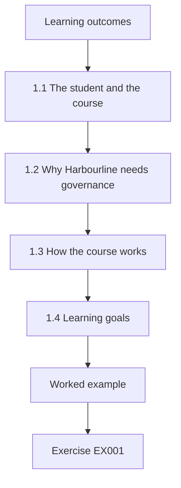

### Logical drawing

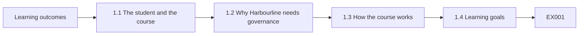

```text
[Learning outcomes]
    |
    v
[1.1 The student and the course]
    |
    v
[1.2 Why Harbourline needs governance]
    |
    v
[1.3 How the course works]
    |
    v
[1.4 Learning goals]
    |
    v
[Worked example] --> [Exercise EX001]
```
<!-- cyberabc:lesson-figures:end ch-01 -->


### Learning outcomes

You will (1) describe the course and its case; (2) explain why organisations govern data; (3) set personal learning goals.

### 1.1 The student and the course

Amara Okafor begins a four-year bachelor's degree in information management at the fictional Ridgeway University. Her tutor, Dr. Paul Lindqvist, explains that the course follows one organisation throughout: Harbourline Co-operative, a fictional grocery co-operative with forty stores and about a quarter of a million loyalty members. Each year adds depth, from basic data skills in year one to governance design, a placement and a dissertation in later years. All data used in exercises and labs are synthetic, created for teaching. Amara is excited.

### 1.2 Why Harbourline needs governance

Harbourline holds sales, stock, supplier, staff and loyalty data. Managers complain that reports disagree, that nobody knows which customer list is current and that a recent marketing email went to members who had asked not to be contacted. Dr. Lindqvist explains that these are governance problems: nobody has clear authority over data definitions, quality or permitted uses. Technology alone cannot fix them, because the underlying questions concern decisions, responsibilities and rules that people in the organisation must agree. Amara writes these complaints down.

### 1.3 How the course works

Each chapter introduces a topic, applies it to Harbourline and ends with exercises. Some chapters include short labs written in Python using only the standard library, run on synthetic data, with results quoted exactly in the text. Amara is told to keep a learning journal, noting questions and connections between topics. Dr. Lindqvist says that the journal will later help her choose a dissertation topic, because recurring questions often reveal what interests a student most deeply. She starts the journal that evening with three questions.

### 1.4 Learning goals

Amara writes three goals: understand why data go wrong in organisations, learn practical skills for checking data and be able to explain governance choices to managers who are not specialists. Dr. Lindqvist adds a fourth: learn to judge evidence, because governance decisions should rest on facts about data rather than impressions. They agree to review the goals each year. Writing goals early gives her a way to measure progress and adjust her choice of optional modules later. The goals are saved in her journal.

### Worked example

Amara starts the bachelor's course, learns about Harbourline's disagreeing reports and misdirected emails, understands the chapter and lab format and sets four learning goals with her tutor.

> **Synthetic case.** Ridgeway, Harbourline and all people are synthetic.

### Errors and limits

Treating governance as a software purchase ignores decisions and responsibilities.

### Exercises

- **EX001 — Course case.** Which organisation does the course follow? *Rubric:* 3 = Harbourline Co-operative;; 2 = partly correct;; 1 = other;; 0 = none.
- **EX002 — Email problem.** What went wrong with a marketing email? *Rubric:* 3 = it went to members who asked not to be contacted;; 2 = partly correct;; 1 = vague;; 0 = none.
- **EX003 — Fourth goal.** What goal did the tutor add? *Rubric:* 3 = learn to judge evidence;; 2 = partly correct;; 1 = vague;; 0 = none.

<!-- cyberabc:chapter-navigation:start ch-01 -->
### Continue studying — lesson 01 (chapter 01 of 40)

[← Course home](../../README.md) · [Course chapter index](../SUBJECTS.md) · [Chapter 02 →](#ch-02)

Continue to the next authored lesson.
<!-- cyberabc:chapter-navigation:end -->

<a id="ch-02"></a>

## Chapter 2 — What data are

<!-- cyberabc:lesson-figures:start ch-02 -->
### Lesson map

Lesson 02 published. Map, example, EX004.

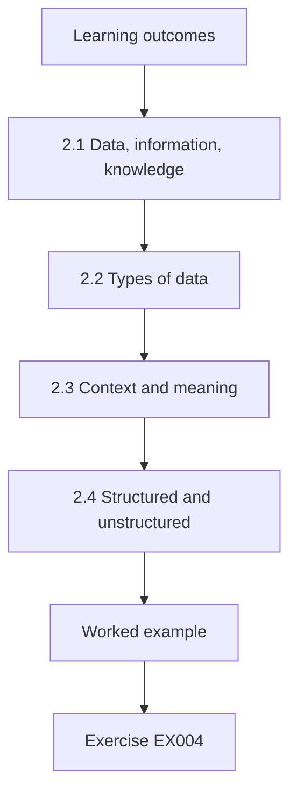

### Logical drawing

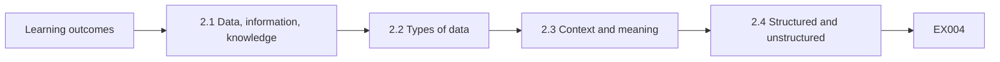

```text
[Learning outcomes]
    |
    v
[2.1 Data, information, knowledge]
    |
    v
[2.2 Types of data]
    |
    v
[2.3 Context and meaning]
    |
    v
[2.4 Structured and unstructured]
    |
    v
[Worked example] --> [Exercise EX004]
```
<!-- cyberabc:lesson-figures:end ch-02 -->


### Learning outcomes

You will (1) distinguish data, information and knowledge; (2) describe data types; (3) explain how context shapes meaning.

### 2.1 Data, information, knowledge

Dr. Lindqvist explains that data are recorded symbols, such as a number in a till record. Information is data given meaning in context, such as knowing that the number is the quantity of milk sold at store twelve on a Tuesday. Knowledge is understanding that lets people act, such as knowing that milk sales rise before holidays and ordering more stock. Amara notes that governance mostly works with data and information, but its purpose is to support good knowledge and decisions. Amara agrees.

### 2.2 Types of data

Amara learns common types: numbers for quantities and prices, text for names and descriptions, dates and times for transactions, codes for categories such as store or product, and true or false values for flags such as consent to marketing. Each type has rules: a price cannot be negative, a date must exist on the calendar and a code must appear in an agreed list. Knowing the type of each field helps people check whether a value makes sense at all. Types are documented.

### 2.3 Context and meaning

The same value can mean different things. At Harbourline, sales in the finance system include tax, while sales in the store system exclude it. Both are labelled sales. When managers compare reports, the numbers disagree by the tax amount, and each side assumes the other is wrong. Amara sees that missing context, not bad arithmetic, causes the disagreement. Recording definitions alongside data is therefore one of the simplest and most useful governance actions an organisation can take. Harbourline later adds definitions to reports.

### 2.4 Structured and unstructured

Till records and stock levels are structured data, stored in tables with defined fields. Customer emails, supplier contracts and store photographs are unstructured, holding information that is harder to search and check. Harbourline has far more unstructured data than it realised, much of it in shared folders without owners. Dr. Lindqvist explains that governance must cover both, though methods differ: structured data suit automatic rules, while unstructured data rely more on classification, access control and retention. Amara counts thousands of unowned files in one folder alone.

### Worked example

Amara distinguishes data, information and knowledge, learns data types and rules, finds that a tax difference explains disagreeing sales reports and notes unowned unstructured data in shared folders.

> **Synthetic case.** Examples are synthetic.

### Errors and limits

Assuming identical labels mean identical definitions causes disputes.

### Exercises

- **EX004 — Knowledge example.** Give the course's example of knowledge. *Rubric:* 3 = milk sales rise before holidays, so order more;; 2 = partly correct;; 1 = vague;; 0 = none.
- **EX005 — Sales disagreement.** Why did sales reports disagree? *Rubric:* 3 = finance includes tax, stores exclude it;; 2 = partly correct;; 1 = vague;; 0 = none.
- **EX006 — Unstructured example.** Name one unstructured data example at Harbourline. *Rubric:* 3 = customer emails, contracts or photographs;; 2 = partly correct;; 1 = vague;; 0 = none.

<!-- cyberabc:chapter-navigation:start ch-02 -->
### Continue studying — lesson 02 (chapter 02 of 40)

[← Chapter 01](#ch-01) · [Course chapter index](../SUBJECTS.md) · [Chapter 03 →](#ch-03)

Continue to the next authored lesson.
<!-- cyberabc:chapter-navigation:end -->

<a id="ch-03"></a>

## Chapter 3 — Data in organisations

<!-- cyberabc:lesson-figures:start ch-03 -->
### Lesson map

Lesson 03 published. Map, example, EX007.

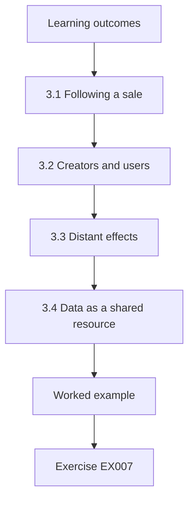

### Logical drawing

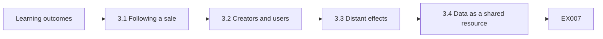

```text
[Learning outcomes]
    |
    v
[3.1 Following a sale]
    |
    v
[3.2 Creators and users]
    |
    v
[3.3 Distant effects]
    |
    v
[3.4 Data as a shared resource]
    |
    v
[Worked example] --> [Exercise EX007]
```
<!-- cyberabc:lesson-figures:end ch-03 -->


### Learning outcomes

You will (1) trace how data move through an organisation; (2) identify who creates and uses data; (3) explain why problems appear far from their causes.

### 3.1 Following a sale

Amara follows one sale through Harbourline. The till records items, prices and the loyalty card. The store system sends totals to finance each night. The loyalty system adds points. The stock system reduces inventory. Marketing later analyses purchases to send offers. One action at a till creates data used by five systems and several teams. She draws the path on a diagram and realises that an error at the till spreads into finance, stock and marketing. Store staff confirm her diagram is accurate in a short meeting.

### 3.2 Creators and users

Store staff create most data but rarely use reports. Head office teams use reports but rarely see how data are created. Amara interviews a store supervisor who says staff often key a generic product code when a barcode fails, to keep queues moving. Head office then sees odd sales of the generic product. Neither side knows the other's situation. She concludes that governance must connect creators and users so each understands the effect of their actions on the other. Amara arranges a joint visit.

### 3.3 Distant effects

A wrong price set in the product system shows up weeks later as a stock discrepancy at stores, then as a margin problem in finance. By the time finance notices, the cause is hard to trace. Amara compares data problems to pollution in a river: the effect appears downstream, far from the source. Governance needs ways to trace effects back to causes, which is why later chapters cover lineage, ownership and issue management in detail. Amara writes the river comparison in her journal for later use.

### 3.4 Data as a shared resource

Dr. Lindqvist explains that data at Harbourline are shared resources, used by many teams but owned clearly by few. Without rules, each team optimises for its own needs, as store staff do with generic codes. The result resembles overuse of a common pasture, where everyone suffers. Amara notes that governance creates the rules and roles that let a shared resource stay useful for everyone, balancing local convenience against wider needs across the whole co-operative. The comparison helps her explain governance to friends who study economics.

### Worked example

Amara traces one sale through five systems, finds that generic product codes keyed at tills distort head office reports and compares data problems to downstream pollution.

> **Synthetic case.** Systems and interviews are synthetic.

### Errors and limits

Blaming the team that notices a problem ignores its source.

### Exercises

- **EX007 — Systems touched.** How many systems use data from one sale? *Rubric:* 3 = five;; 2 = partly correct;; 1 = wrong;; 0 = none.
- **EX008 — Generic codes.** Why do staff key generic product codes? *Rubric:* 3 = to keep queues moving when barcodes fail;; 2 = partly correct;; 1 = vague;; 0 = none.
- **EX009 — Shared resource.** What do governance rules balance? *Rubric:* 3 = local convenience against wider needs;; 2 = partly correct;; 1 = vague;; 0 = none.

<!-- cyberabc:chapter-navigation:start ch-03 -->
### Continue studying — lesson 03 (chapter 03 of 40)

[← Chapter 02](#ch-02) · [Course chapter index](../SUBJECTS.md) · [Chapter 04 →](#ch-04)

Continue to the next authored lesson.
<!-- cyberabc:chapter-navigation:end -->

<a id="ch-04"></a>

## Chapter 4 — Spreadsheets and their risks

<!-- cyberabc:lesson-figures:start ch-04 -->
### Lesson map

Lesson 04 published. Map, example, EX010.

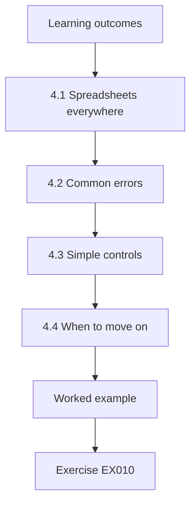

### Logical drawing

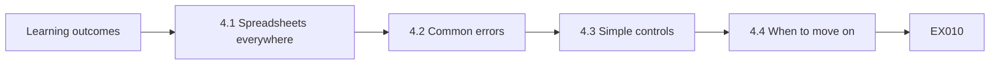

```text
[Learning outcomes]
    |
    v
[4.1 Spreadsheets everywhere]
    |
    v
[4.2 Common errors]
    |
    v
[4.3 Simple controls]
    |
    v
[4.4 When to move on]
    |
    v
[Worked example] --> [Exercise EX010]
```
<!-- cyberabc:lesson-figures:end ch-04 -->


### Learning outcomes

You will (1) recognise common spreadsheet errors; (2) apply simple controls to spreadsheets; (3) decide when data should move out of spreadsheets.

### 4.1 Spreadsheets everywhere

Harbourline runs many processes in spreadsheets: store rotas, promotion plans, supplier price lists and the weekly sales summary for the board. Spreadsheets are flexible and familiar, which explains their popularity. Amara examines the weekly summary and finds it built by copying figures from three reports, with formulas linking twelve tabs. One person maintains it. She notes that flexibility also makes errors easy, and that critical processes depending on one person's spreadsheet create risks the organisation may not see. The maintainer is often on leave.

### 4.2 Common errors

Amara reviews research on spreadsheet errors and checks the summary for typical problems. She finds a formula range that stops one row short, so the newest store is excluded from totals. She finds numbers stored as text that are ignored by sums, and a hard-coded figure typed over a formula. None was visible from the final totals. She explains that spreadsheet errors are common partly because results look tidy, which discourages checking. The newest store's sales had been missing from board totals for three weeks before her review.

### 4.3 Simple controls

Amara proposes controls: a check cell comparing the summary total with the source report total, protected formula cells, a version history in a shared drive and a short description tab explaining sources and steps. She also suggests a second person reviews the summary monthly. These controls cost little and catch the errors she found. Dr. Lindqvist notes that proportionate controls suit spreadsheets better than banning them, which rarely works in practice. The maintainer agrees to all four controls, and the second reviewer is named in the description tab.

### 4.4 When to move on

Some processes outgrow spreadsheets. Amara suggests criteria: many users editing at once, data feeding other systems, regulatory reporting or volumes too large to review manually. The board summary meets two criteria, so she recommends building it in the reporting tool with direct links to source data, removing copying steps. The promotion plan stays in a spreadsheet with controls. She learns that governance decisions about tools should follow risk and use, not fashion. The board receives its first summary from the reporting tool two months later, with no copying steps.

### Worked example

Amara finds an incomplete formula range, text numbers and an overwritten formula in the board summary, proposes check totals, protection and review and recommends moving the summary to the reporting tool.

> **Synthetic case.** Spreadsheets are synthetic.

### Errors and limits

Tidy totals do not prove correct formulas; reconcile with sources.

### Exercises

- **EX010 — Missing store.** Why was the newest store excluded? *Rubric:* 3 = a formula range stopped one row short;; 2 = partly correct;; 1 = vague;; 0 = none.
- **EX011 — Check cell.** What does the check cell compare? *Rubric:* 3 = summary total with source report total;; 2 = partly correct;; 1 = vague;; 0 = none.
- **EX012 — Moved process.** Which process moves out of spreadsheets? *Rubric:* 3 = the board sales summary;; 2 = partly correct;; 1 = other;; 0 = none.

<!-- cyberabc:chapter-navigation:start ch-04 -->
### Continue studying — lesson 04 (chapter 04 of 40)

[← Chapter 03](#ch-03) · [Course chapter index](../SUBJECTS.md) · [Chapter 05 →](#ch-05)

Continue to the next authored lesson.
<!-- cyberabc:chapter-navigation:end -->

<a id="ch-05"></a>

## Chapter 5 — Databases and tables

<!-- cyberabc:lesson-figures:start ch-05 -->
### Lesson map

Lesson 05 published. Map, example, EX013.

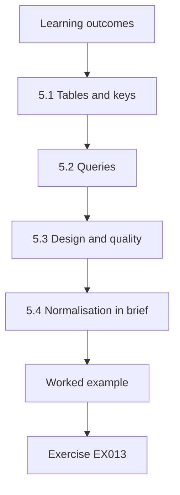

### Logical drawing

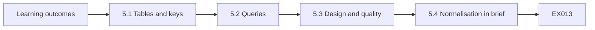

```text
[Learning outcomes]
    |
    v
[5.1 Tables and keys]
    |
    v
[5.2 Queries]
    |
    v
[5.3 Design and quality]
    |
    v
[5.4 Normalisation in brief]
    |
    v
[Worked example] --> [Exercise EX013]
```
<!-- cyberabc:lesson-figures:end ch-05 -->


### Learning outcomes

You will (1) describe tables, keys and relationships; (2) write simple queries; (3) explain how database design supports data quality.

### 5.1 Tables and keys

Amara learns that a relational database stores data in tables of rows and columns. The member table has one row per loyalty member, identified by a member number that serves as the primary key. The purchase table records each purchase with the member number as a foreign key linking it to the member. Keys prevent duplicate members and ensure purchases refer to members who exist. She sees that design choices like keys enforce rules automatically. The database rejects a purchase with an unknown member number.

### 5.2 Queries

Using a small synthetic database built with Python's sqlite3 module, Amara writes queries to count members by store, total purchases by month and find members without purchases in a year. She learns that a query is a precise question, and that wording matters: counting purchases and counting distinct members who purchased give different answers. She records each query with a plain description so that others can check what was asked and reuse it later. Her descriptions are stored in a shared file with the query text beside them.

### 5.3 Design and quality

Amara finds that Harbourline's old loyalty database stored the member's store as free text, producing variations such as Store 12, store twelve and S12. Reports grouped by store split one store into several. A better design stores a store code linked to a store reference table. She explains that good design prevents many quality problems at entry, which is cheaper than cleaning them later, and connects this to rules covered in later chapters. The new loyalty system uses store codes, and the old text values are mapped once.

### 5.4 Normalisation in brief

Dr. Lindqvist introduces normalisation: organising tables so each fact is stored once. In the old database, a member's address appears in every purchase row, so changing an address leaves older rows inconsistent. Moving the address to the member table fixes this. Amara notes that normalisation reduces inconsistency but can make queries more complex, and that reporting databases sometimes deliberately repeat data for speed. The right balance depends on how data are used. Harbourline's reporting database repeats store names in sales tables for this reason, by design.

### Worked example

Amara learns keys and relationships, writes sqlite3 queries with plain descriptions, finds free-text store names splitting reports and sees normalisation remove repeated addresses.

> **Synthetic case.** The database is synthetic.

### Errors and limits

Counting rows when the question asks for distinct people gives wrong answers.

### Exercises

- **EX013 — Foreign key role.** What does the member number in purchases link to? *Rubric:* 3 = the member table;; 2 = partly correct;; 1 = vague;; 0 = none.
- **EX014 — Free-text problem.** What did free-text store names cause? *Rubric:* 3 = one store split into several in reports;; 2 = partly correct;; 1 = vague;; 0 = none.
- **EX015 — Normalisation trade-off.** What can normalisation make harder? *Rubric:* 3 = queries;; 2 = partly correct;; 1 = vague;; 0 = none.

<!-- cyberabc:chapter-navigation:start ch-05 -->
### Continue studying — lesson 05 (chapter 05 of 40)

[← Chapter 04](#ch-04) · [Course chapter index](../SUBJECTS.md) · [Chapter 06 →](#ch-06)

Continue to the next authored lesson.
<!-- cyberabc:chapter-navigation:end -->

<a id="ch-06"></a>

## Chapter 6 — Python for data checks

<!-- cyberabc:lesson-figures:start ch-06 -->
### Lesson map

Lesson 06 published. Map, example, EX016.

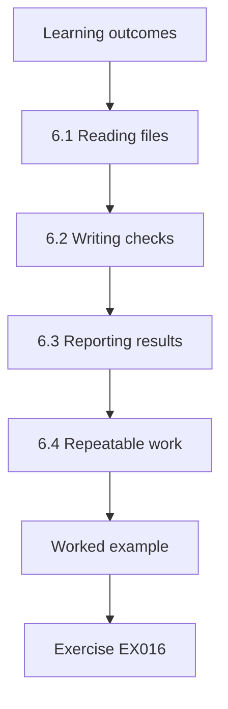

### Logical drawing

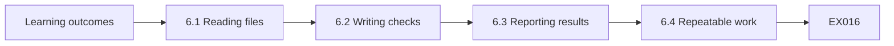

```text
[Learning outcomes]
    |
    v
[6.1 Reading files]
    |
    v
[6.2 Writing checks]
    |
    v
[6.3 Reporting results]
    |
    v
[6.4 Repeatable work]
    |
    v
[Worked example] --> [Exercise EX016]
```
<!-- cyberabc:lesson-figures:end ch-06 -->


### Learning outcomes

You will (1) read data files with Python; (2) write simple checks; (3) report results clearly.

### 6.1 Reading files

Amara learns to read comma-separated files using Python's csv module. She opens a synthetic extract of loyalty sign-ups, reads each row as a dictionary keyed by column names and counts rows. She learns to specify the file encoding, because names with accents appeared garbled when she did not. She notes that reading data correctly is the first check: if the file is misread, every later result will be wrong, however careful the analysis appears. She adds the encoding to every script she writes afterwards.

### 6.2 Writing checks

She writes functions that test one rule each: postcode present, email containing an at sign, birth year between 1910 and 2010. Each function returns true or false for a row. A loop applies all functions and counts failures per rule. She keeps checks small and named clearly, so that a reader can see exactly what each one tests. Dr. Lindqvist explains that simple, readable checks are easier to trust and maintain than clever ones. Each function has a one-line comment describing the rule it implements and its source.

### 6.3 Reporting results

Amara's first report lists failures as raw counts. Her tutor asks what the counts mean without totals, so she adds percentages and the number of rows checked. She also lists a few example failing rows with personal details removed, so readers can see what problems look like. She learns that a good report answers what was checked, how much failed, why it matters and what should happen next, in that order. She uses this order in every later report, and her tutor marks the improvement.

### 6.4 Repeatable work

Amara saves her script with comments and the date of the extract used. When the tutor asks her to rerun it on a newer extract, it takes seconds. A classmate who checked data manually in a spreadsheet must repeat hours of work. She sees that scripts make checks repeatable and their logic visible, which matters for governance because checks should be run regularly and reviewed by others rather than performed once and forgotten. Her script is later shared with the Harbourline data team, who adopt it.

### Worked example

Amara reads a sign-up extract with the right encoding, writes small named checks, reports counts with percentages and examples and reruns her script on a new extract in seconds.

> **Synthetic case.** Extracts are synthetic.

### Errors and limits

Reporting counts without totals hides the scale of problems.

### Exercises

- **EX016 — Encoding issue.** What happened without specifying encoding? *Rubric:* 3 = accented names were garbled;; 2 = partly correct;; 1 = vague;; 0 = none.
- **EX017 — Birth year rule.** What range did the birth year check use? *Rubric:* 3 = 1910 to 2010;; 2 = partly correct;; 1 = wrong;; 0 = none.
- **EX018 — Report order.** What order should a report follow? *Rubric:* 3 = what was checked, how much failed, why it matters, what next;; 2 = partly correct;; 1 = partial;; 0 = none.

<!-- cyberabc:chapter-navigation:start ch-06 -->
### Continue studying — lesson 06 (chapter 06 of 40)

[← Chapter 05](#ch-05) · [Course chapter index](../SUBJECTS.md) · [Chapter 07 →](#ch-07)

Continue to the next authored lesson.
<!-- cyberabc:chapter-navigation:end -->

<a id="ch-07"></a>

## Chapter 7 — Statistics for data work

<!-- cyberabc:lesson-figures:start ch-07 -->
### Lesson map

Lesson 07 published. Map, example, EX019.

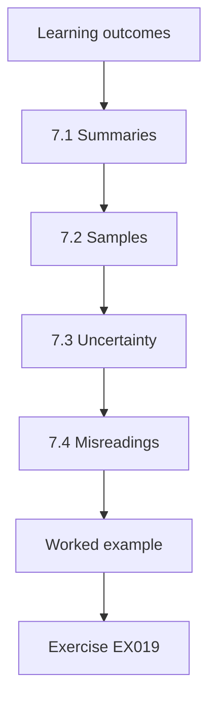

### Logical drawing

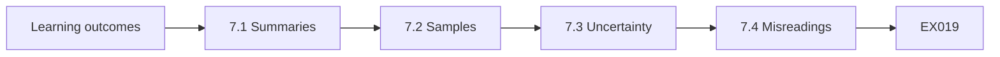

```text
[Learning outcomes]
    |
    v
[7.1 Summaries]
    |
    v
[7.2 Samples]
    |
    v
[7.3 Uncertainty]
    |
    v
[7.4 Misreadings]
    |
    v
[Worked example] --> [Exercise EX019]
```
<!-- cyberabc:lesson-figures:end ch-07 -->


### Learning outcomes

You will (1) summarise data with simple statistics; (2) use samples to estimate quality; (3) avoid common misreadings.

### 7.1 Summaries

Amara summarises synthetic basket values using Python's statistics module: mean, median and standard deviation. The mean basket is higher than the median because a few large orders pull it up. She explains that the median better describes a typical basket, while the mean matters for total revenue. Choosing the right summary depends on the question. She notes that reports at Harbourline used only means, which made typical customers appear to spend more than they actually do. Amara adds medians to the reports she prepares.

### 7.2 Samples

Checking every record by hand is impossible. Amara learns to draw a random sample of records, check each carefully and estimate the error rate for the whole set. Using Python's random module with a fixed seed, she samples two hundred member addresses and finds a number with errors. She explains that a random sample gives a fair estimate, while picking records that look suspicious overstates problems because those records are not typical of the whole set. She records the seed so the sample can be drawn again.

### 7.3 Uncertainty

A sample estimate has uncertainty. Amara learns that larger samples give narrower ranges, and that reporting a range is more honest than a single figure. She explains to a classmate that an error rate of four percent from two hundred records could plausibly be a little lower or higher in the full set. Dr. Lindqvist encourages her to always state sample size with any estimate so readers can judge its reliability for themselves. Amara adds sample sizes to every estimate in her journal.

### 7.4 Misreadings

Amara collects common misreadings: confusing percentages with percentage points, comparing groups of very different sizes, treating correlation as cause and ignoring missing data. At Harbourline, a report claimed that loyalty members spend more because of the scheme, but members may simply be regular shoppers who joined. She notes that governance includes making sure reports are interpreted correctly, not only that their numbers are computed correctly from accurate data. Amara writes a short note on each misreading for the data team, with examples taken from Harbourline's own reports.

### Worked example

Amara compares mean and median baskets, estimates address errors from a random sample, reports ranges with sample size and lists misreadings such as treating loyalty correlation as cause.

> **Synthetic case.** Data are synthetic.

### Errors and limits

Hand-picked samples overstate problems; sample randomly.

### Exercises

- **EX019 — Typical basket.** Which summary better describes a typical basket? *Rubric:* 3 = the median;; 2 = partly correct;; 1 = mean;; 0 = none.
- **EX020 — Sample bias.** Why not pick suspicious-looking records? *Rubric:* 3 = they are not typical and overstate problems;; 2 = partly correct;; 1 = vague;; 0 = none.
- **EX021 — Loyalty claim.** Why might the loyalty spending claim be wrong? *Rubric:* 3 = regular shoppers may be more likely to join;; 2 = partly correct;; 1 = vague;; 0 = none.

<!-- cyberabc:chapter-navigation:start ch-07 -->
### Continue studying — lesson 07 (chapter 07 of 40)

[← Chapter 06](#ch-06) · [Course chapter index](../SUBJECTS.md) · [Chapter 08 →](#ch-08)

Continue to the next authored lesson.
<!-- cyberabc:chapter-navigation:end -->

<a id="ch-08"></a>

## Chapter 8 — Writing about data

<!-- cyberabc:lesson-figures:start ch-08 -->
### Lesson map

Lesson 08 published. Map, example, EX022.

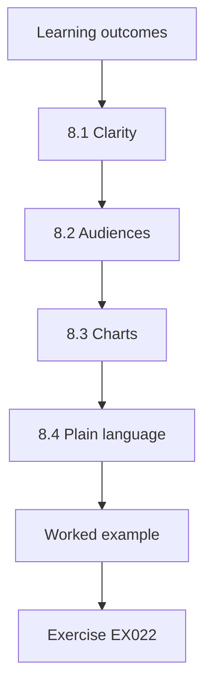

### Logical drawing

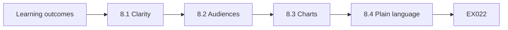

```text
[Learning outcomes]
    |
    v
[8.1 Clarity]
    |
    v
[8.2 Audiences]
    |
    v
[8.3 Charts]
    |
    v
[8.4 Plain language]
    |
    v
[Worked example] --> [Exercise EX022]
```
<!-- cyberabc:lesson-figures:end ch-08 -->


### Learning outcomes

You will (1) write clear reports on data issues; (2) adapt writing to audiences; (3) use charts honestly.

### 8.1 Clarity

Amara's first report on loyalty data quality runs to ten pages of tables. Dr. Lindqvist asks her to state the main finding in one sentence. She writes: about one in five loyalty records lacks an email address, which limits digital offers. The rest of the report then supports this sentence. She learns that clear writing starts with knowing the main point, and that tables belong in appendices unless readers need them to follow the argument. Her tutor marks the revised report much higher.

### 8.2 Audiences

She writes two versions. For the marketing manager, she explains the effect on campaigns and suggests collecting emails at the till. For the data team, she details the rules used, counts per store and the script location. Each audience gets what it needs to act. She notes that one report for everyone usually serves nobody well, because managers skip technical detail and technical staff need more precision than summaries provide. Both readers confirm that their version gave them what they needed to act.

### 8.3 Charts

Amara draws a bar chart of missing emails by store. Her first version starts the vertical axis at fifteen percent, exaggerating differences between stores. A classmate points out that store managers might feel unfairly blamed. She redraws it starting at zero and adds the number of members per store. She learns that charts can mislead even when numbers are correct, and that honest presentation is part of responsible data work. Store managers later thank her for the fairer chart and the added context.

### 8.4 Plain language

Amara replaces jargon such as completeness ratio with plain phrases such as share of records with an email address. She keeps technical terms where precision matters and defines them once. Her marketing manager reader says the revised report is the first data report he has read to the end. Dr. Lindqvist notes that governance depends on non-specialists understanding data issues, so plain writing is a core skill for anyone working in the field. She keeps a list of plain substitutes for common terms.

### Worked example

Amara reduces a ten-page report to one main finding, writes versions for marketing and data teams, redraws a misleading chart from zero and replaces jargon with plain phrases.

> **Synthetic case.** Reports are synthetic.

### Errors and limits

Truncated axes exaggerate differences; start bars at zero.

### Exercises

- **EX022 — Main finding.** What was Amara's one-sentence finding? *Rubric:* 3 = about one in five records lacks an email;; 2 = partly correct;; 1 = vague;; 0 = none.
- **EX023 — Chart fix.** How did Amara fix the chart? *Rubric:* 3 = started the axis at zero and added member counts;; 2 = partly correct;; 1 = partial;; 0 = none.
- **EX024 — Jargon replacement.** What replaced completeness ratio? *Rubric:* 3 = share of records with an email address;; 2 = partly correct;; 1 = vague;; 0 = none.

<!-- cyberabc:chapter-navigation:start ch-08 -->
### Continue studying — lesson 08 (chapter 08 of 40)

[← Chapter 07](#ch-07) · [Course chapter index](../SUBJECTS.md) · [Chapter 09 →](#ch-09)

Continue to the next authored lesson.
<!-- cyberabc:chapter-navigation:end -->

<a id="ch-09"></a>

## Chapter 9 — Law and data

<!-- cyberabc:lesson-figures:start ch-09 -->
### Lesson map

Lesson 09 published. Map, example, EX025.

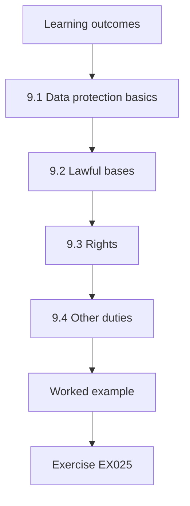

### Logical drawing

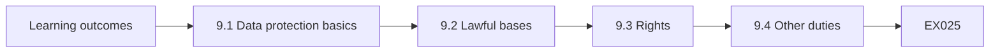

```text
[Learning outcomes]
    |
    v
[9.1 Data protection basics]
    |
    v
[9.2 Lawful bases]
    |
    v
[9.3 Rights]
    |
    v
[9.4 Other duties]
    |
    v
[Worked example] --> [Exercise EX025]
```
<!-- cyberabc:lesson-figures:end ch-09 -->


### Learning outcomes

You will (1) outline data protection law relevant to Harbourline; (2) identify lawful bases and rights; (3) recognise other legal duties for data.

### 9.1 Data protection basics

Amara studies the GDPR as an example of data protection law. It applies to personal data, meaning information about identifiable people, such as loyalty members and staff. Organisations must process personal data lawfully, fairly and transparently, for specified purposes, using only what is needed, keeping it accurate, storing it no longer than necessary and keeping it secure. She notes that several of these principles, such as accuracy and storage limitation, are also data governance concerns. Amara lists each principle with a Harbourline example.

### 9.2 Lawful bases

Each use of personal data needs a lawful basis. Harbourline processes purchases to run the loyalty scheme under its contract with members, while marketing emails need consent. Amara finds that the old sign-up form bundled marketing consent with joining the scheme, which the GDPR treats as not freely given. She recommends a separate consent box. She explains that governance must record the basis for each use so that teams know what is permitted. The new form is introduced at the next scheme relaunch.

### 9.3 Rights

Members have rights, including to access their data, correct errors, object to marketing and in some cases have data erased. Amara reviews how Harbourline handles requests and finds that requests arrive at stores, head office and by email, with no central log. Some went unanswered. She recommends a single intake and log with deadlines. She notes that fulfilling rights depends on knowing where personal data are stored, which needs good metadata and inventories. The data protection officer agrees and sets up the log that month.

### 9.4 Other duties

Beyond data protection, Harbourline must keep financial records for set periods for tax purposes, respond to food safety recalls using supplier and batch data and follow employment law for staff records. Amara lists these duties with the data each requires. She sees that some duties require keeping data while others require deleting it, so governance must reconcile them in a retention schedule rather than leaving each team to decide alone. Amara's list becomes the starting point for the retention schedule studied in later chapters.

### Worked example

Amara outlines GDPR principles, finds bundled marketing consent and recommends a separate box, centralises rights requests and lists tax, recall and employment duties affecting data.

> **Synthetic case.** Harbourline is synthetic; the GDPR is real. This is not legal advice.

### Errors and limits

Bundled consent is not freely given; separate it.

### Exercises

- **EX025 — Marketing basis.** What lawful basis do marketing emails need here? *Rubric:* 3 = consent;; 2 = partly correct;; 1 = other;; 0 = none.
- **EX026 — Rights problem.** What problem did Amara find with rights requests? *Rubric:* 3 = no central log, some unanswered;; 2 = partly correct;; 1 = vague;; 0 = none.
- **EX027 — Recall data.** Which data support food safety recalls? *Rubric:* 3 = supplier and batch data;; 2 = partly correct;; 1 = vague;; 0 = none.

<!-- cyberabc:chapter-navigation:start ch-09 -->
### Continue studying — lesson 09 (chapter 09 of 40)

[← Chapter 08](#ch-08) · [Course chapter index](../SUBJECTS.md) · [Chapter 10 →](#ch-10)

Continue to the next authored lesson.
<!-- cyberabc:chapter-navigation:end -->

<a id="ch-10"></a>

## Chapter 10 — Ethics and data

<!-- cyberabc:lesson-figures:start ch-10 -->
### Lesson map

Lesson 10 published. Map, example, EX028.

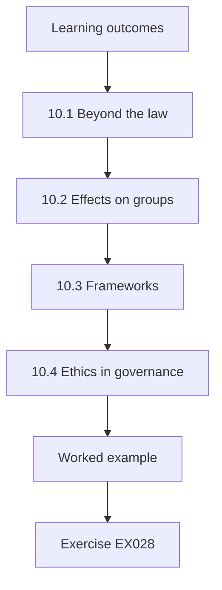

### Logical drawing

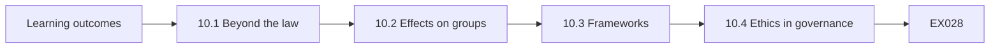

```text
[Learning outcomes]
    |
    v
[10.1 Beyond the law]
    |
    v
[10.2 Effects on groups]
    |
    v
[10.3 Frameworks]
    |
    v
[10.4 Ethics in governance]
    |
    v
[Worked example] --> [Exercise EX028]
```
<!-- cyberabc:lesson-figures:end ch-10 -->


### Learning outcomes

You will (1) apply ethical reasoning to data uses; (2) consider effects on different groups; (3) explain the role of ethics alongside law.

### 10.1 Beyond the law

Some data uses are legal but questionable. Harbourline's marketing team proposes using purchase patterns to infer which members are pregnant and send baby product offers. Amara considers whether members would expect this, whether it could cause harm if offers reached a household before the person chose to share news and whether the benefit justifies the risk. She concludes that legality is a minimum, and that governance should also ask whether a use is fair and expected. Marketing pauses the proposal for review.

### 10.2 Effects on groups

Amara examines a proposal to offer discounts only to members using the mobile app. Older members and those without smartphones would lose out. She checks synthetic member data and finds app users are mostly younger. She suggests offering the same discounts through printed vouchers at tills. She learns that data-driven decisions can disadvantage groups without anyone intending it, and that checking effects across groups should be routine before launching such schemes. Marketing adopts the voucher option for the next campaign. Older members welcome it.

### 10.3 Frameworks

Dr. Lindqvist introduces simple frameworks: consider the consequences for all affected, respect people's autonomy and expectations, treat groups fairly and be transparent about practices. Amara applies them to the pregnancy inference proposal and writes a short assessment recommending against it. Marketing accepts a revised plan offering baby product discounts to members who choose a family interest in their profile. She notes that frameworks help structure discussion rather than producing automatic answers. Her assessment is kept as an example for future reviews. Marketing agrees.

### 10.4 Ethics in governance

Amara proposes that Harbourline's data governance group review new data uses that raise ethical questions, using a short checklist. The group would include staff from marketing, stores and data protection. She notes that ethical review works best early, before campaigns are designed, and that it should be quick for low-risk uses. Dr. Lindqvist adds that organisations trusted with data must earn that trust continuously through their choices. The governance group pilots the checklist for three months and finds that most reviews take less than an hour.

### Worked example

Amara assesses a pregnancy inference proposal and recommends against it, finds app-only discounts disadvantage older members, applies simple frameworks and proposes an ethics checklist for new uses.

> **Synthetic case.** Proposals are synthetic.

### Errors and limits

Legal does not mean acceptable; ask whether uses are fair and expected.

### Exercises

- **EX028 — Pregnancy alternative.** What replaced the pregnancy inference plan? *Rubric:* 3 = discounts for members choosing a family interest;; 2 = partly correct;; 1 = vague;; 0 = none.
- **EX029 — App discount fix.** How did Amara address the app-only discount? *Rubric:* 3 = printed vouchers at tills;; 2 = partly correct;; 1 = vague;; 0 = none.
- **EX030 — Review timing.** When does ethical review work best? *Rubric:* 3 = early, before campaigns are designed;; 2 = partly correct;; 1 = late;; 0 = none.

<!-- cyberabc:chapter-navigation:start ch-10 -->
### Continue studying — lesson 10 (chapter 10 of 40)

[← Chapter 09](#ch-09) · [Course chapter index](../SUBJECTS.md) · [Chapter 11 →](#ch-11)

Continue to the next authored lesson.
<!-- cyberabc:chapter-navigation:end -->

<a id="ch-11"></a>

## Chapter 11 — Governance foundations

<!-- cyberabc:lesson-figures:start ch-11 -->
### Lesson map

Lesson 11 published. Map, example, EX031.

```mermaid
flowchart TD
  N0["Learning outcomes"]
  N1["11.1 A definition"]
  N2["11.2 Governance and management"]
  N3["11.3 Frameworks"]
  N4["11.4 Harbourline's starting point"]
  N0 --> N1 --> N2 --> N3 --> N4
  N4 --> EX["Worked example"]
  EX --> Q["Exercise EX031"]
```

### Logical drawing

```mermaid
flowchart LR
  N0["Learning outcomes"]
  N1["11.1 A definition"]
  N2["11.2 Governance and management"]
  N3["11.3 Frameworks"]
  N4["11.4 Harbourline's starting point"]
  N0 --> N1 --> N2 --> N3 --> N4 --> Q["EX031"]
```

```text
[Learning outcomes]
    |
    v
[11.1 A definition]
    |
    v
[11.2 Governance and management]
    |
    v
[11.3 Frameworks]
    |
    v
[11.4 Harbourline's starting point]
    |
    v
[Worked example] --> [Exercise EX031]
```
<!-- cyberabc:lesson-figures:end ch-11 -->


### Learning outcomes

You will (1) define data governance; (2) compare governance with data management; (3) describe frameworks used in practice.

### 11.1 A definition

In year two Amara studies governance directly. DAMA-DMBOK2 describes data governance as the exercise of authority, control and shared decision-making over the management of data assets. Dr. Lindqvist simplifies this for Harbourline: deciding who decides what about data, and making sure those decisions are followed. Amara notes that the definition centres on decisions and accountability rather than technology, which explains why earlier chapters found that problems persisted even after Harbourline bought new systems. Amara writes the simpler definition at the front of her notes.

### 11.2 Governance and management

Amara learns to separate governance from management. Management does the work: running databases, cleaning records, building reports. Governance sets direction and checks that the work meets agreed standards. At Harbourline, the data team manages the loyalty database, while a governance group should decide definitions, quality targets and permitted uses. Mixing the two leaves the people doing the work also deciding the rules, with nobody independent checking whether those rules serve the whole co-operative fairly. Amara draws the separation as two columns in her notes.

### 11.3 Frameworks

Amara compares frameworks. DAMA-DMBOK2 organises data management into knowledge areas, with governance at the centre. ISO/IEC 38505-1 applies the governance of IT standard to data, asking governing bodies to evaluate, direct and monitor data use. Khatri and Brown describe five decision domains: principles, quality, metadata, access and life cycle. She explains that frameworks provide vocabulary and checklists, but each organisation must adapt them to its size and needs rather than copying them in full. Amara chooses Khatri and Brown's domains for her assessment.

### 11.4 Harbourline's starting point

Amara assesses Harbourline against Khatri and Brown's domains. Principles are unwritten. Quality is handled reactively when complaints arrive. Metadata exists only in a few spreadsheets. Access is granted by IT on request without owner approval. Life cycle decisions such as retention are left to individual teams. She summarises the position in a one-page table that the co-operative's operations director later uses to argue for setting up a governance group with a clear mandate. Amara's table becomes the first document the new group reviews.

### Worked example

Amara defines governance as deciding who decides about data, separates it from management, compares DAMA-DMBOK2, ISO/IEC 38505-1 and Khatri and Brown and assesses Harbourline against five domains.

> **Synthetic case.** Harbourline is synthetic; the frameworks are real.

### Errors and limits

Copying a full framework into a small organisation creates unused bureaucracy.

### Exercises

- **EX031 — Tutor definition.** How does the tutor simplify governance? *Rubric:* 3 = deciding who decides what about data and ensuring decisions are followed;; 2 = partly correct;; 1 = partial;; 0 = none.
- **EX032 — Five domains.** Name Khatri and Brown's five domains. *Rubric:* 3 = principles, quality, metadata, access, life cycle;; 2 = all;; 1 = some;; 0 = none.
- **EX033 — Access practice.** How was access granted at Harbourline? *Rubric:* 3 = by IT on request without owner approval;; 2 = partly correct;; 1 = vague;; 0 = none.

<!-- cyberabc:chapter-navigation:start ch-11 -->
### Continue studying — lesson 11 (chapter 11 of 40)

[← Chapter 10](#ch-10) · [Course chapter index](../SUBJECTS.md) · [Chapter 12 →](#ch-12)

Continue to the next authored lesson.
<!-- cyberabc:chapter-navigation:end -->

<a id="ch-12"></a>

## Chapter 12 — Roles and accountability

<!-- cyberabc:lesson-figures:start ch-12 -->
### Lesson map

Lesson 12 published. Map, example, EX034.

```mermaid
flowchart TD
  N0["Learning outcomes"]
  N1["12.1 Common roles"]
  N2["12.2 Assigning roles"]
  N3["12.3 Accountability"]
  N4["12.4 Making roles real"]
  N0 --> N1 --> N2 --> N3 --> N4
  N4 --> EX["Worked example"]
  EX --> Q["Exercise EX034"]
```

### Logical drawing

```mermaid
flowchart LR
  N0["Learning outcomes"]
  N1["12.1 Common roles"]
  N2["12.2 Assigning roles"]
  N3["12.3 Accountability"]
  N4["12.4 Making roles real"]
  N0 --> N1 --> N2 --> N3 --> N4 --> Q["EX034"]
```

```text
[Learning outcomes]
    |
    v
[12.1 Common roles]
    |
    v
[12.2 Assigning roles]
    |
    v
[12.3 Accountability]
    |
    v
[12.4 Making roles real]
    |
    v
[Worked example] --> [Exercise EX034]
```
<!-- cyberabc:lesson-figures:end ch-12 -->


### Learning outcomes

You will (1) describe common governance roles; (2) assign roles at Harbourline; (3) explain accountability in practice.

### 12.1 Common roles

Amara studies common roles. A governance council or group sets priorities and resolves disputes. Data owners are senior staff accountable for particular data domains, such as loyalty or products. Data stewards look after definitions, quality rules and issues day to day. Data custodians, often in IT, operate systems and apply controls. Users follow rules and report problems. She notes that names differ between organisations, but the separation of deciding, maintaining and operating appears in most models. Amara draws the roles as a simple chart.

### 12.2 Assigning roles

Amara drafts role assignments for Harbourline. The marketing director owns loyalty data, the commercial director owns product data and the finance director owns sales figures. A steward in each team maintains definitions and handles issues. IT custodians run the systems. The operations director chairs the governance group. Each assignment includes a short statement of decisions the role may take. She discusses the draft with each person and adjusts it where responsibilities overlap or were missing from her first version. All owners sign.

### 12.3 Accountability

Accountability means being answerable for outcomes, including explaining failures and fixing them. Amara asks the marketing director what he would do if loyalty data were found inaccurate. He says he would ask IT to fix it. She explains that as owner he should approve the quality rules, ensure his team follows them and decide priorities for fixes. Accountability cannot be delegated to IT, though tasks can. He agrees after seeing examples from other organisations. He signs his ownership statement later that week.

### 12.4 Making roles real

Roles on paper often fail. Amara recommends adding governance duties to job descriptions, allocating steward time in work plans and reporting on role performance at governance group meetings. She also suggests a short induction for new owners and stewards. Dr. Lindqvist notes that the most common failure is naming stewards without giving them time, so they treat governance as an extra task that disappears when other work becomes busy. The operations director adds steward time to next year's work plans for each team, with hours agreed.

### Worked example

Amara describes council, owner, steward, custodian and user roles, assigns them at Harbourline, clarifies that the marketing director remains accountable for loyalty data and recommends job descriptions and steward time.

> **Synthetic case.** Roles are synthetic.

### Errors and limits

Naming stewards without allocating time makes the role disappear.

### Exercises

- **EX034 — Loyalty owner.** Who owns loyalty data? *Rubric:* 3 = the marketing director;; 2 = partly correct;; 1 = other;; 0 = none.
- **EX035 — Delegation limit.** What cannot be delegated to IT? *Rubric:* 3 = accountability;; 2 = partly correct;; 1 = tasks;; 0 = none.
- **EX036 — Common failure.** What is the most common role failure? *Rubric:* 3 = naming stewards without giving them time;; 2 = partly correct;; 1 = vague;; 0 = none.

<!-- cyberabc:chapter-navigation:start ch-12 -->
### Continue studying — lesson 12 (chapter 12 of 40)

[← Chapter 11](#ch-11) · [Course chapter index](../SUBJECTS.md) · [Chapter 13 →](#ch-13)

Continue to the next authored lesson.
<!-- cyberabc:chapter-navigation:end -->

<a id="ch-13"></a>

## Chapter 13 — Policies and standards

<!-- cyberabc:lesson-figures:start ch-13 -->
### Lesson map

Lesson 13 published. Map, example, EX037.

```mermaid
flowchart TD
  N0["Learning outcomes"]
  N1["13.1 Three levels"]
  N2["13.2 Drafting a policy"]
  N3["13.3 Standards in detail"]
  N4["13.4 Keeping documents usable"]
  N0 --> N1 --> N2 --> N3 --> N4
  N4 --> EX["Worked example"]
  EX --> Q["Exercise EX037"]
```

### Logical drawing

```mermaid
flowchart LR
  N0["Learning outcomes"]
  N1["13.1 Three levels"]
  N2["13.2 Drafting a policy"]
  N3["13.3 Standards in detail"]
  N4["13.4 Keeping documents usable"]
  N0 --> N1 --> N2 --> N3 --> N4 --> Q["EX037"]
```

```text
[Learning outcomes]
    |
    v
[13.1 Three levels]
    |
    v
[13.2 Drafting a policy]
    |
    v
[13.3 Standards in detail]
    |
    v
[13.4 Keeping documents usable]
    |
    v
[Worked example] --> [Exercise EX037]
```
<!-- cyberabc:lesson-figures:end ch-13 -->


### Learning outcomes

You will (1) distinguish policies, standards and procedures; (2) draft a data policy; (3) keep policy documents usable.

### 13.1 Three levels

Amara learns that a policy states principles and responsibilities, such as data must have a named owner. A standard sets specific requirements, such as every loyalty record must have a valid store code from the reference list. A procedure describes steps, such as how to request a new store code. Keeping these levels separate lets policies stay stable while standards and procedures change more often. She finds Harbourline's existing documents mix all three in long, rarely read texts. Amara proposes splitting them.

### 13.2 Drafting a policy

Amara drafts a two-page data policy for Harbourline: purpose, scope, principles, roles, compliance and review. Principles include data have named owners, quality is measured and reported, personal data are used only for stated purposes and retention follows the schedule. She asks owners to comment and incorporates their suggestions. The governance group approves the policy. She learns that a short policy that people read is more effective than a long one they ignore. Her draft is shorter than any previous Harbourline policy on data.

### 13.3 Standards in detail

Under the policy, Amara writes a data quality standard for loyalty data: required fields, allowed values, formats and target completeness levels. She bases the measurement approach on ISO 8000-8, which emphasises that quality claims should state how they were measured. Each requirement links to a check that can be run automatically. She notes that standards without checks become aspirations, while standards with checks can be monitored and enforced through regular reports. The standard is published alongside the policy and reviewed by the loyalty owner each year.

### 13.4 Keeping documents usable

Amara proposes a single online location for policies, standards and procedures, each with an owner, version, review date and plain summary. Documents not reviewed for two years are flagged. She tests findability by asking store staff to locate the procedure for correcting member addresses; most succeed within a few minutes. Dr. Lindqvist reminds her that documents are tools for people doing work, so usability matters as much as content. Two staff fail to find it, so the procedure title is changed to match the words staff actually use.

### Worked example

Amara separates policy, standard and procedure, drafts a two-page approved policy, writes a measurable loyalty data standard and organises documents in one place with owners and review dates.

> **Synthetic case.** Documents are synthetic; ISO 8000-8:2015 is real.

### Errors and limits

Long policies mixing levels go unread; separate and shorten.

### Exercises

- **EX037 — Standard example.** Give the course's example of a standard. *Rubric:* 3 = every loyalty record has a valid store code;; 2 = partly correct;; 1 = vague;; 0 = none.
- **EX038 — Policy length.** How long was Amara's policy? *Rubric:* 3 = two pages;; 2 = partly correct;; 1 = wrong;; 0 = none.
- **EX039 — Review flag.** When are documents flagged? *Rubric:* 3 = not reviewed for two years;; 2 = partly correct;; 1 = wrong;; 0 = none.

<!-- cyberabc:chapter-navigation:start ch-13 -->
### Continue studying — lesson 13 (chapter 13 of 40)

[← Chapter 12](#ch-12) · [Course chapter index](../SUBJECTS.md) · [Chapter 14 →](#ch-14)

Continue to the next authored lesson.
<!-- cyberabc:chapter-navigation:end -->

<a id="ch-14"></a>

## Chapter 14 — Data quality dimensions

<!-- cyberabc:lesson-figures:start ch-14 -->
### Lesson map

Lesson 14 published. Map, example, EX040.

```mermaid
flowchart TD
  N0["Learning outcomes"]
  N1["14.1 Dimensions"]
  N2["14.2 Fitness for use"]
  N3["14.3 Measuring dimensions"]
  N4["14.4 Trade-offs"]
  N0 --> N1 --> N2 --> N3 --> N4
  N4 --> EX["Worked example"]
  EX --> Q["Exercise EX040"]
```

### Logical drawing

```mermaid
flowchart LR
  N0["Learning outcomes"]
  N1["14.1 Dimensions"]
  N2["14.2 Fitness for use"]
  N3["14.3 Measuring dimensions"]
  N4["14.4 Trade-offs"]
  N0 --> N1 --> N2 --> N3 --> N4 --> Q["EX040"]
```

```text
[Learning outcomes]
    |
    v
[14.1 Dimensions]
    |
    v
[14.2 Fitness for use]
    |
    v
[14.3 Measuring dimensions]
    |
    v
[14.4 Trade-offs]
    |
    v
[Worked example] --> [Exercise EX040]
```
<!-- cyberabc:lesson-figures:end ch-14 -->


### Learning outcomes

You will (1) describe common data quality dimensions; (2) choose dimensions for a use; (3) recognise that quality depends on use.

### 14.1 Dimensions

Amara studies Wang and Strong's research, which asked data consumers what quality meant to them and grouped answers into intrinsic, contextual, representational and accessibility categories. Common dimensions include accuracy, completeness, consistency, timeliness, validity and uniqueness. Batini and colleagues review how methods measure these. She notes that the research started from users' views rather than technical definitions, which supports the idea that quality depends on what data are used for at Harbourline. Amara lists each dimension with a short Harbourline example so that owners can relate them to their work.

### 14.2 Fitness for use

A member's birth year may be unimportant for sending receipts but essential for age-related offers. Store code accuracy matters for regional reports but not for points calculation. Amara explains that the same data can be good enough for one purpose and inadequate for another. She lists the main uses of loyalty data and the dimensions each depends on most, producing a matrix that shows where quality improvements would bring the most benefit to the co-operative. The matrix is shared with owners for comment.

### 14.3 Measuring dimensions

For each dimension Amara proposes a measure. Completeness is the share of records with a value. Validity is the share passing format rules. Uniqueness is the share of members without duplicates. Timeliness is how soon sign-ups appear in the system. Accuracy needs comparison with reality, such as asking a sample of members to confirm addresses. She notes that accuracy is the hardest and most expensive to measure, so it is usually sampled. She suggests sampling one hundred members each quarter by survey.

### 14.4 Trade-offs

Improving one dimension can harm another. Requiring email at sign-up would raise completeness but might lead staff to enter fake addresses, lowering accuracy, or discourage members from joining. Amara recommends asking for email with a clear benefit, such as digital receipts, rather than making it mandatory. She learns that quality targets should consider behaviour, because people respond to rules in ways that may undermine the goal behind them. The loyalty owner agrees, and the digital receipt option increases email completeness without any reports of fake addresses at stores.

### Worked example

Amara studies quality dimensions from Wang and Strong and Batini, maps loyalty data uses to dimensions, defines measures and avoids mandatory email that would damage accuracy.

> **Synthetic case.** Measures are synthetic; Wang and Strong (1996) and Batini et al. (2009) are real.

### Errors and limits

Mandatory fields can produce fake values; consider behaviour.

### Exercises

- **EX040 — Research basis.** Whose views did Wang and Strong start from? *Rubric:* 3 = data consumers;; 2 = partly correct;; 1 = other;; 0 = none.
- **EX041 — Hardest dimension.** Which dimension is hardest to measure? *Rubric:* 3 = accuracy;; 2 = partly correct;; 1 = other;; 0 = none.
- **EX042 — Email approach.** How should Harbourline encourage emails? *Rubric:* 3 = offer a clear benefit such as digital receipts;; 2 = partly correct;; 1 = mandatory;; 0 = none.

<!-- cyberabc:chapter-navigation:start ch-14 -->
### Continue studying — lesson 14 (chapter 14 of 40)

[← Chapter 13](#ch-13) · [Course chapter index](../SUBJECTS.md) · [Chapter 15 →](#ch-15)

Continue to the next authored lesson.
<!-- cyberabc:chapter-navigation:end -->

<a id="ch-15"></a>

## Chapter 15 — Metadata and catalogues

<!-- cyberabc:lesson-figures:start ch-15 -->
### Lesson map

Lesson 15 published. Map, example, EX043.

```mermaid
flowchart TD
  N0["Learning outcomes"]
  N1["15.1 Types of metadata"]
  N2["15.2 Defining terms"]
  N3["15.3 Catalogue entries"]
  N4["15.4 FAIR principles"]
  N0 --> N1 --> N2 --> N3 --> N4
  N4 --> EX["Worked example"]
  EX --> Q["Exercise EX043"]
```

### Logical drawing

```mermaid
flowchart LR
  N0["Learning outcomes"]
  N1["15.1 Types of metadata"]
  N2["15.2 Defining terms"]
  N3["15.3 Catalogue entries"]
  N4["15.4 FAIR principles"]
  N0 --> N1 --> N2 --> N3 --> N4 --> Q["EX043"]
```

```text
[Learning outcomes]
    |
    v
[15.1 Types of metadata]
    |
    v
[15.2 Defining terms]
    |
    v
[15.3 Catalogue entries]
    |
    v
[15.4 FAIR principles]
    |
    v
[Worked example] --> [Exercise EX043]
```
<!-- cyberabc:lesson-figures:end ch-15 -->


### Learning outcomes

You will (1) describe types of metadata; (2) build simple catalogue entries; (3) explain how catalogues support governance.

### 15.1 Types of metadata

Metadata are data about data. Amara learns three types. Business metadata explain meaning, such as the definition of an active member. Technical metadata describe structure, such as field types and table names. Operational metadata record events, such as when a table was last loaded. Harbourline has scattered technical metadata in system manuals, almost no business metadata and operational metadata only in system logs that few people can read or interpret correctly. Amara proposes gathering business metadata first, because it is the type most often missing at Harbourline.

### 15.2 Defining terms

Amara starts a glossary. Active member is defined differently by marketing, which counts anyone with a purchase in a year, and finance, which counts anyone with a purchase in six months. She brings both to the governance group, which agrees one definition for official reporting and allows marketing to keep its own measure under a different name. She learns that glossaries surface disagreements that previously caused confusion silently. The glossary grows to forty terms in its first year, each with an owner who approves its definition.

### 15.3 Catalogue entries

Amara builds catalogue entries for the ten most used data sets: name, description, owner, steward, source system, refresh frequency, classification, quality measures and linked glossary terms. She uses a simple shared table at first. Users begin to check entries before asking the data team questions, which reduces repeated requests. She notes that a catalogue need not start with expensive software, provided entries are maintained and owners take responsibility for keeping them accurate. Requests to the data team fall noticeably within two months.

### 15.4 FAIR principles

Dr. Lindqvist introduces the FAIR principles from Wilkinson and colleagues: data should be findable, accessible, interoperable and reusable. They were written for research data but apply to organisational data too. Amara relates findable to the catalogue, accessible to clear access procedures, interoperable to shared codes and reusable to good descriptions and licences. She notes that FAIR does not mean open to everyone; personal data can be findable in a catalogue while access stays restricted. Amara adds a FAIR column to the catalogue table.

### Worked example

Amara distinguishes business, technical and operational metadata, resolves the active member definition dispute, builds ten catalogue entries in a shared table and relates FAIR principles to Harbourline.

> **Synthetic case.** Entries are synthetic; Wilkinson et al. (2016) is real.

### Errors and limits

FAIR does not mean open; restricted data can still be findable.

### Exercises

- **EX043 — Active member dispute.** How did marketing and finance define active member? *Rubric:* 3 = purchase in a year versus six months;; 2 = partly correct;; 1 = vague;; 0 = none.
- **EX044 — Catalogue start.** What tool did Amara use first? *Rubric:* 3 = a simple shared table;; 2 = partly correct;; 1 = other;; 0 = none.
- **EX045 — FAIR meaning.** What does FAIR stand for? *Rubric:* 3 = findable, accessible, interoperable, reusable;; 2 = all;; 1 = some;; 0 = none.

<!-- cyberabc:chapter-navigation:start ch-15 -->
### Continue studying — lesson 15 (chapter 15 of 40)

[← Chapter 14](#ch-14) · [Course chapter index](../SUBJECTS.md) · [Chapter 16 →](#ch-16)

Continue to the next authored lesson.
<!-- cyberabc:chapter-navigation:end -->

<a id="ch-16"></a>

## Chapter 16 — Reference and master data

<!-- cyberabc:lesson-figures:start ch-16 -->
### Lesson map

Lesson 16 published. Map, example, EX046.

```mermaid
flowchart TD
  N0["Learning outcomes"]
  N1["16.1 Two kinds of shared data"]
  N2["16.2 Code lists"]
  N3["16.3 Master data duplicates"]
  N4["16.4 Golden records"]
  N0 --> N1 --> N2 --> N3 --> N4
  N4 --> EX["Worked example"]
  EX --> Q["Exercise EX046"]
```

### Logical drawing

```mermaid
flowchart LR
  N0["Learning outcomes"]
  N1["16.1 Two kinds of shared data"]
  N2["16.2 Code lists"]
  N3["16.3 Master data duplicates"]
  N4["16.4 Golden records"]
  N0 --> N1 --> N2 --> N3 --> N4 --> Q["EX046"]
```

```text
[Learning outcomes]
    |
    v
[16.1 Two kinds of shared data]
    |
    v
[16.2 Code lists]
    |
    v
[16.3 Master data duplicates]
    |
    v
[16.4 Golden records]
    |
    v
[Worked example] --> [Exercise EX046]
```
<!-- cyberabc:lesson-figures:end ch-16 -->


### Learning outcomes

You will (1) distinguish reference and master data; (2) manage code lists; (3) handle duplicate master records.

### 16.1 Two kinds of shared data

Reference data are code lists used to classify other data, such as store codes, product categories and country codes. Master data describe core entities shared across systems, such as members, products and suppliers. Amara notes that both are used by many processes, so errors spread widely. DAMA-DMBOK2 treats them as a distinct management area. At Harbourline, each system keeps its own copies, and nobody checks whether those copies agree with each other over time. Amara lists each copy and where it lives.

### 16.2 Code lists

Amara finds that the store list exists in the till system, the loyalty system and finance, with differences: a closed store still active in loyalty, a new store missing from finance and one store with two codes. She proposes one authoritative list owned by operations, with changes approved and distributed to all systems. Each code has a start and end date so historical data still make sense after stores open, close or move. Operations accepts ownership and appoints a steward for the list.

### 16.3 Master data duplicates

Members sometimes register twice, using different cards or email addresses. Duplicates split purchase histories and send offers twice. Amara studies matching methods, from exact comparisons to probabilistic approaches based on Fellegi and Sunter's record linkage theory, which weighs agreement on several fields. She proposes a simple matching rule using name, postcode and birth year, with possible matches reviewed by a steward before merging, since wrong merges combine different people's data. The steward reviews a queue of possible matches each week and records each decision.

### 16.4 Golden records

After matching, Harbourline needs a single trusted version of each member, sometimes called a golden record. Amara proposes rules for choosing values when duplicates disagree: the most recently confirmed email, the address from the latest purchase delivery and the earliest joining date. Each rule is documented and approved by the loyalty owner. She notes that survivorship rules are governance decisions, because they determine which facts the organisation will treat as true. The rules are tested on synthetic duplicates before being applied to the live loyalty system.

### Worked example

Amara separates reference and master data, finds three disagreeing store lists and proposes one owned list with dates, designs member matching reviewed by a steward and documents survivorship rules.

> **Synthetic case.** Data are synthetic; DAMA-DMBOK2 and Fellegi and Sunter (1969) are real.

### Errors and limits

Automatic merges without review can combine different people.

### Exercises

- **EX046 — Store list issues.** Name one store list difference. *Rubric:* 3 = closed store still active, new store missing or duplicate code;; 2 = one;; 1 = vague;; 0 = none.
- **EX047 — Merge safeguard.** What safeguard applies before merging? *Rubric:* 3 = steward review of possible matches;; 2 = partly correct;; 1 = vague;; 0 = none.
- **EX048 — Survivorship email.** Which email survives? *Rubric:* 3 = the most recently confirmed;; 2 = partly correct;; 1 = other;; 0 = none.

<!-- cyberabc:chapter-navigation:start ch-16 -->
### Continue studying — lesson 16 (chapter 16 of 40)

[← Chapter 15](#ch-15) · [Course chapter index](../SUBJECTS.md) · [Chapter 17 →](#ch-17)

Continue to the next authored lesson.
<!-- cyberabc:chapter-navigation:end -->

<a id="ch-17"></a>

## Chapter 17 — Data architecture basics

<!-- cyberabc:lesson-figures:start ch-17 -->
### Lesson map

Lesson 17 published. Map, example, EX049.

```mermaid
flowchart TD
  N0["Learning outcomes"]
  N1["17.1 Systems and flows"]
  N2["17.2 Warehouses and lakes"]
  N3["17.3 Lineage"]
  N4["17.4 Architecture and governance"]
  N0 --> N1 --> N2 --> N3 --> N4
  N4 --> EX["Worked example"]
  EX --> Q["Exercise EX049"]
```

### Logical drawing

```mermaid
flowchart LR
  N0["Learning outcomes"]
  N1["17.1 Systems and flows"]
  N2["17.2 Warehouses and lakes"]
  N3["17.3 Lineage"]
  N4["17.4 Architecture and governance"]
  N0 --> N1 --> N2 --> N3 --> N4 --> Q["EX049"]
```

```text
[Learning outcomes]
    |
    v
[17.1 Systems and flows]
    |
    v
[17.2 Warehouses and lakes]
    |
    v
[17.3 Lineage]
    |
    v
[17.4 Architecture and governance]
    |
    v
[Worked example] --> [Exercise EX049]
```
<!-- cyberabc:lesson-figures:end ch-17 -->


### Learning outcomes

You will (1) describe how data flow between systems; (2) explain warehouses and lakes; (3) connect architecture to governance.

### 17.1 Systems and flows

Amara maps Harbourline's architecture: tills, a store system, loyalty, products, finance, stock and a reporting warehouse. Data flow nightly from operational systems into the warehouse, where reports are built. Some flows are automated; others depend on staff exporting files. She notes that manual exports are where data most often go missing or arrive late, and marks them on her map as candidates for automation or at least for completeness checks. The map is reviewed with IT, who confirm two further manual exports she had missed.

### 17.2 Warehouses and lakes

A data warehouse holds cleaned, structured data organised for reporting. A data lake holds raw data in many formats for later analysis. Harbourline has a warehouse and is considering a lake for website click data. Amara explains that lakes without governance become swamps: nobody knows what files contain or whether they can be trusted. She recommends that any lake have catalogue entries, owners and retention rules from its first day. The lake project accepts these conditions before any click data are loaded into it.

### 17.3 Lineage

Lineage describes where data come from and how they change. Amara traces the board's weekly sales figure back through the warehouse to tills and the store system. She finds a transformation that excludes refunds, which nobody had documented. Finance assumed refunds were included. She records lineage in the catalogue entry for the figure. She explains that lineage helps people trust figures and find the cause when numbers look wrong. Finance and the reporting team agree to label the figure clearly as excluding refunds from then on.

### 17.4 Architecture and governance

Amara notes that architecture choices affect governance. Central warehouses make consistent definitions easier but can slow teams down. Distributed approaches give teams freedom but make consistency harder. Harbourline is small enough for a central warehouse with clear owners. Dr. Lindqvist explains that good architecture makes the right thing easy, such as applying classifications automatically, while poor architecture forces people to remember rules that systems could enforce for them. Amara recommends automatic classification in the warehouse as Harbourline's first architectural improvement for governance.

### Worked example

Amara maps systems and flags manual exports, warns that ungoverned lakes become swamps, finds an undocumented refund exclusion through lineage and links architecture choices to governance.

> **Synthetic case.** The architecture is synthetic.

### Errors and limits

Lakes without catalogues and owners become unusable.

### Exercises

- **EX049 — Weak flows.** Where do data most often go missing? *Rubric:* 3 = manual exports;; 2 = partly correct;; 1 = other;; 0 = none.
- **EX050 — Refund finding.** What did lineage reveal? *Rubric:* 3 = an undocumented exclusion of refunds;; 2 = partly correct;; 1 = vague;; 0 = none.
- **EX051 — Lake recommendation.** What should any lake have from day one? *Rubric:* 3 = catalogue entries, owners and retention rules;; 2 = all;; 1 = some;; 0 = none.

<!-- cyberabc:chapter-navigation:start ch-17 -->
### Continue studying — lesson 17 (chapter 17 of 40)

[← Chapter 16](#ch-16) · [Course chapter index](../SUBJECTS.md) · [Chapter 18 →](#ch-18)

Continue to the next authored lesson.
<!-- cyberabc:chapter-navigation:end -->

<a id="ch-18"></a>

## Chapter 18 — Profiling data

<!-- cyberabc:lesson-figures:start ch-18 -->
### Lesson map

Lesson 18 published. Map, example, EX052.

```mermaid
flowchart TD
  N0["Learning outcomes"]
  N1["18.1 What profiling is"]
  N2["Lab — Completeness of five fields in 5,000 synthetic"]
  N3["18.2 Results by field"]
  N4["18.3 Results across rows"]
  N5["18.4 From findings to actions"]
  N0 --> N1 --> N2 --> N3 --> N4 --> N5
  N5 --> EX["Worked example"]
  EX --> Q["Exercise EX052"]
```

### Logical drawing

```mermaid
flowchart LR
  N0["Learning outcomes"]
  N1["18.1 What profiling is"]
  N2["Lab — Completeness of five fields in 5,000 synthetic"]
  N3["18.2 Results by field"]
  N4["18.3 Results across rows"]
  N5["18.4 From findings to actions"]
  N0 --> N1 --> N2 --> N3 --> N4 --> N5 --> Q["EX052"]
```

```text
[Learning outcomes]
    |
    v
[18.1 What profiling is]
    |
    v
[Lab — Completeness of five fields in 5,000 synthetic]
    |
    v
[18.2 Results by field]
    |
    v
[18.3 Results across rows]
    |
    v
[18.4 From findings to actions]
    |
    v
[Worked example] --> [Exercise EX052]
```
<!-- cyberabc:lesson-figures:end ch-18 -->


### Learning outcomes

You will (1) profile a data set for completeness; (2) interpret field and row results; (3) turn findings into actions.

### 18.1 What profiling is

Profiling means examining data to understand their content and quality before making decisions. Amara profiles the synthetic loyalty member file, counting missing values for each field and how many records are complete on all fields. She explains that profiling is usually the first step in any quality work, because it shows where problems lie and how large they are, which helps owners choose priorities based on evidence rather than complaints. Amara explains each step of the profiling script to the loyalty steward, who will run it again later.

### Lab — Completeness of five fields in 5,000 synthetic loyalty records

```python
"""Profile completeness of five fields in 5,000 synthetic loyalty records (stdlib only)."""
import random
random.seed(7)
miss = {"member_id": 0.0, "postcode": 0.06, "email": 0.18, "birth_year": 0.31, "store_code": 0.02}
rows = [{f: (None if random.random() < p else "x") for f, p in miss.items()} for _ in range(5000)]
for f in miss:
    print(f"{f:<11} complete {100*sum(r[f] is not None for r in rows)/len(rows):5.1f}%")
print(f"rows complete on all fields: {sum(all(v is not None for v in r.values()) for r in rows)}")
```

Run with `python3 lab_profile.py`. Verified output:

```text
member_id   complete 100.0%
postcode    complete  93.9%
email       complete  82.3%
birth_year  complete  68.6%
store_code  complete  98.3%
rows complete on all fields: 2594
```

### 18.2 Results by field

The lab profiles five thousand records. Member identifier is complete in every record. Store code is complete in 98.3 percent, postcode in 93.9 percent, email in 82.3 percent and birth year in only 68.6 percent. Amara notes that the pattern makes sense: identifiers are generated by the system, while email and birth year depend on members choosing to provide them, and birth year was optional on old sign-up forms. The new sign-up form makes birth year optional but asks for it with a short explanation of age-related offers.

### 18.3 Results across rows

Only 2,594 of the 5,000 records are complete on all five fields, about 51.9 percent. Amara explains that row completeness is lower than any single field because gaps fall on different records. If a campaign needs email, postcode and birth year together, it can reach only about half the members. She stresses that field-level figures alone would mislead marketing about how many members could receive a targeted offer. Marketing revises its campaign estimate accordingly and plans its targeting with the realistic reachable number of members.

### 18.4 From findings to actions

Amara discusses results with the loyalty owner. They agree that birth year matters only for age-related offers and need not be chased for everyone. Email matters for digital receipts and offers, so the till prompt will ask members without email. Postcode gaps come mainly from one old sign-up channel, which will be closed. She records each action with an owner and plans to repeat the profile in three months to measure change. The loyalty owner signs off the actions in the governance log.

### Worked example

Amara profiles 5,000 records, finding member identifier complete, store code 98.3, postcode 93.9, email 82.3 and birth year 68.6 percent, with 2,594 rows complete on all fields, and agrees targeted actions.

> **Synthetic case.** Records are synthetic; outputs come from lab_profile.py.

### Errors and limits

Field completeness overstates usable rows; report row completeness too.

### Exercises

- **EX052 — Lowest field.** Which field is least complete? *Rubric:* 3 = birth year at 68.6%;; 2 = partly correct;; 1 = other;; 0 = none.
- **EX053 — Complete rows.** How many records are complete on all fields? *Rubric:* 3 = 2,594;; 2 = partly correct;; 1 = wrong;; 0 = none.
- **EX054 — Birth year action.** What was decided about birth year? *Rubric:* 3 = not chased for everyone, needed only for age offers;; 2 = partly correct;; 1 = vague;; 0 = none.

<!-- cyberabc:chapter-navigation:start ch-18 -->
### Continue studying — lesson 18 (chapter 18 of 40)

[← Chapter 17](#ch-17) · [Course chapter index](../SUBJECTS.md) · [Chapter 19 →](#ch-19)

Continue to the next authored lesson.
<!-- cyberabc:chapter-navigation:end -->

<a id="ch-19"></a>

## Chapter 19 — Data quality rules

<!-- cyberabc:lesson-figures:start ch-19 -->
### Lesson map

Lesson 19 published. Map, example, EX055.

```mermaid
flowchart TD
  N0["Learning outcomes"]
  N1["19.1 Rules from standards"]
  N2["19.2 Automating checks"]
  N3["19.3 Thresholds and escalation"]
  N4["19.4 Maintaining rules"]
  N0 --> N1 --> N2 --> N3 --> N4
  N4 --> EX["Worked example"]
  EX --> Q["Exercise EX055"]
```

### Logical drawing

```mermaid
flowchart LR
  N0["Learning outcomes"]
  N1["19.1 Rules from standards"]
  N2["19.2 Automating checks"]
  N3["19.3 Thresholds and escalation"]
  N4["19.4 Maintaining rules"]
  N0 --> N1 --> N2 --> N3 --> N4 --> Q["EX055"]
```

```text
[Learning outcomes]
    |
    v
[19.1 Rules from standards]
    |
    v
[19.2 Automating checks]
    |
    v
[19.3 Thresholds and escalation]
    |
    v
[19.4 Maintaining rules]
    |
    v
[Worked example] --> [Exercise EX055]
```
<!-- cyberabc:lesson-figures:end ch-19 -->


### Learning outcomes

You will (1) write quality rules from standards; (2) automate checks; (3) set thresholds and escalation.

### 19.1 Rules from standards

Amara turns the loyalty data standard into rules. Each rule has an identifier, a description, the field it checks, the condition, the owner and the threshold. For example, rule LQ-03 checks that email addresses contain one at sign and a domain, owned by the loyalty steward, with a target of 99 percent validity among records with an email. Writing rules this way makes them testable, repeatable and traceable back to the standard approved by the governance group. The rule catalogue is kept with the standard.

### 19.2 Automating checks

She implements rules in a Python script that runs each night after the loyalty load. Results go to a small results table with date, rule, records checked and records failing. A simple chart shows trends. Amara explains that automated checks catch problems soon after they appear, while manual checks happen too rarely and depend on someone remembering. The script logs its own runs, so a missing night is noticed rather than silently skipped. The steward receives a short email summary each morning with the results.

### 19.3 Thresholds and escalation

Each rule has a threshold. If results fall below it, the steward receives an alert. If they stay below for a week, the owner is informed. If they stay below for a month, the governance group reviews the issue. Amara notes that escalation turns measurements into action, and that clear steps prevent both ignoring problems and overreacting to single bad nights caused by temporary system issues outside anyone's control. Amara documents the escalation steps in the standard so that every steward follows the same process.

### 19.4 Maintaining rules

Rules need maintenance. When Harbourline opens a store in a new region with a different postcode format, the postcode rule wrongly rejects valid codes. Amara updates the rule after the steward reports the false alerts, records the change and reruns past results. She learns that rules must change as the business changes, and that every rule change should be reviewed and documented like any other change to an important system. The change log shows who approved the update, when it was applied and why it was needed.

### Worked example

Amara writes rules with identifiers, owners and thresholds, automates nightly checks with logged runs, defines three-step escalation and updates the postcode rule for a new region.

> **Synthetic case.** Rules are synthetic.

### Errors and limits

Rules that never change eventually reject valid data.

### Exercises

- **EX055 — Rule LQ-03.** What does rule LQ-03 check? *Rubric:* 3 = emails contain one at sign and a domain;; 2 = partly correct;; 1 = vague;; 0 = none.
- **EX056 — Month-long breach.** Who reviews issues below threshold for a month? *Rubric:* 3 = the governance group;; 2 = partly correct;; 1 = other;; 0 = none.
- **EX057 — Postcode change.** Why did the postcode rule change? *Rubric:* 3 = a new region used a different format;; 2 = partly correct;; 1 = vague;; 0 = none.

<!-- cyberabc:chapter-navigation:start ch-19 -->
### Continue studying — lesson 19 (chapter 19 of 40)

[← Chapter 18](#ch-18) · [Course chapter index](../SUBJECTS.md) · [Chapter 20 →](#ch-20)

Continue to the next authored lesson.
<!-- cyberabc:chapter-navigation:end -->

<a id="ch-20"></a>

## Chapter 20 — Issue management

<!-- cyberabc:lesson-figures:start ch-20 -->
### Lesson map

Lesson 20 published. Map, example, EX058.

```mermaid
flowchart TD
  N0["Learning outcomes"]
  N1["20.1 Recording issues"]
  N2["20.2 Root causes"]
  N3["20.3 Closing issues"]
  N4["20.4 Learning from the log"]
  N0 --> N1 --> N2 --> N3 --> N4
  N4 --> EX["Worked example"]
  EX --> Q["Exercise EX058"]
```

### Logical drawing

```mermaid
flowchart LR
  N0["Learning outcomes"]
  N1["20.1 Recording issues"]
  N2["20.2 Root causes"]
  N3["20.3 Closing issues"]
  N4["20.4 Learning from the log"]
  N0 --> N1 --> N2 --> N3 --> N4 --> Q["EX058"]
```

```text
[Learning outcomes]
    |
    v
[20.1 Recording issues]
    |
    v
[20.2 Root causes]
    |
    v
[20.3 Closing issues]
    |
    v
[20.4 Learning from the log]
    |
    v
[Worked example] --> [Exercise EX058]
```
<!-- cyberabc:lesson-figures:end ch-20 -->


### Learning outcomes

You will (1) record and track data issues; (2) find root causes; (3) close issues with evidence.

### 20.1 Recording issues

Data problems at Harbourline used to be reported by email and forgotten. Amara sets up an issue log with fields for description, reporter, date, affected data, impact, owner, status and resolution. Anyone can report issues through a simple form. Stewards triage new issues weekly, assigning priority based on impact. She notes that a log makes problems visible and countable, which allows the governance group to see patterns and judge whether things are improving. The log is visible to all staff on the intranet.

### 20.2 Root causes

Amara practises root cause analysis on an issue where loyalty points were missing for some purchases. Asking why repeatedly, she finds that points failed when tills were offline, that offline transactions were uploaded later without card details and that the till software had a known setting to keep card details, which was switched off. Turning the setting on fixes the cause. Correcting points manually would have treated only the symptom. The till supplier confirms the setting and applies it to all stores within a week.

### 20.3 Closing issues

Issues close only with evidence that the fix worked. For the points issue, Amara checks that offline purchases in the following two weeks received points. She records the evidence in the log. She also asks the steward to confirm with the reporter that the problem is solved. She explains that closing issues on the promise of a fix, without checking, leads to problems returning unnoticed and damages trust in the process. Amara adds a closing checklist to the log so stewards follow the same steps.

### 20.4 Learning from the log

After six months, Amara analyses the log. Most issues relate to store codes and member duplicates, and many come from manual processes. She presents these patterns to the governance group, which funds automation of a manual export and the duplicate matching work. Dr. Lindqvist notes that an issue log is not only a to-do list but a source of evidence for governance priorities and investment decisions. Amara repeats the analysis every six months, and the share of issues from manual processes falls after the first automation.

### Worked example

Amara creates an issue log with weekly triage, traces missing points to a till setting, closes issues only with evidence and analyses six months of issues to guide investment.

> **Synthetic case.** Issues are synthetic.

### Errors and limits

Closing issues without verifying fixes lets problems return.

### Exercises

- **EX058 — Points cause.** What caused missing loyalty points? *Rubric:* 3 = a till setting to keep card details offline was off;; 2 = partly correct;; 1 = vague;; 0 = none.
- **EX059 — Closing evidence.** What evidence closed the points issue? *Rubric:* 3 = offline purchases over two weeks received points;; 2 = partly correct;; 1 = vague;; 0 = none.
- **EX060 — Log patterns.** What did the log show most issues related to? *Rubric:* 3 = store codes and member duplicates;; 2 = both;; 1 = one;; 0 = none.

<!-- cyberabc:chapter-navigation:start ch-20 -->
### Continue studying — lesson 20 (chapter 20 of 40)

[← Chapter 19](#ch-19) · [Course chapter index](../SUBJECTS.md) · [Chapter 21 →](#ch-21)

Continue to the next authored lesson.
<!-- cyberabc:chapter-navigation:end -->

<a id="ch-21"></a>

## Chapter 21 — Reference codes in practice

<!-- cyberabc:lesson-figures:start ch-21 -->
### Lesson map

Lesson 21 published. Map, example, EX061.

```mermaid
flowchart TD
  N0["Learning outcomes"]
  N1["21.1 The check"]
  N2["Lab — Store codes in 2,000 synthetic sales rows chec"]
  N3["21.2 Results"]
  N4["21.3 Causes"]
  N5["21.4 Fixes at source"]
  N0 --> N1 --> N2 --> N3 --> N4 --> N5
  N5 --> EX["Worked example"]
  EX --> Q["Exercise EX061"]
```

### Logical drawing

```mermaid
flowchart LR
  N0["Learning outcomes"]
  N1["21.1 The check"]
  N2["Lab — Store codes in 2,000 synthetic sales rows chec"]
  N3["21.2 Results"]
  N4["21.3 Causes"]
  N5["21.4 Fixes at source"]
  N0 --> N1 --> N2 --> N3 --> N4 --> N5 --> Q["EX061"]
```

```text
[Learning outcomes]
    |
    v
[21.1 The check]
    |
    v
[Lab — Store codes in 2,000 synthetic sales rows chec]
    |
    v
[21.2 Results]
    |
    v
[21.3 Causes]
    |
    v
[21.4 Fixes at source]
    |
    v
[Worked example] --> [Exercise EX061]
```
<!-- cyberabc:lesson-figures:end ch-21 -->


### Learning outcomes

You will (1) validate codes against a reference list; (2) classify invalid codes by cause; (3) design fixes at the source.

### 21.1 The check

After operations takes ownership of the store list, Amara checks sales data against it. Every sales row carries a store code, and valid codes are S01 to S40. She writes a script that compares each code with the authoritative list and counts invalid codes by value. She explains that grouping invalid codes by value is more useful than a single error count, because different invalid values usually have different causes and different people who can fix them. The script runs after each nightly load.

### Lab — Store codes in 2,000 synthetic sales rows checked against a reference list

```python
"""Check store codes in 2,000 synthetic sales rows against a reference list (stdlib only)."""
import random, collections
random.seed(3)
ref = {f"S{i:02d}" for i in range(1, 41)}
pool = sorted(ref) + ["S41", "s07", "S7", "S00"]
w = [1]*40 + [0.6, 0.5, 0.4, 0.3]
rows = random.choices(pool, weights=w, k=2000)
bad = collections.Counter(c for c in rows if c not in ref)
print(f"rows {len(rows)}; invalid codes {sum(bad.values())} ({100*sum(bad.values())/len(rows):.1f}%)")
print("by code:", dict(sorted(bad.items())))
```

Run with `python3 lab_codes.py`. Verified output:

```text
rows 2000; invalid codes 89 (4.5%)
by code: {'S00': 11, 'S41': 32, 'S7': 16, 's07': 30}
```

### 21.2 Results

The lab checks two thousand sales rows. Eighty-nine rows carry invalid codes, 4.5 percent. The invalid values are S41 in 32 rows, s07 in 30 rows, S7 in 16 rows and S00 in 11 rows. Amara notes that the result is not one problem but four, and that the largest single group, S41, is a code that does not yet exist on the reference list, which suggests a process gap rather than careless typing at stores. Amara shares the breakdown with operations, IT and the store managers concerned on the same day.

### 21.3 Causes

Amara investigates each value. S41 belongs to a new store that opened before operations added it to the list. The lowercase s07 and the short S7 both come from a store system that accepts free text on manual entries. S00 is a default value used by a test till that was never removed from the live network. Each cause has a different owner: operations for new codes, IT for input validation and the store manager for the test till. Each owner confirms the cause.

### 21.4 Fixes at source

Amara recommends that new store codes be added to the list before opening, as a step in the store opening checklist; that the store system accept only codes from a drop-down list; and that the test till be removed. Mapping S7 and s07 to S07 in the warehouse fixes past data but would not stop new errors. Dr. Lindqvist notes that fixing causes at the source prevents a permanent cleaning job downstream. All three source fixes are completed within a month, and new invalid codes stop appearing.

### Worked example

Amara finds 89 invalid codes in 2,000 rows (4.5 percent) split into S41, s07, S7 and S00, traces each to a different cause and owner and recommends source fixes.

> **Synthetic case.** Codes are synthetic; outputs come from lab_codes.py.

### Errors and limits

Mapping bad codes downstream without fixing sources creates endless cleaning.

### Exercises

- **EX061 — Invalid share.** What share of rows had invalid codes? *Rubric:* 3 = 4.5% (89 of 2,000);; 2 = partly correct;; 1 = partial;; 0 = none.
- **EX062 — S41 cause.** Why did S41 appear? *Rubric:* 3 = a new store opened before being added to the list;; 2 = partly correct;; 1 = vague;; 0 = none.
- **EX063 — S00 cause.** What produced S00? *Rubric:* 3 = a test till left on the live network;; 2 = partly correct;; 1 = vague;; 0 = none.

<!-- cyberabc:chapter-navigation:start ch-21 -->
### Continue studying — lesson 21 (chapter 21 of 40)

[← Chapter 20](#ch-20) · [Course chapter index](../SUBJECTS.md) · [Chapter 22 →](#ch-22)

Continue to the next authored lesson.
<!-- cyberabc:chapter-navigation:end -->

<a id="ch-22"></a>

## Chapter 22 — Data security for governance

<!-- cyberabc:lesson-figures:start ch-22 -->
### Lesson map

Lesson 22 published. Map, example, EX064.

```mermaid
flowchart TD
  N0["Learning outcomes"]
  N1["22.1 Three properties"]
  N2["22.2 Access by role"]
  N3["22.3 Security incidents"]
  N4["22.4 Ownership and security"]
  N0 --> N1 --> N2 --> N3 --> N4
  N4 --> EX["Worked example"]
  EX --> Q["Exercise EX064"]
```

### Logical drawing

```mermaid
flowchart LR
  N0["Learning outcomes"]
  N1["22.1 Three properties"]
  N2["22.2 Access by role"]
  N3["22.3 Security incidents"]
  N4["22.4 Ownership and security"]
  N0 --> N1 --> N2 --> N3 --> N4 --> Q["EX064"]
```

```text
[Learning outcomes]
    |
    v
[22.1 Three properties]
    |
    v
[22.2 Access by role]
    |
    v
[22.3 Security incidents]
    |
    v
[22.4 Ownership and security]
    |
    v
[Worked example] --> [Exercise EX064]
```
<!-- cyberabc:lesson-figures:end ch-22 -->


### Learning outcomes

You will (1) apply confidentiality, integrity and availability to data; (2) design access by role; (3) connect security with ownership.

### 22.1 Three properties

Amara studies the classic security properties. Confidentiality keeps data from people who should not see them, such as member addresses. Integrity keeps data accurate and protected from unauthorised change, such as prices. Availability keeps data usable when needed, such as till systems during busy periods. Different data need different emphasis. She notes that governance helps decide which property matters most for each data set, so that security teams can apply suitable protections. Amara records the main property for each data set in the catalogue so security staff can see it.

### 22.2 Access by role

Amara reviews access to the loyalty database and finds that all head office staff can view full member details. She proposes role-based access: marketing analysts see purchase patterns with names removed, customer service sees full details for members they are helping and the data team sees everything for maintenance with access logged. The loyalty owner approves each role. She explains that access should follow need, a principle often called least privilege, and that owners decide it. The new roles take effect within a month.

### 22.3 Security incidents

A staff member emails a spreadsheet of member addresses to a personal account to work from home. Amara helps the data protection officer assess the incident. The data included names and addresses for one store's members. The officer decides whether notification is required under the GDPR. Amara notes that the incident happened because staff lacked an approved way to work remotely and because extracts with personal data were easy to create without approval. Amara recommends an approved remote working route and an extract request process.

### 22.4 Ownership and security

Amara explains that security teams provide controls, but owners decide who should have access and what classification data carry. At Harbourline, security staff had been making access decisions without knowing the data. She proposes that owners approve access requests and review access lists every quarter, while security teams implement and monitor controls. Dr. Lindqvist notes that this division lets each group do what it knows best, which improves both governance and security. The first quarterly review removes access for eleven staff who had changed jobs.

### Worked example

Amara applies security properties to Harbourline data, restricts loyalty access by role, helps assess an emailed address spreadsheet and assigns access decisions to owners with quarterly reviews.

> **Synthetic case.** The incident is synthetic; the GDPR is real.

### Errors and limits

Security teams deciding access without knowing data leads to poor choices.

### Exercises

- **EX064 — Access finding.** What did Amara find about loyalty access? *Rubric:* 3 = all head office staff could see full details;; 2 = partly correct;; 1 = vague;; 0 = none.
- **EX065 — Incident cause.** Why did the emailed spreadsheet incident happen? *Rubric:* 3 = no approved remote working route and easy extracts;; 2 = both;; 1 = one;; 0 = none.
- **EX066 — Access review.** How often do owners review access lists? *Rubric:* 3 = quarterly;; 2 = partly correct;; 1 = wrong;; 0 = none.

<!-- cyberabc:chapter-navigation:start ch-22 -->
### Continue studying — lesson 22 (chapter 22 of 40)

[← Chapter 21](#ch-21) · [Course chapter index](../SUBJECTS.md) · [Chapter 23 →](#ch-23)

Continue to the next authored lesson.
<!-- cyberabc:chapter-navigation:end -->

<a id="ch-23"></a>

## Chapter 23 — Privacy in governance

<!-- cyberabc:lesson-figures:start ch-23 -->
### Lesson map

Lesson 23 published. Map, example, EX067.

```mermaid
flowchart TD
  N0["Learning outcomes"]
  N1["23.1 Privacy principles"]
  N2["23.2 NIST Privacy Framework"]
  N3["23.3 Assessing a new use"]
  N4["23.4 Inventory"]
  N0 --> N1 --> N2 --> N3 --> N4
  N4 --> EX["Worked example"]
  EX --> Q["Exercise EX067"]
```

### Logical drawing

```mermaid
flowchart LR
  N0["Learning outcomes"]
  N1["23.1 Privacy principles"]
  N2["23.2 NIST Privacy Framework"]
  N3["23.3 Assessing a new use"]
  N4["23.4 Inventory"]
  N0 --> N1 --> N2 --> N3 --> N4 --> Q["EX067"]
```

```text
[Learning outcomes]
    |
    v
[23.1 Privacy principles]
    |
    v
[23.2 NIST Privacy Framework]
    |
    v
[23.3 Assessing a new use]
    |
    v
[23.4 Inventory]
    |
    v
[Worked example] --> [Exercise EX067]
```
<!-- cyberabc:lesson-figures:end ch-23 -->


### Learning outcomes

You will (1) apply privacy principles to data governance; (2) use the NIST Privacy Framework; (3) assess a new data use.

### 23.1 Privacy principles

Privacy and governance overlap. Purpose limitation means data collected for loyalty points should not be used for unrelated purposes without a lawful basis. Data minimisation means collecting only what is needed. Amara finds that the loyalty sign-up form asks for gender and marital status, which no process uses. She recommends removing both fields. She explains that data not collected cannot be lost, misused or need protecting, so minimisation reduces risk as well as effort. The loyalty owner agrees, and the fields are removed at the relaunch.

### 23.2 NIST Privacy Framework

Amara studies the NIST Privacy Framework, which organises privacy activities into functions: identify, govern, control, communicate and protect. She maps Harbourline's practices to each function and finds strengths in protect, where security controls exist, and weaknesses in identify, because there is no full inventory of personal data. She notes that the framework is voluntary and adaptable, which suits a co-operative that needs structure without heavy compliance machinery. Amara recommends starting with the identify function, because the other functions depend on knowing what personal data Harbourline holds and where.

### 23.3 Assessing a new use

Marketing proposes sharing member purchase data with a partner bakery for joint offers. Amara helps assess it: purpose, lawful basis, data needed, risks to members, safeguards and alternatives. She suggests that Harbourline send the offers itself to members who consent, so the bakery never receives member data. The proposal is revised accordingly. She notes that privacy assessments often find designs that achieve the business goal with less data. The bakery partnership launches with consent-based offers sent by Harbourline, and member feedback is positive in the first month.

### 23.4 Inventory

Following the framework's identify function, Amara starts an inventory of personal data: what is held, where, why, on which basis, who can access it and how long it is kept. She begins with loyalty, staff and customer service data. The inventory reveals a forgotten survey database with member responses from five years ago. She notes that inventories underpin both privacy compliance and governance, because organisations cannot govern data they do not know they hold. The survey database is reviewed and then deleted with approval.

### Worked example

Amara removes unused gender and marital status fields, maps Harbourline to the NIST Privacy Framework, redesigns a bakery partnership so data are not shared and starts an inventory that finds an old survey database.

> **Synthetic case.** Practices are synthetic; the NIST Privacy Framework 1.0 is real.

### Errors and limits

Collecting data just in case increases risk without benefit.

### Exercises

- **EX067 — Removed fields.** Which fields did Amara recommend removing? *Rubric:* 3 = gender and marital status;; 2 = both;; 1 = one;; 0 = none.
- **EX068 — Bakery redesign.** How was the bakery proposal changed? *Rubric:* 3 = Harbourline sends offers itself to consenting members;; 2 = partly correct;; 1 = vague;; 0 = none.
- **EX069 — Forgotten database.** What did the inventory find? *Rubric:* 3 = an old survey database;; 2 = partly correct;; 1 = vague;; 0 = none.

<!-- cyberabc:chapter-navigation:start ch-23 -->
### Continue studying — lesson 23 (chapter 23 of 40)

[← Chapter 22](#ch-22) · [Course chapter index](../SUBJECTS.md) · [Chapter 24 →](#ch-24)

Continue to the next authored lesson.
<!-- cyberabc:chapter-navigation:end -->

<a id="ch-24"></a>

## Chapter 24 — Data sharing agreements

<!-- cyberabc:lesson-figures:start ch-24 -->
### Lesson map

Lesson 24 published. Map, example, EX070.

```mermaid
flowchart TD
  N0["Learning outcomes"]
  N1["24.1 When sharing happens"]
  N2["24.2 Key terms"]
  N3["24.3 Aggregated sharing"]
  N4["24.4 Monitoring"]
  N0 --> N1 --> N2 --> N3 --> N4
  N4 --> EX["Worked example"]
  EX --> Q["Exercise EX070"]
```

### Logical drawing

```mermaid
flowchart LR
  N0["Learning outcomes"]
  N1["24.1 When sharing happens"]
  N2["24.2 Key terms"]
  N3["24.3 Aggregated sharing"]
  N4["24.4 Monitoring"]
  N0 --> N1 --> N2 --> N3 --> N4 --> Q["EX070"]
```

```text
[Learning outcomes]
    |
    v
[24.1 When sharing happens]
    |
    v
[24.2 Key terms]
    |
    v
[24.3 Aggregated sharing]
    |
    v
[24.4 Monitoring]
    |
    v
[Worked example] --> [Exercise EX070]
```
<!-- cyberabc:lesson-figures:end ch-24 -->


### Learning outcomes

You will (1) identify when data sharing needs an agreement; (2) draft key terms; (3) monitor sharing over time.

### 24.1 When sharing happens

Harbourline shares data with suppliers, a payment processor, a delivery company and the co-operative federation that compiles sector statistics. Amara lists each flow with data shared, purpose and existing contract terms. Some flows have detailed contracts; others rely on informal arrangements made years ago. She notes that every flow carries risks, such as the receiving party using data for other purposes, and that agreements make expectations explicit and enforceable. Amara records which flows lack any written agreement, and finds three such flows among the eleven she lists.

### 24.2 Key terms

Amara drafts a template agreement with terms for purpose, data fields, security, onward sharing, retention and deletion, breach notification, audit rights and ending the agreement. For personal data, she includes processor terms required by the GDPR where the receiver acts on Harbourline's behalf. She asks the legal adviser to review the template. She explains that a template saves time and ensures that important terms are not forgotten when new sharing begins. The legal adviser suggests two changes, which Amara makes before the template is adopted.

### 24.3 Aggregated sharing

The federation asks for store-level sales by product category. Amara checks whether any category in small stores could reveal individual purchases, such as a specialist product bought by very few customers. She suggests suppressing cells with fewer than ten transactions. The federation agrees. She notes that sharing aggregates is often safer than sharing records, but small numbers can still reveal individuals, which NIST SP 800-188 discusses when describing disclosure risks. Amara writes the suppression rule into the federation agreement so that it applies to every future submission as well.

### 24.4 Monitoring

Agreements must be monitored. Amara proposes a register of sharing agreements with owners, review dates and checks, such as confirming each year that the delivery company deleted data from ended contracts. She finds one supplier still receiving a weekly file five months after the contract ended, because nobody had switched off the export. Dr. Lindqvist notes that ending sharing is as important as starting it, and is often forgotten. The export is switched off the same day, and the supplier confirms in writing that the received files were deleted.

### Worked example

Amara lists sharing flows, drafts an agreement template, suppresses small cells in federation statistics and finds an export still running after a contract ended.

> **Synthetic case.** Flows are synthetic; the GDPR and NIST SP 800-188 are real.

### Errors and limits

Informal sharing arrangements drift beyond their original purpose.

### Exercises

- **EX070 — Suppression rule.** What suppression rule did Amara suggest? *Rubric:* 3 = suppress cells with fewer than ten transactions;; 2 = partly correct;; 1 = wrong;; 0 = none.
- **EX071 — Stale export.** What did monitoring find? *Rubric:* 3 = a supplier receiving a file five months after contract end;; 2 = partly correct;; 1 = vague;; 0 = none.
- **EX072 — Template terms.** Name three template terms. *Rubric:* 3 = purpose, fields, security, retention, breach notice, audit;; 2 = three;; 1 = one;; 0 = none.

<!-- cyberabc:chapter-navigation:start ch-24 -->
### Continue studying — lesson 24 (chapter 24 of 40)

[← Chapter 23](#ch-23) · [Course chapter index](../SUBJECTS.md) · [Chapter 25 →](#ch-25)

Continue to the next authored lesson.
<!-- cyberabc:chapter-navigation:end -->

<a id="ch-25"></a>

## Chapter 25 — Life cycle and records

<!-- cyberabc:lesson-figures:start ch-25 -->
### Lesson map

Lesson 25 published. Map, example, EX073.

```mermaid
flowchart TD
  N0["Learning outcomes"]
  N1["25.1 The life cycle"]
  N2["25.2 Records management"]
  N3["25.3 Retention needs"]
  N4["25.4 Deletion in practice"]
  N0 --> N1 --> N2 --> N3 --> N4
  N4 --> EX["Worked example"]
  EX --> Q["Exercise EX073"]
```

### Logical drawing

```mermaid
flowchart LR
  N0["Learning outcomes"]
  N1["25.1 The life cycle"]
  N2["25.2 Records management"]
  N3["25.3 Retention needs"]
  N4["25.4 Deletion in practice"]
  N0 --> N1 --> N2 --> N3 --> N4 --> Q["EX073"]
```

```text
[Learning outcomes]
    |
    v
[25.1 The life cycle]
    |
    v
[25.2 Records management]
    |
    v
[25.3 Retention needs]
    |
    v
[25.4 Deletion in practice]
    |
    v
[Worked example] --> [Exercise EX073]
```
<!-- cyberabc:lesson-figures:end ch-25 -->


### Learning outcomes

You will (1) describe the data life cycle; (2) relate records management to governance; (3) define retention needs.

### 25.1 The life cycle

Amara describes the life cycle of loyalty data: collection at sign-up, storage, use for points and offers, sharing with service providers, archiving and deletion. At each stage, governance asks who is responsible, what rules apply and what could go wrong. She finds that Harbourline manages collection and use carefully but gives little thought to archiving and deletion, so data accumulate indefinitely even when nobody uses them any longer. Amara marks each stage on her diagram with the owner responsible and the rules that apply.

### 25.2 Records management

Records management deals with information kept as evidence of business activity, such as invoices, contracts and staff files. Amara learns that records have legal retention periods and must remain trustworthy throughout. She notes that governance and records management share goals, such as knowing what is held and keeping it only as long as needed, and suggests that Harbourline's records officer join the governance group so that both disciplines work together. The records officer joins the group at its next meeting and welcomes the link.

### 25.3 Retention needs

Amara builds a draft retention schedule. Financial transaction records are kept for the period tax law requires. Loyalty member data are kept while membership is active and for three years after the last activity, to handle queries and returning members, then deleted. Marketing analysis uses aggregated data after that period. Each entry has a reason, an owner and a trigger for starting the clock. She asks owners to confirm entries before the group approves the schedule. All owners confirm their entries within a month.

### 25.4 Deletion in practice

Deletion is harder than it sounds. Data exist in backups, extracts and reports. Amara recommends that deletion jobs run monthly on live systems, that backups expire on a defined cycle and that extracts follow the same rules. She also suggests recording deletions as evidence. Dr. Lindqvist notes that the GDPR storage limitation principle requires this kind of practical approach, because a policy saying data will be deleted means little without working deletion processes. Amara writes these steps into the deletion procedure for the loyalty steward.

### Worked example

Amara maps the loyalty life cycle and finds weak archiving and deletion, links records management to governance, drafts a retention schedule with three years after last activity for loyalty data and designs practical deletion.

> **Synthetic case.** The schedule is synthetic; the GDPR is real.

### Errors and limits

Retention schedules without deletion jobs are only promises.

### Exercises

- **EX073 — Neglected stages.** Which life cycle stages were neglected? *Rubric:* 3 = archiving and deletion;; 2 = both;; 1 = one;; 0 = none.
- **EX074 — Loyalty retention.** How long are loyalty data kept after last activity? *Rubric:* 3 = three years;; 2 = partly correct;; 1 = wrong;; 0 = none.
- **EX075 — Deletion places.** Where else besides live systems must deletion reach? *Rubric:* 3 = backups and extracts;; 2 = both;; 1 = one;; 0 = none.

<!-- cyberabc:chapter-navigation:start ch-25 -->
### Continue studying — lesson 25 (chapter 25 of 40)

[← Chapter 24](#ch-24) · [Course chapter index](../SUBJECTS.md) · [Chapter 26 →](#ch-26)

Continue to the next authored lesson.
<!-- cyberabc:chapter-navigation:end -->

<a id="ch-26"></a>

## Chapter 26 — Retention in practice

<!-- cyberabc:lesson-figures:start ch-26 -->
### Lesson map

Lesson 26 published. Map, example, EX076.

```mermaid
flowchart TD
  N0["Learning outcomes"]
  N1["26.1 Measuring over-retention"]
  N2["Lab — Synthetic loyalty records held past a three-ye"]
  N3["26.2 Results"]
  N4["26.3 Planning deletion"]
  N5["26.4 Evidence and follow-up"]
  N0 --> N1 --> N2 --> N3 --> N4 --> N5
  N5 --> EX["Worked example"]
  EX --> Q["Exercise EX076"]
```

### Logical drawing

```mermaid
flowchart LR
  N0["Learning outcomes"]
  N1["26.1 Measuring over-retention"]
  N2["Lab — Synthetic loyalty records held past a three-ye"]
  N3["26.2 Results"]
  N4["26.3 Planning deletion"]
  N5["26.4 Evidence and follow-up"]
  N0 --> N1 --> N2 --> N3 --> N4 --> N5 --> Q["EX076"]
```

```text
[Learning outcomes]
    |
    v
[26.1 Measuring over-retention]
    |
    v
[Lab — Synthetic loyalty records held past a three-ye]
    |
    v
[26.2 Results]
    |
    v
[26.3 Planning deletion]
    |
    v
[26.4 Evidence and follow-up]
    |
    v
[Worked example] --> [Exercise EX076]
```
<!-- cyberabc:lesson-figures:end ch-26 -->


### Learning outcomes

You will (1) measure records held beyond retention; (2) interpret the scale of over-retention; (3) plan safe deletion.

### 26.1 Measuring over-retention

With the schedule approved, Amara measures how many loyalty records already exceed it. She writes a script that compares each member's last activity date with a reference date and counts members inactive for more than three years. She explains that measuring before deleting matters: it shows the scale of the problem, supports planning and provides a baseline against which the deletion programme can later be checked by auditors or the governance group. The script is short, and the steward can rerun it each quarter without help from the data team.

### Lab — Synthetic loyalty records held past a three-year inactivity rule

```python
"""Count synthetic loyalty records held past a 3-year inactivity retention rule (stdlib only)."""
import random, datetime as dt
random.seed(11)
today = dt.date(2026, 6, 30)
last = [today - dt.timedelta(days=random.randint(0, 6*365)) for _ in range(5000)]
over = [d for d in last if (today - d).days > 3*365]
print(f"records 5000; inactive over 3 years {len(over)} ({100*len(over)/5000:.1f}%)")
print(f"oldest last activity {min(last)}")
```

Run with `python3 lab_retention.py`. Verified output:

```text
records 5000; inactive over 3 years 2521 (50.4%)
oldest last activity 2020-07-01
```

### 26.2 Results

The lab examines five thousand synthetic records with a reference date of 30 June 2026. Of these, 2,521 records, 50.4 percent, have had no activity for more than three years. The oldest last activity is 1 July 2020. Amara notes that about half the member file is being kept beyond the agreed period, which means half the personal data at risk in any breach serves no current purpose under Harbourline's own schedule. Amara presents the finding to the loyalty owner, who agrees that deletion should begin once members have been reminded and given a chance to keep their accounts.

### 26.3 Planning deletion

Amara plans deletion carefully. She first confirms with finance that no transaction records required for tax are stored only in the loyalty system. She proposes sending inactive members a reminder that their accounts will close unless they use the card, giving them a chance to stay. After the notice period, the steward runs deletion in batches, checking counts before and after. Backups expire through their normal cycle, which is documented in the plan. The governance group approves the plan at its next meeting.

### 26.4 Evidence and follow-up

Each deletion batch is logged with date, count and approver. After the first quarter, Amara reruns the script and confirms that over-retained records have fallen as planned. She notes one unexpected effect: marketing loses a segment it used for win-back offers, which prompts a discussion about whether win-back campaigns should run before the three-year mark. Dr. Lindqvist explains that good retention practice often reveals business processes built on data that should not exist. Marketing agrees to move win-back offers earlier in the inactivity period.

### Worked example

Amara counts 2,521 of 5,000 records (50.4 percent) inactive over three years, plans reminders and batched deletion after confirming tax needs, logs batches and verifies the fall.

> **Synthetic case.** Records are synthetic; outputs come from lab_retention.py.

### Errors and limits

Deleting without checking dependencies can remove records still legally required.

### Exercises

- **EX076 — Over-retained count.** How many records exceeded retention? *Rubric:* 3 = 2,521 (50.4%);; 2 = partly correct;; 1 = partial;; 0 = none.
- **EX077 — Pre-deletion check.** What did Amara confirm with finance first? *Rubric:* 3 = no tax records exist only in loyalty;; 2 = partly correct;; 1 = vague;; 0 = none.
- **EX078 — Marketing effect.** What did marketing lose? *Rubric:* 3 = a win-back segment;; 2 = partly correct;; 1 = vague;; 0 = none.

<!-- cyberabc:chapter-navigation:start ch-26 -->
### Continue studying — lesson 26 (chapter 26 of 40)

[← Chapter 25](#ch-25) · [Course chapter index](../SUBJECTS.md) · [Chapter 27 →](#ch-27)

Continue to the next authored lesson.
<!-- cyberabc:chapter-navigation:end -->

<a id="ch-27"></a>

## Chapter 27 — Analytics and governance

<!-- cyberabc:lesson-figures:start ch-27 -->
### Lesson map

Lesson 27 published. Map, example, EX079.

```mermaid
flowchart TD
  N0["Learning outcomes"]
  N1["27.1 Governing outputs"]
  N2["27.2 Documenting models"]
  N3["27.3 Analytics risks"]
  N4["27.4 Self-service"]
  N0 --> N1 --> N2 --> N3 --> N4
  N4 --> EX["Worked example"]
  EX --> Q["Exercise EX079"]
```

### Logical drawing

```mermaid
flowchart LR
  N0["Learning outcomes"]
  N1["27.1 Governing outputs"]
  N2["27.2 Documenting models"]
  N3["27.3 Analytics risks"]
  N4["27.4 Self-service"]
  N0 --> N1 --> N2 --> N3 --> N4 --> Q["EX079"]
```

```text
[Learning outcomes]
    |
    v
[27.1 Governing outputs]
    |
    v
[27.2 Documenting models]
    |
    v
[27.3 Analytics risks]
    |
    v
[27.4 Self-service]
    |
    v
[Worked example] --> [Exercise EX079]
```
<!-- cyberabc:lesson-figures:end ch-27 -->


### Learning outcomes

You will (1) govern analytical outputs; (2) document models and reports; (3) manage risks from analytics.

### 27.1 Governing outputs

Analysts at Harbourline produce dashboards, forecasts and customer segments. Amara notes that outputs carry the quality and limitations of their inputs, plus new risks from analytical choices. She proposes that important outputs have owners, catalogue entries and documented definitions, just like source data. A sales forecast used to order stock, for example, needs a named owner who answers for its accuracy and explains changes in its method. Amara starts with the five outputs most used in decisions, including the stock forecast and the weekly sales dashboard.

### 27.2 Documenting models

Amara documents a model that predicts which members may stop shopping. The documentation covers purpose, data used, method, accuracy on test data, known weaknesses and approved uses. She notes that the model performs worse for members in rural stores, because they have fewer data. The documentation warns users not to rely on it there. She explains that documentation helps users apply models appropriately and helps reviewers find problems before they cause harm. The documentation is stored with the model's catalogue entry for all users.

### 27.3 Analytics risks

Risks include using personal data beyond agreed purposes, models that treat groups unfairly and dashboards that mislead through poor definitions. Amara proposes a short review for new analytical products, covering data sources, lawful basis, fairness checks and definitions. She tests the review on a new segment and finds it uses birth year, which is missing for many members, so the segment underrepresents older customers. The analyst adjusts the method. The review takes under an hour for most products, and analysts begin to request it themselves before launching new segments.

### 27.4 Self-service

Harbourline wants more staff to build their own reports. Amara supports this but warns that self-service without governance multiplies conflicting figures. She proposes certified data sets in the warehouse, with approved definitions, as the basis for self-service reports. Reports using certified data carry a mark. Dr. Lindqvist notes that self-service and governance work together when the governed path is also the easiest one for staff to follow. Amara suggests that certified data sets be the default view in the reporting tool, so staff use them without having to search for alternatives.

### Worked example

Amara gives analytical outputs owners and catalogue entries, documents a churn model's rural weakness, reviews a segment that underrepresents older members and proposes certified data sets for self-service.

> **Synthetic case.** Models are synthetic.

### Errors and limits

Uncertified self-service reports multiply conflicting figures.

### Exercises

- **EX079 — Model weakness.** Where does the churn model perform worse? *Rubric:* 3 = rural stores;; 2 = partly correct;; 1 = other;; 0 = none.
- **EX080 — Segment problem.** Why did the segment underrepresent older customers? *Rubric:* 3 = it used birth year, which is often missing;; 2 = partly correct;; 1 = vague;; 0 = none.
- **EX081 — Self-service basis.** What should self-service reports use? *Rubric:* 3 = certified data sets;; 2 = partly correct;; 1 = vague;; 0 = none.

<!-- cyberabc:chapter-navigation:start ch-27 -->
### Continue studying — lesson 27 (chapter 27 of 40)

[← Chapter 26](#ch-26) · [Course chapter index](../SUBJECTS.md) · [Chapter 28 →](#ch-28)

Continue to the next authored lesson.
<!-- cyberabc:chapter-navigation:end -->

<a id="ch-28"></a>

## Chapter 28 — Data literacy

<!-- cyberabc:lesson-figures:start ch-28 -->
### Lesson map

Lesson 28 published. Map, example, EX082.

```mermaid
flowchart TD
  N0["Learning outcomes"]
  N1["28.1 Why literacy matters"]
  N2["28.2 Assessing needs"]
  N3["28.3 Designing training"]
  N4["28.4 Measuring effect"]
  N0 --> N1 --> N2 --> N3 --> N4
  N4 --> EX["Worked example"]
  EX --> Q["Exercise EX082"]
```

### Logical drawing

```mermaid
flowchart LR
  N0["Learning outcomes"]
  N1["28.1 Why literacy matters"]
  N2["28.2 Assessing needs"]
  N3["28.3 Designing training"]
  N4["28.4 Measuring effect"]
  N0 --> N1 --> N2 --> N3 --> N4 --> Q["EX082"]
```

```text
[Learning outcomes]
    |
    v
[28.1 Why literacy matters]
    |
    v
[28.2 Assessing needs]
    |
    v
[28.3 Designing training]
    |
    v
[28.4 Measuring effect]
    |
    v
[Worked example] --> [Exercise EX082]
```
<!-- cyberabc:lesson-figures:end ch-28 -->


### Learning outcomes

You will (1) assess data literacy needs; (2) design short training; (3) measure the effect of training.

### 28.1 Why literacy matters

Many governance problems come from staff not understanding data: keying generic codes, misreading charts or emailing extracts. Amara explains that data literacy means being able to read, work with, analyse and communicate with data appropriate to one's role. Store staff need different skills from analysts. She notes that governance depends on literacy because rules work only if people understand why they exist and how their actions affect data used by others. Amara proposes that the governance group sponsor a literacy programme focused on the most common mistakes.

### 28.2 Assessing needs

Amara surveys staff in three stores and head office with simple questions: what data they use, what confuses them and how confident they feel. Store staff say they do not know why codes matter. Head office staff say they struggle to interpret percentages and trends. She groups needs by role and identifies three priorities: entry quality for store staff, interpreting reports for managers and safe handling of personal data for everyone. She shares the survey results with store managers and head office team leaders.

### 28.3 Designing training

Amara designs short sessions of about thirty minutes for each priority. For store staff, she shows how a wrong code at the till leads to wrong stock orders, using a real example with synthetic numbers. For managers, she explains percentages, ranges and misleading charts. For everyone, she covers what counts as personal data and how to share it safely. She keeps sessions practical, with exercises based on staff's daily work rather than abstract examples. Store managers help schedule sessions during quieter hours.

### 28.4 Measuring effect

Amara measures effect in two ways: short quizzes before and after sessions, and data indicators such as the rate of generic codes in trained stores compared with untrained stores. Generic codes fall in trained stores, though she notes that other changes, such as new barcode scanners, might contribute. Dr. Lindqvist praises her caution and suggests staggering training across stores so comparisons are fairer in future rounds. Amara records her caution in the report, and the governance group approves a staggered second round of sessions for the remaining stores.

### Worked example

Amara defines data literacy, surveys needs and sets three priorities, designs thirty-minute practical sessions and measures quiz scores and generic code rates with appropriate caution.

> **Synthetic case.** Surveys and results are synthetic.

### Errors and limits

Quiz scores alone do not show changed behaviour; check data indicators.

### Exercises

- **EX082 — Store priority.** What was the store staff priority? *Rubric:* 3 = entry quality;; 2 = partly correct;; 1 = other;; 0 = none.
- **EX083 — Session length.** How long are the sessions? *Rubric:* 3 = about thirty minutes;; 2 = partly correct;; 1 = wrong;; 0 = none.
- **EX084 — Fairer comparison.** What did the tutor suggest for fairer comparison? *Rubric:* 3 = staggering training across stores;; 2 = partly correct;; 1 = vague;; 0 = none.

<!-- cyberabc:chapter-navigation:start ch-28 -->
### Continue studying — lesson 28 (chapter 28 of 40)

[← Chapter 27](#ch-27) · [Course chapter index](../SUBJECTS.md) · [Chapter 29 →](#ch-29)

Continue to the next authored lesson.
<!-- cyberabc:chapter-navigation:end -->

<a id="ch-29"></a>

## Chapter 29 — Measuring governance

<!-- cyberabc:lesson-figures:start ch-29 -->
### Lesson map

Lesson 29 published. Map, example, EX085.

```mermaid
flowchart TD
  N0["Learning outcomes"]
  N1["29.1 What to measure"]
  N2["29.2 A scorecard"]
  N3["29.3 Distorting measures"]
  N4["29.4 Reporting upward"]
  N0 --> N1 --> N2 --> N3 --> N4
  N4 --> EX["Worked example"]
  EX --> Q["Exercise EX085"]
```

### Logical drawing

```mermaid
flowchart LR
  N0["Learning outcomes"]
  N1["29.1 What to measure"]
  N2["29.2 A scorecard"]
  N3["29.3 Distorting measures"]
  N4["29.4 Reporting upward"]
  N0 --> N1 --> N2 --> N3 --> N4 --> Q["EX085"]
```

```text
[Learning outcomes]
    |
    v
[29.1 What to measure]
    |
    v
[29.2 A scorecard]
    |
    v
[29.3 Distorting measures]
    |
    v
[29.4 Reporting upward]
    |
    v
[Worked example] --> [Exercise EX085]
```
<!-- cyberabc:lesson-figures:end ch-29 -->


### Learning outcomes

You will (1) choose measures for governance performance; (2) build a simple scorecard; (3) avoid measures that distort behaviour.

### 29.1 What to measure

Amara asks how Harbourline will know whether governance works. She proposes measures in three groups. Activity measures show work done, such as issues closed. Quality measures show data condition, such as rule pass rates. Outcome measures show business effects, such as fewer customer complaints about points. She notes that activity measures are easiest to collect but least meaningful, and that outcome measures matter most but are hardest to attribute to governance alone. Amara selects two measures from each group to begin with.

### 29.2 A scorecard

She builds a one-page scorecard for the governance group: rule pass rates for key data sets, open issues by age, share of data sets with owners, retention compliance and complaints related to data. Each measure has a target, a trend arrow and a short comment. The group reviews the scorecard monthly. She keeps it short so that discussion focuses on exceptions and actions rather than reading through long lists of figures. The first scorecard shows three measures below target, which lead to agreed actions.

### 29.3 Distorting measures

Measures can distort behaviour. When stewards were measured on issues closed, some closed issues without fixing them. Amara changes the measure to issues closed with verified evidence and adds the reopening rate. She explains Goodhart's observation, often summarised as when a measure becomes a target it ceases to be a good measure, and recommends using several measures together and discussing them rather than rewarding single numbers. After the change, the reopening rate falls, which suggests that stewards are now fixing problems properly before closing them in the log.

### 29.4 Reporting upward

Amara prepares a quarterly summary for Harbourline's board, focusing on outcomes and risks rather than detail. She includes the reduction in over-retained records, improved email completeness and fewer points complaints, with caveats about other causes. The board asks for an estimate of costs avoided. She provides a rough estimate with its assumptions stated. Dr. Lindqvist notes that boards respond to governance when it is presented in terms of risks and benefits they recognise. The board approves continued funding for the governance programme.

### Worked example

Amara proposes activity, quality and outcome measures, builds a one-page monthly scorecard, fixes a distorting issues-closed measure and reports outcomes to the board with caveats.

> **Synthetic case.** Measures are synthetic.

### Errors and limits

Rewarding single numbers invites gaming; use several measures.

### Exercises

- **EX085 — Most meaningful.** Which measure group matters most? *Rubric:* 3 = outcome measures;; 2 = partly correct;; 1 = other;; 0 = none.
- **EX086 — Distortion fix.** How was the issues-closed measure changed? *Rubric:* 3 = closed with verified evidence plus reopening rate;; 2 = partly correct;; 1 = partial;; 0 = none.
- **EX087 — Board focus.** What does the board summary focus on? *Rubric:* 3 = outcomes and risks;; 2 = both;; 1 = one;; 0 = none.

<!-- cyberabc:chapter-navigation:start ch-29 -->
### Continue studying — lesson 29 (chapter 29 of 40)

[← Chapter 28](#ch-28) · [Course chapter index](../SUBJECTS.md) · [Chapter 30 →](#ch-30)

Continue to the next authored lesson.
<!-- cyberabc:chapter-navigation:end -->

<a id="ch-30"></a>

## Chapter 30 — Maturity assessment

<!-- cyberabc:lesson-figures:start ch-30 -->
### Lesson map

Lesson 30 published. Map, example, EX088.

```mermaid
flowchart TD
  N0["Learning outcomes"]
  N1["30.1 Maturity models"]
  N2["30.2 Gathering evidence"]
  N3["30.3 Targets"]
  N4["30.4 Repeating the assessment"]
  N0 --> N1 --> N2 --> N3 --> N4
  N4 --> EX["Worked example"]
  EX --> Q["Exercise EX088"]
```

### Logical drawing

```mermaid
flowchart LR
  N0["Learning outcomes"]
  N1["30.1 Maturity models"]
  N2["30.2 Gathering evidence"]
  N3["30.3 Targets"]
  N4["30.4 Repeating the assessment"]
  N0 --> N1 --> N2 --> N3 --> N4 --> Q["EX088"]
```

```text
[Learning outcomes]
    |
    v
[30.1 Maturity models]
    |
    v
[30.2 Gathering evidence]
    |
    v
[30.3 Targets]
    |
    v
[30.4 Repeating the assessment]
    |
    v
[Worked example] --> [Exercise EX088]
```
<!-- cyberabc:lesson-figures:end ch-30 -->


### Learning outcomes

You will (1) use a maturity model to assess governance; (2) gather evidence for ratings; (3) set realistic improvement targets.

### 30.1 Maturity models

Maturity models describe stages of capability, from ad hoc to managed and optimised. Amara uses a simple five-level model across Khatri and Brown's domains. Level one means practices depend on individuals; level three means documented and consistently applied; level five means measured and continuously improved. She notes that maturity models are useful for structured conversation and planning, but levels are judgements, not precise measurements, and should be presented as such. Amara writes a short description of each level for each domain, with examples from Harbourline.

### 30.2 Gathering evidence

Amara rates each domain using evidence: documents, interviews, scorecard results and issue logs. For quality, she finds documented rules, automated checks and escalation, rating level three. For life cycle, she finds a schedule and deletion started but not yet routine, rating level two. She records evidence for each rating so others can challenge it. Ratings without evidence tend to reflect optimism or the views of whoever is asked. She shares the ratings and evidence with owners, who challenge two ratings; one is adjusted after further evidence.

### 30.3 Targets

The governance group asks to reach level five everywhere. Amara explains that higher levels need investment and may not be worthwhile for a co-operative of Harbourline's size. She suggests targets of level three in all domains within two years, with level four for quality, where benefits are clearest. The group agrees. She notes that targets should reflect value, and that chasing maturity levels for their own sake wastes resources. Amara writes the targets into the governance plan, with actions and owners for each domain.

### 30.4 Repeating the assessment

Amara recommends repeating the assessment yearly using the same evidence approach, so progress is comparable. She also suggests that someone outside the data team take part, reducing bias. Dr. Lindqvist adds that maturity assessments are most useful when they lead to specific actions, and that the action plan matters more than the scores, which can otherwise become a point of pride or embarrassment rather than a tool for improvement. The governance group asks the records officer to take part in the next assessment as the outside participant.

### Worked example

Amara rates Harbourline's domains with a five-level model and recorded evidence, sets targets of level three with level four for quality and plans yearly assessments with outside participation.

> **Synthetic case.** Ratings are synthetic.

### Errors and limits

Aiming for top maturity everywhere wastes resources in small organisations.

### Exercises

- **EX088 — Quality rating.** What level did quality receive? *Rubric:* 3 = three;; 2 = partly correct;; 1 = wrong;; 0 = none.
- **EX089 — Agreed targets.** What targets were agreed? *Rubric:* 3 = level three everywhere, four for quality, in two years;; 2 = partly correct;; 1 = partial;; 0 = none.
- **EX090 — Bias reduction.** How can assessment bias be reduced? *Rubric:* 3 = include someone outside the data team;; 2 = partly correct;; 1 = vague;; 0 = none.

<!-- cyberabc:chapter-navigation:start ch-30 -->
### Continue studying — lesson 30 (chapter 30 of 40)

[← Chapter 29](#ch-29) · [Course chapter index](../SUBJECTS.md) · [Chapter 31 →](#ch-31)

Continue to the next authored lesson.
<!-- cyberabc:chapter-navigation:end -->

<a id="ch-31"></a>

## Chapter 31 — Change management

<!-- cyberabc:lesson-figures:start ch-31 -->
### Lesson map

Lesson 31 published. Map, example, EX091.

```mermaid
flowchart TD
  N0["Learning outcomes"]
  N1["31.1 People and change"]
  N2["31.2 Handling resistance"]
  N3["31.3 Champions"]
  N4["31.4 Sustaining change"]
  N0 --> N1 --> N2 --> N3 --> N4
  N4 --> EX["Worked example"]
  EX --> Q["Exercise EX091"]
```

### Logical drawing

```mermaid
flowchart LR
  N0["Learning outcomes"]
  N1["31.1 People and change"]
  N2["31.2 Handling resistance"]
  N3["31.3 Champions"]
  N4["31.4 Sustaining change"]
  N0 --> N1 --> N2 --> N3 --> N4 --> Q["EX091"]
```

```text
[Learning outcomes]
    |
    v
[31.1 People and change]
    |
    v
[31.2 Handling resistance]
    |
    v
[31.3 Champions]
    |
    v
[31.4 Sustaining change]
    |
    v
[Worked example] --> [Exercise EX091]
```
<!-- cyberabc:lesson-figures:end ch-31 -->


### Learning outcomes

You will (1) plan the human side of governance changes; (2) handle resistance; (3) sustain new practices.

### 31.1 People and change

Governance changes how people work, and people may resist changes they do not understand. When Harbourline introduces drop-down store codes, some store managers complain that it slows them down. Amara learns that technical changes fail when the people affected are not involved early. She studies a simple approach: explain why the change matters, involve those affected in design, provide support during the transition and celebrate early successes so that the new practice gains credibility among staff. Amara applies these steps to the drop-down change.

### 31.2 Handling resistance

Amara visits two stores where managers resisted the drop-down. She learns that the list was sorted by code rather than store name, making selection slow for staff who know stores by name. She asks IT to sort by name and show codes alongside. Complaints stop. She explains that resistance often contains useful information about design problems, and that listening to it improves changes rather than merely overcoming opposition from difficult staff. Amara writes a short note on the episode for the governance group to read.

### 31.3 Champions

Amara recommends a network of data champions: one person in each store and team who receives extra training, answers colleagues' questions and passes feedback to stewards. Champions are volunteers given a small amount of time each month. She notes that champions make governance visible locally and spread knowledge faster than central communications. The first champions meeting produces several practical suggestions, including a laminated guide to common codes for each till. The guide is printed for every store within a month and updated whenever codes change.

### 31.4 Sustaining change

New practices fade without reinforcement. Amara proposes including data responsibilities in induction for new staff, mentioning data quality results in store performance reviews and refreshing training annually. She also suggests that the governance group share short success stories in the staff newsletter. Dr. Lindqvist notes that sustaining change requires attention long after launch, because organisations naturally drift back toward familiar habits when attention moves to other priorities. The governance group adds a recurring item to its agenda to check that these reinforcements are actually happening.

### Worked example

Amara involves affected staff, fixes a drop-down sorted by code that caused resistance, creates a data champions network and sustains change through induction, reviews and success stories.

> **Synthetic case.** Changes are synthetic.

### Errors and limits

Treating resistance as obstruction misses design problems it reveals.

### Exercises

- **EX091 — Drop-down fix.** What fixed the drop-down complaints? *Rubric:* 3 = sorting by store name with codes alongside;; 2 = partly correct;; 1 = vague;; 0 = none.
- **EX092 — Champion role.** What do data champions do? *Rubric:* 3 = answer questions locally and pass feedback to stewards;; 2 = partly correct;; 1 = partial;; 0 = none.
- **EX093 — Champion suggestion.** What did the first champions meeting suggest? *Rubric:* 3 = a laminated guide to common codes for tills;; 2 = partly correct;; 1 = vague;; 0 = none.

<!-- cyberabc:chapter-navigation:start ch-31 -->
### Continue studying — lesson 31 (chapter 31 of 40)

[← Chapter 30](#ch-30) · [Course chapter index](../SUBJECTS.md) · [Chapter 32 →](#ch-32)

Continue to the next authored lesson.
<!-- cyberabc:chapter-navigation:end -->

<a id="ch-32"></a>

## Chapter 32 — Business case

<!-- cyberabc:lesson-figures:start ch-32 -->
### Lesson map

Lesson 32 published. Map, example, EX094.

```mermaid
flowchart TD
  N0["Learning outcomes"]
  N1["32.1 Costs"]
  N2["32.2 Benefits"]
  N3["32.3 Assumptions"]
  N4["32.4 Presenting the case"]
  N0 --> N1 --> N2 --> N3 --> N4
  N4 --> EX["Worked example"]
  EX --> Q["Exercise EX094"]
```

### Logical drawing

```mermaid
flowchart LR
  N0["Learning outcomes"]
  N1["32.1 Costs"]
  N2["32.2 Benefits"]
  N3["32.3 Assumptions"]
  N4["32.4 Presenting the case"]
  N0 --> N1 --> N2 --> N3 --> N4 --> Q["EX094"]
```

```text
[Learning outcomes]
    |
    v
[32.1 Costs]
    |
    v
[32.2 Benefits]
    |
    v
[32.3 Assumptions]
    |
    v
[32.4 Presenting the case]
    |
    v
[Worked example] --> [Exercise EX094]
```
<!-- cyberabc:lesson-figures:end ch-32 -->


### Learning outcomes

You will (1) estimate costs and benefits of governance; (2) present a business case; (3) state assumptions honestly.

### 32.1 Costs

Amara prepares a business case for expanding governance at Harbourline. Costs include steward time, a catalogue tool, training and automation work. She estimates each using synthetic figures, such as hours per steward per month multiplied by salary costs. She lists costs for three years, distinguishing one-time costs from ongoing ones. She notes that governance costs are often underestimated because staff time is treated as free, which later leads to roles being neglected. Amara asks the finance team to check her cost estimates before the case is presented.

### 32.2 Benefits

Benefits are harder to estimate. Amara considers reduced time spent reconciling reports, fewer duplicate mailings, lower breach risk from deleted over-retained data, better stock orders from accurate codes and avoided regulatory penalties. For each she estimates a range using evidence from earlier work, such as the number of duplicate members and the cost of each mailing. She keeps benefits conservative, explaining that credible cases understate rather than overstate gains. She shows each benefit as a range with its source, so readers can see where the numbers came from.

### 32.3 Assumptions

Every estimate rests on assumptions. Amara lists them clearly: steward hours, mailing costs, the share of report reconciliation time that governance can remove and the probability of a breach. She shows how results change if key assumptions are wrong, such as if benefits are half of estimated. The case remains positive under most scenarios. She explains that showing sensitivity builds trust, because readers can see the case does not depend on optimistic numbers. Amara puts the sensitivity table on a single page for the directors.

### 32.4 Presenting the case

Amara presents to the operations director and finance director. She opens with the problems they recognise, then costs, benefits, assumptions and a recommendation. The finance director questions the breach risk estimate, and Amara agrees it is the most uncertain item, showing that the case remains positive without it. The case is approved with a review after one year. Dr. Lindqvist notes that conceding uncertainty openly made the case more persuasive. Amara records the questions asked and her answers in the case file for the review a year later.

### Worked example

Amara estimates three-year costs including staff time, conservative benefit ranges, lists assumptions with sensitivity and presents a case that remains positive even without the uncertain breach estimate.

> **Synthetic case.** Figures are synthetic.

### Errors and limits

Treating staff time as free underestimates governance costs.

### Exercises

- **EX094 — Hidden cost.** What cost is often underestimated? *Rubric:* 3 = staff time;; 2 = partly correct;; 1 = other;; 0 = none.
- **EX095 — Sensitivity purpose.** Why show sensitivity to assumptions? *Rubric:* 3 = readers see the case does not rely on optimism;; 2 = partly correct;; 1 = vague;; 0 = none.
- **EX096 — Questioned item.** Which estimate did the finance director question? *Rubric:* 3 = breach risk;; 2 = partly correct;; 1 = other;; 0 = none.

<!-- cyberabc:chapter-navigation:start ch-32 -->
### Continue studying — lesson 32 (chapter 32 of 40)

[← Chapter 31](#ch-31) · [Course chapter index](../SUBJECTS.md) · [Chapter 33 →](#ch-33)

Continue to the next authored lesson.
<!-- cyberabc:chapter-navigation:end -->

<a id="ch-33"></a>

## Chapter 33 — Group project I: plan

<!-- cyberabc:lesson-figures:start ch-33 -->
### Lesson map

Lesson 33 published. Map, example, EX097.

```mermaid
flowchart TD
  N0["Learning outcomes"]
  N1["33.1 The project"]
  N2["33.2 Dividing work"]
  N3["33.3 Planning"]
  N4["33.4 Risks"]
  N0 --> N1 --> N2 --> N3 --> N4
  N4 --> EX["Worked example"]
  EX --> Q["Exercise EX097"]
```

### Logical drawing

```mermaid
flowchart LR
  N0["Learning outcomes"]
  N1["33.1 The project"]
  N2["33.2 Dividing work"]
  N3["33.3 Planning"]
  N4["33.4 Risks"]
  N0 --> N1 --> N2 --> N3 --> N4 --> Q["EX097"]
```

```text
[Learning outcomes]
    |
    v
[33.1 The project]
    |
    v
[33.2 Dividing work]
    |
    v
[33.3 Planning]
    |
    v
[33.4 Risks]
    |
    v
[Worked example] --> [Exercise EX097]
```
<!-- cyberabc:lesson-figures:end ch-33 -->


### Learning outcomes

You will (1) plan a team governance project; (2) divide work and agree roles; (3) manage project risks.

### 33.1 The project

In year three, Amara joins a group project with three classmates. Their brief is to design governance for Harbourline's new online ordering service, which will collect delivery addresses, order histories and payment tokens. The group must deliver a governance plan, a data inventory, quality rules, a retention schedule and a privacy assessment in ten weeks. Dr. Lindqvist acts as client, representing Harbourline's operations director, and will review progress at fortnightly meetings with the group. The client brief is short and leaves some questions open on purpose.

### 33.2 Dividing work

The group lists deliverables and assigns leads based on interest: Amara leads quality rules and retention, one classmate leads the inventory, another leads the privacy assessment and the fourth coordinates and writes the governance plan. Each lead has a reviewer from the group. They agree to meet weekly and keep work in a shared folder with version history. Amara notes that clear roles prevent duplication and gaps, just as in governance itself. The coordinator keeps a list of who owns each section and its review status.

### 33.3 Planning

The group writes a plan with weekly milestones. The inventory must come first, because rules, retention and privacy depend on knowing what data exist. They schedule a client meeting after week three to confirm the inventory. Amara points out that the online service is still being designed, so data fields may change. The group plans to update their work after the client confirms the final design, leaving time in weeks seven and eight. The plan is shared with Dr. Lindqvist at the first client meeting.

### 33.4 Risks

The group identifies risks: unclear requirements from the client, a member falling ill and conflicts over writing style. Responses include confirming requirements in writing after each client meeting, reviewers able to take over sections and a shared style guide. Amara also suggests agreeing how decisions will be made if the group disagrees. Dr. Lindqvist notes that group projects mirror workplace governance, where agreed roles, decisions and records matter as much as technical skill. The group writes these agreements on the first page of the shared folder.

### Worked example

Amara's group plans governance for online ordering, assigns leads with reviewers, sequences the inventory first, plans for changing fields and manages risks with written confirmations and a style guide.

> **Synthetic case.** The project is synthetic.

### Errors and limits

Starting rules before the inventory leads to rework.

### Exercises

- **EX097 — Amara's leads.** Which deliverables does Amara lead? *Rubric:* 3 = quality rules and retention;; 2 = both;; 1 = one;; 0 = none.
- **EX098 — First deliverable.** Why must the inventory come first? *Rubric:* 3 = other deliverables depend on knowing what data exist;; 2 = partly correct;; 1 = vague;; 0 = none.
- **EX099 — Requirement risk response.** How will the group handle unclear requirements? *Rubric:* 3 = confirm requirements in writing after client meetings;; 2 = partly correct;; 1 = vague;; 0 = none.

<!-- cyberabc:chapter-navigation:start ch-33 -->
### Continue studying — lesson 33 (chapter 33 of 40)

[← Chapter 32](#ch-32) · [Course chapter index](../SUBJECTS.md) · [Chapter 34 →](#ch-34)

Continue to the next authored lesson.
<!-- cyberabc:chapter-navigation:end -->

<a id="ch-34"></a>

## Chapter 34 — Group project II: deliver

<!-- cyberabc:lesson-figures:start ch-34 -->
### Lesson map

Lesson 34 published. Map, example, EX100.

```mermaid
flowchart TD
  N0["Learning outcomes"]
  N1["34.1 Building the package"]
  N2["34.2 Integration problems"]
  N3["34.3 Client presentation"]
  N4["34.4 Reflection"]
  N0 --> N1 --> N2 --> N3 --> N4
  N4 --> EX["Worked example"]
  EX --> Q["Exercise EX100"]
```

### Logical drawing

```mermaid
flowchart LR
  N0["Learning outcomes"]
  N1["34.1 Building the package"]
  N2["34.2 Integration problems"]
  N3["34.3 Client presentation"]
  N4["34.4 Reflection"]
  N0 --> N1 --> N2 --> N3 --> N4 --> Q["EX100"]
```

```text
[Learning outcomes]
    |
    v
[34.1 Building the package]
    |
    v
[34.2 Integration problems]
    |
    v
[34.3 Client presentation]
    |
    v
[34.4 Reflection]
    |
    v
[Worked example] --> [Exercise EX100]
```
<!-- cyberabc:lesson-figures:end ch-34 -->


### Learning outcomes

You will (1) deliver a governance package as a team; (2) integrate work from several authors; (3) present to a client.

### 34.1 Building the package

The group builds its deliverables. The inventory lists twenty-two data fields across orders, customers, deliveries and payments. Amara writes quality rules for addresses and delivery slots and a retention schedule keeping order histories for the period required by tax law and delivery addresses for one year after the last order. The privacy assessment recommends that payment tokens be held only by the payment processor. Each lead's work is reviewed before integration. Amara's reviewer finds one missing rule for postcodes, which she adds before integration.

### 34.2 Integration problems

When combining sections, the group finds inconsistencies: the inventory calls a field delivery address, the rules call it shipping address and the privacy assessment counts two address fields where the inventory has one. Amara proposes using the inventory as the authority for names and fields, and each lead updates their section. She notes that the problem mirrors Harbourline's own definition disputes, and that a shared glossary would have prevented it from the start. The updates take two days, and the group adds a glossary page.

### 34.3 Client presentation

The group presents to Dr. Lindqvist acting as client. He asks why delivery addresses need keeping for a year, and Amara explains that it supports repeat orders and complaint handling, with deletion afterwards. He asks what happens if the online service adds a subscription feature. The group explains how their inventory and assessment would be updated through the change process. He approves the package with minor changes, praising the consistency achieved after integration. The group makes the changes and submits the final package a week later.

### 34.4 Reflection

Each member writes a reflection. Amara notes that the integration problems taught her more than any single deliverable, and that the group's weekly meetings and review pairs worked well. She would start a glossary on day one next time. She also reflects that defending choices to a client required understanding reasons, not just following templates. Dr. Lindqvist uses the reflections to improve next year's project brief. Amara keeps her reflection in her journal and uses its lessons when planning her dissertation and later her work as a steward.

### Worked example

Amara's group delivers an inventory of twenty-two fields, rules, retention and a privacy assessment, resolves naming inconsistencies using the inventory as authority and defends choices to the client.

> **Synthetic case.** The project is synthetic.

### Errors and limits

Sections written separately drift apart; agree names first.

### Exercises

- **EX100 — Field count.** How many fields did the inventory list? *Rubric:* 3 = twenty-two;; 2 = partly correct;; 1 = wrong;; 0 = none.
- **EX101 — Payment tokens.** Who should hold payment tokens? *Rubric:* 3 = only the payment processor;; 2 = partly correct;; 1 = other;; 0 = none.
- **EX102 — Next-time change.** What would Amara do differently? *Rubric:* 3 = start a glossary on day one;; 2 = partly correct;; 1 = vague;; 0 = none.

<!-- cyberabc:chapter-navigation:start ch-34 -->
### Continue studying — lesson 34 (chapter 34 of 40)

[← Chapter 33](#ch-33) · [Course chapter index](../SUBJECTS.md) · [Chapter 35 →](#ch-35)

Continue to the next authored lesson.
<!-- cyberabc:chapter-navigation:end -->

<a id="ch-35"></a>

## Chapter 35 — Placement

<!-- cyberabc:lesson-figures:start ch-35 -->
### Lesson map

Lesson 35 published. Map, example, EX103.

```mermaid
flowchart TD
  N0["Learning outcomes"]
  N1["35.1 Joining the team"]
  N2["35.2 Working with stakeholders"]
  N3["35.3 A difficult situation"]
  N4["35.4 Placement reflection"]
  N0 --> N1 --> N2 --> N3 --> N4
  N4 --> EX["Worked example"]
  EX --> Q["Exercise EX103"]
```

### Logical drawing

```mermaid
flowchart LR
  N0["Learning outcomes"]
  N1["35.1 Joining the team"]
  N2["35.2 Working with stakeholders"]
  N3["35.3 A difficult situation"]
  N4["35.4 Placement reflection"]
  N0 --> N1 --> N2 --> N3 --> N4 --> Q["EX103"]
```

```text
[Learning outcomes]
    |
    v
[35.1 Joining the team]
    |
    v
[35.2 Working with stakeholders]
    |
    v
[35.3 A difficult situation]
    |
    v
[35.4 Placement reflection]
    |
    v
[Worked example] --> [Exercise EX103]
```
<!-- cyberabc:lesson-figures:end ch-35 -->


### Learning outcomes

You will (1) apply governance skills in a workplace; (2) adapt to organisational constraints; (3) reflect on professional practice.

### 35.1 Joining the team

In year three Amara completes a placement in Harbourline's data team. All examples in this book remain synthetic. She joins weekly triage, maintains the catalogue, runs quality reports and supports owners. She notices that real work involves constant interruptions and competing priorities. Methods from the course remain useful but need simplifying, such as running a short version of a privacy assessment for minor changes rather than the full template. She keeps a list of each simplification and the reason for it, which she discusses with the data team lead.

### 35.2 Working with stakeholders

Amara learns that persuading busy managers needs short, relevant messages. When the commercial director ignores emails about product data issues, she prepares a one-page summary showing how errors caused wrong shelf prices at three stores, with customer complaints attached. He responds within a day and assigns a steward. She reflects that connecting data problems to outcomes the reader cares about is more effective than describing rule failures in technical terms. The steward fixes the price errors within a week, and the stores confirm that complaints stop.

### 35.3 A difficult situation

A manager asks Amara for a list of members who complained about a store, intending to call them about staff behaviour. Amara is unsure whether this is an appropriate use. She checks with the data protection officer, who advises that complaint handling allows contact about the complaint itself but not a wider survey. Amara provides the list with this condition. She learns to ask when uncertain rather than either refusing or complying automatically. The manager accepts the condition and records it in the complaint file.

### 35.4 Placement reflection

Amara writes a placement report describing her work, what she learned and how course content applied. She notes that governance at Harbourline progressed through many small steps rather than large projects. She identifies a dissertation idea: whether data champions improve data entry quality in stores. Dr. Lindqvist encourages the idea, noting that it has practical value and can be studied with synthetic data designed to match the patterns she observed. Amara records the observations that suggested the idea, so she can use them later to design realistic synthetic data.

### Worked example

Amara simplifies methods for workplace use, persuades a director with a one-page outcome summary, consults the data protection officer about a complaint list and identifies a dissertation idea about data champions.

> **Synthetic case.** The placement is synthetic.

### Errors and limits

Refusing or complying automatically with unusual requests both risk mistakes; ask.

### Exercises

- **EX103 — Persuasion method.** How did Amara get the commercial director's attention? *Rubric:* 3 = a one-page summary linking errors to shelf prices and complaints;; 2 = partly correct;; 1 = vague;; 0 = none.
- **EX104 — Complaint list condition.** What condition applied to the complaint list? *Rubric:* 3 = contact only about the complaint itself;; 2 = partly correct;; 1 = vague;; 0 = none.
- **EX105 — Dissertation idea.** What dissertation idea emerged? *Rubric:* 3 = whether data champions improve entry quality;; 2 = partly correct;; 1 = vague;; 0 = none.

<!-- cyberabc:chapter-navigation:start ch-35 -->
### Continue studying — lesson 35 (chapter 35 of 40)

[← Chapter 34](#ch-34) · [Course chapter index](../SUBJECTS.md) · [Chapter 36 →](#ch-36)

Continue to the next authored lesson.
<!-- cyberabc:chapter-navigation:end -->

<a id="ch-36"></a>

## Chapter 36 — Research methods

<!-- cyberabc:lesson-figures:start ch-36 -->
### Lesson map

Lesson 36 published. Map, example, EX106.

```mermaid
flowchart TD
  N0["Learning outcomes"]
  N1["36.1 Research questions"]
  N2["36.2 Designs"]
  N3["36.3 Validity threats"]
  N4["36.4 Ethics"]
  N0 --> N1 --> N2 --> N3 --> N4
  N4 --> EX["Worked example"]
  EX --> Q["Exercise EX106"]
```

### Logical drawing

```mermaid
flowchart LR
  N0["Learning outcomes"]
  N1["36.1 Research questions"]
  N2["36.2 Designs"]
  N3["36.3 Validity threats"]
  N4["36.4 Ethics"]
  N0 --> N1 --> N2 --> N3 --> N4 --> Q["EX106"]
```

```text
[Learning outcomes]
    |
    v
[36.1 Research questions]
    |
    v
[36.2 Designs]
    |
    v
[36.3 Validity threats]
    |
    v
[36.4 Ethics]
    |
    v
[Worked example] --> [Exercise EX106]
```
<!-- cyberabc:lesson-figures:end ch-36 -->


### Learning outcomes

You will (1) choose research designs for governance questions; (2) consider validity threats; (3) plan ethical research.

### 36.1 Research questions

Amara learns to turn interests into research questions. Her idea becomes: do stores with data champions have lower rates of invalid entries than stores without, after accounting for differences between stores? She explains that a good question is specific, answerable with available data and useful to practitioners. Dr. Lindqvist helps her narrow it from a broad question about whether governance works, which would be impossible to answer in a dissertation. She writes the question at the top of her proposal draft and checks every later section against it.

### 36.2 Designs

She compares designs. A survey would show opinions but not effects. A before-and-after comparison in champion stores would show change but not whether champions caused it. Comparing champion and non-champion stores before and after introduction, a difference-in-differences design, accounts for changes affecting all stores. Shadish, Cook and Campbell discuss such quasi-experimental designs. She chooses this design, using synthetic data that mirror the patterns she observed during placement. She explains the choice to Dr. Lindqvist, who agrees that the design suits her question and the time available for a dissertation.

### 36.3 Validity threats

Amara lists threats to validity. Stores that volunteered champions may already have been more careful, a selection threat. Other changes, such as new scanners, may coincide with champions, a history threat. Different staff may record invalid entries differently, a measurement threat. She plans responses: comparing pre-existing trends, recording other changes and using the same automated rules for all stores. She notes that naming threats openly strengthens research. She writes each threat and its response into a table in the method chapter, so examiners can see how the design addresses it.

### 36.4 Ethics

Even with synthetic data, Amara considers ethics because her design mirrors real practices. She ensures that no real store or staff data appear and that her synthetic data generation is documented. If she later used real data, she would need university ethics approval and Harbourline's permission, and would aggregate results by store so individual staff could not be identified. Dr. Lindqvist notes that thinking through ethics early avoids problems later. Amara records these considerations in an ethics section of her proposal, which her tutor approves.

### Worked example

Amara narrows her question to champions and invalid entries, chooses difference-in-differences on synthetic data, names selection, history and measurement threats and plans ethical safeguards.

> **Synthetic case.** The design is synthetic; Shadish, Cook and Campbell (2002) is real.

### Errors and limits

Before-and-after comparisons alone cannot separate effects from general trends.

### Exercises

- **EX106 — Chosen design.** Which design did Amara choose? *Rubric:* 3 = difference-in-differences;; 2 = partly correct;; 1 = other;; 0 = none.
- **EX107 — Selection threat.** What is the selection threat here? *Rubric:* 3 = volunteer stores may already be more careful;; 2 = partly correct;; 1 = vague;; 0 = none.
- **EX108 — Real data needs.** What would real data require? *Rubric:* 3 = ethics approval and Harbourline permission;; 2 = both;; 1 = one;; 0 = none.

<!-- cyberabc:chapter-navigation:start ch-36 -->
### Continue studying — lesson 36 (chapter 36 of 40)

[← Chapter 35](#ch-35) · [Course chapter index](../SUBJECTS.md) · [Chapter 37 →](#ch-37)

Continue to the next authored lesson.
<!-- cyberabc:chapter-navigation:end -->

<a id="ch-37"></a>

## Chapter 37 — Dissertation I: proposal

<!-- cyberabc:lesson-figures:start ch-37 -->
### Lesson map

Lesson 37 published. Map, example, EX109.

```mermaid
flowchart TD
  N0["Learning outcomes"]
  N1["37.1 The proposal"]
  N2["37.2 Literature"]
  N3["37.3 Analysis plan"]
  N4["37.4 Timeline"]
  N0 --> N1 --> N2 --> N3 --> N4
  N4 --> EX["Worked example"]
  EX --> Q["Exercise EX109"]
```

### Logical drawing

```mermaid
flowchart LR
  N0["Learning outcomes"]
  N1["37.1 The proposal"]
  N2["37.2 Literature"]
  N3["37.3 Analysis plan"]
  N4["37.4 Timeline"]
  N0 --> N1 --> N2 --> N3 --> N4 --> Q["EX109"]
```

```text
[Learning outcomes]
    |
    v
[37.1 The proposal]
    |
    v
[37.2 Literature]
    |
    v
[37.3 Analysis plan]
    |
    v
[37.4 Timeline]
    |
    v
[Worked example] --> [Exercise EX109]
```
<!-- cyberabc:lesson-figures:end ch-37 -->


### Learning outcomes

You will (1) write a dissertation proposal; (2) review literature; (3) plan analysis and timeline.

### 37.1 The proposal

Amara writes a proposal with background, research question, literature, method, ethics, timeline and expected contribution. The background explains how invalid entries harm Harbourline's stock and reports. The question asks whether data champions reduce invalid entry rates. The contribution is evidence on a low-cost governance practice that small organisations could adopt. She keeps the proposal to five pages, following the course guidance, and submits it to Dr. Lindqvist for comments before the deadline. Her tutor returns comments within a week, and she revises the draft.

### 37.2 Literature

Amara reviews literature on data quality, governance roles and organisational change. She draws on Wang and Strong for quality dimensions, Khatri and Brown for decision domains and DAMA-DMBOK2 for stewardship. She finds little research on champion networks specifically for data, though some on similar roles in other fields. She notes that this gap supports her contribution. She checks each source she cites by reading it, rather than relying on summaries written by others. She records each source in a reference manager with notes on its relevance.

### 37.3 Analysis plan

Amara plans her analysis: generate synthetic data for twenty stores over twelve months, with champions introduced in ten stores at month six; compute invalid entry rates; estimate the difference-in-differences; and compute a bootstrap interval using Python's random module. She will also check pre-introduction trends. She writes the plan before generating data, so she cannot adjust the analysis to produce a preferred result, a practice known as pre-registration. She sends the plan to her tutor, who keeps a dated copy, so that any later change to the analysis must be explained in the dissertation.

### 37.4 Timeline

She sets a timeline: literature complete by month two, data and analysis by month four, drafting by month six and revision by month seven. Each milestone has a check-in with her tutor. Dr. Lindqvist approves the proposal, asking her to explain how synthetic data patterns were chosen, since readers will want to know how realistic they are. She adds a section describing the placement observations that informed the patterns. She also builds two weeks of slack into the timeline, which proves useful when an illness delays her drafting.

### Worked example

Amara writes a five-page proposal, reviews literature and finds a gap on data champions, pre-registers a difference-in-differences analysis with bootstrap intervals and sets a seven-month timeline.

> **Synthetic case.** The proposal is synthetic; cited works are real.

### Errors and limits

Planning analysis after seeing data invites biased choices.

### Exercises

- **EX109 — Literature gap.** What gap did Amara find? *Rubric:* 3 = little research on data champion networks;; 2 = partly correct;; 1 = vague;; 0 = none.
- **EX110 — Store design.** How many stores receive champions? *Rubric:* 3 = ten of twenty;; 2 = partly correct;; 1 = wrong;; 0 = none.
- **EX111 — Pre-registration.** Why write the plan before generating data? *Rubric:* 3 = to avoid adjusting analysis toward a preferred result;; 2 = partly correct;; 1 = vague;; 0 = none.

<!-- cyberabc:chapter-navigation:start ch-37 -->
### Continue studying — lesson 37 (chapter 37 of 40)

[← Chapter 36](#ch-36) · [Course chapter index](../SUBJECTS.md) · [Chapter 38 →](#ch-38)

Continue to the next authored lesson.
<!-- cyberabc:chapter-navigation:end -->

<a id="ch-38"></a>

## Chapter 38 — Dissertation II: findings

<!-- cyberabc:lesson-figures:start ch-38 -->
### Lesson map

Lesson 38 published. Map, example, EX112.

```mermaid
flowchart TD
  N0["Learning outcomes"]
  N1["38.1 Data generation"]
  N2["38.2 Results"]
  N3["38.3 Robustness"]
  N4["38.4 Interpretation"]
  N0 --> N1 --> N2 --> N3 --> N4
  N4 --> EX["Worked example"]
  EX --> Q["Exercise EX112"]
```

### Logical drawing

```mermaid
flowchart LR
  N0["Learning outcomes"]
  N1["38.1 Data generation"]
  N2["38.2 Results"]
  N3["38.3 Robustness"]
  N4["38.4 Interpretation"]
  N0 --> N1 --> N2 --> N3 --> N4 --> Q["EX112"]
```

```text
[Learning outcomes]
    |
    v
[38.1 Data generation]
    |
    v
[38.2 Results]
    |
    v
[38.3 Robustness]
    |
    v
[38.4 Interpretation]
    |
    v
[Worked example] --> [Exercise EX112]
```
<!-- cyberabc:lesson-figures:end ch-38 -->


### Learning outcomes

You will (1) carry out the planned analysis; (2) interpret effects with uncertainty; (3) check robustness.

### 38.1 Data generation

Amara generates synthetic data following her plan. Each store has a baseline invalid entry rate drawn from a range observed in her placement notes, monthly variation and a small general improvement over time. Champion stores receive an additional reduction after month six. She documents every parameter and fixes the random seed. She explains that the known built-in effect lets readers judge whether her method recovers it, which is a test of the method rather than proof about real stores. The parameters appear in an appendix.

### 38.2 Results

Amara computes invalid entry rates before and after for both groups. Both improve, reflecting the general trend, but champion stores improve more. The difference-in-differences estimate is close to the reduction she built in, and the bootstrap interval excludes zero. She reports the estimate, the interval and the number of stores. She avoids claiming that champions work in reality, stating that the method can detect an effect of this size under these conditions. She presents the results in a table and a chart that show both groups before and after.

### 38.3 Robustness

She checks robustness. Pre-introduction trends are similar in both groups, supporting the design. Removing the store with the highest baseline does not change conclusions. Repeating the generation with different seeds gives similar estimates. She also tests a scenario where champion stores were already improving faster, and shows that the method would then overstate the effect, illustrating the selection threat she named earlier and explaining why pre-trends must be checked. Amara reports every robustness check in the dissertation, including the one that shows how the method can be misled by different pre-trends.

### 38.4 Interpretation

Amara interprets findings for practitioners: if champions produce effects similar to those she simulated, a twenty-store comparison could detect them; smaller effects would need more stores or longer periods. She suggests that Harbourline introduce champions in stages to allow a real evaluation. Dr. Lindqvist praises the clear distinction between what the synthetic study shows and what remains unknown, noting that this honesty is essential when studies use synthetic data. Amara writes these recommendations in a separate section addressed to practitioners, so that managers can read them without the technical chapters.

### Worked example

Amara generates documented synthetic data, recovers the built-in champion effect with a bootstrap interval excluding zero, checks pre-trends and seeds and explains what the synthetic study can and cannot show.

> **Synthetic case.** Data and results are synthetic.

### Errors and limits

Recovering a built-in effect shows the method works, not that the effect is real.

### Exercises

- **EX112 — Interval result.** Did the bootstrap interval include zero? *Rubric:* 3 = no;; 2 = partly correct;; 1 = yes;; 0 = none.
- **EX113 — Faster-improving scenario.** What happens if champion stores were already improving faster? *Rubric:* 3 = the method overstates the effect;; 2 = partly correct;; 1 = understates;; 0 = none.
- **EX114 — Recommendation.** What did Amara recommend to Harbourline? *Rubric:* 3 = introduce champions in stages for real evaluation;; 2 = partly correct;; 1 = vague;; 0 = none.

<!-- cyberabc:chapter-navigation:start ch-38 -->
### Continue studying — lesson 38 (chapter 38 of 40)

[← Chapter 37](#ch-37) · [Course chapter index](../SUBJECTS.md) · [Chapter 39 →](#ch-39)

Continue to the next authored lesson.
<!-- cyberabc:chapter-navigation:end -->

<a id="ch-39"></a>

## Chapter 39 — Dissertation III: writing

<!-- cyberabc:lesson-figures:start ch-39 -->
### Lesson map

Lesson 39 published. Map, example, EX115.

```mermaid
flowchart TD
  N0["Learning outcomes"]
  N1["39.1 Structure"]
  N2["39.2 Clarity about methods"]
  N3["39.3 Limitations"]
  N4["39.4 Citations"]
  N0 --> N1 --> N2 --> N3 --> N4
  N4 --> EX["Worked example"]
  EX --> Q["Exercise EX115"]
```

### Logical drawing

```mermaid
flowchart LR
  N0["Learning outcomes"]
  N1["39.1 Structure"]
  N2["39.2 Clarity about methods"]
  N3["39.3 Limitations"]
  N4["39.4 Citations"]
  N0 --> N1 --> N2 --> N3 --> N4 --> Q["EX115"]
```

```text
[Learning outcomes]
    |
    v
[39.1 Structure]
    |
    v
[39.2 Clarity about methods]
    |
    v
[39.3 Limitations]
    |
    v
[39.4 Citations]
    |
    v
[Worked example] --> [Exercise EX115]
```
<!-- cyberabc:lesson-figures:end ch-39 -->


### Learning outcomes

You will (1) structure a dissertation; (2) write clearly about methods and limits; (3) cite sources correctly.

### 39.1 Structure

Amara structures her dissertation: introduction, literature review, method, results, discussion, limitations and conclusion, with appendices for code and data generation details. Each chapter opens with its purpose and ends with a short summary. She writes the method chapter first, while details are fresh, then results, then introduction and discussion. She explains that writing the introduction last lets her describe what the dissertation actually does rather than what she originally intended. She plans the structure in a short outline that her tutor reviews before she begins drafting.

### 39.2 Clarity about methods

She explains the difference-in-differences design in plain language with a simple diagram showing both groups' rates before and after. She describes the synthetic data generation so another student could reproduce it. She includes her code in an appendix with comments. Dr. Lindqvist notes that clear method chapters are what allow examiners to trust results, and that reproducibility is a form of respect for readers who may want to check her work. A classmate follows the appendix and reproduces her main result exactly, which she mentions in the method chapter.

### 39.3 Limitations

Amara writes a full limitations section: synthetic data, a single fictional organisation, simplified assumptions about variation and the absence of real behavioural data. She explains how each limitation affects conclusions and what future research could address it. She resists the temptation to minimise limitations, recognising that examiners value honesty and that overstating findings would undermine an otherwise careful study. For each limitation she suggests a specific next step, such as a staged real evaluation at Harbourline, which would replace synthetic patterns with observed data and test whether the effect exists in practice.

### 39.4 Citations

Amara cites every source in a consistent style, checking each reference against the original. She cites standards by edition, such as DAMA-DMBOK2 second edition, and articles with their digital object identifiers where available. She paraphrases rather than copying text. Dr. Lindqvist reminds her that invented or inaccurate citations are a serious academic offence, and that checking every reference is part of honest scholarship, even when deadlines press. She keeps a checklist of every reference, marking each one as verified against its original source before submission.

### Worked example

Amara structures and drafts her dissertation method first, explains the design with a diagram and appendix code, writes an honest limitations section and verifies every citation against its source.

> **Synthetic case.** The dissertation is synthetic; cited works are real.

### Errors and limits

Unchecked citations risk errors and misconduct; verify each one.

### Exercises

- **EX115 — Writing order.** Which chapter did Amara write first? *Rubric:* 3 = method;; 2 = partly correct;; 1 = other;; 0 = none.
- **EX116 — Reproducibility support.** How did Amara support reproducibility? *Rubric:* 3 = documented generation and commented code in an appendix;; 2 = partly correct;; 1 = partial;; 0 = none.
- **EX117 — Citation identifiers.** What did she include for articles where available? *Rubric:* 3 = digital object identifiers;; 2 = partly correct;; 1 = vague;; 0 = none.

<!-- cyberabc:chapter-navigation:start ch-39 -->
### Continue studying — lesson 39 (chapter 39 of 40)

[← Chapter 38](#ch-38) · [Course chapter index](../SUBJECTS.md) · [Chapter 40 →](#ch-40)

Continue to the next authored lesson.
<!-- cyberabc:chapter-navigation:end -->

<a id="ch-40"></a>

## Chapter 40 — Presentation and viva

<!-- cyberabc:lesson-figures:start ch-40 -->
### Lesson map

Lesson 40 published. Map, example, EX118.

```mermaid
flowchart TD
  N0["Learning outcomes"]
  N1["40.1 Preparing"]
  N2["40.2 The viva"]
  N3["40.3 Feedback"]
  N4["40.4 Looking back"]
  N0 --> N1 --> N2 --> N3 --> N4
  N4 --> EX["Worked example"]
  EX --> Q["Exercise EX118"]
```

### Logical drawing

```mermaid
flowchart LR
  N0["Learning outcomes"]
  N1["40.1 Preparing"]
  N2["40.2 The viva"]
  N3["40.3 Feedback"]
  N4["40.4 Looking back"]
  N0 --> N1 --> N2 --> N3 --> N4 --> Q["EX118"]
```

```text
[Learning outcomes]
    |
    v
[40.1 Preparing]
    |
    v
[40.2 The viva]
    |
    v
[40.3 Feedback]
    |
    v
[40.4 Looking back]
    |
    v
[Worked example] --> [Exercise EX118]
```
<!-- cyberabc:lesson-figures:end ch-40 -->


### Learning outcomes

You will (1) present a dissertation; (2) answer examiners' questions; (3) reflect on the degree.

### 40.1 Preparing

Amara prepares a fifteen-minute presentation of her dissertation: problem, question, design, findings, limits and recommendations. She practises with classmates, who ask challenging questions. She prepares short answers to likely questions, such as why she used synthetic data and how Harbourline could run a real evaluation. She keeps slides simple, with one message each, and a chart showing both groups' rates before and after champions were introduced. She rehearses until the talk fits comfortably in the time allowed, leaving room for an unexpected question and a short pause before her conclusion.

### 40.2 The viva

Examiners ask why a co-operative should trust results based on synthetic data. Amara explains that the study shows the design can detect an effect of a given size, and recommends a staged real evaluation. An examiner asks whether champions might simply report fewer problems rather than reduce them. Amara agrees this is possible with manual reporting and explains that her design uses automated rules applied equally to all stores, which reduces that risk. The examiners accept this answer and move on to her recommendations.

### 40.3 Feedback

The examiners praise her clear limitations and practical recommendations. They suggest she could have explored effects on different types of invalid entries, such as codes versus prices. Amara accepts the suggestion and notes it as future work. She passes with a strong mark. Dr. Lindqvist tells her that the ability to explain limits confidently, without becoming defensive, will serve her well in professional governance roles where uncertainty is common. Amara thanks the examiners and records their suggestions in her journal for future work.

### 40.4 Looking back

Amara reflects on four years: from learning what data are to designing governance, running checks, writing policies and completing research. She values most the habit of asking who decides, what the evidence shows and who might be affected. She plans to join Harbourline's data team as a steward. The next course in this area turns to privacy and data protection, where governed data meet the rights of the people they describe. She thanks Dr. Lindqvist and her classmates in the acknowledgements of her dissertation.

### Worked example

Amara presents simply, answers questions on synthetic data and reporting bias, accepts feedback on entry types and reflects on four years of growth before joining Harbourline as a steward.

> **Synthetic case.** The viva is synthetic.

### Errors and limits

Defensive answers to valid questions weaken a strong study.

### Exercises

- **EX118 — Reporting bias answer.** How did Amara address reporting bias? *Rubric:* 3 = automated rules applied equally to all stores;; 2 = partly correct;; 1 = vague;; 0 = none.
- **EX119 — Examiner suggestion.** What did examiners suggest? *Rubric:* 3 = explore effects on different invalid entry types;; 2 = partly correct;; 1 = vague;; 0 = none.
- **EX120 — Next role.** What role will Amara take? *Rubric:* 3 = steward in Harbourline's data team;; 2 = partly correct;; 1 = other;; 0 = none.

<!-- cyberabc:chapter-navigation:start ch-40 -->
### Continue studying — lesson 40 (chapter 40 of 40)

[← Chapter 39](#ch-39) · [Course chapter index](../SUBJECTS.md) · [Next course via chapter index →](../SUBJECTS.md)

The chapter index leads to the next course in the study path.
<!-- cyberabc:chapter-navigation:end -->

<a id="worked-results"></a>

## Worked results

Model answers for EX001–EX120. Amara Okafor, Dr. Paul Lindqvist, Ridgeway University, Harbourline Co-operative and every figure are synthetic. Lab answers quote verified outputs. Any answer meeting the rubric scores equally.

**EX001.** Harbourline Co-operative, a fictional grocery co-operative.

**EX002.** It reached members who had opted out of contact.

**EX003.** Learning to judge evidence.

**EX004.** Knowing milk sales rise before holidays and ordering more.

**EX005.** One included tax and the other did not.

**EX006.** Supplier contracts.

**EX007.** Five.

**EX008.** To keep queues moving when a barcode fails.

**EX009.** Local convenience against the wider needs of the co-operative.

**EX010.** A formula range ended one row too early.

**EX011.** The summary total with the source report total.

**EX012.** The weekly board sales summary.

**EX013.** The member table.

**EX014.** One store appearing as several in grouped reports.

**EX015.** Writing queries, which become more complex.

**EX016.** Names with accents appeared garbled.

**EX017.** Between 1910 and 2010.

**EX018.** What was checked, how much failed, why it matters, what next.

**EX019.** The median.

**EX020.** They overstate the error rate.

**EX021.** Members may be regular shoppers who joined, not changed by the scheme.

**EX022.** About one in five loyalty records lacks an email address.

**EX023.** She started the axis at zero and added member counts.

**EX024.** Share of records with an email address.

**EX025.** Consent.

**EX026.** No central log, so some requests went unanswered.

**EX027.** Supplier and batch data.

**EX028.** Offering discounts to members who select a family interest.

**EX029.** Offering the same discounts through printed vouchers.

**EX030.** Early, before campaigns are designed.

**EX031.** Deciding who decides what about data and making sure it is followed.

**EX032.** Principles, quality, metadata, access and life cycle.

**EX033.** By IT on request, without owner approval.

**EX034.** The marketing director.

**EX035.** Accountability, though tasks can be.

**EX036.** Naming stewards without allocating time.

**EX037.** Every loyalty record must have a valid store code.

**EX038.** Two pages.

**EX039.** When not reviewed for two years.

**EX040.** Data consumers.

**EX041.** Accuracy.

**EX042.** By offering a benefit such as digital receipts.

**EX043.** Marketing used one year and finance six months.

**EX044.** A simple shared table.

**EX045.** Findable, accessible, interoperable and reusable.

**EX046.** A closed store still active in loyalty.

**EX047.** A steward reviews possible matches.

**EX048.** The most recently confirmed email.

**EX049.** In manual exports.

**EX050.** A transformation silently excluding refunds.

**EX051.** Catalogue entries, owners and retention rules.

**EX052.** Birth year, at 68.6 percent.

**EX053.** 2,594 of 5,000.

**EX054.** Not chased generally, as it matters only for age-related offers.

**EX055.** That email addresses contain one at sign and a domain.

**EX056.** The governance group.

**EX057.** A store in a new region used a different postcode format.

**EX058.** A till setting that keeps card details offline was switched off.

**EX059.** Offline purchases over the following two weeks received points.

**EX060.** Store codes and member duplicates.

**EX061.** 4.5 percent, 89 of 2,000 rows.

**EX062.** A new store opened before its code was added to the list.

**EX063.** A test till that was never removed.

**EX064.** All head office staff could view full member details.

**EX065.** No approved remote working route and unapproved extracts were easy.

**EX066.** Every quarter.

**EX067.** Gender and marital status.

**EX068.** Harbourline sends offers itself, so the bakery receives no member data.

**EX069.** A forgotten survey database from five years ago.

**EX070.** Suppress cells with fewer than ten transactions.

**EX071.** A supplier still receiving data five months after the contract ended.

**EX072.** Purpose, retention and breach notification.

**EX073.** Archiving and deletion.

**EX074.** Three years.

**EX075.** Backups and extracts.

**EX076.** 2,521 records, 50.4 percent.

**EX077.** That no tax-required transaction records exist only in the loyalty system.

**EX078.** A segment used for win-back offers.

**EX079.** For members in rural stores.

**EX080.** It relied on birth year, which is often missing.

**EX081.** Certified data sets with approved definitions.

**EX082.** Entry quality.

**EX083.** About thirty minutes.

**EX084.** Staggering training across stores.

**EX085.** Outcome measures.

**EX086.** Issues closed with verified evidence, plus the reopening rate.

**EX087.** Outcomes and risks.

**EX088.** Level three.

**EX089.** Level three in all domains and four for quality within two years.

**EX090.** Include someone from outside the data team.

**EX091.** Sorting by store name and showing codes alongside.

**EX092.** Answer colleagues' questions and pass feedback to stewards.

**EX093.** A laminated guide to common codes at each till.

**EX094.** Staff time.

**EX095.** It shows the case does not depend on optimistic numbers.

**EX096.** The breach risk estimate.

**EX097.** Quality rules and retention.

**EX098.** Rules, retention and privacy depend on it.

**EX099.** Confirming requirements in writing after each meeting.

**EX100.** Twenty-two.

**EX101.** Only the payment processor.

**EX102.** Start a shared glossary on day one.

**EX103.** A one-page summary showing wrong shelf prices and complaints.

**EX104.** Contact only about the complaint, not a wider survey.

**EX105.** Whether data champions improve store data entry quality.

**EX106.** Difference-in-differences.

**EX107.** Stores volunteering champions may already be more careful.

**EX108.** University ethics approval and Harbourline's permission.

**EX109.** Little research on champion networks for data.

**EX110.** Ten of twenty stores.

**EX111.** So the analysis cannot be tuned to a preferred result.

**EX112.** No, it excluded zero.

**EX113.** The effect is overstated.

**EX114.** Introduce champions in stages so they can be evaluated.

**EX115.** The method chapter.

**EX116.** By documenting data generation and including commented code.

**EX117.** Their digital object identifiers.

**EX118.** Her design used automated rules applied equally to all stores.

**EX119.** Explore effects on different types of invalid entries.

**EX120.** A steward in Harbourline's data team.

<a id="references"></a>
## References

Every DOI was resolved through doi.org on 12 October 2026, and standards were checked against their publisher pages. Organisations, people, systems and figures in the running cases are synthetic; only the works below are real.

- Batini, C., Cappiello, C., Francalanci, C., & Maurino, A. (2009). Methodologies for data quality assessment and improvement. *ACM Computing Surveys, 41*(3), 1–52. https://doi.org/10.1145/1541880.1541883
- DAMA International. (2017). *DAMA-DMBOK: Data management body of knowledge* (2nd ed., D. Henderson & S. Earley, Eds.). Technics Publications. ISBN 978-1-63462-234-9.
- European Union. (2016). Regulation (EU) 2016/679 (General Data Protection Regulation). *Official Journal of the European Union, L 119*, 1–88. <http://data.europa.eu/eli/reg/2016/679/oj>
- Fellegi, I. P., & Sunter, A. B. (1969). A theory for record linkage. *Journal of the American Statistical Association, 64*(328), 1183–1210. https://doi.org/10.1080/01621459.1969.10501049
- Garfinkel, S., Near, J., Dajani, A., Singer, P., & Guttman, B. (2023). *De-identifying government datasets: Techniques and governance* (NIST SP 800-188). National Institute of Standards and Technology. https://doi.org/10.6028/NIST.SP.800-188
- ISO. (2015). *ISO 8000-8:2015 Data quality — Part 8: Information and data quality: Concepts and measuring*. International Organization for Standardization. <https://www.iso.org/standard/60805.html>
- ISO/IEC. (2017). *ISO/IEC 38505-1:2017 Information technology — Governance of IT — Governance of data — Part 1: Application of ISO/IEC 38500 to the governance of data*. <https://www.iso.org/standard/56639.html>
- Khatri, V., & Brown, C. V. (2010). Designing data governance. *Communications of the ACM, 53*(1), 148–152. https://doi.org/10.1145/1629175.1629210
- National Institute of Standards and Technology. (2020). *NIST Privacy Framework: A tool for improving privacy through enterprise risk management, Version 1.0*. https://doi.org/10.6028/NIST.CSWP.10
- Wang, R. Y., & Strong, D. M. (1996). Beyond accuracy: What data quality means to data consumers. *Journal of Management Information Systems, 12*(4), 5–33. https://doi.org/10.1080/07421222.1996.11518099
- Wilkinson, M. D., Dumontier, M., Aalbersberg, I. J., Appleton, G., et al. (2016). The FAIR guiding principles for scientific data management and stewardship. *Scientific Data, 3*, 160018. https://doi.org/10.1038/sdata.2016.18
- Shadish, W. R., Cook, T. D., & Campbell, D. T. (2002). *Experimental and quasi-experimental designs for generalized causal inference*. Houghton Mifflin.
