# Governança de Dados: Curso de Bacharelado

- Idioma: português do Brasil (`pt`); curso 095, bacharelado (4 anos). Edição de referência: [inglês](../../en/book/MANUSCRIPT.md).
- Estado editorial: **publicado**. Os capítulos 1–40 de 40 têm texto didático escrito à mão; os exercícios EX001–EX120 têm resoluções correspondentes com rubricas de 0 a 3; os três laboratórios offline (capítulos 18, 21 e 26) usam apenas a biblioteca padrão do Python 3 sobre dados sintéticos, e suas saídas foram incorporadas de execuções reais, idênticas às da edição em inglês. Revisão independente, revisão linguística e a verificação de 300 páginas A4 continuam em aberto.
- Público: estudantes de bacharelado que aprendem governança de dados desde os princípios, passando por políticas, qualidade, privacidade e retenção, até um trabalho de conclusão de curso.
- Autor: [hiagokinlevi](https://github.com/hiagokinlevi). Texto original sob [CC0 1.0](../../../../../LICENSE); as obras citadas mantêm seus direitos.
- Limites: os laboratórios medem a completude de cinco campos em registros sintéticos de fidelidade, conferem códigos de loja com uma lista de referência e contam os registros guardados além de uma regra de retenção de três anos de inatividade. As normas são citadas pela edição e parafraseadas. Pessoas, organizações, sistemas e dados são **sintéticos**, salvo quando uma frase cita uma fonte pública.

[Página do curso](../../README.md) · [Índice de capítulos](../SUBJECTS.md) · [Plano do livro](PLAN.md) · [Skill do curso](../../skill/SKILL.md) · [Resoluções](#worked-results)

## Como usar este rascunho

Leia na ordem. Os capítulos acompanham uma estudante de bacharelado desde os fundamentos de dados, planilhas, bancos de dados, Python e estatística, passando por papéis, políticas, qualidade, metadados, segurança, privacidade, compartilhamento e retenção na governança, até um projeto em grupo, um estágio e um trabalho de conclusão com defesa oral. Execute cada laboratório onde ele aparece, tente os exercícios antes de consultar as resoluções e avalie-se com as rubricas.

### Caso sintético

| Elemento | Papel | Natureza |
|---|---|---|
| **Amara Okafor** | Estudante de bacharelado | Inventada |
| **Dr. Paul Lindqvist** | Tutor | Inventado |
| **Universidade Ridgeway** | Universidade fictícia | Inventada |
| **Harbourline Co-operative** | Cooperativa de supermercados fictícia, com quarenta lojas e cerca de 250.000 membros no programa de fidelidade | Inventada |

### Fontes principais

DAMA-DMBOK2 (2017); ISO/IEC 38505-1:2017; ISO 8000-8:2015; Khatri e Brown (2010), [doi:10.1145/1629175.1629210](https://doi.org/10.1145/1629175.1629210); Wang e Strong (1996); Wilkinson et al. (2016); NIST Privacy Framework 1.0; GDPR; LGPD. Lista completa em [Referências](#references).

## Sumário

| Capítulos em português |
|---|
| [1](#ch-01) · [2](#ch-02) · [3](#ch-03) · [4](#ch-04) · [5](#ch-05) · [6](#ch-06) · [7](#ch-07) · [8](#ch-08) · [9](#ch-09) · [10](#ch-10) · [11](#ch-11) · [12](#ch-12) · [13](#ch-13) · [14](#ch-14) · [15](#ch-15) · [16](#ch-16) · [17](#ch-17) · [18](#ch-18) · [19](#ch-19) · [20](#ch-20) · [21](#ch-21) · [22](#ch-22) · [23](#ch-23) · [24](#ch-24) · [25](#ch-25) · [26](#ch-26) · [27](#ch-27) · [28](#ch-28) · [29](#ch-29) · [30](#ch-30) · [31](#ch-31) · [32](#ch-32) · [33](#ch-33) · [34](#ch-34) · [35](#ch-35) · [36](#ch-36) · [37](#ch-37) · [38](#ch-38) · [39](#ch-39) · [40](#ch-40) |

[Resoluções](#worked-results) · [Referências](#references)

<a id="ch-01"></a>

## Capítulo 1 — Estudando governança de dados em Ridgeway

<!-- cykin:lesson-figures:start ch-01 -->
### Mapa da aula

Aula 01 publicada. Mapa, exemplo, EX001.

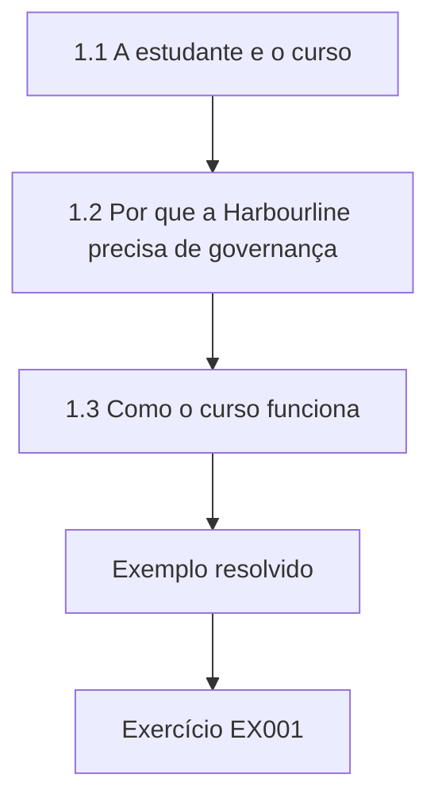

### Desenho lógico

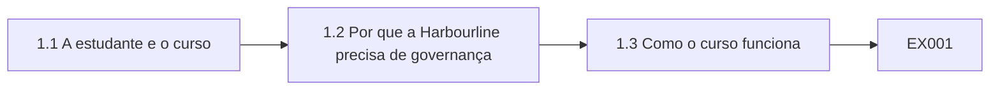

```text
[1.1 A estudante e o curso]
    |
    v
[1.2 Por que a Harbourline precisa de governança]
    |
    v
[1.3 Como o curso funciona]
    |
    v
[Exemplo resolvido] --> [Exercício EX001]
```
<!-- cykin:lesson-figures:end ch-01 -->


### Objetivos de aprendizagem

Você vai (1) descrever o curso e seu caso; (2) explicar por que as organizações governam dados; (3) definir metas pessoais de aprendizagem.

### 1.1 A estudante e o curso

Amara Okafor começa um bacharelado de quatro anos em gestão da informação na fictícia Universidade Ridgeway. Seu tutor, o Dr. Paul Lindqvist, explica que o curso acompanha uma única organização do início ao fim: a Harbourline Co-operative, uma cooperativa de supermercados fictícia com quarenta lojas e cerca de um quarto de milhão de membros no programa de fidelidade. Cada ano acrescenta profundidade, desde as habilidades básicas com dados no primeiro ano até o projeto da governança, um estágio e um trabalho de conclusão nos anos finais. Todos os dados usados nos exercícios e laboratórios são sintéticos, criados para o ensino. Amara está animada.

### 1.2 Por que a Harbourline precisa de governança

A Harbourline guarda dados de vendas, estoque, fornecedores, funcionários e fidelidade. Os gestores reclamam que os relatórios não batem entre si, que ninguém sabe qual lista de clientes é a atual e que um e-mail de marketing recente foi enviado a membros que haviam pedido para não ser contatados. O Dr. Lindqvist explica que esses são problemas de governança: ninguém tem autoridade clara sobre as definições, a qualidade ou os usos permitidos dos dados. A tecnologia sozinha não os resolve, porque as questões de fundo envolvem decisões, responsabilidades e regras que as pessoas da organização precisam acordar. Amara anota essas reclamações.

### 1.3 Como o curso funciona

Cada capítulo apresenta um tema, aplica-o à Harbourline e termina com exercícios. Alguns capítulos incluem laboratórios curtos escritos em Python usando apenas a biblioteca padrão, executados sobre dados sintéticos, com os resultados citados exatamente no texto. Amara é orientada a manter um diário de aprendizagem, anotando perguntas e conexões entre os temas. O Dr. Lindqvist diz que o diário vai ajudá-la mais tarde a escolher o tema do trabalho de conclusão, porque as perguntas recorrentes costumam revelar o que mais interessa a um estudante. Ela começa o diário naquela mesma noite, com três perguntas.

### 1.4 Metas de aprendizagem

Amara escreve três metas: entender por que os dados dão errado nas organizações, aprender habilidades práticas para verificar dados e ser capaz de explicar escolhas de governança a gestores que não são especialistas. O Dr. Lindqvist acrescenta uma quarta: aprender a julgar evidências, porque as decisões de governança devem se apoiar em fatos sobre os dados, e não em impressões. Eles combinam revisar as metas todo ano. Escrever as metas cedo lhe dá um modo de medir o progresso e de ajustar mais tarde a escolha das disciplinas optativas. As metas ficam guardadas no diário.

### Exemplo resolvido

Amara começa o bacharelado, conhece os relatórios divergentes e os e-mails mal direcionados da Harbourline, entende o formato dos capítulos e laboratórios e define quatro metas de aprendizagem com o tutor.

> **Caso sintético.** Ridgeway, a Harbourline e todas as pessoas são sintéticas.

### Erros e limites

Tratar a governança como a compra de um software ignora as decisões e as responsabilidades.

### Exercícios

- **EX001 — Caso do curso.** Que organização o curso acompanha? *Rubrica:* 3 = a Harbourline Co-operative;; 2 = parcialmente correto;; 1 = outra;; 0 = nenhuma.
- **EX002 — Problema do e-mail.** O que deu errado com um e-mail de marketing? *Rubrica:* 3 = foi enviado a membros que pediram para não ser contatados;; 2 = parcialmente correto;; 1 = vago;; 0 = nenhuma.
- **EX003 — Quarta meta.** Que meta o tutor acrescentou? *Rubrica:* 3 = aprender a julgar evidências;; 2 = parcialmente correto;; 1 = vago;; 0 = nenhuma.

<!-- cykin:chapter-navigation:start ch-01 -->
### Continue estudando — aula 01 (capítulo 01 de 40)

[← Início do curso](../../README.md) · [Índice das aulas](../SUBJECTS.md) · [Capítulo 02 →](#ch-02)

Continue para a próxima aula já escrita.
<!-- cykin:chapter-navigation:end -->

<a id="ch-02"></a>

## Capítulo 2 — O que são dados

<!-- cykin:lesson-figures:start ch-02 -->
### Mapa da aula

Aula 02 publicada. Mapa, exemplo, EX004.

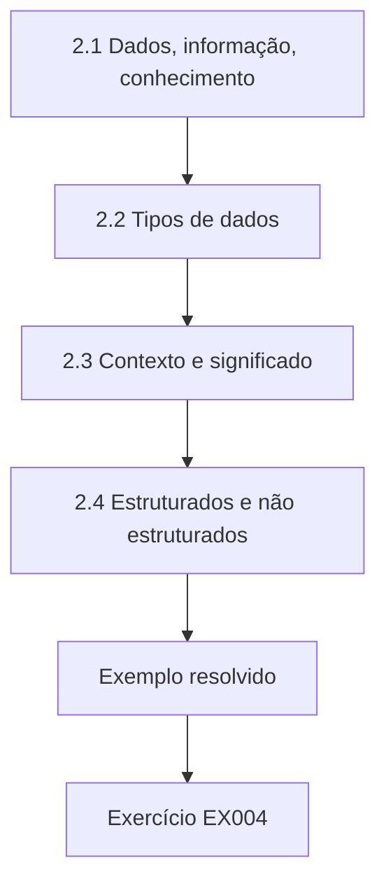

### Desenho lógico

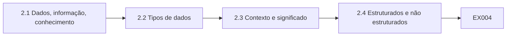

```text
[2.1 Dados, informação, conhecimento]
    |
    v
[2.2 Tipos de dados]
    |
    v
[2.3 Contexto e significado]
    |
    v
[2.4 Estruturados e não estruturados]
    |
    v
[Exemplo resolvido] --> [Exercício EX004]
```
<!-- cykin:lesson-figures:end ch-02 -->


### Objetivos de aprendizagem

Você vai (1) distinguir dados, informação e conhecimento; (2) descrever os tipos de dados; (3) explicar como o contexto molda o significado.

### 2.1 Dados, informação, conhecimento

O Dr. Lindqvist explica que dados são símbolos registrados, como um número em um registro do caixa. Informação é o dado com significado em um contexto, como saber que aquele número é a quantidade de leite vendida na loja doze em uma terça-feira. Conhecimento é a compreensão que permite agir, como saber que as vendas de leite sobem antes dos feriados e encomendar mais estoque. Amara observa que a governança trabalha sobretudo com dados e informação, mas que seu propósito é sustentar um bom conhecimento e boas decisões. Amara concorda.

### 2.2 Tipos de dados

Amara aprende os tipos mais comuns: números para quantidades e preços, texto para nomes e descrições, datas e horas para as transações, códigos para categorias como loja ou produto e valores verdadeiro ou falso para indicadores como o consentimento para marketing. Cada tipo tem regras: um preço não pode ser negativo, uma data precisa existir no calendário e um código precisa constar de uma lista acordada. Conhecer o tipo de cada campo ajuda as pessoas a verificar se um valor sequer faz sentido. Os tipos são documentados.

### 2.3 Contexto e significado

O mesmo valor pode significar coisas diferentes. Na Harbourline, as vendas no sistema financeiro incluem impostos, enquanto as vendas no sistema das lojas os excluem. As duas se chamam vendas. Quando os gestores comparam os relatórios, os números divergem pelo valor do imposto, e cada lado supõe que o outro está errado. Amara percebe que a falta de contexto, e não um erro de aritmética, causa a divergência. Registrar as definições junto com os dados é, portanto, uma das ações de governança mais simples e mais úteis que uma organização pode adotar. Mais tarde, a Harbourline acrescenta as definições aos relatórios.

### 2.4 Estruturados e não estruturados

Os registros do caixa e os níveis de estoque são dados estruturados, guardados em tabelas com campos definidos. E-mails de clientes, contratos com fornecedores e fotografias das lojas são não estruturados, com informações mais difíceis de pesquisar e verificar. A Harbourline tem muito mais dados não estruturados do que imaginava, boa parte em pastas compartilhadas sem dono. O Dr. Lindqvist explica que a governança precisa cobrir os dois, embora os métodos sejam diferentes: dados estruturados se prestam a regras automáticas, enquanto os não estruturados dependem mais de classificação, controle de acesso e retenção. Amara conta milhares de arquivos sem dono em uma única pasta.

### Exemplo resolvido

Amara distingue dados, informação e conhecimento, aprende os tipos de dados e suas regras, descobre que uma diferença de impostos explica relatórios de vendas divergentes e registra dados não estruturados sem dono em pastas compartilhadas.

> **Caso sintético.** Os exemplos são sintéticos.

### Erros e limites

Supor que rótulos idênticos significam definições idênticas gera disputas.

### Exercícios

- **EX004 — Exemplo de conhecimento.** Dê o exemplo de conhecimento usado no curso. *Rubrica:* 3 = as vendas de leite sobem antes dos feriados, então encomenda-se mais;; 2 = parcialmente correto;; 1 = vago;; 0 = nenhuma.
- **EX005 — Divergência de vendas.** Por que os relatórios de vendas divergiam? *Rubrica:* 3 = o financeiro inclui impostos, as lojas os excluem;; 2 = parcialmente correto;; 1 = vago;; 0 = nenhuma.
- **EX006 — Exemplo não estruturado.** Cite um exemplo de dado não estruturado na Harbourline. *Rubrica:* 3 = e-mails de clientes, contratos ou fotografias;; 2 = parcialmente correto;; 1 = vago;; 0 = nenhuma.

<!-- cykin:chapter-navigation:start ch-02 -->
### Continue estudando — aula 02 (capítulo 02 de 40)

[← Capítulo 01](#ch-01) · [Índice das aulas](../SUBJECTS.md) · [Capítulo 03 →](#ch-03)

Continue para a próxima aula já escrita.
<!-- cykin:chapter-navigation:end -->

<a id="ch-03"></a>

## Capítulo 3 — Dados nas organizações

<!-- cykin:lesson-figures:start ch-03 -->
### Mapa da aula

Aula 03 publicada. Mapa, exemplo, EX007.

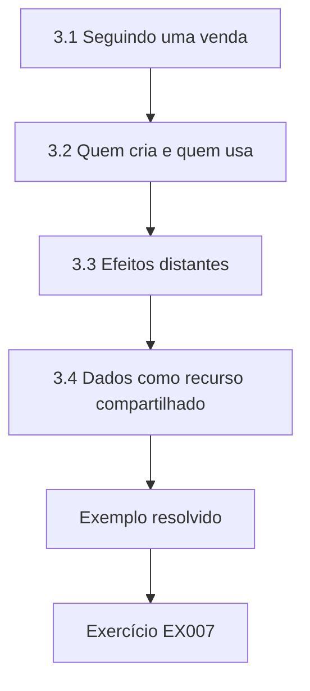

### Desenho lógico

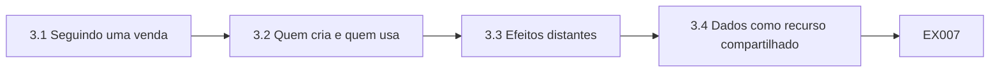

```text
[3.1 Seguindo uma venda]
    |
    v
[3.2 Quem cria e quem usa]
    |
    v
[3.3 Efeitos distantes]
    |
    v
[3.4 Dados como recurso compartilhado]
    |
    v
[Exemplo resolvido] --> [Exercício EX007]
```
<!-- cykin:lesson-figures:end ch-03 -->


### Objetivos de aprendizagem

Você vai (1) rastrear como os dados se movem dentro de uma organização; (2) identificar quem cria e quem usa os dados; (3) explicar por que os problemas aparecem longe de suas causas.

### 3.1 Seguindo uma venda

Amara segue uma única venda pela Harbourline. O caixa registra os itens, os preços e o cartão de fidelidade. O sistema da loja envia os totais ao financeiro toda noite. O sistema de fidelidade acrescenta pontos. O sistema de estoque reduz o inventário. Mais tarde, o marketing analisa as compras para enviar ofertas. Uma única ação no caixa cria dados usados por cinco sistemas e várias equipes. Ela desenha o percurso em um diagrama e percebe que um erro no caixa se espalha pelo financeiro, pelo estoque e pelo marketing. Os funcionários da loja confirmam, em uma reunião curta, que o diagrama está correto.

### 3.2 Quem cria e quem usa

Os funcionários das lojas criam a maior parte dos dados, mas raramente usam relatórios. As equipes da sede usam relatórios, mas raramente veem como os dados são criados. Amara entrevista uma supervisora de loja, que conta que os funcionários muitas vezes digitam um código de produto genérico quando o código de barras falha, para a fila andar. A sede, então, vê vendas estranhas do produto genérico. Nenhum dos lados conhece a situação do outro. Ela conclui que a governança precisa ligar quem cria a quem usa, para que cada um entenda o efeito de suas ações sobre o outro. Amara organiza uma visita conjunta.

### 3.3 Efeitos distantes

Um preço errado cadastrado no sistema de produtos aparece semanas depois como uma divergência de estoque nas lojas e, em seguida, como um problema de margem no financeiro. Quando o financeiro percebe, a causa é difícil de rastrear. Amara compara os problemas de dados à poluição de um rio: o efeito aparece rio abaixo, longe da fonte. A governança precisa de meios para rastrear os efeitos até as causas, e é por isso que os capítulos seguintes tratam em detalhe de linhagem, titularidade e gestão de problemas. Amara anota a comparação com o rio no diário, para uso futuro.

### 3.4 Dados como recurso compartilhado

O Dr. Lindqvist explica que, na Harbourline, os dados são recursos compartilhados, usados por muitas equipes, mas com dono claro em poucos casos. Sem regras, cada equipe otimiza para as próprias necessidades, como fazem os funcionários das lojas com os códigos genéricos. O resultado se parece com o uso excessivo de um pasto comum, em que todos saem perdendo. Amara observa que a governança cria as regras e os papéis que permitem a um recurso compartilhado continuar útil para todos, equilibrando a conveniência local e as necessidades mais amplas de toda a cooperativa. A comparação a ajuda a explicar a governança a amigos que estudam economia.

### Exemplo resolvido

Amara rastreia uma venda por cinco sistemas, descobre que os códigos de produto genéricos digitados nos caixas distorcem os relatórios da sede e compara os problemas de dados à poluição rio abaixo.

> **Caso sintético.** Os sistemas e as entrevistas são sintéticos.

### Erros e limites

Culpar a equipe que percebe um problema ignora sua origem.

### Exercícios

- **EX007 — Sistemas envolvidos.** Quantos sistemas usam os dados de uma única venda? *Rubrica:* 3 = cinco;; 2 = parcialmente correto;; 1 = errado;; 0 = nenhuma.
- **EX008 — Códigos genéricos.** Por que os funcionários digitam códigos de produto genéricos? *Rubrica:* 3 = para a fila andar quando o código de barras falha;; 2 = parcialmente correto;; 1 = vago;; 0 = nenhuma.
- **EX009 — Recurso compartilhado.** O que as regras de governança equilibram? *Rubrica:* 3 = a conveniência local e as necessidades mais amplas;; 2 = parcialmente correto;; 1 = vago;; 0 = nenhuma.

<!-- cykin:chapter-navigation:start ch-03 -->
### Continue estudando — aula 03 (capítulo 03 de 40)

[← Capítulo 02](#ch-02) · [Índice das aulas](../SUBJECTS.md) · [Capítulo 04 →](#ch-04)

Continue para a próxima aula já escrita.
<!-- cykin:chapter-navigation:end -->

<a id="ch-04"></a>

## Capítulo 4 — Planilhas e seus riscos

<!-- cykin:lesson-figures:start ch-04 -->
### Mapa da aula

Aula 04 publicada. Mapa, exemplo, EX010.

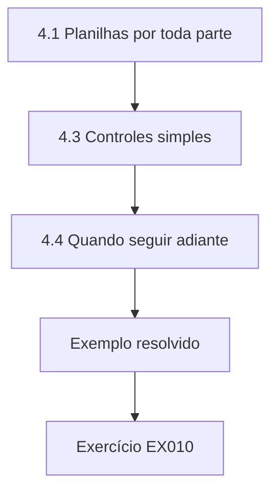

### Desenho lógico

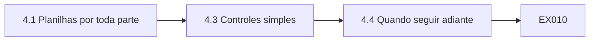

```text
[4.1 Planilhas por toda parte]
    |
    v
[4.3 Controles simples]
    |
    v
[4.4 Quando seguir adiante]
    |
    v
[Exemplo resolvido] --> [Exercício EX010]
```
<!-- cykin:lesson-figures:end ch-04 -->


### Objetivos de aprendizagem

Você vai (1) reconhecer os erros comuns em planilhas; (2) aplicar controles simples a planilhas; (3) decidir quando os dados devem sair das planilhas.

### 4.1 Planilhas por toda parte

A Harbourline executa muitos processos em planilhas: escalas das lojas, planos de promoções, listas de preços de fornecedores e o resumo semanal de vendas para o conselho. Planilhas são flexíveis e familiares, o que explica sua popularidade. Amara examina o resumo semanal e descobre que ele é montado copiando números de três relatórios, com fórmulas ligando doze abas. Uma única pessoa o mantém. Ela observa que a flexibilidade também facilita os erros, e que processos críticos que dependem da planilha de uma só pessoa criam riscos que a organização pode não enxergar. A responsável costuma estar de férias.

### 4.2 Erros comuns

Amara revisa a pesquisa sobre erros em planilhas e procura no resumo os problemas típicos. Ela encontra um intervalo de fórmula que termina uma linha antes do fim, de modo que a loja mais nova fica fora dos totais. Ela encontra números guardados como texto, que as somas ignoram, e um valor digitado por cima de uma fórmula. Nada disso era visível nos totais finais. Ela explica que os erros em planilhas são comuns em parte porque os resultados parecem arrumados, o que desestimula a verificação. As vendas da loja mais nova estavam fora dos totais do conselho havia três semanas antes da revisão.

### 4.3 Controles simples

Amara propõe controles: uma célula de verificação que compara o total do resumo com o total do relatório de origem, células de fórmula protegidas, histórico de versões em uma unidade compartilhada e uma aba de descrição que explica as fontes e as etapas. Ela sugere também que uma segunda pessoa revise o resumo todo mês. Esses controles custam pouco e capturam os erros que ela encontrou. O Dr. Lindqvist observa que controles proporcionais funcionam melhor com planilhas do que proibi-las, o que raramente dá certo na prática. A responsável concorda com os quatro controles, e a segunda revisora é nomeada na aba de descrição.

### 4.4 Quando seguir adiante

Alguns processos ficam grandes demais para planilhas. Amara sugere critérios: muitos usuários editando ao mesmo tempo, dados que alimentam outros sistemas, relatórios regulatórios ou volumes grandes demais para revisão manual. O resumo do conselho atende a dois critérios, então ela recomenda construí-lo na ferramenta de relatórios, com ligação direta aos dados de origem, eliminando as etapas de cópia. O plano de promoções continua em planilha, com controles. Ela aprende que as decisões de governança sobre ferramentas devem seguir o risco e o uso, e não a moda. Dois meses depois, o conselho recebe seu primeiro resumo gerado pela ferramenta de relatórios, sem etapas de cópia.

### Exemplo resolvido

Amara encontra no resumo do conselho um intervalo de fórmula incompleto, números guardados como texto e uma fórmula sobrescrita, propõe totais de verificação, proteção e revisão e recomenda levar o resumo para a ferramenta de relatórios.

> **Caso sintético.** As planilhas são sintéticas.

### Erros e limites

Totais arrumados não provam que as fórmulas estão corretas; concilie com as fontes.

### Exercícios

- **EX010 — Loja ausente.** Por que a loja mais nova ficou de fora? *Rubrica:* 3 = um intervalo de fórmula terminava uma linha antes;; 2 = parcialmente correto;; 1 = vago;; 0 = nenhuma.
- **EX011 — Célula de verificação.** O que a célula de verificação compara? *Rubrica:* 3 = o total do resumo com o total do relatório de origem;; 2 = parcialmente correto;; 1 = vago;; 0 = nenhuma.
- **EX012 — Processo transferido.** Que processo sai das planilhas? *Rubrica:* 3 = o resumo de vendas do conselho;; 2 = parcialmente correto;; 1 = outro;; 0 = nenhuma.

<!-- cykin:chapter-navigation:start ch-04 -->
### Continue estudando — aula 04 (capítulo 04 de 40)

[← Capítulo 03](#ch-03) · [Índice das aulas](../SUBJECTS.md) · [Capítulo 05 →](#ch-05)

Continue para a próxima aula já escrita.
<!-- cykin:chapter-navigation:end -->

<a id="ch-05"></a>

## Capítulo 5 — Bancos de dados e tabelas

<!-- cykin:lesson-figures:start ch-05 -->
### Mapa da aula

Aula 05 publicada. Mapa, exemplo, EX013.

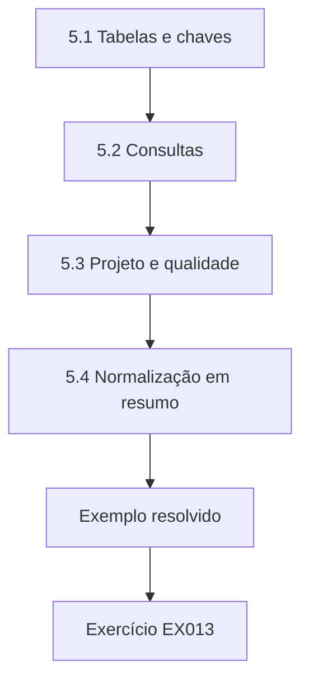

### Desenho lógico

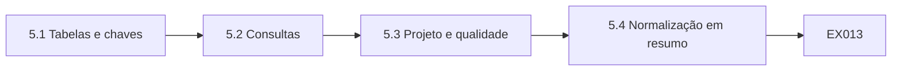

```text
[5.1 Tabelas e chaves]
    |
    v
[5.2 Consultas]
    |
    v
[5.3 Projeto e qualidade]
    |
    v
[5.4 Normalização em resumo]
    |
    v
[Exemplo resolvido] --> [Exercício EX013]
```
<!-- cykin:lesson-figures:end ch-05 -->


### Objetivos de aprendizagem

Você vai (1) descrever tabelas, chaves e relacionamentos; (2) escrever consultas simples; (3) explicar como o projeto do banco de dados sustenta a qualidade dos dados.

### 5.1 Tabelas e chaves

Amara aprende que um banco de dados relacional guarda os dados em tabelas de linhas e colunas. A tabela de membros tem uma linha por membro do programa de fidelidade, identificada por um número de membro que funciona como chave primária. A tabela de compras registra cada compra com o número de membro como chave estrangeira, que a liga ao membro. As chaves impedem membros duplicados e garantem que as compras se refiram a membros que existem. Ela percebe que escolhas de projeto como as chaves impõem regras automaticamente. O banco de dados rejeita uma compra com um número de membro desconhecido.

### 5.2 Consultas

Usando um pequeno banco de dados sintético montado com o módulo sqlite3 do Python, Amara escreve consultas para contar os membros por loja, somar as compras por mês e encontrar membros sem compras em um ano. Ela aprende que uma consulta é uma pergunta precisa, e que a formulação importa: contar compras e contar membros distintos que compraram dão respostas diferentes. Ela registra cada consulta com uma descrição simples, para que outras pessoas possam verificar o que foi perguntado e reutilizá-la depois. Suas descrições ficam em um arquivo compartilhado, com o texto da consulta ao lado.

### 5.3 Projeto e qualidade

Amara descobre que o antigo banco de dados de fidelidade da Harbourline guardava a loja do membro como texto livre, o que produzia variações como Loja 12, loja doze e L12. Os relatórios agrupados por loja dividiam uma loja em várias. Um projeto melhor guarda um código de loja ligado a uma tabela de referência de lojas. Ela explica que um bom projeto evita muitos problemas de qualidade já na entrada, o que é mais barato do que limpá-los depois, e relaciona isso às regras tratadas nos capítulos seguintes. O novo sistema de fidelidade usa códigos de loja, e os antigos valores em texto são mapeados uma única vez.

### 5.4 Normalização em resumo

O Dr. Lindqvist apresenta a normalização: organizar as tabelas para que cada fato seja guardado uma única vez. No banco antigo, o endereço do membro aparece em cada linha de compra, de modo que mudar um endereço deixa as linhas mais antigas inconsistentes. Levar o endereço para a tabela de membros resolve isso. Amara observa que a normalização reduz a inconsistência, mas pode tornar as consultas mais complexas, e que bancos de dados de relatórios às vezes repetem dados de propósito, por desempenho. O equilíbrio certo depende de como os dados são usados. Por esse motivo, o banco de relatórios da Harbourline repete os nomes das lojas nas tabelas de vendas, por projeto.

### Exemplo resolvido

Amara aprende chaves e relacionamentos, escreve consultas em sqlite3 com descrições simples, descobre nomes de lojas em texto livre que dividem os relatórios e vê a normalização eliminar endereços repetidos.

> **Caso sintético.** O banco de dados é sintético.

### Erros e limites

Contar linhas quando a pergunta pede pessoas distintas dá respostas erradas.

### Exercícios

- **EX013 — Papel da chave estrangeira.** A que o número de membro nas compras está ligado? *Rubrica:* 3 = à tabela de membros;; 2 = parcialmente correto;; 1 = vago;; 0 = nenhuma.
- **EX014 — Problema do texto livre.** O que os nomes de lojas em texto livre causaram? *Rubrica:* 3 = uma loja dividida em várias nos relatórios;; 2 = parcialmente correto;; 1 = vago;; 0 = nenhuma.
- **EX015 — Contrapartida da normalização.** O que a normalização pode dificultar? *Rubrica:* 3 = as consultas;; 2 = parcialmente correto;; 1 = vago;; 0 = nenhuma.

<!-- cykin:chapter-navigation:start ch-05 -->
### Continue estudando — aula 05 (capítulo 05 de 40)

[← Capítulo 04](#ch-04) · [Índice das aulas](../SUBJECTS.md) · [Capítulo 06 →](#ch-06)

Continue para a próxima aula já escrita.
<!-- cykin:chapter-navigation:end -->

<a id="ch-06"></a>

## Capítulo 6 — Python para verificação de dados

<!-- cykin:lesson-figures:start ch-06 -->
### Mapa da aula

Aula 06 publicada. Mapa, exemplo, EX016.

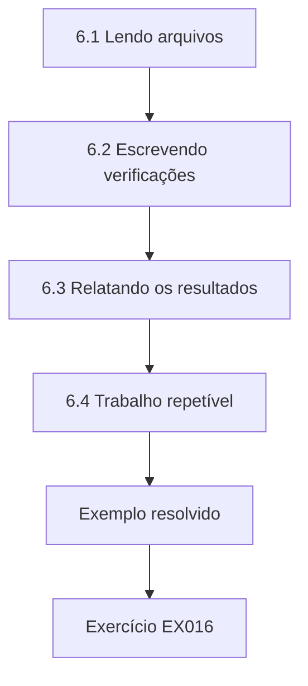

### Desenho lógico

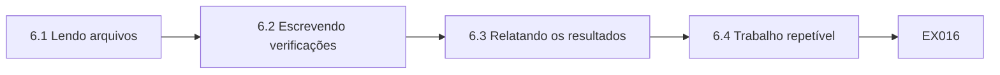

```text
[6.1 Lendo arquivos]
    |
    v
[6.2 Escrevendo verificações]
    |
    v
[6.3 Relatando os resultados]
    |
    v
[6.4 Trabalho repetível]
    |
    v
[Exemplo resolvido] --> [Exercício EX016]
```
<!-- cykin:lesson-figures:end ch-06 -->


### Objetivos de aprendizagem

Você vai (1) ler arquivos de dados com Python; (2) escrever verificações simples; (3) relatar os resultados com clareza.

### 6.1 Lendo arquivos

Amara aprende a ler arquivos separados por vírgula com o módulo csv do Python. Ela abre uma extração sintética de adesões ao programa de fidelidade, lê cada linha como um dicionário indexado pelos nomes das colunas e conta as linhas. Ela aprende a especificar a codificação do arquivo, porque os nomes com acentos apareceram embaralhados quando ela não o fez. Ela observa que ler os dados corretamente é a primeira verificação: se o arquivo for lido errado, todos os resultados seguintes estarão errados, por mais cuidadosa que a análise pareça. Ela passa a declarar a codificação em todo script que escreve depois disso.

### 6.2 Escrevendo verificações

Ela escreve funções que testam uma regra cada: CEP presente, e-mail contendo uma arroba, ano de nascimento entre 1910 e 2010. Cada função devolve verdadeiro ou falso para uma linha. Um laço aplica todas as funções e conta as falhas por regra. Ela mantém as verificações pequenas e com nomes claros, para que um leitor veja exatamente o que cada uma testa. O Dr. Lindqvist explica que verificações simples e legíveis são mais fáceis de confiar e de manter do que verificações engenhosas. Cada função tem um comentário de uma linha que descreve a regra que implementa e sua origem.

### 6.3 Relatando os resultados

O primeiro relatório de Amara lista as falhas como contagens brutas. O tutor pergunta o que as contagens significam sem os totais, então ela acrescenta as porcentagens e o número de linhas verificadas. Ela também lista alguns exemplos de linhas com falha, sem os dados pessoais, para que os leitores vejam como os problemas se parecem. Ela aprende que um bom relatório responde o que foi verificado, quanto falhou, por que isso importa e o que deve acontecer em seguida, nessa ordem. Ela usa essa ordem em todos os relatórios seguintes, e o tutor registra a melhora na nota.

### 6.4 Trabalho repetível

Amara salva o script com comentários e a data da extração usada. Quando o tutor lhe pede para executá-lo de novo sobre uma extração mais recente, leva segundos. Um colega que verificou os dados à mão em uma planilha precisa repetir horas de trabalho. Ela percebe que os scripts tornam as verificações repetíveis e sua lógica visível, o que importa para a governança, porque as verificações devem ser executadas com regularidade e revisadas por outras pessoas, e não feitas uma vez e esquecidas. Mais tarde, o script é compartilhado com a equipe de dados da Harbourline, que o adota.

### Exemplo resolvido

Amara lê uma extração de adesões com a codificação certa, escreve verificações pequenas e bem nomeadas, relata contagens com porcentagens e exemplos e executa de novo o script sobre uma nova extração em segundos.

> **Caso sintético.** As extrações são sintéticas.

### Erros e limites

Relatar contagens sem totais esconde a escala dos problemas.

### Exercícios

- **EX016 — Problema de codificação.** O que aconteceu sem a codificação especificada? *Rubrica:* 3 = os nomes com acentos ficaram embaralhados;; 2 = parcialmente correto;; 1 = vago;; 0 = nenhuma.
- **EX017 — Regra do ano de nascimento.** Que intervalo a verificação do ano de nascimento usou? *Rubrica:* 3 = de 1910 a 2010;; 2 = parcialmente correto;; 1 = errado;; 0 = nenhuma.
- **EX018 — Ordem do relatório.** Que ordem um relatório deve seguir? *Rubrica:* 3 = o que foi verificado, quanto falhou, por que importa, o que vem a seguir;; 2 = parcialmente correto;; 1 = parcial;; 0 = nenhuma.

<!-- cykin:chapter-navigation:start ch-06 -->
### Continue estudando — aula 06 (capítulo 06 de 40)

[← Capítulo 05](#ch-05) · [Índice das aulas](../SUBJECTS.md) · [Capítulo 07 →](#ch-07)

Continue para a próxima aula já escrita.
<!-- cykin:chapter-navigation:end -->

<a id="ch-07"></a>

## Capítulo 7 — Estatística para o trabalho com dados

<!-- cykin:lesson-figures:start ch-07 -->
### Mapa da aula

Aula 07 publicada. Mapa, exemplo, EX019.

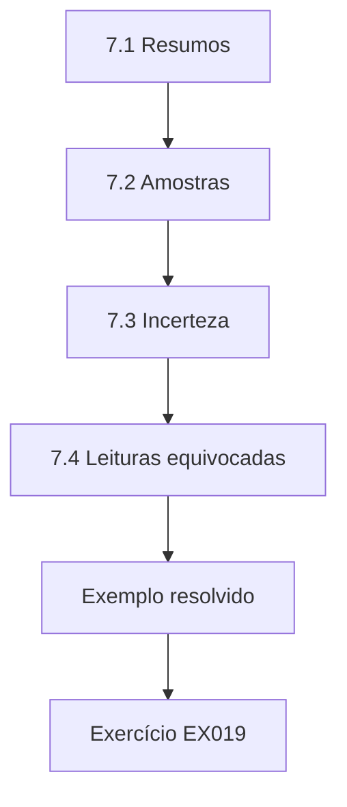

### Desenho lógico

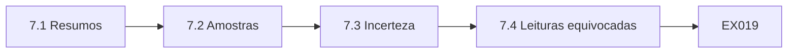

```text
[7.1 Resumos]
    |
    v
[7.2 Amostras]
    |
    v
[7.3 Incerteza]
    |
    v
[7.4 Leituras equivocadas]
    |
    v
[Exemplo resolvido] --> [Exercício EX019]
```
<!-- cykin:lesson-figures:end ch-07 -->


### Objetivos de aprendizagem

Você vai (1) resumir dados com estatísticas simples; (2) usar amostras para estimar a qualidade; (3) evitar leituras equivocadas comuns.

### 7.1 Resumos

Amara resume valores sintéticos de cestas de compras com o módulo statistics do Python: média, mediana e desvio-padrão. A cesta média é maior que a mediana porque alguns pedidos grandes a puxam para cima. Ela explica que a mediana descreve melhor uma cesta típica, enquanto a média importa para a receita total. A escolha do resumo certo depende da pergunta. Ela observa que os relatórios da Harbourline usavam apenas médias, o que fazia os clientes típicos parecerem gastar mais do que de fato gastam. Amara acrescenta medianas aos relatórios que prepara.

### 7.2 Amostras

Verificar cada registro à mão é impossível. Amara aprende a sortear uma amostra aleatória de registros, verificar cada um com cuidado e estimar a taxa de erros do conjunto inteiro. Usando o módulo random do Python com uma semente fixa, ela sorteia duzentos endereços de membros e encontra certo número com erros. Ela explica que uma amostra aleatória dá uma estimativa justa, enquanto escolher os registros que parecem suspeitos superestima os problemas, porque esses registros não são típicos do conjunto. Ela registra a semente para que a amostra possa ser sorteada de novo.

### 7.3 Incerteza

Uma estimativa amostral tem incerteza. Amara aprende que amostras maiores dão intervalos mais estreitos, e que informar um intervalo é mais honesto do que um número único. Ela explica a um colega que uma taxa de erros de quatro por cento obtida em duzentos registros poderia, plausivelmente, ser um pouco menor ou maior no conjunto completo. O Dr. Lindqvist a incentiva a sempre informar o tamanho da amostra junto com qualquer estimativa, para que os leitores possam julgar por conta própria sua confiabilidade. Amara acrescenta o tamanho da amostra a todas as estimativas do diário.

### 7.4 Leituras equivocadas

Amara reúne as leituras equivocadas mais comuns: confundir porcentagens com pontos percentuais, comparar grupos de tamanhos muito diferentes, tratar correlação como causa e ignorar dados ausentes. Na Harbourline, um relatório afirmava que os membros do programa de fidelidade gastam mais por causa do programa, mas os membros podem simplesmente ser clientes habituais que aderiram. Ela observa que a governança inclui garantir que os relatórios sejam interpretados corretamente, e não apenas que seus números sejam calculados corretamente a partir de dados precisos. Amara escreve uma nota curta sobre cada leitura equivocada para a equipe de dados, com exemplos tirados dos próprios relatórios da Harbourline.

### Exemplo resolvido

Amara compara as cestas média e mediana, estima os erros de endereço a partir de uma amostra aleatória, informa intervalos com o tamanho da amostra e lista leituras equivocadas, como tratar a correlação da fidelidade como causa.

> **Caso sintético.** Os dados são sintéticos.

### Erros e limites

Amostras escolhidas a dedo superestimam os problemas; sorteie as amostras.

### Exercícios

- **EX019 — Cesta típica.** Que resumo descreve melhor uma cesta típica? *Rubrica:* 3 = a mediana;; 2 = parcialmente correto;; 1 = a média;; 0 = nenhuma.
- **EX020 — Viés da amostra.** Por que não escolher os registros que parecem suspeitos? *Rubrica:* 3 = eles não são típicos e superestimam os problemas;; 2 = parcialmente correto;; 1 = vago;; 0 = nenhuma.
- **EX021 — Afirmação sobre a fidelidade.** Por que a afirmação sobre os gastos dos membros pode estar errada? *Rubrica:* 3 = clientes habituais podem ter mais propensão a aderir;; 2 = parcialmente correto;; 1 = vago;; 0 = nenhuma.

<!-- cykin:chapter-navigation:start ch-07 -->
### Continue estudando — aula 07 (capítulo 07 de 40)

[← Capítulo 06](#ch-06) · [Índice das aulas](../SUBJECTS.md) · [Capítulo 08 →](#ch-08)

Continue para a próxima aula já escrita.
<!-- cykin:chapter-navigation:end -->

<a id="ch-08"></a>

## Capítulo 8 — Escrevendo sobre dados

<!-- cykin:lesson-figures:start ch-08 -->
### Mapa da aula

Aula 08 publicada. Mapa, exemplo, EX022.

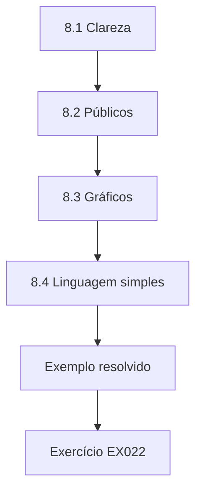

### Desenho lógico

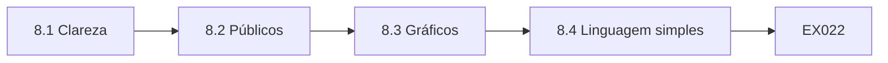

```text
[8.1 Clareza]
    |
    v
[8.2 Públicos]
    |
    v
[8.3 Gráficos]
    |
    v
[8.4 Linguagem simples]
    |
    v
[Exemplo resolvido] --> [Exercício EX022]
```
<!-- cykin:lesson-figures:end ch-08 -->


### Objetivos de aprendizagem

Você vai (1) escrever relatórios claros sobre problemas de dados; (2) adaptar a escrita ao público; (3) usar gráficos com honestidade.

### 8.1 Clareza

O primeiro relatório de Amara sobre a qualidade dos dados de fidelidade tem dez páginas de tabelas. O Dr. Lindqvist lhe pede que diga a constatação principal em uma frase. Ela escreve: cerca de um em cada cinco registros de fidelidade não tem endereço de e-mail, o que limita as ofertas digitais. O resto do relatório passa a sustentar essa frase. Ela aprende que a escrita clara começa por saber qual é o ponto principal, e que as tabelas pertencem aos apêndices, a menos que os leitores precisem delas para acompanhar o argumento. O tutor dá uma nota muito maior ao relatório revisado.

### 8.2 Públicos

Ela escreve duas versões. Para o gerente de marketing, explica o efeito sobre as campanhas e sugere coletar os e-mails no caixa. Para a equipe de dados, detalha as regras usadas, as contagens por loja e o local do script. Cada público recebe o que precisa para agir. Ela observa que um único relatório para todos geralmente não serve bem a ninguém, porque os gestores pulam os detalhes técnicos e a equipe técnica precisa de mais precisão do que os resumos oferecem. Os dois leitores confirmam que sua versão lhes deu o que precisavam para agir.

### 8.3 Gráficos

Amara desenha um gráfico de barras dos e-mails ausentes por loja. Sua primeira versão começa o eixo vertical em quinze por cento, exagerando as diferenças entre as lojas. Uma colega aponta que os gerentes das lojas poderiam se sentir culpados injustamente. Ela refaz o gráfico começando em zero e acrescenta o número de membros por loja. Ela aprende que os gráficos podem enganar mesmo quando os números estão corretos, e que a apresentação honesta faz parte do trabalho responsável com dados. Mais tarde, os gerentes das lojas agradecem pelo gráfico mais justo e pelo contexto acrescentado.

### 8.4 Linguagem simples

Amara substitui jargões como razão de completude por expressões simples como parcela de registros com endereço de e-mail. Ela mantém os termos técnicos onde a precisão importa e os define uma única vez. O gerente de marketing que lê o texto diz que o relatório revisado é o primeiro relatório de dados que ele leu até o fim. O Dr. Lindqvist observa que a governança depende de que não especialistas entendam os problemas de dados, de modo que escrever com simplicidade é uma competência central para quem trabalha na área. Ela mantém uma lista de substitutos simples para os termos mais comuns.

### Exemplo resolvido

Amara reduz um relatório de dez páginas a uma constatação principal, escreve versões para o marketing e para a equipe de dados, refaz a partir do zero um gráfico enganoso e substitui jargões por expressões simples.

> **Caso sintético.** Os relatórios são sintéticos.

### Erros e limites

Eixos truncados exageram as diferenças; comece as barras do zero.

### Exercícios

- **EX022 — Constatação principal.** Qual foi a constatação de Amara em uma frase? *Rubrica:* 3 = cerca de um em cada cinco registros não tem e-mail;; 2 = parcialmente correto;; 1 = vago;; 0 = nenhuma.
- **EX023 — Correção do gráfico.** Como Amara corrigiu o gráfico? *Rubrica:* 3 = começou o eixo do zero e acrescentou a contagem de membros;; 2 = parcialmente correto;; 1 = parcial;; 0 = nenhuma.
- **EX024 — Substituição do jargão.** O que substituiu razão de completude? *Rubrica:* 3 = parcela de registros com endereço de e-mail;; 2 = parcialmente correto;; 1 = vago;; 0 = nenhuma.

<!-- cykin:chapter-navigation:start ch-08 -->
### Continue estudando — aula 08 (capítulo 08 de 40)

[← Capítulo 07](#ch-07) · [Índice das aulas](../SUBJECTS.md) · [Capítulo 09 →](#ch-09)

Continue para a próxima aula já escrita.
<!-- cykin:chapter-navigation:end -->

<a id="ch-09"></a>

## Capítulo 9 — Direito e dados

<!-- cykin:lesson-figures:start ch-09 -->
### Mapa da aula

Aula 09 publicada. Mapa, exemplo, EX025.

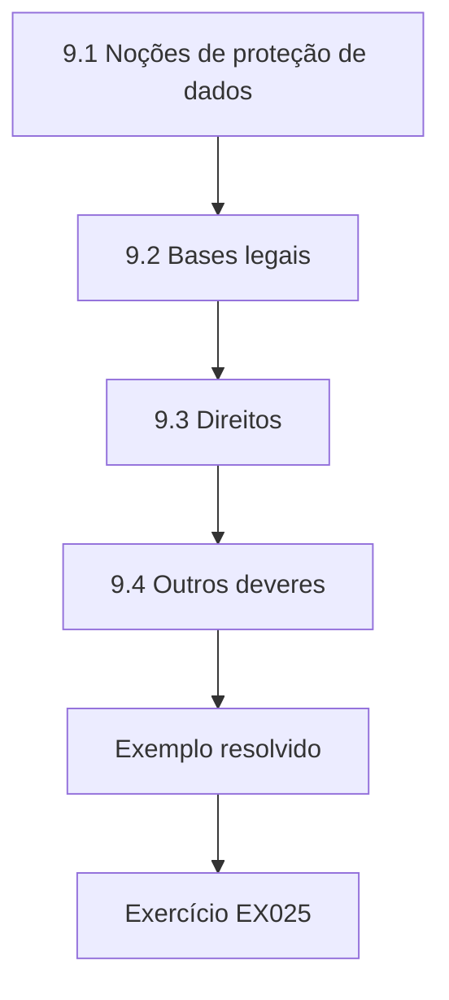

### Desenho lógico

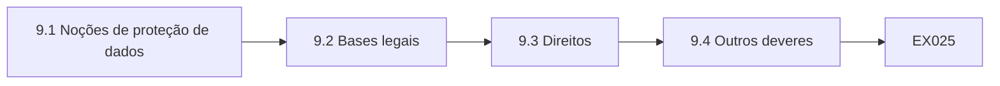

```text
[9.1 Noções de proteção de dados]
    |
    v
[9.2 Bases legais]
    |
    v
[9.3 Direitos]
    |
    v
[9.4 Outros deveres]
    |
    v
[Exemplo resolvido] --> [Exercício EX025]
```
<!-- cykin:lesson-figures:end ch-09 -->


### Objetivos de aprendizagem

Você vai (1) apresentar as linhas gerais da legislação de proteção de dados relevante para a Harbourline; (2) identificar as bases legais e os direitos; (3) reconhecer outros deveres legais sobre os dados.

### 9.1 Noções de proteção de dados

Amara estuda o GDPR, o regulamento europeu, como exemplo de lei de proteção de dados. Ele se aplica a dados pessoais, isto é, informações sobre pessoas identificáveis, como os membros do programa de fidelidade e os funcionários. As organizações devem tratar dados pessoais de forma lícita, leal e transparente, para finalidades especificadas, usando apenas o necessário, mantendo-os exatos, guardando-os pelo tempo estritamente necessário e mantendo-os seguros. No Brasil, a LGPD (Lei nº 13.709/2018) enuncia princípios equivalentes em seu art. 6º. Ela observa que vários desses princípios, como a exatidão e a limitação da conservação, também são preocupações da governança de dados. Amara lista cada princípio com um exemplo da Harbourline.

### 9.2 Bases legais

Cada uso de dados pessoais precisa de uma base legal. A Harbourline trata as compras para operar o programa de fidelidade com base em seu contrato com os membros, enquanto os e-mails de marketing precisam de consentimento. Amara descobre que o antigo formulário de adesão embutia o consentimento para marketing na própria adesão ao programa, o que o GDPR não considera um consentimento livre; a LGPD, no art. 8º, § 4º, também exige que o consentimento se refira a finalidades determinadas. Ela recomenda uma caixa de consentimento separada. Ela explica que a governança deve registrar a base de cada uso, para que as equipes saibam o que é permitido. O novo formulário é introduzido no relançamento seguinte do programa.

### 9.3 Direitos

Os membros têm direitos, entre eles o de acessar seus dados, corrigir erros, opor-se ao marketing e, em alguns casos, obter a eliminação dos dados; na LGPD, esses direitos estão no art. 18. Amara revisa como a Harbourline trata os pedidos e descobre que eles chegam às lojas, à sede e por e-mail, sem um registro central. Alguns ficaram sem resposta. Ela recomenda um canal único de entrada e um registro com prazos. Ela observa que atender aos direitos depende de saber onde os dados pessoais estão guardados, o que exige bons metadados e inventários. O encarregado de proteção de dados concorda e cria o registro naquele mesmo mês.

### 9.4 Outros deveres

Além da proteção de dados, a Harbourline precisa guardar os registros financeiros por prazos definidos para fins fiscais, responder a recolhimentos de alimentos por segurança sanitária usando os dados de fornecedores e de lotes e seguir a legislação trabalhista quanto aos registros dos funcionários. Amara lista esses deveres com os dados que cada um exige. Ela percebe que alguns deveres exigem guardar os dados, enquanto outros exigem eliminá-los, de modo que a governança precisa conciliá-los em uma tabela de temporalidade, em vez de deixar cada equipe decidir sozinha. A lista de Amara se torna o ponto de partida da tabela de temporalidade estudada nos capítulos seguintes.

### Exemplo resolvido

Amara apresenta os princípios do GDPR, encontra um consentimento para marketing embutido e recomenda uma caixa separada, centraliza os pedidos de exercício de direitos e lista os deveres fiscais, de recolhimento e trabalhistas que afetam os dados.

> **Caso sintético.** A Harbourline é sintética; o GDPR e a LGPD são reais. Isto não é aconselhamento jurídico.

### Erros e limites

Consentimento embutido não é livre; separe-o.

### Exercícios

- **EX025 — Base para marketing.** De que base legal os e-mails de marketing precisam aqui? *Rubrica:* 3 = consentimento;; 2 = parcialmente correto;; 1 = outra;; 0 = nenhuma.
- **EX026 — Problema dos direitos.** Que problema Amara encontrou nos pedidos de exercício de direitos? *Rubrica:* 3 = não havia registro central, e alguns ficaram sem resposta;; 2 = parcialmente correto;; 1 = vago;; 0 = nenhuma.
- **EX027 — Dados de recolhimento.** Que dados sustentam os recolhimentos por segurança dos alimentos? *Rubrica:* 3 = os dados de fornecedores e de lotes;; 2 = parcialmente correto;; 1 = vago;; 0 = nenhuma.

<!-- cykin:chapter-navigation:start ch-09 -->
### Continue estudando — aula 09 (capítulo 09 de 40)

[← Capítulo 08](#ch-08) · [Índice das aulas](../SUBJECTS.md) · [Capítulo 10 →](#ch-10)

Continue para a próxima aula já escrita.
<!-- cykin:chapter-navigation:end -->

<a id="ch-10"></a>

## Capítulo 10 — Ética e dados

<!-- cykin:lesson-figures:start ch-10 -->
### Mapa da aula

Aula 10 publicada. Mapa, exemplo, EX028.

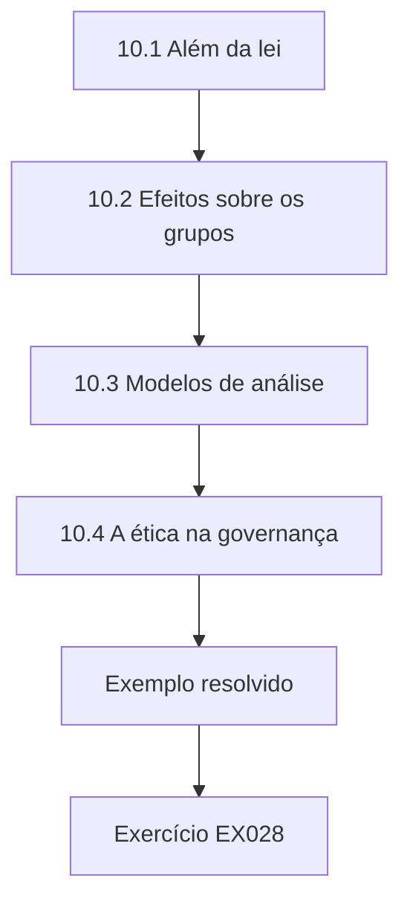

### Desenho lógico

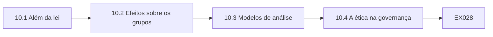

```text
[10.1 Além da lei]
    |
    v
[10.2 Efeitos sobre os grupos]
    |
    v
[10.3 Modelos de análise]
    |
    v
[10.4 A ética na governança]
    |
    v
[Exemplo resolvido] --> [Exercício EX028]
```
<!-- cykin:lesson-figures:end ch-10 -->


### Objetivos de aprendizagem

Você vai (1) aplicar o raciocínio ético aos usos de dados; (2) considerar os efeitos sobre diferentes grupos; (3) explicar o papel da ética ao lado do direito.

### 10.1 Além da lei

Alguns usos de dados são legais, mas questionáveis. A equipe de marketing da Harbourline propõe usar padrões de compra para inferir quais membros estão grávidas e enviar ofertas de produtos para bebês. Amara pondera se os membros esperariam isso, se poderia causar dano caso as ofertas chegassem a um domicílio antes que a pessoa decidisse compartilhar a notícia e se o benefício justifica o risco. Ela conclui que a legalidade é um mínimo, e que a governança deve perguntar também se um uso é justo e esperado. O marketing suspende a proposta para revisão.

### 10.2 Efeitos sobre os grupos

Amara examina uma proposta de oferecer descontos apenas aos membros que usam o aplicativo. Os membros mais velhos e os que não têm smartphone sairiam perdendo. Ela verifica os dados sintéticos de membros e descobre que os usuários do aplicativo são, em sua maioria, mais jovens. Ela sugere oferecer os mesmos descontos por meio de cupons impressos nos caixas. Ela aprende que decisões orientadas por dados podem prejudicar grupos sem que ninguém tenha essa intenção, e que verificar os efeitos entre os grupos deveria ser rotina antes de lançar programas assim. O marketing adota a opção dos cupons na campanha seguinte. Os membros mais velhos a recebem bem.

### 10.3 Modelos de análise

O Dr. Lindqvist apresenta modelos simples: considerar as consequências para todos os afetados, respeitar a autonomia e as expectativas das pessoas, tratar os grupos com justiça e ser transparente sobre as práticas. Amara os aplica à proposta de inferir gravidez e escreve uma avaliação curta recomendando contra ela. O marketing aceita um plano revisto que oferece descontos em produtos para bebês aos membros que escolhem o interesse família em seu perfil. Ela observa que os modelos ajudam a estruturar a discussão, em vez de produzir respostas automáticas. Sua avaliação é guardada como exemplo para revisões futuras. O marketing concorda.

### 10.4 A ética na governança

Amara propõe que o grupo de governança de dados da Harbourline revise os novos usos de dados que levantam questões éticas, usando uma lista de verificação curta. O grupo incluiria pessoas do marketing, das lojas e da proteção de dados. Ela observa que a revisão ética funciona melhor cedo, antes de as campanhas serem desenhadas, e que deve ser rápida para usos de baixo risco. O Dr. Lindqvist acrescenta que as organizações a quem se confiam dados precisam merecer essa confiança continuamente, por meio de suas escolhas. O grupo de governança testa a lista por três meses e constata que a maioria das revisões leva menos de uma hora.

### Exemplo resolvido

Amara avalia uma proposta de inferir gravidez e recomenda contra ela, descobre que descontos exclusivos do aplicativo prejudicam os membros mais velhos, aplica modelos simples e propõe uma lista de verificação ética para novos usos.

> **Caso sintético.** As propostas são sintéticas.

### Erros e limites

Legal não significa aceitável; pergunte se os usos são justos e esperados.

### Exercícios

- **EX028 — Alternativa à inferência.** O que substituiu o plano de inferir gravidez? *Rubrica:* 3 = descontos para membros que escolhem o interesse família;; 2 = parcialmente correto;; 1 = vago;; 0 = nenhuma.
- **EX029 — Correção do desconto no aplicativo.** Como Amara tratou o desconto exclusivo do aplicativo? *Rubrica:* 3 = cupons impressos nos caixas;; 2 = parcialmente correto;; 1 = vago;; 0 = nenhuma.
- **EX030 — Momento da revisão.** Quando a revisão ética funciona melhor? *Rubrica:* 3 = cedo, antes de as campanhas serem desenhadas;; 2 = parcialmente correto;; 1 = tarde;; 0 = nenhuma.

<!-- cykin:chapter-navigation:start ch-10 -->
### Continue estudando — aula 10 (capítulo 10 de 40)

[← Capítulo 09](#ch-09) · [Índice das aulas](../SUBJECTS.md) · [Capítulo 11 →](#ch-11)

Continue para a próxima aula já escrita.
<!-- cykin:chapter-navigation:end -->

<a id="ch-11"></a>

## Capítulo 11 — Fundamentos da governança

<!-- cykin:lesson-figures:start ch-11 -->
### Mapa da aula

Aula 11 publicada. Mapa, exemplo, EX031.

```mermaid
flowchart TD
  N0["11.1 Uma definição"]
  N1["11.2 Governança e gestão"]
  N2["11.3 Modelos"]
  N3["11.4 O ponto de partida da Harbourline"]
  N0 --> N1 --> N2 --> N3
  N3 --> EX["Exemplo resolvido"]
  EX --> Q["Exercício EX031"]
```

### Desenho lógico

```mermaid
flowchart LR
  N0["11.1 Uma definição"]
  N1["11.2 Governança e gestão"]
  N2["11.3 Modelos"]
  N3["11.4 O ponto de partida da Harbourline"]
  N0 --> N1 --> N2 --> N3 --> Q["EX031"]
```

```text
[11.1 Uma definição]
    |
    v
[11.2 Governança e gestão]
    |
    v
[11.3 Modelos]
    |
    v
[11.4 O ponto de partida da Harbourline]
    |
    v
[Exemplo resolvido] --> [Exercício EX031]
```
<!-- cykin:lesson-figures:end ch-11 -->


### Objetivos de aprendizagem

Você vai (1) definir governança de dados; (2) comparar governança e gestão de dados; (3) descrever os modelos usados na prática.

### 11.1 Uma definição

No segundo ano, Amara estuda a governança diretamente. O DAMA-DMBOK2 descreve a governança de dados como o exercício de autoridade, controle e tomada de decisão compartilhada sobre a gestão dos ativos de dados. O Dr. Lindqvist simplifica isso para a Harbourline: decidir quem decide o quê sobre os dados e garantir que essas decisões sejam cumpridas. Amara observa que a definição se concentra nas decisões e na responsabilização, e não na tecnologia, o que explica por que os capítulos anteriores constataram que os problemas persistiam mesmo depois de a Harbourline comprar sistemas novos. Amara escreve a definição simplificada na primeira página de suas anotações.

### 11.2 Governança e gestão

Amara aprende a separar a governança da gestão. A gestão faz o trabalho: opera os bancos de dados, limpa os registros, constrói os relatórios. A governança define a direção e verifica se o trabalho atende aos padrões acordados. Na Harbourline, a equipe de dados gerencia o banco de dados de fidelidade, enquanto um grupo de governança deveria decidir as definições, as metas de qualidade e os usos permitidos. Misturar as duas coisas deixa quem faz o trabalho também decidindo as regras, sem ninguém independente verificando se essas regras servem com justiça à cooperativa inteira. Amara desenha a separação como duas colunas em suas anotações.

### 11.3 Modelos

Amara compara modelos. O DAMA-DMBOK2 organiza a gestão de dados em áreas de conhecimento, com a governança no centro. A ISO/IEC 38505-1 aplica aos dados a norma de governança de TI, pedindo aos órgãos de governança que avaliem, dirijam e monitorem o uso dos dados. Khatri e Brown descrevem cinco domínios de decisão: princípios, qualidade, metadados, acesso e ciclo de vida. Ela explica que os modelos oferecem vocabulário e listas de verificação, mas cada organização precisa adaptá-los a seu porte e a suas necessidades, em vez de copiá-los por inteiro. Amara escolhe os domínios de Khatri e Brown para sua avaliação.

### 11.4 O ponto de partida da Harbourline

Amara avalia a Harbourline pelos domínios de Khatri e Brown. Os princípios não estão escritos. A qualidade é tratada de forma reativa, quando chegam reclamações. Os metadados existem apenas em algumas planilhas. O acesso é concedido pela TI a pedido, sem aprovação de um dono. As decisões de ciclo de vida, como a retenção, ficam a cargo de cada equipe. Ela resume a situação em uma tabela de uma página que o diretor de operações da cooperativa usa mais tarde para defender a criação de um grupo de governança com mandato claro. A tabela de Amara se torna o primeiro documento revisado pelo novo grupo.

### Exemplo resolvido

Amara define a governança como decidir quem decide sobre os dados, separa-a da gestão, compara o DAMA-DMBOK2, a ISO/IEC 38505-1 e Khatri e Brown e avalia a Harbourline pelos cinco domínios.

> **Caso sintético.** A Harbourline é sintética; os modelos são reais.

### Erros e limites

Copiar um modelo completo para uma organização pequena cria burocracia sem uso.

### Exercícios

- **EX031 — Definição do tutor.** Como o tutor simplifica a governança? *Rubrica:* 3 = decidir quem decide o quê sobre os dados e garantir que as decisões sejam cumpridas;; 2 = parcialmente correto;; 1 = parcial;; 0 = nenhuma.
- **EX032 — Cinco domínios.** Cite os cinco domínios de Khatri e Brown. *Rubrica:* 3 = princípios, qualidade, metadados, acesso, ciclo de vida;; 2 = todos;; 1 = alguns;; 0 = nenhuma.
- **EX033 — Prática de acesso.** Como o acesso era concedido na Harbourline? *Rubrica:* 3 = pela TI, a pedido, sem aprovação de um dono;; 2 = parcialmente correto;; 1 = vago;; 0 = nenhuma.

<!-- cykin:chapter-navigation:start ch-11 -->
### Continue estudando — aula 11 (capítulo 11 de 40)

[← Capítulo 10](#ch-10) · [Índice das aulas](../SUBJECTS.md) · [Capítulo 12 →](#ch-12)

Continue para a próxima aula já escrita.
<!-- cykin:chapter-navigation:end -->

<a id="ch-12"></a>

## Capítulo 12 — Papéis e responsabilização

<!-- cykin:lesson-figures:start ch-12 -->
### Mapa da aula

Aula 12 publicada. Mapa, exemplo, EX034.

```mermaid
flowchart TD
  N0["12.1 Papéis comuns"]
  N1["12.2 Atribuindo os papéis"]
  N2["12.3 Responsabilização"]
  N3["12.4 Tornando os papéis reais"]
  N0 --> N1 --> N2 --> N3
  N3 --> EX["Exemplo resolvido"]
  EX --> Q["Exercício EX034"]
```

### Desenho lógico

```mermaid
flowchart LR
  N0["12.1 Papéis comuns"]
  N1["12.2 Atribuindo os papéis"]
  N2["12.3 Responsabilização"]
  N3["12.4 Tornando os papéis reais"]
  N0 --> N1 --> N2 --> N3 --> Q["EX034"]
```

```text
[12.1 Papéis comuns]
    |
    v
[12.2 Atribuindo os papéis]
    |
    v
[12.3 Responsabilização]
    |
    v
[12.4 Tornando os papéis reais]
    |
    v
[Exemplo resolvido] --> [Exercício EX034]
```
<!-- cykin:lesson-figures:end ch-12 -->


### Objetivos de aprendizagem

Você vai (1) descrever os papéis comuns de governança; (2) atribuir papéis na Harbourline; (3) explicar a responsabilização na prática.

### 12.1 Papéis comuns

Amara estuda os papéis mais comuns. Um conselho ou grupo de governança define prioridades e resolve disputas. Os donos dos dados são gestores seniores que respondem por domínios específicos de dados, como fidelidade ou produtos. Os curadores (*data stewards*) cuidam no dia a dia das definições, das regras de qualidade e dos problemas. Os custodiantes, muitas vezes da TI, operam os sistemas e aplicam os controles. Os usuários seguem as regras e relatam problemas. Ela observa que os nomes variam entre as organizações, mas a separação entre decidir, manter e operar aparece na maioria dos modelos. Amara desenha os papéis em um organograma simples.

### 12.2 Atribuindo os papéis

Amara esboça a atribuição de papéis na Harbourline. O diretor de marketing é dono dos dados de fidelidade, o diretor comercial é dono dos dados de produtos e o diretor financeiro é dono dos números de vendas. Um curador em cada equipe mantém as definições e trata os problemas. Os custodiantes da TI operam os sistemas. O diretor de operações preside o grupo de governança. Cada atribuição inclui uma declaração curta das decisões que o papel pode tomar. Ela discute o rascunho com cada pessoa e o ajusta onde as responsabilidades se sobrepunham ou faltavam na primeira versão. Todos os donos assinam.

### 12.3 Responsabilização

Responsabilização significa responder pelos resultados, o que inclui explicar as falhas e corrigi-las. Amara pergunta ao diretor de marketing o que ele faria se os dados de fidelidade se mostrassem imprecisos. Ele diz que pediria à TI que os corrigisse. Ela explica que, como dono, ele deveria aprovar as regras de qualidade, garantir que sua equipe as siga e decidir as prioridades das correções. A responsabilização não pode ser delegada à TI, embora as tarefas possam. Ele concorda depois de ver exemplos de outras organizações. Ele assina sua declaração de titularidade no fim daquela semana.

### 12.4 Tornando os papéis reais

Papéis que existem só no papel costumam fracassar. Amara recomenda incluir as atribuições de governança nas descrições de cargo, reservar tempo de curadoria nos planos de trabalho e relatar o desempenho dos papéis nas reuniões do grupo de governança. Ela sugere também uma integração curta para novos donos e curadores. O Dr. Lindqvist observa que a falha mais comum é nomear curadores sem lhes dar tempo, de modo que eles tratam a governança como uma tarefa extra, que desaparece quando o resto do trabalho aperta. O diretor de operações inclui tempo de curadoria nos planos de trabalho do ano seguinte de cada equipe, com horas acordadas.

### Exemplo resolvido

Amara descreve os papéis de conselho, dono, curador, custodiante e usuário, atribui-os na Harbourline, deixa claro que o diretor de marketing continua respondendo pelos dados de fidelidade e recomenda descrições de cargo e tempo de curadoria.

> **Caso sintético.** Os papéis são sintéticos.

### Erros e limites

Nomear curadores sem reservar tempo faz o papel desaparecer.

### Exercícios

- **EX034 — Dono da fidelidade.** Quem é dono dos dados de fidelidade? *Rubrica:* 3 = o diretor de marketing;; 2 = parcialmente correto;; 1 = outro;; 0 = nenhuma.
- **EX035 — Limite da delegação.** O que não pode ser delegado à TI? *Rubrica:* 3 = a responsabilização;; 2 = parcialmente correto;; 1 = as tarefas;; 0 = nenhuma.
- **EX036 — Falha comum.** Qual é a falha mais comum dos papéis? *Rubrica:* 3 = nomear curadores sem lhes dar tempo;; 2 = parcialmente correto;; 1 = vago;; 0 = nenhuma.

<!-- cykin:chapter-navigation:start ch-12 -->
### Continue estudando — aula 12 (capítulo 12 de 40)

[← Capítulo 11](#ch-11) · [Índice das aulas](../SUBJECTS.md) · [Capítulo 13 →](#ch-13)

Continue para a próxima aula já escrita.
<!-- cykin:chapter-navigation:end -->

<a id="ch-13"></a>

## Capítulo 13 — Políticas e padrões

<!-- cykin:lesson-figures:start ch-13 -->
### Mapa da aula

Aula 13 publicada. Mapa, exemplo, EX037.

```mermaid
flowchart TD
  N0["13.1 Três níveis"]
  N1["13.2 Redigindo uma política"]
  N2["13.3 Os padrões em detalhe"]
  N3["13.4 Mantendo os documentos utilizáveis"]
  N0 --> N1 --> N2 --> N3
  N3 --> EX["Exemplo resolvido"]
  EX --> Q["Exercício EX037"]
```

### Desenho lógico

```mermaid
flowchart LR
  N0["13.1 Três níveis"]
  N1["13.2 Redigindo uma política"]
  N2["13.3 Os padrões em detalhe"]
  N3["13.4 Mantendo os documentos utilizáveis"]
  N0 --> N1 --> N2 --> N3 --> Q["EX037"]
```

```text
[13.1 Três níveis]
    |
    v
[13.2 Redigindo uma política]
    |
    v
[13.3 Os padrões em detalhe]
    |
    v
[13.4 Mantendo os documentos utilizáveis]
    |
    v
[Exemplo resolvido] --> [Exercício EX037]
```
<!-- cykin:lesson-figures:end ch-13 -->


### Objetivos de aprendizagem

Você vai (1) distinguir políticas, padrões e procedimentos; (2) redigir uma política de dados; (3) manter os documentos de política utilizáveis.

### 13.1 Três níveis

Amara aprende que uma política enuncia princípios e responsabilidades, como os dados devem ter um dono nomeado. Um padrão define requisitos específicos, como todo registro de fidelidade deve ter um código de loja válido da lista de referência. Um procedimento descreve passos, como pedir um novo código de loja. Manter esses níveis separados permite que as políticas fiquem estáveis enquanto os padrões e os procedimentos mudam com mais frequência. Ela descobre que os documentos existentes da Harbourline misturam os três em textos longos e pouco lidos. Amara propõe separá-los.

### 13.2 Redigindo uma política

Amara redige uma política de dados de duas páginas para a Harbourline: propósito, escopo, princípios, papéis, conformidade e revisão. Os princípios incluem: os dados têm donos nomeados, a qualidade é medida e relatada, os dados pessoais são usados apenas para as finalidades declaradas e a retenção segue a tabela de temporalidade. Ela pede comentários aos donos e incorpora suas sugestões. O grupo de governança aprova a política. Ela aprende que uma política curta, que as pessoas leem, é mais eficaz do que uma longa, que elas ignoram. Seu rascunho é mais curto do que qualquer política anterior da Harbourline sobre dados.

### 13.3 Os padrões em detalhe

Sob a política, Amara escreve um padrão de qualidade para os dados de fidelidade: campos obrigatórios, valores permitidos, formatos e níveis-alvo de completude. Ela baseia a forma de medição na ISO 8000-8, que enfatiza que as afirmações sobre qualidade devem dizer como foram medidas. Cada requisito aponta para uma verificação que pode ser executada automaticamente. Ela observa que padrões sem verificações viram aspirações, enquanto padrões com verificações podem ser monitorados e cobrados por meio de relatórios regulares. O padrão é publicado junto com a política e revisado todo ano pelo dono dos dados de fidelidade.

### 13.4 Mantendo os documentos utilizáveis

Amara propõe um único local on-line para políticas, padrões e procedimentos, cada um com dono, versão, data de revisão e um resumo simples. Documentos sem revisão há dois anos são sinalizados. Ela testa a facilidade de encontrá-los pedindo a funcionários das lojas que localizem o procedimento para corrigir endereços de membros; a maioria consegue em poucos minutos. O Dr. Lindqvist lembra-lhe que os documentos são ferramentas para quem trabalha, de modo que a usabilidade importa tanto quanto o conteúdo. Dois funcionários não conseguem encontrá-lo, e o título do procedimento é mudado para as palavras que os funcionários de fato usam.

### Exemplo resolvido

Amara separa política, padrão e procedimento, redige uma política aprovada de duas páginas, escreve um padrão mensurável para os dados de fidelidade e organiza os documentos em um único lugar, com donos e datas de revisão.

> **Caso sintético.** Os documentos são sintéticos; a ISO 8000-8:2015 é real.

### Erros e limites

Políticas longas que misturam níveis não são lidas; separe e encurte.

### Exercícios

- **EX037 — Exemplo de padrão.** Dê o exemplo de padrão usado no curso. *Rubrica:* 3 = todo registro de fidelidade tem um código de loja válido;; 2 = parcialmente correto;; 1 = vago;; 0 = nenhuma.
- **EX038 — Tamanho da política.** Qual era o tamanho da política de Amara? *Rubrica:* 3 = duas páginas;; 2 = parcialmente correto;; 1 = errado;; 0 = nenhuma.
- **EX039 — Sinalização de revisão.** Quando os documentos são sinalizados? *Rubrica:* 3 = sem revisão há dois anos;; 2 = parcialmente correto;; 1 = errado;; 0 = nenhuma.

<!-- cykin:chapter-navigation:start ch-13 -->
### Continue estudando — aula 13 (capítulo 13 de 40)

[← Capítulo 12](#ch-12) · [Índice das aulas](../SUBJECTS.md) · [Capítulo 14 →](#ch-14)

Continue para a próxima aula já escrita.
<!-- cykin:chapter-navigation:end -->

<a id="ch-14"></a>

## Capítulo 14 — Dimensões da qualidade de dados

<!-- cykin:lesson-figures:start ch-14 -->
### Mapa da aula

Aula 14 publicada. Mapa, exemplo, EX040.

```mermaid
flowchart TD
  N0["14.1 Dimensões"]
  N1["14.2 Adequação ao uso"]
  N2["14.3 Medindo as dimensões"]
  N3["14.4 Dilemas"]
  N0 --> N1 --> N2 --> N3
  N3 --> EX["Exemplo resolvido"]
  EX --> Q["Exercício EX040"]
```

### Desenho lógico

```mermaid
flowchart LR
  N0["14.1 Dimensões"]
  N1["14.2 Adequação ao uso"]
  N2["14.3 Medindo as dimensões"]
  N3["14.4 Dilemas"]
  N0 --> N1 --> N2 --> N3 --> Q["EX040"]
```

```text
[14.1 Dimensões]
    |
    v
[14.2 Adequação ao uso]
    |
    v
[14.3 Medindo as dimensões]
    |
    v
[14.4 Dilemas]
    |
    v
[Exemplo resolvido] --> [Exercício EX040]
```
<!-- cykin:lesson-figures:end ch-14 -->


### Objetivos de aprendizagem

Você vai (1) descrever as dimensões comuns da qualidade de dados; (2) escolher as dimensões para um uso; (3) reconhecer que a qualidade depende do uso.

### 14.1 Dimensões

Amara estuda a pesquisa de Wang e Strong, que perguntou aos consumidores de dados o que qualidade significava para eles e agrupou as respostas nas categorias intrínseca, contextual, representacional e de acessibilidade. As dimensões comuns incluem exatidão, completude, consistência, pontualidade, validade e unicidade. Batini e colegas revisam como os métodos medem essas dimensões. Ela observa que a pesquisa partiu da visão dos usuários, e não de definições técnicas, o que sustenta a ideia de que a qualidade depende do uso que se faz dos dados na Harbourline. Amara lista cada dimensão com um exemplo curto da Harbourline, para que os donos possam relacioná-las ao seu trabalho.

### 14.2 Adequação ao uso

O ano de nascimento de um membro pode não importar para enviar recibos, mas é essencial para ofertas ligadas à idade. A exatidão do código de loja importa para os relatórios regionais, mas não para o cálculo de pontos. Amara explica que os mesmos dados podem ser bons o bastante para uma finalidade e inadequados para outra. Ela lista os principais usos dos dados de fidelidade e as dimensões de que cada um mais depende, produzindo uma matriz que mostra onde as melhorias de qualidade trariam mais benefício para a cooperativa. A matriz é compartilhada com os donos para comentários.

### 14.3 Medindo as dimensões

Para cada dimensão, Amara propõe uma medida. A completude é a parcela de registros com valor preenchido. A validade é a parcela que passa nas regras de formato. A unicidade é a parcela de membros sem duplicatas. A pontualidade é a rapidez com que as adesões aparecem no sistema. A exatidão exige comparação com a realidade, como pedir a uma amostra de membros que confirme seus endereços. Ela observa que a exatidão é a mais difícil e mais cara de medir, por isso costuma ser medida por amostragem. Ela sugere consultar uma amostra de cem membros por trimestre.

### 14.4 Dilemas

Melhorar uma dimensão pode prejudicar outra. Exigir o e-mail na adesão aumentaria a completude, mas poderia levar os funcionários a digitar endereços falsos, reduzindo a exatidão, ou desestimular as adesões. Amara recomenda pedir o e-mail oferecendo um benefício claro, como recibos digitais, em vez de torná-lo obrigatório. Ela aprende que as metas de qualidade devem considerar o comportamento, porque as pessoas reagem às regras de maneiras que podem minar o objetivo por trás delas. O dono dos dados de fidelidade concorda, e a opção de recibo digital aumenta a completude dos e-mails sem nenhum relato de endereços falsos nas lojas.

### Exemplo resolvido

Amara estuda as dimensões de qualidade a partir de Wang e Strong e de Batini, mapeia os usos dos dados de fidelidade às dimensões, define medidas e evita a obrigatoriedade do e-mail, que prejudicaria a exatidão.

> **Caso sintético.** As medidas são sintéticas; Wang e Strong (1996) e Batini et al. (2009) são reais.

### Erros e limites

Campos obrigatórios podem produzir valores falsos; considere o comportamento.

### Exercícios

- **EX040 — Base da pesquisa.** De que visão Wang e Strong partiram? *Rubrica:* 3 = a dos consumidores de dados;; 2 = parcialmente correto;; 1 = outra;; 0 = nenhuma.
- **EX041 — Dimensão mais difícil.** Que dimensão é a mais difícil de medir? *Rubrica:* 3 = a exatidão;; 2 = parcialmente correto;; 1 = outra;; 0 = nenhuma.
- **EX042 — Abordagem do e-mail.** Como a Harbourline deve incentivar o cadastro de e-mails? *Rubrica:* 3 = oferecendo um benefício claro, como recibos digitais;; 2 = parcialmente correto;; 1 = obrigatoriedade;; 0 = nenhuma.

<!-- cykin:chapter-navigation:start ch-14 -->
### Continue estudando — aula 14 (capítulo 14 de 40)

[← Capítulo 13](#ch-13) · [Índice das aulas](../SUBJECTS.md) · [Capítulo 15 →](#ch-15)

Continue para a próxima aula já escrita.
<!-- cykin:chapter-navigation:end -->

<a id="ch-15"></a>

## Capítulo 15 — Metadados e catálogos

<!-- cykin:lesson-figures:start ch-15 -->
### Mapa da aula

Aula 15 publicada. Mapa, exemplo, EX043.

```mermaid
flowchart TD
  N0["15.1 Tipos de metadados"]
  N1["15.2 Definindo os termos"]
  N2["15.3 Entradas de catálogo"]
  N3["15.4 Os princípios FAIR"]
  N0 --> N1 --> N2 --> N3
  N3 --> EX["Exemplo resolvido"]
  EX --> Q["Exercício EX043"]
```

### Desenho lógico

```mermaid
flowchart LR
  N0["15.1 Tipos de metadados"]
  N1["15.2 Definindo os termos"]
  N2["15.3 Entradas de catálogo"]
  N3["15.4 Os princípios FAIR"]
  N0 --> N1 --> N2 --> N3 --> Q["EX043"]
```

```text
[15.1 Tipos de metadados]
    |
    v
[15.2 Definindo os termos]
    |
    v
[15.3 Entradas de catálogo]
    |
    v
[15.4 Os princípios FAIR]
    |
    v
[Exemplo resolvido] --> [Exercício EX043]
```
<!-- cykin:lesson-figures:end ch-15 -->


### Objetivos de aprendizagem

Você vai (1) descrever os tipos de metadados; (2) montar entradas de catálogo simples; (3) explicar como os catálogos sustentam a governança.

### 15.1 Tipos de metadados

Metadados são dados sobre dados. Amara aprende três tipos. Os metadados de negócio explicam o significado, como a definição de membro ativo. Os metadados técnicos descrevem a estrutura, como os tipos de campo e os nomes das tabelas. Os metadados operacionais registram eventos, como a última carga de uma tabela. A Harbourline tem metadados técnicos espalhados em manuais de sistemas, quase nenhum metadado de negócio e metadados operacionais apenas nos registros dos sistemas, que poucas pessoas conseguem ler ou interpretar corretamente. Amara propõe reunir primeiro os metadados de negócio, porque são o tipo que mais falta na Harbourline.

### 15.2 Definindo os termos

Amara começa um glossário. Membro ativo é definido de um jeito pelo marketing, que conta quem fez uma compra em um ano, e de outro pelo financeiro, que conta quem fez uma compra em seis meses. Ela leva as duas definições ao grupo de governança, que acorda uma definição para os relatórios oficiais e permite que o marketing mantenha sua própria medida com outro nome. Ela aprende que os glossários trazem à tona divergências que antes causavam confusão em silêncio. O glossário chega a quarenta termos no primeiro ano, cada um com um dono que aprova sua definição.

### 15.3 Entradas de catálogo

Amara monta entradas de catálogo para os dez conjuntos de dados mais usados: nome, descrição, dono, curador, sistema de origem, frequência de atualização, classificação, medidas de qualidade e termos do glossário vinculados. No começo, ela usa uma tabela compartilhada simples. Os usuários passam a consultar as entradas antes de fazer perguntas à equipe de dados, o que reduz os pedidos repetidos. Ela observa que um catálogo não precisa começar com um software caro, desde que as entradas sejam mantidas e os donos assumam a responsabilidade por mantê-las corretas. Os pedidos à equipe de dados caem visivelmente em dois meses.

### 15.4 Os princípios FAIR

O Dr. Lindqvist apresenta os princípios FAIR de Wilkinson e colegas: os dados devem ser localizáveis, acessíveis, interoperáveis e reutilizáveis (*findable, accessible, interoperable, reusable*). Eles foram escritos para dados de pesquisa, mas também se aplicam aos dados das organizações. Amara relaciona localizável ao catálogo, acessível a procedimentos de acesso claros, interoperável a códigos compartilhados e reutilizável a boas descrições e licenças. Ela observa que FAIR não significa aberto a todos; dados pessoais podem ser localizáveis em um catálogo enquanto o acesso continua restrito. Amara acrescenta uma coluna FAIR à tabela do catálogo.

### Exemplo resolvido

Amara distingue metadados de negócio, técnicos e operacionais, resolve a disputa sobre a definição de membro ativo, monta dez entradas de catálogo em uma tabela compartilhada e relaciona os princípios FAIR à Harbourline.

> **Caso sintético.** As entradas são sintéticas; Wilkinson et al. (2016) é real.

### Erros e limites

FAIR não significa aberto; dados restritos ainda podem ser localizáveis.

### Exercícios

- **EX043 — Disputa sobre membro ativo.** Como o marketing e o financeiro definiam membro ativo? *Rubrica:* 3 = compra em um ano versus em seis meses;; 2 = parcialmente correto;; 1 = vago;; 0 = nenhuma.
- **EX044 — Início do catálogo.** Que ferramenta Amara usou primeiro? *Rubrica:* 3 = uma tabela compartilhada simples;; 2 = parcialmente correto;; 1 = outra;; 0 = nenhuma.
- **EX045 — Significado de FAIR.** O que significa FAIR? *Rubrica:* 3 = localizável, acessível, interoperável, reutilizável;; 2 = todos;; 1 = alguns;; 0 = nenhuma.

<!-- cykin:chapter-navigation:start ch-15 -->
### Continue estudando — aula 15 (capítulo 15 de 40)

[← Capítulo 14](#ch-14) · [Índice das aulas](../SUBJECTS.md) · [Capítulo 16 →](#ch-16)

Continue para a próxima aula já escrita.
<!-- cykin:chapter-navigation:end -->

<a id="ch-16"></a>

## Capítulo 16 — Dados de referência e dados mestres

<!-- cykin:lesson-figures:start ch-16 -->
### Mapa da aula

Aula 16 publicada. Mapa, exemplo, EX046.

```mermaid
flowchart TD
  N0["16.1 Dois tipos de dados compartilhados"]
  N1["16.2 Listas de códigos"]
  N2["16.3 Duplicatas nos dados mestres"]
  N3["16.4 Registros de ouro"]
  N0 --> N1 --> N2 --> N3
  N3 --> EX["Exemplo resolvido"]
  EX --> Q["Exercício EX046"]
```

### Desenho lógico

```mermaid
flowchart LR
  N0["16.1 Dois tipos de dados compartilhados"]
  N1["16.2 Listas de códigos"]
  N2["16.3 Duplicatas nos dados mestres"]
  N3["16.4 Registros de ouro"]
  N0 --> N1 --> N2 --> N3 --> Q["EX046"]
```

```text
[16.1 Dois tipos de dados compartilhados]
    |
    v
[16.2 Listas de códigos]
    |
    v
[16.3 Duplicatas nos dados mestres]
    |
    v
[16.4 Registros de ouro]
    |
    v
[Exemplo resolvido] --> [Exercício EX046]
```
<!-- cykin:lesson-figures:end ch-16 -->


### Objetivos de aprendizagem

Você vai (1) distinguir dados de referência e dados mestres; (2) gerenciar listas de códigos; (3) tratar registros mestres duplicados.

### 16.1 Dois tipos de dados compartilhados

Dados de referência são listas de códigos usadas para classificar outros dados, como os códigos de loja, as categorias de produto e os códigos de país. Dados mestres descrevem as entidades centrais compartilhadas entre os sistemas, como membros, produtos e fornecedores. Amara observa que ambos são usados por muitos processos, de modo que os erros se espalham amplamente. O DAMA-DMBOK2 os trata como uma área de gestão própria. Na Harbourline, cada sistema mantém suas próprias cópias, e ninguém verifica se essas cópias continuam concordando entre si ao longo do tempo. Amara lista cada cópia e onde ela fica.

### 16.2 Listas de códigos

Amara descobre que a lista de lojas existe no sistema dos caixas, no sistema de fidelidade e no financeiro, com diferenças: uma loja fechada ainda ativa na fidelidade, uma loja nova ausente do financeiro e uma loja com dois códigos. Ela propõe uma única lista oficial, de propriedade da área de operações, com as mudanças aprovadas e distribuídas a todos os sistemas. Cada código tem data de início e de fim, para que os dados históricos continuem fazendo sentido depois que lojas abrem, fecham ou mudam de endereço. A área de operações aceita a titularidade e designa um curador para a lista.

### 16.3 Duplicatas nos dados mestres

Às vezes os membros se cadastram duas vezes, com cartões ou endereços de e-mail diferentes. As duplicatas dividem o histórico de compras e fazem as ofertas chegarem em dobro. Amara estuda os métodos de pareamento, desde comparações exatas até abordagens probabilísticas baseadas na teoria de ligação de registros de Fellegi e Sunter, que pondera a concordância em vários campos. Ela propõe uma regra de pareamento simples com nome, CEP e ano de nascimento, com os possíveis pares revisados por um curador antes da fusão, já que fusões erradas misturam dados de pessoas diferentes. O curador revisa toda semana uma fila de possíveis pares e registra cada decisão.

### 16.4 Registros de ouro

Depois do pareamento, a Harbourline precisa de uma única versão confiável de cada membro, às vezes chamada de registro de ouro (*golden record*). Amara propõe regras para escolher os valores quando as duplicatas discordam: o e-mail confirmado mais recentemente, o endereço da última entrega de compra e a data de adesão mais antiga. Cada regra é documentada e aprovada pelo dono dos dados de fidelidade. Ela observa que as regras de sobrevivência são decisões de governança, porque determinam quais fatos a organização vai tratar como verdadeiros. As regras são testadas em duplicatas sintéticas antes de serem aplicadas ao sistema de fidelidade em produção.

### Exemplo resolvido

Amara separa dados de referência e dados mestres, encontra três listas de lojas discordantes e propõe uma única lista com dono e datas, desenha um pareamento de membros revisado por um curador e documenta as regras de sobrevivência.

> **Caso sintético.** Os dados são sintéticos; o DAMA-DMBOK2 e Fellegi e Sunter (1969) são reais.

### Erros e limites

Fusões automáticas sem revisão podem juntar pessoas diferentes.

### Exercícios

- **EX046 — Problemas da lista de lojas.** Cite uma diferença entre as listas de lojas. *Rubrica:* 3 = loja fechada ainda ativa, loja nova ausente ou código duplicado;; 2 = uma;; 1 = vago;; 0 = nenhuma.
- **EX047 — Salvaguarda da fusão.** Que salvaguarda se aplica antes da fusão? *Rubrica:* 3 = a revisão dos possíveis pares por um curador;; 2 = parcialmente correto;; 1 = vago;; 0 = nenhuma.
- **EX048 — E-mail sobrevivente.** Que e-mail sobrevive? *Rubrica:* 3 = o confirmado mais recentemente;; 2 = parcialmente correto;; 1 = outro;; 0 = nenhuma.

<!-- cykin:chapter-navigation:start ch-16 -->
### Continue estudando — aula 16 (capítulo 16 de 40)

[← Capítulo 15](#ch-15) · [Índice das aulas](../SUBJECTS.md) · [Capítulo 17 →](#ch-17)

Continue para a próxima aula já escrita.
<!-- cykin:chapter-navigation:end -->

<a id="ch-17"></a>

## Capítulo 17 — Noções de arquitetura de dados

<!-- cykin:lesson-figures:start ch-17 -->
### Mapa da aula

Aula 17 publicada. Mapa, exemplo, EX049.

```mermaid
flowchart TD
  N0["17.1 Sistemas e fluxos"]
  N1["17.2 Data warehouses e data lakes"]
  N2["17.3 Linhagem"]
  N3["17.4 Arquitetura e governança"]
  N0 --> N1 --> N2 --> N3
  N3 --> EX["Exemplo resolvido"]
  EX --> Q["Exercício EX049"]
```

### Desenho lógico

```mermaid
flowchart LR
  N0["17.1 Sistemas e fluxos"]
  N1["17.2 Data warehouses e data lakes"]
  N2["17.3 Linhagem"]
  N3["17.4 Arquitetura e governança"]
  N0 --> N1 --> N2 --> N3 --> Q["EX049"]
```

```text
[17.1 Sistemas e fluxos]
    |
    v
[17.2 Data warehouses e data lakes]
    |
    v
[17.3 Linhagem]
    |
    v
[17.4 Arquitetura e governança]
    |
    v
[Exemplo resolvido] --> [Exercício EX049]
```
<!-- cykin:lesson-figures:end ch-17 -->


### Objetivos de aprendizagem

Você vai (1) descrever como os dados fluem entre os sistemas; (2) explicar *data warehouses* e *data lakes*; (3) ligar a arquitetura à governança.

### 17.1 Sistemas e fluxos

Amara mapeia a arquitetura da Harbourline: caixas, um sistema das lojas, fidelidade, produtos, financeiro, estoque e um *data warehouse* de relatórios. Toda noite os dados fluem dos sistemas operacionais para o *data warehouse*, onde os relatórios são construídos. Alguns fluxos são automatizados; outros dependem de funcionários exportando arquivos. Ela observa que as exportações manuais são os pontos onde os dados mais se perdem ou chegam atrasados, e as marca no mapa como candidatas à automação ou, pelo menos, a verificações de completude. O mapa é revisado com a TI, que confirma mais duas exportações manuais que ela não tinha visto.

### 17.2 Data warehouses e data lakes

Um *data warehouse* guarda dados limpos e estruturados, organizados para relatórios. Um *data lake* guarda dados brutos em muitos formatos para análise posterior. A Harbourline tem um *data warehouse* e estuda criar um *data lake* para os dados de cliques do site. Amara explica que *data lakes* sem governança viram pântanos: ninguém sabe o que os arquivos contêm nem se é possível confiar neles. Ela recomenda que qualquer *data lake* tenha entradas de catálogo, donos e regras de retenção desde o primeiro dia. O projeto do *data lake* aceita essas condições antes que qualquer dado de cliques seja carregado nele.

### 17.3 Linhagem

A linhagem descreve de onde os dados vêm e como se transformam. Amara rastreia o número semanal de vendas do conselho de volta, pelo *data warehouse*, até os caixas e o sistema das lojas. Ela encontra uma transformação que exclui as devoluções e que ninguém havia documentado. O financeiro supunha que as devoluções estavam incluídas. Ela registra a linhagem na entrada de catálogo do número. Ela explica que a linhagem ajuda as pessoas a confiar nos números e a encontrar a causa quando eles parecem errados. O financeiro e a equipe de relatórios concordam em identificar claramente, dali em diante, que o número exclui as devoluções.

### 17.4 Arquitetura e governança

Amara observa que as escolhas de arquitetura afetam a governança. *Data warehouses* centrais facilitam definições consistentes, mas podem tornar as equipes mais lentas. Abordagens distribuídas dão liberdade às equipes, mas dificultam a consistência. A Harbourline é pequena o bastante para um *data warehouse* central com donos claros. O Dr. Lindqvist explica que uma boa arquitetura torna fácil fazer a coisa certa, como aplicar classificações automaticamente, enquanto uma arquitetura ruim obriga as pessoas a lembrar de regras que os sistemas poderiam impor por elas. Amara recomenda a classificação automática no *data warehouse* como a primeira melhoria de arquitetura da Harbourline voltada à governança.

### Exemplo resolvido

Amara mapeia os sistemas e sinaliza as exportações manuais, adverte que *data lakes* sem governança viram pântanos, encontra pela linhagem uma exclusão de devoluções não documentada e liga as escolhas de arquitetura à governança.

> **Caso sintético.** A arquitetura é sintética.

### Erros e limites

*Data lakes* sem catálogo e sem donos se tornam inutilizáveis.

### Exercícios

- **EX049 — Fluxos frágeis.** Onde os dados mais se perdem? *Rubrica:* 3 = nas exportações manuais;; 2 = parcialmente correto;; 1 = outro;; 0 = nenhuma.
- **EX050 — Constatação sobre devoluções.** O que a linhagem revelou? *Rubrica:* 3 = uma exclusão de devoluções não documentada;; 2 = parcialmente correto;; 1 = vago;; 0 = nenhuma.
- **EX051 — Recomendação para o data lake.** O que qualquer *data lake* deve ter desde o primeiro dia? *Rubrica:* 3 = entradas de catálogo, donos e regras de retenção;; 2 = todos;; 1 = alguns;; 0 = nenhuma.

<!-- cykin:chapter-navigation:start ch-17 -->
### Continue estudando — aula 17 (capítulo 17 de 40)

[← Capítulo 16](#ch-16) · [Índice das aulas](../SUBJECTS.md) · [Capítulo 18 →](#ch-18)

Continue para a próxima aula já escrita.
<!-- cykin:chapter-navigation:end -->

<a id="ch-18"></a>

## Capítulo 18 — Perfilamento de dados

<!-- cykin:lesson-figures:start ch-18 -->
### Mapa da aula

Aula 18 publicada. Mapa, exemplo, EX052.

```mermaid
flowchart TD
  N0["18.1 O que é o perfilamento"]
  N1["Laboratório — Completude de cinco campos em 5.000 re"]
  N2["18.2 Resultados por campo"]
  N3["18.3 Resultados por linha"]
  N4["18.4 Das constatações às ações"]
  N0 --> N1 --> N2 --> N3 --> N4
  N4 --> EX["Exemplo resolvido"]
  EX --> Q["Exercício EX052"]
```

### Desenho lógico

```mermaid
flowchart LR
  N0["18.1 O que é o perfilamento"]
  N1["Laboratório — Completude de cinco campos em 5.000 re"]
  N2["18.2 Resultados por campo"]
  N3["18.3 Resultados por linha"]
  N4["18.4 Das constatações às ações"]
  N0 --> N1 --> N2 --> N3 --> N4 --> Q["EX052"]
```

```text
[18.1 O que é o perfilamento]
    |
    v
[Laboratório — Completude de cinco campos em 5.000 re]
    |
    v
[18.2 Resultados por campo]
    |
    v
[18.3 Resultados por linha]
    |
    v
[18.4 Das constatações às ações]
    |
    v
[Exemplo resolvido] --> [Exercício EX052]
```
<!-- cykin:lesson-figures:end ch-18 -->


### Objetivos de aprendizagem

Você vai (1) perfilar a completude de um conjunto de dados; (2) interpretar os resultados por campo e por linha; (3) transformar as constatações em ações.

### 18.1 O que é o perfilamento

Perfilar (*data profiling*) significa examinar os dados para entender seu conteúdo e sua qualidade antes de tomar decisões. Amara perfila o arquivo sintético de membros do programa de fidelidade, contando os valores ausentes em cada campo e quantos registros estão completos em todos os campos. Ela explica que o perfilamento costuma ser o primeiro passo de qualquer trabalho de qualidade, porque mostra onde estão os problemas e qual é seu tamanho, o que ajuda os donos a escolher prioridades com base em evidências, e não em reclamações. Amara explica cada passo do script de perfilamento à curadora dos dados de fidelidade, que vai executá-lo de novo mais tarde.

### Laboratório — Completude de cinco campos em 5.000 registros sintéticos de fidelidade

```python
"""Profile completeness of five fields in 5,000 synthetic loyalty records (stdlib only)."""
import random
random.seed(7)
miss = {"member_id": 0.0, "postcode": 0.06, "email": 0.18, "birth_year": 0.31, "store_code": 0.02}
rows = [{f: (None if random.random() < p else "x") for f, p in miss.items()} for _ in range(5000)]
for f in miss:
    print(f"{f:<11} complete {100*sum(r[f] is not None for r in rows)/len(rows):5.1f}%")
print(f"rows complete on all fields: {sum(all(v is not None for v in r.values()) for r in rows)}")
```

Execute com `python3 lab_profile.py`. Saída verificada:

```text
member_id   complete 100.0%
postcode    complete  93.9%
email       complete  82.3%
birth_year  complete  68.6%
store_code  complete  98.3%
rows complete on all fields: 2594
```

### 18.2 Resultados por campo

O laboratório perfila cinco mil registros. O identificador de membro está completo em todos os registros. O código de loja está completo em 98,3 por cento, o CEP em 93,9 por cento, o e-mail em 82,3 por cento e o ano de nascimento em apenas 68,6 por cento. Amara observa que o padrão faz sentido: os identificadores são gerados pelo sistema, enquanto o e-mail e o ano de nascimento dependem de os membros decidirem informá-los, e o ano de nascimento era opcional nos antigos formulários de adesão. O novo formulário mantém o ano de nascimento opcional, mas o pede com uma explicação curta sobre as ofertas ligadas à idade.

### 18.3 Resultados por linha

Apenas 2.594 dos 5.000 registros estão completos nos cinco campos, cerca de 51,9 por cento. Amara explica que a completude por linha é menor do que a de qualquer campo isolado, porque as lacunas caem em registros diferentes. Se uma campanha precisa de e-mail, CEP e ano de nascimento ao mesmo tempo, ela só alcança cerca de metade dos membros. Ela enfatiza que os números por campo, sozinhos, enganariam o marketing sobre quantos membros poderiam receber uma oferta direcionada. O marketing revê sua estimativa para a campanha e planeja o direcionamento com o número realista de membros alcançáveis.

### 18.4 Das constatações às ações

Amara discute os resultados com o dono dos dados de fidelidade. Eles concordam que o ano de nascimento só importa para as ofertas ligadas à idade e não precisa ser buscado para todos. O e-mail importa para os recibos digitais e as ofertas, então o aviso no caixa vai pedi-lo aos membros que não o têm. As lacunas de CEP vêm principalmente de um antigo canal de adesão, que será desativado. Ela registra cada ação com um dono e planeja repetir o perfilamento em três meses para medir a mudança. O dono dos dados de fidelidade aprova as ações no registro de governança.

### Exemplo resolvido

Amara perfila 5.000 registros e encontra o identificador de membro completo, o código de loja em 98,3, o CEP em 93,9, o e-mail em 82,3 e o ano de nascimento em 68,6 por cento, com 2.594 linhas completas em todos os campos, e acorda ações direcionadas.

> **Caso sintético.** Os registros são sintéticos; as saídas vêm de lab_profile.py.

### Erros e limites

A completude por campo superestima as linhas utilizáveis; informe também a completude por linha.

### Exercícios

- **EX052 — Campo mais baixo.** Que campo é o menos completo? *Rubrica:* 3 = o ano de nascimento, com 68,6%;; 2 = parcialmente correto;; 1 = outro;; 0 = nenhuma.
- **EX053 — Linhas completas.** Quantos registros estão completos em todos os campos? *Rubrica:* 3 = 2.594;; 2 = parcialmente correto;; 1 = errado;; 0 = nenhuma.
- **EX054 — Ação sobre o ano de nascimento.** O que foi decidido sobre o ano de nascimento? *Rubrica:* 3 = não buscá-lo para todos, pois só é necessário para as ofertas por idade;; 2 = parcialmente correto;; 1 = vago;; 0 = nenhuma.

<!-- cykin:chapter-navigation:start ch-18 -->
### Continue estudando — aula 18 (capítulo 18 de 40)

[← Capítulo 17](#ch-17) · [Índice das aulas](../SUBJECTS.md) · [Capítulo 19 →](#ch-19)

Continue para a próxima aula já escrita.
<!-- cykin:chapter-navigation:end -->

<a id="ch-19"></a>

## Capítulo 19 — Regras de qualidade de dados

<!-- cykin:lesson-figures:start ch-19 -->
### Mapa da aula

Aula 19 publicada. Mapa, exemplo, EX055.

```mermaid
flowchart TD
  N0["19.1 Regras a partir dos padrões"]
  N1["19.2 Automatizando as verificações"]
  N2["19.3 Limiares e escalonamento"]
  N3["19.4 Mantendo as regras"]
  N0 --> N1 --> N2 --> N3
  N3 --> EX["Exemplo resolvido"]
  EX --> Q["Exercício EX055"]
```

### Desenho lógico

```mermaid
flowchart LR
  N0["19.1 Regras a partir dos padrões"]
  N1["19.2 Automatizando as verificações"]
  N2["19.3 Limiares e escalonamento"]
  N3["19.4 Mantendo as regras"]
  N0 --> N1 --> N2 --> N3 --> Q["EX055"]
```

```text
[19.1 Regras a partir dos padrões]
    |
    v
[19.2 Automatizando as verificações]
    |
    v
[19.3 Limiares e escalonamento]
    |
    v
[19.4 Mantendo as regras]
    |
    v
[Exemplo resolvido] --> [Exercício EX055]
```
<!-- cykin:lesson-figures:end ch-19 -->


### Objetivos de aprendizagem

Você vai (1) escrever regras de qualidade a partir dos padrões; (2) automatizar as verificações; (3) definir limiares e escalonamento.

### 19.1 Regras a partir dos padrões

Amara transforma o padrão dos dados de fidelidade em regras. Cada regra tem um identificador, uma descrição, o campo que verifica, a condição, o dono e o limiar. Por exemplo, a regra LQ-03 verifica se os endereços de e-mail contêm uma arroba e um domínio, tem como dona a curadora dos dados de fidelidade e uma meta de 99 por cento de validade entre os registros com e-mail. Escrever as regras assim as torna testáveis, repetíveis e rastreáveis até o padrão aprovado pelo grupo de governança. O catálogo de regras fica guardado junto com o padrão.

### 19.2 Automatizando as verificações

Ela implementa as regras em um script Python que roda toda noite depois da carga dos dados de fidelidade. Os resultados vão para uma pequena tabela com data, regra, registros verificados e registros com falha. Um gráfico simples mostra as tendências. Amara explica que as verificações automatizadas capturam os problemas logo depois que aparecem, enquanto as manuais acontecem raramente demais e dependem de alguém se lembrar. O script registra as próprias execuções, de modo que uma noite sem execução é percebida, e não pulada em silêncio. A curadora recebe toda manhã um resumo curto dos resultados por e-mail.

### 19.3 Limiares e escalonamento

Cada regra tem um limiar. Se os resultados ficam abaixo dele, a curadora recebe um alerta. Se continuam abaixo por uma semana, o dono é informado. Se continuam abaixo por um mês, o grupo de governança revisa o problema. Amara observa que o escalonamento transforma medições em ação, e que passos claros evitam tanto ignorar os problemas quanto reagir em excesso a noites ruins isoladas, causadas por falhas temporárias de sistema que estão fora do controle de qualquer pessoa. Amara documenta os passos de escalonamento no padrão, para que todos os curadores sigam o mesmo processo.

### 19.4 Mantendo as regras

As regras precisam de manutenção. Quando a Harbourline abre uma loja em uma nova região com outro formato de código postal, a regra do CEP passa a rejeitar indevidamente códigos válidos. Amara atualiza a regra depois que a curadora relata os alertas falsos, registra a mudança e processa de novo os resultados anteriores. Ela aprende que as regras precisam mudar quando o negócio muda, e que toda mudança de regra deve ser revisada e documentada como qualquer outra mudança em um sistema importante. O registro de mudanças mostra quem aprovou a atualização, quando ela foi aplicada e por que era necessária.

### Exemplo resolvido

Amara escreve regras com identificadores, donos e limiares, automatiza as verificações noturnas com execuções registradas, define um escalonamento em três passos e atualiza a regra do CEP para uma nova região.

> **Caso sintético.** As regras são sintéticas.

### Erros e limites

Regras que nunca mudam acabam rejeitando dados válidos.

### Exercícios

- **EX055 — Regra LQ-03.** O que a regra LQ-03 verifica? *Rubrica:* 3 = que os e-mails contêm uma arroba e um domínio;; 2 = parcialmente correto;; 1 = vago;; 0 = nenhuma.
- **EX056 — Violação de um mês.** Quem revisa os problemas que ficam abaixo do limiar por um mês? *Rubrica:* 3 = o grupo de governança;; 2 = parcialmente correto;; 1 = outro;; 0 = nenhuma.
- **EX057 — Mudança do CEP.** Por que a regra do CEP mudou? *Rubrica:* 3 = uma nova região usava outro formato;; 2 = parcialmente correto;; 1 = vago;; 0 = nenhuma.

<!-- cykin:chapter-navigation:start ch-19 -->
### Continue estudando — aula 19 (capítulo 19 de 40)

[← Capítulo 18](#ch-18) · [Índice das aulas](../SUBJECTS.md) · [Capítulo 20 →](#ch-20)

Continue para a próxima aula já escrita.
<!-- cykin:chapter-navigation:end -->

<a id="ch-20"></a>

## Capítulo 20 — Gestão de problemas

<!-- cykin:lesson-figures:start ch-20 -->
### Mapa da aula

Aula 20 publicada. Mapa, exemplo, EX058.

```mermaid
flowchart TD
  N0["20.1 Registrando os problemas"]
  N1["20.2 Causas-raiz"]
  N2["20.3 Encerrando os problemas"]
  N3["20.4 Aprendendo com o registro"]
  N0 --> N1 --> N2 --> N3
  N3 --> EX["Exemplo resolvido"]
  EX --> Q["Exercício EX058"]
```

### Desenho lógico

```mermaid
flowchart LR
  N0["20.1 Registrando os problemas"]
  N1["20.2 Causas-raiz"]
  N2["20.3 Encerrando os problemas"]
  N3["20.4 Aprendendo com o registro"]
  N0 --> N1 --> N2 --> N3 --> Q["EX058"]
```

```text
[20.1 Registrando os problemas]
    |
    v
[20.2 Causas-raiz]
    |
    v
[20.3 Encerrando os problemas]
    |
    v
[20.4 Aprendendo com o registro]
    |
    v
[Exemplo resolvido] --> [Exercício EX058]
```
<!-- cykin:lesson-figures:end ch-20 -->


### Objetivos de aprendizagem

Você vai (1) registrar e acompanhar problemas de dados; (2) encontrar as causas-raiz; (3) encerrar os problemas com evidências.

### 20.1 Registrando os problemas

Os problemas de dados na Harbourline costumavam ser relatados por e-mail e esquecidos. Amara cria um registro de problemas com campos para descrição, quem relatou, data, dados afetados, impacto, dono, situação e solução. Qualquer pessoa pode relatar problemas por meio de um formulário simples. Os curadores fazem a triagem dos problemas novos toda semana, atribuindo prioridade conforme o impacto. Ela observa que um registro torna os problemas visíveis e contáveis, o que permite ao grupo de governança ver padrões e julgar se a situação está melhorando. O registro fica visível para todos os funcionários na intranet.

### 20.2 Causas-raiz

Amara pratica a análise de causa-raiz em um problema em que faltavam pontos de fidelidade em algumas compras. Perguntando por que repetidas vezes, ela descobre que os pontos falhavam quando os caixas estavam sem conexão, que as transações feitas sem conexão eram enviadas depois sem os dados do cartão e que o software do caixa tinha uma configuração conhecida para manter os dados do cartão, que estava desligada. Ligar a configuração corrige a causa. Corrigir os pontos à mão teria tratado apenas o sintoma. O fornecedor dos caixas confirma a configuração e a aplica a todas as lojas em uma semana.

### 20.3 Encerrando os problemas

Os problemas só são encerrados com evidência de que a correção funcionou. Para o problema dos pontos, Amara verifica se as compras sem conexão das duas semanas seguintes receberam pontos. Ela registra a evidência no registro de problemas. Ela também pede à curadora que confirme com quem relatou que o problema foi resolvido. Ela explica que encerrar problemas com base na promessa de uma correção, sem verificar, faz os problemas voltarem sem que ninguém perceba e mina a confiança no processo. Amara acrescenta ao registro uma lista de verificação de encerramento, para que os curadores sigam os mesmos passos.

### 20.4 Aprendendo com o registro

Depois de seis meses, Amara analisa o registro. A maioria dos problemas diz respeito a códigos de loja e a membros duplicados, e muitos vêm de processos manuais. Ela apresenta esses padrões ao grupo de governança, que financia a automação de uma exportação manual e o trabalho de pareamento de duplicatas. O Dr. Lindqvist observa que um registro de problemas não é só uma lista de tarefas, mas uma fonte de evidências para as prioridades e as decisões de investimento da governança. Amara repete a análise a cada seis meses, e a parcela de problemas vindos de processos manuais cai depois da primeira automação.

### Exemplo resolvido

Amara cria um registro de problemas com triagem semanal, rastreia os pontos ausentes até uma configuração do caixa, encerra os problemas apenas com evidências e analisa seis meses de problemas para orientar os investimentos.

> **Caso sintético.** Os problemas são sintéticos.

### Erros e limites

Encerrar problemas sem verificar as correções deixa os problemas voltarem.

### Exercícios

- **EX058 — Causa dos pontos.** O que causou a falta de pontos de fidelidade? *Rubrica:* 3 = uma configuração do caixa para manter os dados do cartão sem conexão estava desligada;; 2 = parcialmente correto;; 1 = vago;; 0 = nenhuma.
- **EX059 — Evidência de encerramento.** Que evidência encerrou o problema dos pontos? *Rubrica:* 3 = as compras sem conexão de duas semanas receberam pontos;; 2 = parcialmente correto;; 1 = vago;; 0 = nenhuma.
- **EX060 — Padrões do registro.** A que a maioria dos problemas do registro se referia? *Rubrica:* 3 = códigos de loja e membros duplicados;; 2 = ambos;; 1 = um;; 0 = nenhuma.

<!-- cykin:chapter-navigation:start ch-20 -->
### Continue estudando — aula 20 (capítulo 20 de 40)

[← Capítulo 19](#ch-19) · [Índice das aulas](../SUBJECTS.md) · [Capítulo 21 →](#ch-21)

Continue para a próxima aula já escrita.
<!-- cykin:chapter-navigation:end -->

<a id="ch-21"></a>

## Capítulo 21 — Códigos de referência na prática

<!-- cykin:lesson-figures:start ch-21 -->
### Mapa da aula

Aula 21 publicada. Mapa, exemplo, EX061.

```mermaid
flowchart TD
  N0["21.1 A verificação"]
  N1["Laboratório — Códigos de loja em 2.000 linhas sintét"]
  N2["21.2 Resultados"]
  N3["21.3 Causas"]
  N4["21.4 Correções na origem"]
  N0 --> N1 --> N2 --> N3 --> N4
  N4 --> EX["Exemplo resolvido"]
  EX --> Q["Exercício EX061"]
```

### Desenho lógico

```mermaid
flowchart LR
  N0["21.1 A verificação"]
  N1["Laboratório — Códigos de loja em 2.000 linhas sintét"]
  N2["21.2 Resultados"]
  N3["21.3 Causas"]
  N4["21.4 Correções na origem"]
  N0 --> N1 --> N2 --> N3 --> N4 --> Q["EX061"]
```

```text
[21.1 A verificação]
    |
    v
[Laboratório — Códigos de loja em 2.000 linhas sintét]
    |
    v
[21.2 Resultados]
    |
    v
[21.3 Causas]
    |
    v
[21.4 Correções na origem]
    |
    v
[Exemplo resolvido] --> [Exercício EX061]
```
<!-- cykin:lesson-figures:end ch-21 -->


### Objetivos de aprendizagem

Você vai (1) validar códigos contra uma lista de referência; (2) classificar os códigos inválidos pela causa; (3) projetar correções na origem.

### 21.1 A verificação

Depois que a área de operações assume a titularidade da lista de lojas, Amara confere os dados de vendas com ela. Cada linha de venda traz um código de loja, e os códigos válidos vão de S01 a S40. Ela escreve um script que compara cada código com a lista oficial e conta os códigos inválidos por valor. Ela explica que agrupar os códigos inválidos por valor é mais útil do que uma contagem única de erros, porque valores inválidos diferentes costumam ter causas diferentes e pessoas diferentes que podem corrigi-los. O script roda depois de cada carga noturna.

### Laboratório — Códigos de loja em 2.000 linhas sintéticas de vendas conferidos com uma lista de referência

```python
"""Check store codes in 2,000 synthetic sales rows against a reference list (stdlib only)."""
import random, collections
random.seed(3)
ref = {f"S{i:02d}" for i in range(1, 41)}
pool = sorted(ref) + ["S41", "s07", "S7", "S00"]
w = [1]*40 + [0.6, 0.5, 0.4, 0.3]
rows = random.choices(pool, weights=w, k=2000)
bad = collections.Counter(c for c in rows if c not in ref)
print(f"rows {len(rows)}; invalid codes {sum(bad.values())} ({100*sum(bad.values())/len(rows):.1f}%)")
print("by code:", dict(sorted(bad.items())))
```

Execute com `python3 lab_codes.py`. Saída verificada:

```text
rows 2000; invalid codes 89 (4.5%)
by code: {'S00': 11, 'S41': 32, 'S7': 16, 's07': 30}
```

### 21.2 Resultados

O laboratório confere duas mil linhas de vendas. Oitenta e nove linhas trazem códigos inválidos, 4,5 por cento. Os valores inválidos são S41 em 32 linhas, s07 em 30 linhas, S7 em 16 linhas e S00 em 11 linhas. Amara observa que o resultado não é um problema, mas quatro, e que o maior grupo isolado, S41, é um código que ainda não existe na lista de referência, o que sugere uma falha de processo, e não digitação descuidada nas lojas. Amara compartilha a decomposição no mesmo dia com a área de operações, a TI e os gerentes das lojas envolvidas.

### 21.3 Causas

Amara investiga cada valor. S41 pertence a uma loja nova que abriu antes de a área de operações incluí-la na lista. O s07 em minúscula e o S7 abreviado vêm ambos de um sistema de loja que aceita texto livre nos lançamentos manuais. S00 é um valor padrão usado por um caixa de teste que nunca foi retirado da rede de produção. Cada causa tem um dono diferente: a área de operações para os códigos novos, a TI para a validação da entrada e o gerente da loja para o caixa de teste. Cada dono confirma a causa.

### 21.4 Correções na origem

Amara recomenda que os códigos de lojas novas entrem na lista antes da inauguração, como uma etapa da lista de verificação de abertura de loja; que o sistema da loja aceite apenas códigos de uma lista suspensa; e que o caixa de teste seja retirado. Mapear S7 e s07 para S07 no *data warehouse* corrige os dados passados, mas não impediria novos erros. O Dr. Lindqvist observa que corrigir as causas na origem evita um trabalho permanente de limpeza mais adiante. As três correções na origem ficam prontas em um mês, e os códigos inválidos novos deixam de aparecer.

### Exemplo resolvido

Amara encontra 89 códigos inválidos em 2.000 linhas (4,5 por cento), divididos entre S41, s07, S7 e S00, rastreia cada um até uma causa e um dono diferentes e recomenda correções na origem.

> **Caso sintético.** Os códigos são sintéticos; as saídas vêm de lab_codes.py.

### Erros e limites

Mapear códigos errados mais adiante sem corrigir as origens cria uma limpeza sem fim.

### Exercícios

- **EX061 — Parcela inválida.** Que parcela das linhas tinha códigos inválidos? *Rubrica:* 3 = 4,5% (89 de 2.000);; 2 = parcialmente correto;; 1 = parcial;; 0 = nenhuma.
- **EX062 — Causa do S41.** Por que o S41 apareceu? *Rubrica:* 3 = uma loja nova abriu antes de entrar na lista;; 2 = parcialmente correto;; 1 = vago;; 0 = nenhuma.
- **EX063 — Causa do S00.** O que produziu o S00? *Rubrica:* 3 = um caixa de teste deixado na rede de produção;; 2 = parcialmente correto;; 1 = vago;; 0 = nenhuma.

<!-- cykin:chapter-navigation:start ch-21 -->
### Continue estudando — aula 21 (capítulo 21 de 40)

[← Capítulo 20](#ch-20) · [Índice das aulas](../SUBJECTS.md) · [Capítulo 22 →](#ch-22)

Continue para a próxima aula já escrita.
<!-- cykin:chapter-navigation:end -->

<a id="ch-22"></a>

## Capítulo 22 — Segurança de dados para a governança

<!-- cykin:lesson-figures:start ch-22 -->
### Mapa da aula

Aula 22 publicada. Mapa, exemplo, EX064.

```mermaid
flowchart TD
  N0["22.1 Três propriedades"]
  N1["22.2 Acesso por papel"]
  N2["22.3 Incidentes de segurança"]
  N3["22.4 Titularidade e segurança"]
  N0 --> N1 --> N2 --> N3
  N3 --> EX["Exemplo resolvido"]
  EX --> Q["Exercício EX064"]
```

### Desenho lógico

```mermaid
flowchart LR
  N0["22.1 Três propriedades"]
  N1["22.2 Acesso por papel"]
  N2["22.3 Incidentes de segurança"]
  N3["22.4 Titularidade e segurança"]
  N0 --> N1 --> N2 --> N3 --> Q["EX064"]
```

```text
[22.1 Três propriedades]
    |
    v
[22.2 Acesso por papel]
    |
    v
[22.3 Incidentes de segurança]
    |
    v
[22.4 Titularidade e segurança]
    |
    v
[Exemplo resolvido] --> [Exercício EX064]
```
<!-- cykin:lesson-figures:end ch-22 -->


### Objetivos de aprendizagem

Você vai (1) aplicar confidencialidade, integridade e disponibilidade aos dados; (2) projetar o acesso por papel; (3) ligar a segurança à titularidade.

### 22.1 Três propriedades

Amara estuda as propriedades clássicas da segurança. A confidencialidade mantém os dados longe de quem não deve vê-los, como os endereços dos membros. A integridade mantém os dados exatos e protegidos contra alterações não autorizadas, como os preços. A disponibilidade mantém os dados utilizáveis quando são necessários, como os sistemas dos caixas nos horários de pico. Dados diferentes exigem ênfases diferentes. Ela observa que a governança ajuda a decidir qual propriedade importa mais para cada conjunto de dados, para que as equipes de segurança apliquem as proteções adequadas. Amara registra no catálogo a propriedade principal de cada conjunto de dados, para que a equipe de segurança possa vê-la.

### 22.2 Acesso por papel

Amara revisa o acesso ao banco de dados de fidelidade e descobre que todos os funcionários da sede podem ver os dados completos dos membros. Ela propõe o acesso baseado em papéis: os analistas de marketing veem os padrões de compra sem os nomes, o atendimento ao cliente vê os dados completos dos membros que está atendendo e a equipe de dados vê tudo para a manutenção, com o acesso registrado. O dono dos dados de fidelidade aprova cada papel. Ela explica que o acesso deve seguir a necessidade, princípio muitas vezes chamado de privilégio mínimo, e que são os donos que o decidem. Os novos papéis entram em vigor em um mês.

### 22.3 Incidentes de segurança

Um funcionário envia por e-mail para uma conta pessoal uma planilha com endereços de membros, para trabalhar de casa. Amara ajuda o encarregado de proteção de dados a avaliar o incidente. Os dados incluíam nomes e endereços dos membros de uma loja. O encarregado decide se a notificação é exigida pelo GDPR; no Brasil, a LGPD, em seu art. 48, exige comunicar à ANPD e aos titulares os incidentes que possam acarretar risco ou dano relevante. Amara observa que o incidente aconteceu porque os funcionários não tinham um meio aprovado de trabalhar a distância e porque era fácil criar extrações com dados pessoais sem aprovação. Amara recomenda um meio aprovado de trabalho remoto e um processo de solicitação de extrações.

### 22.4 Titularidade e segurança

Amara explica que as equipes de segurança fornecem os controles, mas são os donos que decidem quem deve ter acesso e qual classificação os dados recebem. Na Harbourline, a equipe de segurança vinha tomando decisões de acesso sem conhecer os dados. Ela propõe que os donos aprovem os pedidos de acesso e revisem as listas de acesso a cada trimestre, enquanto as equipes de segurança implementam e monitoram os controles. O Dr. Lindqvist observa que essa divisão permite que cada grupo faça o que conhece melhor, o que melhora tanto a governança quanto a segurança. A primeira revisão trimestral retira o acesso de onze funcionários que haviam mudado de função.

### Exemplo resolvido

Amara aplica as propriedades de segurança aos dados da Harbourline, restringe o acesso à fidelidade por papel, ajuda a avaliar o envio de uma planilha de endereços por e-mail e atribui as decisões de acesso aos donos, com revisões trimestrais.

> **Caso sintético.** O incidente é sintético; o GDPR e a LGPD são reais.

### Erros e limites

Equipes de segurança que decidem o acesso sem conhecer os dados fazem escolhas ruins.

### Exercícios

- **EX064 — Constatação sobre o acesso.** O que Amara descobriu sobre o acesso à fidelidade? *Rubrica:* 3 = todos os funcionários da sede viam os dados completos;; 2 = parcialmente correto;; 1 = vago;; 0 = nenhuma.
- **EX065 — Causa do incidente.** Por que aconteceu o incidente da planilha enviada por e-mail? *Rubrica:* 3 = falta de um meio aprovado de trabalho remoto e extrações fáceis;; 2 = ambos;; 1 = um;; 0 = nenhuma.
- **EX066 — Revisão de acesso.** Com que frequência os donos revisam as listas de acesso? *Rubrica:* 3 = a cada trimestre;; 2 = parcialmente correto;; 1 = errado;; 0 = nenhuma.

<!-- cykin:chapter-navigation:start ch-22 -->
### Continue estudando — aula 22 (capítulo 22 de 40)

[← Capítulo 21](#ch-21) · [Índice das aulas](../SUBJECTS.md) · [Capítulo 23 →](#ch-23)

Continue para a próxima aula já escrita.
<!-- cykin:chapter-navigation:end -->

<a id="ch-23"></a>

## Capítulo 23 — Privacidade na governança

<!-- cykin:lesson-figures:start ch-23 -->
### Mapa da aula

Aula 23 publicada. Mapa, exemplo, EX067.

```mermaid
flowchart TD
  N0["23.1 Princípios de privacidade"]
  N1["23.2 O NIST Privacy Framework"]
  N2["23.3 Avaliando um novo uso"]
  N3["23.4 Inventário"]
  N0 --> N1 --> N2 --> N3
  N3 --> EX["Exemplo resolvido"]
  EX --> Q["Exercício EX067"]
```

### Desenho lógico

```mermaid
flowchart LR
  N0["23.1 Princípios de privacidade"]
  N1["23.2 O NIST Privacy Framework"]
  N2["23.3 Avaliando um novo uso"]
  N3["23.4 Inventário"]
  N0 --> N1 --> N2 --> N3 --> Q["EX067"]
```

```text
[23.1 Princípios de privacidade]
    |
    v
[23.2 O NIST Privacy Framework]
    |
    v
[23.3 Avaliando um novo uso]
    |
    v
[23.4 Inventário]
    |
    v
[Exemplo resolvido] --> [Exercício EX067]
```
<!-- cykin:lesson-figures:end ch-23 -->


### Objetivos de aprendizagem

Você vai (1) aplicar os princípios de privacidade à governança de dados; (2) usar o NIST Privacy Framework; (3) avaliar um novo uso de dados.

### 23.1 Princípios de privacidade

Privacidade e governança se sobrepõem. A limitação da finalidade significa que dados coletados para os pontos de fidelidade não devem ser usados para finalidades sem relação com isso sem uma base legal. A minimização significa coletar apenas o necessário. Amara descobre que o formulário de adesão ao programa pede gênero e estado civil, que nenhum processo usa. Ela recomenda retirar os dois campos. Ela explica que dados não coletados não podem ser perdidos nem mal usados, nem precisam de proteção, de modo que a minimização reduz tanto o risco quanto o esforço. O dono dos dados de fidelidade concorda, e os campos são retirados no relançamento.

### 23.2 O NIST Privacy Framework

Amara estuda o NIST Privacy Framework, que organiza as atividades de privacidade em funções: identificar, governar, controlar, comunicar e proteger. Ela mapeia as práticas da Harbourline para cada função e encontra pontos fortes em proteger, onde há controles de segurança, e fragilidades em identificar, porque não existe um inventário completo dos dados pessoais. Ela observa que o modelo é voluntário e adaptável, o que convém a uma cooperativa que precisa de estrutura sem uma pesada engrenagem de conformidade. Amara recomenda começar pela função identificar, porque as demais dependem de saber que dados pessoais a Harbourline guarda e onde.

### 23.3 Avaliando um novo uso

O marketing propõe compartilhar os dados de compras dos membros com uma padaria parceira para ofertas conjuntas. Amara ajuda a avaliar a proposta: finalidade, base legal, dados necessários, riscos para os membros, salvaguardas e alternativas. Ela sugere que a própria Harbourline envie as ofertas aos membros que consentirem, de modo que a padaria nunca receba dados de membros. A proposta é revista nesse sentido. Ela observa que as avaliações de privacidade muitas vezes encontram desenhos que alcançam o objetivo de negócio com menos dados. A parceria com a padaria começa com ofertas baseadas em consentimento enviadas pela Harbourline, e a resposta dos membros no primeiro mês é positiva.

### 23.4 Inventário

Seguindo a função identificar do modelo, Amara começa um inventário dos dados pessoais: o que é guardado, onde, por quê, com que base, quem pode acessar e por quanto tempo é mantido. Ela começa pelos dados de fidelidade, de funcionários e de atendimento ao cliente. O inventário revela um banco de dados de pesquisa esquecido, com respostas de membros de cinco anos antes. Ela observa que os inventários sustentam tanto a conformidade com a privacidade quanto a governança, porque as organizações não conseguem governar dados que nem sabem que guardam. O banco de dados da pesquisa é revisado e depois eliminado, com aprovação.

### Exemplo resolvido

Amara retira os campos de gênero e estado civil sem uso, mapeia a Harbourline para o NIST Privacy Framework, redesenha uma parceria com uma padaria para que os dados não sejam compartilhados e começa um inventário que encontra um antigo banco de dados de pesquisa.

> **Caso sintético.** As práticas são sintéticas; o NIST Privacy Framework 1.0 é real.

### Erros e limites

Coletar dados por precaução aumenta o risco sem trazer benefício.

### Exercícios

- **EX067 — Campos retirados.** Que campos Amara recomendou retirar? *Rubrica:* 3 = gênero e estado civil;; 2 = ambos;; 1 = um;; 0 = nenhuma.
- **EX068 — Redesenho da parceria.** Como a proposta da padaria foi alterada? *Rubrica:* 3 = a própria Harbourline envia as ofertas aos membros que consentem;; 2 = parcialmente correto;; 1 = vago;; 0 = nenhuma.
- **EX069 — Banco esquecido.** O que o inventário encontrou? *Rubrica:* 3 = um antigo banco de dados de pesquisa;; 2 = parcialmente correto;; 1 = vago;; 0 = nenhuma.

<!-- cykin:chapter-navigation:start ch-23 -->
### Continue estudando — aula 23 (capítulo 23 de 40)

[← Capítulo 22](#ch-22) · [Índice das aulas](../SUBJECTS.md) · [Capítulo 24 →](#ch-24)

Continue para a próxima aula já escrita.
<!-- cykin:chapter-navigation:end -->

<a id="ch-24"></a>

## Capítulo 24 — Acordos de compartilhamento de dados

<!-- cykin:lesson-figures:start ch-24 -->
### Mapa da aula

Aula 24 publicada. Mapa, exemplo, EX070.

```mermaid
flowchart TD
  N0["24.1 Quando há compartilhamento"]
  N1["24.2 Cláusulas principais"]
  N2["24.3 Compartilhamento agregado"]
  N3["24.4 Monitoramento"]
  N0 --> N1 --> N2 --> N3
  N3 --> EX["Exemplo resolvido"]
  EX --> Q["Exercício EX070"]
```

### Desenho lógico

```mermaid
flowchart LR
  N0["24.1 Quando há compartilhamento"]
  N1["24.2 Cláusulas principais"]
  N2["24.3 Compartilhamento agregado"]
  N3["24.4 Monitoramento"]
  N0 --> N1 --> N2 --> N3 --> Q["EX070"]
```

```text
[24.1 Quando há compartilhamento]
    |
    v
[24.2 Cláusulas principais]
    |
    v
[24.3 Compartilhamento agregado]
    |
    v
[24.4 Monitoramento]
    |
    v
[Exemplo resolvido] --> [Exercício EX070]
```
<!-- cykin:lesson-figures:end ch-24 -->


### Objetivos de aprendizagem

Você vai (1) identificar quando o compartilhamento de dados exige um acordo; (2) redigir as cláusulas principais; (3) monitorar o compartilhamento ao longo do tempo.

### 24.1 Quando há compartilhamento

A Harbourline compartilha dados com fornecedores, um processador de pagamentos, uma empresa de entregas e a federação de cooperativas que compila estatísticas do setor. Amara lista cada fluxo com os dados compartilhados, a finalidade e as cláusulas contratuais existentes. Alguns fluxos têm contratos detalhados; outros dependem de arranjos informais feitos anos antes. Ela observa que todo fluxo traz riscos, como a parte que recebe usar os dados para outras finalidades, e que os acordos tornam as expectativas explícitas e exigíveis. Amara registra quais fluxos não têm nenhum acordo escrito e encontra três entre os onze que listou.

### 24.2 Cláusulas principais

Amara redige um modelo de acordo com cláusulas sobre finalidade, campos de dados, segurança, compartilhamento posterior, retenção e eliminação, notificação de incidentes, direito de auditoria e encerramento do acordo. Para dados pessoais, ela inclui as cláusulas de operador exigidas pelo GDPR quando quem recebe age em nome da Harbourline; a LGPD trata do operador em seu art. 39. Ela pede ao assessor jurídico que revise o modelo. Ela explica que um modelo economiza tempo e garante que cláusulas importantes não sejam esquecidas quando um novo compartilhamento começa. O assessor jurídico sugere duas mudanças, que Amara faz antes de o modelo ser adotado.

### 24.3 Compartilhamento agregado

A federação pede as vendas por loja e por categoria de produto. Amara verifica se alguma categoria nas lojas pequenas poderia revelar compras individuais, como um produto especial comprado por pouquíssimos clientes. Ela sugere suprimir as células com menos de dez transações. A federação concorda. Ela observa que compartilhar agregados costuma ser mais seguro do que compartilhar registros, mas que números pequenos ainda podem revelar indivíduos, como discute a NIST SP 800-188 ao descrever os riscos de divulgação. Amara inclui a regra de supressão no acordo com a federação, para que ela se aplique também a todos os envios futuros.

### 24.4 Monitoramento

Os acordos precisam ser monitorados. Amara propõe um registro de acordos de compartilhamento com donos, datas de revisão e verificações, como confirmar todo ano que a empresa de entregas eliminou os dados dos contratos encerrados. Ela encontra um fornecedor que ainda recebe um arquivo semanal cinco meses depois do fim do contrato, porque ninguém desligou a exportação. O Dr. Lindqvist observa que encerrar um compartilhamento é tão importante quanto iniciá-lo, e muitas vezes é esquecido. A exportação é desligada no mesmo dia, e o fornecedor confirma por escrito que os arquivos recebidos foram eliminados.

### Exemplo resolvido

Amara lista os fluxos de compartilhamento, redige um modelo de acordo, suprime células pequenas nas estatísticas da federação e encontra uma exportação ainda ativa depois do fim de um contrato.

> **Caso sintético.** Os fluxos são sintéticos; o GDPR, a LGPD e a NIST SP 800-188 são reais.

### Erros e limites

Arranjos informais de compartilhamento se desviam de sua finalidade original.

### Exercícios

- **EX070 — Regra de supressão.** Que regra de supressão Amara sugeriu? *Rubrica:* 3 = suprimir as células com menos de dez transações;; 2 = parcialmente correto;; 1 = errado;; 0 = nenhuma.
- **EX071 — Exportação esquecida.** O que o monitoramento encontrou? *Rubrica:* 3 = um fornecedor recebendo um arquivo cinco meses depois do fim do contrato;; 2 = parcialmente correto;; 1 = vago;; 0 = nenhuma.
- **EX072 — Cláusulas do modelo.** Cite três cláusulas do modelo. *Rubrica:* 3 = finalidade, campos, segurança, retenção, notificação de incidentes, auditoria;; 2 = três;; 1 = uma;; 0 = nenhuma.

<!-- cykin:chapter-navigation:start ch-24 -->
### Continue estudando — aula 24 (capítulo 24 de 40)

[← Capítulo 23](#ch-23) · [Índice das aulas](../SUBJECTS.md) · [Capítulo 25 →](#ch-25)

Continue para a próxima aula já escrita.
<!-- cykin:chapter-navigation:end -->

<a id="ch-25"></a>

## Capítulo 25 — Ciclo de vida e documentos

<!-- cykin:lesson-figures:start ch-25 -->
### Mapa da aula

Aula 25 publicada. Mapa, exemplo, EX073.

```mermaid
flowchart TD
  N0["25.1 O ciclo de vida"]
  N1["25.2 Gestão de documentos"]
  N2["25.3 Necessidades de retenção"]
  N3["25.4 A eliminação na prática"]
  N0 --> N1 --> N2 --> N3
  N3 --> EX["Exemplo resolvido"]
  EX --> Q["Exercício EX073"]
```

### Desenho lógico

```mermaid
flowchart LR
  N0["25.1 O ciclo de vida"]
  N1["25.2 Gestão de documentos"]
  N2["25.3 Necessidades de retenção"]
  N3["25.4 A eliminação na prática"]
  N0 --> N1 --> N2 --> N3 --> Q["EX073"]
```

```text
[25.1 O ciclo de vida]
    |
    v
[25.2 Gestão de documentos]
    |
    v
[25.3 Necessidades de retenção]
    |
    v
[25.4 A eliminação na prática]
    |
    v
[Exemplo resolvido] --> [Exercício EX073]
```
<!-- cykin:lesson-figures:end ch-25 -->


### Objetivos de aprendizagem

Você vai (1) descrever o ciclo de vida dos dados; (2) relacionar a gestão de documentos à governança; (3) definir as necessidades de retenção.

### 25.1 O ciclo de vida

Amara descreve o ciclo de vida dos dados de fidelidade: coleta na adesão, armazenamento, uso para pontos e ofertas, compartilhamento com prestadores de serviço, arquivamento e eliminação. Em cada etapa, a governança pergunta quem é responsável, que regras se aplicam e o que pode dar errado. Ela descobre que a Harbourline gerencia com cuidado a coleta e o uso, mas dá pouca atenção ao arquivamento e à eliminação, de modo que os dados se acumulam indefinidamente mesmo quando ninguém mais os usa. Amara marca cada etapa do diagrama com o dono responsável e as regras aplicáveis.

### 25.2 Gestão de documentos

A gestão de documentos trata das informações mantidas como prova das atividades do negócio, como notas fiscais, contratos e fichas de funcionários. Amara aprende que os documentos têm prazos legais de guarda e precisam continuar confiáveis durante todo esse tempo. Ela observa que a governança e a gestão de documentos compartilham objetivos, como saber o que se guarda e guardá-lo apenas pelo tempo necessário, e sugere que o responsável pela gestão de documentos da Harbourline entre no grupo de governança, para que as duas disciplinas trabalhem juntas. Ele entra no grupo na reunião seguinte e acolhe a ligação.

### 25.3 Necessidades de retenção

Amara monta uma tabela de temporalidade preliminar. Os registros de transações financeiras são guardados pelo prazo exigido pela legislação tributária. Os dados de membros do programa de fidelidade são guardados enquanto a adesão está ativa e por três anos depois da última atividade, para tratar dúvidas e membros que retornam, e então eliminados. Depois desse prazo, a análise de marketing usa dados agregados. Cada entrada tem uma justificativa, um dono e um evento que dá início à contagem do prazo. Ela pede aos donos que confirmem as entradas antes de o grupo aprovar a tabela. Todos os donos confirmam suas entradas em um mês.

### 25.4 A eliminação na prática

Eliminar é mais difícil do que parece. Os dados existem em cópias de segurança, extrações e relatórios. Amara recomenda que as rotinas de eliminação rodem todo mês nos sistemas em produção, que as cópias de segurança expirem em um ciclo definido e que as extrações sigam as mesmas regras. Ela sugere também registrar as eliminações como evidência. O Dr. Lindqvist observa que o princípio de limitação da conservação do GDPR exige esse tipo de abordagem prática, porque uma política que diz que os dados serão eliminados significa pouco sem processos de eliminação que funcionem; a LGPD trata do término do tratamento e da eliminação nos arts. 15 e 16. Amara escreve esses passos no procedimento de eliminação da curadora dos dados de fidelidade.

### Exemplo resolvido

Amara mapeia o ciclo de vida da fidelidade e encontra fragilidades no arquivamento e na eliminação, liga a gestão de documentos à governança, esboça uma tabela de temporalidade com três anos após a última atividade para os dados de fidelidade e projeta uma eliminação que funcione na prática.

> **Caso sintético.** A tabela é sintética; o GDPR e a LGPD são reais.

### Erros e limites

Tabelas de temporalidade sem rotinas de eliminação são apenas promessas.

### Exercícios

- **EX073 — Etapas negligenciadas.** Que etapas do ciclo de vida eram negligenciadas? *Rubrica:* 3 = o arquivamento e a eliminação;; 2 = ambas;; 1 = uma;; 0 = nenhuma.
- **EX074 — Retenção da fidelidade.** Por quanto tempo os dados de fidelidade são guardados depois da última atividade? *Rubrica:* 3 = três anos;; 2 = parcialmente correto;; 1 = errado;; 0 = nenhuma.
- **EX075 — Onde eliminar.** Além dos sistemas em produção, aonde a eliminação precisa chegar? *Rubrica:* 3 = às cópias de segurança e às extrações;; 2 = ambas;; 1 = uma;; 0 = nenhuma.

<!-- cykin:chapter-navigation:start ch-25 -->
### Continue estudando — aula 25 (capítulo 25 de 40)

[← Capítulo 24](#ch-24) · [Índice das aulas](../SUBJECTS.md) · [Capítulo 26 →](#ch-26)

Continue para a próxima aula já escrita.
<!-- cykin:chapter-navigation:end -->

<a id="ch-26"></a>

## Capítulo 26 — Retenção na prática

<!-- cykin:lesson-figures:start ch-26 -->
### Mapa da aula

Aula 26 publicada. Mapa, exemplo, EX076.

```mermaid
flowchart TD
  N0["26.1 Medindo a retenção excessiva"]
  N1["Laboratório — Registros sintéticos de fidelidade gua"]
  N2["26.2 Resultados"]
  N3["26.3 Planejando a eliminação"]
  N4["26.4 Evidências e acompanhamento"]
  N0 --> N1 --> N2 --> N3 --> N4
  N4 --> EX["Exemplo resolvido"]
  EX --> Q["Exercício EX076"]
```

### Desenho lógico

```mermaid
flowchart LR
  N0["26.1 Medindo a retenção excessiva"]
  N1["Laboratório — Registros sintéticos de fidelidade gua"]
  N2["26.2 Resultados"]
  N3["26.3 Planejando a eliminação"]
  N4["26.4 Evidências e acompanhamento"]
  N0 --> N1 --> N2 --> N3 --> N4 --> Q["EX076"]
```

```text
[26.1 Medindo a retenção excessiva]
    |
    v
[Laboratório — Registros sintéticos de fidelidade gua]
    |
    v
[26.2 Resultados]
    |
    v
[26.3 Planejando a eliminação]
    |
    v
[26.4 Evidências e acompanhamento]
    |
    v
[Exemplo resolvido] --> [Exercício EX076]
```
<!-- cykin:lesson-figures:end ch-26 -->


### Objetivos de aprendizagem

Você vai (1) medir os registros guardados além da retenção; (2) interpretar a escala da retenção excessiva; (3) planejar uma eliminação segura.

### 26.1 Medindo a retenção excessiva

Com a tabela de temporalidade aprovada, Amara mede quantos registros de fidelidade já a ultrapassam. Ela escreve um script que compara a data da última atividade de cada membro com uma data de referência e conta os membros inativos há mais de três anos. Ela explica que medir antes de eliminar é importante: mostra a escala do problema, apoia o planejamento e fornece uma linha de base com a qual auditores ou o grupo de governança poderão verificar depois o programa de eliminação. O script é curto, e a curadora pode executá-lo de novo a cada trimestre sem ajuda da equipe de dados.

### Laboratório — Registros sintéticos de fidelidade guardados além de uma regra de três anos de inatividade

```python
"""Count synthetic loyalty records held past a 3-year inactivity retention rule (stdlib only)."""
import random, datetime as dt
random.seed(11)
today = dt.date(2026, 6, 30)
last = [today - dt.timedelta(days=random.randint(0, 6*365)) for _ in range(5000)]
over = [d for d in last if (today - d).days > 3*365]
print(f"records 5000; inactive over 3 years {len(over)} ({100*len(over)/5000:.1f}%)")
print(f"oldest last activity {min(last)}")
```

Execute com `python3 lab_retention.py`. Saída verificada:

```text
records 5000; inactive over 3 years 2521 (50.4%)
oldest last activity 2020-07-01
```

### 26.2 Resultados

O laboratório examina cinco mil registros sintéticos com a data de referência de 30 de junho de 2026. Desses, 2.521 registros, 50,4 por cento, estão sem nenhuma atividade há mais de três anos. A última atividade mais antiga é de 1º de julho de 2020. Amara observa que cerca de metade do arquivo de membros está sendo guardada além do prazo acordado, o que significa que metade dos dados pessoais expostos em qualquer incidente não serve a nenhuma finalidade atual segundo a própria tabela da Harbourline. Amara apresenta a constatação ao dono dos dados de fidelidade, que concorda em começar a eliminação depois que os membros forem lembrados e tiverem a chance de manter suas contas.

### 26.3 Planejando a eliminação

Amara planeja a eliminação com cuidado. Primeiro, ela confirma com o financeiro que nenhum registro de transação exigido para fins fiscais está guardado apenas no sistema de fidelidade. Ela propõe enviar aos membros inativos um lembrete de que suas contas serão encerradas, a menos que usem o cartão, dando-lhes a chance de continuar. Depois do prazo do aviso, a curadora executa a eliminação em lotes, conferindo as contagens antes e depois. As cópias de segurança expiram em seu ciclo normal, o que fica documentado no plano. O grupo de governança aprova o plano na reunião seguinte.

### 26.4 Evidências e acompanhamento

Cada lote de eliminação é registrado com data, contagem e quem o aprovou. Depois do primeiro trimestre, Amara executa o script de novo e confirma que os registros guardados em excesso caíram conforme o planejado. Ela registra um efeito inesperado: o marketing perde um segmento que usava para ofertas de reconquista, o que provoca uma discussão sobre se as campanhas de reconquista deveriam acontecer antes da marca de três anos. O Dr. Lindqvist explica que uma boa prática de retenção muitas vezes revela processos de negócio construídos sobre dados que não deveriam existir. O marketing concorda em antecipar as ofertas de reconquista dentro do período de inatividade.

### Exemplo resolvido

Amara conta 2.521 de 5.000 registros (50,4 por cento) inativos há mais de três anos, planeja lembretes e a eliminação em lotes depois de confirmar as necessidades fiscais, registra os lotes e verifica a queda.

> **Caso sintético.** Os registros são sintéticos; as saídas vêm de lab_retention.py.

### Erros e limites

Eliminar sem verificar as dependências pode apagar registros ainda exigidos por lei.

### Exercícios

- **EX076 — Contagem em excesso.** Quantos registros ultrapassavam a retenção? *Rubrica:* 3 = 2.521 (50,4%);; 2 = parcialmente correto;; 1 = parcial;; 0 = nenhuma.
- **EX077 — Verificação prévia.** O que Amara confirmou primeiro com o financeiro? *Rubrica:* 3 = que nenhum registro fiscal existe apenas na fidelidade;; 2 = parcialmente correto;; 1 = vago;; 0 = nenhuma.
- **EX078 — Efeito no marketing.** O que o marketing perdeu? *Rubrica:* 3 = um segmento de reconquista;; 2 = parcialmente correto;; 1 = vago;; 0 = nenhuma.

<!-- cykin:chapter-navigation:start ch-26 -->
### Continue estudando — aula 26 (capítulo 26 de 40)

[← Capítulo 25](#ch-25) · [Índice das aulas](../SUBJECTS.md) · [Capítulo 27 →](#ch-27)

Continue para a próxima aula já escrita.
<!-- cykin:chapter-navigation:end -->

<a id="ch-27"></a>

## Capítulo 27 — Análise de dados e governança

<!-- cykin:lesson-figures:start ch-27 -->
### Mapa da aula

Aula 27 publicada. Mapa, exemplo, EX079.

```mermaid
flowchart TD
  N0["27.1 Governando os produtos"]
  N1["27.2 Documentando modelos"]
  N2["27.3 Riscos da análise"]
  N3["27.4 Autosserviço"]
  N0 --> N1 --> N2 --> N3
  N3 --> EX["Exemplo resolvido"]
  EX --> Q["Exercício EX079"]
```

### Desenho lógico

```mermaid
flowchart LR
  N0["27.1 Governando os produtos"]
  N1["27.2 Documentando modelos"]
  N2["27.3 Riscos da análise"]
  N3["27.4 Autosserviço"]
  N0 --> N1 --> N2 --> N3 --> Q["EX079"]
```

```text
[27.1 Governando os produtos]
    |
    v
[27.2 Documentando modelos]
    |
    v
[27.3 Riscos da análise]
    |
    v
[27.4 Autosserviço]
    |
    v
[Exemplo resolvido] --> [Exercício EX079]
```
<!-- cykin:lesson-figures:end ch-27 -->


### Objetivos de aprendizagem

Você vai (1) governar os produtos analíticos; (2) documentar modelos e relatórios; (3) gerenciar os riscos da análise de dados.

### 27.1 Governando os produtos

Os analistas da Harbourline produzem painéis, previsões e segmentos de clientes. Amara observa que esses produtos carregam a qualidade e as limitações de seus insumos, além de novos riscos vindos das escolhas analíticas. Ela propõe que os produtos importantes tenham donos, entradas de catálogo e definições documentadas, exatamente como os dados de origem. Uma previsão de vendas usada para encomendar estoque, por exemplo, precisa de um dono nomeado que responda por sua precisão e explique as mudanças em seu método. Amara começa pelos cinco produtos mais usados nas decisões, entre eles a previsão de estoque e o painel semanal de vendas.

### 27.2 Documentando modelos

Amara documenta um modelo que prevê quais membros podem deixar de comprar. A documentação cobre a finalidade, os dados usados, o método, a precisão nos dados de teste, as fragilidades conhecidas e os usos aprovados. Ela observa que o modelo tem desempenho pior para os membros das lojas rurais, porque há menos dados sobre eles. A documentação adverte os usuários a não confiar no modelo nesse caso. Ela explica que a documentação ajuda os usuários a aplicar os modelos de forma adequada e ajuda os revisores a encontrar problemas antes que causem danos. A documentação fica guardada junto à entrada de catálogo do modelo, para todos os usuários.

### 27.3 Riscos da análise

Os riscos incluem usar dados pessoais além das finalidades acordadas, modelos que tratam grupos de forma injusta e painéis que enganam por causa de definições ruins. Amara propõe uma revisão curta para os novos produtos analíticos, cobrindo as fontes de dados, a base legal, as verificações de equidade e as definições. Ela testa a revisão em um novo segmento e descobre que ele usa o ano de nascimento, que falta para muitos membros, de modo que o segmento sub-representa os clientes mais velhos. O analista ajusta o método. A revisão leva menos de uma hora para a maioria dos produtos, e os analistas passam a pedi-la por conta própria antes de lançar novos segmentos.

### 27.4 Autosserviço

A Harbourline quer que mais funcionários construam os próprios relatórios. Amara apoia a ideia, mas adverte que o autosserviço sem governança multiplica números conflitantes. Ela propõe conjuntos de dados certificados no *data warehouse*, com definições aprovadas, como base para os relatórios de autosserviço. Os relatórios que usam dados certificados recebem uma marca. O Dr. Lindqvist observa que autosserviço e governança funcionam juntos quando o caminho governado é também o mais fácil de seguir. Amara sugere que os conjuntos certificados sejam a visão padrão da ferramenta de relatórios, para que os funcionários os usem sem precisar procurar alternativas.

### Exemplo resolvido

Amara dá donos e entradas de catálogo aos produtos analíticos, documenta a fragilidade rural de um modelo de evasão, revisa um segmento que sub-representa os membros mais velhos e propõe conjuntos de dados certificados para o autosserviço.

> **Caso sintético.** Os modelos são sintéticos.

### Erros e limites

Relatórios de autosserviço sem certificação multiplicam números conflitantes.

### Exercícios

- **EX079 — Fragilidade do modelo.** Onde o modelo de evasão tem desempenho pior? *Rubrica:* 3 = nas lojas rurais;; 2 = parcialmente correto;; 1 = outro;; 0 = nenhuma.
- **EX080 — Problema do segmento.** Por que o segmento sub-representava os clientes mais velhos? *Rubrica:* 3 = usava o ano de nascimento, que muitas vezes falta;; 2 = parcialmente correto;; 1 = vago;; 0 = nenhuma.
- **EX081 — Base do autosserviço.** O que os relatórios de autosserviço devem usar? *Rubrica:* 3 = conjuntos de dados certificados;; 2 = parcialmente correto;; 1 = vago;; 0 = nenhuma.

<!-- cykin:chapter-navigation:start ch-27 -->
### Continue estudando — aula 27 (capítulo 27 de 40)

[← Capítulo 26](#ch-26) · [Índice das aulas](../SUBJECTS.md) · [Capítulo 28 →](#ch-28)

Continue para a próxima aula já escrita.
<!-- cykin:chapter-navigation:end -->

<a id="ch-28"></a>

## Capítulo 28 — Letramento em dados

<!-- cykin:lesson-figures:start ch-28 -->
### Mapa da aula

Aula 28 publicada. Mapa, exemplo, EX082.

```mermaid
flowchart TD
  N0["28.1 Por que o letramento importa"]
  N1["28.2 Avaliando as necessidades"]
  N2["28.3 Desenhando o treinamento"]
  N3["28.4 Medindo o efeito"]
  N0 --> N1 --> N2 --> N3
  N3 --> EX["Exemplo resolvido"]
  EX --> Q["Exercício EX082"]
```

### Desenho lógico

```mermaid
flowchart LR
  N0["28.1 Por que o letramento importa"]
  N1["28.2 Avaliando as necessidades"]
  N2["28.3 Desenhando o treinamento"]
  N3["28.4 Medindo o efeito"]
  N0 --> N1 --> N2 --> N3 --> Q["EX082"]
```

```text
[28.1 Por que o letramento importa]
    |
    v
[28.2 Avaliando as necessidades]
    |
    v
[28.3 Desenhando o treinamento]
    |
    v
[28.4 Medindo o efeito]
    |
    v
[Exemplo resolvido] --> [Exercício EX082]
```
<!-- cykin:lesson-figures:end ch-28 -->


### Objetivos de aprendizagem

Você vai (1) avaliar as necessidades de letramento em dados; (2) desenhar treinamentos curtos; (3) medir o efeito do treinamento.

### 28.1 Por que o letramento importa

Muitos problemas de governança vêm de funcionários que não entendem os dados: digitam códigos genéricos, leem gráficos errado ou enviam extrações por e-mail. Amara explica que letramento em dados significa ser capaz de ler, trabalhar, analisar e comunicar com dados de forma adequada à própria função. Os funcionários das lojas precisam de habilidades diferentes das dos analistas. Ela observa que a governança depende do letramento, porque as regras só funcionam se as pessoas entendem por que elas existem e como suas ações afetam os dados usados por outros. Amara propõe que o grupo de governança patrocine um programa de letramento voltado aos erros mais comuns.

### 28.2 Avaliando as necessidades

Amara faz um levantamento com funcionários de três lojas e da sede, com perguntas simples: que dados usam, o que os confunde e quão confiantes se sentem. Os funcionários das lojas dizem que não sabem por que os códigos importam. Os da sede dizem que têm dificuldade para interpretar porcentagens e tendências. Ela agrupa as necessidades por função e identifica três prioridades: a qualidade do lançamento para os funcionários das lojas, a interpretação de relatórios para os gestores e o manuseio seguro de dados pessoais para todos. Ela compartilha os resultados do levantamento com os gerentes das lojas e os líderes de equipe da sede.

### 28.3 Desenhando o treinamento

Amara desenha sessões curtas, de cerca de trinta minutos, para cada prioridade. Para os funcionários das lojas, ela mostra como um código errado no caixa leva a pedidos de estoque errados, usando um exemplo real com números sintéticos. Para os gestores, ela explica porcentagens, intervalos e gráficos enganosos. Para todos, ela trata do que conta como dado pessoal e de como compartilhá-lo com segurança. Ela mantém as sessões práticas, com exercícios baseados no trabalho diário dos funcionários, e não em exemplos abstratos. Os gerentes das lojas ajudam a agendar as sessões nos horários mais tranquilos.

### 28.4 Medindo o efeito

Amara mede o efeito de duas formas: questionários curtos antes e depois das sessões e indicadores de dados, como a taxa de códigos genéricos nas lojas treinadas comparada com a das lojas não treinadas. Os códigos genéricos caem nas lojas treinadas, embora ela observe que outras mudanças, como novos leitores de código de barras, podem ter contribuído. O Dr. Lindqvist elogia sua cautela e sugere escalonar o treinamento entre as lojas, para que as comparações sejam mais justas nas próximas rodadas. Amara registra sua cautela no relatório, e o grupo de governança aprova uma segunda rodada escalonada de sessões para as lojas restantes.

### Exemplo resolvido

Amara define letramento em dados, levanta as necessidades e define três prioridades, desenha sessões práticas de trinta minutos e mede as notas dos questionários e as taxas de códigos genéricos com a devida cautela.

> **Caso sintético.** Os levantamentos e os resultados são sintéticos.

### Erros e limites

Notas de questionário, sozinhas, não mostram mudança de comportamento; confira os indicadores de dados.

### Exercícios

- **EX082 — Prioridade das lojas.** Qual era a prioridade dos funcionários das lojas? *Rubrica:* 3 = a qualidade do lançamento;; 2 = parcialmente correto;; 1 = outra;; 0 = nenhuma.
- **EX083 — Duração das sessões.** Quanto duram as sessões? *Rubrica:* 3 = cerca de trinta minutos;; 2 = parcialmente correto;; 1 = errado;; 0 = nenhuma.
- **EX084 — Comparação mais justa.** O que o tutor sugeriu para uma comparação mais justa? *Rubrica:* 3 = escalonar o treinamento entre as lojas;; 2 = parcialmente correto;; 1 = vago;; 0 = nenhuma.

<!-- cykin:chapter-navigation:start ch-28 -->
### Continue estudando — aula 28 (capítulo 28 de 40)

[← Capítulo 27](#ch-27) · [Índice das aulas](../SUBJECTS.md) · [Capítulo 29 →](#ch-29)

Continue para a próxima aula já escrita.
<!-- cykin:chapter-navigation:end -->

<a id="ch-29"></a>

## Capítulo 29 — Medindo a governança

<!-- cykin:lesson-figures:start ch-29 -->
### Mapa da aula

Aula 29 publicada. Mapa, exemplo, EX085.

```mermaid
flowchart TD
  N0["29.1 O que medir"]
  N1["29.2 Um painel de indicadores"]
  N2["29.3 Medidas que distorcem"]
  N3["29.4 Relatando para cima"]
  N0 --> N1 --> N2 --> N3
  N3 --> EX["Exemplo resolvido"]
  EX --> Q["Exercício EX085"]
```

### Desenho lógico

```mermaid
flowchart LR
  N0["29.1 O que medir"]
  N1["29.2 Um painel de indicadores"]
  N2["29.3 Medidas que distorcem"]
  N3["29.4 Relatando para cima"]
  N0 --> N1 --> N2 --> N3 --> Q["EX085"]
```

```text
[29.1 O que medir]
    |
    v
[29.2 Um painel de indicadores]
    |
    v
[29.3 Medidas que distorcem]
    |
    v
[29.4 Relatando para cima]
    |
    v
[Exemplo resolvido] --> [Exercício EX085]
```
<!-- cykin:lesson-figures:end ch-29 -->


### Objetivos de aprendizagem

Você vai (1) escolher medidas de desempenho da governança; (2) montar um painel de indicadores simples; (3) evitar medidas que distorcem o comportamento.

### 29.1 O que medir

Amara pergunta como a Harbourline vai saber se a governança funciona. Ela propõe medidas em três grupos. As medidas de atividade mostram o trabalho feito, como os problemas encerrados. As medidas de qualidade mostram a condição dos dados, como as taxas de aprovação nas regras. As medidas de resultado mostram os efeitos no negócio, como menos reclamações de clientes sobre pontos. Ela observa que as medidas de atividade são as mais fáceis de coletar, mas as menos significativas, e que as medidas de resultado são as que mais importam, mas as mais difíceis de atribuir só à governança. Amara escolhe duas medidas de cada grupo para começar.

### 29.2 Um painel de indicadores

Ela monta um painel de indicadores de uma página para o grupo de governança: taxas de aprovação nas regras para os principais conjuntos de dados, problemas abertos por idade, parcela de conjuntos de dados com dono, cumprimento da retenção e reclamações relacionadas a dados. Cada medida tem uma meta, uma seta de tendência e um comentário curto. O grupo revisa o painel todo mês. Ela o mantém curto para que a discussão se concentre nas exceções e nas ações, e não na leitura de longas listas de números. O primeiro painel mostra três medidas abaixo da meta, que levam a ações acordadas.

### 29.3 Medidas que distorcem

As medidas podem distorcer o comportamento. Quando os curadores eram medidos pelos problemas encerrados, alguns encerravam problemas sem corrigi-los. Amara muda a medida para problemas encerrados com evidência verificada e acrescenta a taxa de reabertura. Ela explica a observação de Goodhart, muitas vezes resumida como quando uma medida vira meta, ela deixa de ser uma boa medida, e recomenda usar várias medidas juntas e discuti-las, em vez de premiar números isolados. Depois da mudança, a taxa de reabertura cai, o que sugere que os curadores agora corrigem os problemas de verdade antes de encerrá-los no registro.

### 29.4 Relatando para cima

Amara prepara um resumo trimestral para o conselho da Harbourline, concentrado nos resultados e nos riscos, e não nos detalhes. Ela inclui a redução dos registros guardados em excesso, a melhora na completude dos e-mails e a queda nas reclamações sobre pontos, com ressalvas sobre outras causas. O conselho pede uma estimativa dos custos evitados. Ela apresenta uma estimativa aproximada, com as premissas declaradas. O Dr. Lindqvist observa que os conselhos respondem à governança quando ela é apresentada em termos de riscos e benefícios que eles reconhecem. O conselho aprova a continuidade do financiamento do programa de governança.

### Exemplo resolvido

Amara propõe medidas de atividade, de qualidade e de resultado, monta um painel mensal de uma página, corrige uma medida distorcida de problemas encerrados e relata os resultados ao conselho com ressalvas.

> **Caso sintético.** As medidas são sintéticas.

### Erros e limites

Premiar números isolados convida à manipulação; use várias medidas.

### Exercícios

- **EX085 — Mais significativas.** Que grupo de medidas importa mais? *Rubrica:* 3 = as medidas de resultado;; 2 = parcialmente correto;; 1 = outro;; 0 = nenhuma.
- **EX086 — Correção da distorção.** Como a medida de problemas encerrados foi alterada? *Rubrica:* 3 = encerrados com evidência verificada, mais a taxa de reabertura;; 2 = parcialmente correto;; 1 = parcial;; 0 = nenhuma.
- **EX087 — Foco do conselho.** Em que se concentra o resumo para o conselho? *Rubrica:* 3 = nos resultados e nos riscos;; 2 = ambos;; 1 = um;; 0 = nenhuma.

<!-- cykin:chapter-navigation:start ch-29 -->
### Continue estudando — aula 29 (capítulo 29 de 40)

[← Capítulo 28](#ch-28) · [Índice das aulas](../SUBJECTS.md) · [Capítulo 30 →](#ch-30)

Continue para a próxima aula já escrita.
<!-- cykin:chapter-navigation:end -->

<a id="ch-30"></a>

## Capítulo 30 — Avaliação de maturidade

<!-- cykin:lesson-figures:start ch-30 -->
### Mapa da aula

Aula 30 publicada. Mapa, exemplo, EX088.

```mermaid
flowchart TD
  N0["30.1 Modelos de maturidade"]
  N1["30.2 Reunindo evidências"]
  N2["30.3 Metas"]
  N3["30.4 Repetindo a avaliação"]
  N0 --> N1 --> N2 --> N3
  N3 --> EX["Exemplo resolvido"]
  EX --> Q["Exercício EX088"]
```

### Desenho lógico

```mermaid
flowchart LR
  N0["30.1 Modelos de maturidade"]
  N1["30.2 Reunindo evidências"]
  N2["30.3 Metas"]
  N3["30.4 Repetindo a avaliação"]
  N0 --> N1 --> N2 --> N3 --> Q["EX088"]
```

```text
[30.1 Modelos de maturidade]
    |
    v
[30.2 Reunindo evidências]
    |
    v
[30.3 Metas]
    |
    v
[30.4 Repetindo a avaliação]
    |
    v
[Exemplo resolvido] --> [Exercício EX088]
```
<!-- cykin:lesson-figures:end ch-30 -->


### Objetivos de aprendizagem

Você vai (1) usar um modelo de maturidade para avaliar a governança; (2) reunir evidências para as notas; (3) definir metas de melhoria realistas.

### 30.1 Modelos de maturidade

Os modelos de maturidade descrevem estágios de capacidade, do improvisado ao gerenciado e ao otimizado. Amara usa um modelo simples de cinco níveis aplicado aos domínios de Khatri e Brown. O nível um significa que as práticas dependem de indivíduos; o nível três, que estão documentadas e são aplicadas de forma consistente; o nível cinco, que são medidas e melhoradas continuamente. Ela observa que os modelos de maturidade são úteis para estruturar a conversa e o planejamento, mas os níveis são julgamentos, e não medições precisas, e devem ser apresentados como tal. Amara escreve uma descrição curta de cada nível para cada domínio, com exemplos da Harbourline.

### 30.2 Reunindo evidências

Amara atribui uma nota a cada domínio com base em evidências: documentos, entrevistas, resultados do painel e registros de problemas. Na qualidade, ela encontra regras documentadas, verificações automatizadas e escalonamento, e atribui o nível três. No ciclo de vida, encontra uma tabela de temporalidade e a eliminação iniciada, mas ainda não rotineira, e atribui o nível dois. Ela registra as evidências de cada nota para que outros possam contestá-la. Notas sem evidência tendem a refletir otimismo ou a opinião de quem foi consultado. Ela compartilha as notas e as evidências com os donos, que contestam duas notas; uma delas é ajustada depois de novas evidências.

### 30.3 Metas

O grupo de governança pede para chegar ao nível cinco em tudo. Amara explica que os níveis mais altos exigem investimento e podem não compensar para uma cooperativa do porte da Harbourline. Ela sugere metas de nível três em todos os domínios em dois anos, com nível quatro para a qualidade, onde os benefícios são mais claros. O grupo concorda. Ela observa que as metas devem refletir o valor, e que perseguir níveis de maturidade por si mesmos desperdiça recursos. Amara escreve as metas no plano de governança, com ações e donos para cada domínio.

### 30.4 Repetindo a avaliação

Amara recomenda repetir a avaliação todo ano com a mesma abordagem baseada em evidências, para que o progresso seja comparável. Ela sugere também que alguém de fora da equipe de dados participe, reduzindo o viés. O Dr. Lindqvist acrescenta que as avaliações de maturidade são mais úteis quando levam a ações específicas, e que o plano de ação importa mais do que as notas, que de outro modo podem virar motivo de orgulho ou de constrangimento, e não uma ferramenta de melhoria. O grupo de governança pede ao responsável pela gestão de documentos que participe da próxima avaliação como o participante externo.

### Exemplo resolvido

Amara avalia os domínios da Harbourline com um modelo de cinco níveis e evidências registradas, define metas de nível três, com nível quatro para a qualidade, e planeja avaliações anuais com participação externa.

> **Caso sintético.** As notas são sintéticas.

### Erros e limites

Mirar a maturidade máxima em tudo desperdiça recursos em organizações pequenas.

### Exercícios

- **EX088 — Nota da qualidade.** Que nível a qualidade recebeu? *Rubrica:* 3 = três;; 2 = parcialmente correto;; 1 = errado;; 0 = nenhuma.
- **EX089 — Metas acordadas.** Que metas foram acordadas? *Rubrica:* 3 = nível três em tudo e quatro para a qualidade, em dois anos;; 2 = parcialmente correto;; 1 = parcial;; 0 = nenhuma.
- **EX090 — Redução do viés.** Como o viés da avaliação pode ser reduzido? *Rubrica:* 3 = incluindo alguém de fora da equipe de dados;; 2 = parcialmente correto;; 1 = vago;; 0 = nenhuma.

<!-- cykin:chapter-navigation:start ch-30 -->
### Continue estudando — aula 30 (capítulo 30 de 40)

[← Capítulo 29](#ch-29) · [Índice das aulas](../SUBJECTS.md) · [Capítulo 31 →](#ch-31)

Continue para a próxima aula já escrita.
<!-- cykin:chapter-navigation:end -->

<a id="ch-31"></a>

## Capítulo 31 — Gestão da mudança

<!-- cykin:lesson-figures:start ch-31 -->
### Mapa da aula

Aula 31 publicada. Mapa, exemplo, EX091.

```mermaid
flowchart TD
  N0["31.1 Pessoas e mudança"]
  N1["31.2 Lidando com a resistência"]
  N2["31.3 Multiplicadores"]
  N3["31.4 Sustentando a mudança"]
  N0 --> N1 --> N2 --> N3
  N3 --> EX["Exemplo resolvido"]
  EX --> Q["Exercício EX091"]
```

### Desenho lógico

```mermaid
flowchart LR
  N0["31.1 Pessoas e mudança"]
  N1["31.2 Lidando com a resistência"]
  N2["31.3 Multiplicadores"]
  N3["31.4 Sustentando a mudança"]
  N0 --> N1 --> N2 --> N3 --> Q["EX091"]
```

```text
[31.1 Pessoas e mudança]
    |
    v
[31.2 Lidando com a resistência]
    |
    v
[31.3 Multiplicadores]
    |
    v
[31.4 Sustentando a mudança]
    |
    v
[Exemplo resolvido] --> [Exercício EX091]
```
<!-- cykin:lesson-figures:end ch-31 -->


### Objetivos de aprendizagem

Você vai (1) planejar o lado humano das mudanças de governança; (2) lidar com a resistência; (3) sustentar as novas práticas.

### 31.1 Pessoas e mudança

A governança muda o modo como as pessoas trabalham, e as pessoas podem resistir a mudanças que não entendem. Quando a Harbourline introduz os códigos de loja em lista suspensa, alguns gerentes de loja reclamam que isso os atrasa. Amara aprende que mudanças técnicas fracassam quando as pessoas afetadas não são envolvidas cedo. Ela estuda uma abordagem simples: explicar por que a mudança importa, envolver os afetados no desenho, oferecer apoio durante a transição e celebrar os primeiros sucessos, para que a nova prática ganhe credibilidade entre os funcionários. Amara aplica esses passos à mudança da lista suspensa.

### 31.2 Lidando com a resistência

Amara visita duas lojas cujos gerentes resistiram à lista suspensa. Ela descobre que a lista estava ordenada por código, e não pelo nome da loja, o que tornava a seleção lenta para funcionários que conhecem as lojas pelo nome. Ela pede à TI que ordene pelo nome e mostre os códigos ao lado. As reclamações cessam. Ela explica que a resistência muitas vezes contém informações úteis sobre problemas de desenho, e que ouvi-la melhora as mudanças, em vez de apenas vencer a oposição de funcionários difíceis. Amara escreve uma nota curta sobre o episódio para o grupo de governança ler.

### 31.3 Multiplicadores

Amara recomenda uma rede de multiplicadores de dados (*data champions*): uma pessoa em cada loja e equipe que recebe treinamento extra, responde às dúvidas dos colegas e repassa as sugestões aos curadores. Os multiplicadores são voluntários que recebem um pouco de tempo a cada mês. Ela observa que os multiplicadores tornam a governança visível localmente e espalham o conhecimento mais rápido do que as comunicações centrais. A primeira reunião dos multiplicadores produz várias sugestões práticas, entre elas um guia plastificado dos códigos mais comuns para cada caixa. O guia é impresso para todas as lojas em um mês e atualizado sempre que os códigos mudam.

### 31.4 Sustentando a mudança

As novas práticas se apagam sem reforço. Amara propõe incluir as responsabilidades sobre dados na integração dos novos funcionários, mencionar os resultados de qualidade dos dados nas avaliações de desempenho das lojas e renovar o treinamento todo ano. Ela sugere também que o grupo de governança compartilhe breves histórias de sucesso no informativo dos funcionários. O Dr. Lindqvist observa que sustentar a mudança exige atenção muito depois do lançamento, porque as organizações tendem naturalmente a voltar aos hábitos conhecidos quando a atenção passa a outras prioridades. O grupo de governança inclui um item fixo em sua pauta para verificar se esses reforços estão de fato acontecendo.

### Exemplo resolvido

Amara envolve os funcionários afetados, corrige uma lista suspensa ordenada por código que causava resistência, cria uma rede de multiplicadores de dados e sustenta a mudança por meio da integração, das avaliações e de histórias de sucesso.

> **Caso sintético.** As mudanças são sintéticas.

### Erros e limites

Tratar a resistência como obstrução deixa escapar os problemas de desenho que ela revela.

### Exercícios

- **EX091 — Correção da lista suspensa.** O que acabou com as reclamações sobre a lista suspensa? *Rubrica:* 3 = ordenar pelo nome da loja, com os códigos ao lado;; 2 = parcialmente correto;; 1 = vago;; 0 = nenhuma.
- **EX092 — Papel do multiplicador.** O que fazem os multiplicadores de dados? *Rubrica:* 3 = respondem às dúvidas localmente e repassam as sugestões aos curadores;; 2 = parcialmente correto;; 1 = parcial;; 0 = nenhuma.
- **EX093 — Sugestão dos multiplicadores.** O que a primeira reunião dos multiplicadores sugeriu? *Rubrica:* 3 = um guia plastificado dos códigos comuns para os caixas;; 2 = parcialmente correto;; 1 = vago;; 0 = nenhuma.

<!-- cykin:chapter-navigation:start ch-31 -->
### Continue estudando — aula 31 (capítulo 31 de 40)

[← Capítulo 30](#ch-30) · [Índice das aulas](../SUBJECTS.md) · [Capítulo 32 →](#ch-32)

Continue para a próxima aula já escrita.
<!-- cykin:chapter-navigation:end -->

<a id="ch-32"></a>

## Capítulo 32 — Justificativa de negócio

<!-- cykin:lesson-figures:start ch-32 -->
### Mapa da aula

Aula 32 publicada. Mapa, exemplo, EX094.

```mermaid
flowchart TD
  N0["32.1 Custos"]
  N1["32.2 Benefícios"]
  N2["32.3 Premissas"]
  N3["32.4 Apresentando a justificativa"]
  N0 --> N1 --> N2 --> N3
  N3 --> EX["Exemplo resolvido"]
  EX --> Q["Exercício EX094"]
```

### Desenho lógico

```mermaid
flowchart LR
  N0["32.1 Custos"]
  N1["32.2 Benefícios"]
  N2["32.3 Premissas"]
  N3["32.4 Apresentando a justificativa"]
  N0 --> N1 --> N2 --> N3 --> Q["EX094"]
```

```text
[32.1 Custos]
    |
    v
[32.2 Benefícios]
    |
    v
[32.3 Premissas]
    |
    v
[32.4 Apresentando a justificativa]
    |
    v
[Exemplo resolvido] --> [Exercício EX094]
```
<!-- cykin:lesson-figures:end ch-32 -->


### Objetivos de aprendizagem

Você vai (1) estimar os custos e os benefícios da governança; (2) apresentar uma justificativa de negócio (*business case*); (3) declarar as premissas com honestidade.

### 32.1 Custos

Amara prepara uma justificativa de negócio para ampliar a governança na Harbourline. Os custos incluem o tempo dos curadores, uma ferramenta de catálogo, treinamento e trabalho de automação. Ela estima cada um com números sintéticos, como as horas por curador por mês multiplicadas pelo custo salarial. Ela lista os custos de três anos, distinguindo os custos únicos dos contínuos. Ela observa que os custos de governança costumam ser subestimados porque o tempo das pessoas é tratado como gratuito, o que mais tarde leva ao abandono dos papéis. Amara pede à equipe financeira que confira suas estimativas de custo antes da apresentação.

### 32.2 Benefícios

Os benefícios são mais difíceis de estimar. Amara considera a redução do tempo gasto conciliando relatórios, menos correspondências duplicadas, menor risco de incidentes graças à eliminação dos dados guardados em excesso, pedidos de estoque melhores graças a códigos corretos e penalidades regulatórias evitadas. Para cada um, ela estima uma faixa com base nas evidências do trabalho anterior, como o número de membros duplicados e o custo de cada correspondência. Ela mantém os benefícios conservadores, explicando que justificativas críveis subestimam os ganhos, em vez de exagerá-los. Ela mostra cada benefício como uma faixa com sua fonte, para que os leitores vejam de onde vieram os números.

### 32.3 Premissas

Toda estimativa se apoia em premissas. Amara as lista com clareza: as horas dos curadores, o custo das correspondências, a parcela do tempo de conciliação de relatórios que a governança consegue eliminar e a probabilidade de um incidente. Ela mostra como os resultados mudam se as premissas principais estiverem erradas, por exemplo se os benefícios forem metade do estimado. A justificativa continua positiva na maioria dos cenários. Ela explica que mostrar a sensibilidade gera confiança, porque os leitores veem que a justificativa não depende de números otimistas. Amara coloca a tabela de sensibilidade em uma única página para os diretores.

### 32.4 Apresentando a justificativa

Amara apresenta a justificativa ao diretor de operações e ao diretor financeiro. Ela começa pelos problemas que eles reconhecem e segue com custos, benefícios, premissas e uma recomendação. O diretor financeiro questiona a estimativa do risco de incidentes, e Amara concorda que é o item mais incerto, mostrando que a justificativa continua positiva sem ele. A justificativa é aprovada, com uma revisão depois de um ano. O Dr. Lindqvist observa que admitir abertamente a incerteza tornou a justificativa mais convincente. Amara registra as perguntas feitas e suas respostas no arquivo da justificativa, para a revisão um ano depois.

### Exemplo resolvido

Amara estima custos de três anos incluindo o tempo das pessoas, faixas conservadoras de benefícios, lista as premissas com análise de sensibilidade e apresenta uma justificativa que continua positiva mesmo sem a incerta estimativa de incidentes.

> **Caso sintético.** Os números são sintéticos.

### Erros e limites

Tratar o tempo das pessoas como gratuito subestima os custos da governança.

### Exercícios

- **EX094 — Custo oculto.** Que custo costuma ser subestimado? *Rubrica:* 3 = o tempo das pessoas;; 2 = parcialmente correto;; 1 = outro;; 0 = nenhuma.
- **EX095 — Propósito da sensibilidade.** Por que mostrar a sensibilidade às premissas? *Rubrica:* 3 = os leitores veem que a justificativa não depende de otimismo;; 2 = parcialmente correto;; 1 = vago;; 0 = nenhuma.
- **EX096 — Item questionado.** Que estimativa o diretor financeiro questionou? *Rubrica:* 3 = o risco de incidentes;; 2 = parcialmente correto;; 1 = outra;; 0 = nenhuma.

<!-- cykin:chapter-navigation:start ch-32 -->
### Continue estudando — aula 32 (capítulo 32 de 40)

[← Capítulo 31](#ch-31) · [Índice das aulas](../SUBJECTS.md) · [Capítulo 33 →](#ch-33)

Continue para a próxima aula já escrita.
<!-- cykin:chapter-navigation:end -->

<a id="ch-33"></a>

## Capítulo 33 — Projeto em grupo I: planejamento

<!-- cykin:lesson-figures:start ch-33 -->
### Mapa da aula

Aula 33 publicada. Mapa, exemplo, EX097.

```mermaid
flowchart TD
  N0["33.1 O projeto"]
  N1["33.2 Dividindo o trabalho"]
  N2["33.3 Planejamento"]
  N3["33.4 Riscos"]
  N0 --> N1 --> N2 --> N3
  N3 --> EX["Exemplo resolvido"]
  EX --> Q["Exercício EX097"]
```

### Desenho lógico

```mermaid
flowchart LR
  N0["33.1 O projeto"]
  N1["33.2 Dividindo o trabalho"]
  N2["33.3 Planejamento"]
  N3["33.4 Riscos"]
  N0 --> N1 --> N2 --> N3 --> Q["EX097"]
```

```text
[33.1 O projeto]
    |
    v
[33.2 Dividindo o trabalho]
    |
    v
[33.3 Planejamento]
    |
    v
[33.4 Riscos]
    |
    v
[Exemplo resolvido] --> [Exercício EX097]
```
<!-- cykin:lesson-figures:end ch-33 -->


### Objetivos de aprendizagem

Você vai (1) planejar um projeto de governança em equipe; (2) dividir o trabalho e acordar os papéis; (3) gerenciar os riscos do projeto.

### 33.1 O projeto

No terceiro ano, Amara entra em um projeto em grupo com três colegas. O enunciado pede que projetem a governança do novo serviço de pedidos on-line da Harbourline, que vai coletar endereços de entrega, históricos de pedidos e *tokens* de pagamento. O grupo precisa entregar em dez semanas um plano de governança, um inventário de dados, regras de qualidade, uma tabela de temporalidade e uma avaliação de privacidade. O Dr. Lindqvist faz o papel de cliente, representando o diretor de operações da Harbourline, e vai revisar o andamento em reuniões quinzenais com o grupo. O enunciado do cliente é curto e deixa algumas questões em aberto de propósito.

### 33.2 Dividindo o trabalho

O grupo lista as entregas e escolhe os responsáveis conforme o interesse: Amara cuida das regras de qualidade e da retenção, um colega cuida do inventário, outro da avaliação de privacidade e o quarto coordena e escreve o plano de governança. Cada responsável tem um revisor dentro do grupo. Eles combinam reunir-se toda semana e guardar o trabalho em uma pasta compartilhada com histórico de versões. Amara observa que papéis claros evitam duplicações e lacunas, exatamente como na própria governança. O coordenador mantém uma lista de quem é responsável por cada seção e da situação de sua revisão.

### 33.3 Planejamento

O grupo escreve um plano com marcos semanais. O inventário precisa vir primeiro, porque as regras, a retenção e a privacidade dependem de saber que dados existem. Eles agendam uma reunião com o cliente depois da terceira semana para confirmar o inventário. Amara lembra que o serviço on-line ainda está sendo desenhado, de modo que os campos de dados podem mudar. O grupo planeja atualizar o trabalho depois que o cliente confirmar o desenho final, reservando tempo nas semanas sete e oito. O plano é compartilhado com o Dr. Lindqvist na primeira reunião com o cliente.

### 33.4 Riscos

O grupo identifica os riscos: requisitos pouco claros do cliente, um integrante adoecer e conflitos sobre o estilo de escrita. As respostas incluem confirmar os requisitos por escrito depois de cada reunião com o cliente, revisores capazes de assumir as seções e um guia de estilo compartilhado. Amara sugere também acordar como as decisões serão tomadas se o grupo discordar. O Dr. Lindqvist observa que os projetos em grupo espelham a governança no trabalho, em que papéis, decisões e registros acordados importam tanto quanto a habilidade técnica. O grupo escreve esses acordos na primeira página da pasta compartilhada.

### Exemplo resolvido

O grupo de Amara planeja a governança dos pedidos on-line, atribui responsáveis com revisores, põe o inventário em primeiro lugar, prevê a mudança dos campos e gerencia os riscos com confirmações por escrito e um guia de estilo.

> **Caso sintético.** O projeto é sintético.

### Erros e limites

Começar as regras antes do inventário leva a retrabalho.

### Exercícios

- **EX097 — Responsabilidades de Amara.** Por quais entregas Amara é responsável? *Rubrica:* 3 = regras de qualidade e retenção;; 2 = ambas;; 1 = uma;; 0 = nenhuma.
- **EX098 — Primeira entrega.** Por que o inventário precisa vir primeiro? *Rubrica:* 3 = as outras entregas dependem de saber que dados existem;; 2 = parcialmente correto;; 1 = vago;; 0 = nenhuma.
- **EX099 — Resposta ao risco de requisitos.** Como o grupo vai lidar com requisitos pouco claros? *Rubrica:* 3 = confirmando os requisitos por escrito depois das reuniões com o cliente;; 2 = parcialmente correto;; 1 = vago;; 0 = nenhuma.

<!-- cykin:chapter-navigation:start ch-33 -->
### Continue estudando — aula 33 (capítulo 33 de 40)

[← Capítulo 32](#ch-32) · [Índice das aulas](../SUBJECTS.md) · [Capítulo 34 →](#ch-34)

Continue para a próxima aula já escrita.
<!-- cykin:chapter-navigation:end -->

<a id="ch-34"></a>

## Capítulo 34 — Projeto em grupo II: entrega

<!-- cykin:lesson-figures:start ch-34 -->
### Mapa da aula

Aula 34 publicada. Mapa, exemplo, EX100.

```mermaid
flowchart TD
  N0["34.1 Construindo o pacote"]
  N1["34.2 Problemas de integração"]
  N2["34.3 Apresentação ao cliente"]
  N3["34.4 Reflexão"]
  N0 --> N1 --> N2 --> N3
  N3 --> EX["Exemplo resolvido"]
  EX --> Q["Exercício EX100"]
```

### Desenho lógico

```mermaid
flowchart LR
  N0["34.1 Construindo o pacote"]
  N1["34.2 Problemas de integração"]
  N2["34.3 Apresentação ao cliente"]
  N3["34.4 Reflexão"]
  N0 --> N1 --> N2 --> N3 --> Q["EX100"]
```

```text
[34.1 Construindo o pacote]
    |
    v
[34.2 Problemas de integração]
    |
    v
[34.3 Apresentação ao cliente]
    |
    v
[34.4 Reflexão]
    |
    v
[Exemplo resolvido] --> [Exercício EX100]
```
<!-- cykin:lesson-figures:end ch-34 -->


### Objetivos de aprendizagem

Você vai (1) entregar um pacote de governança em equipe; (2) integrar o trabalho de vários autores; (3) apresentar a um cliente.

### 34.1 Construindo o pacote

O grupo constrói suas entregas. O inventário lista vinte e dois campos de dados entre pedidos, clientes, entregas e pagamentos. Amara escreve as regras de qualidade para endereços e janelas de entrega e uma tabela de temporalidade que guarda os históricos de pedidos pelo prazo exigido pela legislação tributária e os endereços de entrega por um ano depois do último pedido. A avaliação de privacidade recomenda que os *tokens* de pagamento fiquem apenas com o processador de pagamentos. O trabalho de cada responsável é revisado antes da integração. O revisor de Amara encontra uma regra de CEP faltando, que ela acrescenta antes da integração.

### 34.2 Problemas de integração

Ao juntar as seções, o grupo encontra inconsistências: o inventário chama um campo de endereço de entrega, as regras o chamam de endereço de envio e a avaliação de privacidade conta dois campos de endereço onde o inventário tem um. Amara propõe usar o inventário como referência para nomes e campos, e cada responsável atualiza sua seção. Ela observa que o problema espelha as disputas de definição da própria Harbourline, e que um glossário compartilhado o teria evitado desde o início. As atualizações levam dois dias, e o grupo acrescenta uma página de glossário.

### 34.3 Apresentação ao cliente

O grupo apresenta o trabalho ao Dr. Lindqvist, no papel de cliente. Ele pergunta por que os endereços de entrega precisam ser guardados por um ano, e Amara explica que isso sustenta os pedidos repetidos e o tratamento de reclamações, com eliminação depois. Ele pergunta o que acontece se o serviço on-line acrescentar uma função de assinatura. O grupo explica como o inventário e a avaliação seriam atualizados pelo processo de mudança. Ele aprova o pacote com pequenas mudanças, elogiando a consistência alcançada depois da integração. O grupo faz as mudanças e entrega o pacote final uma semana depois.

### 34.4 Reflexão

Cada integrante escreve uma reflexão. Amara observa que os problemas de integração lhe ensinaram mais do que qualquer entrega isolada, e que as reuniões semanais e as duplas de revisão do grupo funcionaram bem. Da próxima vez, ela começaria um glossário no primeiro dia. Ela reflete também que defender as escolhas diante de um cliente exigia entender as razões, e não apenas seguir modelos. O Dr. Lindqvist usa as reflexões para melhorar o enunciado do projeto do ano seguinte. Amara guarda a reflexão no diário e usa suas lições ao planejar o trabalho de conclusão e, mais tarde, seu trabalho como curadora.

### Exemplo resolvido

O grupo de Amara entrega um inventário de vinte e dois campos, regras, retenção e uma avaliação de privacidade, resolve as inconsistências de nomes usando o inventário como referência e defende as escolhas diante do cliente.

> **Caso sintético.** O projeto é sintético.

### Erros e limites

Seções escritas separadamente se afastam umas das outras; acorde os nomes primeiro.

### Exercícios

- **EX100 — Contagem de campos.** Quantos campos o inventário listou? *Rubrica:* 3 = vinte e dois;; 2 = parcialmente correto;; 1 = errado;; 0 = nenhuma.
- **EX101 — Tokens de pagamento.** Quem deve guardar os *tokens* de pagamento? *Rubrica:* 3 = apenas o processador de pagamentos;; 2 = parcialmente correto;; 1 = outro;; 0 = nenhuma.
- **EX102 — Mudança para a próxima vez.** O que Amara faria diferente? *Rubrica:* 3 = começar um glossário no primeiro dia;; 2 = parcialmente correto;; 1 = vago;; 0 = nenhuma.

<!-- cykin:chapter-navigation:start ch-34 -->
### Continue estudando — aula 34 (capítulo 34 de 40)

[← Capítulo 33](#ch-33) · [Índice das aulas](../SUBJECTS.md) · [Capítulo 35 →](#ch-35)

Continue para a próxima aula já escrita.
<!-- cykin:chapter-navigation:end -->

<a id="ch-35"></a>

## Capítulo 35 — Estágio

<!-- cykin:lesson-figures:start ch-35 -->
### Mapa da aula

Aula 35 publicada. Mapa, exemplo, EX103.

```mermaid
flowchart TD
  N0["35.1 Entrando na equipe"]
  N1["35.2 Trabalhando com as partes interessadas"]
  N2["35.3 Uma situação difícil"]
  N3["35.4 Reflexão sobre o estágio"]
  N0 --> N1 --> N2 --> N3
  N3 --> EX["Exemplo resolvido"]
  EX --> Q["Exercício EX103"]
```

### Desenho lógico

```mermaid
flowchart LR
  N0["35.1 Entrando na equipe"]
  N1["35.2 Trabalhando com as partes interessadas"]
  N2["35.3 Uma situação difícil"]
  N3["35.4 Reflexão sobre o estágio"]
  N0 --> N1 --> N2 --> N3 --> Q["EX103"]
```

```text
[35.1 Entrando na equipe]
    |
    v
[35.2 Trabalhando com as partes interessadas]
    |
    v
[35.3 Uma situação difícil]
    |
    v
[35.4 Reflexão sobre o estágio]
    |
    v
[Exemplo resolvido] --> [Exercício EX103]
```
<!-- cykin:lesson-figures:end ch-35 -->


### Objetivos de aprendizagem

Você vai (1) aplicar as habilidades de governança em um ambiente de trabalho; (2) adaptar-se às restrições da organização; (3) refletir sobre a prática profissional.

### 35.1 Entrando na equipe

No terceiro ano, Amara faz um estágio na equipe de dados da Harbourline. Todos os exemplos deste livro continuam sintéticos. Ela participa da triagem semanal, mantém o catálogo, executa os relatórios de qualidade e apoia os donos. Ela percebe que o trabalho real envolve interrupções constantes e prioridades concorrentes. Os métodos do curso continuam úteis, mas precisam ser simplificados, como fazer uma versão curta da avaliação de privacidade para mudanças pequenas, em vez do modelo completo. Ela mantém uma lista de cada simplificação e de sua razão, que discute com o líder da equipe de dados.

### 35.2 Trabalhando com as partes interessadas

Amara aprende que convencer gestores ocupados exige mensagens curtas e relevantes. Quando o diretor comercial ignora os e-mails sobre problemas nos dados de produtos, ela prepara um resumo de uma página mostrando como os erros causaram preços errados nas gôndolas de três lojas, com as reclamações de clientes anexadas. Ele responde em um dia e designa uma curadora. Amara reflete que ligar os problemas de dados a resultados que importam para o leitor é mais eficaz do que descrever falhas de regras em termos técnicos. A curadora corrige os erros de preço em uma semana, e as lojas confirmam que as reclamações cessaram.

### 35.3 Uma situação difícil

Um gerente pede a Amara uma lista dos membros que reclamaram de uma loja, com a intenção de ligar para eles sobre o comportamento dos funcionários. Amara não tem certeza de que esse é um uso adequado. Ela consulta o encarregado de proteção de dados, que orienta que o tratamento das reclamações permite contato sobre a própria reclamação, mas não uma pesquisa mais ampla. Amara entrega a lista com essa condição. Ela aprende a perguntar quando está em dúvida, em vez de recusar ou atender automaticamente. O gerente aceita a condição e a registra no arquivo da reclamação.

### 35.4 Reflexão sobre o estágio

Amara escreve um relatório de estágio descrevendo seu trabalho, o que aprendeu e como o conteúdo do curso se aplicou. Ela observa que a governança na Harbourline avançou por muitos passos pequenos, e não por grandes projetos. Ela identifica uma ideia para o trabalho de conclusão: se os multiplicadores de dados melhoram a qualidade dos lançamentos nas lojas. O Dr. Lindqvist incentiva a ideia, observando que ela tem valor prático e pode ser estudada com dados sintéticos desenhados para reproduzir os padrões que ela observou. Amara registra as observações que sugeriram a ideia, para usá-las depois ao desenhar dados sintéticos realistas.

### Exemplo resolvido

Amara simplifica os métodos para o uso no trabalho, convence um diretor com um resumo de uma página focado nos resultados, consulta o encarregado de proteção de dados sobre uma lista de reclamações e identifica uma ideia de trabalho de conclusão sobre multiplicadores de dados.

> **Caso sintético.** O estágio é sintético.

### Erros e limites

Recusar ou atender automaticamente a pedidos incomuns traz risco de erro nos dois casos; pergunte.

### Exercícios

- **EX103 — Método de convencimento.** Como Amara conseguiu a atenção do diretor comercial? *Rubrica:* 3 = um resumo de uma página ligando os erros aos preços nas gôndolas e às reclamações;; 2 = parcialmente correto;; 1 = vago;; 0 = nenhuma.
- **EX104 — Condição da lista de reclamações.** Que condição se aplicou à lista de reclamações? *Rubrica:* 3 = contato apenas sobre a própria reclamação;; 2 = parcialmente correto;; 1 = vago;; 0 = nenhuma.
- **EX105 — Ideia de trabalho de conclusão.** Que ideia de trabalho de conclusão surgiu? *Rubrica:* 3 = se os multiplicadores de dados melhoram a qualidade dos lançamentos;; 2 = parcialmente correto;; 1 = vago;; 0 = nenhuma.

<!-- cykin:chapter-navigation:start ch-35 -->
### Continue estudando — aula 35 (capítulo 35 de 40)

[← Capítulo 34](#ch-34) · [Índice das aulas](../SUBJECTS.md) · [Capítulo 36 →](#ch-36)

Continue para a próxima aula já escrita.
<!-- cykin:chapter-navigation:end -->

<a id="ch-36"></a>

## Capítulo 36 — Métodos de pesquisa

<!-- cykin:lesson-figures:start ch-36 -->
### Mapa da aula

Aula 36 publicada. Mapa, exemplo, EX106.

```mermaid
flowchart TD
  N0["36.1 Perguntas de pesquisa"]
  N1["36.2 Desenhos"]
  N2["36.3 Ameaças à validade"]
  N3["36.4 Ética"]
  N0 --> N1 --> N2 --> N3
  N3 --> EX["Exemplo resolvido"]
  EX --> Q["Exercício EX106"]
```

### Desenho lógico

```mermaid
flowchart LR
  N0["36.1 Perguntas de pesquisa"]
  N1["36.2 Desenhos"]
  N2["36.3 Ameaças à validade"]
  N3["36.4 Ética"]
  N0 --> N1 --> N2 --> N3 --> Q["EX106"]
```

```text
[36.1 Perguntas de pesquisa]
    |
    v
[36.2 Desenhos]
    |
    v
[36.3 Ameaças à validade]
    |
    v
[36.4 Ética]
    |
    v
[Exemplo resolvido] --> [Exercício EX106]
```
<!-- cykin:lesson-figures:end ch-36 -->


### Objetivos de aprendizagem

Você vai (1) escolher desenhos de pesquisa para questões de governança; (2) considerar as ameaças à validade; (3) planejar uma pesquisa ética.

### 36.1 Perguntas de pesquisa

Amara aprende a transformar interesses em perguntas de pesquisa. Sua ideia vira: as lojas com multiplicadores de dados têm taxas menores de lançamentos inválidos do que as lojas sem eles, depois de consideradas as diferenças entre as lojas? Ela explica que uma boa pergunta é específica, respondível com os dados disponíveis e útil para os profissionais. O Dr. Lindqvist a ajuda a estreitá-la a partir de uma pergunta ampla sobre se a governança funciona, que seria impossível de responder em um trabalho de conclusão. Ela escreve a pergunta no alto do rascunho da proposta e confere cada seção seguinte com ela.

### 36.2 Desenhos

Ela compara desenhos. Um levantamento mostraria opiniões, mas não efeitos. Uma comparação antes e depois nas lojas com multiplicadores mostraria a mudança, mas não se os multiplicadores a causaram. Comparar as lojas com e sem multiplicadores antes e depois da introdução, um desenho de diferenças em diferenças, leva em conta as mudanças que afetam todas as lojas. Shadish, Cook e Campbell discutem esses desenhos quase-experimentais. Ela escolhe esse desenho, usando dados sintéticos que reproduzem os padrões que observou durante o estágio. Ela explica a escolha ao Dr. Lindqvist, que concorda que o desenho se ajusta à pergunta e ao tempo disponível para um trabalho de conclusão.

### 36.3 Ameaças à validade

Amara lista as ameaças à validade. As lojas que ofereceram multiplicadores voluntariamente podem já ser mais cuidadosas, uma ameaça de seleção. Outras mudanças, como novos leitores de código de barras, podem coincidir com os multiplicadores, uma ameaça de história. Funcionários diferentes podem registrar os lançamentos inválidos de formas diferentes, uma ameaça de mensuração. Ela planeja respostas: comparar as tendências anteriores, registrar as outras mudanças e usar as mesmas regras automatizadas para todas as lojas. Ela observa que nomear as ameaças abertamente fortalece a pesquisa. Ela escreve cada ameaça e sua resposta em uma tabela do capítulo de método, para que os examinadores vejam como o desenho a trata.

### 36.4 Ética

Mesmo com dados sintéticos, Amara considera a ética, porque seu desenho espelha práticas reais. Ela garante que nenhum dado real de lojas ou funcionários apareça e que a geração dos dados sintéticos esteja documentada. Se mais tarde usasse dados reais, precisaria da aprovação do comitê de ética da universidade e da autorização da Harbourline, e agregaria os resultados por loja, para que nenhum funcionário pudesse ser identificado. O Dr. Lindqvist observa que pensar na ética cedo evita problemas depois. Amara registra essas considerações em uma seção de ética da proposta, que o tutor aprova.

### Exemplo resolvido

Amara estreita a pergunta para multiplicadores e lançamentos inválidos, escolhe diferenças em diferenças sobre dados sintéticos, nomeia as ameaças de seleção, história e mensuração e planeja salvaguardas éticas.

> **Caso sintético.** O desenho é sintético; Shadish, Cook e Campbell (2002) é real.

### Erros e limites

Comparações antes e depois, sozinhas, não separam os efeitos das tendências gerais.

### Exercícios

- **EX106 — Desenho escolhido.** Que desenho Amara escolheu? *Rubrica:* 3 = diferenças em diferenças;; 2 = parcialmente correto;; 1 = outro;; 0 = nenhuma.
- **EX107 — Ameaça de seleção.** Qual é a ameaça de seleção aqui? *Rubrica:* 3 = as lojas voluntárias podem já ser mais cuidadosas;; 2 = parcialmente correto;; 1 = vago;; 0 = nenhuma.
- **EX108 — Exigências dos dados reais.** O que os dados reais exigiriam? *Rubrica:* 3 = aprovação ética e autorização da Harbourline;; 2 = ambas;; 1 = uma;; 0 = nenhuma.

<!-- cykin:chapter-navigation:start ch-36 -->
### Continue estudando — aula 36 (capítulo 36 de 40)

[← Capítulo 35](#ch-35) · [Índice das aulas](../SUBJECTS.md) · [Capítulo 37 →](#ch-37)

Continue para a próxima aula já escrita.
<!-- cykin:chapter-navigation:end -->

<a id="ch-37"></a>

## Capítulo 37 — Trabalho de conclusão I: proposta

<!-- cykin:lesson-figures:start ch-37 -->
### Mapa da aula

Aula 37 publicada. Mapa, exemplo, EX109.

```mermaid
flowchart TD
  N0["37.1 A proposta"]
  N1["37.2 Literatura"]
  N2["37.3 Plano de análise"]
  N3["37.4 Cronograma"]
  N0 --> N1 --> N2 --> N3
  N3 --> EX["Exemplo resolvido"]
  EX --> Q["Exercício EX109"]
```

### Desenho lógico

```mermaid
flowchart LR
  N0["37.1 A proposta"]
  N1["37.2 Literatura"]
  N2["37.3 Plano de análise"]
  N3["37.4 Cronograma"]
  N0 --> N1 --> N2 --> N3 --> Q["EX109"]
```

```text
[37.1 A proposta]
    |
    v
[37.2 Literatura]
    |
    v
[37.3 Plano de análise]
    |
    v
[37.4 Cronograma]
    |
    v
[Exemplo resolvido] --> [Exercício EX109]
```
<!-- cykin:lesson-figures:end ch-37 -->


### Objetivos de aprendizagem

Você vai (1) escrever uma proposta de trabalho de conclusão; (2) revisar a literatura; (3) planejar a análise e o cronograma.

### 37.1 A proposta

Amara escreve uma proposta com contexto, pergunta de pesquisa, literatura, método, ética, cronograma e contribuição esperada. O contexto explica como os lançamentos inválidos prejudicam o estoque e os relatórios da Harbourline. A pergunta indaga se os multiplicadores de dados reduzem as taxas de lançamentos inválidos. A contribuição são evidências sobre uma prática de governança de baixo custo que organizações pequenas poderiam adotar. Ela limita a proposta a cinco páginas, seguindo a orientação do curso, e a envia ao Dr. Lindqvist para comentários antes do prazo. O tutor devolve os comentários em uma semana, e ela revisa o rascunho.

### 37.2 Literatura

Amara revisa a literatura sobre qualidade de dados, papéis de governança e mudança organizacional. Ela se apoia em Wang e Strong para as dimensões de qualidade, em Khatri e Brown para os domínios de decisão e no DAMA-DMBOK2 para a curadoria. Ela encontra pouca pesquisa sobre redes de multiplicadores voltadas especificamente a dados, embora haja alguma sobre papéis semelhantes em outras áreas. Ela observa que essa lacuna sustenta sua contribuição. Ela confere cada fonte que cita lendo-a, em vez de confiar em resumos escritos por outros. Ela registra cada fonte em um gerenciador de referências, com notas sobre sua relevância.

### 37.3 Plano de análise

Amara planeja a análise: gerar dados sintéticos para vinte lojas ao longo de doze meses, com multiplicadores introduzidos em dez lojas no sexto mês; calcular as taxas de lançamentos inválidos; estimar as diferenças em diferenças; e calcular um intervalo por *bootstrap* com o módulo random do Python. Ela também vai verificar as tendências anteriores à introdução. Ela escreve o plano antes de gerar os dados, para não poder ajustar a análise em direção a um resultado preferido, prática conhecida como pré-registro. Ela envia o plano ao tutor, que guarda uma cópia datada, de modo que qualquer mudança posterior na análise precisará ser explicada no trabalho.

### 37.4 Cronograma

Ela define um cronograma: literatura concluída até o segundo mês, dados e análise até o quarto, redação até o sexto e revisão até o sétimo. Cada marco tem um encontro com o tutor. O Dr. Lindqvist aprova a proposta e pede que ela explique como os padrões dos dados sintéticos foram escolhidos, já que os leitores vão querer saber quão realistas eles são. Ela acrescenta uma seção que descreve as observações do estágio que orientaram os padrões. Ela também reserva duas semanas de folga no cronograma, o que se mostra útil quando uma doença atrasa sua redação.

### Exemplo resolvido

Amara escreve uma proposta de cinco páginas, revisa a literatura e encontra uma lacuna sobre multiplicadores de dados, pré-registra uma análise de diferenças em diferenças com intervalos por *bootstrap* e define um cronograma de sete meses.

> **Caso sintético.** A proposta é sintética; as obras citadas são reais.

### Erros e limites

Planejar a análise depois de ver os dados convida a escolhas enviesadas.

### Exercícios

- **EX109 — Lacuna na literatura.** Que lacuna Amara encontrou? *Rubrica:* 3 = pouca pesquisa sobre redes de multiplicadores de dados;; 2 = parcialmente correto;; 1 = vago;; 0 = nenhuma.
- **EX110 — Desenho das lojas.** Quantas lojas recebem multiplicadores? *Rubrica:* 3 = dez de vinte;; 2 = parcialmente correto;; 1 = errado;; 0 = nenhuma.
- **EX111 — Pré-registro.** Por que escrever o plano antes de gerar os dados? *Rubrica:* 3 = para evitar ajustar a análise em direção a um resultado preferido;; 2 = parcialmente correto;; 1 = vago;; 0 = nenhuma.

<!-- cykin:chapter-navigation:start ch-37 -->
### Continue estudando — aula 37 (capítulo 37 de 40)

[← Capítulo 36](#ch-36) · [Índice das aulas](../SUBJECTS.md) · [Capítulo 38 →](#ch-38)

Continue para a próxima aula já escrita.
<!-- cykin:chapter-navigation:end -->

<a id="ch-38"></a>

## Capítulo 38 — Trabalho de conclusão II: resultados

<!-- cykin:lesson-figures:start ch-38 -->
### Mapa da aula

Aula 38 publicada. Mapa, exemplo, EX112.

```mermaid
flowchart TD
  N0["38.1 Geração dos dados"]
  N1["38.2 Resultados"]
  N2["38.3 Robustez"]
  N3["38.4 Interpretação"]
  N0 --> N1 --> N2 --> N3
  N3 --> EX["Exemplo resolvido"]
  EX --> Q["Exercício EX112"]
```

### Desenho lógico

```mermaid
flowchart LR
  N0["38.1 Geração dos dados"]
  N1["38.2 Resultados"]
  N2["38.3 Robustez"]
  N3["38.4 Interpretação"]
  N0 --> N1 --> N2 --> N3 --> Q["EX112"]
```

```text
[38.1 Geração dos dados]
    |
    v
[38.2 Resultados]
    |
    v
[38.3 Robustez]
    |
    v
[38.4 Interpretação]
    |
    v
[Exemplo resolvido] --> [Exercício EX112]
```
<!-- cykin:lesson-figures:end ch-38 -->


### Objetivos de aprendizagem

Você vai (1) realizar a análise planejada; (2) interpretar os efeitos com sua incerteza; (3) verificar a robustez.

### 38.1 Geração dos dados

Amara gera os dados sintéticos seguindo o plano. Cada loja tem uma taxa-base de lançamentos inválidos sorteada de uma faixa observada nas anotações do estágio, uma variação mensal e uma pequena melhora geral ao longo do tempo. As lojas com multiplicadores recebem uma redução adicional depois do sexto mês. Ela documenta cada parâmetro e fixa a semente aleatória. Ela explica que o efeito conhecido, embutido nos dados, permite aos leitores julgar se o método o recupera, o que é um teste do método, e não uma prova sobre lojas reais. Os parâmetros aparecem em um apêndice.

### 38.2 Resultados

Amara calcula as taxas de lançamentos inválidos antes e depois para os dois grupos. Ambos melhoram, refletindo a tendência geral, mas as lojas com multiplicadores melhoram mais. A estimativa de diferenças em diferenças fica próxima da redução que ela embutiu, e o intervalo por *bootstrap* exclui o zero. Ela informa a estimativa, o intervalo e o número de lojas. Ela evita afirmar que os multiplicadores funcionam na realidade, declarando que o método consegue detectar um efeito desse tamanho nessas condições. Ela apresenta os resultados em uma tabela e em um gráfico que mostram os dois grupos antes e depois.

### 38.3 Robustez

Ela verifica a robustez. As tendências anteriores à introdução são semelhantes nos dois grupos, o que sustenta o desenho. Retirar a loja com a maior taxa-base não muda as conclusões. Repetir a geração com sementes diferentes dá estimativas semelhantes. Ela testa também um cenário em que as lojas com multiplicadores já melhoravam mais rápido, e mostra que o método então superestimaria o efeito, ilustrando a ameaça de seleção que ela havia nomeado e explicando por que as tendências anteriores precisam ser verificadas. Amara relata no trabalho cada verificação de robustez, inclusive a que mostra como o método pode ser enganado por tendências anteriores diferentes.

### 38.4 Interpretação

Amara interpreta as constatações para os profissionais: se os multiplicadores produzirem efeitos semelhantes aos que ela simulou, uma comparação com vinte lojas conseguiria detectá-los; efeitos menores exigiriam mais lojas ou períodos mais longos. Ela sugere que a Harbourline introduza os multiplicadores em etapas, para permitir uma avaliação real. O Dr. Lindqvist elogia a distinção clara entre o que o estudo sintético mostra e o que continua desconhecido, observando que essa honestidade é essencial quando os estudos usam dados sintéticos. Amara escreve essas recomendações em uma seção separada, dirigida aos profissionais, para que os gestores possam lê-las sem os capítulos técnicos.

### Exemplo resolvido

Amara gera dados sintéticos documentados, recupera o efeito embutido dos multiplicadores com um intervalo por *bootstrap* que exclui o zero, verifica as tendências anteriores e as sementes e explica o que o estudo sintético pode e não pode mostrar.

> **Caso sintético.** Os dados e os resultados são sintéticos.

### Erros e limites

Recuperar um efeito embutido mostra que o método funciona, não que o efeito é real.

### Exercícios

- **EX112 — Resultado do intervalo.** O intervalo por *bootstrap* incluía o zero? *Rubrica:* 3 = não;; 2 = parcialmente correto;; 1 = sim;; 0 = nenhuma.
- **EX113 — Cenário de melhora mais rápida.** O que acontece se as lojas com multiplicadores já melhoravam mais rápido? *Rubrica:* 3 = o método superestima o efeito;; 2 = parcialmente correto;; 1 = subestima;; 0 = nenhuma.
- **EX114 — Recomendação.** O que Amara recomendou à Harbourline? *Rubrica:* 3 = introduzir os multiplicadores em etapas para uma avaliação real;; 2 = parcialmente correto;; 1 = vago;; 0 = nenhuma.

<!-- cykin:chapter-navigation:start ch-38 -->
### Continue estudando — aula 38 (capítulo 38 de 40)

[← Capítulo 37](#ch-37) · [Índice das aulas](../SUBJECTS.md) · [Capítulo 39 →](#ch-39)

Continue para a próxima aula já escrita.
<!-- cykin:chapter-navigation:end -->

<a id="ch-39"></a>

## Capítulo 39 — Trabalho de conclusão III: redação

<!-- cykin:lesson-figures:start ch-39 -->
### Mapa da aula

Aula 39 publicada. Mapa, exemplo, EX115.

```mermaid
flowchart TD
  N0["39.1 Estrutura"]
  N1["39.2 Clareza sobre os métodos"]
  N2["39.3 Limitações"]
  N3["39.4 Citações"]
  N0 --> N1 --> N2 --> N3
  N3 --> EX["Exemplo resolvido"]
  EX --> Q["Exercício EX115"]
```

### Desenho lógico

```mermaid
flowchart LR
  N0["39.1 Estrutura"]
  N1["39.2 Clareza sobre os métodos"]
  N2["39.3 Limitações"]
  N3["39.4 Citações"]
  N0 --> N1 --> N2 --> N3 --> Q["EX115"]
```

```text
[39.1 Estrutura]
    |
    v
[39.2 Clareza sobre os métodos]
    |
    v
[39.3 Limitações]
    |
    v
[39.4 Citações]
    |
    v
[Exemplo resolvido] --> [Exercício EX115]
```
<!-- cykin:lesson-figures:end ch-39 -->


### Objetivos de aprendizagem

Você vai (1) estruturar um trabalho de conclusão; (2) escrever com clareza sobre métodos e limites; (3) citar as fontes corretamente.

### 39.1 Estrutura

Amara estrutura o trabalho de conclusão: introdução, revisão da literatura, método, resultados, discussão, limitações e conclusão, com apêndices para o código e os detalhes da geração dos dados. Cada capítulo começa com seu propósito e termina com um resumo curto. Ela escreve primeiro o capítulo de método, enquanto os detalhes estão frescos, depois os resultados e, por fim, a introdução e a discussão. Ela explica que escrever a introdução por último lhe permite descrever o que o trabalho de fato faz, e não o que ela pretendia de início. Ela planeja a estrutura em um esboço curto, que o tutor revisa antes de ela começar a redigir.

### 39.2 Clareza sobre os métodos

Ela explica o desenho de diferenças em diferenças em linguagem simples, com um diagrama simples que mostra as taxas dos dois grupos antes e depois. Ela descreve a geração dos dados sintéticos de modo que outro estudante possa reproduzi-la. Ela inclui o código comentado em um apêndice. O Dr. Lindqvist observa que capítulos de método claros são o que permite aos examinadores confiar nos resultados, e que a reprodutibilidade é uma forma de respeito pelos leitores que queiram conferir o trabalho. Um colega segue o apêndice e reproduz exatamente o resultado principal, o que ela menciona no capítulo de método.

### 39.3 Limitações

Amara escreve uma seção completa de limitações: dados sintéticos, uma única organização fictícia, premissas simplificadas sobre a variação e a ausência de dados reais de comportamento. Ela explica como cada limitação afeta as conclusões e que pesquisa futura poderia tratá-la. Ela resiste à tentação de minimizar as limitações, reconhecendo que os examinadores valorizam a honestidade e que exagerar as constatações minaria um estudo que, de resto, é cuidadoso. Para cada limitação ela sugere um próximo passo específico, como uma avaliação real em etapas na Harbourline, que substituiria os padrões sintéticos por dados observados e testaria se o efeito existe na prática.

### 39.4 Citações

Amara cita cada fonte em um estilo consistente, conferindo cada referência com o original. Ela cita as normas pela edição, como a segunda edição do DAMA-DMBOK2, e os artigos com seus identificadores de objeto digital (DOI), quando disponíveis. Ela parafraseia, em vez de copiar o texto. O Dr. Lindqvist lembra-lhe que citações inventadas ou imprecisas são uma falta acadêmica grave, e que conferir cada referência faz parte de um trabalho acadêmico honesto, mesmo com os prazos apertando. Ela mantém uma lista de verificação de todas as referências, marcando cada uma como conferida com sua fonte original antes da entrega.

### Exemplo resolvido

Amara estrutura e redige o trabalho começando pelo método, explica o desenho com um diagrama e o código em apêndice, escreve uma seção honesta de limitações e confere cada citação com sua fonte.

> **Caso sintético.** O trabalho é sintético; as obras citadas são reais.

### Erros e limites

Citações não conferidas trazem risco de erro e de má conduta; confira cada uma.

### Exercícios

- **EX115 — Ordem de redação.** Que capítulo Amara escreveu primeiro? *Rubrica:* 3 = o de método;; 2 = parcialmente correto;; 1 = outro;; 0 = nenhuma.
- **EX116 — Apoio à reprodutibilidade.** Como Amara apoiou a reprodutibilidade? *Rubrica:* 3 = com a geração documentada e o código comentado em um apêndice;; 2 = parcialmente correto;; 1 = parcial;; 0 = nenhuma.
- **EX117 — Identificadores das citações.** O que ela incluiu nos artigos, quando disponível? *Rubrica:* 3 = os identificadores de objeto digital (DOI);; 2 = parcialmente correto;; 1 = vago;; 0 = nenhuma.

<!-- cykin:chapter-navigation:start ch-39 -->
### Continue estudando — aula 39 (capítulo 39 de 40)

[← Capítulo 38](#ch-38) · [Índice das aulas](../SUBJECTS.md) · [Capítulo 40 →](#ch-40)

Continue para a próxima aula já escrita.
<!-- cykin:chapter-navigation:end -->

<a id="ch-40"></a>

## Capítulo 40 — Apresentação e defesa oral

<!-- cykin:lesson-figures:start ch-40 -->
### Mapa da aula

Aula 40 publicada. Mapa, exemplo, EX118.

```mermaid
flowchart TD
  N0["40.1 Preparação"]
  N1["40.2 A defesa oral"]
  N2["40.3 Devolutiva"]
  N3["40.4 Olhando para trás"]
  N0 --> N1 --> N2 --> N3
  N3 --> EX["Exemplo resolvido"]
  EX --> Q["Exercício EX118"]
```

### Desenho lógico

```mermaid
flowchart LR
  N0["40.1 Preparação"]
  N1["40.2 A defesa oral"]
  N2["40.3 Devolutiva"]
  N3["40.4 Olhando para trás"]
  N0 --> N1 --> N2 --> N3 --> Q["EX118"]
```

```text
[40.1 Preparação]
    |
    v
[40.2 A defesa oral]
    |
    v
[40.3 Devolutiva]
    |
    v
[40.4 Olhando para trás]
    |
    v
[Exemplo resolvido] --> [Exercício EX118]
```
<!-- cykin:lesson-figures:end ch-40 -->


### Objetivos de aprendizagem

Você vai (1) apresentar um trabalho de conclusão; (2) responder às perguntas dos examinadores; (3) refletir sobre o curso.

### 40.1 Preparação

Amara prepara uma apresentação de quinze minutos do trabalho: problema, pergunta, desenho, constatações, limites e recomendações. Ela ensaia com os colegas, que fazem perguntas desafiadoras. Ela prepara respostas curtas para as perguntas prováveis, como por que usou dados sintéticos e como a Harbourline poderia fazer uma avaliação real. Ela mantém os slides simples, com uma mensagem cada, e um gráfico que mostra as taxas dos dois grupos antes e depois da introdução dos multiplicadores. Ela ensaia até que a fala caiba com folga no tempo permitido, sobrando espaço para uma pergunta inesperada e uma pequena pausa antes da conclusão.

### 40.2 A defesa oral

Os examinadores perguntam por que uma cooperativa deveria confiar em resultados baseados em dados sintéticos. Amara explica que o estudo mostra que o desenho consegue detectar um efeito de determinado tamanho e recomenda uma avaliação real em etapas. Um examinador pergunta se os multiplicadores poderiam simplesmente relatar menos problemas, em vez de reduzi-los. Amara concorda que isso é possível com relatos manuais e explica que seu desenho usa regras automatizadas aplicadas igualmente a todas as lojas, o que reduz esse risco. Os examinadores aceitam a resposta e passam às recomendações.

### 40.3 Devolutiva

Os examinadores elogiam a clareza das limitações e as recomendações práticas. Eles sugerem que ela poderia ter explorado os efeitos sobre diferentes tipos de lançamentos inválidos, como códigos e preços. Amara aceita a sugestão e a registra como trabalho futuro. Ela é aprovada com uma nota alta. O Dr. Lindqvist lhe diz que a capacidade de explicar os limites com segurança, sem ficar na defensiva, vai lhe servir bem em funções profissionais de governança, onde a incerteza é comum. Amara agradece aos examinadores e registra suas sugestões no diário, para trabalhos futuros.

### 40.4 Olhando para trás

Amara reflete sobre os quatro anos: de aprender o que são dados a projetar a governança, executar verificações, escrever políticas e concluir uma pesquisa. O que ela mais valoriza é o hábito de perguntar quem decide, o que as evidências mostram e quem pode ser afetado. Ela planeja entrar para a equipe de dados da Harbourline como curadora. O próximo curso desta área trata de privacidade e proteção de dados, onde os dados governados encontram os direitos das pessoas que eles descrevem. Ela agradece ao Dr. Lindqvist e aos colegas nos agradecimentos do trabalho de conclusão.

### Exemplo resolvido

Amara apresenta de forma simples, responde a perguntas sobre dados sintéticos e viés de relato, aceita a devolutiva sobre os tipos de lançamento e reflete sobre quatro anos de crescimento antes de entrar na Harbourline como curadora.

> **Caso sintético.** A defesa oral é sintética.

### Erros e limites

Respostas defensivas a perguntas válidas enfraquecem um estudo forte.

### Exercícios

- **EX118 — Resposta ao viés de relato.** Como Amara tratou o viés de relato? *Rubrica:* 3 = regras automatizadas aplicadas igualmente a todas as lojas;; 2 = parcialmente correto;; 1 = vago;; 0 = nenhuma.
- **EX119 — Sugestão dos examinadores.** O que os examinadores sugeriram? *Rubrica:* 3 = explorar os efeitos sobre diferentes tipos de lançamentos inválidos;; 2 = parcialmente correto;; 1 = vago;; 0 = nenhuma.
- **EX120 — Próxima função.** Que função Amara vai assumir? *Rubrica:* 3 = curadora na equipe de dados da Harbourline;; 2 = parcialmente correto;; 1 = outra;; 0 = nenhuma.

<!-- cykin:chapter-navigation:start ch-40 -->
### Continue estudando — aula 40 (capítulo 40 de 40)

[← Capítulo 39](#ch-39) · [Índice das aulas](../SUBJECTS.md) · [Próximo curso pelo índice →](../SUBJECTS.md)

O índice aponta para o próximo curso do percurso de estudos.
<!-- cykin:chapter-navigation:end -->

<a id="worked-results"></a>

## Resoluções

Respostas-modelo para EX001–EX120. Amara Okafor, o Dr. Paul Lindqvist, a Universidade Ridgeway, a Harbourline Co-operative e todos os números são sintéticos. Qualquer resposta que atenda à rubrica recebe a mesma pontuação.

**EX001.** Harbourline Co-operative, uma cooperativa de supermercados fictícia.

**EX002.** Chegou a membros que haviam recusado ser contatados.

**EX003.** Aprender a julgar evidências.

**EX004.** Saber que as vendas de leite sobem antes dos feriados e encomendar mais.

**EX005.** Um incluía impostos e o outro não.

**EX006.** Os contratos com fornecedores.

**EX007.** Cinco.

**EX008.** Para a fila andar quando um código de barras falha.

**EX009.** A conveniência local e as necessidades mais amplas da cooperativa.

**EX010.** Um intervalo de fórmula terminava uma linha antes do fim.

**EX011.** O total do resumo com o total do relatório de origem.

**EX012.** O resumo semanal de vendas do conselho.

**EX013.** A tabela de membros.

**EX014.** Uma loja aparecendo como várias nos relatórios agrupados.

**EX015.** A escrita de consultas, que ficam mais complexas.

**EX016.** Os nomes com acentos apareceram embaralhados.

**EX017.** Entre 1910 e 2010.

**EX018.** O que foi verificado, quanto falhou, por que importa, o que vem a seguir.

**EX019.** A mediana.

**EX020.** Elas superestimam a taxa de erros.

**EX021.** Os membros podem ser clientes habituais que aderiram, e não pessoas mudadas pelo programa.

**EX022.** Cerca de um em cada cinco registros de fidelidade não tem endereço de e-mail.

**EX023.** Ela começou o eixo do zero e acrescentou a contagem de membros.

**EX024.** Parcela de registros com endereço de e-mail.

**EX025.** Consentimento.

**EX026.** Não havia registro central, então alguns pedidos ficaram sem resposta.

**EX027.** Os dados de fornecedores e de lotes.

**EX028.** Oferecer descontos aos membros que escolhem o interesse família.

**EX029.** Oferecer os mesmos descontos por meio de cupons impressos.

**EX030.** Cedo, antes de as campanhas serem desenhadas.

**EX031.** Decidir quem decide o quê sobre os dados e garantir que isso seja cumprido.

**EX032.** Princípios, qualidade, metadados, acesso e ciclo de vida.

**EX033.** Pela TI, a pedido, sem aprovação de um dono.

**EX034.** O diretor de marketing.

**EX035.** A responsabilização, embora as tarefas possam ser delegadas.

**EX036.** Nomear curadores sem reservar tempo para eles.

**EX037.** Todo registro de fidelidade deve ter um código de loja válido.

**EX038.** Duas páginas.

**EX039.** Quando estão sem revisão há dois anos.

**EX040.** Os consumidores de dados.

**EX041.** A exatidão.

**EX042.** Oferecendo um benefício, como os recibos digitais.

**EX043.** O marketing usava um ano, e o financeiro, seis meses.

**EX044.** Uma tabela compartilhada simples.

**EX045.** Localizável, acessível, interoperável e reutilizável.

**EX046.** Uma loja fechada ainda ativa na fidelidade.

**EX047.** Um curador revisa os possíveis pares.

**EX048.** O e-mail confirmado mais recentemente.

**EX049.** Nas exportações manuais.

**EX050.** Uma transformação que excluía as devoluções em silêncio.

**EX051.** Entradas de catálogo, donos e regras de retenção.

**EX052.** O ano de nascimento, com 68,6 por cento.

**EX053.** 2.594 de 5.000.

**EX054.** Não é buscado de modo geral, pois só importa para as ofertas ligadas à idade.

**EX055.** Que os endereços de e-mail contenham uma arroba e um domínio.

**EX056.** O grupo de governança.

**EX057.** Uma loja em uma nova região usava outro formato de código postal.

**EX058.** Uma configuração do caixa que mantém os dados do cartão sem conexão estava desligada.

**EX059.** As compras sem conexão das duas semanas seguintes receberam pontos.

**EX060.** Códigos de loja e membros duplicados.

**EX061.** 4,5 por cento, 89 de 2.000 linhas.

**EX062.** Uma loja nova abriu antes de seu código entrar na lista.

**EX063.** Um caixa de teste que nunca foi retirado.

**EX064.** Todos os funcionários da sede podiam ver os dados completos dos membros.

**EX065.** Não havia meio aprovado de trabalho remoto, e extrações não aprovadas eram fáceis de criar.

**EX066.** A cada trimestre.

**EX067.** Gênero e estado civil.

**EX068.** A própria Harbourline envia as ofertas, de modo que a padaria não recebe dados de membros.

**EX069.** Um banco de dados de pesquisa esquecido, de cinco anos antes.

**EX070.** Suprimir as células com menos de dez transações.

**EX071.** Um fornecedor que ainda recebia dados cinco meses depois do fim do contrato.

**EX072.** Finalidade, retenção e notificação de incidentes.

**EX073.** O arquivamento e a eliminação.

**EX074.** Três anos.

**EX075.** As cópias de segurança e as extrações.

**EX076.** 2.521 registros, 50,4 por cento.

**EX077.** Que nenhum registro de transação exigido para fins fiscais existe apenas no sistema de fidelidade.

**EX078.** Um segmento usado para ofertas de reconquista.

**EX079.** Para os membros das lojas rurais.

**EX080.** Ele dependia do ano de nascimento, que muitas vezes falta.

**EX081.** Conjuntos de dados certificados, com definições aprovadas.

**EX082.** A qualidade do lançamento.

**EX083.** Cerca de trinta minutos.

**EX084.** Escalonar o treinamento entre as lojas.

**EX085.** As medidas de resultado.

**EX086.** Problemas encerrados com evidência verificada, mais a taxa de reabertura.

**EX087.** Os resultados e os riscos.

**EX088.** Nível três.

**EX089.** Nível três em todos os domínios e quatro para a qualidade, em dois anos.

**EX090.** Incluir alguém de fora da equipe de dados.

**EX091.** Ordenar pelo nome da loja e mostrar os códigos ao lado.

**EX092.** Responder às dúvidas dos colegas e repassar as sugestões aos curadores.

**EX093.** Um guia plastificado dos códigos comuns em cada caixa.

**EX094.** O tempo das pessoas.

**EX095.** Mostra que a justificativa não depende de números otimistas.

**EX096.** A estimativa do risco de incidentes.

**EX097.** Regras de qualidade e retenção.

**EX098.** As regras, a retenção e a privacidade dependem dele.

**EX099.** Confirmando os requisitos por escrito depois de cada reunião.

**EX100.** Vinte e dois.

**EX101.** Apenas o processador de pagamentos.

**EX102.** Começar um glossário compartilhado no primeiro dia.

**EX103.** Um resumo de uma página mostrando os preços errados nas gôndolas e as reclamações.

**EX104.** Contato apenas sobre a reclamação, não uma pesquisa mais ampla.

**EX105.** Se os multiplicadores de dados melhoram a qualidade dos lançamentos nas lojas.

**EX106.** Diferenças em diferenças.

**EX107.** As lojas que ofereceram multiplicadores voluntariamente podem já ser mais cuidadosas.

**EX108.** Aprovação do comitê de ética da universidade e autorização da Harbourline.

**EX109.** Pouca pesquisa sobre redes de multiplicadores voltadas a dados.

**EX110.** Dez de vinte lojas.

**EX111.** Para que a análise não possa ser ajustada a um resultado preferido.

**EX112.** Não, ele excluía o zero.

**EX113.** O efeito é superestimado.

**EX114.** Introduzir os multiplicadores em etapas, para que possam ser avaliados.

**EX115.** O capítulo de método.

**EX116.** Documentando a geração dos dados e incluindo o código comentado.

**EX117.** Seus identificadores de objeto digital (DOI).

**EX118.** Seu desenho usava regras automatizadas aplicadas igualmente a todas as lojas.

**EX119.** Explorar os efeitos sobre diferentes tipos de lançamentos inválidos.

**EX120.** Curadora na equipe de dados da Harbourline.

<a id="references"></a>
## Referências

Todos os DOIs foram resolvidos em doi.org em 12 de outubro de 2026, e as normas foram conferidas nas páginas de seus editores. A lista é idêntica à da edição em inglês e cobre o livro inteiro, acrescida apenas da LGPD, citada nesta edição como referência brasileira; nenhuma das normas citadas foi verificada aqui como adotada pela ABNT, por isso são citadas em sua edição internacional. Organizações, pessoas, sistemas e números dos casos são sintéticos; somente as obras abaixo são reais.

- Batini, C., Cappiello, C., Francalanci, C., & Maurino, A. (2009). Methodologies for data quality assessment and improvement. *ACM Computing Surveys, 41*(3), 1–52. https://doi.org/10.1145/1541880.1541883
- DAMA International. (2017). *DAMA-DMBOK: Data management body of knowledge* (2nd ed., D. Henderson & S. Earley, Eds.). Technics Publications. ISBN 978-1-63462-234-9.
- European Union. (2016). Regulation (EU) 2016/679 (General Data Protection Regulation). *Official Journal of the European Union, L 119*, 1–88. <http://data.europa.eu/eli/reg/2016/679/oj>
- Fellegi, I. P., & Sunter, A. B. (1969). A theory for record linkage. *Journal of the American Statistical Association, 64*(328), 1183–1210. https://doi.org/10.1080/01621459.1969.10501049
- Garfinkel, S., Near, J., Dajani, A., Singer, P., & Guttman, B. (2023). *De-identifying government datasets: Techniques and governance* (NIST SP 800-188). National Institute of Standards and Technology. https://doi.org/10.6028/NIST.SP.800-188
- ISO. (2015). *ISO 8000-8:2015 Data quality — Part 8: Information and data quality: Concepts and measuring*. International Organization for Standardization. <https://www.iso.org/standard/60805.html>
- ISO/IEC. (2017). *ISO/IEC 38505-1:2017 Information technology — Governance of IT — Governance of data — Part 1: Application of ISO/IEC 38500 to the governance of data*. <https://www.iso.org/standard/56639.html>
- Khatri, V., & Brown, C. V. (2010). Designing data governance. *Communications of the ACM, 53*(1), 148–152. https://doi.org/10.1145/1629175.1629210
- National Institute of Standards and Technology. (2020). *NIST Privacy Framework: A tool for improving privacy through enterprise risk management, Version 1.0*. https://doi.org/10.6028/NIST.CSWP.10
- Wang, R. Y., & Strong, D. M. (1996). Beyond accuracy: What data quality means to data consumers. *Journal of Management Information Systems, 12*(4), 5–33. https://doi.org/10.1080/07421222.1996.11518099
- Wilkinson, M. D., Dumontier, M., Aalbersberg, I. J., Appleton, G., et al. (2016). The FAIR guiding principles for scientific data management and stewardship. *Scientific Data, 3*, 160018. https://doi.org/10.1038/sdata.2016.18
- Shadish, W. R., Cook, T. D., & Campbell, D. T. (2002). *Experimental and quasi-experimental designs for generalized causal inference*. Houghton Mifflin.
- Brasil. (2018). *Lei nº 13.709, de 14 de agosto de 2018 — Lei Geral de Proteção de Dados Pessoais (LGPD)*. Diário Oficial da União. <https://www.planalto.gov.br/ccivil_03/_ato2015-2018/2018/lei/l13709.htm>
