# Human Factors and Cyber Policy: Bachelor's Course

- Language: English (`en`); course 098, Bachelor's course (4 years).
- Editorial state: **published**. Chapters 1–40 of 40 have hand-written teaching text; exercises EX001–EX120 have matching worked results with 0–3 rubrics; fifteen offline labs use only the Python 3 standard library on synthetic data, and their outputs are embedded from real runs. Independent review and the 300-page A4 verification remain open.
- Audience: bachelor's students learning to study, design and evaluate security behaviour and reporting in a small public organisation.
- Author: [hiagokinlevi](https://github.com/hiagokinlevi). Original text [CC0 1.0](../../../../../LICENSE); cited works keep their rights.
- Boundary: the labs count reports, compute rates, Wilson intervals, funnels and medians and query SQLite on synthetic data; no real staff, members, emails or accounts are involved. Any phishing simulation described is announced, agreed with staff representatives, avoids lures exploiting personal distress and is reported only in aggregate; usability tests use a test mailbox with volunteers who know they are testing the tool, not being tested. All people, organisations, systems and data are **synthetic** unless a sentence cites a public source.

[Course home](../../README.md) · [Chapter index](../SUBJECTS.md) · [Book plan](PLAN.md) · [Course skill](../../skill/SKILL.md) · [Worked results](#worked-results)

## How to use this draft

Read in order. Chapters 1–18 build foundations (reasoning, computing, programming, writing, literacy, data, ethics, statistics, identity, privacy, measurement, architecture, cryptography and research methods) through one library case; chapters 19–32 develop human factors theory, models, methods, controls, verification, failure analysis and operations with two laboratories; chapters 33–40 cover the comparative project, the volunteer capstone and the thesis. Run each lab where it appears, attempt the exercises before the worked results, and score yourself with the rubrics.

### Synthetic running case

| Element | Role | Boundary |
|---|---|---|
| **Nadia Farouk** | Bachelor's student | Invented |
| **Dr Owen Prescott** | Supervisor | Invented |
| **Fenmoor University** | Fictional university | Invented |
| **Ashcombe Community Library Network** | Fictional library network, 120 staff, nine branches | Invented |
| **Dunmore Libraries** | Fictional comparison network, 150 staff | Invented |

### Core sources

Adams and Sasse (1999), [doi:10.1145/322796.322806](https://doi.org/10.1145/322796.322806); Sasse, Brostoff and Weirich (2001), [doi:10.1023/A:1011902718709](https://doi.org/10.1023/A:1011902718709); Wilson et al. (1998), NIST SP 800-16; Hansche et al. (2024), NIST SP 800-50r1; Herley (2009), [doi:10.1145/1719030.1719050](https://doi.org/10.1145/1719030.1719050); Lain, Kostiainen and Čapkun (2022), [doi:10.1109/SP46214.2022.9833766](https://doi.org/10.1109/SP46214.2022.9833766). Full list in [References](#references).

## Contents

| Chapters |
|---|
| [1](#ch-01) · [2](#ch-02) · [3](#ch-03) · [4](#ch-04) · [5](#ch-05) · [6](#ch-06) · [7](#ch-07) · [8](#ch-08) · [9](#ch-09) · [10](#ch-10) · [11](#ch-11) · [12](#ch-12) · [13](#ch-13) · [14](#ch-14) · [15](#ch-15) · [16](#ch-16) · [17](#ch-17) · [18](#ch-18) · [19](#ch-19) · [20](#ch-20) · [21](#ch-21) · [22](#ch-22) · [23](#ch-23) · [24](#ch-24) · [25](#ch-25) · [26](#ch-26) · [27](#ch-27) · [28](#ch-28) · [29](#ch-29) · [30](#ch-30) · [31](#ch-31) · [32](#ch-32) · [33](#ch-33) · [34](#ch-34) · [35](#ch-35) · [36](#ch-36) · [37](#ch-37) · [38](#ch-38) · [39](#ch-39) · [40](#ch-40) |

[Worked results](#worked-results) · [References](#references)

<a id="ch-01"></a>

## Chapter 1 — Mathematical reasoning

<!-- cyberabc:lesson-figures:start ch-01 -->
### Lesson map

Lesson 01 published. Map, example, EX001.

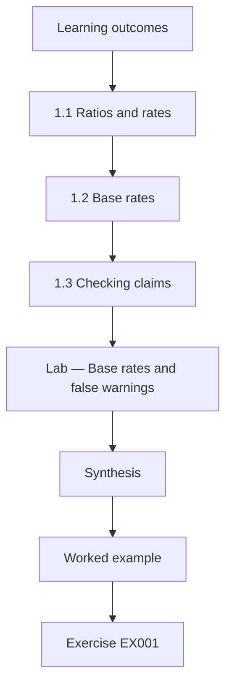

### Logical drawing

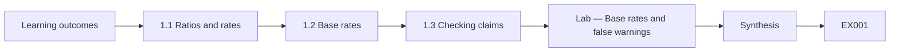

```text
[Learning outcomes]
    |
    v
[1.1 Ratios and rates]
    |
    v
[1.2 Base rates]
    |
    v
[1.3 Checking claims]
    |
    v
[Lab — Base rates and false warnings]
    |
    v
[Synthesis]
    |
    v
[Worked example] --> [Exercise EX001]
```
<!-- cyberabc:lesson-figures:end ch-01 -->


### Learning outcomes

You will (1) use ratios and percentages to describe security behaviour; (2) reason about base rates when judging alerts; (3) check claims with simple arithmetic.

### 1.1 Ratios and rates

Nadia Farouk, a first-year student at the fictional Fenmoor University, begins her course by studying a library network. The fictional Ashcombe Community Library Network has 120 staff across nine branches. Last year staff reported 48 suspicious emails, and 12 of them were genuinely malicious. A ratio compares two counts, and a rate expresses one count per unit, such as reports per hundred staff. Nadia computes 48 reports for 120 staff, or 40 per hundred staff, and 12 of 48, or one quarter, as the share of reports that were real threats.

### 1.2 Base rates

Her supervisor, Dr Owen Prescott, asks Nadia to think about base rates. If one email in a thousand is malicious and a warning banner flags 5% of all emails, most flagged emails will be harmless, because harmless emails vastly outnumber malicious ones. People who see many false warnings learn to ignore them, a pattern Herley (2009) described when he argued that users rationally ignore advice whose costs exceed its benefits. Understanding base rates helps Nadia see why staff behaviour that looks careless can be a sensible response to noisy signals.

### 1.3 Checking claims

Nadia reads a vendor brochure claiming that training reduces phishing risk by 70%. She asks: 70% of what, measured how, and compared with what? A drop in clicks on easy simulated emails does not mean a drop in real losses. She checks the arithmetic of another claim, that reports rose from 20 to 48, and finds it is a 140% increase, not the 240% stated. Simple arithmetic and careful questions protect against misleading figures, which are common in security marketing and even in internal reports. She keeps a checklist of these questions.

### Lab — Base rates and false warnings

```python
# Base rates and false warnings (synthetic): 100,000 emails, 1 in 1,000 malicious.
n = 100_000; mal = n // 1000; ben = n - mal
flag_mal = int(mal * 0.90)          # banner catches 90% of malicious
flag_ben = int(ben * 0.05)          # and flags 5% of harmless
flagged = flag_mal + flag_ben
print(f"flagged {flagged}: malicious {flag_mal}, harmless {flag_ben} ({flag_ben / flagged:.0%} harmless)")
```

Run with `python3 lab_base.py`. Verified output:

```text
flagged 5085: malicious 90, harmless 4995 (98% harmless)
```

### Worked example

Nadia computes report rates, uses base rates to explain ignored warnings and checks claimed percentages.

> **Synthetic case.** The library network is synthetic; Herley (2009) is real.

### Errors and limits

Percentages hide small counts. Base rates change over time.

### Exercises

- **EX001 — Reports per hundred.** How many reports per hundred staff did Ashcombe receive? *Rubric:* 3 = 40;; 2 = 48 per 120;; 1 = 48;; 0 = none.
- **EX002 — Flagged harmless share.** In the lab, what share of flagged emails were harmless? *Rubric:* 3 = about 98%;; 2 = most;; 1 = 5%;; 0 = none.
- **EX003 — Increase check.** What is the true increase from 20 to 48 reports? *Rubric:* 3 = 140%;; 2 = 28 more;; 1 = 240%;; 0 = none.

### Synthesis

Ratios, base rates and checked arithmetic are the first tools for reasoning about security behaviour.

### Continue studying — chapter 01 of 40

[← Course home](../../README.md) · [Course chapter index](../SUBJECTS.md) · [Chapter 02 (draft) →](#ch-02)

<a id="ch-02"></a>

## Chapter 2 — Computing systems

<!-- cyberabc:lesson-figures:start ch-02 -->
### Lesson map

Lesson 02 published. Map, example, EX004.

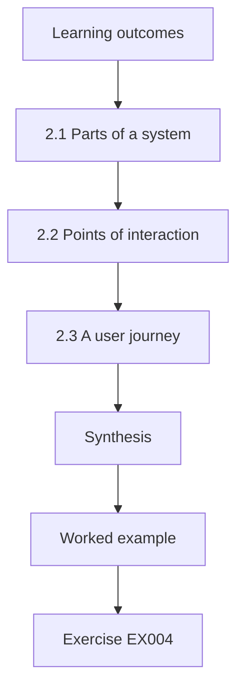

### Logical drawing

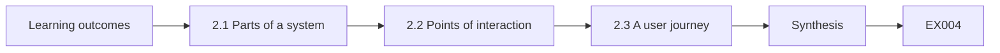

```text
[Learning outcomes]
    |
    v
[2.1 Parts of a system]
    |
    v
[2.2 Points of interaction]
    |
    v
[2.3 A user journey]
    |
    v
[Synthesis]
    |
    v
[Worked example] --> [Exercise EX004]
```
<!-- cyberabc:lesson-figures:end ch-02 -->


### Learning outcomes

You will (1) describe the parts of a computing system staff use daily; (2) identify where people interact with security; (3) map a simple user journey.

### 2.1 Parts of a system

A computing system includes hardware, software, data, networks and the people who use them. At Ashcombe, staff use shared desktop computers at counters, laptops in offices and a library management system that holds member records. Public computers are used by visitors. Nadia learns that security depends on all these parts working together. A strong password policy on the management system means little if staff leave counter computers logged in while serving members, because the weakest interaction often decides the outcome rather than the strongest technical control.

### 2.2 Points of interaction

Nadia lists the points where staff interact with security: logging in at the start of shifts, locking screens when stepping away, handling member data requests, opening email and approving software updates. Each point demands attention and time. Adams and Sasse (1999) showed that users struggle with security mechanisms that do not fit their work, and that they are not the enemy but people trying to get their jobs done. Mapping these points helps Nadia see where the system asks too much of people and where design could help them.

### 2.3 A user journey

Nadia maps the journey of a counter assistant during a busy morning: log in, serve members, step away to fetch a book, return, answer a phone query and check email between members. She notes that locking the screen each time takes several seconds and a password re-entry. Assistants often leave screens unlocked because queues form quickly. She suggests a short automatic lock with tap-card unlocking. The map shows that the problem lies in the fit between task and control rather than in the attitude of staff.

### Worked example

Nadia lists system parts, identifies interaction points and maps a counter assistant's journey to suggest tap-card unlocking.

> **Synthetic case.** The journey is synthetic; Adams and Sasse (1999) is real.

### Errors and limits

Journey maps simplify real work. Card readers cost money.

### Exercises

- **EX004 — Weakest interaction.** Why does a strong password policy matter little in one case? *Rubric:* 3 = if counter computers stay logged in;; 2 = logged in;; 1 = vague;; 0 = none.
- **EX005 — Adams and Sasse.** What did Adams and Sasse (1999) show about users? *Rubric:* 3 = they are not the enemy and struggle with ill-fitting mechanisms;; 2 = fit;; 1 = careless;; 0 = none.
- **EX006 — Suggested fix.** What fix did Nadia suggest for unlocked screens? *Rubric:* 3 = short automatic lock with tap-card unlocking;; 2 = tap card;; 1 = longer passwords;; 0 = none.

### Synthesis

Security lives at the points where people interact with systems, and fit with work matters most.

### Continue studying — chapter 02 of 40

[← Chapter 01 (draft)](#ch-01) · [Course chapter index](../SUBJECTS.md) · [Chapter 03 (draft) →](#ch-03)

<a id="ch-03"></a>

## Chapter 3 — Programming I

<!-- cyberabc:lesson-figures:start ch-03 -->
### Lesson map

Lesson 03 published. Map, example, EX007.

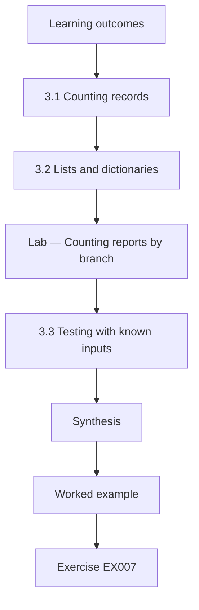

### Logical drawing

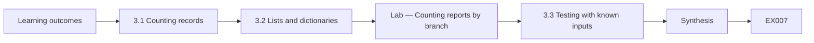

```text
[Learning outcomes]
    |
    v
[3.1 Counting records]
    |
    v
[3.2 Lists and dictionaries]
    |
    v
[Lab — Counting reports by branch]
    |
    v
[3.3 Testing with known inputs]
    |
    v
[Synthesis]
    |
    v
[Worked example] --> [Exercise EX007]
```
<!-- cyberabc:lesson-figures:end ch-03 -->


### Learning outcomes

You will (1) write simple Python to count and summarise records; (2) use lists and dictionaries for behaviour data; (3) test a script with known inputs.

### 3.1 Counting records

Nadia writes her first Python script to count suspicious email reports by branch. Each record is a line with a date, branch and verdict. The script reads the lines, splits each into fields and adds one to a counter for the branch. Python's dictionary is ideal for this, because it maps each branch name to its count. She prints the totals in order. Even a simple count is useful: it shows that two branches with public computers report far more emails than the others, which raises a question worth exploring.

### 3.2 Lists and dictionaries

A list holds items in order, such as all report dates, while a dictionary holds pairs, such as branch and count. Nadia uses a list of dictionaries, one per report, so each report keeps its fields together. She then filters the list to find malicious reports and groups them by branch. She learns to keep data synthetic and free of personal names, since even practice code should respect privacy. Good habits learned on small scripts carry into larger projects later in the course.

### Lab — Counting reports by branch

```python
# Count synthetic suspicious-email reports by branch.
rows = ["2026-01-03,Central,malicious", "2026-01-04,Riverside,harmless"] + \
       [f"2026-{2 + d // 28:02d}-{1 + d % 28:02d},{b},{v}" for d, (b, v) in enumerate(
           [("Central", "harmless")] * 13 + [("Riverside", "malicious")] * 9 + [("Hill", "harmless")] * 6 +
           [("Market", "harmless")] * 5 + [("Oakfield", "malicious")] * 4 + [("Mill", "harmless")] * 3 +
           [("Quay", "harmless")] * 3 + [("Elm", "harmless")] * 2 + [("Abbey", "malicious")] * 1, start=1) if True]
counts = {}
for r in rows:
    parts = r.split(",")
    if len(parts) != 3: print("skip", r); continue
    counts[parts[1]] = counts.get(parts[1], 0) + 1
for b, c in sorted(counts.items(), key=lambda x: -x[1]): print(b, c)
print("total", sum(counts.values()))
```

Run with `python3 lab_count.py`. Verified output:

```text
Central 14
Riverside 10
Hill 6
Market 5
Oakfield 4
Mill 3
Quay 3
Elm 2
Abbey 1
total 48
```

### 3.3 Testing with known inputs

Nadia tests her script by creating a tiny file with five reports whose totals she knows. If the script's output matches her hand count, she gains confidence. She also tests an empty file and a line with a missing field, and adds a check that skips broken lines with a warning. Testing with known inputs is a basic discipline in programming, and it matters in security work because wrong counts can lead to wrong decisions about where to invest effort or training.

### Worked example

Nadia counts synthetic reports by branch with a dictionary, groups malicious reports and tests her script with known inputs.

> **Synthetic case.** The data are synthetic.

### Errors and limits

Broken lines may hide real problems. Small tests do not prove correctness.

### Exercises

- **EX007 — Dictionary use.** Why is a dictionary suited to counting by branch? *Rubric:* 3 = it maps each branch to its count;; 2 = mapping;; 1 = list order;; 0 = none.
- **EX008 — Top branch.** Which branch reported most in the lab? *Rubric:* 3 = Central with 14;; 2 = Central;; 1 = vague;; 0 = none.
- **EX009 — Broken lines.** How does the script handle a line with a missing field? *Rubric:* 3 = skips it with a warning;; 2 = skip;; 1 = crash;; 0 = none.

### Synthesis

Simple, tested scripts turn records into counts that raise useful questions.

### Continue studying — chapter 03 of 40

[← Chapter 02 (draft)](#ch-02) · [Course chapter index](../SUBJECTS.md) · [Chapter 04 (draft) →](#ch-04)

<a id="ch-04"></a>

## Chapter 4 — Academic writing

<!-- cyberabc:lesson-figures:start ch-04 -->
### Lesson map

Lesson 04 published. Map, example, EX010.

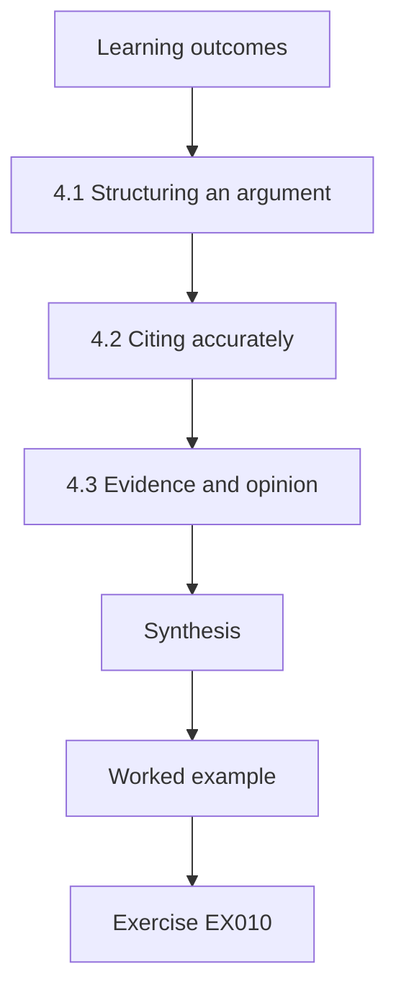

### Logical drawing

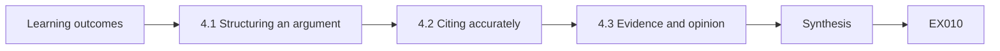

```text
[Learning outcomes]
    |
    v
[4.1 Structuring an argument]
    |
    v
[4.2 Citing accurately]
    |
    v
[4.3 Evidence and opinion]
    |
    v
[Synthesis]
    |
    v
[Worked example] --> [Exercise EX010]
```
<!-- cyberabc:lesson-figures:end ch-04 -->


### Learning outcomes

You will (1) structure a short academic argument; (2) cite sources accurately; (3) distinguish evidence from opinion.

### 4.1 Structuring an argument

Nadia's first essay asks whether staff are the weakest link in security. She structures it with a claim, reasons, evidence and a conclusion. Her claim is that calling staff the weakest link misdirects effort. Her reasons are that systems often ask too much of people and that blaming staff discourages reporting. Each paragraph makes one point and links to the next. Dr Prescott reminds her that a good argument also addresses the strongest counter-argument, which in this case is that many breaches do involve human actions.

### 4.2 Citing accurately

Nadia cites Sasse, Brostoff and Weirich (2001), whose paper on transforming the weakest link argued that security must be designed around human capabilities. She also cites the Verizon Data Breach Investigations Report, which reports that a large share of breaches involve a human element. She checks each source directly rather than copying citations from other essays, records full details and never invents a page number or DOI. Accurate citation lets readers check her evidence and protects her from repeating others' mistakes about what a source actually said.

### 4.3 Evidence and opinion

Nadia learns to separate evidence, such as a study's findings, from opinion, such as a blogger's view. She marks each sentence in her draft as claim, evidence or interpretation. She finds two sentences where she presented an opinion as fact and rewrites them with hedging. She also notes that the DBIR's human element figure counts errors, misuse and social engineering together, so it does not show that staff are careless. Reading what a statistic actually measures is part of honest academic writing.

### Worked example

Nadia writes a structured essay on the weakest-link idea, cites Sasse et al. and the DBIR accurately and separates evidence from opinion.

> **Synthetic case.** The essay is synthetic; Sasse et al. (2001) and the Verizon DBIR are real.

### Errors and limits

Hedging can become vague. Reports update their figures yearly.

### Exercises

- **EX010 — Counter-argument.** What counter-argument must Nadia address? *Rubric:* 3 = many breaches involve human actions;; 2 = human element;; 1 = vague;; 0 = none.
- **EX011 — Sasse et al..** What did Sasse, Brostoff and Weirich (2001) argue? *Rubric:* 3 = security must be designed around human capabilities;; 2 = design;; 1 = users are careless;; 0 = none.
- **EX012 — DBIR caution.** Why does the DBIR figure not show staff are careless? *Rubric:* 3 = it combines errors, misuse and social engineering;; 2 = combined;; 1 = vague;; 0 = none.

### Synthesis

Academic writing structures claims, cites accurately and keeps evidence distinct from opinion.

### Continue studying — chapter 04 of 40

[← Chapter 03 (draft)](#ch-03) · [Course chapter index](../SUBJECTS.md) · [Chapter 05 (draft) →](#ch-05)

<a id="ch-05"></a>

## Chapter 5 — Security literacy

<!-- cyberabc:lesson-figures:start ch-05 -->
### Lesson map

Lesson 05 published. Map, example, EX013.

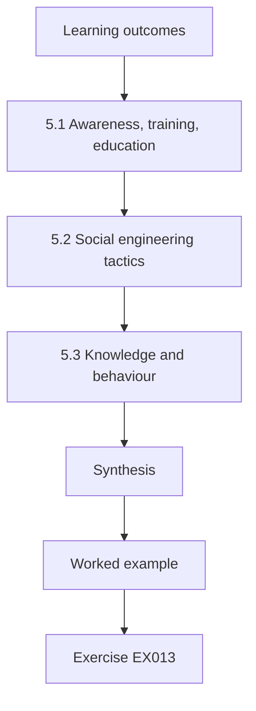

### Logical drawing

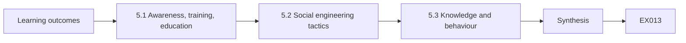

```text
[Learning outcomes]
    |
    v
[5.1 Awareness, training, education]
    |
    v
[5.2 Social engineering tactics]
    |
    v
[5.3 Knowledge and behaviour]
    |
    v
[Synthesis]
    |
    v
[Worked example] --> [Exercise EX013]
```
<!-- cyberabc:lesson-figures:end ch-05 -->


### Learning outcomes

You will (1) define security awareness, training and education; (2) recognise common social engineering tactics; (3) explain why knowledge does not guarantee behaviour.

### 5.1 Awareness, training, education

NIST SP 800-16 (Wilson et al., 1998) distinguished awareness, which draws attention to security, from training, which builds skills, and education, which builds understanding. NIST SP 800-50r1 (Hansche et al., 2024) updates guidance on building a cybersecurity and privacy learning programme. Nadia uses these distinctions to analyse Ashcombe's current efforts: a yearly video counts as awareness, but nobody has been trained to verify unusual requests. She sees that different staff need different mixes, and that awareness alone cannot build the skills needed for handling member data requests safely.

### 5.2 Social engineering tactics

Nadia studies common tactics described by Hadnagy (2018): pretexting, where an attacker invents a believable story; phishing, using deceptive emails; and impersonation by phone. Cialdini's principles of influence, such as authority, urgency and liking, explain why these tactics work. At a library, a caller might pose as a council officer demanding member details urgently. Nadia learns to recognise these patterns so she can design procedures that help staff pause, but she studies them only to defend, never to deceive real people without authorisation.

### 5.3 Knowledge and behaviour

Staff at Ashcombe can describe phishing when asked, yet some still click. Nadia learns that knowing is not doing. Bada, Sasse and Nurse (2019) argued that awareness campaigns often fail because they assume knowledge leads to behaviour, ignoring workload, habits and the effort secure actions take. People act under time pressure, with incomplete information and competing goals. Security literacy therefore includes understanding why behaviour departs from knowledge, which points to designing easier secure options rather than repeating the same messages louder. Dr Prescott agrees.

### Worked example

Nadia distinguishes awareness, training and education, recognises pretexting and influence tactics and explains why knowledge does not ensure behaviour.

> **Synthetic case.** Examples are synthetic; SP 800-16, SP 800-50r1, Hadnagy (2018), Cialdini (2021) and Bada et al. (2019) are real.

### Errors and limits

Tactics evolve. Categories overlap in practice.

### Exercises

- **EX013 — Three levels.** What three levels did SP 800-16 distinguish? *Rubric:* 3 = awareness, training and education;; 2 = three;; 1 = vague;; 0 = none.
- **EX014 — Pretexting.** What is pretexting? *Rubric:* 3 = inventing a believable story to deceive;; 2 = story;; 1 = phishing;; 0 = none.
- **EX015 — Campaign failure.** Why do campaigns often fail according to Bada et al. (2019)? *Rubric:* 3 = they assume knowledge leads to behaviour;; 2 = assumption;; 1 = vague;; 0 = none.

### Synthesis

Security literacy covers awareness, tactics and the gap between knowing and doing.

### Continue studying — chapter 05 of 40

[← Chapter 04 (draft)](#ch-04) · [Course chapter index](../SUBJECTS.md) · [Chapter 06 (draft) →](#ch-06)

<a id="ch-06"></a>

## Chapter 6 — Discrete structures

<!-- cyberabc:lesson-figures:start ch-06 -->
### Lesson map

Lesson 06 published. Map, example, EX016.

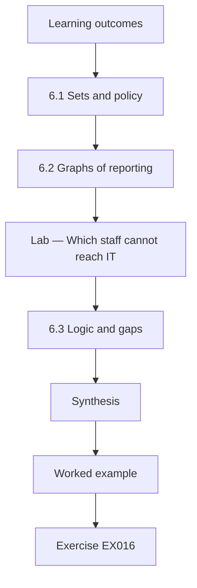

### Logical drawing

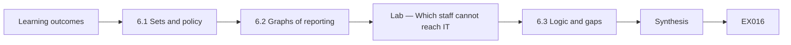

```text
[Learning outcomes]
    |
    v
[6.1 Sets and policy]
    |
    v
[6.2 Graphs of reporting]
    |
    v
[Lab — Which staff cannot reach IT]
    |
    v
[6.3 Logic and gaps]
    |
    v
[Synthesis]
    |
    v
[Worked example] --> [Exercise EX016]
```
<!-- cyberabc:lesson-figures:end ch-06 -->


### Learning outcomes

You will (1) use sets and logic to describe policy rules; (2) model reporting relationships as graphs; (3) find gaps in rules with simple logic.

### 6.1 Sets and policy

A set is a collection of distinct items. Nadia describes Ashcombe's staff as sets: counter staff, managers, IT staff and volunteers. A policy rule might say that only managers and IT staff may export member lists. In set terms, permitted exporters are the union of managers and IT staff. She checks the actual access list and finds that two volunteers belong to the set of exporters. Expressing rules as sets makes it easy to compare what the policy intends with what the system actually allows.

### 6.2 Graphs of reporting

A graph has nodes connected by edges. Nadia draws a graph in which staff are nodes and an edge shows whom each person would tell about a suspicious email. Most counter staff would tell their branch manager, who might or might not tell IT. Some branches have no path to IT at all. The lab finds which nodes cannot reach the IT node. A graph makes visible the routes by which warnings travel, and shows where a single absent manager could block an important report from reaching people able to act.

### Lab — Which staff cannot reach IT

```python
# Reporting graph: who can reach IT? (synthetic)
edges = {"IT": [], "Central-mgr": ["IT"], "Riverside-mgr": ["IT"], "Hill-mgr": ["Central-mgr"], "Quay-mgr": [], "Elm-mgr": []}
staff = {"Central": 20, "Riverside": 18, "Hill": 12, "Quay": 5, "Elm": 6}
for b in staff: edges[f"{b}-staff"] = [f"{b}-mgr"]
def reach(n, seen=None):
    seen = seen or set()
    if n == "IT": return True
    seen.add(n)
    return any(reach(m, seen) for m in edges[n] if m not in seen)
blocked = [b for b in staff if not reach(f"{b}-staff")]
print("branches without a route to IT:", blocked, "staff:", sum(staff[b] for b in blocked))
```

Run with `python3 lab_graph.py`. Verified output:

```text
branches without a route to IT: ['Quay', 'Elm'] staff: 11
```

### 6.3 Logic and gaps

Nadia writes the visitor computer rule in logic: a session must end if the visitor leaves or if thirty minutes pass. She tests cases and finds a gap: if a visitor leaves without logging out and another sits down within thirty minutes, the session continues with the first visitor's email open. She proposes adding a rule that sessions end when the screen is idle for three minutes. Simple logic exposes cases that plain language hides, and testing rules against cases is a habit she will use throughout the course.

### Worked example

Nadia uses sets to compare policy with access lists, a graph to find staff with no route to IT and logic to find a gap in visitor sessions.

> **Synthetic case.** The data are synthetic.

### Errors and limits

Real reporting routes are informal. Idle timeouts can annoy visitors.

### Exercises

- **EX016 — Union of sets.** Which set union describes permitted exporters? *Rubric:* 3 = managers and IT staff;; 2 = union;; 1 = volunteers;; 0 = none.
- **EX017 — Unreachable staff.** How many staff could not reach IT in the lab? *Rubric:* 3 = 11, at Quay and Elm;; 2 = 11;; 1 = vague;; 0 = none.
- **EX018 — Session gap.** What gap did the logic test reveal? *Rubric:* 3 = a new visitor inherits an open session;; 2 = inherit;; 1 = vague;; 0 = none.

### Synthesis

Sets, graphs and logic expose differences between intended and actual rules and routes.

### Continue studying — chapter 06 of 40

[← Chapter 05 (draft)](#ch-05) · [Course chapter index](../SUBJECTS.md) · [Chapter 07 (draft) →](#ch-07)

<a id="ch-07"></a>

## Chapter 7 — Networks and protocols

<!-- cyberabc:lesson-figures:start ch-07 -->
### Lesson map

Lesson 07 published. Map, example, EX019.

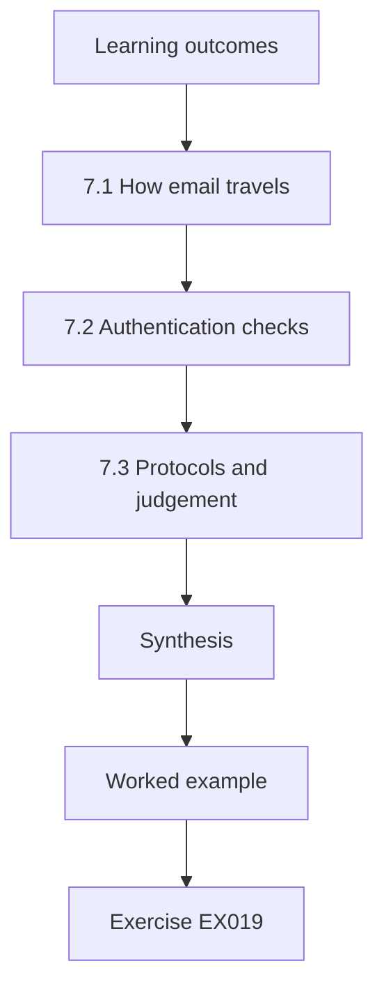

### Logical drawing

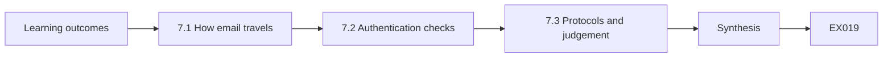

```text
[Learning outcomes]
    |
    v
[7.1 How email travels]
    |
    v
[7.2 Authentication checks]
    |
    v
[7.3 Protocols and judgement]
    |
    v
[Synthesis]
    |
    v
[Worked example] --> [Exercise EX019]
```
<!-- cyberabc:lesson-figures:end ch-07 -->


### Learning outcomes

You will (1) explain how email travels and how sender identity can be forged; (2) describe email authentication at a high level; (3) relate protocol limits to human judgement.

### 7.1 How email travels

When someone sends an email, their mail server passes it across the internet to the recipient's server, which stores it until the recipient reads it. The basic email protocol was designed for cooperation, not security, so the sender address shown to the reader can be set to almost anything. Nadia learns that this is why staff at Ashcombe received messages appearing to come from the head librarian that were actually sent from elsewhere. Understanding this design history explains why people cannot rely on the displayed sender name.

### 7.2 Authentication checks

Email systems now add checks that let receiving servers test whether a message came from a server authorised by the sender's domain. When checks fail, the receiving system can reject the message or mark it. Nadia learns these mechanisms in outline only, enough to understand that they reduce forged domain messages but cannot stop lookalike domains or compromised genuine accounts. She notes that technical checks shift the problem rather than removing it, leaving some judgement to people for messages that pass every check yet are still deceptive.

### 7.3 Protocols and judgement

Whitten and Tygar (1999) showed that even well-designed security software can be too hard for ordinary users, in their study of email encryption. Nadia draws a lesson: when protocols leave decisions to people, the interface must make the right decision easy. She suggests that Ashcombe's email system show a clear tag on external messages and a warning when a display name matches a staff member but the address is external. These cues support judgement without asking staff to understand the protocols underneath.

### Worked example

Nadia explains forged sender addresses, outlines authentication checks and suggests external tags and name-match warnings.

> **Synthetic case.** Examples are synthetic; Whitten and Tygar (1999) is real.

### Errors and limits

Tags become ignored if everything is external. Checks depend on correct configuration.

### Exercises

- **EX019 — Forged sender.** Why can the displayed sender be forged? *Rubric:* 3 = basic email was designed for cooperation not security;; 2 = design;; 1 = vague;; 0 = none.
- **EX020 — Check limits.** What can authentication checks not stop? *Rubric:* 3 = lookalike domains and compromised accounts;; 2 = lookalikes;; 1 = vague;; 0 = none.
- **EX021 — Whitten and Tygar.** What did Whitten and Tygar (1999) show? *Rubric:* 3 = security software can be too hard for ordinary users;; 2 = usability;; 1 = vague;; 0 = none.

### Synthesis

Protocol limits leave judgement to people, so interfaces must support it.

### Continue studying — chapter 07 of 40

[← Chapter 06 (draft)](#ch-06) · [Course chapter index](../SUBJECTS.md) · [Chapter 08 (draft) →](#ch-08)

<a id="ch-08"></a>

## Chapter 8 — Programming II

<!-- cyberabc:lesson-figures:start ch-08 -->
### Lesson map

Lesson 08 published. Map, example, EX022.

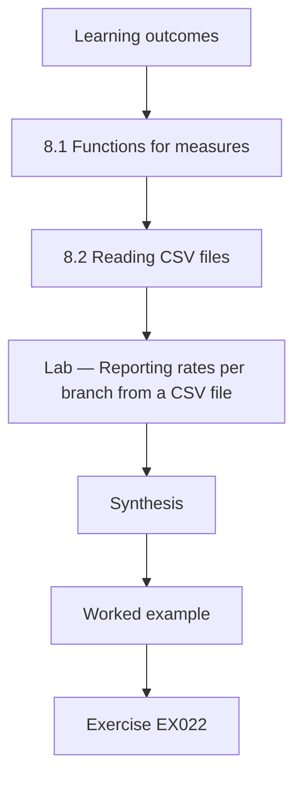

### Logical drawing

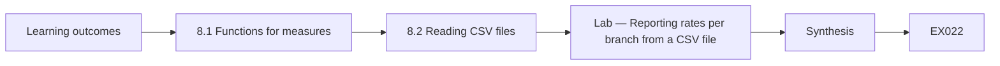

```text
[Learning outcomes]
    |
    v
[8.1 Functions for measures]
    |
    v
[8.2 Reading CSV files]
    |
    v
[Lab — Reporting rates per branch from a CSV file]
    |
    v
[Synthesis]
    |
    v
[Worked example] --> [Exercise EX022]
```
<!-- cyberabc:lesson-figures:end ch-08 -->


### Learning outcomes

You will (1) write functions to compute behaviour measures; (2) read data from CSV files; (3) handle errors and document code.

### 8.1 Functions for measures

Nadia restructures her code into functions. One function computes the reporting rate for a branch, another the share of reports that are genuine. Functions make code reusable and testable, since each can be checked on its own. She gives them clear names and short descriptions of what they take and return. She learns that computing a rate requires guarding against division by zero, because a new branch might have no staff records yet. Small decisions like this prevent errors that could mislead managers reading the results.

### 8.2 Reading CSV files

Ashcombe's IT team provides a synthetic export of reports as a comma-separated values file. Nadia uses Python's csv module, which handles quoted fields and commas inside text correctly, unlike simple splitting. She reads each row into a dictionary keyed by column name, so the code remains correct even if columns are reordered. She computes reporting rates per branch and the overall share of genuine threats. The lab prints rates for each branch, and she notices that rates vary widely between similar branches.

### Lab — Reporting rates per branch from a CSV file

```python
# Reporting rates per branch from a CSV (synthetic).
import csv, io
data = "branch,staff,reports,genuine\nCentral,30,14,3\nRiverside,24,10,4\nHill,15,6,1\nMarket,14,5,1\nOakfield,10,4,2\nMill,8,3,0\nQuay,5,3,1\nElm,6,2,0\nAbbey,8,1,0\nNew,,0,0\n"
def rate(r, s): return 100 * r / s if s else None
skipped = 0; rows = []
for row in csv.DictReader(io.StringIO(data)):
    if not row["staff"]: skipped += 1; continue
    rows.append((row["branch"], rate(int(row["reports"]), int(row["staff"]))))
for b, r in sorted(rows, key=lambda x: -x[1]): print(f"{b}: {r:.0f} per 100 staff")
print("skipped rows:", skipped)
```

Run with `python3 lab_csv.py`. Verified output:

```text
Quay: 60 per 100 staff
Central: 47 per 100 staff
Riverside: 42 per 100 staff
Hill: 40 per 100 staff
Oakfield: 40 per 100 staff
Mill: 38 per 100 staff
Market: 36 per 100 staff
Elm: 33 per 100 staff
Abbey: 12 per 100 staff
skipped rows: 1
```

### 8.3 Errors and documentation

Nadia adds error handling: rows with missing staff counts are logged and skipped, and the script reports how many rows it skipped so nothing is hidden. She writes a short readme explaining the input format, the measures and their limits. Documentation matters because others may reuse her script, and a measure without a definition can be misread. Dr Prescott reminds her that good code tells readers what it assumes, which is part of honest analysis as much as good engineering. She keeps it short.

### Worked example

Nadia writes measure functions with zero guards, reads a CSV with the csv module and documents assumptions and skipped rows.

> **Synthetic case.** Data are synthetic.

### Errors and limits

Skipped rows may bias results. Rates for small branches are unstable.

### Exercises

- **EX022 — Zero guard.** Why guard against division by zero? *Rubric:* 3 = a branch might have no staff records;; 2 = new branch;; 1 = vague;; 0 = none.
- **EX023 — Highest rate.** Which branch had the highest reporting rate in the lab? *Rubric:* 3 = Quay at 60 per hundred;; 2 = Quay;; 1 = Central;; 0 = none.
- **EX024 — Skipped rows.** Why report the number of skipped rows? *Rubric:* 3 = so nothing is hidden;; 2 = transparency;; 1 = vague;; 0 = none.

### Synthesis

Functions, proper CSV reading and documented assumptions make measures trustworthy.

### Continue studying — chapter 08 of 40

[← Chapter 07 (draft)](#ch-07) · [Course chapter index](../SUBJECTS.md) · [Chapter 09 (draft) →](#ch-09)

<a id="ch-09"></a>

## Chapter 9 — Data and databases

<!-- cyberabc:lesson-figures:start ch-09 -->
### Lesson map

Lesson 09 published. Map, example, EX025.

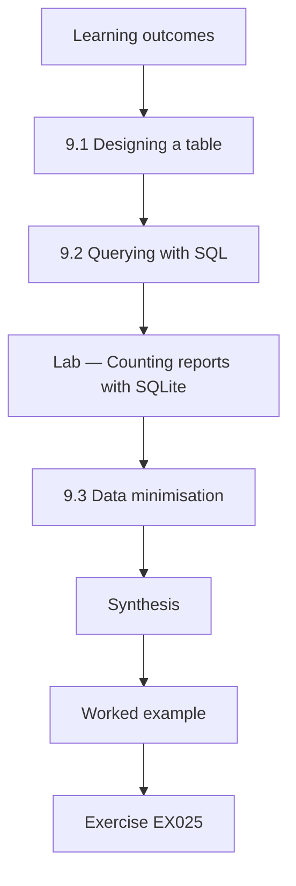

### Logical drawing

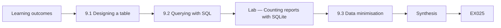

```text
[Learning outcomes]
    |
    v
[9.1 Designing a table]
    |
    v
[9.2 Querying with SQL]
    |
    v
[Lab — Counting reports with SQLite]
    |
    v
[9.3 Data minimisation]
    |
    v
[Synthesis]
    |
    v
[Worked example] --> [Exercise EX025]
```
<!-- cyberabc:lesson-figures:end ch-09 -->


### Learning outcomes

You will (1) design a simple table for security reports; (2) query data with SQL; (3) apply data minimisation.

### 9.1 Designing a table

Nadia designs a table for reports with columns for report identifier, date, branch, category and verdict. She deliberately leaves out the reporter's name, because analysis needs only branch-level counts and personal data would create privacy risk. Each column has a type and rules, such as the verdict being one of malicious, harmless or unknown. A well-designed table makes errors harder: a misspelled verdict is rejected rather than silently counted as a new category that distorts results. The IT lead reviews the design and agrees the rules before any data are loaded.

### 9.2 Querying with SQL

Using Python's built-in sqlite3 module, Nadia loads synthetic reports and writes queries. One counts reports per branch, another counts malicious reports per month, and a third finds the most common categories. SQL expresses these questions compactly and lets the database do the work. The lab shows that invoice-themed emails were the most common malicious category. She learns to read query results critically, checking whether a high count reflects more attacks or simply more reporting at a particular branch. She saves each query with a comment.

### Lab — Counting reports with SQLite

```python
# Counting synthetic reports with SQLite.
import sqlite3
db = sqlite3.connect(":memory:")
db.execute("create table reports(id integer primary key, month text, branch text, category text, verdict text check (verdict in ('malicious','harmless','unknown')))")
rows = [("2026-01", "Central", "invoice", "malicious")] * 5 + [("2026-02", "Riverside", "parcel", "malicious")] * 3 + \
       [("2026-02", "Hill", "account", "malicious")] * 2 + [("2026-03", "Central", "invoice", "malicious")] * 2 + [("2026-03", "Market", "newsletter", "harmless")] * 36
db.executemany("insert into reports(month,branch,category,verdict) values (?,?,?,?)", rows)
for r in db.execute("select category, count(*) from reports where verdict='malicious' group by category order by 2 desc"): print(r)
```

Run with `python3 lab_sql.py`. Verified output:

```text
('invoice', 7)
('parcel', 3)
('account', 2)
```

### 9.3 Data minimisation

Data minimisation means collecting only the data needed for a purpose. Nadia explains to Ashcombe's IT lead why reporter names should not be stored in the analysis table: names could be used to judge individuals, which would discourage reporting, and they add little to programme decisions. The original reports remain in the email system under its normal retention rules. The principle connects privacy law with the human factors goal of making people feel safe to report anything that seems odd. The IT lead agrees.

### Worked example

Nadia designs a report table without names, queries it with SQLite and argues for data minimisation.

> **Synthetic case.** Data are synthetic.

### Errors and limits

Removing names prevents some follow-up. Category labels can be inconsistent.

### Exercises

- **EX025 — Name excluded.** Why does the table exclude reporter names? *Rubric:* 3 = analysis needs only branch counts and names create risk;; 2 = minimisation;; 1 = vague;; 0 = none.
- **EX026 — Top category.** Which malicious category was most common in the lab? *Rubric:* 3 = invoice;; 2 = invoices;; 1 = parcel;; 0 = none.
- **EX027 — Reporting effect.** What should Nadia check when a branch count is high? *Rubric:* 3 = whether it reflects more attacks or more reporting;; 2 = reporting;; 1 = vague;; 0 = none.

### Synthesis

Well-designed tables, simple queries and minimised data support safe analysis.

### Continue studying — chapter 09 of 40

[← Chapter 08 (draft)](#ch-08) · [Course chapter index](../SUBJECTS.md) · [Chapter 10 (draft) →](#ch-10)

<a id="ch-10"></a>

## Chapter 10 — Ethics and authorized practice

<!-- cyberabc:lesson-figures:start ch-10 -->
### Lesson map

Lesson 10 published. Map, example, EX028.

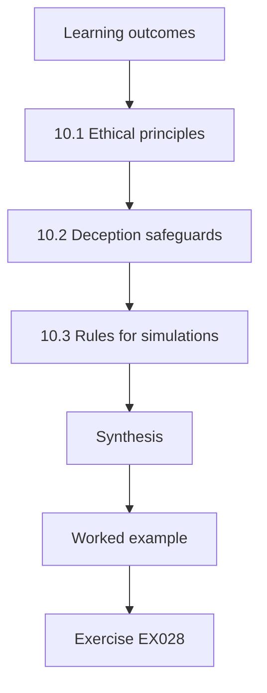

### Logical drawing

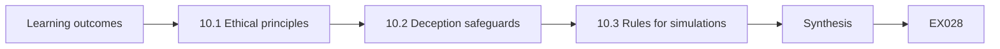

```text
[Learning outcomes]
    |
    v
[10.1 Ethical principles]
    |
    v
[10.2 Deception safeguards]
    |
    v
[10.3 Rules for simulations]
    |
    v
[Synthesis]
    |
    v
[Worked example] --> [Exercise EX028]
```
<!-- cyberabc:lesson-figures:end ch-10 -->


### Learning outcomes

You will (1) apply ethical principles to human factors research; (2) explain why deception requires special safeguards; (3) describe ethical rules for phishing simulations.

### 10.1 Ethical principles

Research with people must respect autonomy, avoid harm and treat people fairly. Nadia learns that her university requires ethics approval for any study involving staff, including surveys and interviews. Participants must know what the study involves, agree freely and be able to withdraw. Data must be protected and results reported without identifying individuals. These principles apply even to small student projects, because a careless question or a leaked comment can harm someone's job or relationships with colleagues. She completes the ethics module before any fieldwork begins.

### 10.2 Deception safeguards

Some security exercises involve deception, such as simulated phishing emails. Deception conflicts with informed consent, so it needs strong justification and safeguards. Nadia learns that ethics committees usually require that the deception is necessary, that harm is minimal, that participants are told afterwards and that they can withdraw their data. In organisations, staff representatives should agree the programme. She notes that deception can damage trust, which is itself a security asset, so it should be used sparingly and with care. She records this view.

### 10.3 Rules for simulations

Nadia drafts rules for any future simulation at Ashcombe: announce that a programme exists; agree templates with staff representatives; avoid lures exploiting personal distress, such as pay or health; give immediate, kind feedback; report only aggregate results; and never use results for discipline. Lain, Kostiainen and Čapkun (2022) found that some common practices, such as long training pages after a click, did not help. The rules aim to make simulations a learning tool that respects staff rather than a trap that undermines their trust.

### Worked example

Nadia applies research ethics, explains deception safeguards and drafts six rules for ethical simulations.

> **Synthetic case.** The rules are synthetic guidance; Lain et al. (2022) is real.

### Errors and limits

Rules can be ignored under pressure. Representatives may not exist in small organisations.

### Exercises

- **EX028 — Participant rights.** What must participants be able to do? *Rubric:* 3 = know, agree freely and withdraw;; 2 = consent;; 1 = vague;; 0 = none.
- **EX029 — Trust as asset.** Why should deception be used sparingly? *Rubric:* 3 = it can damage trust, which is a security asset;; 2 = trust;; 1 = vague;; 0 = none.
- **EX030 — Banned lure type.** Which lures do the rules ban? *Rubric:* 3 = those exploiting personal distress such as pay or health;; 2 = distress;; 1 = vague;; 0 = none.

### Synthesis

Ethical practice requires consent, safeguards for deception and respectful simulation rules.

### Continue studying — chapter 10 of 40

[← Chapter 09 (draft)](#ch-09) · [Course chapter index](../SUBJECTS.md) · [Chapter 11 (draft) →](#ch-11)

<a id="ch-11"></a>

## Chapter 11 — Operating systems

<!-- cyberabc:lesson-figures:start ch-11 -->
### Lesson map

Lesson 11 published. Map, example, EX031.

```mermaid
flowchart TD
  N0["Learning outcomes"]
  N1["11.1 Accounts and permissions"]
  N2["11.2 Update prompts"]
  N3["11.3 Reducing burden"]
  N4["Synthesis"]
  N0 --> N1 --> N2 --> N3 --> N4
  N4 --> EX["Worked example"]
  EX --> Q["Exercise EX031"]
```

### Logical drawing

```mermaid
flowchart LR
  N0["Learning outcomes"]
  N1["11.1 Accounts and permissions"]
  N2["11.2 Update prompts"]
  N3["11.3 Reducing burden"]
  N4["Synthesis"]
  N0 --> N1 --> N2 --> N3 --> N4 --> Q["EX031"]
```

```text
[Learning outcomes]
    |
    v
[11.1 Accounts and permissions]
    |
    v
[11.2 Update prompts]
    |
    v
[11.3 Reducing burden]
    |
    v
[Synthesis]
    |
    v
[Worked example] --> [Exercise EX031]
```
<!-- cyberabc:lesson-figures:end ch-11 -->


### Learning outcomes

You will (1) explain accounts, permissions and updates in an operating system; (2) describe how update prompts affect users; (3) propose settings that reduce user burden.

### 11.1 Accounts and permissions

An operating system manages accounts and controls what each account can do. At Ashcombe, counter computers use shared accounts, which makes it impossible to tell who did what. Office laptops give staff administrator rights so they can install printer drivers, which also lets malware install itself. Nadia learns that separating ordinary and administrator accounts limits damage from mistakes and attacks. She recommends named accounts with tap-card login at counters and removing routine administrator rights, with IT installing drivers centrally instead of relying on each person.

### 11.2 Update prompts

Operating systems ask users to restart for updates. Staff at Ashcombe postpone restarts because they come at busy times and take several minutes. Nadia counts that some laptops have postponed updates for over a month, leaving known weaknesses unpatched. She connects this to the compliance budget idea of Beautement, Sasse and Wonham (2008): people have limited willingness to spend effort on security, and when prompts arrive at bad times they are postponed. Blaming staff for postponing would ignore the timing problem built into the system.

### 11.3 Reducing burden

Nadia proposes that updates install automatically overnight when libraries are closed, with laptops left on charge in offices. Restarts during opening hours become rare. She also suggests that IT monitor update status centrally, so that no one has to remember. The change moves effort from individuals to the system, which is more reliable. Dr Prescott notes that this is a recurring theme in human factors: when a secure behaviour depends on many people remembering, design the system to do it for them where possible.

### Worked example

Nadia recommends named accounts and removing routine admin rights, links postponed updates to the compliance budget and proposes overnight updates.

> **Synthetic case.** Settings are synthetic; Beautement et al. (2008) is real.

### Errors and limits

Overnight updates fail if devices are off. Removing admin rights increases IT workload.

### Exercises

- **EX031 — Shared account problem.** What is the problem with shared counter accounts? *Rubric:* 3 = nobody can tell who did what;; 2 = accountability;; 1 = vague;; 0 = none.
- **EX032 — Compliance budget.** What does the compliance budget describe? *Rubric:* 3 = limited willingness to spend effort on security;; 2 = effort;; 1 = vague;; 0 = none.
- **EX033 — Burden shift.** Where does Nadia move the update effort? *Rubric:* 3 = from individuals to the system;; 2 = system;; 1 = users;; 0 = none.

### Synthesis

Operating system settings can shift security effort from people to systems.

### Continue studying — chapter 11 of 40

[← Chapter 10 (draft)](#ch-10) · [Course chapter index](../SUBJECTS.md) · [Chapter 12 (draft) →](#ch-12)

<a id="ch-12"></a>

## Chapter 12 — Probability and statistics

<!-- cyberabc:lesson-figures:start ch-12 -->
### Lesson map

Lesson 12 published. Map, example, EX034.

```mermaid
flowchart TD
  N0["Learning outcomes"]
  N1["12.1 Proportions and intervals"]
  N2["Lab — Wilson interval for a reporting proportion"]
  N3["12.2 Comparing proportions"]
  N4["12.3 Small samples"]
  N5["Synthesis"]
  N0 --> N1 --> N2 --> N3 --> N4 --> N5
  N5 --> EX["Worked example"]
  EX --> Q["Exercise EX034"]
```

### Logical drawing

```mermaid
flowchart LR
  N0["Learning outcomes"]
  N1["12.1 Proportions and intervals"]
  N2["Lab — Wilson interval for a reporting proportion"]
  N3["12.2 Comparing proportions"]
  N4["12.3 Small samples"]
  N5["Synthesis"]
  N0 --> N1 --> N2 --> N3 --> N4 --> N5 --> Q["EX034"]
```

```text
[Learning outcomes]
    |
    v
[12.1 Proportions and intervals]
    |
    v
[Lab — Wilson interval for a reporting proportion]
    |
    v
[12.2 Comparing proportions]
    |
    v
[12.3 Small samples]
    |
    v
[Synthesis]
    |
    v
[Worked example] --> [Exercise EX034]
```
<!-- cyberabc:lesson-figures:end ch-12 -->


### Learning outcomes

You will (1) estimate a proportion with a confidence interval; (2) compare two proportions cautiously; (3) explain why small samples mislead.

### 12.1 Proportions and intervals

Ashcombe ran an announced, staff-agreed simulation in which 120 staff received one practice email. Of these, 18 reported it within an hour. The proportion reporting is 15%. Nadia learns that a single number hides uncertainty, so she computes a 95% confidence interval using the Wilson method, which behaves well with small counts. The interval shows the range of rates consistent with the data. She reports the rate together with its interval so that managers do not treat a single estimate as exact. The interval is 9.7% to 22.5%.

### Lab — Wilson interval for a reporting proportion

```python
# Wilson 95% interval for reporting proportions (synthetic).
from math import sqrt
def wilson(k, n, z=1.96):
    p = k / n; d = 1 + z * z / n; c = (p + z * z / (2 * n)) / d; h = z * sqrt(p * (1 - p) / n + z * z / (4 * n * n)) / d
    return c - h, c + h
for name, k, n in (("all staff", 18, 120), ("Central", 6, 30), ("Riverside", 3, 24)):
    lo, hi = wilson(k, n); print(f"{name}: {k}/{n} = {k / n:.1%}, 95% CI {lo:.1%} to {hi:.1%}")
```

Run with `python3 lab_ci.py`. Verified output:

```text
all staff: 18/120 = 15.0%, 95% CI 9.7% to 22.5%
Central: 6/30 = 20.0%, 95% CI 9.5% to 37.3%
Riverside: 3/24 = 12.5%, 95% CI 4.3% to 31.0%
```

### 12.2 Comparing proportions

Two branches show different reporting rates: Central 6 of 30 (20%, interval 9.5% to 37.3%) and Riverside 3 of 24 (12.5%, interval 4.3% to 31.0%). Nadia compares them and finds that their intervals overlap heavily. The apparent difference could easily arise by chance. She resists the temptation to praise one branch and criticise the other. Comparing groups fairly requires attention to sample size, and in human factors work it also requires care, because public comparisons between teams can create pressure and resentment that damage the reporting culture the programme seeks to build.

### 12.3 Small samples

With small branches, one person's action changes the rate greatly. At Quay, with five staff, one extra report moves the rate by twenty points. Nadia explains this to managers using the lab output and suggests reporting branch results only when at least twenty staff are included, or combining small branches. This rule protects both the accuracy of the figures and the privacy of staff in small teams, where individual actions could otherwise be guessed from a group rate. Managers accept the rule.

### Worked example

Nadia computes a Wilson interval for 18 of 120, compares two branches cautiously and sets a minimum group size of twenty.

> **Synthetic case.** Data are synthetic.

### Errors and limits

Intervals assume independent responses. One simulation is a single snapshot.

### Exercises

- **EX034 — Overall interval.** What was the 95% interval for 18 of 120? *Rubric:* 3 = about 9.7% to 22.5%;; 2 = range;; 1 = 15% exactly;; 0 = none.
- **EX035 — Branch comparison.** Why not praise Central over Riverside? *Rubric:* 3 = their intervals overlap heavily;; 2 = chance;; 1 = vague;; 0 = none.
- **EX036 — Minimum group.** What minimum group size did Nadia suggest? *Rubric:* 3 = twenty staff;; 2 = 20;; 1 = five;; 0 = none.

### Synthesis

Proportions need intervals, comparisons need care and small groups need protecting.

### Continue studying — chapter 12 of 40

[← Chapter 11 (draft)](#ch-11) · [Course chapter index](../SUBJECTS.md) · [Chapter 13 (draft) →](#ch-13)

<a id="ch-13"></a>

## Chapter 13 — Identity and access

<!-- cyberabc:lesson-figures:start ch-13 -->
### Lesson map

Lesson 13 published. Map, example, EX037.

```mermaid
flowchart TD
  N0["Learning outcomes"]
  N1["13.1 Authentication factors"]
  N2["13.2 Password policies"]
  N3["13.3 Usable authentication"]
  N4["Synthesis"]
  N0 --> N1 --> N2 --> N3 --> N4
  N4 --> EX["Worked example"]
  EX --> Q["Exercise EX037"]
```

### Logical drawing

```mermaid
flowchart LR
  N0["Learning outcomes"]
  N1["13.1 Authentication factors"]
  N2["13.2 Password policies"]
  N3["13.3 Usable authentication"]
  N4["Synthesis"]
  N0 --> N1 --> N2 --> N3 --> N4 --> Q["EX037"]
```

```text
[Learning outcomes]
    |
    v
[13.1 Authentication factors]
    |
    v
[13.2 Password policies]
    |
    v
[13.3 Usable authentication]
    |
    v
[Synthesis]
    |
    v
[Worked example] --> [Exercise EX037]
```
<!-- cyberabc:lesson-figures:end ch-13 -->


### Learning outcomes

You will (1) explain authentication factors; (2) evaluate password policies with human factors evidence; (3) recommend usable authentication.

### 13.1 Authentication factors

Authentication checks that someone is who they claim to be, using something they know, such as a password; something they have, such as a card or security key; or something they are, such as a fingerprint. Combining factors makes stolen passwords less useful. Nadia notes that Ashcombe uses passwords alone for the library management system, which holds member addresses. A phishing email that captures a password would give full access, so adding a second factor would reduce the damage a single deceived person could cause.

### 13.2 Password policies

Ashcombe requires staff to change passwords every sixty days with complex rules. Adams and Sasse (1999) found that such rules lead people to write passwords down or use predictable patterns, because memorising many changing passwords is hard. Nadia surveys a small group of colleagues anonymously and finds that most add a number to their old password at each change. She recommends ending forced periodic changes unless there is evidence of compromise, and allowing longer passphrases, which are easier to remember and harder to guess.

### 13.3 Usable authentication

Nadia compares options for a second factor: text message codes, an authenticator app on personal phones and security keys. Counter staff do not all have work phones, and some prefer not to use personal phones for work. Security keys work without phones and resist phishing because they check the website. She recommends keys for staff who access member data, with a simple backup process. Her recommendation balances security, cost and the practical situation of staff, which she learned to weigh in earlier chapters.

### Worked example

Nadia explains factors, links forced changes to weak passwords, and recommends passphrases and security keys.

> **Synthetic case.** The survey is synthetic; Adams and Sasse (1999) is real.

### Errors and limits

Keys can be lost. Ending forced changes needs compromise detection.

### Exercises

- **EX037 — Three factor types.** What are the three factor types? *Rubric:* 3 = know, have, are;; 2 = three;; 1 = vague;; 0 = none.
- **EX038 — Forced change effect.** What did Nadia find staff do at forced changes? *Rubric:* 3 = add a number to the old password;; 2 = pattern;; 1 = vague;; 0 = none.
- **EX039 — Key advantage.** Why do security keys resist phishing? *Rubric:* 3 = they check the website;; 2 = site check;; 1 = they are long;; 0 = none.

### Synthesis

Usable authentication combines factors in ways that suit staff and resist deception.

### Continue studying — chapter 13 of 40

[← Chapter 12 (draft)](#ch-12) · [Course chapter index](../SUBJECTS.md) · [Chapter 14 (draft) →](#ch-14)

<a id="ch-14"></a>

## Chapter 14 — Privacy foundations

<!-- cyberabc:lesson-figures:start ch-14 -->
### Lesson map

Lesson 14 published. Map, example, EX040.

```mermaid
flowchart TD
  N0["Learning outcomes"]
  N1["14.1 Privacy principles"]
  N2["14.2 Member data"]
  N3["14.3 Privacy and staff trust"]
  N4["Synthesis"]
  N0 --> N1 --> N2 --> N3 --> N4
  N4 --> EX["Worked example"]
  EX --> Q["Exercise EX040"]
```

### Logical drawing

```mermaid
flowchart LR
  N0["Learning outcomes"]
  N1["14.1 Privacy principles"]
  N2["14.2 Member data"]
  N3["14.3 Privacy and staff trust"]
  N4["Synthesis"]
  N0 --> N1 --> N2 --> N3 --> N4 --> Q["EX040"]
```

```text
[Learning outcomes]
    |
    v
[14.1 Privacy principles]
    |
    v
[14.2 Member data]
    |
    v
[14.3 Privacy and staff trust]
    |
    v
[Synthesis]
    |
    v
[Worked example] --> [Exercise EX040]
```
<!-- cyberabc:lesson-figures:end ch-14 -->


### Learning outcomes

You will (1) explain core privacy principles; (2) apply them to member data at a library; (3) connect privacy to staff trust in security programmes.

### 14.1 Privacy principles

Privacy principles include purpose limitation, collecting data only for stated purposes; data minimisation; accuracy; storage limitation; and security of processing. Libraries hold sensitive information about what people read, so they have a strong tradition of protecting member privacy. Nadia learns that privacy and security overlap but differ: security protects data from unauthorised access, while privacy also limits what authorised people do with it. A system can be secure yet still misuse data if it collects or shares more than needed. Nadia reads the library's privacy policy.

### 14.2 Member data

Nadia reviews how Ashcombe handles member data requests. Phone callers sometimes ask whether a person is a member or what they borrowed. Staff are trained to refuse, but callers claiming to be police or relatives can be persuasive, using authority and urgency described by Cialdini. Nadia proposes a written procedure: never disclose member information by phone; refer formal requests to the privacy officer in writing. This removes the need for counter staff to judge credibility under pressure, which protects both members and staff.

### 14.3 Privacy and staff trust

Security programmes also collect data about staff, such as who reported or clicked. If staff believe this data will be used against them, they may stop reporting. Nadia argues that the same privacy principles should apply to staff data: collect only what is needed, report aggregates and do not use simulation results for discipline. Respecting staff privacy builds the trust that makes people willing to admit mistakes quickly, which is often the most valuable security behaviour after an incident. Managers discuss it.

### Worked example

Nadia explains privacy principles, writes a no-phone-disclosure procedure and applies privacy to staff security data.

> **Synthetic case.** The procedure is synthetic; Cialdini (2021) is real.

### Errors and limits

Procedures may delay genuine urgent requests. Aggregates can still reveal individuals in small groups.

### Exercises

- **EX040 — Privacy versus security.** How does privacy differ from security? *Rubric:* 3 = privacy also limits what authorised people do with data;; 2 = use limits;; 1 = vague;; 0 = none.
- **EX041 — Phone procedure.** What does the new procedure require? *Rubric:* 3 = no disclosure by phone and written requests to the privacy officer;; 2 = written;; 1 = vague;; 0 = none.
- **EX042 — Staff data.** Why apply privacy principles to staff data? *Rubric:* 3 = to keep the trust that supports reporting;; 2 = trust;; 1 = vague;; 0 = none.

### Synthesis

Privacy protects members and staff, and procedures remove pressure from counter staff.

### Continue studying — chapter 14 of 40

[← Chapter 13 (draft)](#ch-13) · [Course chapter index](../SUBJECTS.md) · [Chapter 15 (draft) →](#ch-15)

<a id="ch-15"></a>

## Chapter 15 — Evidence and measurement

<!-- cyberabc:lesson-figures:start ch-15 -->
### Lesson map

Lesson 15 published. Map, example, EX043.

```mermaid
flowchart TD
  N0["Learning outcomes"]
  N1["15.1 Valid measures"]
  N2["15.2 Outputs and outcomes"]
  N3["Lab — Median time to first report"]
  N4["15.3 Measuring respectfully"]
  N5["Synthesis"]
  N0 --> N1 --> N2 --> N3 --> N4 --> N5
  N5 --> EX["Worked example"]
  EX --> Q["Exercise EX043"]
```

### Logical drawing

```mermaid
flowchart LR
  N0["Learning outcomes"]
  N1["15.1 Valid measures"]
  N2["15.2 Outputs and outcomes"]
  N3["Lab — Median time to first report"]
  N4["15.3 Measuring respectfully"]
  N5["Synthesis"]
  N0 --> N1 --> N2 --> N3 --> N4 --> N5 --> Q["EX043"]
```

```text
[Learning outcomes]
    |
    v
[15.1 Valid measures]
    |
    v
[15.2 Outputs and outcomes]
    |
    v
[Lab — Median time to first report]
    |
    v
[15.3 Measuring respectfully]
    |
    v
[Synthesis]
    |
    v
[Worked example] --> [Exercise EX043]
```
<!-- cyberabc:lesson-figures:end ch-15 -->


### Learning outcomes

You will (1) choose valid measures of security behaviour; (2) distinguish outputs from outcomes; (3) measure without harming trust.

### 15.1 Valid measures

A measure is valid if it captures what it claims to. Course completion rates show that people clicked through a module, not that they behave securely. Simulation click rates depend heavily on how hard the email was, which the NIST Phish Scale (Dawkins and Jacobs, 2023) helps to rate. Nadia lists candidate measures for Ashcombe and judges each for validity. Reporting rates for real suspicious emails and time to first report are closer to what matters: how quickly the organisation learns of an attack.

### 15.2 Outputs and outcomes

Outputs are things the programme produces, such as videos shown or emails sent. Outcomes are changes in the world, such as fewer successful frauds or faster reporting. Nadia sorts Ashcombe's current figures and finds they are all outputs. She proposes two outcome measures: median time from a malicious email's arrival to the first report, and the number of fraudulent payment requests caught. The lab computes the median time from a synthetic month of data, showing how an outcome can be calculated from existing records.

### Lab — Median time to first report

```python
# Median minutes from arrival to first report for a month of malicious emails (synthetic).
times = [4, 7, 9, 11, 12, 14, 15, 22, 30, 41, 65]
s = sorted(times); print("emails:", len(s), "median:", s[len(s) // 2], "min")
```

Run with `python3 lab_median.py`. Verified output:

```text
emails: 11 median: 14 min
```

### 15.3 Measuring respectfully

Measurement can harm trust if staff feel watched. Nadia proposes that results are reported by branch groups of twenty or more, that individual data are not shown to managers and that staff see the same summary as the board. She also proposes asking staff every few months how much effort security takes. Measuring burden alongside outcomes reminds leaders that security effort has a cost, and that a programme that improves outcomes by exhausting staff is unlikely to last. Staff representatives review the proposal.

### Worked example

Nadia judges measures for validity, separates outputs from outcomes, computes a median report time and proposes respectful measurement.

> **Synthetic case.** Data are synthetic; Dawkins and Jacobs (2023) is real.

### Errors and limits

Outcome measures can be noisy. Unreported attacks are invisible.

### Exercises

- **EX043 — Completion validity.** Why are completion rates weak measures? *Rubric:* 3 = they show clicking through, not behaviour;; 2 = validity;; 1 = vague;; 0 = none.
- **EX044 — Median result.** What was the median time to first report in the lab? *Rubric:* 3 = 14 minutes;; 2 = 14;; 1 = vague;; 0 = none.
- **EX045 — Burden measure.** Why measure staff effort too? *Rubric:* 3 = effort is a real cost that affects sustainability;; 2 = cost;; 1 = vague;; 0 = none.

### Synthesis

Valid outcome measures, collected respectfully, show whether a programme helps.

### Continue studying — chapter 15 of 40

[← Chapter 14 (draft)](#ch-14) · [Course chapter index](../SUBJECTS.md) · [Chapter 16 (draft) →](#ch-16)

<a id="ch-16"></a>

## Chapter 16 — Security architecture

<!-- cyberabc:lesson-figures:start ch-16 -->
### Lesson map

Lesson 16 published. Map, example, EX046.

```mermaid
flowchart TD
  N0["Learning outcomes"]
  N1["16.1 Layered defences"]
  N2["16.2 Human roles"]
  N3["16.3 Tolerating error"]
  N4["Synthesis"]
  N0 --> N1 --> N2 --> N3 --> N4
  N4 --> EX["Worked example"]
  EX --> Q["Exercise EX046"]
```

### Logical drawing

```mermaid
flowchart LR
  N0["Learning outcomes"]
  N1["16.1 Layered defences"]
  N2["16.2 Human roles"]
  N3["16.3 Tolerating error"]
  N4["Synthesis"]
  N0 --> N1 --> N2 --> N3 --> N4 --> Q["EX046"]
```

```text
[Learning outcomes]
    |
    v
[16.1 Layered defences]
    |
    v
[16.2 Human roles]
    |
    v
[16.3 Tolerating error]
    |
    v
[Synthesis]
    |
    v
[Worked example] --> [Exercise EX046]
```
<!-- cyberabc:lesson-figures:end ch-16 -->


### Learning outcomes

You will (1) describe layered defences; (2) place human roles within an architecture; (3) design so that one human error is not catastrophic.

### 16.1 Layered defences

Security architecture arranges controls so that several layers protect each asset. For Ashcombe's member database, layers include email filtering, authentication with a second factor, limited access rights, monitoring and backups. No single layer is perfect, but together they reduce the chance that one failure leads to harm. Saltzer and Schroeder (1975) described principles such as least privilege and psychological acceptability, the latter meaning that protection should be easy to use correctly. Nadia sees that these principles connect architecture directly to human factors.

### 16.2 Human roles

Nadia marks where people act within the architecture: staff decide whether to open emails, managers approve access, IT staff review alerts and members choose passwords for online accounts. Each human role is both a potential weakness and a potential strength. Staff who report suspicious emails act as sensors that detect attacks filters miss. She labels each role with the support it needs, such as clear tools, training or time. An architecture that ignores human roles assumes people will behave perfectly, which never happens in practice.

### 16.3 Tolerating error

Nadia designs Ashcombe's architecture so that a single mistake does not lead to disaster. If a staff member enters their password on a fake site, the second factor blocks the attacker. If someone opens malware, limited rights stop it spreading and backups allow recovery. If someone sends member data to the wrong address, alerts on bulk exports help detect it. She calls this tolerating error, and it reflects the view that people will sometimes make mistakes, so systems must absorb them rather than depend on perfection.

### Worked example

Nadia lays out layered defences, maps human roles and designs the architecture to tolerate individual errors.

> **Synthetic case.** The architecture is synthetic; Saltzer and Schroeder (1975) is real.

### Errors and limits

Layers add cost and complexity. Alerts need people to respond.

### Exercises

- **EX046 — Acceptability principle.** What does psychological acceptability mean? *Rubric:* 3 = protection should be easy to use correctly;; 2 = usability;; 1 = vague;; 0 = none.
- **EX047 — Staff as sensors.** How can staff strengthen the architecture? *Rubric:* 3 = reporting attacks filters miss;; 2 = sensors;; 1 = vague;; 0 = none.
- **EX048 — Fake site defence.** What blocks an attacker after a password is entered on a fake site? *Rubric:* 3 = the second factor;; 2 = factor;; 1 = backups;; 0 = none.

### Synthesis

Layered architecture places people deliberately and absorbs their inevitable mistakes.

### Continue studying — chapter 16 of 40

[← Chapter 15 (draft)](#ch-15) · [Course chapter index](../SUBJECTS.md) · [Chapter 17 (draft) →](#ch-17)

<a id="ch-17"></a>

## Chapter 17 — Cryptography concepts

<!-- cyberabc:lesson-figures:start ch-17 -->
### Lesson map

Lesson 17 published. Map, example, EX049.

```mermaid
flowchart TD
  N0["Learning outcomes"]
  N1["17.1 Encryption and signatures"]
  N2["17.2 Usability problems"]
  N3["17.3 Invisible cryptography"]
  N4["Synthesis"]
  N0 --> N1 --> N2 --> N3 --> N4
  N4 --> EX["Worked example"]
  EX --> Q["Exercise EX049"]
```

### Logical drawing

```mermaid
flowchart LR
  N0["Learning outcomes"]
  N1["17.1 Encryption and signatures"]
  N2["17.2 Usability problems"]
  N3["17.3 Invisible cryptography"]
  N4["Synthesis"]
  N0 --> N1 --> N2 --> N3 --> N4 --> Q["EX049"]
```

```text
[Learning outcomes]
    |
    v
[17.1 Encryption and signatures]
    |
    v
[17.2 Usability problems]
    |
    v
[17.3 Invisible cryptography]
    |
    v
[Synthesis]
    |
    v
[Worked example] --> [Exercise EX049]
```
<!-- cyberabc:lesson-figures:end ch-17 -->


### Learning outcomes

You will (1) explain encryption and signatures in plain terms; (2) describe usability problems with cryptographic tools; (3) recommend where cryptography should be invisible.

### 17.1 Encryption and signatures

Encryption scrambles data so only someone with the right key can read it. Digital signatures let a recipient check who sent a message and that it was not changed. Nadia learns these ideas in plain terms, enough to see their roles. Web connections to the library catalogue are encrypted automatically, so members do not need to do anything. Email signatures could help staff trust internal messages, but only if checking them were simple. The value of cryptography depends heavily on how much it asks of people.

### 17.2 Usability problems

Whitten and Tygar (1999) studied an email encryption program and found that most participants could not use it correctly within ninety minutes, and some exposed secrets they meant to protect. The problems lay in confusing concepts, such as public and private keys, and an interface that did not guide users. Nadia notes that two decades later, the most successful encryption, such as in web browsers and messaging apps, is the kind users barely notice, because it works automatically without decisions. That lesson shapes her advice.

### 17.3 Invisible cryptography

Nadia recommends that Ashcombe rely on cryptography that works without staff decisions: encrypted connections, encrypted laptop drives enabled centrally and security keys that use cryptography inside a simple tap. She advises against asking staff to encrypt individual email attachments manually, which would be error-prone. Where staff must make a choice, such as when sending member data externally, the system should offer one obvious secure option. Making cryptography invisible applies the lessons of usable security to some of its hardest tools. IT agrees to the plan.

### Worked example

Nadia explains encryption and signatures, recalls Whitten and Tygar's findings and recommends invisible cryptography.

> **Synthetic case.** Recommendations are synthetic; Whitten and Tygar (1999) is real.

### Errors and limits

Invisible tools may hide failures. Central encryption needs key recovery.

### Exercises

- **EX049 — Signature purpose.** What does a digital signature show? *Rubric:* 3 = who sent a message and that it was unchanged;; 2 = origin;; 1 = secrecy;; 0 = none.
- **EX050 — Study finding.** What did Whitten and Tygar find? *Rubric:* 3 = most could not use the encryption correctly in ninety minutes;; 2 = usability;; 1 = vague;; 0 = none.
- **EX051 — Manual encryption.** Why avoid manual attachment encryption? *Rubric:* 3 = it is error-prone for staff;; 2 = errors;; 1 = vague;; 0 = none.

### Synthesis

Cryptography protects best when it asks people for few decisions.

### Continue studying — chapter 17 of 40

[← Chapter 16 (draft)](#ch-16) · [Course chapter index](../SUBJECTS.md) · [Chapter 18 (draft) →](#ch-18)

<a id="ch-18"></a>

## Chapter 18 — Research methods I

<!-- cyberabc:lesson-figures:start ch-18 -->
### Lesson map

Lesson 18 published. Map, example, EX052.

```mermaid
flowchart TD
  N0["Learning outcomes"]
  N1["18.1 Research questions"]
  N2["18.2 Choosing methods"]
  N3["18.3 Sampling and ethics"]
  N4["Synthesis"]
  N0 --> N1 --> N2 --> N3 --> N4
  N4 --> EX["Worked example"]
  EX --> Q["Exercise EX052"]
```

### Logical drawing

```mermaid
flowchart LR
  N0["Learning outcomes"]
  N1["18.1 Research questions"]
  N2["18.2 Choosing methods"]
  N3["18.3 Sampling and ethics"]
  N4["Synthesis"]
  N0 --> N1 --> N2 --> N3 --> N4 --> Q["EX052"]
```

```text
[Learning outcomes]
    |
    v
[18.1 Research questions]
    |
    v
[18.2 Choosing methods]
    |
    v
[18.3 Sampling and ethics]
    |
    v
[Synthesis]
    |
    v
[Worked example] --> [Exercise EX052]
```
<!-- cyberabc:lesson-figures:end ch-18 -->


### Learning outcomes

You will (1) write a clear research question; (2) choose between surveys, interviews and observation; (3) plan sampling and ethics for a small study.

### 18.1 Research questions

A good research question is specific, answerable and worth asking. Nadia's first attempt, how to improve security at Ashcombe, is too broad. She narrows it to: what stops counter staff from reporting suspicious emails within an hour? This question names a group, a behaviour and a timeframe, and it can be answered with evidence. Dr Prescott suggests she also ask what helps staff report, so that the study identifies strengths to build on as well as barriers to remove. She writes both questions down.

### 18.2 Choosing methods

Surveys reach many people quickly and suit counting how common views are. Interviews explore reasons in depth with fewer people. Observation shows what people actually do rather than what they say. Nadia plans to use a short anonymous survey of all staff and interviews with eight counter staff. She avoids covert observation because it would raise ethical concerns without consent. Combining methods lets the survey show how common each barrier is while interviews explain why it matters to people. The survey takes five minutes.

### 18.3 Sampling and ethics

Nadia samples interviewees from different branches, shifts and experience levels so that views are not dominated by one group. She seeks ethics approval, writes an information sheet and consent form and plans to store notes without names. She informs participants that they can stop at any time and that managers will see only anonymised themes. She pilots the survey with three colleagues to check that questions are clear. Careful planning at this stage prevents weak data later. Approval arrives within three weeks.

### Worked example

Nadia narrows her question, combines a survey with interviews and plans sampling and ethics.

> **Synthetic case.** The study plan is synthetic.

### Errors and limits

Volunteers may differ from others. Surveys rely on honest self-report.

### Exercises

- **EX052 — Narrowed question.** What was Nadia's narrowed question? *Rubric:* 3 = what stops counter staff reporting within an hour;; 2 = barriers;; 1 = how to improve security;; 0 = none.
- **EX053 — Observation choice.** Why did Nadia avoid covert observation? *Rubric:* 3 = it raises ethical concerns without consent;; 2 = consent;; 1 = vague;; 0 = none.
- **EX054 — Pilot purpose.** Why pilot the survey? *Rubric:* 3 = to check questions are clear;; 2 = clarity;; 1 = vague;; 0 = none.

### Synthesis

Clear questions, fitting methods and careful ethics make small studies worthwhile.

### Continue studying — chapter 18 of 40

[← Chapter 17 (draft)](#ch-17) · [Course chapter index](../SUBJECTS.md) · [Chapter 19 (draft) →](#ch-19)

<a id="ch-19"></a>

## Chapter 19 — Human factors and cyber policy: scope and theory

<!-- cyberabc:lesson-figures:start ch-19 -->
### Lesson map

Lesson 19 published. Map, example, EX055.

```mermaid
flowchart TD
  N0["Learning outcomes"]
  N1["19.1 Scope"]
  N2["19.2 Behaviour theories"]
  N3["19.3 Applying theory"]
  N4["Synthesis"]
  N0 --> N1 --> N2 --> N3 --> N4
  N4 --> EX["Worked example"]
  EX --> Q["Exercise EX055"]
```

### Logical drawing

```mermaid
flowchart LR
  N0["Learning outcomes"]
  N1["19.1 Scope"]
  N2["19.2 Behaviour theories"]
  N3["19.3 Applying theory"]
  N4["Synthesis"]
  N0 --> N1 --> N2 --> N3 --> N4 --> Q["EX055"]
```

```text
[Learning outcomes]
    |
    v
[19.1 Scope]
    |
    v
[19.2 Behaviour theories]
    |
    v
[19.3 Applying theory]
    |
    v
[Synthesis]
    |
    v
[Worked example] --> [Exercise EX055]
```
<!-- cyberabc:lesson-figures:end ch-19 -->


### Learning outcomes

You will (1) define the scope of human factors in cyber security; (2) explain key theories of security behaviour; (3) apply theory to Ashcombe.

### 19.1 Scope

Human factors in cyber security studies how people interact with security: users, defenders, managers and attackers. It covers usability, decision-making, culture, policy, training and social engineering. Nadia learns that the field moved from blaming users to designing for them, a shift captured in the titles of Adams and Sasse (1999), Users are not the enemy, and Sasse, Brostoff and Weirich (2001), Transforming the weakest link. The scope also includes policy, because rules and laws shape what organisations ask of people. Nadia reads both papers in full.

### 19.2 Behaviour theories

Several theories help explain security behaviour. The theory of planned behaviour by Ajzen (1991) says intentions depend on attitudes, social norms and perceived control. The compliance budget (Beautement, Sasse and Wonham, 2008) says people weigh security effort against their main tasks. Herley (2009) argued that rejecting some advice is rational when its costs exceed its benefits. Nadia compares these theories and notes that they agree on one point: behaviour depends on how easy and worthwhile the secure action feels, not just on knowledge. She summarises each in a table.

### 19.3 Applying theory

Nadia applies these theories to Ashcombe's reporting problem. Planned behaviour suggests checking whether staff believe colleagues report and whether reporting feels easy. The compliance budget suggests checking whether reporting competes with serving members. Herley's view suggests checking whether staff see any benefit from reporting. She turns each into a survey item. Theory thus guides what to measure, rather than leaving the study to whatever questions occur to her, and it helps explain results once data arrive. Each item is linked to one theory in her plan.

### Worked example

Nadia defines the field, compares three theories and turns them into survey items for Ashcombe.

> **Synthetic case.** The application is synthetic; Ajzen (1991), Beautement et al. (2008) and Herley (2009) are real.

### Errors and limits

Theories overlap. Survey items may not capture constructs fully.

### Exercises

- **EX055 — Field shift.** What shift does the field show? *Rubric:* 3 = from blaming users to designing for them;; 2 = design;; 1 = vague;; 0 = none.
- **EX056 — Planned behaviour parts.** What three factors shape intentions in Ajzen's theory? *Rubric:* 3 = attitudes, norms and perceived control;; 2 = three;; 1 = vague;; 0 = none.
- **EX057 — Common point.** On what do the theories agree? *Rubric:* 3 = behaviour depends on how easy and worthwhile secure action feels;; 2 = ease;; 1 = knowledge;; 0 = none.

### Synthesis

Theory defines what to look for in security behaviour and guides measurement.

### Continue studying — chapter 19 of 40

[← Chapter 18 (draft)](#ch-18) · [Course chapter index](../SUBJECTS.md) · [Chapter 20 (draft) →](#ch-20)

<a id="ch-20"></a>

## Chapter 20 — Human factors and cyber policy: foundational cases

<!-- cyberabc:lesson-figures:start ch-20 -->
### Lesson map

Lesson 20 published. Map, example, EX058.

```mermaid
flowchart TD
  N0["Learning outcomes"]
  N1["20.1 Studying cases"]
  N2["20.2 Common factors"]
  N3["20.3 Lessons for small organisations"]
  N4["Synthesis"]
  N0 --> N1 --> N2 --> N3 --> N4
  N4 --> EX["Worked example"]
  EX --> Q["Exercise EX058"]
```

### Logical drawing

```mermaid
flowchart LR
  N0["Learning outcomes"]
  N1["20.1 Studying cases"]
  N2["20.2 Common factors"]
  N3["20.3 Lessons for small organisations"]
  N4["Synthesis"]
  N0 --> N1 --> N2 --> N3 --> N4 --> Q["EX058"]
```

```text
[Learning outcomes]
    |
    v
[20.1 Studying cases]
    |
    v
[20.2 Common factors]
    |
    v
[20.3 Lessons for small organisations]
    |
    v
[Synthesis]
    |
    v
[Worked example] --> [Exercise EX058]
```
<!-- cyberabc:lesson-figures:end ch-20 -->


### Learning outcomes

You will (1) analyse published accounts of social engineering; (2) identify common human factors in incidents; (3) draw lessons for small organisations.

### 20.1 Studying cases

Nadia studies how social engineering is described in Hadnagy (2018) and in the Verizon DBIR. Common patterns include impersonating a trusted authority, creating urgency, exploiting helpfulness and using information gathered from public sources. She builds a synthetic case for Ashcombe based on these patterns: a caller posing as a council auditor asks a branch assistant to email a list of members with overdue fines, claiming a deadline that afternoon. The case lets her analyse factors without using any real incident. Dr Prescott approves the case.

### 20.2 Common factors

Nadia lists the human factors in the synthetic case: authority pressure from a claimed council role; urgency from the deadline; helpfulness, since assistants want to assist officials; and the lack of a procedure for data requests. She notes that the assistant is not foolish; the situation was designed to exploit normal, good intentions. She also identifies organisational factors: no clear owner for data requests and no easy way to check whether the auditor exists. Most factors lie in the system rather than in the person.

### 20.3 Lessons for small organisations

Small organisations like Ashcombe lack security teams, so lessons must be simple. Nadia proposes three: a rule that member data are never sent in response to a phone call; a single named contact who verifies any official request; and a culture where staff can say no to pressure without fear. She notes that the ENISA cybersecurity culture guidelines emphasise organisational culture and leadership support. These lessons cost little, which matters for a public library with tight budgets. Managers discuss them at a staff meeting.

### Worked example

Nadia builds a synthetic impersonation case, identifies personal and organisational factors and proposes three simple lessons.

> **Synthetic case.** The case is synthetic; Hadnagy (2018), the DBIR and the ENISA guidelines are real.

### Errors and limits

Synthetic cases may miss real details. Simple rules have exceptions.

### Exercises

- **EX058 — Pressure types.** Which pressures did the caller use? *Rubric:* 3 = authority and urgency;; 2 = two;; 1 = vague;; 0 = none.
- **EX059 — Where factors lie.** Where do most factors lie in the case? *Rubric:* 3 = in the system rather than the person;; 2 = system;; 1 = the assistant;; 0 = none.
- **EX060 — Named contact.** What does the named contact do? *Rubric:* 3 = verifies any official request;; 2 = verify;; 1 = vague;; 0 = none.

### Synthesis

Cases show that social engineering exploits good intentions and missing procedures.

### Continue studying — chapter 20 of 40

[← Chapter 19 (draft)](#ch-19) · [Course chapter index](../SUBJECTS.md) · [Chapter 21 (draft) →](#ch-21)

<a id="ch-21"></a>

## Chapter 21 — Human factors and cyber policy: system models

<!-- cyberabc:lesson-figures:start ch-21 -->
### Lesson map

Lesson 21 published. Map, example, EX061.

```mermaid
flowchart TD
  N0["Learning outcomes"]
  N1["21.1 A process model"]
  N2["21.2 Delays and losses"]
  N3["Lab — Reporting funnel from noticing to reply"]
  N4["21.3 Prioritising"]
  N5["Synthesis"]
  N0 --> N1 --> N2 --> N3 --> N4 --> N5
  N5 --> EX["Worked example"]
  EX --> Q["Exercise EX061"]
```

### Logical drawing

```mermaid
flowchart LR
  N0["Learning outcomes"]
  N1["21.1 A process model"]
  N2["21.2 Delays and losses"]
  N3["Lab — Reporting funnel from noticing to reply"]
  N4["21.3 Prioritising"]
  N5["Synthesis"]
  N0 --> N1 --> N2 --> N3 --> N4 --> N5 --> Q["EX061"]
```

```text
[Learning outcomes]
    |
    v
[21.1 A process model]
    |
    v
[21.2 Delays and losses]
    |
    v
[Lab — Reporting funnel from noticing to reply]
    |
    v
[21.3 Prioritising]
    |
    v
[Synthesis]
    |
    v
[Worked example] --> [Exercise EX061]
```
<!-- cyberabc:lesson-figures:end ch-21 -->


### Learning outcomes

You will (1) model the reporting process as a system with inputs, steps and feedback; (2) identify delays and loss points; (3) use the model to prioritise improvements.

### 21.1 A process model

Nadia models Ashcombe's reporting process as a system. The input is a suspicious email arriving in a staff inbox. Steps follow: the person notices something odd, decides whether to report, finds how to report, sends the report, IT reviews it and IT replies. Feedback from IT shapes whether the person reports next time. Drawing the process as boxes and arrows helps her see that reporting is not a single act but a chain, and any weak link in that chain can stop a warning from reaching IT.

### 21.2 Delays and losses

At each step, some reports are lost or delayed. Some staff do not notice cues; others notice but decide not to bother; some cannot find the reporting address; and IT, staffed by two people, may take a day to reply. Nadia estimates from her survey and IT records how many potential reports survive each step. The lab multiplies the step rates to estimate how many of every hundred suspicious emails become reports with a reply. The result shows that the decision step loses the most.

### Lab — Reporting funnel from noticing to reply

```python
# Reporting funnel for 100 suspicious emails (synthetic step rates).
steps = [("notice", 0.70), ("decide to report", 0.45), ("find how to report", 0.85), ("receive reply", 0.90)]
n = 100.0
for s, r in steps:
    n2 = n * r; print(f"{s}: {n:.0f} -> {n2:.0f} (lose {n - n2:.0f})"); n = n2
print(f"replied reports per 100: {n:.0f}")
```

Run with `python3 lab_funnel.py`. Verified output:

```text
notice: 100 -> 70 (lose 30)
decide to report: 70 -> 32 (lose 38)
find how to report: 32 -> 27 (lose 5)
receive reply: 27 -> 24 (lose 3)
replied reports per 100: 24
```

### 21.3 Prioritising

The model helps Nadia prioritise. Improving the decision step, by making staff confident that reporting is welcome even when unsure, would raise reports more than improving noticing through training. Adding a report button would help the finding step. Faster IT replies would strengthen feedback for future reporting. She ranks improvements by the number of extra reports each would produce per unit of effort. A system model shifts attention from vague calls for awareness to specific steps where people need support. Managers agree the ranking.

### Worked example

Nadia models reporting as a chain, estimates losses at each step and prioritises the decision step.

> **Synthetic case.** Rates are synthetic.

### Errors and limits

Step rates are rough estimates. Steps interact.

### Exercises

- **EX061 — Chain view.** Why model reporting as a chain? *Rubric:* 3 = any weak step can stop a warning;; 2 = weak link;; 1 = single act;; 0 = none.
- **EX062 — Funnel survivors.** How many of 100 suspicious emails become replied reports in the lab? *Rubric:* 3 = about 24;; 2 = 24;; 1 = vague;; 0 = none.
- **EX063 — Biggest loss.** Which step loses the most? *Rubric:* 3 = the decision to report;; 2 = decision;; 1 = noticing;; 0 = none.

### Synthesis

A system model shows where reports are lost and which step to improve first.

### Continue studying — chapter 21 of 40

[← Chapter 20 (draft)](#ch-20) · [Course chapter index](../SUBJECTS.md) · [Chapter 22 (draft) →](#ch-22)

<a id="ch-22"></a>

## Chapter 22 — Human factors and cyber policy: data and dependencies

<!-- cyberabc:lesson-figures:start ch-22 -->
### Lesson map

Lesson 22 published. Map, example, EX064.

```mermaid
flowchart TD
  N0["Learning outcomes"]
  N1["22.1 Dependencies"]
  N2["22.2 Single points of failure"]
  N3["22.3 Reducing dependence"]
  N4["Synthesis"]
  N0 --> N1 --> N2 --> N3 --> N4
  N4 --> EX["Worked example"]
  EX --> Q["Exercise EX064"]
```

### Logical drawing

```mermaid
flowchart LR
  N0["Learning outcomes"]
  N1["22.1 Dependencies"]
  N2["22.2 Single points of failure"]
  N3["22.3 Reducing dependence"]
  N4["Synthesis"]
  N0 --> N1 --> N2 --> N3 --> N4 --> Q["EX064"]
```

```text
[Learning outcomes]
    |
    v
[22.1 Dependencies]
    |
    v
[22.2 Single points of failure]
    |
    v
[22.3 Reducing dependence]
    |
    v
[Synthesis]
    |
    v
[Worked example] --> [Exercise EX064]
```
<!-- cyberabc:lesson-figures:end ch-22 -->


### Learning outcomes

You will (1) identify the data and people the reporting process depends on; (2) analyse single points of failure; (3) reduce dependence on individuals.

### 22.1 Dependencies

Nadia lists what the reporting process depends on: the email system, the reporting address, the two IT staff, branch managers who pass on verbal reports and a shared spreadsheet where IT logs reports. She also lists data flows: reports carry email headers and sometimes personal content, and the spreadsheet contains staff names. Mapping dependencies shows what must work for reporting to succeed and which data need protection, since a leaked report log could reveal who reported what and discourage future reporting by colleagues.

### 22.2 Single points of failure

A single point of failure is a part whose loss stops the whole process. Nadia finds two: one IT officer handles almost all reports, and the reporting address forwards to her personal inbox. When she is on leave, reports go unanswered for days. Branch managers at two branches are the only route for staff who do not use email at work. These dependencies on individuals make the process fragile, especially in a small organisation where staff turnover or illness can easily remove a key person.

### 22.3 Reducing dependence

Nadia proposes a shared reporting mailbox monitored by both IT staff, with an automatic acknowledgement so reporters know their message arrived. She suggests a simple printed form at branches for staff without email, collected daily. She recommends removing staff names from the log and recording only branch and verdict, in line with data minimisation. These changes cost little but make the process robust to absence. Reducing dependence on individuals is a theme she will return to in operations and capstone work.

### Worked example

Nadia maps dependencies and data, finds single points of failure in IT and managers and proposes a shared mailbox, printed forms and a minimised log.

> **Synthetic case.** The process is synthetic.

### Errors and limits

Shared mailboxes need clear ownership. Paper forms can be lost.

### Exercises

- **EX064 — Log risk.** Why is a leaked report log harmful? *Rubric:* 3 = it could reveal who reported what;; 2 = names;; 1 = vague;; 0 = none.
- **EX065 — IT dependency.** What single point of failure involves IT? *Rubric:* 3 = one officer whose inbox receives reports;; 2 = one person;; 1 = vague;; 0 = none.
- **EX066 — Acknowledgement.** What does the automatic acknowledgement do? *Rubric:* 3 = tells reporters their message arrived;; 2 = confirmation;; 1 = vague;; 0 = none.

### Synthesis

Robust processes avoid depending on single people and minimise sensitive data.

### Continue studying — chapter 22 of 40

[← Chapter 21 (draft)](#ch-21) · [Course chapter index](../SUBJECTS.md) · [Chapter 23 (draft) →](#ch-23)

<a id="ch-23"></a>

## Chapter 23 — Human factors and cyber policy: methods I

<!-- cyberabc:lesson-figures:start ch-23 -->
### Lesson map

Lesson 23 published. Map, example, EX067.

```mermaid
flowchart TD
  N0["Learning outcomes"]
  N1["23.1 Survey analysis"]
  N2["Lab — Counting reported barriers"]
  N3["23.2 Coding interviews"]
  N4["23.3 Combining findings"]
  N5["Synthesis"]
  N0 --> N1 --> N2 --> N3 --> N4 --> N5
  N5 --> EX["Worked example"]
  EX --> Q["Exercise EX067"]
```

### Logical drawing

```mermaid
flowchart LR
  N0["Learning outcomes"]
  N1["23.1 Survey analysis"]
  N2["Lab — Counting reported barriers"]
  N3["23.2 Coding interviews"]
  N4["23.3 Combining findings"]
  N5["Synthesis"]
  N0 --> N1 --> N2 --> N3 --> N4 --> N5 --> Q["EX067"]
```

```text
[Learning outcomes]
    |
    v
[23.1 Survey analysis]
    |
    v
[Lab — Counting reported barriers]
    |
    v
[23.2 Coding interviews]
    |
    v
[23.3 Combining findings]
    |
    v
[Synthesis]
    |
    v
[Worked example] --> [Exercise EX067]
```
<!-- cyberabc:lesson-figures:end ch-23 -->


### Learning outcomes

You will (1) analyse survey data on reporting barriers; (2) code interview responses into themes; (3) combine both into findings.

### 23.1 Survey analysis

Nadia's anonymous survey received 84 responses from 120 staff. She asked which barriers made reporting less likely, allowing several answers. The lab counts how often each barrier was chosen. The most common barrier is uncertainty about whether an email is suspicious enough, followed by not knowing how to report and worry about looking foolish. She reports counts and percentages, and notes that respondents may differ from non-respondents, perhaps being more engaged, so the results describe those who answered rather than all staff. She shares the counts with staff.

### Lab — Counting reported barriers

```python
# Barrier counts from 84 synthetic survey responses (multiple choice).
b = {"unsure if suspicious enough": 45, "don't know how to report": 28, "worry about looking foolish": 19, "too busy": 17, "never hear back": 12}
for k, v in sorted(b.items(), key=lambda x: -x[1]): print(f"{k}: {v}/84 = {v / 84:.0%}")
```

Run with `python3 lab_barriers.py`. Verified output:

```text
unsure if suspicious enough: 45/84 = 54%
don't know how to report: 28/84 = 33%
worry about looking foolish: 19/84 = 23%
too busy: 17/84 = 20%
never hear back: 12/84 = 14%
```

### 23.2 Coding interviews

Nadia interviews eight counter staff for about twenty minutes each, taking notes without names. She reads the notes several times and labels passages with codes such as unsure, busy, no reply and embarrassed. She groups codes into themes: uncertainty, time pressure, lack of feedback and social risk. A second student codes two interviews independently and they compare, discussing disagreements to refine the code definitions. This simple check improves consistency and makes the coding less dependent on one person's interpretation. They agree on most codes.

### 23.3 Combining findings

Nadia combines survey and interviews. The survey shows uncertainty is the most common barrier; interviews explain it: staff fear wasting IT's time and have never been told that unsure reports are welcome. Lack of feedback appears in interviews though not in the top survey choices, suggesting it matters more than the survey captured. Her findings are that Ashcombe should tell staff explicitly to report when unsure, make reporting quicker and reply to every report. Each finding is linked to its evidence.

### Worked example

Nadia counts barriers from 84 survey responses, codes interviews into themes with a second coder and combines the methods into findings.

> **Synthetic case.** Data are synthetic.

### Errors and limits

Survey response bias. Coding remains interpretive.

### Exercises

- **EX067 — Response rate.** What was the survey response rate? *Rubric:* 3 = 70%;; 2 = 84 of 120;; 1 = 84%;; 0 = none.
- **EX068 — Top barrier.** What was the top barrier and its share? *Rubric:* 3 = unsure if suspicious enough, 45 of 84 or 54%;; 2 = uncertainty;; 1 = vague;; 0 = none.
- **EX069 — Second coder.** Why did a second student code interviews? *Rubric:* 3 = to check consistency of codes;; 2 = consistency;; 1 = vague;; 0 = none.

### Synthesis

Surveys show how common barriers are and interviews explain why they matter.

### Continue studying — chapter 23 of 40

[← Chapter 22 (draft)](#ch-22) · [Course chapter index](../SUBJECTS.md) · [Chapter 24 (draft) →](#ch-24)

<a id="ch-24"></a>

## Chapter 24 — Human factors and cyber policy: controls

<!-- cyberabc:lesson-figures:start ch-24 -->
### Lesson map

Lesson 24 published. Map, example, EX070.

```mermaid
flowchart TD
  N0["Learning outcomes"]
  N1["24.1 Controls from findings"]
  N2["24.2 Ethical nudges"]
  N3["24.3 Assessing burden"]
  N4["Synthesis"]
  N0 --> N1 --> N2 --> N3 --> N4
  N4 --> EX["Worked example"]
  EX --> Q["Exercise EX070"]
```

### Logical drawing

```mermaid
flowchart LR
  N0["Learning outcomes"]
  N1["24.1 Controls from findings"]
  N2["24.2 Ethical nudges"]
  N3["24.3 Assessing burden"]
  N4["Synthesis"]
  N0 --> N1 --> N2 --> N3 --> N4 --> Q["EX070"]
```

```text
[Learning outcomes]
    |
    v
[24.1 Controls from findings]
    |
    v
[24.2 Ethical nudges]
    |
    v
[24.3 Assessing burden]
    |
    v
[Synthesis]
    |
    v
[Worked example] --> [Exercise EX070]
```
<!-- cyberabc:lesson-figures:end ch-24 -->


### Learning outcomes

You will (1) design controls that address identified barriers; (2) apply ethical nudges; (3) assess controls for burden.

### 24.1 Controls from findings

Nadia designs controls linked to her findings. To address uncertainty, Ashcombe will state clearly that unsure reports are welcome and thank every reporter. To address difficulty, a report button will be added to the email client. To address lack of feedback, IT will reply within one working day with a short verdict. To address the phone impersonation risk, the no-disclosure rule and named contact will be introduced. Each control traces back to evidence, which helps managers see why it is needed and what it should change.

### 24.2 Ethical nudges

A nudge is a small design change that makes a choice easier without forcing it. Nadia proposes placing the report button prominently and showing a short reminder when external emails ask for payment or passwords. She sets limits: nudges must be transparent, staff must be able to ignore them and they must never manipulate people through fear. She notes that Bada, Sasse and Nurse (2019) warned that fear-based messages can backfire. Nudges respect autonomy while reducing the effort of doing the secure thing.

### 24.3 Assessing burden

Every control adds some effort. Nadia estimates the time each control costs staff per week: the report button saves time compared with forwarding; reminders add a few seconds; the no-disclosure rule reduces difficult phone conversations. She presents an overall estimate showing a net saving of staff time. She also notes that controls should be reviewed after three months for unexpected burden, such as reminders appearing too often. Assessing burden before rollout reflects the compliance budget idea and helps keep controls sustainable.

### Worked example

Nadia designs four controls from findings, sets ethical limits on nudges and estimates staff burden.

> **Synthetic case.** Controls are synthetic; Bada et al. (2019) is real.

### Errors and limits

Burden estimates may be optimistic. Nudges fade with familiarity.

### Exercises

- **EX070 — Feedback control.** Which control addresses lack of feedback? *Rubric:* 3 = IT replies within one working day;; 2 = reply;; 1 = vague;; 0 = none.
- **EX071 — Nudge limits.** Which limits apply to nudges? *Rubric:* 3 = transparent, ignorable and not fear-based;; 2 = limits;; 1 = vague;; 0 = none.
- **EX072 — Review timing.** When should controls be reviewed for burden? *Rubric:* 3 = after three months;; 2 = three months;; 1 = vague;; 0 = none.

### Synthesis

Controls traced to evidence, nudged ethically and checked for burden are more likely to last.

### Continue studying — chapter 24 of 40

[← Chapter 23 (draft)](#ch-23) · [Course chapter index](../SUBJECTS.md) · [Chapter 25 (draft) →](#ch-25)

<a id="ch-25"></a>

## Chapter 25 — Laboratory I

<!-- cyberabc:lesson-figures:start ch-25 -->
### Lesson map

Lesson 25 published. Map, example, EX073.

```mermaid
flowchart TD
  N0["Learning outcomes"]
  N1["25.1 Planning the test"]
  N2["25.2 Measuring"]
  N3["Lab — Task time for forwarding versus button"]
  N4["25.3 Reporting results"]
  N5["Synthesis"]
  N0 --> N1 --> N2 --> N3 --> N4 --> N5
  N5 --> EX["Worked example"]
  EX --> Q["Exercise EX073"]
```

### Logical drawing

```mermaid
flowchart LR
  N0["Learning outcomes"]
  N1["25.1 Planning the test"]
  N2["25.2 Measuring"]
  N3["Lab — Task time for forwarding versus button"]
  N4["25.3 Reporting results"]
  N5["Synthesis"]
  N0 --> N1 --> N2 --> N3 --> N4 --> N5 --> Q["EX073"]
```

```text
[Learning outcomes]
    |
    v
[25.1 Planning the test]
    |
    v
[25.2 Measuring]
    |
    v
[Lab — Task time for forwarding versus button]
    |
    v
[25.3 Reporting results]
    |
    v
[Synthesis]
    |
    v
[Worked example] --> [Exercise EX073]
```
<!-- cyberabc:lesson-figures:end ch-25 -->


### Learning outcomes

You will (1) run a contained test of the report button with volunteers; (2) measure task time and success; (3) report results with limits.

### 25.1 Planning the test

In the first laboratory, Nadia tests the report button with ten staff volunteers using a test mailbox filled with synthetic emails. No real inboxes are used and volunteers know it is a test of the button, not of them. Each volunteer is asked to report two suspicious emails, once by forwarding to the address and once with the button. She records task time and whether the report succeeded. The plan has ethics approval and volunteers can stop at any time. Each session takes ten minutes.

### 25.2 Measuring

The lab compares task times. Forwarding takes about forty seconds on average, because people must find the address and add a note. The button takes about six seconds. All ten volunteers succeed with the button; two fail to forward correctly because they mistype the address. Nadia also asks volunteers to rate ease on a five-point scale. Ratings favour the button strongly. The test shows that a small design change removes much of the effort that discouraged reporting. She records every time in a table.

### Lab — Task time for forwarding versus button

```python
# Task times in seconds for ten volunteers (synthetic).
fwd = [35, 42, 38, 51, 33, 44, 39, 36, 47, 35]
btn = [5, 7, 6, 6, 5, 8, 6, 5, 7, 5]
print(f"forwarding mean {sum(fwd) / 10:.0f} s; button mean {sum(btn) / 10:.0f} s; saving {sum(fwd) / 10 - sum(btn) / 10:.0f} s")
```

Run with `python3 lab_button.py`. Verified output:

```text
forwarding mean 40 s; button mean 6 s; saving 34 s
```

### 25.3 Reporting results

Nadia reports results in a short note with a table of times and success rates. She adds limits: volunteers may be more confident than typical staff; the test used a desktop computer and not phones; and ten people is a small sample. She recommends rolling out the button with a check of real reporting times afterwards. Stating limits honestly makes managers more likely to trust the result, because they can see what it does and does not show. Managers accept the note.

### Worked example

Nadia tests a report button with ten volunteers in a test mailbox, finding a large time saving, and reports limits.

> **Synthetic case.** The test is synthetic.

### Errors and limits

Volunteers are not typical. Lab conditions differ from busy counters.

### Exercises

- **EX073 — Test mailbox.** Why use a test mailbox? *Rubric:* 3 = so no real inboxes are involved;; 2 = contained;; 1 = vague;; 0 = none.
- **EX074 — Mean times.** What were mean times for forwarding and the button? *Rubric:* 3 = 40 and 6 seconds;; 2 = 34 seconds saved;; 1 = vague;; 0 = none.
- **EX075 — Forwarding failures.** How many volunteers failed to forward correctly? *Rubric:* 3 = two;; 2 = 2;; 1 = vague;; 0 = none.

### Synthesis

Contained usability tests show the effect of small design changes and their limits.

### Continue studying — chapter 25 of 40

[← Chapter 24 (draft)](#ch-24) · [Course chapter index](../SUBJECTS.md) · [Chapter 26 (draft) →](#ch-26)

<a id="ch-26"></a>

## Chapter 26 — Human factors and cyber policy: methods II

<!-- cyberabc:lesson-figures:start ch-26 -->
### Lesson map

Lesson 26 published. Map, example, EX076.

```mermaid
flowchart TD
  N0["Learning outcomes"]
  N1["26.1 Before and after"]
  N2["26.2 Confounding"]
  N3["26.3 Comparison groups"]
  N4["Lab — Early and late branches in the rollout month"]
  N5["Synthesis"]
  N0 --> N1 --> N2 --> N3 --> N4 --> N5
  N5 --> EX["Worked example"]
  EX --> Q["Exercise EX076"]
```

### Logical drawing

```mermaid
flowchart LR
  N0["Learning outcomes"]
  N1["26.1 Before and after"]
  N2["26.2 Confounding"]
  N3["26.3 Comparison groups"]
  N4["Lab — Early and late branches in the rollout month"]
  N5["Synthesis"]
  N0 --> N1 --> N2 --> N3 --> N4 --> N5 --> Q["EX076"]
```

```text
[Learning outcomes]
    |
    v
[26.1 Before and after]
    |
    v
[26.2 Confounding]
    |
    v
[26.3 Comparison groups]
    |
    v
[Lab — Early and late branches in the rollout month]
    |
    v
[Synthesis]
    |
    v
[Worked example] --> [Exercise EX076]
```
<!-- cyberabc:lesson-figures:end ch-26 -->


### Learning outcomes

You will (1) analyse change over time with before and after data; (2) recognise confounding factors; (3) use a comparison group where possible.

### 26.1 Before and after

After Ashcombe adds the report button, states that unsure reports are welcome and promises replies, Nadia compares reporting before and after. In the three months before, staff reported 12 suspicious emails a month on average; in the three months after, 31. She computes the change and notes it is large. Yet a simple before and after comparison cannot tell whether the changes caused the increase, because other things may also have changed during the same period, such as the number of attacks. She plots both periods.

### 26.2 Confounding

A confounder is something that affects both the timing of a change and the outcome. Nadia considers several: a national phishing campaign against libraries during the after period, news coverage of a library breach and the arrival of new staff. Any of these might have raised reporting. She checks IT records and finds that malicious emails rose too, from 3 to 5 a month, which could explain part of the increase. Considering confounders openly is essential to avoid claiming more than the evidence supports.

### 26.3 Comparison groups

Nadia learns that a comparison group helps separate effects. Two branches received the button a month later than others because of a technical delay. During that month, reporting at early branches rose sharply while late branches changed little. The lab computes reports per hundred staff for each group in that month. The difference supports the idea that the changes, not only outside events, raised reporting. She notes that the groups were not chosen randomly, so they may differ in other ways too.

### Lab — Early and late branches in the rollout month

```python
# Rollout month: reports per hundred staff for early and late branches (synthetic).
early = (25, 96); late = (2, 24)
for name, (r, s) in (("early", early), ("late", late)): print(f"{name}: {r} reports / {s} staff = {100 * r / s:.0f} per 100")
```

Run with `python3 lab_compare.py`. Verified output:

```text
early: 25 reports / 96 staff = 26 per 100
late: 2 reports / 24 staff = 8 per 100
```

### Worked example

Nadia compares before and after reporting, considers confounders and uses a delayed rollout as a comparison group.

> **Synthetic case.** Data are synthetic.

### Errors and limits

Non-random groups may differ. One month is short.

### Exercises

- **EX076 — Monthly change.** How did average monthly reports change? *Rubric:* 3 = from 12 to 31;; 2 = rise of 19;; 1 = vague;; 0 = none.
- **EX077 — Confounder found.** Which confounder did IT records reveal? *Rubric:* 3 = malicious emails rose from 3 to 5 a month;; 2 = more attacks;; 1 = vague;; 0 = none.
- **EX078 — Group rates.** What rates did early and late branches show in the rollout month? *Rubric:* 3 = 26 versus 8 per hundred staff;; 2 = early higher;; 1 = vague;; 0 = none.

### Synthesis

Before and after data need confounders considered and comparison groups where possible.

### Continue studying — chapter 26 of 40

[← Chapter 25 (draft)](#ch-25) · [Course chapter index](../SUBJECTS.md) · [Chapter 27 (draft) →](#ch-27)

<a id="ch-27"></a>

## Chapter 27 — Human factors and cyber policy: verification

<!-- cyberabc:lesson-figures:start ch-27 -->
### Lesson map

Lesson 27 published. Map, example, EX079.

```mermaid
flowchart TD
  N0["Learning outcomes"]
  N1["27.1 Specified behaviour"]
  N2["27.2 User-side checks"]
  N3["27.3 Recording evidence"]
  N4["Synthesis"]
  N0 --> N1 --> N2 --> N3 --> N4
  N4 --> EX["Worked example"]
  EX --> Q["Exercise EX079"]
```

### Logical drawing

```mermaid
flowchart LR
  N0["Learning outcomes"]
  N1["27.1 Specified behaviour"]
  N2["27.2 User-side checks"]
  N3["27.3 Recording evidence"]
  N4["Synthesis"]
  N0 --> N1 --> N2 --> N3 --> N4 --> Q["EX079"]
```

```text
[Learning outcomes]
    |
    v
[27.1 Specified behaviour]
    |
    v
[27.2 User-side checks]
    |
    v
[27.3 Recording evidence]
    |
    v
[Synthesis]
    |
    v
[Worked example] --> [Exercise EX079]
```
<!-- cyberabc:lesson-figures:end ch-27 -->


### Learning outcomes

You will (1) verify that controls work as specified; (2) check controls from the user's side; (3) record verification evidence.

### 27.1 Specified behaviour

Verification checks that each control does what it should. Nadia lists specifications: the button appears in every staff mailbox; reports arrive in the shared mailbox; an acknowledgement is sent within a minute; replies are sent within one working day; and the phone procedure card is at every counter. She tests each with synthetic emails and a branch visit checklist. Verification differs from evaluation: it does not ask whether reporting improved, only whether controls are in place and functioning correctly. IT agrees the list first.

### 27.2 User-side checks

Nadia checks controls from the user's side, not just from IT's console. She logs in with a test staff account on a counter computer and a laptop and reports a synthetic email. On the counter computer, the button is hidden behind a menu because of a smaller screen setting. IT adjusts the layout. She also asks three staff to find the phone procedure card; one branch had put it in a drawer. User-side checks reveal problems that technical checks miss, because they test what people actually see.

### 27.3 Recording evidence

Nadia records each check with date, method, result and fix. Of eight checks, six passed first time and two were fixed and retested. She stores the record with the programme documents so it can be repeated after changes. Recording failures and fixes demonstrates that verification was genuine rather than a formality. Dr Prescott notes that small organisations often skip this step, but the record becomes valuable when staff change or when auditors ask how controls were checked. The record is two pages long.

### Worked example

Nadia verifies five specifications, finds a hidden button and a misplaced card through user-side checks and records eight checks.

> **Synthetic case.** Checks are synthetic.

### Errors and limits

Checks show a moment in time. Layout changes can reintroduce problems.

### Exercises

- **EX079 — Verification versus evaluation.** What does verification not ask? *Rubric:* 3 = whether reporting improved;; 2 = outcomes;; 1 = vague;; 0 = none.
- **EX080 — Counter problem.** What problem appeared on counter computers? *Rubric:* 3 = the button was hidden behind a menu;; 2 = hidden;; 1 = vague;; 0 = none.
- **EX081 — Check record.** How many of eight checks passed first time? *Rubric:* 3 = six;; 2 = 6;; 1 = vague;; 0 = none.

### Synthesis

Verification checks controls from both technical and user sides and records evidence.

### Continue studying — chapter 27 of 40

[← Chapter 26 (draft)](#ch-26) · [Course chapter index](../SUBJECTS.md) · [Chapter 28 (draft) →](#ch-28)

<a id="ch-28"></a>

## Chapter 28 — Human factors and cyber policy: failure analysis

<!-- cyberabc:lesson-figures:start ch-28 -->
### Lesson map

Lesson 28 published. Map, example, EX082.

```mermaid
flowchart TD
  N0["Learning outcomes"]
  N1["28.1 A near miss"]
  N2["28.2 Contributing factors"]
  N3["Lab — Contributing factors across five near misses"]
  N4["28.3 Improvements"]
  N5["Synthesis"]
  N0 --> N1 --> N2 --> N3 --> N4 --> N5
  N5 --> EX["Worked example"]
  EX --> Q["Exercise EX082"]
```

### Logical drawing

```mermaid
flowchart LR
  N0["Learning outcomes"]
  N1["28.1 A near miss"]
  N2["28.2 Contributing factors"]
  N3["Lab — Contributing factors across five near misses"]
  N4["28.3 Improvements"]
  N5["Synthesis"]
  N0 --> N1 --> N2 --> N3 --> N4 --> N5 --> Q["EX082"]
```

```text
[Learning outcomes]
    |
    v
[28.1 A near miss]
    |
    v
[28.2 Contributing factors]
    |
    v
[Lab — Contributing factors across five near misses]
    |
    v
[28.3 Improvements]
    |
    v
[Synthesis]
    |
    v
[Worked example] --> [Exercise EX082]
```
<!-- cyberabc:lesson-figures:end ch-28 -->


### Learning outcomes

You will (1) analyse a near miss without blame; (2) classify contributing factors; (3) turn analysis into improvements.

### 28.1 A near miss

During the year, a branch assistant nearly paid a fake invoice for book supplies. The email came from a lookalike of a real supplier's domain and asked for payment to new bank details. The assistant forwarded it to the finance officer, who noticed the changed details and phoned the supplier using the number on file. Nadia analyses this near miss. Near misses are valuable because they reveal weaknesses without causing harm, but people share them only if they trust that they will not be blamed.

### 28.2 Contributing factors

Nadia classifies factors into individual, task, technical and organisational. Individually, the assistant was new and unfamiliar with suppliers. The task was routine, so it did not trigger suspicion. Technically, the lookalike domain passed email checks and had no external warning. Organisationally, there was no rule that bank detail changes need verification, though the finance officer checked out of habit. The lab tallies factors across this and four other near misses recorded that year, showing that organisational factors appear most often. Each factor is noted in a table.

### Lab — Contributing factors across five near misses

```python
# Contributing factors across five near misses (synthetic).
nm = [{"individual", "technical", "organisational"}, {"task", "organisational"}, {"technical", "organisational"},
      {"individual", "organisational"}, {"task", "technical", "organisational"}]
for f in ("organisational", "technical", "individual", "task"): print(f, sum(f in s for s in nm), "of", len(nm))
```

Run with `python3 lab_factors.py`. Verified output:

```text
organisational 5 of 5
technical 3 of 5
individual 2 of 5
task 2 of 5
```

### 28.3 Improvements

Nadia proposes improvements matched to factors: a written rule that any bank detail change must be verified by phone using a known number; an external email tag; and supplier familiarisation for new staff. She praises the finance officer's habit and recommends making it a rule rather than relying on one person. She shares the analysis with staff, removing names, to show that reporting near misses leads to useful changes. Blameless analysis encourages future reports of near misses and mistakes. Managers approve all three.

### Worked example

Nadia analyses a fake invoice near miss without blame, classifies factors and proposes a verification rule and external tags.

> **Synthetic case.** The near miss is synthetic.

### Errors and limits

Factor classes overlap. Five near misses are a small set.

### Exercises

- **EX082 — Near miss value.** Why are near misses valuable? *Rubric:* 3 = they reveal weaknesses without harm;; 2 = learning;; 1 = vague;; 0 = none.
- **EX083 — Most common class.** Which factor class appeared most in the lab? *Rubric:* 3 = organisational, in 5 of 5;; 2 = organisational;; 1 = individual;; 0 = none.
- **EX084 — Habit to rule.** What did Nadia do with the finance officer's habit? *Rubric:* 3 = made it a written rule;; 2 = rule;; 1 = vague;; 0 = none.

### Synthesis

Blameless near-miss analysis finds system factors and turns habits into rules.

### Continue studying — chapter 28 of 40

[← Chapter 27 (draft)](#ch-27) · [Course chapter index](../SUBJECTS.md) · [Chapter 29 (draft) →](#ch-29)

<a id="ch-29"></a>

## Chapter 29 — Human factors and cyber policy: operations

<!-- cyberabc:lesson-figures:start ch-29 -->
### Lesson map

Lesson 29 published. Map, example, EX085.

```mermaid
flowchart TD
  N0["Learning outcomes"]
  N1["29.1 Routine tasks"]
  N2["29.2 Refreshers and simulations"]
  N3["29.3 Staff feedback"]
  N4["Synthesis"]
  N0 --> N1 --> N2 --> N3 --> N4
  N4 --> EX["Worked example"]
  EX --> Q["Exercise EX085"]
```

### Logical drawing

```mermaid
flowchart LR
  N0["Learning outcomes"]
  N1["29.1 Routine tasks"]
  N2["29.2 Refreshers and simulations"]
  N3["29.3 Staff feedback"]
  N4["Synthesis"]
  N0 --> N1 --> N2 --> N3 --> N4 --> Q["EX085"]
```

```text
[Learning outcomes]
    |
    v
[29.1 Routine tasks]
    |
    v
[29.2 Refreshers and simulations]
    |
    v
[29.3 Staff feedback]
    |
    v
[Synthesis]
    |
    v
[Worked example] --> [Exercise EX085]
```
<!-- cyberabc:lesson-figures:end ch-29 -->


### Learning outcomes

You will (1) define routine tasks to sustain the programme; (2) plan refreshers and ethical simulations; (3) handle staff feedback.

### 29.1 Routine tasks

A programme fades without routine care. Nadia drafts a calendar for Ashcombe: IT checks the shared mailbox daily and replies within a day; monthly, IT shares a short note on recent suspicious emails; quarterly, managers review reporting figures by branch group; yearly, the programme is reviewed. Each task has an owner and a backup. The calendar is small enough for a two-person IT team, which matters because an ambitious plan that cannot be sustained would quickly collapse. Managers sign off the calendar.

### 29.2 Refreshers and simulations

Nadia proposes five-minute refreshers at staff meetings using recent real examples with personal details removed. She considers whether to run simulated phishing and recommends only a small number, at most twice a year, under the rules from chapter 10: announced programme, templates agreed with staff representatives, no lures about pay or health, immediate kind feedback and aggregate results only. She rates templates with the NIST Phish Scale so results can be compared across years. She also asks staff representatives to review the refresher topics each quarter.

### 29.3 Staff feedback

Staff can comment on the programme through a feedback form and at staff meetings. Nadia expects some complaints, especially about simulations, and proposes that each is answered personally and recorded by theme. If a template upsets staff, it is withdrawn. Responding well to feedback shows staff that the programme respects them, which sustains the trust that reporting depends on. Feedback also reveals practical problems, such as reminders appearing too often, that managers might not otherwise notice. Themes are reported to managers quarterly.

### Worked example

Nadia drafts a sustainable calendar, plans brief refreshers and limited ethical simulations and sets up feedback handling.

> **Synthetic case.** Plans are synthetic; the Phish Scale is real.

### Errors and limits

Calendars slip under pressure. Few simulations give limited data.

### Exercises

- **EX085 — Simulation frequency.** How often does Nadia recommend simulations? *Rubric:* 3 = at most twice a year;; 2 = twice;; 1 = monthly;; 0 = none.
- **EX086 — Template rating.** Why rate templates with the Phish Scale? *Rubric:* 3 = so results can be compared across years;; 2 = comparison;; 1 = vague;; 0 = none.
- **EX087 — Upsetting template.** What happens to a template that upsets staff? *Rubric:* 3 = it is withdrawn;; 2 = withdraw;; 1 = vague;; 0 = none.

### Synthesis

Sustainable operations use small routines, limited ethical simulations and responsive feedback handling.

### Continue studying — chapter 29 of 40

[← Chapter 28 (draft)](#ch-28) · [Course chapter index](../SUBJECTS.md) · [Chapter 30 (draft) →](#ch-30)

<a id="ch-30"></a>

## Chapter 30 — Laboratory II

<!-- cyberabc:lesson-figures:start ch-30 -->
### Lesson map

Lesson 30 published. Map, example, EX088.

```mermaid
flowchart TD
  N0["Learning outcomes"]
  N1["30.1 Reply speed question"]
  N2["30.2 Analysis"]
  N3["Lab — Repeat reporting after fast and slow replies"]
  N4["30.3 Recommendations"]
  N5["Synthesis"]
  N0 --> N1 --> N2 --> N3 --> N4 --> N5
  N5 --> EX["Worked example"]
  EX --> Q["Exercise EX088"]
```

### Logical drawing

```mermaid
flowchart LR
  N0["Learning outcomes"]
  N1["30.1 Reply speed question"]
  N2["30.2 Analysis"]
  N3["Lab — Repeat reporting after fast and slow replies"]
  N4["30.3 Recommendations"]
  N5["Synthesis"]
  N0 --> N1 --> N2 --> N3 --> N4 --> N5 --> Q["EX088"]
```

```text
[Learning outcomes]
    |
    v
[30.1 Reply speed question]
    |
    v
[30.2 Analysis]
    |
    v
[Lab — Repeat reporting after fast and slow replies]
    |
    v
[30.3 Recommendations]
    |
    v
[Synthesis]
    |
    v
[Worked example] --> [Exercise EX088]
```
<!-- cyberabc:lesson-figures:end ch-30 -->


### Learning outcomes

You will (1) analyse the effect of reply speed on later reporting; (2) present results with uncertainty; (3) recommend changes from evidence.

### 30.1 Reply speed question

Interviews suggested that feedback matters. In the second laboratory, Nadia analyses IT records to see whether staff who received a reply within a day were more likely to report again within three months than staff who received a late reply or none. The data are synthetic records reflecting the pattern of the year, with staff identified only by random codes. She knows the comparison is observational: people who got fast replies might differ from others, for example by working at branches near IT.

### 30.2 Analysis

The lab counts repeat reporting in two groups. Of 40 staff whose first report got a reply within a day, 26 reported again; of 30 who got a late reply or none, 9 reported again. Nadia computes the proportions and a Wilson interval for each. The intervals do not overlap, which suggests a real difference, though not necessarily a causal one. She notes that the result is consistent with the interviews, which strengthens her confidence that feedback matters. The intervals are 50% to 78% and 17% to 48%. She checks the counts twice.

### Lab — Repeat reporting after fast and slow replies

```python
# Repeat reporting after fast vs slow replies, with Wilson intervals (synthetic).
from math import sqrt
def wilson(k, n, z=1.96):
    p = k / n; d = 1 + z * z / n; c = (p + z * z / (2 * n)) / d; h = z * sqrt(p * (1 - p) / n + z * z / (4 * n * n)) / d
    return c - h, c + h
for name, k, n in (("fast reply", 26, 40), ("slow or none", 9, 30)):
    lo, hi = wilson(k, n); print(f"{name}: {k}/{n} = {k / n:.0%} (95% CI {lo:.0%} to {hi:.0%})")
```

Run with `python3 lab_reply.py`. Verified output:

```text
fast reply: 26/40 = 65% (95% CI 50% to 78%)
slow or none: 9/30 = 30% (95% CI 17% to 48%)
```

### 30.3 Recommendations

Nadia recommends that IT reply to every report within one working day, using short templates to save time, and that the shared mailbox be monitored by both IT staff to prevent delays during leave. She suggests checking the measure again after six months. She presents the result to managers as evidence supporting a cheap change, with honest limits about causation. Managers approve the templates, and IT agrees to track reply times as part of the quarterly review. The templates are ready within a week.

### Worked example

Nadia compares repeat reporting after fast and slow replies, finds 65% versus 30% with non-overlapping intervals and recommends fast replies.

> **Synthetic case.** Data are synthetic.

### Errors and limits

Observational data cannot prove causation. Groups may differ.

### Exercises

- **EX088 — Group rates.** What repeat rates did the two groups show? *Rubric:* 3 = 65% after fast replies and 30% after slow or none;; 2 = 26/40 and 9/30;; 1 = vague;; 0 = none.
- **EX089 — Interval result.** What did the intervals show? *Rubric:* 3 = they did not overlap;; 2 = separate;; 1 = overlap;; 0 = none.
- **EX090 — Causation caution.** Why can the result not prove causation? *Rubric:* 3 = the data are observational and groups may differ;; 2 = observational;; 1 = vague;; 0 = none.

### Synthesis

Observational analysis, read cautiously, can support cheap evidence-based changes.

### Continue studying — chapter 30 of 40

[← Chapter 29 (draft)](#ch-29) · [Course chapter index](../SUBJECTS.md) · [Chapter 31 (draft) →](#ch-31)

<a id="ch-31"></a>

## Chapter 31 — Human factors and cyber policy: advanced cases

<!-- cyberabc:lesson-figures:start ch-31 -->
### Lesson map

Lesson 31 published. Map, example, EX091.

```mermaid
flowchart TD
  N0["Learning outcomes"]
  N1["31.1 Volunteers and insiders"]
  N2["31.2 Security and service values"]
  N3["31.3 Proportionate responses"]
  N4["Synthesis"]
  N0 --> N1 --> N2 --> N3 --> N4
  N4 --> EX["Worked example"]
  EX --> Q["Exercise EX091"]
```

### Logical drawing

```mermaid
flowchart LR
  N0["Learning outcomes"]
  N1["31.1 Volunteers and insiders"]
  N2["31.2 Security and service values"]
  N3["31.3 Proportionate responses"]
  N4["Synthesis"]
  N0 --> N1 --> N2 --> N3 --> N4 --> Q["EX091"]
```

```text
[Learning outcomes]
    |
    v
[31.1 Volunteers and insiders]
    |
    v
[31.2 Security and service values]
    |
    v
[31.3 Proportionate responses]
    |
    v
[Synthesis]
    |
    v
[Worked example] --> [Exercise EX091]
```
<!-- cyberabc:lesson-figures:end ch-31 -->


### Learning outcomes

You will (1) analyse cases involving insiders, volunteers and the public; (2) weigh security against service values; (3) design proportionate responses.

### 31.1 Volunteers and insiders

Ashcombe relies on forty volunteers who help with events and homework clubs. Some need access to booking systems. Nadia analyses a synthetic case in which a volunteer shares a staff login so that a friend can book rooms. The intent is helpful, not malicious, but it bypasses accountability. She learns that most insider problems involve convenience and goodwill rather than malice. Treating volunteers as suspects would damage relationships that the library depends on, so the response must address the convenience gap without assuming bad intent.

### 31.2 Security and service values

Libraries value openness, privacy and access for all. Public computers must be easy to use for people with limited digital skills. Nadia considers a proposal to require identification for public computer use to deter misuse. She weighs it against library values: identification would exclude some vulnerable users and create records of what people do. She concludes that time limits, automatic session clearing and network filtering for malware achieve most security aims without harming access. Security choices must fit the mission of the organisation they protect.

### 31.3 Proportionate responses

Nadia develops a principle of proportion: responses should match the risk and respect people's roles. For the shared login case, she proposes a simple volunteer account with booking rights only, created within a day of request. For public computers, she keeps the open model with technical safeguards. For staff, she relies on support rather than surveillance. Proportion prevents overreaction after incidents, which can impose heavy burdens on everyone because of one event, and it keeps the programme aligned with the organisation's values.

### Worked example

Nadia analyses a volunteer login-sharing case, weighs identification against library values and sets proportionate responses.

> **Synthetic case.** Cases are synthetic.

### Errors and limits

Proportion requires judgement. Open models carry residual risk.

### Exercises

- **EX091 — Insider motive.** What usually drives insider problems according to the chapter? *Rubric:* 3 = convenience and goodwill rather than malice;; 2 = convenience;; 1 = malice;; 0 = none.
- **EX092 — Identification rejected.** Why did Nadia reject identification for public computers? *Rubric:* 3 = it would exclude vulnerable users and create records;; 2 = access;; 1 = vague;; 0 = none.
- **EX093 — Volunteer fix.** What fix addresses the shared login? *Rubric:* 3 = a volunteer account with booking rights only;; 2 = role account;; 1 = ban;; 0 = none.

### Synthesis

Proportionate responses match risk to roles and protect the organisation's mission.

### Continue studying — chapter 31 of 40

[← Chapter 30 (draft)](#ch-30) · [Course chapter index](../SUBJECTS.md) · [Chapter 32 (draft) →](#ch-32)

<a id="ch-32"></a>

## Chapter 32 — Human factors and cyber policy: interdisciplinary interfaces

<!-- cyberabc:lesson-figures:start ch-32 -->
### Lesson map

Lesson 32 published. Map, example, EX094.

```mermaid
flowchart TD
  N0["Learning outcomes"]
  N1["32.1 Several perspectives"]
  N2["32.2 Translating"]
  N3["32.3 Shared understanding"]
  N4["Synthesis"]
  N0 --> N1 --> N2 --> N3 --> N4
  N4 --> EX["Worked example"]
  EX --> Q["Exercise EX094"]
```

### Logical drawing

```mermaid
flowchart LR
  N0["Learning outcomes"]
  N1["32.1 Several perspectives"]
  N2["32.2 Translating"]
  N3["32.3 Shared understanding"]
  N4["Synthesis"]
  N0 --> N1 --> N2 --> N3 --> N4 --> Q["EX094"]
```

```text
[Learning outcomes]
    |
    v
[32.1 Several perspectives]
    |
    v
[32.2 Translating]
    |
    v
[32.3 Shared understanding]
    |
    v
[Synthesis]
    |
    v
[Worked example] --> [Exercise EX094]
```
<!-- cyberabc:lesson-figures:end ch-32 -->


### Learning outcomes

You will (1) work with law, psychology and management perspectives; (2) translate between disciplines; (3) build shared understanding for decisions.

### 32.1 Several perspectives

Security decisions at Ashcombe involve several disciplines. Data protection law sets duties for member data. Psychology explains why staff respond to pressure as they do. Management decides budgets and priorities. IT implements controls. Nadia learns that each discipline uses its own language: lawyers speak of lawful bases and duties, psychologists of norms and cognitive load, managers of costs and outcomes. Effective human factors work involves translating between these languages so that decisions draw on all relevant knowledge rather than one view.

### 32.2 Translating

Nadia prepares a one-page brief on the phone impersonation risk for each audience. For the privacy officer, she frames the no-disclosure rule as protecting member data and meeting legal duties. For managers, she frames it as reducing risk at almost no cost. For staff, she frames it as protecting them from pressure: they never have to judge whether a caller is genuine. The same rule, explained in each discipline's terms, gains support more easily than one explanation would. Each brief fits on one page.

### 32.3 Shared understanding

Nadia organises a short meeting where the privacy officer, a manager, an IT officer and a staff representative discuss the reporting programme together. Each explains their concerns. The privacy officer worries about logs; the manager about cost; IT about workload; the representative about blame. Hearing each other, they agree on a minimised log, a modest budget, templated replies and a no-blame statement. Nadia learns that interdisciplinary work is often less about expertise and more about creating spaces where people can understand each other.

### Worked example

Nadia translates the no-disclosure rule for legal, management and staff audiences and convenes a meeting that reaches shared agreements.

> **Synthetic case.** The meeting is synthetic.

### Errors and limits

Translation can oversimplify. Meetings can be dominated by senior voices.

### Exercises

- **EX094 — Staff framing.** How was the rule framed for staff? *Rubric:* 3 = protection from pressure to judge callers;; 2 = relief;; 1 = vague;; 0 = none.
- **EX095 — Representative concern.** What did the staff representative worry about? *Rubric:* 3 = being blamed for mistakes;; 2 = blame, without saying for what;; 1 = cost;; 0 = none.
- **EX096 — Meeting outcome.** What did the meeting agree? *Rubric:* 3 = minimised log, modest budget, templates and no-blame statement;; 2 = four;; 1 = vague;; 0 = none.

### Synthesis

Human factors work translates between disciplines and creates shared understanding.

### Continue studying — chapter 32 of 40

[← Chapter 31 (draft)](#ch-31) · [Course chapter index](../SUBJECTS.md) · [Chapter 33 (draft) →](#ch-33)

<a id="ch-33"></a>

## Chapter 33 — Research methods II

<!-- cyberabc:lesson-figures:start ch-33 -->
### Lesson map

Lesson 33 published. Map, example, EX097.

```mermaid
flowchart TD
  N0["Learning outcomes"]
  N1["33.1 Comparative design"]
  N2["33.2 Reliability and validity"]
  N3["33.3 Planning analysis"]
  N4["Synthesis"]
  N0 --> N1 --> N2 --> N3 --> N4
  N4 --> EX["Worked example"]
  EX --> Q["Exercise EX097"]
```

### Logical drawing

```mermaid
flowchart LR
  N0["Learning outcomes"]
  N1["33.1 Comparative design"]
  N2["33.2 Reliability and validity"]
  N3["33.3 Planning analysis"]
  N4["Synthesis"]
  N0 --> N1 --> N2 --> N3 --> N4 --> Q["EX097"]
```

```text
[Learning outcomes]
    |
    v
[33.1 Comparative design]
    |
    v
[33.2 Reliability and validity]
    |
    v
[33.3 Planning analysis]
    |
    v
[Synthesis]
    |
    v
[Worked example] --> [Exercise EX097]
```
<!-- cyberabc:lesson-figures:end ch-33 -->


### Learning outcomes

You will (1) design a small comparative study; (2) consider reliability and validity; (3) plan analysis before collecting data.

### 33.1 Comparative design

For her final year, Nadia plans to compare Ashcombe with another fictional library network, Dunmore Libraries, which has a compliance-led programme of annual training and monthly simulations. Her question is whether the reporting-centred approach at Ashcombe is associated with faster reporting of real suspicious emails than Dunmore's approach. She plans to collect anonymised reporting data and run the same short survey at both. A comparative design cannot prove causation, but it can show whether differences are large enough to merit further attention.

### 33.2 Reliability and validity

Reliability means a measure gives consistent results; validity means it measures what it should. Nadia checks that both networks define reports the same way and that their IT teams record times similarly. She uses the same survey wording. She notes threats to validity: the networks differ in size, location and the attacks they receive. She plans to describe these differences openly rather than ignore them, and to treat any finding as an indication rather than a conclusion about which programme is better.

### 33.3 Planning analysis

Before collecting data, Nadia writes her analysis plan: compare median time to first report, compare the share of real malicious emails reported and compare survey scores on confidence and fear of blame. She specifies which tests she will use and states what difference she would consider meaningful. Writing the plan first prevents her from searching the data for whatever result looks interesting. Dr Prescott approves the plan and both networks agree to share anonymised data under a data sharing agreement. The plan is two pages long.

### Worked example

Nadia designs a comparison between Ashcombe and Dunmore, addresses reliability and validity and writes an analysis plan in advance.

> **Synthetic case.** Both networks are synthetic.

### Errors and limits

Comparisons between organisations are confounded. Recording practices differ.

### Exercises

- **EX097 — Dunmore approach.** What approach does Dunmore use? *Rubric:* 3 = annual training and monthly simulations;; 2 = compliance-led;; 1 = reporting-led;; 0 = none.
- **EX098 — Reliability definition.** What does reliability mean? *Rubric:* 3 = consistent results from a measure;; 2 = consistency;; 1 = validity;; 0 = none.
- **EX099 — Plan first.** Why write the analysis plan before data? *Rubric:* 3 = to avoid searching for interesting results;; 2 = pre-planning;; 1 = vague;; 0 = none.

### Synthesis

Comparative studies need consistent measures, open threats and analysis planned in advance.

### Continue studying — chapter 33 of 40

[← Chapter 32 (draft)](#ch-32) · [Course chapter index](../SUBJECTS.md) · [Chapter 34 (draft) →](#ch-34)

<a id="ch-34"></a>

## Chapter 34 — Comparative project

<!-- cyberabc:lesson-figures:start ch-34 -->
### Lesson map

Lesson 34 published. Map, example, EX100.

```mermaid
flowchart TD
  N0["Learning outcomes"]
  N1["34.1 Collecting data"]
  N2["34.2 Comparing outcomes"]
  N3["Lab — Reporting outcomes at two library networks"]
  N4["34.3 Balanced conclusions"]
  N5["Synthesis"]
  N0 --> N1 --> N2 --> N3 --> N4 --> N5
  N5 --> EX["Worked example"]
  EX --> Q["Exercise EX100"]
```

### Logical drawing

```mermaid
flowchart LR
  N0["Learning outcomes"]
  N1["34.1 Collecting data"]
  N2["34.2 Comparing outcomes"]
  N3["Lab — Reporting outcomes at two library networks"]
  N4["34.3 Balanced conclusions"]
  N5["Synthesis"]
  N0 --> N1 --> N2 --> N3 --> N4 --> N5 --> Q["EX100"]
```

```text
[Learning outcomes]
    |
    v
[34.1 Collecting data]
    |
    v
[34.2 Comparing outcomes]
    |
    v
[Lab — Reporting outcomes at two library networks]
    |
    v
[34.3 Balanced conclusions]
    |
    v
[Synthesis]
    |
    v
[Worked example] --> [Exercise EX100]
```
<!-- cyberabc:lesson-figures:end ch-34 -->


### Learning outcomes

You will (1) carry out a comparison using planned measures; (2) interpret differences with care; (3) present balanced conclusions.

### 34.1 Collecting data

Nadia collects six months of anonymised data from both networks. Ashcombe had 22 malicious emails reach staff; Dunmore, with 150 staff, had 27. For each, she records the time to first report or notes that it was never reported. She also runs the survey at both networks, receiving 82 responses at Ashcombe and 95 at Dunmore. She keeps data in a protected folder, checks for errors by comparing totals with IT summaries and records every decision about excluded or unclear items. She logs every exclusion in a notebook.

### 34.2 Comparing outcomes

The lab computes median time to first report and the share of malicious emails reported at each network. Ashcombe shows a shorter median time and a higher reported share. Survey scores show higher confidence and lower fear of blame at Ashcombe. Nadia notes that Dunmore's click rates in simulations are low, which its managers cite as success, but its staff report real attacks slowly. This suggests that low click rates and fast reporting are different things, a point she discusses carefully.

### Lab — Reporting outcomes at two library networks

```python
# Reporting outcomes at two synthetic library networks over six months.
ash = [3, 5, 6, 8, 9, 10, 11, 12, 12, 14, 15, 18, 21, 25, 30, 38, 44, 52, 66] + [None] * 3
dun = [9, 15, 22, 30, 41, 47, 55, 70, 88, 120, 150, 180, 240, 300] + [None] * 13
for name, d in (("Ashcombe", ash), ("Dunmore", dun)):
    t = sorted(x for x in d if x is not None)
    print(f"{name}: {len(d)} malicious, reported {len(t)} ({len(t) / len(d):.0%}), median first report {t[len(t) // 2]} min")
```

Run with `python3 lab_networks.py`. Verified output:

```text
Ashcombe: 22 malicious, reported 19 (86%), median first report 14 min
Dunmore: 27 malicious, reported 14 (52%), median first report 70 min
```

### 34.3 Balanced conclusions

Nadia concludes that Ashcombe's approach is associated with faster reporting and greater staff confidence, but she does not claim it caused these differences. Dunmore's staff may face different attacks, and its programme has strengths, such as regular practice. She suggests that Dunmore might gain by adding fast feedback and a no-blame message, and that Ashcombe might learn from Dunmore's regular refreshers. Balanced conclusions respect both organisations and are more likely to be acted on than claims that one approach is simply right.

### Worked example

Nadia compares two networks, finds faster reporting and more confidence at Ashcombe and draws balanced conclusions.

> **Synthetic case.** Data are synthetic.

### Errors and limits

Six months is short. Networks face different attacks.

### Exercises

- **EX100 — Lab medians.** What median times to first report did the lab show? *Rubric:* 3 = Ashcombe 14 and Dunmore 70 minutes;; 2 = faster;; 1 = vague;; 0 = none.
- **EX101 — Reported share.** What shares of malicious emails were reported? *Rubric:* 3 = Ashcombe 86% and Dunmore 52%;; 2 = higher;; 1 = vague;; 0 = none.
- **EX102 — Click versus report.** What do Dunmore's results suggest? *Rubric:* 3 = low clicks and fast reporting differ;; 2 = different;; 1 = same;; 0 = none.

### Synthesis

Comparisons should be interpreted cautiously and concluded with balance.

### Continue studying — chapter 34 of 40

[← Chapter 33 (draft)](#ch-33) · [Course chapter index](../SUBJECTS.md) · [Chapter 35 (draft) →](#ch-35)

<a id="ch-35"></a>

## Chapter 35 — Capstone proposal

<!-- cyberabc:lesson-figures:start ch-35 -->
### Lesson map

Lesson 35 published. Map, example, EX103.

```mermaid
flowchart TD
  N0["Learning outcomes"]
  N1["35.1 Choosing the problem"]
  N2["35.2 Aims and criteria"]
  N3["35.3 Resources and ethics"]
  N4["Synthesis"]
  N0 --> N1 --> N2 --> N3 --> N4
  N4 --> EX["Worked example"]
  EX --> Q["Exercise EX103"]
```

### Logical drawing

```mermaid
flowchart LR
  N0["Learning outcomes"]
  N1["35.1 Choosing the problem"]
  N2["35.2 Aims and criteria"]
  N3["35.3 Resources and ethics"]
  N4["Synthesis"]
  N0 --> N1 --> N2 --> N3 --> N4 --> Q["EX103"]
```

```text
[Learning outcomes]
    |
    v
[35.1 Choosing the problem]
    |
    v
[35.2 Aims and criteria]
    |
    v
[35.3 Resources and ethics]
    |
    v
[Synthesis]
    |
    v
[Worked example] --> [Exercise EX103]
```
<!-- cyberabc:lesson-figures:end ch-35 -->


### Learning outcomes

You will (1) choose a capstone problem from earlier findings; (2) write aims and success criteria; (3) plan resources and ethics.

### 35.1 Choosing the problem

For her capstone, Nadia chooses a gap found earlier: volunteers and part-time staff, who work irregular hours, are often missed by refreshers given at staff meetings and rarely report. Her problem is how to include them in the reporting programme in a way that suits their patterns of work and their relationship with the library. She chooses this because it builds on her earlier findings, matters to Ashcombe and is achievable within one academic year with modest resources. Dr Prescott agrees with the choice.

### 35.2 Aims and criteria

Nadia sets three aims: design a short welcome guide for volunteers and part-time staff; provide a simple reporting route that works without a staff email account; and evaluate whether reporting and confidence improve. Success criteria are that at least two thirds of volunteers receive the guide, that volunteer reports increase and that confidence scores rise on a short survey. She defines in advance that if fewer than half receive the guide, she will revise distribution before evaluating. Each criterion has a date.

### 35.3 Resources and ethics

Nadia lists resources: her time, the volunteer coordinator's support, printing and a few hours from IT for a web form. She seeks ethics approval for surveys and brief interviews with volunteers, noting that volunteers may feel obliged to take part; she stresses that participation is voluntary and unconnected to their roles. She plans to store data without names. Planning resources and ethics early prevents the delays that often affect capstone projects late in the year. The coordinator agrees to help with distribution.

### Worked example

Nadia chooses a volunteer inclusion capstone, sets aims and criteria with a predefined revision rule and plans resources and ethics.

> **Synthetic case.** The capstone is synthetic.

### Errors and limits

Volunteer numbers fluctuate. Small samples limit evaluation.

### Exercises

- **EX103 — Capstone group.** Which group does the capstone address? *Rubric:* 3 = volunteers and part-time staff;; 2 = volunteers;; 1 = vague;; 0 = none.
- **EX104 — Guide criterion.** What share of volunteers should receive the guide? *Rubric:* 3 = at least two thirds;; 2 = two thirds;; 1 = half;; 0 = none.
- **EX105 — Obligation concern.** What ethical concern applies to volunteers? *Rubric:* 3 = they may feel obliged to take part;; 2 = pressure;; 1 = vague;; 0 = none.

### Synthesis

A capstone proposal builds on findings, sets measurable aims and plans ethics early.

### Continue studying — chapter 35 of 40

[← Chapter 34 (draft)](#ch-34) · [Course chapter index](../SUBJECTS.md) · [Chapter 36 (draft) →](#ch-36)

<a id="ch-36"></a>

## Chapter 36 — Field or community practice

<!-- cyberabc:lesson-figures:start ch-36 -->
### Lesson map

Lesson 36 published. Map, example, EX106.

```mermaid
flowchart TD
  N0["Learning outcomes"]
  N1["36.1 Community setting"]
  N2["36.2 Respectful guidance"]
  N3["36.3 Community feedback"]
  N4["Synthesis"]
  N0 --> N1 --> N2 --> N3 --> N4
  N4 --> EX["Worked example"]
  EX --> Q["Exercise EX106"]
```

### Logical drawing

```mermaid
flowchart LR
  N0["Learning outcomes"]
  N1["36.1 Community setting"]
  N2["36.2 Respectful guidance"]
  N3["36.3 Community feedback"]
  N4["Synthesis"]
  N0 --> N1 --> N2 --> N3 --> N4 --> Q["EX106"]
```

```text
[Learning outcomes]
    |
    v
[36.1 Community setting]
    |
    v
[36.2 Respectful guidance]
    |
    v
[36.3 Community feedback]
    |
    v
[Synthesis]
    |
    v
[Worked example] --> [Exercise EX106]
```
<!-- cyberabc:lesson-figures:end ch-36 -->


### Learning outcomes

You will (1) work with volunteers and the public in a community setting; (2) deliver security guidance respectfully; (3) learn from community feedback.

### 36.1 Community setting

Nadia spends six weeks working alongside Ashcombe's volunteer coordinator. She attends homework clubs and digital help sessions, where volunteers support members with tasks such as setting up email or applying for services online. She sees that volunteers often face security questions from members, such as whether a message from a bank is genuine. Working in the community shows her that security behaviour extends beyond staff to the people the library serves, and that volunteers act as informal advisers on safety online.

### 36.2 Respectful guidance

Nadia co-designs a one-page guide with volunteers for helping members: never handle a member's passwords, encourage members to contact organisations using official numbers and suggest reporting scams through national channels. She avoids technical language and scary examples, focusing instead on calm, practical steps. Volunteers test the guide in sessions and suggest simpler wording. She notes that ENISA's cybersecurity culture guidelines emphasise understanding the audience, and that respectful guidance builds members' confidence rather than making them feel foolish for not knowing. Volunteers like it.

### 36.3 Community feedback

Members and volunteers give feedback through short conversations and a comment box. Several members say the guide helped them feel less anxious about online services. Volunteers ask for a short session on recognising scam texts, which Nadia arranges with IT. One older member mentions that warnings about scams had made her afraid to use online banking at all. Nadia records this as a reminder that fear can reduce safe and useful technology use, and revises the guide to include positive steps rather than only warnings.

### Worked example

Nadia works in community sessions, co-designs a respectful guide with volunteers and revises it after feedback about fear.

> **Synthetic case.** The practice is synthetic; the ENISA guidelines are real.

### Errors and limits

Informal feedback is unrepresentative. Volunteers vary in confidence.

### Exercises

- **EX106 — Volunteer role.** What informal role do volunteers play? *Rubric:* 3 = advisers on online safety for members;; 2 = advisers;; 1 = vague;; 0 = none.
- **EX107 — Password rule.** What must volunteers never do? *Rubric:* 3 = handle a member's passwords;; 2 = passwords;; 1 = vague;; 0 = none.
- **EX108 — Fear lesson.** What did the older member's comment show? *Rubric:* 3 = fear can reduce safe and useful technology use;; 2 = fear;; 1 = vague;; 0 = none.

### Synthesis

Community practice extends security guidance to the public with respect and attention to fear.

### Continue studying — chapter 36 of 40

[← Chapter 35 (draft)](#ch-35) · [Course chapter index](../SUBJECTS.md) · [Chapter 37 (draft) →](#ch-37)

<a id="ch-37"></a>

## Chapter 37 — Evidence review seminar

<!-- cyberabc:lesson-figures:start ch-37 -->
### Lesson map

Lesson 37 published. Map, example, EX109.

```mermaid
flowchart TD
  N0["Learning outcomes"]
  N1["37.1 Reviewing evidence"]
  N2["37.2 Assessing quality"]
  N3["37.3 What is known"]
  N4["Synthesis"]
  N0 --> N1 --> N2 --> N3 --> N4
  N4 --> EX["Worked example"]
  EX --> Q["Exercise EX109"]
```

### Logical drawing

```mermaid
flowchart LR
  N0["Learning outcomes"]
  N1["37.1 Reviewing evidence"]
  N2["37.2 Assessing quality"]
  N3["37.3 What is known"]
  N4["Synthesis"]
  N0 --> N1 --> N2 --> N3 --> N4 --> Q["EX109"]
```

```text
[Learning outcomes]
    |
    v
[37.1 Reviewing evidence]
    |
    v
[37.2 Assessing quality]
    |
    v
[37.3 What is known]
    |
    v
[Synthesis]
    |
    v
[Worked example] --> [Exercise EX109]
```
<!-- cyberabc:lesson-figures:end ch-37 -->


### Learning outcomes

You will (1) review evidence on awareness training effectiveness; (2) assess study quality; (3) summarise what is and is not known.

### 37.1 Reviewing evidence

In a seminar, Nadia and classmates review published evidence on whether awareness training and simulations work. They read Bada, Sasse and Nurse (2019) on why campaigns fail, Lain, Kostiainen and Čapkun (2022) on a large organisational phishing study and NIST SP 800-50r1 on programme design. They note that many vendor claims lack independent evidence. Reviewing evidence helps them avoid repeating popular beliefs and instead base recommendations on studies whose methods they can examine and judge. Each student presents one paper to the group and leads ten minutes of discussion.

### 37.2 Assessing quality

The group assesses study quality using simple questions: how many participants, was there a comparison group, how were outcomes measured and who funded the study. Lain and colleagues studied thousands of employees over more than a year, which gives their findings weight; they found that embedded training after clicks did not improve outcomes, while employees reported many phishing emails collectively. Small studies with no comparison group or with vendor funding receive less weight. Quality assessment helps them weigh conflicting claims sensibly.

### 37.3 What is known

The group summarises: evidence suggests that fear-based campaigns and long post-click training are weak; that reporting by many staff can detect attacks quickly; and that usable design reduces burden. Less is known about the long-term effects of feedback or about small organisations like libraries. Nadia notes that her own Ashcombe work adds a small case to this gap. A clear statement of what is known and unknown guides both practice and future research, and protects against overconfident claims. The summary fits on one page.

### Worked example

Nadia's seminar reviews key studies, assesses quality and summarises known and unknown points.

> **Synthetic case.** The seminar is synthetic; Bada et al. (2019), Lain et al. (2022) and SP 800-50r1 are real.

### Errors and limits

Reviews may miss studies. Quality questions are simple.

### Exercises

- **EX109 — Lain finding.** What did Lain et al. find about embedded training? *Rubric:* 3 = it did not improve outcomes;; 2 = ineffective;; 1 = helped;; 0 = none.
- **EX110 — Quality questions.** Name two quality questions used. *Rubric:* 3 = number of participants and comparison group;; 2 = two;; 1 = vague;; 0 = none.
- **EX111 — Known gap.** What is less well known? *Rubric:* 3 = long-term feedback effects and small organisations;; 2 = gap;; 1 = vague;; 0 = none.

### Synthesis

Evidence review weighs study quality and states what is and is not known.

### Continue studying — chapter 37 of 40

[← Chapter 36 (draft)](#ch-36) · [Course chapter index](../SUBJECTS.md) · [Chapter 38 (draft) →](#ch-38)

<a id="ch-38"></a>

## Chapter 38 — Capstone implementation

<!-- cyberabc:lesson-figures:start ch-38 -->
### Lesson map

Lesson 38 published. Map, example, EX112.

```mermaid
flowchart TD
  N0["Learning outcomes"]
  N1["38.1 Building the pieces"]
  N2["38.2 Distribution"]
  N3["38.3 Adapting"]
  N4["Synthesis"]
  N0 --> N1 --> N2 --> N3 --> N4
  N4 --> EX["Worked example"]
  EX --> Q["Exercise EX112"]
```

### Logical drawing

```mermaid
flowchart LR
  N0["Learning outcomes"]
  N1["38.1 Building the pieces"]
  N2["38.2 Distribution"]
  N3["38.3 Adapting"]
  N4["Synthesis"]
  N0 --> N1 --> N2 --> N3 --> N4 --> Q["EX112"]
```

```text
[Learning outcomes]
    |
    v
[38.1 Building the pieces]
    |
    v
[38.2 Distribution]
    |
    v
[38.3 Adapting]
    |
    v
[Synthesis]
    |
    v
[Worked example] --> [Exercise EX112]
```
<!-- cyberabc:lesson-figures:end ch-38 -->


### Learning outcomes

You will (1) implement the volunteer guide and reporting route; (2) manage distribution; (3) adapt during implementation.

### 38.1 Building the pieces

Nadia writes the welcome guide for volunteers and part-time staff: what suspicious messages look like, the three questions to ask, how to report and a promise that reports are welcome and never lead to blame. IT builds a simple web form that anyone with a volunteer code can use from any device, sending reports to the shared mailbox. She tests the form with five volunteers, who find it easy, and fixes one confusing label before launch. The guide is two pages long.

### 38.2 Distribution

The guide is handed out by the volunteer coordinator at induction and sent by text message link to existing volunteers. Part-time staff receive it with their payslips. Nadia tracks distribution with a simple count of guides given out per branch rather than names. After four weeks, 31 of 40 volunteers and 18 of 22 part-time staff have received the guide, which meets her criterion of two thirds. Tracking by counts respects privacy while showing whether the guide reached people. The coordinator keeps the tally sheet up to date.

### 38.3 Adapting

During implementation, volunteers at one branch say they rarely check their phones during sessions, so the text link is ignored. Nadia arranges for printed guides to be left at that branch. IT notices that some form reports contain members' personal details, which volunteers included to explain context; the form is updated with a note asking people not to include personal data. Adapting during implementation is normal and is recorded, so that the final evaluation reflects what was actually done. Both changes are logged.

### Worked example

Nadia builds a guide and web form, distributes them to 49 of 62 people and adapts for one branch and for personal data in reports.

> **Synthetic case.** The implementation is synthetic.

### Errors and limits

Counts do not show reading. Forms can be misused.

### Exercises

- **EX112 — Form access.** How do volunteers access the form? *Rubric:* 3 = with a volunteer code from any device;; 2 = code;; 1 = staff email;; 0 = none.
- **EX113 — Distribution share.** What share of volunteers received the guide? *Rubric:* 3 = 31 of 40, about 78%;; 2 = 78%;; 1 = vague;; 0 = none.
- **EX114 — Form change.** Why was the form updated? *Rubric:* 3 = reports included members' personal details;; 2 = privacy;; 1 = vague;; 0 = none.

### Synthesis

Implementation builds, distributes and adapts, with each change recorded.

### Continue studying — chapter 38 of 40

[← Chapter 37 (draft)](#ch-37) · [Course chapter index](../SUBJECTS.md) · [Chapter 39 (draft) →](#ch-39)

<a id="ch-39"></a>

## Chapter 39 — Capstone evaluation

<!-- cyberabc:lesson-figures:start ch-39 -->
### Lesson map

Lesson 39 published. Map, example, EX115.

```mermaid
flowchart TD
  N0["Learning outcomes"]
  N1["39.1 Evaluation data"]
  N2["39.2 Analysing the samples"]
  N3["Lab — Knowing how to report, before and after"]
  N4["39.3 Honest reporting"]
  N5["Synthesis"]
  N0 --> N1 --> N2 --> N3 --> N4 --> N5
  N5 --> EX["Worked example"]
  EX --> Q["Exercise EX115"]
```

### Logical drawing

```mermaid
flowchart LR
  N0["Learning outcomes"]
  N1["39.1 Evaluation data"]
  N2["39.2 Analysing the samples"]
  N3["Lab — Knowing how to report, before and after"]
  N4["39.3 Honest reporting"]
  N5["Synthesis"]
  N0 --> N1 --> N2 --> N3 --> N4 --> N5 --> Q["EX115"]
```

```text
[Learning outcomes]
    |
    v
[39.1 Evaluation data]
    |
    v
[39.2 Analysing the samples]
    |
    v
[Lab — Knowing how to report, before and after]
    |
    v
[39.3 Honest reporting]
    |
    v
[Synthesis]
    |
    v
[Worked example] --> [Exercise EX115]
```
<!-- cyberabc:lesson-figures:end ch-39 -->


### Learning outcomes

You will (1) evaluate the capstone against criteria; (2) analyse small before and after samples; (3) report honestly.

### 39.1 Evaluation data

Nadia compares three months before and three months after the guide. Before, volunteers and part-time staff made 4 reports; after, 15. She also surveys them, receiving 34 responses before and 37 after, asking whether they would know how to report a suspicious message and whether they would worry about being blamed. She notes that different people answered each survey, since volunteers change, so the comparison is between groups rather than individuals. The survey takes three minutes, is anonymous and asks no questions about personal details, so volunteers can answer quickly at the end of a session.

### 39.2 Analysing the samples

The lab computes the share answering yes to knowing how to report before and after, with Wilson intervals. Knowledge rose clearly. Worry about blame fell, though intervals overlapped. Reports rose from 4 to 15, but with small counts and possible seasonal effects, such as more sessions in autumn, she treats the rise as encouraging rather than conclusive. All three success criteria are met, so the predefined revision rule is not triggered and the programme continues. Knowledge rose from 41% to 81%. Worry fell from 35% to 19%.

### Lab — Knowing how to report, before and after

```python
# Knowing how to report: before and after the guide, Wilson intervals (synthetic).
from math import sqrt
def wilson(k, n, z=1.96):
    p = k / n; d = 1 + z * z / n; c = (p + z * z / (2 * n)) / d; h = z * sqrt(p * (1 - p) / n + z * z / (4 * n * n)) / d
    return c - h, c + h
for name, k, n in (("know before", 14, 34), ("know after", 30, 37), ("worry before", 12, 34), ("worry after", 7, 37)):
    lo, hi = wilson(k, n); print(f"{name}: {k}/{n} = {k / n:.0%} (95% CI {lo:.0%} to {hi:.0%})")
```

Run with `python3 lab_capstone.py`. Verified output:

```text
know before: 14/34 = 41% (95% CI 26% to 58%)
know after: 30/37 = 81% (95% CI 66% to 91%)
worry before: 12/34 = 35% (95% CI 21% to 52%)
worry after: 7/37 = 19% (95% CI 9% to 34%)
```

### 39.3 Honest reporting

Nadia writes her evaluation report with results, limits and recommendations. She notes that the survey groups differ, that seasonal effects may explain part of the change and that knowing how to report is not the same as reporting. She recommends keeping the guide and form, adding a short annual reminder and checking again in a year. Dr Prescott praises the report for neither overstating nor dismissing the results, which is the balance good evaluation requires. Managers accept every recommendation. The report is shared with staff.

### Worked example

Nadia evaluates her capstone, finds knowledge rising from 41% to 81% and reports increasing from 4 to 15, and reports limits honestly.

> **Synthetic case.** Data are synthetic.

### Errors and limits

Different respondents before and after. Seasonal effects.

### Exercises

- **EX115 — Report counts.** How did volunteer and part-time reports change? *Rubric:* 3 = from 4 to 15;; 2 = rise;; 1 = vague;; 0 = none.
- **EX116 — Knowledge shares.** What shares knew how to report before and after in the lab? *Rubric:* 3 = 41% and 81%;; 2 = rise;; 1 = vague;; 0 = none.
- **EX117 — Groups caution.** Why is the survey comparison between groups? *Rubric:* 3 = volunteers changed between surveys;; 2 = turnover;; 1 = vague;; 0 = none.

### Synthesis

Evaluations compare against criteria, analyse small samples carefully and report limits.

### Continue studying — chapter 39 of 40

[← Chapter 38 (draft)](#ch-38) · [Course chapter index](../SUBJECTS.md) · [Chapter 40 (draft) →](#ch-40)

<a id="ch-40"></a>

## Chapter 40 — Thesis and presentation

<!-- cyberabc:lesson-figures:start ch-40 -->
### Lesson map

Lesson 40 published. Map, example, EX118.

```mermaid
flowchart TD
  N0["Learning outcomes"]
  N1["40.1 Thesis structure"]
  N2["40.2 Presentation"]
  N3["40.3 Reflection"]
  N4["Synthesis"]
  N0 --> N1 --> N2 --> N3 --> N4
  N4 --> EX["Worked example"]
  EX --> Q["Exercise EX118"]
```

### Logical drawing

```mermaid
flowchart LR
  N0["Learning outcomes"]
  N1["40.1 Thesis structure"]
  N2["40.2 Presentation"]
  N3["40.3 Reflection"]
  N4["Synthesis"]
  N0 --> N1 --> N2 --> N3 --> N4 --> Q["EX118"]
```

```text
[Learning outcomes]
    |
    v
[40.1 Thesis structure]
    |
    v
[40.2 Presentation]
    |
    v
[40.3 Reflection]
    |
    v
[Synthesis]
    |
    v
[Worked example] --> [Exercise EX118]
```
<!-- cyberabc:lesson-figures:end ch-40 -->


### Learning outcomes

You will (1) structure a bachelor's thesis; (2) present findings to an academic and practitioner audience; (3) reflect on learning.

### 40.1 Thesis structure

Nadia's thesis, Making reporting work in a public library network, has chapters on context and literature, methods, the reporting study, the comparative project, the volunteer capstone and conclusions. Each chapter states its question, methods, findings and limits. She cites sources she has checked, such as Adams and Sasse (1999), Sasse, Brostoff and Weirich (2001), Herley (2009) and Lain, Kostiainen and Čapkun (2022), and keeps all case data synthetic or anonymised. Appendices hold her code, survey and ethics approvals. It runs to sixty pages. Each appendix is indexed.

### 40.2 Presentation

Nadia presents to examiners and Ashcombe managers in fifteen minutes. She starts with the problem of slow reporting, shows the funnel model, the effect of feedback, the comparison with Dunmore and the capstone results. A manager asks whether simulations should be increased; she answers that evidence favours fast feedback and easy reporting, with simulations used sparingly under agreed rules. An examiner asks about generalisation; she acknowledges that her work concerns one network and suggests similar studies elsewhere. Managers ask for a copy.

### 40.3 Reflection

Nadia reflects on what she learned: that security problems often lie in systems rather than people, that small design changes and kind feedback can matter more than lectures and that honest limits make findings more trustworthy. She notes how her view changed from her first essay, where she still half-believed that staff were the weakest link. She plans to continue in a security role, carrying the habit of asking what the system demands of people before judging how they respond. She writes it in one page.

### Worked example

Nadia structures her thesis, presents to examiners and managers, answers questions on simulations and generalisation and reflects on her learning.

> **Synthetic case.** The thesis is synthetic; cited works are real.

### Errors and limits

One case limits generalisation. Reflection can be selective.

### Exercises

- **EX118 — Simulation answer.** How did Nadia answer the question on simulations? *Rubric:* 3 = favour feedback and easy reporting, simulations sparingly;; 2 = sparing;; 1 = more simulations;; 0 = none.
- **EX119 — Generalisation answer.** How did Nadia answer on generalisation? *Rubric:* 3 = one network, suggests studies elsewhere;; 2 = limits;; 1 = vague;; 0 = none.
- **EX120 — Changed view.** How did Nadia's view change since her first essay? *Rubric:* 3 = from half-believing staff are the weakest link to looking at systems;; 2 = systems;; 1 = vague;; 0 = none.

### Synthesis

A thesis connects questions, methods and honest findings, and reflection shows growth.

### Continue studying — chapter 40 of 40

[← Chapter 39 (draft)](#ch-39) · [Course chapter index](../SUBJECTS.md) · [Worked results ↓](#worked-results) · [Next course via chapter index →](../SUBJECTS.md)

<a id="worked-results"></a>

## Worked results

Model answers for EX001–EX120. Nadia Farouk, Dr Owen Prescott, Fenmoor University, Ashcombe Community Library Network, Dunmore Libraries and every figure are synthetic. Lab answers quote verified outputs. Any answer meeting the rubric scores equally.

**EX001.** 40 reports per hundred staff, since 48 divided by 120 is 0.4.

**EX002.** About 98% of flagged emails were harmless.

**EX003.** 140%, because the increase of 28 is 1.4 times the starting 20.

**EX004.** Because staff may leave counter computers logged in while serving, which bypasses the policy.

**EX005.** That users are not the enemy but struggle with mechanisms that do not fit their work.

**EX006.** A short automatic lock with tap-card unlocking.

**EX007.** It maps each branch name to its count.

**EX008.** Central, with 14 reports.

**EX009.** It skips the line and prints a warning.

**EX010.** That many breaches do involve human actions.

**EX011.** That security should be designed around human capabilities.

**EX012.** Because its human element figure combines errors, misuse and social engineering.

**EX013.** Awareness, training and education.

**EX014.** Using an invented, believable story to persuade someone to act.

**EX015.** Because they assume that knowing leads to doing, ignoring workload and effort.

**EX016.** The union of managers and IT staff.

**EX017.** Eleven staff, all at the Quay and Elm branches.

**EX018.** A second visitor could sit down and inherit the first visitor's open session.

**EX019.** Because the basic email protocol was designed for cooperation and does not verify the shown sender.

**EX020.** Lookalike domains and messages from compromised genuine accounts.

**EX021.** That even well-designed security software, such as email encryption, can be too hard for ordinary users.

**EX022.** Because a new branch might have no staff records yet.

**EX023.** Quay, at 60 reports per hundred staff.

**EX024.** So that readers know data were excluded and nothing is hidden.

**EX025.** Because analysis needs only branch-level counts and names would create privacy risk.

**EX026.** Invoice-themed emails.

**EX027.** Whether it reflects more attacks or simply more reporting.

**EX028.** Know what the study involves, agree freely and withdraw.

**EX029.** Because it can damage trust, which itself supports security.

**EX030.** Lures exploiting personal distress, such as pay or health.

**EX031.** It is impossible to tell who did what.

**EX032.** People's limited willingness to spend effort on security tasks.

**EX033.** From individual staff to an automatic overnight process.

**EX034.** About 9.7% to 22.5%.

**EX035.** Because their intervals overlap heavily, so the difference may be chance.

**EX036.** Twenty staff, or combining small branches.

**EX037.** Something you know, something you have and something you are.

**EX038.** Most add a number to their old password.

**EX039.** Because they check that the website is genuine before responding.

**EX040.** Privacy also limits what authorised people may do with data.

**EX041.** Never disclose member information by phone and refer requests in writing to the privacy officer.

**EX042.** Because staff who fear misuse stop reporting, so privacy builds trust.

**EX043.** Because they show that people finished a module, not that they behave securely.

**EX044.** 14 minutes.

**EX045.** Because security effort is a real cost and exhausting staff is not sustainable.

**EX046.** That protection mechanisms should be easy to use correctly.

**EX047.** By reporting suspicious emails that filters miss, acting as sensors.

**EX048.** The second authentication factor.

**EX049.** Who sent the message and that it was not altered.

**EX050.** Most participants could not use the program correctly within ninety minutes.

**EX051.** Because asking staff to encrypt attachments manually is error-prone.

**EX052.** What stops counter staff from reporting suspicious emails within an hour?

**EX053.** Because it would raise ethical concerns without consent.

**EX054.** To check that the questions are clear before the main survey.

**EX055.** From blaming users to designing security around them.

**EX056.** Attitudes, social norms and perceived behavioural control.

**EX057.** That behaviour depends on how easy and worthwhile the secure action feels.

**EX058.** Authority from a claimed council role and urgency from a deadline.

**EX059.** In the system, such as missing procedures, rather than in the person.

**EX060.** Verifies any official request before data are shared.

**EX061.** Because any weak step can stop a warning reaching IT.

**EX062.** About 24 of every 100.

**EX063.** The decision step, where staff choose whether to bother.

**EX064.** It could reveal who reported what and discourage reporting.

**EX065.** One IT officer handles most reports through her personal inbox.

**EX066.** It tells reporters that their report arrived.

**EX067.** 70%, since 84 of 120 staff responded.

**EX068.** Being unsure whether an email was suspicious enough, chosen by 45 of 84 (54%).

**EX069.** To check and improve the consistency of coding.

**EX070.** IT replies to every report within one working day with a verdict.

**EX071.** They must be transparent, easy to ignore and never manipulate through fear.

**EX072.** After three months.

**EX073.** So that no real inboxes or emails are involved.

**EX074.** About 40 seconds for forwarding and 6 seconds for the button.

**EX075.** Two, because they mistyped the address.

**EX076.** From 12 to 31 a month.

**EX077.** Malicious emails rose from 3 to 5 a month.

**EX078.** Early branches 26 and late branches 8 reports per hundred staff.

**EX079.** Whether reporting improved; it checks only whether controls function.

**EX080.** The button was hidden behind a menu due to a screen setting.

**EX081.** Six; two were fixed and retested.

**EX082.** They reveal weaknesses without causing harm.

**EX083.** Organisational factors, present in all five near misses.

**EX084.** Recommended making the phone verification habit a written rule.

**EX085.** At most twice a year, under agreed rules.

**EX086.** So that results can be compared across years.

**EX087.** It is withdrawn.

**EX088.** 65% (26 of 40) after fast replies and 30% (9 of 30) after slow or no replies.

**EX089.** They did not overlap, suggesting a real difference.

**EX090.** Because the data are observational and the groups may differ in other ways.

**EX091.** Convenience and goodwill rather than malice.

**EX092.** Because it would exclude vulnerable users and create records of their activity.

**EX093.** A volunteer account with booking rights only, created quickly.

**EX094.** As protecting them from having to judge whether callers are genuine.

**EX095.** Being blamed for mistakes.

**EX096.** A minimised log, a modest budget, templated replies and a no-blame statement.

**EX097.** A compliance-led programme of annual training and monthly simulations.

**EX098.** That a measure gives consistent results.

**EX099.** To avoid searching the data for whatever result looks interesting.

**EX100.** 14 minutes at Ashcombe and 70 minutes at Dunmore.

**EX101.** 86% at Ashcombe and 52% at Dunmore.

**EX102.** That low simulation click rates and fast reporting of real attacks are different things.

**EX103.** Volunteers and part-time staff.

**EX104.** At least two thirds.

**EX105.** That they may feel obliged to take part.

**EX106.** Informal advisers to members on online safety.

**EX107.** Handle a member's passwords.

**EX108.** That fear-based warnings can stop people using useful services.

**EX109.** That embedded training after clicks did not improve outcomes.

**EX110.** Examples include participant numbers, comparison groups, outcome measures and funding.

**EX111.** Long-term effects of feedback and results in small organisations.

**EX112.** With a volunteer code from any device.

**EX113.** 31 of 40 volunteers, about 78%.

**EX114.** Because some reports included members' personal details.

**EX115.** From 4 in three months before to 15 after.

**EX116.** 41% (14 of 34) before and 81% (30 of 37) after.

**EX117.** Because different people answered each survey as volunteers changed.

**EX118.** That evidence favours fast feedback and easy reporting, with simulations used sparingly under agreed rules.

**EX119.** She acknowledged the work concerns one network and suggested studies elsewhere.

**EX120.** She moved from half-believing staff were the weakest link to examining what systems demand of people.

<a id="references"></a>

## References

Links checked 12 October 2026; re-verify editions before citing. Organisations, people, systems and data in this book are synthetic unless a sentence cites a public source.

- Adams, A., & Sasse, M. A. (1999). Users are not the enemy. *Communications of the ACM*, 42(12), 40–46. <https://doi.org/10.1145/322796.322806>
- Ajzen, I. (1991). The theory of planned behavior. *Organizational Behavior and Human Decision Processes*, 50(2), 179–211. <https://doi.org/10.1016/0749-5978(91)90020-T>
- Bada, M., Sasse, M. A., & Nurse, J. R. C. (2019). *Cyber security awareness campaigns: Why do they fail to change behaviour?* arXiv:1901.02672. <https://arxiv.org/abs/1901.02672>
- Beautement, A., Sasse, M. A., & Wonham, M. (2008). The compliance budget: Managing security behaviour in organisations. *Proceedings of the 2008 New Security Paradigms Workshop*, 47–58. <https://doi.org/10.1145/1595676.1595684>
- Cialdini, R. B. (2021). *Influence, new and expanded: The psychology of persuasion*. Harper Business.
- Dawkins, S., & Jacobs, J. (2023). *NIST Phish Scale user guide* (NIST TN 2276). NIST. <https://doi.org/10.6028/NIST.TN.2276>
- European Union Agency for Cybersecurity. (2019). *Cybersecurity culture guidelines: Behavioural aspects of cybersecurity*. ENISA. <https://www.enisa.europa.eu/publications/cybersecurity-culture-guidelines-behavioural-aspects-of-cybersecurity>
- Hadnagy, C. (2018). *Social engineering: The science of human hacking* (2nd ed.). Wiley.
- Hansche, S., Ellis, B., Sanchez-Cherry, K., Snyder, J. N., & Walden, D. (2024). *Building a cybersecurity and privacy learning program* (NIST SP 800-50 Rev. 1). NIST. <https://doi.org/10.6028/NIST.SP.800-50r1>
- Herley, C. (2009). So long, and no thanks for the externalities: The rational rejection of security advice by users. *Proceedings of the 2009 New Security Paradigms Workshop*, 133–144. <https://doi.org/10.1145/1719030.1719050>
- Lain, D., Kostiainen, K., & Čapkun, S. (2022). Phishing in organizations: Findings from a large-scale and long-term study. *2022 IEEE Symposium on Security and Privacy*, 842–859. <https://doi.org/10.1109/SP46214.2022.9833766>
- Saltzer, J. H., & Schroeder, M. D. (1975). The protection of information in computer systems. *Proceedings of the IEEE*, 63(9), 1278–1308. <https://doi.org/10.1109/PROC.1975.9939>
- Sasse, M. A., Brostoff, S., & Weirich, D. (2001). Transforming the 'weakest link' — a human/computer interaction approach to usable and effective security. *BT Technology Journal*, 19(3), 122–131. <https://doi.org/10.1023/A:1011902718709>
- Verizon Business. (2024). *2024 Data breach investigations report*. Verizon. <https://www.verizon.com/business/resources/reports/dbir/>
- Whitten, A., & Tygar, J. D. (1999). Why Johnny can't encrypt: A usability evaluation of PGP 5.0. *Proceedings of the 8th USENIX Security Symposium*. USENIX. <https://www.usenix.org/conference/8th-usenix-security-symposium/why-johnny-cant-encrypt-usability-evaluation-pgp-50>
- Wilson, M., de Zafra, D. E., Pitcher, S. I., Tressler, J. D., & Ippolito, J. B. (1998). *Information technology security training requirements: A role- and performance-based model* (NIST SP 800-16). NIST. <https://doi.org/10.6028/NIST.SP.800-16>
