# Incident Response and Cyber Resilience: Foundations, Evidence and Applied Judgement

- Language: English (`en`); bachelor's course, four years; approximately 3,200 hours of planned study (course 108 of 207 in the [study path](../../../../../STUDY_PATH.md)).
- Editorial state: **published**. Chapters 1–40 of 40 have authored teaching text, exercises EX001–EX120 and matching worked results; 12 chapters include an offline Python lab whose printed output was verified with Python 3.13. Independent subject-matter review, source re-verification, accessibility review, language editing and the 300-page A4 verification remain open. Draft-chapter coverage is not a completed book.
- Audience: broad security and computing students who bring school mathematics, basic computing and communication skills and want to become analysts, responders or researchers who can justify what they conclude.
- Relation to the other books in this area: the [rapid](../../../../rapid-1-month/incident-response-resilience/en/book/MANUSCRIPT.md), [professional](../../../../professional-6-months/incident-response-resilience/en/book/MANUSCRIPT.md) and [technical](../../../../technical-18-months/incident-response-resilience/en/book/MANUSCRIPT.md) books train practitioners to act in a response. The technologist book trains people who implement and run a response service. The [engineering book](../../../../engineering-5-years/incident-response-resilience/en/book/MANUSCRIPT.md) designs and builds response systems; the postgraduate book trains specialists; the [master's](../../../../masters-2-years/incident-response-resilience/en/book/MANUSCRIPT.md) and [doctoral](../../../../doctorate-2-years/incident-response-resilience/en/book/MANUSCRIPT.md) books teach research. **This bachelor's book builds foundations and applied judgement**: the mathematics, computing, data, ethics and research habits that let a graduate compare explanations, evaluate evidence, choose defensible actions and say exactly how sure they are.
- Author and editorial responsibility: [hiagokinlevi](https://github.com/hiagokinlevi). Original maintainer-owned teaching text is dedicated under [CC0 1.0](../../../../../LICENSE); cited works keep their own rights.
- Educational boundary: an independent educational blueprint, not an accredited degree. It grants no authority to access, test or investigate any real system, account, device or person. Every organization (including the **Harbourline Health Cooperative** and the **Riverside Community Pantry**), person, account, host, address, case, dataset and number in an example or exercise is **synthetic** unless a sentence explicitly cites a public source. Addresses use documentation ranges (RFC 5737) or reserved `.example` names.

[Course home](../../README.md) · [Chapter index](../SUBJECTS.md) · [Book plan](PLAN.md) · [Course skill](../../skill/SKILL.md) · [Book standard](../../../../../BOOK_STANDARD.md) · [Worked results](#worked-results)

## How to use this draft

The 40 chapters follow the eight semesters of the plan. Chapters 1–18 build foundations — formal reasoning, systems, programming, writing, security vocabulary, graphs, networks, data, ethics, operating systems, statistics, identity, privacy, measurement, architecture, cryptography and research method — always through an incident-response question. Chapters 19–30 apply them to the discipline: models and history, comparative public cases, coordination, provenance, triage, containment, timelines, recovery, verification, failure analysis, operations and a multi-team simulation. Chapters 31–34 handle advanced cloud and identity cases, privacy and legal interfaces, outcome measurement and a comparative strategy project. Chapters 35–40 are the capstone: proposal and ethics, supervised field practice, critique, implementation, evaluation and thesis.

Each chapter contains learning outcomes, teaching sections with definitions, a worked example (synthetic unless cited), a practical activity or lab, common errors and limits, three exercises with 0–3 rubrics and a synthesis, followed by a **Continue studying** block. Labs (Chapters 3, 6, 8, 9, 12, 15, 24, 25, 29, 33, 38 and 39) run offline with the Python 3 standard library; save the code block under the file name given and compare your output with the printed expected output. If they differ, find out why before trusting either — that habit is one of the book's goals.

Keep four labels in working notes: **observation** (what a named source recorded), **inference** (what you conclude and on which assumptions), **decision** (what someone chose to do) and **unknown** (what is not established). The commonest error at this level is not a wrong calculation; it is a confident sentence that its evidence cannot carry.

## Contents

1. [Mathematical reasoning](#ch-01)
2. [Computing systems](#ch-02)
3. [Programming I](#ch-03)
4. [Academic writing](#ch-04)
5. [Security literacy](#ch-05)
6. [Discrete structures](#ch-06)
7. [Networks and protocols](#ch-07)
8. [Programming II](#ch-08)
9. [Data and databases](#ch-09)
10. [Ethics and authorized practice](#ch-10)
11. [Operating systems](#ch-11)
12. [Probability and statistics](#ch-12)
13. [Identity and access](#ch-13)
14. [Privacy foundations](#ch-14)
15. [Evidence and measurement](#ch-15)
16. [Security architecture](#ch-16)
17. [Cryptography concepts](#ch-17)
18. [Research methods I](#ch-18)
19. [Incident response scope, history and theory](#ch-19)
20. [Comparative cases in detection and response](#ch-20)
21. [Socio-technical models of incident coordination](#ch-21)
22. [Evidence provenance and service dependencies](#ch-22)
23. [Triage and hypothesis testing methods](#ch-23)
24. [Containment decisions under uncertainty](#ch-24)
25. [Laboratory: evidence and timeline analysis](#ch-25)
26. [Recovery and continuity decision methods](#ch-26)
27. [Verification of eradication and restoration](#ch-27)
28. [Analysis of missed signals and response failures](#ch-28)
29. [Response operations, roles and measurement](#ch-29)
30. [Laboratory: multi-team incident simulation](#ch-30)
31. [Advanced cases in cloud and identity incidents](#ch-31)
32. [Privacy, legal and communications interfaces](#ch-32)
33. [Research methods: incident outcome measurement](#ch-33)
34. [Comparative project: response strategy evaluation](#ch-34)
35. [Capstone proposal and ethical review](#ch-35)
36. [Community or field response practice](#ch-36)
37. [Evidence-review and case-critique seminar](#ch-37)
38. [Capstone implementation of a response workflow](#ch-38)
39. [Capstone evaluation against explicit criteria](#ch-39)
40. [Thesis and presentation of incident findings](#ch-40)

The [worked results](#worked-results) contain EX001–EX120. A [glossary](#glossary) and [references](#references) close the book.

<a id="ch-01"></a>

## Chapter 1 — Mathematical reasoning

<!-- open-cyber-academy:lesson-figures:start ch-01 -->
### Lesson map

Lesson 01 published. Map, example, EX001.

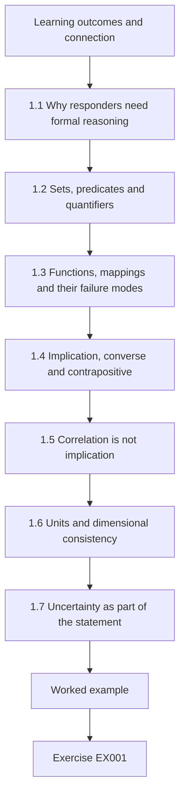

### Logical drawing

```mermaid
flowchart LR
  N0["Learning outcomes and connection"]
  N1["1.1 Why responders need formal reasoning"]
  N2["1.2 Sets, predicates and quantifiers"]
  N3["1.3 Functions, mappings and their failure modes"]
  N4["1.4 Implication, converse and contrapositive"]
  N5["1.5 Correlation is not implication"]
  N6["1.6 Units and dimensional consistency"]
  N7["1.7 Uncertainty as part of the statement"]
  N0 --> N1 --> N2 --> N3 --> N4 --> N5 --> N6 --> N7 --> Q["EX001"]
```

```text
[Learning outcomes and connection]
    |
    v
[1.1 Why responders need formal reasoning]
    |
    v
[1.2 Sets, predicates and quantifiers]
    |
    v
[1.3 Functions, mappings and their failure modes]
    |
    v
[1.4 Implication, converse and contrapositive]
    |
    v
[1.5 Correlation is not implication]
    |
    v
[1.6 Units and dimensional consistency]
    |
    v
[1.7 Uncertainty as part of the statement]
    |
    v
[Worked example] --> [Exercise EX001]
```
<!-- open-cyber-academy:lesson-figures:end ch-01 -->


### Learning outcomes and connection

After this chapter you can (1) restate an incident-response claim as a precise statement about sets, functions and implications; (2) refute a universal claim with a single well-chosen counterexample; (3) separate a correlation in a dashboard from a causal claim; and (4) carry units and uncertainty through a calculation so that a number cannot silently change meaning. The chapter assumes school algebra. It prepares Chapter 2, where the same habits are applied to computing systems, and it is the base for statistics (Chapter 12) and measurement (Chapter 15).

### 1.1 Why responders need formal reasoning

Incident response is full of confident sentences: "faster triage reduces impact", "all privileged sign-ins come through the VPN", "no data left the network". Each is a claim about a set of cases and a relationship between properties of those cases. When such a sentence is wrong, the cost is real: a team that believes every privileged sign-in passes through the VPN will not look for one that did not. Mathematical reasoning does not make responders slower; it makes their sentences checkable. The goal at bachelor's level is not proof-writing for its own sake but the habit of asking: *over which cases is this claimed, what exactly is asserted, and what single observation would make it false?*

### 1.2 Sets, predicates and quantifiers

A **set** is a collection of distinct objects, for example the set *C* of incident cases opened in a quarter. A **predicate** is a property that each element has or lacks, such as *Fast(c)*: "case *c* was triaged within 15 minutes". Quantifiers tell you how much is claimed. "For all *c* in *C*, Fast(*c*) implies LowImpact(*c*)" is a **universal** claim; "there exists *c* in *C* with Fast(*c*) and HighImpact(*c*)" is an **existential** claim. The two are linked: the negation of "for all, P implies Q" is "there exists one with P and not Q". That is why one counterexample is enough to refute a universal claim, while no number of confirming examples proves it.

Set operations make filters explicit. If *A* is the set of cases with authentication alerts and *B* the set with endpoint alerts, *A* ∩ *B* (both), *A* ∪ *B* (either) and *A* \ *B* (authentication only) are different populations, and a percentage computed on one cannot be reported as if it described another. Many dashboard errors are set errors: a rate computed on closed cases, *C*closed, is quoted as a rate for all cases, *C*.

### 1.3 Functions, mappings and their failure modes

A **function** *f*: *X* → *Y* assigns exactly one output to each input. Severity assignment should behave like a function from case facts to a severity level: identical facts, identical level. When two analysts give the same facts different levels, the "function" is not well defined, and any metric built on severity inherits that ambiguity. Two properties matter often. A function is **injective** when distinct inputs give distinct outputs; a pseudonymization mapping from user names to tokens must be injective or two people will be merged into one token. A function is **total** when it is defined for every input; a parser that crashes on malformed timestamps is partial, and the inputs it rejects are a hidden subset that may not be random.

### 1.4 Implication, converse and contrapositive

The statement P → Q ("if P then Q") is false only when P is true and Q is false. Its **contrapositive**, ¬Q → ¬P, is logically equivalent; its **converse**, Q → P, is not. Responders confuse these constantly. "If an account is compromised, it will show impossible-travel alerts" does not license "this account shows impossible travel, so it is compromised" (converse), nor "no impossible-travel alert, so not compromised" (that is the inverse, ¬P → ¬Q, also not equivalent). The contrapositive is the useful one: "if no impossible-travel alert was possible because the account signs in only from one location, then the rule cannot be our detection for this account".

### 1.5 Correlation is not implication

A dashboard can show that cases triaged quickly have lower average impact. That is an association between two variables over a set. Causation would require that changing triage speed, holding other things fixed, changes impact. Several mechanisms produce the association without causation: easy, low-impact cases are triaged quickly *because* they are easy (reverse direction); a night shift with fewer staff both triages slowly and receives a different case mix (common cause); and only cases that were closed are counted (selection). Formal reasoning gives you the vocabulary to name each mechanism and design a check.

### 1.6 Units and dimensional consistency

Every quantity in a report should carry a unit. "Mean time to contain: 4.2" is not information. Units also catch errors: adding minutes to hours, or dividing incidents by analysts and calling the result a rate per day. A useful discipline is to write the unit next to every intermediate value. Ratios need explicit denominators: "incidents per 1,000 endpoints per month" is comparable across sites; "incidents" alone is not.

Units also expose hidden conversions. If one clinic logs triage time in minutes and the managed detection service reports it in hours, a merged column averages incompatible numbers without any error message. Before combining sources, list each field with its unit and its source, convert explicitly in one place, and keep the original column so a reviewer can repeat the conversion. A percentage is a ratio too: write what was divided by what, because 30 per cent of alerts and 30 per cent of cases describe different populations.

### 1.7 Uncertainty as part of the statement

A value without uncertainty claims more than it knows. At this stage you need three simple tools: ranges ("between 120 and 340 accounts, depending on whether disabled accounts are included"), explicit assumptions ("assuming the log clock is accurate to ±2 seconds"), and the distinction between *unknown* and *zero*. A field that is empty because a sensor was offline is not evidence that nothing happened. Writing "unknown (sensor gap 02:00–03:10)" is mathematically more honest than writing 0.

Uncertainty also has to survive arithmetic. If an account count is a range, a cost estimate built on it is a range as well, and reporting only the midpoint quietly discards what you knew. When a number feeds a decision, state the end of the range that would change the decision, so the reader sees whether the uncertainty actually matters for the choice in front of them.

### 1.8 Worked example (synthetic): the dashboard claim

*All names and numbers in this example are fictional.* The response team at the Harbourline Health Cooperative, a synthetic regional clinic network used throughout this book, publishes a dashboard sentence: "Faster triage always reduces incident impact." The quarter contains 40 cases. Impact is scored 1–4 by a review panel after closure.

Step 1 — formalize. Let *C* be the 40 cases. Let *t(c)* be triage time in minutes and *i(c)* the impact score. "Always reduces" most plausibly means: for all pairs of cases *a*, *b* in *C*, if *t(a)* < *t(b)* then *i(a)* ≤ *i(b)*. That is a universal claim about a monotone relationship.

Step 2 — find a counterexample. Case H-07 was triaged in 6 minutes and scored impact 4 (ransomware detected late in its life cycle); case H-19 was triaged in 55 minutes and scored impact 1 (a misdirected phishing report). The pair (H-07, H-19) satisfies *t(a)* < *t(b)* but *i(a)* > *i(b)*. The universal claim is false.

Step 3 — repair the claim. A defensible version is an existential or average claim with stated scope: "In Q3, among closed cases, the mean impact score of cases triaged within 15 minutes (*n* = 22) was 1.8, versus 2.3 for slower cases (*n* = 18); this is an association, not evidence that speed caused lower impact."

Step 4 — name the data needed to test a causal version. One would need cases comparable in their initial facts, triage speed varying for reasons unrelated to impact (for example staffing changes), and impact measured the same way for all, including still-open cases.

### 1.9 Practical activity

Take any three sentences from a public incident report or vendor dashboard. For each, write the set it ranges over, the predicate(s), the quantifier, and one observation that would falsify it. Then mark each value with its unit and say whether "unknown" could have been recorded as zero.

A worked line might read: set, all phishing reports received by a clinic network in March; predicate, reported by staff rather than caught by a filter; quantifier, all; falsifier, one report raised automatically by the mail gateway. Compare your three analyses with a classmate. Where you disagree about the set, the original sentence was ambiguous, and that ambiguity is the finding worth writing down rather than a mistake to hide.

### 1.10 Common errors and limits

- Treating many confirming examples as proof of a universal claim.
- Reasoning from the converse or inverse of an implication.
- Reporting a rate without its denominator or on a different set from the one named.
- Recording missing data as zero.
- Over-formalizing: the aim is clarity about claims, not symbols for their own sake. Formal reasoning cannot tell you whether a premise (a log line, a witness statement) is true; that is the job of evidence evaluation later in the book.

A further limit concerns small sets. The Harbourline quarter has only 40 cases, so a single unusual case such as H-07 can move a mean noticeably; report counts beside averages so the reader can judge stability. Finally, a repaired claim is only as good as its scope: an association true for closed Q3 cases says nothing about next quarter's open ones.

### Exercises — chapter 1

Attempt each exercise before opening the [worked results](#worked-results). Every case, organization, person, address and number in an exercise is synthetic unless a cited public source is named.

**EX001 — Counterexample hunt.** *Inputs:* the claim "every incident involving a privileged account is high severity" and the synthetic cases P1 (privileged test account in an isolated lab, no data, impact 1), P2 (domain administrator used from an unknown host, impact 4). *Steps:* formalize the claim with a quantifier; decide whether either case refutes it; rewrite the claim so that it is defensible. *Rubric:* 3 = correct formalization, P1 identified as counterexample under a severity-equals-impact reading, scoped rewrite; 2 = counterexample found but rewrite still universal; 1 = argued by examples only; 0 = none.

**EX002 — Converse trap.** *Inputs:* "If a host is infected with the synthetic malware family KESTREL, it beacons every 60 seconds to an external address." An analyst sees a host beaconing every 60 seconds. *Steps:* state the converse, inverse and contrapositive; say which inference the analyst may draw; list two other explanations for 60-second beacons. *Rubric:* 3 = all three forms correct, conclusion limited to "consistent with", two plausible alternatives (e.g., update agent, monitoring heartbeat); 2 = one form wrong; 1 = analyst's conclusion accepted; 0 = none.

**EX003 — Units and denominators.** *Inputs:* Site North: 18 phishing reports, 450 staff, 3 months. Site South: 30 phishing reports, 1,200 staff, 6 months. A manager says South "has a bigger phishing problem". *Steps:* compute a comparable rate with units; state what the rate measures (reports, not attacks); give one reason the comparison may still mislead. *Rubric:* 3 = rates correct (North 13.3, South 4.2 reports per 1,000 staff per month), measure correctly named, sound limitation; 2 = arithmetic slip; 1 = raw counts compared; 0 = none.

### Chapter synthesis

State every claim with its set, quantifier and units. A universal claim falls to one counterexample; an implication is not its converse; an association is not a cause; and "unknown" is not zero. These habits make later evidence work checkable.

<!-- open-cyber-academy:chapter-navigation:start ch-01 -->
### Continue studying — chapter 01 of 40

[← Course home](../../README.md) · [Course chapter index](../SUBJECTS.md) · [Chapter 02 →](#ch-02)

Continue to the next authored lesson.
<!-- open-cyber-academy:chapter-navigation:end -->

<a id="ch-02"></a>

## Chapter 2 — Computing systems

<!-- open-cyber-academy:lesson-figures:start ch-02 -->
### Lesson map

Lesson 02 published. Map, example, EX004.

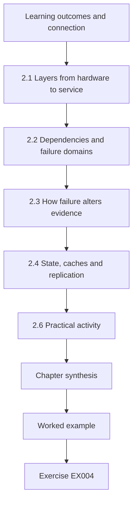

### Logical drawing

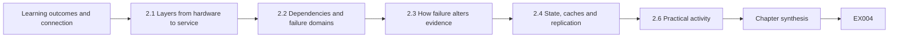

```text
[Learning outcomes and connection]
    |
    v
[2.1 Layers from hardware to service]
    |
    v
[2.2 Dependencies and failure domains]
    |
    v
[2.3 How failure alters evidence]
    |
    v
[2.4 State, caches and replication]
    |
    v
[2.6 Practical activity]
    |
    v
[Chapter synthesis]
    |
    v
[Worked example] --> [Exercise EX004]
```
<!-- open-cyber-academy:lesson-figures:end ch-02 -->


### Learning outcomes and connection

You will be able to (1) describe a service as layers of hardware, operating system, processes, services and storage; (2) draw a dependency map and mark failure domains; (3) explain how a failure in one component changes the evidence produced by another; and (4) choose where to look first when a symptom appears. Chapter 1 gave you the language of sets and implications; here you apply it to systems whose behaviour responders must interpret. Chapter 3 then teaches you to write small programs that read the records these systems produce.

### 2.1 Layers from hardware to service

A user never sees a server; they see a **service**, such as "book an appointment". Underneath it are layers. **Hardware** (or a virtual machine presented as hardware) supplies CPU, memory, storage and network interfaces. The **operating system** schedules **processes**, enforces user permissions and writes many of the logs responders rely on. A **service** is a long-running process (or group of processes) that listens for requests, such as a web server or database engine. **Storage** holds state: files, database tables, object stores, and backups. Each layer has its own clock, its own identifiers and its own logs. An incident question such as "who changed this record?" may need an application log (which user), a database log (which statement), an operating-system log (which process) and an identity log (which sign-in) — and each may describe the same event differently.

### 2.2 Dependencies and failure domains

A **dependency** exists when component A cannot do its job unless B works. Dependencies can be synchronous (the API waits for the identity provider to validate a token) or asynchronous (a queue delivers reminders later). A **failure domain** is the set of components that fail together because they share something: a power feed, a hypervisor, a cloud region, a database cluster, a single administrator account. Drawing failure domains is a resilience skill and an investigative one. If two "independent" logs share a storage volume that filled up, both will show a gap at the same time; their agreement is not independent corroboration.

### 2.3 How failure alters evidence

Systems record what they observe, and they observe through their dependencies. When the identity provider is slow, the API may log authentication *timeouts* that look like failed logins. When a disk is full, the operating system may stop writing audit events while the application keeps running, producing a period in which actions occur but leave no trace. When a load balancer terminates TLS, the application sees the balancer's address, not the client's, unless a forwarding header is recorded — and that header can be forged by a client if the application trusts it blindly. Responders must therefore ask, for every record: *which component wrote this, through which dependencies did it learn the fact, and what would it have written if a dependency had failed?*

### 2.4 State, caches and replication

Many services keep copies of data: caches for speed, replicas for availability, backups for recovery. Copies diverge in time. A replica may lag the primary by seconds or hours; a cache may serve a value that the database already changed. For response this has two consequences. Evidence collected from a replica may not show the latest malicious change. And restoration from a copy (Chapter 26) must account for what that copy did or did not contain.

In the Harbourline Booking map the API reads from the replica, so a patient record changed on the primary a few seconds earlier may still appear in its old form to staff. An analyst who exports from the replica during an incident should record its replication lag at that moment. Otherwise a later comparison with the primary will show differences that look like tampering but are only delay between two copies of the same data.

### 2.5 Worked example (synthetic): Harbourline Booking

*Fictional system.* Harbourline Booking has four components: an **identity provider** (IdP) that issues session tokens; a **booking API** that validates tokens and reads/writes appointments; a **PostgreSQL-style database** with one primary and one read replica; and a **reverse proxy** that terminates TLS. The API and database share one hypervisor host, HV-2.

Dependency map (A → B means A needs B): Proxy → API; API → IdP (token validation); API → DB primary (writes) and DB replica (reads); nightly backup job → DB primary.

Failure domains: {API, DB primary, DB replica} share HV-2; IdP is a separate cloud service.

Scenario: on a Tuesday the IdP has a 12-minute partial outage. Effects on evidence: the API logs 340 "authentication failed" events — not credential guessing but validation timeouts; the IdP's own sign-in log shows a gap; the proxy shows normal request volume. An analyst who reads only the API log might report a password-spraying attack. The dependency map predicts the pattern instead: failures in the API that coincide with an IdP gap and normal proxy volume point to the dependency, not to an attacker. The correct next check is bounded and cheap: compare the API failure reasons (timeout versus bad credential) and the IdP status history for the window.

A second scenario shows a failure domain. If HV-2 runs out of disk, the API, primary and replica may all stop logging at once. Three silent logs are then one gap, not three independent observations of quiet.

### 2.6 Practical activity

Choose a service you use (a university portal, for instance) and draw, from public information only, its likely layers and dependencies. Mark one failure domain and write two sentences: what fails if it fails, and which logs would go quiet or become misleading. Do not probe or scan the real service; this is a reasoning exercise.

Keep the map to one page and mark each arrow as synchronous or asynchronous, because an asynchronous dependency fails late and quietly while a synchronous one fails at once and loudly. Then swap maps with a classmate and ask them to find a failure domain you missed, such as a shared single sign-on provider or one administrator who manages everything. Note which of your assumptions came from public documentation and which were guesses.

### 2.7 Common errors and limits

- Treating logs from components in the same failure domain as independent corroboration.
- Reading authentication failures as attacks without checking dependency health.
- Forgetting that proxies and NAT change the apparent source address.
- Assuming a replica or cache shows current state.
- Over-detailed maps: the useful map shows the dependencies that change decisions; a full inventory belongs to asset management (see the technologist course).

One limit is inherent. Public information rarely reveals real dependencies, so a map drawn from outside is a hypothesis to be confirmed with the system owner before it guides an investigation. Maps also age: a component moved to a new host breaks the failure domains you marked. Date every map and record who confirmed it, so that a responder knows how far to trust the picture during an incident.

### Exercises — chapter 2

Attempt each exercise before opening the [worked results](#worked-results). Every case, organization, person, address and number in an exercise is synthetic unless a cited public source is named.

**EX004 — Dependency map.** *Inputs:* a synthetic clinic reminder service: a scheduler reads appointments from the database and sends messages through an external SMS gateway; staff sign in through the IdP to edit templates. *Steps:* draw the map; mark at least one failure domain; state which component's log would show a gateway outage. *Rubric:* 3 = correct directions, plausible failure domain, correct log source with reasoning; 2 = one direction wrong; 1 = list of components only; 0 = none.

**EX005 — Evidence under failure.** *Inputs:* the Harbourline map in §2.5; the database primary's disk filled for 40 minutes, during which the API kept accepting writes that then failed. *Steps:* predict what the API log, database log and proxy log would each show; state one wrong conclusion an analyst might draw. *Rubric:* 3 = all three predictions plausible and mutually consistent, wrong conclusion named; 2 = one prediction weak; 1 = generic; 0 = none.

**EX006 — Address provenance.** *Inputs:* the API records the client address from an `X-Forwarded-For` header set by the proxy. *Steps:* explain when this address is trustworthy and when it is not; propose one configuration check that would let a responder rely on it. *Rubric:* 3 = explains that the header is client-controllable unless the proxy overwrites it and the API accepts it only from the proxy; proposes checking proxy configuration and the API's trusted-proxy list; 2 = partial; 1 = treats header as ground truth; 0 = none.

### Chapter synthesis

Model a service as layers and dependencies, mark the failure domains, and ask of every record which component wrote it and what it would have written had a dependency failed. Logs that share a failure domain are not independent witnesses.

<!-- open-cyber-academy:chapter-navigation:start ch-02 -->
### Continue studying — chapter 02 of 40

[← Chapter 01](#ch-01) · [Course chapter index](../SUBJECTS.md) · [Chapter 03 →](#ch-03)

Continue to the next authored lesson.
<!-- open-cyber-academy:chapter-navigation:end -->

<a id="ch-03"></a>

## Chapter 3 — Programming I

<!-- open-cyber-academy:lesson-figures:start ch-03 -->
### Lesson map

Lesson 03 published. Map, example, EX007.

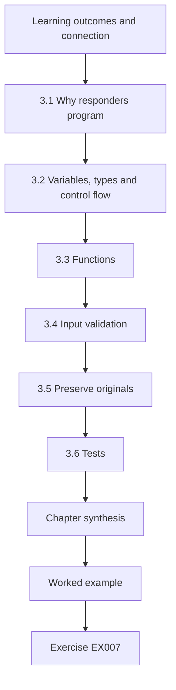

### Logical drawing

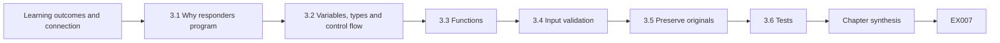

```text
[Learning outcomes and connection]
    |
    v
[3.1 Why responders program]
    |
    v
[3.2 Variables, types and control flow]
    |
    v
[3.3 Functions]
    |
    v
[3.4 Input validation]
    |
    v
[3.5 Preserve originals]
    |
    v
[3.6 Tests]
    |
    v
[Chapter synthesis]
    |
    v
[Worked example] --> [Exercise EX007]
```
<!-- open-cyber-academy:lesson-figures:end ch-03 -->


### Learning outcomes and connection

You will be able to (1) write a short Python program using variables, control flow and functions; (2) validate input records against explicit rules; (3) report rejected records without altering the original data; and (4) test your program with normal and malformed inputs. Chapter 2 showed that systems produce records whose meaning depends on context; here you learn to read such records mechanically and honestly. Chapter 8 extends these skills to parsing and provenance.

### 3.1 Why responders program

Incident data arrives as files: exports of sign-ins, case-intake spreadsheets, lists of affected hosts. Doing the same check by hand on 5,000 rows is slow and error-prone; a twenty-line program does it the same way every time and can be shown to a reviewer. The value is not speed alone but **repeatability**: anyone can rerun the program on the same input and get the same output. For that reason this book uses only the Python 3 standard library: there is nothing to install and no network access.

### 3.2 Variables, types and control flow

A **variable** names a value. Python values have **types**: strings (`"H-07"`), integers (`42`), floats (`4.2`), booleans (`True`), lists and dictionaries. Types matter in incident data because the same characters can mean different things: `"0042"` as a string keeps its leading zeros (an asset tag), but as an integer becomes 42. **Control flow** decides what runs: `if`/`elif`/`else` for choices, `for` loops to visit each record. A good habit is to make each decision visible — every branch either accepts the record or records *why* it was rejected.

### 3.3 Functions

A **function** packages a step with a name, inputs and an output. `validate(row)` that returns a list of problems is easier to test than the same logic buried inside a loop. Functions should not change their inputs unexpectedly; a validator that "fixes" a date while checking it has destroyed evidence that the date was malformed.

In Lab 03 the function `validate(row)` returns a list rather than printing messages. That choice lets the same function serve the loop that sorts rows into accepted and rejected and the `assert` tests at the bottom, without either caller parsing text. A function that returns data and leaves presentation to its caller is easier to reuse, and its behaviour can be checked by a reviewer without running the whole program.

### 3.4 Input validation

**Validation** compares a record to explicit rules: required fields present, values in an allowed set, dates in an agreed format. Write rules before writing code, in plain language: "`case_id` is required and matches `HC-` followed by four digits; `severity` is one of 1, 2, 3, 4; `reported_at` is an ISO 8601 date-time." A validator should *reject and explain*, not *guess and continue*. The rejected records are themselves information: if all rejected rows came from one intake channel, the problem is upstream.

Order the checks so that one failure does not hide another. Lab 03 checks every required field before testing formats, so a row missing two fields reports both instead of stopping at the first. Each message names the field and the rule it broke.

### 3.5 Preserve originals

The original file is evidence of what was received. Never overwrite it. Read it, write results to a new file or to the screen, and record a hash of the input (Chapter 17 explains hashes) so a reviewer can confirm which file you processed. In code, keep the raw row next to any normalized values.

In Lab 03 the input is a string inside the program, so preservation is easy; with a real export you would open the file read-only, compute its hash before and after the run, and write the accepted and rejected lists to new files whose names include the date. If the two hashes differ, stop and find out why before trusting any result produced from that file.

### 3.6 Tests

A **test** runs your function on an input whose correct answer you already know. Include at least: a valid record, a record missing each required field, a value just outside an allowed set, and a malformed date. Python's `assert` statement is enough for small tests.

Write the expected answer before running the test, not after; a test whose expected value was copied from the program's own output only proves that the program agrees with itself. Lab 03 asserts that HC-0101 has no problems and that HC-0102 lacks a reporter. Those two cases cover one valid and one invalid path; the exercises ask you to add the edges, such as a severity of zero or a case number with a stray space.

### 3.7 Worked example and lab (synthetic): case-intake validator

*The CSV below is fictional.* Save as `lab03.py` and run with `python3 lab03.py`.

```python
# Lab 03 - validate synthetic case-intake records without changing them (stdlib only)
import csv, io, re
from datetime import datetime

RAW = """case_id,reported_at,reporter,severity,summary
HC-0101,2026-03-02T08:14:00,front-desk,2,Suspicious email with invoice link
HC-0102,2026-03-02T09:40:00,,3,Laptop reported lost on bus
HC-0103,02/03/2026 10:05,it-helpdesk,2,Password reset not requested by user
HC-104,2026-03-02T11:20:00,pharmacy,1,Printer shows odd message
HC-0105,2026-03-02T12:01:00,lab,5,Booking page slow
HC-0106,2026-03-02T13:30:00,front-desk,4,
"""
ID = re.compile(r"HC-\d{4}")
REQUIRED = ["case_id", "reported_at", "reporter", "severity", "summary"]

def validate(row):
    problems = []
    for f in REQUIRED:
        if not row[f].strip():
            problems.append(f"missing {f}")
    if row["case_id"] and not ID.fullmatch(row["case_id"]):
        problems.append("bad case_id")
    if row["severity"] and row["severity"] not in {"1", "2", "3", "4"}:
        problems.append("severity not in 1-4")
    if row["reported_at"]:
        try:
            datetime.fromisoformat(row["reported_at"])
        except ValueError:
            problems.append("reported_at not ISO 8601")
    return problems

rows = list(csv.DictReader(io.StringIO(RAW)))
accepted, rejected = [], []
for r in rows:
    p = validate(r)
    (rejected if p else accepted).append((r["case_id"], p))
print("accepted:", [c for c, _ in accepted])
for c, p in rejected:
    print("rejected:", c, "->", "; ".join(p))

assert validate(rows[0]) == []
assert validate(rows[1]) == ["missing reporter"]
print("tests passed; original text unchanged:", RAW.count("\n"), "lines")
```

Expected output:

```text
accepted: ['HC-0101']
rejected: HC-0102 -> missing reporter
rejected: HC-0103 -> reported_at not ISO 8601
rejected: HC-104 -> bad case_id
rejected: HC-0105 -> severity not in 1-4
rejected: HC-0106 -> missing summary
tests passed; original text unchanged: 7 lines
```

Interpretation: only one of six records passes. That is not a failure of the program; it is a finding about the intake process. Note that HC-0103's date "02/03/2026" is ambiguous (2 March or 3 February); the validator rightly refuses to guess.

Run the lab twice and compare outputs; they must match exactly, which is the repeatability promised earlier. Then deliberately break one rule, for example by allowing severity 5, and check that HC-0105 moves to the accepted list and that the first assertion still passes. Seeing a result change for a known reason is how you learn to trust the cases where it does not change.

### 3.8 Common errors and limits

- Silently "repairing" values during validation.
- Converting identifiers to numbers and losing leading zeros.
- Testing only the happy path.
- Treating a validator as proof that values are *true*: a well-formed date can still be wrong.

- Collecting only the first problem in a row, so that fixing it reveals another and the intake team is asked twice.
- Overwriting the input file with cleaned values, losing the record of what was actually received.
- Assuming the six Lab 03 rows represent all intake channels; a validator tuned to one sample may reject legitimate formats from a channel it has never seen.

### Exercises — chapter 3

Attempt each exercise before opening the [worked results](#worked-results). Every case, organization, person, address and number in an exercise is synthetic unless a cited public source is named.

**EX007 — Extend the rules.** *Steps:* add a rule to Lab 03 that `reporter` must be one of `front-desk`, `it-helpdesk`, `pharmacy`, `lab`; run it and report the new output. *Rubric:* 3 = rule added without changing other behaviour, correct output reported; 2 = rule works but output not reported; 1 = code does not run; 0 = none.

**EX008 — Ambiguous dates.** *Steps:* explain why the validator should not convert `02/03/2026 10:05` automatically; propose what the intake team should record instead and how to handle existing ambiguous rows. *Rubric:* 3 = explains day/month ambiguity and missing time zone, proposes ISO 8601 with offset, routes old rows to the reporter for confirmation; 2 = partial; 1 = proposes guessing; 0 = none.

**EX009 — Test design.** *Steps:* write three additional `assert` tests: a record with severity `"0"`, a record with leading/trailing spaces in `case_id`, and a record with all fields empty. Predict each result before running. *Rubric:* 3 = tests correct with predictions, and spaces case explained (`" HC-0101"` fails the pattern because `fullmatch` sees the space); 2 = one test wrong; 1 = no predictions; 0 = none.

### Chapter synthesis

Write the rules in words, encode each as a visible check, reject and explain rather than guess, keep the original untouched and test the edges. Rejected records describe the intake process as much as the incident.

<!-- open-cyber-academy:chapter-navigation:start ch-03 -->
### Continue studying — chapter 03 of 40

[← Chapter 02](#ch-02) · [Course chapter index](../SUBJECTS.md) · [Chapter 04 →](#ch-04)

Continue to the next authored lesson.
<!-- open-cyber-academy:chapter-navigation:end -->

<a id="ch-04"></a>

## Chapter 4 — Academic writing

<!-- open-cyber-academy:lesson-figures:start ch-04 -->
### Lesson map

Lesson 04 published. Map, example, EX010.

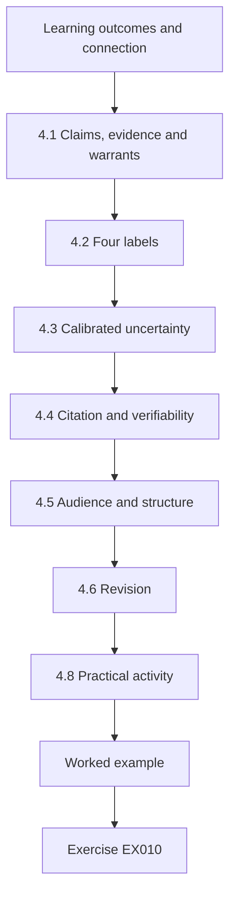

### Logical drawing

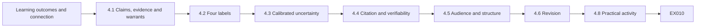

```text
[Learning outcomes and connection]
    |
    v
[4.1 Claims, evidence and warrants]
    |
    v
[4.2 Four labels]
    |
    v
[4.3 Calibrated uncertainty]
    |
    v
[4.4 Citation and verifiability]
    |
    v
[4.5 Audience and structure]
    |
    v
[4.6 Revision]
    |
    v
[4.8 Practical activity]
    |
    v
[Worked example] --> [Exercise EX010]
```
<!-- open-cyber-academy:lesson-figures:end ch-04 -->


### Learning outcomes and connection

You will be able to (1) distinguish a claim from the evidence offered for it; (2) express uncertainty with calibrated language instead of hedging everywhere; (3) cite sources so a reader can verify them; and (4) revise a text for its audience. Chapter 1 made claims precise; this chapter makes them readable and checkable by others. The skill returns in every report you write, from a shift handoff (Chapter 26 of the technologist book covers handoffs operationally) to the thesis in Chapter 40.

### 4.1 Claims, evidence and warrants

A **claim** is a statement you want the reader to accept. **Evidence** is what you observed or what a source recorded. A **warrant** is the reasoning that connects them. In "The account was compromised (claim) because it signed in from two countries ten minutes apart (evidence), which is physically impossible for one person (warrant)", the warrant hides assumptions: that both sign-ins were interactive, that the location data is accurate, that no VPN or shared credential explains the pattern. Good academic writing makes the warrant visible so that a reader can attack it.

### 4.2 Four labels

Throughout this book we label sentences in working notes as **observation** (what a named source recorded), **inference** (what you conclude and under which assumptions), **decision** (what someone chose to do) and **unknown** (what is not yet established). The labels do not need to appear in a polished report, but every sentence in the report should be traceable to one of them.

In the rcp-07 summary, "the API logged 4,100 requests" is an observation, "the session belonged to rcp-07" is an observation from a second source, "whether the account was misused" is an unknown, and "revoked at 09:40" is a decision. Labelling in this way exposes sentences that fit no label, which are usually opinions that need either evidence or deletion before the note goes further.

### 4.3 Calibrated uncertainty

Uniform hedging ("it may possibly suggest") is as unhelpful as overconfidence. Use a small vocabulary consistently and define it: *confirmed* (directly recorded by a reliable source, independently checked), *likely* (several independent indications, no strong contrary evidence), *possible* (consistent with evidence but alternatives remain), *unknown*. State what would change the assessment. Intelligence analysis has long used such scales; the point for you is consistency, not a particular wording.

Calibration also needs a note of what moved the estimate. If "possible" becomes "likely" between two updates, the reader should see which new indication caused the change. Avoid numbers that look more precise than the evidence allows; "likely" is honest where "78 per cent" would be invented.

### 4.4 Citation and verifiability

Cite so that a reader can find the exact source: author or organization, title, version or date, and a stable identifier (DOI or official URL). Cite primary sources for factual claims: the NIST publication, not a blog summarizing it. Distinguish a source's *finding* from your *interpretation* of it. When a document is superseded — NIST SP 800-61 Revision 3 (April 2025) superseded Revision 2 — say which version you used.

In a working incident note, internal sources need the same care as publications: name the log, its system, the query used and the time range, so that "API log" in the rcp-07 summary can be traced to one export rather than to someone's memory of a screen. When a source cannot be shared with the reader, say so and state who can verify it on request.

### 4.5 Audience and structure

Write for a named reader. An executive needs the decision required, impact, confidence and next update time in the first paragraph. A technical reviewer needs method, sources and limits. A common structure for incident summaries is: bottom line; what is known (with sources); what is not known; what is being done; when the next update comes.

The executive version of the rcp-07 summary follows this order: what may have happened, what was done, what is not known, and when the next update arrives. A technical reviewer reading the same incident would instead want the log names, the query window and the sample of 20 responses. Writing both from one set of labelled notes keeps them consistent with each other.

### 4.6 Revision

Revise in passes: first for claims and evidence (does every claim have support?), then for structure (does the reader get what they need first?), then for language (shorter sentences, active voice, defined terms). Ask a peer to mark every sentence they could not verify.

A useful final pass reads the text aloud as the named reader would. For the rcp-07 summary that means asking whether a clinic manager would know what to do before 12:00. Keep earlier versions; comparing drafts shows which claims were weakened or strengthened and why, which matters if the summary is later reviewed after the incident closes.

### 4.7 Worked example (synthetic): two summaries

*Fictional.* Summary A: "Attackers breached the booking system and stole patient data. The situation is under control." Summary B: "At 09:12 the booking API logged 4,100 requests for appointment records from one session (API log, observation). The session belonged to the receptionist account `rcp-07` (IdP log). We have not established whether the account was misused or a scheduled export ran (unknown). The session was revoked at 09:40 (decision). Records returned contained names and appointment times (API response sample of 20). Next update 12:00."

A makes two unsupported claims ("attackers", "stole") and one vague one ("under control"). B is longer but every sentence is traceable. A revised executive version of B: "Possible bulk access to appointment records (names and times) via one staff account between 09:12 and 09:40; session revoked; cause not yet established; privacy team engaged; next update 12:00."

### 4.8 Practical activity

Take a published incident report from a public source and highlight each sentence as observation, inference, decision or unknown. Count how many claims cite a source.

Choose a report long enough to contain at least twenty sentences, so the counts mean something. Record the proportion of each label and note which sentences you could not classify, because those are usually the vague ones. Then rewrite the opening paragraph so that its first sentence states the decision or finding a reader needs most. Compare your rewrite with the original and note what you had to remove or move to make it work. Finally, list any claim whose source you could not locate within ten minutes; such claims are unverifiable for an ordinary reader, whatever their truth.

### 4.9 Common errors and limits

- Stating inferences as observations ("the attacker used…").
- Citing secondary summaries for primary facts; citing without version.
- Burying the decision the reader must make.
- Writing about a person's guilt; incident reports describe actions and accounts, not culpability, which belongs to authorized processes.

- Hedging every sentence, so the reader cannot tell the solid findings from the guesses.
- Using "confirmed" for a single source that nobody has checked independently.
- Mixing audiences in one paragraph, with log identifiers interrupting the executive summary.
- Omitting the next update time, which leaves readers to chase the team for news during the incident.

### Exercises — chapter 4

Attempt each exercise before opening the [worked results](#worked-results). Every case, organization, person, address and number in an exercise is synthetic unless a cited public source is named.

**EX010 — Label the sentences.** *Inputs:* Summary A and B in §4.7. *Steps:* label every sentence; list the unsupported claims. *Rubric:* 3 = all labels defensible, unsupported claims listed with what evidence would support them; 2 = one mislabel; 1 = labels absent; 0 = none.

**EX011 — Rewrite with calibration.** *Inputs:* "It appears the server may have possibly been infected by ransomware which seems to have encrypted some files." *Steps:* rewrite using the confirmed/likely/possible/unknown scale and add what would change the assessment. *Rubric:* 3 = one calibrated term per claim, observations separated, change condition stated; 2 = calibration uneven; 1 = still hedged throughout; 0 = none.

**EX012 — Citation repair.** *Inputs:* "According to NIST, incidents should be handled in four phases (NIST, website)." *Steps:* identify the problems and write a correct, verifiable citation, noting what changed in Revision 3. *Rubric:* 3 = identifies missing document/version, cites SP 800-61 Rev. 3 with URL and date, notes that Rev. 3 organizes recommendations around CSF 2.0 functions rather than the Rev. 2 four-phase life cycle; 2 = citation correct, change missed; 1 = vague; 0 = none.

### Chapter synthesis

Make the warrant visible, label observations, inferences, decisions and unknowns, use a small defined uncertainty scale, cite primary sources with version, and write the reader's decision first.

<!-- open-cyber-academy:chapter-navigation:start ch-04 -->
### Continue studying — chapter 04 of 40

[← Chapter 03](#ch-03) · [Course chapter index](../SUBJECTS.md) · [Chapter 05 →](#ch-05)

Continue to the next authored lesson.
<!-- open-cyber-academy:chapter-navigation:end -->

<a id="ch-05"></a>

## Chapter 5 — Security literacy

<!-- open-cyber-academy:lesson-figures:start ch-05 -->
### Lesson map

Lesson 05 published. Map, example, EX013.

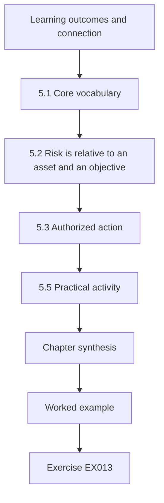

### Logical drawing

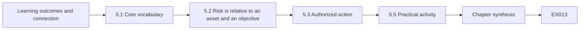

```text
[Learning outcomes and connection]
    |
    v
[5.1 Core vocabulary]
    |
    v
[5.2 Risk is relative to an asset and an objective]
    |
    v
[5.3 Authorized action]
    |
    v
[5.5 Practical activity]
    |
    v
[Chapter synthesis]
    |
    v
[Worked example] --> [Exercise EX013]
```
<!-- open-cyber-academy:lesson-figures:end ch-05 -->


### Learning outcomes and connection

You will be able to (1) define asset, threat, vulnerability, impact, control and residual risk; (2) compare two security events and justify different priorities from stated assumptions; (3) recognize the boundary of authorized action; and (4) explain why the same alert can deserve different responses. Chapter 4 taught you to state claims carefully; here you learn the vocabulary those claims use. Chapter 6 adds graph models of access.

### 5.1 Core vocabulary

An **asset** is anything of value to the organization: data, a service, a device, a reputation. A **threat** is a circumstance or actor with the potential to cause harm. A **vulnerability** is a weakness that a threat could exploit. **Impact** is the harm if it happens, measured against the organization's objectives (safety, service availability, privacy, finance, law). A **control** is a measure that reduces likelihood or impact: **preventive** (multi-factor authentication), **detective** (sign-in alerting), **corrective** (restoring from backup). **Residual risk** is what remains after controls. NIST's Cybersecurity Framework 2.0 organizes these ideas into six functions — Govern, Identify, Protect, Detect, Respond, Recover — and incident response sits mainly in Detect, Respond and Recover while depending on the others.

### 5.2 Risk is relative to an asset and an objective

"Suspicious sign-in" is not a risk statement. "A possibly stolen credential for an account that can modify the medication schedule of a clinic" is closer: it names an asset, a threat and an impact path. Priority in triage follows from impact and likelihood given current evidence, not from the alert's name.

The pharm-admin account illustrates the point: the alert text is identical to the one on test-kiosk-3, yet the medication schedule it can change makes the potential harm far greater. Write the objective that would be damaged, such as patient safety or service availability, beside the asset; a reader who disagrees with your priority can then argue with a stated objective instead of with your instinct.

### 5.3 Authorized action

A responder acts on behalf of an organization within a defined **scope**: which systems, which data, which actions. Authorization comes from policy and from named people (system owners, incident lead, legal or privacy officers). Investigating outside scope — reading an employee's personal mailbox without approval, scanning a third party's network, "hacking back" — can be unlawful and can destroy the legitimacy of the whole response. When in doubt, the correct action is to stop and escalate, recording the question and the answer.

### 5.4 Worked example (synthetic): same alert, two priorities

*Fictional.* Two alerts fire at 07:55 at Harbourline: "sign-in from new country" for (a) `test-kiosk-3`, an account on an isolated demonstration tablet with no access to patient data, and (b) `pharm-admin`, an account that can change dispensing schedules in the pharmacy system.

Assumptions (stated): both alerts come from the same detection rule; neither account usually travels; (a) is segregated on a guest network; (b) has no MFA because of a legacy integration.

Analysis: likelihood of misuse given the alert is similar for both — the same rule fired. Impact differs greatly: (a) could at worst deface a kiosk; (b) could alter medication timing, a patient-safety impact. Controls differ: (a) is segregated; (b) lacks MFA. Priority: (b) is high, with immediate contact with the pharmacy system owner to verify the sign-in and, with approval, revoke the session; (a) is low, handled in the queue. What would change it: evidence that (a)'s tablet was connected to the clinical network would raise its priority.

### 5.5 Practical activity

Pick three systems you use and, for each, write one sentence of the form "If [threat] exploits [vulnerability] in [asset], then [impact on objective]; current controls are [...]".

For each sentence, add one detective control you would expect to notice the threat, and state whether you know it exists or are assuming it. Then rank the three by impact and write one line explaining the order. Swap with a classmate: if they rank differently, find which assumption you disagree about. Keep the systems generic, such as a student email account, and do not test any control on a real service; the exercise is about stating risk, not probing for it.

### 5.6 Common errors and limits

- Prioritizing by alert name or tool severity rather than by asset impact.
- Confusing vulnerability (weakness) with threat (actor or event).
- Treating residual risk as zero after a control is deployed.
- Assuming authority because you have technical access. Technical capability is not permission.

- Writing risk statements without an objective, so nobody can tell why the asset matters.
- Copying the priority of an earlier alert with the same name, as if test-kiosk-3 and pharm-admin carried equal stakes.
- Leaving assumptions unstated, which prevents a reviewer from seeing what would raise or lower the priority.

### Exercises — chapter 5

Attempt each exercise before opening the [worked results](#worked-results). Every case, organization, person, address and number in an exercise is synthetic unless a cited public source is named.

**EX013 — Vocabulary mapping.** *Inputs:* "A former contractor's VPN account was never disabled; the VPN allows access to the file server holding staff payroll." *Steps:* identify asset, threat, vulnerability, impact, a preventive and a detective control, and residual risk after disabling the account. *Rubric:* 3 = all correct and residual risk acknowledges other un-reviewed accounts and past access; 2 = one confusion; 1 = generic; 0 = none.

**EX014 — Priority with assumptions.** *Inputs:* §5.4 changed so that (b) has MFA and the sign-in passed MFA from a known device. *Steps:* reassess (b)'s priority and say what evidence still needs checking. *Rubric:* 3 = lowered but not dismissed, checks MFA method (push fatigue, device registration date), owner confirmation; 2 = changes priority without checks; 1 = unchanged without reasons; 0 = none.

**EX015 — Scope boundary.** *Inputs:* during triage of (b), a colleague suggests logging into the pharmacist's personal cloud email to see if the password was phished there. *Steps:* explain why this is out of bounds and list two authorized alternatives. *Rubric:* 3 = identifies lack of authorization and privacy/legal issues, proposes asking the user (with HR/privacy as needed) and reviewing organizational mail and IdP logs; 2 = partial; 1 = endorses; 0 = none.

### Chapter synthesis

Risk is asset-specific: the same alert means different things for different assets and controls. State assumptions, prioritize by impact and likelihood, and remember that access is not authorization.

<!-- open-cyber-academy:chapter-navigation:start ch-05 -->
### Continue studying — chapter 05 of 40

[← Chapter 04](#ch-04) · [Course chapter index](../SUBJECTS.md) · [Chapter 06 →](#ch-06)

Continue to the next authored lesson.
<!-- open-cyber-academy:chapter-navigation:end -->

<a id="ch-06"></a>

## Chapter 6 — Discrete structures

<!-- open-cyber-academy:lesson-figures:start ch-06 -->
### Lesson map

Lesson 06 published. Map, example, EX016.

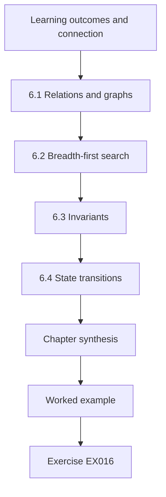

### Logical drawing

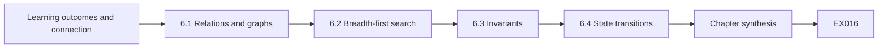

```text
[Learning outcomes and connection]
    |
    v
[6.1 Relations and graphs]
    |
    v
[6.2 Breadth-first search]
    |
    v
[6.3 Invariants]
    |
    v
[6.4 State transitions]
    |
    v
[Chapter synthesis]
    |
    v
[Worked example] --> [Exercise EX016]
```
<!-- open-cyber-academy:lesson-figures:end ch-06 -->


### Learning outcomes and connection

You will be able to (1) model accounts, groups and systems as a directed graph; (2) compute which systems are reachable from a compromised principal; (3) express a safety property of access revocation as an invariant; and (4) reason about state transitions during containment. Chapter 5 introduced assets and authorization; this chapter gives you a precise structure for "who can reach what". Chapter 13 applies it to identity systems.

### 6.1 Relations and graphs

A **relation** on sets pairs elements: "user *u* is a member of group *g*", "group *g* has admin rights on server *s*". A **directed graph** *G* = (*V*, *E*) has vertices *V* and directed edges *E*. In access modelling, vertices are principals (users, service accounts, groups) and resources (servers, databases); an edge *a* → *b* means "*a* can act as, or act on, *b*". A **path** is a sequence of edges; *b* is **reachable** from *a* if a path exists. Reachability, not direct permission, is what matters when an account is compromised: a user who is in a group that can administer a server that stores a service account's credential can, in effect, become that service account.

### 6.2 Breadth-first search

The standard way to compute reachability is **breadth-first search** (BFS): start at the compromised vertex, visit its neighbours, then their neighbours, keeping a set of visited vertices so no vertex is processed twice. BFS also returns the shortest path to each vertex, which is useful for explaining *why* something is reachable.

In Lab 06 the parent dictionary records how each vertex was first reached, and the `path` function walks it backwards. That is why the output can explain that db-billing is reachable through nurse-12-admin, grp-helpdesk, srv-jump-01 and svc-backup, a route an analyst could check edge by edge. Depth-first search would find the same reachable set but not necessarily the shortest explanation.

### 6.3 Invariants

An **invariant** is a property that must hold in every state of a process. For revocation: "after step *k*, no vertex in the compromised set has a path to any production database except through an edge that is currently disabled". Stating the invariant tells you what to check after each change and catches the classic failure — removing the obvious edge while an indirect path remains.

Write the invariant before the first change, not after. In the nurse-12 case it is checked after each step, and Lab 06 shows it failing after step 1 and holding only after step 2.

### 6.4 State transitions

Containment is a sequence of state changes: disable account, rotate credential, remove group membership. Model each as a transition from graph *G*ᵢ to *G*ᵢ₊₁. Order matters: rotating a service-account secret before removing the attacker's ability to read the new secret is wasted work. A small state diagram (states and allowed transitions) also clarifies which steps are reversible.

In Lab 06 the graph after step 1 still allows a route to db-billing; only the state after step 2 contains the account. Recording each state with a timestamp gives the incident log a precise account of when containment actually held, which matters if later activity must be judged as before or after it.

### 6.5 Worked example and lab (synthetic): access graph

*Fictional graph.* `nurse-12` is suspected compromised. Save as `lab06.py`.

```python
# Lab 06 - reachability from a suspected compromised account (synthetic graph, stdlib only)
from collections import deque

EDGES = {
    "nurse-12":        ["grp-ward-staff"],
    "grp-ward-staff":  ["app-charting"],
    "helpdesk-3":      ["grp-helpdesk"],
    "grp-helpdesk":    ["srv-jump-01"],
    "nurse-12-admin":  ["grp-helpdesk"],
    "app-charting":    ["db-clinical"],
    "srv-jump-01":     ["svc-backup"],
    "svc-backup":      ["db-clinical", "db-billing"],
}
# nurse-12 also owns a second, privileged account on the same credential store:
EDGES["nurse-12"].append("nurse-12-admin")

def reach(start, edges, disabled=frozenset()):
    seen, parent, q = {start}, {start: None}, deque([start])
    while q:
        v = q.popleft()
        for w in edges.get(v, []):
            if (v, w) in disabled or w in seen:
                continue
            seen.add(w); parent[w] = v; q.append(w)
    return seen, parent

def path(parent, v):
    out = []
    while v is not None:
        out.append(v); v = parent[v]
    return " -> ".join(reversed(out))

seen, parent = reach("nurse-12", EDGES)
for target in ["db-clinical", "db-billing"]:
    print(target, "reachable via", path(parent, target))

step1 = {("nurse-12", "grp-ward-staff")}
seen1, p1 = reach("nurse-12", EDGES, step1)
print("after disabling ward membership, db-billing reachable:", "db-billing" in seen1)
step2 = step1 | {("nurse-12", "nurse-12-admin")}
seen2, _ = reach("nurse-12", EDGES, step2)
print("after also cutting admin link, reachable:", sorted(seen2))
```

Expected output:

```text
db-clinical reachable via nurse-12 -> grp-ward-staff -> app-charting -> db-clinical
db-billing reachable via nurse-12 -> nurse-12-admin -> grp-helpdesk -> srv-jump-01 -> svc-backup -> db-billing
after disabling ward membership, db-billing reachable: True
after also cutting admin link, reachable: ['nurse-12']
```

Interpretation: the obvious containment step (removing ward-staff membership) leaves the billing database reachable through the linked admin account and the backup service. The invariant "no path from `nurse-12` to any database" holds only after step 2. In real environments, the graph is built from directory and permission exports, and edges such as "has a session on" or "can read credential of" are often missing from those exports — the graph is only as complete as its sources.

### 6.6 Common errors and limits

- Checking direct permissions only.
- Forgetting linked or secondary accounts belonging to the same person.
- Assuming the graph is complete; unknown edges (cached credentials, shared passwords) are the dangerous ones.
- Cutting edges that break critical services without checking dependants (Chapter 24).

- Treating a successful BFS run as proof of safety, when the result covers only the edges that were exported.
- Removing an edge in the model without confirming the change in the real directory, so the graph and the system disagree.
- Recording the final state but not the order of steps, which hides when containment actually held.

### Exercises — chapter 6

Attempt each exercise before opening the [worked results](#worked-results). Every case, organization, person, address and number in an exercise is synthetic unless a cited public source is named.

**EX016 — Run and extend.** *Steps:* run Lab 06; add edge `app-charting` → `svc-backup` and report whether step 2 still contains the account. *Rubric:* 3 = correct output and explanation (still contained, because nurse-12 cannot reach app-charting after step 1); 2 = output without explanation; 1 = not run; 0 = none.

**EX017 — Write the invariant.** *Steps:* state, in words and in set notation, the invariant that should hold after containment for a compromised set *K* and a protected set *P*. *Rubric:* 3 = "for all k in K and p in P, p is not reachable from k in the current graph", with note that reachability uses only enabled edges and that the graph's completeness is an assumption; 2 = direct edges only; 1 = vague; 0 = none.

**EX018 — Order of transitions.** *Inputs:* steps: (a) rotate `svc-backup` secret; (b) remove `nurse-12-admin` from `grp-helpdesk`; (c) terminate sessions on `srv-jump-01`. *Steps:* choose an order and justify it. *Rubric:* 3 = (b) and (c) before (a) so the attacker cannot read the new secret, with note on checking dependants; 2 = order right without reasons; 1 = (a) first; 0 = none.

### Chapter synthesis

Model access as a directed graph, contain by reachability rather than direct permissions, write the invariant you must restore, and sequence transitions so that the attacker cannot follow your changes.

<!-- open-cyber-academy:chapter-navigation:start ch-06 -->
### Continue studying — chapter 06 of 40

[← Chapter 05](#ch-05) · [Course chapter index](../SUBJECTS.md) · [Chapter 07 →](#ch-07)

Continue to the next authored lesson.
<!-- open-cyber-academy:chapter-navigation:end -->

<a id="ch-07"></a>

## Chapter 7 — Networks and protocols

<!-- open-cyber-academy:lesson-figures:start ch-07 -->
### Lesson map

Lesson 07 published. Map, example, EX019.

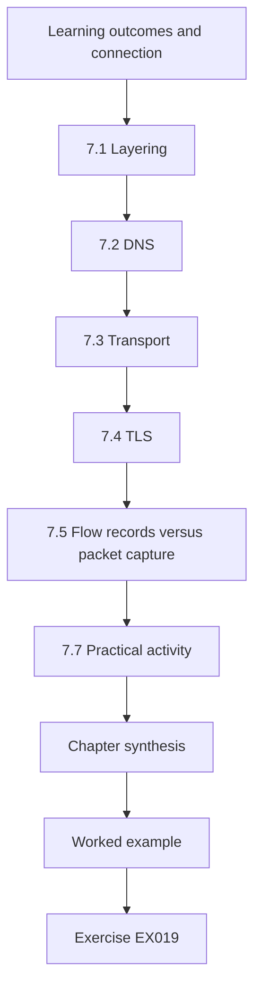

### Logical drawing

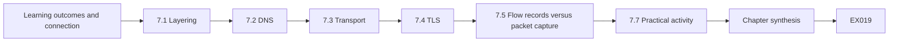

```text
[Learning outcomes and connection]
    |
    v
[7.1 Layering]
    |
    v
[7.2 DNS]
    |
    v
[7.3 Transport]
    |
    v
[7.4 TLS]
    |
    v
[7.5 Flow records versus packet capture]
    |
    v
[7.7 Practical activity]
    |
    v
[Chapter synthesis]
    |
    v
[Worked example] --> [Exercise EX019]
```
<!-- open-cyber-academy:lesson-figures:end ch-07 -->


### Learning outcomes and connection

You will be able to (1) place an observation at the correct network layer; (2) read DNS, TCP and TLS evidence and say what each does and does not prove; (3) distinguish flow records from packet captures; and (4) evaluate a connection hypothesis against a trace. Chapter 2 introduced systems and dependencies; here you follow requests across the network that joins them. Chapter 22 returns to network evidence as one source in a provenance map.

### 7.1 Layering

The layered model separates concerns: link (local delivery), network (IP addressing and routing), transport (TCP, UDP — ports and reliability), and application (DNS, HTTP, TLS-protected protocols). An observation belongs to a layer and proves things only at that layer. A TCP connection from host A to address X on port 443 shows that A exchanged packets with X; it does not show which website, which user, or what data.

Layering also tells you which team holds the evidence: link and network data often sit with infrastructure staff, application logs with the system owner. Ask the right owner for the right layer.

### 7.2 DNS

The Domain Name System (RFC 1034/1035) maps names to records. A **query log** shows that a resolver was asked for a name; it does not show that a connection followed. Answers can be cached at several levels, so a host may connect to an address without a fresh query. Time-to-live (TTL) values explain such gaps. Many names can point to one address (shared hosting, content-delivery networks), so an address alone rarely identifies a site.

In the portal example, the DNS log at 02:14:05 shows that the portal asked for cdn-sync.example. The flow one second later is consistent with a connection to the answer, but only the flow record shows that traffic actually moved.

### 7.3 Transport

TCP connections begin with a handshake (SYN, SYN-ACK, ACK). A SYN without a reply means an attempt, not a connection. Ports are conventions: 443 usually carries TLS, but any service can listen anywhere. UDP has no handshake; a single datagram is not a conversation.

In the portal example the flow shows outbound and inbound bytes over several minutes, which implies a completed handshake and a working conversation. A flow showing only a few small packets outbound and none back would describe an attempt, not a transfer, and would support a much weaker claim. Check the packet counts in both directions before using the word "connection" in a report.

### 7.4 TLS

TLS (version 1.3 is specified in RFC 8446) encrypts application data. Observers can still see the endpoints, timing, sizes and, in many deployments, the **Server Name Indication** (SNI) — the hostname the client requested — unless Encrypted Client Hello is used. Certificates identify a server name to the client; a certificate seen in a trace shows which name the server claimed, which is useful but not proof of what content was exchanged.

In the portal example, the SNI in the sampled capture matches the name the DNS log recorded, so two sources agree on the requested hostname, though they do not show what was sent.

### 7.5 Flow records versus packet capture

**Flow records** (for example NetFlow/IPFIX) summarize conversations: endpoints, ports, start, duration, byte and packet counts. They are cheap to keep for long periods but contain no payload. **Packet capture** (pcap) contains packets, possibly payloads, and is expensive and privacy-sensitive. Flows answer "did A talk to X, when and how much?"; pcap can answer "what was said?" if it is unencrypted. Both are subject to sampling and sensor placement: a sensor sees only the traffic that passes it.

In the portal case the flow gives the 18.4 MB figure. The flow tells you that volume and its timing; only payload, which this capture does not hold beyond a short encrypted sample, could tell you what the bytes contained, and that is why the content question stays open.

### 7.6 Worked example (synthetic): did the portal talk to the suspicious host?

*Fictional trace.* Hypothesis: the Harbourline patient portal server `10.20.0.15` sent data to `203.0.113.50` (a documentation address, RFC 5737) on 4 March.

Evidence:
1. DNS log, 02:14:05: `10.20.0.15` asked the internal resolver for `cdn-sync.example` → answer `203.0.113.50`, TTL 300.
2. Flow record, 02:14:06–02:19:40: `10.20.0.15:51544` → `203.0.113.50:443`, TCP, 18.4 MB outbound, 0.2 MB inbound.
3. TLS ClientHello in a 60-second sample capture: SNI `cdn-sync.example`.
4. The portal's change log: a new image-synchronization plug-in was installed on 3 March.

What is supported: a TCP session existed from the portal to that address for about 5.5 minutes, carrying about 18 MB outbound (flow, observation). The client requested the name `cdn-sync.example` (DNS and SNI agree). What is not supported: the content of the 18 MB; that it was patient data; that it was malicious. Competing explanation: the new plug-in synchronizing images. Next bounded checks: the plug-in's documented endpoint and schedule; the portal's file-access log at 02:14; the vendor's confirmation. If the plug-in is documented to use a different domain, the hypothesis strengthens.

### 7.7 Practical activity

On your own computer, use your operating system's DNS cache or a command like `nslookup` against a public name to observe a query and its TTL. Record what the output proves and does not prove. Do not capture traffic on networks you do not own or administer.

Run the same lookup twice a minute apart and note whether the TTL decreased, which shows a cached answer. Write two sentences: one stating what the output shows, and one listing what it cannot show, such as whether any connection followed. Compare results with a classmate using a different resolver; differing answers for the same name are normal for content-delivery networks and are a useful reminder that an address alone rarely names a site.

### 7.8 Common errors and limits

- Treating a DNS query as proof of a connection, or an address as proof of a site.
- Treating port 443 as proof of HTTPS, or encryption as proof of legitimacy.
- Reading byte counts as data content.
- Forgetting sensor placement and sampling: absence in a flow log may mean "not seen", not "did not happen".

- Reading an absence of SNI as proof of malice; many clients and protocols omit it legitimately.
- Comparing timestamps from DNS and flow sensors without checking that their clocks agree.
- Reporting a sampled capture as if it covered the whole session; sixty seconds is a fragment, not the conversation.

### Exercises — chapter 7

Attempt each exercise before opening the [worked results](#worked-results). Every case, organization, person, address and number in an exercise is synthetic unless a cited public source is named.

**EX019 — Layer placement.** *Inputs:* (a) a DNS query for `pay.example`; (b) a SYN to port 22 with no reply; (c) an IPFIX record of 2 GB to a cloud storage address; (d) an HTTP request line in a proxy log. *Steps:* place each in a layer and state the strongest claim it supports. *Rubric:* 3 = all four correct with modest claims; 2 = one overclaim; 1 = layers wrong; 0 = none.

**EX020 — Missing DNS.** *Inputs:* a flow from a workstation to `198.51.100.7:443` with no corresponding DNS query in the resolver log. *Steps:* give three explanations and the check for each. *Rubric:* 3 = cached answer (check TTL/previous queries), alternate resolver or DoH (check resolver settings, traffic to known DoH endpoints), hard-coded address (check process/binary); 2 = two; 1 = one; 0 = none.

**EX021 — Strengthen the hypothesis.** *Inputs:* §7.6. *Steps:* list what evidence would make "patient data was exfiltrated" likely, and what would make it unlikely. *Rubric:* 3 = specific evidence both ways (file-access logs for patient files at 02:14, plug-in documentation, vendor endpoint ownership, size vs image library size); 2 = one side only; 1 = vague; 0 = none.

### Chapter synthesis

Each network observation proves something only at its own layer. Correlate DNS, flow and TLS evidence, keep content claims separate from connection claims, and remember that sensors see only what passes them.

<!-- open-cyber-academy:chapter-navigation:start ch-07 -->
### Continue studying — chapter 07 of 40

[← Chapter 06](#ch-06) · [Course chapter index](../SUBJECTS.md) · [Chapter 08 →](#ch-08)

Continue to the next authored lesson.
<!-- open-cyber-academy:chapter-navigation:end -->

<a id="ch-08"></a>

## Chapter 8 — Programming II

<!-- open-cyber-academy:lesson-figures:start ch-08 -->
### Lesson map

Lesson 08 published. Map, example, EX022.

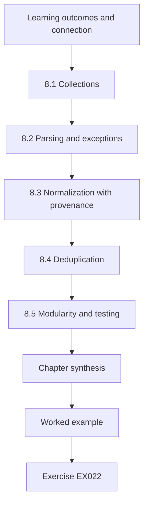

### Logical drawing

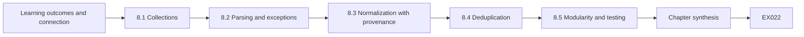

```text
[Learning outcomes and connection]
    |
    v
[8.1 Collections]
    |
    v
[8.2 Parsing and exceptions]
    |
    v
[8.3 Normalization with provenance]
    |
    v
[8.4 Deduplication]
    |
    v
[8.5 Modularity and testing]
    |
    v
[Chapter synthesis]
    |
    v
[Worked example] --> [Exercise EX022]
```
<!-- open-cyber-academy:lesson-figures:end ch-08 -->


### Learning outcomes and connection

You will be able to (1) use lists, dictionaries and sets to group records; (2) parse JSON safely and handle malformed input with exceptions; (3) normalize timestamps and entity names while preserving the raw record; (4) deduplicate with an explicit key; and (5) structure code into testable functions with provenance. Chapter 3 validated flat records; here you handle nested, messy alert data. Chapter 9 moves from files to databases.

### 8.1 Collections

A **list** keeps order; a **dictionary** maps keys to values; a **set** holds unique items. For alerts, a dictionary keyed by a deduplication key groups duplicates; a set of entity names answers "which hosts appear?". Choose the structure that makes the question easy.

In Lab 08 the `groups` dictionary maps each deduplication key to a list of line numbers, so a group keeps every member. A set would answer "which hosts appear" but would lose how often and when, so choose it only when counts do not matter. Mixing the two carelessly is a common source of quietly wrong totals.

### 8.2 Parsing and exceptions

`json.loads` turns text into Python objects or raises `json.JSONDecodeError`. Malformed input is normal in incident work — truncated exports, mixed encodings. Catch the specific exception, record the line number and the raw text, and continue. Never use a bare `except:` that hides programming errors.

Lab 08 shows the pattern: line 6 lacks a closing brace, `json.loads` raises, and the loop records the line number with the error message before moving on. The final output therefore reports five parsed records and one malformed, rather than five records and silence. A rising count of malformed lines is itself a signal worth watching.

### 8.3 Normalization with provenance

**Normalization** converts different representations to one: host names to lower case, timestamps to UTC ISO 8601. Each normalized value should be traceable to its raw source. A simple design keeps three things per record: the raw text, the parsed/normalized fields, and a list of notes describing every transformation (for example "timestamp had no offset; assumed UTC per source documentation"). That list is the record's **provenance**.

In Lab 08 line 4 has no offset, so the program assumes UTC and writes that assumption into the record's notes. If the sensor actually logged local time at UTC−3, the event shifts three hours.

### 8.4 Deduplication

Two alerts are duplicates only under a stated rule: same rule ID, same entity, same event time within a tolerance. Deduplicate into groups, keeping all raw members, rather than deleting. Counting groups and members separately lets a reviewer check the rule.

Lab 08 shows why the rule must be stated: lines 1 to 3 describe one event within two seconds, yet the fixed five-second buckets split them into two groups. Because members are kept rather than deleted, the error is visible in the output and can be corrected. A deleted duplicate cannot be recovered to test a better rule later.

### 8.5 Modularity and testing

Split code into `parse_line`, `normalize`, `dedup_key` and `report`. Each can be tested with small inputs. Modularity also helps review: a colleague can check the timestamp logic without reading the reporting code.

In Lab 08 the timestamp logic lives in `parse_ts`, so a reviewer can test it with a single string such as an offset of minus three hours without building a full alert. Keep each function small enough that its tests fit on a screen; when a function needs many tests to cover its branches, it is usually doing two jobs. Name functions after what they return, not how they work.

### 8.6 Worked example and lab (synthetic): alert bundle

Save as `lab08.py`.

```python
# Lab 08 - parse, normalize and deduplicate synthetic JSON alerts, keeping raw records (stdlib only)
import json
from datetime import datetime, timezone

LINES = [
    '{"rule": "R-PS1", "host": "WS-014", "ts": "2026-03-04T09:00:04Z"}',
    '{"rule": "R-PS1", "host": "ws-014", "ts": "2026-03-04T09:00:06+00:00"}',
    '{"rule": "R-PS1", "host": "WS-014", "ts": "2026-03-04T06:00:05-03:00"}',
    '{"rule": "R-NET4", "host": "ws-020", "ts": "2026-03-04 09:10:00"}',
    '{"rule": "R-NET4", "host": "ws-020", "ts": "04/03/2026 09:10"}',
    '{"rule": "R-PS1", "host": "WS-014", "ts": "2026-03-04T09:30:00Z"',
]

def parse_ts(s, notes):
    try:
        dt = datetime.fromisoformat(s.replace("Z", "+00:00"))
    except ValueError:
        notes.append("unparseable timestamp kept raw")
        return None
    if dt.tzinfo is None:
        notes.append("no offset; assumed UTC per sensor documentation")
        dt = dt.replace(tzinfo=timezone.utc)
    return dt.astimezone(timezone.utc)

records, errors = [], []
for n, line in enumerate(LINES, 1):
    try:
        obj = json.loads(line)
    except json.JSONDecodeError as e:
        errors.append((n, e.msg)); continue
    notes = []
    host = obj["host"].lower()
    if host != obj["host"]:
        notes.append("host lower-cased")
    records.append({"line": n, "raw": line, "rule": obj["rule"], "host": host,
                    "utc": parse_ts(obj["ts"], notes), "notes": notes})

def key(r, tol=5):
    if r["utc"] is None:
        return (r["rule"], r["host"], "raw:" + str(r["line"]))
    return (r["rule"], r["host"], int(r["utc"].timestamp()) // tol)

groups = {}
for r in records:
    groups.setdefault(key(r), []).append(r["line"])
print("parsed", len(records), "malformed", errors)
for k, members in groups.items():
    print(k[0], k[1], "lines", members)
for r in records:
    if r["notes"]:
        print("line", r["line"], r["notes"])
```

Expected output:

```text
parsed 5 malformed [(6, "Expecting ',' delimiter")]
R-PS1 ws-014 lines [1]
R-PS1 ws-014 lines [2, 3]
R-NET4 ws-020 lines [4]
R-NET4 ws-020 lines [5]
line 1 ['host lower-cased']
line 3 ['host lower-cased']
line 4 ['no offset; assumed UTC per sensor documentation']
line 5 ['unparseable timestamp kept raw']
```

Interpretation: lines 1–3 describe the same event within two seconds (09:00:04, 09:00:06 and 06:00:05 at UTC−3, which is 09:00:05 UTC), yet the bucketed key splits them: 09:00:04 falls in the bucket that starts at 09:00:00, while 09:00:05 and 09:00:06 fall in the bucket that starts at 09:00:05. This is a known weakness of fixed time buckets: events near a boundary separate. A better rule compares each event with the previous one in sorted order (gap ≤ tolerance). Line 5 cannot be placed in time at all and is kept separately rather than guessed. Line 6 is reported, not silently dropped.

### 8.7 Common errors and limits

- Deleting duplicates instead of grouping them.
- Fixed buckets that split near-simultaneous events.
- Assuming naive timestamps are local time or UTC without documentation.
- Catching all exceptions and losing the error message.

- Normalizing host names without recording the change, so a reviewer cannot tell that WS-014 and ws-014 were merged.
- Treating the five-second tolerance as fact rather than a choice that must be justified for the sensor.
- Testing parsing on clean lines only, so the first truncated export breaks the pipeline during an incident. Each of these errors is cheap to prevent early and expensive to discover after a report has gone out.

### Exercises — chapter 8

Attempt each exercise before opening the [worked results](#worked-results). Every case, organization, person, address and number in an exercise is synthetic unless a cited public source is named.

**EX022 — Fix the deduplication.** *Steps:* replace the bucketed key with a sorted-gap rule (same rule and host, gap to previous ≤ 5 seconds) and show lines 1–3 now form one group. *Rubric:* 3 = correct code and output, None timestamps handled separately; 2 = works but drops unparseable; 1 = not run; 0 = none.

**EX023 — Provenance note.** *Steps:* write the provenance entry a reviewer would need for line 4, including the source of the UTC assumption and how to verify it. *Rubric:* 3 = names the assumption, the documentation or configuration to check, and the effect if wrong (a three-hour shift for a UTC−3 sensor); 2 = partial; 1 = absent; 0 = none.

**EX024 — Malformed-input policy.** *Steps:* write a five-line policy for handling malformed alerts in a response pipeline. *Rubric:* 3 = keep raw, count and report, alert on rising rates, no guessing, owner for fixes; 2 = three of these; 1 = "skip bad lines"; 0 = none.

### Chapter synthesis

Parse defensively, normalize with a note for every transformation, group rather than delete duplicates under a stated rule, and keep raw records alongside the clean view so every conclusion can be traced.

<!-- open-cyber-academy:chapter-navigation:start ch-08 -->
### Continue studying — chapter 08 of 40

[← Chapter 07](#ch-07) · [Course chapter index](../SUBJECTS.md) · [Chapter 09 →](#ch-09)

Continue to the next authored lesson.
<!-- open-cyber-academy:chapter-navigation:end -->

<a id="ch-09"></a>

## Chapter 9 — Data and databases

<!-- open-cyber-academy:lesson-figures:start ch-09 -->
### Lesson map

Lesson 09 published. Map, example, EX025.

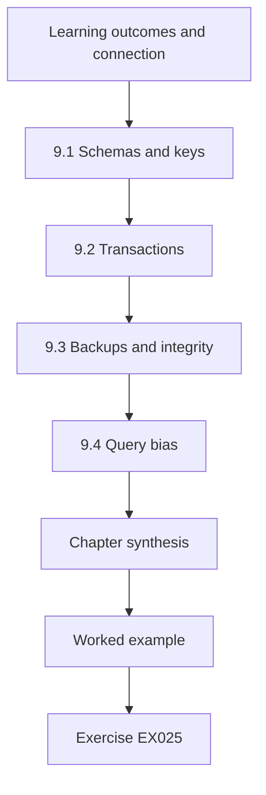

### Logical drawing

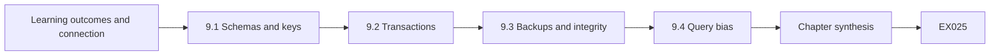

```text
[Learning outcomes and connection]
    |
    v
[9.1 Schemas and keys]
    |
    v
[9.2 Transactions]
    |
    v
[9.3 Backups and integrity]
    |
    v
[9.4 Query bias]
    |
    v
[Chapter synthesis]
    |
    v
[Worked example] --> [Exercise EX025]
```
<!-- open-cyber-academy:lesson-figures:end ch-09 -->


### Learning outcomes and connection

You will be able to (1) read a relational schema and identify keys; (2) explain transactions and why they matter for evidence and restoration; (3) join tables and detect ambiguous matches; (4) recognize how queries can bias results; and (5) propose integrity checks before restoring data. Chapter 8 handled files; most organizational state lives in databases. Chapter 26 uses these ideas to choose restore points.

### 9.1 Schemas and keys

A **schema** defines tables, columns and types. A **primary key** uniquely identifies a row; a **foreign key** refers to a row in another table. In incident data, keys are often inconsistent: one system calls a case `HC-0101`, another `101`, a third uses an internal number. Before joining, write down how identifiers map, and whether the mapping is one-to-one.

Lab 09 shows the cost of skipping that step: events reference cases as HC-0101, 101 and 10, and only half match by exact key. Writing the mapping first would have exposed that 10 fits two cases before any total was computed.

### 9.2 Transactions

A **transaction** groups changes so that they all apply or none does (atomicity) and leaves the database consistent. Databases record committed changes in a write-ahead or transaction log. For responders this matters twice: the log can show *what changed when*, and a restore must land at a transaction boundary, not in the middle of a business operation (for example, an appointment created without its patient link).

A business operation that spans two transactions can still leave an inconsistent state if it fails between them, so ask how the application groups its writes, not only how the database works.

### 9.3 Backups and integrity

A **backup** is a copy at a point in time; a **point-in-time recovery** combines a base backup with replayed logs. Integrity checks before restoring include: row counts per table compared with expectations, referential checks (every foreign key resolves), checksums where the platform supports them, and business checks (no appointments in the past created after the incident started). A backup taken after an attacker's change faithfully preserves that change.

Run integrity checks on a copy of the backup, not the production database, so a failed check costs nothing. Record each check's result with the backup's timestamp; if the restored system later shows problems, that record shows what was verified and what was assumed.

### 9.4 Query bias

A query embodies decisions. `WHERE status = 'closed'` excludes open cases; an inner join drops rows with no match, silently; `GROUP BY` on a free-text field splits "Phishing" and "phishing". When a number comes from a query, the query is part of the method and must be reported.

In Lab 09 the inner join reports four events, and a reader would not know that four more existed unless the query and the total were shown together. Report the population, the filter and the count excluded by each step, so a reviewer can see what the number leaves out.

### 9.5 Worked example and lab (synthetic): joining cases and events

Save as `lab09.py`. It uses Python's built-in `sqlite3` module.

```python
# Lab 09 - joins, ambiguous matches and integrity checks on a synthetic incident database (stdlib only)
import sqlite3
db = sqlite3.connect(":memory:")
db.executescript("""
CREATE TABLE cases(case_id TEXT PRIMARY KEY, opened TEXT, severity INTEGER);
CREATE TABLE events(ev_id INTEGER PRIMARY KEY, case_ref TEXT, kind TEXT);
INSERT INTO cases VALUES ('HC-0101','2026-03-02',2),('HC-0102','2026-03-02',3),
                         ('HC-0103','2026-03-03',2),('HC-0110','2026-03-04',4),
                         ('HC-0010','2026-02-20',1);
INSERT INTO events(case_ref,kind) VALUES ('HC-0101','email'),('101','signin'),
  ('HC-0102','device'),('HC-0110','signin'),('HC-0110','file'),('110','file'),
  ('HC-0199','signin'),('10','signin');
""")
inner = db.execute("SELECT COUNT(*) FROM events e JOIN cases c ON e.case_ref=c.case_id").fetchone()[0]
total = db.execute("SELECT COUNT(*) FROM events").fetchone()[0]
print("events:", total, "matched by exact key:", inner)

def candidates(ref):
    digits = ref.split("-")[-1].lstrip("0")
    return [c for (c,) in db.execute("SELECT case_id FROM cases")
            if c.split("-")[-1].lstrip("0").endswith(digits)]

for ref, kind in db.execute("SELECT case_ref, kind FROM events WHERE case_ref NOT IN (SELECT case_id FROM cases)"):
    m = candidates(ref)
    status = "unique" if len(m) == 1 else ("ambiguous" if m else "orphan")
    print(f"{ref:8} {kind:7} -> {status} {m}")

no_events = db.execute("SELECT case_id FROM cases WHERE case_id NOT IN (SELECT case_ref FROM events)").fetchall()
print("cases with no exact-key events:", [c for (c,) in no_events])
```

Expected output:

```text
events: 8 matched by exact key: 4
101      signin  -> unique ['HC-0101']
110      file    -> unique ['HC-0110']
HC-0199  signin  -> orphan []
10       signin  -> ambiguous ['HC-0010', 'HC-0110']
cases with no exact-key events: ['HC-0010', 'HC-0103']
```

Interpretation: an inner join counts only four of eight events and silently drops the other half. A suffix rule recovers two plausible matches (`101` → HC-0101, `110` → HC-0110), labels `HC-0199` an orphan (an event for a case that does not exist here — perhaps a deleted case, perhaps a typing error) and exposes `10` as ambiguous: it fits both HC-0010 and HC-0110. Note also that the loose rule is itself a hypothesis: `110` would also have matched a case `HC-1110` had one existed. The lab reports each decision instead of hiding it. HC-0010 and HC-0103 have no exact-key events; whether they have events under other identifiers is unknown.

What to do with the result: keep the exact-key join as the conservative view, present the suffix matches as *proposed* links for a human to confirm against source systems, and never fold ambiguous rows into totals. Before any restoration from this database, the integrity checks would include: every `events.case_ref` resolves (currently 4 of 8 fail), no case without its opening event, and the count of events per day compared with the source system.

### 9.6 Common errors and limits

- Inner joins that silently drop unmatched rows; reporting the result as "all events".
- Fuzzy matching without labelling matches as proposed.
- Restoring a backup without checking whether it already contains the attacker's changes.
- Forgetting that a database's own logs may have limited retention; check before relying on them.

- Matching identifiers by suffix and folding the results into totals without human confirmation.
- Counting cases with no matching events as cases with no events; HC-0103 may have events under another identifier.
- Running exploratory queries on the production database during an incident instead of on a copy.

### Exercises — chapter 9

Attempt each exercise before opening the [worked results](#worked-results). Every case, organization, person, address and number in an exercise is synthetic unless a cited public source is named.

**EX025 — Run and report.** *Steps:* run Lab 09; then add an event with `case_ref` `'HC-0103 '` (trailing space) and report how it is classified and why. *Rubric:* 3 = correct classification (orphan) with the whitespace reasoning checked by running; 2 = run without reasoning; 1 = predicted only; 0 = none.

**EX026 — Integrity checklist.** *Inputs:* a booking database to be restored from last night's backup after suspicious changes this morning. *Steps:* list five checks to run on the restored copy before it serves users, each with its pass criterion. *Rubric:* 3 = five concrete checks with criteria (counts, referential integrity, known-good sample, absence of known-bad changes, application smoke test); 2 = three; 1 = vague; 0 = none.

**EX027 — Query as method.** *Inputs:* "Average time to close in March was 2.1 days" computed with `WHERE status='closed' AND opened >= '2026-03-01'`. *Steps:* explain two biases and rewrite the claim honestly. *Rubric:* 3 = excludes still-open (likely longer) cases; cases opened in late March have had less time to close; honest rewrite with counts; 2 = one bias; 1 = none named; 0 = none.

### Chapter synthesis

Know your keys, report every join's losses, label fuzzy matches as proposals, treat queries as part of the method and verify a backup's integrity — and its innocence — before restoring it.

<!-- open-cyber-academy:chapter-navigation:start ch-09 -->
### Continue studying — chapter 09 of 40

[← Chapter 08](#ch-08) · [Course chapter index](../SUBJECTS.md) · [Chapter 10 →](#ch-10)

Continue to the next authored lesson.
<!-- open-cyber-academy:chapter-navigation:end -->

<a id="ch-10"></a>

## Chapter 10 — Ethics and authorized practice

<!-- open-cyber-academy:lesson-figures:start ch-10 -->
### Lesson map

Lesson 10 published. Map, example, EX028.

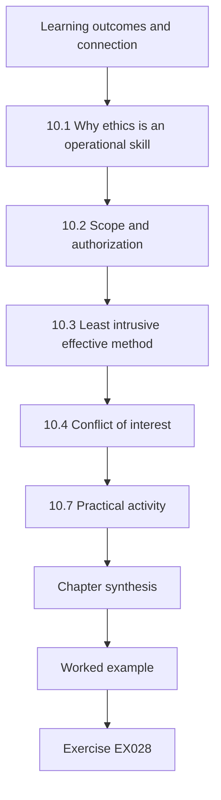

### Logical drawing

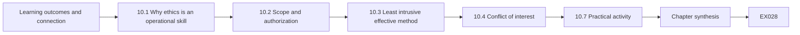

```text
[Learning outcomes and connection]
    |
    v
[10.1 Why ethics is an operational skill]
    |
    v
[10.2 Scope and authorization]
    |
    v
[10.3 Least intrusive effective method]
    |
    v
[10.4 Conflict of interest]
    |
    v
[10.7 Practical activity]
    |
    v
[Chapter synthesis]
    |
    v
[Worked example] --> [Exercise EX028]
```
<!-- open-cyber-academy:lesson-figures:end ch-10 -->


### Learning outcomes and connection

You will be able to (1) define scope, consent and authorization for response work; (2) apply the principle of the least intrusive effective method; (3) recognize and declare conflicts of interest; and (4) document an escalation when a request exceeds scope. Chapter 5 introduced the boundary between access and authority; here you learn to reason about it under pressure. Chapter 14 adds privacy law and minimization, and Chapter 32 the legal and communications interfaces.

### 10.1 Why ethics is an operational skill

Incident responders often have broad technical access and work under time pressure. Those two facts make overreach easy and its consequences serious: evidence obtained without authority can be unusable, staff trust can collapse, and the responder can personally break the law. Research ethics in computing makes the same point. The Menlo Report (US Department of Homeland Security, 2012) adapted the Belmont Report's principles — respect for persons, beneficence, justice — to information and communication technology research and added **respect for law and public interest**. These principles are a useful frame for response practice too: respect the people whose data you touch, weigh harm against benefit, distribute burdens fairly and stay within law and mandate.

### 10.2 Scope and authorization

**Scope** lists the systems, data and actions approved for an engagement or incident. **Authorization** names who approved it and when. Good practice records both at intake (Chapter 14 of the technologist book develops intake forms). Scope can expand, but only by the same process: a request, a decision by someone with authority, and a record. Technical access — an administrator password, an EDR console — does not define scope.

In the rota investigation, Dana's approved scope names organizational email, file-share audit logs and managed devices. A personal phone is outside it, however quickly the manager wants an answer, until the incident lead and counsel approve an extension.

### 10.3 Least intrusive effective method

When two methods would answer the question, choose the one that collects less personal data, changes fewer systems and can be reversed. Example: to learn whether an account signed in from a laptop, query sign-in logs before imaging the laptop; to learn whether a file was sent externally, check gateway metadata before reading message bodies. "Effective" matters: a method too weak to answer the question is not ethical just because it is gentle; it wastes time while harm continues.

Write down which method you chose and which gentler one you rejected.

### 10.4 Conflict of interest

A conflict exists when a personal or organizational interest could bias judgement: investigating your own manager, your friend, a system you designed, or a vendor you selected. Declare conflicts early and ask for reassignment or independent review. The record of declaration protects both the investigation and you.

In the rota case, the manager who pointed at Sam had a prior dispute with him, which is why Dana records the suggestion as a hypothesis rather than a lead. The same discipline applies to the investigator: if Dana had worked closely with Sam or with the manager, she should say so before the first interview, not after a complaint.

### 10.5 Consent and its limits

Consent is meaningful when it is informed, specific and freely given. Employees may feel they cannot refuse an employer's request, so organizations usually rely on policy and legal basis rather than on consent alone. When you ask a person for access to a personal device, explain what will be examined, by whom, for how long, and what they may refuse; involve HR or legal staff as policy requires.

Record what the person agreed to, in their words if possible, and whether a witness was present. In the rota case, any examination of Sam's phone would be limited to named folders, and he could withdraw his agreement at any point.

### 10.6 Worked example (synthetic): the personal phone

*Fictional.* During an investigation of a leaked rota spreadsheet at Harbourline, a manager asks investigator Dana to "check Sam's personal phone; he probably sent it from there". The approved scope covers organizational email, file-share audit logs and managed devices.

Options:
(a) Take the phone and examine it: outside scope, no legal basis, coercive. Rejected.
(b) Check file-share audit logs for downloads of the rota and gateway logs for messages with the file attached: in scope, low intrusion. Chosen first.
(c) If (b) shows Sam downloaded the file to a managed device synced with a personal phone, request a scope extension through the incident lead and legal counsel, and, if approved, ask Sam to consent to a limited, witnessed examination of named folders, with the right to decline.

Escalation record: request, requester, reason, options considered, decision, decider, time. Dana also notes that the manager's certainty about Sam is a hypothesis, not evidence, and that the manager may have a conflict (a prior dispute).

### 10.7 Practical activity

Write a one-page scope statement for a fictional phishing incident: systems, data types, permitted actions, prohibited actions, approvers and an expansion procedure.

Make each prohibited action concrete, for example "no access to personal devices or personal accounts" rather than "respect privacy". Name the approvers by role, such as the incident lead and the privacy officer, and state how quickly a scope request must be answered during an incident. Add a short log template for requests: who asked, what for, who decided and when. Then test the document against the rota case in this chapter: would it have told Dana clearly what to do when the manager asked about Sam's phone? If not, revise the wording until it would.

### 10.8 Common errors and limits

- Using technical access as a substitute for authorization.
- Collecting "everything just in case".
- Accepting a stakeholder's suspicion of a named person as a premise.
- Failing to record declined requests; the refusal is part of the record.
- Ethics frameworks guide judgement; they do not replace legal advice, which must come from qualified counsel in the relevant jurisdiction.

- Letting urgency justify skipping the scope request, when a short call to the incident lead would settle it.
- Treating a person's agreement as valid when refusing would plausibly cost them their job.

### Exercises — chapter 10

Attempt each exercise before opening the [worked results](#worked-results). Every case, organization, person, address and number in an exercise is synthetic unless a cited public source is named.

**EX028 — Escalation record.** *Steps:* write the record for §10.6 using the seven fields listed. *Rubric:* 3 = all fields, neutral wording, conflict noted; 2 = missing decider or time; 1 = narrative only; 0 = none.

**EX029 — Least intrusive method.** *Inputs:* question: "did the receptionist account export the appointment list yesterday?" Options: image the receptionist's PC; query the application audit log; interview the receptionist; review CCTV. *Steps:* rank by intrusion and effectiveness and choose a sequence. *Rubric:* 3 = audit log first, interview with HR guidance if needed, PC imaging only if justified and authorized, CCTV generally disproportionate; reasons given; 2 = order right, reasons thin; 1 = imaging first; 0 = none.

**EX030 — Conflict check.** *Inputs:* you designed the booking system's access model; an incident suggests a design flaw. *Steps:* state the conflict and two safeguards. *Rubric:* 3 = declares interest in the design being sound, proposes independent reviewer of conclusions and documented evidence trail; 2 = one safeguard; 1 = denies conflict; 0 = none.

### Chapter synthesis

Authority comes from scope and named approval, not from access. Prefer the least intrusive method that can actually answer the question, declare conflicts, and record every escalation — including the requests you declined.

<!-- open-cyber-academy:chapter-navigation:start ch-10 -->
### Continue studying — chapter 10 of 40

[← Chapter 09](#ch-09) · [Course chapter index](../SUBJECTS.md) · [Chapter 11 →](#ch-11)

Continue to the next authored lesson.
<!-- open-cyber-academy:chapter-navigation:end -->

<a id="ch-11"></a>

## Chapter 11 — Operating systems

<!-- open-cyber-academy:lesson-figures:start ch-11 -->
### Lesson map

Lesson 11 published. Map, example, EX031.

```mermaid
flowchart TD
  N0["Learning outcomes and connection"]
  N1["11.1 Processes and their lineage"]
  N2["11.2 Services and scheduled work"]
  N3["11.3 Sessions and accounts"]
  N4["11.4 File metadata"]
  N5["11.5 Updates"]
  N6["11.6 Log sources"]
  N7["Chapter synthesis"]
  N0 --> N1 --> N2 --> N3 --> N4 --> N5 --> N6 --> N7
  N7 --> EX["Worked example"]
  EX --> Q["Exercise EX031"]
```

### Logical drawing

```mermaid
flowchart LR
  N0["Learning outcomes and connection"]
  N1["11.1 Processes and their lineage"]
  N2["11.2 Services and scheduled work"]
  N3["11.3 Sessions and accounts"]
  N4["11.4 File metadata"]
  N5["11.5 Updates"]
  N6["11.6 Log sources"]
  N7["Chapter synthesis"]
  N0 --> N1 --> N2 --> N3 --> N4 --> N5 --> N6 --> N7 --> Q["EX031"]
```

```text
[Learning outcomes and connection]
    |
    v
[11.1 Processes and their lineage]
    |
    v
[11.2 Services and scheduled work]
    |
    v
[11.3 Sessions and accounts]
    |
    v
[11.4 File metadata]
    |
    v
[11.5 Updates]
    |
    v
[11.6 Log sources]
    |
    v
[Chapter synthesis]
    |
    v
[Worked example] --> [Exercise EX031]
```
<!-- open-cyber-academy:lesson-figures:end ch-11 -->


### Learning outcomes and connection

You will be able to (1) explain processes, services, user sessions and file metadata as sources of evidence; (2) identify which operating-system log records which kind of event; (3) generate competing explanations for an unfamiliar process; and (4) choose a bounded, non-destructive check. Chapters 2 and 8 gave you systems and parsing; here you read the host itself. Chapter 27 uses these sources to verify eradication.

### 11.1 Processes and their lineage

A **process** is a running program with an identifier (PID), an owner (user account), a parent process, a command line and an executable path. **Lineage** — the chain of parents — is often more informative than the name: `powershell.exe` started by an office document is very different from `powershell.exe` started by a management agent. Names can be imitated; paths, signatures and parents are harder to fake consistently.

In the WS-031 example, `cagent-helper.exe` is started by `updater.exe`, itself launched by a scheduled task under SYSTEM. That chain fits an update, though it does not prove the helper's contents are legitimate.

### 11.2 Services and scheduled work

A **service** (Windows service, Linux systemd unit, macOS launch daemon) starts automatically and usually runs under a system account. **Scheduled tasks** and cron jobs run at set times. Both are legitimate mechanisms for updates and maintenance — and common **persistence** mechanisms for attackers. The question is never "is there a scheduled task?" but "was this one created by an expected actor, at an expected time, for an expected purpose?"

On WS-031 the task `ClinicAgentUpdate` ran at 02:00 on 5 March as SYSTEM, which matches a maintenance window. That expected timing is a point in favour of the update explanation but not proof: an attacker who controls the updater inherits its schedule and account. The task's creation date and author are worth checking against the change calendar.

### 11.3 Sessions and accounts

A **session** links activity to a sign-in: interactive (keyboard), remote (RDP/SSH), network (file share), service. Session type matters: a "logon" event for a service account every five minutes is normal; an interactive logon by that account is not.

On WS-031 the interactive sign-in by nurse-07 at 09:15 came seven hours after the helper started. The helper was already running, so her session did not start it; a timeline must keep that order clear rather than linking a user's name to a process by proximity alone. Record each session's type and source with its time.

### 11.4 File metadata

File systems record timestamps (commonly modification, access, metadata change and, on some systems, creation). They are useful but fragile: copying, extracting archives, antivirus scans and time-zone settings change them, and tools can set them deliberately ("timestomping"). Treat file times as clues to be corroborated, not as clocks you can trust alone. NIST SP 800-86 (2006) discusses such caveats in forensic collection; its tool-specific details need current verification.

For `cagent-helper.exe` on WS-031, a file creation time around 02:01 on 5 March would agree with the process record, but agreement between two artefacts on one host is weaker than comparison with other workstations or the vendor's release.

### 11.5 Updates

Updates install files, restart services and create processes with unfamiliar names. Many alerts after patch nights are update artefacts. Knowing the change calendar is part of host analysis.

On WS-031 the unfamiliar helper appeared during the scheduled ClinicAgent update, so the first question is whether the vendor's release explains it. Ask the change owner for the update's schedule, expected files and hashes before treating new names as hostile. Equally, an update window is a convenient hiding place, so the calendar narrows the explanations rather than ending the investigation. Keep the change calendar where analysts can read it during a shift, since an alert raised at 02:00 is assessed by whoever is on duty, not by the patching team.

### 11.6 Log sources

On Windows, the Security event log records sign-ins and, if configured, process creation; Sysmon (if deployed) adds richer process and network events. On Linux, `journald`, `auth.log`/`secure` and the audit daemon play similar roles. Which events exist depends on configuration: an unconfigured audit policy produces silence, not innocence. NIST SP 800-92 (2006) gives general log-management guidance.

Before relying on a log, confirm which events the host was configured to record during the period in question; a policy changed last month may not cover last quarter.

### 11.7 Worked example (synthetic): an unfamiliar process after an update

*Fictional records* from workstation `WS-031` after a scheduled update on 5 March:

- 02:00:12 scheduled task `ClinicAgentUpdate` starts `C:\Program Files\ClinicAgent\updater.exe` (parent `svchost.exe`, account SYSTEM).
- 02:01:40 `updater.exe` starts `cagent-helper.exe` from `C:\ProgramData\ClinicAgent\tmp\`.
- 02:01:41 `cagent-helper.exe` connects to `updates.clinicagent.example:443`.
- 09:15:03 user `nurse-07` signs in interactively; `cagent-helper.exe` is still running.

Competing explanations: (H1) a legitimate helper used by the updater, left running by a bug; (H2) a malicious binary placed in a writable directory and launched through the updater (a supply-chain or hijack scenario); (H3) a legitimate helper later replaced by a malicious file.

Bounded checks: compare the helper's hash and signature with the vendor's published release; check whether other workstations updated at 02:00 show the same helper and hash; check the directory's write permissions; read the vendor's release notes. These checks collect no personal data and change nothing. Imaging the workstation is premature until they are done.

If ten of ten workstations show the same signed helper with identical hash and the vendor documents it, H1 is likely. If WS-031 alone has a different hash, H2/H3 become likely and the case escalates.

### 11.8 Common errors and limits

- Judging a process by its name.
- Treating file timestamps as reliable without corroboration.
- Confusing audit silence with absence of activity.
- Destructive first steps (killing processes, rebooting) that erase volatile evidence before a decision is made.

- Assuming every host has the same audit configuration, so a missing event on one workstation is read as absence of activity.
- Linking a signed-in user to a process because they overlapped in time, without checking which session started it.
- Ignoring the change calendar and treating update artefacts as intrusions, or the reverse.

### Exercises — chapter 11

Attempt each exercise before opening the [worked results](#worked-results). Every case, organization, person, address and number in an exercise is synthetic unless a cited public source is named.

**EX031 — Lineage reading.** *Inputs:* `winword.exe` → `cmd.exe` → `powershell.exe -enc ...` at 10:02 on a clerk's PC. *Steps:* explain why the lineage matters, give one benign and one malicious explanation, and name two checks. *Rubric:* 3 = explains macro-launched shell pattern, benign (documented template macro) vs malicious (phishing document), checks document source and decoded command in a safe environment; 2 = partial; 1 = name-based; 0 = none.

**EX032 — Session types.** *Inputs:* service account `svc-print` shows network logons every 5 minutes and one interactive logon at 03:12. *Steps:* interpret and choose a next check. *Rubric:* 3 = network logons expected; interactive logon anomalous; check source host and whether the account is allowed interactive logon; 2 = flags without check; 1 = misses it; 0 = none.

**EX033 — Hash comparison plan.** *Inputs:* §11.7. *Steps:* write the steps to compare helper hashes across workstations without altering them. *Rubric:* 3 = read-only collection via management tool, SHA-256, comparison table, record collection time and method, vendor reference; 2 = missing provenance; 1 = copying files around; 0 = none.

### Chapter synthesis

Read hosts through lineage, session type and corroborated metadata; know the change calendar; build competing explanations and start with read-only checks that can discriminate between them.

<!-- open-cyber-academy:chapter-navigation:start ch-11 -->
### Continue studying — chapter 11 of 40

[← Chapter 10](#ch-10) · [Course chapter index](../SUBJECTS.md) · [Chapter 12 →](#ch-12)

Continue to the next authored lesson.
<!-- open-cyber-academy:chapter-navigation:end -->

<a id="ch-12"></a>

## Chapter 12 — Probability and statistics

<!-- open-cyber-academy:lesson-figures:start ch-12 -->
### Lesson map

Lesson 12 published. Map, example, EX034.

```mermaid
flowchart TD
  N0["Learning outcomes and connection"]
  N1["12.1 Conditional probability and base rates"]
  N2["12.2 Confusion matrices"]
  N3["12.3 Sampling and intervals"]
  N4["12.4 Simpson's paradox"]
  N5["Chapter synthesis"]
  N0 --> N1 --> N2 --> N3 --> N4 --> N5
  N5 --> EX["Worked example"]
  EX --> Q["Exercise EX034"]
```

### Logical drawing

```mermaid
flowchart LR
  N0["Learning outcomes and connection"]
  N1["12.1 Conditional probability and base rates"]
  N2["12.2 Confusion matrices"]
  N3["12.3 Sampling and intervals"]
  N4["12.4 Simpson's paradox"]
  N5["Chapter synthesis"]
  N0 --> N1 --> N2 --> N3 --> N4 --> N5 --> Q["EX034"]
```

```text
[Learning outcomes and connection]
    |
    v
[12.1 Conditional probability and base rates]
    |
    v
[12.2 Confusion matrices]
    |
    v
[12.3 Sampling and intervals]
    |
    v
[12.4 Simpson's paradox]
    |
    v
[Chapter synthesis]
    |
    v
[Worked example] --> [Exercise EX034]
```
<!-- open-cyber-academy:lesson-figures:end ch-12 -->


### Learning outcomes and connection

You will be able to (1) compute and interpret sensitivity, specificity and precision of a detection rule; (2) apply conditional probability and base rates; (3) explain how an aggregate rate can mislead (Simpson's paradox); and (4) report an interval rather than a bare proportion. Chapter 1 introduced uncertainty informally; here you quantify it. Chapter 15 applies these tools to response measures and Chapter 33 to outcome studies.

### 12.1 Conditional probability and base rates

P(A | B) is the probability of A given B. For detection, the key quantities are **sensitivity** P(alert | malicious), **specificity** P(no alert | benign) and **precision** (positive predictive value) P(malicious | alert). Bayes' theorem links them: precision depends on the **base rate** (prevalence) of malicious events. A rule with 95% sensitivity and 99% specificity, applied where only 1 in 1,000 events is malicious, produces about 10 false alerts for every true one.

The lab's base-rate line makes the point concrete: with sensitivity of 95 per cent, specificity of 99 per cent and one malicious event per thousand, fewer than one alert in ten is true. An analyst who knows this does not lose trust in a rule after a run of false alerts; the rule may be working exactly as its base rate predicts.

### 12.2 Confusion matrices

Count true positives (TP), false positives (FP), true negatives (TN) and false negatives (FN). Sensitivity = TP/(TP+FN); specificity = TN/(TN+FP); precision = TP/(TP+FP). Every one of these depends on how "malicious" was decided — usually by later investigation, which itself may miss cases (FNs are the hardest to count).

In Lab 12 each department's counts form its own matrix, and the precision of the old rule in Clinical, 8 true alerts out of 40, comes straight from it. False negatives in the lab are given; in practice they are found only when a missed event surfaces later, so they are almost always undercounted.

### 12.3 Sampling and intervals

A proportion from a sample has sampling error. The **Wilson score interval** is a well-behaved 95% interval for proportions and is easy to compute. Report "precision 0.30 (95% CI 0.21–0.41, 24 of 80 alerts)" rather than "30%".

The interval narrows as the sample grows. In Lab 12 the aggregate for the old rule rests on 100 alerts and its interval spans about twenty points; with five alerts, as in the exercise on intervals, the same method gives a span of more than sixty. Reporting the count beside the interval lets a reader see why. Use intervals for comparison with care: overlapping intervals do not by themselves show that two rules perform the same.

### 12.4 Simpson's paradox

An association in every subgroup can reverse when subgroups are combined, because subgroup sizes differ. Departments with high prevalence and many alerts can dominate an aggregate rate.

Lab 12 shows the effect with real arithmetic. The new rule is more precise in both Clinical and Admin, yet its overall precision falls, because in the new period most alerts came from Clinical, where malicious sign-ins are rarer. Nothing about the rule got worse; the mix of where alerts arose changed. Whenever an aggregate moves, ask whether the composition of the groups moved too, and report the subgroup figures beside the total so the reader can check.

### 12.5 Worked example and lab (synthetic): one rule, two departments

Save as `lab12.py`.

```python
# Lab 12 - detection measures, base rates and Simpson's paradox (synthetic counts, stdlib only)
from math import sqrt

def wilson(k, n, z=1.96):
    if n == 0:
        return (float("nan"),) * 2
    p = k / n
    d = 1 + z*z/n
    c = p + z*z/(2*n)
    h = z * sqrt(p*(1-p)/n + z*z/(4*n*n))
    return ((c - h)/d, (c + h)/d)

# counts per department: (TP, FP, FN, TN) for rule R-SIGNIN over one quarter
DATA = {
    "Clinical": {"old": (8, 32, 2, 958), "new": (27, 63, 3, 907)},
    "Admin":    {"old": (45, 15, 5, 935), "new": (9, 1, 1, 89)},
}
def measures(tp, fp, fn, tn):
    return tp/(tp+fn), tn/(tn+fp), tp/(tp+fp)

for rule in ("old", "new"):
    tot = [0, 0, 0, 0]
    for dept, d in DATA.items():
        tp, fp, fn, tn = d[rule]
        tot = [a+b for a, b in zip(tot, d[rule])]
        sens, spec, prec = measures(tp, fp, fn, tn)
        print(f"{rule} {dept:8} prevalence {(tp+fn)/(tp+fp+fn+tn):.3f} precision {prec:.2f}")
    sens, spec, prec = measures(*tot)
    lo, hi = wilson(tot[0], tot[0]+tot[1])
    print(f"{rule} ALL      precision {prec:.2f} (95% CI {lo:.2f}-{hi:.2f}, {tot[0]} of {tot[0]+tot[1]} alerts)")

# base-rate illustration
sens, spec, prev = 0.95, 0.99, 0.001
ppv = sens*prev / (sens*prev + (1-spec)*(1-prev))
print(f"base-rate example: precision {ppv:.3f}")
```

Expected output:

```text
old Clinical prevalence 0.010 precision 0.20
old Admin    prevalence 0.050 precision 0.75
old ALL      precision 0.53 (95% CI 0.43-0.62, 53 of 100 alerts)
new Clinical prevalence 0.030 precision 0.30
new Admin    prevalence 0.100 precision 0.90
new ALL      precision 0.36 (95% CI 0.27-0.46, 36 of 100 alerts)
base-rate example: precision 0.087
```

Interpretation: the new rule has *higher* precision in both departments (0.30 vs 0.20; 0.90 vs 0.75), yet the aggregate precision falls from 0.53 to 0.36. The reason is the mix: in the "new" period most alerts came from Clinical, where prevalence is low, while in the "old" period most came from Admin. A manager reading only the aggregate would wrongly conclude the new rule is worse. The correct comparison stratifies by department (or standardizes to a common mix). Note also that the two periods differ in more than the rule — departments' populations changed — so even the stratified comparison is not a controlled experiment. The base-rate line shows why rare-event detection yields mostly false alerts even with excellent specificity.

### 12.6 Common errors and limits

- Quoting sensitivity without the base rate, or precision without saying where it was measured.
- Aggregating heterogeneous groups.
- Treating "investigated as benign" as certainly benign; labels have error.
- Reporting proportions from tiny samples without intervals.

- Comparing two periods as if only the rule changed, when the populations and staffing changed too.
- Treating a narrow interval as proof that labels are correct; the interval covers sampling error, not labelling error.
- Computing precision on alerts that were investigated while ignoring those closed unread.

### Exercises — chapter 12

Attempt each exercise before opening the [worked results](#worked-results). Every case, organization, person, address and number in an exercise is synthetic unless a cited public source is named.

**EX034 — Run and stratify.** *Steps:* run Lab 12 and write a two-sentence conclusion a manager can use. *Rubric:* 3 = says the new rule is more precise within each department and the aggregate drop reflects mix change, with the caveat about uncontrolled periods; 2 = mentions only one; 1 = concludes the rule is worse; 0 = none.

**EX035 — Bayes by hand.** *Inputs:* sensitivity 0.90, specificity 0.98, prevalence 0.02. *Steps:* compute precision and explain what fraction of alerts an analyst should expect to be false. *Rubric:* 3 = precision ≈ 0.479, about 52% false; 2 = arithmetic slip; 1 = confuses sensitivity with precision; 0 = none.

**EX036 — Interval reporting.** *Inputs:* 3 true out of 5 alerts. *Steps:* compute the Wilson 95% interval with the lab function and rewrite "precision is 60%". *Rubric:* 3 = interval ≈ 0.23–0.88, sentence reports counts and width; 2 = interval right, sentence weak; 1 = no interval; 0 = none.

### Chapter synthesis

Detection quality is conditional: precision depends on base rates, aggregates can reverse subgroup truths, labels carry error, and every proportion deserves its count and interval.

<!-- open-cyber-academy:chapter-navigation:start ch-12 -->
### Continue studying — chapter 12 of 40

[← Chapter 11](#ch-11) · [Course chapter index](../SUBJECTS.md) · [Chapter 13 →](#ch-13)

Continue to the next authored lesson.
<!-- open-cyber-academy:chapter-navigation:end -->

<a id="ch-13"></a>

## Chapter 13 — Identity and access

<!-- open-cyber-academy:lesson-figures:start ch-13 -->
### Lesson map

Lesson 13 published. Map, example, EX037.

```mermaid
flowchart TD
  N0["Learning outcomes and connection"]
  N1["13.1 Principals, credentials and sessions"]
  N2["13.2 Federation"]
  N3["13.3 Life cycle"]
  N4["13.4 Revocation versus rotation versus disablement"]
  N5["Chapter synthesis"]
  N0 --> N1 --> N2 --> N3 --> N4 --> N5
  N5 --> EX["Worked example"]
  EX --> Q["Exercise EX037"]
```

### Logical drawing

```mermaid
flowchart LR
  N0["Learning outcomes and connection"]
  N1["13.1 Principals, credentials and sessions"]
  N2["13.2 Federation"]
  N3["13.3 Life cycle"]
  N4["13.4 Revocation versus rotation versus disablement"]
  N5["Chapter synthesis"]
  N0 --> N1 --> N2 --> N3 --> N4 --> N5 --> Q["EX037"]
```

```text
[Learning outcomes and connection]
    |
    v
[13.1 Principals, credentials and sessions]
    |
    v
[13.2 Federation]
    |
    v
[13.3 Life cycle]
    |
    v
[13.4 Revocation versus rotation versus disablement]
    |
    v
[Chapter synthesis]
    |
    v
[Worked example] --> [Exercise EX037]
```
<!-- open-cyber-academy:lesson-figures:end ch-13 -->


### Learning outcomes and connection

You will be able to (1) distinguish principal, credential, session and role; (2) trace an identity's life cycle through a federated sign-in; (3) compare session revocation, credential rotation and account disablement; and (4) choose the right combination for a given compromise. Chapter 6 modelled access as a graph; this chapter explains what the edges are made of. Chapter 31 applies it to cloud incidents.

### 13.1 Principals, credentials and sessions

A **principal** is an entity that can be authenticated: a person's account, a service account, a workload identity. A **credential** proves the principal's identity: password, private key, certificate, hardware token, client secret. A **session** is the state created after successful authentication, usually represented by a token or cookie with a lifetime. A **role** or group bundles permissions. Incidents can compromise any of these separately: a stolen session cookie gives access without the password; a stolen password without MFA gives new sessions; a stolen client secret gives a service's access indefinitely.

### 13.2 Federation

In **federation**, an identity provider (IdP) authenticates the user and issues an assertion or token (for example SAML assertions, or OpenID Connect ID tokens with OAuth 2.0 access tokens) that a relying service accepts. The service then often creates its own session. Consequences for response: the IdP's sign-in log shows authentication; the service's log shows use; revoking at the IdP may not end an existing service session; and access tokens may remain valid until they expire unless the service checks revocation. NIST SP 800-63B gives guidance on authenticators and reauthentication; consult its current revision.

### 13.3 Life cycle

Identities are created (joiner), changed (mover) and removed (leaver). Each stage leaves records and creates risk: orphaned accounts of leavers, accumulated permissions of movers, service accounts with no owner.

Each stage should trigger a review. A joiner gets only the access the role needs; a mover loses access from the previous role; a leaver's account is disabled on the last day and its sessions revoked. Service accounts need a named owner and a review date, because they never leave on their own. The svc-reports example shows the risk: a client secret for a service account can remain valid for as long as nobody rotates it, and the question of who could read it has no answer without an owner who knows where it is stored.

### 13.4 Revocation versus rotation versus disablement

- **Session revocation** ends current sessions; the credential still works for new sign-ins.
- **Credential rotation** changes the secret; existing sessions may continue.
- **Account disablement** blocks new authentication; depending on the system, existing tokens may survive until expiry.
Effective containment usually combines them in an order: disable or rotate to stop new sessions, revoke sessions and refresh tokens to stop current ones, then verify with logs that no new activity appears. For service accounts, every step risks breaking the service that uses the credential.

### 13.5 Worked example (synthetic): a federated service-account sign-in

*Fictional.* Harbourline's reporting service `svc-reports` authenticates to the cloud IdP with a client secret. At 03:40 the IdP logs a token issuance for `svc-reports` from an address outside the usual cloud range; at 03:42 the analytics API logs a bulk query by `svc-reports`.

Trace: credential (client secret) → IdP authentication (03:40) → access token (lifetime 60 minutes) → API use (03:42). Containment comparison:
- Revoke issued tokens: stops current use if the API checks revocation; does not stop the holder from requesting a new token with the secret.
- Rotate the secret: stops new tokens; the 03:40 token may remain valid until 04:40.
- Disable the service principal: stops new tokens; breaks the nightly report.
Chosen sequence (with owner approval): add a new secret and update the reporting job; remove the old secret; revoke tokens; restrict the principal to known source ranges if the platform supports it; monitor for authentication failures with the old secret (which would show the attacker still trying). Questions that remain: where was the secret stored and who could read it?

### 13.6 Common errors and limits

- Resetting a password and assuming the attacker is out while sessions and tokens live on.
- Forgetting MFA re-registration: an attacker may have added their own authenticator.
- Disabling service accounts without checking dependants.
- Platform behaviour varies; verify revocation semantics in the provider's documentation.

- Rotating a secret before removing the attacker's means of reading the new one.
- Assuming disablement ends an active token, when it may stay valid until expiry, as the 60-minute token issued to svc-reports at 03:40 could.
- Declaring containment without watching for later use of the old credential.

### Exercises — chapter 13

Attempt each exercise before opening the [worked results](#worked-results). Every case, organization, person, address and number in an exercise is synthetic unless a cited public source is named.

**EX037 — Map the components.** *Inputs:* a user's phished password used at 08:00 to sign in, with MFA approved by push at 08:01; the attacker registers a new authenticator at 08:05. *Steps:* list each compromised component and the containment step for each. *Rubric:* 3 = credential, session, MFA registration identified; steps: reset password, revoke sessions/refresh tokens, remove rogue authenticator, review changes made; 2 = misses authenticator; 1 = password only; 0 = none.

**EX038 — Compare options.** *Steps:* make a table comparing revoke, rotate and disable on: stops current sessions, stops new sessions, service impact, reversibility. *Rubric:* 3 = accurate table with "depends on platform" where appropriate; 2 = one error; 1 = incomplete; 0 = none.

**EX039 — Secret exposure.** *Inputs:* §13.5. *Steps:* list three places the client secret might have leaked from and how to check each within scope. *Rubric:* 3 = code repository (search history), CI/CD variables or logs (access audit), configuration on a host (file access and host logs); 2 = two; 1 = one; 0 = none.

### Chapter synthesis

Separate principal, credential, session and authenticator; contain each one, in an order that prevents the attacker from following your changes, and verify by logs that no new activity appears.

<!-- open-cyber-academy:chapter-navigation:start ch-13 -->
### Continue studying — chapter 13 of 40

[← Chapter 12](#ch-12) · [Course chapter index](../SUBJECTS.md) · [Chapter 14 →](#ch-14)

Continue to the next authored lesson.
<!-- open-cyber-academy:chapter-navigation:end -->

<a id="ch-14"></a>

## Chapter 14 — Privacy foundations

<!-- open-cyber-academy:lesson-figures:start ch-14 -->
### Lesson map

Lesson 14 published. Map, example, EX040.

```mermaid
flowchart TD
  N0["Learning outcomes and connection"]
  N1["14.1 Principles"]
  N2["14.2 Incident records contain personal data"]
  N3["14.3 Minimization in practice"]
  N4["14.4 Retention"]
  N5["14.5 Access and rights interfaces"]
  N6["Chapter synthesis"]
  N0 --> N1 --> N2 --> N3 --> N4 --> N5 --> N6
  N6 --> EX["Worked example"]
  EX --> Q["Exercise EX040"]
```

### Logical drawing

```mermaid
flowchart LR
  N0["Learning outcomes and connection"]
  N1["14.1 Principles"]
  N2["14.2 Incident records contain personal data"]
  N3["14.3 Minimization in practice"]
  N4["14.4 Retention"]
  N5["14.5 Access and rights interfaces"]
  N6["Chapter synthesis"]
  N0 --> N1 --> N2 --> N3 --> N4 --> N5 --> N6 --> Q["EX040"]
```

```text
[Learning outcomes and connection]
    |
    v
[14.1 Principles]
    |
    v
[14.2 Incident records contain personal data]
    |
    v
[14.3 Minimization in practice]
    |
    v
[14.4 Retention]
    |
    v
[14.5 Access and rights interfaces]
    |
    v
[Chapter synthesis]
    |
    v
[Worked example] --> [Exercise EX040]
```
<!-- open-cyber-academy:lesson-figures:end ch-14 -->


### Learning outcomes and connection

You will be able to (1) apply purpose limitation, data minimization and storage limitation to incident records; (2) design a minimized case record; (3) control access to case data; and (4) identify decisions that require privacy or legal specialists. Chapter 10 set the ethical frame; this chapter adds data-protection principles. Chapter 32 covers notification and communications.

### 14.1 Principles

Data-protection law in many jurisdictions shares core principles. The EU General Data Protection Regulation (GDPR), Article 5, lists lawfulness, fairness and transparency; **purpose limitation**; **data minimization** ("adequate, relevant and limited to what is necessary"); accuracy; **storage limitation**; integrity and confidentiality; and accountability. Brazil's LGPD (Law 13.709/2018) and other laws use similar ideas. Security and incident handling is usually a legitimate purpose, but it does not license unlimited collection.

In the phishing case these principles become concrete questions: does answering which staff entered credentials require home addresses? It does not, so they are not copied.

### 14.2 Incident records contain personal data

Sign-in logs contain user names and addresses; mail logs contain correspondents; screenshots contain whatever was on screen. Incident records are themselves a privacy risk: they gather sensitive data from many systems into one place, often with weaker access controls.

The phishing case bundle shows how quickly this happens: a directory export with home addresses, a month of sign-ins for 400 staff and inbox screenshots, gathered in one folder for a question about 12 recipients. Treat the case folder as a sensitive system in its own right, with named access, an owner and a deletion date, rather than as a scratch area that anyone on the team can browse.

### 14.3 Minimization in practice

Collect what the question needs. Prefer metadata over content, samples over full exports, pseudonyms over names in working analyses, and aggregate counts in reports. Keep a mapping table (pseudonym → identity) separately with tighter access. Minimization must not destroy evidence: preserve originals under restricted access when there is a legitimate need, and work on minimized copies.

In the phishing case, the filter to 12 recipients and 48 hours answers the question while excluding almost all of the 400 staff. Screenshots are redacted before analysis, and recipients appear only as pseudonyms in the workbook. The full export, if kept at all, sits under restricted access with a reason recorded.

### 14.4 Retention

Decide how long case data is kept and why: legal holds may require longer retention for specific records; otherwise delete or anonymize on schedule. Record the decision.

For the phishing case, the decision might read: analysis workbook kept until the case closes plus a stated review period, mapping table deleted at the same time, original sign-in export retained only if the privacy office places a hold. Each item has its own reason and date. Record who made the decision, because a later reviewer will ask why data still exists or why it is gone. A retention rule that nobody owns tends to become keep forever, which quietly turns an old incident into a new privacy risk.

### 14.5 Access and rights interfaces

Limit case access to roles that need it. People have rights (access, correction, erasure in some cases) that may apply to incident records; requests should be routed to the privacy office, which knows the exemptions and deadlines. The responder's job is to make the data findable and to flag sensitive content, not to answer legal questions.

Keep the case folder's access list short and review it at closure. In the phishing case, only the case lead holds the mapping from P01 to P12 back to names, so analysts work on pseudonyms by default.

### 14.6 Worked example (synthetic): a minimized case record

*Fictional.* A case bundle contains: a staff directory export (names, phone numbers, home addresses), 30 days of sign-in logs for 400 staff, and screenshots of a phishing email received by 12 staff.

Question: which staff entered credentials into the phishing page?

Minimized record: sign-in logs filtered to the 12 recipients and the 48 hours after delivery; directory fields reduced to account name, department and work phone (for contacting affected users); screenshots redacted to remove other messages visible in the inbox; recipient names replaced by pseudonyms P01–P12 in the analysis workbook, with the mapping held by the case lead. Home addresses are not needed and are not copied. Items for specialist review: whether any affected account has access to patient records (possible notification analysis); retention period for the bundle; whether any recipient is in a jurisdiction with different rules.

### 14.7 Common errors and limits

- Copying whole exports "for completeness".
- Sharing unredacted screenshots in chat channels.
- Pseudonymizing but storing the key beside the data.
- Treating privacy as a final review step instead of a design input.
- This chapter is not legal advice; laws differ and change.

- Keeping the pseudonym mapping after the case closes, which preserves re-identification long after the need has passed.
- Forgetting that a filtered extract can still identify people, for example when one of the 12 recipients is the only member of a small department.
- Answering a person's access request yourself instead of routing it to the privacy office.

### Exercises — chapter 14

Attempt each exercise before opening the [worked results](#worked-results). Every case, organization, person, address and number in an exercise is synthetic unless a cited public source is named.

**EX040 — Minimize a request.** *Inputs:* "Export all mailbox contents of the finance team for the last year" to investigate a suspected invoice-fraud email. *Steps:* propose a minimized alternative that still answers the question. *Rubric:* 3 = message-trace metadata for the period around the fraud, search for the specific sender/subject, content review only of matching messages under approval; 2 = partially minimized; 1 = accepts; 0 = none.

**EX041 — Pseudonymization design.** *Steps:* describe how to pseudonymize user names in an analysis spreadsheet so that analysts can still join records, and where the key lives. *Rubric:* 3 = consistent mapping (keyed hash or table), key held separately with restricted access, note that pseudonymized data is still personal data; 2 = missing key separation; 1 = deletes names, breaking joins; 0 = none.

**EX042 — Specialist routing.** *Inputs:* §14.6. *Steps:* list three decisions you would route to privacy or legal staff and the facts you would give them. *Rubric:* 3 = notification analysis (data types, number of people, confidence), retention/legal hold, cross-border issues; facts are fact-limited; 2 = two; 1 = none specific; 0 = none.

### Chapter synthesis

Incident records are personal data. Collect for the question, minimize the working copy, separate re-identification keys, set retention deliberately and route legal judgements to specialists with fact-limited inputs.

<!-- open-cyber-academy:chapter-navigation:start ch-14 -->
### Continue studying — chapter 14 of 40

[← Chapter 13](#ch-13) · [Course chapter index](../SUBJECTS.md) · [Chapter 15 →](#ch-15)

Continue to the next authored lesson.
<!-- open-cyber-academy:chapter-navigation:end -->

<a id="ch-15"></a>

## Chapter 15 — Evidence and measurement

<!-- open-cyber-academy:lesson-figures:start ch-15 -->
### Lesson map

Lesson 15 published. Map, example, EX045.

```mermaid
flowchart TD
  N0["Learning outcomes and connection"]
  N1["15.1 What a measure is"]
  N2["15.2 Chain of transformations"]
  N3["15.3 Denominators"]
  N4["15.4 Clocks"]
  N5["15.5 Missingness"]
  N6["Chapter synthesis"]
  N0 --> N1 --> N2 --> N3 --> N4 --> N5 --> N6
  N6 --> EX["Worked example"]
  EX --> Q["Exercise EX045"]
```

### Logical drawing

```mermaid
flowchart LR
  N0["Learning outcomes and connection"]
  N1["15.1 What a measure is"]
  N2["15.2 Chain of transformations"]
  N3["15.3 Denominators"]
  N4["15.4 Clocks"]
  N5["15.5 Missingness"]
  N6["Chapter synthesis"]
  N0 --> N1 --> N2 --> N3 --> N4 --> N5 --> N6 --> Q["EX045"]
```

```text
[Learning outcomes and connection]
    |
    v
[15.1 What a measure is]
    |
    v
[15.2 Chain of transformations]
    |
    v
[15.3 Denominators]
    |
    v
[15.4 Clocks]
    |
    v
[15.5 Missingness]
    |
    v
[Chapter synthesis]
    |
    v
[Worked example] --> [Exercise EX045]
```
<!-- open-cyber-academy:lesson-figures:end ch-15 -->


### Learning outcomes and connection

You will be able to (1) trace a measure's provenance through its chain of transformations; (2) identify the denominator a measure actually uses; (3) account for clock differences and missing timestamps; and (4) state what a measure can and cannot support. Chapter 12 gave you statistical tools; here you apply them to the numbers response teams report about themselves. Chapter 29 builds an operational review cadence on these foundations.

### 15.1 What a measure is

A **measure** is a defined procedure that turns records into a number: "median minutes from case creation to first analyst action, over cases created in the period". The definition includes the population, the start and end events, the aggregation, and rules for missing values. Changing any of these changes the number. A dashboard label ("time to respond") is not a definition.

The Harbourline claim in the lab shows why: "median time to contain" changes from an improvement to a possible deterioration depending on one rule, how cases without a recorded containment time are treated.

### 15.2 Chain of transformations

Between raw records and the reported number there are steps: export, filter, join, normalize, compute, round. Each can introduce error or bias. Writing the chain down — ideally as a script — is what makes a measure auditable. This is the same provenance idea as Chapter 8, applied to metrics.

For the Lab 15 claim the chain would read: export cases from the ticketing system, keep those with a containment time, subtract detection time, take the median per period, round to half an hour. Writing it out shows at once that the second step quietly removes six of the twelve cases after the change. A chain kept as a script can be rerun when the source data is corrected, so the number and its method stay together.

### 15.3 Denominators

Rates and averages depend on which cases are counted. Common hidden denominators: only closed cases (excludes long-running ones), only cases with all timestamps (excludes messy ones, which may be the hard ones), only cases in one queue. Always ask: *of how many, out of how many eligible?*

Lab 15 shows the effect: the median over recorded cases after the playbook uses six cases, not twelve. A reader told "median fell" deserves to know that half the eligible cases are absent from the calculation and that their absence may not be random.

### 15.4 Clocks

Different systems have different clocks. Even with time synchronization (the Network Time Protocol is specified in RFC 5905), offsets, time-zone handling and manual entry create discrepancies. A case-management system may record when a ticket was *entered*, not when the event was *detected*. Measures that subtract timestamps from different systems inherit both systems' errors.

Exercise EX045 shows how these errors stack: a synchronized SIEM detection time minus a hand-typed containment time in local time can be off by three hours if the zone is mishandled, plus rounding and entry delay. Prefer end events recorded automatically by the system that acted.

### 15.5 Missingness

Missing values are rarely random. If "time contained" is blank mainly for cases that were never really contained, a mean over non-blank values flatters the team. Report the number missing and test how the conclusion changes under plausible assumptions about them (a simple bound: what if all missing cases took as long as the slowest observed?).

In Lab 15 the missing share rises from two of ten cases to six of twelve after the playbook change, a shift too large to ignore. A plausible cause is a form change that moved the field, but that is a hypothesis to check with the people who fill it in. Recovering missing values from another source beats any bound.

### 15.6 Worked example and lab (synthetic): "response time improved"

A Harbourline report claims "median time to contain fell from 9.0 to 5.5 hours after the new playbook". Save as `lab15.py`.

```python
# Lab 15 - audit a response-time claim with missing timestamps (synthetic, stdlib only)
from statistics import median

# hours from detection to containment; None = containment time not recorded
BEFORE = [3, 5, 7, 9, 9, 11, 14, 20, None, None]
AFTER  = [2, 3, 5, 6, 7, 8, None, None, None, None, None, None]

def audit(name, xs, worst):
    obs = [x for x in xs if x is not None]
    miss = len(xs) - len(obs)
    filled = obs + [worst] * miss
    print(f"{name}: n={len(xs)} recorded={len(obs)} missing={miss} "
          f"median(recorded)={median(obs)} median(missing=worst {worst}h)={median(filled)}")

audit("before", BEFORE, 24)
audit("after ", AFTER, 24)
```

Expected output:

```text
before: n=10 recorded=8 missing=2 median(recorded)=9.0 median(missing=worst 24h)=10.0
after : n=12 recorded=6 missing=6 median(recorded)=5.5 median(missing=worst 24h)=16.0
```

Interpretation: the claim uses only recorded cases. After the playbook, half the cases have no containment time — perhaps because the new playbook's form moved the field. If the missing cases took as long as a 24-hour bound, the median after would be *worse* (16.0 h) than before (10.0 h). The data therefore cannot support "improved". What is needed: why the values are missing (form change? cases never contained?), and recovery of the missing times from other sources (change tickets, chat logs) before any claim. The defensible statement: "Among cases with recorded containment times, the median fell from 9.0 to 5.5 hours; containment time is missing for 6 of 12 cases after the change versus 2 of 10 before, so no conclusion about improvement is possible yet."

### 15.7 Common errors and limits

- Reporting a median over recorded values without the count missing.
- Comparing periods whose recording practice changed.
- Subtracting timestamps from systems with unknown clock offsets.
- Bounds are not estimates: the 24-hour fill shows how far the answer *could* move, not what happened.

- Reading the missing-value rate as a data-entry nuisance rather than a possible signal about the process being measured.
- Choosing a bound after seeing which value supports the preferred conclusion.
- Reporting a single figure such as five and a half hours without the period, population and definition that produced it.

### Exercises — chapter 15

Attempt each exercise before opening the [worked results](#worked-results). Every case, organization, person, address and number in an exercise is synthetic unless a cited public source is named.

**EX043 — Run and bound.** *Steps:* run Lab 15 with a gentler bound (missing = 12 hours) and report whether the conclusion changes. *Rubric:* 3 = before 10.0, after 10.0 with the arithmetic shown, conclusion still "cannot claim improvement"; 2 = numbers right, conclusion weak; 1 = not run; 0 = none.

**EX044 — Write the definition.** *Steps:* write a complete definition of "time to contain" for Harbourline, including start event, end event, source systems, population and missing-value rule. *Rubric:* 3 = all five elements, clock source named, exclusion rules explicit; 2 = one missing; 1 = label only; 0 = none.

**EX045 — Clock offsets.** *Inputs:* detection time from the SIEM (UTC, NTP-synchronized); containment time typed manually into the ticket in local time (UTC−3) to the nearest 15 minutes. *Steps:* state the error sources and their likely size. *Rubric:* 3 = time-zone conversion risk (3 h if wrong), rounding (up to ±7.5 min), entry delay (unknown, possibly hours), SIEM ingestion delay; proposes recording containment from the system that performed it; 2 = two sources; 1 = one; 0 = none.

### Chapter synthesis

A number is a procedure. Define it, script its transformations, show its denominator, reconcile its clocks, count its missing values and bound how far they could move the conclusion.

<!-- open-cyber-academy:chapter-navigation:start ch-15 -->
### Continue studying — chapter 15 of 40

[← Chapter 14](#ch-14) · [Course chapter index](../SUBJECTS.md) · [Chapter 16 →](#ch-16)

Continue to the next authored lesson.
<!-- open-cyber-academy:chapter-navigation:end -->

<a id="ch-16"></a>

## Chapter 16 — Security architecture

<!-- open-cyber-academy:lesson-figures:start ch-16 -->
### Lesson map

Lesson 16 published. Map, example, EX046.

```mermaid
flowchart TD
  N0["Learning outcomes and connection"]
  N1["16.1 Trust boundaries and control points"]
  N2["16.2 Separation and least privilege"]
  N3["16.3 Logging as an architectural property"]
  N4["16.4 Resilience"]
  N5["16.5 Threat models"]
  N6["Chapter synthesis"]
  N0 --> N1 --> N2 --> N3 --> N4 --> N5 --> N6
  N6 --> EX["Worked example"]
  EX --> Q["Exercise EX046"]
```

### Logical drawing

```mermaid
flowchart LR
  N0["Learning outcomes and connection"]
  N1["16.1 Trust boundaries and control points"]
  N2["16.2 Separation and least privilege"]
  N3["16.3 Logging as an architectural property"]
  N4["16.4 Resilience"]
  N5["16.5 Threat models"]
  N6["Chapter synthesis"]
  N0 --> N1 --> N2 --> N3 --> N4 --> N5 --> N6 --> Q["EX046"]
```

```text
[Learning outcomes and connection]
    |
    v
[16.1 Trust boundaries and control points]
    |
    v
[16.2 Separation and least privilege]
    |
    v
[16.3 Logging as an architectural property]
    |
    v
[16.4 Resilience]
    |
    v
[16.5 Threat models]
    |
    v
[Chapter synthesis]
    |
    v
[Worked example] --> [Exercise EX046]
```
<!-- open-cyber-academy:lesson-figures:end ch-16 -->


### Learning outcomes and connection

You will be able to (1) identify trust boundaries and control points in an architecture; (2) evaluate an architecture for response visibility; (3) estimate blast radius under a stated threat model; and (4) compare designs for resilience. Chapters 2 and 6 modelled systems and access; this chapter asks how design choices make incidents easier or harder to see, contain and recover from. Chapter 22 builds provenance maps on these designs.

### 16.1 Trust boundaries and control points

A **trust boundary** is where data or control passes between components with different levels of trust: internet to proxy, user device to application, application to database, one tenant to another. Boundaries are natural **control points**: places to authenticate, authorize, filter, log and — during an incident — block. An architecture with few, well-defined boundaries is easier to defend and to investigate than one where everything talks to everything.

In Design B for the appointment service, the proxy sits on the boundary between staff devices and the API, so it can block a session, rate-limit bulk exports and stamp each request with an identifier. Design A has no comparable point between the clinic network and the application.

### 16.2 Separation and least privilege

**Separation** limits what a compromise can reach: separate administrative accounts from daily accounts, production from test, one service's credentials from another's. **Least privilege** grants each principal only what it needs. Both reduce **blast radius** — the set of assets affected if one component is compromised — which you can compute with the reachability method of Chapter 6.

In Design B, the API's search function uses a read-only database role, so a stolen staff credential used through search cannot alter appointments; in Design A, the single full-rights account means any route into the application can change everything. Separate administrator accounts in B add a second barrier: phishing a daily account does not hand over administration.

### 16.3 Logging as an architectural property

Visibility is designed, not added. Ask at each boundary: what is logged, with which identifiers, where are logs stored, who can delete them, and how long are they kept? Logs stored on the same host as the application share its fate; logs forwarded to a separate, append-only store survive host compromise. Consistent identifiers (request IDs passed from proxy to API to database) make cross-component timelines possible.

Design A keeps logs on the application's own disk, so an attacker who gains control of the host can edit them; Design B forwards them to a separate write-once store.

### 16.4 Resilience

**Resilience** is the ability to continue essential functions during disruption and recover afterwards. Architectural features include redundancy across failure domains, graceful degradation (read-only mode, paper fallback), isolated and tested backups, and the ability to cut a component off without stopping everything. NIST SP 800-184 discusses recovery planning; NIST SP 800-160 Vol. 2 addresses cyber-resiliency engineering at greater depth.

Design B's read-only mode is an example of graceful degradation: during an investigation of altered appointments, staff can still look up bookings while writes are paused. Design A offers only running or stopped. Resilience features need rehearsal, because a read-only switch that nobody has used may fail when needed.

### 16.5 Threat models

A **threat model** states who might attack, with what capabilities, against which assets. Comparing architectures is meaningless without one: a design that resists a remote attacker may be weak against a malicious administrator.

Write the threat model in one or two sentences before comparing designs. The appointment-service comparison assumes a remote attacker holding one stolen staff credential; under that model Design B's per-function roles and proxy limits matter most. Under a different model, such as a malicious database administrator, the comparison shifts, which is the point of the exercise on changing the threat model. A design is only better against someone in particular, so name who.

### 16.6 Worked example (synthetic): two appointment-service architectures

*Fictional designs* for Harbourline's appointment service. Threat model: a remote attacker steals one staff member's credentials (phishing) and tries to read or alter appointments at scale.

Design A ("flat"): staff connect from the clinic network directly to a monolithic application that uses one database account with full rights; application logs are written to local disk; administrators use their daily accounts.

Design B ("layered"): staff sign in through the IdP with MFA; requests pass through a proxy that adds a request ID; the API uses per-function database roles (read-only for search, limited write for booking); logs (proxy, API, database audit) are forwarded to a separate store with write-once retention; administrators use separate admin accounts from managed workstations; a read-only mode can be enabled.

Comparison:
- *Visibility*: A has local logs that the attacker might alter and no request correlation; B links each request across layers and keeps logs off-host.
- *Blast radius*: in A, any application flaw exposes full database rights; in B, the stolen staff credential reaches only that user's functions, and bulk export can be rate-limited at the proxy.
- *Containment options*: A has essentially two (disable user, take application down); B adds blocking at the proxy, revoking IdP sessions, and switching to read-only mode while investigating.
- *Cost*: B is more complex to operate; complexity is itself a risk if no one maintains the log pipeline.

### 16.7 Common errors and limits

- Judging designs without a threat model.
- Storing logs where the attacker can reach them.
- Assuming segmentation exists because a diagram shows it; verify with configuration evidence.
- Overlooking operational cost: an unmaintained control gives false assurance.

- Copying a design from another organization without checking that its threat model matches yours.
- Treating a read-only mode or proxy block as available during an incident when nobody has ever tested it.
- Measuring blast radius from documented permissions only, missing the indirect paths that reachability analysis reveals.

### Exercises — chapter 16

Attempt each exercise before opening the [worked results](#worked-results). Every case, organization, person, address and number in an exercise is synthetic unless a cited public source is named.

**EX046 — Mark the boundaries.** *Steps:* draw Design B with its trust boundaries and name one control and one log at each. *Rubric:* 3 = at least four boundaries with appropriate controls and logs; 2 = three; 1 = vague; 0 = none.

**EX047 — Change the threat model.** *Steps:* compare A and B against a malicious database administrator. *Rubric:* 3 = recognizes that B's gains shrink, proposes separation of duties, audit logs the DBA cannot alter, dual control for bulk changes; 2 = partial; 1 = repeats remote-attacker analysis; 0 = none.

**EX048 — Visibility gap.** *Inputs:* Design B forwards logs every 15 minutes in batches. *Steps:* explain the risk and propose a mitigation. *Rubric:* 3 = up to 15 minutes of logs at risk on host compromise and delayed detection; propose streaming or local tamper-evident buffering, and monitor for forwarding gaps; 2 = risk only; 1 = misses it; 0 = none.

### Chapter synthesis

Architecture decides what you can see, where you can act and how far a compromise spreads. Evaluate designs against an explicit threat model, keep logs beyond the attacker's reach and count the operational cost of every control.

<!-- open-cyber-academy:chapter-navigation:start ch-16 -->
### Continue studying — chapter 16 of 40

[← Chapter 15](#ch-15) · [Course chapter index](../SUBJECTS.md) · [Chapter 17 →](#ch-17)

Continue to the next authored lesson.
<!-- open-cyber-academy:chapter-navigation:end -->

<a id="ch-17"></a>

## Chapter 17 — Cryptography concepts

<!-- open-cyber-academy:lesson-figures:start ch-17 -->
### Lesson map

Lesson 17 published. Map, example, EX049.

```mermaid
flowchart TD
  N0["Learning outcomes and connection"]
  N1["17.1 Hash functions"]
  N2["17.2 Digital signatures and keys"]
  N3["17.3 Confidentiality and authenticity"]
  N4["17.4 Evidence integrity in practice"]
  N5["Chapter synthesis"]
  N0 --> N1 --> N2 --> N3 --> N4 --> N5
  N5 --> EX["Worked example"]
  EX --> Q["Exercise EX049"]
```

### Logical drawing

```mermaid
flowchart LR
  N0["Learning outcomes and connection"]
  N1["17.1 Hash functions"]
  N2["17.2 Digital signatures and keys"]
  N3["17.3 Confidentiality and authenticity"]
  N4["17.4 Evidence integrity in practice"]
  N5["Chapter synthesis"]
  N0 --> N1 --> N2 --> N3 --> N4 --> N5 --> Q["EX049"]
```

```text
[Learning outcomes and connection]
    |
    v
[17.1 Hash functions]
    |
    v
[17.2 Digital signatures and keys]
    |
    v
[17.3 Confidentiality and authenticity]
    |
    v
[17.4 Evidence integrity in practice]
    |
    v
[Chapter synthesis]
    |
    v
[Worked example] --> [Exercise EX049]
```
<!-- open-cyber-academy:lesson-figures:end ch-17 -->


### Learning outcomes and connection

You will be able to (1) explain hashes, digital signatures and keys at the level needed for incident work; (2) state what a hash does and does not prove about evidence; (3) evaluate integrity claims in an evidence manifest; and (4) identify the records needed to support provenance. Chapter 15 introduced provenance of measures; this chapter introduces cryptographic tools for the integrity of evidence. Chapter 25 uses hashes in a timeline lab.

### 17.1 Hash functions

A **cryptographic hash function** maps any input to a fixed-length digest; SHA-256 (specified in FIPS 180-4) produces 256 bits. Useful properties: any change to the input changes the digest unpredictably, and it is computationally infeasible to find two inputs with the same SHA-256 digest. MD5 and SHA-1 are broken for collision resistance and should not be used where an adversary could craft inputs, though they may still appear in legacy tools.

What a hash proves: that a file now is bit-for-bit identical to the file that was hashed earlier — *if* you can trust the earlier digest. What it does not prove: where the file came from, who collected it, when, or whether it was already altered before hashing.

### 17.2 Digital signatures and keys

A **digital signature** uses a private key to sign data (usually its hash); anyone with the public key can verify it. A valid signature proves that someone holding the private key signed exactly that data. It does not prove who held the key, unless key custody is documented, nor when signing happened, unless a trusted timestamp is attached (RFC 3161 defines a time-stamp protocol).

For the contractor's evidence, a signature on the manifest would show that a key holder signed those digests, but not which person, unless the contractor documents who controls the key.

### 17.3 Confidentiality and authenticity

Encryption provides **confidentiality** (only key holders can read). Authenticity and integrity come from signatures or message authentication codes. Encryption without authentication can allow undetected tampering; modern protocols (TLS 1.3, authenticated encryption modes) provide both.

A ZIP sent over an encrypted channel is protected from reading in transit, but the encryption alone does not tell the recipient that nobody altered it; only an authentication step does. For the contractor's delivery, encryption would keep the logs private while travelling, and a separately transmitted digest or a signature would be needed to show they arrived unchanged.

### 17.4 Evidence integrity in practice

An **evidence manifest** lists items with identifiers, digests, sizes, collection time, collector, method and storage location. The cryptographic part (digests) is strong; the procedural part (who, when, how) is what gives the digests meaning. A manifest's own integrity can be protected by signing it or storing it in a write-once system.

The contractor example shows the gap: the digests matched, but collection method, collector and time were missing, and the manifest travelled in the same ZIP as the files. Record the digest in the case system at collection time, so an independent copy exists from the start.

### 17.5 Worked example (synthetic): a manifest without provenance

*Fictional.* A contractor delivers to Harbourline a ZIP of three log files and `manifest.txt` listing SHA-256 digests. Recomputed digests match.

Supported: the three files received are identical to the files the contractor hashed. Not supported: that the files are complete exports, that they came from the claimed systems, when they were collected, or that they were unaltered before hashing. Also: the manifest arrived in the same ZIP as the files, so anyone able to alter the files could alter the manifest — matching digests show only internal consistency.

Additional records needed: the collection method and query used for each file; collector and time; a digest sent through a separate channel (for example by signed email or recorded in the case system at collection time); system-side evidence (for example the source system's export log) that the export occurred.

### 17.6 Common errors and limits

- Treating a matching hash as proof of authenticity or completeness.
- Storing digests alongside the data they protect, with no independent copy.
- Using MD5/SHA-1 where adversarial collision matters.
- Confusing encryption with integrity.

- Hashing a file after it has been opened, converted or moved between operating systems, so the digest describes a changed copy.
- Accepting a manifest that arrived in the same package as the files it describes as independent proof.
- Assuming a signature shows when something was signed without a trusted timestamp.

### Exercises — chapter 17

Attempt each exercise before opening the [worked results](#worked-results). Every case, organization, person, address and number in an exercise is synthetic unless a cited public source is named.

**EX049 — Compute and compare.** *Steps:* in Python, compute SHA-256 of the bytes `b"case HC-0101\n"` and of `b"case HC-0101\r\n"`; explain why they differ and why this matters when files cross operating systems. *Rubric:* 3 = digests computed, line-ending difference explained, advice to hash before any transfer or conversion; 2 = digests only; 1 = claim without computing; 0 = none.

**EX050 — Evaluate claims.** *Inputs:* four claims about §17.5: (a) "the logs are authentic"; (b) "the logs were not modified after the contractor hashed them"; (c) "the logs are complete"; (d) "the logs came from the firewall". *Steps:* mark each supported or not, with reason. *Rubric:* 3 = only (b) supported, and only relative to the manifest's own integrity; 2 = one error; 1 = all accepted; 0 = none.

**EX051 — Design a manifest.** *Steps:* list the fields of a manifest for evidence you collect yourself and how you protect it. *Rubric:* 3 = item ID, source system, query/method, collector, UTC time, size, SHA-256, storage location, access log; protection by independent recording and signature or write-once store; 2 = missing method or time; 1 = digests only; 0 = none.

### Chapter synthesis

Hashes prove sameness, signatures prove key use, and neither proves origin, time or completeness. Pair cryptographic integrity with documented provenance and an independent record of the digests.

<!-- open-cyber-academy:chapter-navigation:start ch-17 -->
### Continue studying — chapter 17 of 40

[← Chapter 16](#ch-16) · [Course chapter index](../SUBJECTS.md) · [Chapter 18 →](#ch-18)

Continue to the next authored lesson.
<!-- open-cyber-academy:chapter-navigation:end -->

<a id="ch-18"></a>

## Chapter 18 — Research methods I

<!-- open-cyber-academy:lesson-figures:start ch-18 -->
### Lesson map

Lesson 18 published. Map, example, EX052.

```mermaid
flowchart TD
  N0["Learning outcomes and connection"]
  N1["18.1 From practical question to research question"]
  N2["18.2 Variables"]
  N3["18.3 Baselines and comparisons"]
  N4["18.4 Validity"]
  N5["18.5 Reproducibility"]
  N6["18.6 Ethics"]
  N7["Chapter synthesis"]
  N0 --> N1 --> N2 --> N3 --> N4 --> N5 --> N6 --> N7
  N7 --> EX["Worked example"]
  EX --> Q["Exercise EX052"]
```

### Logical drawing

```mermaid
flowchart LR
  N0["Learning outcomes and connection"]
  N1["18.1 From practical question to research question"]
  N2["18.2 Variables"]
  N3["18.3 Baselines and comparisons"]
  N4["18.4 Validity"]
  N5["18.5 Reproducibility"]
  N6["18.6 Ethics"]
  N7["Chapter synthesis"]
  N0 --> N1 --> N2 --> N3 --> N4 --> N5 --> N6 --> N7 --> Q["EX052"]
```

```text
[Learning outcomes and connection]
    |
    v
[18.1 From practical question to research question]
    |
    v
[18.2 Variables]
    |
    v
[18.3 Baselines and comparisons]
    |
    v
[18.4 Validity]
    |
    v
[18.5 Reproducibility]
    |
    v
[18.6 Ethics]
    |
    v
[Chapter synthesis]
    |
    v
[Worked example] --> [Exercise EX052]
```
<!-- open-cyber-academy:lesson-figures:end ch-18 -->


### Learning outcomes and connection

You will be able to (1) turn a practical question into a research question with defined variables; (2) choose a baseline and comparison; (3) identify threats to internal and external validity; (4) plan for reproducibility; and (5) recognize ethical constraints on studying response work. Chapters 12 and 15 gave you statistics and measurement; this chapter organizes them into a study. Chapter 33 deepens the method for outcome measurement, and Chapter 35 asks you to propose a capstone.

### 18.1 From practical question to research question

"Is playbook B better?" is not yet answerable. A research question names the **population** (which cases), the **intervention** and **comparison** (playbook B vs playbook A), the **outcome** (for example correct containment decision within 30 minutes) and the **setting** (simulated cases, trained student analysts). Each element limits what the result will mean.

Writing the elements out also exposes disagreement early. A manager asking whether playbook B is better may mean faster triage; an instructor may mean more correct escalations. The study in the worked example chooses correct escalation decisions as its main outcome and time per case as secondary, and says so before any data is collected.

### 18.2 Variables

The **independent variable** is what you vary (playbook). The **dependent variable** is what you measure (decision correctness, time). **Confounders** affect both assignment and outcome (analyst experience, case difficulty). **Control variables** are held constant or measured and adjusted for.

In the playbook study, the independent variable is the playbook, the dependent variable is the proportion of correct escalations, and analyst ability and case difficulty are confounders. Ability is handled by having every analyst use both playbooks; difficulty is handled by matching two sets of cases in a pilot. Naming each variable this way makes clear which threat each design choice is meant to address.

### 18.3 Baselines and comparisons

Without a baseline you cannot say "better". The comparison can be between groups (some analysts use A, others B), within subjects (each analyst uses both, on different but matched cases, in balanced order) or before/after (weakest, because other things change over time). **Randomization** of assignment is the strongest protection against confounding that you cannot measure.

The playbook study chooses a within-subjects comparison with counterbalanced order, so each of the 24 analysts acts as their own baseline. Comparing each analyst's results with both playbooks removes differences in ability from the comparison, while the balanced order spreads any learning effect evenly across A and B.

### 18.4 Validity

**Internal validity**: does the design support the causal claim within the study? Threats: confounding, learning effects, unequal case difficulty, measurement differences. **Construct validity**: does "correct decision" measure what matters? **External validity**: would results hold for real incidents, experienced staff, other organizations? Simulated cases help internal validity and hurt external validity; say so.

The playbook study states its own threats openly: student analysts limit external validity, the instructors' reference answers may be imperfect, and being observed may change behaviour. Listing them does not weaken the study; it tells a reader exactly how far the conclusion can travel and which follow-up study would extend it.

### 18.5 Reproducibility

Pre-register or at least write down the question, design, outcome and analysis before collecting data; keep data and code together; record versions; publish the synthetic materials so others can repeat the study.

For the playbook study, that means saving the two case sets, the reference answers set by the panel, the order assignment for each analyst and the analysis script, with dates and versions. Another instructor should be able to rerun the comparison from those files alone. Note any deviation from the written plan, such as an analyst who withdrew, and how it was handled in the analysis.

### 18.6 Ethics

Studies of response work involve people (analysts) whose performance is measured, and possibly incident data about others. Use synthetic cases where possible; get informed consent; ensure results cannot be used to evaluate individuals; obtain review from an ethics committee where your institution requires it. The Menlo Report (Chapter 10) adapts research-ethics principles to ICT.

In the playbook study, results for individual analysts must not reach anyone grading them, and any analyst may withdraw without consequence. Consent forms should explain what is recorded, who sees it and how long it is kept. Where the analysts are students on a course, keep the study separate from assessment so that taking part, or declining, cannot affect a mark.

### 18.7 Worked example (synthetic): comparing two triage playbooks

*Fictional proposal.* Question: "Among 24 student analysts triaging 20 synthetic phishing cases, does playbook B (checklist with impact questions) produce more correct escalation decisions than playbook A (free-form guidance)?"

Design: within-subjects; each analyst triages 10 cases with A and 10 with B; two matched case sets (Set 1, Set 2) built to equal difficulty by a pilot; order counterbalanced (half do A-then-B, half B-then-A; set assignment balanced). Outcome: proportion of correct escalation decisions, with "correct" defined in advance by a panel of three instructors who did not see the analysts' answers. Secondary: time per case.

Confounders addressed: analyst ability (within-subjects), learning (counterbalanced order), case difficulty (matched sets, balanced assignment). Remaining threats: students are not professionals (external validity); the panel's reference answers may be imperfect (construct validity); analysts know they are observed (Hawthorne effect).

Defensible conclusion if B scores higher: "In this simulation with student analysts, playbook B was associated with more correct escalations"; not "playbook B improves incident response".

### 18.8 Common errors and limits

- Before/after comparisons presented as causal.
- Defining "correct" after seeing results.
- Using the same people to design cases, train analysts and score answers.
- Overgeneralizing from simulations or small samples.

- Building matched case sets but never checking in a pilot that they really are equally difficult.
- Measuring only the outcome that the preferred option is expected to win.
- Dropping participants who withdrew without reporting how many and why, which can bias the comparison in either direction. A further limit: a significant difference in a simulation answers only the narrow question asked.

### Exercises — chapter 18

Attempt each exercise before opening the [worked results](#worked-results). Every case, organization, person, address and number in an exercise is synthetic unless a cited public source is named.

**EX052 — Structure the question.** *Inputs:* "Do daily stand-ups make our response faster?" *Steps:* write population, intervention, comparison, outcome, setting; name two confounders. *Rubric:* 3 = all five defined, measurable outcome, confounders such as case volume and staffing; 2 = one vague; 1 = still a slogan; 0 = none.

**EX053 — Critique a design.** *Inputs:* a team adopts playbook B in April and reports that correct escalations rose from 70% in March to 82% in April. *Steps:* list three alternative explanations. *Rubric:* 3 = case mix change, learning over time, measurement change or new staff; 2 = two; 1 = one; 0 = none.

**EX054 — Ethics checklist.** *Inputs:* §18.7. *Steps:* write five ethics safeguards. *Rubric:* 3 = consent with right to withdraw, synthetic cases only, no individual results to graders affecting course marks (or separated), pseudonymized data, institutional review; 2 = three; 1 = generic; 0 = none.

### Chapter synthesis

A study is a structured comparison: define population, intervention, comparison, outcome and setting; protect internal validity with randomization and balance; state external limits; fix definitions before data; and protect participants.

<!-- open-cyber-academy:chapter-navigation:start ch-18 -->
### Continue studying — chapter 18 of 40

[← Chapter 17](#ch-17) · [Course chapter index](../SUBJECTS.md) · [Chapter 19 →](#ch-19)

Continue to the next authored lesson.
<!-- open-cyber-academy:chapter-navigation:end -->

<a id="ch-19"></a>

## Chapter 19 — Incident response scope, history and theory

<!-- open-cyber-academy:lesson-figures:start ch-19 -->
### Lesson map

Lesson 19 published. Map, example, EX055.

```mermaid
flowchart TD
  N0["Learning outcomes and connection"]
  N1["19.1 A short history"]
  N2["19.2 Lifecycle models"]
  N3["19.3 Assumptions behind the models"]
  N4["19.4 Resilience"]
  N5["19.5 Coordination theory"]
  N6["Chapter synthesis"]
  N0 --> N1 --> N2 --> N3 --> N4 --> N5 --> N6
  N6 --> EX["Worked example"]
  EX --> Q["Exercise EX055"]
```

### Logical drawing

```mermaid
flowchart LR
  N0["Learning outcomes and connection"]
  N1["19.1 A short history"]
  N2["19.2 Lifecycle models"]
  N3["19.3 Assumptions behind the models"]
  N4["19.4 Resilience"]
  N5["19.5 Coordination theory"]
  N6["Chapter synthesis"]
  N0 --> N1 --> N2 --> N3 --> N4 --> N5 --> N6 --> Q["EX055"]
```

```text
[Learning outcomes and connection]
    |
    v
[19.1 A short history]
    |
    v
[19.2 Lifecycle models]
    |
    v
[19.3 Assumptions behind the models]
    |
    v
[19.4 Resilience]
    |
    v
[19.5 Coordination theory]
    |
    v
[Chapter synthesis]
    |
    v
[Worked example] --> [Exercise EX055]
```
<!-- open-cyber-academy:lesson-figures:end ch-19 -->


### Learning outcomes and connection

You will be able to (1) describe how incident response developed as a discipline; (2) compare lifecycle models and their assumptions; (3) explain resilience as distinct from response; and (4) evaluate where a model fits or fails for a specific organization. This chapter opens the discipline-specific half of the book; it builds on all the foundations so far and prepares the comparative cases of Chapter 20.

### 19.1 A short history

Organized incident response is usually dated to the Morris worm of November 1988, after which DARPA funded the Computer Emergency Response Team Coordination Center (CERT/CC) at Carnegie Mellon University. Many national and organizational CSIRTs followed, and FIRST (Forum of Incident Response and Security Teams) was formed in 1990 to connect them. Early guidance treated incidents as technical events handled by specialists. Over time the scope widened: legal, privacy, communications, business continuity and supply chains became part of response.

For a student, the history explains why practice still varies so much between teams.

### 19.2 Lifecycle models

NIST SP 800-61 Revision 2 (2012) described a four-phase lifecycle: preparation; detection and analysis; containment, eradication and recovery; post-incident activity. It became widely taught. SP 800-61 Revision 3 (April 2025) replaced this framing with recommendations organized around the NIST Cybersecurity Framework 2.0 functions, emphasizing that incident response is part of overall cybersecurity risk management — Govern, Identify and Protect activities prepare for incidents; Detect, Respond and Recover handle them; and lessons feed back into all. ISO/IEC 27035 provides an international series on incident management with a similar plan-detect-assess-respond-learn structure. The FIRST CSIRT Services Framework describes the services a team may provide rather than a sequence of phases.

### 19.3 Assumptions behind the models

Lifecycle models assume, often implicitly: that an incident is a bounded event with a start and end; that a team has authority to act; that evidence is available; and that phases proceed roughly in order. In practice, phases overlap (containment begins before analysis ends), incidents merge and split, authority is shared with system owners and providers, and evidence is incomplete. A model is a teaching and coordination tool, not a description of reality.

Harbourline shows the gap: containment of the vendor-hosted booking platform is not an action its own team can take, yet a phase model draws it as one.

### 19.4 Resilience

**Resilience** shifts the question from "how do we handle the incident?" to "how does the organization keep delivering essential functions despite incidents?". It emphasizes anticipation, withstanding, recovery and adaptation (terms used in NIST's cyber-resiliency engineering guidance, SP 800-160 Vol. 2). A resilient organization may tolerate an unsolved incident for a while because it can operate in a degraded mode; a response-focused organization may solve the incident quickly yet suffer an outage because nothing was designed to degrade gracefully.

For Harbourline, a resilience question would be whether clinics can keep booking patients on paper while the platform is down.

### 19.5 Coordination theory

Response is a coordination problem among people with different information and authority. Ideas from emergency management — notably the Incident Command System's roles of command, operations, planning, logistics and finance — have been adapted to cyber incidents. They work best when roles are clear and rehearsed; they struggle when the "incident" is ambiguous for days.

For a small organization like Harbourline, with a two-person IT team, the command roles cannot each have a dedicated person; one individual may hold several. What still matters is that everyone knows who decides, who acts and who talks to the vendor and the managed detection service, and that someone takes over when the decider is unavailable.

### 19.6 Worked example (synthetic): fitting models to Harbourline

*Fictional organization.* Harbourline has six clinics, a two-person IT team, an outsourced managed detection service and a cloud-hosted booking platform run by a vendor.

Rev. 2 four-phase model: easy to teach; but "containment" of the booking platform is the vendor's action, not Harbourline's, so the model hides the contract and communication dependency.

Rev. 3 / CSF 2.0 framing: puts Govern first — roles, responsibilities, supplier agreements — which fits Harbourline's real dependency on the vendor and the detection service; it is broader and harder for a small team to operationalize without templates.

Resilience framing: asks whether clinics can book appointments on paper for a day; for a healthcare provider this may matter more than how fast the IT team analyses logs.

Where each may fail: the phase model fails at the vendor boundary; the CSF framing can become a compliance checklist without operational detail; the resilience framing can neglect investigation and legal duties.

### 19.7 Common errors and limits

- Treating a lifecycle as a strict sequence.
- Citing Rev. 2 phases as current NIST guidance.
- Equating resilience with backups.
- Historical claims require sources; this chapter's history is brief and should be checked against CERT/CC and FIRST accounts.

- Applying a model designed for a large team unchanged to a small organization like Harbourline, where one person may hold several roles.
- Ignoring suppliers in the model, when much of the containment may rest with a vendor.
- Treating resilience and response as competitors rather than complementary questions.

### Exercises — chapter 19

Attempt each exercise before opening the [worked results](#worked-results). Every case, organization, person, address and number in an exercise is synthetic unless a cited public source is named.

**EX055 — Model comparison table.** *Steps:* compare SP 800-61 Rev. 2, Rev. 3 and a resilience framing on scope, unit of analysis, strengths and blind spots. *Rubric:* 3 = accurate, sourced, blind spots specific; 2 = one inaccuracy; 1 = superficial; 0 = none.

**EX056 — Assumption failure.** *Steps:* describe a synthetic incident in which "incidents have a clear start and end" fails, and explain the consequences for metrics. *Rubric:* 3 = example such as a slow credential-abuse campaign discovered months later; explains that "time to detect" depends on an unknown start and cases may merge; 2 = example without metric consequence; 1 = vague; 0 = none.

**EX057 — Vendor boundary.** *Steps:* for Harbourline, list three governance items that must exist before an incident on the vendor platform. *Rubric:* 3 = contractual notification duty and timeline, log access rights, named contacts and escalation path, joint exercise; 2 = two; 1 = one; 0 = none.

### Chapter synthesis

Models are coordination tools with assumptions. Know their history, use the current framing (CSF 2.0-aligned Rev. 3), treat resilience as continuity of essential functions, and look hardest where your organization's reality — suppliers, overlap, ambiguity — breaks the model.

<!-- open-cyber-academy:chapter-navigation:start ch-19 -->
### Continue studying — chapter 19 of 40

[← Chapter 18](#ch-18) · [Course chapter index](../SUBJECTS.md) · [Chapter 20 →](#ch-20)

Continue to the next authored lesson.
<!-- open-cyber-academy:chapter-navigation:end -->

<a id="ch-20"></a>

## Chapter 20 — Comparative cases in detection and response

<!-- open-cyber-academy:lesson-figures:start ch-20 -->
### Lesson map

Lesson 20 published. Map, example, EX057.

```mermaid
flowchart TD
  N0["Learning outcomes and connection"]
  N1["20.1 Why compare cases"]
  N2["20.2 Case selection"]
  N3["20.3 Chronology and source quality"]
  N4["20.4 Facts versus teaching inference"]
  N5["20.5 Transferability"]
  N6["Chapter synthesis"]
  N0 --> N1 --> N2 --> N3 --> N4 --> N5 --> N6
  N6 --> EX["Worked example"]
  EX --> Q["Exercise EX057"]
```

### Logical drawing

```mermaid
flowchart LR
  N0["Learning outcomes and connection"]
  N1["20.1 Why compare cases"]
  N2["20.2 Case selection"]
  N3["20.3 Chronology and source quality"]
  N4["20.4 Facts versus teaching inference"]
  N5["20.5 Transferability"]
  N6["Chapter synthesis"]
  N0 --> N1 --> N2 --> N3 --> N4 --> N5 --> N6 --> Q["EX057"]
```

```text
[Learning outcomes and connection]
    |
    v
[20.1 Why compare cases]
    |
    v
[20.2 Case selection]
    |
    v
[20.3 Chronology and source quality]
    |
    v
[20.4 Facts versus teaching inference]
    |
    v
[20.5 Transferability]
    |
    v
[Chapter synthesis]
    |
    v
[Worked example] --> [Exercise EX057]
```
<!-- open-cyber-academy:lesson-figures:end ch-20 -->


### Learning outcomes and connection

You will be able to (1) select cases for comparison with explicit criteria; (2) build a chronology from public sources and grade source quality; (3) separate sourced facts from teaching inference; and (4) judge what transfers from a public case to a different organization. Chapter 19 compared models; here you compare real events. The method recurs in Chapter 28 (missed signals) and Chapter 37 (case critique).

### 20.1 Why compare cases

A single case invites storytelling; two or more cases, compared on the same dimensions, reveal which factors mattered. Comparative case analysis is standard in safety science and public administration. In cybersecurity, public review bodies now produce detailed reports — for example the US Cyber Safety Review Board (CSRB), established in 2022 under Executive Order 14028, published reviews of the Log4j event (July 2022) and of the Summer 2023 Microsoft Exchange Online intrusion (2024). In January 2025 the Department of Homeland Security ended the terms of the board’s advisory-committee members; the reports remain public.

### 20.2 Case selection

Choose cases that differ on the factor you want to understand and are similar enough elsewhere to compare. State selection criteria; acknowledge that public cases are biased toward large, disclosed, often US-based events.

The two CSRB cases differ in the factor of interest, who could act. With Log4j every organization running the library had to find and fix it; with Exchange Online most of the remedy lay with the provider. Both concern widely used technology and both were reviewed by the same board with similar methods, which makes the comparison fairer. A selection that differed in many factors at once would leave you unable to say which difference mattered.

### 20.3 Chronology and source quality

Build a timeline with each entry sourced. Grade sources: primary official reviews and vendor post-incident reports (high, but check for interest); regulatory filings (high for facts they must state); reputable journalism (moderate, check for corroboration); social media (low unless primary). Record uncertainty in dates.

For the CSRB cases, the board's own reports are the primary sources; a vendor's later statement about the same events is also primary but comes from an interested party, so grade it accordingly. When two sources give different dates, record both with their sources rather than choosing one silently.

### 20.4 Facts versus teaching inference

Mark each statement as *sourced fact* (with citation) or *inference* (yours). Synthetic additions for teaching must be clearly labelled.

In the worked comparison, the descriptions of Log4j and Exchange Online are summaries of sourced facts, and the paragraph about Harbourline is marked as fiction and teaching inference. Keeping these apart lets a reader verify the real cases against the reports without being misled by the synthetic extension. If a reader cannot tell which sentences came from the reports and which from the author, the case study has failed as evidence, however good its lessons. Put the label next to the sentence, not only in a heading.

### 20.5 Transferability

A lesson transfers when the mechanism behind it exists in the target setting. "Keep detailed audit logging available" transfers broadly; "rotate a specific cloud provider's consumer signing keys" does not.

Ask of each lesson: what mechanism made it matter, and does that mechanism exist here? Harbourline does not run its own identity provider for the booking platform, so lessons about key management at a provider apply only through its vendor contract. The inventory lesson from Log4j applies directly, because Harbourline, like anyone, needs to know which components its systems depend on.

### 20.6 Worked example: two public cases and a synthetic organization

*Sources:* CSRB, *Review of the December 2021 Log4j Event* (July 2022); CSRB, *Review of the Summer 2023 Microsoft Exchange Online Intrusion* (2024). Read both reports before using these summaries; the summaries are deliberately brief and should be checked.

Case 1 — Log4j (sourced, summarized): a critical remote-code-execution vulnerability (CVE-2021-44228) in the widely used open-source Log4j library was publicly disclosed in December 2021. The CSRB report described it as an "endemic vulnerability" likely to remain in systems for years, and highlighted the difficulty organizations had in finding where the library was used.

Case 2 — Exchange Online (sourced, summarized): an actor tracked as Storm-0558 used a Microsoft consumer signing key to forge authentication tokens and access email accounts at a number of organizations. The intrusion was first detected by a US government customer using audit logging it had access to. The CSRB found the intrusion preventable and criticized the provider's security culture.

Comparison dimensions:
| Dimension | Log4j | Exchange Online |
|---|---|---|
| Detection trigger | Public disclosure of a vulnerability | Customer anomaly in audit logs |
| Main response difficulty | Finding affected components (inventory) | Visibility into a provider's identity system |
| Who could act | Every organization running the library | Mostly the provider; customers limited |
| Transferable lesson | Software inventory and dependency knowledge | Access to adequate logging; supplier accountability |

Synthetic extension (*fiction, labelled*): Harbourline's vendor-hosted booking platform resembles Case 2 in dependency (Harbourline cannot see inside the vendor's identity system) and Case 1 in inventory (Harbourline does not know which libraries the vendor uses). Teaching inference: Harbourline should negotiate log access and software-component disclosure in its contract (Chapter 19, EX057).

### 20.7 Common errors and limits

- Retelling a public case from memory or secondary blogs without checking the primary report.
- Mixing synthetic details into a "real" timeline without labels.
- Hindsight: judging decisions using information that was not available at the time (Chapter 28).
- Transferring a lesson whose mechanism does not exist in the target setting.

- Choosing cases because they are famous rather than because they vary on the factor under study.
- Treating a review board's recommendations as findings about your own organization.
- Summarizing a case so briefly that its uncertainties disappear, leaving only a confident moral that the report itself does not support.

### Exercises — chapter 20

Attempt each exercise before opening the [worked results](#worked-results). Every case, organization, person, address and number in an exercise is synthetic unless a cited public source is named.

**EX058 — Source grading.** *Steps:* for one of the two CSRB reports, list three facts from it with page or section references and grade each source type. *Rubric:* 3 = accurate facts with references, grade reasoning includes the reviewer's position; 2 = facts without references; 1 = from memory; 0 = none.

**EX059 — Add a dimension.** *Steps:* add two rows to the comparison table (for example "time from first malicious activity to detection" and "role of logging"), filling them only with sourced facts or "not stated". *Rubric:* 3 = rows filled with sourced values or honest "not stated"; 2 = some unsourced; 1 = invented; 0 = none.

**EX060 — Transfer test.** *Steps:* take one lesson from each case and argue whether it transfers to a small municipal government with on-premises email. *Rubric:* 3 = mechanism-based argument for each (inventory transfers; provider key management does not directly, but logging access and supplier contracts do if any cloud services are used); 2 = one argued; 1 = asserted; 0 = none.

### Chapter synthesis

Compare cases on explicit dimensions, source every fact to primary reports, label inference and fiction, and transfer only lessons whose mechanisms exist in the target setting.

<!-- open-cyber-academy:chapter-navigation:start ch-20 -->
### Continue studying — chapter 20 of 40

[← Chapter 19](#ch-19) · [Course chapter index](../SUBJECTS.md) · [Chapter 21 →](#ch-21)

Continue to the next authored lesson.
<!-- open-cyber-academy:chapter-navigation:end -->

<a id="ch-21"></a>

## Chapter 21 — Socio-technical models of incident coordination

<!-- open-cyber-academy:lesson-figures:start ch-21 -->
### Lesson map

Lesson 21 published. Map, example, EX061.

```mermaid
flowchart TD
  N0["Learning outcomes and connection"]
  N1["21.1 Incidents as socio-technical systems"]
  N2["21.2 The coordination graph"]
  N3["21.3 Role ambiguity"]
  N4["21.4 Incentives"]
  N5["21.5 Handoffs"]
  N6["Chapter synthesis"]
  N0 --> N1 --> N2 --> N3 --> N4 --> N5 --> N6
  N6 --> EX["Worked example"]
  EX --> Q["Exercise EX061"]
```

### Logical drawing

```mermaid
flowchart LR
  N0["Learning outcomes and connection"]
  N1["21.1 Incidents as socio-technical systems"]
  N2["21.2 The coordination graph"]
  N3["21.3 Role ambiguity"]
  N4["21.4 Incentives"]
  N5["21.5 Handoffs"]
  N6["Chapter synthesis"]
  N0 --> N1 --> N2 --> N3 --> N4 --> N5 --> N6 --> Q["EX061"]
```

```text
[Learning outcomes and connection]
    |
    v
[21.1 Incidents as socio-technical systems]
    |
    v
[21.2 The coordination graph]
    |
    v
[21.3 Role ambiguity]
    |
    v
[21.4 Incentives]
    |
    v
[21.5 Handoffs]
    |
    v
[Chapter synthesis]
    |
    v
[Worked example] --> [Exercise EX061]
```
<!-- open-cyber-academy:lesson-figures:end ch-21 -->


### Learning outcomes and connection

You will be able to (1) model an incident's decision flow as a coordination graph; (2) identify role ambiguity, communication delay and misaligned incentives; (3) analyse handoffs as points of information loss; and (4) propose a testable change to an approval process. Chapter 19 introduced coordination theory; this chapter makes it analytical. Chapter 30 tests these ideas in a multi-team simulation.

### 21.1 Incidents as socio-technical systems

Technical evidence does not act; people decide. A socio-technical view treats the incident as a system of people, roles, tools and rules whose interactions produce the outcome. Many response failures are coordination failures: the right information existed but did not reach the person who could act, or the person who could act lacked authority.

In the pharmacy-server case, the evidence at 14:05 was enough to request isolation; the delay came from who could decide and when they were available. Reading the case only as a technical problem would miss that the fix lies in roles and options.

### 21.2 The coordination graph

Draw vertices for roles (SOC analyst, incident lead, service owner, IT operations, communications, legal) and directed edges for information flows and approvals, annotated with typical delays. The **critical path** to a decision is the longest chain of required approvals and information transfers; reducing it speeds response more than working faster at any single node.

In the pharmacy-server example, drawing the graph shows the critical path of 87 minutes and that 70 of them were spent waiting for the incident lead. Analysing faster in the SOC would not have shortened that path; a deputy who could decide would.

### 21.3 Role ambiguity

When it is unclear who decides, decisions stall or are made twice. Typical signals: "I thought you were going to…", parallel conversations in different channels, duplicated actions. A RACI-style assignment (Responsible, Accountable, Consulted, Informed) for key decisions — containment of production systems, external communication, law-enforcement contact — reduces ambiguity, but only if rehearsed.

In the pharmacy-server case, the SOC, the service owner and the incident lead each assumed someone else would break the deadlock; no deputy existed. The proposed change names a deputy and a 15-minute limit, which removes the question of who decides rather than asking people to try harder.

### 21.4 Incentives

People optimize what they are measured on. A service owner measured on uptime resists containment that causes downtime; a SOC measured on ticket closure may close cases early. These are rational responses to incentives, not character flaws. Good designs make the trade-off explicit and give the decision to a role accountable for the whole risk.

The pharmacy service owner was measured on order throughput, so refusing isolation during afternoon orders was rational. The SOC, measured on detection, pushed for isolation. Both positions made sense locally; the design flaw was that nobody accountable for the whole risk was available to weigh them.

### 21.5 Handoffs

Every handoff (shift change, SOC to IT, internal to vendor) can lose context. Research in healthcare on structured handover informs practice here: a minimum content standard and a read-back reduce omissions. Chapter 26 of the technologist book teaches operational handoffs.

In the pharmacy-server case, the SOC's escalation to the incident lead went by chat while the lead was in a meeting, so the message waited. A handoff standard would specify a channel that reaches the person, the minimum content of the request, and confirmation that it was received, so that a decision request cannot sit unread for over an hour.

### 21.6 Worked example (synthetic): SOC versus service owner

*Fictional.* At 14:05 Harbourline's SOC sees signs that the pharmacy ordering server may be running an unknown remote-access tool. The SOC wants to isolate the server. The pharmacy service owner refuses: afternoon orders are being processed and isolation stops them. The incident lead is in a meeting; the decision waits until 15:20.

Coordination graph: SOC → (request) → service owner (refuses) → SOC → (escalation by chat) → incident lead (unavailable 14:10–15:15) → decision 15:20 → IT operations isolates at 15:32. Critical path: 87 minutes, of which 70 are waiting for the incident lead.

Analysis: role ambiguity (no deputy for the incident lead); incentive conflict (owner measured on order throughput); missing option (no partial containment, such as blocking outbound traffic except to the supplier's ordering endpoint).

Testable change: "For severity-2 or higher containment disputes, the duty incident lead or a named deputy must decide within 15 minutes; an approved partial-containment option (egress allow-list) is pre-defined for the pharmacy server." Test: run two tabletop exercises before and after the change with the same scenario structure and measure time from dispute to decision and whether the partial option is used. This is a measurable process change, not a blame assignment.

### 21.7 Common errors and limits

- Explaining delays by individual failings when structure caused them.
- Adding approvers in response to every incident, lengthening the critical path.
- RACI charts that are never exercised.
- Simulation results may not reflect real-incident stress; validate cautiously.

- Measuring only how quickly the SOC acted, while the waiting time sat elsewhere in the graph.
- Assuming a named deputy will decide when the rule has never been exercised.
- Proposing a process change without a way to test whether it shortened the critical path. Simulations help, but real stress differs.

### Exercises — chapter 21

Attempt each exercise before opening the [worked results](#worked-results). Every case, organization, person, address and number in an exercise is synthetic unless a cited public source is named.

**EX061 — Draw the graph.** *Steps:* draw the §21.6 coordination graph with times and mark the critical path. *Rubric:* 3 = all roles and edges, delays annotated, critical path correct; 2 = minor omission; 1 = no times; 0 = none.

**EX062 — RACI for containment.** *Steps:* write a RACI row for "isolate a production clinical server". *Rubric:* 3 = one Accountable role (incident lead or deputy), Responsible (IT operations), Consulted (service owner, clinical safety), Informed (communications, management); deputy named; 2 = multiple accountable; 1 = incomplete; 0 = none.

**EX063 — Evaluate the change.** *Steps:* list two ways the proposed 15-minute rule could fail and how the tabletop test would detect them. *Rubric:* 3 = deputy also unavailable, owner bypasses decision, partial containment not technically ready; detection through injects and observer notes; 2 = one; 1 = vague; 0 = none.

### Chapter synthesis

Model incidents as coordination among roles with incentives; find the critical path, remove ambiguity with one accountable decider and rehearsed deputies, design partial options, and test process changes as measurable hypotheses.

<!-- open-cyber-academy:chapter-navigation:start ch-21 -->
### Continue studying — chapter 21 of 40

[← Chapter 20](#ch-20) · [Course chapter index](../SUBJECTS.md) · [Chapter 22 →](#ch-22)

Continue to the next authored lesson.
<!-- open-cyber-academy:chapter-navigation:end -->

<a id="ch-22"></a>

## Chapter 22 — Evidence provenance and service dependencies

<!-- open-cyber-academy:lesson-figures:start ch-22 -->
### Lesson map

Lesson 22 published. Map, example, EX064.

```mermaid
flowchart TD
  N0["Learning outcomes and connection"]
  N1["22.1 The provenance map"]
  N2["22.2 Source attributes"]
  N3["22.3 Dependencies between sources"]
  N4["22.4 Weak links"]
  N5["Chapter synthesis"]
  N0 --> N1 --> N2 --> N3 --> N4 --> N5
  N5 --> EX["Worked example"]
  EX --> Q["Exercise EX064"]
```

### Logical drawing

```mermaid
flowchart LR
  N0["Learning outcomes and connection"]
  N1["22.1 The provenance map"]
  N2["22.2 Source attributes"]
  N3["22.3 Dependencies between sources"]
  N4["22.4 Weak links"]
  N5["Chapter synthesis"]
  N0 --> N1 --> N2 --> N3 --> N4 --> N5 --> Q["EX064"]
```

```text
[Learning outcomes and connection]
    |
    v
[22.1 The provenance map]
    |
    v
[22.2 Source attributes]
    |
    v
[22.3 Dependencies between sources]
    |
    v
[22.4 Weak links]
    |
    v
[Chapter synthesis]
    |
    v
[Worked example] --> [Exercise EX064]
```
<!-- open-cyber-academy:lesson-figures:end ch-22 -->


### Learning outcomes and connection

You will be able to (1) build a provenance map from source systems through transformations to conclusions; (2) record retention and integrity for each source; (3) identify where a missing dependency weakens a conclusion; and (4) state the conclusion with its evidential limits. Chapters 2, 15 and 17 prepared the ingredients; here they are combined for a real investigative question. Chapter 25 applies this map in a laboratory timeline.

### 22.1 The provenance map

A **provenance map** is a diagram with three layers: **sources** (systems that recorded something), **transformations** (exports, parsers, joins, enrichment) and **claims** (statements in the report). Each claim points back to the transformations and sources that support it. The map makes it visible when a claim rests on one source only, or on a transformation nobody can reproduce.

In the fin-04 example, the claim "outside party" points back to the IdP sign-in through geolocation enrichment, to the help-desk ticket and to the mail audit; the map shows at once that the location part rests on enrichment of unknown version.

### 22.2 Source attributes

For each source record: owner, what it records, clock and time zone, retention period, who can modify it, export method, and known gaps. A help-desk ticket system, for example, records what callers *said*, entered by an agent, with the agent's clock and typing delay.

In the fin-04 case, these attributes changed the investigation: the IdP's retention had dropped to 30 days when the premium licence lapsed on 1 March, the endpoint agent recorded nothing from 9 to 11 March, and the help-desk ticket was in local time with an assumed offset.

### 22.3 Dependencies between sources

Sources depend on infrastructure: a cloud audit log depends on the tenant's licence tier and settings; a host log depends on the agent running; enrichment (geolocation of addresses) depends on a third-party database version. If a dependency failed or changed, the source's silence or content changes meaning.

For fin-04, the IdP log's retention depended on a licence that lapsed on 1 March, and the laptop's telemetry depended on an agent that was offline from 9 to 11 March. Neither change was an attack, but both altered what the sources could show for 10 March.

### 22.4 Weak links

A conclusion is only as strong as its weakest required link. Look for: single-source claims, transformations with undocumented assumptions (time-zone defaults, geolocation), sources outside retention, and dependencies whose health in the window is unknown.

In the fin-04 case, the weakest link for "outside party" is geolocation from an enrichment database of unknown version, so the report states the location as unverified. The stronger links, the forwarding rule eight minutes after sign-in and the user's account of an unsolicited call, carry the conclusion instead. Rewording a claim to rest on its strongest links is often better than dropping it.

### 22.5 Worked example (synthetic): a possible account takeover

*Fictional.* Claim under consideration: "The account `fin-04` was taken over by an outside party on 10 March."

Sources:
- S1 Cloud IdP sign-ins: 10 March 07:12 UTC sign-in for `fin-04` from an address geolocated to another country, MFA satisfied by phone call. Retention 30 days (premium licence lapsed on 1 March; previously 90).
- S2 Endpoint agent on `fin-04`'s laptop: no events 9–11 March (agent offline).
- S3 Help-desk ticket: 10 March 09:30 local time, "user says she did not sign in and got a strange call asking to approve".
- S4 Mail audit: an inbox forwarding rule created 07:20 UTC.

Transformations: T1 geolocation enrichment of S1 address (database version unknown); T2 time-zone normalization of S3 (agent's local time, UTC−3 assumed).

Map: Claim "outside party" ← S1 via T1 (weak: geolocation version unknown, VPNs common), S3 (user statement, moderate), S4 (rule creation 8 minutes after sign-in, strong behavioural indicator). Claim "not the user from her laptop" ← S2 should help but is silent because the agent was offline — a missing dependency. Strength: the S1–S4 sequence (sign-in, then forwarding rule within 8 minutes, user denies, phone-call MFA approval) makes takeover likely; the location claim is weak.

Report wording: "Likely account takeover: sign-in at 07:12 UTC with MFA approved by phone call (IdP), forwarding rule created at 07:20 (mail audit), user reports an unsolicited approval call (help desk). Origin location unverified (enrichment version unknown). Laptop telemetry unavailable 9–11 March (agent offline), so device involvement cannot be assessed."

### 22.6 Common errors and limits

- Presenting enrichment (geolocation, reputation) as observation.
- Ignoring a source's licence- or configuration-dependent retention.
- Treating a silent source as negative evidence when its dependency failed.
- Provenance maps can become large; keep only the links that support or weaken report claims.

- Forgetting to preserve a source whose retention is about to expire, as with the 30-day IdP log in the fin-04 case.
- Normalizing help-desk times with an assumed offset and then treating them as precise.
- Letting a strong link for one claim lend false strength to a different claim.

### Exercises — chapter 22

Attempt each exercise before opening the [worked results](#worked-results). Every case, organization, person, address and number in an exercise is synthetic unless a cited public source is named.

**EX064 — Draw the map.** *Steps:* draw the provenance map for §22.5 and grade each link (strong/moderate/weak) with a reason. *Rubric:* 3 = all sources, transformations and claims, grades justified; 2 = one missing; 1 = list only; 0 = none.

**EX065 — Retention risk.** *Steps:* explain the effect of the lapsed premium licence on this investigation and on future ones. *Rubric:* 3 = sign-ins older than 30 days may be lost, preventing search for earlier compromise; recommend preservation export now and licence review; 2 = partial; 1 = misses it; 0 = none.

**EX066 — Strengthen the weakest link.** *Steps:* propose two bounded checks to improve the location claim or the device claim. *Rubric:* 3 = compare address with known VPN/corporate egress and IdP risk signals; ask the agent's management console why it was offline and check the laptop's local logs with authorization; 2 = one; 1 = vague; 0 = none.

### Chapter synthesis

Map every claim back to its sources and transformations, record each source's dependencies and retention, treat silence from a failed dependency as unknown, and word conclusions to the strength of their weakest required link.

<!-- open-cyber-academy:chapter-navigation:start ch-22 -->
### Continue studying — chapter 22 of 40

[← Chapter 21](#ch-21) · [Course chapter index](../SUBJECTS.md) · [Chapter 23 →](#ch-23)

Continue to the next authored lesson.
<!-- open-cyber-academy:chapter-navigation:end -->

<a id="ch-23"></a>

## Chapter 23 — Triage and hypothesis testing methods

<!-- open-cyber-academy:lesson-figures:start ch-23 -->
### Lesson map

Lesson 23 published. Map, example, EX067.

```mermaid
flowchart TD
  N0["Learning outcomes and connection"]
  N1["23.1 Hypotheses, not conclusions"]
  N2["23.2 Priors and likelihood ratios"]
  N3["23.3 Corroboration and independence"]
  N4["23.4 Severity"]
  N5["23.5 Stopping rules and reversal conditions"]
  N6["Chapter synthesis"]
  N0 --> N1 --> N2 --> N3 --> N4 --> N5 --> N6
  N6 --> EX["Worked example"]
  EX --> Q["Exercise EX067"]
```

### Logical drawing

```mermaid
flowchart LR
  N0["Learning outcomes and connection"]
  N1["23.1 Hypotheses, not conclusions"]
  N2["23.2 Priors and likelihood ratios"]
  N3["23.3 Corroboration and independence"]
  N4["23.4 Severity"]
  N5["23.5 Stopping rules and reversal conditions"]
  N6["Chapter synthesis"]
  N0 --> N1 --> N2 --> N3 --> N4 --> N5 --> N6 --> Q["EX067"]
```

```text
[Learning outcomes and connection]
    |
    v
[23.1 Hypotheses, not conclusions]
    |
    v
[23.2 Priors and likelihood ratios]
    |
    v
[23.3 Corroboration and independence]
    |
    v
[23.4 Severity]
    |
    v
[23.5 Stopping rules and reversal conditions]
    |
    v
[Chapter synthesis]
    |
    v
[Worked example] --> [Exercise EX067]
```
<!-- open-cyber-academy:lesson-figures:end ch-23 -->


### Learning outcomes and connection

You will be able to (1) state a prior belief and update it with evidence using likelihood ratios; (2) seek corroboration from independent sources; (3) test a favoured hypothesis against a competing explanation; (4) set severity from impact and confidence; and (5) define a stopping rule and a reversal condition. Chapter 12 introduced conditional probability; Chapter 22 assessed source strength. Here they become a triage method. Chapter 24 turns triage results into containment decisions.

### 23.1 Hypotheses, not conclusions

Triage begins with competing **hypotheses**: malicious activity, legitimate but unusual activity, misconfiguration, tool error. Chamberlin's 1890 essay on "multiple working hypotheses" and Platt's 1964 "strong inference" both argue for keeping several explanations alive and designing tests that discriminate between them. A test that every hypothesis predicts equally is useless, however much effort it costs.

The Saturday identity alerts at Harbourline show the method: password spraying and a maintenance side effect are both written down at the start, and each piece of evidence is judged by how differently the two explanations predict it. Failure reason codes discriminate well; the bare fact that sign-ins failed does not, because both hypotheses expect it.

### 23.2 Priors and likelihood ratios

A **prior** is your belief before new evidence, informed by base rates (how often does this alert turn out malicious here?). A **likelihood ratio** (LR) is P(evidence | H1) / P(evidence | H2): how much more expected the evidence is under one hypothesis than the other. In odds form, posterior odds = prior odds × LR. You rarely know LRs precisely, but estimating them roughly forces the right question: *would I expect to see this if the benign explanation were true?*

In the maintenance example the prior came from history: 2 of 40 similar alerts were malicious.

### 23.3 Corroboration and independence

Two pieces of evidence corroborate only if they are independent — not derived from the same source or failure (Chapter 2). Multiplying LRs assumes independence; if two alerts are both generated from the same sign-in log, they count once.

In the maintenance example, the timing of failures and their reason code both come from the IdP log. They describe different attributes, so they are not duplicates, but a fault in that one log would affect both. That is why the worked example treats its posterior as an order of magnitude. Evidence from a separate system, such as the directory connector's own restart record, would corroborate more strongly than another field from the same log.

### 23.4 Severity

Severity combines **impact** (what would be harmed if the hypothesis is true) and **confidence** (how likely it is true). A low-confidence, high-impact hypothesis may warrant urgent cheap checks; a high-confidence, low-impact one may wait.

In the maintenance example, the 14 accounts include clinical staff, so impact would be high if the attack hypothesis were true. Before the reason codes were checked, confidence was low but the stakes justified quick checks within a short time limit and escalation by default if they could not be completed. Write severity as both parts, impact and confidence, so a reader can see which one is driving urgency.

### 23.5 Stopping rules and reversal conditions

Triage must end with a decision: escalate, close, or monitor. A **stopping rule** says when you have enough evidence (for example posterior probability above 0.8 or below 0.05, or a time limit with default escalation for high impact). A **reversal condition** states what new evidence would change the decision; recording it makes the decision reviewable.

The maintenance case closes with a reversal condition covering 48 hours: a sign-in from a new device or address for those accounts, or any invalid-password failures in the window, reopens it. That turns closure into a testable statement rather than a judgement nobody can revisit.

### 23.6 Worked example (synthetic): identity alerts during maintenance

*Fictional.* At 22:10 on a Saturday, Harbourline's IdP raises "multiple failed sign-ins followed by success" for 14 staff accounts within 20 minutes. A database maintenance window ran 21:30–23:00.

H1: password-spraying attack with some successes. H2: maintenance caused authentication failures (the IdP's connector to the staff directory was restarted), and users' devices retried automatically.

Prior: in this organization's last 12 months, 2 of 40 such alerts were malicious → prior odds 2:38 ≈ 0.053 (probability 0.05).

Evidence and rough LRs (H1 vs H2):
- E1: failures cluster 21:42–21:48, inside the window when the connector restarted. Under H2 this is expected; under H1 it would be a coincidence. LR ≈ 0.2.
- E2: failure reason code "directory unavailable", not "invalid password". Strongly expected under H2. LR ≈ 0.1.
- E3: successful sign-ins came from the users' usual devices and addresses. LR ≈ 0.3.
Posterior odds ≈ 0.053 × 0.2 × 0.1 × 0.3 ≈ 0.0003 → probability ≈ 0.03%.

Independence check: E1 and E2 both come from the IdP log but measure different attributes (timing and reason code); they are not fully independent, so treat the posterior as an order of magnitude, not a precise value.

Decision: close as maintenance-related, with a note to the IdP owner about the connector restart. Reversal condition: any sign-in in the following 48 hours for these accounts from a new device or address, or any "invalid password" failures in the window, reopens the case.

### 23.7 Common errors and limits

- Seeking only confirming evidence for the first hypothesis.
- Multiplying likelihood ratios from dependent evidence.
- Ignoring base rates.
- Closing without a reversal condition.
- Numerical LRs here are judgements; their value is in making assumptions explicit, not in false precision.

- Estimating likelihood ratios after deciding the answer, so the numbers merely decorate a conclusion already reached.
- Using a base rate from another organization or a different alert type without saying so.
- Writing a reversal condition so broad that it can never fire, or so narrow that it fires on every routine event.

### Exercises — chapter 23

Attempt each exercise before opening the [worked results](#worked-results). Every case, organization, person, address and number in an exercise is synthetic unless a cited public source is named.

**EX067 — Update by hand.** *Inputs:* prior probability 0.10; two independent pieces of evidence with LRs 4 and 2.5 in favour of H1. *Steps:* compute the posterior probability. *Rubric:* 3 = prior odds 0.111, posterior odds 1.11, probability ≈ 0.53; 2 = arithmetic slip; 1 = adds probabilities; 0 = none.

**EX068 — Discriminating test.** *Inputs:* §23.6. *Steps:* propose one additional test that discriminates strongly between H1 and H2 and one that does not. *Rubric:* 3 = discriminating: failures from external addresses or for non-existent usernames (expected under spraying, not maintenance); non-discriminating: "were there failed sign-ins?" (both predict); 2 = only one; 1 = neither discriminates; 0 = none.

**EX069 — Severity and stopping.** *Steps:* write the severity statement and stopping rule you would put in the case record for §23.6 before E2 was known. *Rubric:* 3 = impact high (14 staff accounts incl. clinical), confidence low; quick checks within 30 minutes; escalate by default if checks cannot complete; 2 = partial; 1 = no rule; 0 = none.

### Chapter synthesis

Keep competing hypotheses, start from base rates, update with discriminating and independent evidence, set severity from impact and confidence, and end every triage with a decision, a stopping rule and a reversal condition.

<!-- open-cyber-academy:chapter-navigation:start ch-23 -->
### Continue studying — chapter 23 of 40

[← Chapter 22](#ch-22) · [Course chapter index](../SUBJECTS.md) · [Chapter 24 →](#ch-24)

Continue to the next authored lesson.
<!-- open-cyber-academy:chapter-navigation:end -->

<a id="ch-24"></a>

## Chapter 24 — Containment decisions under uncertainty

<!-- open-cyber-academy:lesson-figures:start ch-24 -->
### Lesson map

Lesson 24 published. Map, example, EX071.

```mermaid
flowchart TD
  N0["Learning outcomes and connection"]
  N1["24.1 The decision problem"]
  N2["24.2 Reversibility and blast radius"]
  N3["24.3 Approval"]
  N4["24.4 Value of information"]
  N5["24.5 Sensitivity analysis"]
  N6["Chapter synthesis"]
  N0 --> N1 --> N2 --> N3 --> N4 --> N5 --> N6
  N6 --> EX["Worked example"]
  EX --> Q["Exercise EX071"]
```

### Logical drawing

```mermaid
flowchart LR
  N0["Learning outcomes and connection"]
  N1["24.1 The decision problem"]
  N2["24.2 Reversibility and blast radius"]
  N3["24.3 Approval"]
  N4["24.4 Value of information"]
  N5["24.5 Sensitivity analysis"]
  N6["Chapter synthesis"]
  N0 --> N1 --> N2 --> N3 --> N4 --> N5 --> N6 --> Q["EX071"]
```

```text
[Learning outcomes and connection]
    |
    v
[24.1 The decision problem]
    |
    v
[24.2 Reversibility and blast radius]
    |
    v
[24.3 Approval]
    |
    v
[24.4 Value of information]
    |
    v
[24.5 Sensitivity analysis]
    |
    v
[Chapter synthesis]
    |
    v
[Worked example] --> [Exercise EX071]
```
<!-- open-cyber-academy:lesson-figures:end ch-24 -->


### Learning outcomes and connection

You will be able to (1) compare containment options by expected harm; (2) weigh reversibility and blast radius; (3) estimate the value of gathering more information before acting; and (4) test a decision with a sensitivity analysis. Chapter 23 produced a probability that an incident is real; this chapter turns probability and impact into action. Chapter 26 continues with recovery decisions.

### 24.1 The decision problem

Containment options trade harms: the harm the attacker could still cause, and the harm the containment itself causes (downtime, lost evidence, alerting the attacker). Doing nothing is also an option with consequences. A simple **expected-harm** comparison makes the trade-off explicit: for each option, expected harm = P(malicious) × harm if malicious under that option + harm of the option itself.

For svc-integration, the harm of disabling is concrete: lab results would stop reaching clinicians for about four hours. Writing that harm beside the harm an attacker could cause stops the discussion from treating containment as free. Monitoring only is listed as an option too, with its own expected harm, so that doing nothing is a visible choice rather than a default.

### 24.2 Reversibility and blast radius

Prefer reversible actions when uncertainty is high: revoking sessions can be undone (users sign in again); deleting a server cannot. The **blast radius** of containment is who else is affected: disabling a shared service account stops every service that uses it.

For svc-integration, the allow-list is reversible within minutes if it blocks a legitimate host, while disabling the account interrupts lab results for hours and cannot be undone for clinicians who missed results meanwhile. Blast radius here includes the billing export, because the account is shared. Knowing every consumer of a credential before acting is the practical lesson.

### 24.3 Approval

Containment of production systems requires the authority defined in advance (Chapter 21). The decision record names the decider, the options considered, the expected harms and the assumptions.

For the svc-integration decision, the record would name who approved the allow-list, the three options considered, the harm estimates agreed with the lab and billing owners, and the key assumption that the attacker does not control an allowed host. If that assumption later proves false, the record shows that the decision was reasonable on what was known and identifies exactly which belief changed. Without that record, the review after the incident tends to judge the decision by its outcome alone. Write the record during the decision, not from memory afterwards.

### 24.4 Value of information

If a quick check could change the decision, its expected value may justify a short delay. If no plausible result of the check would change the decision, act now. This is the decision-theoretic idea of the **value of information**.

In the svc-integration case, a 20-minute check could show whether the unknown host is a new integration server. Because the allow-list is cheap and reversible, the exercise answer is to apply it now and run the check in parallel; the check matters mainly for whether disabling becomes necessary. Delay pays only when waiting for information could change the action you are about to take.

### 24.5 Sensitivity analysis

Estimates of probability and harm are uncertain. Vary them across plausible ranges and see whether the preferred option changes. A decision that holds across the range is robust; one that flips at a plausible value needs either more information or a more reversible option.

In Lab 24 the probability barely matters: the allow-list wins at every value tested. What matters is its assumed residual harm, and the exercise that raises it from 20 to 70 shows the best option changing completely. Name that assumption in the decision record.

### 24.6 Worked example and lab (synthetic): a shared service account

*Fictional.* `svc-integration` is shared by the lab-results interface and the billing export. Evidence suggests its credential may have been used from an unknown host (P(malicious) ≈ 0.4). Options:
- O1 Monitor only.
- O2 Restrict the account to known source hosts (allow-list); breaks nothing if the list is right.
- O3 Disable the account; stops lab results reaching clinicians for about 4 hours until a new credential is deployed.

Harms are in an arbitrary 0–100 scale agreed with the service owners (fictional). Save as `lab24.py`.

```python
# Lab 24 - expected harm and sensitivity for three containment options (synthetic, stdlib only)
OPTIONS = {
    # name: (harm if malicious and this option is chosen, harm caused by the option itself)
    "O1 monitor":   (80, 0),
    "O2 allow-list": (20, 5),
    "O3 disable":   (5, 40),
}
def expected(p):
    return {k: round(p*hm + cost, 1) for k, (hm, cost) in OPTIONS.items()}

for p in (0.1, 0.2, 0.4, 0.7, 0.9):
    e = expected(p)
    best = min(e, key=e.get)
    print(f"p={p:.1f}", e, "->", best)

# when does disabling beat the allow-list?  p*20+5 = p*5+40  ->  p = 35/15
print("O3 beats O2 only if p >", round(35/15, 2), "(impossible: p <= 1)")
```

Expected output:

```text
p=0.1 {'O1 monitor': 8.0, 'O2 allow-list': 7.0, 'O3 disable': 40.5} -> O2 allow-list
p=0.2 {'O1 monitor': 16.0, 'O2 allow-list': 9.0, 'O3 disable': 41.0} -> O2 allow-list
p=0.4 {'O1 monitor': 32.0, 'O2 allow-list': 13.0, 'O3 disable': 42.0} -> O2 allow-list
p=0.7 {'O1 monitor': 56.0, 'O2 allow-list': 19.0, 'O3 disable': 43.5} -> O2 allow-list
p=0.9 {'O1 monitor': 72.0, 'O2 allow-list': 23.0, 'O3 disable': 44.5} -> O2 allow-list
O3 beats O2 only if p > 2.33 (impossible: p <= 1)
```

Interpretation: under these harm estimates, the allow-list dominates across all probabilities. The conclusion is sensitive not to *p* but to the **harm-if-malicious under O2**, which assumes the allow-list stops the attacker. If the attacker controls an allowed host, O2's residual harm approaches O1's. EX071 asks you to test that. Monitoring (O1) is nearly tied with O2 only at low *p*; at p=0.1 the difference (8.0 vs 7.0) is smaller than the uncertainty in the estimates, which is a good reason to prefer the reversible, low-cost O2 anyway.

### 24.7 Common errors and limits

- Treating containment as binary (disable or not).
- Ignoring the harm caused by containment itself, especially to clinical or safety functions.
- False precision: the harm scale is a structured judgement agreed with owners, not a measurement.
- Forgetting that some actions alert the attacker; include that in harm if relevant.

- Running the sensitivity analysis on the variable that is easy to vary rather than on the assumption the decision depends on.
- Presenting expected-harm figures to owners without explaining that the scale is a judgement they helped set.

### Exercises — chapter 24

Attempt each exercise before opening the [worked results](#worked-results). Every case, organization, person, address and number in an exercise is synthetic unless a cited public source is named.

**EX070 — Run and explain.** *Steps:* run Lab 24 and explain to the service owner, in three sentences, why O2 is recommended. *Rubric:* 3 = plain language, mentions reversibility, clinical impact of O3 and the key assumption; 2 = misses assumption; 1 = jargon only; 0 = none.

**EX071 — Break the assumption.** *Steps:* change O2's harm-if-malicious from 20 to 70 (attacker on an allowed host) and report the new best option at each *p*. *Rubric:* 3 = correct table (O1 best at p ≤ 0.4, O3 best at p ≥ 0.7, O2 never best), thresholds computed; 2 = run without threshold; 1 = not run; 0 = none.

**EX072 — Value of information.** *Inputs:* a 20-minute check can determine whether the unknown host is a newly deployed integration server. *Steps:* argue whether to wait for it before O2. *Rubric:* 3 = O2 is cheap and reversible, so apply it now and run the check in parallel; the check matters mainly for whether O3 is needed; 2 = waits with reason; 1 = no reasoning; 0 = none.

### Chapter synthesis

Compare options by expected harm including the harm of containment, prefer reversible actions under uncertainty, check the value of information, and run a sensitivity analysis on the assumption the decision depends on.

<!-- open-cyber-academy:chapter-navigation:start ch-24 -->
### Continue studying — chapter 24 of 40

[← Chapter 23](#ch-23) · [Course chapter index](../SUBJECTS.md) · [Chapter 25 →](#ch-25)

Continue to the next authored lesson.
<!-- open-cyber-academy:chapter-navigation:end -->

<a id="ch-25"></a>

## Chapter 25 — Laboratory: evidence and timeline analysis

<!-- open-cyber-academy:lesson-figures:start ch-25 -->
### Lesson map

Lesson 25 published. Map, example, EX073.

```mermaid
flowchart TD
  N0["Learning outcomes and connection"]
  N1["25.1 Why timelines are hard"]
  N2["25.2 Clock offset estimation"]
  N3["25.3 Ordering uncertainty"]
  N4["25.4 The lab synthetic"]
  N5["25.5 Reading the result"]
  N6["25.6 Writing the timeline entry"]
  N7["Chapter synthesis"]
  N0 --> N1 --> N2 --> N3 --> N4 --> N5 --> N6 --> N7
  N7 --> EX["Worked example"]
  EX --> Q["Exercise EX073"]
```

### Logical drawing

```mermaid
flowchart LR
  N0["Learning outcomes and connection"]
  N1["25.1 Why timelines are hard"]
  N2["25.2 Clock offset estimation"]
  N3["25.3 Ordering uncertainty"]
  N4["25.4 The lab synthetic"]
  N5["25.5 Reading the result"]
  N6["25.6 Writing the timeline entry"]
  N7["Chapter synthesis"]
  N0 --> N1 --> N2 --> N3 --> N4 --> N5 --> N6 --> N7 --> Q["EX073"]
```

```text
[Learning outcomes and connection]
    |
    v
[25.1 Why timelines are hard]
    |
    v
[25.2 Clock offset estimation]
    |
    v
[25.3 Ordering uncertainty]
    |
    v
[25.4 The lab synthetic]
    |
    v
[25.5 Reading the result]
    |
    v
[25.6 Writing the timeline entry]
    |
    v
[Chapter synthesis]
    |
    v
[Worked example] --> [Exercise EX073]
```
<!-- open-cyber-academy:lesson-figures:end ch-25 -->


### Learning outcomes and connection

You will be able to (1) normalize timestamps from sources with different offsets; (2) join events across identity and application logs; (3) annotate each timeline entry with its source reliability and uncertainty; and (4) reproduce every transformation from raw input to final timeline. This laboratory applies Chapters 8, 15, 17 and 22. The timeline it produces is reused in the recovery and verification chapters that follow.

### 25.1 Why timelines are hard

A timeline seems simple — sort events by time — but each source has its own clock, time zone, precision and meaning of "time" (event occurred, event logged, event ingested). Sorting raw strings from different sources produces a false order. The laboratory method is: (1) preserve raw records and hash them; (2) document each source's clock and offset; (3) normalize to UTC with a note; (4) join on stable identifiers; (5) mark uncertain orderings explicitly; (6) write the timeline with a pointer from every entry to its raw record.

### 25.2 Clock offset estimation

When two sources record the same event (for example a sign-in seen by the IdP and the application's session start), their difference estimates the relative offset. Use several shared events and take the median to reduce the effect of processing delays. If shared events are unavailable, state the offset as unknown and widen the uncertainty of ordering.

In Lab 25 the two shared sessions give offsets of 33 and 32 seconds, so the median is about thirty-two and a half seconds and the spread is one second. Two pairs are enough to illustrate the method but thin as evidence; adding a third shared event, if one exists in the bundle, would test whether the clock is steady or drifting.

### 25.3 Ordering uncertainty

If two events from different sources are closer in time than the offset uncertainty, their order is not established. Mark them as "order uncertain" rather than choosing one.

In Lab 25 the uncertainty is half the spread plus five seconds, roughly five and a half seconds. The fin-04 sign-in and its application session start fall within that window, as do the two rcp-02 events, so the program flags both pairs. The password view and the MFA change for fin-04 are thirteen seconds apart, beyond the window, so their order is supported under the stated assumptions. Report the uncertainty value with the timeline so a reader can check each flag.

### 25.4 The lab (synthetic)

*Fictional bundle.* The IdP logs in UTC. The booking application logs in local time and its clock, according to its administrator, "may be off by a bit". Save as `lab25.py`.

```python
# Lab 25 - normalize, estimate offset, join and annotate a synthetic two-source timeline (stdlib only)
import hashlib
from datetime import datetime, timedelta, timezone
from statistics import median

IDP = """2026-03-10T07:12:04Z|signin|fin-04|sess=a91
2026-03-10T07:30:40Z|signin|rcp-02|sess=b17
2026-03-10T07:41:10Z|mfa_change|fin-04|method=phone_added"""
APP = """2026-03-10 04:12:37|session_start|fin-04|sess=a91
2026-03-10 04:31:12|session_start|rcp-02|sess=b17
2026-03-10 04:20:55|export|fin-04|rows=1820
2026-03-10 04:41:30|password_view|fin-04|record=supplier-7"""
for name, raw in (("IDP", IDP), ("APP", APP)):
    print(name, "sha256", hashlib.sha256(raw.encode()).hexdigest()[:16])

LOCAL = timezone(timedelta(hours=-3))
def parse(raw, src):
    out = []
    for line in raw.splitlines():
        ts, kind, user, extra = line.split("|")
        if src == "IDP":
            t = datetime.fromisoformat(ts.replace("Z", "+00:00"))
        else:
            t = datetime.fromisoformat(ts).replace(tzinfo=LOCAL).astimezone(timezone.utc)
        out.append({"src": src, "t": t, "kind": kind, "user": user, "extra": extra, "raw": line})
    return out

idp, app = parse(IDP, "IDP"), parse(APP, "APP")
# offset from shared sessions: app session_start vs idp signin with same sess id
pairs = [(a["t"] - i["t"]).total_seconds() for i in idp for a in app
         if a["kind"] == "session_start" and i["kind"] == "signin" and a["extra"] == i["extra"]]
offset = median(pairs)
spread = max(pairs) - min(pairs)
print("offset estimates (s):", pairs, "median", offset, "spread", spread)
for a in app:
    a["t"] = a["t"] - timedelta(seconds=offset)
events = sorted(idp + app, key=lambda e: e["t"])
unc = spread / 2 + 5   # half the spread plus 5 s assumed processing delay
prev = None
for e in events:
    flag = ""
    if prev and prev["src"] != e["src"] and (e["t"] - prev["t"]).total_seconds() < unc:
        flag = "  <- order vs previous uncertain"
    print(e["t"].strftime("%H:%M:%S"), e["src"], e["kind"], e["user"], e["extra"], flag)
    prev = e
```

Expected output:

```text
IDP sha256 4eab67acd63e956d
APP sha256 0f7360e825bd7e2c
offset estimates (s): [33.0, 32.0] median 32.5 spread 1.0
07:12:04 IDP signin fin-04 sess=a91 
07:12:04 APP session_start fin-04 sess=a91   <- order vs previous uncertain
07:20:22 APP export fin-04 rows=1820 
07:30:39 APP session_start rcp-02 sess=b17 
07:30:40 IDP signin rcp-02 sess=b17   <- order vs previous uncertain
07:40:57 APP password_view fin-04 record=supplier-7 
07:41:10 IDP mfa_change fin-04 method=phone_added 
```

The administrator's remark that the clock "may be off by a bit" is not used anywhere in the code; the offset is estimated from the shared session identifiers a91 and b17 instead. The raw strings are hashed before parsing, so the output can be tied to these exact inputs. Note what the bundle lacks: there is no source other than the application for the export of 1,820 rows, so that event rests on one log.

### 25.5 Reading the result

The application clock runs about 32.5 seconds fast (after the UTC−3 conversion). Corrected, the sequence for `fin-04` is: sign-in 07:12:04; bulk export of 1,820 rows at 07:20:22; viewing a stored supplier password at 07:40:57; adding a phone MFA method at 07:41:10. The last two are 13 seconds apart — larger than the 5.5-second uncertainty used here, so the order (password view before MFA change) is supported under the stated assumptions. One artefact deserves attention: after correction, the `rcp-02` application session start (07:30:39) appears one second *before* the IdP sign-in that created it (07:30:40), which is impossible in reality. It is a residual of using a single median offset when the two pairs disagree by one second (and of printing truncated seconds). The tool correctly flags the pair as order-uncertain; a reader who ignored the flag could invent a story about a session that began before authentication. The fix is not to edit the output but to report the uncertainty, as the flag does.

The printed hash prefixes identify the exact raw inputs; any change to a single character changes them (Chapter 17). Every printed line can be traced to its raw line through the `raw` field kept in each event.

### 25.6 Writing the timeline entry

A publishable entry looks like: "07:20:22 UTC (±6 s) — booking application records an export of 1,820 rows by `fin-04` (APP line 3; app clock corrected by −32.5 s estimated from two shared sessions)." The bracketed provenance can move to a footnote or appendix, but it must exist.

Write separate entries for events from different sources even when they describe the same action, as with the fin-04 sign-in and session start, and link them rather than merging. A reader can then see two independent records of one moment. For the password view and MFA change, the entry should state the thirteen-second gap and the uncertainty that makes the order supportable.

### 25.7 Common errors and limits

- Sorting strings from different time zones.
- Applying an administrator's guess ("a bit off") instead of an estimate from shared events.
- Ignoring the residual uncertainty of the offset estimate.
- Two shared events are a thin basis; more pairs would narrow the uncertainty. If the clock drifts during the day, a single offset is wrong for distant events.

- Silently correcting the impossible-looking rcp-02 order instead of reporting why it arose.
- Treating the export of 1,820 rows as confirmed by two sources when only the application recorded it.

### Exercises — chapter 25

Attempt each exercise before opening the [worked results](#worked-results). Every case, organization, person, address and number in an exercise is synthetic unless a cited public source is named.

**EX073 — Reproduce and record.** *Steps:* run Lab 25, record the Python version, the two hash prefixes and the corrected time of the export; explain each step of the pipeline in one line. *Rubric:* 3 = output matches, pipeline steps correctly described; 2 = output only; 1 = not run; 0 = none.

**EX074 — Add a source.** *Inputs:* a help-desk ticket "10/03 04:50 user fin-04 says she did not add a phone" (local time, typed by agent). *Steps:* add it to the timeline with appropriate uncertainty and explain why it cannot be used to order events at second precision. *Rubric:* 3 = converted to 07:50 UTC, minute precision, entry delay unknown (could be later than the call), marked as statement not system event; 2 = converted without caveats; 1 = wrong zone; 0 = none.

**EX075 — Critique the timeline.** *Steps:* list three limits of the Lab 25 timeline that a reviewer should see in the report. *Rubric:* 3 = offset from two pairs only, possible drift, 5-second processing assumption, single application source for export, local-time assumption for the app; 2 = two; 1 = one; 0 = none.

### Chapter synthesis

A defensible timeline preserves and hashes raw inputs, normalizes each source by documented rules, estimates offsets from shared events, flags orderings within uncertainty and points every entry back to its raw record.

<!-- open-cyber-academy:chapter-navigation:start ch-25 -->
### Continue studying — chapter 25 of 40

[← Chapter 24](#ch-24) · [Course chapter index](../SUBJECTS.md) · [Chapter 26 →](#ch-26)

Continue to the next authored lesson.
<!-- open-cyber-academy:chapter-navigation:end -->

<a id="ch-26"></a>

## Chapter 26 — Recovery and continuity decision methods

<!-- open-cyber-academy:lesson-figures:start ch-26 -->
### Lesson map

Lesson 26 published. Map, example, EX076.

```mermaid
flowchart TD
  N0["Learning outcomes and connection"]
  N1["26.1 Recovery objectives"]
  N2["26.2 Choosing a restore point"]
  N3["26.3 Dependency order"]
  N4["26.4 Acceptance tests"]
  N5["26.5 Fallback and monitoring"]
  N6["Chapter synthesis"]
  N0 --> N1 --> N2 --> N3 --> N4 --> N5 --> N6
  N6 --> EX["Worked example"]
  EX --> Q["Exercise EX076"]
```

### Logical drawing

```mermaid
flowchart LR
  N0["Learning outcomes and connection"]
  N1["26.1 Recovery objectives"]
  N2["26.2 Choosing a restore point"]
  N3["26.3 Dependency order"]
  N4["26.4 Acceptance tests"]
  N5["26.5 Fallback and monitoring"]
  N6["Chapter synthesis"]
  N0 --> N1 --> N2 --> N3 --> N4 --> N5 --> N6 --> Q["EX076"]
```

```text
[Learning outcomes and connection]
    |
    v
[26.1 Recovery objectives]
    |
    v
[26.2 Choosing a restore point]
    |
    v
[26.3 Dependency order]
    |
    v
[26.4 Acceptance tests]
    |
    v
[26.5 Fallback and monitoring]
    |
    v
[Chapter synthesis]
    |
    v
[Worked example] --> [Exercise EX076]
```
<!-- open-cyber-academy:lesson-figures:end ch-26 -->


### Learning outcomes and connection

You will be able to (1) choose a restore point using evidence about when compromise began; (2) order recovery by dependencies; (3) define acceptance tests and a return-to-service criterion; (4) plan fallback and post-recovery monitoring. Chapter 9 introduced backups and integrity; Chapter 25 produced a timeline. Recovery combines them. Chapter 27 verifies that eradication and restoration actually worked.

### 26.1 Recovery objectives

**Recovery time objective** (RTO): how long a service can be unavailable. **Recovery point objective** (RPO): how much data loss is tolerable, measured in time. These are business decisions, set before incidents (NIST SP 800-34 Rev. 1 covers contingency planning; SP 800-184 covers cyber-event recovery). During an incident, they become constraints on choices — but a compromise can force a restore point older than the RPO, because newer copies may contain the attacker's changes.

The Harbourline booking case shows the tension: Sequence A meets a tighter recovery time but rests on assuming the 9 March sign-in was benign.

### 26.2 Choosing a restore point

The restore point must precede the earliest *known* malicious change with a margin reflecting uncertainty about the earliest *actual* change. Evidence for that comes from the timeline. Snapshots after that point are suspect; replicas fed continuously from the primary are suspect from the moment the compromise began.

In the booking case, the earliest known malicious change is 22:14 on 11 March, but the attacker's access was first seen at 21:50 and an unexplained admin sign-in on 9 March at 03:00 has not been ruled out. The 21:00 snapshot precedes the observed access; the 9 March 02:00 snapshot precedes everything unexplained. Which one is safe depends on resolving that earlier sign-in, which is why the decision logic hinges on it.

### 26.3 Dependency order

Recover in the order dependencies require: identity before applications that authenticate against it; databases before APIs; internal services before public exposure. A dependency graph (Chapter 2) gives the order; a topological sort makes it explicit.

For Harbourline Booking, that means securing the identity provider and rotating admin credentials before restoring the database, then the API behind the proxy, and only then reopening access for staff. Restoring the API first would put a service online that still trusts credentials the attacker may hold. Write the order down and have the service owner confirm it, because dependencies seen from outside are often incomplete.

### 26.4 Acceptance tests

Before returning a service to users, test: integrity of data (Chapter 9 checks), absence of known indicators, correct function (create/read/update test transactions), security configuration (credentials rotated, vulnerabilities fixed) and monitoring in place. The **service owner** accepts the service; the responder supplies the evidence.

For the booking platform the criterion includes a scan for the known phishing domain and for any URL added by admin accounts since 9 March, plus a sample of 50 bookings checked with clinic staff. Each test has a clear pass or fail result, and the service owner signs off on the evidence rather than on reassurance.

### 26.5 Fallback and monitoring

Plan what happens if recovery fails: return to degraded mode, try an older copy, or keep the manual process. After return to service, monitor more intensively for a defined period with specific indicators.

For the booking platform, the fallback is Sequence B if a scan of records changed since 9 March finds indicators after Sequence A, and the monitoring period is 72 hours focused on admin sign-ins. Name the person who watches the monitoring and the action each finding triggers, otherwise heightened monitoring becomes a dashboard nobody reads.

### 26.6 Worked example (synthetic): booking platform recovery

*Fictional.* Harbourline Booking was found altered on 12 March 10:00: appointment notes contained links to a phishing page. Timeline: earliest known malicious change 11 March 22:14; attacker access via a compromised admin account first observed 11 March 21:50; earliest unexplained admin sign-in 9 March 03:00 (not yet ruled out).

Copies: nightly snapshot 11 March 02:00 (verified by checksum); hourly snapshot 11 March 21:00; read replica (continuous, trusted only partially because it mirrors the primary).

Sequence A (faster): restore from 11 March 21:00 snapshot; re-enter about 60 bookings made between 21:00 and the shutdown; RPO loss ~13 hours. Risk: if the 9 March sign-in was malicious, the attacker may have planted changes earlier.

Sequence B (safer): restore from 9 March 02:00 snapshot (before the unexplained sign-in), then re-apply legitimate changes from the transaction log selectively after review; loss of 3 days of bookings without careful replay. Risk: long recovery, replay errors.

Return-to-service criterion (both): admin credentials rotated and MFA enforced; no records containing the known phishing domain or any URL added by admin accounts since 9 March; a sample of 50 bookings verified with clinic staff; service owner sign-off; 72-hour enhanced monitoring of admin sign-ins.

Decision logic: if analysis of the 9 March sign-in clears it within the RTO, choose A; if not, choose B or A plus a scripted scan of all records changed since 9 March for indicators, with B as fallback.

### 26.7 Common errors and limits

- Restoring the newest backup by habit.
- Trusting replicas that mirrored the attacker's changes.
- Recovering applications before identity and credentials are secured.
- Returning service without owner acceptance or enhanced monitoring.

- Choosing a restore point without resolving or bounding the earliest unexplained access, such as the 9 March sign-in.
- Re-entering lost bookings from memory without checking them against clinic records.
- Ending enhanced monitoring early because the first day was quiet.
- Treating the read replica as a clean source when it mirrored the primary throughout the attacker's access.
- Measuring recovery only by when the service came back, not by whether the restored data was verified as trustworthy.

### Exercises — chapter 26

Attempt each exercise before opening the [worked results](#worked-results). Every case, organization, person, address and number in an exercise is synthetic unless a cited public source is named.

**EX076 — Restore-point margin.** *Steps:* explain why the earliest known malicious change (22:14) is not a safe restore point by itself and propose a rule for the margin. *Rubric:* 3 = unknown earlier activity, access began earlier (21:50), unresolved 9 March event; rule: precede the earliest unexplained access by the attacker path, not the earliest observed damage; 2 = partial; 1 = accepts 22:14; 0 = none.

**EX077 — Dependency order.** *Inputs:* components: IdP, booking DB, booking API, reminder service, public website. *Steps:* give a recovery order and justify each step. *Rubric:* 3 = IdP (credentials secured) → DB → API → reminder service → public website, with reasons; 2 = order right, reasons thin; 1 = public first; 0 = none.

**EX078 — Acceptance test list.** *Steps:* write five acceptance tests with pass criteria for Sequence A. *Rubric:* 3 = integrity, indicator scan, function, security configuration, monitoring, each with criterion; 2 = three; 1 = vague; 0 = none.

### Chapter synthesis

Choose restore points from the timeline with a margin for unknown earlier activity, recover in dependency order, require explicit acceptance tests and owner sign-off, and keep a fallback and enhanced monitoring.

<!-- open-cyber-academy:chapter-navigation:start ch-26 -->
### Continue studying — chapter 26 of 40

[← Chapter 25](#ch-25) · [Course chapter index](../SUBJECTS.md) · [Chapter 27 →](#ch-27)

Continue to the next authored lesson.
<!-- open-cyber-academy:chapter-navigation:end -->

<a id="ch-27"></a>

## Chapter 27 — Verification of eradication and restoration

<!-- open-cyber-academy:lesson-figures:start ch-27 -->
### Lesson map

Lesson 27 published. Map, example, EX079.

```mermaid
flowchart TD
  N0["Learning outcomes and connection"]
  N1["27.1 Persistence paths"]
  N2["27.2 Verification tests"]
  N3["27.3 Negative evidence"]
  N4["27.4 Residual uncertainty and reopening triggers"]
  N5["Chapter synthesis"]
  N0 --> N1 --> N2 --> N3 --> N4 --> N5
  N5 --> EX["Worked example"]
  EX --> Q["Exercise EX079"]
```

### Logical drawing

```mermaid
flowchart LR
  N0["Learning outcomes and connection"]
  N1["27.1 Persistence paths"]
  N2["27.2 Verification tests"]
  N3["27.3 Negative evidence"]
  N4["27.4 Residual uncertainty and reopening triggers"]
  N5["Chapter synthesis"]
  N0 --> N1 --> N2 --> N3 --> N4 --> N5 --> Q["EX079"]
```

```text
[Learning outcomes and connection]
    |
    v
[27.1 Persistence paths]
    |
    v
[27.2 Verification tests]
    |
    v
[27.3 Negative evidence]
    |
    v
[27.4 Residual uncertainty and reopening triggers]
    |
    v
[Chapter synthesis]
    |
    v
[Worked example] --> [Exercise EX079]
```
<!-- open-cyber-academy:lesson-figures:end ch-27 -->


### Learning outcomes and connection

You will be able to (1) enumerate persistence paths across hosts and identity; (2) design verification tests that can actually fail; (3) interpret negative evidence correctly; and (4) define reopening triggers and residual uncertainty. Chapter 26 restored service; this chapter asks how you know the attacker is gone. Chapter 28 then examines why signals are missed.

### 27.1 Persistence paths

Attackers keep access through **persistence**: on hosts (services, scheduled tasks, startup items, web shells, modified binaries), in identity (added credentials, MFA methods, OAuth application consents, mailbox rules, new accounts, federation trust changes), and in the network (VPN accounts, firewall rules). Eradication that cleans the host but not identity persistence leaves the door open. MITRE ATT&CK catalogues persistence techniques and is a useful checklist source.

The nurse-07 case shows the gap: WS-031 was reimaged, but the phone authenticator added on 13 March survived.

### 27.2 Verification tests

A verification test should have a defined procedure, an expected result if eradication succeeded, and — critically — the possibility of failing. "Antivirus scan is clean" is weak if the antivirus missed the original intrusion. Stronger tests target the specific persistence mechanisms found and the mechanisms the attacker could plausibly have used, across independent sources.

In the nurse-07 case, listing MFA methods with their registration dates is a test that can fail, and it did: it revealed the second phone authenticator. A test that only confirmed the reimaged workstation was clean could never have shown the identity persistence that let the attacker back in on 16 March.

### 27.3 Negative evidence

Absence of evidence is evidence of absence only when the search could have found the thing. A search for a malicious scheduled task across all hosts, using a tool known to enumerate tasks reliably, that finds none, is meaningful. A search on hosts whose telemetry was offline is not.

The fleet search in the nurse-07 case reached 412 of 418 endpoints. Finding no helper on those 412 is meaningful; the six offline machines are listed as unknown and searched when they reconnect, rather than counted as clean.

### 27.4 Residual uncertainty and reopening triggers

Verification reduces uncertainty; it rarely eliminates it. State what was tested, what was not, and the triggers that would reopen the case — for example a sign-in by a rotated credential, or traffic to known attacker infrastructure.

In the nurse-07 case, the plan named its triggers in advance: any sign-in from the unfamiliar address range, any detection of the helper's hash, and any new MFA method on clinical accounts without a help-desk ticket. Because the triggers were written before the result, finding the authenticator registered on 13 March led directly to reopening rather than to debate about whether it mattered. State residual uncertainty in plain words, such as "six endpoints not yet checked", so a reader knows exactly what closure does not cover.

### 27.5 Worked example (synthetic): cleaned host, fresh sign-in

*Fictional.* Workstation WS-031 (Chapter 11) was reimaged on 14 March after a malicious helper was confirmed. On 16 March 03:12, the IdP records a successful sign-in for `nurse-07` (the workstation's usual user) from an unfamiliar address, passing MFA by push.

Analysis: the host was cleaned, but the user's credential and MFA were not addressed. Possible persistence: the password was captured by the malware; the attacker may have registered an MFA method or trained the user to accept pushes; there may be a mailbox rule or OAuth consent.

Verification plan:
- Identity: list MFA methods and registration dates for `nurse-07`; list OAuth consents and mailbox rules; review sign-ins since 1 March.
- Host: confirm the reimaged WS-031 has no reconnection to the helper's update domain (DNS and proxy logs since 14 March).
- Fleet: search all endpoints for the helper's hash and the scheduled-task name (tool coverage confirmed: 412 of 418 endpoints reporting; 6 offline listed).
- Network: block and monitor the known command domain.
Reopening triggers: any sign-in from the unfamiliar address range; any helper hash detection; any new MFA method on clinical accounts without help-desk ticket.

Result (fictional): a second phone authenticator was registered on 13 March — before reimaging. Eradication was incomplete; the case reopens. Lesson: the eradication checklist must include identity, not only the host.

### 27.6 Common errors and limits

- Equating reimaging with eradication.
- Tests that cannot fail.
- Claiming fleet-wide absence with incomplete telemetry coverage.
- Closing without reopening triggers.

- Cleaning the host while leaving the user's credential, MFA methods, mailbox rules and application consents untouched, as happened with nurse-07.
- Searching only for the indicators already found, not for persistence the attacker could plausibly have added.
- Treating offline endpoints as clean because the search returned no hits for them.
- Writing reopening triggers that nobody is assigned to watch.
- Reporting a case as closed without stating which checks were skipped or could not be completed.

### Exercises — chapter 27

Attempt each exercise before opening the [worked results](#worked-results). Every case, organization, person, address and number in an exercise is synthetic unless a cited public source is named.

**EX079 — Persistence inventory.** *Steps:* list eight persistence mechanisms an attacker with a user's mailbox and laptop access could use, grouped by host and identity. *Rubric:* 3 = at least four per group, accurate; 2 = six total; 1 = host only; 0 = none.

**EX080 — Make the test fail-capable.** *Inputs:* "We ran a full antivirus scan; it was clean, so the host is eradicated." *Steps:* rewrite as a verification test that could fail. *Rubric:* 3 = specific artefacts (hash, task name, domain), defined procedure, coverage, expected result; 2 = partial; 1 = another generic scan; 0 = none.

**EX081 — Coverage statement.** *Inputs:* fleet search found no hash on 412 of 418 endpoints; 6 offline. *Steps:* write the result sentence and next action. *Rubric:* 3 = "no detections on 412 reporting endpoints; 6 unknown" with plan to check them on reconnection or manually; 2 = misses unknowns; 1 = "fleet clean"; 0 = none.

### Chapter synthesis

Eradication spans hosts, identity and network. Verify with targeted tests that could fail, state coverage so that negative evidence means something, record residual uncertainty and set reopening triggers.

<!-- open-cyber-academy:chapter-navigation:start ch-27 -->
### Continue studying — chapter 27 of 40

[← Chapter 26](#ch-26) · [Course chapter index](../SUBJECTS.md) · [Chapter 28 →](#ch-28)

Continue to the next authored lesson.
<!-- open-cyber-academy:chapter-navigation:end -->

<a id="ch-28"></a>

## Chapter 28 — Analysis of missed signals and response failures

<!-- open-cyber-academy:lesson-figures:start ch-28 -->
### Lesson map

Lesson 28 published. Map, example, EX082.

```mermaid
flowchart TD
  N0["Learning outcomes and connection"]
  N1["28.1 Hindsight bias"]
  N2["28.2 Local rationality"]
  N3["28.3 Coverage and thresholds"]
  N4["28.4 Corrective actions"]
  N5["Chapter synthesis"]
  N0 --> N1 --> N2 --> N3 --> N4 --> N5
  N5 --> EX["Worked example"]
  EX --> Q["Exercise EX082"]
```

### Logical drawing

```mermaid
flowchart LR
  N0["Learning outcomes and connection"]
  N1["28.1 Hindsight bias"]
  N2["28.2 Local rationality"]
  N3["28.3 Coverage and thresholds"]
  N4["28.4 Corrective actions"]
  N5["Chapter synthesis"]
  N0 --> N1 --> N2 --> N3 --> N4 --> N5 --> Q["EX082"]
```

```text
[Learning outcomes and connection]
    |
    v
[28.1 Hindsight bias]
    |
    v
[28.2 Local rationality]
    |
    v
[28.3 Coverage and thresholds]
    |
    v
[28.4 Corrective actions]
    |
    v
[Chapter synthesis]
    |
    v
[Worked example] --> [Exercise EX082]
```
<!-- open-cyber-academy:lesson-figures:end ch-28 -->


### Learning outcomes and connection

You will be able to (1) recognize hindsight bias and reconstruct what was knowable at each decision point; (2) analyse detection coverage and thresholds; (3) include human factors such as workload and ownership; and (4) propose measurable corrective actions. Chapter 20 compared cases; this chapter turns the method inward on one's own failures. Chapter 29 builds the operational review cycle that keeps corrective actions alive.

### 28.1 Hindsight bias

After an outcome is known, people judge it as more predictable than it was. Fischhoff's experiments (1975) showed that knowing an outcome raises its perceived likelihood and leads observers to overestimate what decision-makers should have foreseen. In post-incident reviews this produces the familiar verdict "the alert was obvious; the analyst should have acted". The corrective is to reconstruct, for each decision point, what the person knew, what competed for their attention and what rules they were following.

In the FS-2 review, the reconstruction keeps the 2 April ransomware out of the 23:40 picture.

### 28.2 Local rationality

Safety science (for example Dekker's work on "just culture" and the "new view" of human error) holds that people's actions made sense to them at the time given their goals, knowledge and focus. The question becomes: *what made this action reasonable then?* The answer usually points to system conditions — alert volume, unclear ownership, missing context — that can be changed.

Applied to the FS-2 alert, the question is why closing it as probable IT activity made sense at 23:52 on 28 March. The answer lies in the rule then in force, an empty owner field, no list of approved tools and 64 alerts for one analyst. Each of these can be changed; the analyst's character cannot usefully be.

### 28.3 Coverage and thresholds

A signal can be missed because no detection existed (coverage gap), because a detection existed but its threshold was not met, because it fired but was lost in volume, or because it reached someone without authority or context. Each has a different fix.

The FS-2 miss was not a coverage gap: a detection existed and fired. It reached an analyst who lacked the ownership information and was bound by a closure rule that did not require confirmation, while the queue held 64 alerts. Classifying it this way points to fixes in context and rules rather than to writing new detections.

### 28.4 Corrective actions

Good corrective actions are specific, owned, dated and measurable: "add owner field to asset inventory for all servers; owner populated for 100% of production servers by 30 June; verified by quarterly report". Avoid actions such as "be more vigilant" or "retrain staff" without a defined change.

The FS-2 review shows the form: owners populated for all production servers by 30 June with a quarterly check, an approved list of remote-access tools, a closure rule requiring confirmation for server software installation, and a review of night-shift volume. Each names something that will be different and how anyone can tell.

### 28.5 Worked example (synthetic): an ignored alert

*Fictional.* On 2 April, Harbourline suffered ransomware on its file server. Review findings: on 28 March an alert "new remote-access tool installed on FS-2" fired at 23:40 and was closed at 23:52 as "probably IT activity" by the night analyst. FS-2's owner field in the inventory was blank.

Decision-point reconstruction (28 March 23:40):
- Knowable: alert text; FS-2's role (file server); no change ticket for remote-access tools that night (the change system was searchable).
- Not easily knowable: who owned FS-2 (blank field); whether IT staff used that tool (no list of approved tools).
- Competing demands: 64 alerts in the queue; one analyst on shift.
- Rule in force: "close informational alerts that appear to be administrative activity" — no requirement to confirm with the owner.

Conclusion: the analyst followed the rule with the information available. System factors: missing ownership, no approved-tool list, a closure rule that did not require confirmation for server software installation, and workload.

Corrective actions: (1) owner populated for all production servers (target 100% by 30 June, quarterly check); (2) approved remote-access tool list, with alerts on others raised to medium severity; (3) closure of "administrative activity" on servers requires owner or change-ticket confirmation, with a next-business-day follow-up allowed at night; (4) review night-shift alert volume against staffing.

### 28.6 Common errors and limits

- Blaming individuals for system conditions.
- Counterfactual reasoning that assumes knowledge available only after the outcome.
- Corrective actions without owners or measures.
- The opposite error: refusing to discuss individual performance at all; just culture distinguishes honest error from reckless or deliberate violations.

- Recording the outcome, such as the 2 April ransomware, in the reconstruction of what the analyst could know on 28 March.
- Accepting a corrective action because it sounds serious, without checking that it changes the conditions found.
- Closing the review when actions are written, rather than when they are verified.

### Exercises — chapter 28

Attempt each exercise before opening the [worked results](#worked-results). Every case, organization, person, address and number in an exercise is synthetic unless a cited public source is named.

**EX082 — Reconstruct a decision point.** *Inputs:* §28.5, decision to close the alert. *Steps:* fill a table of knowable, not knowable, competing demands and rules for the analyst. *Rubric:* 3 = matches available facts, no hindsight information; 2 = one hindsight item; 1 = blame narrative; 0 = none.

**EX083 — Classify the miss.** *Steps:* classify the 28 March miss as coverage gap, threshold, volume or context/authority failure, with reasons. *Rubric:* 3 = primarily context/ownership and closure-rule failure, with volume contributing; not a coverage gap; 2 = one category without nuance; 1 = "coverage gap"; 0 = none.

**EX084 — Measurable actions.** *Steps:* rewrite "the SOC must be more careful with remote-access alerts" as two measurable corrective actions. *Rubric:* 3 = specific, owned, dated, measured; 2 = missing owner or measure; 1 = still vague; 0 = none.

### Chapter synthesis

Review failures from the decision-maker's point of view at the time, classify the miss, fix the system conditions that made the error reasonable, and write corrective actions that are owned, dated and measured.

<!-- open-cyber-academy:chapter-navigation:start ch-28 -->
### Continue studying — chapter 28 of 40

[← Chapter 27](#ch-27) · [Course chapter index](../SUBJECTS.md) · [Chapter 29 →](#ch-29)

Continue to the next authored lesson.
<!-- open-cyber-academy:chapter-navigation:end -->

<a id="ch-29"></a>

## Chapter 29 — Response operations, roles and measurement

<!-- open-cyber-academy:lesson-figures:start ch-29 -->
### Lesson map

Lesson 29 published. Map, example, EX085.

```mermaid
flowchart TD
  N0["Learning outcomes and connection"]
  N1["29.1 Roles"]
  N2["29.2 Queues and service objectives"]
  N3["29.3 Metric validity"]
  N4["29.4 Review cycle"]
  N5["Chapter synthesis"]
  N0 --> N1 --> N2 --> N3 --> N4 --> N5
  N5 --> EX["Worked example"]
  EX --> Q["Exercise EX085"]
```

### Logical drawing

```mermaid
flowchart LR
  N0["Learning outcomes and connection"]
  N1["29.1 Roles"]
  N2["29.2 Queues and service objectives"]
  N3["29.3 Metric validity"]
  N4["29.4 Review cycle"]
  N5["Chapter synthesis"]
  N0 --> N1 --> N2 --> N3 --> N4 --> N5 --> Q["EX085"]
```

```text
[Learning outcomes and connection]
    |
    v
[29.1 Roles]
    |
    v
[29.2 Queues and service objectives]
    |
    v
[29.3 Metric validity]
    |
    v
[29.4 Review cycle]
    |
    v
[Chapter synthesis]
    |
    v
[Worked example] --> [Exercise EX085]
```
<!-- open-cyber-academy:lesson-figures:end ch-29 -->


### Learning outcomes and connection

You will be able to (1) define response roles and their responsibilities; (2) manage a case queue with service objectives; (3) assess whether operational metrics are valid; and (4) recommend a review cadence. Chapters 15 and 21 gave you measurement and coordination; this chapter combines them in running a response function. Chapter 30 exercises the operation in a simulation.

### 29.1 Roles

Typical roles: **triage analyst** (assess and route), **incident handler** (investigate and coordinate technical work), **incident lead/commander** (decide and coordinate across teams), **service owner** (accept changes to their service), **communications lead**, and **scribe** (record decisions). In small organizations one person holds several roles, but the roles — especially "who decides" — should still be named per incident. The FIRST CSIRT Services Framework describes the services a team offers, which helps decide which roles are needed.

At Harbourline, with a two-person IT team, one person may be both handler and scribe.

### 29.2 Queues and service objectives

A **service-level objective** (SLO) states a target such as "90% of severity-2 cases receive first analyst action within 30 minutes". Queue health depends on arrival rate, handling time and staffing; when arrival exceeds capacity, waiting times grow quickly. Track backlog age, not only counts.

Lab 29 shows the pattern: as monthly volume rose from 100 to 122 cases, the mean wait for severity-3 cases grew from six to nine hours, a sign that capacity is being approached before any objective is formally breached. Watching backlog age catches that earlier than counting open tickets.

### 29.3 Metric validity

A metric is valid if it measures what it claims and cannot be easily improved without improving the underlying reality. "Cases closed per analyst" rewards early closure; "time to first action" can be gamed by a quick placeholder note. Pair metrics (speed with quality review), and watch for definition drift — for example, severity labels changing over time, so that "severity-1 cases" in Q1 and Q3 are not the same population.

Lab 29 is a case of definition drift in practice: initial labels changed meaning while final labels stayed stable.

### 29.4 Review cycle

A **cadence** of reviews: daily queue review, weekly case-quality sampling, monthly metric review with trends and data-quality checks, quarterly review of corrective actions and capability gaps. Each review needs inputs, an owner and outputs (decisions, actions).

For Harbourline, the weekly sample might include every case upgraded to severity 1, since Lab 29 shows upgrades rising from none in January to eight in March. The monthly review would check that both initial and final severity are reported, and the quarterly review would ask whether staffing matches the arrival rate. Write each review's output as decisions and actions with owners, so the next review can check what happened to them.

### 29.5 Worked example and lab (synthetic): changing severity labels

A quarter of Harbourline cases shows "severity-1 cases fell from 12 in January to 4 in March". Save as `lab29.py`.

```python
# Lab 29 - workload and severity-label drift in a synthetic quarter of cases (stdlib only)
from collections import Counter

# (month, initial_severity, final_severity, hours_to_first_action)
CASES = (
    [("Jan", 1, 1, 0.4)] * 12 + [("Jan", 2, 2, 1.0)] * 30 + [("Jan", 3, 3, 6.0)] * 58 +
    [("Feb", 1, 1, 0.5)] * 7 + [("Feb", 2, 1, 1.2)] * 3 + [("Feb", 2, 2, 1.1)] * 35 + [("Feb", 3, 3, 7.0)] * 60 +
    [("Mar", 1, 1, 0.6)] * 4 + [("Mar", 2, 1, 1.5)] * 8 + [("Mar", 2, 2, 1.4)] * 40 + [("Mar", 3, 3, 9.0)] * 70
)
for m in ("Jan", "Feb", "Mar"):
    rows = [c for c in CASES if c[0] == m]
    init = Counter(c[1] for c in rows)
    final = Counter(c[2] for c in rows)
    s3 = [c[3] for c in rows if c[2] == 3]
    print(f"{m}: total {len(rows)}  sev1 initial {init[1]} final {final[1]}  "
          f"upgraded to sev1 {sum(1 for c in rows if c[1] == 2 and c[2] == 1)}  "
          f"sev3 mean hours to first action {sum(s3)/len(s3):.1f}")
```

Expected output:

```text
Jan: total 100  sev1 initial 12 final 12  upgraded to sev1 0  sev3 mean hours to first action 6.0
Feb: total 105  sev1 initial 7 final 10  upgraded to sev1 3  sev3 mean hours to first action 7.0
Mar: total 122  sev1 initial 4 final 12  upgraded to sev1 8  sev3 mean hours to first action 9.0
```

Interpretation: the "fall" in severity-1 is an artefact of counting *initial* labels. Final severity-1 counts are stable (12, 10, 12), but more cases are initially under-classified and upgraded later (0 → 3 → 8) — a triage-quality signal, not an improvement. Meanwhile total volume rose 22% and severity-3 waiting time grew from 6 to 9 hours, suggesting the queue is approaching capacity. Recommendations: report both initial and final severity; track the upgrade rate as a quality metric; review staffing against the arrival rate; sample upgraded cases weekly to learn why they were under-classified.

### 29.6 Common errors and limits

- Metrics that reward closing rather than resolving.
- Comparing periods across label or definition changes.
- Reviews without owners or outputs.
- Synthetic data here is constructed to show the effect; real data will be noisier and need intervals (Chapter 12).

- Reporting the count of initial severity labels as if it described the severity of incidents, as the January to March claim did.
- Watching averages while backlog age grows in one severity band.
- Changing a metric's definition without restating earlier periods or noting the break.

### Exercises — chapter 29

Attempt each exercise before opening the [worked results](#worked-results). Every case, organization, person, address and number in an exercise is synthetic unless a cited public source is named.

**EX085 — Run and brief.** *Steps:* run Lab 29 and write a five-line brief for the security manager. *Rubric:* 3 = explains label artefact, upgrade trend, volume and waiting time, with recommendations; 2 = misses one; 1 = repeats the original claim; 0 = none.

**EX086 — Pair the metrics.** *Steps:* propose a quality metric to pair with "time to first action" and say how it is measured. *Rubric:* 3 = e.g., share of sampled cases whose first action was substantive and correctly classified, scored by a second reviewer weekly; 2 = metric without method; 1 = another speed metric; 0 = none.

**EX087 — Review cadence.** *Steps:* write a cadence table (daily, weekly, monthly, quarterly) with inputs, owner and outputs. *Rubric:* 3 = all four with concrete items; 2 = three; 1 = list only; 0 = none.

### Chapter synthesis

Name roles per incident, manage queues by backlog age and capacity, pair speed metrics with quality metrics, watch for definition drift, and run a review cadence in which every meeting has inputs, an owner and decisions.

<!-- open-cyber-academy:chapter-navigation:start ch-29 -->
### Continue studying — chapter 29 of 40

[← Chapter 28](#ch-28) · [Course chapter index](../SUBJECTS.md) · [Chapter 30 →](#ch-30)

Continue to the next authored lesson.
<!-- open-cyber-academy:chapter-navigation:end -->

<a id="ch-30"></a>

## Chapter 30 — Laboratory: multi-team incident simulation

<!-- open-cyber-academy:lesson-figures:start ch-30 -->
### Lesson map

Lesson 30 published. Map, example, EX088.

```mermaid
flowchart TD
  N0["Learning outcomes and connection"]
  N1["30.1 Exercise design"]
  N2["30.2 Injects"]
  N3["30.3 Observation"]
  N4["30.4 After-action note"]
  N5["Chapter synthesis"]
  N0 --> N1 --> N2 --> N3 --> N4 --> N5
  N5 --> EX["Worked example"]
  EX --> Q["Exercise EX088"]
```

### Logical drawing

```mermaid
flowchart LR
  N0["Learning outcomes and connection"]
  N1["30.1 Exercise design"]
  N2["30.2 Injects"]
  N3["30.3 Observation"]
  N4["30.4 After-action note"]
  N5["Chapter synthesis"]
  N0 --> N1 --> N2 --> N3 --> N4 --> N5 --> Q["EX088"]
```

```text
[Learning outcomes and connection]
    |
    v
[30.1 Exercise design]
    |
    v
[30.2 Injects]
    |
    v
[30.3 Observation]
    |
    v
[30.4 After-action note]
    |
    v
[Chapter synthesis]
    |
    v
[Worked example] --> [Exercise EX088]
```
<!-- open-cyber-academy:lesson-figures:end ch-30 -->


### Learning outcomes and connection

You will be able to (1) design a supervised tabletop exercise with objectives and pre-announced evaluation criteria; (2) write injects that test escalation, communication and approval; (3) observe with a rubric; and (4) write an after-action note that compares observed decisions with the criteria. This laboratory exercises the coordination ideas of Chapter 21 and the operations of Chapter 29. NIST SP 800-84 (2006) describes tabletop and functional exercises; its structure remains useful, though details should be checked against current practice.

### 30.1 Exercise design

Start with **objectives** that can be observed: "the incident lead makes a containment decision within 20 minutes of the inject", "the first external statement contains no unverified claims". Set the **scope** (teams, systems, time), the **rules** (no real systems touched; facilitator controls information), and **stop conditions** (a real incident, participant distress, overrun). Pre-announce the evaluation criteria so that the exercise tests the process, not participants' ability to guess what the facilitator wants.

In Harbourline Night Shift, each objective names a time limit and an observable act.

### 30.2 Injects

An **inject** is a piece of scenario information delivered at a time: an alert, a phone call, a journalist's email. Design injects to force decisions at known friction points: an owner who refuses containment, a missing deputy, an ambiguous privacy question, a shift change.

In Harbourline Night Shift, the injects at T+15 and T+25 deliberately combine a refusal by the pharmacy owner with an unavailable incident lead, recreating the friction of the earlier pharmacy-server case. The reporter's email at T+40 tests whether communication waits for the privacy officer. Each inject is tied to an objective so the observers know what to watch for.

### 30.3 Observation

Observers record times, decisions, who decided, information used and communication paths, against the rubric. They do not intervene. Each observer covers one team or role.

In Harbourline Night Shift, two observers cover the teams: for O2 they record when escalation reached the decider and when the decision was made, giving the 31 minutes in the observations. They also capture what information was used, which is how the unsupported claim about patient data in the O3 update came to light. Observers should timestamp from one shared clock and record quotations exactly, because the after-action note depends on their notes rather than on participants' memory.

### 30.4 After-action note

The note compares criteria with observations, identifies strengths and gaps, and proposes corrective actions in the measurable form of Chapter 28. It is a process review, not a personal evaluation; reported individual errors should be framed as system findings unless policy requires otherwise.

For Harbourline Night Shift, the note would record O1 met at seven minutes, O2 partly met because no deputy was named, and O3 and O4 in conflict because the update claimed no patient data was affected before the privacy officer was consulted. The corrective actions name owners and a re-test in three months.

### 30.5 Worked example (synthetic): exercise plan

*Fictional exercise* "Harbourline Night Shift", 90 minutes, participants: SOC (2), IT operations (1), incident lead (1), communications (1), privacy officer (1), pharmacy service owner (1). Facilitator and two observers.

Objectives and criteria:
- O1 Escalation: SOC escalates a suspected admin-account compromise to the incident lead within 10 minutes of inject 2.
- O2 Decision: containment decision (with option comparison) within 20 minutes of escalation.
- O3 Communication: internal status update to clinic managers within 30 minutes, containing facts, unknowns and next update time.
- O4 Privacy: privacy officer consulted before any statement about patient data.

Injects: T+0 alert on admin sign-in from unknown address; T+8 a second alert showing an export of patient appointments; T+15 pharmacy owner refuses downtime; T+25 incident lead "becomes unavailable" (deputy test); T+40 a reporter's email asking about "a data breach"; T+60 shift change for SOC.

Observer rubric: for each objective, time achieved, met/partly/not met, evidence (notes, messages), comment.

Fictional observations: O1 met (7 min); O2 partly (decision at 31 min because the deputy was not named); O3 met but the update said "no patient data affected" without evidence — conflicts with O4; O4 not met (privacy officer not consulted before the update). Shift change: handoff lacked the list of pending decisions.

After-action corrective actions: name deputies per shift in the roster (owner: security manager, by next month); status-update template with "unknown" section and privacy check box (owner: communications lead); handoff checklist including pending decisions (owner: SOC lead). Re-test in three months with a different scenario covering the same objectives.

### 30.6 Common errors and limits

- Objectives that cannot be observed.
- Facilitators steering participants to the "right" answer.
- Exercises that only test technical steps, not decisions.
- Results of one tabletop are anecdotes; repeated exercises with stable criteria show trends.

- Debriefing only on what went wrong, so participants learn to fear exercises rather than use them.
- Running the same scenario repeatedly until participants memorise the injects instead of exercising judgement.
- Changing the objectives between exercises, which makes it impossible to see whether corrective actions worked.
- Letting observers score participants they manage or work with daily.

### Exercises — chapter 30

Attempt each exercise before opening the [worked results](#worked-results). Every case, organization, person, address and number in an exercise is synthetic unless a cited public source is named.

**EX088 — Write criteria.** *Steps:* write two additional observable criteria for the exercise (one for evidence preservation, one for the reporter's email). *Rubric:* 3 = observable, timed, with evidence source; 2 = observable but untimed; 1 = vague; 0 = none.

**EX089 — Design an inject.** *Steps:* write an inject that tests whether the team distinguishes access from exfiltration. *Rubric:* 3 = specific inject (e.g., log showing records viewed but no export or outbound transfer evidence) and the expected good response; 2 = inject without expected response; 1 = generic; 0 = none.

**EX090 — After-action entry.** *Steps:* write the after-action entry for O3/O4 in the observer format with a corrective action. *Rubric:* 3 = facts, criteria comparison, system cause, measurable action; 2 = missing action; 1 = blame; 0 = none.

### Chapter synthesis

Design exercises around observable, pre-announced criteria; use injects to force decisions at friction points; observe without steering; and convert gaps into measurable corrective actions that the next exercise re-tests.

<!-- open-cyber-academy:chapter-navigation:start ch-30 -->
### Continue studying — chapter 30 of 40

[← Chapter 29](#ch-29) · [Course chapter index](../SUBJECTS.md) · [Chapter 31 →](#ch-31)

Continue to the next authored lesson.
<!-- open-cyber-academy:chapter-navigation:end -->

<a id="ch-31"></a>

## Chapter 31 — Advanced cases in cloud and identity incidents

<!-- open-cyber-academy:lesson-figures:start ch-31 -->
### Lesson map

Lesson 31 published. Map, example, EX091.

```mermaid
flowchart TD
  N0["Learning outcomes and connection"]
  N1["31.1 Tenant scope"]
  N2["31.2 Tokens and lifetimes"]
  N3["31.3 Audit events and retention"]
  N4["31.4 Shared responsibility"]
  N5["31.5 Recovery in the cloud"]
  N6["Chapter synthesis"]
  N0 --> N1 --> N2 --> N3 --> N4 --> N5 --> N6
  N6 --> EX["Worked example"]
  EX --> Q["Exercise EX091"]
```

### Logical drawing

```mermaid
flowchart LR
  N0["Learning outcomes and connection"]
  N1["31.1 Tenant scope"]
  N2["31.2 Tokens and lifetimes"]
  N3["31.3 Audit events and retention"]
  N4["31.4 Shared responsibility"]
  N5["31.5 Recovery in the cloud"]
  N6["Chapter synthesis"]
  N0 --> N1 --> N2 --> N3 --> N4 --> N5 --> N6 --> Q["EX091"]
```

```text
[Learning outcomes and connection]
    |
    v
[31.1 Tenant scope]
    |
    v
[31.2 Tokens and lifetimes]
    |
    v
[31.3 Audit events and retention]
    |
    v
[31.4 Shared responsibility]
    |
    v
[31.5 Recovery in the cloud]
    |
    v
[Chapter synthesis]
    |
    v
[Worked example] --> [Exercise EX091]
```
<!-- open-cyber-academy:lesson-figures:end ch-31 -->


### Learning outcomes and connection

You will be able to (1) scope a cloud incident by tenant, subscription and identity; (2) reason about token lifetimes and their effect on containment; (3) identify the audit events and their retention in cloud platforms; (4) apply the shared-responsibility model to response; and (5) compare containment and evidence plans across identity architectures. Chapter 13 introduced identity concepts; this chapter applies them in cloud settings where much of the infrastructure belongs to a provider.

### 31.1 Tenant scope

Cloud resources are organized in tenants, accounts, subscriptions or projects. An incident's scope includes the identities that can act in that scope, including external ones: guest users, partner applications, managed-service providers with delegated access. Mapping who *can* act is the first step; Chapter 6's reachability applies.

In the referral-letters example, scope starts with the phished administrator but must include the new access key the attacker created, since it is an identity that can act independently of the original account. Guest users and partner applications with delegated access belong on the same list until shown to be irrelevant.

### 31.2 Tokens and lifetimes

Cloud APIs accept bearer tokens. Access tokens are usually short-lived (often around an hour); refresh tokens can last much longer and obtain new access tokens. Containment must address refresh tokens and sessions, not only passwords. Some platforms support continuous access evaluation to revoke more quickly; whether it applies depends on the service and configuration — check provider documentation.

Case B shows the benefit of short sessions: once the IdP user is disabled, existing role sessions expire within an hour. In Case A the attacker's long-lived key keeps working until someone deactivates it, which is why key review comes first there. Write down the lifetime of every credential type involved before declaring containment.

### 31.3 Audit events and retention

Cloud platforms log control-plane actions (create, delete, change permissions) and, with additional configuration or licensing, data-plane access (reading objects, mail items). Retention defaults vary and may be short. The Exchange Online case reviewed in Chapter 20 showed how detection depended on the audit logging available to the customer. Before an incident, know which events you have and for how long; during one, export and preserve them early.

The referral-letters cases show the stakes. In Case A, with no data-read logging, nobody can say which letters were read, so exposure must be assumed for the whole bucket. In Case B the read logs, kept in a separate account, list each object, so the privacy assessment can name exactly what was taken and for whom. The difference was decided months before the incident.

### 31.4 Shared responsibility

Providers secure the underlying platform; customers secure their configurations, identities and data. In incidents the boundary determines who can investigate what: the customer cannot inspect the provider's internal systems, and the provider may not investigate customer configurations without a request. Response plans should name provider support paths and what evidence the provider can supply.

For Harbourline's vendor-hosted booking platform, the vendor controls much of the evidence, so the response plan must say how to request it and how quickly. Agree those paths in the contract, before an incident forces the question.

### 31.5 Recovery in the cloud

Recovery may mean redeploying infrastructure from code, restoring storage from versioned or immutable backups, and re-establishing trust: rotating keys, removing unknown applications and federation settings. Attackers who gain high privilege can delete backups in the same account; separation of backup accounts is a resilience control.

In the referral-letters cases, Case A's backups sit in the same account the attacker controlled, so they may have been deleted or altered; Case B's sit in a separate account with deletion protection. Recovery in A therefore starts by establishing whether any trustworthy copy exists at all, which is a question B never has to ask.

### 31.6 Worked example (synthetic): two architectures

*Fictional.* Two clinics networks suffer the same event: an administrator's credentials are phished and used to create a new access key and download a storage bucket of scanned referral letters.

Case A — cloud-only identity: administrators are local users of the cloud account with long-lived access keys; logging of data reads is not enabled; backups are in the same account.
Case B — federated identity: administrators sign in through the organization's IdP with MFA, receive one-hour role sessions; data-read logging is enabled to a separate logging account; backups are in a separate account with deletion protection.

Containment: A — deactivate the new and old access keys, reset the user's console password, check for other new users and keys, review permissions; the attacker's keys work until deactivated. B — disable the user in the IdP and revoke sessions; existing role sessions expire within an hour, and can be cut sooner with a deny policy for sessions issued before a time, if the platform supports it.

Evidence: A — control-plane log shows key creation, but which objects were read is unknown (no data-read logging) — exposure must be assumed for the whole bucket. B — data-read logs list each object read, allowing a precise exposure set.

Provider-dependent assumptions: token lifetimes, revocation behaviour and log availability differ by provider and configuration; verify each in documentation before relying on them.

### 31.7 Common errors and limits

- Resetting passwords while long-lived keys and refresh tokens remain.
- Discovering during an incident that data-access logging was never enabled.
- Keeping backups where a compromised administrator can delete them.
- Generalizing one provider's behaviour to another.

- Checking only for the access key the attacker created, not for other new users, roles or policies.
- Assuming the provider will supply data-read logs that were never enabled.
- Declaring exposure limited without logs capable of showing what was read.
- Restoring from backups in the same account without first checking whether the attacker altered or deleted them.

### Exercises — chapter 31

Attempt each exercise before opening the [worked results](#worked-results). Every case, organization, person, address and number in an exercise is synthetic unless a cited public source is named.

**EX091 — Scope list.** *Steps:* list six categories of identity that could act in a cloud tenant and how you would enumerate each. *Rubric:* 3 = users, guests, service principals/applications, managed identities/roles, delegated partner access, federation trusts; enumeration via provider admin APIs/consoles; 2 = four; 1 = users only; 0 = none.

**EX092 — Containment plan for A.** *Steps:* write an ordered containment plan for Case A with verification steps. *Rubric:* 3 = deactivate keys, check for other new identities/keys/policies, rotate credentials, protect backups, verify via control-plane logs; order justified; 2 = misses persistence checks; 1 = password only; 0 = none.

**EX093 — Exposure statement.** *Steps:* write the privacy-relevant exposure statement for A and for B. *Rubric:* 3 = A: whole bucket potentially exposed (no read logs), number of letters; B: exact objects read with counts; both fact-limited; 2 = one; 1 = speculative; 0 = none.

### Chapter synthesis

In cloud incidents, scope by every identity that can act, contain tokens and keys as well as passwords, depend on audit logs you enabled in advance, respect the shared-responsibility boundary and keep recovery copies out of the attacker's reach.

<!-- open-cyber-academy:chapter-navigation:start ch-31 -->
### Continue studying — chapter 31 of 40

[← Chapter 30](#ch-30) · [Course chapter index](../SUBJECTS.md) · [Chapter 32 →](#ch-32)

Continue to the next authored lesson.
<!-- open-cyber-academy:chapter-navigation:end -->

<a id="ch-32"></a>

## Chapter 32 — Privacy, legal and communications interfaces

<!-- open-cyber-academy:lesson-figures:start ch-32 -->
### Lesson map

Lesson 32 published. Map, example, EX094.

```mermaid
flowchart TD
  N0["Learning outcomes and connection"]
  N1["32.1 Notification regimes"]
  N2["32.2 What specialists need"]
  N3["32.3 Legal hold"]
  N4["32.4 Stakeholder communication"]
  N5["Chapter synthesis"]
  N0 --> N1 --> N2 --> N3 --> N4 --> N5
  N5 --> EX["Worked example"]
  EX --> Q["Exercise EX094"]
```

### Logical drawing

```mermaid
flowchart LR
  N0["Learning outcomes and connection"]
  N1["32.1 Notification regimes"]
  N2["32.2 What specialists need"]
  N3["32.3 Legal hold"]
  N4["32.4 Stakeholder communication"]
  N5["Chapter synthesis"]
  N0 --> N1 --> N2 --> N3 --> N4 --> N5 --> Q["EX094"]
```

```text
[Learning outcomes and connection]
    |
    v
[32.1 Notification regimes]
    |
    v
[32.2 What specialists need]
    |
    v
[32.3 Legal hold]
    |
    v
[32.4 Stakeholder communication]
    |
    v
[Chapter synthesis]
    |
    v
[Worked example] --> [Exercise EX094]
```
<!-- open-cyber-academy:lesson-figures:end ch-32 -->


### Learning outcomes and connection

You will be able to (1) supply fact-limited inputs to privacy impact and notification decisions; (2) recognize when a legal hold is needed; (3) communicate under uncertainty without speculation; and (4) mark issues that require legal or privacy review. Chapter 14 introduced privacy principles; Chapter 4 taught calibrated writing. This chapter joins them at the boundary where responders hand information to specialists and the public.

### 32.1 Notification regimes

Many laws require notification of personal-data breaches. Under the GDPR, a controller must notify the supervisory authority without undue delay and, where feasible, within 72 hours of becoming aware of a personal-data breach unless it is unlikely to result in a risk to people's rights and freedoms (Article 33), and must inform affected people when the risk is high (Article 34). Sector rules (health, finance), other countries' laws and contracts add their own conditions and deadlines. Responders do not decide whether notification is required; they provide the facts on which counsel and the privacy officer decide, quickly and with explicit uncertainty.

### 32.2 What specialists need

For each possible exposure: what data types; how many people; whether access, acquisition, alteration or loss is established, suspected or ruled out; the time window; whether the data was encrypted and keys were safe; what containment was done; and the confidence of each statement. "Unknown" is a legitimate and useful answer.

The newsletter fact sheet follows this list: data types for 18,400 subscribers and the health-interest field for 2,100, access possible but not confirmed, and the time Harbourline became aware, 6 May at 14:20. Each line says whether the source is the vendor's statement or Harbourline's own verification, because the specialists weigh those differently.

### 32.3 Legal hold

When litigation or regulatory action is reasonably anticipated, relevant records must be preserved, overriding normal deletion schedules. Responders should flag the possibility early to counsel, who issues the hold; meanwhile, avoid deleting logs, images or messages related to the incident.

In the newsletter case, the fact sheet already lists a legal hold on vendor communications and logs as an issue for review. Until counsel decides, nobody at Harbourline should delete related messages or exports, even under normal retention rules. Ask the vendor in writing to preserve its own logs too, since Harbourline cannot hold what it does not control.

### 32.4 Stakeholder communication

Internal and external messages should state confirmed facts, what is being done, what is not yet known, what people should do (if anything) and when the next update will come. Avoid speculation about attackers or motives, avoid minimizing language ("no evidence of misuse" when you have not looked), and avoid promising what you cannot verify.

The internal update in the newsletter case follows this pattern: what the provider reported, that it is not confirmed, what is not involved, who is working on it and when the next update comes. Even "patient medical records are not involved" is a claim that needs a basis, here that they are held in a different system.

### 32.5 Worked example (synthetic): subscriber list

*Fictional.* Harbourline's newsletter platform (a vendor) reports that "an unauthorized party may have accessed" an export containing 18,400 subscriber records (name, email, postcode; for 2,100 subscribers, a free-text field "health interests"). The vendor has not confirmed access.

Fact sheet for privacy and legal (fact-limited):
- Data types: name, email, postcode for 18,400; health-interest text for 2,100 (special-category data likely — specialist to confirm).
- Status: vendor reports possible access to the export file between 3 and 5 May; not confirmed; no evidence yet of acquisition.
- Awareness: Harbourline informed 6 May 14:20 (relevant to the 72-hour clock if GDPR applies — counsel to determine).
- Containment: vendor rotated credentials; export deleted (vendor statement, unverified).
- Unknowns: whether the file was downloaded; how access occurred; whether other exports exist.
- Issues requiring review: whether this is a notifiable breach under applicable law and contract; whether notification to individuals is needed for the 2,100; legal hold on vendor communications and logs.

Internal update (to clinic managers): "Our newsletter provider has told us that a file of subscriber contact details may have been accessed by an unauthorized party between 3 and 5 May. This has not been confirmed. Patient medical records are held in a different system and are not involved. We are working with the provider and our privacy officer. Please refer any questions from the public to [contact]. Next update: 8 May 12:00."

### 32.6 Common errors and limits

- Responders making notification decisions.
- Stating "no evidence of misuse" without a search capable of finding misuse.
- Speculating about attacker identity in messages.
- Losing evidence through routine deletion before counsel assesses a hold.
- This chapter is not legal advice; deadlines and thresholds vary and change.

- Treating a vendor's statement that an export was deleted as verified.
- Letting the 72-hour clock start from when a manager read the email, rather than from when the organization became aware, without asking counsel.
- Sending different versions of the facts to different audiences.

### Exercises — chapter 32

Attempt each exercise before opening the [worked results](#worked-results). Every case, organization, person, address and number in an exercise is synthetic unless a cited public source is named.

**EX094 — Fact sheet.** *Inputs:* a staff laptop with an unencrypted spreadsheet of 300 patients' appointment times was stolen from a car. *Steps:* write the fact sheet for privacy and legal. *Rubric:* 3 = data types, count, status (loss established; access unknown), encryption state, time of awareness, containment (remote wipe attempted?), unknowns, issues for review; 2 = missing awareness time or unknowns; 1 = narrative; 0 = none.

**EX095 — Rewrite a message.** *Inputs:* "We were hacked by sophisticated criminals but no data was stolen and there is no risk to anyone." *Steps:* rewrite for an external audience with incomplete facts. *Rubric:* 3 = confirmed facts, actions, unknowns, advice, next update; no speculation or unsupported reassurance; 2 = one unsupported claim remains; 1 = still speculative; 0 = none.

**EX096 — Hold trigger.** *Steps:* list three signals that should prompt you to ask counsel about a legal hold. *Rubric:* 3 = regulator inquiry or notification, threat of litigation (customer complaint, lawyer letter), employee misconduct suspicion, law-enforcement involvement, contractual dispute with vendor; 2 = two; 1 = one; 0 = none.

### Chapter synthesis

Give specialists fact-limited inputs with explicit unknowns and timestamps of awareness, preserve evidence until counsel decides on holds, and communicate confirmed facts, actions, unknowns and next updates without speculation or false reassurance.

<!-- open-cyber-academy:chapter-navigation:start ch-32 -->
### Continue studying — chapter 32 of 40

[← Chapter 31](#ch-31) · [Course chapter index](../SUBJECTS.md) · [Chapter 33 →](#ch-33)

Continue to the next authored lesson.
<!-- open-cyber-academy:chapter-navigation:end -->

<a id="ch-33"></a>

## Chapter 33 — Research methods: incident outcome measurement

<!-- open-cyber-academy:lesson-figures:start ch-33 -->
### Lesson map

Lesson 33 published. Map, example, EX097.

```mermaid
flowchart TD
  N0["Learning outcomes and connection"]
  N1["33.1 Outcomes and estimands"]
  N2["33.2 Comparison groups"]
  N3["33.3 Selection bias"]
  N4["33.4 Data quality"]
  N5["33.5 Pre-specification and robustness"]
  N6["33.6 Ethics"]
  N7["Chapter synthesis"]
  N0 --> N1 --> N2 --> N3 --> N4 --> N5 --> N6 --> N7
  N7 --> EX["Worked example"]
  EX --> Q["Exercise EX097"]
```

### Logical drawing

```mermaid
flowchart LR
  N0["Learning outcomes and connection"]
  N1["33.1 Outcomes and estimands"]
  N2["33.2 Comparison groups"]
  N3["33.3 Selection bias"]
  N4["33.4 Data quality"]
  N5["33.5 Pre-specification and robustness"]
  N6["33.6 Ethics"]
  N7["Chapter synthesis"]
  N0 --> N1 --> N2 --> N3 --> N4 --> N5 --> N6 --> N7 --> Q["EX097"]
```

```text
[Learning outcomes and connection]
    |
    v
[33.1 Outcomes and estimands]
    |
    v
[33.2 Comparison groups]
    |
    v
[33.3 Selection bias]
    |
    v
[33.4 Data quality]
    |
    v
[33.5 Pre-specification and robustness]
    |
    v
[33.6 Ethics]
    |
    v
[Chapter synthesis]
    |
    v
[Worked example] --> [Exercise EX097]
```
<!-- open-cyber-academy:lesson-figures:end ch-33 -->


### Learning outcomes and connection

You will be able to (1) define an outcome and an estimand for a response study; (2) choose a comparison group and recognize selection bias; (3) assess data quality before analysis; (4) specify exclusions and robustness checks in advance; and (5) state conclusions without overstating causality. Chapter 18 introduced study design; Chapters 12 and 15 gave statistics and measurement. This chapter applies them to the common question "did the new playbook improve outcomes?".

### 33.1 Outcomes and estimands

An **outcome** is a measured variable per case (for example hours to containment, or whether data loss occurred). An **estimand** is the exact quantity you intend to estimate: "the difference in median hours to containment between severity-2 phishing cases handled under playbook B and those handled under playbook A, among cases opened in 2026". Writing the estimand first prevents switching measures after seeing results.

In Lab 33 the estimand is the difference between East's change and West's change in monthly median containment hours, comparing the three months before East adopted playbook B with the three after. Writing it that way commits you to West as the comparison and to medians as the measure before the numbers are seen. A different estimand, such as the mean or a single post month, could give a different answer; that is why it is fixed first.

### 33.2 Comparison groups

Before/after comparisons confound the playbook with everything else that changed over time. Better options when randomization is impossible: concurrent comparison (some teams adopt first), interrupted time series with several pre- and post-periods, or difference-in-differences against a group that did not change. Each has assumptions you must state.

Lab 33 uses difference-in-differences: West did not adopt the playbook and serves as the comparison. Its key assumption is that, without the playbook, East and West would have followed parallel trends. The pre-period gap narrowed slightly from month to month, so the assumption is not exactly met, and the report should say how that affects the estimate. Without West, the naive before-and-after change would have credited the playbook with improvement that both teams shared.

### 33.3 Selection bias

If only some cases are handled with the new playbook (for example, analysts choose it for easy cases), the comparison is biased. Assignment rules and their adherence must be recorded.

The exercise on selection shows the risk in Lab 33's setting: if East analysts could choose playbook B case by case, they might use it for simpler cases, making it look better than it is. Assigning the playbook to a whole team or to blocks of time, and analysing by team regardless of use, avoids that bias.

### 33.4 Data quality

Check completeness, consistency of definitions over time, timestamp sources and label drift (Chapters 15 and 29). Report the share of cases excluded and why.

For Lab 33, that means confirming that East and West defined containment the same way and recorded it from the same system over all six months. If one team changed its form during the period, as in the response-time lab earlier, the comparison could reflect recording rather than performance. Report how many cases each monthly median rests on and how many were excluded for missing times. A medians-only table can hide a month where few cases were recorded.

### 33.5 Pre-specification and robustness

Write exclusions (for example, merged cases, test cases), the primary analysis and planned robustness checks (alternative outcome definition, excluding a holiday month, handling missing values) before analysis. Robustness checks show whether the conclusion depends on arbitrary choices.

Lab 33's robustness check, excluding the transition month, gives a similar estimate, which suggests the result does not hinge on how month 4 is treated. That check was meaningful because it could have changed the answer. List each check before analysis and report every one, including any that weaken the conclusion, rather than only those that agree with it.

### 33.6 Ethics

Outcome studies use case records containing personal data and analyst performance data. Minimize and pseudonymize; report aggregates; obtain approval where required (Chapter 18).

In Lab 33 the data are monthly medians per team, which reveal little about individuals. A case-level analysis, which the lab notes would be needed for an uncertainty interval, would bring personal data and analyst performance back into scope: pseudonymize analysts and patients, keep the key separately, and report only aggregates. Make clear to the teams that the study evaluates a playbook, not people, and keep results away from individual performance reviews. Where the case records come from real incidents rather than synthetic ones, seek approval before analysis begins, as the research-methods chapter requires.

### 33.7 Worked example and lab (synthetic): before and after a playbook

Save as `lab33.py`.

```python
# Lab 33 - before/after vs difference-in-differences for a playbook change (synthetic, stdlib only)
from statistics import median

# median hours to containment per month; Team East adopted playbook B in month 4, Team West did not
EAST = [10.0, 9.6, 9.4, 8.0, 7.8, 7.5]
WEST = [11.0, 10.5, 10.2, 9.6, 9.2, 9.0]

def mean(xs): return sum(xs) / len(xs)
pre, post = slice(0, 3), slice(3, 6)
east_change = mean(EAST[post]) - mean(EAST[pre])
west_change = mean(WEST[post]) - mean(WEST[pre])
print(f"East before/after change: {east_change:+.2f} h")
print(f"West change (no playbook): {west_change:+.2f} h")
print(f"Difference-in-differences: {east_change - west_change:+.2f} h")
# robustness: drop month 4 (transition month)
e2 = mean(EAST[4:6]) - mean(EAST[pre]); w2 = mean(WEST[4:6]) - mean(WEST[pre])
print(f"DiD excluding transition month: {e2 - w2:+.2f} h")
# pre-trend check: slope of difference East-West before adoption
diff = [e - w for e, w in zip(EAST, WEST)]
print("East-West gap by month:", [round(d, 2) for d in diff])
```

Expected output:

```text
East before/after change: -1.90 h
West change (no playbook): -1.30 h
Difference-in-differences: -0.60 h
DiD excluding transition month: -0.55 h
East-West gap by month: [-1.0, -0.9, -0.8, -1.6, -1.4, -1.5]
```

Interpretation: the naive before/after suggests the playbook cut 1.9 hours. But West, without the playbook, also improved by 1.3 hours (perhaps a new tool or seasonal case mix). The difference-in-differences estimate is about −0.6 hours and similar (−0.55) when the transition month is excluded. The pre-period gap was narrowing slightly (−1.0, −0.9, −0.8), so the parallel-trends assumption is not perfectly met: if the trend had continued, the gap would have narrowed further, which would make the true effect somewhat *larger* in magnitude than −0.6 under a simple linear extrapolation — another reason to report the estimate with its assumption. Only six monthly medians are used; there is no uncertainty interval here, and case-level analysis would be needed to provide one.

Defensible conclusion: "Compared with a team that did not adopt it, the team using playbook B reduced median containment time by about 0.6 hours more over three months, assuming both teams would otherwise have followed similar trends; the pre-adoption trends were not exactly parallel, and this is not a randomized comparison."

### 33.8 Common errors and limits

- Reporting before/after differences as effects.
- Choosing the outcome after seeing results.
- Ignoring how adoption was decided.
- Presenting point estimates from few aggregated values without uncertainty.

- Assuming parallel trends without checking the pre-period, as Lab 33's narrowing gap shows is necessary.
- Running robustness checks only until one agrees with the hoped-for result.
- Reporting a team-level estimate as if it described each analyst's performance.
- Treating six monthly medians as if they carried the precision of hundreds of cases; without case-level data there is no interval.
- Ignoring a co-intervention, such as the new tool that may explain part of West's improvement, when it might have affected the two teams differently.

### Exercises — chapter 33

Attempt each exercise before opening the [worked results](#worked-results). Every case, organization, person, address and number in an exercise is synthetic unless a cited public source is named.

**EX097 — Write the estimand.** *Steps:* write the estimand for Lab 33 and two pre-specified robustness checks. *Rubric:* 3 = population, outcome, contrast, time, assumption; checks pre-specified; 2 = vague population; 1 = outcome only; 0 = none.

**EX098 — Pre-trend reasoning.** *Steps:* explain what the narrowing pre-period gap implies for the DiD estimate under a linear trend. *Rubric:* 3 = gap narrowing by 0.1/month would predict post gaps −0.7, −0.6, −0.5; observed −1.6, −1.4, −1.5 → implied effect ≈ −0.9 h; stated as assumption-dependent; 2 = direction right without numbers; 1 = ignores; 0 = none.

**EX099 — Selection.** *Inputs:* East analysts could choose playbook B per case. *Steps:* explain the bias and propose a design fix. *Rubric:* 3 = analysts may choose B for simpler cases, inflating its apparent effect; fix by team-level or time-block assignment, or intention-to-treat analysis by team; 2 = bias without fix; 1 = misses; 0 = none.

### Chapter synthesis

Fix the estimand before analysis, prefer concurrent comparisons to before/after, record how adoption was assigned, check pre-trends and robustness, and phrase conclusions with their assumptions.

<!-- open-cyber-academy:chapter-navigation:start ch-33 -->
### Continue studying — chapter 33 of 40

[← Chapter 32](#ch-32) · [Course chapter index](../SUBJECTS.md) · [Chapter 34 →](#ch-34)

Continue to the next authored lesson.
<!-- open-cyber-academy:chapter-navigation:end -->

<a id="ch-34"></a>

## Chapter 34 — Comparative project: response strategy evaluation

<!-- open-cyber-academy:lesson-figures:start ch-34 -->
### Lesson map

Lesson 34 published. Map, example, EX100.

```mermaid
flowchart TD
  N0["Learning outcomes and connection"]
  N1["34.1 Criteria"]
  N2["34.2 Scenario selection"]
  N3["34.3 Evidence strength"]
  N4["34.4 Trade-offs and sensitivity"]
  N5["34.5 Counterexamples"]
  N6["34.7 Report structure"]
  N7["Chapter synthesis"]
  N0 --> N1 --> N2 --> N3 --> N4 --> N5 --> N6 --> N7
  N7 --> EX["Worked example"]
  EX --> Q["Exercise EX100"]
```

### Logical drawing

```mermaid
flowchart LR
  N0["Learning outcomes and connection"]
  N1["34.1 Criteria"]
  N2["34.2 Scenario selection"]
  N3["34.3 Evidence strength"]
  N4["34.4 Trade-offs and sensitivity"]
  N5["34.5 Counterexamples"]
  N6["34.7 Report structure"]
  N7["Chapter synthesis"]
  N0 --> N1 --> N2 --> N3 --> N4 --> N5 --> N6 --> N7 --> Q["EX100"]
```

```text
[Learning outcomes and connection]
    |
    v
[34.1 Criteria]
    |
    v
[34.2 Scenario selection]
    |
    v
[34.3 Evidence strength]
    |
    v
[34.4 Trade-offs and sensitivity]
    |
    v
[34.5 Counterexamples]
    |
    v
[34.7 Report structure]
    |
    v
[Chapter synthesis]
    |
    v
[Worked example] --> [Exercise EX100]
```
<!-- open-cyber-academy:lesson-figures:end ch-34 -->


### Learning outcomes and connection

You will be able to (1) define decision criteria and weights for comparing response strategies; (2) select scenarios that stress the differences; (3) grade the strength of evidence behind each judgement; (4) analyse trade-offs and sensitivity; and (5) write a comparative report with methods, counterexamples and limitations. This project draws on Chapters 18, 23, 24 and 33, and prepares the capstone sequence beginning in Chapter 35.

### 34.1 Criteria

Choose criteria that matter to the organization and can be assessed: time to containment, risk of service disruption, evidence preserved, number of handoffs, privacy intrusion, reliance on scarce skills. Define each with a scale and a method (simulation result, expert judgement, document review). Weights express priorities; agree them with stakeholders *before* scoring.

In the booking-platform comparison, the criteria are time to contain, service disruption, evidence preserved and handoffs, weighted at 35, 30, 15 and 20 per cent. Disruption scores were judged with the service owners, and time to contain was measured in a tabletop. The weights were agreed before any scoring, so the near-tie between the two playbooks cannot be blamed on weights chosen to produce it.

### 34.2 Scenario selection

A single scenario favours whichever strategy fits it. Use a small set that varies the factors that differentiate strategies: a fast-moving ransomware case, a slow credential-abuse case, a vendor-hosted incident, an incident during a critical clinical period.

The three booking-platform scenarios were chosen to pull the strategies apart: S1, phishing with immediate export, rewards speed; S2, a false alert at Monday clinic opening, punishes automatic disablement; S3, a shared front-desk account used by five people, makes disablement disruptive in a different way. A set of scenarios that all resembled S1 would have made P-Fast look clearly superior, and the weakness revealed by S2 would never have appeared.

### 34.3 Evidence strength

Grade each score: *measured* (from a simulation or data), *documented* (from a written procedure, not tested), *judged* (expert opinion). A matrix full of judged scores should be presented as an informed opinion, not a measurement.

In the booking-platform table, time to contain and handoffs are measured, evidence preservation is documented and disruption is judged with owners. Because the decisive weakness of P-Fast lies in a judged score, the recommendation should say that further testing of S2 would strengthen it. Carry the grade into the conclusion, not only into the table.

### 34.4 Trade-offs and sensitivity

Weighted totals hide trade-offs. Show the profile per criterion, then vary weights within plausible ranges to see whether the ranking changes (Chapter 24's sensitivity idea).

In the booking-platform comparison, the totals differ by less than a tenth of a point, yet the profiles differ sharply: P-Fast excels in S1 and fails in S2. Raising the disruption weight by ten points, taken from time, makes P-Gated lead, as the exercise on recomputation confirms. A ranking that flips under a modest, plausible change in weights is not a basis for a firm recommendation. Show the profile beside the totals so a reader sees why.

### 34.5 Counterexamples

For the recommended strategy, construct a scenario where it performs worse. If you cannot, you probably have not stressed it enough. Report the counterexample and how the organization would manage it.

For P-Fast, the counterexample is S2: a false high-risk alert at Monday clinic opening disables staff accounts just as patients arrive. That is what led to the hybrid recommendation of automatic session revocation, which is reversible and low in disruption, with gated disablement. For P-Gated, a fast automated exfiltration during a night shift with no approver available would be the counterexample.

### 34.6 Worked example (synthetic): two playbooks, one service

*Fictional.* Strategies for credential compromise of booking-platform staff accounts: **P-Fast** (automatic session revocation and account disablement on high-risk alert, review afterwards) and **P-Gated** (analyst confirms within 15 minutes, then incident lead approves containment).

Scenarios: S1 phishing with immediate data export; S2 false-positive risk alert during Monday morning clinic opening; S3 compromise of a shared front-desk account used by five people.

Scores (1–5, higher is better) with evidence grade:
| Criterion (weight) | P-Fast S1/S2/S3 | P-Gated S1/S2/S3 | Evidence |
|---|---|---|---|
| Time to contain (0.35) | 5/5/5 | 3/3/3 | measured (tabletop) |
| Service disruption (0.30) | 4/1/2 | 4/5/4 | judged with owners |
| Evidence preserved (0.15) | 3/3/3 | 4/4/4 | documented |
| Handoffs (0.20) | 4/4/3 | 3/3/3 | measured |

Averaged over scenarios, weighted totals: P-Fast = 0.35×5 + 0.30×(7/3) + 0.15×3 + 0.20×(11/3) ≈ 1.75 + 0.70 + 0.45 + 0.73 = 3.63; P-Gated = 0.35×3 + 0.30×(13/3) + 0.15×4 + 0.20×3 = 1.05 + 1.30 + 0.60 + 0.60 = 3.55. Nearly tied — but the profiles differ sharply: P-Fast is far better in S1 and far worse in S2 (disabling staff at clinic opening). Sensitivity: if disruption weight rises from 0.30 to 0.40 (taking 0.10 from time), P-Gated leads. Counterexample to P-Fast: S2. Recommendation: hybrid — automatic session revocation (low disruption, reversible) plus gated disablement — then re-test on all scenarios.

### 34.7 Report structure

Question and criteria; scenarios and why; methods for each score with evidence grade; results profile and totals; sensitivity; counterexamples; recommendation; limitations (judged scores, simulation realism, small scenario set).

For the booking-platform comparison, the methods part would explain that time to contain and handoffs came from a tabletop while disruption was judged with owners. The results part shows the per-scenario profile before the near-tied totals, and the counterexample part explains S2. Limitations name the three-scenario set, equal weighting of scenarios and possible bias in owners' judgements. Write limitations last but read them first when reviewing.

### 34.8 Common errors and limits

- Weights chosen after scoring.
- Single-scenario evaluation.
- Presenting judged scores as measurements.
- Recommending on totals while ignoring a catastrophic weak spot.

- Treating a near-tie in totals as evidence that the strategies are equivalent, when their profiles differ sharply.
- Choosing scenarios after scoring so that the preferred strategy wins.
- Recommending a hybrid without re-testing it on all scenarios.
- Letting one stakeholder group score the criterion that most affects them without a second view.
- Hiding judged scores inside a weighted total so that a reader cannot tell which parts were measured.

### Exercises — chapter 34

Attempt each exercise before opening the [worked results](#worked-results). Every case, organization, person, address and number in an exercise is synthetic unless a cited public source is named.

**EX100 — Recompute.** *Steps:* recompute both totals with weights time 0.25, disruption 0.40, evidence 0.15, handoffs 0.20. *Rubric:* 3 = P-Fast ≈ 3.37, P-Gated ≈ 3.68, conclusion that ranking flips; 2 = arithmetic slip; 1 = not recomputed; 0 = none.

**EX101 — Counterexample for P-Gated.** *Steps:* describe a scenario where P-Gated performs badly and how to mitigate it. *Rubric:* 3 = fast automated exfiltration or night shift without available approver; mitigation such as pre-approved automatic session revocation or default-to-contain timer; 2 = scenario without mitigation; 1 = vague; 0 = none.

**EX102 — Limitations section.** *Steps:* write the limitations paragraph for the §34.6 report. *Rubric:* 3 = judged disruption scores, tabletop realism, three scenarios only, equal scenario weighting, owners' possible bias; direction of bias stated where possible; 2 = list without direction; 1 = generic; 0 = none.

### Chapter synthesis

Compare strategies on pre-agreed criteria across several scenarios, grade the evidence behind every score, show profiles not just totals, test sensitivity, and always report the counterexample.

<!-- open-cyber-academy:chapter-navigation:start ch-34 -->
### Continue studying — chapter 34 of 40

[← Chapter 33](#ch-33) · [Course chapter index](../SUBJECTS.md) · [Chapter 35 →](#ch-35)

Continue to the next authored lesson.
<!-- open-cyber-academy:chapter-navigation:end -->

<a id="ch-35"></a>

## Chapter 35 — Capstone proposal and ethical review

<!-- open-cyber-academy:lesson-figures:start ch-35 -->
### Lesson map

Lesson 35 published. Map, example, EX103.

```mermaid
flowchart TD
  N0["Learning outcomes and connection"]
  N1["35.1 What a bachelor's capstone is"]
  N2["35.2 Question and objectives"]
  N3["35.3 Data plan"]
  N4["35.4 Authorization and ethics"]
  N5["35.5 Success criteria and rubric"]
  N6["Chapter synthesis"]
  N0 --> N1 --> N2 --> N3 --> N4 --> N5 --> N6
  N6 --> EX["Worked example"]
  EX --> Q["Exercise EX103"]
```

### Logical drawing

```mermaid
flowchart LR
  N0["Learning outcomes and connection"]
  N1["35.1 What a bachelor's capstone is"]
  N2["35.2 Question and objectives"]
  N3["35.3 Data plan"]
  N4["35.4 Authorization and ethics"]
  N5["35.5 Success criteria and rubric"]
  N6["Chapter synthesis"]
  N0 --> N1 --> N2 --> N3 --> N4 --> N5 --> N6 --> Q["EX103"]
```

```text
[Learning outcomes and connection]
    |
    v
[35.1 What a bachelor's capstone is]
    |
    v
[35.2 Question and objectives]
    |
    v
[35.3 Data plan]
    |
    v
[35.4 Authorization and ethics]
    |
    v
[35.5 Success criteria and rubric]
    |
    v
[Chapter synthesis]
    |
    v
[Worked example] --> [Exercise EX103]
```
<!-- open-cyber-academy:lesson-figures:end ch-35 -->


### Learning outcomes and connection

You will be able to (1) write a capstone question and objectives that can be achieved in one semester; (2) design a data plan that uses only synthetic or authorized data; (3) complete an authorization and ethics checklist; and (4) define an assessment rubric and measurable success criteria. The capstone runs through Chapters 35–40: proposal, field practice, critique, implementation, evaluation and thesis. It uses the methods of Chapters 18, 33 and 34.

### 35.1 What a bachelor's capstone is

A bachelor's capstone demonstrates that you can apply the discipline's foundations to a bounded problem, make defensible judgements, and report honestly. It is not an original research contribution (doctoral level) nor a full engineered system (engineering level). A good capstone in this course improves one part of an incident workflow and shows, with evidence, whether the improvement worked under stated conditions.

The intake-form proposal in this chapter fits that scale: one part of the workflow, a measurable problem, a simulation with synthetic incidents and volunteers, and criteria set in advance. It would not claim that the form improves response across healthcare, only whether it worked under the stated conditions.

### 35.2 Question and objectives

The question must be answerable in the time available with the data you can legitimately obtain. Objectives are concrete deliverables: "a configured intake workflow", "a test suite of 12 synthetic cases", "an evaluation report". Each objective links to a success criterion.

In the intake proposal, each objective has a matching deliverable: the form and routing rules, a set of synthetic scenarios with known correct routing, a balanced simulation and an evaluation. If a planned element changes during the work, for instance the number of scenarios actually run, the thesis must say so and explain why, because a reader will compare the proposal with what was done.

### 35.3 Data plan

State the data sources (synthetic cases you build, public datasets with licences, organizational data only with written authorization), storage and access, retention and deletion at project end. Default to synthetic data: it removes most ethical risk and makes your work reproducible.

For the intake capstone, the data are synthetic scenarios, consent forms and pseudonymous volunteer IDs, deleted after grading. No real incident reports from any clinic are used. Write where the files are stored, who can read them and who deletes them, so the plan can be checked at the end.

### 35.4 Authorization and ethics

If any real organization or person is involved — even as a stakeholder interviewee or tabletop participant — you need permission from the organization, informed consent from participants and, if your institution requires it, ethics approval. Never test or scan real systems without written authorization from their owner.

The intake proposal involves classmates as volunteer reporters, so they give informed consent, can withdraw, and face no grading consequence for taking part. No real organization's systems are touched, and the institutional ethics check follows course rules. Record these steps before recruitment begins.

### 35.5 Success criteria and rubric

Success criteria are measurable thresholds agreed before implementation: "all 12 test cases produce a complete intake record with no manual re-entry", "median intake time under 6 minutes in the tabletop". The rubric describes how the work will be graded: question and method, implementation quality, evidence and evaluation, ethics and documentation, communication.

For the intake proposal, the criteria are completeness of at least 90 per cent with the form, routing accuracy of at least 90 per cent, and reporter time no more than two minutes longer than email. Because they are fixed now, the evaluation can report honestly if they are not met, as later happens in the capstone evaluation.

### 35.6 Worked example (synthetic): improving intake

*Fictional proposal.* Problem: at the fictional Harbourline, 35% of incident reports reach the SOC without the affected system or a contact, causing delays (from an internal audit — fictional). Question: "Does a structured intake form with required fields and routing rules reduce incomplete reports and time to first triage, compared with free-text email reports, in a simulation with 12 synthetic incidents and 8 volunteer reporters?"

Objectives: O1 design the form and routing rules; O2 build 12 synthetic incident scenarios with known correct routing; O3 run a within-subjects simulation (each volunteer reports 6 incidents by email and 6 by form, order balanced); O4 evaluate completeness, routing accuracy and time.

Data plan: synthetic scenarios only; volunteers are classmates; no personal data beyond consent forms and pseudonymous IDs; data deleted after grading.

Ethics checklist: consent with withdrawal right; no grading consequence for volunteers; no real organization's systems; institutional ethics check per course rules.

Success criteria: completeness ≥ 90% with the form vs baseline; routing accuracy ≥ 90%; reporter time not more than 2 minutes longer than email.

### 35.7 Common errors and limits

- Questions too large for the time.
- Plans that depend on access to real organizational data not yet authorized.
- Success criteria set after results.
- Treating classmates' simulation behaviour as representative of stressed clinical staff; say so in limitations.

- Planning more scenarios or volunteers than the semester allows, then quietly running fewer; any change between proposal and run must be reported with its reason.
- Designing the synthetic scenarios and scoring them without a second person checking that the reference routing is correct.
- Writing success criteria so loose that any result meets them, which makes the evaluation uninformative.

### Exercises — chapter 35

Attempt each exercise before opening the [worked results](#worked-results). Every case, organization, person, address and number in an exercise is synthetic unless a cited public source is named.

**EX103 — Scope down.** *Inputs:* "Improve incident response at hospitals." *Steps:* reduce to a capstone question with objectives and success criteria. *Rubric:* 3 = bounded, synthetic or authorized data, measurable criteria; 2 = bounded but unmeasurable; 1 = still broad; 0 = none.

**EX104 — Ethics checklist.** *Steps:* write a ten-item ethics and authorization checklist for capstones in this course. *Rubric:* 3 = covers consent, withdrawal, data minimization, synthetic default, authorization for systems, storage and deletion, conflicts, incidental findings, institutional review, publication; 2 = six items; 1 = generic; 0 = none.

**EX105 — Rubric.** *Steps:* write a five-criterion rubric with four performance levels for the §35.6 capstone. *Rubric:* 3 = criteria with level descriptors that distinguish quality; 2 = criteria without descriptors; 1 = vague; 0 = none.

### Chapter synthesis

A capstone proposal fixes a bounded question, objectives tied to measurable criteria, a synthetic-by-default data plan, authorization and ethics safeguards, and a rubric — all before any implementation begins.

<!-- open-cyber-academy:chapter-navigation:start ch-35 -->
### Continue studying — chapter 35 of 40

[← Chapter 34](#ch-34) · [Course chapter index](../SUBJECTS.md) · [Chapter 36 →](#ch-36)

Continue to the next authored lesson.
<!-- open-cyber-academy:chapter-navigation:end -->

<a id="ch-36"></a>

## Chapter 36 — Community or field response practice

<!-- open-cyber-academy:lesson-figures:start ch-36 -->
### Lesson map

Lesson 36 published. Map, example, EX106.

```mermaid
flowchart TD
  N0["Learning outcomes and connection"]
  N1["36.1 Why field practice"]
  N2["36.2 Consent and scope"]
  N3["36.3 Avoiding private live data"]
  N4["36.4 Observation and feedback"]
  N5["36.5 Reflection"]
  N6["Chapter synthesis"]
  N0 --> N1 --> N2 --> N3 --> N4 --> N5 --> N6
  N6 --> EX["Worked example"]
  EX --> Q["Exercise EX106"]
```

### Logical drawing

```mermaid
flowchart LR
  N0["Learning outcomes and connection"]
  N1["36.1 Why field practice"]
  N2["36.2 Consent and scope"]
  N3["36.3 Avoiding private live data"]
  N4["36.4 Observation and feedback"]
  N5["36.5 Reflection"]
  N6["Chapter synthesis"]
  N0 --> N1 --> N2 --> N3 --> N4 --> N5 --> N6 --> Q["EX106"]
```

```text
[Learning outcomes and connection]
    |
    v
[36.1 Why field practice]
    |
    v
[36.2 Consent and scope]
    |
    v
[36.3 Avoiding private live data]
    |
    v
[36.4 Observation and feedback]
    |
    v
[36.5 Reflection]
    |
    v
[Chapter synthesis]
    |
    v
[Worked example] --> [Exercise EX106]
```
<!-- open-cyber-academy:lesson-figures:end ch-36 -->


### Learning outcomes and connection

You will be able to (1) prepare a supervised exercise with a community or small organization under clear consent and scope; (2) observe and gather feedback without collecting private live data; (3) record improvements for the host organization; and (4) reflect on your own practice. This chapter applies the exercise method of Chapter 30 and the ethics of Chapters 10 and 35 outside the classroom.

### 36.1 Why field practice

Small organizations — charities, community clinics, schools — face the same incident types as large ones with far fewer resources. A supervised tabletop gives them a low-cost rehearsal and gives you experience with real stakeholders, real constraints and real communication challenges.

The Riverside Community Pantry example shows the value for both sides. The host learned that nobody knew who administered its donor database, a gap no tool would have found, and the student learned that the most useful discussion concerned who to call rather than technical injects. Neither result required touching a live system.

### 36.2 Consent and scope

Agree in writing with the host: objectives, participants, duration, what will and will not be discussed, that no live systems will be accessed, that no personal or sensitive security details will be recorded, who receives the after-action note, and that your supervisor is responsible. Participants consent individually and may leave at any time.

For Riverside, the agreement would state that the donor database's settings and support contact are described, not accessed, that the shared office laptop is not used, and that the after-action note goes to the director. Keep a signed copy with your supervisor before the session starts, and give each participant a short consent sheet in plain language that explains they may leave at any time.

### 36.3 Avoiding private live data

The exercise uses a fictional scenario adapted to the host's type of work. If participants reveal real weaknesses ("our admin password is on a sticky note"), do not record specifics; record the general improvement ("credential storage practice to review") and tell the host contact privately if appropriate.

The Riverside reflection shows how easily this slips: the student recorded a volunteer's comment about password reuse together with her name, noticed, removed the name and kept only a general note. Review your notes before the session ends and again before writing the after-action note. Anything that could identify a person or point to a specific weakness should be generalized or told privately to the host contact, not written down.

### 36.4 Observation and feedback

Use simple observable objectives (who would you call; how would you tell clients; where are backups). Collect feedback with a short anonymous form: usefulness, clarity, what to change.

At Riverside the objectives were simple: who decides and who is told, where the database settings and support contact are described, a draft message to donors and one improvement. Observation showed that the draft promised that no data was taken, which the facilitator could then discuss using the confirmed and unknown structure. Feedback came from a short anonymous form; nine of ten participants found the session useful and several asked for a one-page contact list, which became a practical follow-up for the host.

### 36.5 Reflection

Write a reflective note: what you planned, what happened, what you learned about facilitation, communication and your own assumptions, and what you would change. Reflection is part of professional development and is assessed in this course.

The Riverside excerpt is a good model: it names a planning mistake, too many technical injects, and an ethical slip that was caught and corrected. Write the note soon after the session, while details are fresh, and be specific about what you would change next time. A reflection that only lists successes is not useful to you or to an assessor.

### 36.6 Worked example (synthetic): a community food bank

*Fictional host* "Riverside Community Pantry": 4 staff, 30 volunteers, a donor database in a cloud service, a shared office laptop.

Scenario: a volunteer receives an email that looks like it comes from the director asking for the donor list; the next day donors report scam emails using their names.

Objectives: identify who decides and who is told; locate the donor database's admin settings and support contact (described, not accessed); draft a short message to donors; identify one improvement.

Observations (fictional): no one knew who administers the database; the director assumed the cloud provider "handles security"; the draft donor message promised "no data was taken". Improvements recorded: name a database administrator and a backup; enable MFA on the database (host to do this themselves with the provider's guide); use a message template with confirmed/unknown structure (Chapter 32). Feedback: 9 of 10 participants found it useful; several asked for a one-page contact list.

Reflection excerpt (student): "I prepared too many technical injects; the most valuable discussion was who to call. I also caught myself recording a volunteer's comment about password reuse with her name — I removed the name and wrote a general note."

### 36.7 Common errors and limits

- Turning an exercise into an unauthorized security assessment.
- Recording sensitive real details.
- Recommending controls the host cannot afford or operate.
- Overstating what one exercise can achieve.

- Promising the host outcomes that a single tabletop cannot deliver, such as being secure afterwards.
- Leaving the host with a long list of recommendations and no indication of which matters most.
- Treating feedback scores as evidence that the host's practice improved; they measure how the session felt.
- Running the session without the supervisor named in the agreement, which removes the accountability the host was promised.

### Exercises — chapter 36

Attempt each exercise before opening the [worked results](#worked-results). Every case, organization, person, address and number in an exercise is synthetic unless a cited public source is named.

**EX106 — Agreement letter.** *Steps:* write the scope-and-consent letter for the Riverside exercise. *Rubric:* 3 = objectives, participants, no live systems, data handling, recipients of results, withdrawal, supervisor contact; 2 = missing data handling; 1 = informal; 0 = none.

**EX107 — Handling a disclosure.** *Inputs:* during the exercise, a staff member says the donor database has a shared login used by all volunteers. *Steps:* describe what you record and what you do. *Rubric:* 3 = record general improvement (individual accounts), no credentials recorded, inform host contact privately, recommend provider guidance, do not test; 2 = partial; 1 = records specifics; 0 = none.

**EX108 — Reflection.** *Steps:* write a 200-word reflection on a group exercise you have taken part in (real or classroom), using plan/happened/learned/change. *Rubric:* 3 = honest, specific, links to course concepts, actionable change; 2 = descriptive only; 1 = generic; 0 = none.

### Chapter synthesis

Field practice serves the host first: agree scope and consent in writing, use fictional scenarios, keep real weaknesses out of your notes, give practical improvements and reflect honestly on your own practice.

<!-- open-cyber-academy:chapter-navigation:start ch-36 -->
### Continue studying — chapter 36 of 40

[← Chapter 35](#ch-35) · [Course chapter index](../SUBJECTS.md) · [Chapter 37 →](#ch-37)

Continue to the next authored lesson.
<!-- open-cyber-academy:chapter-navigation:end -->

<a id="ch-37"></a>

## Chapter 37 — Evidence-review and case-critique seminar

<!-- open-cyber-academy:lesson-figures:start ch-37 -->
### Lesson map

Lesson 37 published. Map, example, EX109.

```mermaid
flowchart TD
  N0["Learning outcomes and connection"]
  N1["37.1 The purpose of critique"]
  N2["37.2 A critique protocol"]
  N3["37.3 Leading the seminar"]
  N4["37.4 Revision"]
  N5["Chapter synthesis"]
  N0 --> N1 --> N2 --> N3 --> N4 --> N5
  N5 --> EX["Worked example"]
  EX --> Q["Exercise EX109"]
```

### Logical drawing

```mermaid
flowchart LR
  N0["Learning outcomes and connection"]
  N1["37.1 The purpose of critique"]
  N2["37.2 A critique protocol"]
  N3["37.3 Leading the seminar"]
  N4["37.4 Revision"]
  N5["Chapter synthesis"]
  N0 --> N1 --> N2 --> N3 --> N4 --> N5 --> Q["EX109"]
```

```text
[Learning outcomes and connection]
    |
    v
[37.1 The purpose of critique]
    |
    v
[37.2 A critique protocol]
    |
    v
[37.3 Leading the seminar]
    |
    v
[37.4 Revision]
    |
    v
[Chapter synthesis]
    |
    v
[Worked example] --> [Exercise EX109]
```
<!-- open-cyber-academy:lesson-figures:end ch-37 -->


### Learning outcomes and connection

You will be able to (1) assess the sources in a case dossier; (2) generate alternative explanations a dossier ignored; (3) give and receive structured peer critique; and (4) revise a conclusion with evidence. This seminar applies source grading (Chapter 20), provenance (Chapter 22) and hypothesis testing (Chapter 23) to dossiers written by students, and prepares the capstone evaluation (Chapter 39).

### 37.1 The purpose of critique

Critique tests whether a conclusion survives scrutiny. It is directed at claims and evidence, not at people. A dossier that survives critique is stronger; one that changes is better. Professional peer review in incident response (for example, a second analyst checking a timeline before a report goes to management) serves the same purpose.

In the dossier example, Dossier 1 changed substantially under critique and became better for it; its revised conclusion keeps the account-takeover finding but drops the claims about a criminal group, exfiltration and fraud that the bundle could not support. That is what success looks like in a seminar.

### 37.2 A critique protocol

For each conclusion: (1) Which evidence supports it, and what grade is that evidence? (2) Which transformations sit between source and claim, and are they reproducible? (3) What alternative explanations exist, and were they tested? (4) Is the wording calibrated to the evidence? (5) What single piece of additional evidence would most change the conclusion?

Applied to Dossier 1, the second question exposes the word "exfiltrated": the bundle contains an application export of 1,820 rows but no network evidence of transfer. The fifth question points to the evidence most worth seeking, such as whether the export file was downloaded or emailed. Writing answers to all five questions for each conclusion keeps critics from fixing on style.

### 37.3 Leading the seminar

The leader assigns roles: presenter, two critics, a scribe. Presenter states conclusions (5 minutes); critics apply the protocol (10 minutes); presenter responds (5 minutes); scribe records agreed revisions. Rules: cite page or line; no ad hominem; disagreements are recorded rather than forced to consensus.

Keep time strictly; critics who run over squeeze the presenter's response, which is where revision begins. The scribe should record the agreed revisions in the presenter's own words and note any disagreement that remained, with the evidence each side cited. Rotate roles across sessions so each student presents, critiques and records at least once. The leader should intervene only to enforce the rules, not to settle the substance.

### 37.4 Revision

The presenter revises: changes wording, adds tests, or withdraws conclusions. A revision log shows what changed and why.

For Dossier 1, the revision log would show "criminal group" removed for lack of attribution evidence, "exfiltrated" replaced by the recorded export with a note that no transfer was observed, and the fraud motive withdrawn. Each entry cites the critique point and the evidence behind the change. Keep the original text in the log; a reader should be able to see what was claimed before and why it no longer is. A dossier that changed nothing after critique should explain why each challenge did not require a change.

### 37.5 Worked example (synthetic): two dossiers, same events

*Fictional.* Two students analysed the same synthetic bundle (the Chapter 25 events plus a help-desk ticket).

Dossier 1 concludes: "The attacker, likely a criminal group, exfiltrated 1,820 supplier records and stole the supplier-7 password to commit invoice fraud." Dossier 2 concludes: "Likely account takeover of `fin-04`; an export of 1,820 rows and a view of the supplier-7 stored credential occurred during the session; no evidence in the bundle shows data leaving the network or any fraud."

Critique of Dossier 1: "criminal group" — no evidence of attribution (unsupported). "Exfiltrated" — the export is an application action; no network evidence of transfer (overclaim). "To commit invoice fraud" — motive inferred, not observed. Alternative explanation not considered: `fin-04` legitimately exported records for month-end and viewed the credential, with the account takeover occurring separately — testable by asking the user and checking whether the export file was downloaded or emailed.

Dossier 2 is better calibrated, but critics note that "likely account takeover" relies on the user's denial and an MFA change; it should state the competing explanation explicitly and the evidence that would discriminate (device used, file download).

Revised Dossier 1 conclusion: "Likely account takeover of `fin-04` (MFA method added 07:41 after sign-in from an unrecognized session; user denies activity). During the session, an export of 1,820 supplier rows and a view of a stored supplier credential were recorded. Whether the export left the organization and whether these actions were the attacker's or the user's is not established."

### 37.6 Common errors and limits

- Critiquing style instead of claims.
- Accepting the presenter's framing of alternatives.
- Forcing consensus where evidence is genuinely ambiguous.
- Peer critique among students lacks the independence and expertise of professional review; note this.

- Critics proposing alternative explanations without saying what evidence would test them.
- Presenters defending every sentence instead of revising where the critique is sound.
- Treating the revised dossier as final when the most discriminating evidence, such as whether the export left the organization, has still not been sought.
- Letting the most confident speaker settle the seminar.

### Exercises — chapter 37

Attempt each exercise before opening the [worked results](#worked-results). Every case, organization, person, address and number in an exercise is synthetic unless a cited public source is named.

**EX109 — Apply the protocol.** *Steps:* apply the five questions to Dossier 2. *Rubric:* 3 = all five answered with specific references; 2 = four; 1 = generic; 0 = none.

**EX110 — Discriminating evidence.** *Steps:* name the single piece of evidence that would most change Dossier 2's conclusion and explain why. *Rubric:* 3 = e.g., evidence of the session's device and source (user's managed laptop vs unknown host) or proxy/mail logs showing the export file leaving; explains which hypothesis each outcome supports; 2 = evidence without reasoning; 1 = vague; 0 = none.

**EX111 — Revision log.** *Steps:* write a revision log for Dossier 1 with at least three entries. *Rubric:* 3 = original text, revised text, reason, evidence reference; 2 = missing reasons; 1 = summary only; 0 = none.

### Chapter synthesis

Critique claims with a fixed protocol, insist on alternatives and discriminating evidence, record disagreements honestly and keep a revision log so improvement is visible.

<!-- open-cyber-academy:chapter-navigation:start ch-37 -->
### Continue studying — chapter 37 of 40

[← Chapter 36](#ch-36) · [Course chapter index](../SUBJECTS.md) · [Chapter 38 →](#ch-38)

Continue to the next authored lesson.
<!-- open-cyber-academy:chapter-navigation:end -->

<a id="ch-38"></a>

## Chapter 38 — Capstone implementation of a response workflow

<!-- open-cyber-academy:lesson-figures:start ch-38 -->
### Lesson map

Lesson 38 published. Map, example, EX112.

```mermaid
flowchart TD
  N0["Learning outcomes and connection"]
  N1["38.1 Workflows as state machines"]
  N2["38.2 Access gates"]
  N3["38.3 Evidence store"]
  N4["38.4 Tests and rollback"]
  N5["Chapter synthesis"]
  N0 --> N1 --> N2 --> N3 --> N4 --> N5
  N5 --> EX["Worked example"]
  EX --> Q["Exercise EX112"]
```

### Logical drawing

```mermaid
flowchart LR
  N0["Learning outcomes and connection"]
  N1["38.1 Workflows as state machines"]
  N2["38.2 Access gates"]
  N3["38.3 Evidence store"]
  N4["38.4 Tests and rollback"]
  N5["Chapter synthesis"]
  N0 --> N1 --> N2 --> N3 --> N4 --> N5 --> Q["EX112"]
```

```text
[Learning outcomes and connection]
    |
    v
[38.1 Workflows as state machines]
    |
    v
[38.2 Access gates]
    |
    v
[38.3 Evidence store]
    |
    v
[38.4 Tests and rollback]
    |
    v
[Chapter synthesis]
    |
    v
[Worked example] --> [Exercise EX112]
```
<!-- open-cyber-academy:lesson-figures:end ch-38 -->


### Learning outcomes and connection

You will be able to (1) implement a small case workflow as explicit states and transitions; (2) enforce an access gate on sensitive transitions; (3) store evidence with integrity records; (4) run normal and failure test cases; and (5) roll back safely. This chapter implements the capstone proposed in Chapter 35 in a local, simulated environment; Chapter 39 evaluates it.

### 38.1 Workflows as state machines

A case moves through states — *new*, *triaged*, *contained*, *recovered*, *closed* — by transitions with rules: who may perform them and what must exist first. Modelling the workflow as a state machine (Chapter 6) makes rules testable and violations visible.

In Lab 38 the states and allowed transitions are written as a dictionary, so the rules are data that a reviewer can read in one place. A transition not in that table, such as moving straight from new to closed, is denied with an explicit reason rather than silently accepted.

### 38.2 Access gates

Some transitions need specific authority: containment of production systems requires the incident lead; closure requires the service owner's acceptance. A gate checks the actor's role and records the decision either way.

In Lab 38 the gate denies an analyst's attempt to contain HC-0301 and an engineer's attempt to close it, and both denials appear in the log. Recording refusals matters as much as recording approvals: they show the gates were tested in use, and a pattern of denials may reveal a role definition that does not match how people actually work. Note the lab's limit: the caller supplies its own role, so a real system must look up the role from an authenticated identity.

### 38.3 Evidence store

Attach evidence by reference with a hash (Chapter 17) and record who attached it and when. The store is append-only: corrections add new entries rather than editing old ones.

In Lab 38 the sign-in export is stored with the first twelve characters of its SHA-256 digest and the name of the analyst who attached it. Containment was denied until that item existed. A full system would keep the whole digest, record the time and store the log somewhere the workflow's own users cannot edit, so that the evidence record survives a dispute.

### 38.4 Tests and rollback

Test normal paths, forbidden transitions, unauthorized actors and missing evidence. Rollback means reverting a state change by a new, recorded transition (for example *contained → triaged* when containment is lifted), never by deleting history.

Lab 38 exercises a rollback from contained to triaged and then contains again; all three steps stay in the log. Its tests include a wrong role, missing evidence and a forbidden closure, and the final line, ten log entries with three denials, gives a quick check that every attempt was recorded. Run the tests after each change to the transition table, because a rule added for one case can silently block another.

### 38.5 Worked example and lab (synthetic): minimal workflow

Save as `lab38.py`.

```python
# Lab 38 - a minimal case workflow with role gates, evidence hashes and an append-only log (stdlib only)
import hashlib

TRANSITIONS = {  # (from, to): roles allowed
    ("new", "triaged"): {"analyst", "lead"},
    ("triaged", "contained"): {"lead"},
    ("contained", "triaged"): {"lead"},          # recorded rollback
    ("contained", "recovered"): {"lead", "engineer"},
    ("recovered", "closed"): {"owner"},
}
REQUIRES_EVIDENCE = {"contained", "closed"}

class Case:
    def __init__(self, cid):
        self.cid, self.state, self.log, self.evidence = cid, "new", [], []
    def attach(self, actor, name, data):
        h = hashlib.sha256(data).hexdigest()[:12]
        self.evidence.append((name, h, actor))
        self.log.append(("attach", actor, name, h))
    def move(self, actor, role, to):
        allowed = TRANSITIONS.get((self.state, to))
        if allowed is None:
            result = "DENIED: no such transition"
        elif role not in allowed:
            result = f"DENIED: role {role} not allowed"
        elif to in REQUIRES_EVIDENCE and not self.evidence:
            result = "DENIED: evidence required"
        else:
            result = "OK"
            self.state = to
        self.log.append(("move", actor, f"{to}", result))
        return result

c = Case("HC-0301")
tests = [
    ("ana", "analyst", "triaged"),
    ("ana", "analyst", "contained"),      # wrong role
    ("lee", "lead", "contained"),         # no evidence yet
]
for t in tests:
    print(t, "->", c.move(*t))
c.attach("ana", "idp-signins.json", b"synthetic sign-in export")
for t in [("lee", "lead", "contained"), ("lee", "lead", "triaged"),
          ("lee", "lead", "contained"), ("eng", "engineer", "recovered"),
          ("eng", "engineer", "closed"), ("own", "owner", "closed")]:
    print(t, "->", c.move(*t))
print("final state:", c.state, "| log entries:", len(c.log),
      "| denied:", sum(1 for e in c.log if e[3].startswith("DENIED")))
```

Expected output:

```text
('ana', 'analyst', 'triaged') -> OK
('ana', 'analyst', 'contained') -> DENIED: role analyst not allowed
('lee', 'lead', 'contained') -> DENIED: evidence required
('lee', 'lead', 'contained') -> OK
('lee', 'lead', 'triaged') -> OK
('lee', 'lead', 'contained') -> OK
('eng', 'engineer', 'recovered') -> OK
('eng', 'engineer', 'closed') -> DENIED: role engineer not allowed
('own', 'owner', 'closed') -> OK
final state: closed | log entries: 10 | denied: 3
```

Interpretation: the gates work for the tested paths: an analyst cannot contain, containment needs evidence, an engineer cannot close. The rollback (*contained → triaged*) is a recorded transition. The log keeps denied attempts — they are evidence about the process. Limits: roles are passed in by the caller and not authenticated (a real system must verify identity); "any evidence" satisfies the evidence rule (a stricter rule would require specific evidence types); and the log is in memory, not tamper-evident storage.

### 38.6 Common errors and limits

- Testing only the happy path.
- Deleting history to "undo" a mistake.
- Trusting the caller's claimed role.
- Treating a lab prototype as production-ready.

- Accepting "any evidence" as enough for containment, as the lab does, when a real gate should require specific evidence types.
- Keeping the log in memory or in a file that ordinary users can edit.
- Adding transitions to make a failing test pass without asking whether the test or the rule was wrong.
- Letting a closed case be reopened by editing its state directly rather than through a recorded transition with a named role.

### Exercises — chapter 38

Attempt each exercise before opening the [worked results](#worked-results). Every case, organization, person, address and number in an exercise is synthetic unless a cited public source is named.

**EX112 — Add a gate.** *Steps:* require that closure is denied unless an evidence item named starting with `acceptance` exists; add a test showing denial and success. *Rubric:* 3 = rule implemented, both tests shown with output; 2 = rule without tests; 1 = not run; 0 = none.

**EX113 — Failure cases.** *Steps:* list five additional failure tests the capstone should include. *Rubric:* 3 = unknown state, repeated transition, closed case reopened without rule, evidence attached after closure, unauthenticated actor; 2 = three; 1 = one; 0 = none.

**EX114 — Hardening plan.** *Steps:* describe three changes needed to move from the lab to a pilot with real users. *Rubric:* 3 = authentication and role lookup from directory, tamper-evident persistent log, specific evidence requirements and retention, plus access controls on evidence; 2 = two; 1 = one; 0 = none.

### Chapter synthesis

Implement workflows as explicit states and gated transitions, keep evidence by hash in an append-only record, test failures as carefully as successes, and roll back by recorded transitions — while stating the prototype's limits.

<!-- open-cyber-academy:chapter-navigation:start ch-38 -->
### Continue studying — chapter 38 of 40

[← Chapter 37](#ch-37) · [Course chapter index](../SUBJECTS.md) · [Chapter 39 →](#ch-39)

Continue to the next authored lesson.
<!-- open-cyber-academy:chapter-navigation:end -->

<a id="ch-39"></a>

## Chapter 39 — Capstone evaluation against explicit criteria

<!-- open-cyber-academy:lesson-figures:start ch-39 -->
### Lesson map

Lesson 39 published. Map, example, EX115.

```mermaid
flowchart TD
  N0["Learning outcomes and connection"]
  N1["39.1 Criteria first"]
  N2["39.2 Baseline"]
  N3["39.3 Error analysis"]
  N4["39.4 Repeatability"]
  N5["Chapter synthesis"]
  N0 --> N1 --> N2 --> N3 --> N4 --> N5
  N5 --> EX["Worked example"]
  EX --> Q["Exercise EX115"]
```

### Logical drawing

```mermaid
flowchart LR
  N0["Learning outcomes and connection"]
  N1["39.1 Criteria first"]
  N2["39.2 Baseline"]
  N3["39.3 Error analysis"]
  N4["39.4 Repeatability"]
  N5["Chapter synthesis"]
  N0 --> N1 --> N2 --> N3 --> N4 --> N5 --> Q["EX115"]
```

```text
[Learning outcomes and connection]
    |
    v
[39.1 Criteria first]
    |
    v
[39.2 Baseline]
    |
    v
[39.3 Error analysis]
    |
    v
[39.4 Repeatability]
    |
    v
[Chapter synthesis]
    |
    v
[Worked example] --> [Exercise EX115]
```
<!-- open-cyber-academy:lesson-figures:end ch-39 -->


### Learning outcomes and connection

You will be able to (1) evaluate a capstone against pre-specified acceptance criteria and a baseline; (2) analyse errors by type and cause; (3) check repeatability; and (4) write limitations that say where the workflow did not meet its aims. Chapter 35 set the criteria; Chapter 38 built the workflow. Chapter 40 turns the evaluation into a thesis.

### 39.1 Criteria first

Evaluate against the criteria written in the proposal, not new ones chosen after seeing results. If a criterion proved poorly defined, report it as defined, then add a clearly labelled post-hoc analysis.

The run recorded in Lab 39 differs from the proposal in one respect that the thesis must report. The proposal planned twelve synthetic scenarios, with each volunteer reporting six by email and six by form; the evaluated run uses eight cases, T01 to T08, each reported once by email and once by form. A deviation like this is acceptable only if it is stated and explained, and it never licenses changing the criteria. Here the criteria stay at 90 per cent for completeness and routing.

### 39.2 Baseline

Compare with the baseline (the old process, or the workflow without the change). Without a baseline, "90% complete" has no meaning.

In Lab 39 the baseline is the email process run on the same eight cases, which shows four of eight reports complete and six of eight routed correctly. Against that, the form's seven of eight on both measures is a clear improvement even though it falls short of the threshold. Reporting the baseline and the criterion side by side lets a reader see both facts at once.

### 39.3 Error analysis

Classify failures: wrong routing, missing field, unauthorized action allowed, legitimate action denied, handoff lost. For each class, find the cause: design, configuration, test case, participant misunderstanding. Error analysis is often more valuable than the headline number.

Lab 39 shows the value: the form failed on two cases for different reasons. T03 exposed a missing routing rule, a design gap; T06 exposed a reporter writing system details into a free-text field that overflowed, a design and usability issue. Each cause suggests a specific fix that can be tested. The email failures, by contrast, cluster around missing system and contact details, which is exactly what the form's required fields were meant to address.

### 39.4 Repeatability

Rerun the test suite with a fresh environment and, if possible, a different operator. Report whether results match exactly and explain differences.

For Lab 39, a repeat run after fixing the T03 routing rule and the T06 field should use new held-out cases as well as the original eight, reported separately, so improvement on the fixed cases is not mistaken for general improvement. With only eight cases per method, a single case moves a rate by twelve and a half percentage points, so small differences between runs are expected. Record the operator and environment for each run.

### 39.5 Worked example and lab (synthetic): handoff tests

Capstone records from a fictional run of the Chapter 35 intake workflow (form) versus baseline (email). Save as `lab39.py`.

```python
# Lab 39 - evaluate capstone test records against pre-specified criteria (synthetic, stdlib only)
from statistics import median

# (case, method, complete, routed_correctly, minutes_to_triage, error_class)
RUNS = [
    ("T01","email",0,1,14,"missing system"), ("T01","form",1,1,6,""),
    ("T02","email",1,1, 9,""),               ("T02","form",1,1,5,""),
    ("T03","email",0,0,22,"wrong queue"),     ("T03","form",1,0,7,"routing rule gap"),
    ("T04","email",1,1, 8,""),               ("T04","form",1,1,4,""),
    ("T05","email",0,1,16,"missing contact"), ("T05","form",1,1,6,""),
    ("T06","email",1,0,12,"wrong queue"),     ("T06","form",0,1,9,"free-text overflow"),
    ("T07","email",0,1,15,"missing system"), ("T07","form",1,1,5,""),
    ("T08","email",1,1,10,""),               ("T08","form",1,1,6,""),
]
CRITERIA = {"complete": 0.90, "routed": 0.90}
for m in ("email", "form"):
    r = [x for x in RUNS if x[1] == m]
    comp = sum(x[2] for x in r) / len(r)
    rout = sum(x[3] for x in r) / len(r)
    med = median(x[4] for x in r)
    ok = comp >= CRITERIA["complete"] and rout >= CRITERIA["routed"]
    print(f"{m:5}: complete {comp:.3f} routed {rout:.3f} median triage {med} min -> criteria met: {ok}")
errors = {}
for x in RUNS:
    if x[5]:
        errors.setdefault(x[1], []).append(f"{x[0]}:{x[5]}")
for m, e in errors.items():
    print(m, "errors:", e)
```

Expected output:

```text
email: complete 0.500 routed 0.750 median triage 13.0 min -> criteria met: False
form : complete 0.875 routed 0.875 median triage 6.0 min -> criteria met: False
email errors: ['T01:missing system', 'T03:wrong queue', 'T05:missing contact', 'T06:wrong queue', 'T07:missing system']
form errors: ['T03:routing rule gap', 'T06:free-text overflow']
```

Interpretation: the form greatly improves completeness (0.50 → 0.875) and halves median time to triage (13 → 6 minutes), but it does **not** meet the pre-specified 90% thresholds for completeness or routing. Error analysis identifies two specific causes: a routing rule missing for T03's case type, and T06's reporter writing system details into a free-text field that overflowed. Both are fixable, but the honest result is "criteria not met in this run". Note also: 8 cases per arm is small; one case is 12.5 percentage points. Repeatability: rerun after fixes with the *same* cases would test the fixes but risks tuning to the test set; add new cases for the re-evaluation.

### 39.6 Common errors and limits

- Changing criteria after the fact.
- Reporting only the headline improvement.
- Ignoring the size of the test set.
- Re-testing on the same cases after tuning and calling it validation.

- Hiding a change between the planned and the actual test set, such as running eight cases where twelve were proposed, instead of reporting and explaining it.
- Counting a fixed error as a pass in the original run.
- Describing the form's seven of eight as meeting the 90 per cent threshold by rounding or by excluding a difficult case.
- Reporting medians without the number of cases behind them.

### Exercises — chapter 39

Attempt each exercise before opening the [worked results](#worked-results). Every case, organization, person, address and number in an exercise is synthetic unless a cited public source is named.

**EX115 — Run and state.** *Steps:* run Lab 39 and write the results paragraph in calibrated language. *Rubric:* 3 = improvements quantified, criteria not met stated plainly, error causes named, sample size noted; 2 = omits unmet criteria; 1 = overclaims; 0 = none.

**EX116 — Fix and re-evaluate plan.** *Steps:* propose fixes for the two form errors and a re-evaluation design that avoids tuning to the test set. *Rubric:* 3 = add routing rule for T03 type, structured field or length validation for T06; new held-out cases plus original cases reported separately; 2 = fixes only; 1 = re-run same set; 0 = none.

**EX117 — Limitations.** *Steps:* write four limitations with the likely direction of bias. *Rubric:* 3 = small n (imprecise either way), synthetic cases designed by the author (may favour the form), volunteers not under clinical pressure (may overstate form usability), single run; directions stated; 2 = list without direction; 1 = generic; 0 = none.

### Chapter synthesis

Evaluate against the criteria you fixed in advance, compare with a baseline, analyse every error for its cause, test repeatability on fresh cases and report unmet aims plainly.

<!-- open-cyber-academy:chapter-navigation:start ch-39 -->
### Continue studying — chapter 39 of 40

[← Chapter 38](#ch-38) · [Course chapter index](../SUBJECTS.md) · [Chapter 40 →](#ch-40)

Continue to the next authored lesson.
<!-- open-cyber-academy:chapter-navigation:end -->

<a id="ch-40"></a>

## Chapter 40 — Thesis and presentation of incident findings

<!-- open-cyber-academy:lesson-figures:start ch-40 -->
### Lesson map

Lesson 40 published. Map, example, EX118.

```mermaid
flowchart TD
  N0["Learning outcomes and connection"]
  N1["40.1 Thesis structure"]
  N2["40.2 The evidence chain"]
  N3["40.3 Visual explanation"]
  N4["40.4 The defense"]
  N5["40.5 Revisions and future work"]
  N6["Chapter synthesis"]
  N7["Chapter 1: EX001–EX003"]
  N0 --> N1 --> N2 --> N3 --> N4 --> N5 --> N6 --> N7
  N7 --> EX["Worked example"]
  EX --> Q["Exercise EX118"]
```

### Logical drawing

```mermaid
flowchart LR
  N0["Learning outcomes and connection"]
  N1["40.1 Thesis structure"]
  N2["40.2 The evidence chain"]
  N3["40.3 Visual explanation"]
  N4["40.4 The defense"]
  N5["40.5 Revisions and future work"]
  N6["Chapter synthesis"]
  N7["Chapter 1: EX001–EX003"]
  N0 --> N1 --> N2 --> N3 --> N4 --> N5 --> N6 --> N7 --> Q["EX118"]
```

```text
[Learning outcomes and connection]
    |
    v
[40.1 Thesis structure]
    |
    v
[40.2 The evidence chain]
    |
    v
[40.3 Visual explanation]
    |
    v
[40.4 The defense]
    |
    v
[40.5 Revisions and future work]
    |
    v
[Chapter synthesis]
    |
    v
[Chapter 1: EX001–EX003]
    |
    v
[Worked example] --> [Exercise EX118]
```
<!-- open-cyber-academy:lesson-figures:end ch-40 -->


### Learning outcomes and connection

You will be able to (1) structure a bachelor's thesis around an evidence chain; (2) present findings visually without distortion; (3) defend your work against challenges; and (4) document revisions and future work. This final chapter turns the capstone dossier of Chapters 35–39 into a thesis and an oral defense. It draws on academic writing (Chapter 4), measurement (Chapter 15) and critique (Chapter 37).

### 40.1 Thesis structure

A compact structure: (1) introduction — problem, question, why it matters; (2) background — concepts and prior work with citations; (3) method — design, materials, data plan, ethics, criteria; (4) implementation — what was built, with configuration in an appendix; (5) results — against each criterion, with error analysis; (6) discussion — interpretation, comparison with expectations and literature, limitations with direction; (7) conclusion — what was shown, under which conditions; (8) future work. Appendices hold code, test cases and raw outputs.

For the intake thesis, the method chapter must state the actual design run, eight cases per method, alongside the twelve proposed, and explain the difference.

### 40.2 The evidence chain

Every claim in the conclusion should trace to results, which trace to data, which trace to method. A simple results-to-claims table — claim, supporting result, evidence location, strength, limitation — keeps the chain visible and is an excellent defense aid.

For the intake thesis, the claim that the form reduced time to triage in the simulation traces to the medians of 13 and 6 minutes in Lab 39, which trace to the raw outputs in Appendix C, which trace to the within-subjects method. The row grades the strength as moderate and names the limitation, classmates without time pressure. A claim without such a row is a claim the defense will probe first.

### 40.3 Visual explanation

Figures should make the comparison the reader needs easy: side-by-side bars for completeness by method with counts labelled; timelines with uncertainty marked; workflow diagrams with gates. Avoid truncated axes that exaggerate differences, 3D effects and colour as the only encoding (accessibility). Every figure has a caption that states what it shows and its source.

The revision table in the worked example shows the point: a y-axis starting at 40 per cent made the improvement from four to seven complete reports look larger than it was, so the axis was redrawn from zero with counts labelled. With only eight cases per method, labelling counts on every bar is essential.

### 40.4 The defense

Examiners ask about the question's relevance, the method's choices, the validity of the results and the honesty of limitations. Prepare a question bank: "Why synthetic data?", "Why these criteria?", "What if your reference answers were wrong?", "What would you do with another semester?" Answer directly, concede valid points, and distinguish what the evidence shows from what you believe.

The worked defense shows the right tone: the student concedes that the criteria were not met, separates the aim of testing the form from the result of the test, and points to the error analysis and the proposed held-out re-evaluation. Prepare the same for the question an examiner is likely to ask about the difference between the twelve planned scenarios and the eight run.

### 40.5 Revisions and future work

Record examiners' comments and your changes in a revision table. Future work should be specific and follow from limitations: "repeat with 16 held-out cases written by a second author", not "do more research".

For the intake thesis, future work follows directly from the limitations: fix the T03 routing rule and the T06 field, then re-evaluate on held-out cases written by a second author, with volunteers who work under time pressure if that can be arranged ethically. Each item names what would be learned and which limitation it addresses.

### 40.6 Worked example (synthetic): thesis summary and defense

*Fictional thesis* "A structured intake form for incident reports in a simulated clinic network".

Abstract (excerpt): "In a within-subjects simulation with 8 volunteer reporters and 8 synthetic incidents per method, a structured intake form increased complete reports from 4/8 to 7/8 and reduced median time to triage from 13 to 6 minutes compared with email reports. Pre-specified 90% thresholds for completeness and routing were not met. Two failure causes were identified and fixed; a re-evaluation on held-out cases is proposed."

Results-to-claims row: Claim "the form reduced time to triage in the simulation" — result: median 13 → 6 min (Lab 39) — location: Appendix C raw outputs — strength: moderate (small n, consistent across 8/8 cases) — limitation: classmates without time pressure.

Defense exchange (fictional): Examiner: "Your criteria were not met. Is the project a failure?" Student: "The project met its aim of testing the form against explicit criteria; the form did not meet the thresholds in this run. The error analysis shows two specific, fixable causes. I report the result as it is and propose a held-out re-evaluation rather than claiming success."

Revision table entry: comment "the figure's y-axis starts at 40%" → change: axis from 0% with counts labelled; reason: avoid exaggeration.

### 40.7 Common errors and limits

- Conclusions larger than the evidence chain.
- Figures that distort.
- Defensive answers that deny valid criticism.
- Vague future work.
- A bachelor's thesis is evidence of competence in a bounded problem; it is not a validated product or a general finding about real organizations.

- Reporting the planned design in the method chapter when a different design was actually run.
- Presenting post-hoc analyses as if they had been planned.
- Listing limitations without saying which way each is likely to bias the result.
- Answering examiners with new claims the thesis never tested.

### Exercises — chapter 40

Attempt each exercise before opening the [worked results](#worked-results). Every case, organization, person, address and number in an exercise is synthetic unless a cited public source is named.

**EX118 — Results-to-claims table.** *Steps:* write three rows for the fictional thesis (time, completeness, routing). *Rubric:* 3 = each row with claim, result, location, strength, limitation, calibrated; 2 = missing strengths; 1 = claims only; 0 = none.

**EX119 — Question bank.** *Steps:* write six likely examiner questions and one-sentence answers. *Rubric:* 3 = covers relevance, method, validity, ethics, limitations, future work; answers direct and honest; 2 = four; 1 = generic; 0 = none.

**EX120 — Figure critique.** *Inputs:* a pie chart in 3D comparing "complete" vs "incomplete" for each method, red and green only, no counts. *Steps:* list problems and design a replacement. *Rubric:* 3 = 3D distortion, pie unsuited to comparison, colour-only encoding, no counts; replacement: grouped bars from zero with counts and patterns or labels; 2 = two problems; 1 = one; 0 = none.

### Chapter synthesis

A thesis is an evidence chain made readable: structure it so each conclusion traces to method and data, show comparisons honestly, defend by distinguishing evidence from belief, and turn limitations into specific future work.

<!-- open-cyber-academy:chapter-navigation:start ch-40 -->
### Continue studying — chapter 40 of 40

[← Chapter 39](#ch-39) · [Course chapter index](../SUBJECTS.md) · [Next course via chapter index →](../SUBJECTS.md)

This is the final chapter of this course; the index links the next course in the full study path.
<!-- open-cyber-academy:chapter-navigation:end -->

<a id="worked-results"></a>

## Worked results and assessment notes

Each worked result shows one defensible answer. A different answer earns full credit when it meets the same standard of evidence, calibration and honesty about limits. Lab outputs were produced with Python 3.13 and the standard library. All cases, organizations, people and numbers are synthetic unless a cited source is named.

### Chapter 1: EX001–EX003

**EX001.** Let *I* be the set of incidents and Priv(*x*) "involves a privileged account". The claim is ∀*x* ∈ *I*: Priv(*x*) → High(*x*). P1 satisfies Priv and has impact 1, so if severity is meant to reflect impact, P1 is a counterexample and the claim is false. P2 is consistent with the claim but cannot prove it. A defensible rewrite: "Incidents involving privileged accounts in production systems are triaged at high severity until impact is assessed; lab and test accounts are triaged on assessed impact." Note the rewrite turns a false description into an explicit policy, which is a different kind of statement.

**EX002.** Original: KESTREL → beacon60. Converse: beacon60 → KESTREL (not valid). Inverse: ¬KESTREL → ¬beacon60 (not valid). Contrapositive: ¬beacon60 → ¬KESTREL (valid, given the premise is true). The analyst may say only that the behaviour is consistent with KESTREL and justifies further checks. Alternatives: a software-update or endpoint-management agent polling its server; a monitoring heartbeat; a legitimate cloud-sync client. The premise itself must also be verified: "every 60 seconds" may be configurable.

**EX003.** North: 18 / 450 / 3 × 1,000 = 13.3 reports per 1,000 staff per month. South: 30 / 1,200 / 6 × 1,000 = 4.2. On this measure North reports more. The measure counts *reports*, which depend on staff awareness and the ease of reporting, so a higher rate may indicate better reporting culture rather than more attacks. Other limits: different periods may cover different campaigns; staff counts may include people without mailboxes.

### Chapter 2: EX004–EX006

**EX004.** Map: Scheduler → DB (read appointments); Scheduler → SMS gateway (send); Staff UI → IdP (sign-in); Staff UI → DB (templates). Failure domain: if the scheduler and database share a host, a host failure stops both reading and sending, and both stop logging. A gateway outage appears in the scheduler's log as send errors or timeouts (and in the gateway provider's delivery reports, if available); the database log shows nothing unusual. Reasoning: only the component that calls the gateway observes its failure.

**EX005.** API log: write errors (for example "could not extend file" or connection errors) and HTTP 5xx responses for booking writes; reads may succeed from the replica. Database log: disk-full errors at the start, possibly no audit records for failed statements, then recovery messages. Proxy log: normal request volume with an increase in 5xx status codes. Wrong conclusion: "an attacker deleted bookings", or "the database was down entirely" — when reads continued. A further subtlety: if the database stopped writing its own logs, absence of audit records in the window is not evidence that no one changed data.

**EX006.** `X-Forwarded-For` is a header any client can send. It is trustworthy only if the proxy replaces (not appends to) the incoming value, or the API takes the right-most address added by its own trusted proxy, and the API accepts the header only on connections from the proxy's address. Check: inspect the proxy configuration for how it sets the header and the API's trusted-proxy setting; confirm with a lab request that a forged header is overwritten. Until then, record the address as "client address as reported by header; provenance unverified".

### Chapter 3: EX007–EX009

**EX007.** Add after the severity check: `if row["reporter"] and row["reporter"] not in {"front-desk","it-helpdesk","pharmacy","lab"}: problems.append("unknown reporter")`. All six reporters in the sample are in the set or empty, so the output is unchanged. That is itself worth reporting: a new rule that rejects nothing should still be tested with a deliberately bad value.

**EX008.** `02/03/2026` reads as 2 March in most of Europe and 3 February in the United States, and there is no time zone, so any automatic conversion could move the event by a month or by hours. Require ISO 8601 with an offset (for example `2026-03-02T10:05:00-03:00`) at intake. For existing rows, keep the original string, add a status "date ambiguous", and ask the reporter or the source system to confirm; do not include such rows in time measurements until confirmed.

**EX009.** Severity `"0"`: `["severity not in 1-4"]`. `" HC-0101"`: `["bad case_id"]`, because the pattern does not allow a leading space and the validator correctly does not strip it — whether to strip is a policy decision to document. All empty: five "missing" messages and nothing else, because the format checks run only on non-empty values. Predicting first shows whether you understood the rule order.

### Chapter 4: EX010–EX012

**EX010.** A1 "Attackers breached the booking system" — inference stated as fact; needs evidence of unauthorized access. A2 "stole patient data" — inference; needs evidence of exfiltration, not just access. A3 "under control" — vague decision/claim; needs the actions taken and their verification. B1 observation (API log); B2 observation (IdP log); B3 unknown; B4 decision; B5 observation with sample size; B6 commitment. B is not perfect: "4,100 requests" should state the window and whether requests succeeded.

**EX011.** "Files on file server FS-2 have the extension `.lkd` and cannot be opened (observation, 10:20 check of 30 files). A ransom note was found in three folders (observation). Encryption by ransomware is likely. The scope (how many files and shares) is unknown. The assessment would change if the files open after restore from a known-good copy, which would suggest a different cause." One term per claim; no stacked hedges.

**EX012.** Problems: no document number, title, version or date; "website" is not locatable; the four-phase description belongs to Revision 2. Citation: National Institute of Standards and Technology, *Incident Response Recommendations and Considerations for Cybersecurity Risk Management: A CSF 2.0 Community Profile*, NIST SP 800-61 Rev. 3, April 2025, https://csrc.nist.gov/pubs/sp/800/61/r3/final. Rev. 3 supersedes Rev. 2 and frames incident response within the CSF 2.0 functions (Govern, Identify, Protect, Detect, Respond, Recover). If you discuss the four-phase model, cite Rev. 2 explicitly as historical.

### Chapter 5: EX013–EX015

**EX013.** Asset: payroll data on the file server (and the VPN access path). Threat: misuse of the account by the former contractor or anyone holding the credential. Vulnerability: failure to deprovision accounts at contract end. Impact: confidentiality of payroll (privacy, legal, trust). Preventive: automated deprovisioning tied to contract end dates; MFA on VPN. Detective: alert on sign-ins by accounts flagged as inactive or past end date. Residual risk after disabling: other stale accounts may exist; access before disabling may already have occurred and needs log review; data copied earlier is not recovered by disabling.

**EX014.** Likelihood of misuse falls: the sign-in passed MFA from a registered device. Priority might drop from high to medium, but checks remain: the MFA method (a push approval could be accepted by a tired user), when the device was registered (a recently added device is a known takeover technique), whether the "new country" is a VPN exit, and confirmation from the pharmacist. Impact is unchanged, so the threshold for verification stays high.

**EX015.** The personal account is outside the organization's scope; accessing it without the owner's consent is unauthorized access in most jurisdictions and a privacy violation, regardless of good intent. Alternatives: ask the pharmacist (with HR or privacy guidance) whether they received a suspicious message and whether they reused the password; review the organization's mail gateway, IdP and VPN logs, which are in scope; advise a password change on any personal accounts that reused it, as the user's own action.

### Chapter 6: EX016–EX018

**EX016.** With the new edge, BFS from `nurse-12` under step 2 still visits only `nurse-12`, because both outgoing edges of `nurse-12` are disabled; the new edge is downstream. Output: `['nurse-12']`. Under step 1 alone, db-billing remains reachable by both routes. The lesson: invariants are checked from the compromised vertex, so upstream cuts protect everything downstream — provided no other edge into the downstream graph exists.

**EX017.** For compromised set *K* and protected set *P*: ∀ *k* ∈ *K*, ∀ *p* ∈ *P*: *p* ∉ Reach(*k*, *E* \ *D*), where *D* is the set of disabled edges. Assumptions: *E* includes all relevant edge types (membership, admin rights, session, credential access); if not, the invariant is verified only for the modelled edge types and must be reported that way.

**EX018.** (c) terminate active sessions on the jump server, then (b) remove the group membership (stopping new access), then (a) rotate the secret. If (a) is first, an attacker with a live session on the jump server could read the new secret. Before (a), check what uses `svc-backup` (the nightly backup job) and schedule the change so backups do not fail silently.

### Chapter 7: EX019–EX021

**EX019.** (a) Application layer (DNS): something asked a resolver for the name; no proof of connection. (b) Transport: a connection attempt to port 22 that was not answered (filtered, host down or packet lost). (c) Network/transport summary: about 2 GB was transferred between the endpoints in the recorded direction; not what the data was. (d) Application (HTTP), if the proxy can see it: the request method, host and path that passed through the proxy; with TLS interception only if the proxy decrypts, which itself needs policy authorization.

**EX020.** (1) Cached DNS answer from an earlier query: search older resolver logs and compare with TTL. (2) A different resolver or DNS over HTTPS bypassing the internal resolver: check host DNS settings and flows to known DoH endpoints. (3) An address hard-coded in software or a hosts-file entry: inspect the process that made the connection (endpoint telemetry) and the hosts file. Each check is bounded and non-destructive.

**EX021.** Toward "likely": the portal's application or file-access logs show reads of patient records at 02:14; the destination is not owned by the plug-in vendor; the 18 MB matches the size of an export rather than of image files; similar transfers at other odd times. Toward "unlikely": vendor documentation names `cdn-sync.example` and a nightly 02:00 schedule; transfer size matches the image library delta; no patient-record reads in the window. Until checked, report "unexplained outbound transfer; content unknown".

### Chapter 8: EX022–EX024

**EX022.** Sort records with a timestamp by (rule, host, utc); start a new group when rule or host changes or `utc - previous_utc > timedelta(seconds=5)`. Lines 1 (09:00:04), 3 (09:00:05) and 2 (09:00:06) become one group `[1, 3, 2]`; line 4 is its own group; line 5 (no timestamp) is listed as an ungrouped raw record. The gap rule can chain events (a long series 4 seconds apart becomes one group); report the maximum group span to expose that.

**EX023.** "Line 4: source timestamp `2026-03-04 09:10:00` carries no offset. Normalized to 09:10:00 UTC on the assumption that sensor R-NET4 logs in UTC (assumption source: to be confirmed in the sensor configuration or vendor documentation). If the sensor logs local time (UTC−3), the true UTC time is 12:10:00, and the ordering against other sources changes. Status: assumption unverified."

**EX024.** (1) Never discard: store the raw line and parse error. (2) Count malformed records per source per day and include the count in every report. (3) Alert the source owner when the rate exceeds a baseline. (4) Do not guess missing or ambiguous values; mark them unknown. (5) Name an owner who fixes the parser or source and records the fix version.

### Chapter 9: EX025–EX027

**EX025.** With the trailing space, `split("-")[-1]` gives `"0103 "`, `lstrip("0")` gives `"103 "`, and no case suffix ends with `"103 "` (the space is kept), so the event is an **orphan**, not a match. The lab's rule is sensitive to whitespace, which is correct behaviour for evidence (it does not silently clean input) but means the analyst must list orphans and inspect them. The fix, if adopted, is a documented normalization step ("strip surrounding whitespace") recorded in provenance.

**EX026.** (1) Row counts per table within the expected range of the last known-good report. (2) Referential integrity: zero orphaned foreign keys. (3) A sample of ten known-good bookings created before the backup time present and identical. (4) The suspicious changes identified this morning are absent, and the backup timestamp precedes the earliest suspicious change by a stated margin. (5) An application smoke test in an isolated environment: create, read and cancel a test booking. Also record which legitimate bookings made after the backup must be re-entered.

**EX027.** Bias 1: cases still open are excluded; they are usually the longer ones, so the average is too low. Bias 2: cases opened late in March have had only days to close, so those that closed quickly are over-represented. Honest rewrite: "Of 64 cases opened in March, 51 were closed by 10 April; their mean time to close was 2.1 days. 13 remain open, so the true mean for March cases is higher than 2.1 days." Numbers here are illustrative.

### Chapter 10: EX028–EX030

**EX028.** Request: examine Sam's personal phone for the rota file. Requester: ward manager (name in case file). Reason given: belief that Sam sent the file. Options: (a) seize/examine phone — rejected, out of scope, no legal basis; (b) file-share and gateway logs — approved within current scope; (c) scope extension with consent — deferred pending (b). Decision: proceed with (b); no examination of personal device. Decider: incident lead, with legal counsel consulted. Time: recorded. Note: requester may have a conflict of interest (prior dispute); suspicion recorded as unverified hypothesis.

**EX029.** Least to most intrusive: application audit log (system metadata about the account, directly answers the question) → interview (personal, but proportionate and allows explanation; follow HR policy) → PC imaging (broad personal data on the device; only if logs show export and further facts are needed, with authorization) → CCTV (unrelated to the question; disproportionate). Sequence: audit log; if export confirmed, interview; imaging only with explicit approval and a written question it will answer.

**EX030.** Conflict: you have an interest in the design being judged sound, which could bias you toward alternative explanations. Safeguards: (1) declare the interest to the incident lead and have an independent engineer review your analysis and conclusions; (2) keep a complete evidence trail so that anyone can reproduce the findings; optionally limit your role to explaining the design rather than judging the flaw.

### Chapter 11: EX031–EX033

**EX031.** Office applications rarely need to start command shells; the chain document → shell → encoded PowerShell is a common pattern of malicious documents, so lineage raises concern more than any one name. Benign: an internal template with a documented macro that runs a script (encoded commands are still a poor practice). Malicious: a phishing attachment executing a downloader. Checks: where the document came from (mail gateway record) and whether it is a known internal template; decode the command in an isolated analysis environment without executing it; look for network connections by the PowerShell process.

**EX032.** Regular network logons fit a print service. An interactive logon by a service account is unusual and may indicate someone using its credential directly. Check the source workstation of the 03:12 logon, whether policy denies interactive logon to that account, and who has the credential. Consider an urgent credential review if unexplained.

**EX033.** Use the endpoint-management tool's read-only query to compute SHA-256 of `C:\ProgramData\ClinicAgent\tmp\cagent-helper.exe` on all updated workstations; record host, path, hash, file size, signature status, query time and tool version; build a table grouped by hash; compare with the vendor's published hash or a hash from a known-clean installation; do not move or delete files during comparison.

### Chapter 12: EX034–EX036

**EX034.** "Within both Clinical and Admin, the new rule's alerts were more often true (0.30 vs 0.20 and 0.90 vs 0.75). The fall in overall precision (0.53 to 0.36) reflects a shift of alerts toward Clinical, where true events are rarer, not a weaker rule; because the periods also differed in other ways, confirm with a side-by-side run on the same events."

**EX035.** Precision = 0.90×0.02 / (0.90×0.02 + 0.02×0.98) = 0.018 / (0.018 + 0.0196) = 0.018/0.0376 ≈ 0.479. About 52% of alerts are expected to be false positives, even though the rule misses only 10% of true events and flags only 2% of benign ones.

**EX036.** `wilson(3, 5)` ≈ (0.23, 0.88). Rewrite: "3 of 5 alerts were confirmed (precision 0.60, 95% CI 0.23–0.88); the sample is too small to distinguish a poor rule from a good one."

### Chapter 13: EX037–EX039

**EX037.** Compromised: the password (credential), the 08:00–08:01 session and its refresh token, the MFA configuration (rogue authenticator at 08:05). Containment: remove the rogue authenticator first (otherwise the attacker can approve future sign-ins), reset the password, revoke all sessions and refresh tokens, then review the account's activity since 08:00 (mail rules, file access, consent grants). Verify no new sign-ins after containment.

**EX038.** Revoke sessions: stops current (if services honour revocation); does not stop new; low service impact for users, possible for services; reversible (user signs in again). Rotate credential: stops new authentications with the old secret; current sessions may continue; service impact unless dependants are updated; partly reversible. Disable: stops new; current tokens may survive until expiry (platform-dependent); high impact; reversible by re-enabling.

**EX039.** (1) A source-code repository (secret committed in a configuration file, perhaps later removed but still in history): search repository history with the repository owner's approval. (2) CI/CD pipeline variables or build logs that echo variables: check pipeline audit logs and who can read variables. (3) A configuration file on the reporting server: review file permissions and host access logs. A secret manager's access log, if used, is the best single source.

### Chapter 14: EX040–EX042

**EX040.** Use message-trace metadata (sender, recipient, subject, time) for finance mailboxes in a window around the fraudulent invoice; search for the known sender domain, subject and attachment hash; open only the matching messages, under the incident lead's approval; document why each opened message was needed. This answers who received or replied to the fraud email without reading a year of unrelated mail.

**EX041.** Generate pseudonyms with a keyed hash (for example HMAC-SHA-256 with a secret key held by the case lead) or a random mapping table; apply the same mapping to every dataset so joins still work; store the key or table in a separate, access-controlled location; record who can re-identify and why. Pseudonymized data remains personal data under GDPR, so access controls still apply.

**EX042.** (1) Whether the event requires notification to regulators or individuals: give data types possibly exposed, number of people, evidence of access versus exfiltration, and confidence. (2) Retention and legal hold: the bundle's contents and whether litigation or regulatory inquiry is foreseeable. (3) Cross-border transfer or jurisdiction issues: where the affected people are and where data is stored. The responder supplies facts and uncertainties; specialists decide.

### Chapter 15: EX043–EX045

**EX043.** With missing = 12: before = [3,5,7,9,9,11,14,20,12,12] → sorted 3,5,7,9,9,11,12,12,14,20 → median (9+11)/2 = 10.0. After = [2,3,5,6,7,8,12×6] → sorted 2,3,5,6,7,8,12,12,12,12,12,12 → median (8+12)/2 = 10.0. Even with a gentler assumption, the medians are equal; improvement cannot be claimed.

**EX044.** "Time to contain (hours) = containment timestamp − detection timestamp. Detection: first alert or report linked to the case, from the SIEM or intake system (UTC). Containment: time the first approved containment action that stopped the identified activity was executed, taken from the executing system's log (IdP, EDR, firewall), not from manual ticket entry. Population: all cases of severity 1–3 opened in the period, including those still open. Missing: report count; cases without containment are reported separately as 'not contained' with their age, never dropped."

**EX045.** Error sources: (1) time-zone handling — a local time interpreted as UTC shifts by 3 hours; (2) rounding to 15 minutes — up to ±7.5 minutes; (3) entry delay — the analyst may type the time after the fact, possibly hours later or by memory; (4) SIEM ingestion latency affecting detection time — usually seconds to minutes. Fix: take containment times from the system that executed the action, in UTC.

### Chapter 16: EX046–EX048

**EX046.** Boundaries: internet/clinic network → proxy (TLS termination, rate limiting; proxy access log with request ID); user → IdP (MFA, conditional access; IdP sign-in log); proxy → API (authentication of token, authorization by role; API log with request ID and user); API → database (per-function roles; database audit log); admin workstation → servers (admin accounts, privileged-access management; session log). The log store itself is a boundary (write-once retention; access log).

**EX047.** Against a malicious DBA, B's advantages from proxy and IdP largely disappear because the DBA connects directly to the database. Remaining strengths: off-host write-once logs (if the DBA cannot administer the log store) and per-function roles that make anomalous direct access stand out. Needed: separation of duties between database and log administration, alerts on direct bulk queries, dual approval for mass changes, and periodic review of DBA activity by someone independent.

**EX048.** If a host is compromised, up to 15 minutes of unforwarded logs can be deleted or altered, and detection relying on the central store is delayed by up to 15 minutes. Mitigate by streaming logs continuously (or every few seconds), keeping a local tamper-evident buffer, and alerting when a source stops sending (a forwarding gap is itself a signal).

### Chapter 17: EX049–EX051

**EX049.** `hashlib.sha256(b"case HC-0101\n").hexdigest()` and the `\r\n` version give completely different digests because the inputs differ by one byte. Text files moved between Windows and Unix tools, or opened and saved by editors, can change line endings silently. Hash evidence immediately at collection, transfer it as binary (or inside an archive), and re-hash on receipt.

**EX050.** (a) Not supported — authenticity requires provenance from the source system. (b) Supported only in the sense that the files match the manifest; since the manifest travelled with the files, an attacker who altered both would not be detected, so the support is weak until digests are confirmed through an independent channel. (c) Not supported — hashes say nothing about completeness. (d) Not supported — needs the export method and source logs.

**EX051.** Fields: evidence ID; description; source system and identifier; collection method or exact query; collector; UTC start/end time; tool and version; file name, size and SHA-256; storage location; transfers (who, when, method). Protection: record the digest in the case system at collection time (independent copy), sign the manifest, keep it in write-once storage, and log access to the evidence store.

### Chapter 18: EX052–EX054

**EX052.** Population: incidents of severity 2–3 handled by the team. Intervention: periods with a daily 15-minute stand-up. Comparison: periods without (or alternating weeks, if feasible). Outcome: median hours from detection to containment, defined as in Chapter 15. Setting: one team, six months. Confounders: case volume and type, staffing level (holidays), concurrent tooling changes.

**EX053.** (1) April's cases were easier (different mix). (2) Analysts improved with experience regardless of playbook. (3) The definition or recording of "correct" changed, or the reviewer changed. Others: new staff joined; the team knew it was being measured.

**EX054.** (1) Informed consent with the right to withdraw without penalty. (2) Synthetic cases only; no real incident data. (3) Study results kept separate from course assessment so participation does not affect grades. (4) Pseudonymized participant IDs; key held by someone outside the teaching team. (5) Review by the institution's ethics committee or equivalent before recruitment.

### Chapter 19: EX055–EX057

**EX055.** Rev. 2 (2012): scope = the incident handling team's work; unit = an incident; strength = clear, teachable phases; blind spots = governance, suppliers, overlap of phases. Rev. 3 (2025): scope = incident response within enterprise cybersecurity risk management using CSF 2.0 functions; unit = the organization's capabilities across functions; strength = links preparation, governance and recovery; blind spot = less step-by-step operational guidance, can become a checklist. Resilience: scope = continuity of essential functions; unit = the service or mission; strength = focuses on impact and degraded operation; blind spot = may underweight investigation, evidence and legal duties.

**EX056.** A synthetic attacker uses a stolen low-privilege credential occasionally over five months; detection happens when a related account is misused. The start is unknown (first misuse may predate log retention), and several earlier "minor" tickets turn out to be part of the same activity. "Time to detect" cannot be computed reliably, and case counts change when cases are merged. Report such metrics with stated assumptions and treat merged cases explicitly.

**EX057.** (1) A contract clause requiring the vendor to notify Harbourline of security incidents affecting its data within a defined time, with content requirements. (2) Rights to obtain relevant logs (sign-ins, data access) on request, with retention periods. (3) Named contacts on both sides with a 24×7 escalation path, tested in a joint tabletop exercise.

### Chapter 20: EX058–EX060

**EX058.** Answers depend on the report chosen; a good answer quotes, for example, from the Log4j report's executive summary the "endemic vulnerability" finding and its recommendation themes (software bills of materials, open-source security investment), each with a section reference. Grade: official review (high for process facts, but the CSRB relied on voluntary information from participants, so some facts are as reported to it). Check that every quotation matches the report text.

**EX059.** Example rows: "Role of logging" — Exchange Online: the detecting customer used audit logs available in its licence tier (sourced to the report); Log4j: "not the primary issue; the difficulty was identifying vulnerable components" (inference — mark it so). "Time from first malicious activity to detection" — record what the report states, or "not stated in the summary read" rather than inventing dates.

**EX060.** Log4j's inventory lesson transfers: the municipality runs software with dependencies it may not know; mechanism present. The Exchange Online signing-key lesson does not transfer directly to on-premises email (no provider key), but the underlying lessons — that you need logs adequate to detect misuse of authentication, and contractual accountability for any cloud supplier — transfer to the extent the municipality uses cloud identity or services.

### Chapter 21: EX061–EX063

**EX061.** Nodes: SOC, service owner, incident lead, IT operations. Edges with times: SOC→owner 14:05–14:08 (request/refusal); SOC→incident lead 14:10 (chat), lead unavailable until 15:15; lead→decision 15:20; lead→IT operations 15:22; isolation 15:32. Critical path: 14:05→15:32 = 87 minutes, dominated by the 14:10–15:15 wait.

**EX062.** Activity: isolate production clinical server. Accountable: duty incident lead (deputy: named on-call security manager). Responsible: IT operations engineer on call. Consulted: service owner and clinical safety officer (within the 15-minute window). Informed: communications lead and executive on call. One accountable role prevents deadlock.

**EX063.** Failure 1: the deputy is unavailable too — tabletop inject: make both unreachable and observe whether a fallback exists. Failure 2: the owner acts unilaterally (or IT refuses to act on the deputy's decision) — observers record whether the decision was executed as made. Failure 3: the partial-containment rule is not actually configured — include a technical check in the exercise that the allow-list exists and has been tested.

### Chapter 22: EX064–EX066

**EX064.** Sources S1–S4; transformations T1 (geolocation) and T2 (time zone). Links: S4 → "outside party acted": strong (system audit, close timing). S1 → "sign-in occurred with MFA by phone": strong as observation. S1+T1 → "from another country": weak (database version unknown, VPN possible). S3 → "user did not sign in": moderate (statement, consistent with others). S2 → "device not involved": none (silent due to dependency failure). Overall claim "likely takeover": supported by S1, S3 and S4 together.

**EX065.** With 30-day retention, sign-ins before about 8 February (relative to an investigation on 10 March) are already gone or will disappear soon, so the team cannot check whether `fin-04` or other accounts were accessed earlier. Export and preserve the available sign-in logs now; ask the provider whether older data can be recovered; restore the licence or set up continuous export to the organization's own store.

**EX066.** Location: check whether the address belongs to a known VPN, hosting provider or the organization's own egress, and whether the IdP flagged it with a risk signal; record the enrichment database version used. Device: ask the endpoint-management console for the agent's offline reason (uninstalled? laptop off?) and, with authorization and the user's cooperation, review the laptop's local logs for 10 March.

### Chapter 23: EX067–EX069

**EX067.** Prior odds = 0.10 / 0.90 = 0.111. Posterior odds = 0.111 × 4 × 2.5 = 1.11. Posterior probability = 1.11 / 2.11 ≈ 0.53.

**EX068.** Discriminating: check whether failures include usernames that do not exist or came from addresses outside the users' normal ones — password spraying typically tries many accounts, including invalid ones, from attacker infrastructure; maintenance retries come from users' own devices for valid accounts. Non-discriminating: "were there failed sign-ins followed by success?" — that is the alert itself, predicted by both.

**EX069.** "Severity: provisional high — 14 staff accounts including clinical users could be affected if H1 is true; confidence in H1 low (base rate 5%). Stopping rule: complete failure-reason and source-address checks within 30 minutes; if posterior probability of H1 < 5% close with reversal condition; if > 50% escalate to incident lead; if checks cannot complete in 30 minutes, escalate by default."

### Chapter 24: EX070–EX072

**EX070.** "We recommend restricting the integration account to its known servers rather than disabling it: this blocks use from the unknown host while keeping lab results flowing to clinicians. It can be undone in minutes if it causes problems. The recommendation assumes the attacker is not on one of the allowed servers; we are checking that now."

**EX071.** With O2 = (70, 5): p=0.1 → O1 8.0, O2 12.0, O3 40.5 → O1; p=0.2 → 16.0, 19.0, 41.0 → O1; p=0.4 → 32.0, 33.0, 42.0 → O1; p=0.7 → 56.0, 54.0, 43.5 → O3; p=0.9 → 72.0, 68.0, 44.5 → O3. Thresholds: O2 beats O1 when 70p+5 < 80p → p > 0.5; O3 beats O2 when 5p+40 < 70p+5 → p > 0.538; O3 beats O1 when 5p+40 < 80p → p > 0.533. So above roughly p = 0.54 disabling is best; below 0.5, monitoring — and O2 is never best. The decision now depends on *p*, so the 20-minute check (EX072) has real value.

**EX072.** Under the original estimates, O2 is best at every probability, cheap and reversible: apply it now and run the check in parallel. The check's value lies in testing O2's key assumption: if the unknown host is a legitimate new integration server, add it to the allow-list; if it is an attacker-controlled host and an allowed host is also suspect, reassess with EX071's numbers, where disabling may be justified.

### Chapter 25: EX073–EX075

**EX073.** Output as printed in §25.4 under Python 3.13 (any 3.11+ should match). Hash prefixes 4eab67acd63e956d (IdP) and 0f7360e825bd7e2c (application). Export at 07:20:22 UTC after correction. Steps: hash raw inputs; parse each line with its source's time rule (IdP UTC; app local UTC−3); estimate the app clock offset from session pairs with the same session ID; subtract the median offset from app times; sort; flag cross-source neighbours closer than the uncertainty.

**EX074.** 04:50 local (UTC−3) = 07:50 UTC on 10 March, minute precision. The agent typed it, so it records when the agent wrote the ticket (or what the agent wrote as call time), with an unknown entry delay. It is a statement ("user says") rather than a system event. Place it in the timeline as "07:50 UTC (minute precision; entry delay unknown) — help desk records user's statement that she did not add a phone". It supports the takeover hypothesis but cannot order events within seconds.

**EX075.** (1) The clock offset rests on only two shared events, disagreeing by one second. (2) A single offset assumes no drift between 07:12 and 07:41. (3) The 5-second processing-delay allowance is an assumption. (4) The export and password view come from the application log alone; no second source corroborates them. (5) The app's local time zone (UTC−3) is assumed from its configuration; daylight-saving rules should be confirmed.

### Chapter 26: EX076–EX078

**EX076.** The attacker's access began at least at 21:50 and may have begun on 9 March; changes made before 22:14 may not be detected yet. The restore point should precede the earliest point at which the attacker plausibly had access through the known path (here 9 March 03:00, unless cleared), not merely the earliest observed damage. Where that is too costly, compensate with a full scan of changes since the earliest plausible access.

**EX077.** (1) IdP: rotate admin credentials, enforce MFA and remove rogue sessions, because every other component trusts it. (2) Booking database: restore and verify integrity. (3) Booking API: deploy with rotated database credentials and patched configuration. (4) Reminder service: resume only after data is verified, to avoid sending messages with malicious links. (5) Public website: re-enable access last, once the internal chain is verified and monitored.

**EX078.** (1) Integrity: row counts within 1% of the 21:00 report; zero orphaned references. (2) Indicators: zero records containing the phishing domain or URLs added by admin accounts since 9 March. (3) Function: create, view and cancel a test booking succeed in an isolated test. (4) Security configuration: all admin passwords rotated, MFA enforced, compromised account disabled, verified in IdP logs. (5) Monitoring: alerts for admin sign-ins and URL insertion in notes active and tested with a benign trigger. Service owner signs off after all pass.

### Chapter 27: EX079–EX081

**EX079.** Host: scheduled task or cron job; new service; startup folder or Run key; browser extension; remote-access tool installation; modified legitimate binary or DLL search-order hijack. Identity: added MFA method; mailbox forwarding or inbox rule; OAuth application consent with mail or file scopes; app password or API token; new account or group membership; delegated mailbox access.

**EX080.** "Test: query all endpoints with the EDR tool for (a) files with SHA-256 [helper hash], (b) scheduled tasks named `ClinicAgentUpdate` whose action points to `ProgramData\ClinicAgent\tmp`, (c) DNS queries for the command domain since 14 March. Expected if eradicated: zero results on WS-031 and all reporting endpoints. Coverage: list endpoints not reporting. The test fails if any artefact is found."

**EX081.** "No detections of the helper hash on the 412 endpoints that reported; the 6 offline endpoints (listed) are unverified. We will query them automatically when they reconnect and manually check any not online within 72 hours."

### Chapter 28: EX082–EX084

**EX082.** Knowable: alert text and time; FS-2 was a file server; no change ticket that night (if the analyst had searched). Not knowable without extra work: owner of FS-2 (blank); whether the tool was approved (no list). Not knowable at the time: the 2 April ransomware. Competing demands: 64 queued alerts, sole analyst. Rule: close apparent admin activity; no confirmation requirement.

**EX083.** The detection existed and fired (not a coverage gap), at an appropriate threshold (not a threshold failure). It was closed because of missing context (no owner, no approved-tool list) and a permissive closure rule — a context/authority failure — with workload as a contributing factor.

**EX084.** (1) "Security operations lead publishes an approved remote-access tool list by 15 May; alerts for unlisted tools on servers are raised to medium severity; measured by the share of such alerts with documented owner confirmation (target ≥ 95%) in the monthly report." (2) "IT manager ensures every production server has an owner in the inventory by 30 June; measured by quarterly inventory report (target 100%)."

### Chapter 29: EX085–EX087

**EX085.** "Severity-1 cases did not fall: final counts were 12, 10 and 12. What changed is that more cases were initially labelled lower and upgraded (0, 3, 8), so triage is under-classifying more often. Case volume rose from 100 to 122 and low-severity cases now wait 9 hours for first action, up from 6. Recommend reporting final severity, tracking upgrades as a quality measure, and reviewing night and weekend staffing. Weekly sampling of upgraded cases will show why they were under-classified."

**EX086.** "First-action quality": each week a second analyst reviews a random sample of 20 cases and scores whether the first action was substantive (not a placeholder), whether the initial severity matched the final one, and whether required fields were complete; report the percentage meeting all three with its count.

**EX087.** Daily: input queue and backlog age; owner duty lead; output reassignment and escalations. Weekly: input case-quality sample and upgrade list; owner SOC lead; output feedback and rule or playbook tweaks. Monthly: input metrics with data-quality checks and trends; owner security manager; output decisions on staffing, tuning and metric definitions. Quarterly: input corrective-action status and exercises; owner CISO or equivalent; output updated priorities and closed or escalated actions.

### Chapter 30: EX088–EX090

**EX088.** Evidence preservation: "Before any containment that alters the admin account or server, the handler records (in the case log) a preservation step for IdP sign-ins and the export log, within 15 minutes of inject 2; evidence: case log timestamps." Reporter email: "Communications lead routes the reporter's email to the agreed spokesperson within 10 minutes and no statement is sent to the reporter before privacy and incident lead approval; evidence: message trail."

**EX089.** Inject at T+30: "The application log shows the admin account opened 340 appointment records between 21:05 and 21:20. Firewall and proxy logs show no unusual outbound transfer from the application server in that window." Good response: report "access to 340 records; no evidence of transfer found in available network logs; exfiltration not established", consult privacy on what access alone means, and keep looking for other egress paths.

**EX090.** "O3 (update within 30 min): met at 26 min. O4 (privacy consultation before any statement about patient data): not met — the update stated 'no patient data affected' at 26 min while inject 2 (T+8) indicated an export of appointments; privacy officer first contacted at 44 min. System cause: update template has no 'unknowns' section or privacy check. Action: communications lead introduces a template with mandatory 'confirmed / not yet known' sections and a privacy-review checkbox for any statement about personal data, by 30 May; measured at the next exercise."

### Chapter 31: EX091–EX093

**EX091.** (1) Human users — list from the identity directory. (2) Guest/external users — directory with guest filter. (3) Applications/service principals with credentials or consents — application registrations and enterprise apps. (4) Workload/managed identities and assumable roles — role and trust-policy listings. (5) Delegated partner or managed-service provider access — partner relationships and delegated admin settings. (6) Federation trusts and identity-provider configurations — federation settings. Use the provider's administrative APIs and record the time of enumeration.

**EX092.** (1) Deactivate the attacker-created access key and the user's existing keys (stops API use). (2) Reset the console password and enforce MFA. (3) Enumerate other users, keys, roles, policies and resources created since the phishing time and disable unexpected ones (persistence). (4) Confirm backups are intact and copy them to a protected location. (5) Verify in the control-plane log that no API calls succeed with deactivated keys after containment, and watch for new identity creation. Order: stop known access first, then hunt for persistence, then secure recovery.

**EX093.** A: "Between 09:10 and 09:40 the attacker had read access to bucket `referrals` containing 3,412 scanned letters. Object-level read logging was not enabled, so we cannot determine which letters were read; all 3,412 should be treated as potentially exposed." B: "Data-read logs show 214 objects read by the attacker's session between 09:12 and 09:31 (list attached); no other objects were read by that session."

### Chapter 32: EX094–EX096

**EX094.** Data: names (or IDs) and appointment times for 300 patients; check whether diagnoses or clinic types reveal health information. Status: loss of the device established (theft report); access to the file unknown. Encryption: file unencrypted; full-disk encryption status of the laptop to be confirmed from management records. Awareness: time the user reported the theft. Containment: remote wipe command sent at [time], delivery not yet confirmed; account password reset. Unknowns: whether the device was powered on and accessed; whether it will be recovered. Issues: notifiability under health-privacy and data-protection law; whether to inform patients; police report reference.

**EX095.** "On 6 May we identified unauthorized access to one of our systems. We took it offline and are investigating with specialist support. We have not yet determined whether any personal information was accessed or taken. If we find that your information was affected, we will contact you directly and explain what it means and what you can do. As a precaution, be cautious of unexpected messages claiming to be from us. We will update this notice by 9 May."

**EX096.** (1) Any contact from a regulator or a decision that notification may be required. (2) Signals of litigation: complaints from affected people, a lawyer's letter, a contractual dispute with the vendor. (3) Suspected insider misconduct that may lead to disciplinary or legal action. Also: law-enforcement involvement or a request to preserve evidence.

### Chapter 33: EX097–EX099

**EX097.** "Among severity-2 and -3 cases handled by Teams East and West from January to June 2026, the difference between East and West in the change of monthly median hours to containment from January–March to April–June, attributed to playbook B under the assumption that East would otherwise have followed West's trend." Robustness checks: (1) exclude April (transition month); (2) use mean instead of median, or case-level analysis with severity strata.

**EX098.** Pre-period gaps −1.0, −0.9, −0.8 narrow by 0.1 per month. Extrapolated without the playbook: April −0.7, May −0.6, June −0.5 (mean −0.6). Observed post gaps: −1.6, −1.4, −1.5 (mean −1.5). Implied effect ≈ −1.5 − (−0.6) = −0.9 hours. Compared with the simple DiD (−0.6), the estimate is sensitive to the trend assumption; report both and explain.

**EX099.** If analysts chose B for cases they expected to be simple, B cases would close faster regardless of the playbook, exaggerating its effect. Fix: assign by team or by time blocks (all cases in a week use B), record adherence, and analyse by assignment (intention-to-treat) rather than by the playbook actually used.

### Chapter 34: EX100–EX102

**EX100.** P-Fast: 0.25×5 + 0.40×2.333 + 0.15×3 + 0.20×3.667 = 1.25 + 0.933 + 0.45 + 0.733 = 3.37. P-Gated: 0.25×3 + 0.40×4.333 + 0.15×4 + 0.20×3 = 0.75 + 1.733 + 0.60 + 0.60 = 3.68. The ranking flips to P-Gated when disruption matters more.

**EX101.** Scenario: at 02:00 an attacker with a phished account starts a scripted export; the analyst confirms in 10 minutes but the incident lead does not answer for 40 minutes, and the export completes. Mitigation: allow automatic session revocation (reversible, low disruption) without approval, and a "default to contain" timer: if no approver responds within 15 minutes for severity-1, the analyst disables the account and notifies.

**EX102.** "Disruption scores are judgements by service owners, who may overstate disruption from automated actions (biasing against P-Fast). Time and handoff scores come from tabletop exercises, which likely understate real delays for P-Gated (approvers are more available in exercises). Only three scenarios were used and weighted equally; a different mix would change totals. Evidence-preservation scores are based on documented procedures, not tests."

### Chapter 35: EX103–EX105

**EX103.** "Can a one-page severity checklist help student analysts assign the correct severity to synthetic hospital incident reports more consistently than unaided judgement?" Objectives: build checklist; build 16 synthetic reports with reference severities set by two instructors; run with 10 volunteers within-subjects; evaluate. Criteria: agreement with reference improves by at least 15 percentage points; inter-analyst agreement (kappa) improves; median time per case increases by less than 60 seconds.

**EX104.** (1) Synthetic data by default. (2) Written authorization for any real system or data. (3) Informed consent from participants. (4) Right to withdraw without penalty. (5) Collect only necessary data; pseudonymize. (6) Secure storage and deletion date. (7) Declare conflicts of interest. (8) Procedure for incidental real security findings — report to the owner through proper channels, do not exploit or publish. (9) Institutional ethics review where required. (10) Publication plan that excludes identifying details and respects organizational confidentiality.

**EX105.** Criteria: question and method; implementation; evaluation and evidence; ethics and documentation; communication. Levels for "evaluation": 4 = criteria pre-specified, all measured, limitations with direction; 3 = criteria measured, limitations listed; 2 = partial measurement, post-hoc criteria; 1 = anecdotal. Similar descriptors for the other criteria.

### Chapter 36: EX106–EX108

**EX106.** "Dear Director, this confirms our 90-minute tabletop on [date] with up to 8 Riverside staff and volunteers, supervised by [supervisor, contact]. Objectives: rehearse who decides and who is informed in a suspected email scam, and identify improvements. We will use a fictional scenario; we will not access, test or view any of your systems or data. We will not record names or specific security details; notes will record general improvements only. Participation is voluntary; anyone may leave at any time. A short after-action note will go only to you within two weeks; we will delete our notes after course assessment. Please sign below to confirm."

**EX107.** Record: "Access practice: shared login in use for donor database — consider individual accounts and MFA." Do not record the login name or password. After the exercise, tell the host contact privately that shared accounts make investigation and revocation hard, and point to the provider's documentation on user accounts and MFA. Do not test the login.

**EX108.** Answers vary; strong reflections state a concrete plan element, what actually happened (with an example), what this revealed (e.g., "I assumed participants knew the term 'containment'"), and a specific change ("use plain language and define roles at the start").

### Chapter 37: EX109–EX111

**EX109.** (1) Support: IdP sign-in and MFA change (system logs, strong); application export and credential view (single source, moderate); help-desk statement (moderate). (2) Transformations: clock correction of app times (documented, reproducible). (3) Alternatives: user acted legitimately and the MFA change was hers but forgotten; mixed — legitimate user activity followed by takeover. Partly tested. (4) Wording: mostly calibrated; "likely" justified. (5) Most informative evidence: device and source of the session (see EX110).

**EX110.** The session's device and network origin: if the session at 07:12 came from the user's managed laptop on the clinic network, the takeover hypothesis weakens greatly (the user or someone at her desk acted); if from an unknown host and address, takeover is strongly supported. Second-best: whether the exported file was downloaded or emailed out (proxy and mail logs), which bears on exfiltration.

**EX111.** Entry 1: "criminal group" → removed; reason: no attribution evidence. Entry 2: "exfiltrated" → "an export of 1,820 rows was recorded; transfer outside not established"; reason: application log shows export only. Entry 3: "to commit invoice fraud" → removed; motive not observed; added "whether actions were the attacker's or the user's is not established". Each entry references the log line or ticket.

### Chapter 38: EX112–EX114

**EX112.** In `move`, before setting state: `if to == "closed" and not any(n.startswith("acceptance") for n, _, _ in self.evidence): result = "DENIED: acceptance evidence required"`. Test: after recovery, owner closing → denied; attach `acceptance-owner.txt` → owner closing → OK. Report the printed lines.

**EX113.** (1) Transition from an unknown or misspelled state. (2) Repeating a transition (e.g., *triaged → triaged*), which should be denied or explicitly allowed. (3) Reopening a closed case — define a *closed → triaged* rule with role and reason, or deny. (4) Attaching evidence after closure — allowed only as an addendum with a reason. (5) An actor with no role or an unknown role.

**EX114.** (1) Authenticate users and look up roles from the directory rather than trusting parameters. (2) Persist the log and evidence index in tamper-evident storage (append-only, hashed chain or write-once store) with backups. (3) Define evidence requirements per transition and retention rules, and restrict evidence access by role, with access logging.

### Chapter 39: EX115–EX117

**EX115.** "With the structured form, 7 of 8 synthetic reports were complete (0.875) versus 4 of 8 by email (0.50), and median time to triage fell from 13 to 6 minutes. Routing accuracy rose from 6 of 8 to 7 of 8. Neither pre-specified 90% criterion was met. The two form failures were a missing routing rule (T03) and system details entered in an overflowing free-text field (T06). With 8 cases per method, each case changes a rate by 12.5 points, so these estimates are imprecise."

**EX116.** Fixes: add the routing rule for T03's case category; replace the free-text system field with a selectable list plus "other" with length validation. Re-evaluation: create 8 new synthetic cases (written by someone other than the form designer if possible) as a held-out set; run both methods on new and original cases; report the held-out results as the primary re-evaluation and the original set separately.

**EX117.** (1) Small sample: estimates imprecise in both directions. (2) Synthetic cases written by the form's designer: may unconsciously fit the form's fields, overstating its benefit. (3) Volunteer reporters were classmates without time pressure: may overstate form usability and completeness. (4) Single run, single facilitator: repeatability unknown; facilitator expectations may influence behaviour, likely favouring the form.

### Chapter 40: EX118–EX120

**EX118.** (1) Claim: the form reduced median time to triage in the simulation. Result: 13 → 6 min. Location: Lab 39 output, Appendix C. Strength: moderate. Limitation: 8 cases, no time pressure. (2) Claim: the form increased complete reports. Result: 4/8 → 7/8. Strength: moderate; criterion of 90% not met. Limitation: cases designed by the author. (3) Claim: routing accuracy rose slightly. Result: 6/8 → 7/8. Strength: weak (one case difference). Limitation: missing routing rule identified.

**EX119.** (1) Why does this matter? — Incomplete reports delayed triage in the motivating audit; intake is a cheap point to improve. (2) Why synthetic data? — It avoids ethical risk and makes the study reproducible; it limits external validity. (3) Why these thresholds? — Agreed with the supervisor before implementation as a level at which the form would be worth piloting. (4) What if your case design favoured the form? — Possible; hence the proposed held-out cases written by a second author. (5) How did you protect volunteers? — Consent, pseudonyms, no grading consequence, deletion after assessment. (6) Next step? — Re-evaluate the fixed form on 16 held-out cases, then a supervised pilot with authorization.

**EX120.** Problems: 3D perspective distorts slice sizes; pies make cross-method comparison hard; red/green alone excludes colour-blind readers; missing counts hide the small n. Replacement: a grouped bar chart (email vs form) of complete reports with the y-axis from 0 to 8 cases, bars labelled "4/8" and "7/8", distinguished by pattern as well as colour, caption with source and n.

<a id="glossary"></a>

## Glossary

- **Base rate** — The prevalence of a condition (for example, malicious events) in the population examined; precision of a detector depends on it.
- **Blast radius** — The set of assets or services affected if a component is compromised or if a containment action is applied.
- **Chain of transformations** — The documented steps from raw records to a reported number or claim.
- **Containment** — Actions that limit an incident's spread or effect, ideally reversible and authorized.
- **Counterexample** — A single case that satisfies a universal claim's condition but not its conclusion, refuting the claim.
- **Difference-in-differences** — An estimate comparing the change in a treated group with the change in an untreated group over the same period.
- **Estimand** — The precise quantity a study intends to estimate, fixed before analysis.
- **Failure domain** — A set of components that fail together because they share a dependency.
- **Hindsight bias** — The tendency, after an outcome is known, to judge it as having been more predictable than it was.
- **Invariant** — A property that must hold in every state of a process, such as no path from a compromised account to protected data.
- **Least intrusive effective method** — The method that answers the question while collecting the least personal data and changing the fewest systems.
- **Likelihood ratio** — How much more probable a piece of evidence is under one hypothesis than under another.
- **Persistence** — Mechanisms by which an attacker retains access after initial compromise.
- **Precision** — The share of alerts that are true positives; also called positive predictive value.
- **Provenance** — The documented origin and handling history of a record, measure or claim.
- **Recovery point objective (RPO)** — The maximum tolerable data loss, measured in time.
- **Recovery time objective (RTO)** — The maximum tolerable time a service may be unavailable.
- **Reversal condition** — Evidence that, if observed, would change a recorded decision.
- **Sensitivity analysis** — Varying uncertain inputs to see whether a conclusion or decision changes.
- **Session revocation** — Ending existing authenticated sessions or tokens without necessarily changing the credential.
- **Simpson's paradox** — A reversal of an association when groups of different sizes are combined.
- **Trust boundary** — A point where data or control passes between components with different levels of trust.
- **Wilson score interval** — A confidence interval for a proportion with good behaviour for small samples.

<a id="references"></a>

## References

Standards, regulations and web pages change. Versions and dates below are those consulted for this draft (October 2026); re-verify before relying on them. Every Harbourline, Riverside, Calder or other organization, person, case, address and number in this book is synthetic unless a sentence cites a public source.

- National Institute of Standards and Technology. [Incident Response Recommendations and Considerations for Cybersecurity Risk Management: A CSF 2.0 Community Profile, SP 800-61 Rev. 3](https://csrc.nist.gov/pubs/sp/800/61/r3/final). April 2025; supersedes Rev. 2 (2012).
- National Institute of Standards and Technology. [The NIST Cybersecurity Framework (CSF) 2.0](https://www.nist.gov/cyberframework). February 2024.
- Bartock, M., et al. [Guide for Cybersecurity Event Recovery, NIST SP 800-184](https://csrc.nist.gov/pubs/sp/800/184/final). December 2016.
- Swanson, M., et al. [Contingency Planning Guide for Federal Information Systems, NIST SP 800-34 Rev. 1](https://csrc.nist.gov/pubs/sp/800/34/r1/upd1/final). 2010, updated 2010.
- Grance, T., et al. [Guide to Test, Training, and Exercise Programs for IT Plans and Capabilities, NIST SP 800-84](https://csrc.nist.gov/pubs/sp/800/84/final). September 2006 (check currency before relying on details).
- Kent, K., et al. [Guide to Integrating Forensic Techniques into Incident Response, NIST SP 800-86](https://csrc.nist.gov/pubs/sp/800/86/final). August 2006 (tool-specific details dated).
- Kent, K., and Souppaya, M. [Guide to Computer Security Log Management, NIST SP 800-92](https://csrc.nist.gov/pubs/sp/800/92/final). September 2006.
- National Institute of Standards and Technology. [Digital Identity Guidelines: Authentication and Authenticator Management, SP 800-63B](https://pages.nist.gov/800-63-4/sp800-63b.html). Revision 4 edition consulted.
- Ross, R., et al. [Developing Cyber-Resilient Systems: A Systems Security Engineering Approach, NIST SP 800-160 Vol. 2 Rev. 1](https://csrc.nist.gov/pubs/sp/800/160/v2/r1/final). December 2021.
- National Institute of Standards and Technology. [Secure Hash Standard (SHS), FIPS 180-4](https://csrc.nist.gov/pubs/fips/180-4/upd1/final). August 2015.
- FIRST. [CSIRT Services Framework, version 2.1](https://www.first.org/standards/frameworks/csirts/csirt_services_framework_v2.1). 2019.
- FIRST. [History of FIRST](https://www.first.org/about/history).
- ISO/IEC 27035 series, *Information technology — Information security incident management* (Parts 1–4; consult current editions).
- European Union. [Regulation (EU) 2016/679 (General Data Protection Regulation)](https://eur-lex.europa.eu/eli/reg/2016/679/oj), in particular Articles 5, 33 and 34.
- Brazil. [Lei nº 13.709/2018 (Lei Geral de Proteção de Dados Pessoais)](https://www.planalto.gov.br/ccivil_03/_ato2015-2018/2018/lei/l13709.htm).
- Dittrich, D., and Kenneally, E. [The Menlo Report: Ethical Principles Guiding Information and Communication Technology Research](https://www.dhs.gov/sites/default/files/publications/CSD-MenloPrinciplesCORE-20120803_1.pdf). U.S. Department of Homeland Security, August 2012.
- Cyber Safety Review Board. [Review of the December 2021 Log4j Event](https://www.cisa.gov/resources-tools/resources/csrb-review-december-2021-log4j-event). July 2022.
- Cyber Safety Review Board. [Review of the Summer 2023 Microsoft Exchange Online Intrusion](https://www.cisa.gov/resources-tools/resources/CSRB-Review-Summer-2023-MEO-Intrusion). 2024.
- Mockapetris, P. [Domain Names — Implementation and Specification, RFC 1035](https://www.rfc-editor.org/rfc/rfc1035). 1987.
- Rescorla, E. [The Transport Layer Security (TLS) Protocol Version 1.3, RFC 8446](https://www.rfc-editor.org/rfc/rfc8446). 2018.
- Mills, D., et al. [Network Time Protocol Version 4, RFC 5905](https://www.rfc-editor.org/rfc/rfc5905). 2010.
- Klyne, G., and Newman, C. [Date and Time on the Internet: Timestamps, RFC 3339](https://www.rfc-editor.org/rfc/rfc3339). 2002.
- Adams, C., et al. [Internet X.509 PKI Time-Stamp Protocol (TSP), RFC 3161](https://www.rfc-editor.org/rfc/rfc3161). 2001.
- Arkko, J., et al. [IPv4 Address Blocks Reserved for Documentation, RFC 5737](https://www.rfc-editor.org/rfc/rfc5737). 2010.
- MITRE. [ATT&CK: Persistence tactic (TA0003)](https://attack.mitre.org/tactics/TA0003/).
- Platt, J. R. Strong inference. *Science* 146(3642):347–353, 1964. https://doi.org/10.1126/science.146.3642.347
- Chamberlin, T. C. The method of multiple working hypotheses. *Science* (old series) 15:92–96, 1890; reprinted in *Science* 148:754–759, 1965. https://doi.org/10.1126/science.148.3671.754
- Fischhoff, B. Hindsight ≠ foresight: The effect of outcome knowledge on judgment under uncertainty. *Journal of Experimental Psychology: Human Perception and Performance* 1(3):288–299, 1975. https://doi.org/10.1037/0096-1523.1.3.288
- Dekker, S. *Just Culture: Restoring Trust and Accountability in Your Organization*, 3rd ed. CRC Press, 2016.
- Wilson, E. B. Probable inference, the law of succession, and statistical inference. *Journal of the American Statistical Association* 22(158):209–212, 1927. https://doi.org/10.1080/01621459.1927.10502953
