# Segurança da Informação: Curso de Bacharelado

- Idioma: português do Brasil (`pt`); curso 094, curso de bacharelado (4 anos). Edição de referência: [inglês](../../en/book/MANUSCRIPT.md).
- Estado editorial: **publicado**. Os capítulos 1–40 de 40 têm texto didático escrito à mão; os exercícios EX001–EX120 têm resoluções correspondentes com rubricas de 0 a 3; os três laboratórios offline usam apenas a biblioteca padrão do Python 3 sobre dados sintéticos, e suas saídas foram incorporadas de execuções reais, idênticas às da edição em inglês. Revisão independente, revisão linguística e a verificação de 300 páginas A4 continuam em aberto.
- Público: estudantes de bacharelado que aprendem como uma pequena organização financeira protege as informações dos seus associados por meio da governança, dos controles técnicos, das operações e da medição.
- Autor: [hiagokinlevi](https://github.com/hiagokinlevi). Texto original sob [CC0 1.0](../../../../../LICENSE); as obras citadas mantêm seus direitos.
- Limites: os laboratórios revisam acessos sintéticos a aplicações em relação à situação no RH e ao cargo, medem achados sintéticos de vulnerabilidades em relação às metas de correção e geram hashes de senhas sintéticas com PBKDF2 com sal, conferindo-as contra uma pequena lista de senhas vazadas. As normas são citadas pela edição e parafraseadas. Pessoas, organizações, sistemas e dados são **sintéticos**, salvo quando uma frase cita uma fonte pública.

[Página do curso](../../README.md) · [Índice de capítulos](../SUBJECTS.md) · [Plano do livro](PLAN.md) · [Skill do curso](../../skill/SKILL.md) · [Resoluções](#worked-results)

## Como usar este rascunho

Leia na ordem. Os capítulos acompanham uma estudante de bacharelado desde a computação, as redes, a programação, a estatística, a escrita, o direito e a ética, passando pela governança, pelo risco, pelo acesso e pela criptografia, depois pela segurança operacional, pela medição e pela auditoria, até a gestão de mudanças, um projeto em grupo, um estágio e um trabalho de conclusão. Execute cada laboratório onde ele aparece, tente os exercícios antes de consultar as resoluções e avalie-se com as rubricas.

### Caso sintético

| Elemento | Papel | Natureza |
|---|---|---|
| **Aisha Rahimi** | Estudante de bacharelado | Inventada |
| **Dr. Neil Carrow** | Tutor pessoal | Inventado |
| **Pennick University** | Universidade fictícia | Inventada |
| **Ashfield Credit Union** | Cooperativa de crédito fictícia, com cerca de 140 funcionários, quatro agências e 35.000 associados | Inventada |

### Fontes principais

Anderson (2020), [doi:10.1002/9781119644682](https://doi.org/10.1002/9781119644682); ISO/IEC 27000:2026; ISO/IEC 27001:2022 (no Brasil, ABNT NBR ISO/IEC 27001:2022); ISO/IEC 27002:2022; NIST SP 800-53 Rev. 5; NIST SP 800-30 Rev. 1; FIPS 199, [doi:10.6028/NIST.FIPS.199](https://doi.org/10.6028/NIST.FIPS.199); NIST CSWP 29 (CSF 2.0); Saltzer e Schroeder (1975), [doi:10.1109/PROC.1975.9939](https://doi.org/10.1109/PROC.1975.9939); Shadish, Cook e Campbell (2002). Lista completa em [Referências](#references).

## Sumário

| Capítulos em português |
|---|
| [1](#ch-01) · [2](#ch-02) · [3](#ch-03) · [4](#ch-04) · [5](#ch-05) · [6](#ch-06) · [7](#ch-07) · [8](#ch-08) · [9](#ch-09) · [10](#ch-10) · [11](#ch-11) · [12](#ch-12) · [13](#ch-13) · [14](#ch-14) · [15](#ch-15) · [16](#ch-16) · [17](#ch-17) · [18](#ch-18) · [19](#ch-19) · [20](#ch-20) · [21](#ch-21) · [22](#ch-22) · [23](#ch-23) · [24](#ch-24) · [25](#ch-25) · [26](#ch-26) · [27](#ch-27) · [28](#ch-28) · [29](#ch-29) · [30](#ch-30) · [31](#ch-31) · [32](#ch-32) · [33](#ch-33) · [34](#ch-34) · [35](#ch-35) · [36](#ch-36) · [37](#ch-37) · [38](#ch-38) · [39](#ch-39) · [40](#ch-40) |

[Resoluções](#worked-results) · [Referências](#references)

<a id="ch-01"></a>

## Capítulo 1 — Estudando segurança da informação em Pennick

<!-- cyberabc:lesson-figures:start ch-01 -->
### Mapa da aula

Aula 01 publicada. Mapa, exemplo, EX001.

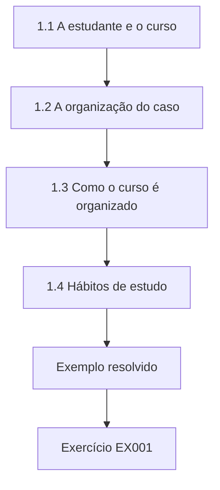

### Desenho lógico

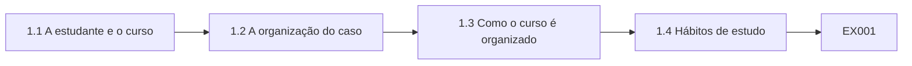

```text
[1.1 A estudante e o curso]
    |
    v
[1.2 A organização do caso]
    |
    v
[1.3 Como o curso é organizado]
    |
    v
[1.4 Hábitos de estudo]
    |
    v
[Exemplo resolvido] --> [Exercício EX001]
```
<!-- cyberabc:lesson-figures:end ch-01 -->


### Objetivos de aprendizagem

Você vai (1) descrever o que um bacharelado em segurança da informação abrange; (2) conhecer o caso que acompanha o curso; (3) planejar hábitos de estudo para um curso de quatro anos.

### 1.1 A estudante e o curso

Aisha Rahimi começa um bacharelado de quatro anos em segurança da informação na fictícia Pennick University. Seu tutor pessoal é o Dr. Neil Carrow, que leciona a disciplina de fundamentos do primeiro ano. O curso trata de como as organizações protegem a informação: a tecnologia envolvida, as pessoas que a usam, as regras que a governam e as formas de medir a segurança. O Dr. Carrow explica que a segurança não é apenas um assunto técnico, e que os formados precisam explicar os riscos com clareza a gerentes que não são especialistas. Aisha escolheu o curso depois que um parente foi vítima de uma fraude on-line.

### 1.2 A organização do caso

Ao longo do curso, Aisha trabalha com a fictícia Ashfield Credit Union, uma cooperativa de poupança e empréstimo pertencente aos associados, com cerca de 140 funcionários, quatro agências e aproximadamente 35.000 associados. A Ashfield guarda saldos de poupança, registros de empréstimos, documentos de identidade e dados de pagamento. Uma violação prejudicaria diretamente os associados e abalaria a confiança numa organização pequena que depende da sua reputação local. O Dr. Carrow organizou a parceria para que os estudantes possam ver como cada tema se aplica a um tipo real de organização, usando dados sintéticos em todos os exercícios. Cada disciplina a utiliza.

### 1.3 Como o curso é organizado

O primeiro ano constrói os fundamentos: computadores, redes, programação, estatística, escrita, direito e ética. O segundo ano introduz a governança de segurança, o risco, o controle de acesso e a criptografia. O terceiro ano trata da segurança operacional: vulnerabilidades, configuração, monitoramento, incidentes, backups, fornecedores e medição. O último ano inclui a gestão de mudanças, um projeto em grupo, um estágio, métodos de pesquisa e um trabalho de conclusão. Aisha observa que cada ano se apoia no anterior, de modo que as lacunas deixadas no início ficam mais difíceis de preencher depois. Ela imprime o mapa das disciplinas e o prende acima da escrivaninha, marcando que disciplinas dependem de quais anteriores.

### 1.4 Hábitos de estudo

O Dr. Carrow aconselha Aisha a manter um diário de aprendizagem, registrando uma ideia de segurança por semana e como ela se aplica à Ashfield. Ele também recomenda ler fontes primárias, como normas e artigos conhecidos, em vez de depender apenas de resumos. Aisha reserva duas horas toda sexta-feira para revisão. Ela aprende que a segurança muda depressa, então o hábito de conferir as fontes atuais e suas edições importa tanto quanto lembrar qualquer fato isolado. Seu primeiro registro no diário descreve por que uma pequena cooperativa de crédito é um alvo atraente para fraudadores, que esperam defesas mais fracas do que nos grandes bancos.

### Exemplo resolvido

Aisha começa o curso, conhece o caso da Ashfield, mapeia os quatro anos de estudo e cria um hábito de revisão semanal.

> **Caso sintético.** A Pennick, a Ashfield e todas as pessoas são sintéticas.

### Erros e limites

Tratar a segurança como algo puramente técnico ignora as pessoas, as regras e a medição.

### Exercícios

- **EX001 — Tamanho do caso.** Quantos associados a Ashfield tem? *Rubrica:* 3 = aproximadamente 35.000;; 2 = parcialmente correto;; 1 = errado;; 0 = nenhuma.

- **EX002 — Último ano.** O que o último ano inclui? *Rubrica:* 3 = gestão de mudanças, projeto em grupo, estágio, pesquisa e trabalho de conclusão;; 2 = a maioria;; 1 = poucos;; 0 = nenhuma.

- **EX003 — Hábito semanal.** Que hábito de diário o Dr. Carrow aconselha? *Rubrica:* 3 = uma ideia de segurança por semana aplicada à Ashfield;; 2 = parcialmente correto;; 1 = vago;; 0 = nenhuma.

<!-- cyberabc:chapter-navigation:start ch-01 -->
### Continue estudando — aula 01 (capítulo 01 de 40)

[← Início do curso](../../README.md) · [Índice das aulas](../SUBJECTS.md) · [Capítulo 02 →](#ch-02)

Continue para a próxima aula já escrita.
<!-- cyberabc:chapter-navigation:end -->

<a id="ch-02"></a>

## Capítulo 2 — O que é segurança da informação

<!-- cyberabc:lesson-figures:start ch-02 -->
### Mapa da aula

Aula 02 publicada. Mapa, exemplo, EX004.

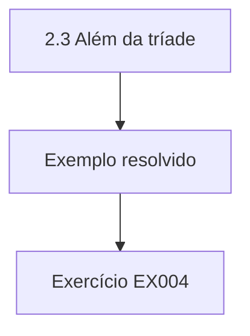

### Desenho lógico

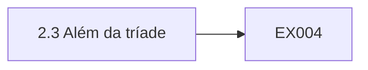

```text
[2.3 Além da tríade]
    |
    v
[Exemplo resolvido] --> [Exercício EX004]
```
<!-- cyberabc:lesson-figures:end ch-02 -->


### Objetivos de aprendizagem

Você vai (1) definir confidencialidade, integridade e disponibilidade; (2) aplicá-las a exemplos; (3) explicar por que a segurança apoia os objetivos da organização.

### 2.1 Três objetivos

Aisha aprende os três objetivos que definem a segurança da informação. A FIPS 199, uma norma federal dos Estados Unidos, define a confidencialidade como a preservação das restrições autorizadas ao acesso e à divulgação, a integridade como a proteção contra a modificação ou a destruição indevidas, e a disponibilidade como a garantia de acesso e uso oportunos e confiáveis da informação. A ISO/IEC 27000:2026 descreve a segurança da informação nos mesmos três termos. O Dr. Carrow observa que esses objetivos são amplamente usados porque cobrem a maioria das formas pelas quais a informação pode ser prejudicada. Aisha copia as três definições no seu diário e escreve um exemplo da Ashfield ao lado de cada uma.

### 2.2 Aplicando os objetivos

Aisha aplica os objetivos à Ashfield. Os documentos de identidade dos associados precisam de confidencialidade, porque sua exposição poderia possibilitar fraudes. Os saldos das contas precisam de integridade, porque um saldo alterado significaria que alguém perde dinheiro. O serviço de internet banking precisa de disponibilidade, porque os associados esperam ver seu dinheiro quando quiserem. Ela observa que cada informação costuma precisar dos três em algum grau, mas que um deles muitas vezes importa mais, o que ajuda a decidir para onde vai o esforço. Ela registra o objetivo mais importante de cada item numa tabela simples, que vai reutilizar quando o curso chegar à avaliação de riscos, no segundo ano.

### 2.3 Além da tríade

O Dr. Carrow apresenta propriedades relacionadas. A autenticidade significa confirmar que uma informação ou uma pessoa é genuína; a responsabilização significa que as ações podem ser rastreadas até quem as executou; o não repúdio significa que alguém não consegue negar de forma crível uma ação que realizou. Na Ashfield, uma aprovação de empréstimo precisa ser rastreável até o agente que a aprovou. Aisha aprende que essas propriedades ampliam os três objetivos e muitas vezes dependem de uma boa gestão de identidades e da manutenção de registros. Ela acrescenta as três propriedades à tabela do diário, anotando para cada registro da Ashfield se a responsabilização ou a autenticidade importa tanto quanto os três objetivos originais.

### 2.4 Segurança e objetivos

A segurança existe para apoiar o propósito da Ashfield, e não como um fim em si mesma. Um controle que impede os associados de acessar suas poupanças pode proteger a confidencialidade, mas prejudica a disponibilidade e a confiança. Aisha aprende que uma boa segurança equilibra a proteção com a usabilidade e o custo. O Dr. Carrow pede que ela se lembre de que os profissionais de segurança ajudam as organizações a assumir riscos sensatos, e não a evitar todo risco, porque uma cooperativa de crédito que recusasse todo risco não conseguiria emprestar dinheiro algum. Aisha escreve um breve parágrafo no diário descrevendo um controle do seu próprio banco que ela acha irritante e pergunta se a proteção que ele oferece justifica o incômodo.

### Exemplo resolvido

Aisha define os três objetivos a partir da FIPS 199, os aplica às informações da Ashfield, acrescenta a autenticidade e a responsabilização e liga a segurança aos objetivos da Ashfield.

> **Caso sintético.** Os exemplos são sintéticos.

### Erros e limites

Maximizar um objetivo pode prejudicar os outros.

### Exercícios

- **EX004 — Definição de disponibilidade.** Como a FIPS 199 define a disponibilidade? *Rubrica:* 3 = acesso e uso oportunos e confiáveis;; 2 = parcialmente correto;; 1 = vago;; 0 = nenhuma.

- **EX005 — Objetivo dos saldos.** Que objetivo importa mais para os saldos? *Rubrica:* 3 = integridade;; 2 = parcialmente correto;; 1 = outro;; 0 = nenhuma.

- **EX006 — Rastreabilidade dos empréstimos.** Que propriedade torna rastreáveis as aprovações de empréstimos? *Rubrica:* 3 = responsabilização;; 2 = parcialmente correto;; 1 = outra;; 0 = nenhuma.

<!-- cyberabc:chapter-navigation:start ch-02 -->
### Continue estudando — aula 02 (capítulo 02 de 40)

[← Capítulo 01](#ch-01) · [Índice das aulas](../SUBJECTS.md) · [Capítulo 03 →](#ch-03)

Continue para a próxima aula já escrita.
<!-- cyberabc:chapter-navigation:end -->

<a id="ch-03"></a>

## Capítulo 3 — A informação nas organizações

<!-- cyberabc:lesson-figures:start ch-03 -->
### Mapa da aula

Aula 03 publicada. Mapa, exemplo, EX007.

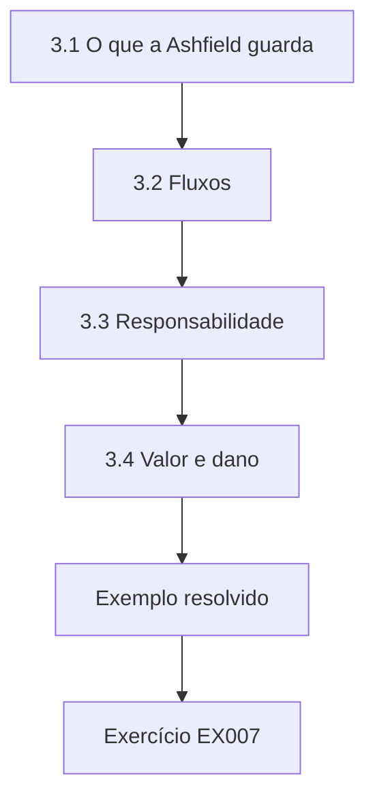

### Desenho lógico

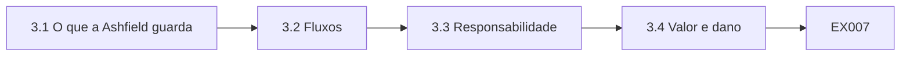

```text
[3.1 O que a Ashfield guarda]
    |
    v
[3.2 Fluxos]
    |
    v
[3.3 Responsabilidade]
    |
    v
[3.4 Valor e dano]
    |
    v
[Exemplo resolvido] --> [Exercício EX007]
```
<!-- cyberabc:lesson-figures:end ch-03 -->


### Objetivos de aprendizagem

Você vai (1) identificar as informações que uma organização guarda; (2) rastrear como as informações circulam; (3) reconhecer quem é responsável por elas.

### 3.1 O que a Ashfield guarda

Aisha lista as informações que a Ashfield guarda: dados de identificação dos associados, registros de poupança e de empréstimos, dados de cartões de pagamento, registros dos funcionários, atas do conselho e contratos com fornecedores. Parte delas fica no sistema bancário central, parte no e-mail e em pastas compartilhadas e parte em papel nas agências. O Dr. Carrow aponta que as informações em papel e em conversas também precisam de proteção, e que muitas violações envolvem informações fora dos sistemas principais. Ela também observa as fichas de adesão em papel guardadas nos armários das agências e as pastas de empréstimo à espera de digitalização numa bandeja destrancada, como exemplos de informações fora de qualquer sistema computacional.

### 3.2 Fluxos

A informação se movimenta. Os documentos de identidade de um novo associado são digitalizados numa agência, enviados ao sistema central e conferidos por um responsável pela conformidade. Os pedidos de empréstimo passam da equipe da agência para os agentes de crédito e daí para um comitê de crédito. Aisha desenha esses fluxos e anota onde a informação sai da Ashfield, por exemplo para uma agência de informações de crédito e para um processador de cartões. Ela aprende que cada fluxo é um ponto em que a informação pode ser interceptada, alterada ou perdida. Ela rotula cada seta do diagrama com a informação que ela transporta e o método usado para enviá-la.

### 3.3 Responsabilidade

Todo tipo de informação precisa de alguém responsável por decidir como ela é protegida. Na Ashfield, o chefe de crédito é responsável pelos registros de empréstimos, e o responsável pela conformidade, pelos documentos de identidade. Aisha descobre que ninguém é claramente responsável pelas pastas compartilhadas, onde os funcionários salvam cópias de relatórios. O Dr. Carrow explica que as informações sem dono tendem a se acumular sem controles, e que atribuir a responsabilidade costuma ser o primeiro passo prático de segurança. Mais tarde, o diretor executivo da Ashfield atribui as pastas compartilhadas ao chefe de operações, que começa pedindo às equipes que apaguem as cópias antigas.

### 3.4 Valor e dano

Aisha estima o dano caso cada tipo de informação fosse exposto, alterado ou ficasse indisponível. A exposição dos documentos de identidade poderia possibilitar fraudes contra os associados; registros de empréstimos alterados poderiam esconder empréstimos ruins; a indisponibilidade do sistema bancário central interrompe todas as transações. Ela ordena as informações pelo dano potencial. Ela aprende que essa ordenação orienta onde gastar o esforço de segurança limitado, e que ela precisa ser revista quando a organização muda. Ela apresenta a ordenação ao seu grupo de seminário, que contesta duas das posições. Depois da discussão, ela sobe as atas do conselho, porque contêm decisões confidenciais sobre perdas com empréstimos e sobre funcionários.

### Exemplo resolvido

Aisha lista as informações da Ashfield, desenha os fluxos, inclusive os externos, encontra pastas compartilhadas sem dono e ordena as informações pelo dano potencial.

> **Caso sintético.** Os tipos de informação são sintéticos.

### Erros e limites

Ignorar o papel e as pastas compartilhadas deixa muita informação sem proteção.

### Exercícios

- **EX007 — Destinatários externos.** Cite um destinatário externo de informações da Ashfield. *Rubrica:* 3 = uma agência de informações de crédito;; 2 = um;; 1 = vago;; 0 = nenhuma.

- **EX008 — Repositório sem dono.** Que repositório não tinha uma pessoa responsável? *Rubrica:* 3 = as pastas compartilhadas;; 2 = parcialmente correto;; 1 = outro;; 0 = nenhuma.

- **EX009 — Propósito da ordenação.** O que a ordenação pelo dano orienta? *Rubrica:* 3 = onde gastar o esforço de segurança;; 2 = parcialmente correto;; 1 = vago;; 0 = nenhuma.

<!-- cyberabc:chapter-navigation:start ch-03 -->
### Continue estudando — aula 03 (capítulo 03 de 40)

[← Capítulo 02](#ch-02) · [Índice das aulas](../SUBJECTS.md) · [Capítulo 04 →](#ch-04)

Continue para a próxima aula já escrita.
<!-- cyberabc:chapter-navigation:end -->

<a id="ch-04"></a>

## Capítulo 4 — Computadores e sistemas operacionais

<!-- cyberabc:lesson-figures:start ch-04 -->
### Mapa da aula

Aula 04 publicada. Mapa, exemplo, EX010.

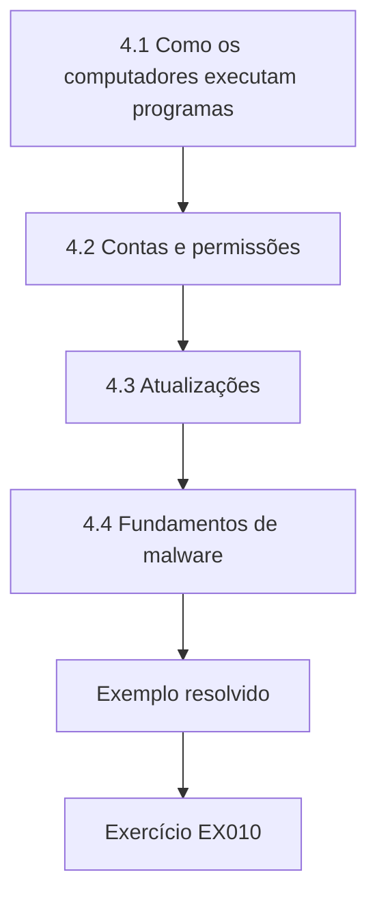

### Desenho lógico

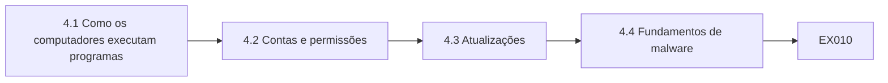

```text
[4.1 Como os computadores executam programas]
    |
    v
[4.2 Contas e permissões]
    |
    v
[4.3 Atualizações]
    |
    v
[4.4 Fundamentos de malware]
    |
    v
[Exemplo resolvido] --> [Exercício EX010]
```
<!-- cyberabc:lesson-figures:end ch-04 -->


### Objetivos de aprendizagem

Você vai (1) descrever como os computadores executam programas; (2) explicar as contas de usuário e as permissões; (3) reconhecer por que as atualizações importam.

### 4.1 Como os computadores executam programas

Aisha aprende que um computador executa programas sob um sistema operacional, que gerencia a memória, os arquivos e os dispositivos. Cada programa roda como um processo, e o sistema operacional mantém os processos separados, para que um não possa interferir diretamente no outro. Os computadores das agências da Ashfield rodam um sistema operacional de desktop comum, enquanto seus servidores rodam outro. O Dr. Carrow explica que entender esses fundamentos ajuda a equipe de segurança a ver como os ataques funcionam e por que certos controles são necessários. Aisha instala uma máquina virtual no seu notebook para poder explorar um sistema operacional com segurança, sem afetar os próprios arquivos.

### 4.2 Contas e permissões

Os sistemas operacionais usam contas para decidir quem pode fazer o quê. As contas comuns podem executar programas e usar seus próprios arquivos; as contas de administrador podem instalar software e alterar configurações. Aisha descobre que alguns funcionários das agências da Ashfield usam contas de administrador todos os dias, porque uma aplicação antiga um dia precisou disso. Se um desses funcionários abrir um anexo malicioso, o malware também ganha direitos de administrador. Ela recomenda contas comuns para o trabalho diário. O gerente de TI da Ashfield testa a aplicação antiga com uma conta comum e descobre que agora ela funciona, então as contas de administrador de uso diário podem ser removidas.

### 4.3 Atualizações

O software contém falhas, e os fornecedores publicam atualizações para corrigi-las. Os atacantes estudam as atualizações para descobrir o que foi corrigido e então miram os sistemas ainda não atualizados. Aisha confere uma lista sintética dos computadores da Ashfield e encontra vários com semanas de atraso nas atualizações, porque os funcionários adiam as reinicializações. Ela recomenda a instalação automática fora do horário das agências. O Dr. Carrow observa que aplicar as atualizações prontamente é uma das práticas de segurança mais eficazes e menos glamorosas. O gerente de TI concorda em agendar as reinicializações à noite, e Aisha sugere relatar todo mês o número de computadores com mais de duas semanas de atraso.

### 4.4 Fundamentos de malware

Malware é software projetado para causar dano: roubar informações, cifrar arquivos para pedir resgate ou dar aos atacantes o controle remoto. Ele muitas vezes chega por anexos de e-mail, sites maliciosos ou mídias removíveis infectadas. Aisha aprende como o antivírus e as ferramentas de endpoint mais recentes detectam comportamentos suspeitos, e por que eles não bastam sozinhos. Ela observa que as contas comuns, as atualizações rápidas e o cuidado com o e-mail, juntos, reduzem a chance de sucesso do malware. Ela escreve um breve registro no diário comparando como cada controle teria impedido uma infecção por ransomware descrita numa notícia que leu naquela semana, o que a ajuda a lembrar por que as camadas importam.

### Exemplo resolvido

Aisha aprende a separação de processos, encontra o uso diário de contas de administrador nas agências, recomenda atualizações automáticas e liga as defesas contra malware às contas e às atualizações.

> **Caso sintético.** Os computadores são sintéticos.

### Erros e limites

O uso diário de contas de administrador dá ao malware direitos de administrador.

### Exercícios

- **EX010 — Causa do administrador.** Por que alguns funcionários usam contas de administrador? *Rubrica:* 3 = uma aplicação antiga um dia precisou disso;; 2 = parcialmente correto;; 1 = vago;; 0 = nenhuma.

- **EX011 — Atraso nas atualizações.** Por que alguns computadores estão atrasados nas atualizações? *Rubrica:* 3 = os funcionários adiam as reinicializações;; 2 = parcialmente correto;; 1 = vago;; 0 = nenhuma.

- **EX012 — Vias do malware.** Cite uma forma pela qual o malware chega. *Rubrica:* 3 = anexos de e-mail;; 2 = uma;; 1 = vago;; 0 = nenhuma.

<!-- cyberabc:chapter-navigation:start ch-04 -->
### Continue estudando — aula 04 (capítulo 04 de 40)

[← Capítulo 03](#ch-03) · [Índice das aulas](../SUBJECTS.md) · [Capítulo 05 →](#ch-05)

Continue para a próxima aula já escrita.
<!-- cyberabc:chapter-navigation:end -->

<a id="ch-05"></a>

## Capítulo 5 — Redes e a internet

<!-- cyberabc:lesson-figures:start ch-05 -->
### Mapa da aula

Aula 05 publicada. Mapa, exemplo, EX013.

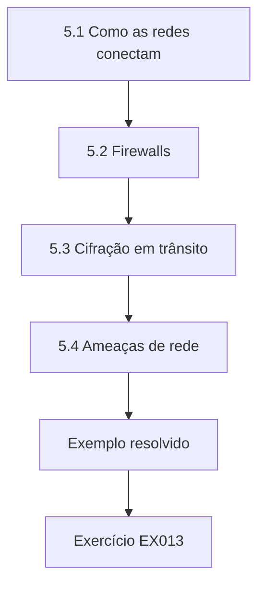

### Desenho lógico

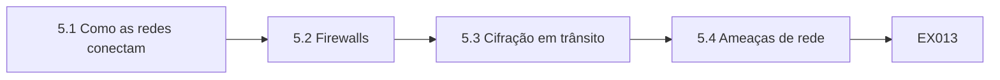

```text
[5.1 Como as redes conectam]
    |
    v
[5.2 Firewalls]
    |
    v
[5.3 Cifração em trânsito]
    |
    v
[5.4 Ameaças de rede]
    |
    v
[Exemplo resolvido] --> [Exercício EX013]
```
<!-- cyberabc:lesson-figures:end ch-05 -->


### Objetivos de aprendizagem

Você vai (1) descrever como as redes conectam computadores; (2) explicar os firewalls e a cifração em trânsito; (3) reconhecer as ameaças de rede comuns.

### 5.1 Como as redes conectam

Aisha aprende que as redes conectam dispositivos para que possam trocar dados. As agências da Ashfield se conectam à sede por enlaces cifrados, e a sede se conecta à internet e ao processador de cartões. Cada dispositivo tem um endereço, e os roteadores encaminham os dados entre as redes. O Dr. Carrow desenha a rede num quadro branco e pede que os estudantes marquem por onde trafegam os dados dos associados, o que os ajuda a ver onde a proteção é necessária. Aisha redesenha o diagrama com capricho em casa e marca a conexão com o processador de cartões como o enlace externo mais sensível.

### 5.2 Firewalls

Um firewall controla que tráfego pode passar entre as redes. O firewall da Ashfield permite o tráfego web para o site de internet banking e bloqueia a maioria das outras conexões de entrada. Aisha aprende que as regras de firewall se acumulam com o tempo e muitas vezes incluem exceções antigas de que ninguém se lembra. Ela revisa uma lista sintética de regras e encontra uma regra que permite acesso de área de trabalho remota de qualquer lugar, criada para um fornecedor anos atrás. Ela recomenda removê-la depois de conferir com o fornecedor. O fornecedor confirma que agora usa um serviço seguro de acesso remoto, então a regra antiga é removida sem transtornos.

### 5.3 Cifração em trânsito

Quando os dados atravessam as redes, outras pessoas podem conseguir lê-los. A cifração em trânsito, como o protocolo seguro usado pelos sites, protege a confidencialidade e a integridade ao longo do caminho. Aisha confere que o internet banking da Ashfield a utiliza e que as versões antigas e fracas do protocolo estão desativadas. Ela aprende que a cifração protege os dados enquanto se movem, mas não depois que chegam a um servidor comprometido, então outros controles continuam necessários. Ela usa um verificador on-line gratuito contra um site de teste para ver que versões do protocolo ele aceita e registra os resultados no diário.

### 5.4 Ameaças de rede

Aisha estuda as ameaças comuns: atacantes que varrem a rede em busca de serviços abertos, que interceptam o tráfego em redes sem fio desprotegidas e que sobrecarregam os serviços com tráfego para deixá-los indisponíveis. A rede sem fio das agências da Ashfield para os associados é separada das redes da equipe, o que limita o risco. O Dr. Carrow observa que separar as redes pelo propósito é um controle simples, mas poderoso, porque um problema numa rede não chega automaticamente às outras. Aisha confere que a rede sem fio dos associados não alcança a impressora da equipe, o que confirma que a separação funciona. Ela registra esse teste no diário como um exemplo de verificar um controle, em vez de presumir que ele funciona.

### Exemplo resolvido

Aisha mapeia a rede da Ashfield, encontra uma antiga regra aberta de área de trabalho remota, confere a cifração em trânsito e confirma que a rede sem fio dos associados é separada.

> **Caso sintético.** As redes são sintéticas.

### Erros e limites

As exceções antigas de firewall muitas vezes continuam abertas muito depois de terem perdido seu propósito.

### Exercícios

- **EX013 — Regra antiga.** Que regra antiga Aisha encontra? *Rubrica:* 3 = acesso de área de trabalho remota de qualquer lugar;; 2 = parcialmente correto;; 1 = outra;; 0 = nenhuma.

- **EX014 — Limites da cifração em trânsito.** O que a cifração em trânsito não protege? *Rubrica:* 3 = os dados num servidor comprometido;; 2 = parcialmente correto;; 1 = vago;; 0 = nenhuma.

- **EX015 — Rede sem fio dos associados.** Como a rede sem fio dos associados é protegida? *Rubrica:* 3 = separada das redes da equipe;; 2 = parcialmente correto;; 1 = vago;; 0 = nenhuma.

<!-- cyberabc:chapter-navigation:start ch-05 -->
### Continue estudando — aula 05 (capítulo 05 de 40)

[← Capítulo 04](#ch-04) · [Índice das aulas](../SUBJECTS.md) · [Capítulo 06 →](#ch-06)

Continue para a próxima aula já escrita.
<!-- cyberabc:chapter-navigation:end -->

<a id="ch-06"></a>

## Capítulo 6 — Python para verificações de segurança

<!-- cyberabc:lesson-figures:start ch-06 -->
### Mapa da aula

Aula 06 publicada. Mapa, exemplo, EX016.

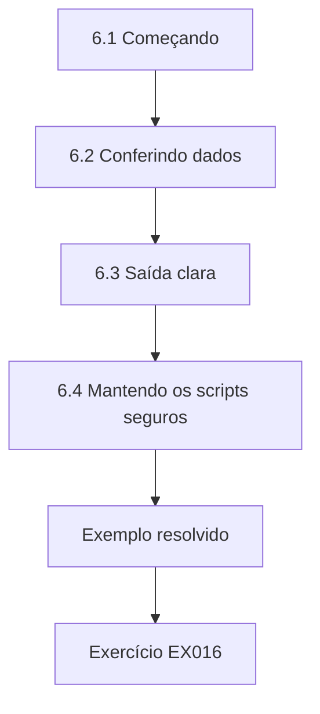

### Desenho lógico

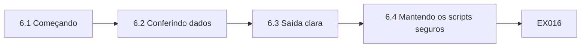

```text
[6.1 Começando]
    |
    v
[6.2 Conferindo dados]
    |
    v
[6.3 Saída clara]
    |
    v
[6.4 Mantendo os scripts seguros]
    |
    v
[Exemplo resolvido] --> [Exercício EX016]
```
<!-- cyberabc:lesson-figures:end ch-06 -->


### Objetivos de aprendizagem

Você vai (1) escrever scripts simples em Python; (2) ler e conferir arquivos de dados; (3) produzir resultados claros para outras pessoas.

### 6.1 Começando

Aisha escreve seus primeiros scripts em Python usando apenas a biblioteca padrão, para que rodem em qualquer computador da universidade ou da Ashfield sem instalações extras. Seu primeiro script lê de um arquivo de texto uma lista sintética de contas de funcionários e conta quantas existem. O Dr. Carrow explica que os scripts permitem que a equipe de segurança confira milhares de registros de forma rápida e coerente, onde a conferência manual seria lenta e sujeita a erros. Ela escreve o script num editor de texto simples, o executa pela linha de comando e confere a contagem com o número de linhas do arquivo. Os dois números coincidem.

### 6.2 Conferindo dados

O script seguinte de Aisha confere a data do último login de cada conta. As contas sem login há noventa dias são listadas para revisão. Ela usa o módulo datetime para comparar as datas. Quando uma linha tem a data faltando, o script a registra separadamente, em vez de travar. Ela aprende que os dados reais contêm lacunas e erros, e que um bom script de conferência relata os problemas da sua entrada com a mesma clareza dos resultados que foi escrito para encontrar. Três linhas do arquivo sintético não têm data.

### 6.3 Saída clara

O Dr. Carrow pede que Aisha torne sua saída legível para os gerentes. Ela imprime um título, a data da conferência, o número de contas conferidas, o número de contas sinalizadas e uma lista das contas sinalizadas com as datas do último login. Ela também salva os resultados num arquivo CSV usando o módulo csv. Ela aprende que a pessoa que lê um relatório de segurança muitas vezes decide o que acontece em seguida, então a clareza importa. O Dr. Carrow avalia a segunda versão como clara e pede que a turma use o formato dela como modelo para os relatórios seguintes.

### 6.4 Mantendo os scripts seguros

Os scripts de Aisha lidam com dados sensíveis. Ela os guarda, junto com suas saídas, numa pasta protegida, nunca envia por e-mail para endereços pessoais resultados que contenham nomes de contas e apaga os arquivos temporários depois do uso. Ela também evita escrever senhas dentro dos scripts. O Dr. Carrow observa que as ferramentas de segurança podem se tornar riscos de segurança se suas saídas vazarem, porque uma lista de contas inativas é útil para um atacante que procura logins sem monitoramento. Ela escreve uma breve lista de verificação para o tratamento das saídas e a anexa a cada pasta de scripts, para que os colegas que trabalham com ela sigam as mesmas regras.

### Exemplo resolvido

Aisha escreve scripts com a biblioteca padrão que contam contas, sinalizam inatividade de noventa dias, tratam datas faltantes e produzem relatórios legíveis e arquivos CSV guardados com segurança.

> **Caso sintético.** Os dados são sintéticos.

### Erros e limites

Os relatórios de segurança vazados podem ajudar os atacantes.

### Exercícios

- **EX016 — Limiar de inatividade.** Que contas são sinalizadas? *Rubrica:* 3 = sem login há noventa dias;; 2 = parcialmente correto;; 1 = vago;; 0 = nenhuma.

- **EX017 — Datas faltantes.** Como o script trata as datas faltantes? *Rubrica:* 3 = as registra separadamente;; 2 = parcialmente correto;; 1 = trava;; 0 = nenhuma.

- **EX018 — Risco de vazamento.** Por que uma lista de contas inativas poderia ajudar os atacantes? *Rubrica:* 3 = ela mostra logins sem monitoramento;; 2 = parcialmente correto;; 1 = vago;; 0 = nenhuma.

<!-- cyberabc:chapter-navigation:start ch-06 -->
### Continue estudando — aula 06 (capítulo 06 de 40)

[← Capítulo 05](#ch-05) · [Índice das aulas](../SUBJECTS.md) · [Capítulo 07 →](#ch-07)

Continue para a próxima aula já escrita.
<!-- cyberabc:chapter-navigation:end -->

<a id="ch-07"></a>

## Capítulo 7 — Estatística para o trabalho de segurança

<!-- cyberabc:lesson-figures:start ch-07 -->
### Mapa da aula

Aula 07 publicada. Mapa, exemplo, EX019.

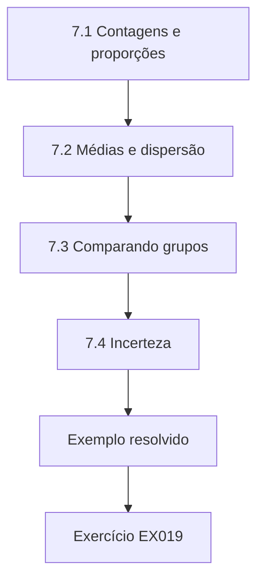

### Desenho lógico

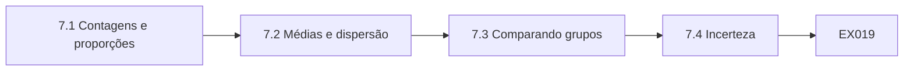

```text
[7.1 Contagens e proporções]
    |
    v
[7.2 Médias e dispersão]
    |
    v
[7.3 Comparando grupos]
    |
    v
[7.4 Incerteza]
    |
    v
[Exemplo resolvido] --> [Exercício EX019]
```
<!-- cyberabc:lesson-figures:end ch-07 -->


### Objetivos de aprendizagem

Você vai (1) resumir dados de segurança com estatísticas simples; (2) interpretar proporções e médias; (3) reconhecer comparações enganosas.

### 7.1 Contagens e proporções

Aisha aprende que muitas medidas de segurança são contagens e proporções: o número de computadores sem correção, a parcela da equipe que concluiu o treinamento, a proporção de testes de phishing comunicados. Ela calcula que 112 dos 140 funcionários sintéticos concluíram o treinamento anual, oitenta por cento. O Dr. Carrow pede que ela sempre informe o denominador, porque uma contagem de 112 significa pouco sem saber que é de um total de 140. Ela também informa os vinte e oito funcionários que não o concluíram, listados por agência, para que os gerentes possam cobrar. O Dr. Carrow observa que o mesmo número pode ser apresentado como conclusão ou como lacuna, e as duas visões são úteis.

### 7.2 Médias e dispersão

Aisha calcula quanto tempo a Ashfield leva para fechar os achados de segurança. A média é de vinte e seis dias, mas alguns achados levaram mais de cem dias. A mediana é de quinze dias. Ela aprende que a média é puxada para cima pelos valores extremos, de modo que a mediana muitas vezes descreve melhor um caso típico. Ela informa as duas, mais os casos mais longos, porque esses achados que se arrastam podem representar o maior risco. Ela desenha um gráfico simples dos tempos de fechamento, que mostra a maioria dos achados sendo fechada em até um mês e uma cauda longa de achados lentos.

### 7.3 Comparando grupos

Os gerentes da Ashfield querem saber qual agência é a mais segura. Aisha observa que a maior agência tem mais incidentes, mas também mais funcionários e mais transações. Comparar as contagens brutas a culparia injustamente. Ela calcula os incidentes por cem funcionários, o que muda a ordenação. O Dr. Carrow explica que as taxas permitem uma comparação justa entre grupos de tamanhos diferentes. Com as taxas, a maior agência passa da pior para a segunda melhor, e a menor agência, que teve poucos incidentes no total, acaba tendo a maior taxa. Os gerentes da Ashfield se surpreendem e pedem que ela repita a análise a cada trimestre.

### 7.4 Incerteza

Com números pequenos, as diferenças podem surgir por acaso. Uma agência teve três comunicações de phishing no mês passado e sete neste mês. Aisha explica que essa mudança pode não significar nada, porque contagens tão pequenas variam naturalmente. Ela sugere observar vários meses antes de tirar conclusões. Ela aprende que os relatórios de segurança devem evitar tratar a variação normal como uma mudança significativa. Ela mostra aos gerentes doze meses de comunicações por agência num único gráfico, em que as altas e baixas de um mês para o outro ficam claramente visíveis. Os gerentes concordam em revisar as tendências trimestralmente, em vez de reagir a meses isolados, o que reduz as preocupações desnecessárias.

### Exemplo resolvido

Aisha informa a conclusão do treinamento com seu denominador, compara a média e a mediana dos tempos de fechamento, usa taxas para comparar as agências e alerta para a variação por acaso.

> **Caso sintético.** Os números são sintéticos.

### Erros e limites

Comparar contagens brutas entre grupos de tamanhos diferentes engana.

### Exercícios

- **EX019 — Taxa de treinamento.** Que parcela da equipe concluiu o treinamento? *Rubrica:* 3 = 112 de 140, oitenta por cento;; 2 = parcialmente correto;; 1 = errado;; 0 = nenhuma.

- **EX020 — Mediana de fechamento.** Qual é a mediana do tempo de fechamento? *Rubrica:* 3 = quinze dias;; 2 = parcialmente correto;; 1 = errado;; 0 = nenhuma.

- **EX021 — Comparação justa.** Como as agências são comparadas de forma justa? *Rubrica:* 3 = incidentes por cem funcionários;; 2 = parcialmente correto;; 1 = contagens brutas;; 0 = nenhuma.

<!-- cyberabc:chapter-navigation:start ch-07 -->
### Continue estudando — aula 07 (capítulo 07 de 40)

[← Capítulo 06](#ch-06) · [Índice das aulas](../SUBJECTS.md) · [Capítulo 08 →](#ch-08)

Continue para a próxima aula já escrita.
<!-- cyberabc:chapter-navigation:end -->

<a id="ch-08"></a>

## Capítulo 8 — Escrevendo sobre segurança

<!-- cyberabc:lesson-figures:start ch-08 -->
### Mapa da aula

Aula 08 publicada. Mapa, exemplo, EX022.

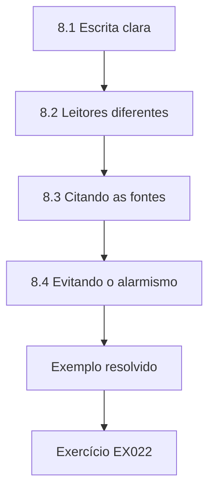

### Desenho lógico

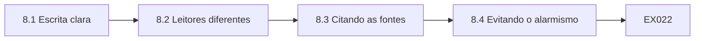

```text
[8.1 Escrita clara]
    |
    v
[8.2 Leitores diferentes]
    |
    v
[8.3 Citando as fontes]
    |
    v
[8.4 Evitando o alarmismo]
    |
    v
[Exemplo resolvido] --> [Exercício EX022]
```
<!-- cyberabc:lesson-figures:end ch-08 -->


### Objetivos de aprendizagem

Você vai (1) escrever relatórios de segurança claros; (2) adaptar a escrita a leitores diferentes; (3) citar as fontes corretamente.

### 8.1 Escrita clara

O primeiro trabalho de Aisha é um relatório de uma página sobre as contas inativas da Ashfield. O Dr. Carrow devolve o rascunho marcado com perguntas: qual é o problema, por que ele importa, o que deve ser feito e por quem? Ela o reescreve com um breve resumo no topo, as evidências, o risco e uma recomendação com um responsável. Ela aprende que os leitores ocupados muitas vezes leem apenas o primeiro parágrafo, então ele precisa conter a mensagem principal. O Dr. Carrow dá uma nota alta ao relatório reescrito e comenta que ele permite agir de imediato.

### 8.2 Leitores diferentes

Aisha escreve duas versões do mesmo achado. Para o conselho da Ashfield, ela explica que ex-funcionários ainda poderiam acessar os registros dos associados e que a correção é uma conferência mensal ligada aos procedimentos de desligamento. Para a equipe de TI, ela lista as contas e os passos exatos para desativá-las. O Dr. Carrow observa que os fatos são os mesmos, mas que os leitores precisam de detalhes diferentes para agir. Ela confere as duas versões com um colega que faz o papel de cada leitor, e ele confirma que sabe o que fazer depois de ler. O Dr. Carrow guarda as duas como exemplos.

### 8.3 Citando as fontes

Aisha aprende a citar as fontes com precisão. Quando se refere a uma norma, ela informa o número, a edição e o ano, como em ISO/IEC 27001:2022 (no Brasil, ABNT NBR ISO/IEC 27001:2022). Quando cita um artigo, ela inclui os autores, o ano, o título e um identificador persistente, se houver. O Dr. Carrow adverte que as normas mudam, então citar a edição informa aos leitores exatamente em que versão ela se baseou, e que ela nunca deve citar uma fonte que não conferiu. Ela monta para o seu diário uma lista de referências que inclui a edição ou o identificador de cada fonte e a data em que a conferiu.

### 8.4 Evitando o alarmismo

A escrita sobre segurança pode resvalar para o alarme. O rascunho de Aisha descrevia uma regra de firewall aberta como catastrófica. O Dr. Carrow pergunta que evidência sustenta essa palavra. Ela reescreve o trecho para informar a regra, o que um atacante poderia fazer e qual a probabilidade disso. Ela aprende que uma linguagem comedida constrói credibilidade, e que os leitores que ouvem alarmes com frequência demais deixam de prestar atenção. O achado revisado informa que a regra permitia conexões de qualquer endereço e que o serviço de área de trabalho remota tinha sido corrigido recentemente, o que reduz a probabilidade imediata, mas não elimina a necessidade de fechá-la.

### Exemplo resolvido

Aisha reescreve um relatório com o resumo primeiro, produz versões para o conselho e para a TI, cita as normas pela edição e substitui a linguagem alarmista por evidências.

> **Caso sintético.** Os relatórios são sintéticos.

### Erros e limites

Citar uma norma sem sua edição deixa os leitores sem saber que versão se aplica.

### Exercícios

- **EX022 — Perguntas do relatório.** Que quatro perguntas um relatório deve responder? *Rubrica:* 3 = problema, importância, ação, responsável;; 2 = todas;; 1 = algumas;; 0 = nenhuma.

- **EX023 — Versão para o conselho.** O que a versão para o conselho enfatiza? *Rubrica:* 3 = ex-funcionários poderiam acessar os registros;; 2 = parcialmente correto;; 1 = vago;; 0 = nenhuma.

- **EX024 — Citação da edição.** Por que citar a edição de uma norma? *Rubrica:* 3 = as normas mudam;; 2 = parcialmente correto;; 1 = vago;; 0 = nenhuma.

<!-- cyberabc:chapter-navigation:start ch-08 -->
### Continue estudando — aula 08 (capítulo 08 de 40)

[← Capítulo 07](#ch-07) · [Índice das aulas](../SUBJECTS.md) · [Capítulo 09 →](#ch-09)

Continue para a próxima aula já escrita.
<!-- cyberabc:chapter-navigation:end -->

<a id="ch-09"></a>

## Capítulo 9 — Direito e segurança

<!-- cyberabc:lesson-figures:start ch-09 -->
### Mapa da aula

Aula 09 publicada. Mapa, exemplo, EX025.

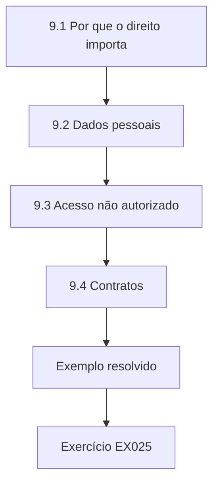

### Desenho lógico

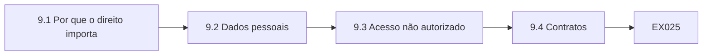

```text
[9.1 Por que o direito importa]
    |
    v
[9.2 Dados pessoais]
    |
    v
[9.3 Acesso não autorizado]
    |
    v
[9.4 Contratos]
    |
    v
[Exemplo resolvido] --> [Exercício EX025]
```
<!-- cyberabc:lesson-figures:end ch-09 -->


### Objetivos de aprendizagem

Você vai (1) identificar as leis relevantes para a segurança da informação; (2) explicar as obrigações de proteger dados pessoais; (3) reconhecer os limites legais das atividades de segurança.

### 9.1 Por que o direito importa

Aisha aprende que as leis moldam a segurança da informação de várias formas. A legislação de proteção de dados exige que as organizações protejam os dados pessoais com segurança adequada. Os reguladores financeiros esperam que instituições como as cooperativas de crédito gerenciem os riscos operacionais, inclusive os riscos cibernéticos. As leis sobre uso indevido de computadores tornam crime o acesso não autorizado. O Dr. Carrow explica que as leis específicas dependem do país, então o curso ensina princípios e pede que os estudantes confiram a lei aplicável onde trabalham. Aisha monta uma tabela listando cada tipo de lei e a atividade da Ashfield que ela afeta.

### 9.2 Dados pessoais

A Ashfield guarda dados pessoais de associados e funcionários. As leis de proteção de dados de muitos países exigem segurança adequada ao risco, limites para o tempo de guarda dos dados e a notificação de certas violações aos reguladores e às pessoas afetadas. Aisha observa que essas obrigações tornam a segurança um dever legal, e não apenas uma boa prática. Ela aprende que uma violação pode levar a sanções regulatórias e a pedidos de indenização, além da perda de confiança. Ela observa que o responsável pela conformidade da Ashfield é quem decidiria se uma violação precisa ser comunicada, e que a equipe de segurança precisa fornecer os fatos rapidamente.

### 9.3 Acesso não autorizado

As leis sobre uso indevido de computadores tornam crime acessar sistemas sem permissão. Aisha aprende que isso também se aplica aos testes de segurança: testar os sistemas da Ashfield sem autorização por escrito poderia ser ilegal, mesmo com a intenção de ajudar. O Dr. Carrow explica que os testadores profissionais sempre trabalham sob acordos assinados que definem o escopo e o período. Os estudantes nunca devem testar sistemas reais que não sejam seus ou que não tenham permissão para testar. Aisha assina o acordo de testes éticos da universidade, que confirma que os exercícios do curso usam apenas sistemas de laboratório e dados sintéticos fornecidos pelo departamento.

### 9.4 Contratos

Os contratos da Ashfield com os fornecedores incluem obrigações de segurança, como proteger os dados dos associados e comunicar incidentes. Aisha revisa um contrato sintético com o processador de cartões e encontra cláusulas claras de comunicação de incidentes, mas nenhum direito da Ashfield de verificar a segurança do fornecedor. Ela recomenda acrescentar direitos de auditoria na renovação. Ela aprende que os contratos estendem as obrigações de segurança para além dos muros da própria organização. O chefe de operações da Ashfield concorda e acrescenta a mudança à lista de verificação da renovação. Aisha também observa que os contratos devem dizer com que rapidez um fornecedor precisa comunicar incidentes, e descobre que este exige aviso em até vinte e quatro horas.

### Exemplo resolvido

Aisha identifica as leis de proteção de dados, a regulação e as leis sobre uso indevido, liga as obrigações sobre dados pessoais à segurança, insiste na autorização por escrito para os testes e encontra um direito de auditoria faltando num contrato.

> **Caso sintético.** As leis variam conforme o país; o contrato é sintético.

### Erros e limites

Testar sistemas sem autorização por escrito pode ser crime.

### Exercícios

- **EX025 — Tipos de lei.** Cite um tipo de lei que molda a segurança. *Rubrica:* 3 = a legislação de proteção de dados;; 2 = um;; 1 = vago;; 0 = nenhuma.

- **EX026 — Regra dos testes.** O que os testadores precisam sempre ter? *Rubrica:* 3 = autorização assinada que defina o escopo;; 2 = parcialmente correto;; 1 = vago;; 0 = nenhuma.

- **EX027 — Lacuna do contrato.** O que faltava no contrato com o processador de cartões? *Rubrica:* 3 = direitos de auditoria;; 2 = parcialmente correto;; 1 = outra;; 0 = nenhuma.

<!-- cyberabc:chapter-navigation:start ch-09 -->
### Continue estudando — aula 09 (capítulo 09 de 40)

[← Capítulo 08](#ch-08) · [Índice das aulas](../SUBJECTS.md) · [Capítulo 10 →](#ch-10)

Continue para a próxima aula já escrita.
<!-- cyberabc:chapter-navigation:end -->

<a id="ch-10"></a>

## Capítulo 10 — Ética e segurança

<!-- cyberabc:lesson-figures:start ch-10 -->
### Mapa da aula

Aula 10 publicada. Mapa, exemplo, EX028.

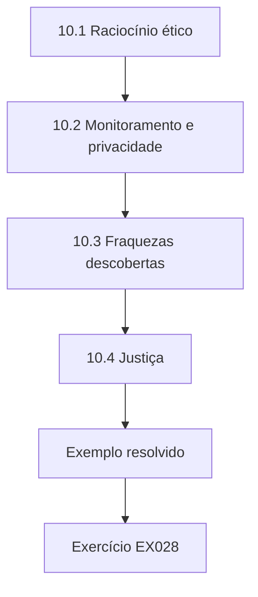

### Desenho lógico

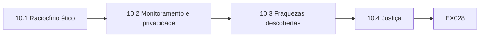

```text
[10.1 Raciocínio ético]
    |
    v
[10.2 Monitoramento e privacidade]
    |
    v
[10.3 Fraquezas descobertas]
    |
    v
[10.4 Justiça]
    |
    v
[Exemplo resolvido] --> [Exercício EX028]
```
<!-- cyberabc:lesson-figures:end ch-10 -->


### Objetivos de aprendizagem

Você vai (1) aplicar o raciocínio ético às decisões de segurança; (2) equilibrar o monitoramento e a privacidade; (3) tratar com responsabilidade as fraquezas descobertas.

### 10.1 Raciocínio ético

Os profissionais de segurança muitas vezes têm acesso a informações sensíveis e a ferramentas poderosas. Aisha discute casos em que funcionários usaram mal seu acesso, como consultar os registros de um vizinho por curiosidade. O Dr. Carrow explica que a ética profissional exige usar o acesso apenas para fins autorizados, ser honesto sobre os riscos e respeitar as pessoas afetadas pelas decisões de segurança. Aisha observa que legal e ético não são a mesma coisa, e que algumas ações legais continuam sendo erradas. A turma discute um caso em que um funcionário consultou a conta de uma celebridade e foi demitido.

### 10.2 Monitoramento e privacidade

A Ashfield monitora o e-mail da equipe em busca de sinais de fraude. Aisha pondera até onde o monitoramento deve ir. O monitoramento protege os associados, mas o monitoramento excessivo trata os funcionários como suspeitos e pode invadir mensagens privadas. Ela sugere avisos claros, limitar o monitoramento aos sistemas de trabalho, restringir quem pode ver os resultados e revisar se ele continua necessário. Ela aprende que a proporcionalidade é o teste ético central do monitoramento. O aviso de monitoramento da Ashfield é revisado pelo responsável pela conformidade, que acrescenta uma frase explicando que as mensagens pessoais não são lidas, a menos que haja suspeita de fraude aprovada por dois gerentes.

### 10.3 Fraquezas descobertas

Durante um exercício em aula com um site público, um colega percebe uma fraqueza no site de uma organização real. O grupo de Aisha discute o que fazer. Eles concordam em não explorar mais e em comunicá-la pelo contato publicado pela organização para questões de segurança, se houver um. O Dr. Carrow explica a divulgação coordenada: avisar a organização em particular e dar tempo para a correção antes de qualquer discussão pública. O grupo registra o que viu, informa o Dr. Carrow e redige uma breve mensagem para a organização, que o Dr. Carrow revisa antes que ela seja enviada pelo canal oficial.

### 10.4 Justiça

As decisões de segurança afetam as pessoas de forma desigual. Uma regra que bloqueia logins vindos do exterior pode impedir fraudes, mas também bloqueia os associados que estão viajando ou morando fora do país. Aisha sugere permitir que os associados registrem suas viagens e oferecer uma verificação alternativa. Ela aprende que uma segurança justa considera quem carrega o peso dos controles, e que as pessoas mais afetadas devem ter um meio de levantar problemas e ser ouvidas. A Ashfield adota a opção de registro de viagens, e as reclamações dos associados sobre logins bloqueados caem no trimestre seguinte. Aisha observa que a mudança também melhorou a detecção de fraudes, porque os logins inesperados vindos do exterior agora se destacam com mais clareza.

### Exemplo resolvido

Aisha separa o legal do ético, aplica a proporcionalidade ao monitoramento da equipe, segue a divulgação coordenada para uma fraqueza encontrada e considera a justiça dos bloqueios geográficos de login.

> **Caso sintético.** Os casos são sintéticos.

### Erros e limites

Usar um acesso autorizado por curiosidade pessoal é uma quebra de confiança.

### Exercícios

- **EX028 — Teste do monitoramento.** Qual é o teste ético central do monitoramento? *Rubrica:* 3 = proporcionalidade;; 2 = parcialmente correto;; 1 = outro;; 0 = nenhuma.

- **EX029 — Abordagem de divulgação.** Como a fraqueza encontrada deve ser tratada? *Rubrica:* 3 = comunicada em particular pelo contato publicado;; 2 = parcialmente correto;; 1 = vago;; 0 = nenhuma.

- **EX030 — Grupo bloqueado.** Quem é afetado injustamente pelos bloqueios de logins do exterior? *Rubrica:* 3 = os associados no exterior;; 2 = parcialmente correto;; 1 = vago;; 0 = nenhuma.

<!-- cyberabc:chapter-navigation:start ch-10 -->
### Continue estudando — aula 10 (capítulo 10 de 40)

[← Capítulo 09](#ch-09) · [Índice das aulas](../SUBJECTS.md) · [Capítulo 11 →](#ch-11)

Continue para a próxima aula já escrita.
<!-- cyberabc:chapter-navigation:end -->

<a id="ch-11"></a>

## Capítulo 11 — Fundamentos da governança de segurança

<!-- cyberabc:lesson-figures:start ch-11 -->
### Mapa da aula

Aula 11 publicada. Mapa, exemplo, EX031.

```mermaid
flowchart TD
  N0["11.1 O que significa governança"]
  N1["11.2 O papel do conselho"]
  N2["11.3 Frameworks"]
  N3["11.4 Apetite a risco"]
  N0 --> N1 --> N2 --> N3
  N3 --> EX["Exemplo resolvido"]
  EX --> Q["Exercício EX031"]
```

### Desenho lógico

```mermaid
flowchart LR
  N0["11.1 O que significa governança"]
  N1["11.2 O papel do conselho"]
  N2["11.3 Frameworks"]
  N3["11.4 Apetite a risco"]
  N0 --> N1 --> N2 --> N3 --> Q["EX031"]
```

```text
[11.1 O que significa governança]
    |
    v
[11.2 O papel do conselho]
    |
    v
[11.3 Frameworks]
    |
    v
[11.4 Apetite a risco]
    |
    v
[Exemplo resolvido] --> [Exercício EX031]
```
<!-- cyberabc:lesson-figures:end ch-11 -->


### Objetivos de aprendizagem

Você vai (1) explicar o que é a governança de segurança; (2) descrever como os conselhos supervisionam a segurança; (3) relacionar a governança aos frameworks.

### 11.1 O que significa governança

No segundo ano, Aisha estuda a governança de segurança: como uma organização dirige e supervisiona sua segurança. A governança responde quem decide quanto risco é aceitável, quem presta contas e como os líderes sabem se a segurança está funcionando. O Dr. Carrow distingue a governança da gestão. O conselho define a direção e faz perguntas; os gerentes projetam e operam os controles. Aisha observa que, na Ashfield, o conselho aprova o apetite a risco e recebe relatórios trimestrais de segurança, enquanto o gerente de TI opera os controles do dia a dia e relata o progresso para cima. Ela desenha as duas coisas.

### 11.2 O papel do conselho

O conselho da Ashfield inclui voluntários eleitos pelos associados, poucos dos quais têm formação técnica. Aisha pondera do que eles precisam: um quadro claro dos principais riscos, se os controles estão funcionando e que decisões exigem a aprovação deles. Ela revisa um relatório sintético ao conselho cheio de contagens técnicas e sugere substituí-lo por cinco declarações de risco, cada uma com uma tendência e um responsável. O Dr. Carrow observa que uma boa governança depende de informações que os líderes consigam entender e usar para agir, e não do volume. O presidente do conselho recebe bem a mudança.

### 11.3 Frameworks

Aisha estuda o NIST Cybersecurity Framework 2.0, que acrescentou uma função Governar às funções Identificar, Proteger, Detectar, Responder e Recuperar. A função Governar abrange o contexto organizacional, a estratégia de gestão de riscos, os papéis, a política e a supervisão. Ela mapeia os arranjos atuais da Ashfield para esses resultados e descobre que os papéis e a política existem, mas que a gestão de riscos da cadeia de suprimentos é fraca. O Dr. Carrow explica que os frameworks ajudam as organizações a ver as lacunas de forma sistemática, mas que descrevem resultados, em vez de prescrever métodos exatos. Ela apresenta o mapeamento como uma tabela com uma linha por resultado e uma situação simples para cada um.

### 11.4 Apetite a risco

Uma declaração de apetite a risco diz quanto risco uma organização vai aceitar na busca dos seus objetivos. O conselho da Ashfield declara que aceitará um risco baixo para a confidencialidade dos dados dos associados, mas um risco moderado de breves interrupções do serviço fora do horário comercial. Aisha observa que isso orienta as decisões: gastar para evitar a exposição de dados se justifica mais facilmente do que gastar para eliminar breves interrupções noturnas. Ela aprende que as declarações de apetite transformam valores vagos em orientações práticas que os gerentes podem aplicar. Aisha usa a declaração para explicar duas decisões de gasto passadas ao seu grupo de seminário.

### Exemplo resolvido

Aisha separa a governança da gestão, simplifica o relatório ao conselho em cinco declarações de risco, mapeia a Ashfield para os resultados da função Governar do CSF 2.0 e aplica o apetite a risco aos gastos.

> **Caso sintético.** Os arranjos do conselho são sintéticos.

### Erros e limites

Os relatórios ao conselho cheios de contagens técnicas raramente apoiam as decisões.

### Exercícios

- **EX031 — O que o conselho aprova.** O que o conselho da Ashfield aprova? *Rubrica:* 3 = o apetite a risco;; 2 = parcialmente correto;; 1 = outro;; 0 = nenhuma.

- **EX032 — Lacuna em Governar.** Que resultado da função Governar é fraco na Ashfield? *Rubrica:* 3 = a gestão de riscos da cadeia de suprimentos;; 2 = parcialmente correto;; 1 = outro;; 0 = nenhuma.

- **EX033 — Efeito do apetite.** Que gasto se justifica mais facilmente? *Rubrica:* 3 = evitar a exposição de dados;; 2 = parcialmente correto;; 1 = vago;; 0 = nenhuma.

<!-- cyberabc:chapter-navigation:start ch-11 -->
### Continue estudando — aula 11 (capítulo 11 de 40)

[← Capítulo 10](#ch-10) · [Índice das aulas](../SUBJECTS.md) · [Capítulo 12 →](#ch-12)

Continue para a próxima aula já escrita.
<!-- cyberabc:chapter-navigation:end -->

<a id="ch-12"></a>

## Capítulo 12 — Papéis e responsabilização

<!-- cyberabc:lesson-figures:start ch-12 -->
### Mapa da aula

Aula 12 publicada. Mapa, exemplo, EX034.

```mermaid
flowchart TD
  N0["12.1 Papéis principais"]
  N1["12.2 Responsabilização"]
  N2["12.3 Segregação de funções"]
  N0 --> N1 --> N2
  N2 --> EX["Exemplo resolvido"]
  EX --> Q["Exercício EX034"]
```

### Desenho lógico

```mermaid
flowchart LR
  N0["12.1 Papéis principais"]
  N1["12.2 Responsabilização"]
  N2["12.3 Segregação de funções"]
  N0 --> N1 --> N2 --> Q["EX034"]
```

```text
[12.1 Papéis principais]
    |
    v
[12.2 Responsabilização]
    |
    v
[12.3 Segregação de funções]
    |
    v
[Exemplo resolvido] --> [Exercício EX034]
```
<!-- cyberabc:lesson-figures:end ch-12 -->


### Objetivos de aprendizagem

Você vai (1) definir os principais papéis de segurança; (2) atribuir a responsabilização pelas informações e pelos controles; (3) segregar funções para reduzir fraudes e erros.

### 12.1 Papéis principais

Aisha lista os papéis de segurança na Ashfield. O conselho tem a responsabilização final. O diretor executivo garante os recursos. O gerente de TI lidera as operações de segurança, já que a Ashfield é pequena demais para ter um responsável dedicado à segurança. Os donos da informação, como o chefe de crédito, decidem como suas informações são protegidas. Todos os funcionários seguem as políticas e comunicam incidentes. O Dr. Carrow observa que as organizações pequenas muitas vezes acumulam papéis, o que é aceitável se as responsabilidades estiverem escritas e os conflitos forem administrados abertamente. Aisha escreve as principais atribuições de cada papel numa única frase para o manual dos funcionários.

### 12.2 Responsabilização

Responsabilização significa que uma pessoa nomeada responde por um resultado. Aisha descobre que vários controles da Ashfield não têm um dono nomeado: a revisão do firewall, as verificações de segurança dos fornecedores e os testes de backup. Cada um era tido como trabalho de outra pessoa. Ela redige uma tabela de responsabilidades listando cada controle, seu dono e a frequência com que é executado. O diretor executivo a aprova. Ela aprende que os controles sem dono tendem a parar sem que ninguém perceba, e é por isso que nomear os donos importa. Em um mês, os três controles foram executados pelo menos uma vez sob seus novos donos.

### 12.3 Segregação de funções

A segregação de funções divide as tarefas sensíveis para que nenhuma pessoa sozinha possa concluí-las. Na Ashfield, uma pessoa lança um pagamento e outra o aprova. Aisha descobre que o gerente de TI pode tanto criar contas de usuário quanto aprovar seus acessos, de modo que uma conta não autorizada poderia ser criada sem que ninguém mais soubesse. Ela recomenda que as aprovações de acesso venham dos donos da informação. O Dr. Carrow liga isso ao princípio da separação de privilégios de Saltzer e Schroeder. O chefe de crédito e o chefe de finanças concordam em aprovar os acessos das suas próprias equipes.

### 12.4 Limites das organizações pequenas

A segregação estrita é difícil em equipes pequenas. A Ashfield tem apenas dois funcionários de TI, então, quando um está de férias, o outro precisa fazer tudo. Aisha sugere controles compensatórios: registrar em log todas as ações de administrador e fazer o chefe de operações revisar o log semanalmente. Ela aprende que, quando a segregação é impossível, a detecção e a revisão podem substituí-la em parte, e que documentar esse meio-termo mostra que ela foi uma decisão deliberada, e não um descuido. O chefe de operações faz a primeira revisão semanal com Aisha observando e encontra todas as ações registradas explicadas por um chamado.

### Exemplo resolvido

Aisha lista os papéis, nomeia donos para os controles sem dono, descobre que uma mesma pessoa cria e aprova contas e propõe o registro em log e a revisão onde a segregação é impossível.

> **Caso sintético.** Os papéis são sintéticos.

### Erros e limites

Os controles que ninguém possui tendem a parar sem que ninguém perceba.

### Exercícios

- **EX034 — Controles sem dono.** Cite um controle que não tinha dono. *Rubrica:* 3 = a revisão do firewall;; 2 = um;; 1 = vago;; 0 = nenhuma.

- **EX035 — Conflito de acesso.** Que conflito o gerente de TI tem? *Rubrica:* 3 = cria e aprova contas;; 2 = parcialmente correto;; 1 = vago;; 0 = nenhuma.

- **EX036 — Controle compensatório.** O que compensa a segregação limitada? *Rubrica:* 3 = registro das ações de administrador com revisão semanal;; 2 = parcialmente correto;; 1 = vago;; 0 = nenhuma.

<!-- cyberabc:chapter-navigation:start ch-12 -->
### Continue estudando — aula 12 (capítulo 12 de 40)

[← Capítulo 11](#ch-11) · [Índice das aulas](../SUBJECTS.md) · [Capítulo 13 →](#ch-13)

Continue para a próxima aula já escrita.
<!-- cyberabc:chapter-navigation:end -->

<a id="ch-13"></a>

## Capítulo 13 — Políticas e normas

<!-- cyberabc:lesson-figures:start ch-13 -->
### Mapa da aula

Aula 13 publicada. Mapa, exemplo, EX037.

```mermaid
flowchart TD
  N0["13.1 Tipos de documento"]
  N1["13.2 Escrevendo uma política"]
  N2["13.3 Normas internacionais"]
  N3["13.4 Mantendo as políticas vivas"]
  N0 --> N1 --> N2 --> N3
  N3 --> EX["Exemplo resolvido"]
  EX --> Q["Exercício EX037"]
```

### Desenho lógico

```mermaid
flowchart LR
  N0["13.1 Tipos de documento"]
  N1["13.2 Escrevendo uma política"]
  N2["13.3 Normas internacionais"]
  N3["13.4 Mantendo as políticas vivas"]
  N0 --> N1 --> N2 --> N3 --> Q["EX037"]
```

```text
[13.1 Tipos de documento]
    |
    v
[13.2 Escrevendo uma política]
    |
    v
[13.3 Normas internacionais]
    |
    v
[13.4 Mantendo as políticas vivas]
    |
    v
[Exemplo resolvido] --> [Exercício EX037]
```
<!-- cyberabc:lesson-figures:end ch-13 -->


### Objetivos de aprendizagem

Você vai (1) distinguir políticas, normas e procedimentos; (2) escrever uma breve política de segurança; (3) relacionar a política da organização às normas internacionais.

### 13.1 Tipos de documento

Aisha aprende a distinguir os tipos de documento. Uma política declara, em alto nível, o que a organização pretende e exige, como em todo acesso aos dados dos associados precisa ser autorizado. Uma norma interna estabelece requisitos obrigatórios específicos, como em as senhas devem ter pelo menos catorze caracteres. Um procedimento descreve passo a passo como fazer algo. O Dr. Carrow explica que misturar esses tipos produz documentos detalhados demais para serem aprovados e vagos demais para serem seguidos, um problema comum nas organizações pequenas. Ela classifica os documentos da Ashfield nos três tipos.

### 13.2 Escrevendo uma política

Aisha redige uma política de controle de acesso para a Ashfield. Ela declara o propósito, o escopo, os princípios do menor privilégio e da necessidade de conhecer, os papéis responsáveis e como a conformidade é verificada. Ela a mantém em uma página para que os funcionários a leiam. O Dr. Carrow a revisa e pede que ela remova o detalhe técnico sobre o comprimento das senhas, que pertence a uma norma interna que pode ser atualizada sem a aprovação do conselho. A política final é curta e clara. O conselho aprova a política na sua reunião seguinte, sem alterações.

### 13.3 Normas internacionais

Aisha estuda como as organizações usam as normas ISO/IEC. A ISO/IEC 27001:2022 (no Brasil, ABNT NBR ISO/IEC 27001:2022) estabelece os requisitos de um sistema de gestão da segurança da informação, inclusive que a alta direção estabeleça uma política de segurança da informação. A ISO/IEC 27002:2022 dá orientações sobre os controles, inclusive as políticas específicas por tema, como o controle de acesso. A ISO/IEC 27000:2026 oferece a visão geral da família. Ela aprende que a Ashfield não precisa buscar a certificação para se beneficiar do uso dessas normas como orientação. Aisha prepara uma breve tabela mostrando que documentos da Ashfield correspondem a cada um dos principais temas de controle da ISO/IEC 27002 e anota onde a Ashfield ainda não tem nada, como a segurança de fornecedores.

### 13.4 Mantendo as políticas vivas

As políticas ficam desatualizadas. Aisha descobre que a política de uso aceitável da Ashfield se refere a aparelhos de fax e não menciona o armazenamento em nuvem. Ela recomenda uma revisão anual com donos nomeados e um registro de alterações. Ela também sugere um breve questionário no treinamento anual para conferir se os funcionários entendem os requisitos principais. Ela aprende que uma política que ninguém lê nem atualiza oferece pouca proteção, por mais bem escrita que tenha sido originalmente. O responsável pela conformidade assume o calendário de revisões e acrescenta a data de revisão de cada política à agenda do conselho.

### Exemplo resolvido

Aisha distingue política, norma interna e procedimento, escreve uma política de acesso de uma página, a relaciona com a ISO/IEC 27001 e a 27002 e recomenda uma revisão anual.

> **Caso sintético.** As políticas são sintéticas; as normas são parafraseadas.

### Erros e limites

Colocar detalhes técnicos nas políticas obriga o conselho a aprovar mudanças rotineiras.

### Exercícios

- **EX037 — Exemplo de norma interna.** Qual é um exemplo de norma interna? *Rubrica:* 3 = senhas com pelo menos catorze caracteres;; 2 = parcialmente correto;; 1 = outro;; 0 = nenhuma.

- **EX038 — Detalhe removido.** Que detalhe é removido da política? *Rubrica:* 3 = o comprimento das senhas;; 2 = parcialmente correto;; 1 = outro;; 0 = nenhuma.

- **EX039 — Política desatualizada.** O que a política de uso aceitável omitia? *Rubrica:* 3 = o armazenamento em nuvem;; 2 = parcialmente correto;; 1 = outro;; 0 = nenhuma.

<!-- cyberabc:chapter-navigation:start ch-13 -->
### Continue estudando — aula 13 (capítulo 13 de 40)

[← Capítulo 12](#ch-12) · [Índice das aulas](../SUBJECTS.md) · [Capítulo 14 →](#ch-14)

Continue para a próxima aula já escrita.
<!-- cyberabc:chapter-navigation:end -->

<a id="ch-14"></a>

## Capítulo 14 — Avaliação de riscos

<!-- cyberabc:lesson-figures:start ch-14 -->
### Mapa da aula

Aula 14 publicada. Mapa, exemplo, EX040.

```mermaid
flowchart TD
  N0["14.1 Componentes do risco"]
  N1["14.2 Estimando"]
  N2["14.3 O registro"]
  N3["14.4 Tratando os riscos"]
  N0 --> N1 --> N2 --> N3
  N3 --> EX["Exemplo resolvido"]
  EX --> Q["Exercício EX040"]
```

### Desenho lógico

```mermaid
flowchart LR
  N0["14.1 Componentes do risco"]
  N1["14.2 Estimando"]
  N2["14.3 O registro"]
  N3["14.4 Tratando os riscos"]
  N0 --> N1 --> N2 --> N3 --> Q["EX040"]
```

```text
[14.1 Componentes do risco]
    |
    v
[14.2 Estimando]
    |
    v
[14.3 O registro]
    |
    v
[14.4 Tratando os riscos]
    |
    v
[Exemplo resolvido] --> [Exercício EX040]
```
<!-- cyberabc:lesson-figures:end ch-14 -->


### Objetivos de aprendizagem

Você vai (1) identificar ameaças e vulnerabilidades; (2) estimar a probabilidade e o impacto; (3) produzir um registro de riscos priorizado.

### 14.1 Componentes do risco

Aisha aprende que o risco combina a probabilidade de um evento danoso com o seu impacto. A NIST SP 800-30 Revisão 1 descreve a avaliação de riscos como a identificação das fontes e dos eventos de ameaça, das vulnerabilidades, da probabilidade e do impacto. Ela identifica ameaças à Ashfield, como criminosos que enviam pedidos de pagamento falsos, e vulnerabilidades, como funcionários que não conseguem verificar os pedidos com facilidade. O Dr. Carrow explica que o risco só existe quando uma ameaça consegue explorar uma vulnerabilidade para causar dano a algo de valor. Ela escreve um exemplo de ameaça e de vulnerabilidade para cada um dos principais sistemas da Ashfield.

### 14.2 Estimando

Aisha usa uma escala simples de baixo, médio e alto para a probabilidade e o impacto. Os pedidos de pagamento falsos são prováveis, porque os fraudadores miram as pequenas organizações financeiras, e o impacto é alto, porque se poderia perder dinheiro. Um incêndio na sede é improvável, mas de alto impacto. Ela registra o raciocínio de cada classificação para que outras pessoas possam contestá-lo. Ela aprende que as classificações são julgamentos, e que escrever o raciocínio as torna revisáveis. Seu grupo de seminário contesta duas classificações, e ela muda uma delas depois de ouvir o raciocínio dos colegas.

### 14.3 O registro

Aisha monta para a Ashfield um registro de riscos com dez entradas, cada uma com descrição, dono, probabilidade, impacto, controles atuais e ações planejadas. Ela o ordena pela classificação combinada. Os pedidos de pagamento falsos, o ransomware e o uso indevido dos dados dos associados pela equipe ficam no topo. O gerente de TI e o diretor executivo revisam o registro e definem os donos. O Dr. Carrow observa que um registro só é útil se os donos agirem e se ele for atualizado quando as circunstâncias mudarem. O registro é guardado numa pasta compartilhada, e o gerente de TI acrescenta uma revisão dele a cada relatório trimestral ao conselho.

### 14.4 Tratando os riscos

Para cada risco, a Ashfield escolhe um tratamento: reduzi-lo com controles, transferi-lo por meio de seguros ou contratos, evitá-lo interrompendo uma atividade ou aceitá-lo dentro do apetite. Aisha recomenda reduzir o risco de pagamentos falsos exigindo a verificação por retorno de ligação para números conhecidos. Ela observa que o seguro cibernético transfere parte da perda financeira, mas não o dano à reputação. Ela aprende que as escolhas de tratamento devem ser registradas com seus motivos e aprovadas pelo dono do risco. O diretor executivo aprova a regra do retorno de ligação, e a equipe de finanças recebe uma lista impressa dos números de telefone verificados dos fornecedores.

### Exemplo resolvido

Aisha identifica ameaças e vulnerabilidades, classifica a probabilidade e o impacto com seus motivos, monta um registro de dez entradas e escolhe tratamentos, entre eles a verificação por retorno de ligação.

> **Caso sintético.** O registro é sintético.

### Erros e limites

O seguro transfere parte da perda financeira, mas não o dano à reputação.

### Exercícios

- **EX040 — Fonte da avaliação.** Que publicação orienta a avaliação de riscos? *Rubrica:* 3 = NIST SP 800-30 Revisão 1;; 2 = parcialmente correto;; 1 = outra;; 0 = nenhuma.

- **EX041 — Principais riscos.** Cite um dos três principais riscos. *Rubrica:* 3 = pedidos de pagamento falsos;; 2 = um;; 1 = vago;; 0 = nenhuma.

- **EX042 — Tratamento dos pagamentos.** Como o risco de pagamentos falsos é reduzido? *Rubrica:* 3 = verificação por retorno de ligação para números conhecidos;; 2 = parcialmente correto;; 1 = vago;; 0 = nenhuma.

<!-- cyberabc:chapter-navigation:start ch-14 -->
### Continue estudando — aula 14 (capítulo 14 de 40)

[← Capítulo 13](#ch-13) · [Índice das aulas](../SUBJECTS.md) · [Capítulo 15 →](#ch-15)

Continue para a próxima aula já escrita.
<!-- cyberabc:chapter-navigation:end -->

<a id="ch-15"></a>

## Capítulo 15 — Gestão de ativos

<!-- cyberabc:lesson-figures:start ch-15 -->
### Mapa da aula

Aula 15 publicada. Mapa, exemplo, EX043.

```mermaid
flowchart TD
  N0["15.1 Montando um inventário"]
  N1["15.2 Classificação"]
  N2["15.3 Donos e tratamento"]
  N3["15.4 Mantendo-o atualizado"]
  N0 --> N1 --> N2 --> N3
  N3 --> EX["Exemplo resolvido"]
  EX --> Q["Exercício EX043"]
```

### Desenho lógico

```mermaid
flowchart LR
  N0["15.1 Montando um inventário"]
  N1["15.2 Classificação"]
  N2["15.3 Donos e tratamento"]
  N3["15.4 Mantendo-o atualizado"]
  N0 --> N1 --> N2 --> N3 --> Q["EX043"]
```

```text
[15.1 Montando um inventário]
    |
    v
[15.2 Classificação]
    |
    v
[15.3 Donos e tratamento]
    |
    v
[15.4 Mantendo-o atualizado]
    |
    v
[Exemplo resolvido] --> [Exercício EX043]
```
<!-- cyberabc:lesson-figures:end ch-15 -->


### Objetivos de aprendizagem

Você vai (1) montar um inventário de ativos de informação; (2) classificar os ativos pela sensibilidade; (3) manter o inventário atualizado.

### 15.1 Montando um inventário

Aisha ajuda a Ashfield a montar um inventário de ativos de informação: hardware, software, repositórios de dados e serviços. Ela parte dos registros de compras e da planilha do gerente de TI e depois percorre cada agência. Ela encontra, num armário de uma agência, um dispositivo de armazenamento em rede esquecido, com documentos digitalizados antigos. O Dr. Carrow observa que os inventários muitas vezes deixam passar dispositivos assim, e que percorrer fisicamente os locais ainda encontra coisas que os registros não mostram, sobretudo nas organizações pequenas. Seu inventário final lista o hardware, o software, os repositórios de dados e os serviços externos, com uma linha por ativo e sua localização.

### 15.2 Classificação

Aisha propõe um esquema de classificação simples: público, interno, confidencial e restrito. Os documentos de identidade dos associados e os dados de cartões de pagamento são restritos; os registros de empréstimos são confidenciais; os boletins para os funcionários são internos; o horário de funcionamento das agências é público. Cada classe tem regras de tratamento, como a cifração dos dados restritos nos notebooks. Ela mantém o esquema em quatro níveis para que os funcionários consigam lembrá-lo. O Dr. Carrow observa que os esquemas complexos muitas vezes são ignorados na prática. Ela imprime um guia de uma página com exemplos de cada classe e as regras de tratamento que se aplicam.

### 15.3 Donos e tratamento

Cada ativo do inventário recebe um dono e uma classificação. O dispositivo de armazenamento esquecido é atribuído ao chefe de operações, que decide que os documentos devem ser transferidos para o sistema central e o dispositivo, apagado com segurança. Aisha registra a decisão. Ela aprende que o inventário, a responsabilidade e a classificação, juntos, permitem aplicar os controles certos, porque ninguém consegue proteger um ativo adequadamente sem saber o que ele contém. O apagamento é feito por um fornecedor certificado, que entrega um certificado para o registro.

### 15.4 Mantendo-o atualizado

Aisha recomenda que as novas compras sejam acrescentadas ao inventário antes do uso e que os descartes sejam registrados com evidências da destruição dos dados. Ela sugere uma conferência semestral comparando o inventário com os dispositivos vistos na rede. Ela aprende que um inventário se deteriora rapidamente sem atualizações de rotina, e que ligá-lo aos processos de compra e de descarte o mantém preciso com pouco esforço extra. O gerente de TI concorda em acrescentar uma etapa de inventário ao formulário de compras, para que nada novo chegue à rede sem antes ser registrado.

### Exemplo resolvido

Aisha monta um inventário que encontra um dispositivo de armazenamento esquecido, propõe quatro níveis de classificação, atribui donos e liga o inventário às compras e aos descartes.

> **Caso sintético.** Os ativos são sintéticos.

### Erros e limites

Os esquemas de classificação complexos muitas vezes são ignorados.

### Exercícios

- **EX043 — Dispositivo esquecido.** Que ativo esquecido Aisha encontra? *Rubrica:* 3 = um dispositivo de armazenamento em rede num armário;; 2 = parcialmente correto;; 1 = vago;; 0 = nenhuma.

- **EX044 — Classe restrita.** Que dados são restritos? *Rubrica:* 3 = documentos de identidade e dados de cartões de pagamento;; 2 = parcialmente correto;; 1 = outros;; 0 = nenhuma.

- **EX045 — Manutenção do inventário.** Como o inventário é mantido atualizado? *Rubrica:* 3 = ligação às compras e aos descartes, conferência semestral;; 2 = parcialmente correto;; 1 = vago;; 0 = nenhuma.

<!-- cyberabc:chapter-navigation:start ch-15 -->
### Continue estudando — aula 15 (capítulo 15 de 40)

[← Capítulo 14](#ch-14) · [Índice das aulas](../SUBJECTS.md) · [Capítulo 16 →](#ch-16)

Continue para a próxima aula já escrita.
<!-- cyberabc:chapter-navigation:end -->

<a id="ch-16"></a>

## Capítulo 16 — Controle de acesso

<!-- cyberabc:lesson-figures:start ch-16 -->
### Mapa da aula

Aula 16 publicada. Mapa, exemplo, EX046.

```mermaid
flowchart TD
  N0["16.1 Princípios"]
  N1["16.2 Acesso baseado em papéis"]
  N2["16.3 Admissões, mudanças de função e desligamentos"]
  N3["16.4 Acesso privilegiado"]
  N0 --> N1 --> N2 --> N3
  N3 --> EX["Exemplo resolvido"]
  EX --> Q["Exercício EX046"]
```

### Desenho lógico

```mermaid
flowchart LR
  N0["16.1 Princípios"]
  N1["16.2 Acesso baseado em papéis"]
  N2["16.3 Admissões, mudanças de função e desligamentos"]
  N3["16.4 Acesso privilegiado"]
  N0 --> N1 --> N2 --> N3 --> Q["EX046"]
```

```text
[16.1 Princípios]
    |
    v
[16.2 Acesso baseado em papéis]
    |
    v
[16.3 Admissões, mudanças de função e desligamentos]
    |
    v
[16.4 Acesso privilegiado]
    |
    v
[Exemplo resolvido] --> [Exercício EX046]
```
<!-- cyberabc:lesson-figures:end ch-16 -->


### Objetivos de aprendizagem

Você vai (1) aplicar o menor privilégio e a necessidade de conhecer; (2) projetar o acesso baseado em papéis; (3) gerenciar admissões, mudanças de função e desligamentos.

### 16.1 Princípios

Aisha aprende dois princípios do controle de acesso. O menor privilégio significa que cada pessoa ou programa tem apenas o acesso necessário para sua tarefa. A necessidade de conhecer significa que o acesso à informação fica limitado a quem precisa dela para o seu trabalho. Saltzer e Schroeder incluíram o menor privilégio entre seus princípios de projeto de 1975. Na Ashfield, os caixas precisam ver os saldos dos associados, mas não aprovar empréstimos; os agentes de crédito precisam dos registros de empréstimos, mas não dos lançamentos contábeis. Ela escreve um breve exemplo para cada papel, mostrando o que ele pode e o que não pode ver no sistema central.

### 16.2 Acesso baseado em papéis

Aisha projeta papéis para a Ashfield: caixa, agente de crédito, finanças e TI. Cada papel tem um conjunto definido de permissões nas aplicações. Os novos funcionários recebem as permissões do seu papel, em vez de copiar as de um colega, o que muitas vezes traz direitos extras. Ela documenta as permissões de cada papel numa tabela aprovada pelos donos da informação. O Dr. Carrow observa que os papéis tornam o acesso mais fácil de revisar, porque os revisores podem comparar as pessoas com seu papel, em vez de julgar cada permissão individualmente. Os donos da informação assinam a tabela, e a TI a usa para cada nova conta.

### 16.3 Admissões, mudanças de função e desligamentos

O acesso muda quando as pessoas entram, mudam de função ou saem. Aisha mapeia o processo da Ashfield. As admissões são configuradas pela TI depois de um pedido dos recursos humanos. Quem muda de função muitas vezes mantém o acesso antigo, porque ninguém o remove. As contas de quem sai são desativadas quando a TI é avisada, o que às vezes acontece dias depois. Ela recomenda que os recursos humanos disparem os três eventos automaticamente e que o acesso antigo de quem muda de função seja removido por padrão. Os recursos humanos concordam em enviar um aviso à TI no mesmo dia para cada evento. Aisha redige o modelo do aviso.

### 16.4 Acesso privilegiado

As contas de administrador podem alterar os sistemas e acessar todos os dados. Aisha recomenda contas de administrador separadas, usadas apenas para a administração, protegidas por autenticação multifator e registradas em log. O trabalho diário usa contas normais. Ela descobre que uma única conta de administrador compartilhada é usada tanto pelos funcionários de TI quanto por um fornecedor. Ela recomenda contas individuais, para que as ações possam ser rastreadas. O Dr. Carrow observa que as contas privilegiadas são o principal alvo dos atacantes depois da entrada inicial. O fornecedor recebe sua própria conta nomeada, que só é habilitada quando ele tem um pedido de suporte aprovado em aberto.

### Exemplo resolvido

Aisha aplica o menor privilégio e a necessidade de conhecer, projeta quatro papéis, mapeia as lacunas de admissão, mudança de função e desligamento e separa as contas privilegiadas.

> **Caso sintético.** Os papéis são sintéticos.

### Erros e limites

Copiar o acesso de um colega muitas vezes concede direitos desnecessários.

### Exercícios

- **EX046 — Acesso dos caixas.** De que os caixas precisam? *Rubrica:* 3 = ver os saldos, não aprovar empréstimos;; 2 = parcialmente correto;; 1 = vago;; 0 = nenhuma.

- **EX047 — Problema da mudança de função.** O que acontece com o acesso antigo de quem muda de função? *Rubrica:* 3 = muitas vezes é mantido;; 2 = parcialmente correto;; 1 = vago;; 0 = nenhuma.

- **EX048 — Administrador compartilhado.** Quem compartilha a conta de administrador? *Rubrica:* 3 = os funcionários de TI e um fornecedor;; 2 = parcialmente correto;; 1 = vago;; 0 = nenhuma.

<!-- cyberabc:chapter-navigation:start ch-16 -->
### Continue estudando — aula 16 (capítulo 16 de 40)

[← Capítulo 15](#ch-15) · [Índice das aulas](../SUBJECTS.md) · [Capítulo 17 →](#ch-17)

Continue para a próxima aula já escrita.
<!-- cyberabc:chapter-navigation:end -->

<a id="ch-17"></a>

## Capítulo 17 — Autenticação

<!-- cyberabc:lesson-figures:start ch-17 -->
### Mapa da aula

Aula 17 publicada. Mapa, exemplo, EX049.

```mermaid
flowchart TD
  N0["17.1 Fatores"]
  N1["17.2 Autenticação multifator"]
  N2["17.3 Ataques"]
  N3["17.4 Recuperação de contas"]
  N0 --> N1 --> N2 --> N3
  N3 --> EX["Exemplo resolvido"]
  EX --> Q["Exercício EX049"]
```

### Desenho lógico

```mermaid
flowchart LR
  N0["17.1 Fatores"]
  N1["17.2 Autenticação multifator"]
  N2["17.3 Ataques"]
  N3["17.4 Recuperação de contas"]
  N0 --> N1 --> N2 --> N3 --> Q["EX049"]
```

```text
[17.1 Fatores]
    |
    v
[17.2 Autenticação multifator]
    |
    v
[17.3 Ataques]
    |
    v
[17.4 Recuperação de contas]
    |
    v
[Exemplo resolvido] --> [Exercício EX049]
```
<!-- cyberabc:lesson-figures:end ch-17 -->


### Objetivos de aprendizagem

Você vai (1) comparar os fatores de autenticação; (2) explicar a autenticação multifator; (3) reconhecer os ataques à autenticação.

### 17.1 Fatores

A autenticação confirma que alguém é quem diz ser. Aisha aprende três tipos de fator: algo que você sabe, como uma senha; algo que você tem, como um celular ou uma chave física; e algo que você é, como uma impressão digital. Cada um tem fraquezas. As senhas podem ser adivinhadas ou roubadas; os celulares podem ser perdidos; as impressões digitais não podem ser trocadas se forem copiadas. O Dr. Carrow explica que combinar fatores de tipos diferentes torna os ataques muito mais difíceis. Ela lista que fatores a Ashfield já usa para os associados e para os funcionários.

### 17.2 Autenticação multifator

O internet banking da Ashfield usa senhas mais um código enviado por mensagem de texto. Aisha aprende que os códigos por mensagem de texto são melhores do que as senhas sozinhas, mas podem ser interceptados por meio da tomada do número de celular. Os códigos de aplicativo e as chaves físicas são mais fortes. Para o acesso remoto da equipe, ela recomenda códigos de aplicativo e, para os administradores de TI, chaves físicas. Ela observa que a conveniência dos associados importa, então as mudanças para eles exigem comunicação e apoio cuidadosos. Ela redige um folheto para os associados explicando por que os códigos de aplicativo são mais seguros, e a equipe de marketing concorda em incluí-lo nos extratos anuais.

### 17.3 Ataques

Aisha estuda os ataques à autenticação. O phishing engana as pessoas para que digitem suas credenciais em sites falsos. O credential stuffing testa nomes de usuário e senhas vazados de outros serviços. A adivinhação de senhas testa senhas comuns contra muitas contas. O bombardeio de notificações envia repetidos pedidos de aprovação, na esperança de que um usuário cansado aceite um deles. Ela aprende que a autenticação multifator impede muitos desses ataques, mas que métodos resistentes a phishing, como as chaves físicas, são necessários contra os atacantes mais capazes. Ela escreve um breve resumo de cada ataque para o programa de conscientização, em linguagem simples e com um exemplo de mensagem que os funcionários poderiam ver.

### 17.4 Recuperação de contas

Os atacantes muitas vezes miram a recuperação da conta, em vez do login. Se um associado consegue redefinir uma senha respondendo a perguntas fáceis de descobrir, os controles fortes de login são contornados. Aisha revisa o processo sintético de recuperação da Ashfield e descobre que a equipe das agências redefine senhas depois que os associados informam a data de nascimento e o endereço, informações muitas vezes disponíveis publicamente. Ela recomenda documentos de identidade na agência ou a verificação pelo telefone cadastrado. O Dr. Carrow observa que a recuperação costuma ser o ponto mais fraco. Os gerentes das agências concordam com a mudança depois de um breve teste.

### Exemplo resolvido

Aisha compara os tipos de fator, recomenda códigos de aplicativo e chaves físicas, estuda o phishing, o credential stuffing e o bombardeio de notificações e fortalece a fraca recuperação de senhas dos associados.

> **Caso sintético.** Os processos são sintéticos.

### Erros e limites

Os controles fortes de login são contornados se a recuperação da conta for fraca.

### Exercícios

- **EX049 — Fraqueza da impressão digital.** Qual é a fraqueza das impressões digitais? *Rubrica:* 3 = não podem ser trocadas se forem copiadas;; 2 = parcialmente correto;; 1 = vago;; 0 = nenhuma.

- **EX050 — Risco do código por mensagem.** Como os códigos por mensagem de texto podem ser roubados? *Rubrica:* 3 = tomada do número de celular;; 2 = parcialmente correto;; 1 = outro;; 0 = nenhuma.

- **EX051 — Fraqueza da recuperação.** Que verificação fraca de recuperação as agências usavam? *Rubrica:* 3 = data de nascimento e endereço;; 2 = parcialmente correto;; 1 = vago;; 0 = nenhuma.

<!-- cyberabc:chapter-navigation:start ch-17 -->
### Continue estudando — aula 17 (capítulo 17 de 40)

[← Capítulo 16](#ch-16) · [Índice das aulas](../SUBJECTS.md) · [Capítulo 18 →](#ch-18)

Continue para a próxima aula já escrita.
<!-- cyberabc:chapter-navigation:end -->

<a id="ch-18"></a>

## Capítulo 18 — Revisão de acessos

<!-- cyberabc:lesson-figures:start ch-18 -->
### Mapa da aula

Aula 18 publicada. Mapa, exemplo, EX052.

```mermaid
flowchart TD
  N0["18.1 O propósito das revisões"]
  N1["18.2 O laboratório de acessos"]
  N2["Laboratório — Revisando acessos sintéticos a aplicaç"]
  N3["18.3 Investigando os achados"]
  N4["18.4 Corrigindo e repetindo"]
  N0 --> N1 --> N2 --> N3 --> N4
  N4 --> EX["Exemplo resolvido"]
  EX --> Q["Exercício EX052"]
```

### Desenho lógico

```mermaid
flowchart LR
  N0["18.1 O propósito das revisões"]
  N1["18.2 O laboratório de acessos"]
  N2["Laboratório — Revisando acessos sintéticos a aplicaç"]
  N3["18.3 Investigando os achados"]
  N4["18.4 Corrigindo e repetindo"]
  N0 --> N1 --> N2 --> N3 --> N4 --> Q["EX052"]
```

```text
[18.1 O propósito das revisões]
    |
    v
[18.2 O laboratório de acessos]
    |
    v
[Laboratório — Revisando acessos sintéticos a aplicaç]
    |
    v
[18.3 Investigando os achados]
    |
    v
[18.4 Corrigindo e repetindo]
    |
    v
[Exemplo resolvido] --> [Exercício EX052]
```
<!-- cyberabc:lesson-figures:end ch-18 -->


### Objetivos de aprendizagem

Você vai (1) conduzir uma revisão de acessos contra registros oficiais; (2) encontrar desligados e direitos em excesso; (3) relatar e corrigir os achados da revisão.

### 18.1 O propósito das revisões

O acesso se desvia com o tempo, à medida que as pessoas mudam de função, saem e recebem direitos temporários que nunca são removidos. As revisões periódicas de acessos comparam quem tem acesso com quem deveria ter. Aisha planeja uma revisão dos acessos ao sistema bancário central da Ashfield usando duas fontes oficiais: a lista dos recursos humanos, que mostra quem trabalha lá e em que cargo, e a tabela de papéis aprovada pelos donos da informação. O Dr. Carrow enfatiza que as revisões precisam usar dados oficiais, e não a memória de um gerente. Ela agenda a revisão para a primeira semana do trimestre.

### 18.2 O laboratório de acessos

O laboratório monta uma lista sintética de 140 contas da Ashfield, com cargos, situação funcional e acessos às aplicações. Ele encontra dez contas de pessoas que já saíram, mas que continuam ativas. Entre os funcionários atuais, treze têm acessos além do seu cargo, e seis deles têm acesso de administrador que não deveriam ter. Aisha observa que os desligados são o mais urgente, porque ninguém monitora sua atividade e seus antigos colegas não perceberiam um uso indevido. Ela compartilha as três listas com o gerente de TI e com os donos da informação em até uma hora, para que cada dono possa confirmar ou rejeitar os achados da sua área.

### Laboratório — Revisando acessos sintéticos a aplicações em relação à situação no RH e ao cargo

```python
"""Review synthetic application access against HR status and role (stdlib only)."""
import random
random.seed(3)
roles = {"teller": {"core"}, "lending": {"core", "loans"}, "finance": {"core", "ledger"}, "it": {"core", "admin"}}
staff = []
for i in range(140):
    role = random.choice(["teller"] * 5 + ["lending"] * 3 + ["finance"] * 2 + ["it"])
    left = random.random() < 0.1
    apps = set(roles[role])
    if random.random() < 0.08:
        apps.add(random.choice(["loans", "ledger", "admin"]))
    staff.append((f"s{i:03d}", role, left, apps))
leavers_active = [s for s in staff if s[2]]
excess = [s for s in staff if not s[2] and s[3] - roles[s[1]]]
admin_excess = [s for s in excess if "admin" in s[3] - roles[s[1]]]
print(f"accounts {len(staff)}; leavers still active {len(leavers_active)}")
print(f"current staff with access beyond role {len(excess)}; of which admin {len(admin_excess)}")
```

Execute com `python3 lab_access.py`. Saída verificada:

```text
accounts 140; leavers still active 10
current staff with access beyond role 13; of which admin 6
```

### 18.3 Investigando os achados

Aisha confere as dez contas de desligados com o gerente de TI. A maioria pertence a funcionários que saíram durante um período movimentado, em que os formulários de desligamento atrasaram. Duas pertencem a temporários cujos contratos terminaram sem aviso à TI. Nos treze casos de excesso, os donos da informação confirmam que a maioria é resto de cargos anteriores, enquanto dois foram concedidos temporariamente para um projeto. Ela aprende que entender as causas aponta para correções de processo, e não apenas para correções de contas. Ela escreve cada causa ao lado da conta nas suas notas da revisão.

### 18.4 Corrigindo e repetindo

As dez contas de desligados são desativadas no mesmo dia. Os direitos em excesso são removidos depois da confirmação dos donos, exceto uma concessão temporária justificada, registrada com uma data de término. Aisha recomenda revisões trimestrais e o processo automatizado de desligamento proposto antes. O Dr. Carrow observa que a segunda revisão costuma encontrar muito menos problemas, o que, por si só, é evidência de que as mudanças de processo funcionaram. Ela planeja comparar os resultados depois da revisão seguinte. Ela registra cada correção com a data e a pessoa que a confirmou, para que a próxima revisão possa conferir que nada voltou desde então.

### Exemplo resolvido

Aisha revisa 140 contas sintéticas, encontra 10 desligados ativos e 13 funcionários com acesso em excesso (6 com administrador), rastreia as causas e define revisões trimestrais.

> **Caso sintético.** As contas são sintéticas; as saídas vêm de lab_access.py.

### Erros e limites

As revisões baseadas na memória dos gerentes deixam passar desligados e direitos remanescentes.

### Exercícios

- **EX052 — Desligados ativos.** Quantos desligados ainda tinham contas ativas? *Rubrica:* 3 = dez;; 2 = parcialmente correto;; 1 = errado;; 0 = nenhuma.

- **EX053 — Acesso em excesso.** Quantos funcionários atuais tinham acessos além do seu cargo? *Rubrica:* 3 = treze;; 2 = parcialmente correto;; 1 = errado;; 0 = nenhuma.

- **EX054 — Administrador em excesso.** Quantos deles tinham acesso de administrador? *Rubrica:* 3 = seis;; 2 = parcialmente correto;; 1 = errado;; 0 = nenhuma.

<!-- cyberabc:chapter-navigation:start ch-18 -->
### Continue estudando — aula 18 (capítulo 18 de 40)

[← Capítulo 17](#ch-17) · [Índice das aulas](../SUBJECTS.md) · [Capítulo 19 →](#ch-19)

Continue para a próxima aula já escrita.
<!-- cyberabc:chapter-navigation:end -->

<a id="ch-19"></a>

## Capítulo 19 — Fundamentos de criptografia

<!-- cyberabc:lesson-figures:start ch-19 -->
### Mapa da aula

Aula 19 publicada. Mapa, exemplo, EX055.

```mermaid
flowchart TD
  N0["19.1 Cifração"]
  N1["19.2 Hashes"]
  N2["19.3 Assinaturas digitais"]
  N0 --> N1 --> N2
  N2 --> EX["Exemplo resolvido"]
  EX --> Q["Exercício EX055"]
```

### Desenho lógico

```mermaid
flowchart LR
  N0["19.1 Cifração"]
  N1["19.2 Hashes"]
  N2["19.3 Assinaturas digitais"]
  N0 --> N1 --> N2 --> Q["EX055"]
```

```text
[19.1 Cifração]
    |
    v
[19.2 Hashes]
    |
    v
[19.3 Assinaturas digitais]
    |
    v
[Exemplo resolvido] --> [Exercício EX055]
```
<!-- cyberabc:lesson-figures:end ch-19 -->


### Objetivos de aprendizagem

Você vai (1) explicar a cifração simétrica e a de chave pública; (2) descrever os hashes e as assinaturas digitais; (3) reconhecer os erros criptográficos comuns.

### 19.1 Cifração

A cifração transforma dados legíveis numa forma ilegível usando uma chave. Aisha aprende que a cifração simétrica usa uma única chave compartilhada tanto para cifrar quanto para decifrar e é rápida, por isso protege os dados armazenados e o tráfego de rede. A cifração de chave pública usa um par: uma chave pública que qualquer pessoa pode usar para cifrar e uma chave privada, que só o dono tem, para decifrar. O Dr. Carrow explica que os sites usam as duas juntas: as chaves públicas para combinar uma chave compartilhada e depois a cifração simétrica, pela velocidade. Ela experimenta as duas no laboratório.

### 19.2 Hashes

Uma função de hash produz uma impressão digital de tamanho fixo dos dados. Mudar um único bit da entrada muda a impressão digital por completo, e é impraticável encontrar outra entrada com a mesma impressão digital. Aisha usa o módulo hashlib do Python para calcular as impressões digitais SHA-256 de arquivos sintéticos e confirma que uma pequena mudança produz um resultado diferente. Ela aprende que os hashes verificam a integridade, por exemplo, conferindo que um arquivo baixado é genuíno. Ela registra as duas impressões digitais no diário para mostrar a diferença e explica a ideia ao seu grupo de seminário com um exemplo impresso.

### 19.3 Assinaturas digitais

Uma assinatura digital usa uma chave privada para assinar os dados e a chave pública correspondente para verificá-los. Qualquer pessoa pode conferir a assinatura, mas só quem tem a chave poderia tê-la produzido. Aisha aprende que as atualizações de software são assinadas para que os computadores possam rejeitar versões adulteradas. Na Ashfield, os e-mails assinados poderiam ajudar os associados a reconhecer as mensagens genuínas. O Dr. Carrow observa que as assinaturas oferecem autenticidade e integridade, mas dependem de manter as chaves privadas em segurança. Ela confere que os computadores da Ashfield verificam as atualizações assinadas antes de instalá-las.

### 19.4 Erros comuns

Aisha estuda os erros comuns: inventar algoritmos novos, usar algoritmos ultrapassados, guardar as chaves ao lado dos dados cifrados e deixar de renovar os certificados. Ela descobre que os arquivos de backup da Ashfield são cifrados, mas que a chave está guardada na mesma pasta. Ela recomenda um armazenamento separado para as chaves. Ela aprende que a maioria das falhas criptográficas vem da forma como as chaves são tratadas e os sistemas configurados, e não da quebra da matemática. O gerente de TI transfere a chave para um repositório protegido separado na mesma semana. Aisha então confirma que uma restauração de teste ainda funciona com a chave recuperada do novo local.

### Exemplo resolvido

Aisha compara a cifração simétrica e a de chave pública, calcula impressões digitais SHA-256, explica as atualizações assinadas e encontra as chaves dos backups guardadas ao lado dos backups.

> **Caso sintético.** Os exemplos são sintéticos.

### Erros e limites

Guardar as chaves ao lado dos dados cifrados anula a cifração.

### Exercícios

- **EX055 — Uso da cifração simétrica.** Por que a cifração simétrica é usada para grandes volumes de dados? *Rubrica:* 3 = ela é rápida;; 2 = parcialmente correto;; 1 = vago;; 0 = nenhuma.

- **EX056 — Propriedade do hash.** O que acontece quando um bit da entrada muda? *Rubrica:* 3 = a impressão digital muda por completo;; 2 = parcialmente correto;; 1 = vago;; 0 = nenhuma.

- **EX057 — Chave do backup.** Onde a chave do backup estava guardada? *Rubrica:* 3 = na mesma pasta que os backups;; 2 = parcialmente correto;; 1 = vago;; 0 = nenhuma.

<!-- cyberabc:chapter-navigation:start ch-19 -->
### Continue estudando — aula 19 (capítulo 19 de 40)

[← Capítulo 18](#ch-18) · [Índice das aulas](../SUBJECTS.md) · [Capítulo 20 →](#ch-20)

Continue para a próxima aula já escrita.
<!-- cyberabc:chapter-navigation:end -->

<a id="ch-20"></a>

## Capítulo 20 — Conscientização em segurança

<!-- cyberabc:lesson-figures:start ch-20 -->
### Mapa da aula

Aula 20 publicada. Mapa, exemplo, EX058.

```mermaid
flowchart TD
  N0["20.1 Por que conscientização"]
  N1["20.2 Projetando as atividades"]
  N2["20.3 Estimulando as comunicações"]
  N3["20.4 Medindo os resultados"]
  N0 --> N1 --> N2 --> N3
  N3 --> EX["Exemplo resolvido"]
  EX --> Q["Exercício EX058"]
```

### Desenho lógico

```mermaid
flowchart LR
  N0["20.1 Por que conscientização"]
  N1["20.2 Projetando as atividades"]
  N2["20.3 Estimulando as comunicações"]
  N3["20.4 Medindo os resultados"]
  N0 --> N1 --> N2 --> N3 --> Q["EX058"]
```

```text
[20.1 Por que conscientização]
    |
    v
[20.2 Projetando as atividades]
    |
    v
[20.3 Estimulando as comunicações]
    |
    v
[20.4 Medindo os resultados]
    |
    v
[Exemplo resolvido] --> [Exercício EX058]
```
<!-- cyberabc:lesson-figures:end ch-20 -->


### Objetivos de aprendizagem

Você vai (1) projetar atividades de conscientização para a equipe; (2) estimular as comunicações; (3) medir os resultados da conscientização.

### 20.1 Por que conscientização

Muitos incidentes começam com uma pessoa: clicar num link de phishing, enviar dados ao destinatário errado ou compartilhar uma senha. Aisha aprende que os programas de conscientização ajudam os funcionários a reconhecer as ameaças e a reagir a elas. A ISO/IEC 27002:2022 inclui a conscientização, a educação e o treinamento entre os seus controles de pessoas. O Dr. Carrow adverte que a conscientização não serve para culpar os funcionários, e que os sistemas devem ser projetados de modo que um único erro não cause um dano grave. Ela lê exemplos de programas de conscientização que melhoraram as comunicações sem culpar quem clicou.

### 20.2 Projetando as atividades

Aisha projeta um programa para a Ashfield: um breve curso anual, dicas mensais de dois minutos por e-mail, exercícios simulados de phishing e conversas nas agências sobre tentativas reais de fraude, com os dados pessoais removidos. Ela adapta o conteúdo aos papéis. Os caixas aprendem a identificar a engenharia social por telefone; a equipe de finanças aprende sobre os pedidos de pagamento falsos. Ela mantém as sessões curtas, porque as longas sessões anuais são logo esquecidas. Ela testa a primeira dica mensal com cinco funcionários, que dizem que ela é clara e leva menos de dois minutos para ser lida. O gerente de TI aprova o programa para o ano seguinte.

### 20.3 Estimulando as comunicações

Comunicar importa mais do que nunca clicar. Aisha recomenda um botão de comunicação no e-mail e um número de telefone simples para a equipe das agências. Toda comunicação recebe um agradecimento, mesmo que a mensagem fosse inofensiva. Quando uma caixa comunica uma ligação suspeita, o gerente de TI descobre que várias agências receberam a mesma ligação. O Dr. Carrow explica que os funcionários que temem ser culpados param de comunicar, o que elimina uma das melhores fontes de detecção da organização. O gerente de TI bloqueia o número de quem ligou e avisa todas as agências em menos de uma hora.

### 20.4 Medindo os resultados

Aisha propõe medidas: a conclusão do treinamento, a parcela de e-mails simulados de phishing comunicados e o tempo até a primeira comunicação de e-mails suspeitos reais. Ela evita usar apenas as taxas de cliques, porque elas dependem da dificuldade de cada simulação. Ela planeja acompanhar as tendências ao longo de um ano. Ela aprende que os resultados da conscientização são mais bem medidos pelo comportamento, sobretudo pelas comunicações, do que apenas pela presença. Ela monta uma planilha simples para acompanhar as três medidas mensalmente, e o gerente de TI concorda em incluir os resultados no relatório trimestral ao conselho.

### Exemplo resolvido

Aisha projeta uma conscientização por papel, com sessões curtas, torna a comunicação fácil e agradecida, usa uma ligação comunicada para detectar uma campanha mais ampla e mede o comportamento.

> **Caso sintético.** O programa é sintético.

### Erros e limites

Culpar os funcionários pelos cliques desestimula as comunicações que detectam os ataques.

### Exercícios

- **EX058 — Tema dos caixas.** O que os caixas aprendem a identificar? *Rubrica:* 3 = a engenharia social por telefone;; 2 = parcialmente correto;; 1 = outro;; 0 = nenhuma.

- **EX059 — Valor da comunicação.** O que a comunicação de uma caixa revelou? *Rubrica:* 3 = várias agências receberam a mesma ligação;; 2 = parcialmente correto;; 1 = vago;; 0 = nenhuma.

- **EX060 — Cautela com os cliques.** Por que evitar usar apenas as taxas de cliques? *Rubrica:* 3 = dependem da dificuldade da simulação;; 2 = parcialmente correto;; 1 = vago;; 0 = nenhuma.

<!-- cyberabc:chapter-navigation:start ch-20 -->
### Continue estudando — aula 20 (capítulo 20 de 40)

[← Capítulo 19](#ch-19) · [Índice das aulas](../SUBJECTS.md) · [Capítulo 21 →](#ch-21)

Continue para a próxima aula já escrita.
<!-- cyberabc:chapter-navigation:end -->

<a id="ch-21"></a>

## Capítulo 21 — Gestão de vulnerabilidades

<!-- cyberabc:lesson-figures:start ch-21 -->
### Mapa da aula

Aula 21 publicada. Mapa, exemplo, EX061.

```mermaid
flowchart TD
  N0["21.1 O ciclo"]
  N1["21.2 O laboratório de vulnerabilidades"]
  N2["Laboratório — Achados de vulnerabilidades atrasados"]
  N3["21.3 Priorizando"]
  N4["21.4 Causas do atraso"]
  N0 --> N1 --> N2 --> N3 --> N4
  N4 --> EX["Exemplo resolvido"]
  EX --> Q["Exercício EX061"]
```

### Desenho lógico

```mermaid
flowchart LR
  N0["21.1 O ciclo"]
  N1["21.2 O laboratório de vulnerabilidades"]
  N2["Laboratório — Achados de vulnerabilidades atrasados"]
  N3["21.3 Priorizando"]
  N4["21.4 Causas do atraso"]
  N0 --> N1 --> N2 --> N3 --> N4 --> Q["EX061"]
```

```text
[21.1 O ciclo]
    |
    v
[21.2 O laboratório de vulnerabilidades]
    |
    v
[Laboratório — Achados de vulnerabilidades atrasados]
    |
    v
[21.3 Priorizando]
    |
    v
[21.4 Causas do atraso]
    |
    v
[Exemplo resolvido] --> [Exercício EX061]
```
<!-- cyberabc:lesson-figures:end ch-21 -->


### Objetivos de aprendizagem

Você vai (1) descrever o ciclo de gestão de vulnerabilidades; (2) medir os achados em relação às metas de correção; (3) priorizar as correções pela gravidade e pela exposição.

### 21.1 O ciclo

No terceiro ano, Aisha estuda a gestão de vulnerabilidades: encontrar as fraquezas, avaliá-las, corrigi-las e conferir as correções. A Ashfield faz uma varredura mensal dos seus computadores e servidores, que produz uma lista de achados com classificações de gravidade. Sua norma interna define metas de correção: os achados críticos em até catorze dias, os altos em até trinta e os médios em até noventa. O Dr. Carrow explica que varrer sem corrigir não leva a nada, então o ciclo precisa ser medido na etapa da correção, e não apenas na etapa da descoberta. Aisha revisa a varredura mais recente.

### 21.2 O laboratório de vulnerabilidades

O laboratório monta uma lista sintética de 400 achados em aberto, com a gravidade e a idade em dias. Dos 29 achados críticos, cinco têm mais de catorze dias, 17,2 por cento. Dos 103 achados altos, 27 estão atrasados em relação aos trinta dias, 26,2 por cento. Dos 268 achados médios, 57 estão atrasados em relação aos noventa dias, 21,3 por cento. No total, 89 dos 400 achados estão atrasados. Aisha observa que os cinco achados críticos atrasados merecem atenção primeiro, embora os achados altos tenham a maior parcela de atraso. Ela mostra ao gerente de TI uma tabela dos achados atrasados por gravidade, com os cinco itens críticos listados por sistema e idade, para que ele possa distribuí-los à equipe no mesmo dia.

### Laboratório — Achados de vulnerabilidades atrasados em relação às metas de correção

```python
"""Find vulnerability findings overdue against remediation targets (stdlib only)."""
import random
from collections import Counter
random.seed(21)
target = {"critical": 14, "high": 30, "medium": 90}
finds = []
for _ in range(400):
    sev = random.choices(["critical", "high", "medium"], [1, 4, 10])[0]
    finds.append((sev, int(random.expovariate(1 / (target[sev] * 0.7)))))
total = Counter(s for s, _ in finds)
over = Counter(s for s, a in finds if a > target[s])
for s in target:
    print(f"{s}: {total[s]} open, {over[s]} overdue ({over[s]/total[s]:.1%}) against {target[s]} days")
print(f"all: {len(finds)} open, {sum(over.values())} overdue")
```

Execute com `python3 lab_vulns.py`. Saída verificada:

```text
critical: 29 open, 5 overdue (17.2%) against 14 days
high: 103 open, 27 overdue (26.2%) against 30 days
medium: 268 open, 57 overdue (21.3%) against 90 days
all: 400 open, 89 overdue
```

### 21.3 Priorizando

A gravidade sozinha não basta. Aisha acrescenta a exposição: se o sistema pode ser alcançado a partir da internet e se a vulnerabilidade é sabidamente explorada em ataques reais. Dois dos cinco achados críticos atrasados estão no servidor de internet banking, que fica exposto à internet, então vêm primeiro. Os demais estão em sistemas internos. Ela aprende que combinar a gravidade, a exposição e as evidências de exploração no mundo real dá uma ordem de trabalho melhor do que as classificações de gravidade sozinhas. Ela registra a ordem e seus motivos numa breve nota para o gerente de TI.

### 21.4 Causas do atraso

Aisha pergunta por que os achados ficam atrasados. Alguns precisam de uma atualização do fornecedor ainda não lançada; alguns exigem uma parada a que as agências resistem; alguns foram simplesmente esquecidos. Para os atrasos de fornecedores, ela recomenda medidas temporárias, como restringir o acesso ao serviço afetado. Para as paradas, ela propõe uma janela de manutenção mensal acordada com os gerentes das agências. Para os itens esquecidos, ela sugere uma lista semanal de atrasados enviada a cada dono. O Dr. Carrow observa que cada causa precisa do seu próprio remédio. Os gerentes das agências aceitam a janela de manutenção depois de ver os achados críticos atrasados.

### Exemplo resolvido

Aisha mede 400 achados sintéticos em relação às metas, encontra 89 atrasados, entre eles 5 críticos, prioriza os sistemas expostos à internet e trata as causas do atraso.

> **Caso sintético.** Os achados são sintéticos; as saídas vêm de lab_vulns.py.

### Erros e limites

Priorizar apenas pela gravidade ignora a exposição e a exploração ativa.

### Exercícios

- **EX061 — Críticos atrasados.** Quantos achados críticos estão atrasados? *Rubrica:* 3 = cinco, 17,2 por cento;; 2 = parcialmente correto;; 1 = errado;; 0 = nenhuma.

- **EX062 — Altos atrasados.** Que parcela dos achados altos está atrasada? *Rubrica:* 3 = 26,2 por cento;; 2 = parcialmente correto;; 1 = errado;; 0 = nenhuma.

- **EX063 — Total de atrasados.** Quantos achados estão atrasados no total? *Rubrica:* 3 = 89 de 400;; 2 = parcialmente correto;; 1 = errado;; 0 = nenhuma.

<!-- cyberabc:chapter-navigation:start ch-21 -->
### Continue estudando — aula 21 (capítulo 21 de 40)

[← Capítulo 20](#ch-20) · [Índice das aulas](../SUBJECTS.md) · [Capítulo 22 →](#ch-22)

Continue para a próxima aula já escrita.
<!-- cyberabc:chapter-navigation:end -->

<a id="ch-22"></a>

## Capítulo 22 — Configuração segura

<!-- cyberabc:lesson-figures:start ch-22 -->
### Mapa da aula

Aula 22 publicada. Mapa, exemplo, EX064.

```mermaid
flowchart TD
  N0["22.1 Os riscos do padrão"]
  N1["22.2 Linhas de base"]
  N2["22.3 Conferindo"]
  N3["22.4 Controle de mudanças"]
  N0 --> N1 --> N2 --> N3
  N3 --> EX["Exemplo resolvido"]
  EX --> Q["Exercício EX064"]
```

### Desenho lógico

```mermaid
flowchart LR
  N0["22.1 Os riscos do padrão"]
  N1["22.2 Linhas de base"]
  N2["22.3 Conferindo"]
  N3["22.4 Controle de mudanças"]
  N0 --> N1 --> N2 --> N3 --> Q["EX064"]
```

```text
[22.1 Os riscos do padrão]
    |
    v
[22.2 Linhas de base]
    |
    v
[22.3 Conferindo]
    |
    v
[22.4 Controle de mudanças]
    |
    v
[Exemplo resolvido] --> [Exercício EX064]
```
<!-- cyberabc:lesson-figures:end ch-22 -->


### Objetivos de aprendizagem

Você vai (1) explicar por que as configurações padrão são arriscadas; (2) aplicar linhas de base de configuração; (3) conferir as configurações regularmente.

### 22.1 Os riscos do padrão

Os sistemas chegam configurados para a conveniência. As senhas padrão, os serviços desnecessários e as configurações permissivas ajudam na instalação, mas também ajudam os atacantes. Aisha descobre que um roteador sintético de uma agência da Ashfield ainda usa a senha de administrador de fábrica, publicada no manual do fabricante. Qualquer pessoa na rede da agência poderia entrar e alterar suas configurações. Ela recomenda trocar todas as senhas padrão durante a instalação como um passo padrão, registrado na lista de verificação da instalação para que não possa ser pulado. O gerente de TI troca a senha do roteador na mesma tarde e confere os roteadores das outras agências.

### 22.2 Linhas de base

Uma linha de base de configuração lista as configurações seguras que todo sistema de um tipo deve ter. Aisha redige uma linha de base para os computadores de mesa da Ashfield: atualizações automáticas ativadas, cifração de disco habilitada, bloqueio de tela após cinco minutos, contas de usuário comuns para a equipe e software desnecessário removido. Ela a baseia em orientações publicadas e a adapta às necessidades da Ashfield. O Dr. Carrow observa que as linhas de base transformam o conhecimento de segurança em configurações repetíveis, que não dependem da memória de cada técnico. O gerente de TI revisa o rascunho e o aprova para todas as novas instalações de computadores de mesa.

### 22.3 Conferindo

As configurações se desviam à medida que as pessoas as alteram por conveniência ou para resolver problemas. Aisha escreve um pequeno script que lê exportações sintéticas de configuração e relata que computadores diferem da linha de base. Ela encontra alguns com o bloqueio de tela desativado, a maioria numa agência em que os funcionários o achavam irritante nos períodos de movimento. Ela conversa sobre isso com o gerente da agência, que concorda com um tempo de espera mais longo, em vez de nenhum. Ela aprende que entender por que as configurações se desviam ajuda a corrigir a causa. O script roda mensalmente e envia ao gerente de TI uma breve lista por e-mail.

### 22.4 Controle de mudanças

As mudanças de configuração devem ser planejadas, aprovadas e registradas. Aisha descobre que a equipe de TI da Ashfield faz mudanças no firewall sem registros, de modo que ninguém consegue explicar depois por que uma regra existe. Ela propõe um registro de mudanças simples: o que mudou, por quê, quem aprovou e como reverter. O Dr. Carrow explica que os registros de mudanças também ajudam durante os incidentes, porque os investigadores podem ver rapidamente se uma mudança recente causou um problema ou abriu uma lacuna. O gerente de TI adota o registro de mudanças na semana seguinte e registra o motivo de cada regra existente que ainda consegue explicar.

### Exemplo resolvido

Aisha encontra uma senha padrão num roteador, redige uma linha de base para os computadores de mesa, confere os desvios com um script e introduz um registro de mudanças para o firewall.

> **Caso sintético.** As configurações são sintéticas.

### Erros e limites

As senhas padrão publicadas nos manuais dão aos atacantes um acesso fácil.

### Exercícios

- **EX064 — Problema do roteador.** O que havia de errado com o roteador da agência? *Rubrica:* 3 = a senha padrão de fábrica;; 2 = parcialmente correto;; 1 = vago;; 0 = nenhuma.

- **EX065 — Item da linha de base.** Cite uma configuração da linha de base dos computadores de mesa. *Rubrica:* 3 = cifração de disco habilitada;; 2 = uma;; 1 = vago;; 0 = nenhuma.

- **EX066 — Solução do bloqueio de tela.** Que meio-termo é acordado para o bloqueio de tela? *Rubrica:* 3 = um tempo de espera mais longo;; 2 = parcialmente correto;; 1 = vago;; 0 = nenhuma.

<!-- cyberabc:chapter-navigation:start ch-22 -->
### Continue estudando — aula 22 (capítulo 22 de 40)

[← Capítulo 21](#ch-21) · [Índice das aulas](../SUBJECTS.md) · [Capítulo 23 →](#ch-23)

Continue para a próxima aula já escrita.
<!-- cyberabc:chapter-navigation:end -->

<a id="ch-23"></a>

## Capítulo 23 — Registro de logs e monitoramento

<!-- cyberabc:lesson-figures:start ch-23 -->
### Mapa da aula

Aula 23 publicada. Mapa, exemplo, EX067.

```mermaid
flowchart TD
  N0["23.1 O que registrar"]
  N1["23.2 Revisando os logs"]
  N2["23.3 Um padrão real"]
  N3["23.4 Protegendo os logs"]
  N0 --> N1 --> N2 --> N3
  N3 --> EX["Exemplo resolvido"]
  EX --> Q["Exercício EX067"]
```

### Desenho lógico

```mermaid
flowchart LR
  N0["23.1 O que registrar"]
  N1["23.2 Revisando os logs"]
  N2["23.3 Um padrão real"]
  N3["23.4 Protegendo os logs"]
  N0 --> N1 --> N2 --> N3 --> Q["EX067"]
```

```text
[23.1 O que registrar]
    |
    v
[23.2 Revisando os logs]
    |
    v
[23.3 Um padrão real]
    |
    v
[23.4 Protegendo os logs]
    |
    v
[Exemplo resolvido] --> [Exercício EX067]
```
<!-- cyberabc:lesson-figures:end ch-23 -->


### Objetivos de aprendizagem

Você vai (1) escolher que eventos registrar em log; (2) revisar os logs em busca de atividades suspeitas; (3) proteger os logs contra adulteração.

### 23.1 O que registrar

Os logs registram eventos: logins, falhas de login, mudanças em contas, acessos a registros sensíveis e erros do sistema. Aisha ajuda a Ashfield a decidir o que registrar. Ela pergunta que perguntas um investigador precisaria responder, como quem viu o registro deste associado na semana passada ou quem criou esta conta. Cada pergunta aponta para eventos que precisam ser registrados. O Dr. Carrow observa que registrar tudo produz volume demais para revisar, enquanto registrar de menos deixa os investigadores às cegas. Ela lista seis perguntas de investigação e os eventos que cada uma exige numa tabela.

### 23.2 Revisando os logs

Os logs só ajudam se alguém olhar para eles. A Ashfield é pequena demais para ter uma equipe de monitoramento em tempo integral, então Aisha propõe alertas automatizados para alguns eventos de alto valor: logins de administrador fora do horário de trabalho, muitas falhas de login numa mesma conta e a visualização em massa de registros de associados por um mesmo funcionário. O gerente de TI revisa os alertas toda manhã. Ela aprende que uma lista curta de alertas significativos é mais eficaz do que uma lista longa que ninguém lê. A revisão leva cerca de dez minutos toda manhã e é registrada num breve log.

### 23.3 Um padrão real

Numa revisão sintética, Aisha descobre que uma conta de funcionário visualizou mais de trezentos registros de associados numa tarde, muito mais do que o normal. A investigação mostra que o funcionário estava preparando uma lista de mala direta legítima para uma assembleia anual, aprovada por um gerente. O alerta funcionou corretamente, mas a atividade era autorizada. Ela recomenda que as tarefas em massa sejam avisadas com antecedência, para que os alertas possam ser conferidos rapidamente e o uso indevido genuíno se destaque. O gerente de operações concorda em enviar um e-mail à TI antes de qualquer tarefa em massa aprovada, o que leva apenas um minuto e economiza tempo de investigação.

### 23.4 Protegendo os logs

Os atacantes que obtêm o controle muitas vezes apagam os logs para esconder suas ações. Aisha recomenda enviar os logs para um sistema separado, que os administradores comuns não conseguem alterar, e guardá-los por um período definido, acordado com o responsável pela conformidade. Ela também recomenda que os relógios de todos os sistemas sejam sincronizados, para que os eventos de sistemas diferentes possam ser colocados em ordem. O Dr. Carrow observa que os logs são evidências, e as evidências precisam ser confiáveis. O responsável pela conformidade define um período de retenção de doze meses, depois do qual o sistema central apaga automaticamente os logs antigos, e o gerente de TI confirma que os relógios estão sincronizados.

### Exemplo resolvido

Aisha escolhe os eventos a partir das perguntas de investigação, define três alertas automatizados, investiga um alerta de visualização em massa que se mostra autorizado e protege os logs de forma centralizada, com relógios sincronizados.

> **Caso sintético.** Os logs são sintéticos.

### Erros e limites

Os logs guardados apenas onde os administradores podem alterá-los são evidências fracas.

### Exercícios

- **EX067 — Eventos de alerta.** Cite um evento de alerta automatizado. *Rubrica:* 3 = logins de administrador fora do horário de trabalho;; 2 = um;; 1 = vago;; 0 = nenhuma.

- **EX068 — Visualização em massa.** Por que uma conta visualizou muitos registros? *Rubrica:* 3 = preparava uma lista de mala direta aprovada;; 2 = parcialmente correto;; 1 = vago;; 0 = nenhuma.

- **EX069 — Sincronização dos relógios.** Por que sincronizar os relógios? *Rubrica:* 3 = para ordenar os eventos entre os sistemas;; 2 = parcialmente correto;; 1 = vago;; 0 = nenhuma.

<!-- cyberabc:chapter-navigation:start ch-23 -->
### Continue estudando — aula 23 (capítulo 23 de 40)

[← Capítulo 22](#ch-22) · [Índice das aulas](../SUBJECTS.md) · [Capítulo 24 →](#ch-24)

Continue para a próxima aula já escrita.
<!-- cyberabc:chapter-navigation:end -->

<a id="ch-24"></a>

## Capítulo 24 — Resposta a incidentes

<!-- cyberabc:lesson-figures:start ch-24 -->
### Mapa da aula

Aula 24 publicada. Mapa, exemplo, EX070.

```mermaid
flowchart TD
  N0["24.1 Fases"]
  N1["24.2 O plano"]
  N2["24.3 Decisões de contenção"]
  N3["24.4 Exercício"]
  N0 --> N1 --> N2 --> N3
  N3 --> EX["Exemplo resolvido"]
  EX --> Q["Exercício EX070"]
```

### Desenho lógico

```mermaid
flowchart LR
  N0["24.1 Fases"]
  N1["24.2 O plano"]
  N2["24.3 Decisões de contenção"]
  N3["24.4 Exercício"]
  N0 --> N1 --> N2 --> N3 --> Q["EX070"]
```

```text
[24.1 Fases]
    |
    v
[24.2 O plano]
    |
    v
[24.3 Decisões de contenção]
    |
    v
[24.4 Exercício]
    |
    v
[Exemplo resolvido] --> [Exercício EX070]
```
<!-- cyberabc:lesson-figures:end ch-24 -->


### Objetivos de aprendizagem

Você vai (1) descrever as fases da resposta a incidentes; (2) preparar um plano de resposta; (3) praticar a resposta com um exercício.

### 24.1 Fases

Aisha estuda as fases da resposta a incidentes: preparação, detecção e análise, contenção, erradicação, recuperação e lições aprendidas. O Cybersecurity Framework 2.0 do NIST agrupa os resultados relacionados nas suas funções Responder e Recuperar. Na Ashfield, um incidente poderia ser um comprometimento por phishing, um ransomware, um notebook perdido ou um funcionário que usa mal seu acesso. O Dr. Carrow explica que as fases dão estrutura sob pressão, quando as pessoas, de outra forma, agem de maneira incoerente ou esquecem passos importantes. Ela escreve no diário um exemplo da Ashfield para cada fase, o que a ajuda a ver como um comprometimento por phishing passaria pela detecção, pela contenção, pela recuperação e pelas lições aprendidas.

### 24.2 O plano

Aisha redige um plano de resposta a incidentes para a Ashfield. Ele define o que conta como incidente, quem lidera a resposta, como contatar as pessoas-chave fora do expediente, quando informar o conselho, os reguladores, os associados e a seguradora e onde encontrar os procedimentos técnicos. Ela mantém o plano principal em quatro páginas, com os contatos na primeira página. O Dr. Carrow observa que os planos são usados sob estresse, então a brevidade e a clareza importam. O diretor executivo aprova o plano, e uma cópia impressa é guardada em cada agência.

### 24.3 Decisões de contenção

A contenção limita o dano, mas pode atrapalhar o negócio. Se um ransomware for encontrado num computador de uma agência, desconectar a rede da agência impede a propagação, mas interrompe ali o atendimento aos associados. Aisha escreve uma orientação de decisão: isolar primeiro o computador afetado e depois a agência, se for detectada propagação, com o diretor executivo informado de qualquer isolamento no nível da agência. Ela aprende que combinar as regras de decisão com antecedência evita atrasos e discussões durante um incidente. Ela acrescenta ao plano um fluxograma simples, que mostra cada ponto de decisão e quem decide, para que a pessoa de plantão possa segui-lo rapidamente, mesmo sem conhecimento técnico.

### 24.4 Exercício

Aisha conduz um exercício de mesa com os gerentes da Ashfield. O cenário: um funcionário de finanças comunica um e-mail do diretor executivo pedindo um pagamento urgente a um novo fornecedor. Os gerentes discutem suas ações. Eles percebem que o plano não diz quem decide se o banco deve ser contatado para sustar um pagamento. Aisha acrescenta isso ao plano. O Dr. Carrow observa que os exercícios encontram as lacunas a baixo custo, antes que um incidente real as encontre. Os gerentes concordam em repetir o exercício todos os anos, com um cenário diferente escolhido pelo gerente de TI.

### Exemplo resolvido

Aisha aprende as fases da resposta, redige um plano de quatro páginas, escreve regras de decisão para a contenção e conduz um exercício que revela uma decisão faltante sobre sustar pagamentos.

> **Caso sintético.** Os planos e os exercícios são sintéticos.

### Erros e limites

Um plano de incidentes que nunca é exercitado costuma conter lacunas.

### Exercícios

- **EX070 — Extensão do plano.** Qual é a extensão do plano principal? *Rubrica:* 3 = quatro páginas;; 2 = parcialmente correto;; 1 = errado;; 0 = nenhuma.

- **EX071 — Primeira contenção.** O que é isolado primeiro num caso de ransomware? *Rubrica:* 3 = o computador afetado;; 2 = parcialmente correto;; 1 = a agência;; 0 = nenhuma.

- **EX072 — Lacuna do exercício.** Que lacuna o exercício revelou? *Rubrica:* 3 = quem decide contatar o banco para sustar um pagamento;; 2 = parcialmente correto;; 1 = vago;; 0 = nenhuma.

<!-- cyberabc:chapter-navigation:start ch-24 -->
### Continue estudando — aula 24 (capítulo 24 de 40)

[← Capítulo 23](#ch-23) · [Índice das aulas](../SUBJECTS.md) · [Capítulo 25 →](#ch-25)

Continue para a próxima aula já escrita.
<!-- cyberabc:chapter-navigation:end -->

<a id="ch-25"></a>

## Capítulo 25 — Backup e recuperação

<!-- cyberabc:lesson-figures:start ch-25 -->
### Mapa da aula

Aula 25 publicada. Mapa, exemplo, EX073.

```mermaid
flowchart TD
  N0["25.1 Projeto dos backups"]
  N1["25.2 Testando as restaurações"]
  N2["25.4 Plano de recuperação"]
  N0 --> N1 --> N2
  N2 --> EX["Exemplo resolvido"]
  EX --> Q["Exercício EX073"]
```

### Desenho lógico

```mermaid
flowchart LR
  N0["25.1 Projeto dos backups"]
  N1["25.2 Testando as restaurações"]
  N2["25.4 Plano de recuperação"]
  N0 --> N1 --> N2 --> Q["EX073"]
```

```text
[25.1 Projeto dos backups]
    |
    v
[25.2 Testando as restaurações]
    |
    v
[25.4 Plano de recuperação]
    |
    v
[Exemplo resolvido] --> [Exercício EX073]
```
<!-- cyberabc:lesson-figures:end ch-25 -->


### Objetivos de aprendizagem

Você vai (1) projetar backups para ameaças diferentes; (2) testar as restaurações; (3) definir objetivos de recuperação com os donos do negócio.

### 25.1 Projeto dos backups

Os backups protegem contra falhas de hardware, erros e ransomware, mas cada ameaça exige um projeto diferente. A falha de hardware exige uma cópia em outro lugar; os erros exigem versões mais antigas; o ransomware exige cópias que os atacantes não consigam alcançar nem alterar. Aisha revisa os backups da Ashfield: cópias noturnas para um dispositivo de armazenamento na sede, alcançável pela rede. Ela recomenda uma cópia adicional offline ou imutável, mantida longe da sede, para que um único evento não possa destruir tudo. O diretor executivo aprova o custo de uma cópia adicional guardada num prestador especializado em outra cidade.

### 25.2 Testando as restaurações

Um backup só é útil se puder ser restaurado. Aisha pergunta quando a Ashfield restaurou pela última vez um sistema completo a partir do backup. Ninguém se lembra. Ela organiza uma restauração de teste das pastas compartilhadas para um computador separado e compara as impressões digitais dos arquivos com as dos originais usando o hashlib. Alguns arquivos falham porque estavam abertos durante o backup. Ela recomenda agendar os backups para quando os arquivos estiverem fechados e testar as restaurações a cada trimestre. O gerente de TI inclui o teste trimestral de restauração no calendário e registra cada resultado com o número de arquivos conferidos e verificados.

### 25.3 Objetivos de recuperação

Aisha trabalha com os gerentes para definir os objetivos de recuperação. Para o sistema bancário central, eles aceitam perder no máximo quinze minutos de transações e precisam do serviço de volta em até quatro horas. Para as pastas compartilhadas, perder um dia é aceitável, e a recuperação em até dois dias está bem. Ela aprende que os objetivos vêm das necessidades do negócio, e não de preferências técnicas, e que eles determinam a frequência dos backups e os métodos de recuperação necessários. Os gerentes assinam os objetivos acordados, e Aisha confere se os backups atuais conseguem atendê-los. Os backups do sistema central rodam hoje de hora em hora, então ela recomenda cópias mais frequentes.

### 25.4 Plano de recuperação

Aisha escreve um plano de recuperação que lista a ordem dos sistemas a restaurar, os passos de cada um e as pessoas responsáveis. O sistema bancário central vem primeiro, porque os associados dependem dele, seguido do e-mail e depois das pastas compartilhadas. Ela anota as dependências: o sistema central precisa do serviço de diretório para os logins, então este precisa ser restaurado antes. O Dr. Carrow observa que, se não for planejada, a ordem de recuperação muitas vezes só é descoberta durante uma crise real. O gerente de TI percorre o plano com ela e acrescenta dois passos que faltavam.

### Exemplo resolvido

Aisha acrescenta uma cópia offline, testa uma restauração com impressões digitais e encontra falhas por arquivos abertos, define objetivos com os gerentes e escreve uma ordem de recuperação que respeita as dependências.

> **Caso sintético.** Os backups são sintéticos.

### Erros e limites

Os backups alcançáveis pela rede podem ser destruídos por um ransomware.

### Exercícios

- **EX073 — Cópia faltante.** Que cópia de backup extra Aisha recomenda? *Rubrica:* 3 = uma cópia offline ou imutável longe da sede;; 2 = parcialmente correto;; 1 = vago;; 0 = nenhuma.

- **EX074 — Falhas na restauração.** Por que alguns arquivos não foram restaurados? *Rubrica:* 3 = estavam abertos durante o backup;; 2 = parcialmente correto;; 1 = vago;; 0 = nenhuma.

- **EX075 — Objetivos do sistema central.** Quais são os objetivos do sistema bancário central? *Rubrica:* 3 = quinze minutos de dados, quatro horas para restaurar;; 2 = parcialmente correto;; 1 = vago;; 0 = nenhuma.

<!-- cyberabc:chapter-navigation:start ch-25 -->
### Continue estudando — aula 25 (capítulo 25 de 40)

[← Capítulo 24](#ch-24) · [Índice das aulas](../SUBJECTS.md) · [Capítulo 26 →](#ch-26)

Continue para a próxima aula já escrita.
<!-- cyberabc:chapter-navigation:end -->

<a id="ch-26"></a>

## Capítulo 26 — Senhas na prática

<!-- cyberabc:lesson-figures:start ch-26 -->
### Mapa da aula

Aula 26 publicada. Mapa, exemplo, EX076.

```mermaid
flowchart TD
  N0["26.1 Armazenando senhas"]
  N1["26.2 O laboratório de senhas"]
  N2["Laboratório — Hash PBKDF2 com sal e conferência de s"]
  N3["26.3 Senhas vazadas"]
  N4["26.4 Regras práticas"]
  N0 --> N1 --> N2 --> N3 --> N4
  N4 --> EX["Exemplo resolvido"]
  EX --> Q["Exercício EX076"]
```

### Desenho lógico

```mermaid
flowchart LR
  N0["26.1 Armazenando senhas"]
  N1["26.2 O laboratório de senhas"]
  N2["Laboratório — Hash PBKDF2 com sal e conferência de s"]
  N3["26.3 Senhas vazadas"]
  N4["26.4 Regras práticas"]
  N0 --> N1 --> N2 --> N3 --> N4 --> Q["EX076"]
```

```text
[26.1 Armazenando senhas]
    |
    v
[26.2 O laboratório de senhas]
    |
    v
[Laboratório — Hash PBKDF2 com sal e conferência de s]
    |
    v
[26.3 Senhas vazadas]
    |
    v
[26.4 Regras práticas]
    |
    v
[Exemplo resolvido] --> [Exercício EX076]
```
<!-- cyberabc:lesson-figures:end ch-26 -->


### Objetivos de aprendizagem

Você vai (1) armazenar senhas com segurança, usando hash com sal; (2) conferir senhas contra listas de senhas vazadas; (3) definir regras práticas de senha.

### 26.1 Armazenando senhas

Os sistemas nunca devem armazenar senhas em forma legível. Em vez disso, armazenam um hash produzido por uma função lenta com um sal aleatório, um valor único para cada senha. Aisha aprende que a lentidão torna a adivinhação cara para os atacantes que roubam os hashes, e que os sais impedem os atacantes de comparar os hashes entre as contas. O módulo hashlib do Python oferece o PBKDF2, uma função de hash lenta padronizada, que ela usa no laboratório com senhas sintéticas. Ela confirma com o fornecedor do internet banking que as senhas dos associados são armazenadas como hashes com sal.

### 26.2 O laboratório de senhas

O laboratório gera o hash da mesma senha com dois sais diferentes e confirma que os resultados diferem, e é por isso que senhas idênticas não podem ser identificadas a partir dos hashes armazenados. Em seguida, ele confere 300 senhas sintéticas de associados contra uma pequena lista de senhas sabidamente vazadas e encontra seis correspondências, 2,0 por cento. O laboratório usa apenas mil iterações de hash, para rodar depressa em aula. Aisha observa que os sistemas reais usam muito mais iterações, seguindo as orientações atuais. Ela explica os resultados ao seu grupo de seminário com um exemplo impresso dos dois hashes.

### Laboratório — Hash PBKDF2 com sal e conferência de senhas vazadas sobre dados sintéticos

```python
"""Salted PBKDF2 password hashing and a breached-password check on synthetic data (stdlib only)."""
import hashlib, random
random.seed(9)
ITER = 1000  # kept low for a classroom run; real systems use far more iterations
breached = {"password1", "letmein", "qwerty123", "summer2024", "creditunion"}
pool = [f"word{n}-{n*7}" for n in range(1000)] + sorted(breached)
members = [random.choice(pool) if random.random() < 0.97 else random.choice(sorted(breached)) for _ in range(300)]
def h(pw, salt): return hashlib.pbkdf2_hmac("sha256", pw.encode(), salt, ITER).hex()
s1, s2 = bytes(16), bytes([1]) + bytes(15)
print("same password, different salts give different hashes:", h("letmein", s1) != h("letmein", s2))
hit = sum(pw in breached for pw in members)
print(f"members {len(members)}; passwords found in breached list {hit} ({hit/len(members):.1%})")
```

Execute com `python3 lab_passwords.py`. Saída verificada:

```text
same password, different salts give different hashes: True
members 300; passwords found in breached list 6 (2.0%)
```

### 26.3 Senhas vazadas

As senhas que aparecem em listas de vazamentos são as primeiras que os atacantes testam. Aisha recomenda que o internet banking da Ashfield confira as novas senhas contra uma lista de senhas vazadas e recuse as correspondências, com uma mensagem clara explicando o motivo. Ela observa que as conferências precisam acontecer quando as senhas são definidas, porque o sistema não consegue ler as senhas armazenadas depois. Para as seis correspondências sintéticas, ela sugere pedir aos associados que troquem a senha no próximo login. O fornecedor do internet banking confirma que seu sistema consegue fazer essas conferências, e a Ashfield pede que o recurso seja ativado na próxima atualização.

### 26.4 Regras práticas

Aisha revisa as regras de senha da Ashfield, que exigem trocas frequentes e caracteres complexos. Ela aprende que as trocas forçadas frequentes muitas vezes levam a padrões previsíveis, como acrescentar um número a cada vez. Ela recomenda frases-senha mais longas, a conferência contra senhas vazadas, a autenticação multifator e trocas apenas quando houver suspeita de comprometimento. O Dr. Carrow observa que as boas regras de senha consideram como as pessoas realmente se comportam, o que se liga ao princípio da aceitabilidade psicológica. O gerente de TI atualiza a norma de senhas da Ashfield de acordo, e a mudança é anunciada à equipe com uma breve explicação de por que as frases-senha mais longas são mais fáceis e mais seguras.

### Exemplo resolvido

Aisha gera hashes de senhas com PBKDF2 com sal, mostra que sais diferentes dão hashes diferentes, encontra 6 de 300 senhas sintéticas numa lista de senhas vazadas e recomenda regras práticas.

> **Caso sintético.** As senhas são sintéticas; as saídas vêm de lab_passwords.py.

### Erros e limites

Armazenar senhas sem sal permite que os atacantes identifiquem senhas idênticas.

### Exercícios

- **EX076 — Propósito do sal.** Por que usar um sal único? *Rubrica:* 3 = impede comparar os hashes entre as contas;; 2 = parcialmente correto;; 1 = vago;; 0 = nenhuma.

- **EX077 — Correspondências vazadas.** Quantas senhas sintéticas estavam vazadas? *Rubrica:* 3 = seis, 2,0 por cento;; 2 = parcialmente correto;; 1 = errado;; 0 = nenhuma.

- **EX078 — Trocas forçadas.** Por que evitar as trocas forçadas frequentes? *Rubrica:* 3 = levam a padrões previsíveis;; 2 = parcialmente correto;; 1 = vago;; 0 = nenhuma.

<!-- cyberabc:chapter-navigation:start ch-26 -->
### Continue estudando — aula 26 (capítulo 26 de 40)

[← Capítulo 25](#ch-25) · [Índice das aulas](../SUBJECTS.md) · [Capítulo 27 →](#ch-27)

Continue para a próxima aula já escrita.
<!-- cyberabc:chapter-navigation:end -->

<a id="ch-27"></a>

## Capítulo 27 — Fornecedores e terceiros

<!-- cyberabc:lesson-figures:start ch-27 -->
### Mapa da aula

Aula 27 publicada. Mapa, exemplo, EX079.

```mermaid
flowchart TD
  N0["27.1 Risco dos fornecedores"]
  N1["27.2 Avaliação proporcional"]
  N2["27.3 Gerenciando os acessos"]
  N3["27.4 Contratos e saída"]
  N0 --> N1 --> N2 --> N3
  N3 --> EX["Exemplo resolvido"]
  EX --> Q["Exercício EX079"]
```

### Desenho lógico

```mermaid
flowchart LR
  N0["27.1 Risco dos fornecedores"]
  N1["27.2 Avaliação proporcional"]
  N2["27.3 Gerenciando os acessos"]
  N3["27.4 Contratos e saída"]
  N0 --> N1 --> N2 --> N3 --> Q["EX079"]
```

```text
[27.1 Risco dos fornecedores]
    |
    v
[27.2 Avaliação proporcional]
    |
    v
[27.3 Gerenciando os acessos]
    |
    v
[27.4 Contratos e saída]
    |
    v
[Exemplo resolvido] --> [Exercício EX079]
```
<!-- cyberabc:lesson-figures:end ch-27 -->


### Objetivos de aprendizagem

Você vai (1) identificar os riscos de segurança dos fornecedores; (2) avaliar os fornecedores de forma proporcional; (3) gerenciar os acessos e os contratos dos fornecedores.

### 27.1 Risco dos fornecedores

A Ashfield depende de fornecedores: um provedor do sistema bancário central, um processador de cartões, uma empresa de suporte de TI e um serviço de e-mail em nuvem. Cada um tem acesso aos dados ou aos sistemas da Ashfield, então a segurança deles afeta a da Ashfield. Aisha lista os fornecedores com os dados que tratam e os acessos que têm. Ela descobre que a empresa de suporte de TI tem acesso remoto permanente a todos os servidores. O Dr. Carrow observa que muitas violações começam num fornecedor com segurança mais fraca do que a do seu cliente. Ela registra os acessos e os dados de cada fornecedor num registro compartilhado.

### 27.2 Avaliação proporcional

Aisha não consegue avaliar a fundo todos os fornecedores, então os agrupa pelo risco. Os fornecedores com acesso aos dados dos associados ou aos sistemas recebem um questionário e pedidos de evidências, como certificações. Os fornecedores de baixo risco, como a empresa de limpeza do escritório, recebem apenas cláusulas contratuais básicas. Ela aprende que a certificação ISO/IEC 27001 pode ser uma evidência útil, mas somente se o escopo do certificado abranger os serviços que a Ashfield usa. Ela envia questionários aos quatro fornecedores de maior risco e registra suas respostas e evidências no registro de fornecedores, anotando as lacunas que exigem acompanhamento.

### 27.3 Gerenciando os acessos

Aisha recomenda que o acesso permanente da empresa de suporte de TI seja substituído por um acesso habilitado apenas quando um pedido de suporte for aprovado, registrado em log e desabilitado depois. A empresa concorda depois de uma breve conversa. Ela também recomenda que as contas dos fornecedores sejam revisadas na revisão trimestral de acessos, junto com as contas dos funcionários. Ela aprende que os acessos dos fornecedores muitas vezes são esquecidos porque os fornecedores não estão na lista de funcionários. O novo arranjo é testado no pedido de suporte seguinte, que avança sem atrasos, e a conta do fornecedor é desabilitada de novo quando o trabalho termina.

### 27.4 Contratos e saída

Aisha revisa os contratos dos fornecedores em busca de cláusulas de segurança: proteção dos dados, notificação de incidentes, direito de auditoria e devolução ou eliminação dos dados quando o contrato termina. Dois contratos não têm cláusulas de eliminação. Ela recomenda acrescentá-las na renovação. Ela observa que planejar a saída importa, porque trocar de fornecedor sem recuperar e eliminar os dados deixa cópias em lugares que a Ashfield já não controla. O chefe de operações acrescenta as cláusulas de eliminação à lista de verificação da renovação. Aisha também sugere que, quando um contrato terminar, a Ashfield peça uma confirmação por escrito de que seus dados foram eliminados.

### Exemplo resolvido

Aisha lista os acessos dos fornecedores, escalona as avaliações pelo risco, substitui o acesso permanente do suporte por sessões aprovadas e acrescenta as cláusulas de eliminação que faltavam.

> **Caso sintético.** Os fornecedores são sintéticos.

### Erros e limites

A evidência de certificação só é útil se seu escopo abranger os serviços usados.

### Exercícios

- **EX079 — Acesso permanente.** Que fornecedor tinha acesso remoto permanente? *Rubrica:* 3 = a empresa de suporte de TI;; 2 = parcialmente correto;; 1 = outro;; 0 = nenhuma.

- **EX080 — Cautela com o certificado.** Quando a certificação ISO/IEC 27001 é uma evidência útil? *Rubrica:* 3 = quando seu escopo abrange os serviços usados;; 2 = parcialmente correto;; 1 = vago;; 0 = nenhuma.

- **EX081 — Cláusulas faltantes.** O que faltava em dois contratos? *Rubrica:* 3 = cláusulas de eliminação de dados;; 2 = parcialmente correto;; 1 = outro;; 0 = nenhuma.

<!-- cyberabc:chapter-navigation:start ch-27 -->
### Continue estudando — aula 27 (capítulo 27 de 40)

[← Capítulo 26](#ch-26) · [Índice das aulas](../SUBJECTS.md) · [Capítulo 28 →](#ch-28)

Continue para a próxima aula já escrita.
<!-- cyberabc:chapter-navigation:end -->

<a id="ch-28"></a>

## Capítulo 28 — Segurança física

<!-- cyberabc:lesson-figures:start ch-28 -->
### Mapa da aula

Aula 28 publicada. Mapa, exemplo, EX082.

```mermaid
flowchart TD
  N0["28.1 Instalações"]
  N1["28.2 Papel e mídias"]
  N2["28.3 Equipamentos"]
  N3["28.4 Ambiente"]
  N0 --> N1 --> N2 --> N3
  N3 --> EX["Exemplo resolvido"]
  EX --> Q["Exercício EX082"]
```

### Desenho lógico

```mermaid
flowchart LR
  N0["28.1 Instalações"]
  N1["28.2 Papel e mídias"]
  N2["28.3 Equipamentos"]
  N3["28.4 Ambiente"]
  N0 --> N1 --> N2 --> N3 --> Q["EX082"]
```

```text
[28.1 Instalações]
    |
    v
[28.2 Papel e mídias]
    |
    v
[28.3 Equipamentos]
    |
    v
[28.4 Ambiente]
    |
    v
[Exemplo resolvido] --> [Exercício EX082]
```
<!-- cyberabc:lesson-figures:end ch-28 -->


### Objetivos de aprendizagem

Você vai (1) proteger as instalações e os equipamentos; (2) proteger o papel e as mídias removíveis; (3) considerar as ameaças ambientais.

### 28.1 Instalações

A segurança física protege os prédios, as salas e os equipamentos. Aisha percorre uma agência sintética da Ashfield. A área de atendimento ao público é separada da área da equipe por uma porta trancada, mas a porta fica escorada aberta nos dias de movimento. O armário dos servidores tem fechadura, mas a chave fica pendurada ao lado. Ela recomenda uma porta com fechamento automático e um cofre para chaves. O Dr. Carrow observa que as fraquezas físicas muitas vezes derrotam os controles técnicos, porque um atacante com acesso físico consegue contornar boa parte da proteção da rede. O gerente da agência concorda.

### 28.2 Papel e mídias

A Ashfield ainda lida com papel: pedidos de empréstimo, cópias de documentos de identidade e relatórios impressos. Aisha encontra listas impressas de associados deixadas numa impressora durante a noite. Ela recomenda a impressão segura, em que os documentos só são liberados quando o usuário está na impressora, e lixeiras trancadas para descarte confidencial. Ela também encontra pen drives sem cifração usados para levar arquivos entre as agências e recomenda, em vez disso, dispositivos cifrados ou uma transferência segura de arquivos. O gerente de TI encomenda pen drives cifrados para as agências e configura as impressoras para a liberação segura. A equipe se adapta em uma semana, e as lixeiras de descarte confidencial são esvaziadas por uma empresa certificada de fragmentação.

### 28.3 Equipamentos

Os notebooks saem do prédio. Aisha recomenda a cifração de disco completo, o bloqueio de tela e um registro de quem está com cada notebook. Quando um notebook sintético é dado como perdido num trem, o gerente de TI confirma que ele estava cifrado e desativa suas contas remotamente, de modo que nenhum dado de associado é exposto. Ela aprende que a cifração transforma uma possível violação de dados numa simples perda de equipamento, o que importa tanto para os associados quanto para os reguladores. O registro dos notebooks é atualizado toda vez que um notebook é entregue ou devolvido, e o gerente de TI o confere todo mês.

### 28.4 Ambiente

As ameaças físicas incluem incêndio, inundação, falta de energia e superaquecimento. A sala de servidores da sede fica num subsolo. Aisha confere o risco de inundação e descobre que o prédio foi inundado uma vez em vinte anos. Ela recomenda elevar os equipamentos acima do piso e manter backups em outro local. O Dr. Carrow observa que as ameaças ambientais costumam ter baixa probabilidade, mas alto impacto, então as medidas preventivas baratas muitas vezes valem a pena. O gerente de TI providencia a transferência dos equipamentos para racks elevados na janela de manutenção seguinte e acrescenta um sensor de água à sala.

### Exemplo resolvido

Aisha encontra uma porta escorada e uma chave pendurada, recomenda a impressão segura e mídias cifradas, mostra que a cifração limita o impacto de um notebook perdido e eleva os equipamentos do subsolo.

> **Caso sintético.** As instalações são sintéticas.

### Erros e limites

Uma chave pendurada ao lado da sua fechadura não oferece proteção alguma.

### Exercícios

- **EX082 — Problema da porta.** O que enfraquece a porta da área da equipe? *Rubrica:* 3 = fica escorada aberta nos dias de movimento;; 2 = parcialmente correto;; 1 = vago;; 0 = nenhuma.

- **EX083 — Notebook perdido.** Por que nenhum dado foi exposto com o notebook perdido? *Rubrica:* 3 = ele estava cifrado;; 2 = parcialmente correto;; 1 = vago;; 0 = nenhuma.

- **EX084 — Medida para o subsolo.** O que se recomenda para os equipamentos do subsolo? *Rubrica:* 3 = elevá-los acima do piso;; 2 = parcialmente correto;; 1 = vago;; 0 = nenhuma.

<!-- cyberabc:chapter-navigation:start ch-28 -->
### Continue estudando — aula 28 (capítulo 28 de 40)

[← Capítulo 27](#ch-27) · [Índice das aulas](../SUBJECTS.md) · [Capítulo 29 →](#ch-29)

Continue para a próxima aula já escrita.
<!-- cyberabc:chapter-navigation:end -->

<a id="ch-29"></a>

## Capítulo 29 — Medindo a segurança

<!-- cyberabc:lesson-figures:start ch-29 -->
### Mapa da aula

Aula 29 publicada. Mapa, exemplo, EX085.

```mermaid
flowchart TD
  N0["29.1 Escolhendo as medidas"]
  N1["29.2 Métricas enganosas"]
  N2["29.3 Usando os resultados dos laboratórios"]
  N3["29.4 Relatando tendências"]
  N0 --> N1 --> N2 --> N3
  N3 --> EX["Exemplo resolvido"]
  EX --> Q["Exercício EX085"]
```

### Desenho lógico

```mermaid
flowchart LR
  N0["29.1 Escolhendo as medidas"]
  N1["29.2 Métricas enganosas"]
  N2["29.3 Usando os resultados dos laboratórios"]
  N3["29.4 Relatando tendências"]
  N0 --> N1 --> N2 --> N3 --> Q["EX085"]
```

```text
[29.1 Escolhendo as medidas]
    |
    v
[29.2 Métricas enganosas]
    |
    v
[29.3 Usando os resultados dos laboratórios]
    |
    v
[29.4 Relatando tendências]
    |
    v
[Exemplo resolvido] --> [Exercício EX085]
```
<!-- cyberabc:lesson-figures:end ch-29 -->


### Objetivos de aprendizagem

Você vai (1) escolher medidas de segurança significativas; (2) evitar métricas enganosas; (3) relatar tendências aos líderes.

### 29.1 Escolhendo as medidas

Aisha ajuda a Ashfield a escolher medidas de segurança para o conselho. Ela seleciona medidas ligadas aos principais riscos: a parcela de vulnerabilidades críticas corrigidas dentro da meta, os desligados removidos em até um dia, os funcionários que comunicam o phishing simulado, os backups restaurados com sucesso nos testes e os incidentes por tipo. Cada medida tem uma definição, uma fonte de dados, um dono e uma meta. O Dr. Carrow observa que as medidas devem ajudar nas decisões, então cada uma precisa se ligar a um risco ou objetivo que importe ao conselho. O conselho aprova as cinco medidas para os relatórios trimestrais.

### 29.2 Métricas enganosas

Algumas métricas enganam. Contar os ataques bloqueados no firewall produz números grandes, que parecem impressionantes, mas dizem pouco sobre o risco. Contar as conclusões de treinamento mostra a presença, e não o comportamento. Aisha explica esses limites ao gerente de TI e os substitui por medidas ligadas a resultados. Ela aprende que as métricas que sempre parecem boas ou que sempre sobem sem significado devem ser vistas com desconfiança. O gerente de TI concorda e retira a contagem do firewall do relatório ao conselho, mantendo-a apenas como um número operacional interno para a sua equipe, onde ainda tem algum valor.

### 29.3 Usando os resultados dos laboratórios

Aisha inclui os resultados dos seus laboratórios anteriores como linhas de base: as dez contas ativas de desligados encontradas na revisão de acessos, os 89 de 400 achados de vulnerabilidades atrasados e os 2,0 por cento de senhas sintéticas de associados encontradas numa lista de senhas vazadas. Ela define metas para cada um e planeja medir de novo em seis meses. Ela observa que as linhas de base tornam a melhoria visível, e que sem elas ninguém consegue dizer se a segurança está melhorando. O gerente de TI concorda com as metas e atribui a cada medida um dono, que vai relatar o progresso na reunião trimestral de segurança.

### 29.4 Relatando tendências

Aisha projeta um relatório trimestral de uma página para o conselho: cada medida com seu valor atual, sua meta, uma seta de tendência e um breve comentário. As medidas fora da meta incluem uma ação planejada e um dono. O conselho consegue ver de relance que riscos estão melhorando. O Dr. Carrow observa que as tendências importam mais do que os valores isolados, porque um único trimestre pode ser atípico, enquanto uma tendência mostra a direção. O presidente do conselho diz que o novo relatório leva cinco minutos para ser lido e dá um quadro mais claro do que o antigo relatório de doze páginas dava.

### Exemplo resolvido

Aisha liga as medidas aos principais riscos, substitui as métricas de vaidade, usa os resultados dos laboratórios como linhas de base e projeta um relatório de tendências de uma página.

> **Caso sintético.** As medidas são sintéticas.

### Erros e limites

Contar os ataques bloqueados parece impressionante, mas diz pouco sobre o risco.

### Exercícios

- **EX085 — Métrica de vaidade.** Que métrica diz pouco sobre o risco? *Rubrica:* 3 = os ataques bloqueados no firewall;; 2 = parcialmente correto;; 1 = outra;; 0 = nenhuma.

- **EX086 — Linha de base dos desligados.** Qual é a linha de base dos desligados? *Rubrica:* 3 = dez contas ativas de desligados;; 2 = parcialmente correto;; 1 = errado;; 0 = nenhuma.

- **EX087 — Formato do relatório.** O que o relatório ao conselho mostra para cada medida? *Rubrica:* 3 = valor, meta, tendência e comentário;; 2 = parcialmente correto;; 1 = vago;; 0 = nenhuma.

<!-- cyberabc:chapter-navigation:start ch-29 -->
### Continue estudando — aula 29 (capítulo 29 de 40)

[← Capítulo 28](#ch-28) · [Índice das aulas](../SUBJECTS.md) · [Capítulo 30 →](#ch-30)

Continue para a próxima aula já escrita.
<!-- cyberabc:chapter-navigation:end -->

<a id="ch-30"></a>

## Capítulo 30 — Sistemas de gestão e auditoria

<!-- cyberabc:lesson-figures:start ch-30 -->
### Mapa da aula

Aula 30 publicada. Mapa, exemplo, EX088.

```mermaid
flowchart TD
  N0["30.1 Sistema de gestão"]
  N1["30.2 Auditoria interna"]
  N2["30.3 Achados"]
  N3["30.4 Melhoria contínua"]
  N0 --> N1 --> N2 --> N3
  N3 --> EX["Exemplo resolvido"]
  EX --> Q["Exercício EX088"]
```

### Desenho lógico

```mermaid
flowchart LR
  N0["30.1 Sistema de gestão"]
  N1["30.2 Auditoria interna"]
  N2["30.3 Achados"]
  N3["30.4 Melhoria contínua"]
  N0 --> N1 --> N2 --> N3 --> Q["EX088"]
```

```text
[30.1 Sistema de gestão]
    |
    v
[30.2 Auditoria interna]
    |
    v
[30.3 Achados]
    |
    v
[30.4 Melhoria contínua]
    |
    v
[Exemplo resolvido] --> [Exercício EX088]
```
<!-- cyberabc:lesson-figures:end ch-30 -->


### Objetivos de aprendizagem

Você vai (1) descrever um sistema de gestão da segurança da informação; (2) preparar uma auditoria interna; (3) tratar os achados de auditoria.

### 30.1 Sistema de gestão

Aisha aprende que a ISO/IEC 27001:2022 (no Brasil, ABNT NBR ISO/IEC 27001:2022) descreve um sistema de gestão da segurança da informação: um conjunto de políticas, processos e responsabilidades que uma organização usa para gerenciar os riscos de segurança da informação e melhorar com o tempo. Ela exige entender o contexto, o comprometimento da liderança, a avaliação e o tratamento de riscos, o apoio, a operação, a avaliação do desempenho e a melhoria. A Ashfield não busca a certificação, mas seu conselho quer usar a estrutura para organizar o trabalho. Aisha mapeia os documentos existentes da Ashfield para as principais cláusulas e descobre que a avaliação do desempenho e a melhoria são as áreas mais fracas.

### 30.2 Auditoria interna

Aisha participa da primeira auditoria interna de segurança da Ashfield, conduzida por um contador externo que audita outras áreas. Eles conferem se as políticas são seguidas, usando amostras. Para o controle de acesso, eles selecionam dez desligados e conferem se as contas foram desativadas em até um dia. Oito foram; duas levaram uma semana. O Dr. Carrow observa que as auditorias testam se a prática corresponde à política, o que é diferente de conferir se uma política existe. O contador registra o resultado com os nomes dos dois desligados e as datas em que suas contas foram desativadas.

### 30.3 Achados

A auditoria produz quatro achados: remoção tardia de desligados, registros de mudanças faltantes, recuperação não testada de um sistema e nenhuma revisão dos acessos dos fornecedores. Cada achado declara o requisito, a evidência e o risco. Aisha ajuda os gerentes a escrever planos de ação com donos e datas. Ela aprende que os achados são oportunidades de melhoria, e que as respostas defensivas desperdiçam um tempo que seria mais bem gasto corrigindo os problemas identificados. O conselho revisa os achados e os planos de ação na sua reunião seguinte e pede que o gerente de TI relate o progresso a cada trimestre até que os quatro achados sejam encerrados.

### 30.4 Melhoria contínua

O sistema de gestão inclui a melhoria contínua: as lições das auditorias, dos incidentes e das medidas realimentam as políticas e os controles. Aisha sugere uma reunião trimestral de segurança em que o gerente de TI, o responsável pela conformidade e o chefe de operações revisem as medidas, os achados e os incidentes e decidam as ações. O Dr. Carrow explica que esse ciclo, planejar, fazer, checar e agir, mantém a segurança sensível às mudanças, em vez de congelada no momento em que as políticas foram escritas. A primeira reunião leva uma hora e produz cinco ações, cada uma com um dono e uma data.

### Exemplo resolvido

Aisha estuda a estrutura do sistema de gestão da ISO/IEC 27001, participa de uma auditoria interna que encontra a remoção tardia de desligados, ajuda a planejar as ações e define uma reunião trimestral de revisão.

> **Caso sintético.** A auditoria é sintética.

### Erros e limites

Conferir que uma política existe não é o mesmo que conferir que ela é seguida.

### Exercícios

- **EX088 — Resultado da amostra.** Quantos desligados da amostra foram removidos em até um dia? *Rubrica:* 3 = oito de dez;; 2 = parcialmente correto;; 1 = errado;; 0 = nenhuma.

- **EX089 — Achado de auditoria.** Cite um achado da auditoria. *Rubrica:* 3 = nenhuma revisão dos acessos dos fornecedores;; 2 = um;; 1 = vago;; 0 = nenhuma.

- **EX090 — Ciclo de melhoria.** Que ciclo mantém a segurança sensível às mudanças? *Rubrica:* 3 = planejar, fazer, checar, agir;; 2 = parcialmente correto;; 1 = outro;; 0 = nenhuma.

<!-- cyberabc:chapter-navigation:start ch-30 -->
### Continue estudando — aula 30 (capítulo 30 de 40)

[← Capítulo 29](#ch-29) · [Índice das aulas](../SUBJECTS.md) · [Capítulo 31 →](#ch-31)

Continue para a próxima aula já escrita.
<!-- cyberabc:chapter-navigation:end -->

<a id="ch-31"></a>

## Capítulo 31 — Gestão de mudanças

<!-- cyberabc:lesson-figures:start ch-31 -->
### Mapa da aula

Aula 31 publicada. Mapa, exemplo, EX091.

```mermaid
flowchart TD
  N0["31.1 As mudanças de segurança afetam as pessoas"]
  N1["31.2 Planejando a comunicação"]
  N2["31.3 Apoiando as pessoas"]
  N3["31.4 Medindo a adoção"]
  N0 --> N1 --> N2 --> N3
  N3 --> EX["Exemplo resolvido"]
  EX --> Q["Exercício EX091"]
```

### Desenho lógico

```mermaid
flowchart LR
  N0["31.1 As mudanças de segurança afetam as pessoas"]
  N1["31.2 Planejando a comunicação"]
  N2["31.3 Apoiando as pessoas"]
  N3["31.4 Medindo a adoção"]
  N0 --> N1 --> N2 --> N3 --> Q["EX091"]
```

```text
[31.1 As mudanças de segurança afetam as pessoas]
    |
    v
[31.2 Planejando a comunicação]
    |
    v
[31.3 Apoiando as pessoas]
    |
    v
[31.4 Medindo a adoção]
    |
    v
[Exemplo resolvido] --> [Exercício EX091]
```
<!-- cyberabc:lesson-figures:end ch-31 -->


### Objetivos de aprendizagem

Você vai (1) planejar mudanças de segurança que afetam as pessoas; (2) comunicar e apoiar a mudança; (3) medir a adoção.

### 31.1 As mudanças de segurança afetam as pessoas

No último ano, Aisha estuda como as mudanças de segurança dão certo ou fracassam. A Ashfield planeja introduzir a autenticação multifator por aplicativo em todo o acesso remoto da equipe. Tecnicamente simples, a mudança afeta a forma como cada funcionário trabalha de casa. O Dr. Carrow explica que muitos projetos de segurança fracassam não porque a tecnologia esteja errada, mas porque as pessoas foram pegas de surpresa, ficaram sem apoio ou não se convenceram. A tarefa de Aisha é planejar a mudança para que os funcionários a entendam, consigam usá-la e não procurem soluções de contorno. Ela começa entrevistando cinco funcionários.

### 31.2 Planejando a comunicação

Aisha planeja a comunicação em etapas. Primeiro, o diretor executivo explica por que a mudança importa, usando o exemplo real de uma cooperativa de crédito cujas contas de funcionários foram comprometidas. Depois, os funcionários recebem guias passo a passo, com capturas de tela, e uma data para o cadastro. Os multiplicadores das agências, um por agência, ajudam os colegas a configurar os celulares. Ela aprende que as mensagens dos líderes têm peso, enquanto a ajuda dos colegas constrói a confiança no uso do novo método. Ela mesma escreve os guias e os testa com dois funcionários que nunca usaram um aplicativo autenticador, revisando os passos pouco claros.

### 31.3 Apoiando as pessoas

Alguns funcionários não têm smartphone ou não querem aplicativos de trabalho nos aparelhos pessoais. Aisha recomenda tokens físicos para eles, fornecidos pela Ashfield. Ela também organiza plantões de atendimento sem hora marcada em cada agência durante a semana de cadastro. O gerente de TI prepara respostas para as perguntas mais comuns. Ela aprende que oferecer alternativas evita que uma minoria seja excluída e reduz a resistência, porque os funcionários que se sentem forçados a algo muitas vezes encontram formas de contorná-lo. O gerente de TI encomenda vinte tokens, e sete funcionários os escolhem durante o cadastro, na maioria funcionários mais velhos e dois que preferem manter o trabalho fora dos celulares pessoais.

### 31.4 Medindo a adoção

Aisha acompanha os cadastros diariamente durante a implantação. Depois de duas semanas, a maioria dos funcionários está cadastrada, mas uma agência está atrasada. Ela descobre que o multiplicador da agência estava de férias. Outro funcionário assume, e os cadastros se completam na semana seguinte. Na data da virada, o acesso remoto sem segundo fator deixa de funcionar. Os chamados de suporte atingem o pico no primeiro dia e caem depressa. Ela aprende que medir a adoção revela cedo os problemas locais. Ela traça os cadastros por agência a cada dia num gráfico simples compartilhado com os gerentes das agências, o que deixa evidente a agência atrasada e estimula uma competição amigável entre as outras.

### Exemplo resolvido

Aisha planeja uma mudança para a autenticação multifator com mensagens dos líderes, guias e multiplicadores nas agências, oferece tokens físicos como alternativa e acompanha os cadastros para encontrar uma agência atrasada.

> **Caso sintético.** A implantação é sintética.

### Erros e limites

As mudanças que pegam a equipe de surpresa muitas vezes geram soluções de contorno.

### Exercícios

- **EX091 — Mensagem do líder.** Quem explica por que a mudança importa? *Rubrica:* 3 = o diretor executivo;; 2 = parcialmente correto;; 1 = outro;; 0 = nenhuma.

- **EX092 — Método alternativo.** O que é oferecido aos funcionários sem celulares adequados? *Rubrica:* 3 = tokens físicos;; 2 = parcialmente correto;; 1 = outro;; 0 = nenhuma.

- **EX093 — Agência atrasada.** Por que uma agência se atrasou? *Rubrica:* 3 = seu multiplicador estava de férias;; 2 = parcialmente correto;; 1 = vago;; 0 = nenhuma.

<!-- cyberabc:chapter-navigation:start ch-31 -->
### Continue estudando — aula 31 (capítulo 31 de 40)

[← Capítulo 30](#ch-30) · [Índice das aulas](../SUBJECTS.md) · [Capítulo 32 →](#ch-32)

Continue para a próxima aula já escrita.
<!-- cyberabc:chapter-navigation:end -->

<a id="ch-32"></a>

## Capítulo 32 — Caso de negócio

<!-- cyberabc:lesson-figures:start ch-32 -->
### Mapa da aula

Aula 32 publicada. Mapa, exemplo, EX094.

```mermaid
flowchart TD
  N0["32.1 A necessidade"]
  N1["32.2 Custos e benefícios"]
  N2["32.3 Opções"]
  N3["32.4 Apresentando"]
  N0 --> N1 --> N2 --> N3
  N3 --> EX["Exemplo resolvido"]
  EX --> Q["Exercício EX094"]
```

### Desenho lógico

```mermaid
flowchart LR
  N0["32.1 A necessidade"]
  N1["32.2 Custos e benefícios"]
  N2["32.3 Opções"]
  N3["32.4 Apresentando"]
  N0 --> N1 --> N2 --> N3 --> Q["EX094"]
```

```text
[32.1 A necessidade]
    |
    v
[32.2 Custos e benefícios]
    |
    v
[32.3 Opções]
    |
    v
[32.4 Apresentando]
    |
    v
[Exemplo resolvido] --> [Exercício EX094]
```
<!-- cyberabc:lesson-figures:end ch-32 -->


### Objetivos de aprendizagem

Você vai (1) montar um caso de negócio para um investimento em segurança; (2) estimar os custos e os benefícios; (3) apresentar opções a quem decide.

### 32.1 A necessidade

O conselho da Ashfield pergunta se deve contratar um serviço gerenciado de detecção, que monitora os sistemas vinte e quatro horas por dia. Aisha prepara um caso de negócio. Ela começa pelo problema: o gerente de TI revisa os alertas apenas nas manhãs dos dias úteis, então um ataque iniciado numa sexta-feira à noite poderia correr despercebido até segunda-feira. Ela usa o registro de riscos para mostrar que o ransomware e o comprometimento de contas são os principais riscos, e ambos se espalham depressa quando não são percebidos. Ela também lista dois incidentes de fim de semana do ano anterior que só foram encontrados nas manhãs de segunda-feira.

### 32.2 Custos e benefícios

Aisha estima os custos: a mensalidade anual do serviço, o trabalho de implantação e o tempo da equipe para responder aos alertas. Quanto aos benefícios, ela estima quanto mais rápido os ataques seriam detectados e que danos isso poderia evitar, usando as classificações de impacto do registro de riscos. Ela toma o cuidado de apresentar os benefícios como faixas com premissas declaradas, e não como economias precisas. O Dr. Carrow observa que os benefícios de segurança são incertos, então a honestidade sobre as premissas constrói confiança. Ela mostra ao conselho uma tabela simples com estimativas baixa, intermediária e alta e lista as premissas logo abaixo, em linguagem simples.

### 32.3 Opções

Aisha apresenta três opções: não fazer nada, ampliar o horário do gerente de TI com uma escala de plantão ou contratar o serviço gerenciado. Não fazer nada custa menos, mas deixa os fins de semana sem monitoramento. A escala de plantão é mais barata do que o serviço, mas esgotaria os dois funcionários de TI. O serviço gerenciado custa mais, mas oferece monitoramento contínuo e analistas especializados. Ela recomenda o serviço gerenciado com um teste de um ano e medidas de desempenho claras. Ela define as medidas para o teste, como o tempo entre o alerta e a notificação da Ashfield, e um relatório mensal do prestador ao gerente de TI.

### 32.4 Apresentando

Aisha apresenta o caso de negócio ao conselho em quinze minutos. Ela começa pelo problema e pela recomendação e depois mostra as opções, os custos e os riscos. Um conselheiro pergunta o que acontece se o prestador deixar passar um ataque. Ela explica os termos do contrato e a revisão mensal dos alertas e das respostas. O conselho aprova um teste de um ano. Ela aprende que os casos de negócio dão certo quando ligam a segurança a resultados que o conselho valoriza. Depois da reunião, o presidente pede que ela apresente os resultados do teste ao conselho dali a um ano.

### Exemplo resolvido

Aisha monta um caso de negócio para a detecção gerenciada, estima os custos e benefícios em faixas, compara três opções e obtém a aprovação de um teste de um ano.

> **Caso sintético.** Os números são sintéticos.

### Erros e limites

Apresentar benefícios incertos como economias precisas prejudica a credibilidade.

### Exercícios

- **EX094 — Lacuna do fim de semana.** Por que os ataques de fim de semana poderiam passar despercebidos? *Rubrica:* 3 = alertas revisados apenas nas manhãs dos dias úteis;; 2 = parcialmente correto;; 1 = vago;; 0 = nenhuma.

- **EX095 — Desvantagem da escala.** Qual é a desvantagem da escala de plantão? *Rubrica:* 3 = esgotaria os dois funcionários de TI;; 2 = parcialmente correto;; 1 = vago;; 0 = nenhuma.

- **EX096 — Decisão do conselho.** O que o conselho aprova? *Rubrica:* 3 = um teste de um ano;; 2 = parcialmente correto;; 1 = outro;; 0 = nenhuma.

<!-- cyberabc:chapter-navigation:start ch-32 -->
### Continue estudando — aula 32 (capítulo 32 de 40)

[← Capítulo 31](#ch-31) · [Índice das aulas](../SUBJECTS.md) · [Capítulo 33 →](#ch-33)

Continue para a próxima aula já escrita.
<!-- cyberabc:chapter-navigation:end -->

<a id="ch-33"></a>

## Capítulo 33 — Projeto em grupo I: plano

<!-- cyberabc:lesson-figures:start ch-33 -->
### Mapa da aula

Aula 33 publicada. Mapa, exemplo, EX097.

```mermaid
flowchart TD
  N0["33.1 O projeto"]
  N1["33.2 Entendendo os associados"]
  N2["33.3 Dividindo o trabalho"]
  N3["33.4 Riscos do projeto"]
  N0 --> N1 --> N2 --> N3
  N3 --> EX["Exemplo resolvido"]
  EX --> Q["Exercício EX097"]
```

### Desenho lógico

```mermaid
flowchart LR
  N0["33.1 O projeto"]
  N1["33.2 Entendendo os associados"]
  N2["33.3 Dividindo o trabalho"]
  N3["33.4 Riscos do projeto"]
  N0 --> N1 --> N2 --> N3 --> Q["EX097"]
```

```text
[33.1 O projeto]
    |
    v
[33.2 Entendendo os associados]
    |
    v
[33.3 Dividindo o trabalho]
    |
    v
[33.4 Riscos do projeto]
    |
    v
[Exemplo resolvido] --> [Exercício EX097]
```
<!-- cyberabc:lesson-figures:end ch-33 -->


### Objetivos de aprendizagem

Você vai (1) planejar um projeto de segurança em equipe; (2) dividir o trabalho de forma justa; (3) gerenciar os riscos do projeto.

### 33.1 O projeto

O projeto em grupo de Aisha, com três colegas, é projetar uma campanha de conscientização em segurança para os associados da Ashfield, voltada para evitar fraudes. O cliente, o gerente de marketing da Ashfield, quer que os associados reconheçam ligações e mensagens de golpe que dizem vir da Ashfield. O grupo precisa entregar os materiais da campanha, um plano de execução e uma forma de medir o impacto em dez semanas. O Dr. Carrow supervisiona e se reúne com o grupo quinzenalmente. O grupo se reúne com o gerente de marketing na primeira semana para acordar o escopo, as entregas e a frequência dos relatos de progresso, e registra o acordo num termo de abertura do projeto de uma página.

### 33.2 Entendendo os associados

O grupo começa por entender os associados. Usando dados sintéticos, eles descobrem que muitos associados são mais velhos, que muitos usam o internet banking, mas que alguns dependem das idas à agência e das ligações telefônicas. As comunicações de fraude mostram golpistas se passando por funcionários da Ashfield ao telefone e pedindo códigos de uso único. O grupo decide a mensagem central: a Ashfield nunca vai pedir o seu código. Eles escolhem formatos adequados a associados diferentes: cartazes, folhetos, e-mails e breves conversas nas agências. Eles também entrevistam seis associados numa agência, que confirmam que as ligações de golpe parecem convincentes e que os associados sentem vergonha de contar que foram enganados.

### 33.3 Dividindo o trabalho

O grupo divide o trabalho pelos pontos fortes: um integrante projeta os materiais, um planeja a execução, um projeta a medição e Aisha coordena e escreve o relatório final. Eles combinam reuniões semanais de acompanhamento e uma lista de tarefas compartilhada. O Dr. Carrow adverte que os papéis de coordenação podem se tornar invisíveis, então Aisha também assume as entrevistas com os associados. O grupo escreve um breve acordo sobre os prazos e sobre como levantar problemas. O acordo também diz o que acontece se alguém perder um prazo: o grupo discute o assunto na reunião seguinte e, se isso se repetir, eles o levam juntos ao Dr. Carrow.

### 33.4 Riscos do projeto

O grupo lista os riscos do projeto: o cliente pode demorar a aprovar os materiais, os associados podem não responder aos pedidos de entrevista e um dos colegas tem um emprego de meio período que limita sua disponibilidade. Eles planejam respostas: rascunhos enviados cedo ao cliente, entrevistas marcadas por meio da equipe das agências e trabalho agendado em torno dos turnos do colega. Aisha aprende que os projetos precisam da sua própria gestão de riscos, assim como os sistemas que protegem. Eles registram cada risco, com seu dono e sua resposta, na lista de tarefas compartilhada e revisam a lista em cada reunião semanal para ver se algum ficou mais provável.

### Exemplo resolvido

O grupo de Aisha planeja uma campanha de conscientização contra fraudes para os associados, encontra golpes que pedem códigos, define a mensagem central, divide o trabalho e planeja os riscos do projeto.

> **Caso sintético.** O projeto é sintético.

### Erros e limites

O trabalho de coordenação pode se tornar invisível nos projetos em grupo.

### Exercícios

- **EX097 — Mensagem central.** Qual é a mensagem central da campanha? *Rubrica:* 3 = a Ashfield nunca vai pedir o seu código;; 2 = parcialmente correto;; 1 = vago;; 0 = nenhuma.

- **EX098 — Método do golpe.** Como os golpistas se passam pela Ashfield? *Rubrica:* 3 = ao telefone, pedindo códigos de uso único;; 2 = parcialmente correto;; 1 = vago;; 0 = nenhuma.

- **EX099 — Papéis de Aisha.** Que papéis Aisha assume? *Rubrica:* 3 = coordenação, relatório e entrevistas com os associados;; 2 = parcialmente correto;; 1 = alguns;; 0 = nenhuma.

<!-- cyberabc:chapter-navigation:start ch-33 -->
### Continue estudando — aula 33 (capítulo 33 de 40)

[← Capítulo 32](#ch-32) · [Índice das aulas](../SUBJECTS.md) · [Capítulo 34 →](#ch-34)

Continue para a próxima aula já escrita.
<!-- cyberabc:chapter-navigation:end -->

<a id="ch-34"></a>

## Capítulo 34 — Projeto em grupo II: entrega

<!-- cyberabc:lesson-figures:start ch-34 -->
### Mapa da aula

Aula 34 publicada. Mapa, exemplo, EX100.

```mermaid
flowchart TD
  N0["34.1 Entregando"]
  N1["34.2 Medindo o impacto"]
  N2["34.3 Retorno do cliente"]
  N3["34.4 Reflexão sobre o trabalho em equipe"]
  N0 --> N1 --> N2 --> N3
  N3 --> EX["Exemplo resolvido"]
  EX --> Q["Exercício EX100"]
```

### Desenho lógico

```mermaid
flowchart LR
  N0["34.1 Entregando"]
  N1["34.2 Medindo o impacto"]
  N2["34.3 Retorno do cliente"]
  N3["34.4 Reflexão sobre o trabalho em equipe"]
  N0 --> N1 --> N2 --> N3 --> Q["EX100"]
```

```text
[34.1 Entregando]
    |
    v
[34.2 Medindo o impacto]
    |
    v
[34.3 Retorno do cliente]
    |
    v
[34.4 Reflexão sobre o trabalho em equipe]
    |
    v
[Exemplo resolvido] --> [Exercício EX100]
```
<!-- cyberabc:lesson-figures:end ch-34 -->


### Objetivos de aprendizagem

Você vai (1) entregar um projeto a um cliente; (2) medir o impacto de uma campanha; (3) refletir sobre o trabalho em equipe.

### 34.1 Entregando

O grupo entrega os materiais: um cartaz para as agências, um folheto enviado com os extratos, um e-mail para os associados on-line e um roteiro para a equipe usar no balcão. O gerente de marketing os aprova depois de uma rodada de alterações, que simplifica a redação para dar clareza. A campanha dura quatro semanas. Aisha coordena o calendário para que todos os formatos apareçam na mesma semana, reforçando a mensagem. A equipe das agências pratica o roteiro do balcão numa breve sessão antes do início da campanha e relata que os associados reagem bem quando os funcionários mencionam a mensagem durante as conversas comuns sobre suas contas.

### 34.2 Medindo o impacto

O plano de medição compara números sintéticos das quatro semanas antes e depois da campanha: as ligações de associados à Ashfield comunicando contatos suspeitos e as perdas com golpes de compartilhamento de códigos. As comunicações de ligações suspeitas sobem visivelmente, o que sugere que os associados reconhecem os golpes com mais frequência. As perdas caem, mas os números são pequenos. Aisha relata que a evidência é animadora, mas não consegue provar que a campanha causou a mudança, porque a atividade dos golpistas também varia. O grupo apresenta os dois números com as semanas lado a lado, para que o cliente veja o tamanho das mudanças e o quão pequenos são os números de perdas.

### 34.3 Retorno do cliente

O gerente de marketing diz que a campanha foi clara e prática e pede que o grupo recomende como repeti-la. Eles sugerem uma campanha anual com exemplos renovados e a inclusão permanente da mensagem na página de login do internet banking. Aisha observa que o cliente valorizou mais o plano de medição, porque ele mostrou uma forma de julgar as campanhas futuras. O grupo também escreve um breve guia explicando como a própria Ashfield pode repetir a medição no ano seguinte, usando as mesmas semanas e as mesmas definições, para que os resultados possam ser comparados de forma justa entre as campanhas.

### 34.4 Reflexão sobre o trabalho em equipe

Aisha reflete sobre o trabalho em equipe. As reuniões semanais mantiveram o trabalho nos trilhos, mas um prazo escorregou quando o cliente ficou doente. O grupo se ajustou antecipando o plano de execução. O colega com emprego de meio período contribuiu bastante graças à agenda flexível. O Dr. Carrow pede que cada integrante escreva uma reflexão individual. Aisha observa que os acordos claros no início tornaram os problemas posteriores mais fáceis de resolver, sem conflito. Sua reflexão também observa que ela poderia ter delegado mais a redação do relatório, e ela planeja praticar isso em equipes futuras.

### Exemplo resolvido

O grupo de Aisha entrega quatro formatos de campanha, mede um aumento das comunicações de ligações suspeitas e uma pequena queda das perdas, relata os limites e reflete sobre o trabalho em equipe.

> **Caso sintético.** Os resultados são sintéticos.

### Erros e limites

Uma comparação de antes e depois não consegue, por si só, provar que uma campanha causou uma mudança.

### Exercícios

- **EX100 — Formatos da campanha.** Cite um formato da campanha. *Rubrica:* 3 = o cartaz nas agências;; 2 = um;; 1 = vago;; 0 = nenhuma.

- **EX101 — Limite do impacto.** Por que o grupo não consegue provar a causalidade? *Rubrica:* 3 = a atividade dos golpistas também varia;; 2 = parcialmente correto;; 1 = vago;; 0 = nenhuma.

- **EX102 — Valor para o cliente.** O que o cliente mais valorizou? *Rubrica:* 3 = o plano de medição;; 2 = parcialmente correto;; 1 = outro;; 0 = nenhuma.

<!-- cyberabc:chapter-navigation:start ch-34 -->
### Continue estudando — aula 34 (capítulo 34 de 40)

[← Capítulo 33](#ch-33) · [Índice das aulas](../SUBJECTS.md) · [Capítulo 35 →](#ch-35)

Continue para a próxima aula já escrita.
<!-- cyberabc:chapter-navigation:end -->

<a id="ch-35"></a>

## Capítulo 35 — Estágio

<!-- cyberabc:lesson-figures:start ch-35 -->
### Mapa da aula

Aula 35 publicada. Mapa, exemplo, EX103.

```mermaid
flowchart TD
  N0["35.1 O estágio"]
  N1["35.2 Confidencialidade"]
  N2["35.3 Contribuições"]
  N3["35.4 Reflexão"]
  N0 --> N1 --> N2 --> N3
  N3 --> EX["Exemplo resolvido"]
  EX --> Q["Exercício EX103"]
```

### Desenho lógico

```mermaid
flowchart LR
  N0["35.1 O estágio"]
  N1["35.2 Confidencialidade"]
  N2["35.3 Contribuições"]
  N3["35.4 Reflexão"]
  N0 --> N1 --> N2 --> N3 --> Q["EX103"]
```

```text
[35.1 O estágio]
    |
    v
[35.2 Confidencialidade]
    |
    v
[35.3 Contribuições]
    |
    v
[35.4 Reflexão]
    |
    v
[Exemplo resolvido] --> [Exercício EX103]
```
<!-- cyberabc:lesson-figures:end ch-35 -->


### Objetivos de aprendizagem

Você vai (1) aplicar o aprendizado num ambiente de trabalho; (2) tratar informações confidenciais; (3) refletir sobre o desenvolvimento profissional.

### 35.1 O estágio

Aisha passa doze semanas trabalhando na equipe de TI da Ashfield. Ela ajuda nas revisões diárias de alertas, na revisão trimestral de acessos e na preparação do teste da detecção gerenciada. Ela vê quanto do trabalho de segurança envolve comunicação: explicar pedidos à equipe das agências, coordenar com os fornecedores e escrever relatórios. O Dr. Carrow a visita no meio do estágio e pergunta o que a surpreendeu. Ela responde que os problemas técnicos foram mais fáceis do que convencer as pessoas a mudar suas rotinas. Ela mantém um diário semanal de tarefas e lições, que usa depois para escrever a reflexão do estágio.

### 35.2 Confidencialidade

Durante o estágio, Aisha vê informações reais de associados e fraquezas de segurança reais. Ela assina um acordo de confidencialidade e mantém seus trabalhos do curso baseados apenas em dados sintéticos. Quando uma amiga pergunta sobre a segurança da Ashfield, ela se recusa a falar do assunto. Ela aprende que a confiança na equipe de segurança depende da discrição, e que compartilhar até mesmo fraquezas genéricas poderia ajudar os atacantes a mirar a organização. No fim do estágio, ela devolve o crachá de acesso, confirma que suas contas foram desativadas e apaga as anotações de trabalho guardadas nos seus aparelhos pessoais, como o acordo exige.

### 35.3 Contribuições

Aisha contribui com um procedimento simplificado de revisão de acessos, que reduz o tempo que o gerente de TI gasta nas revisões trimestrais ao organizar os dados antes das reuniões com os donos. Ela também escreve um guia para a equipe das agências sobre como comunicar ligações suspeitas. O gerente de TI adota os dois. Ela aprende que as melhorias pequenas e práticas muitas vezes são mais valorizadas do que as propostas ambiciosas que exigem grandes investimentos. O procedimento de revisão de acessos reduz visivelmente o tempo de preparação do gerente de TI, porque os donos recebem listas ordenadas com antecedência e podem confirmar a maioria das entradas antes da reunião, e não durante ela. O guia de comunicação fica afixado na sala da equipe de cada agência.

### 35.4 Reflexão

A reflexão de Aisha sobre o estágio registra três lições: a segurança depende de relacionamentos em toda a organização, a documentação economiza tempo depois e as organizações pequenas precisam de controles simples que consigam sustentar. Ela também registra habilidades a desenvolver: a confiança para apresentar à alta gerência e um conhecimento mais aprofundado dos serviços em nuvem. O Dr. Carrow sugere que ela escolha um tema de trabalho de conclusão ligado à experiência do estágio. Ela também escreve sobre um momento em que discordou do gerente de TI sobre a prioridade de um achado, e sobre como ouvir as razões dele quanto à carga de trabalho das agências mudou sua visão. O Dr. Carrow diz que esse tipo de reflexão mostra maturidade profissional.

### Exemplo resolvido

Aisha trabalha na equipe de TI da Ashfield, mantém os detalhes reais em sigilo, contribui com um procedimento de revisão de acessos mais simples e um guia de comunicação e reflete sobre as lições e as habilidades.

> **Caso sintético.** O estágio é sintético.

### Erros e limites

Compartilhar as fraquezas de um empregador, mesmo de forma casual, pode ajudar os atacantes.

### Exercícios

- **EX103 — Surpresa do estágio.** O que mais surpreendeu Aisha? *Rubrica:* 3 = convencer as pessoas foi mais difícil do que os problemas técnicos;; 2 = parcialmente correto;; 1 = vago;; 0 = nenhuma.

- **EX104 — Contribuição no estágio.** Cite uma contribuição de Aisha. *Rubrica:* 3 = o procedimento simplificado de revisão de acessos;; 2 = uma;; 1 = vago;; 0 = nenhuma.

- **EX105 — Habilidade a desenvolver.** Cite uma habilidade que Aisha quer desenvolver. *Rubrica:* 3 = apresentar à alta gerência;; 2 = uma;; 1 = vago;; 0 = nenhuma.

<!-- cyberabc:chapter-navigation:start ch-35 -->
### Continue estudando — aula 35 (capítulo 35 de 40)

[← Capítulo 34](#ch-34) · [Índice das aulas](../SUBJECTS.md) · [Capítulo 36 →](#ch-36)

Continue para a próxima aula já escrita.
<!-- cyberabc:chapter-navigation:end -->

<a id="ch-36"></a>

## Capítulo 36 — Métodos de pesquisa

<!-- cyberabc:lesson-figures:start ch-36 -->
### Mapa da aula

Aula 36 publicada. Mapa, exemplo, EX106.

```mermaid
flowchart TD
  N0["36.1 Perguntas de pesquisa"]
  N1["36.2 Desenhos"]
  N2["36.3 Dados e medidas"]
  N3["36.4 Ética"]
  N0 --> N1 --> N2 --> N3
  N3 --> EX["Exemplo resolvido"]
  EX --> Q["Exercício EX106"]
```

### Desenho lógico

```mermaid
flowchart LR
  N0["36.1 Perguntas de pesquisa"]
  N1["36.2 Desenhos"]
  N2["36.3 Dados e medidas"]
  N3["36.4 Ética"]
  N0 --> N1 --> N2 --> N3 --> Q["EX106"]
```

```text
[36.1 Perguntas de pesquisa]
    |
    v
[36.2 Desenhos]
    |
    v
[36.3 Dados e medidas]
    |
    v
[36.4 Ética]
    |
    v
[Exemplo resolvido] --> [Exercício EX106]
```
<!-- cyberabc:lesson-figures:end ch-36 -->


### Objetivos de aprendizagem

Você vai (1) formular uma pergunta de pesquisa; (2) escolher um desenho adequado; (3) planejar uma coleta de dados ética.

### 36.1 Perguntas de pesquisa

Aisha aprende a formular perguntas de pesquisa que possam ser respondidas com evidências. Sua primeira ideia, se a segurança da Ashfield é boa, é ampla demais. Ela a estreita: a introdução de um processo automatizado de desligamento encurtou o tempo em que as contas dos desligados permanecem ativas? A pergunta nomeia uma intervenção, um resultado e uma comparação. O Dr. Carrow observa que as perguntas estreitas produzem respostas claras, enquanto as amplas produzem opiniões. Ela escreve a pergunta no topo de cada documento de planejamento, para que cada decisão posterior sobre os dados e a análise possa ser conferida em relação a ela. O Dr. Carrow aprova a redação.

### 36.2 Desenhos

Aisha considera os desenhos. Um ensaio randomizado é impossível, porque o processo de desligamento se aplica a todos. Uma comparação de antes e depois é possível: os tempos de remoção das contas dos desligados no ano anterior ao processo automatizado e no ano seguinte. Ela aprende, com o trabalho de Shadish, Cook e Campbell sobre os quase-experimentos, que essas comparações são vulneráveis a outras mudanças que aconteçam ao mesmo tempo, como menos desligamentos ou um novo funcionário de TI. Ela lista cada explicação rival em que consegue pensar e planeja uma forma de conferi-la com os dados disponíveis.

### 36.3 Dados e medidas

Aisha define sua medida: os dias entre o último dia de trabalho de um desligado, segundo os registros dos recursos humanos, e a desativação da conta, segundo os logs do sistema. Ela planeja usar registros anonimizados, com a Ashfield removendo os nomes antes de compartilhá-los. Ela vai relatar a mediana de dias e a parcela desativada em até um dia. Ela aprende que definir as medidas com precisão antes de coletar os dados evita mudar as definições depois para obter uma resposta preferida. Ela também decide como tratar os desligados cujo último dia de trabalho falta nos registros: eles serão excluídos e contados separadamente, para que os leitores saibam quantos eram.

### 36.4 Ética

O comitê de ética da universidade revisa seu plano. Como os registros dizem respeito a ex-funcionários, ele exige a anonimização pela Ashfield, o armazenamento apenas em sistemas da universidade e a apresentação de resultados agregados. Aisha concorda. O Dr. Carrow observa que até dados de segurança aparentemente inofensivos podem se referir a pessoas identificáveis, então a revisão ética protege tanto os participantes quanto os pesquisadores. O comitê também pede que ela explique como vai tratar qualquer evidência de uso indevido que descobrir nos logs. Ela concorda em comunicá-la apenas ao gerente de TI da Ashfield e em não incluí-la no trabalho de conclusão, já que investigar usos indevidos não é o propósito da sua pesquisa. O comitê aprova o plano com essas condições registradas.

### Exemplo resolvido

Aisha estreita sua pergunta para o tempo de remoção dos desligados, escolhe um desenho de antes e depois, registrando as mudanças rivais, define a medida e obtém a aprovação ética com dados anonimizados.

> **Caso sintético.** O plano é sintético.

### Erros e limites

Mudar as definições das medidas depois de ver os dados enviesa os resultados.

### Exercícios

- **EX106 — Pergunta de pesquisa.** Qual é a pergunta estreitada de Aisha? *Rubrica:* 3 = o processo automatizado de desligamento encurtou o tempo de remoção;; 2 = parcialmente correto;; 1 = vaga;; 0 = nenhuma.

- **EX107 — Fraqueza do desenho.** O que enfraquece um desenho de antes e depois? *Rubrica:* 3 = outras mudanças ao mesmo tempo;; 2 = parcialmente correto;; 1 = vago;; 0 = nenhuma.

- **EX108 — Condição ética.** Cite uma condição ética. *Rubrica:* 3 = anonimização pela Ashfield;; 2 = uma;; 1 = vago;; 0 = nenhuma.

<!-- cyberabc:chapter-navigation:start ch-36 -->
### Continue estudando — aula 36 (capítulo 36 de 40)

[← Capítulo 35](#ch-35) · [Índice das aulas](../SUBJECTS.md) · [Capítulo 37 →](#ch-37)

Continue para a próxima aula já escrita.
<!-- cyberabc:chapter-navigation:end -->

<a id="ch-37"></a>

## Capítulo 37 — Trabalho de conclusão I: proposta

<!-- cyberabc:lesson-figures:start ch-37 -->
### Mapa da aula

Aula 37 publicada. Mapa, exemplo, EX109.

```mermaid
flowchart TD
  N0["37.1 Estrutura da proposta"]
  N1["37.2 Literatura"]
  N2["37.3 Plano de análise"]
  N3["37.4 Cronograma"]
  N0 --> N1 --> N2 --> N3
  N3 --> EX["Exemplo resolvido"]
  EX --> Q["Exercício EX109"]
```

### Desenho lógico

```mermaid
flowchart LR
  N0["37.1 Estrutura da proposta"]
  N1["37.2 Literatura"]
  N2["37.3 Plano de análise"]
  N3["37.4 Cronograma"]
  N0 --> N1 --> N2 --> N3 --> Q["EX109"]
```

```text
[37.1 Estrutura da proposta]
    |
    v
[37.2 Literatura]
    |
    v
[37.3 Plano de análise]
    |
    v
[37.4 Cronograma]
    |
    v
[Exemplo resolvido] --> [Exercício EX109]
```
<!-- cyberabc:lesson-figures:end ch-37 -->


### Objetivos de aprendizagem

Você vai (1) escrever a proposta de um trabalho de conclusão; (2) revisar a literatura relevante; (3) planejar a análise e o cronograma.

### 37.1 Estrutura da proposta

Aisha escreve sua proposta com uma introdução que declara o problema, uma revisão da literatura, a pergunta de pesquisa, o desenho, as medidas, a ética, o plano de análise e o cronograma. Ela a mantém em oito páginas. O Dr. Carrow a revisa e pede que ela explique por que a remoção dos desligados importa, para que leitores de fora da segurança entendam o que está em jogo. Ela acrescenta um parágrafo explicando que as contas de ex-funcionários podem ser usadas indevidamente pelo próprio ex-funcionário ou por atacantes que as encontrem sem monitoramento. O Dr. Carrow aprova a proposta depois de uma rodada de comentários.

### 37.2 Literatura

Aisha revisa a literatura sobre a gestão de acessos. Normas como a ISO/IEC 27002:2022 dão orientações sobre a gestão dos direitos de acesso, inclusive sua remoção quando o vínculo de trabalho termina. A NIST SP 800-53 Revisão 5 inclui controles de gestão de contas que exigem a desativação oportuna. Ela encontra poucos estudos publicados que meçam os tempos de remoção em organizações pequenas, o que dá ao seu trabalho de conclusão uma contribuição modesta, mas real. O Dr. Carrow lembra que ela deve citar as normas pela edição. Ela também lê o Security Engineering de Anderson, que discute como as organizações muitas vezes têm dificuldade para manter os direitos de acesso alinhados aos cargos atuais das pessoas. Ela registra a passagem na revisão da literatura como contexto para explicar por que os atrasos na remoção ocorrem na prática.

### 37.3 Plano de análise

Aisha planeja sua análise: comparar a mediana de dias até a desativação antes e depois, comparar a parcela desativada em até um dia e examinar individualmente os desligados com atrasos longos. Ela também vai conferir as explicações rivais, como mudanças no número de desligamentos ou na equipe de TI. Ela escreve o plano antes de receber os dados, e o Dr. Carrow o assina. Ela aprende que um plano escrito a protege de escolher as análises depois de ver os resultados. Ela guarda o plano assinado junto com a aprovação ética, para que os examinadores possam ver que ele é anterior aos dados.

### 37.4 Cronograma

O cronograma de Aisha reserva quatro semanas para a coleta de dados, quatro para a análise, seis para a redação e duas para a revisão. Ela inclui uma folga de duas semanas para atrasos. O Dr. Carrow observa que o acesso aos dados muitas vezes leva mais tempo do que o esperado nas organizações reais. Ela envia cedo o pedido de dados à Ashfield, com a aprovação ética anexada. A Ashfield responde em uma semana, e o gerente de TI concorda em fornecer os registros anonimizados em até um mês. Aisha registra no diário do projeto a data do pedido e a data de entrega prometida, para que qualquer atraso possa ser explicado no trabalho de conclusão, se necessário.

### Exemplo resolvido

Aisha escreve uma proposta de oito páginas, revisa as orientações da ISO/IEC 27002 e da SP 800-53 sobre a remoção de acessos, escreve um plano de análise antes dos dados e monta um cronograma com folga.

> **Caso sintético.** A proposta é sintética.

### Erros e limites

Escolher as análises depois de ver os resultados abre espaço para o viés.

### Exercícios

- **EX109 — Parágrafo do que está em jogo.** Por que a remoção dos desligados importa? *Rubrica:* 3 = as contas antigas podem ser usadas indevidamente;; 2 = parcialmente correto;; 1 = vago;; 0 = nenhuma.

- **EX110 — Lacuna na literatura.** Que lacuna Aisha encontra? *Rubrica:* 3 = poucos estudos medindo os tempos de remoção em organizações pequenas;; 2 = parcialmente correto;; 1 = vago;; 0 = nenhuma.

- **EX111 — Folga.** Qual é o tamanho da folga do cronograma? *Rubrica:* 3 = duas semanas;; 2 = parcialmente correto;; 1 = errado;; 0 = nenhuma.

<!-- cyberabc:chapter-navigation:start ch-37 -->
### Continue estudando — aula 37 (capítulo 37 de 40)

[← Capítulo 36](#ch-36) · [Índice das aulas](../SUBJECTS.md) · [Capítulo 38 →](#ch-38)

Continue para a próxima aula já escrita.
<!-- cyberabc:chapter-navigation:end -->

<a id="ch-38"></a>

## Capítulo 38 — Trabalho de conclusão II: achados

<!-- cyberabc:lesson-figures:start ch-38 -->
### Mapa da aula

Aula 38 publicada. Mapa, exemplo, EX112.

```mermaid
flowchart TD
  N0["38.1 Resultados"]
  N1["38.2 Atrasos longos"]
  N2["38.3 Explicações rivais"]
  N3["38.4 Conclusões cautelosas"]
  N0 --> N1 --> N2 --> N3
  N3 --> EX["Exemplo resolvido"]
  EX --> Q["Exercício EX112"]
```

### Desenho lógico

```mermaid
flowchart LR
  N0["38.1 Resultados"]
  N1["38.2 Atrasos longos"]
  N2["38.3 Explicações rivais"]
  N3["38.4 Conclusões cautelosas"]
  N0 --> N1 --> N2 --> N3 --> Q["EX112"]
```

```text
[38.1 Resultados]
    |
    v
[38.2 Atrasos longos]
    |
    v
[38.3 Explicações rivais]
    |
    v
[38.4 Conclusões cautelosas]
    |
    v
[Exemplo resolvido] --> [Exercício EX112]
```
<!-- cyberabc:lesson-figures:end ch-38 -->


### Objetivos de aprendizagem

Você vai (1) analisar os dados de acordo com o plano; (2) conferir as explicações rivais; (3) relatar os achados com a devida cautela.

### 38.1 Resultados

Aisha recebe registros sintéticos anonimizados dos desligados no ano anterior e no ano seguinte ao processo automatizado. Antes, a mediana do tempo até a desativação era de cinco dias, e um quarto das contas era desativado em até um dia. Depois, a mediana foi de zero dia, com a maioria das contas desativada no último dia de trabalho. Algumas contas do período posterior ainda levaram mais tempo, e ela as examina individualmente. Ela apresenta os resultados numa tabela que mostra as medianas, a parcela desativada em até um dia e o número de desligados em cada ano, ao lado de um gráfico simples dos tempos de remoção.

### 38.2 Atrasos longos

Aisha investiga os atrasos do período posterior. A maioria envolve temporários cujas datas de término não foram lançadas no sistema dos recursos humanos, de modo que o processo automatizado não foi disparado. Isso é uma lacuna no processo, e não uma falha da automação. Ela recomenda que os contratos temporários sempre incluam uma data de término no sistema. O Dr. Carrow a elogia por examinar as exceções, em vez de relatar apenas a mediana. Ela conta os casos de temporários e os lista por mês, o que mostra que estavam espalhados ao longo do ano, e não concentrados num único período movimentado.

### 38.3 Explicações rivais

Aisha confere as rivais. O número de desligamentos foi parecido nos dois anos. Um novo funcionário de TI entrou durante o período posterior, o que também poderia ter melhorado as remoções manuais. Ela examina os logs de remoção e descobre que quase todas as remoções do período posterior foram feitas automaticamente, e não à mão, o que torna menos provável a explicação pela equipe. Ela relata essa conferência e seus limites abertamente. Ela também confere se o tipo de desligado mudou entre os anos, por exemplo, mais temporários num dos anos, e descobre que a composição foi, em linhas gerais, parecida. Ela relata cada conferência numa breve tabela, para que os examinadores possam ver o que foi examinado e o que foi encontrado.

### 38.4 Conclusões cautelosas

Aisha conclui que, na Ashfield, a introdução do processo automatizado de desligamento foi seguida de uma remoção de contas muito mais rápida, com os atrasos restantes concentrados entre os temporários. Ela não afirma que o resultado se aplica a todas as organizações. Ela observa que uma única organização ao longo de dois anos é uma base de evidências pequena. O Dr. Carrow observa que as conclusões cautelosas e bem fundamentadas valem mais do que as afirmações ousadas. Ela escreve a conclusão num único parágrafo e confere que cada frase é sustentada por um resultado ou por uma conferência relatados antes. Ela remove uma frase que sugeria que o processo funcionaria igualmente bem em organizações maiores.

### Exemplo resolvido

Aisha descobre que a mediana da remoção caiu de cinco dias para zero, rastreia os atrasos restantes até a falta de datas de término dos temporários, confere as explicações rivais usando os logs e conclui com cautela.

> **Caso sintético.** Os resultados são sintéticos.

### Erros e limites

Relatar apenas a mediana esconde as exceções que revelam lacunas de processo.

### Exercícios

- **EX112 — Mediana anterior.** Qual era a mediana do tempo de remoção antes? *Rubrica:* 3 = cinco dias;; 2 = parcialmente correto;; 1 = errado;; 0 = nenhuma.

- **EX113 — Causa dos atrasos.** O que causou a maioria dos atrasos do período posterior? *Rubrica:* 3 = falta de datas de término dos temporários;; 2 = parcialmente correto;; 1 = vago;; 0 = nenhuma.

- **EX114 — Rival da equipe.** Como a rival da equipe de TI é enfraquecida? *Rubrica:* 3 = as remoções foram feitas automaticamente;; 2 = parcialmente correto;; 1 = vago;; 0 = nenhuma.

<!-- cyberabc:chapter-navigation:start ch-38 -->
### Continue estudando — aula 38 (capítulo 38 de 40)

[← Capítulo 37](#ch-37) · [Índice das aulas](../SUBJECTS.md) · [Capítulo 39 →](#ch-39)

Continue para a próxima aula já escrita.
<!-- cyberabc:chapter-navigation:end -->

<a id="ch-39"></a>

## Capítulo 39 — Trabalho de conclusão III: redação

<!-- cyberabc:lesson-figures:start ch-39 -->
### Mapa da aula

Aula 39 publicada. Mapa, exemplo, EX115.

```mermaid
flowchart TD
  N0["39.1 Estrutura"]
  N1["39.2 Limitações"]
  N2["39.3 Recomendações"]
  N3["39.4 Revisão"]
  N0 --> N1 --> N2 --> N3
  N3 --> EX["Exemplo resolvido"]
  EX --> Q["Exercício EX115"]
```

### Desenho lógico

```mermaid
flowchart LR
  N0["39.1 Estrutura"]
  N1["39.2 Limitações"]
  N2["39.3 Recomendações"]
  N3["39.4 Revisão"]
  N0 --> N1 --> N2 --> N3 --> Q["EX115"]
```

```text
[39.1 Estrutura]
    |
    v
[39.2 Limitações]
    |
    v
[39.3 Recomendações]
    |
    v
[39.4 Revisão]
    |
    v
[Exemplo resolvido] --> [Exercício EX115]
```
<!-- cyberabc:lesson-figures:end ch-39 -->


### Objetivos de aprendizagem

Você vai (1) estruturar com clareza um trabalho de conclusão; (2) escrever as limitações com honestidade; (3) revisar a partir do retorno recebido.

### 39.1 Estrutura

Aisha estrutura seu trabalho de conclusão: introdução, revisão da literatura, método, resultados, discussão, limitações, recomendações e conclusão. Cada capítulo começa com seu propósito e termina com um resumo. Ela coloca a pergunta de pesquisa na primeira página. O Dr. Carrow lê um rascunho e sugere mover a investigação dos atrasos dos temporários para os resultados, já que é um achado, e não apenas discussão. Ela também acrescenta uma breve lista de siglas no início, porque examinadores de fora da segurança podem não conhecer termos como autenticação multifator ou revisão de acessos. Uma colega de outro curso lê a introdução e confirma que ela está clara.

### 39.2 Limitações

Aisha escreve suas limitações de forma específica: uma única organização, um desenho de antes e depois sem grupo de comparação, os possíveis efeitos do novo funcionário de TI e as datas dos recursos humanos, que podem elas próprias estar atrasadas. Para cada uma, ela explica como ela poderia afetar suas conclusões. O Dr. Carrow observa que as limitações específicas ajudam os leitores a julgar os achados, enquanto declarações vagas como são necessárias mais pesquisas acrescentam pouco. Ela coloca a seção de limitações antes das recomendações, para que os leitores considerem os limites antes de ler o que ela sugere que a Ashfield faça em seguida.

### 39.3 Recomendações

Aisha separa os achados das recomendações. Suas recomendações para a Ashfield são: exigir datas de término nos contratos temporários, revisar anualmente o processo automatizado e incluir as contas de prestadores de serviço no mesmo processo. Para outras organizações pequenas, ela sugere medir os tempos de remoção antes e depois das mudanças. Ela rotula as recomendações como julgamentos baseados em evidências, para que os leitores possam pesá-las. Ela discute as recomendações com o gerente de TI antes da submissão, e ele confirma que são práticas para a Ashfield. Ela registra os comentários dele num apêndice, observando que uma das recomendações, a inclusão das contas de prestadores, vai exigir acordo com os fornecedores.

### 39.4 Revisão

Aisha revisa seu rascunho três vezes. A revisão de um colega aponta termos pouco claros, e o retorno do Dr. Carrow melhora a estrutura. Ela confere cada citação com a sua fonte, confirmando as edições e os identificadores. Ela lê a versão final em voz alta para pegar frases truncadas. Ela aprende que a revisão muitas vezes melhora um trabalho de conclusão mais do que uma análise adicional melhoraria. Ela mantém um registro de revisões, listando cada mudança e seu motivo, o que a ajuda a explicar suas decisões na defesa oral. O Dr. Carrow lê o rascunho final e confirma que ele está pronto para a submissão, observando que as citações estão precisas e completas.

### Exemplo resolvido

Aisha estrutura o trabalho de conclusão, escreve quatro limitações específicas, separa as recomendações dos achados e revisa três vezes, conferindo cada citação.

> **Caso sintético.** O trabalho de conclusão é sintético.

### Erros e limites

Limitações vagas como são necessárias mais pesquisas acrescentam pouco.

### Exercícios

- **EX115 — Seção movida.** O que é movido para os resultados? *Rubrica:* 3 = a investigação dos atrasos dos temporários;; 2 = parcialmente correto;; 1 = vago;; 0 = nenhuma.

- **EX116 — Limitação dos dados de RH.** Que limitação diz respeito às datas do RH? *Rubrica:* 3 = podem elas próprias estar atrasadas;; 2 = parcialmente correto;; 1 = vago;; 0 = nenhuma.

- **EX117 — Número de revisões.** Quantas vezes Aisha revisa? *Rubrica:* 3 = três;; 2 = parcialmente correto;; 1 = errado;; 0 = nenhuma.

<!-- cyberabc:chapter-navigation:start ch-39 -->
### Continue estudando — aula 39 (capítulo 39 de 40)

[← Capítulo 38](#ch-38) · [Índice das aulas](../SUBJECTS.md) · [Capítulo 40 →](#ch-40)

Continue para a próxima aula já escrita.
<!-- cyberabc:chapter-navigation:end -->

<a id="ch-40"></a>

## Capítulo 40 — Apresentação e defesa oral

<!-- cyberabc:lesson-figures:start ch-40 -->
### Mapa da aula

Aula 40 publicada. Mapa, exemplo, EX118.

```mermaid
flowchart TD
  N0["40.1 Apresentação"]
  N1["40.2 Defesa oral"]
  N2["40.3 Resultado"]
  N3["40.4 Próximos passos"]
  N0 --> N1 --> N2 --> N3
  N3 --> EX["Exemplo resolvido"]
  EX --> Q["Exercício EX118"]
```

### Desenho lógico

```mermaid
flowchart LR
  N0["40.1 Apresentação"]
  N1["40.2 Defesa oral"]
  N2["40.3 Resultado"]
  N3["40.4 Próximos passos"]
  N0 --> N1 --> N2 --> N3 --> Q["EX118"]
```

```text
[40.1 Apresentação]
    |
    v
[40.2 Defesa oral]
    |
    v
[40.3 Resultado]
    |
    v
[40.4 Próximos passos]
    |
    v
[Exemplo resolvido] --> [Exercício EX118]
```
<!-- cyberabc:lesson-figures:end ch-40 -->


### Objetivos de aprendizagem

Você vai (1) apresentar uma pesquisa com clareza; (2) responder às perguntas dos examinadores; (3) planejar os próximos passos depois da formatura.

### 40.1 Apresentação

Aisha prepara uma apresentação de quinze minutos: o problema, a pergunta, o método, os achados, os limites e as recomendações. Ela usa gráficos simples que mostram os tempos de remoção antes e depois. Ela ensaia com os colegas e cronometra cada seção. O Dr. Carrow a aconselha a declarar os achados exatamente como estão escritos no trabalho de conclusão, evitando afirmações mais fortes sob pressão. Ela mantém cada gráfico simples, com rótulos claros e o número de desligados ao lado de cada barra. Ela prepara respostas para as perguntas prováveis sobre o desenho e o achado dos temporários e as pratica em voz alta com o Dr. Carrow, que faz o papel de um examinador exigente e faz perguntas de acompanhamento.

### 40.2 Defesa oral

Na defesa oral, um examinador pergunta se o processo automatizado poderia criar novos riscos. Aisha explica que datas de término lançadas por engano poderiam desativar contas de funcionários atuais, e que a Ashfield acrescentou uma etapa de confirmação para as desativações antecipadas. Outro pergunta por que ela não usou uma organização de comparação. Ela explica que nenhuma estava disponível e que discute esse limite. Os examinadores apreciam suas respostas claras e honestas. Eles também perguntam como ela ampliaria o estudo, e ela sugere comparar várias organizações pequenas ao longo de um período mais longo.

### 40.3 Resultado

Aisha é aprovada com uma nota alta. Os examinadores elogiam a medida clara, a investigação das exceções e as limitações honestas. O gerente de TI da Ashfield adota sua recomendação sobre as datas de término dos contratos temporários. Aisha reflete que seus quatro anos ligaram o conhecimento técnico à governança, à comunicação e à pesquisa numa única prática. O diretor executivo da Ashfield escreve para agradecer o trabalho, observando que a recomendação já foi posta em prática. O Dr. Carrow a convida para falar aos estudantes do ano seguinte sobre seu trabalho de conclusão e seu estágio. Ela aceita e prepara uma breve palestra sobre como escolher uma pergunta focada.

### 40.4 Próximos passos

Aisha aceita um cargo de analista de segurança júnior numa sociedade regional de crédito imobiliário. Ela planeja continuar aprendendo por meio de certificações profissionais e manter um diário, como fazia em Pennick. O Dr. Carrow lembra que as normas mudam; a ISO/IEC 27000, por exemplo, foi revisada em 2026. O próximo curso desta área, governança de dados, examina como são tomadas as decisões sobre a qualidade e o uso dos dados, o que complementa seu conhecimento de segurança. Ela também planeja manter contato com o Dr. Carrow e com a equipe de TI da Ashfield, que a convidam a voltar para ver a próxima revisão de acessos.

### Exemplo resolvido

Aisha apresenta os achados, responde a perguntas da defesa oral sobre novos riscos e grupos de comparação, é aprovada com uma nota alta e planeja a continuidade do aprendizado.

> **Caso sintético.** A defesa oral é sintética.

### Erros e limites

Exagerar os achados sob questionamento prejudica a credibilidade.

### Exercícios

- **EX118 — Novo risco.** Que novo risco a automação poderia criar? *Rubrica:* 3 = datas de término erradas desativando funcionários atuais;; 2 = parcialmente correto;; 1 = vago;; 0 = nenhuma.

- **EX119 — Resposta sobre a comparação.** Por que não houve uma organização de comparação? *Rubrica:* 3 = nenhuma estava disponível;; 2 = parcialmente correto;; 1 = vago;; 0 = sem resposta.

- **EX120 — Recomendação adotada.** Que recomendação a Ashfield adota? *Rubrica:* 3 = datas de término nos contratos temporários;; 2 = parcialmente correto;; 1 = outra;; 0 = nenhuma.

<!-- cyberabc:chapter-navigation:start ch-40 -->
### Continue estudando — aula 40 (capítulo 40 de 40)

[← Capítulo 39](#ch-39) · [Índice das aulas](../SUBJECTS.md) · [Próximo curso pelo índice →](../SUBJECTS.md)

O índice aponta para o próximo curso do percurso de estudos.
<!-- cyberabc:chapter-navigation:end -->

<a id="worked-results"></a>

## Resoluções

Respostas-modelo para EX001–EX120. Aisha Rahimi, o Dr. Neil Carrow, a Pennick University, a Ashfield Credit Union e todos os números são sintéticos; as respostas dos laboratórios citam saídas verificadas. Qualquer resposta que atenda à rubrica recebe a mesma pontuação.

**EX001.** Aproximadamente 35.000 associados.

**EX002.** A gestão de mudanças, um projeto em grupo, um estágio, métodos de pesquisa e um trabalho de conclusão.

**EX003.** Registrar uma ideia de segurança por semana e sua aplicação à Ashfield.

**EX004.** A garantia de acesso e uso oportunos e confiáveis da informação.

**EX005.** A integridade.

**EX006.** A responsabilização.

**EX007.** Uma agência de informações de crédito.

**EX008.** As pastas compartilhadas.

**EX009.** Onde gastar o esforço de segurança limitado.

**EX010.** Uma aplicação antiga um dia precisou disso.

**EX011.** Os funcionários adiam as reinicializações.

**EX012.** Por anexos de e-mail.

**EX013.** Uma regra que permite acesso de área de trabalho remota de qualquer lugar.

**EX014.** Os dados depois que chegam a um servidor comprometido.

**EX015.** Ela é separada das redes da equipe.

**EX016.** As contas sem login há noventa dias.

**EX017.** As registra separadamente, em vez de travar.

**EX018.** Ela aponta logins que ninguém está vigiando.

**EX019.** 112 de 140 funcionários, oitenta por cento.

**EX020.** Quinze dias.

**EX021.** Usando os incidentes por cem funcionários.

**EX022.** Qual é o problema, por que ele importa, o que fazer e por quem.

**EX023.** Que ex-funcionários ainda poderiam acessar os registros dos associados.

**EX024.** Porque as normas mudam de uma edição para outra.

**EX025.** A legislação de proteção de dados.

**EX026.** Acordos assinados que definam o escopo e o período.

**EX027.** Um direito da Ashfield de verificar a segurança do fornecedor.

**EX028.** A proporcionalidade.

**EX029.** Comunicá-la em particular pelo contato de segurança da organização.

**EX030.** Os associados que estão viajando ou morando fora do país.

**EX031.** O apetite a risco.

**EX032.** A gestão de riscos da cadeia de suprimentos.

**EX033.** Gastar para evitar a exposição dos dados dos associados.

**EX034.** A revisão do firewall.

**EX035.** Ele pode tanto criar contas quanto aprovar seus acessos.

**EX036.** O registro em log das ações de administrador com uma revisão semanal.

**EX037.** As senhas devem ter pelo menos catorze caracteres.

**EX038.** O requisito de comprimento das senhas.

**EX039.** Qualquer menção ao armazenamento em nuvem.

**EX040.** NIST SP 800-30 Revisão 1.

**EX041.** Os pedidos de pagamento falsos.

**EX042.** A verificação por retorno de ligação para números conhecidos.

**EX043.** Um dispositivo de armazenamento em rede num armário de uma agência.

**EX044.** Os documentos de identidade dos associados e os dados de cartões de pagamento.

**EX045.** Ligando-o às compras e aos descartes, com uma conferência semestral.

**EX046.** Ver os saldos dos associados, mas não aprovar empréstimos.

**EX047.** Muitas vezes ele permanece, porque ninguém o remove.

**EX048.** Os funcionários de TI e um fornecedor.

**EX049.** Elas não podem ser trocadas se forem copiadas.

**EX050.** Por meio da tomada do número de celular.

**EX051.** Os associados informarem a data de nascimento e o endereço.

**EX052.** Dez contas de desligados.

**EX053.** Treze funcionários atuais.

**EX054.** Seis tinham acesso de administrador.

**EX055.** Porque ela é rápida.

**EX056.** A impressão digital muda por completo.

**EX057.** Na mesma pasta que os backups cifrados.

**EX058.** A engenharia social por telefone.

**EX059.** Várias agências receberam a mesma ligação suspeita.

**EX060.** Elas dependem da dificuldade de cada simulação.

**EX061.** Cinco de 29, 17,2 por cento.

**EX062.** 27 de 103, 26,2 por cento.

**EX063.** 89 de 400 achados.

**EX064.** Ele ainda usava a senha de administrador de fábrica.

**EX065.** A cifração de disco habilitada.

**EX066.** Um tempo de espera mais longo, em vez de nenhum.

**EX067.** Os logins de administrador fora do horário de trabalho.

**EX068.** O funcionário estava preparando uma lista de mala direta aprovada.

**EX069.** Para que os eventos de sistemas diferentes possam ser colocados em ordem.

**EX070.** Quatro páginas, com os contatos na primeira.

**EX071.** O computador afetado.

**EX072.** Quem decide se o banco deve ser contatado para sustar um pagamento.

**EX073.** Uma cópia offline ou imutável mantida longe da sede.

**EX074.** Eles estavam abertos durante o backup.

**EX075.** No máximo quinze minutos de perda de dados e quatro horas para restaurar.

**EX076.** Ele impede que os atacantes comparem os hashes entre as contas.

**EX077.** Seis de 300, 2,0 por cento.

**EX078.** Elas levam a padrões previsíveis.

**EX079.** A empresa de suporte de TI.

**EX080.** Quando seu escopo abrange os serviços que a Ashfield usa.

**EX081.** Cláusulas para a eliminação dos dados no fim do contrato.

**EX082.** Ela fica escorada aberta nos dias de movimento.

**EX083.** Ele estava cifrado, e suas contas foram desativadas.

**EX084.** Elevá-los acima do piso e manter backups em outro local.

**EX085.** Contar os ataques bloqueados no firewall.

**EX086.** Dez contas ativas de desligados.

**EX087.** O valor atual, a meta, uma seta de tendência e um comentário.

**EX088.** Oito de dez.

**EX089.** Nenhuma revisão dos acessos dos fornecedores.

**EX090.** Planejar, fazer, checar e agir.

**EX091.** O diretor executivo.

**EX092.** Tokens físicos fornecidos pela Ashfield.

**EX093.** Seu multiplicador estava de férias.

**EX094.** Os alertas são revisados apenas nas manhãs dos dias úteis.

**EX095.** Ela esgotaria os dois funcionários de TI.

**EX096.** Um teste de um ano do serviço gerenciado.

**EX097.** A Ashfield nunca vai pedir o seu código.

**EX098.** Por telefone, pedindo códigos de uso único.

**EX099.** A coordenação, o relatório final e as entrevistas com os associados.

**EX100.** Um cartaz nas agências.

**EX101.** Porque a atividade dos golpistas também varia com o tempo.

**EX102.** O plano de medição.

**EX103.** Convencer as pessoas a mudar suas rotinas foi mais difícil do que os problemas técnicos.

**EX104.** Um procedimento simplificado de revisão de acessos.

**EX105.** A confiança para apresentar à alta gerência.

**EX106.** Se o processo automatizado de desligamento encurtou o tempo em que as contas dos desligados permanecem ativas.

**EX107.** Outras mudanças acontecendo ao mesmo tempo.

**EX108.** A anonimização dos registros pela Ashfield.

**EX109.** As contas de ex-funcionários podem ser usadas indevidamente por eles ou por atacantes.

**EX110.** Poucos estudos medem os tempos de remoção em organizações pequenas.

**EX111.** Duas semanas.

**EX112.** Cinco dias.

**EX113.** Temporários sem data de término no sistema dos recursos humanos.

**EX114.** Os logs mostram que quase todas as remoções foram automáticas.

**EX115.** A investigação dos atrasos dos temporários.

**EX116.** As datas do RH podem elas próprias ter sido registradas com atraso.

**EX117.** Três vezes.

**EX118.** Datas de término lançadas por engano desativando contas de funcionários atuais.

**EX119.** Nenhuma estava disponível.

**EX120.** Exigir datas de término nos contratos temporários.

<a id="references"></a>
## Referências

Todos os DOIs foram resolvidos em doi.org em 12 de outubro de 2026, e as normas foram conferidas nas páginas de seus editores. A lista é idêntica à da edição em inglês e cobre o livro inteiro, acrescida apenas da ABNT NBR ISO/IEC 27001:2022, citada nesta edição como referência brasileira e conferida em sua fonte oficial; as adoções brasileiras da ABNT listadas foram conferidas no catálogo oficial da ABNT, e as demais normas técnicas são citadas em sua edição internacional. Organizações, pessoas, sistemas e números dos casos são sintéticos; somente as obras abaixo são reais.

- Anderson, R. (2020). *Security engineering: A guide to building dependable distributed systems* (3rd ed.). Wiley. https://doi.org/10.1002/9781119644682
- Associação Brasileira de Normas Técnicas. (2022). *ABNT NBR ISO/IEC 27001:2022 — Segurança da informação, segurança cibernética e proteção à privacidade — Sistemas de gestão da segurança da informação — Requisitos* (versão corrigida 2023). ABNT. <https://www.abntcatalogo.com.br/>
- ISO/IEC. (2022). *ISO/IEC 27001:2022 Information security, cybersecurity and privacy protection — Information security management systems — Requirements* (with Amd 1:2024). <https://www.iso.org/standard/27001>
- ISO/IEC. (2022). *ISO/IEC 27002:2022 Information security, cybersecurity and privacy protection — Information security controls*. <https://www.iso.org/standard/75652.html>
- ISO/IEC. (2026). *ISO/IEC 27000:2026 Information security, cybersecurity and privacy protection — Information security management systems — Overview* (6th ed., replacing ISO/IEC 27000:2018). <https://www.iso.org/standard/27000>
- Joint Task Force Transformation Initiative. (2012). *Guide for conducting risk assessments* (NIST SP 800-30 Rev. 1). National Institute of Standards and Technology. https://doi.org/10.6028/NIST.SP.800-30r1
- Joint Task Force. (2020). *Security and privacy controls for information systems and organizations* (NIST SP 800-53 Rev. 5). National Institute of Standards and Technology. https://doi.org/10.6028/NIST.SP.800-53r5
- National Institute of Standards and Technology. (2004). *Standards for security categorization of federal information and information systems* (FIPS 199). https://doi.org/10.6028/NIST.FIPS.199
- National Institute of Standards and Technology. (2024). *The NIST Cybersecurity Framework (CSF) 2.0* (NIST CSWP 29). https://doi.org/10.6028/NIST.CSWP.29
- Saltzer, J. H., & Schroeder, M. D. (1975). The protection of information in computer systems. *Proceedings of the IEEE, 63*(9), 1278–1308. https://doi.org/10.1109/PROC.1975.9939
- Shadish, W. R., Cook, T. D., & Campbell, D. T. (2002). *Experimental and quasi-experimental designs for generalized causal inference*. Houghton Mifflin.
