# Privacidade e Proteção de Dados: Curso de Bacharelado

- Idioma: português do Brasil (`pt`); curso 096, curso de bacharelado (4 anos). Edição de referência: [inglês](../../en/book/MANUSCRIPT.md).
- Estado editorial: **publicado**. Os capítulos 1–40 de 40 têm texto didático escrito à mão; os exercícios EX001–EX120 têm resoluções correspondentes com rubricas de 0 a 3; os seis laboratórios offline usam apenas a biblioteca padrão do Python 3 sobre dados sintéticos, e suas saídas foram incorporadas de execuções reais, idênticas às da edição em inglês. Revisão independente, revisão linguística e a verificação de 300 páginas A4 continuam em aberto.
- Público: estudantes de bacharelado que aprendem a proteger os dados de crianças e famílias em uma rede de escolas.
- Autor: [hiagokinlevi](https://github.com/hiagokinlevi). Texto original sob [CC0 1.0](../../../../../LICENSE); as obras citadas mantêm seus direitos.
- Limites: os laboratórios consultam um registro de aplicativos em SQLite, calculam intervalos de Wilson para uma pesquisa com as famílias, resumem os tempos de resposta a pedidos de acesso, pontuam aplicativos de sala de aula, suprimem células pequenas e cruzam fotografias com registros de consentimento, sempre sobre dados sintéticos. A análise jurídica é didática e não constitui aconselhamento jurídico; a LGPD e os atos da ANPD são citados pelo texto oficial e parafraseados. Pessoas, organizações, sistemas e dados são **sintéticos**, salvo quando uma frase cita uma fonte pública.

[Página do curso](../../README.md) · [Índice de capítulos](../SUBJECTS.md) · [Plano do livro](PLAN.md) · [Skill do curso](../../skill/SKILL.md) · [Resoluções](#worked-results)

## Como usar este rascunho

Leia na ordem. Os capítulos acompanham uma estudante de bacharelado ao longo de quatro anos centrados em uma rede de escolas: fundamentos, sistemas e programação, escrita e letramento em segurança, dados e ética, identidade e fundamentos da privacidade, medição, arquitetura e pesquisa, escopo e casos, modelos e dependências, controle de divulgação e controles, laboratórios, consentimento, verificação, análise de falhas e operações, casos difíceis, trabalho interdisciplinar, pesquisa, comparação, prática comunitária e um portal para as famílias como projeto final. Execute cada laboratório onde ele aparece, tente os exercícios antes de consultar as resoluções e avalie-se com as rubricas.

### Caso sintético

| Elemento | Papel | Natureza |
|---|---|---|
| **Elena Rossi** | Estudante de bacharelado | Inventada |
| **Dr. Kwame Asante** | Tutor | Inventado |
| **Fairhaven College** | Faculdade fictícia | Inventada |
| **Brindle Valley Schools Trust** | Rede fictícia de 12 escolas de ensino fundamental, com cerca de 6.000 alunos | Inventada |
| **Harrow Lane Academy** | Escola fictícia usada para comparação | Inventada |

### Fontes principais

Regulamento (UE) 2016/679 (GDPR), incluindo o considerando 38 e os artigos 7, 8, 28, 30 e 33; Lei nº 13.709/2018 (LGPD), incluindo o art. 14; Diretrizes 05/2020, 07/2020, 01/2022 e 9/2022 do EDPB; WP248 rev.01; NIST SP 800-188; Sweeney (2002); Narayanan e Shmatikov (2008); Solove (2006); Nissenbaum (2004); Acquisti et al. (2015); Warren e Brandeis (1890). Lista completa em [Referências](#references).

## Sumário

| Capítulos em português |
|---|
| [1](#ch-01) · [2](#ch-02) · [3](#ch-03) · [4](#ch-04) · [5](#ch-05) · [6](#ch-06) · [7](#ch-07) · [8](#ch-08) · [9](#ch-09) · [10](#ch-10) · [11](#ch-11) · [12](#ch-12) · [13](#ch-13) · [14](#ch-14) · [15](#ch-15) · [16](#ch-16) · [17](#ch-17) · [18](#ch-18) · [19](#ch-19) · [20](#ch-20) · [21](#ch-21) · [22](#ch-22) · [23](#ch-23) · [24](#ch-24) · [25](#ch-25) · [26](#ch-26) · [27](#ch-27) · [28](#ch-28) · [29](#ch-29) · [30](#ch-30) · [31](#ch-31) · [32](#ch-32) · [33](#ch-33) · [34](#ch-34) · [35](#ch-35) · [36](#ch-36) · [37](#ch-37) · [38](#ch-38) · [39](#ch-39) · [40](#ch-40) |

[Resoluções](#worked-results) · [Referências](#references)

<a id="ch-01"></a>

## Capítulo 1 — Raciocínio matemático

<!-- cyberabc:lesson-figures:start ch-01 -->
### Mapa da aula

Aula 01 publicada. Mapa, exemplo, EX001.

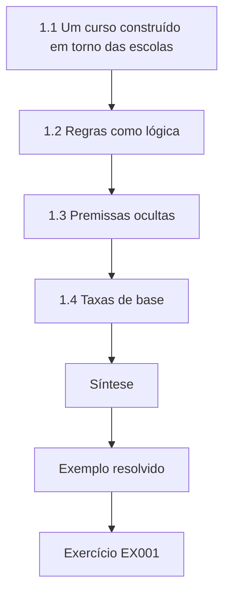

### Desenho lógico

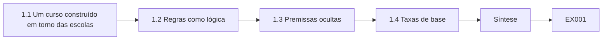

```text
[1.1 Um curso construído em torno das escolas]
    |
    v
[1.2 Regras como lógica]
    |
    v
[1.3 Premissas ocultas]
    |
    v
[1.4 Taxas de base]
    |
    v
[Síntese]
    |
    v
[Exemplo resolvido] --> [Exercício EX001]
```
<!-- cyberabc:lesson-figures:end ch-01 -->


### Objetivos de aprendizagem

Você vai (1) usar a lógica para enunciar regras de privacidade com precisão; (2) identificar premissas ocultas em argumentos sobre dados; (3) raciocinar sobre proporções e taxas de base.

### 1.1 Um curso construído em torno das escolas

Elena Rossi começa um bacharelado de quatro anos no fictício Fairhaven College, com a tutoria do Dr. Kwame Asante. A parceira de seu estágio é a fictícia Brindle Valley Schools Trust, uma rede que mantém doze escolas de ensino fundamental com cerca de 6.000 alunos. As escolas guardam nomes, endereços, anotações de saúde, registros de necessidades educacionais especiais e fotografias de crianças. O Dr. Asante explica que a privacidade e a proteção de dados serão a principal matéria de Elena e que cada disciplina de fundamentos será lida pela ótica do trabalho da rede, a começar pelo raciocínio matemático. Sua primeira tarefa é contar os alunos de cada escola.

### 1.2 Regras como lógica

As regras de privacidade costumam ser escritas de forma frouxa. A política da rede diz que os funcionários podem compartilhar dados de alunos com aplicativos se for necessário e se os pais concordarem. Elena reescreve a regra como um enunciado lógico: o compartilhamento só é permitido se houver necessidade e existir uma base legal. Ela percebe que a concordância dos pais não é a única base possível; uma escola pode se apoiar no cumprimento de uma missão de interesse público para ensinar. Escrever a regra com precisão expõe a confusão. Ela aprende que a lógica é uma ferramenta para tornar as políticas testáveis antes que sejam aplicadas a crianças reais.

### 1.3 Premissas ocultas

Elena examina o argumento de uma professora: o aplicativo de leitura é seguro porque é popular entre as escolas. A premissa oculta é que a popularidade implica um tratamento cuidadoso dos dados. Ela lista outras premissas ocultas que encontra: que a página de privacidade de um fornecedor reflete sua prática, que dados anonimizados não conseguem identificar crianças e que os pais leem os formulários de consentimento. Cada premissa pode ser conferida. O Dr. Asante pede à turma que sublinhe as premissas em todo argumento que ler, um hábito que vai ajudá-los a avaliar fornecedores e políticas ao longo de todo o curso.

### 1.4 Taxas de base

Elena estuda as taxas de base. Se um aplicativo em cem trata mal os dados e uma verificação de triagem pega nove em cada dez aplicativos ruins, mas marca por engano cinco em cada cem aplicativos bons, a maioria dos aplicativos marcados é, na verdade, adequada. Ela faz as contas: de 1.000 aplicativos, dez são ruins e nove são marcados; dos 990 bons, cerca de cinquenta são marcados. Assim, só cerca de um em cada seis aplicativos marcados é ruim. A lição é que as verificações precisam ser projetadas levando em conta as taxas de base, ou os funcionários perderão a confiança nelas.

### Exemplo resolvido

Elena reescreve uma regra de compartilhamento como lógica, expõe premissas ocultas sobre aplicativos populares e mostra que uma verificação de triagem marca sobretudo aplicativos bons quando os ruins são raros.

> **Caso sintético.** O Fairhaven, a Brindle Valley e todos os números são sintéticos.

### Erros e limites

As taxas de base aqui são ilustrativas; as taxas reais precisam ser estimadas.

### Exercícios

- **EX001 — Necessidade e base.** Como Elena reescreve a regra de compartilhamento? *Rubrica:* 3 = compartilhamento permitido só se for necessário e existir base legal;; 2 = menciona necessidade;; 1 = mantém a original;; 0 = nenhuma.
- **EX002 — Premissa do aplicativo popular.** Que premissa oculta há em "o aplicativo é popular, então é seguro"? *Rubrica:* 3 = a popularidade implica tratamento cuidadoso dos dados;; 2 = cita uma premissa;; 1 = vago;; 0 = nenhuma.
- **EX003 — Aplicativos marcados.** Aproximadamente que parcela dos aplicativos marcados é de fato ruim no exemplo de Elena? *Rubrica:* 3 = cerca de um em seis;; 2 = uma minoria;; 1 = a maioria;; 0 = nenhuma.

### Síntese

O capítulo 1 aprimora o raciocínio. O capítulo 2 examina os sistemas computacionais.

<!-- cyberabc:chapter-navigation:start ch-01 -->
### Continue estudando — aula 01 (capítulo 01 de 40)

[← Início do curso](../../README.md) · [Índice das aulas](../SUBJECTS.md) · [Capítulo 02 →](#ch-02)

Continue para a próxima aula já escrita.
<!-- cyberabc:chapter-navigation:end -->

<a id="ch-02"></a>

## Capítulo 2 — Sistemas computacionais

<!-- cyberabc:lesson-figures:start ch-02 -->
### Mapa da aula

Aula 02 publicada. Mapa, exemplo, EX004.

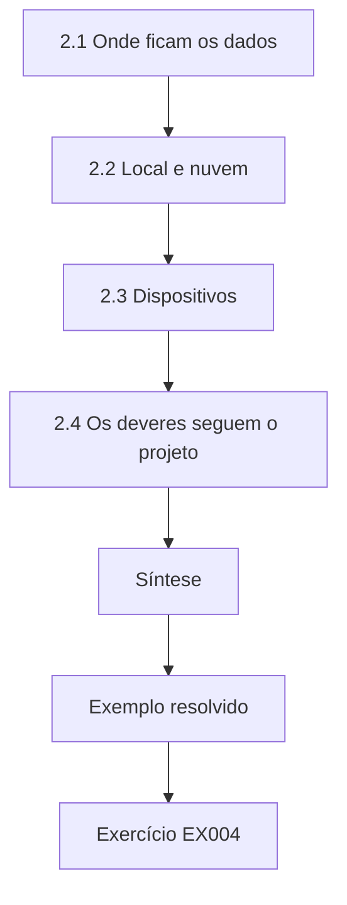

### Desenho lógico

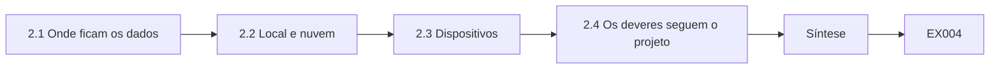

```text
[2.1 Onde ficam os dados]
    |
    v
[2.2 Local e nuvem]
    |
    v
[2.3 Dispositivos]
    |
    v
[2.4 Os deveres seguem o projeto]
    |
    v
[Síntese]
    |
    v
[Exemplo resolvido] --> [Exercício EX004]
```
<!-- cyberabc:lesson-figures:end ch-02 -->


### Objetivos de aprendizagem

Você vai (1) mapear onde ficam os dados dos alunos nos sistemas escolares; (2) distinguir o armazenamento local, em nuvem e com fornecedores; (3) relacionar o projeto dos sistemas aos deveres de proteção de dados.

### 2.1 Onde ficam os dados

Elena mapeia os sistemas da rede. O sistema de gestão escolar guarda os registros dos alunos; uma suíte de escritório em nuvem guarda documentos e e-mails; os aplicativos de sala de aula guardam dados de aprendizagem; um sistema de pagamentos guarda as contas da merenda; e as pastas compartilhadas guardam fotografias. Alguns dados ficam em servidores nas escolas, alguns na nuvem e alguns com fornecedores. Ela desenha um diagrama simples e descobre que ninguém na rede tem uma visão completa. Seu mapa vira a primeira versão do inventário que o artigo 30 do GDPR exige, e que no Brasil corresponde ao registro das operações do art. 37 da LGPD.

### 2.2 Local e nuvem

Os servidores locais dão à rede controle direto, mas exigem manutenção, que as escolas pequenas têm dificuldade de garantir. Os serviços em nuvem são mantidos pelos provedores, mas levam os dados para outra organização, que passa a ser operadora pelo GDPR. Elena lista as responsabilidades em cada modelo. Ela observa que a nuvem não é automaticamente menos privada: um serviço em nuvem bem configurado pode ser mais seguro que um servidor escolar sem atualizações. A decisão deve seguir os riscos e os contratos existentes, e não uma preferência geral por um modelo. Os contratos decidem muita coisa.

### 2.3 Dispositivos

Os alunos usam tablets compartilhados e os professores usam notebooks. Elena verifica que dados ficam nos dispositivos: documentos em cache, senhas salvas e fotografias. Um notebook de professor perdido e sem criptografia poderia expor os registros de muitas crianças. Ela recomenda criptografia de disco completo nos notebooks dos funcionários e saída automática da conta nos tablets compartilhados. Ela aprende que os dispositivos fazem parte do sistema computacional e muitas vezes são seu ponto mais fraco, porque saem da escola e são usados por muitas pessoas, com graus diferentes de cuidado. Os notebooks dos alunos vão para casa toda noite, muitas vezes divididos com irmãos.

### 2.4 Os deveres seguem o projeto

Elena conclui que o projeto dos sistemas molda os deveres de proteção de dados. Se os dados estiverem espalhados por muitos fornecedores, a rede precisa de muitos contratos e tem de atender aos pedidos de direitos em todos eles. Se estiverem centralizados, um único sistema guarda tudo e precisa ser bem protegido. O Dr. Asante observa que o artigo 25 do GDPR pede aos controladores que considerem a proteção de dados ao escolher os meios de tratamento, o que inclui escolher e configurar sistemas, e não só escrever políticas depois que os sistemas já foram instalados. É o artigo 25 na prática.

### Exemplo resolvido

Elena mapeia cinco sistemas que guardam dados de alunos, compara as responsabilidades no modelo local e na nuvem, recomenda criptografia e saída automática nos dispositivos e liga a escolha dos sistemas ao artigo 25.

> **Caso sintético.** Os sistemas da rede são sintéticos; os artigos 25 e 30 do GDPR e o art. 37 da LGPD são reais.

### Erros e limites

Um primeiro mapa deixa escapar sistemas paralelos, como planilhas pessoais; revise-o.

### Exercícios

- **EX004 — Visão ausente.** O que o mapa de sistemas de Elena revelou? *Rubrica:* 3 = ninguém tinha uma visão completa de onde ficam os dados dos alunos;; 2 = menciona lacunas;; 1 = vago;; 0 = nenhuma.
- **EX005 — A nuvem não é automática.** Por que o armazenamento em nuvem não é automaticamente menos privado? *Rubrica:* 3 = uma nuvem bem configurada pode ser mais segura que um servidor escolar sem atualizações;; 2 = menciona configuração;; 1 = diz que a nuvem é pior;; 0 = nenhuma.
- **EX006 — Controles nos dispositivos.** Que controles nos dispositivos Elena recomenda? *Rubrica:* 3 = criptografia de disco completo nos notebooks e saída automática nos tablets compartilhados;; 2 = um;; 1 = vago;; 0 = nenhuma.

### Síntese

O capítulo 2 mapeia os sistemas. O capítulo 3 começa a programação.

<!-- cyberabc:chapter-navigation:start ch-02 -->
### Continue estudando — aula 02 (capítulo 02 de 40)

[← Capítulo 01](#ch-01) · [Índice das aulas](../SUBJECTS.md) · [Capítulo 03 →](#ch-03)

Continue para a próxima aula já escrita.
<!-- cyberabc:chapter-navigation:end -->

<a id="ch-03"></a>

## Capítulo 3 — Programação I

<!-- cyberabc:lesson-figures:start ch-03 -->
### Mapa da aula

Aula 03 publicada. Mapa, exemplo, EX007.

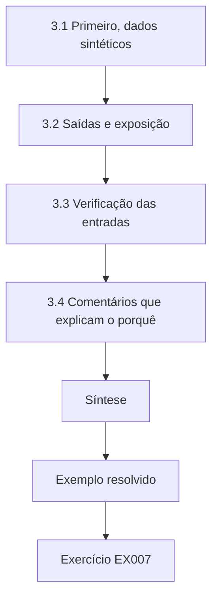

### Desenho lógico

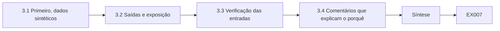

```text
[3.1 Primeiro, dados sintéticos]
    |
    v
[3.2 Saídas e exposição]
    |
    v
[3.3 Verificação das entradas]
    |
    v
[3.4 Comentários que explicam o porquê]
    |
    v
[Síntese]
    |
    v
[Exemplo resolvido] --> [Exercício EX007]
```
<!-- cyberabc:lesson-figures:end ch-03 -->


### Objetivos de aprendizagem

Você vai (1) escrever pequenos programas que tratem dados de alunos com segurança; (2) evitar expor dados nas saídas; (3) usar dados sintéticos para praticar.

### 3.1 Primeiro, dados sintéticos

Os primeiros programas de Elena calculam percentuais de frequência. O Dr. Asante insiste que toda a prática use alunos sintéticos gerados por um script, nunca exportações reais da rede. Elena escreve um gerador que produz nomes, turmas e registros de frequência com padrões realistas. Ela aprende que os dados sintéticos permitem errar com segurança, compartilhar código com os colegas e publicar exemplos. A regra protege as crianças e também ensina um hábito que os desenvolvedores profissionais deveriam manter, porque dados reais em ambientes de prática são uma fonte frequente de vazamentos.

### 3.2 Saídas e exposição

O programa de frequência imprime uma lista dos alunos com frequência abaixo de noventa por cento. Elena percebe que, se a lista fosse impressa e esquecida numa mesa da sala dos professores, revelaria informações sensíveis sobre as famílias. Ela muda o programa para imprimir contagens por turma para o uso geral e gerar a lista nominal apenas para o responsável pela frequência, salva em uma pasta protegida. Decidir quem vê qual saída é uma decisão de programação tanto quanto de política, e o código pode impor essa decisão.

### 3.3 Verificação das entradas

O programa lê uma planilha. Elena acrescenta verificações que rejeitam colunas inesperadas, como uma coluna de anotações de saúde incluída por engano em uma exportação. Se a coluna aparecer, o programa para e explica por quê. Isso impede o programa de tratar dados de que não precisa. Ela explica que a verificação das entradas implementa a minimização de dados no ponto em que os dados entram no programa, e que falhar de forma ruidosa é melhor do que tratar em silêncio dados sensíveis que nunca deveriam estar ali. Seu script rejeita as colunas inesperadas.

### 3.4 Comentários que explicam o porquê

Elena escreve comentários que explicam as decisões de privacidade, como o motivo de a lista nominal ser salva apenas em uma pasta protegida. Um colega que revisa o código entende o motivo e não o altera. O Dr. Asante observa que os comentários que explicam o porquê valem mais que os que explicam o quê, porque o próprio código já mostra o que faz. O raciocínio de privacidade se perde com facilidade quando o código muda de mãos, e explicações curtas o mantêm junto do código que o impõe. Seus comentários nomeiam a finalidade de cada decisão.

### Exemplo resolvido

Elena pratica com alunos gerados, imprime contagens por turma para o uso geral e listas nominais só para o responsável pela frequência, rejeita colunas de saúde inesperadas e documenta seus motivos em comentários.

> **Caso sintético.** Os programas e os alunos são sintéticos.

### Erros e limites

Os dados sintéticos podem não ter os casos extremos reais; acrescente-os de propósito.

### Exercícios

- **EX007 — Prática sintética.** Por que a prática precisa usar alunos sintéticos? *Rubrica:* 3 = os erros e o compartilhamento são seguros, e os dados reais continuam protegidos;; 2 = menciona segurança;; 1 = dados reais servem;; 0 = nenhuma.
- **EX008 — Duas saídas.** Como Elena muda a saída de frequência? *Rubrica:* 3 = contagens por turma para o uso geral; lista nominal só para o responsável pela frequência;; 2 = uma parte;; 1 = imprime nomes;; 0 = nenhuma.
- **EX009 — Coluna inesperada.** O que o programa faz com uma coluna de saúde inesperada? *Rubrica:* 3 = para e explica;; 2 = avisa;; 1 = trata a coluna;; 0 = nenhuma.

### Síntese

O capítulo 3 programa com segurança. O capítulo 4 desenvolve a escrita acadêmica.

<!-- cyberabc:chapter-navigation:start ch-03 -->
### Continue estudando — aula 03 (capítulo 03 de 40)

[← Capítulo 02](#ch-02) · [Índice das aulas](../SUBJECTS.md) · [Capítulo 04 →](#ch-04)

Continue para a próxima aula já escrita.
<!-- cyberabc:chapter-navigation:end -->

<a id="ch-04"></a>

## Capítulo 4 — Escrita acadêmica

<!-- cyberabc:lesson-figures:start ch-04 -->
### Mapa da aula

Aula 04 publicada. Mapa, exemplo, EX010.

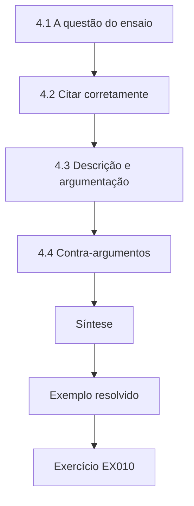

### Desenho lógico

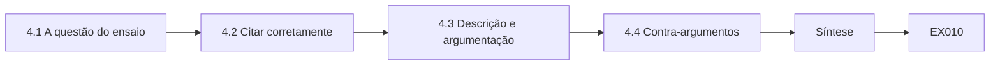

```text
[4.1 A questão do ensaio]
    |
    v
[4.2 Citar corretamente]
    |
    v
[4.3 Descrição e argumentação]
    |
    v
[4.4 Contra-argumentos]
    |
    v
[Síntese]
    |
    v
[Exemplo resolvido] --> [Exercício EX010]
```
<!-- cyberabc:lesson-figures:end ch-04 -->


### Objetivos de aprendizagem

Você vai (1) escrever um ensaio argumentativo sobre uma questão de privacidade; (2) citar corretamente fontes jurídicas e acadêmicas; (3) distinguir descrição de argumentação.

### 4.1 A questão do ensaio

O primeiro ensaio de Elena pergunta: as escolas devem publicar fotografias de alunos em sites públicos? Ela precisa tomar uma posição e sustentá-la. Pesquisa as disposições do GDPR sobre base legal e consentimento, incluindo o artigo 8, sobre o consentimento de crianças para serviços online, e o art. 14 da LGPD, que trata dos dados de crianças e adolescentes, e lê trabalhos acadêmicos sobre a privacidade infantil. Decide argumentar que as escolas só podem publicar fotografias com consentimento claro e específico dos pais e, à medida que as crianças crescem, delas próprias, e somente quando a finalidade for relevante. Sua tese enuncia isso em uma frase.

### 4.2 Citar corretamente

O Dr. Asante ensina a citar. As leis são citadas pelo número e pelo artigo, como Regulamento (UE) 2016/679, artigo 6, ou Lei nº 13.709/2018, art. 7º. As obras acadêmicas são citadas com autor, ano e título, e uma lista de referências traz os detalhes completos. Elena confere cada citação no texto original, em vez de copiar de resumos secundários. Ela descobre que um blog cita errado o GDPR, dizendo que o consentimento é sempre exigido para fotografias. Citar o texto original permite que ela não repita o erro e fortalece seu argumento. A fonte era o blog de uma escola.

### 4.3 Descrição e argumentação

O primeiro rascunho de Elena descreve a lei longamente, mas argumenta pouco. O Dr. Asante marca os parágrafos que apenas descrevem. Ela revisa o texto para que cada parágrafo faça uma afirmação, apresente evidências e explique como as evidências sustentam a afirmação. Por exemplo, ela argumenta que o consentimento para fotografias só tem sentido se a recusa não trouxer consequências, porque as diretrizes do EDPB sobre consentimento dizem que ele precisa ser livre. O ensaio revisado é mais curto, porém mais persuasivo. O primeiro rascunho listava regras; o segundo explica por que cada uma protege os alunos.

### 4.4 Contra-argumentos

Um ensaio forte enfrenta as objeções. Elena considera o argumento de que as fotografias celebram conquistas e fortalecem a comunidade. Ela reconhece o valor, mas argumenta que boletins internos e páginas protegidas por senha podem atingir a mesma finalidade com menos exposição. Também considera que alunos mais velhos podem querer suas conquistas exibidas. Conclui que as opiniões das próprias crianças devem ganhar peso com a idade. Enfrentar os contra-argumentos, ela aprende, mostra ao leitor que a posição resiste ao escrutínio, em vez de ignorá-lo. Um dos contra-argumentos diz respeito às tradições da escola. Sua resposta cita a lei.

### Exemplo resolvido

Elena argumenta que as fotografias escolares exigem consentimento claro e específico, com peso crescente para a opinião das crianças, cita diretamente o GDPR, a LGPD e as orientações do EDPB e responde às objeções sobre o fortalecimento da comunidade.

> **Caso sintético.** O ensaio é sintético; os artigos 6 e 8 do GDPR, os arts. 7º e 14 da LGPD e as Diretrizes 05/2020 do EDPB são reais.

### Erros e limites

O consentimento é uma base legal entre várias; as escolas podem se apoiar em outras para parte do tratamento.

### Exercícios

- **EX010 — Fontes originais.** Por que conferir as citações no texto legal original? *Rubrica:* 3 = fontes secundárias podem citar errado, como um blog fez sobre o consentimento para fotos;; 2 = menciona exatidão;; 1 = confia em blogs;; 0 = nenhuma.
- **EX011 — Estrutura do parágrafo.** O que cada parágrafo argumentativo deve conter? *Rubrica:* 3 = uma afirmação, evidências e uma explicação que as ligue;; 2 = dois;; 1 = descrição;; 0 = nenhuma.
- **EX012 — Resposta às objeções.** Como Elena responde à objeção do fortalecimento da comunidade? *Rubrica:* 3 = canais internos ou protegidos atingem a finalidade com menos exposição;; 2 = menciona alternativas;; 1 = ignora;; 0 = nenhuma.

### Síntese

O capítulo 4 constrói a argumentação. O capítulo 5 desenvolve o letramento em segurança.

<!-- cyberabc:chapter-navigation:start ch-04 -->
### Continue estudando — aula 04 (capítulo 04 de 40)

[← Capítulo 03](#ch-03) · [Índice das aulas](../SUBJECTS.md) · [Capítulo 05 →](#ch-05)

Continue para a próxima aula já escrita.
<!-- cyberabc:chapter-navigation:end -->

<a id="ch-05"></a>

## Capítulo 5 — Letramento em segurança

<!-- cyberabc:lesson-figures:start ch-05 -->
### Mapa da aula

Aula 05 publicada. Mapa, exemplo, EX013.

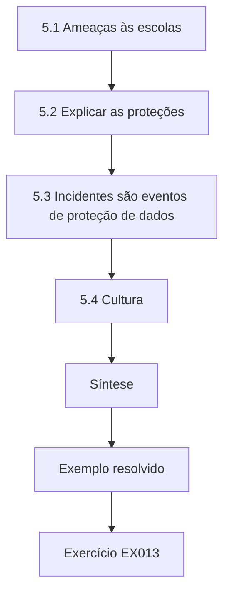

### Desenho lógico

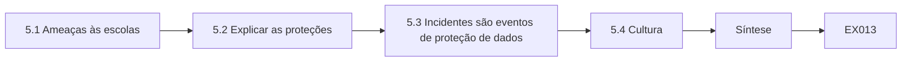

```text
[5.1 Ameaças às escolas]
    |
    v
[5.2 Explicar as proteções]
    |
    v
[5.3 Incidentes são eventos de proteção de dados]
    |
    v
[5.4 Cultura]
    |
    v
[Síntese]
    |
    v
[Exemplo resolvido] --> [Exercício EX013]
```
<!-- cyberabc:lesson-figures:end ch-05 -->


### Objetivos de aprendizagem

Você vai (1) reconhecer as ameaças comuns aos dados escolares; (2) explicar as proteções básicas aos funcionários; (3) relacionar incidentes de segurança à proteção de dados.

### 5.1 Ameaças às escolas

Elena estuda as ameaças que as escolas enfrentam: e-mails de phishing que se passam por pais ou fornecedores, ransomware que cifra os registros, dispositivos perdidos e e-mails enviados ao destinatário errado. Ela lê que as escolas são alvos atraentes porque guardam dados valiosos e muitas vezes têm pouca equipe de segurança. Ela lista os incidentes mais prováveis da rede e descobre que os e-mails enviados ao destinatário errado, como mandar o boletim de uma família para outra, são os mais frequentes, embora o ransomware receba mais atenção do noticiário. A revisão do registro de incidentes sustenta claramente essa ordenação.

### 5.2 Explicar as proteções

Elena prepara uma sessão curta para os professores. Explica senhas fortes com um gerenciador de senhas, autenticação multifator no e-mail, conferência dos destinatários antes do envio e bloqueio de tela. Usa exemplos de escolas, e não de bancos. Evita culpar os funcionários pelos erros, explicando que os sistemas devem tornar fácil a escolha segura, por exemplo avisando quando um e-mail vai para um endereço externo. Os professores respondem melhor a conselhos práticos do que a alertas sobre hackers. Um exemplo: confirmar os anexos antes de enviar para fora da rede. Os professores adotam as orientações depressa.

### 5.3 Incidentes são eventos de proteção de dados

Elena aprende que um incidente de segurança que envolva dados pessoais pode ser uma violação de dados pessoais pelo GDPR. Enviar o boletim de um aluno ao pai errado é uma violação, mesmo que acidental. A rede precisa avaliar o risco e, a menos que a violação não seja suscetível de gerar risco para as pessoas, notificar a autoridade de controle em até 72 horas, pelo artigo 33. No Brasil, o art. 48 da LGPD e a Resolução CD/ANPD nº 15/2024 tratam do mesmo dever com um relógio próprio: três dias úteis para comunicar a ANPD. Ela observa que muitos funcionários acham que as violações só envolvem hackers, então o treinamento precisa cobrir os erros do dia a dia.

### 5.4 Cultura

Elena reflete sobre a cultura de segurança. Funcionários que temem punição escondem os erros, o que atrasa a resposta. Ela recomenda um processo de comunicação que agradeça a quem relata depressa e se concentre em corrigir os problemas. O Dr. Asante concorda, observando que relatar rápido é essencial quando corre o relógio de 72 horas. Elena escreve um guia de uma página intitulado O que fazer se você enviar algo para a pessoa errada, que orienta os funcionários a comunicar imediatamente o responsável pela proteção de dados e a não tentar resolver sozinhos. A rapidez é o que mais importa.

### Exemplo resolvido

Elena identifica os e-mails enviados ao destinatário errado como a ameaça mais frequente, treina os professores com exemplos escolares, explica que as divulgações acidentais são violações pelo artigo 33 e promove uma cultura de comunicação sem culpa.

> **Caso sintético.** Os incidentes são sintéticos; o artigo 33 do GDPR, o art. 48 da LGPD e a Resolução CD/ANPD nº 15/2024 são reais.

### Erros e limites

Sem culpa não significa sem responsabilização; comportamentos descuidados repetidos ainda exigem gestão.

### Exercícios

- **EX013 — Incidente mais frequente.** Qual é o incidente mais frequente na rede? *Rubrica:* 3 = e-mails enviados ao destinatário errado;; 2 = menciona e-mail;; 1 = ransomware;; 0 = nenhuma.
- **EX014 — Violação acidental.** Enviar um boletim ao pai errado é uma violação? *Rubrica:* 3 = sim; a divulgação acidental conta;; 2 = sim;; 1 = não;; 0 = nenhuma.
- **EX015 — Cultura de comunicação.** Por que agradecer aos funcionários que relatam erros depressa? *Rubrica:* 3 = o medo atrasa a comunicação, e o relógio de 72 horas exige rapidez;; 2 = menciona rapidez;; 1 = punir;; 0 = nenhuma.

### Síntese

O capítulo 5 constrói o letramento em segurança. O capítulo 6 apresenta as estruturas discretas.

<!-- cyberabc:chapter-navigation:start ch-05 -->
### Continue estudando — aula 05 (capítulo 05 de 40)

[← Capítulo 04](#ch-04) · [Índice das aulas](../SUBJECTS.md) · [Capítulo 06 →](#ch-06)

Continue para a próxima aula já escrita.
<!-- cyberabc:chapter-navigation:end -->

<a id="ch-06"></a>

## Capítulo 6 — Estruturas discretas

<!-- cyberabc:lesson-figures:start ch-06 -->
### Mapa da aula

Aula 06 publicada. Mapa, exemplo, EX016.

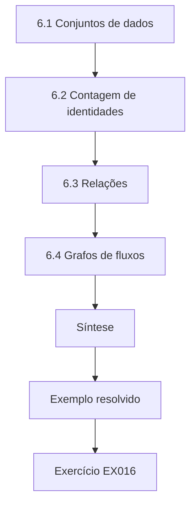

### Desenho lógico

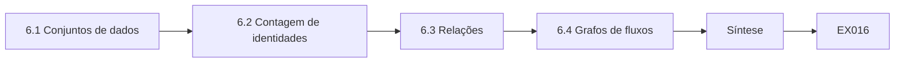

```text
[6.1 Conjuntos de dados]
    |
    v
[6.2 Contagem de identidades]
    |
    v
[6.3 Relações]
    |
    v
[6.4 Grafos de fluxos]
    |
    v
[Síntese]
    |
    v
[Exemplo resolvido] --> [Exercício EX016]
```
<!-- cyberabc:lesson-figures:end ch-06 -->


### Objetivos de aprendizagem

Você vai (1) usar conjuntos e relações para modelar o compartilhamento de dados; (2) contar as combinações que identificam alunos; (3) usar grafos para rastrear fluxos de dados.

### 6.1 Conjuntos de dados

Elena modela os dados da rede como conjuntos: todos os dados pessoais, os dados de categorias especiais, como saúde e religião, e os dados de crianças com necessidades educacionais especiais. Ela observa que alguns dados pertencem a vários conjuntos. Uma lista de alunos com restrições alimentares pode revelar religião ou condição de saúde. Pensar em conjuntos a ajuda a ver que dados de aparência comum podem cair em categorias sensíveis, que o artigo 9 do GDPR protege com condições mais estritas e que a LGPD chama de dados pessoais sensíveis (art. 5º, II). Ela usa diagramas de Venn no relatório para a rede. Os dados de saúde são um exemplo.

### 6.2 Contagem de identidades

Elena conta quantos alunos compartilham combinações de atributos em uma escola pequena: ano escolar, sexo e primeira língua. Em uma escola de duzentos alunos, algumas combinações contêm uma única criança. Publicar uma tabela de resultados por esses atributos poderia identificar essa criança. Ela liga isso ao trabalho de Sweeney (2002) sobre como combinações de atributos comuns identificam pessoas. O exercício de contagem mostra por que as estatísticas de escolas pequenas exigem cuidado especial antes de serem publicadas. Numa escola com um único aluno de determinada idade e etnia, as contagens identificam essa criança.

### 6.3 Relações

Uma relação forma pares de elementos de dois conjuntos. Elena modela como relação quais funções da equipe podem acessar quais categorias de dados. Os professores acessam os registros de aprendizagem; a secretaria acessa os dados de contato; a coordenadora de necessidades especiais acessa os planos de apoio. Ela confere a relação com o princípio do privilégio mínimo e descobre que a secretaria também consegue acessar os planos de apoio, de que não precisa. O modelo torna o problema visível de um jeito que uma lista de permissões num menu de software não tornava. Remover esse par restringe o acesso.

### 6.4 Grafos de fluxos

Elena desenha os fluxos de dados da rede como um grafo dirigido: das famílias para as escolas, das escolas para os aplicativos, dos aplicativos para os suboperadores dos fornecedores. Ela encontra caminhos que saem da rede em várias etapas, como um aplicativo de leitura que repassa dados a um provedor de análise. Um caminho, observa, é tão protegido quanto seu elo mais fraco. O grafo a prepara para os capítulos seguintes, em que ela vai verificar se cada aresta tem base legal e contrato. Cada aresta é um fluxo de dados que precisa de justificativa.

### Exemplo resolvido

Elena modela as categorias de dados como conjuntos, conta as combinações que identificam alunos em escolas pequenas, modela o acesso por função como uma relação (descobrindo o acesso da secretaria aos planos de apoio) e rastreia fluxos de várias etapas como um grafo.

> **Caso sintético.** Os modelos são sintéticos; o artigo 9 do GDPR, o art. 5º da LGPD e Sweeney (2002) são reais.

### Erros e limites

Os modelos simplificam; o acesso real costuma ter exceções que as tabelas de funções não capturam.

### Exercícios

- **EX016 — Comum, mas sensível.** Dê um exemplo de dado de aparência comum que pode ser de categoria especial. *Rubrica:* 3 = restrições alimentares que revelam religião ou saúde;; 2 = dá um exemplo;; 1 = vago;; 0 = nenhuma.
- **EX017 — Achado na relação de acesso.** O que a relação de acesso revelou? *Rubrica:* 3 = a secretaria podia acessar planos de apoio de que não precisa;; 2 = menciona a secretaria;; 1 = vago;; 0 = nenhuma.
- **EX018 — O elo mais fraco.** Por que um caminho de dados com várias etapas é tão protegido quanto seu elo mais fraco? *Rubrica:* 3 = os dados podem vazar em qualquer etapa, como um suboperador;; 2 = menciona etapas;; 1 = o mais forte;; 0 = nenhuma.

### Síntese

O capítulo 6 modela dados. O capítulo 7 trata de redes.

<!-- cyberabc:chapter-navigation:start ch-06 -->
### Continue estudando — aula 06 (capítulo 06 de 40)

[← Capítulo 05](#ch-05) · [Índice das aulas](../SUBJECTS.md) · [Capítulo 07 →](#ch-07)

Continue para a próxima aula já escrita.
<!-- cyberabc:chapter-navigation:end -->

<a id="ch-07"></a>

## Capítulo 7 — Redes e protocolos

<!-- cyberabc:lesson-figures:start ch-07 -->
### Mapa da aula

Aula 07 publicada. Mapa, exemplo, EX019.

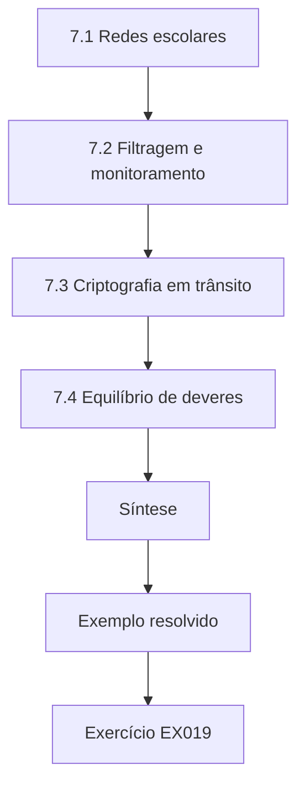

### Desenho lógico

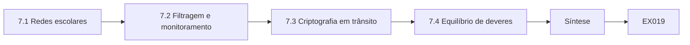

```text
[7.1 Redes escolares]
    |
    v
[7.2 Filtragem e monitoramento]
    |
    v
[7.3 Criptografia em trânsito]
    |
    v
[7.4 Equilíbrio de deveres]
    |
    v
[Síntese]
    |
    v
[Exemplo resolvido] --> [Exercício EX019]
```
<!-- cyberabc:lesson-figures:end ch-07 -->


### Objetivos de aprendizagem

Você vai (1) identificar o que o tráfego da rede escolar revela; (2) entender a filtragem e o monitoramento; (3) equilibrar a proteção das crianças com a privacidade.

### 7.1 Redes escolares

Elena estuda a rede de computadores da rede de escolas. Os dispositivos dos alunos se conectam pelo Wi-Fi da escola, que passa por um filtro web. O filtro registra cada site visitado por um dispositivo. A criptografia protege o conteúdo, mas o filtro vê os nomes de domínio. Elena percebe que os logs revelam informações sensíveis, como buscas sobre problemas de saúde ou de família, e que se referem a crianças identificáveis quando os dispositivos são atribuídos aos alunos. O projeto da rede cria, portanto, um volume significativo de dados pessoais cuja existência muitos funcionários nem conhecem. Os logs são dados pessoais.

### 7.2 Filtragem e monitoramento

As escolas costumam ter deveres de proteção que as obrigam a resguardar as crianças de conteúdos nocivos. Elena aprende que a filtragem e o monitoramento podem apoiar esses deveres, mas precisam ser proporcionais. Ela revisa as configurações do filtro e descobre logs guardados por três anos e acessíveis a toda a equipe de TI. Recomenda uma retenção mais curta, acesso limitado aos responsáveis designados pela proteção das crianças e informação clara a alunos e famílias sobre o que é monitorado. Ela observa que a transparência faz parte da lealdade, mesmo quando o monitoramento se justifica. Os alunos veem um aviso ao entrar.

### 7.3 Criptografia em trânsito

Elena verifica se o sistema de gestão escolar e os aplicativos usam conexões cifradas. Um aplicativo legado usado por uma escola envia nomes de alunos sem criptografia na rede local. Ela leva o caso à equipe de TI, que o substitui. Explica aos professores que as conexões cifradas impedem que outras pessoas na mesma rede leiam os dados, o que importa nas escolas, onde muitos dispositivos compartilham as redes. Ela confere o sistema de gestão escolar e o portal das famílias e encontra os dois cifrados, mas um serviço de impressão legado envia listas de turma em texto claro pela rede, e a TI o substitui nas férias seguintes.

### 7.4 Equilíbrio de deveres

Elena discute com o Dr. Asante como equilibrar a proteção das crianças e a privacidade. As duas querem proteger as crianças. O monitoramento excessivo pode desencorajar os alunos de buscar ajuda online sobre assuntos sensíveis, enquanto o monitoramento insuficiente pode deixar passar riscos graves. Ela escreve que a rede deve declarar com clareza a finalidade do monitoramento, limitá-lo a essa finalidade e revisá-lo com regularidade. A discussão lhe mostra que a privacidade não se opõe à segurança, mas precisa ser ponderada com ela de forma cuidadosa e aberta. Os logs de monitoramento passam a ser guardados por um período letivo.

### Exemplo resolvido

Elena encontra logs do filtro web que revelam buscas sensíveis guardados por três anos, recomenda retenção mais curta e acesso restrito aos responsáveis pela proteção das crianças, substitui um aplicativo sem criptografia e trata o monitoramento como um equilíbrio de deveres.

> **Caso sintético.** A rede e o filtro são sintéticos.

### Erros e limites

As exigências de proteção das crianças variam de país para país; consulte as orientações locais.

### Exercícios

- **EX019 — Logs do filtro.** Por que os logs do filtro web são sensíveis? *Rubrica:* 3 = revelam buscas das crianças sobre saúde ou questões familiares;; 2 = menciona buscas;; 1 = não são pessoais;; 0 = nenhuma.
- **EX020 — Retenção do filtro.** O que Elena recomendou para os logs do filtro? *Rubrica:* 3 = retenção mais curta, acesso só para os responsáveis pela proteção e transparência;; 2 = dois;; 1 = vago;; 0 = nenhuma.
- **EX021 — Dano do monitoramento excessivo.** Como o monitoramento excessivo pode prejudicar as crianças? *Rubrica:* 3 = pode desencorajá-las de buscar ajuda online sobre assuntos sensíveis;; 2 = menciona efeito inibidor;; 1 = vago;; 0 = nenhuma.

### Síntese

O capítulo 7 examina redes. O capítulo 8 aprofunda a programação.

<!-- cyberabc:chapter-navigation:start ch-07 -->
### Continue estudando — aula 07 (capítulo 07 de 40)

[← Capítulo 06](#ch-06) · [Índice das aulas](../SUBJECTS.md) · [Capítulo 08 →](#ch-08)

Continue para a próxima aula já escrita.
<!-- cyberabc:chapter-navigation:end -->

<a id="ch-08"></a>

## Capítulo 8 — Programação II

<!-- cyberabc:lesson-figures:start ch-08 -->
### Mapa da aula

Aula 08 publicada. Mapa, exemplo, EX022.

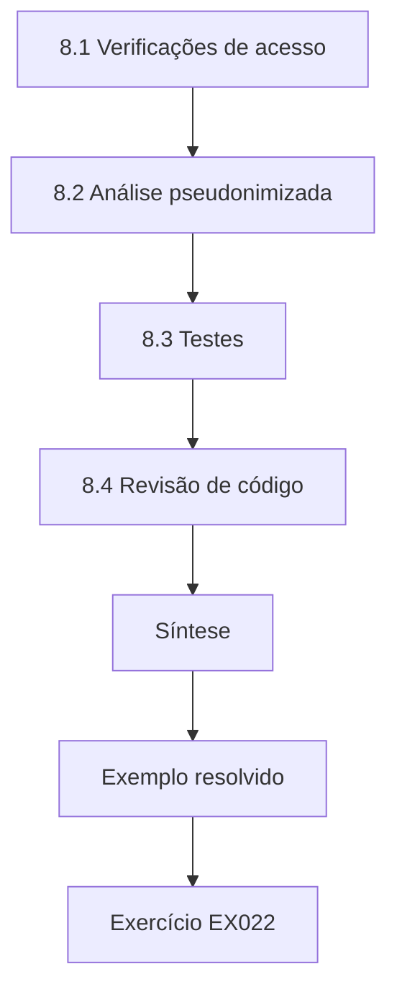

### Desenho lógico

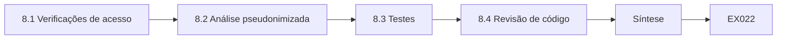

```text
[8.1 Verificações de acesso]
    |
    v
[8.2 Análise pseudonimizada]
    |
    v
[8.3 Testes]
    |
    v
[8.4 Revisão de código]
    |
    v
[Síntese]
    |
    v
[Exemplo resolvido] --> [Exercício EX022]
```
<!-- cyberabc:lesson-figures:end ch-08 -->


### Objetivos de aprendizagem

Você vai (1) implementar verificações de acesso; (2) pseudonimizar dados para análise; (3) testar o comportamento de privacidade.

### 8.1 Verificações de acesso

Elena escreve um pequeno aplicativo para consultar informações dos alunos. Antes de mostrar qualquer registro, ele verifica a função do usuário e a finalidade. Um professor pode ver os registros de aprendizagem dos alunos de suas turmas; a coordenadora de necessidades especiais pode ver os planos de apoio. Os pedidos sem uma função válida são recusados e registrados. Ela aprende que escrever as verificações no código garante que as regras sejam aplicadas de forma consistente, em vez de depender de os funcionários lembrarem quais dados devem consultar. Cada pedido confere a lista da turma.

### 8.2 Análise pseudonimizada

A rede quer analisar o progresso da leitura entre as escolas. Elena escreve um código que substitui os identificadores dos alunos por pseudônimos usando um hash com chave antes que os dados cheguem ao analista. A chave fica com o responsável pela proteção de dados. Ela explica que o analista pode estudar o progresso sem saber quem é cada criança, mas que os dados continuam sendo pessoais pelo GDPR, porque a chave poderia reidentificar os alunos. A pseudonimização reduz o risco, mas não elimina os deveres legais. A chave fica guardada separadamente dos dados, como pede o art. 13, § 4º, da LGPD.

### 8.3 Testes

Elena escreve testes que verificam o comportamento de privacidade: um professor não consegue ver um aluno de outra turma, a exportação para análise não contém nomes e os logs registram cada acesso. Um teste falha porque um professor que deixou uma turma ainda tem acesso a ela. Ela acrescenta uma regra para remover o acesso quando as atribuições de turma mudam. Testar automaticamente as propriedades de privacidade encontra problemas que a revisão manual deixaria passar e continua funcionando à medida que o código muda. Um teste reprovado impede a implantação da mudança. Os testes rodam a cada mudança, apenas com turmas sintéticas.

### 8.4 Revisão de código

O código de Elena é revisado por um colega, que pergunta por que a exportação inclui a data de nascimento. Elena percebe que ela não é necessária para o progresso da leitura e a remove. O Dr. Asante observa que os revisores devem perguntar que dados são necessários, além de verificar se o código funciona. A revisão de código vira uma verificação de minimização, além de uma verificação de qualidade, e pequenas remoções como essa se somam ao longo de muitos programas. Em uma revisão, ela tira um campo de data de nascimento de uma exportação. Os revisores perguntam por que cada campo existe.

### Exemplo resolvido

Elena implementa verificações de acesso baseadas na função e na turma, pseudonimiza os dados de leitura com um hash com chave, encontra por meio de testes acessos remanescentes a turmas antigas e remove a data de nascimento depois da revisão.

> **Caso sintético.** O código e os alunos são sintéticos.

### Erros e limites

Os pseudônimos com chave podem ser revertidos por quem tiver a chave; proteja-a.

### Exercícios

- **EX022 — Acesso por turma.** Como o aplicativo de Elena decide se um professor vê um registro? *Rubrica:* 3 = verificações de função e finalidade, mais a participação na turma;; 2 = menciona a função;; 1 = mostra tudo;; 0 = nenhuma.
- **EX023 — Pseudonimizado, ainda pessoal.** Por que o conjunto de leitura pseudonimizado continua sendo de dados pessoais? *Rubrica:* 3 = a chave pode reidentificar os alunos;; 2 = menciona a chave;; 1 = anônimo;; 0 = nenhuma.
- **EX024 — Acesso remanescente.** Que teste reprovado Elena corrigiu? *Rubrica:* 3 = professores que mantinham o acesso depois de deixar uma turma;; 2 = menciona acesso;; 1 = vago;; 0 = nenhuma.

### Síntese

O capítulo 8 implementa controles. O capítulo 9 estuda dados e bancos de dados.

<!-- cyberabc:chapter-navigation:start ch-08 -->
### Continue estudando — aula 08 (capítulo 08 de 40)

[← Capítulo 07](#ch-07) · [Índice das aulas](../SUBJECTS.md) · [Capítulo 09 →](#ch-09)

Continue para a próxima aula já escrita.
<!-- cyberabc:chapter-navigation:end -->

<a id="ch-09"></a>

## Capítulo 9 — Dados e bancos de dados

<!-- cyberabc:lesson-figures:start ch-09 -->
### Mapa da aula

Aula 09 publicada. Mapa, exemplo, EX025.

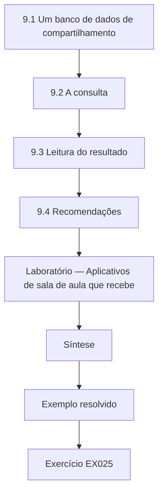

### Desenho lógico

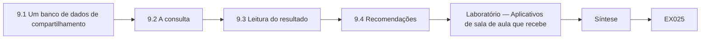

```text
[9.1 Um banco de dados de compartilhamento]
    |
    v
[9.2 A consulta]
    |
    v
[9.3 Leitura do resultado]
    |
    v
[9.4 Recomendações]
    |
    v
[Laboratório — Aplicativos de sala de aula que recebe]
    |
    v
[Síntese]
    |
    v
[Exemplo resolvido] --> [Exercício EX025]
```
<!-- cyberabc:lesson-figures:end ch-09 -->


### Objetivos de aprendizagem

Você vai (1) consultar um banco de dados para encontrar riscos de compartilhamento; (2) relacionar os contratos aos fluxos de dados; (3) recomendar ações a partir dos resultados das consultas.

### 9.1 Um banco de dados de compartilhamento

Elena monta um pequeno banco de dados SQLite dos aplicativos de sala de aula e dos dados de alunos que cada um recebe, a partir de uma versão sintética dos registros da rede. Cada aplicativo tem um fornecedor, uma região e uma marcação que indica se há um contrato de tratamento de dados assinado. O artigo 28 do GDPR exige um contrato com os operadores. O banco permite fazer perguntas que uma planilha torna difíceis, como quais aplicativos recebem dados sem contrato e quantos alunos eles afetam. Ele usa apenas o sqlite3 da biblioteca padrão.

### 9.2 A consulta

O laboratório junta os aplicativos com os campos compartilhados e filtra os aplicativos sem contrato. Aparecem três. O ClassChat, sediado no EEE, recebe nomes e endereços de e-mail de 3.100 alunos. O ReadAlong, sediado nos Estados Unidos, recebe nomes, níveis de leitura e uma marcação de necessidades educacionais especiais de até 1.800 alunos. O QuizBlitz, nos Estados Unidos, recebe nomes de 900 alunos. No total, há 5.800 compartilhamentos aluno-aplicativo sem contrato, contando cada aluno uma vez por aplicativo. A consulta junta a tabela de aplicativos com a de contratos e conta os alunos por aplicativo.

### 9.3 Leitura do resultado

Elena observa que o ReadAlong é o caso mais grave. Ele recebe uma marcação de necessidades educacionais especiais, que pode ser dado de saúde, envia dados para fora do EEE e não tem contrato. O ClassChat afeta mais alunos, mas guarda dados menos sensíveis. Ela ordena os aplicativos pela sensibilidade, pela transferência e pela escala, e não só pela escala. Explica que uma consulta ao banco dá fatos, mas é preciso julgamento para decidir quais fatos importam mais para as crianças. O QuizBlitz, apesar dos números menores, também exige atenção, porque seus dados saem da Europa.

### 9.4 Recomendações

Elena recomenda suspender o ReadAlong até que haja contrato e mecanismo de transferência e que a marcação de necessidades especiais seja removida; obter um contrato para o ClassChat; e avaliar se o QuizBlitz é mesmo necessário. Também recomenda que a rede mantenha o banco atualizado à medida que os aplicativos mudam, transformando-o em um registro vivo. O Dr. Asante observa que um registro consultado com regularidade é mais útil que uma planilha de auditoria pontual. Cada novo aplicativo é incluído antes que os professores comecem a usá-lo. Os próprios professores podem consultá-lo.

### Laboratório — Aplicativos de sala de aula que recebem dados de alunos sem contrato

```python
# SQLite: which classroom apps receive pupil data without a signed data processing agreement?
import sqlite3
db = sqlite3.connect(":memory:")
db.executescript("""
CREATE TABLE app(name TEXT, vendor TEXT, dpa INTEGER, region TEXT);
CREATE TABLE share(app TEXT, field TEXT, pupils INTEGER);
INSERT INTO app VALUES ('MathsQuest','Qbit Ltd',1,'EEA'),('ReadAlong','Fable Inc',0,'US'),('ClassChat','Talko',0,'EEA'),
 ('Timetabler','Sched AB',1,'EEA'),('QuizBlitz','Blitz LLC',0,'US'),('LunchPay','Payfair',1,'EEA');
INSERT INTO share VALUES ('MathsQuest','name',2400),('MathsQuest','year_group',2400),('ReadAlong','name',1800),('ReadAlong','reading_level',1800),
 ('ReadAlong','sen_flag',140),('ClassChat','name',3100),('ClassChat','email',3100),('Timetabler','name',6000),('QuizBlitz','name',900),
 ('LunchPay','name',6000),('LunchPay','free_meals',1150);
""")
q = """SELECT a.name, a.region, GROUP_CONCAT(s.field), MAX(s.pupils) FROM app a JOIN share s ON s.app=a.name
       WHERE a.dpa=0 GROUP BY a.name ORDER BY MAX(s.pupils) DESC"""
for n, reg, f, p in db.execute(q): print(f"{n:10s} {reg:4s} fields={f:28s} pupils={p}")
print("pupil-app shares without a DPA (a pupil may count in several apps):", db.execute("SELECT SUM(m) FROM (SELECT MAX(s.pupils) m FROM app a JOIN share s ON s.app=a.name WHERE a.dpa=0 GROUP BY a.name)").fetchone()[0])
```

Execute com `python3 lab_sqlite.py`. Saída verificada:

```text
ClassChat  EEA  fields=email,name                   pupils=3100
ReadAlong  US   fields=name,reading_level,sen_flag  pupils=1800
QuizBlitz  US   fields=name                         pupils=900
pupil-app shares without a DPA (a pupil may count in several apps): 5800
```

### Exemplo resolvido

A consulta de Elena encontra três aplicativos sem contrato (5.800 compartilhamentos aluno-aplicativo), põe o ReadAlong em primeiro lugar por causa da marcação de necessidades especiais e da transferência para os Estados Unidos e recomenda suspensão, contratos e um registro vivo.

> **Caso sintético.** Os aplicativos e as contagens são sintéticos; o artigo 28 do GDPR é real.

### Erros e limites

Contar alunos por aplicativo conta duas vezes as crianças que usam vários aplicativos.

### Exercícios

- **EX025 — Aplicativos sem contrato.** Quais aplicativos não têm contrato de tratamento de dados? *Rubrica:* 3 = ClassChat, ReadAlong, QuizBlitz;; 2 = dois;; 1 = um;; 0 = nenhuma.
- **EX026 — O mais grave.** Por que o ReadAlong é o caso mais grave? *Rubrica:* 3 = marcação de necessidades especiais, transferência para os EUA e ausência de contrato;; 2 = dois motivos;; 1 = escala;; 0 = nenhuma.
- **EX027 — Registro vivo.** Por que manter o banco como um registro vivo? *Rubrica:* 3 = os aplicativos mudam, então consultas regulares encontram novas lacunas;; 2 = menciona atualizações;; 1 = auditoria pontual;; 0 = nenhuma.

### Síntese

O capítulo 9 consulta dados. O capítulo 10 discute ética e prática autorizada.

<!-- cyberabc:chapter-navigation:start ch-09 -->
### Continue estudando — aula 09 (capítulo 09 de 40)

[← Capítulo 08](#ch-08) · [Índice das aulas](../SUBJECTS.md) · [Capítulo 10 →](#ch-10)

Continue para a próxima aula já escrita.
<!-- cyberabc:chapter-navigation:end -->

<a id="ch-10"></a>

## Capítulo 10 — Ética e prática autorizada

<!-- cyberabc:lesson-figures:start ch-10 -->
### Mapa da aula

Aula 10 publicada. Mapa, exemplo, EX028.

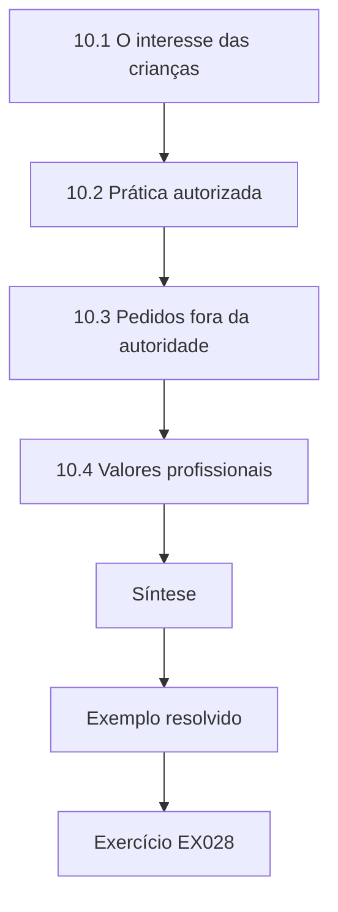

### Desenho lógico

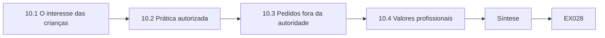

```text
[10.1 O interesse das crianças]
    |
    v
[10.2 Prática autorizada]
    |
    v
[10.3 Pedidos fora da autoridade]
    |
    v
[10.4 Valores profissionais]
    |
    v
[Síntese]
    |
    v
[Exemplo resolvido] --> [Exercício EX028]
```
<!-- cyberabc:lesson-figures:end ch-10 -->


### Objetivos de aprendizagem

Você vai (1) aplicar princípios éticos ao trabalho com dados de crianças; (2) definir os limites da prática autorizada; (3) lidar com pedidos fora da própria autoridade.

### 10.1 O interesse das crianças

Elena estuda a ética do trabalho com dados de crianças. As crianças podem ter menos consciência dos riscos e menos capacidade de exercer seus direitos. O considerando 38 do GDPR diz que as crianças merecem proteção específica, e o art. 14 da LGPD exige que o tratamento de dados de crianças e adolescentes seja realizado em seu melhor interesse. Ela escreve que seu trabalho na rede deve sempre perguntar o que é melhor para as crianças, e não só o que é lícito ou conveniente para os adultos. Essa vira sua regra de trabalho para cada decisão. Ser lícito não basta.

### 10.2 Prática autorizada

Durante o estágio, Elena tem acesso a dados sintéticos e às configurações reais dos sistemas, mas não aos registros reais dos alunos. O Dr. Asante explica que prática autorizada significa fazer apenas o que o termo de estágio permite. Quando uma professora se oferece para lhe mostrar uma planilha real para ajudá-la a entender um problema, ela recusa com educação e pede um exemplo sintético. Ela registra a oferta e sua resposta no diário do estágio. O supervisor aprova a resposta e fornece os dados sintéticos de que ela precisava para continuar o trabalho.

### 10.3 Pedidos fora da autoridade

Uma diretora pede a Elena que verifique, olhando os logs de e-mail, se a reclamação de um pai sobre uma violação de dados procede. Elena explica que investigar uma reclamação exige autorização do responsável pela proteção de dados e um acesso que ela não tem. Ela encaminha o pedido ao responsável e passa à diretora o contato dele, para que a reclamação do pai não fique parada. Aprende que boas intenções não criam autoridade, e que sair de seu papel poderia prejudicar as pessoas que ela quer ajudar e minar a confiança na investigação.

### 10.4 Valores profissionais

Elena reflete sobre valores: respeito pelas crianças e pelas famílias, honestidade sobre os riscos e humildade quanto aos próprios limites. Ela escreve um código pessoal curto para o estágio. O Dr. Asante a incentiva a revisitá-lo todo ano. Ele explica que os códigos profissionais da computação e da proteção de dados compartilham esses valores, e que o hábito de refletir sobre eles prepara os estudantes para decisões difíceis que as regras sozinhas não resolvem. Seu diário reflexivo registra um dilema por semana, com o que ela decidiu e por quê.

### Exemplo resolvido

Elena põe no centro o melhor interesse das crianças, recusa uma planilha real, encaminha a investigação de uma reclamação ao responsável pela proteção de dados e escreve um código pessoal de valores.

> **Caso sintético.** Os acontecimentos do estágio são sintéticos; o considerando 38 do GDPR e o art. 14 da LGPD são reais.

### Erros e limites

Os códigos pessoais podem ser vagos; ligue cada valor a um comportamento concreto.

### Exercícios

- **EX028 — Proteção das crianças.** Que dispositivos enfatizam a proteção especial dos dados de crianças? *Rubrica:* 3 = o considerando 38 do GDPR e o art. 14 da LGPD;; 2 = um;; 1 = vago;; 0 = nenhuma.
- **EX029 — Recusar dados reais.** Por que Elena recusa a planilha real? *Rubrica:* 3 = seu estágio só autoriza dados sintéticos;; 2 = menciona autoridade;; 1 = aceita;; 0 = nenhuma.
- **EX030 — Encaminhar a reclamação.** Por que encaminhar a investigação da reclamação ao responsável pela proteção de dados? *Rubrica:* 3 = exige autoridade e acesso que ela não tem;; 2 = menciona o papel;; 1 = investiga;; 0 = nenhuma.

### Síntese

O capítulo 10 define limites éticos. O capítulo 11 estuda sistemas operacionais.

<!-- cyberabc:chapter-navigation:start ch-10 -->
### Continue estudando — aula 10 (capítulo 10 de 40)

[← Capítulo 09](#ch-09) · [Índice das aulas](../SUBJECTS.md) · [Capítulo 11 →](#ch-11)

Continue para a próxima aula já escrita.
<!-- cyberabc:chapter-navigation:end -->

<a id="ch-11"></a>

## Capítulo 11 — Sistemas operacionais

<!-- cyberabc:lesson-figures:start ch-11 -->
### Mapa da aula

Aula 11 publicada. Mapa, exemplo, EX031.

```mermaid
flowchart TD
  N0["11.1 Contas em dispositivos compartilhados"]
  N1["11.2 Permissões e pastas compartilhadas"]
  N2["11.3 Logs"]
  N3["11.4 Descarte"]
  N4["Síntese"]
  N0 --> N1 --> N2 --> N3 --> N4
  N4 --> EX["Exemplo resolvido"]
  EX --> Q["Exercício EX031"]
```

### Desenho lógico

```mermaid
flowchart LR
  N0["11.1 Contas em dispositivos compartilhados"]
  N1["11.2 Permissões e pastas compartilhadas"]
  N2["11.3 Logs"]
  N3["11.4 Descarte"]
  N4["Síntese"]
  N0 --> N1 --> N2 --> N3 --> N4 --> Q["EX031"]
```

```text
[11.1 Contas em dispositivos compartilhados]
    |
    v
[11.2 Permissões e pastas compartilhadas]
    |
    v
[11.3 Logs]
    |
    v
[11.4 Descarte]
    |
    v
[Síntese]
    |
    v
[Exemplo resolvido] --> [Exercício EX031]
```
<!-- cyberabc:lesson-figures:end ch-11 -->


### Objetivos de aprendizagem

Você vai (1) configurar contas e permissões nos dispositivos escolares; (2) gerir logs e arquivos temporários; (3) planejar o descarte seguro de dispositivos.

### 11.1 Contas em dispositivos compartilhados

Elena estuda como os sistemas operacionais gerenciam contas. Nos computadores compartilhados das salas de aula, os alunos entram com contas individuais, para que os trabalhos e a navegação fiquem separados. Ela descobre que uma escola usa uma única conta compartilhada para todos os alunos, o que deixa arquivos e históricos de navegação visíveis para todos. Recomenda contas individuais com limpeza automática dos arquivos temporários ao sair. Explica ao técnico da escola que as configurações do sistema operacional são a primeira linha de privacidade nos dispositivos compartilhados, antes que qualquer aplicativo seja aberto.

### 11.2 Permissões e pastas compartilhadas

Os professores salvam documentos em pastas de rede. Elena confere as permissões e encontra uma pasta de anotações de proteção das crianças que todos os funcionários conseguem ler. Ela trabalha com o técnico para restringi-la aos responsáveis pela proteção. Também ativa a auditoria da pasta, para que os acessos possam ser revisados. O episódio mostra que informações sensíveis muitas vezes ficam em pastas comuns, e não em sistemas protegidos, e que as permissões se desviam ao longo dos anos à medida que os funcionários mudam de função sem que ninguém revise quem ainda abre quais pastas. As revisões corrigem isso.

### 11.3 Logs

Os sistemas operacionais registram os logins e os acessos a arquivos. Elena explica que os logs ajudam a investigar incidentes, mas também contêm dados pessoais de funcionários e alunos. Ela recomenda guardar os logs pelo tempo necessário às investigações, como seis meses, restringir o acesso à equipe de segurança de TI e informar os funcionários, na política de uso aceitável, de que a atividade é registrada. A transparência, observa, é exigida pelos artigos 13 e 14 do GDPR tanto para os funcionários quanto para os alunos, e os funcionários têm o direito de saber o que é registrado sobre eles. Eles podem pedir acesso a esses registros.

### 11.4 Descarte

Notebooks e tablets antigos são vendidos ou reciclados. Elena descobre que os dispositivos são apagados com a exclusão das contas de usuário, o que pode deixar dados recuperáveis. Ela recomenda usar as funções nativas de apagamento seguro ou a criptografia de disco completo com destruição da chave, e manter um registro de descarte para cada dispositivo. Aprende que o descarte faz parte do ciclo de vida dos dados e que muitas violações no setor envolveram dispositivos vendidos sem o apagamento adequado, uma forma evitável e constrangedora de perder dados de crianças. Os certificados comprovam o apagamento.

### Exemplo resolvido

Elena substitui uma conta compartilhada de alunos por contas individuais, restringe e audita uma pasta de proteção das crianças, define a retenção dos logs com transparência para os funcionários e introduz o apagamento seguro e os registros de descarte.

> **Caso sintético.** Os dispositivos e as pastas são sintéticos; os artigos 13 e 14 do GDPR são reais.

### Erros e limites

Os métodos de apagamento seguro variam de dispositivo para dispositivo; verifique se o método funciona em cada modelo.

### Exercícios

- **EX031 — Risco da conta compartilhada.** O que há de errado com uma única conta compartilhada de alunos? *Rubrica:* 3 = arquivos e históricos ficam visíveis para todos os alunos;; 2 = menciona compartilhamento;; 1 = está tudo bem;; 0 = nenhuma.
- **EX032 — Pasta de proteção.** Como a pasta de proteção das crianças foi corrigida? *Rubrica:* 3 = acesso restrito aos responsáveis pela proteção, com auditoria;; 2 = uma parte;; 1 = vago;; 0 = nenhuma.
- **EX033 — Descarte de dispositivos.** Por que excluir as contas de usuário não basta antes de vender um notebook? *Rubrica:* 3 = os dados podem continuar recuperáveis no disco;; 2 = menciona recuperação;; 1 = basta;; 0 = nenhuma.

### Síntese

O capítulo 11 protege os sistemas. O capítulo 12 usa probabilidade e estatística.

<!-- cyberabc:chapter-navigation:start ch-11 -->
### Continue estudando — aula 11 (capítulo 11 de 40)

[← Capítulo 10](#ch-10) · [Índice das aulas](../SUBJECTS.md) · [Capítulo 12 →](#ch-12)

Continue para a próxima aula já escrita.
<!-- cyberabc:chapter-navigation:end -->

<a id="ch-12"></a>

## Capítulo 12 — Probabilidade e estatística

<!-- cyberabc:lesson-figures:start ch-12 -->
### Mapa da aula

Aula 12 publicada. Mapa, exemplo, EX034.

```mermaid
flowchart TD
  N0["12.1 A pesquisa com as famílias"]
  N1["12.2 Comparação entre escolas"]
  N2["12.3 Viés de resposta"]
  N3["12.4 Proteção dos respondentes"]
  N4["Laboratório — Consciência das famílias com intervalo"]
  N5["Síntese"]
  N0 --> N1 --> N2 --> N3 --> N4 --> N5
  N5 --> EX["Exemplo resolvido"]
  EX --> Q["Exercício EX034"]
```

### Desenho lógico

```mermaid
flowchart LR
  N0["12.1 A pesquisa com as famílias"]
  N1["12.2 Comparação entre escolas"]
  N2["12.3 Viés de resposta"]
  N3["12.4 Proteção dos respondentes"]
  N4["Laboratório — Consciência das famílias com intervalo"]
  N5["Síntese"]
  N0 --> N1 --> N2 --> N3 --> N4 --> N5 --> Q["EX034"]
```

```text
[12.1 A pesquisa com as famílias]
    |
    v
[12.2 Comparação entre escolas]
    |
    v
[12.3 Viés de resposta]
    |
    v
[12.4 Proteção dos respondentes]
    |
    v
[Laboratório — Consciência das famílias com intervalo]
    |
    v
[Síntese]
    |
    v
[Exemplo resolvido] --> [Exercício EX034]
```
<!-- cyberabc:lesson-figures:end ch-12 -->


### Objetivos de aprendizagem

Você vai (1) estimar uma proporção a partir de uma pesquisa, com sua incerteza; (2) comparar grupos com cuidado; (3) relatar resultados de pesquisa sem identificar os respondentes.

### 12.1 A pesquisa com as famílias

A rede faz uma pesquisa com as famílias sobre a consciência de privacidade. Uma pergunta indaga se os pais sabem quais aplicativos recebem os dados de seu filho. Elena analisa os resultados sintéticos. Nas doze escolas, 131 de 520 respondentes dizem que sim, 25%. Ela calcula um intervalo de Wilson de 95%, que se comporta bem com proporções próximas de zero ou de um e com amostras pequenas, e obtém de 22% a 29%. Ela relata o intervalo porque um único percentual esconde o quanto a estimativa é incerta, sobretudo para cada escola isolada. O intervalo de Wilson funciona bem com proporções perto de zero ou amostras pequenas.

### 12.2 Comparação entre escolas

Elena compara duas escolas. Na Ashby Primary, 9 de 40 pais dizem que sim, 22%, com intervalo de 12% a 38%. Na Kelso Primary, 22 de 48 dizem que sim, 46%, com intervalo de 33% a 60%. Os intervalos quase não se sobrepõem, o que sugere uma diferença real. Ela investiga e descobre que a Kelso envia às famílias uma carta anual listando os aplicativos. Ela adverte que a pesquisa não consegue provar que a carta causou a diferença, mas o padrão justifica testar a carta em outras escolas. Outras diferenças entre as escolas também poderiam explicar a distância. Só um experimento mostraria a causalidade.

### 12.3 Viés de resposta

Nem todos os pais respondem. Elena observa que os pais interessados em privacidade podem ter mais propensão a responder, o que faria a consciência parecer maior do que é. Ela relata a taxa de resposta de cada escola e recomenda cautela na interpretação das escolas com poucas respostas. Explica que as estatísticas sobre pessoas dependem de quem é contado, e que um analista cuidadoso sempre pergunta quem está faltando nos dados antes de tirar conclusões sobre todos. Os pais que respondem às pesquisas podem ser diferentes dos que não respondem, e isso precisa constar do relatório.

### 12.4 Proteção dos respondentes

A pesquisa inclui um campo de comentário livre. Alguns comentários mencionam nomes e condições de crianças. Elena remove os detalhes identificadores antes de compartilhar os comentários com a direção da rede e só relata números por escola quando pelo menos vinte pais responderam. Ela explica que uma pesquisa sobre privacidade precisa, ela própria, proteger a privacidade, e que os grupos pequenos e o texto livre são as formas mais comuns de os relatórios de pesquisa identificarem pessoas por acidente. Ela suprime resultados de grupos com menos de dez pessoas e retira respostas livres que citam nomes ou turmas de crianças.

### Laboratório — Consciência das famílias com intervalos de Wilson

```python
# Wilson 95% intervals for a synthetic parent survey: "I know which apps receive my child's data".
import math
def wilson(k, n, z=1.96):
    p = k / n; d = 1 + z * z / n
    c = (p + z * z / (2 * n)) / d; h = z * math.sqrt(p * (1 - p) / n + z * z / (4 * n * n)) / d
    return c - h, c + h
for school, k, n in [("Ashby Primary", 9, 40), ("Kelso Primary", 22, 48), ("all 12 schools", 131, 520)]:
    lo, hi = wilson(k, n); print(f"{school:15s} {k}/{n} = {k/n:.0%}  95% CI {lo:.0%}-{hi:.0%}")
```

Execute com `python3 lab_wilson.py`. Saída verificada:

```text
Ashby Primary   9/40 = 22%  95% CI 12%-38%
Kelso Primary   22/48 = 46%  95% CI 33%-60%
all 12 schools  131/520 = 25%  95% CI 22%-29%
```

### Exemplo resolvido

Elena estima a consciência em toda a rede em 25% (intervalo de 95% de 22% a 29%), encontra 22% na Ashby contra 46% na Kelso, com intervalos que quase não se sobrepõem, aponta o viés de resposta e remove os detalhes identificadores dos comentários.

> **Caso sintético.** Os dados da pesquisa são sintéticos.

### Erros e limites

Intervalos que quase não se sobrepõem são sugestivos, não um teste formal; um teste de diferença seria mais preciso.

### Exercícios

- **EX034 — Intervalo da rede.** Qual é o intervalo de 95% para a consciência em toda a rede? *Rubrica:* 3 = de 22% a 29%;; 2 = aproximadamente certo;; 1 = errado;; 0 = nenhuma.
- **EX035 — Diferença da Kelso.** O que pode explicar a consciência maior na Kelso? *Rubrica:* 3 = uma carta anual listando os aplicativos, embora a causalidade não esteja provada;; 2 = menciona a carta;; 1 = vago;; 0 = nenhuma.
- **EX036 — Proteção dos respondentes.** Como Elena protege os respondentes da pesquisa? *Rubrica:* 3 = remove identificadores do texto livre e só relata escolas com pelo menos vinte respostas;; 2 = uma parte;; 1 = vago;; 0 = nenhuma.

### Síntese

O capítulo 12 mede a conscientização. O capítulo 13 trata de identidade e acesso.

<!-- cyberabc:chapter-navigation:start ch-12 -->
### Continue estudando — aula 12 (capítulo 12 de 40)

[← Capítulo 11](#ch-11) · [Índice das aulas](../SUBJECTS.md) · [Capítulo 13 →](#ch-13)

Continue para a próxima aula já escrita.
<!-- cyberabc:chapter-navigation:end -->

<a id="ch-13"></a>

## Capítulo 13 — Identidade e acesso

<!-- cyberabc:lesson-figures:start ch-13 -->
### Mapa da aula

Aula 13 publicada. Mapa, exemplo, EX037.

```mermaid
flowchart TD
  N0["13.1 Funções"]
  N1["13.2 Entradas, mudanças e saídas"]
  N2["13.3 Revisões de acesso"]
  N3["13.4 Autenticação"]
  N4["Síntese"]
  N0 --> N1 --> N2 --> N3 --> N4
  N4 --> EX["Exemplo resolvido"]
  EX --> Q["Exercício EX037"]
```

### Desenho lógico

```mermaid
flowchart LR
  N0["13.1 Funções"]
  N1["13.2 Entradas, mudanças e saídas"]
  N2["13.3 Revisões de acesso"]
  N3["13.4 Autenticação"]
  N4["Síntese"]
  N0 --> N1 --> N2 --> N3 --> N4 --> Q["EX037"]
```

```text
[13.1 Funções]
    |
    v
[13.2 Entradas, mudanças e saídas]
    |
    v
[13.3 Revisões de acesso]
    |
    v
[13.4 Autenticação]
    |
    v
[Síntese]
    |
    v
[Exemplo resolvido] --> [Exercício EX037]
```
<!-- cyberabc:lesson-figures:end ch-13 -->


### Objetivos de aprendizagem

Você vai (1) projetar o acesso baseado em funções nos sistemas escolares; (2) gerir entradas, mudanças e saídas de pessoas; (3) revisar os acessos com regularidade.

### 13.1 Funções

Elena projeta funções para o sistema de gestão escolar da rede: professor de turma, coordenador de ano, coordenadora de necessidades especiais, auxiliar administrativo, responsável pela proteção das crianças e diretor. Cada função tem um acesso definido. Ela documenta a finalidade de cada permissão. Por exemplo, os auxiliares administrativos precisam dos dados de contato para enviar cartas, mas não dos resultados das avaliações. O desenho das funções transforma o princípio do privilégio mínimo em algo que funcionários e auditores conseguem entender e conferir. A função administrativa, por exemplo, pode atualizar contatos, mas não vê os níveis de leitura.

### 13.2 Entradas, mudanças e saídas

Os funcionários mudam de função com frequência. Elena descobre que uma antiga coordenadora de necessidades especiais, agora professora de turma, ainda tem acesso a todos os planos de apoio. Outro professor, que deixou a rede seis meses antes, ainda tem uma conta ativa. Ela propõe um processo ligado ao sistema de recursos humanos: quando alguém entra, muda de função ou sai, seu acesso muda automaticamente, com um gestor confirmando a nova função. Ela observa que o acesso remanescente é uma das falhas de controle de acesso mais comuns em organizações de todos os tamanhos.

### 13.3 Revisões de acesso

Elena institui revisões de acesso a cada período letivo. Cada diretor recebe uma lista dos funcionários e de suas funções e a confirma ou corrige. Na primeira revisão, onze das 340 contas precisam de mudanças. Ela registra os resultados e repete a revisão no período seguinte, quando só três mudanças são necessárias. As revisões regulares, explica, pegam erros que os processos automáticos deixam passar e fornecem evidências de responsabilização pelo artigo 5(2) do GDPR. Cada diretor confirma a lista de sua escola a cada período. As correções são registradas com datas e motivos.

### 13.4 Autenticação

Elena recomenda autenticação multifator para os funcionários que acessam registros de alunos de fora da escola. Também recomenda que os alunos usem logins simples, mas individuais, adequados à idade. Os alunos muito pequenos podem usar senhas com figuras nos dispositivos da sala, enquanto os mais velhos usam senhas. Ela explica que a autenticação precisa servir às pessoas que a usam, e que uma segurança que as crianças pequenas não conseguem manejar será contornada por professores bem-intencionados que compartilham os próprios logins. Os alunos menores usam senhas com figuras nos tablets compartilhados, e os professores não precisam mais compartilhar seus logins.

### Exemplo resolvido

Elena define seis funções com finalidades documentadas, liga as mudanças de acesso ao RH, faz revisões a cada período (de onze mudanças para três) e adapta a autenticação aos funcionários e à idade dos alunos.

> **Caso sintético.** As contas e as funções são sintéticas; o artigo 5(2) do GDPR é real.

### Erros e limites

A integração com o RH falha se os registros do RH atrasarem; as revisões continuam necessárias.

### Exercícios

- **EX037 — Casos de acesso remanescente.** Cite os dois casos de acesso remanescente que Elena encontrou. *Rubrica:* 3 = a antiga coordenadora de necessidades especiais com os planos de apoio; o professor que saiu com conta ativa;; 2 = um;; 1 = vago;; 0 = nenhuma.
- **EX038 — Resultado das revisões.** Quantas contas precisaram de mudanças na primeira e na segunda revisão? *Rubrica:* 3 = onze, depois três;; 2 = um número;; 1 = errado;; 0 = nenhuma.
- **EX039 — Login adequado à idade.** Por que usar senhas com figuras para os alunos muito pequenos? *Rubrica:* 3 = uma segurança que eles não conseguem manejar será contornada;; 2 = menciona usabilidade;; 1 = vago;; 0 = nenhuma.

### Síntese

O capítulo 13 gerencia o acesso. O capítulo 14 estabelece as bases da privacidade.

<!-- cyberabc:chapter-navigation:start ch-13 -->
### Continue estudando — aula 13 (capítulo 13 de 40)

[← Capítulo 12](#ch-12) · [Índice das aulas](../SUBJECTS.md) · [Capítulo 14 →](#ch-14)

Continue para a próxima aula já escrita.
<!-- cyberabc:chapter-navigation:end -->

<a id="ch-14"></a>

## Capítulo 14 — Fundamentos da privacidade

<!-- cyberabc:lesson-figures:start ch-14 -->
### Mapa da aula

Aula 14 publicada. Mapa, exemplo, EX040.

```mermaid
flowchart TD
  N0["14.1 Teorias"]
  N1["14.2 Princípios"]
  N2["14.3 Bases legais"]
  N3["14.4 Categorias especiais"]
  N4["Síntese"]
  N0 --> N1 --> N2 --> N3 --> N4
  N4 --> EX["Exemplo resolvido"]
  EX --> Q["Exercício EX040"]
```

### Desenho lógico

```mermaid
flowchart LR
  N0["14.1 Teorias"]
  N1["14.2 Princípios"]
  N2["14.3 Bases legais"]
  N3["14.4 Categorias especiais"]
  N4["Síntese"]
  N0 --> N1 --> N2 --> N3 --> N4 --> Q["EX040"]
```

```text
[14.1 Teorias]
    |
    v
[14.2 Princípios]
    |
    v
[14.3 Bases legais]
    |
    v
[14.4 Categorias especiais]
    |
    v
[Síntese]
    |
    v
[Exemplo resolvido] --> [Exercício EX040]
```
<!-- cyberabc:lesson-figures:end ch-14 -->


### Objetivos de aprendizagem

Você vai (1) explicar teorias da privacidade; (2) aplicar os princípios de proteção de dados; (3) identificar as bases legais do tratamento escolar.

### 14.1 Teorias

Elena estuda a teoria da privacidade. Warren e Brandeis (1890) defenderam o direito de ser deixado em paz. Solove (2006) descreve a privacidade como uma família de problemas, como a vigilância, a agregação e a divulgação. A integridade contextual de Nissenbaum sustenta que os fluxos de informação devem respeitar as normas do contexto em que surgem. Elena aplica a integridade contextual às escolas: a informação que os pais compartilham com uma professora sobre uma situação familiar não deve fluir para outros pais nem para fornecedores de aplicativos, mesmo que isso seja tecnicamente possível. As normas acompanham a informação.

### 14.2 Princípios

Ela estuda os princípios do artigo 5 do GDPR e encontra equivalentes no art. 6º da LGPD, que lista princípios como finalidade, adequação, necessidade, transparência, segurança e prevenção. Ela relaciona cada princípio a um exemplo escolar: a limitação da finalidade significa que os dados de frequência coletados para a proteção das crianças não devem ser usados para ranquear professores; a minimização significa que um aplicativo de merenda não precisa dos níveis de leitura. Os exemplos tornam concretos, para o treinamento da equipe, princípios que pareciam abstratos. Cada exemplo vem da prática da rede.

### 14.3 Bases legais

Elena aprende que o tratamento precisa de uma base legal pelo artigo 6 do GDPR; na LGPD, as hipóteses estão no art. 7º. As escolas costumam se apoiar na obrigação legal para os registros exigidos pela legislação educacional, na missão de interesse público para o ensino e no consentimento para atividades opcionais, como fotografias em boletins. Ela explica que o consentimento nem sempre é a base certa: se a escola precisa dos dados para ensinar, pedir consentimento sugere que os pais poderiam recusar sem consequências, o que pode não ser verdade. Escolher a base correta torna o tratamento mais honesto. A missão de interesse público cobre a maior parte dos dados dos alunos.

### 14.4 Categorias especiais

Dados de saúde, convicções religiosas e origem étnica são categorias especiais pelo artigo 9; a LGPD os chama de dados sensíveis e trata deles no art. 11. As escolas os tratam para cuidados médicos, necessidades alimentares e monitoramento da igualdade. Cada tratamento precisa de uma condição do artigo 9, além de uma base do artigo 6. Elena monta uma tabela do tratamento de categorias especiais da rede com as duas bases. Descobre que os dados de monitoramento da igualdade são guardados com os nomes, quando uma análise agregada bastaria, e recomenda separá-los. A separação reduz a exposição sem reduzir a utilidade dos relatórios. O responsável concorda.

### Exemplo resolvido

Elena aplica a integridade contextual às informações familiares, relaciona os princípios do GDPR e da LGPD a exemplos escolares, explica por que o consentimento nem sempre é a base certa e descobre dados de igualdade guardados com os nomes.

> **Caso sintético.** O tratamento da rede é sintético; Warren e Brandeis (1890), Solove (2006), Nissenbaum (2004), os artigos 5, 6 e 9 do GDPR e os arts. 6º, 7º e 11 da LGPD são reais.

### Erros e limites

A escolha da base legal depende da legislação educacional de cada país; confira localmente.

### Exercícios

- **EX040 — Fluxo contextual.** Como a integridade contextual se aplica às informações familiares compartilhadas com uma professora? *Rubrica:* 3 = não devem fluir para outros pais nem para fornecedores;; 2 = menciona normas;; 1 = podem circular livremente;; 0 = nenhuma.
- **EX041 — Uso indevido do consentimento.** Por que o consentimento é a base errada para dados necessários ao ensino? *Rubrica:* 3 = os pais não podem de fato recusar sem consequências;; 2 = menciona escolha;; 1 = sempre consentimento;; 0 = nenhuma.
- **EX042 — Dados de igualdade.** O que Elena descobriu sobre os dados de monitoramento da igualdade? *Rubrica:* 3 = eram guardados com os nomes quando uma análise agregada bastaria;; 2 = menciona nomes;; 1 = vago;; 0 = nenhuma.

### Síntese

O capítulo 14 estabelece as bases. O capítulo 15 mede as evidências.

<!-- cyberabc:chapter-navigation:start ch-14 -->
### Continue estudando — aula 14 (capítulo 14 de 40)

[← Capítulo 13](#ch-13) · [Índice das aulas](../SUBJECTS.md) · [Capítulo 15 →](#ch-15)

Continue para a próxima aula já escrita.
<!-- cyberabc:chapter-navigation:end -->

<a id="ch-15"></a>

## Capítulo 15 — Evidências e medição

<!-- cyberabc:lesson-figures:start ch-15 -->
### Mapa da aula

Aula 15 publicada. Mapa, exemplo, EX043.

```mermaid
flowchart TD
  N0["15.1 Pedidos de acesso das famílias"]
  N1["15.2 Causas"]
  N2["15.3 Metas e processo"]
  N3["15.4 Monitoramento"]
  N4["Laboratório — Tempos de resposta aos pedidos de aces"]
  N5["Síntese"]
  N0 --> N1 --> N2 --> N3 --> N4 --> N5
  N5 --> EX["Exemplo resolvido"]
  EX --> Q["Exercício EX043"]
```

### Desenho lógico

```mermaid
flowchart LR
  N0["15.1 Pedidos de acesso das famílias"]
  N1["15.2 Causas"]
  N2["15.3 Metas e processo"]
  N3["15.4 Monitoramento"]
  N4["Laboratório — Tempos de resposta aos pedidos de aces"]
  N5["Síntese"]
  N0 --> N1 --> N2 --> N3 --> N4 --> N5 --> Q["EX043"]
```

```text
[15.1 Pedidos de acesso das famílias]
    |
    v
[15.2 Causas]
    |
    v
[15.3 Metas e processo]
    |
    v
[15.4 Monitoramento]
    |
    v
[Laboratório — Tempos de resposta aos pedidos de aces]
    |
    v
[Síntese]
    |
    v
[Exemplo resolvido] --> [Exercício EX043]
```
<!-- cyberabc:lesson-figures:end ch-15 -->


### Objetivos de aprendizagem

Você vai (1) medir o desempenho no atendimento aos pedidos de direitos; (2) identificar as causas dos atrasos; (3) definir metas e monitoramento.

### 15.1 Pedidos de acesso das famílias

Os pais podem pedir acesso aos dados do filho, e as próprias crianças podem fazer pedidos quando tiverem maturidade suficiente. Elena reúne dados sintéticos de vinte pedidos do último ano. O tempo mediano de resposta é de 26 dias e a média, de 26,8. Seis dos vinte, 30%, levaram mais de trinta dias, o limite aproximado de um mês do artigo 12(3) do GDPR; no Brasil, o art. 19, II, da LGPD fixa quinze dias para a declaração completa. O mais longo levou 61 dias. Os números dão à rede seu primeiro retrato factual de como trata os pedidos. A maioria foi respondida no prazo, mas os atrasos se concentraram perto das férias.

### 15.2 Causas

Elena examina os pedidos atrasados. Todos os quatro pedidos recebidos logo antes das férias escolares atrasaram, porque a equipe estava ausente. Ela também descobre que os pedidos iam para cada escola, e não para um ponto central, então o tratamento variava. Explica que o prazo do GDPR continua correndo nas férias, embora o artigo 12(3) permita prorrogá-lo por dois meses em caso de pedidos complexos ou numerosos, desde que o solicitante seja informado no primeiro mês. As férias, sozinhas, não justificam a prorrogação. A maioria dos atrasos veio das férias escolares, e o planejamento resolve isso.

### 15.3 Metas e processo

Elena propõe uma caixa central de pedidos gerida pelo responsável pela proteção de dados, uma escala de cobertura nas férias e a meta de responder a todos os pedidos em até vinte e cinco dias, para deixar margem. Também propõe um modelo de carta para as prorrogações realmente necessárias. As Diretrizes 01/2022 do EDPB sobre o direito de acesso a ajudam a desenhar a verificação de identidade e o conteúdo das respostas. Ela apresenta o plano à direção da rede com a linha de base medida. O plano fixa uma meta interna de vinte dias. Cada pedido é registrado centralmente desde o primeiro dia.

### 15.4 Monitoramento

Elena monta um relatório mensal simples: pedidos recebidos, pedidos em aberto, tempo mediano e pedidos atrasados. Explica que medir com regularidade transforma uma revisão pontual em um ciclo de retorno. O Dr. Asante observa que números pequenos deixam os percentuais instáveis, então ela relata as contagens junto com os percentuais. Seis meses depois, com o novo processo em funcionamento, nenhum pedido atrasa. Ela relata a melhoria com a ressalva de que a amostra é pequena. Com tão poucos pedidos, um único atraso muda bastante o percentual. Por isso as contagens também aparecem no relatório.

### Laboratório — Tempos de resposta aos pedidos de acesso das famílias

```python
# Subject access requests from parents over one year: days to respond, one-month (30-day) target.
import statistics
days = [12, 25, 31, 8, 44, 19, 27, 30, 52, 15, 22, 35, 9, 28, 61, 17, 24, 29, 33, 14]
print(f"requests {len(days)}; median {statistics.median(days)} days; mean {statistics.mean(days):.1f}")
late = [d for d in days if d > 30]
print(f"late (>30 days): {len(late)} of {len(days)} ({len(late)/len(days):.0%}); longest {max(days)} days")
print("holiday-period requests late:", sum(1 for d in [44, 52, 61, 35] if d > 30), "of 4")
```

Execute com `python3 lab_sar.py`. Saída verificada:

```text
requests 20; median 26.0 days; mean 26.8
late (>30 days): 6 of 20 (30%); longest 61 days
holiday-period requests late: 4 of 4
```

### Exemplo resolvido

Elena mede uma mediana de 26 dias, com 6 de 20 pedidos atrasados (todos os quatro do período de férias), centraliza o atendimento com cobertura nas férias e passa a monitorar mensalmente.

> **Caso sintético.** Os pedidos são sintéticos; o artigo 12(3) do GDPR, o art. 19 da LGPD e as Diretrizes 01/2022 do EDPB são reais.

### Erros e limites

Vinte pedidos são poucos; um único atraso muda muito o percentual.

### Exercícios

- **EX043 — Parcela atrasada.** Que parcela dos pedidos atrasou? *Rubrica:* 3 = 6 de 20, 30%;; 2 = cerca de um terço;; 1 = errado;; 0 = nenhuma.
- **EX044 — Prorrogação nas férias.** As férias escolares justificam prorrogar o prazo? *Rubrica:* 3 = não; a prorrogação é para complexidade ou volume, com aviso;; 2 = não;; 1 = sim;; 0 = nenhuma.
- **EX045 — Contagens com percentuais.** Por que relatar contagens junto com os percentuais? *Rubrica:* 3 = números pequenos deixam os percentuais instáveis;; 2 = menciona tamanho;; 1 = desnecessário;; 0 = nenhuma.

### Síntese

O capítulo 15 mede o atendimento aos direitos. O capítulo 16 estuda arquitetura de segurança.

<!-- cyberabc:chapter-navigation:start ch-15 -->
### Continue estudando — aula 15 (capítulo 15 de 40)

[← Capítulo 14](#ch-14) · [Índice das aulas](../SUBJECTS.md) · [Capítulo 16 →](#ch-16)

Continue para a próxima aula já escrita.
<!-- cyberabc:chapter-navigation:end -->

<a id="ch-16"></a>

## Capítulo 16 — Arquitetura de segurança

<!-- cyberabc:lesson-figures:start ch-16 -->
### Mapa da aula

Aula 16 publicada. Mapa, exemplo, EX046.

```mermaid
flowchart TD
  N0["16.1 A arquitetura da rede"]
  N1["16.2 Separação"]
  N2["16.3 Backup e recuperação"]
  N3["16.4 Arquitetura dos fornecedores"]
  N4["Síntese"]
  N0 --> N1 --> N2 --> N3 --> N4
  N4 --> EX["Exemplo resolvido"]
  EX --> Q["Exercício EX046"]
```

### Desenho lógico

```mermaid
flowchart LR
  N0["16.1 A arquitetura da rede"]
  N1["16.2 Separação"]
  N2["16.3 Backup e recuperação"]
  N3["16.4 Arquitetura dos fornecedores"]
  N4["Síntese"]
  N0 --> N1 --> N2 --> N3 --> N4 --> Q["EX046"]
```

```text
[16.1 A arquitetura da rede]
    |
    v
[16.2 Separação]
    |
    v
[16.3 Backup e recuperação]
    |
    v
[16.4 Arquitetura dos fornecedores]
    |
    v
[Síntese]
    |
    v
[Exemplo resolvido] --> [Exercício EX046]
```
<!-- cyberabc:lesson-figures:end ch-16 -->


### Objetivos de aprendizagem

Você vai (1) projetar uma arquitetura segura para uma rede de várias escolas; (2) separar os dados sensíveis; (3) planejar backup e recuperação.

### 16.1 A arquitetura da rede

Elena projeta uma arquitetura para a rede. Um sistema central de gestão escolar atende às doze escolas. Os funcionários de cada escola veem apenas os próprios alunos. Os registros de proteção das crianças ficam em um sistema separado e mais restrito. Os aplicativos de sala de aula se conectam por login único (single sign-on), o que permite à rede controlar o acesso de forma central e removê-lo rapidamente. Ela desenha o projeto com zonas e explica por que os registros sensíveis ficam separados dos sistemas do dia a dia usados por muitos funcionários. Os registros de proteção ficam em uma zona própria, com acesso separado. As zonas são documentadas.

### 16.2 Separação

A separação limita o dano. Se a conta de um professor for comprometida, o atacante alcança os registros de aprendizagem, mas não as anotações de proteção das crianças. Elena também separa os dados dos alunos dos dados dos funcionários, já que funções diferentes precisam de cada um. Ela explica que o GDPR exige, no artigo 32, segurança adequada ao risco, e que a LGPD traz dever semelhante no art. 46; a separação é uma medida de bom custo-benefício para uma rede com pouca equipe de segurança, porque reduz o quanto qualquer falha isolada consegue expor. Um notebook de sala comprometido não alcança diretamente os registros de proteção.

### 16.3 Backup e recuperação

Escolas já sofreram ataques de ransomware. Elena projeta backups cifrados, guardados separadamente e testados. Ela define objetivos de recuperação: o sistema de gestão restabelecido em até um dia e os registros de proteção das crianças em até quatro horas, já que os responsáveis pela proteção podem precisar deles com urgência. Planeja um teste de restauração a cada período letivo. Observa que os backups também guardam dados pessoais e precisam seguir as regras de retenção, então os backups antigos expiram. No primeiro teste, os registros de frequência de um período são recuperados em menos de uma hora, e a cópia restaurada é apagada em seguida, para que não sobre duplicata.

### 16.4 Arquitetura dos fornecedores

Muitas funções são fornecidas por terceiros. Elena inclui os fornecedores no diagrama de arquitetura, com seus fluxos de dados e contratos. Ela observa que o login único permite à rede desativar rapidamente o acesso a todos os aplicativos quando um aluno sai. Também estabelece a regra de que novos aplicativos precisam se conectar pelo login único e passar pela triagem. A arquitetura, explica, inclui regras sobre como novos componentes entram, e não só os componentes atuais. Cada aplicativo só entra depois da triagem e aparece no diagrama de arquitetura, com seu responsável e seu contrato.

### Exemplo resolvido

Elena projeta um sistema central com acesso por escola, um sistema separado para a proteção das crianças, login único para os aplicativos, backups cifrados e testados e uma regra de entrada para novos aplicativos.

> **Caso sintético.** A arquitetura é sintética; o artigo 32 do GDPR e o art. 46 da LGPD são reais.

### Erros e limites

Sistemas centrais concentram o risco; proteja-os e monitore-os de perto.

### Exercícios

- **EX046 — Separação da proteção.** Por que manter os registros de proteção das crianças em um sistema separado? *Rubrica:* 3 = uma conta de professor comprometida não os alcança;; 2 = menciona sensibilidade;; 1 = mesmo sistema;; 0 = nenhuma.
- **EX047 — Benefício do login único.** O que o login único dá à rede? *Rubrica:* 3 = controle central e remoção rápida do acesso a todos os aplicativos;; 2 = menciona controle;; 1 = vago;; 0 = nenhuma.
- **EX048 — Retenção dos backups.** Por que os backups precisam seguir as regras de retenção? *Rubrica:* 3 = os backups também guardam dados pessoais;; 2 = menciona dados;; 1 = estão isentos;; 0 = nenhuma.

### Síntese

O capítulo 16 projeta a arquitetura. O capítulo 17 trata dos conceitos de criptografia.

<!-- cyberabc:chapter-navigation:start ch-16 -->
### Continue estudando — aula 16 (capítulo 16 de 40)

[← Capítulo 15](#ch-15) · [Índice das aulas](../SUBJECTS.md) · [Capítulo 17 →](#ch-17)

Continue para a próxima aula já escrita.
<!-- cyberabc:chapter-navigation:end -->

<a id="ch-17"></a>

## Capítulo 17 — Conceitos de criptografia

<!-- cyberabc:lesson-figures:start ch-17 -->
### Mapa da aula

Aula 17 publicada. Mapa, exemplo, EX049.

```mermaid
flowchart TD
  N0["17.1 Criptografia"]
  N1["17.2 Hash e pseudônimos"]
  N2["17.3 Chaves"]
  N3["Síntese"]
  N0 --> N1 --> N2 --> N3
  N3 --> EX["Exemplo resolvido"]
  EX --> Q["Exercício EX049"]
```

### Desenho lógico

```mermaid
flowchart LR
  N0["17.1 Criptografia"]
  N1["17.2 Hash e pseudônimos"]
  N2["17.3 Chaves"]
  N3["Síntese"]
  N0 --> N1 --> N2 --> N3 --> Q["EX049"]
```

```text
[17.1 Criptografia]
    |
    v
[17.2 Hash e pseudônimos]
    |
    v
[17.3 Chaves]
    |
    v
[Síntese]
    |
    v
[Exemplo resolvido] --> [Exercício EX049]
```
<!-- cyberabc:lesson-figures:end ch-17 -->


### Objetivos de aprendizagem

Você vai (1) explicar a criptografia em repouso e em trânsito; (2) entender o hash e a pseudonimização; (3) gerir as chaves de forma adequada.

### 17.1 Criptografia

Elena aprende a diferença entre a criptografia em trânsito, que protege os dados que circulam pelas redes, e a criptografia em repouso, que protege os dados armazenados. As duas protegem os registros das crianças contra ameaças diferentes. Ela verifica se os sistemas da rede usam as duas e descobre que os relatórios exportados e salvos em pen drives não são cifrados. Recomenda pen drives cifrados ou, melhor ainda, acabar com as exportações para mídias removíveis e usar um compartilhamento seguro. A auditoria mostra que esses pen drives servem sobretudo para levar relatórios para casa e corrigir.

### 17.2 Hash e pseudônimos

O hash transforma dados em um valor de tamanho fixo que não pode ser revertido com facilidade. Elena explica que aplicar o hash apenas ao identificador de um aluno é fraco, porque o conjunto de identificadores é pequeno e um atacante pode calcular o hash de todos. Um hash com chave secreta é mais forte. Ela usa hashes com chave na análise de leitura do Capítulo 8. Ela ressalta que a pseudonimização reduz o risco, mas os dados continuam pessoais pelo artigo 4(5) do GDPR. As chaves ficam com o responsável pela proteção de dados, que as troca uma vez por ano.

### 17.3 Chaves

A criptografia depende das chaves. Elena pergunta quem guarda as chaves dos backups da rede. A resposta é um único técnico de TI. Se ele sair ou perder a chave, os backups ficam inutilizáveis. Ela recomenda guardar as chaves em um serviço gerenciado de chaves, com dois custodiantes autorizados e recuperação documentada. Explica que a gestão de chaves costuma ser a parte mais difícil da criptografia na prática, e que as organizações pequenas precisam de arranjos simples e bem documentados. A rede mantém um registro de chaves de duas páginas, com os detentores e os locais de cada chave.

### 17.4 Limites

Elena observa que a criptografia não protege contra usuários autorizados que fazem mau uso dos dados nem contra a coleta desnecessária. Um professor com acesso legítimo ainda pode compartilhar um relatório de forma indevida. A criptografia é uma medida entre muitas. Ela escreve em suas anotações que a criptografia protege a confidencialidade contra pessoas de fora, enquanto o controle de acesso, o treinamento e a minimização tratam das pessoas de dentro e da coleta excessiva. Um professor com acesso legítimo ainda pode usar mal relatórios decifrados, então só a criptografia não teria evitado o e-mail enviado ao destinatário errado que ela estudou no início do curso.

### Exemplo resolvido

Elena acaba com as exportações sem criptografia em pen drives, usa hashes com chave para os pseudônimos, leva as chaves dos backups para um serviço gerenciado com dois custodiantes e enuncia os limites da criptografia.

> **Caso sintético.** Os sistemas são sintéticos; o artigo 4(5) do GDPR é real.

### Erros e limites

Dados cifrados continuam sendo dados pessoais; a criptografia reduz o risco, não as obrigações.

### Exercícios

- **EX049 — Exportações em pen drive.** O que Elena recomendou para as exportações em pen drives? *Rubrica:* 3 = pen drives cifrados ou substituição por compartilhamento seguro;; 2 = uma opção;; 1 = vago;; 0 = nenhuma.
- **EX050 — Um único detentor da chave.** Qual era o risco de um só técnico guardar as chaves dos backups? *Rubrica:* 3 = os backups ficariam inutilizáveis se ele saísse ou perdesse a chave;; 2 = menciona perda;; 1 = vago;; 0 = nenhuma.
- **EX051 — Limites da criptografia.** Contra o que a criptografia não protege? *Rubrica:* 3 = mau uso por usuários autorizados e coleta excessiva;; 2 = um;; 1 = protege contra tudo;; 0 = nenhuma.

### Síntese

O capítulo 17 explica a criptografia. O capítulo 18 apresenta os métodos de pesquisa.

<!-- cyberabc:chapter-navigation:start ch-17 -->
### Continue estudando — aula 17 (capítulo 17 de 40)

[← Capítulo 16](#ch-16) · [Índice das aulas](../SUBJECTS.md) · [Capítulo 18 →](#ch-18)

Continue para a próxima aula já escrita.
<!-- cyberabc:chapter-navigation:end -->

<a id="ch-18"></a>

## Capítulo 18 — Métodos de pesquisa I

<!-- cyberabc:lesson-figures:start ch-18 -->
### Mapa da aula

Aula 18 publicada. Mapa, exemplo, EX052.

```mermaid
flowchart TD
  N0["18.1 A questão"]
  N1["18.2 Métodos"]
  N2["18.3 Ética"]
  N3["Síntese"]
  N0 --> N1 --> N2 --> N3
  N3 --> EX["Exemplo resolvido"]
  EX --> Q["Exercício EX052"]
```

### Desenho lógico

```mermaid
flowchart LR
  N0["18.1 A questão"]
  N1["18.2 Métodos"]
  N2["18.3 Ética"]
  N3["Síntese"]
  N0 --> N1 --> N2 --> N3 --> Q["EX052"]
```

```text
[18.1 A questão]
    |
    v
[18.2 Métodos]
    |
    v
[18.3 Ética]
    |
    v
[Síntese]
    |
    v
[Exemplo resolvido] --> [Exercício EX052]
```
<!-- cyberabc:lesson-figures:end ch-18 -->


### Objetivos de aprendizagem

Você vai (1) formular uma questão de pesquisa sobre a prática de privacidade; (2) escolher métodos adequados às escolas; (3) planejar uma pesquisa ética que envolva dados de crianças.

### 18.1 A questão

A disciplina de métodos de pesquisa pede que Elena planeje um estudo pequeno. Ela pergunta: por que os professores adotam aplicativos de sala de aula sem verificar suas práticas de dados? A questão importa porque os aplicativos não verificados criam a maior parte dos riscos de compartilhamento da rede encontrados no Capítulo 9. Ela a formula como questão exploratória, adequada a entrevistas, e não como hipótese a testar, porque pouco se sabe sobre o raciocínio dos professores nesse contexto. Ela espera motivos variados e quer ouvi-los nas palavras dos próprios professores.

### 18.2 Métodos

Elena planeja entrevistas semiestruturadas com dez professores de quatro escolas. Escreve um roteiro de entrevista com perguntas abertas sobre como eles encontram os aplicativos, o que verificam e do que precisariam para verificar mais. Planeja analisar as transcrições de forma temática, codificando os motivos recorrentes. Também planeja comparar os temas das entrevistas com o registro de aplicativos, para ver se as práticas declaradas correspondem ao compartilhamento real. As entrevistas duram cerca de trinta minutos e usam as mesmas perguntas centrais para todos. As respostas são comparadas com o registro.

### 18.3 Ética

O estudo de Elena envolve adultos, não crianças, mas as conversas podem mencionar alunos. Ela planeja pedir aos participantes que não citem crianças pelo nome, apagar qualquer nome que apareça nas transcrições e guardar as gravações com segurança, apagando-as depois da transcrição. Obtém a aprovação ética do Fairhaven e a autorização da rede. Os participantes dão consentimento informado e podem desistir. Ela observa que uma pesquisa sobre privacidade precisa ser um modelo de boa prática de privacidade. As gravações são apagadas depois da transcrição, e os nomes citados são retirados dos textos.

### 18.4 Limites

Elena registra os limites: dez professores não representam todos os professores; os participantes podem se apresentar de forma favorável; e seu papel no estágio pode influenciar o que eles dizem. Ela planeja declarar esses limites no relatório e pedir a uma colega que não participa do estágio que conduza duas entrevistas, como verificação. O Dr. Asante lembra que reconhecer os limites faz parte da boa pesquisa, e não é uma fraqueza. Seu papel no estágio poderia deixar os professores menos francos. A colega conduz duas entrevistas para verificar esse efeito.

### Exemplo resolvido

Elena formula uma questão exploratória sobre a adoção de aplicativos pelos professores, planeja dez entrevistas com análise temática, define salvaguardas éticas contra a identificação de crianças e lista os limites.

> **Caso sintético.** O plano de estudo é sintético.

### Erros e limites

As entrevistas captam o comportamento relatado; compare-o com os registros sempre que possível.

### Exercícios

- **EX052 — Formulação exploratória.** Por que formular a questão como exploratória? *Rubrica:* 3 = pouco se sabe sobre o raciocínio dos professores, então as entrevistas são adequadas;; 2 = menciona novidade;; 1 = hipótese;; 0 = nenhuma.
- **EX053 — Crianças nas transcrições.** Como Elena trata as menções a crianças nas entrevistas? *Rubrica:* 3 = pede que não as citem pelo nome e apaga os nomes das transcrições;; 2 = uma parte;; 1 = mantém;; 0 = nenhuma.
- **EX054 — Influência do estágio.** Por que o papel de Elena no estágio pode afetar as respostas? *Rubrica:* 3 = os professores podem dizer o que acham que a rede quer ouvir;; 2 = menciona viés;; 1 = nenhum efeito;; 0 = nenhuma.

### Síntese

O capítulo 18 planeja a pesquisa. O capítulo 19 define o escopo e a teoria da proteção de dados.

<!-- cyberabc:chapter-navigation:start ch-18 -->
### Continue estudando — aula 18 (capítulo 18 de 40)

[← Capítulo 17](#ch-17) · [Índice das aulas](../SUBJECTS.md) · [Capítulo 19 →](#ch-19)

Continue para a próxima aula já escrita.
<!-- cyberabc:chapter-navigation:end -->

<a id="ch-19"></a>

## Capítulo 19 — Privacidade e proteção de dados: escopo e teoria

<!-- cyberabc:lesson-figures:start ch-19 -->
### Mapa da aula

Aula 19 publicada. Mapa, exemplo, EX055.

```mermaid
flowchart TD
  N0["19.1 Alcance da lei"]
  N1["19.2 Identificabilidade"]
  N2["19.3 Teoria e lei"]
  N3["19.4 Além da lei"]
  N4["Síntese"]
  N0 --> N1 --> N2 --> N3 --> N4
  N4 --> EX["Exemplo resolvido"]
  EX --> Q["Exercício EX055"]
```

### Desenho lógico

```mermaid
flowchart LR
  N0["19.1 Alcance da lei"]
  N1["19.2 Identificabilidade"]
  N2["19.3 Teoria e lei"]
  N3["19.4 Além da lei"]
  N4["Síntese"]
  N0 --> N1 --> N2 --> N3 --> N4 --> Q["EX055"]
```

```text
[19.1 Alcance da lei]
    |
    v
[19.2 Identificabilidade]
    |
    v
[19.3 Teoria e lei]
    |
    v
[19.4 Além da lei]
    |
    v
[Síntese]
    |
    v
[Exemplo resolvido] --> [Exercício EX055]
```
<!-- cyberabc:lesson-figures:end ch-19 -->


### Objetivos de aprendizagem

Você vai (1) definir o alcance da legislação de proteção de dados; (2) relacionar a teoria aos conceitos jurídicos; (3) entender onde a lei termina e a ética continua.

### 19.1 Alcance da lei

Elena estuda o alcance do GDPR. Ele se aplica ao tratamento de dados pessoais por meios automatizados ou em sistemas de arquivo, com exceções como as atividades puramente domésticas. Dado pessoal significa qualquer informação relativa a uma pessoa natural identificada ou identificável. A LGPD tem uma definição semelhante, no art. 5º, I, e também exclui o tratamento para fins exclusivamente particulares (art. 4º, I). Elena observa que os dados dos alunos claramente entram no alcance da lei, assim como as fotografias e as gravações de voz em que as crianças podem ser reconhecidas. O artigo 4(1) define dados pessoais de forma ampla, incluindo os identificadores indiretos.

### 19.2 Identificabilidade

O considerando 26 explica que a identificabilidade depende dos meios razoavelmente suscetíveis de serem usados. Elena aplica isso a uma tabela publicada de resultados de exames de uma escola pequena. Se a tabela mostrar que um aluno com merenda gratuita obteve determinada nota, os leitores podem identificar a criança. Os dados são, portanto, pessoais, mesmo sem nenhum nome. Ela liga isso ao exercício de contagem do Capítulo 6 e à pesquisa de Sweeney. O considerando 26 define o teste: pergunta que meios são razoavelmente suscetíveis de serem usados para identificar alguém.

### 19.3 Teoria e lei

Elena compara os conceitos jurídicos com a teoria da privacidade. A limitação da finalidade da lei se parece com a preocupação da integridade contextual com fluxos que correspondam aos contextos. Os danos de Solove, como a exclusão e o uso secundário, correspondem aos direitos de acesso e à limitação da finalidade. Ela observa que a teoria muitas vezes explica por que uma regra jurídica existe, o que ajuda os funcionários a entendê-la e segui-la, em vez de vê-la como arbitrária. A integridade contextual, por exemplo, explica por que dados compartilhados com uma professora não devem chegar a anunciantes de aplicativos.

### 19.4 Além da lei

Algumas práticas podem ser lícitas e, ainda assim, prejudiciais. Uma escola pode compartilhar licitamente fotografias da turma com os pais, mas uma foto que mostre uma criança num momento de angústia pode causar dano. Elena escreve que a rede deve considerar a dignidade e os sentimentos das crianças, e não só as permissões legais. O Dr. Asante concorda e observa que a ética continua onde a lei silencia, especialmente para crianças que não conseguem falar por si com facilidade. Ela acrescenta uma pergunta ética à triagem: isto é justo com a criança? Ela a faz todas as vezes.

### Exemplo resolvido

Elena define o alcance do GDPR, mostra como a tabela de resultados de uma escola pequena pode identificar um aluno, relaciona a teoria às regras jurídicas e acrescenta a dignidade como consideração além da lei.

> **Caso sintético.** Os exemplos são sintéticos; o considerando 26 do GDPR, a LGPD, Solove (2006), Nissenbaum (2004) e Sweeney (2002) são reais.

### Erros e limites

A identificabilidade depende do contexto; a mesma tabela pode ser segura para uma escola grande.

### Exercícios

- **EX055 — Definição de dado pessoal.** O que significa dado pessoal pelo GDPR? *Rubrica:* 3 = informação relativa a uma pessoa natural identificada ou identificável;; 2 = aproximada;; 1 = errada;; 0 = nenhuma.
- **EX056 — Tabela sem nomes.** Como uma tabela de resultados sem nomes pode conter dados pessoais? *Rubrica:* 3 = células pequenas permitem identificar uma criança;; 2 = menciona números pequenos;; 1 = nunca;; 0 = nenhuma.
- **EX057 — Lícito, mas prejudicial.** Dê um exemplo, tirado do capítulo, de tratamento lícito, mas prejudicial. *Rubrica:* 3 = compartilhar uma foto que mostra uma criança em angústia;; 2 = um exemplo;; 1 = vago;; 0 = nenhuma.

### Síntese

O capítulo 19 define o escopo. O capítulo 20 estuda casos fundamentais.

<!-- cyberabc:chapter-navigation:start ch-19 -->
### Continue estudando — aula 19 (capítulo 19 de 40)

[← Capítulo 18](#ch-18) · [Índice das aulas](../SUBJECTS.md) · [Capítulo 20 →](#ch-20)

Continue para a próxima aula já escrita.
<!-- cyberabc:chapter-navigation:end -->

<a id="ch-20"></a>

## Capítulo 20 — Privacidade e proteção de dados: casos fundamentais

<!-- cyberabc:lesson-figures:start ch-20 -->
### Mapa da aula

Aula 20 publicada. Mapa, exemplo, EX058.

```mermaid
flowchart TD
  N0["20.1 Reidentificação"]
  N1["20.2 Dados esparsos"]
  N2["20.3 Comportamento e escolhas"]
  N3["20.4 Aplicação das lições"]
  N4["Síntese"]
  N0 --> N1 --> N2 --> N3 --> N4
  N4 --> EX["Exemplo resolvido"]
  EX --> Q["Exercício EX058"]
```

### Desenho lógico

```mermaid
flowchart LR
  N0["20.1 Reidentificação"]
  N1["20.2 Dados esparsos"]
  N2["20.3 Comportamento e escolhas"]
  N3["20.4 Aplicação das lições"]
  N4["Síntese"]
  N0 --> N1 --> N2 --> N3 --> N4 --> Q["EX058"]
```

```text
[20.1 Reidentificação]
    |
    v
[20.2 Dados esparsos]
    |
    v
[20.3 Comportamento e escolhas]
    |
    v
[20.4 Aplicação das lições]
    |
    v
[Síntese]
    |
    v
[Exemplo resolvido] --> [Exercício EX058]
```
<!-- cyberabc:lesson-figures:end ch-20 -->


### Objetivos de aprendizagem

Você vai (1) aprender com casos de pesquisa em privacidade publicados; (2) identificar a lição de cada caso; (3) aplicar as lições às escolas.

### 20.1 Reidentificação

Elena estuda a demonstração de Sweeney (2002) de que alguns poucos atributos, como código postal, data de nascimento e sexo, podiam reidentificar pessoas em registros de saúde supostamente anônimos. A lição é que remover os nomes não torna os dados anônimos. Para a rede, isso significa que entregar a pesquisadores dados por aluno sem nomes, mas com data de nascimento e escola, ainda poderia identificar crianças, e esses dados precisam ser tratados como pessoais, com as salvaguardas adequadas. Em escolas pequenas, a data de nascimento e a escola podem bastar para identificar uma criança.

### 20.2 Dados esparsos

Narayanan e Shmatikov (2008) mostraram que um conjunto de avaliações de filmes podia ser ligado a resenhas públicas a partir de umas poucas avaliações conhecidas. A lição é que dados comportamentais detalhados identificam muito. Elena a aplica aos aplicativos de aprendizagem, que registram atividades detalhadas, como respostas e tempos. Esses dados poderiam revelar crianças individuais mesmo sem nomes, o que reforça sua preocupação com aplicativos que compartilham logs de atividade com terceiros. Os logs dos aplicativos registram cada clique e seu horário, e alguns poucos horários bastam para destacar uma criança.

### 20.3 Comportamento e escolhas

Acquisti, Brandimarte e Loewenstein (2015) revisam evidências de que as escolhas de privacidade das pessoas são incertas, dependentes do contexto e maleáveis. A lição para a rede é que o consentimento dos pais depende muito de como as escolhas são apresentadas. Elena recomenda formulários de consentimento neutros, sem opções pré-marcadas nem pressão, em linha com as diretrizes do EDPB sobre consentimento. Ela observa que a pesquisa sobre comportamento ajuda a desenhar escolhas mais justas. Como as escolhas são moldadas com facilidade pelo desenho e pelo contexto, os formulários da rede passam a apresentá-las de forma neutra.

### 20.4 Aplicação das lições

Elena escreve um guia curto para a rede: nunca tratar dados sem nomes como anônimos sem análise; tratar os dados de atividade de aprendizagem como identificadores; e desenhar as escolhas de consentimento de forma neutra. Cada lição está ligada a um caso publicado. O Dr. Asante observa que fundamentar as orientações em evidências as torna mais persuasivas para diretores ocupados do que alertas genéricos, porque as evidências mostram que os riscos são reais, e não teóricos. Cada slide combina um estudo com um exemplo escolar, para que os diretores vejam por que a pesquisa importa localmente.

### Exemplo resolvido

Elena tira três lições de Sweeney (2002), de Narayanan e Shmatikov (2008) e de Acquisti et al. (2015) e as transforma em um guia para a rede.

> **Caso sintético.** O guia é sintético; as obras citadas e as Diretrizes 05/2020 do EDPB são reais.

### Erros e limites

Lições de outros domínios exigem cuidado quando transferidas para os dados de crianças.

### Exercícios

- **EX058 — Lição de Sweeney.** Que lição o trabalho de Sweeney ensina? *Rubrica:* 3 = remover os nomes não torna os dados anônimos;; 2 = aproximada;; 1 = os nomes bastam;; 0 = nenhuma.
- **EX059 — Logs de atividade.** Por que os logs de atividade dos aplicativos de aprendizagem identificam? *Rubrica:* 3 = dados comportamentais detalhados podem ser ligados a pessoas, como as avaliações esparsas;; 2 = menciona detalhe;; 1 = não identificam;; 0 = nenhuma.
- **EX060 — Consentimento neutro.** Que desenho de consentimento decorre da pesquisa comportamental? *Rubrica:* 3 = formulários neutros, sem caixas pré-marcadas nem pressão;; 2 = menciona desenho;; 1 = pré-marcar;; 0 = nenhuma.

### Síntese

O capítulo 20 aprende com casos. O capítulo 21 constrói modelos de sistemas.

<!-- cyberabc:chapter-navigation:start ch-20 -->
### Continue estudando — aula 20 (capítulo 20 de 40)

[← Capítulo 19](#ch-19) · [Índice das aulas](../SUBJECTS.md) · [Capítulo 21 →](#ch-21)

Continue para a próxima aula já escrita.
<!-- cyberabc:chapter-navigation:end -->

<a id="ch-21"></a>

## Capítulo 21 — Privacidade e proteção de dados: modelos de sistema

<!-- cyberabc:lesson-figures:start ch-21 -->
### Mapa da aula

Aula 21 publicada. Mapa, exemplo, EX061.

```mermaid
flowchart TD
  N0["21.1 O tratamento como sistema"]
  N1["21.2 Registro das atividades de tratamento"]
  N2["21.3 Papéis"]
  N3["21.4 Verificação do modelo"]
  N4["Síntese"]
  N0 --> N1 --> N2 --> N3 --> N4
  N4 --> EX["Exemplo resolvido"]
  EX --> Q["Exercício EX061"]
```

### Desenho lógico

```mermaid
flowchart LR
  N0["21.1 O tratamento como sistema"]
  N1["21.2 Registro das atividades de tratamento"]
  N2["21.3 Papéis"]
  N3["21.4 Verificação do modelo"]
  N4["Síntese"]
  N0 --> N1 --> N2 --> N3 --> N4 --> Q["EX061"]
```

```text
[21.1 O tratamento como sistema]
    |
    v
[21.2 Registro das atividades de tratamento]
    |
    v
[21.3 Papéis]
    |
    v
[21.4 Verificação do modelo]
    |
    v
[Síntese]
    |
    v
[Exemplo resolvido] --> [Exercício EX061]
```
<!-- cyberabc:lesson-figures:end ch-21 -->


### Objetivos de aprendizagem

Você vai (1) modelar o tratamento da rede como um sistema; (2) montar um registro das atividades de tratamento; (3) identificar controladores e operadores.

### 21.1 O tratamento como sistema

No terceiro ano, Elena modela o tratamento da rede como um sistema de atividades, cada uma com finalidade, categorias de dados, pessoas afetadas, destinatários e prazo de retenção. Matrículas, frequência, ensino, apoio às necessidades educacionais especiais, proteção das crianças, merenda e comunicação são atividades separadas. Modelar atividades, e não sistemas, a ajuda a ver que um sistema pode servir a várias finalidades e que uma finalidade pode usar vários sistemas. A finalidade, ela aprende, é o conceito organizador que a lei usa, então seu modelo a segue. As matrículas são uma das finalidades.

### 21.2 Registro das atividades de tratamento

O artigo 30 do GDPR exige um registro das atividades de tratamento; a LGPD prevê o registro das operações no art. 37. Elena monta um registro com uma linha por atividade. Na merenda, a finalidade é fornecer as refeições; os dados incluem nomes, necessidades alimentares e direito à merenda gratuita; os destinatários incluem a empresa contratada para a alimentação; a retenção é o ano letivo mais um. Montar o registro revela lacunas, como a falta de prazo de retenção definido para a comunicação. Ela apresenta o registro ao responsável pela proteção de dados como um documento vivo, que deve ser atualizado sempre que o tratamento mudar.

### 21.3 Papéis

Elena identifica os papéis usando as Diretrizes 07/2020 do EDPB. A rede é a controladora do tratamento de suas escolas. A empresa de alimentação e a maioria dos fornecedores de aplicativos são operadores que agem segundo as instruções da rede. Uma autoridade local de educação que recebe os dados do censo escolar é uma controladora independente, com seus próprios deveres legais. Ela observa que os papéis importam porque determinam quem responde aos pedidos de direitos, quem comunica as violações e quais contratos são necessários, e que o papel depende do que a organização de fato faz, e não do nome que o contrato lhe dá.

### 21.4 Verificação do modelo

Elena confere o modelo com a realidade pedindo aos funcionários que descrevam um dia típico. Uma professora conta que envia fotografias por um aplicativo de mensagens com os pais que não está no modelo. O aplicativo vira uma nova linha no registro, com uma revisão de triagem. Ela explica que os modelos só são úteis quando conferidos com a prática, e que as conversas com os funcionários revelam tratamentos que nenhum diagrama de sistemas mostra, porque acontecem por ferramentas informais escolhidas por conveniência. Ela descobre uma turma inteira usando um aplicativo de mensagens.

### Exemplo resolvido

Elena modela sete atividades de tratamento, monta um registro pelo artigo 30, atribui os papéis de controlador e operador e acrescenta um aplicativo de mensagens não registrado, descoberto ao percorrer o dia de uma professora.

> **Caso sintético.** As atividades são sintéticas; o artigo 30 do GDPR, o art. 37 da LGPD e as Diretrizes 07/2020 do EDPB são reais.

### Erros e limites

Os registros envelhecem depressa; amarre as atualizações aos processos de compras e de projetos.

### Exercícios

- **EX061 — Modelo por finalidade.** Por que modelar as atividades por finalidade, e não por sistema? *Rubrica:* 3 = a lei organiza os deveres em torno das finalidades; um sistema pode servir a várias;; 2 = menciona finalidade;; 1 = por sistema;; 0 = nenhuma.
- **EX062 — Destinatário do censo.** Que papel tem uma autoridade local que recebe os dados do censo? *Rubrica:* 3 = controladora independente;; 2 = controladora;; 1 = operadora;; 0 = nenhuma.
- **EX063 — Achado do percurso.** O que o percurso pelo dia da professora revelou? *Rubrica:* 3 = um aplicativo de mensagens com os pais, não registrado, usado para fotografias;; 2 = menciona aplicativo;; 1 = vago;; 0 = nenhuma.

### Síntese

O capítulo 21 modela o tratamento. O capítulo 22 examina dados e dependências.

<!-- cyberabc:chapter-navigation:start ch-21 -->
### Continue estudando — aula 21 (capítulo 21 de 40)

[← Capítulo 20](#ch-20) · [Índice das aulas](../SUBJECTS.md) · [Capítulo 22 →](#ch-22)

Continue para a próxima aula já escrita.
<!-- cyberabc:chapter-navigation:end -->

<a id="ch-22"></a>

## Capítulo 22 — Privacidade e proteção de dados: dados e dependências

<!-- cyberabc:lesson-figures:start ch-22 -->
### Mapa da aula

Aula 22 publicada. Mapa, exemplo, EX064.

```mermaid
flowchart TD
  N0["22.1 Por que fazer a triagem dos aplicativos"]
  N1["22.2 Pontuação"]
  N2["22.3 Perfilamento de crianças"]
  N3["22.4 Conviver com as decisões"]
  N4["Laboratório — Triagem de aplicativos de sala de aula"]
  N5["Síntese"]
  N0 --> N1 --> N2 --> N3 --> N4 --> N5
  N5 --> EX["Exemplo resolvido"]
  EX --> Q["Exercício EX064"]
```

### Desenho lógico

```mermaid
flowchart LR
  N0["22.1 Por que fazer a triagem dos aplicativos"]
  N1["22.2 Pontuação"]
  N2["22.3 Perfilamento de crianças"]
  N3["22.4 Conviver com as decisões"]
  N4["Laboratório — Triagem de aplicativos de sala de aula"]
  N5["Síntese"]
  N0 --> N1 --> N2 --> N3 --> N4 --> N5 --> Q["EX064"]
```

```text
[22.1 Por que fazer a triagem dos aplicativos]
    |
    v
[22.2 Pontuação]
    |
    v
[22.3 Perfilamento de crianças]
    |
    v
[22.4 Conviver com as decisões]
    |
    v
[Laboratório — Triagem de aplicativos de sala de aula]
    |
    v
[Síntese]
    |
    v
[Exemplo resolvido] --> [Exercício EX064]
```
<!-- cyberabc:lesson-figures:end ch-22 -->


### Objetivos de aprendizagem

Você vai (1) fazer a triagem de aplicativos de sala de aula com base em critérios; (2) pontuar as dependências de forma consistente; (3) decidir pela aprovação ou pela rejeição.

### 22.1 Por que fazer a triagem dos aplicativos

A rede depende de muitos aplicativos de sala de aula escolhidos pelos professores. Cada aplicativo é uma dependência que recebe dados de alunos. Elena desenvolve um esquema de triagem com cinco critérios de dois pontos cada: contrato de tratamento de dados assinado; dados mantidos no EEE ou protegidos por garantias de transferência; nenhuma publicidade nem perfilamento de crianças; exclusão mediante pedido; e coleta de campos mínimos. Os aplicativos com oito ou mais de dez pontos são aprovados. O esquema dá aos professores expectativas claras e à rede uma regra de decisão consistente para todos os casos.

### 22.2 Pontuação

O laboratório pontua cinco aplicativos. O MathsQuest atende a todos os critérios e marca 10. O Timetabler marca 8, faltando apenas os campos mínimos, e é aprovado com o pedido de reduzir os campos. O ClassChat marca 6, sem contrato e sem exclusão mediante pedido. O ReadAlong marca 4, sem contrato, sem garantias de transferência e sem campos mínimos. O QuizBlitz marca 4, sem contrato, sem garantias de transferência e sem a proibição de publicidade. Três aplicativos são rejeitados até que os fornecedores resolvam as lacunas. Cada critério vale pontos, e a pontuação cobre contratos, transferências, dados coletados, publicidade e exclusão.

### 22.3 Perfilamento de crianças

Elena dá atenção especial à publicidade e ao perfilamento. O considerando 38 do GDPR observa que as crianças merecem proteção específica, em especial quanto ao marketing e ao perfilamento. O QuizBlitz mostra anúncios aos alunos e monta perfis de interesse. Mesmo que um contrato fosse assinado, ela desaconselha o aplicativo, porque perfilar crianças para publicidade contraria o dever de cuidado da rede e o melhor interesse exigido pelo art. 14 da LGPD. Ela explica que alguns critérios não são apenas pontos, mas linhas vermelhas, e acrescenta a regra de que a publicidade para alunos leva à rejeição automática, sem exceções.

### 22.4 Conviver com as decisões

Rejeitar aplicativos incomoda alguns professores que dependem deles. Elena trabalha com eles para encontrar alternativas aprovadas com funções semelhantes e pede aos fornecedores dos aplicativos rejeitados que corrijam as lacunas. Duas semanas depois, o ClassChat assina um contrato e acrescenta a exclusão, elevando sua pontuação para 10. O Dr. Asante observa que a triagem funciona melhor como uma conversa com professores e fornecedores do que como um portão que só diz não, porque o objetivo é um ensino mais seguro, e não menos ferramentas. Dois aplicativos rejeitados voltam depois em conformidade, para alegria dos professores.

### Laboratório — Triagem de aplicativos de sala de aula com cinco critérios

```python
# Vetting score for classroom apps: 2 points per criterion met, 0 otherwise; approve at >= 8 of 10.
crit = ["DPA signed", "data stays in EEA or safeguards", "no ads or profiling", "deletion on request", "minimal fields"]
apps = {"MathsQuest": [1, 1, 1, 1, 1], "ReadAlong": [0, 0, 1, 1, 0], "ClassChat": [0, 1, 1, 0, 1],
        "QuizBlitz": [0, 0, 0, 1, 1], "Timetabler": [1, 1, 1, 1, 0]}
for a, m in apps.items():
    s = 2 * sum(m); miss = [c for c, x in zip(crit, m) if not x]
    print(f"{a:10s} score {s:2d}/10 {'APPROVE' if s >= 8 else 'REJECT '} missing: {', '.join(miss) or '-'}")
```

Execute com `python3 lab_vet.py`. Saída verificada:

```text
MathsQuest score 10/10 APPROVE missing: -
ReadAlong  score  4/10 REJECT  missing: DPA signed, data stays in EEA or safeguards, minimal fields
ClassChat  score  6/10 REJECT  missing: DPA signed, deletion on request
QuizBlitz  score  4/10 REJECT  missing: DPA signed, data stays in EEA or safeguards, no ads or profiling
Timetabler score  8/10 APPROVE missing: minimal fields
```

### Exemplo resolvido

A triagem de Elena aprova o MathsQuest (10) e o Timetabler (8), rejeita o ClassChat (6), o ReadAlong (4) e o QuizBlitz (4), transforma a publicidade para alunos em linha vermelha e vê o ClassChat corrigido até 10.

> **Caso sintético.** Os aplicativos e as pontuações são sintéticos; o considerando 38 do GDPR e o art. 14 da LGPD são reais.

### Erros e limites

Pesos iguais tratam os critérios como igualmente importantes; as linhas vermelhas corrigem os piores casos.

### Exercícios

- **EX064 — Aplicativos aprovados.** Quais aplicativos são aprovados, e com que pontuação? *Rubrica:* 3 = MathsQuest com 10 e Timetabler com 8;; 2 = um;; 1 = errado;; 0 = nenhuma.
- **EX065 — Linha vermelha.** Por que tornar a publicidade para alunos uma rejeição automática? *Rubrica:* 3 = perfilar crianças para marketing contraria sua proteção especial;; 2 = menciona crianças;; 1 = só pontos;; 0 = nenhuma.
- **EX066 — Correção do ClassChat.** O que elevou a pontuação do ClassChat para 10? *Rubrica:* 3 = assinou um contrato e acrescentou a exclusão mediante pedido;; 2 = um;; 1 = vago;; 0 = nenhuma.

### Síntese

O capítulo 22 avalia as dependências. O capítulo 23 aplica métodos estatísticos de controle de divulgação.

<!-- cyberabc:chapter-navigation:start ch-22 -->
### Continue estudando — aula 22 (capítulo 22 de 40)

[← Capítulo 21](#ch-21) · [Índice das aulas](../SUBJECTS.md) · [Capítulo 23 →](#ch-23)

Continue para a próxima aula já escrita.
<!-- cyberabc:chapter-navigation:end -->

<a id="ch-23"></a>

## Capítulo 23 — Privacidade e proteção de dados: métodos I

<!-- cyberabc:lesson-figures:start ch-23 -->
### Mapa da aula

Aula 23 publicada. Mapa, exemplo, EX067.

```mermaid
flowchart TD
  N0["23.1 Publicação de resultados"]
  N1["23.2 Supressão complementar"]
  N2["23.3 Perda de informação"]
  N3["23.4 Julgamento"]
  N4["Laboratório — Supressão de células pequenas em uma t"]
  N5["Síntese"]
  N0 --> N1 --> N2 --> N3 --> N4 --> N5
  N5 --> EX["Exemplo resolvido"]
  EX --> Q["Exercício EX067"]
```

### Desenho lógico

```mermaid
flowchart LR
  N0["23.1 Publicação de resultados"]
  N1["23.2 Supressão complementar"]
  N2["23.3 Perda de informação"]
  N3["23.4 Julgamento"]
  N4["Laboratório — Supressão de células pequenas em uma t"]
  N5["Síntese"]
  N0 --> N1 --> N2 --> N3 --> N4 --> N5 --> Q["EX067"]
```

```text
[23.1 Publicação de resultados]
    |
    v
[23.2 Supressão complementar]
    |
    v
[23.3 Perda de informação]
    |
    v
[23.4 Julgamento]
    |
    v
[Laboratório — Supressão de células pequenas em uma t]
    |
    v
[Síntese]
    |
    v
[Exemplo resolvido] --> [Exercício EX067]
```
<!-- cyberabc:lesson-figures:end ch-23 -->


### Objetivos de aprendizagem

Você vai (1) aplicar a supressão de células pequenas em tabelas publicadas; (2) usar a supressão complementar; (3) julgar quando as tabelas são seguras.

### 23.1 Publicação de resultados

As escolas publicam os resultados dos exames por grupo, como os alunos com direito à merenda gratuita. Elena sabe, pelo Capítulo 19, que células pequenas podem identificar crianças. Ela aplica uma regra comum: suprimir qualquer célula com menos de cinco alunos. Se uma escola tem três alunos com merenda gratuita, publicar os resultados deles revelaria muito sobre cada um. A supressão esconde essa célula. A regra é simples, mas ela aprende que aplicá-la sozinha não basta quando os totais também são publicados. Os totais permitem subtrair, e os ataques por diferença são um risco real.

### 23.2 Supressão complementar

Se o total da escola e a contagem do outro grupo forem publicados, um leitor pode subtrair e recuperar a célula suprimida. Por isso, Elena também suprime uma célula complementar na mesma escola. O laboratório aplica as duas regras a oito células de quatro escolas. A Ashby tem três alunos com merenda gratuita e a Moor tem dois; as duas células são suprimidas, com seus complementos. Quatro das oito células são suprimidas: duas primárias e duas complementares. A Kelso e a Penn são publicadas por inteiro, porque suas menores células têm doze e sete alunos.

### 23.3 Perda de informação

A supressão esconde informação útil. Os leitores da tabela não conseguem comparar os resultados dos alunos com merenda gratuita da Ashby e da Moor. Elena discute alternativas: agrupar escolas pequenas, relatar períodos de três anos ou publicar números arredondados. A NIST SP 800-188 descreve essas abordagens para as estatísticas governamentais. Ela recomenda juntar a Ashby e a Moor nessa tabela, o que mantém comparações úteis e protege as pessoas, e mostra à rede como a tabela ficaria. Juntar duas escolas pequenas perde algum detalhe, mas mantém visíveis as tendências da rede. O conselho aceita a tabela.

### 23.4 Julgamento

Elena observa que limiares como cinco são convenções, e não garantias. Uma célula de seis alunos ainda pode revelar algo se os leitores souberem quem eles são. Para grupos sensíveis, como os alunos com necessidades educacionais especiais, ela recomenda um limiar mais alto. Explica que o controle de divulgação combina regras com julgamento sobre quem pode ler a tabela e o que essas pessoas já sabem, o que se liga ao teste de identificabilidade do considerando 26. Os leitores locais conhecem muitas famílias, e em vilarejos pequenos a identificação é fácil. O contexto decide a supressão.

### Laboratório — Supressão de células pequenas em uma tabela de resultados

```python
# Published exam results by school and group: suppress any cell with fewer than 5 pupils (and its complement).
table = {("Ashby", "free meals"): 3, ("Ashby", "other"): 41, ("Kelso", "free meals"): 12, ("Kelso", "other"): 36,
         ("Moor", "free meals"): 2, ("Moor", "other"): 18, ("Penn", "free meals"): 7, ("Penn", "other"): 29}
sup = set()
for (s, g), n in table.items():
    if n < 5:
        sup.add((s, g)); sup.add((s, "other" if g == "free meals" else "free meals"))
for (s, g), n in table.items():
    print(f"{s:6s} {g:11s} {'*' if (s, g) in sup else n}")
print(f"suppressed cells: {len(sup)} of {len(table)} (2 primary + 2 complementary)")
```

Execute com `python3 lab_cells.py`. Saída verificada:

```text
Ashby  free meals  *
Ashby  other       *
Kelso  free meals  12
Kelso  other       36
Moor   free meals  *
Moor   other       *
Penn   free meals  7
Penn   other       29
suppressed cells: 4 of 8 (2 primary + 2 complementary)
```

### Exemplo resolvido

Elena suprime quatro das oito células (as células de merenda gratuita da Ashby e da Moor e seus complementos), discute a perda de informação e recomenda juntar escolas pequenas e usar limiares mais altos para grupos sensíveis.

> **Caso sintético.** As tabelas são sintéticas; a NIST SP 800-188 e o considerando 26 do GDPR são reais.

### Erros e limites

A supressão em várias tabelas publicadas ainda pode ser desfeita combinando-as.

### Exercícios

- **EX067 — Motivo da complementar.** Por que suprimir uma célula complementar? *Rubrica:* 3 = senão a subtração a partir dos totais recupera a célula suprimida;; 2 = menciona totais;; 1 = desnecessário;; 0 = nenhuma.
- **EX068 — Contagem suprimida.** Quantas células foram suprimidas, e por quê? *Rubrica:* 3 = quatro: duas primárias abaixo de cinco e duas complementares;; 2 = só o número;; 1 = errado;; 0 = nenhuma.
- **EX069 — Limiar mais alto.** Quando Elena recomenda um limiar mais alto? *Rubrica:* 3 = para grupos sensíveis, como os alunos com necessidades especiais;; 2 = menciona sensibilidade;; 1 = nunca;; 0 = nenhuma.

### Síntese

O capítulo 23 controla a divulgação. O capítulo 24 projeta controles.

<!-- cyberabc:chapter-navigation:start ch-23 -->
### Continue estudando — aula 23 (capítulo 23 de 40)

[← Capítulo 22](#ch-22) · [Índice das aulas](../SUBJECTS.md) · [Capítulo 24 →](#ch-24)

Continue para a próxima aula já escrita.
<!-- cyberabc:chapter-navigation:end -->

<a id="ch-24"></a>

## Capítulo 24 — Privacidade e proteção de dados: controles

<!-- cyberabc:lesson-figures:start ch-24 -->
### Mapa da aula

Aula 24 publicada. Mapa, exemplo, EX070.

```mermaid
flowchart TD
  N0["24.1 Conjunto de controles"]
  N1["24.2 Tabela de temporalidade"]
  N2["24.3 Treinamento"]
  N3["24.4 Responsáveis"]
  N4["Síntese"]
  N0 --> N1 --> N2 --> N3 --> N4
  N4 --> EX["Exemplo resolvido"]
  EX --> Q["Exercício EX070"]
```

### Desenho lógico

```mermaid
flowchart LR
  N0["24.1 Conjunto de controles"]
  N1["24.2 Tabela de temporalidade"]
  N2["24.3 Treinamento"]
  N3["24.4 Responsáveis"]
  N4["Síntese"]
  N0 --> N1 --> N2 --> N3 --> N4 --> Q["EX070"]
```

```text
[24.1 Conjunto de controles]
    |
    v
[24.2 Tabela de temporalidade]
    |
    v
[24.3 Treinamento]
    |
    v
[24.4 Responsáveis]
    |
    v
[Síntese]
    |
    v
[Exemplo resolvido] --> [Exercício EX070]
```
<!-- cyberabc:lesson-figures:end ch-24 -->


### Objetivos de aprendizagem

Você vai (1) projetar controles organizacionais e técnicos para uma rede de escolas; (2) ligar os controles aos riscos; (3) atribuir responsáveis.

### 24.1 Conjunto de controles

Elena projeta um conjunto de controles para a rede. Os controles organizacionais incluem o esquema de triagem de aplicativos, o treinamento da equipe, uma tabela de temporalidade dos registros e a caixa central de pedidos. Os controles técnicos incluem o acesso baseado em funções, o login único, a criptografia, os backups e a supressão de células pequenas. Ela liga cada controle aos riscos que reduz e aos princípios que apoia. Essa ligação permite explicar ao conselho por que cada controle existe e o que aconteceria se fosse removido. Cada controle indica seu risco, e a lista cabe em duas páginas.

### 24.2 Tabela de temporalidade

Elena redige uma tabela de temporalidade. Os registros dos alunos seguem as exigências da legislação educacional; os registros de proteção das crianças são guardados conforme as orientações legais; as fotografias dos boletins são mantidas durante o ano corrente; os dados dos aplicativos são excluídos quando o aluno sai. Ela explica que as tabelas de temporalidade implementam a limitação da conservação e reduzem o que poderia ser exposto numa violação; a LGPD trata do término do tratamento nos arts. 15 e 16. Ela observa que alguns prazos são fixados em lei e precisam ser confirmados com a assessoria jurídica da rede, que os confirma.

### 24.3 Treinamento

O treinamento é um controle. Elena desenha sessões curtas para funções diferentes: os professores aprendem sobre a triagem de aplicativos e os e-mails enviados ao destinatário errado; a secretaria aprende a verificar a identidade nos pedidos; os responsáveis pela proteção das crianças aprendem sobre registros seguros. Cada sessão usa exemplos escolares e termina com um questionário curto. Ela mede a participação e as notas dos questionários. Observa que o treinamento só muda o comportamento quando combinado com sistemas que apoiam as escolhas certas. As notas subiram, mas a contagem de incidentes conta uma história mais útil sobre o comportamento.

### 24.4 Responsáveis

Cada controle precisa de um responsável. O responsável pela proteção de dados cuida do registro das atividades e da caixa de pedidos; o gerente de TI cuida do acesso, da criptografia e dos backups; os diretores cuidam da participação no treinamento em suas escolas. Elena escreve uma descrição de uma página para cada controle. O Dr. Asante observa que os controles sem responsável se deterioram em silêncio, e que a responsabilidade é a diferença entre um documento de política e um controle que funciona. Cada responsável tem um substituto nomeado e uma data de revisão no calendário de operações, a cada período letivo.

### Exemplo resolvido

Elena projeta controles organizacionais e técnicos ligados aos riscos, redige uma tabela de temporalidade, cria treinamentos por função com questionários e atribui responsáveis com descrições de uma página.

> **Caso sintético.** Os controles são sintéticos; os arts. 15 e 16 da LGPD são reais.

### Erros e limites

As métricas de treinamento medem mais a presença que o comportamento; combine-as com os dados de incidentes.

### Exercícios

- **EX070 — Ligar os controles.** Por que ligar cada controle a riscos e princípios? *Rubrica:* 3 = para explicar por que ele existe e o que sua remoção causaria;; 2 = menciona justificativa;; 1 = desnecessário;; 0 = nenhuma.
- **EX071 — Retenção das fotos.** Por quanto tempo as fotografias dos boletins são mantidas na tabela? *Rubrica:* 3 = durante o ano corrente;; 2 = aproximadamente;; 1 = indefinidamente;; 0 = nenhuma.
- **EX072 — Responsáveis importam.** Por que todo controle precisa de um responsável? *Rubrica:* 3 = controles sem responsável se deterioram em silêncio;; 2 = menciona manutenção;; 1 = opcional;; 0 = nenhuma.

### Síntese

O capítulo 24 projeta controles. O capítulo 25 é o primeiro laboratório.

<!-- cyberabc:chapter-navigation:start ch-24 -->
### Continue estudando — aula 24 (capítulo 24 de 40)

[← Capítulo 23](#ch-23) · [Índice das aulas](../SUBJECTS.md) · [Capítulo 25 →](#ch-25)

Continue para a próxima aula já escrita.
<!-- cyberabc:chapter-navigation:end -->

<a id="ch-25"></a>

## Capítulo 25 — Laboratório I

<!-- cyberabc:lesson-figures:start ch-25 -->
### Mapa da aula

Aula 25 publicada. Mapa, exemplo, EX073.

```mermaid
flowchart TD
  N0["25.1 Montagem do laboratório"]
  N1["25.2 Testes de acesso"]
  N2["25.3 Simulação de incidentes"]
  N3["25.4 Evidências"]
  N4["Síntese"]
  N0 --> N1 --> N2 --> N3 --> N4
  N4 --> EX["Exemplo resolvido"]
  EX --> Q["Exercício EX073"]
```

### Desenho lógico

```mermaid
flowchart LR
  N0["25.1 Montagem do laboratório"]
  N1["25.2 Testes de acesso"]
  N2["25.3 Simulação de incidentes"]
  N3["25.4 Evidências"]
  N4["Síntese"]
  N0 --> N1 --> N2 --> N3 --> N4 --> Q["EX073"]
```

```text
[25.1 Montagem do laboratório]
    |
    v
[25.2 Testes de acesso]
    |
    v
[25.3 Simulação de incidentes]
    |
    v
[25.4 Evidências]
    |
    v
[Síntese]
    |
    v
[Exemplo resolvido] --> [Exercício EX073]
```
<!-- cyberabc:lesson-figures:end ch-25 -->


### Objetivos de aprendizagem

Você vai (1) testar controles em um laboratório seguro; (2) simular incidentes comuns; (3) registrar os resultados como evidência.

### 25.1 Montagem do laboratório

No Laboratório I, Elena monta um ambiente de teste com alunos sintéticos, uma cópia da configuração de acesso e contas de teste para cada função. Nenhum dado real é usado. Ela planeja testes de controle de acesso, de retenção e dos avisos contra e-mails enviados ao destinatário errado. O Dr. Asante insiste em escrever os resultados esperados antes de executar os testes. Elena aprende que um laboratório é um lugar para descobrir falhas com segurança, para que possam ser corrigidas antes de afetarem crianças reais. Todas as contas de teste são sintéticas, e o laboratório espelha a configuração real.

### 25.2 Testes de acesso

Elena entra com cada função e tenta ver registros. Os professores não conseguem ver alunos de outras turmas; a secretaria não consegue ver os planos de apoio depois da correção anterior. Mas um coordenador de ano consegue ver as anotações de proteção das crianças, o que o desenho das funções não previa. Ela rastreia o problema até um grupo de permissões antigo e o remove. Registra o teste, a falha e a correção, com datas. O acesso indevido vinha desse grupo antigo, criado anos antes para outra finalidade e nunca revisado.

### 25.3 Simulação de incidentes

Elena simula um e-mail enviado ao destinatário errado mandando um relatório sintético para um endereço de teste externo. O sistema de e-mail avisa sobre o destinatário externo, como previsto. Depois, ela simula um tablet perdido e verifica se o apagamento remoto funciona e se o tablet não guardava dados de alunos em cache. Os dois testes têm sucesso. Ela também simula o pedido de acesso de um pai pela caixa central e verifica se ele é registrado e atribuído em até um dia. Ela cronometra cada etapa da resposta, e as duas etapas terminam no prazo.

### 25.4 Evidências

Elena reúne os resultados em um relatório de laboratório: testes, resultados esperados, resultados obtidos, falhas e correções. Ela observa que o relatório é evidência para a responsabilização e deve ser guardado junto com os registros de proteção de dados da rede. Também registra o que não testou, como a exclusão pelos fornecedores. O Dr. Asante lembra que um relatório de teste vale tanto pelo que mostra que não foi testado quanto pelo que mostra que funciona. As áreas não testadas são listadas de forma explícita no relatório, e a exclusão pelos fornecedores é testada mais tarde.

### Exemplo resolvido

Elena testa o acesso, a retenção e as respostas a incidentes com dados sintéticos, encontra e remove uma permissão de coordenador de ano sobre a proteção das crianças, confirma os avisos de e-mail e o apagamento remoto e registra as evidências, incluindo as áreas não testadas.

> **Caso sintético.** O laboratório é sintético.

### Erros e limites

As configurações do laboratório podem se afastar das de produção; compare-as com regularidade.

### Exercícios

- **EX073 — Acesso inesperado.** Que acesso inesperado o teste revelou? *Rubrica:* 3 = um coordenador de ano conseguia ver as anotações de proteção das crianças;; 2 = menciona proteção;; 1 = vago;; 0 = nenhuma.
- **EX074 — Teste do tablet perdido.** O que a simulação do tablet perdido verificou? *Rubrica:* 3 = que o apagamento remoto funciona e que não há dados de alunos em cache no dispositivo;; 2 = um;; 1 = vago;; 0 = nenhuma.
- **EX075 — Áreas não testadas.** Por que registrar o que não foi testado? *Rubrica:* 3 = mostra onde falta garantia, como na exclusão pelos fornecedores;; 2 = menciona lacunas;; 1 = desnecessário;; 0 = nenhuma.

### Síntese

O capítulo 25 testa controles. O capítulo 26 aplica outros métodos.

<!-- cyberabc:chapter-navigation:start ch-25 -->
### Continue estudando — aula 25 (capítulo 25 de 40)

[← Capítulo 24](#ch-24) · [Índice das aulas](../SUBJECTS.md) · [Capítulo 26 →](#ch-26)

Continue para a próxima aula já escrita.
<!-- cyberabc:chapter-navigation:end -->

<a id="ch-26"></a>

## Capítulo 26 — Privacidade e proteção de dados: métodos II

<!-- cyberabc:lesson-figures:start ch-26 -->
### Mapa da aula

Aula 26 publicada. Mapa, exemplo, EX076.

```mermaid
flowchart TD
  N0["26.1 Consentimento para fotos"]
  N1["26.2 Cruzamento"]
  N2["26.3 Revogação"]
  N3["26.4 A voz das crianças"]
  N4["Laboratório — Cruzamento de fotografias com os regis"]
  N5["Síntese"]
  N0 --> N1 --> N2 --> N3 --> N4 --> N5
  N5 --> EX["Exemplo resolvido"]
  EX --> Q["Exercício EX076"]
```

### Desenho lógico

```mermaid
flowchart LR
  N0["26.1 Consentimento para fotos"]
  N1["26.2 Cruzamento"]
  N2["26.3 Revogação"]
  N3["26.4 A voz das crianças"]
  N4["Laboratório — Cruzamento de fotografias com os regis"]
  N5["Síntese"]
  N0 --> N1 --> N2 --> N3 --> N4 --> N5 --> Q["EX076"]
```

```text
[26.1 Consentimento para fotos]
    |
    v
[26.2 Cruzamento]
    |
    v
[26.3 Revogação]
    |
    v
[26.4 A voz das crianças]
    |
    v
[Laboratório — Cruzamento de fotografias com os regis]
    |
    v
[Síntese]
    |
    v
[Exemplo resolvido] --> [Exercício EX076]
```
<!-- cyberabc:lesson-figures:end ch-26 -->


### Objetivos de aprendizagem

Você vai (1) cruzar os usos dos dados com os registros de consentimento; (2) lidar com consentimentos ausentes ou recusados; (3) desenhar processos de consentimento para crianças.

### 26.1 Consentimento para fotos

A rede pede o consentimento dos pais antes de usar fotografias nos boletins. Elena constrói uma verificação que cruza os alunos marcados nas fotografias planejadas com o registro de consentimentos. Um aluno só é liberado se o consentimento estiver registrado como dado; a recusa ou a ausência de registro significam que a fotografia precisa ser retida. O consentimento é um dos casos mais claros em que a lei exige um registro, porque o artigo 7(1) do GDPR exige que o controlador consiga demonstrar que o consentimento foi dado; na LGPD, o ônus da prova cabe ao controlador (art. 8º, § 2º). Os registros ficam centralizados.

### 26.2 Cruzamento

O laboratório verifica três fotografias planejadas. A fotografia da feira de ciências é liberada. A do dia esportivo inclui P02, cujos pais recusaram. A do coral inclui P05, cujos pais recusaram, e P08, que não tem registro algum. Duas das três fotografias exigem ação. Elena explica que a ausência de registro é tratada como recusa, porque o consentimento não pode ser presumido. A editora do boletim recorta ou substitui as duas fotografias. O laboratório cruzou as fotografias com os registros de consentimento de todos os alunos que aparecem nelas, e duas fotografias tinham problemas.

### 26.3 Revogação

O consentimento pode ser revogado a qualquer momento, como diz o artigo 7(3), e a revogação precisa ser tão fácil quanto a concessão; a LGPD garante a revogação no art. 8º, § 5º. Elena desenha um formulário de revogação no portal das famílias e um processo para retirar as fotografias das publicações futuras. Os boletins impressos já distribuídos não podem ser recolhidos, o que ela explica com honestidade aos pais no próprio formulário de consentimento. Ela observa que ser claro sobre o que a revogação pode e não pode fazer faz parte do consentimento informado. As cópias online são removidas em poucos dias.

### 26.4 A voz das crianças

Os alunos mais velhos podem ter suas próprias opiniões. Elena recomenda perguntar aos alunos a partir de cerca de doze anos se concordam com o uso das fotografias, além do consentimento dos pais, e respeitar a objeção deles. Ela observa que o artigo 8 do GDPR trata do consentimento para serviços online e fixa limites de idade, mas que o princípio mais amplo de respeitar as opiniões das crianças à medida que amadurecem vale de forma mais geral. O Dr. Asante concorda que ouvir as crianças melhora tanto a justiça quanto a confiança. Os alunos mais velhos passam a assinar junto com os pais, e suas opiniões são registradas.

### Laboratório — Cruzamento de fotografias com os registros de consentimento

```python
# Match pupils tagged in planned newsletter photos against the photo-consent register.
consent = {"P01": True, "P02": False, "P03": True, "P04": True, "P05": False, "P06": True, "P07": True, "P08": None}
photos = {"sports day": ["P01", "P02", "P03"], "science fair": ["P04", "P06", "P07"], "choir": ["P05", "P08", "P01"]}
for ev, kids in photos.items():
    bad = [k for k in kids if consent.get(k) is not True]
    print(f"{ev:12s} {'OK' if not bad else 'HOLD: ' + ', '.join(f'{k} ({consent[k]})' for k in bad)}")
print("photos needing action:", sum(1 for ks in photos.values() if any(consent.get(k) is not True for k in ks)), "of", len(photos))
```

Execute com `python3 lab_photo.py`. Saída verificada:

```text
sports day   HOLD: P02 (False)
science fair OK
choir        HOLD: P05 (False), P08 (None)
photos needing action: 2 of 3
```

### Exemplo resolvido

A verificação de Elena libera a fotografia da feira de ciências e retém as outras duas (P02 com recusa; P05 com recusa e P08 sem registro), desenha uma revogação fácil e acrescenta a opinião dos próprios alunos mais velhos.

> **Caso sintético.** Os alunos e os registros são sintéticos; os artigos 7 e 8 do GDPR e o art. 8º da LGPD são reais.

### Erros e limites

As marcações precisam ser exatas; alunos não marcados nas fotografias escapam da verificação.

### Exercícios

- **EX076 — Registro ausente.** Como é tratado um aluno sem registro de consentimento? *Rubrica:* 3 = como sem consentimento; a fotografia é retida;; 2 = como recusa;; 1 = como consentimento;; 0 = nenhuma.
- **EX077 — Fotos retidas.** Quais fotografias exigem ação? *Rubrica:* 3 = a do dia esportivo (P02) e a do coral (P05, P08);; 2 = uma;; 1 = vago;; 0 = nenhuma.
- **EX078 — Honestidade sobre a revogação.** O que os pais precisam saber sobre a revogação? *Rubrica:* 3 = ela interrompe o uso futuro, mas não recolhe as cópias impressas;; 2 = menciona limites;; 1 = tudo é removido;; 0 = nenhuma.

### Síntese

O capítulo 26 gerencia o consentimento. O capítulo 27 verifica controles.

<!-- cyberabc:chapter-navigation:start ch-26 -->
### Continue estudando — aula 26 (capítulo 26 de 40)

[← Capítulo 25](#ch-25) · [Índice das aulas](../SUBJECTS.md) · [Capítulo 27 →](#ch-27)

Continue para a próxima aula já escrita.
<!-- cyberabc:chapter-navigation:end -->

<a id="ch-27"></a>

## Capítulo 27 — Privacidade e proteção de dados: verificação

<!-- cyberabc:lesson-figures:start ch-27 -->
### Mapa da aula

Aula 27 publicada. Mapa, exemplo, EX079.

```mermaid
flowchart TD
  N0["27.1 Plano de verificação"]
  N1["27.2 Amostragem"]
  N2["27.3 Comparação com a rede"]
  N3["27.4 Relato honesto"]
  N4["Síntese"]
  N0 --> N1 --> N2 --> N3 --> N4
  N4 --> EX["Exemplo resolvido"]
  EX --> Q["Exercício EX079"]
```

### Desenho lógico

```mermaid
flowchart LR
  N0["27.1 Plano de verificação"]
  N1["27.2 Amostragem"]
  N2["27.3 Comparação com a rede"]
  N3["27.4 Relato honesto"]
  N4["Síntese"]
  N0 --> N1 --> N2 --> N3 --> N4 --> Q["EX079"]
```

```text
[27.1 Plano de verificação]
    |
    v
[27.2 Amostragem]
    |
    v
[27.3 Comparação com a rede]
    |
    v
[27.4 Relato honesto]
    |
    v
[Síntese]
    |
    v
[Exemplo resolvido] --> [Exercício EX079]
```
<!-- cyberabc:lesson-figures:end ch-27 -->


### Objetivos de aprendizagem

Você vai (1) verificar os controles diante dos requisitos; (2) amostrar registros para conferir a conformidade; (3) relatar a verificação com honestidade.

### 27.1 Plano de verificação

Elena planeja a verificação dos controles da rede. Para cada controle, define um requisito e um teste. Controle de acesso: os funcionários só veem o que sua função permite, testado por amostragem de contas. Retenção: os registros que passaram do prazo são excluídos, testado por consultas ao sistema. Triagem de aplicativos: nenhum aplicativo não aprovado recebe dados, testado pela comparação do registro de aplicativos com o tráfego de rede. Ela segue o princípio de que todo controle importante deve ser testado com evidências, e não presumido. Cada controle recebe um teste, e os testes seguem a ordenação dos riscos.

### 27.2 Amostragem

Elena sorteia vinte contas de funcionários de várias escolas e compara as permissões de cada conta com sua função. Dezoito conferem; duas têm permissões extras que sobraram de funções anteriores. Ela relata a taxa de erro e corrige as contas. Explica que uma amostra não prova que todas as contas estão corretas, mas dá uma estimativa e mostra se o processo de entradas, mudanças e saídas funciona. Recomenda repetir a amostragem a cada período letivo. As vinte contas sorteadas vêm de todas as escolas, e cada uma é conferida com a lista atual de funcionários.

### 27.3 Comparação com a rede

Elena trabalha com o gerente de TI para listar os domínios que os dispositivos das escolas acessam e os compara com os aplicativos aprovados. Aparecem dois aplicativos não aprovados: um site gratuito de questionários e um aplicativo de desenho. Os dois recebem nomes de alunos pelo login. Ela procura os professores envolvidos, que não conheciam o processo, e os ajuda a encontrar alternativas aprovadas. Observa que a verificação técnica encontra práticas que as políticas e as pesquisas deixam passar. Os dois aplicativos não aprovados eram usados por uma única turma para questionários de lição de casa.

### 27.4 Relato honesto

Elena escreve um relatório de verificação que mostra os acertos e as falhas. O conselho pergunta se a rede está em conformidade. Ela explica que a rede melhorou e tem evidências para muitos controles, mas que ainda há falhas e que a verificação precisa continuar. Evita afirmar conformidade total, algo que nenhuma evidência poderia sustentar. O Dr. Asante observa que o relato honesto constrói confiança com o conselho e com os reguladores melhor do que afirmações otimistas que mais tarde se mostram falsas. Seu relatório diz com clareza quais controles falharam e o que será feito em cada caso.

### Exemplo resolvido

Elena verifica os controles com testes, encontra duas de vinte contas amostradas com permissões excessivas, descobre dois aplicativos não aprovados pela comparação com a rede e relata os resultados sem afirmar conformidade total.

> **Caso sintético.** As amostras e os achados são sintéticos.

### Erros e limites

A comparação com a rede deixa passar os aplicativos usados em dispositivos de casa.

### Exercícios

- **EX079 — Resultado da amostra.** O que a amostra de contas encontrou? *Rubrica:* 3 = duas de vinte contas com permissões extras;; 2 = só o número;; 1 = vago;; 0 = nenhuma.
- **EX080 — Aplicativos não aprovados.** Como os aplicativos não aprovados foram encontrados? *Rubrica:* 3 = comparando os domínios acessados com a lista de aprovados;; 2 = menciona a rede;; 1 = pesquisa;; 0 = nenhuma.
- **EX081 — Afirmação de conformidade.** Por que Elena evita afirmar conformidade total? *Rubrica:* 3 = as evidências não a sustentam e ainda há falhas;; 2 = menciona evidências;; 1 = afirma;; 0 = nenhuma.

### Síntese

O capítulo 27 verifica. O capítulo 28 analisa falhas.

<!-- cyberabc:chapter-navigation:start ch-27 -->
### Continue estudando — aula 27 (capítulo 27 de 40)

[← Capítulo 26](#ch-26) · [Índice das aulas](../SUBJECTS.md) · [Capítulo 28 →](#ch-28)

Continue para a próxima aula já escrita.
<!-- cyberabc:chapter-navigation:end -->

<a id="ch-28"></a>

## Capítulo 28 — Privacidade e proteção de dados: análise de falhas

<!-- cyberabc:lesson-figures:start ch-28 -->
### Mapa da aula

Aula 28 publicada. Mapa, exemplo, EX082.

```mermaid
flowchart TD
  N0["28.1 O incidente"]
  N1["28.2 Causas-raiz"]
  N2["28.3 Resposta"]
  N3["28.4 Correções duradouras"]
  N4["Síntese"]
  N0 --> N1 --> N2 --> N3 --> N4
  N4 --> EX["Exemplo resolvido"]
  EX --> Q["Exercício EX082"]
```

### Desenho lógico

```mermaid
flowchart LR
  N0["28.1 O incidente"]
  N1["28.2 Causas-raiz"]
  N2["28.3 Resposta"]
  N3["28.4 Correções duradouras"]
  N4["Síntese"]
  N0 --> N1 --> N2 --> N3 --> N4 --> Q["EX082"]
```

```text
[28.1 O incidente]
    |
    v
[28.2 Causas-raiz]
    |
    v
[28.3 Resposta]
    |
    v
[28.4 Correções duradouras]
    |
    v
[Síntese]
    |
    v
[Exemplo resolvido] --> [Exercício EX082]
```
<!-- cyberabc:lesson-figures:end ch-28 -->


### Objetivos de aprendizagem

Você vai (1) analisar um incidente de privacidade para encontrar as causas-raiz; (2) distinguir o erro individual da falha do sistema; (3) recomendar correções duradouras.

### 28.1 O incidente

Um incidente sintético: uma professora envia por e-mail uma planilha com os níveis de leitura e as marcações de necessidades especiais dos alunos para todos os pais de uma turma, em vez de para um único colega. Elena conduz a análise de falhas. Ela reúne os fatos: o cliente de e-mail completou automaticamente o grupo dos pais, a planilha tinha mais colunas que o necessário e não havia aviso para destinatários externos com anexos. A violação é comunicada ao responsável pela proteção de dados em até uma hora. Todas as famílias da turma receberam a planilha.

### 28.2 Causas-raiz

Elena pergunta por quê, repetidamente. Por que o e-mail foi para os pais? O preenchimento automático sugeriu o grupo dos pais. Por que a planilha tinha as marcações de necessidades especiais? Ela foi exportada do sistema com as colunas padrão. Por que não houve aviso? O aviso cobria domínios externos, mas os endereços dos pais estavam num grupo gerido pela escola. Ela identifica três causas de sistema, e não só o erro da professora, e explica que culpar a professora deixaria as causas no lugar. A exportação incluía colunas desnecessárias, e os grupos de e-mail não tinham gestão.

### 28.3 Resposta

A rede avalia o risco. A planilha incluía informações sobre necessidades especiais, que podem ser dados de saúde, então o risco para os alunos é provável, e a rede notifica a autoridade de controle em até 72 horas, pelo artigo 33 do GDPR; no Brasil, a comunicação à ANPD seguiria o art. 48 da LGPD e o prazo de três dias úteis da Resolução CD/ANPD nº 15/2024. A rede pede aos pais que apaguem o e-mail e informa as famílias afetadas. As Diretrizes 9/2022 do EDPB ajudam a avaliar a gravidade. Elena registra a linha do tempo e as decisões. No primeiro dia, a rede pede a cada destinatário que confirme a exclusão.

### 28.4 Correções duradouras

Elena recomenda três correções: desativar o preenchimento automático para os grupos de pais, mudar o padrão das exportações para colunas mínimas e estender os avisos a qualquer mensagem com anexos enviada a grupos grandes. Também recomenda compartilhar relatórios por um sistema seguro, e não por e-mail. Depois das correções, ela faz um teste de laboratório para confirmá-las. O Dr. Asante observa que uma boa análise de falhas produz correções que tornam o mesmo erro difícil de repetir para qualquer pessoa. Os anexos externos agora disparam um aviso antes do envio, e as exportações usam colunas mínimas por padrão.

### Exemplo resolvido

Elena analisa uma planilha enviada aos destinatários errados, encontra três causas de sistema, apoia a notificação em até 72 horas e recomenda desativar o preenchimento automático, exportações mínimas por padrão, avisos mais amplos e compartilhamento seguro.

> **Caso sintético.** O incidente é sintético; o artigo 33 do GDPR, as Diretrizes 9/2022 do EDPB, o art. 48 da LGPD e a Resolução CD/ANPD nº 15/2024 são reais.

### Erros e limites

A análise de causa-raiz pode parar cedo demais; continue perguntando por quê até aparecer uma causa de sistema.

### Exercícios

- **EX082 — Causas de sistema.** Cite as três causas de sistema do incidente. *Rubrica:* 3 = preenchimento automático do grupo dos pais, colunas padrão na exportação, avisos limitados a domínios externos;; 2 = duas;; 1 = culpa a professora;; 0 = nenhuma.
- **EX083 — Motivo da notificação.** Por que a rede notificou a autoridade de controle? *Rubrica:* 3 = os dados de necessidades especiais tornaram provável o risco aos alunos;; 2 = menciona sensibilidade;; 1 = desnecessário;; 0 = nenhuma.
- **EX084 — Correção duradoura.** Dê uma correção duradoura recomendada por Elena. *Rubrica:* 3 = por exemplo, colunas mínimas por padrão na exportação;; 2 = um exemplo;; 1 = só retreinar;; 0 = nenhuma.

### Síntese

O capítulo 28 aprende com as falhas. O capítulo 29 conduz as operações.

<!-- cyberabc:chapter-navigation:start ch-28 -->
### Continue estudando — aula 28 (capítulo 28 de 40)

[← Capítulo 27](#ch-27) · [Índice das aulas](../SUBJECTS.md) · [Capítulo 29 →](#ch-29)

Continue para a próxima aula já escrita.
<!-- cyberabc:chapter-navigation:end -->

<a id="ch-29"></a>

## Capítulo 29 — Privacidade e proteção de dados: operações

<!-- cyberabc:lesson-figures:start ch-29 -->
### Mapa da aula

Aula 29 publicada. Mapa, exemplo, EX085.

```mermaid
flowchart TD
  N0["29.1 Calendário de operações"]
  N1["29.2 Pedidos e incidentes"]
  N2["29.3 Métricas"]
  N3["29.4 Sustentação"]
  N4["Síntese"]
  N0 --> N1 --> N2 --> N3 --> N4
  N4 --> EX["Exemplo resolvido"]
  EX --> Q["Exercício EX085"]
```

### Desenho lógico

```mermaid
flowchart LR
  N0["29.1 Calendário de operações"]
  N1["29.2 Pedidos e incidentes"]
  N2["29.3 Métricas"]
  N3["29.4 Sustentação"]
  N4["Síntese"]
  N0 --> N1 --> N2 --> N3 --> N4 --> Q["EX085"]
```

```text
[29.1 Calendário de operações]
    |
    v
[29.2 Pedidos e incidentes]
    |
    v
[29.3 Métricas]
    |
    v
[29.4 Sustentação]
    |
    v
[Síntese]
    |
    v
[Exemplo resolvido] --> [Exercício EX085]
```
<!-- cyberabc:lesson-figures:end ch-29 -->


### Objetivos de aprendizagem

Você vai (1) conduzir as operações de proteção de dados no dia a dia; (2) atender pedidos de direitos e incidentes; (3) prestar contas à direção.

### 29.1 Calendário de operações

Elena ajuda o responsável pela proteção de dados a criar um calendário de operações. Semanalmente: revisar a caixa de pedidos e o registro de incidentes. Mensalmente: relatar as métricas e revisar os novos aplicativos. A cada período letivo: revisões de acesso, conferência do treinamento e testes de restauração. Anualmente: atualizar o registro das atividades e a tabela de temporalidade. O calendário transforma muitas tarefas separadas em uma rotina previsível, o que importa nas escolas, onde o tempo da equipe é curto e as prioridades mudam depressa. Cada mês lista as tarefas e os responsáveis.

### 29.2 Pedidos e incidentes

Com a caixa central, os pedidos são registrados e atribuídos assim que chegam. Elena atende o pedido de um pai que quer todos os dados sobre o filho, incluindo os e-mails que mencionam a criança. Ela trabalha com o responsável pela proteção de dados para pesquisar os sistemas de e-mail e ocultar as informações sobre outros alunos. Aprende que os pedidos de acesso muitas vezes envolvem julgamento sobre informações de terceiros, e que as Diretrizes 01/2022 do EDPB discutem como equilibrar os direitos dos outros. Os dados de outros alunos são retirados antes de qualquer registro ser entregue.

### 29.3 Métricas

Elena relata métricas mensais à direção: pedidos recebidos e atendidos no prazo, incidentes e tempo até a comunicação, aplicativos avaliados e rejeitados, conclusão das revisões de acesso e participação no treinamento. Ela apresenta as tendências com explicações breves. A direção pede menos números e mais significado, então ela acrescenta um parágrafo curto sobre o que mudou e o que exige atenção. Aprende que as métricas só são úteis quando alguém age a partir delas. Sua página mensal mostra cinco números, cada um com um comentário, e cabe numa única folha.

### 29.4 Sustentação

Elena observa que as operações dependem do responsável pela proteção de dados, uma única pessoa. Se ele adoecer, as tarefas param. Ela recomenda um substituto e procedimentos documentados. Também recomenda que cada escola nomeie um ponto focal de privacidade, que responda às dúvidas locais e escale os problemas. O Dr. Asante observa que a resiliência vale para as pessoas tanto quanto para os sistemas, e que as organizações pequenas são especialmente vulneráveis à perda de pessoas-chave. Cada função agora tem um procedimento escrito e um substituto treinado, e a cobertura passa a ser planejada.

### Exemplo resolvido

Elena cria um calendário de operações, atende um pedido de acesso que exige ocultar dados de outros alunos, relata métricas mensais com comentários e recomenda um substituto e pontos focais de privacidade nas escolas.

> **Caso sintético.** As operações são sintéticas; as Diretrizes 01/2022 do EDPB são reais.

### Erros e limites

Os pontos focais precisam de tempo e treinamento; nomeá-los não basta.

### Exercícios

- **EX085 — Finalidade do calendário.** O que o calendário de operações proporciona? *Rubrica:* 3 = transforma tarefas separadas em uma rotina previsível;; 2 = menciona rotina;; 1 = vago;; 0 = nenhuma.
- **EX086 — Ocultação.** Por que ocultar partes dos e-mails num pedido de acesso? *Rubrica:* 3 = contêm informações sobre outros alunos;; 2 = menciona terceiros;; 1 = entregar tudo;; 0 = nenhuma.
- **EX087 — Ponto único.** Que ponto único de falha Elena identifica? *Rubrica:* 3 = o responsável pela proteção de dados como única pessoa a conduzir as operações;; 2 = menciona o responsável;; 1 = vago;; 0 = nenhuma.

### Síntese

O capítulo 29 conduz as operações. O capítulo 30 é o segundo laboratório.

<!-- cyberabc:chapter-navigation:start ch-29 -->
### Continue estudando — aula 29 (capítulo 29 de 40)

[← Capítulo 28](#ch-28) · [Índice das aulas](../SUBJECTS.md) · [Capítulo 30 →](#ch-30)

Continue para a próxima aula já escrita.
<!-- cyberabc:chapter-navigation:end -->

<a id="ch-30"></a>

## Capítulo 30 — Laboratório II

<!-- cyberabc:lesson-figures:start ch-30 -->
### Mapa da aula

Aula 30 publicada. Mapa, exemplo, EX088.

```mermaid
flowchart TD
  N0["30.1 Teste de ponta a ponta"]
  N1["30.2 Exclusão pelos fornecedores"]
  N2["30.3 Melhorias de processo"]
  N3["30.4 Reflexão"]
  N4["Síntese"]
  N0 --> N1 --> N2 --> N3 --> N4
  N4 --> EX["Exemplo resolvido"]
  EX --> Q["Exercício EX088"]
```

### Desenho lógico

```mermaid
flowchart LR
  N0["30.1 Teste de ponta a ponta"]
  N1["30.2 Exclusão pelos fornecedores"]
  N2["30.3 Melhorias de processo"]
  N3["30.4 Reflexão"]
  N4["Síntese"]
  N0 --> N1 --> N2 --> N3 --> N4 --> Q["EX088"]
```

```text
[30.1 Teste de ponta a ponta]
    |
    v
[30.2 Exclusão pelos fornecedores]
    |
    v
[30.3 Melhorias de processo]
    |
    v
[30.4 Reflexão]
    |
    v
[Síntese]
    |
    v
[Exemplo resolvido] --> [Exercício EX088]
```
<!-- cyberabc:lesson-figures:end ch-30 -->


### Objetivos de aprendizagem

Você vai (1) testar processos de ponta a ponta; (2) testar a exclusão pelos fornecedores; (3) melhorar os processos a partir dos resultados dos testes.

### 30.1 Teste de ponta a ponta

No Laboratório II, Elena testa a vida inteira de um aluno sintético: matrícula, atribuição de turma, contas nos aplicativos, fotografias com consentimento, um pedido de acesso e a saída da rede. Ela verifica se cada etapa cria, usa e exclui os dados como projetado. Quando o aluno sai, o sistema de gestão o marca como desligado, o login único remove o acesso aos aplicativos e a tabela de temporalidade define as datas de exclusão. O teste confirma que os principais sistemas funcionam juntos. Cada sistema é conferido para ver o que restou do registro do aluno.

### 30.2 Exclusão pelos fornecedores

A área não testada no Laboratório I era a exclusão pelos fornecedores. Elena pede a três fornecedores de aplicativos aprovados que excluam os dados do aluno sintético e confirmem. Dois confirmam em uma semana, com registros da exclusão. Um responde que os dados são mantidos por um ano para análise de uso. Isso contraria o contrato da rede, que exige a exclusão mediante pedido. Elena escala o caso ao responsável pela proteção de dados, que procura o fornecedor para fazer valer o contrato. A página de suporte do aplicativo ainda prometia prazos de guarda diferentes, o que reforça a necessidade de testar.

### 30.3 Melhorias de processo

Elena recomenda incluir a confirmação de exclusão pelos fornecedores no processo de saída dos alunos, com um lembrete se nenhuma confirmação chegar em duas semanas. Também recomenda incluir testes de exclusão nas revisões anuais dos fornecedores. Ela observa que os contratos são tão fortes quanto a capacidade da rede de conferi-los, e que um teste simples com um aluno sintético revelou uma lacuna real que a papelada escondia. A exclusão pelos fornecedores passa a ser confirmada por escrito, o teste com o aluno sintético se repete a cada verão e o contrato ganha uma cláusula de exclusão.

### 30.4 Reflexão

Elena reflete sobre os dois laboratórios. O primeiro testou os controles isoladamente; o segundo testou processos que atravessam sistemas e fornecedores. O segundo encontrou lacunas mais graves, porque as falhas costumam ocorrer nas fronteiras. O Dr. Asante observa que os testes de ponta a ponta com titulares sintéticos estão entre as ferramentas mais eficazes da prática de proteção de dados, e que deveriam virar parte rotineira das operações da rede, e não um exercício pontual. O teste levou uma tarde e encontrou o que as auditorias deixaram passar durante anos.

### Exemplo resolvido

Elena testa de ponta a ponta o ciclo de vida de um aluno sintético, encontra um fornecedor que mantém dados por um ano contra o contrato e acrescenta confirmações de exclusão ao processo de saída.

> **Caso sintético.** O aluno e os fornecedores são sintéticos.

### Erros e limites

Os fornecedores podem confirmar a exclusão sem verificá-la; peça evidências sempre que possível.

### Exercícios

- **EX088 — Lacuna do fornecedor.** O que o teste de exclusão pelos fornecedores revelou? *Rubrica:* 3 = um fornecedor mantinha dados por um ano, contra o contrato;; 2 = menciona retenção;; 1 = vago;; 0 = nenhuma.
- **EX089 — Processo de saída.** O que Elena acrescentou ao processo de saída? *Rubrica:* 3 = confirmação de exclusão pelos fornecedores, com lembrete em duas semanas;; 2 = menciona confirmação;; 1 = vago;; 0 = nenhuma.
- **EX090 — Fronteiras.** Por que o segundo laboratório encontrou lacunas mais graves? *Rubrica:* 3 = as falhas costumam ocorrer nas fronteiras entre sistemas e fornecedores;; 2 = menciona fronteiras;; 1 = sorte;; 0 = nenhuma.

### Síntese

O capítulo 30 testa processos. O capítulo 31 examina casos avançados.

<!-- cyberabc:chapter-navigation:start ch-30 -->
### Continue estudando — aula 30 (capítulo 30 de 40)

[← Capítulo 29](#ch-29) · [Índice das aulas](../SUBJECTS.md) · [Capítulo 31 →](#ch-31)

Continue para a próxima aula já escrita.
<!-- cyberabc:chapter-navigation:end -->

<a id="ch-31"></a>

## Capítulo 31 — Privacidade e proteção de dados: casos avançados

<!-- cyberabc:lesson-figures:start ch-31 -->
### Mapa da aula

Aula 31 publicada. Mapa, exemplo, EX091.

```mermaid
flowchart TD
  N0["31.1 Pais separados"]
  N1["31.2 O pedido da própria aluna"]
  N2["31.3 Pedido da polícia"]
  N3["31.4 Documentar as decisões contestadas"]
  N4["Síntese"]
  N0 --> N1 --> N2 --> N3 --> N4
  N4 --> EX["Exemplo resolvido"]
  EX --> Q["Exercício EX091"]
```

### Desenho lógico

```mermaid
flowchart LR
  N0["31.1 Pais separados"]
  N1["31.2 O pedido da própria aluna"]
  N2["31.3 Pedido da polícia"]
  N3["31.4 Documentar as decisões contestadas"]
  N4["Síntese"]
  N0 --> N1 --> N2 --> N3 --> N4 --> Q["EX091"]
```

```text
[31.1 Pais separados]
    |
    v
[31.2 O pedido da própria aluna]
    |
    v
[31.3 Pedido da polícia]
    |
    v
[31.4 Documentar as decisões contestadas]
    |
    v
[Síntese]
    |
    v
[Exemplo resolvido] --> [Exercício EX091]
```
<!-- cyberabc:lesson-figures:end ch-31 -->


### Objetivos de aprendizagem

Você vai (1) analisar casos difíceis envolvendo dados de crianças; (2) ponderar direitos em conflito; (3) documentar o raciocínio das decisões contestadas.

### 31.1 Pais separados

Um pai que não mora com o filho pede os registros escolares da criança. A mãe se opõe. Elena estuda o caso com o responsável pela proteção de dados. O direito dos pais à informação educacional pode vir da legislação educacional, enquanto o acesso aos dados pessoais vem da legislação de proteção de dados. Uma ordem judicial pode restringir o acesso de um dos pais. Ela aprende que esses casos exigem uma verificação cuidadosa da situação jurídica e que a segurança da criança precisa ser considerada, especialmente quando há preocupações de proteção em relação a um dos pais.

### 31.2 O pedido da própria aluna

Uma aluna de catorze anos pede para ver o que a escola guarda sobre ela, sem contar aos pais. Elena aprende que as crianças podem exercer os próprios direitos quando os compreendem, e que a escola deve, em geral, responder diretamente à criança. As Diretrizes 01/2022 do EDPB tratam dos pedidos feitos por crianças e em nome delas; no Brasil, o art. 14 da LGPD exige que o tratamento de dados de crianças e adolescentes atenda ao seu melhor interesse. O caso mostra que as crianças são titulares de direitos em nome próprio, e não só por meio dos pais. A resposta depende da maturidade dela.

### 31.3 Pedido da polícia

A polícia pede a uma escola os registros de frequência de um aluno para uma investigação. Elena aprende que a divulgação às autoridades pode ser lícita por dispositivos específicos, mas precisa ser verificada: o pedido deve ser por escrito, indicar a finalidade e a base legal e se limitar ao necessário. O responsável pela proteção de dados decide, documenta a decisão e divulga apenas as datas de frequência pedidas. Ela observa que a urgência não dispensa o registro do que foi compartilhado e por quê. Um registro é mantido para cada divulgação feita às autoridades.

### 31.4 Documentar as decisões contestadas

Em cada caso, Elena ajuda a redigir um registro de decisão: fatos, base legal, direitos considerados, decisão e revisor. Ela explica que as decisões contestadas podem ser questionadas mais tarde por um pai, por um regulador ou por um tribunal, e que um registro claro mostra que a rede agiu com cuidado. O Dr. Asante observa que bons registros protegem tanto as crianças quanto os funcionários, porque mostram que as decisões foram tomadas com reflexão, e não sob pressão. Cada registro indica a decisão, os motivos e quem a aprovou, e fica guardado para revisão.

### Exemplo resolvido

Elena analisa o pedido de um pai separado, o pedido de acesso da própria aluna e um pedido da polícia, e escreve registros de decisão para cada caso contestado.

> **Caso sintético.** Os casos são sintéticos; as Diretrizes 01/2022 do EDPB e o art. 14 da LGPD são reais.

### Erros e limites

As regras de divulgação a familiares e à polícia variam conforme a jurisdição; confirme sempre a legislação local.

### Exercícios

- **EX091 — Aluna solicitante.** Como a escola deve responder ao pedido de acesso de uma aluna madura? *Rubrica:* 3 = em geral, diretamente à aluna, como titular de direitos;; 2 = menciona a aluna;; 1 = só aos pais;; 0 = nenhuma.
- **EX092 — Verificações do pedido policial.** O que um pedido da polícia deve conter antes da divulgação? *Rubrica:* 3 = pedido escrito com finalidade e base legal, limitado aos dados necessários;; 2 = dois;; 1 = divulgar tudo;; 0 = nenhuma.
- **EX093 — Registros de decisão.** Por que manter registros de decisão nos casos contestados? *Rubrica:* 3 = as decisões podem ser questionadas depois, e os registros mostram um raciocínio cuidadoso;; 2 = menciona questionamento;; 1 = opcional;; 0 = nenhuma.

### Síntese

O capítulo 31 trata de casos difíceis. O capítulo 32 explora interfaces interdisciplinares.

<!-- cyberabc:chapter-navigation:start ch-31 -->
### Continue estudando — aula 31 (capítulo 31 de 40)

[← Capítulo 30](#ch-30) · [Índice das aulas](../SUBJECTS.md) · [Capítulo 32 →](#ch-32)

Continue para a próxima aula já escrita.
<!-- cyberabc:chapter-navigation:end -->

<a id="ch-32"></a>

## Capítulo 32 — Privacidade e proteção de dados: interfaces interdisciplinares

<!-- cyberabc:lesson-figures:start ch-32 -->
### Mapa da aula

Aula 32 publicada. Mapa, exemplo, EX094.

```mermaid
flowchart TD
  N0["32.1 Trabalho com educadores"]
  N1["32.2 Trabalho com a proteção das crianças"]
  N2["32.3 Trabalho com advogados"]
  N3["32.4 Resolução de conflitos"]
  N4["Síntese"]
  N0 --> N1 --> N2 --> N3 --> N4
  N4 --> EX["Exemplo resolvido"]
  EX --> Q["Exercício EX094"]
```

### Desenho lógico

```mermaid
flowchart LR
  N0["32.1 Trabalho com educadores"]
  N1["32.2 Trabalho com a proteção das crianças"]
  N2["32.3 Trabalho com advogados"]
  N3["32.4 Resolução de conflitos"]
  N4["Síntese"]
  N0 --> N1 --> N2 --> N3 --> N4 --> Q["EX094"]
```

```text
[32.1 Trabalho com educadores]
    |
    v
[32.2 Trabalho com a proteção das crianças]
    |
    v
[32.3 Trabalho com advogados]
    |
    v
[32.4 Resolução de conflitos]
    |
    v
[Síntese]
    |
    v
[Exemplo resolvido] --> [Exercício EX094]
```
<!-- cyberabc:lesson-figures:end ch-32 -->


### Objetivos de aprendizagem

Você vai (1) trabalhar com profissionais da educação, da proteção das crianças e do direito; (2) traduzir entre disciplinas; (3) resolver conflitos entre objetivos profissionais.

### 32.1 Trabalho com educadores

Os professores querem ferramentas que ajudem as crianças a aprender. Elena aprende a apresentar a privacidade como parte do bom ensino: um aplicativo que perfila crianças para publicidade mina a confiança entre a escola e a família. Ela trabalha com uma coordenadora pedagógica para incluir perguntas de privacidade no processo de escolha de recursos. Traduzir a privacidade para a linguagem da educação, ela descobre, conquista mais apoio do que apresentá-la como uma exigência legal imposta de fora. Os professores respondem a exemplos de sala de aula, como um aplicativo de leitura; eles querem exemplos, não regras.

### 32.2 Trabalho com a proteção das crianças

Os responsáveis pela proteção das crianças precisam compartilhar informações para protegê-las, às vezes depressa. Elena aprende que a legislação de proteção de dados não impede o compartilhamento para proteger uma criança em risco, e que o medo de violar regras de privacidade nunca deve atrasar uma proteção necessária. Ela ajuda a escrever orientações dizendo que as informações de proteção podem ser compartilhadas quando necessário para proteger uma criança, registradas depois e limitadas ao necessário. As orientações reduzem a hesitação sem abandonar o cuidado, e a equipe passa a compartilhar as preocupações com mais rapidez e confiança.

### 32.3 Trabalho com advogados

O assessor jurídico da rede interpreta a lei; Elena explica os sistemas. Numa discussão sobre retenção, o assessor explica os prazos legais e Elena explica quais sistemas conseguem aplicá-los automaticamente. Juntos, produzem uma tabela de temporalidade ao mesmo tempo lícita e implementável. Ela aprende que advogados e tecnólogos têm, cada um, metade da resposta, e que os projetos dão errado quando um dos lados supõe que o outro cuidou da sua parte. O advogado redige os termos, enquanto Elena confere os fatos técnicos por trás deles, e os dois revisam os rascunhos.

### 32.4 Resolução de conflitos

Surgem conflitos. A coordenadora pedagógica quer uma análise de aprendizagem que acompanhe cada clique; Elena prefere dados agregados. Elas combinam resumos semanais por aluno, guardados durante o ano letivo, que dão aos professores o que precisam sem um rastreamento detalhado. O Dr. Asante observa que o trabalho interdisciplinar dá certo quando cada lado declara seu objetivo real, e não sua solução preferida, porque os objetivos muitas vezes podem ser atingidos de mais de uma maneira. Declarar primeiro os objetivos transformou um impasse sobre um aplicativo de lição de casa numa solução compartilhada.

### Exemplo resolvido

Elena apresenta a privacidade em termos educacionais, escreve orientações para que o medo de violar a privacidade não atrase o compartilhamento de proteção, desenha com o assessor jurídico uma tabela de temporalidade implementável e negocia resumos semanais de análise de aprendizagem.

> **Caso sintético.** Os colegas e as decisões são sintéticos.

### Erros e limites

Traduzir entre disciplinas pode simplificar demais; confira os significados com cada profissional.

### Exercícios

- **EX094 — Orientação de proteção.** O que a orientação de proteção das crianças diz sobre a privacidade? *Rubrica:* 3 = o compartilhamento para proteger uma criança em risco é permitido, registrado e limitado ao necessário;; 2 = menciona compartilhamento;; 1 = proíbe;; 0 = nenhuma.
- **EX095 — Advogados e engenheiros.** O que Elena aprende trabalhando com o assessor jurídico? *Rubrica:* 3 = cada disciplina tem metade da resposta;; 2 = menciona cooperação;; 1 = os advogados decidem tudo;; 0 = nenhuma.
- **EX096 — Acordo sobre a análise.** Que acordo sobre a análise de aprendizagem foi feito? *Rubrica:* 3 = resumos semanais por aluno guardados durante o ano letivo;; 2 = menciona resumos;; 1 = rastrear cliques;; 0 = nenhuma.

### Síntese

O capítulo 32 trabalha entre disciplinas. O capítulo 33 aprofunda os métodos de pesquisa.

<!-- cyberabc:chapter-navigation:start ch-32 -->
### Continue estudando — aula 32 (capítulo 32 de 40)

[← Capítulo 31](#ch-31) · [Índice das aulas](../SUBJECTS.md) · [Capítulo 33 →](#ch-33)

Continue para a próxima aula já escrita.
<!-- cyberabc:chapter-navigation:end -->

<a id="ch-33"></a>

## Capítulo 33 — Métodos de pesquisa II

<!-- cyberabc:lesson-figures:start ch-33 -->
### Mapa da aula

Aula 33 publicada. Mapa, exemplo, EX097.

```mermaid
flowchart TD
  N0["33.1 Análise das entrevistas"]
  N1["33.2 Combinação de evidências"]
  N2["33.3 Recomendações"]
  N3["Síntese"]
  N0 --> N1 --> N2 --> N3
  N3 --> EX["Exemplo resolvido"]
  EX --> Q["Exercício EX097"]
```

### Desenho lógico

```mermaid
flowchart LR
  N0["33.1 Análise das entrevistas"]
  N1["33.2 Combinação de evidências"]
  N2["33.3 Recomendações"]
  N3["Síntese"]
  N0 --> N1 --> N2 --> N3 --> Q["EX097"]
```

```text
[33.1 Análise das entrevistas]
    |
    v
[33.2 Combinação de evidências]
    |
    v
[33.3 Recomendações]
    |
    v
[Síntese]
    |
    v
[Exemplo resolvido] --> [Exercício EX097]
```
<!-- cyberabc:lesson-figures:end ch-33 -->


### Objetivos de aprendizagem

Você vai (1) analisar dados qualitativos de entrevistas; (2) combinar evidências qualitativas e quantitativas; (3) relatar os achados com seus limites.

### 33.1 Análise das entrevistas

Elena conduz as dez entrevistas com professores planejadas no Capítulo 18. Ela as transcreve, remove qualquer nome e codifica os motivos recorrentes para adotar aplicativos sem verificação. Surgem quatro temas: a pressão do tempo, a confiança na popularidade, o desconhecimento do processo de triagem e a crença de que aplicativos gratuitos são inofensivos. Ela conta quantos professores mencionam cada tema e guarda citações ilustrativas sem detalhes identificadores. A pressão do tempo é a mais citada, geralmente quando um professor começa um novo conteúdo de última hora. A codificação é conferida duas vezes.

### 33.2 Combinação de evidências

Elena compara os temas com o registro de aplicativos. Os professores que disseram não conhecer o processo davam aula nas escolas com mais aplicativos não aprovados. A combinação de evidências qualitativas e quantitativas fortalece sua interpretação: é o desconhecimento, e não a resistência, que leva à maior parte das adoções sem verificação. Ela observa que os métodos mistos permitem que cada fonte confira a outra e dão um retrato mais completo do que qualquer uma sozinha. O registro mostra muitos aplicativos não avaliados justamente nas matérias em que os professores descreveram a maior pressão de tempo, então as duas fontes concordam.

### 33.3 Recomendações

Com base nos achados, Elena recomenda um guia de dois minutos sobre a triagem na integração de novos funcionários, um catálogo de aplicativos aprovados na intranet e uma revisão rápida dos aplicativos solicitados em até cinco dias letivos. Ela liga cada recomendação a um tema. Também recomenda explicar por que aplicativos gratuitos podem custar às crianças os seus dados, tratando diretamente do quarto tema com exemplos tirados das pontuações da triagem. A triagem mais rápida vem primeiro, com meta de cinco dias para aplicativos simples, seguida de contatos claros da equipe de triagem.

### 33.4 Limites

Elena relata os limites: dez professores, um possível desejo de agradar e o seu papel no estágio. As duas entrevistas conduzidas por uma colega produziram temas semelhantes, o que oferece algum conforto. Ela evita afirmar que os achados valem para todas as escolas. O Dr. Asante elogia a ligação clara entre evidências e recomendações e a honestidade sobre os limites, observando que estudos pequenos são úteis quando informam decisões específicas. Dez entrevistas numa única rede não representam todos os professores, mas explicam os padrões desta rede bem o bastante para orientar os próximos passos.

### Exemplo resolvido

Elena encontra quatro temas (pressão do tempo, popularidade, desconhecimento e a crença de que gratuito é inofensivo), liga o desconhecimento aos aplicativos não aprovados do registro e recomenda orientação na integração, um catálogo e revisões rápidas.

> **Caso sintético.** As entrevistas e os temas são sintéticos.

### Erros e limites

As contagens de temas dependem da codificação; um segundo codificador melhora a confiabilidade.

### Exercícios

- **EX097 — Principal motivador.** Segundo as evidências combinadas, o que leva à maior parte das adoções sem verificação? *Rubrica:* 3 = o desconhecimento do processo;; 2 = menciona conhecimento;; 1 = resistência;; 0 = nenhuma.
- **EX098 — Revisão rápida.** Que revisão rápida Elena recomendou? *Rubrica:* 3 = revisão dos aplicativos solicitados em até cinco dias letivos;; 2 = menciona rapidez;; 1 = vago;; 0 = nenhuma.
- **EX099 — Segunda entrevistadora.** Por que uma colega conduziu duas entrevistas? *Rubrica:* 3 = para verificar se o papel de Elena influenciava as respostas;; 2 = menciona viés;; 1 = sem motivo;; 0 = nenhuma.

### Síntese

O capítulo 33 analisa evidências. O capítulo 34 conduz um projeto comparativo.

<!-- cyberabc:chapter-navigation:start ch-33 -->
### Continue estudando — aula 33 (capítulo 33 de 40)

[← Capítulo 32](#ch-32) · [Índice das aulas](../SUBJECTS.md) · [Capítulo 34 →](#ch-34)

Continue para a próxima aula já escrita.
<!-- cyberabc:chapter-navigation:end -->

<a id="ch-34"></a>

## Capítulo 34 — Projeto comparativo

<!-- cyberabc:lesson-figures:start ch-34 -->
### Mapa da aula

Aula 34 publicada. Mapa, exemplo, EX100.

```mermaid
flowchart TD
  N0["34.1 A comparação"]
  N1["34.2 Achados"]
  N2["34.3 Contexto"]
  N3["34.4 Compartilhamento"]
  N4["Síntese"]
  N0 --> N1 --> N2 --> N3 --> N4
  N4 --> EX["Exemplo resolvido"]
  EX --> Q["Exercício EX100"]
```

### Desenho lógico

```mermaid
flowchart LR
  N0["34.1 A comparação"]
  N1["34.2 Achados"]
  N2["34.3 Contexto"]
  N3["34.4 Compartilhamento"]
  N4["Síntese"]
  N0 --> N1 --> N2 --> N3 --> N4 --> Q["EX100"]
```

```text
[34.1 A comparação]
    |
    v
[34.2 Achados]
    |
    v
[34.3 Contexto]
    |
    v
[34.4 Compartilhamento]
    |
    v
[Síntese]
    |
    v
[Exemplo resolvido] --> [Exercício EX100]
```
<!-- cyberabc:lesson-figures:end ch-34 -->


### Objetivos de aprendizagem

Você vai (1) comparar a prática de privacidade de duas organizações; (2) usar critérios consistentes; (3) aprender com as diferenças sem ranquear de forma injusta.

### 34.1 A comparação

Elena compara a Brindle Valley com a fictícia Harrow Lane Academy, uma única escola grande de ensino fundamental II e médio. Ela usa critérios consistentes: registro das atividades de tratamento, triagem de aplicativos, atendimento aos direitos, retenção e treinamento. Reúne evidências por meio de documentos e de entrevistas com o responsável pela proteção de dados de cada organização. A comparação busca aprender o que funciona, e não ranquear escolas publicamente, o que as duas organizações aceitam antes de participar. As duas compartilham abertamente políticas e evidências, e a Harrow Lane entra porque seu responsável se ofereceu como voluntário.

### 34.2 Achados

A Harrow Lane tem um processo de retenção mais forte, com exclusão automática em seu sistema de gestão, enquanto a Brindle Valley tem uma triagem de aplicativos mais forte depois do trabalho de Elena. A Harrow Lane responde aos pedidos de direitos mais depressa, porque um único setor cuida deles, mas seu treinamento se limita a um vídeo anual. Cada organização tem algo a aprender com a outra. Elena apresenta os achados em uma tabela, com evidências para cada avaliação. A Harrow Lane automatiza a retenção, enquanto a Brindle Valley treina a equipe com mais frequência, e as duas aprendem algo.

### 34.3 Contexto

Elena observa que o contexto explica as diferenças. Uma única escola de ensino médio tem alunos mais velhos, mais funcionários num só lugar e um administrador dedicado. Uma rede de escolas de ensino fundamental tem alunos mais novos e funcionários espalhados por várias unidades. As práticas precisam se ajustar ao contexto. Ela evita recomendar que uma organização simplesmente copie a outra e identifica, em vez disso, os princípios por trás das boas práticas, como a automação da retenção, que podem ser adaptados. Os tamanhos e os orçamentos são muito diferentes, assim como a dedicação do responsável pela proteção de dados em cada lugar.

### 34.4 Compartilhamento

As duas organizações recebem o relatório e concordam em compartilhar práticas. A Harrow Lane adota os critérios de triagem da Brindle Valley; a Brindle Valley estuda a retenção automatizada. Elena reflete que a comparação funciona melhor com consentimento e colaboração, e que respeitar o contexto evita julgamentos injustos. O Dr. Asante observa que o aprendizado setorial é valioso porque as organizações pequenas raramente têm tempo de desenvolver sozinhas todas as práticas. Os achados são apresentados de forma anônima numa reunião regional de responsáveis pela proteção de dados escolares, onde outras redes reconhecem os mesmos padrões.

### Exemplo resolvido

Elena compara a rede com a Harrow Lane Academy usando cinco critérios, encontra forças complementares, explica as diferenças pelo contexto e ajuda as duas organizações a compartilhar práticas.

> **Caso sintético.** As duas organizações são sintéticas.

### Erros e limites

A comparação baseada em documentos pode não captar a prática; as entrevistas reduzem essa lacuna, mas não a eliminam.

### Exercícios

- **EX100 — Força da Harrow Lane.** O que a Harrow Lane faz melhor? *Rubrica:* 3 = retenção automática e atendimento mais rápido aos direitos;; 2 = um;; 1 = vago;; 0 = nenhuma.
- **EX101 — O contexto importa.** Por que uma organização não deve simplesmente copiar a outra? *Rubrica:* 3 = o contexto é diferente, então os princípios precisam ser adaptados;; 2 = menciona contexto;; 1 = copiar;; 0 = nenhuma.
- **EX102 — Ética da comparação.** Com o que as duas organizações concordaram antes de participar? *Rubrica:* 3 = o objetivo é aprender, e não ranquear publicamente;; 2 = menciona consentimento;; 1 = vago;; 0 = nenhuma.

### Síntese

O capítulo 34 compara práticas. O capítulo 35 propõe o projeto final.

<!-- cyberabc:chapter-navigation:start ch-34 -->
### Continue estudando — aula 34 (capítulo 34 de 40)

[← Capítulo 33](#ch-33) · [Índice das aulas](../SUBJECTS.md) · [Capítulo 35 →](#ch-35)

Continue para a próxima aula já escrita.
<!-- cyberabc:chapter-navigation:end -->

<a id="ch-35"></a>

## Capítulo 35 — Proposta de projeto final

<!-- cyberabc:lesson-figures:start ch-35 -->
### Mapa da aula

Aula 35 publicada. Mapa, exemplo, EX103.

```mermaid
flowchart TD
  N0["35.1 Proposta"]
  N1["35.2 Critérios"]
  N2["35.3 Riscos"]
  N3["35.4 Ética e aprovação"]
  N4["Síntese"]
  N0 --> N1 --> N2 --> N3 --> N4
  N4 --> EX["Exemplo resolvido"]
  EX --> Q["Exercício EX103"]
```

### Desenho lógico

```mermaid
flowchart LR
  N0["35.1 Proposta"]
  N1["35.2 Critérios"]
  N2["35.3 Riscos"]
  N3["35.4 Ética e aprovação"]
  N4["Síntese"]
  N0 --> N1 --> N2 --> N3 --> N4 --> Q["EX103"]
```

```text
[35.1 Proposta]
    |
    v
[35.2 Critérios]
    |
    v
[35.3 Riscos]
    |
    v
[35.4 Ética e aprovação]
    |
    v
[Síntese]
    |
    v
[Exemplo resolvido] --> [Exercício EX103]
```
<!-- cyberabc:lesson-figures:end ch-35 -->


### Objetivos de aprendizagem

Você vai (1) propor um projeto final que melhore a prática; (2) definir critérios de sucesso; (3) planejar os riscos e a ética.

### 35.1 Proposta

Elena propõe como projeto final um sistema de comunicação com as famílias atento à privacidade, que substitua o e-mail para os relatórios sensíveis. Os relatórios seriam compartilhados por um portal seguro com autenticação, de modo que e-mails enviados ao destinatário errado, como o incidente do Capítulo 28, se tornem impossíveis para esses documentos. Ela define o escopo: relatórios e cartas sobre alunos individuais, e não boletins gerais. Explica o problema com evidências do registro de incidentes e da análise de falhas. Os pais entrariam no portal para ler os relatórios, e a equipe os enviaria uma única vez.

### 35.2 Critérios

Os critérios de sucesso são: nenhum relatório sensível enviado por e-mail depois da implantação; pelo menos 85% dos pais conseguindo acessar o portal em um período letivo; pedidos de pais sem acesso à internet atendidos por alternativas; e nenhum aumento do tempo de trabalho da equipe. Ela define como cada um será medido. Observa que o terceiro critério protege a justiça, porque algumas famílias têm acesso digital limitado e não podem ser excluídas das informações sobre os próprios filhos. Os quatro critérios são fixados antes da construção, e cada um é mensurável.

### 35.3 Riscos

Elena lista os riscos: pais que não conseguem entrar, uma violação do portal que exponha muitos relatórios, funcionários que voltem ao e-mail sob pressão de tempo e a dependência do fornecedor. Os controles incluem suporte às famílias, segurança forte e monitoramento, um portal mais rápido que o e-mail para a equipe e cláusulas contratuais. Ela planeja uma DPIA, porque o portal trata dados de crianças em grande escala, conforme os critérios do WP248; na LGPD, o equivalente é o relatório de impacto do art. 38. Os riscos incluem vínculos com o responsável errado, senhas fracas e a exclusão de famílias sem dispositivos.

### 35.4 Ética e aprovação

O projeto final envolve processos reais, mas Elena testa com dados sintéticos até que o responsável pela proteção de dados da rede aprove a DPIA. As famílias são informadas antes da implantação. O Dr. Asante aprova a proposta com a condição de que Elena meça os resultados com honestidade, inclusive se o portal não atender a algum critério. Ela registra a condição no plano, reconhecendo que um projeto final é tanto um experimento quanto um projeto. O conselho revisa o plano antes que qualquer dado real de família seja usado.

### Exemplo resolvido

Elena propõe um portal seguro para os relatórios sensíveis, com quatro critérios de sucesso, incluindo a justiça para famílias sem internet, lista os riscos e planeja uma DPIA conforme os critérios do WP248.

> **Caso sintético.** A proposta é sintética; o WP248 rev.01 e o art. 38 da LGPD são reais.

### Erros e limites

Os portais podem deslocar o risco em vez de eliminá-lo; uma violação poderia expor muitos relatórios de uma vez.

### Exercícios

- **EX103 — Finalidade do portal.** Que problema o portal resolve? *Rubrica:* 3 = o envio de relatórios sensíveis por e-mail ao destinatário errado;; 2 = menciona e-mail;; 1 = vago;; 0 = nenhuma.
- **EX104 — Critério de justiça.** Por que incluir alternativas para os pais sem internet? *Rubrica:* 3 = para que as famílias com acesso digital limitado não sejam excluídas;; 2 = menciona justiça;; 1 = ignorar;; 0 = nenhuma.
- **EX105 — Necessidade da DPIA.** Por que planejar uma DPIA para o portal? *Rubrica:* 3 = trata dados de crianças em grande escala, atendendo aos critérios do WP248;; 2 = menciona crianças;; 1 = desnecessária;; 0 = nenhuma.

### Síntese

O capítulo 35 propõe o projeto final. O capítulo 36 é a prática de campo.

<!-- cyberabc:chapter-navigation:start ch-35 -->
### Continue estudando — aula 35 (capítulo 35 de 40)

[← Capítulo 34](#ch-34) · [Índice das aulas](../SUBJECTS.md) · [Capítulo 36 →](#ch-36)

Continue para a próxima aula já escrita.
<!-- cyberabc:chapter-navigation:end -->

<a id="ch-36"></a>

## Capítulo 36 — Prática de campo ou comunitária

<!-- cyberabc:lesson-figures:start ch-36 -->
### Mapa da aula

Aula 36 publicada. Mapa, exemplo, EX106.

```mermaid
flowchart TD
  N0["36.1 Estágio comunitário"]
  N1["36.2 Passos práticos"]
  N2["36.3 Alergias e segurança"]
  N3["36.4 Reflexão"]
  N4["Síntese"]
  N0 --> N1 --> N2 --> N3 --> N4
  N4 --> EX["Exemplo resolvido"]
  EX --> Q["Exercício EX106"]
```

### Desenho lógico

```mermaid
flowchart LR
  N0["36.1 Estágio comunitário"]
  N1["36.2 Passos práticos"]
  N2["36.3 Alergias e segurança"]
  N3["36.4 Reflexão"]
  N4["Síntese"]
  N0 --> N1 --> N2 --> N3 --> N4 --> Q["EX106"]
```

```text
[36.1 Estágio comunitário]
    |
    v
[36.2 Passos práticos]
    |
    v
[36.3 Alergias e segurança]
    |
    v
[36.4 Reflexão]
    |
    v
[Síntese]
    |
    v
[Exemplo resolvido] --> [Exercício EX106]
```
<!-- cyberabc:lesson-figures:end ch-36 -->


### Objetivos de aprendizagem

Você vai (1) apoiar a proteção de dados de uma organização comunitária; (2) adaptar as orientações a recursos limitados; (3) refletir sobre o serviço prestado.

### 36.1 Estágio comunitário

Elena passa um período como voluntária numa fictícia associação de pais que organiza colônias de férias. A associação guarda nomes, idades, alergias e contatos de emergência das crianças numa planilha compartilhada. Os voluntários mudam com frequência, e parte dos registros acabava guardada nos celulares dos monitores, que às vezes se perdem. Elena ajuda a associação a entender seus deveres como controladora, mesmo sendo um pequeno grupo de voluntários, e adapta as orientações ao pouco tempo e dinheiro de que ela dispõe. A comissão de pais acompanha o trabalho de perto. Alergias são dados de saúde de crianças, então um celular perdido com a planilha é mais grave do que uma lista de nomes perdida.

### 36.2 Passos práticos

Elena recomenda alguns passos: um formulário curto, só com os campos necessários; uma pasta compartilhada protegida por senha, em vez de anexos de e-mail ou de celulares pessoais; uma lista de quem pode acessar a planilha; a exclusão dos dados das crianças ao fim de cada temporada de férias, salvo pedido dos pais; o consentimento para fotografias; e um aviso de privacidade de uma página. Ela evita recomendar ferramentas caras. A associação adota os passos numa única reunião, e o custo é quase zero. As listas antigas são apagadas na mesma semana, com a ajuda da comissão.

### 36.3 Alergias e segurança

As informações sobre alergias são dados de saúde, mas são essenciais para a segurança das crianças. Elena explica que a associação precisa delas e que mantê-las exatas e disponíveis aos voluntários de plantão faz parte da proteção de dados, e não se opõe a ela. Ela ajuda a desenhar um cartão impresso de alergias, guardado com segurança durante as atividades e triturado depois. O exemplo mostra que proteger os dados inclui garantir que as pessoas certas consigam usá-los quando necessário. Os monitores levam o cartão e enxergam as alergias depressa, porque a segurança precisa de acesso.

### 36.4 Reflexão

Elena reflete que as organizações pequenas precisam de orientações simples e proporcionais. Estruturas complexas sobrecarregariam os voluntários. Ela aprende a priorizar os poucos passos que reduzem a maior parte do risco. O Dr. Asante observa que servir a grupos comunitários ajuda a entender como a proteção de dados funciona para pessoas sem especialistas, e que a proporcionalidade é um princípio da lei tanto quanto do bom aconselhamento. Grupos pequenos precisam de orientações que os voluntários consigam seguir sem formação jurídica. A comissão agradece calorosamente, e as orientações proporcionais são adotadas.

### Exemplo resolvido

Elena ajuda uma associação de pais a minimizar os campos, proteger a planilha, excluir os dados depois das férias, publicar um aviso e tratar os dados de alergia com cartões impressos triturados depois das atividades.

> **Caso sintético.** A associação é sintética.

### Erros e limites

A rotatividade dos voluntários desfaz as práticas; mantenha as instruções curtas e repetidas.

### Exercícios

- **EX106 — Pequeno controlador.** Uma associação de pais voluntária tem deveres de proteção de dados? *Rubrica:* 3 = sim; é controladora de dados de crianças;; 2 = sim;; 1 = não;; 0 = nenhuma.
- **EX107 — Equilíbrio das alergias.** Como os dados de alergia são tratados nas atividades? *Rubrica:* 3 = cartão impresso guardado com segurança e triturado depois;; 2 = uma parte;; 1 = e-mail;; 0 = nenhuma.
- **EX108 — Orientação proporcional.** Por que evitar estruturas complexas para a associação? *Rubrica:* 3 = os voluntários não têm tempo; poucos passos reduzem a maior parte do risco;; 2 = menciona simplicidade;; 1 = estrutura completa;; 0 = nenhuma.

### Síntese

O capítulo 36 serve à comunidade. O capítulo 37 revisa evidências.

<!-- cyberabc:chapter-navigation:start ch-36 -->
### Continue estudando — aula 36 (capítulo 36 de 40)

[← Capítulo 35](#ch-35) · [Índice das aulas](../SUBJECTS.md) · [Capítulo 37 →](#ch-37)

Continue para a próxima aula já escrita.
<!-- cyberabc:chapter-navigation:end -->

<a id="ch-37"></a>

## Capítulo 37 — Seminário de revisão de evidências

<!-- cyberabc:lesson-figures:start ch-37 -->
### Mapa da aula

Aula 37 publicada. Mapa, exemplo, EX109.

```mermaid
flowchart TD
  N0["37.1 A questão"]
  N1["37.2 Força das evidências"]
  N2["37.3 Apresentação equilibrada"]
  N3["37.4 Uso da revisão"]
  N4["Síntese"]
  N0 --> N1 --> N2 --> N3 --> N4
  N4 --> EX["Exemplo resolvido"]
  EX --> Q["Exercício EX109"]
```

### Desenho lógico

```mermaid
flowchart LR
  N0["37.1 A questão"]
  N1["37.2 Força das evidências"]
  N2["37.3 Apresentação equilibrada"]
  N3["37.4 Uso da revisão"]
  N4["Síntese"]
  N0 --> N1 --> N2 --> N3 --> N4 --> Q["EX109"]
```

```text
[37.1 A questão]
    |
    v
[37.2 Força das evidências]
    |
    v
[37.3 Apresentação equilibrada]
    |
    v
[37.4 Uso da revisão]
    |
    v
[Síntese]
    |
    v
[Exemplo resolvido] --> [Exercício EX109]
```
<!-- cyberabc:lesson-figures:end ch-37 -->


### Objetivos de aprendizagem

Você vai (1) revisar as evidências sobre intervenções de privacidade; (2) julgar a força das evidências; (3) apresentar uma revisão equilibrada.

### 37.1 A questão

No seminário de revisão de evidências, Elena pergunta: que evidências mostram que o treinamento de privacidade da equipe reduz os incidentes? Ela busca estudos e descobre que muitos avaliam o conhecimento depois do treinamento, menos medem o comportamento e pouquíssimos medem os incidentes. Ela classifica os estudos pelo desfecho medido. Aprende que o desfecho que mais importa, menos incidentes, é o mais difícil de medir e o menos estudado. Os poucos estudos que mediram incidentes diretamente muitas vezes não tinham grupos de comparação, porque medir é difícil.

### 37.2 Força das evidências

Elena julga os estudos pelo desenho, pelo tamanho da amostra e pelo desfecho. Um estudo randomizado com incidentes como desfecho seria forte; uma pesquisa de satisfação com o treinamento é fraca. A maior parte do que ela encontra fica no meio. Ela aplica esse julgamento aos dados da rede: a participação no treinamento subiu, enquanto os e-mails enviados ao destinatário errado caíram depois de mudanças técnicas, então o treinamento sozinho não pode receber o crédito. Ela escreve que as evidências apoiam o treinamento como parte de um conjunto de medidas, e não isoladamente. Há muitos fatores de confusão.

### 37.3 Apresentação equilibrada

Elena apresenta sua revisão no seminário, começando pelas evidências mais fortes e declarando com clareza as incertezas. Um colega argumenta que o treinamento é esperado pela responsabilização, independentemente das evidências. Elena concorda que ele pode ser esperado, mas diz que as evidências devem moldar a forma como o treinamento é desenhado. A discussão mostra a diferença entre justificar uma atividade e desenhá-la bem. Ela apresenta o que os estudos mostram, o que não conseguem mostrar e o que, por isso, a rede deveria medir por conta própria. O treinamento continua valendo a pena.

### 37.4 Uso da revisão

Elena recomenda que a rede meça os incidentes antes e depois das futuras mudanças no treinamento e combine o treinamento com medidas técnicas. Também sugere compartilhar resultados anonimizados com outras redes para construir evidências. O Dr. Asante observa que os profissionais podem contribuir com evidências medindo com cuidado, e que a área precisa de mais contribuições desse tipo para ir além das suposições. Ela recomenda que a rede registre os incidentes antes e depois de cada mudança, para que em dois anos tenha evidências próprias, e não suposições emprestadas.

### Exemplo resolvido

Elena encontra poucas evidências que liguem o treinamento a menos incidentes, julga os estudos pelo desenho e pelo desfecho, observa que a queda dos e-mails da rede veio depois de mudanças técnicas e recomenda medir as mudanças futuras.

> **Caso sintético.** A revisão é sintética.

### Erros e limites

Uma revisão curta pode deixar estudos de fora; registre os métodos de busca.

### Exercícios

- **EX109 — Desfecho menos estudado.** Que desfecho é o menos estudado nas pesquisas sobre treinamento? *Rubrica:* 3 = a redução dos incidentes;; 2 = menciona incidentes;; 1 = conhecimento;; 0 = nenhuma.
- **EX110 — Crédito pela melhoria.** Por que o treinamento não pode receber o crédito pela queda dos e-mails enviados ao destinatário errado? *Rubrica:* 3 = mudanças técnicas aconteceram ao mesmo tempo;; 2 = menciona confusão;; 1 = crédito total;; 0 = nenhuma.
- **EX111 — Justificar versus desenhar.** Qual é a diferença entre justificar e desenhar o treinamento? *Rubrica:* 3 = ele pode ser esperado de qualquer modo, mas as evidências devem moldar seu desenho;; 2 = menciona evidências;; 1 = são iguais;; 0 = nenhuma.

### Síntese

O capítulo 37 revisa evidências. O capítulo 38 implementa o projeto final.

<!-- cyberabc:chapter-navigation:start ch-37 -->
### Continue estudando — aula 37 (capítulo 37 de 40)

[← Capítulo 36](#ch-36) · [Índice das aulas](../SUBJECTS.md) · [Capítulo 38 →](#ch-38)

Continue para a próxima aula já escrita.
<!-- cyberabc:chapter-navigation:end -->

<a id="ch-38"></a>

## Capítulo 38 — Implementação do projeto final

<!-- cyberabc:lesson-figures:start ch-38 -->
### Mapa da aula

Aula 38 publicada. Mapa, exemplo, EX112.

```mermaid
flowchart TD
  N0["38.1 Construção"]
  N1["38.2 Vinculação dos pais"]
  N2["38.3 Implantação em etapas"]
  N3["38.4 Expansão"]
  N4["Síntese"]
  N0 --> N1 --> N2 --> N3 --> N4
  N4 --> EX["Exemplo resolvido"]
  EX --> Q["Exercício EX112"]
```

### Desenho lógico

```mermaid
flowchart LR
  N0["38.1 Construção"]
  N1["38.2 Vinculação dos pais"]
  N2["38.3 Implantação em etapas"]
  N3["38.4 Expansão"]
  N4["Síntese"]
  N0 --> N1 --> N2 --> N3 --> N4 --> Q["EX112"]
```

```text
[38.1 Construção]
    |
    v
[38.2 Vinculação dos pais]
    |
    v
[38.3 Implantação em etapas]
    |
    v
[38.4 Expansão]
    |
    v
[Síntese]
    |
    v
[Exemplo resolvido] --> [Exercício EX112]
```
<!-- cyberabc:lesson-figures:end ch-38 -->


### Objetivos de aprendizagem

Você vai (1) implementar o portal das famílias com controles de privacidade; (2) implantá-lo em etapas; (3) lidar com os problemas durante a implantação.

### 38.1 Construção

Elena trabalha com o gerente de TI da rede e com um fornecedor para configurar o portal das famílias. Os pais se autenticam com uma conta vinculada ao filho; os relatórios são enviados pela equipe e ficam visíveis apenas para os pais vinculados. Os acessos são registrados. Os documentos expiram depois do ano letivo. Ela configura o sistema primeiro com famílias sintéticas e testa cada função. A DPIA é aprovada antes que qualquer dado real seja usado. As contas da equipe usam o login único, e as funções espelham a estrutura das escolas.

### 38.2 Vinculação dos pais

Vincular os pais aos filhos é a parte mais difícil. Erros poderiam mostrar o relatório de uma família a outra. Elena desenha um processo: a secretaria da escola verifica a identidade e envia um código de uso único pelo correio para o endereço registrado. Os pais separados são vinculados de acordo com as informações jurídicas que a escola possui. Ela testa o processo com casos sintéticos, incluindo situações familiares complexas, que revelam dois casos extremos que ela corrige. Cada vínculo é conferido com os registros da escola, e os erros se tornam raros.

### 38.3 Implantação em etapas

Elena implanta primeiro em duas escolas. No primeiro mês, 78% dos pais ativam as contas. A equipe relata que enviar pelo portal é mais rápido que mandar e-mails. Três famílias sem internet recebem cópias impressas. Um erro de vinculação é detectado antes que qualquer relatório seja compartilhado, porque o pai percebe o nome de uma criança desconhecida e avisa a escola. Elena rastreia o erro até um engano de digitação e acrescenta uma etapa de confirmação para a secretaria. O retorno das primeiras escolas molda a implantação nas seguintes.

### 38.4 Expansão

Depois das correções, o portal chega às doze escolas. Elena monitora as ativações, os pedidos de suporte e os relatórios que ainda são enviados por e-mail. Descobre alguns funcionários que ainda mandam relatórios por e-mail e os procura para entender o motivo: não sabiam enviar arquivos grandes. Ela organiza ajuda. Aprende que a implementação é sobretudo uma questão de pessoas e processos, e que a tecnologia é a parte mais fácil. Os guias para a equipe são o que mais ajuda, e plantões de atendimento funcionam nos horários de entrada e saída dos alunos.

### Exemplo resolvido

Elena configura o portal, desenha a vinculação dos pais com códigos enviados pelo correio, implanta em duas escolas (78% de ativação, um erro de vinculação detectado e corrigido) e expande para as doze escolas.

> **Caso sintético.** O portal e a implantação são sintéticos.

### Erros e limites

Os códigos pelo correio atrasam a ativação; equilibre a segurança com a conveniência.

### Exercícios

- **EX112 — Processo de vinculação.** Como os pais são vinculados aos filhos? *Rubrica:* 3 = verificação de identidade pela secretaria e código de uso único enviado ao endereço registrado;; 2 = uma parte;; 1 = autocadastro;; 0 = nenhuma.
- **EX113 — Erro de vinculação.** Como o erro de vinculação foi detectado e corrigido? *Rubrica:* 3 = um pai viu um nome desconhecido; foi acrescentada uma etapa de confirmação;; 2 = uma parte;; 1 = vago;; 0 = nenhuma.
- **EX114 — E-mails remanescentes.** Por que alguns funcionários ainda mandavam relatórios por e-mail? *Rubrica:* 3 = não sabiam enviar arquivos grandes;; 2 = menciona treinamento;; 1 = recusaram;; 0 = nenhuma.

### Síntese

O capítulo 38 implementa o portal. O capítulo 39 o avalia.

<!-- cyberabc:chapter-navigation:start ch-38 -->
### Continue estudando — aula 38 (capítulo 38 de 40)

[← Capítulo 37](#ch-37) · [Índice das aulas](../SUBJECTS.md) · [Capítulo 39 →](#ch-39)

Continue para a próxima aula já escrita.
<!-- cyberabc:chapter-navigation:end -->

<a id="ch-39"></a>

## Capítulo 39 — Avaliação do projeto final

<!-- cyberabc:lesson-figures:start ch-39 -->
### Mapa da aula

Aula 39 publicada. Mapa, exemplo, EX115.

```mermaid
flowchart TD
  N0["39.1 Resultados"]
  N1["39.2 Entender a diferença"]
  N2["39.3 E-mails remanescentes"]
  N3["39.4 Próximos passos"]
  N4["Síntese"]
  N0 --> N1 --> N2 --> N3 --> N4
  N4 --> EX["Exemplo resolvido"]
  EX --> Q["Exercício EX115"]
```

### Desenho lógico

```mermaid
flowchart LR
  N0["39.1 Resultados"]
  N1["39.2 Entender a diferença"]
  N2["39.3 E-mails remanescentes"]
  N3["39.4 Próximos passos"]
  N4["Síntese"]
  N0 --> N1 --> N2 --> N3 --> N4 --> Q["EX115"]
```

```text
[39.1 Resultados]
    |
    v
[39.2 Entender a diferença]
    |
    v
[39.3 E-mails remanescentes]
    |
    v
[39.4 Próximos passos]
    |
    v
[Síntese]
    |
    v
[Exemplo resolvido] --> [Exercício EX115]
```
<!-- cyberabc:lesson-figures:end ch-39 -->


### Objetivos de aprendizagem

Você vai (1) avaliar o projeto final diante dos critérios; (2) relatar com honestidade os critérios não atendidos; (3) recomendar os próximos passos.

### 39.1 Resultados

Elena avalia o portal depois de um período letivo. Os relatórios sensíveis enviados por e-mail caem de cerca de quarenta por mês para três. A ativação pelos pais chega a 83%, abaixo da meta de 85%. As famílias sem internet recebem relatórios impressos. O tempo que a equipe gasta enviando relatórios diminui um pouco. Três dos quatro critérios são atendidos. Elena relata com clareza a ativação abaixo da meta, em vez de arredondá-la para cima. Nenhum relatório enviado ao destinatário errado é registrado no período, mas a ativação continua baixa em algumas famílias.

### 39.2 Entender a diferença

Elena investiga a baixa ativação. A maioria das contas não ativadas pertence a famílias que não receberam o código pelo correio ou que falam outras línguas além do inglês. Ela recomenda instruções traduzidas e a opção de retirar os códigos na escola. Observa que a diferença é uma questão de equidade, e não só técnica, porque as famílias que não conseguem acessar o portal perdem informações oportunas sobre os filhos. As famílias sem internet em casa ou com barreiras de idioma foram as que menos ativaram, e a rede passa a oferecer ajuda nas secretarias das escolas.

### 39.3 E-mails remanescentes

Três relatórios por mês ainda são enviados por e-mail. Elena descobre que eles envolvem profissionais externos, como terapeutas, que não estão no portal. Ela recomenda um método de compartilhamento seguro para esses profissionais. Observa que o escopo original não os incluía e que a avaliação identificou uma nova necessidade. Uma boa avaliação, ela aprende, encontra o que o projeto não previu. Outras mensagens, como as de clubes e passeios, também continuam saindo por e-mail, porque o portal foi delimitado apenas para os relatórios sobre alunos individuais.

### 39.4 Próximos passos

Elena recomenda materiais traduzidos, a retirada dos códigos na escola, um caminho de compartilhamento para os profissionais e a continuidade do monitoramento. Ela apresenta a avaliação à direção da rede, que aprova os passos. O Dr. Asante elogia o relato honesto do critério não atendido e de sua dimensão de equidade, observando que as avaliações que escondem as falhas tiram das organizações a chance de melhorar. A rede financia sessões de ativação assistida em cada escola e vai medir a ativação de novo depois de um período letivo, com os mesmos critérios. Os resultados vão para o conselho.

### Exemplo resolvido

Elena constata que os relatórios enviados por e-mail caíram de cerca de quarenta para três por mês e que a ativação chegou a 83%, contra a meta de 85%, liga a diferença aos códigos pelo correio e ao idioma e recomenda traduções e a retirada dos códigos na escola.

> **Caso sintético.** Os números da avaliação são sintéticos.

### Erros e limites

Um período letivo é pouco; os efeitos podem mudar quando a novidade passar.

### Exercícios

- **EX115 — Critério não atendido.** Que critério não foi atendido? *Rubrica:* 3 = a ativação pelos pais: 83% contra 85%;; 2 = menciona ativação;; 1 = todos atendidos;; 0 = nenhuma.
- **EX116 — Questão de equidade.** Por que a baixa ativação é uma questão de equidade? *Rubrica:* 3 = as famílias que não acessam o portal perdem informações oportunas;; 2 = menciona justiça;; 1 = só técnica;; 0 = nenhuma.
- **EX117 — Nova necessidade.** Que nova necessidade a avaliação revelou? *Rubrica:* 3 = o compartilhamento seguro com profissionais externos;; 2 = menciona profissionais;; 1 = vago;; 0 = nenhuma.

### Síntese

O capítulo 39 avalia com honestidade. O capítulo 40 apresenta a monografia.

<!-- cyberabc:chapter-navigation:start ch-39 -->
### Continue estudando — aula 39 (capítulo 39 de 40)

[← Capítulo 38](#ch-38) · [Índice das aulas](../SUBJECTS.md) · [Capítulo 40 →](#ch-40)

Continue para a próxima aula já escrita.
<!-- cyberabc:chapter-navigation:end -->

<a id="ch-40"></a>

## Capítulo 40 — Trabalho de conclusão e apresentação

<!-- cyberabc:lesson-figures:start ch-40 -->
### Mapa da aula

Aula 40 publicada. Mapa, exemplo, EX118.

```mermaid
flowchart TD
  N0["40.1 O trabalho de conclusão"]
  N1["40.2 Apresentação"]
  N2["40.3 Avaliação"]
  N3["40.4 Reflexão"]
  N4["Síntese"]
  N0 --> N1 --> N2 --> N3 --> N4
  N4 --> EX["Exemplo resolvido"]
  EX --> Q["Exercício EX118"]
```

### Desenho lógico

```mermaid
flowchart LR
  N0["40.1 O trabalho de conclusão"]
  N1["40.2 Apresentação"]
  N2["40.3 Avaliação"]
  N3["40.4 Reflexão"]
  N4["Síntese"]
  N0 --> N1 --> N2 --> N3 --> N4 --> Q["EX118"]
```

```text
[40.1 O trabalho de conclusão]
    |
    v
[40.2 Apresentação]
    |
    v
[40.3 Avaliação]
    |
    v
[40.4 Reflexão]
    |
    v
[Síntese]
    |
    v
[Exemplo resolvido] --> [Exercício EX118]
```
<!-- cyberabc:lesson-figures:end ch-40 -->


### Objetivos de aprendizagem

Você vai (1) escrever um trabalho de conclusão de bacharelado sobre proteção de dados aplicada; (2) apresentar os achados a uma plateia; (3) refletir sobre o aprendizado.

### 40.1 O trabalho de conclusão

Elena escreve seu trabalho de conclusão sobre a melhoria da proteção de dados numa rede de escolas de ensino fundamental. Ele cobre o registro de aplicativos, a triagem, a verificação do consentimento, o controle de divulgação, a análise de falhas, o portal das famílias e sua avaliação. Cada capítulo apresenta evidências e limites. Ela argumenta que a maior parte dos riscos da rede vinha de processos comuns, como o e-mail e os aplicativos, e que controles práticos combinados com uma medição honesta os reduziram. O trabalho acompanha uma única rede, e a medição ancora cada afirmação feita.

### 40.2 Apresentação

Elena apresenta o trabalho a uma banca de tutores e ao responsável pela proteção de dados da rede. Usa números de seus laboratórios: aplicativos sem contrato, pontuações da triagem, células suprimidas, fotografias retidas e resultados do portal. As perguntas se concentram na sustentabilidade: quem vai manter o registro e o portal? Ela responde com os responsáveis e o calendário definidos nas operações. A banca pergunta sobre a voz das crianças, e ela descreve como perguntou aos alunos mais velhos sobre as fotografias. Cada afirmação dos slides cita um resultado de laboratório.

### 40.3 Avaliação

A banca elogia o trabalho por ligar as evidências à ação e pela honestidade quanto às falhas. Sugere que trabalhos futuros envolvam os alunos mais diretamente no desenho das informações de privacidade, por exemplo perguntando-lhes como o portal deveria apresentar seus próprios relatórios e fotografias. Elena concorda e registra a sugestão como recomendação. O Dr. Asante observa que o trabalho mostra um ciclo completo, do problema à melhoria avaliada. A banca aprova o trabalho, e Elena aceita a sugestão de envolver os alunos mais cedo nas decisões de desenho.

### 40.4 Reflexão

Elena reflete sobre os quatro anos. Aprendeu que a privacidade protege pessoas reais, aqui crianças que não conseguem se proteger com facilidade. Aprendeu que a lei, a tecnologia e as pessoas precisam trabalhar juntas. Aprendeu a medir e a relatar com honestidade. Ela planeja trabalhar com proteção de dados em escolas e continuar estudando os direitos das crianças. A rede lhe oferece um cargo de meio período como encarregada de privacidade, que ela aceita. Ela agradece ao Dr. Asante e aos professores, e começa no novo cargo em setembro.

### Exemplo resolvido

Elena escreve um trabalho de conclusão que liga as evidências à ação, apresenta os números dos laboratórios e os planos de sustentabilidade, recebe elogios e a sugestão de envolver os alunos e reflete sobre a proteção das crianças.

> **Caso sintético.** O trabalho e a oferta de emprego são sintéticos.

### Erros e limites

A experiência de uma única rede pode não se generalizar; declare o contexto com clareza.

### Exercícios

- **EX118 — Argumento do trabalho.** Qual é o principal argumento do trabalho de Elena? *Rubrica:* 3 = a maior parte dos riscos vinha de processos comuns, reduzidos por controles práticos e medição;; 2 = menciona processos;; 1 = só tecnologia;; 0 = nenhuma.
- **EX119 — Resposta sobre a sustentabilidade.** Como Elena responde à pergunta sobre a sustentabilidade? *Rubrica:* 3 = responsáveis e um calendário de operações mantêm o registro e o portal;; 2 = menciona responsáveis;; 1 = vago;; 0 = nenhuma.
- **EX120 — Trabalhos futuros.** Que trabalho futuro a banca sugeriu? *Rubrica:* 3 = envolver os alunos no desenho das informações de privacidade;; 2 = menciona alunos;; 1 = vago;; 0 = nenhuma.

### Síntese

O capítulo 40 conclui o percurso de bacharelado. Seguem-se as resoluções e, depois, as referências.

<!-- cyberabc:chapter-navigation:start ch-40 -->
### Continue estudando — aula 40 (capítulo 40 de 40)

[← Capítulo 39](#ch-39) · [Índice das aulas](../SUBJECTS.md) · [Próximo curso pelo índice →](../SUBJECTS.md)

O índice aponta para o próximo curso do percurso de estudos.
<!-- cyberabc:chapter-navigation:end -->

<a id="worked-results"></a>

## Resoluções

Respostas-modelo para EX001–EX120. Elena Rossi, o Dr. Kwame Asante, o Fairhaven College, a Brindle Valley Schools Trust e todos os números são sintéticos. As respostas dos laboratórios citam as saídas verificadas. Qualquer resposta que atenda à rubrica recebe a mesma pontuação.

**EX001.** O compartilhamento só é permitido quando há necessidade e existe uma base legal, que não precisa ser o consentimento dos pais.

**EX002.** Que o uso amplo significa que o fornecedor trata adequadamente os dados das crianças.

**EX003.** Cerca de um em seis: 9 de aproximadamente 59 aplicativos marcados.

**EX004.** Que ninguém na rede tinha um quadro completo de onde os dados dos alunos estavam guardados.

**EX005.** A segurança depende da configuração e da manutenção, então um serviço em nuvem bem gerido pode ser mais seguro que um servidor local negligenciado.

**EX006.** Criptografia de disco completo nos notebooks dos funcionários e saída automática nos tablets compartilhados.

**EX007.** Os dados sintéticos permitem errar e compartilhar com segurança, sem expor as crianças.

**EX008.** Os usuários em geral recebem contagens por turma; só o responsável pela frequência recebe a lista nominal protegida.

**EX009.** Ele se recusa a rodar e explica que a coluna não é necessária.

**EX010.** Porque os resumos podem estar errados, como um blog que descreveu mal as regras de consentimento para fotografias.

**EX011.** Uma afirmação, evidências que a sustentem e uma explicação de como as evidências a sustentam.

**EX012.** Boletins e páginas protegidos podem celebrar os alunos com menos exposição.

**EX013.** E-mails enviados ao destinatário errado, como o boletim de uma família mandado para outra.

**EX014.** Sim, é uma violação de dados pessoais, mesmo sendo acidental.

**EX015.** O medo faz as pessoas esconderem erros; a comunicação rápida é necessária para avaliar e notificar a tempo.

**EX016.** Uma lista de restrições alimentares pode revelar religião ou condições de saúde.

**EX017.** A secretaria tinha acesso aos planos de apoio de necessidades especiais sem necessidade.

**EX018.** A exposição em qualquer aresta, como um suboperador de análise, expõe os dados daquele caminho.

**EX019.** Registram os sites visitados por alunos identificáveis, incluindo buscas sensíveis.

**EX020.** Retenção mais curta, acesso só para os responsáveis designados pela proteção das crianças e informação clara às famílias.

**EX021.** Os alunos podem deixar de buscar ajuda para problemas sensíveis se se sentirem vigiados.

**EX022.** Ele verifica a função do professor e se o aluno está em suas turmas.

**EX023.** A chave do responsável pela proteção de dados poderia ligar os pseudônimos de volta aos alunos.

**EX024.** Os professores mantinham acesso aos alunos depois das mudanças de turma; agora o acesso é atualizado automaticamente.

**EX025.** ClassChat, ReadAlong e QuizBlitz.

**EX026.** Recebe uma marcação de necessidades educacionais especiais, envia dados para fora do EEE e não tem contrato.

**EX027.** Os aplicativos e o compartilhamento mudam, e um registro consultado com regularidade encontra novas lacunas.

**EX028.** O considerando 38 do GDPR e o art. 14 da LGPD.

**EX029.** O termo de estágio só permite dados sintéticos, então ver registros reais excederia sua autoridade.

**EX030.** A investigação exige autoridade e acesso que só o responsável pode conceder.

**EX031.** Todo aluno consegue ver os arquivos e o histórico de navegação dos outros.

**EX032.** O acesso foi limitado aos responsáveis pela proteção das crianças e a auditoria foi ativada.

**EX033.** Contas excluídas podem deixar dados recuperáveis; é preciso apagamento seguro ou destruição da chave.

**EX034.** De 22% a 29%.

**EX035.** A Kelso envia uma carta anual listando os aplicativos; isso pode explicar a diferença, mas não está provado.

**EX036.** Ela remove os detalhes identificadores dos comentários e só relata números por escola quando vinte ou mais pais responderam.

**EX037.** Uma antiga coordenadora de necessidades especiais com acesso aos planos de apoio e um professor que saiu com a conta ativa.

**EX038.** Onze de 340 na primeira revisão, três na segunda.

**EX039.** Crianças pequenas não conseguem manejar senhas complexas, o que leva ao compartilhamento de logins.

**EX040.** A informação compartilhada em confiança com uma professora deve permanecer naquele contexto.

**EX041.** Porque a recusa não é realmente livre quando os dados são necessários para o ensino.

**EX042.** Eram guardados com os nomes, embora uma análise agregada atendesse à finalidade.

**EX043.** 6 de 20 (30%).

**EX044.** Não. As prorrogações são permitidas para pedidos complexos ou numerosos, com aviso, e não por causa das férias.

**EX045.** Com poucos pedidos, os percentuais oscilam muito, então as contagens dão contexto.

**EX046.** A separação faz com que o comprometimento de contas comuns não exponha as anotações de proteção das crianças.

**EX047.** Controle central do acesso e a capacidade de remover de uma vez o acesso a todos os aplicativos.

**EX048.** Os backups contêm dados pessoais, então precisam expirar como os originais.

**EX049.** Usar pen drives cifrados ou, melhor, acabar com as exportações para mídias removíveis.

**EX050.** Se ele sair ou perdê-la, os backups não poderão ser restaurados.

**EX051.** O mau uso por usuários autorizados e a coleta de mais dados do que o necessário.

**EX052.** Há pouco conhecimento prévio, então a exploração aberta se ajusta melhor do que testar uma hipótese.

**EX053.** Pede-se aos participantes que não citem alunos pelo nome, e qualquer nome é apagado.

**EX054.** Os professores podem se apresentar de forma favorável a alguém ligado à rede.

**EX055.** Qualquer informação relativa a uma pessoa natural identificada ou identificável.

**EX056.** Em escolas pequenas, uma célula que descreve um único aluno pode identificar essa criança.

**EX057.** Compartilhar uma foto lícita da turma que mostra uma criança num momento de angústia.

**EX058.** Remover os nomes deixa os dados identificáveis por meio de outros atributos.

**EX059.** Padrões detalhados de atividade são distintivos, como as avaliações de filmes no estudo de Narayanan e Shmatikov.

**EX060.** Formulários neutros, sem opções pré-marcadas nem pressão.

**EX061.** Porque os deveres legais se ligam às finalidades, e sistemas e finalidades não se correspondem um a um.

**EX062.** É uma controladora independente, com seus próprios deveres.

**EX063.** Um aplicativo de mensagens com os pais, usado para enviar fotografias, que o registro não incluía.

**EX064.** O MathsQuest com 10 e o Timetabler com 8.

**EX065.** O considerando 38 destaca a proteção das crianças contra o marketing e o perfilamento, então isso não pode ser compensado por outros pontos.

**EX066.** A assinatura de um contrato de tratamento de dados e a inclusão da exclusão mediante pedido.

**EX067.** Porque os leitores poderiam subtrair o outro grupo do total e descobrir o valor escondido.

**EX068.** Quatro: as células de merenda gratuita da Ashby e da Moor e seus complementos.

**EX069.** Para grupos sensíveis, como os alunos com necessidades educacionais especiais.

**EX070.** Para que o conselho veja por que cada controle importa e o efeito de removê-lo.

**EX071.** Durante o ano letivo corrente.

**EX072.** Sem um responsável, ninguém mantém o controle, e ele se deteriora sem que se perceba.

**EX073.** Os coordenadores de ano conseguiam ver as anotações de proteção das crianças por meio de um grupo de permissões antigo.

**EX074.** Que o apagamento remoto funciona e que o tablet não guardava dados de alunos.

**EX075.** Identifica lacunas de garantia, como a exclusão pelos fornecedores.

**EX076.** Como sem consentimento, então a fotografia é retida.

**EX077.** A do dia esportivo, por causa de P02, e a do coral, por causa de P05 e P08.

**EX078.** A revogação interrompe o uso futuro, mas os boletins impressos já distribuídos não podem ser recolhidos.

**EX079.** Duas das vinte contas amostradas tinham permissões remanescentes.

**EX080.** Comparando os domínios acessados pelos dispositivos das escolas com os aplicativos aprovados.

**EX081.** Porque as evidências mostram falhas remanescentes e não conseguem provar a conformidade total.

**EX082.** O preenchimento automático sugeriu o grupo dos pais, as exportações incluíam colunas desnecessárias e os avisos não cobriam os grupos de pais geridos.

**EX083.** Porque as informações de necessidades especiais divulgadas tornaram provável o risco aos alunos.

**EX084.** Fazer com que as exportações contenham apenas colunas mínimas por padrão.

**EX085.** Organiza as tarefas recorrentes em um cronograma previsível.

**EX086.** Para proteger os direitos dos outros alunos mencionados nos e-mails.

**EX087.** A dependência de um único responsável pela proteção de dados, sem substituto.

**EX088.** Um fornecedor mantinha os dados para análise de uso por um ano, violando o contrato.

**EX089.** A exigência de confirmação de exclusão pelos fornecedores, com um lembrete depois de duas semanas.

**EX090.** Porque os problemas tendem a aparecer onde sistemas e organizações se encontram.

**EX091.** Em geral, diretamente à aluna, que é titular do direito em nome próprio.

**EX092.** Um pedido escrito que indique a finalidade e a base legal, com a divulgação limitada ao necessário.

**EX093.** Os registros mostram como e por que as decisões foram tomadas, caso sejam questionadas.

**EX094.** O compartilhamento necessário para proteger uma criança é permitido; deve ser registrado e limitado.

**EX095.** Regras lícitas e implementáveis exigem interpretação jurídica e conhecimento dos sistemas.

**EX096.** Resumos semanais por aluno, guardados durante o ano letivo.

**EX097.** O desconhecimento do processo de triagem, e não a resistência.

**EX098.** Revisar os aplicativos solicitados em até cinco dias letivos.

**EX099.** Para ver se os temas mudavam sem a influência do papel de Elena no estágio.

**EX100.** Exclui registros automaticamente e responde mais depressa aos pedidos de direitos.

**EX101.** Diferenças de tamanho, de idade dos alunos e de estrutura fazem com que as práticas precisem ser adaptadas.

**EX102.** Que a comparação serve para aprender, e não para ranquear publicamente.

**EX103.** Impede que relatórios sensíveis sejam enviados por e-mail ao destinatário errado.

**EX104.** Para garantir que as famílias com acesso digital limitado continuem recebendo as informações.

**EX105.** O tratamento em grande escala de dados de crianças atende a vários critérios de alto risco.

**EX106.** Sim, é controladora de dados pessoais de crianças e precisa seguir a lei de forma proporcional.

**EX107.** Num cartão impresso e seguro, disponível durante as atividades e triturado depois.

**EX108.** Porque pequenos grupos de voluntários precisam de passos simples que tratem dos principais riscos.

**EX109.** A redução efetiva dos incidentes.

**EX110.** Porque correções técnicas foram introduzidas no mesmo período.

**EX111.** O treinamento pode ser esperado pela responsabilização, enquanto as evidências devem determinar como fazê-lo.

**EX112.** A secretaria verifica a identidade e envia pelo correio um código de uso único ao endereço registrado.

**EX113.** Um pai avisou sobre uma criança desconhecida; Elena acrescentou uma etapa de confirmação para a secretaria.

**EX114.** Não sabiam como enviar arquivos grandes.

**EX115.** A ativação pelos pais, com 83% contra a meta de 85%.

**EX116.** As famílias afetadas, muitas vezes com barreiras de idioma, perdem informações oportunas sobre os filhos.

**EX117.** Um caminho seguro para compartilhar relatórios com profissionais externos.

**EX118.** Que os processos comuns criavam a maior parte dos riscos, e que controles práticos e medidos os reduziram.

**EX119.** Responsáveis nomeados e o calendário de operações mantêm o registro e o portal.

**EX120.** Envolver os alunos diretamente no desenho das informações de privacidade.

<a id="references"></a>
## Referências

Todos os DOIs foram resolvidos em doi.org em 12 de outubro de 2026, e as normas foram conferidas nas páginas de seus editores. A lista é idêntica à da edição em inglês e cobre o livro inteiro, acrescida apenas da Resolução CD/ANPD nº 15, de 24 de abril de 2024, citada nesta edição como referência brasileira e conferida em sua fonte oficial; nenhuma das normas técnicas citadas foi verificada aqui como adotada pela ABNT, por isso são citadas em sua edição internacional. Organizações, pessoas, sistemas e números dos casos são sintéticos; somente as obras abaixo são reais.

- Acquisti, A., Brandimarte, L., & Loewenstein, G. (2015). Privacy and human behavior in the age of information. *Science, 347*(6221), 509–514. <https://doi.org/10.1126/science.aaa1465>
- Article 29 Data Protection Working Party. (2017). *Guidelines on Data Protection Impact Assessment (DPIA) and determining whether processing is "likely to result in a high risk" for the purposes of Regulation 2016/679* (WP248 rev.01, as last revised 4 October 2017; endorsed by the EDPB). <https://ec.europa.eu/newsroom/article29/items/611236>
- Brasil. (2018). *Lei nº 13.709, de 14 de agosto de 2018 — Lei Geral de Proteção de Dados Pessoais (LGPD)*. <https://www.planalto.gov.br/ccivil_03/_ato2015-2018/2018/lei/l13709.htm>
- Brasil. Agência Nacional de Proteção de Dados. (2024). *Resolução CD/ANPD nº 15, de 24 de abril de 2024 — Aprova o Regulamento de Comunicação de Incidente de Segurança*. Diário Oficial da União. <https://www.gov.br/anpd/pt-br/acesso-a-informacao/institucional/atos-normativos/regulamentacoes_anpd>
- European Data Protection Board. (2020). *Guidelines 05/2020 on consent under Regulation 2016/679* (Version 1.1, adopted 4 May 2020). <https://www.edpb.europa.eu/documents/guideline/guidelines-052020-on-consent-under-regulation-2016679_en>
- European Data Protection Board. (2021). *Guidelines 07/2020 on the concepts of controller and processor in the GDPR* (Version 2.0 adopted 7 July 2021; Version 2.1, 20 September 2022). <https://www.edpb.europa.eu/documents/guideline/guidelines-072020-on-the-concepts-of-controller-and-processor-in-the-gdpr_en>
- European Data Protection Board. (2023). *Guidelines 01/2022 on data subject rights — Right of access* (Version 2.0 adopted 28 March 2023; Version 2.1 with minor corrections, 30 May 2024). <https://www.edpb.europa.eu/documents/guideline/guidelines-012022-on-data-subject-rights-right-of-access_en>
- European Data Protection Board. (2023). *Guidelines 9/2022 on personal data breach notification under GDPR* (Version 2.0, adopted 28 March 2023). <https://www.edpb.europa.eu/documents/guideline/guidelines-92022-on-personal-data-breach-notification-under-gdpr_en>
- European Union. (2016). Regulation (EU) 2016/679 (General Data Protection Regulation). *Official Journal of the European Union, L 119*, 1–88. <http://data.europa.eu/eli/reg/2016/679/oj>
- Garfinkel, S., Near, J., Dajani, A., Singer, P., & Guttman, B. (2023). *De-identifying government datasets: Techniques and governance* (NIST SP 800-188). NIST. <https://doi.org/10.6028/NIST.SP.800-188>
- Narayanan, A., & Shmatikov, V. (2008). Robust de-anonymization of large sparse datasets. *IEEE Symposium on Security and Privacy*, 111–125. <https://doi.org/10.1109/SP.2008.33>
- Nissenbaum, H. (2004). Privacy as contextual integrity. *Washington Law Review, 79*(1), 119–157.
- Solove, D. J. (2006). A taxonomy of privacy. *University of Pennsylvania Law Review, 154*(3), 477–564. <https://doi.org/10.2307/40041279>
- Sweeney, L. (2002). k-anonymity: A model for protecting privacy. *International Journal of Uncertainty, Fuzziness and Knowledge-Based Systems, 10*(5), 557–570. <https://doi.org/10.1142/S0218488502001648>
- Warren, S. D., & Brandeis, L. D. (1890). The right to privacy. *Harvard Law Review, 4*(5), 193–220. <https://doi.org/10.2307/1321160>
