# Segurança Quântica e Pós-Quântica: Fundamentos para Decisões Defensáveis

- Idioma: português do Brasil (`pt`); curso de bacharelado, quatro anos; aproximadamente 3.200 horas de estudo planejado. Edição de referência: [inglês](../../en/book/MANUSCRIPT.md).
- Estado editorial: **publicado**. Os capítulos 1–40 de 40 têm texto didático escrito; os exercícios EX001–EX080 (dois por capítulo) têm as resoluções correspondentes; os laboratórios offline usam a biblioteca padrão do Python 3, com saídas verificadas. A revisão independente e a verificação de 300 páginas A4 continuam em aberto. Cobertura de capítulos em rascunho não é um livro concluído.
- Público: estudantes de segurança e computação em sentido amplo que precisam de fundamentos duradouros — matemática, sistemas, redes, conceitos criptográficos, evidências e ética — e, depois, de um primeiro estudo cuidadoso da ameaça quântica e da criptografia pós-quântica (PQC). Conhecimento de entrada: matemática do ensino médio, computação básica e comunicação escrita.
- Relação com os livros vizinhos: o [livro de engenharia](../../../../engineering-5-years/quantum-post-quantum-security/en/book/MANUSCRIPT.md) projeta e constrói migrações; os livros de [mestrado](../../../../masters-2-years/quantum-post-quantum-security/en/book/MANUSCRIPT.md) e de [doutorado](../../../../doctorate-2-years/quantum-post-quantum-security/en/book/MANUSCRIPT.md) as estudam empiricamente. **Este livro constrói os fundamentos e o hábito de comparar alternativas com hipóteses e evidências explícitas.**
- Autoria: [hiagokinlevi](https://github.com/hiagokinlevi). Texto original sob [CC0 1.0](../../../../../LICENSE); as obras citadas mantêm seus direitos.
- Limite educacional: não é um título credenciado. Não concede autorização para testar sistemas reais. Todas as organizações, pessoas e números dos exemplos são **sintéticos**, salvo quando uma frase cita uma fonte pública. A criptografia de brinquedo dos laboratórios é deliberadamente insegura; sistemas reais devem usar implementações verificadas da [FIPS 203](https://doi.org/10.6028/NIST.FIPS.203), da [FIPS 204](https://doi.org/10.6028/NIST.FIPS.204), da [FIPS 205](https://doi.org/10.6028/NIST.FIPS.205) e da [SP 800-208](https://doi.org/10.6028/NIST.SP.800-208).

[Página do curso](../../README.md) · [Índice de capítulos](../SUBJECTS.md) · [Plano do livro](PLAN.md) · [Skill do curso](../../skill/SKILL.md) · [Resoluções](#worked-results)

## Como usar este rascunho

Quarenta capítulos se distribuem ao longo de quatro anos: fundamentos gerais (1–18), o núcleo quântico e pós-quântico (19–32) e pesquisa, projeto e trabalho final (33–40). Cada capítulo tem objetivos de aprendizagem, ensino, um exemplo resolvido, uma atividade prática, erros comuns, dois exercícios pontuados de 0 a 3 (0 ausente ou inseguro; 1 lacuna grave; 2 lacunas menores; 3 completo e justificado), uma síntese e um bloco **Continue estudando**. Os laboratórios rodam offline com Python 3; a saída impressa é mostrada para que você possa conferir a sua execução.

### O caso contínuo: Harbourline Credit Union

A **Harbourline Credit Union (HCU)** é uma cooperativa financeira sintética, pertencente aos seus associados, com 40 agências. Ela opera um sistema bancário central, um aplicativo móvel, terminais de cartão e caixas eletrônicos, VPNs entre as agências e o data center, uma autoridade certificadora interna e um arquivo de documentos de financiamento imobiliário que precisam permanecer confidenciais e verificáveis por 30 anos. O seu conselho faz uma pergunta simples — "o que a computação quântica significa para nós?" — e o livro a responde passo a passo. Todos os números sobre a HCU são inventados.

### Política de fontes

As fontes primárias foram verificadas em 12 de outubro de 2026: NIST FIPS 203/204/205 (agosto de 2024), SP 800-208, [SP 800-227](https://doi.org/10.6028/NIST.SP.800-227), [NIST IR 8547 (rascunho público inicial)](https://doi.org/10.6028/NIST.IR.8547.ipd), [CSWP 39 upd1](https://doi.org/10.6028/NIST.CSWP.39-upd1), [RFC 9794](https://www.rfc-editor.org/rfc/rfc9794.html) e [RFC 10024](https://www.rfc-editor.org/rfc/rfc10024.html). O FN-DSA (FIPS 206) e a norma do HQC ainda estavam em desenvolvimento. Verifique a situação de novo antes de se apoiar nela.

## Sumário

1. [Raciocínio matemático](#ch-01)
2. [Sistemas computacionais](#ch-02)
3. [Programação I](#ch-03)
4. [Escrita acadêmica](#ch-04)
5. [Letramento em segurança](#ch-05)
6. [Estruturas discretas](#ch-06)
7. [Redes e protocolos](#ch-07)
8. [Programação II](#ch-08)
9. [Dados e bancos de dados](#ch-09)
10. [Ética e prática autorizada](#ch-10)
11. [Sistemas operacionais](#ch-11)
12. [Probabilidade e estatística](#ch-12)
13. [Identidade e acesso](#ch-13)
14. [Fundamentos de privacidade](#ch-14)
15. [Evidências e medição](#ch-15)
16. [Arquitetura de segurança](#ch-16)
17. [Conceitos de criptografia](#ch-17)
18. [Métodos de pesquisa I](#ch-18)
19. [Segurança quântica e pós-quântica: escopo e teoria](#ch-19)
20. [Segurança quântica e pós-quântica: casos fundamentais](#ch-20)
21. [Segurança quântica e pós-quântica: modelos de sistema](#ch-21)
22. [Segurança quântica e pós-quântica: dados e dependências](#ch-22)
23. [Segurança quântica e pós-quântica: métodos I](#ch-23)
24. [Segurança quântica e pós-quântica: controles](#ch-24)
25. [Laboratório I](#ch-25)
26. [Segurança quântica e pós-quântica: métodos II](#ch-26)
27. [Segurança quântica e pós-quântica: verificação](#ch-27)
28. [Segurança quântica e pós-quântica: análise de falhas](#ch-28)
29. [Segurança quântica e pós-quântica: operações](#ch-29)
30. [Laboratório II](#ch-30)
31. [Segurança quântica e pós-quântica: casos avançados](#ch-31)
32. [Segurança quântica e pós-quântica: interfaces interdisciplinares](#ch-32)
33. [Métodos de pesquisa II](#ch-33)
34. [Projeto comparativo](#ch-34)
35. [Proposta de trabalho final](#ch-35)
36. [Prática de campo ou comunitária](#ch-36)
37. [Seminário de revisão de evidências](#ch-37)
38. [Implementação do trabalho final](#ch-38)
39. [Avaliação do trabalho final](#ch-39)
40. [Monografia e apresentação](#ch-40)

[Resoluções](#worked-results) · [Referências](#references)

<a id="ch-01"></a>

## Capítulo 1 — Raciocínio matemático

<!-- cykin:lesson-figures:start ch-01 -->
### Mapa da aula

Aula 01 publicada. Mapa, exemplo, EX001.

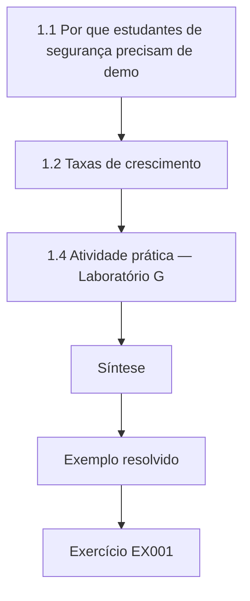

### Desenho lógico

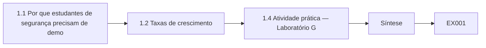

```text
[1.1 Por que estudantes de segurança precisam de demo]
    |
    v
[1.2 Taxas de crescimento]
    |
    v
[1.4 Atividade prática — Laboratório G]
    |
    v
[Síntese]
    |
    v
[Exemplo resolvido] --> [Exercício EX001]
```
<!-- cykin:lesson-figures:end ch-01 -->


### Objetivos de aprendizagem

Você vai (1) ler e escrever uma demonstração curta por argumento direto, por contradição e por indução; (2) comparar taxas de crescimento usando logaritmos e a notação O grande; (3) explicar por que "com que rapidez cresce o custo do ataque?" é a pergunta central da criptografia; e (4) distinguir uma afirmação matemática de uma estimativa empírica. O capítulo prepara as estruturas discretas (Capítulo 6) e a probabilidade (Capítulo 12).

### 1.1 Por que estudantes de segurança precisam de demonstrações

Uma afirmação de segurança é um enunciado sobre *todo* atacante dentro de um modelo, e não sobre os atacantes que por acaso testamos. Testar uma fechadura com dez gazuas mostra que ela resistiu a dez gazuas; não mostra que resiste à décima primeira. A matemática é a única ferramenta que nos permite fazer afirmações do tipo "para todo", e ela o faz enunciando as hipóteses com precisão. Quando uma norma diz que um esquema é seguro "se o problema Module-LWE for difícil", essa frase é um teorema condicional: a conclusão é tão forte quanto a hipótese, e a hipótese se apoia em décadas de ataques fracassados, e não numa demonstração. Aprender a separar a parte demonstrada da parte suposta é o hábito matemático mais útil deste livro.

Três formas de demonstração se repetem. Uma *demonstração direta* encadeia afirmações verdadeiras até a conclusão. Uma *demonstração por contradição* supõe o contrário e deriva algo impossível; a demonstração de Euclides de que existem infinitos primos é o exemplo clássico e sustenta por que os módulos RSA podem ser escolhidos livremente. A *indução* demonstra um caso base e um passo de *n* para *n*+1; é assim que raciocinamos sobre laços, cadeias de hash e os contadores dentro das assinaturas com estado.

### 1.2 Taxas de crescimento

Os criptógrafos medem a segurança em bits: um problema de "128 bits" exige cerca de 2^128 operações básicas. Os logaritmos convertem entre escalas: log₂(10^30) ≈ 100, então 10^30 operações são cerca de 2^100. A notação O grande mantém apenas o termo dominante: um algoritmo que executa 3*n*³ + 50*n* passos é O(*n*³). A ameaça quântica é, no fundo, uma mudança na taxa de crescimento. Classicamente, o melhor algoritmo de fatoração conhecido cresce de forma *subexponencial* no comprimento em bits do número; o algoritmo de Shor (Shor, 1997) cresce de forma *polinomial*, aproximadamente como *n*³ operações lógicas. Para a busca de chaves por força bruta, o algoritmo de Grover (Grover, 1996) apenas reduz 2^*k* tentativas a cerca de 2^(*k*/2) iterações sequenciais. Uma das mudanças é um colapso; a outra é uma raiz quadrada que chaves mais longas absorvem.

### 1.3 Exemplo resolvido

O gerente de TI da HCU lê uma manchete dizendo que os computadores quânticos vão "quebrar toda a criptografia". Usando as taxas de crescimento, classificamos a criptografia da HCU. O RSA-2048 e as chaves de curvas elípticas protegem os logins e a troca de chaves da VPN: existe um ataque de tempo polinomial num grande computador quântico tolerante a falhas, então eles precisam ser substituídos. O AES-256 cifra o banco de dados: o Grover deixa cerca de 2^128 de trabalho sequencial, ainda muito além do alcance, então ele fica. A manchete erra no seu alcance, e a correção vem de uma comparação de crescimento, e não de uma opinião.

### 1.4 Atividade prática — Laboratório G

```python
# Lab G (ch 1): growth rates that decide what quantum computers threaten.
import math
print("Symmetric key search: classical 2^k trials vs Grover ~2^(k/2) sequential iterations")
for k in (128, 192, 256):
    print(f"  k={k}: classical 2^{k}, Grover ~2^{k//2}")
def gnfs_bits(n_bits):            # heuristic L_N[1/3, (64/9)^(1/3)] work, expressed in bits
    ln_n = n_bits * math.log(2)
    work = (64/9) ** (1/3) * ln_n ** (1/3) * math.log(ln_n) ** (2/3)
    return work / math.log(2)
print("Factoring an n-bit RSA modulus: classical GNFS (heuristic) vs Shor gate count ~n^3")
for n in (1024, 2048, 3072):
    print(f"  n={n}: GNFS ~2^{gnfs_bits(n):.0f} operations; Shor ~n^3 = 2^{math.log2(n**3):.0f} logical gates")
```

Saída esperada:

```text
Symmetric key search: classical 2^k trials vs Grover ~2^(k/2) sequential iterations
  k=128: classical 2^128, Grover ~2^64
  k=192: classical 2^192, Grover ~2^96
  k=256: classical 2^256, Grover ~2^128
Factoring an n-bit RSA modulus: classical GNFS (heuristic) vs Shor gate count ~n^3
  n=1024: GNFS ~2^87 operations; Shor ~n^3 = 2^30 logical gates
  n=2048: GNFS ~2^117 operations; Shor ~n^3 = 2^33 logical gates
  n=3072: GNFS ~2^139 operations; Shor ~n^3 = 2^35 logical gates
```

Leia a saída como uma tabela de taxas de crescimento, e não como tempos de execução previstos: os números ignoram constantes, correção de erros e velocidade do hardware, que o Capítulo 19 trata como hipóteses explícitas.

Dois contrastes se destacam. Para as chaves simétricas, a busca de Grover reduz o expoente à metade, então uma chave de 256 bits ainda deixa um problema muito grande. Para o RSA, a distância é bem maior: o custo clássico cresce mais rápido que qualquer polinômio no tamanho da chave, enquanto o custo de Shor cresce apenas como o seu cubo. Dobrar a chave de 1024 para 2048 bits acrescenta muito trabalho clássico, mas apenas alguns bits de trabalho quântico. Essa diferença é a razão pela qual o RSA precisa ser substituído, e não alongado.

### 1.5 Erros comuns e limites

- Tratar "seguro se o problema X for difícil" como uma demonstração incondicional.
- Comparar contagens de operações entre máquinas como se uma porta quântica e uma instrução clássica custassem o mesmo.
- Ler as estimativas heurísticas de fatoração como exatas; elas são guias de ordem de grandeza.

Cada erro vem de esquecer o que o cálculo deixa de fora. As demonstrações de segurança são condicionais, então a condição precisa ser declarada ao lado do resultado. As contagens de operações comparam crescimento, e não tempo de relógio, já que uma única operação quântica com correção de erros pode levar muito mais tempo que uma clássica. As estimativas heurísticas são úteis para decidir quais algoritmos estão em perigo, não para prever uma data. Um estudante cuidadoso escreve a hipótese ao lado de cada número.

### Exercícios

- **EX001 — Bits de trabalho.** Expresse 10^24 operações e 10^24 × 2^20 operações em bits de trabalho. Rubrica: 3 = os dois corretos, com o logaritmo mostrado.
- **EX002 — Forma da demonstração.** Demonstre por indução que uma cadeia de hash de comprimento *n*, construída como h₁ = H(s), h_{k+1} = H(h_k), exige exatamente *n* avaliações de hash. Rubrica: 3 = caso base, passo e conclusão enunciados.

### Síntese

Os argumentos de segurança combinam implicações demonstradas com problemas difíceis supostos. A ameaça quântica é uma mudança na taxa de crescimento: o Shor, de tempo polinomial, derruba a fatoração e os logaritmos discretos, enquanto o Grover apenas reduz à metade o expoente da busca de chaves.

<!-- cykin:chapter-navigation:start ch-01 -->
### Continue estudando — capítulo 01 de 40

[← Página do curso](../../README.md) · [Índice de capítulos do curso](../SUBJECTS.md) · [Capítulo 02 →](#ch-02)

Siga para a próxima lição escrita.
<!-- cykin:chapter-navigation:end -->

<a id="ch-02"></a>

## Capítulo 2 — Sistemas computacionais

<!-- cykin:lesson-figures:start ch-02 -->
### Mapa da aula

Aula 02 publicada. Mapa, exemplo, EX003.

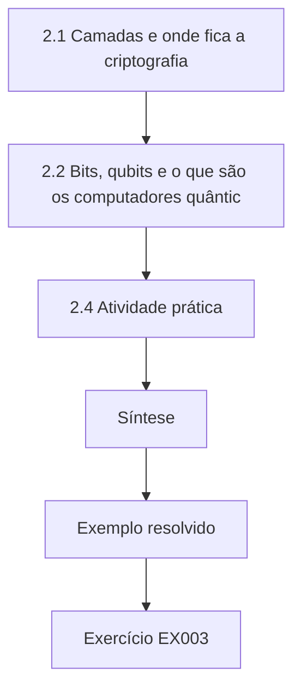

### Desenho lógico

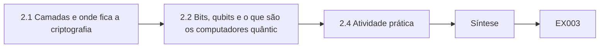

```text
[2.1 Camadas e onde fica a criptografia]
    |
    v
[2.2 Bits, qubits e o que são os computadores quântic]
    |
    v
[2.4 Atividade prática]
    |
    v
[Síntese]
    |
    v
[Exemplo resolvido] --> [Exercício EX003]
```
<!-- cykin:lesson-figures:end ch-02 -->


### Objetivos de aprendizagem

Você vai (1) descrever as camadas de um sistema computacional, do hardware à aplicação; (2) explicar onde o código criptográfico e as chaves ficam em cada camada; (3) contrastar, no nível conceitual, os bits clássicos com os qubits; e (4) mapear um serviço da HCU nessas camadas.

### 2.1 Camadas e onde fica a criptografia

Um serviço moderno é uma pilha. Na base ficam os processadores, a memória, o armazenamento e as interfaces de rede; acima deles, o firmware inicializa a máquina, um sistema operacional gerencia os recursos, as bibliotecas oferecem funções compartilhadas e as aplicações entregam as funcionalidades. A criptografia aparece em quase todas as camadas. O firmware verifica as assinaturas do estágio seguinte do boot. O sistema operacional guarda chaves e oferece um provedor criptográfico. Bibliotecas como as pilhas TLS negociam algoritmos com pares remotos. As aplicações assinam documentos ou cifram campos. Os módulos de segurança de hardware (HSMs) e os cartões inteligentes são pequenos computadores cujo único propósito é manter as chaves dentro de uma fronteira.

Essa divisão em camadas importa para a migração. Substituir um algoritmo numa aplicação é uma nova versão de software; substituí-lo na ROM de boot de um terminal de cartão pode exigir a troca do dispositivo. Os estudantes que conseguem localizar cada uso criptográfico na pilha conseguem estimar quão difícil será mudá-lo, e essa estimativa orienta todos os planos posteriores deste livro.

### 2.2 Bits, qubits e o que são os computadores quânticos

Um bit clássico é 0 ou 1. O estado de um qubit é descrito por duas amplitudes complexas; medi-lo produz 0 ou 1 com probabilidades dadas por essas amplitudes. Vários qubits podem estar *emaranhados*, de modo que o seu estado conjunto não é uma lista de bits independentes. Os algoritmos quânticos organizam a interferência para que as respostas erradas se cancelem e as certas se reforcem. É uma capacidade estreita: os computadores quânticos não são máquinas de uso geral mais rápidas e, para a maioria das cargas de trabalho — bancos de dados, servidores web, planilhas —, não oferecem nada. A sua relevância para a segurança vem de poucos algoritmos, acima de todos a busca de períodos de Shor.

Os dispositivos atuais são ruidosos. Executar o Shor contra o RSA-2048 exige *qubits lógicos com correção de erros*, cada um construído a partir de muitos qubits físicos. As estimativas públicas caíram com o tempo — Gidney (2025) estimou menos de um milhão de qubits ruidosos, funcionando por menos de uma semana sob hipóteses de hardware declaradas —, mas nenhuma máquina assim existe, e a data da sua chegada é incerta.

### 2.3 Exemplo resolvido

Mapeie o login do aplicativo bancário da HCU. O enclave seguro do celular guarda uma chave do dispositivo (hardware); o sistema operacional do celular oferece um repositório de chaves (sistema operacional); a biblioteca TLS do aplicativo negocia a troca de chaves com o servidor (biblioteca); o balanceador de carga do servidor encerra o TLS usando um certificado da AC da HCU (infraestrutura); a aplicação bancária central confere um token de sessão assinado (aplicação). Cinco camadas, pelo menos quatro algoritmos relevantes para a ameaça quântica, três donos diferentes.

Cada uma das cinco camadas guarda uma chave ou uma verificação, e cada uma pode precisar de uma mudança diferente numa migração. A chave do dispositivo e a troca de chaves TLS são ambas vulneráveis à computação quântica se usarem curvas elípticas. A assinatura do token de sessão pode ser conferida apenas no servidor, o que é mais fácil de mudar. Mapear o login dessa forma mostra à equipe da HCU que o aplicativo não é uma decisão criptográfica, mas várias, com donos diferentes.

### 2.4 Atividade prática

Escolha um dispositivo que você possui. Liste as suas camadas e, para cada uma, uma função criptográfica que você acredita que ela execute. Marque cada crença como *observada* (você viu a configuração ou a documentação) ou *suposta*. Guarde a lista; o Capítulo 22 transforma listas assim num inventário.

A maioria dos estudantes encontra mais entradas supostas do que observadas, sobretudo no firmware e no hardware. Essa lacuna é o objetivo do exercício: o conhecimento de uma organização sobre a própria criptografia costuma ser incompleto, e a primeira tarefa de uma migração é descobrir o que realmente existe. Anote onde você procuraria para confirmar cada suposição, como uma tela de configurações ou a documentação de um fornecedor.

### 2.5 Erros comuns e limites

- Supor que "computador quântico" significa um laptop mais rápido.
- Esquecer o firmware e o hardware ao listar a criptografia.
- Citar um número de qubits sem a taxa de erro e o tempo de execução que ele pressupõe.

Um computador quântico é um tipo diferente de máquina, mais rápida apenas para certos problemas; para a maioria das tarefas, não oferece vantagem. O firmware e o hardware costumam ser esquecidos porque ninguém os configura no dia a dia, mas eles verificam assinaturas e guardam chaves. Um número de qubits sozinho diz pouco, já que os algoritmos úteis precisam de qubits com correção de erros e de longos tempos de execução, e as estimativas publicadas tornam essas hipóteses explícitas.

### Exercícios

- **EX003 — Mapa de camadas.** Mapeie um saque no caixa eletrônico da HCU em pelo menos quatro camadas e nomeie uma função criptográfica em cada uma. Rubrica: 3 = quatro camadas corretas, com funções e donos plausíveis.
- **EX004 — Verificação de mito.** Explique em três frases por que um computador quântico não aceleraria o processamento mensal em lote dos extratos da HCU. Rubrica: 3 = menciona a vantagem algorítmica estreita e o tipo de carga de trabalho.

### Síntese

A criptografia está espalhada por todas as camadas de um sistema, e a camada determina quão difícil é mudá-la. Os computadores quânticos são máquinas especializadas cujo impacto na segurança vem de poucos algoritmos, e a sua chegada depende da correção de erros em escala.

<!-- cykin:chapter-navigation:start ch-02 -->
### Continue estudando — capítulo 02 de 40

[← Capítulo 01](#ch-01) · [Índice de capítulos do curso](../SUBJECTS.md) · [Capítulo 03 →](#ch-03)

Siga para a próxima lição escrita.
<!-- cykin:chapter-navigation:end -->

<a id="ch-03"></a>

## Capítulo 3 — Programação I

<!-- cykin:lesson-figures:start ch-03 -->
### Mapa da aula

Aula 03 publicada. Mapa, exemplo, EX005.

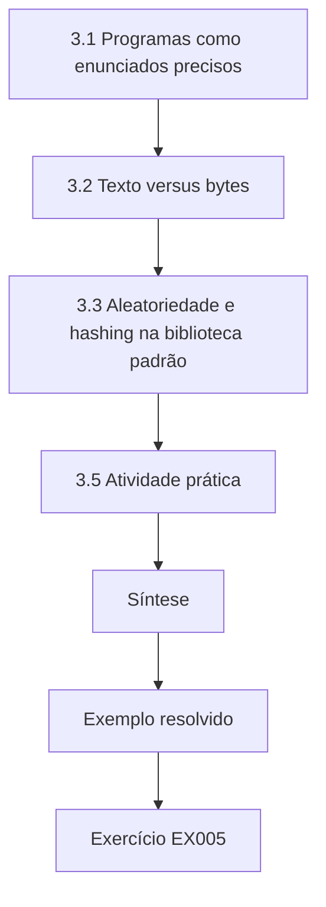

### Desenho lógico

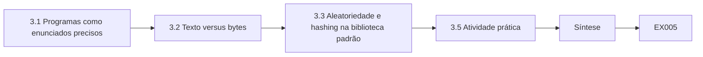

```text
[3.1 Programas como enunciados precisos]
    |
    v
[3.2 Texto versus bytes]
    |
    v
[3.3 Aleatoriedade e hashing na biblioteca padrão]
    |
    v
[3.5 Atividade prática]
    |
    v
[Síntese]
    |
    v
[Exemplo resolvido] --> [Exercício EX005]
```
<!-- cykin:lesson-figures:end ch-03 -->


### Objetivos de aprendizagem

Você vai (1) escrever pequenos programas em Python com funções, laços e condicionais; (2) tratar corretamente texto e bytes; (3) usar os módulos `hashlib` e `secrets` da biblioteca padrão; e (4) testar uma função com asserções.

### 3.1 Programas como enunciados precisos

Um programa é um argumento que uma máquina consegue conferir executando-o. O trabalho de segurança usa programas para reproduzir afirmações: se um relatório diz que "esta configuração oferece apenas troca de chaves clássica", um script curto que interpreta a configuração e imprime os grupos torna a afirmação repetível. Ao longo deste livro, os laboratórios são programas curtos em Python que usam apenas a biblioteca padrão, para que todo leitor possa executá-los offline e comparar a saída.

Comece pelas construções básicas: as variáveis guardam valores; as funções dão nome a um cálculo reutilizável; os laços `for` repetem; os comandos `if` escolhem. Programas legíveis usam nomes descritivos, funções pequenas e comentários que explicam *por quê*, e não *o quê*.

### 3.2 Texto versus bytes

As funções criptográficas operam sobre bytes, não sobre texto. Em Python, `"abc"` é texto (uma sequência de caracteres Unicode) e `b"abc"` são bytes. Converter texto em bytes exige uma codificação, normalmente UTF-8: `"abc".encode("utf-8")`. Um bug clássico é calcular o hash de `str(b"abc")`, que é o texto de seis caracteres `b'abc'`, e não os três bytes. O resumo fica errado em silêncio, e dois sistemas que discordam quanto à codificação não conseguirão verificar as assinaturas um do outro. Os problemas de interoperabilidade nas implantações pós-quânticas costumam ser desse tipo: ordem de bytes errada, codificação errada, comprimento errado.

### 3.3 Aleatoriedade e hashing na biblioteca padrão

`secrets.token_bytes(32)` devolve 32 bytes do gerador criptograficamente seguro do sistema operacional; o módulo `random` *não* é adequado para chaves, porque a sua saída é previsível a partir da semente. `hashlib.sha256(data).hexdigest()` calcula um resumo SHA-256; `hashlib.sha3_256` e `hashlib.shake_128` calculam membros da família SHA-3 usados dentro do ML-KEM e do ML-DSA. Para comparar valores secretos, use `hmac.compare_digest`, que leva um tempo independente de onde as entradas diferem.

Os testes de resposta conhecida usam entradas e saídas publicadas, então uma implementação errada falha de imediato. A família SHA-3 é útil neste livro porque o ML-KEM e o ML-DSA a usam internamente. Nunca imprima bytes secretos durante a depuração; imprima o seu comprimento ou um resumo.

### 3.4 Exemplo resolvido

Um estagiário da HCU escreve uma função para calcular a impressão digital de certificados:

```python
import hashlib
def fingerprint(der: bytes) -> str:
    return hashlib.sha256(der).hexdigest()
assert fingerprint(b"") == "e3b0c44298fc1c149afbf4c8996fb92427ae41e4649b934ca495991b7852b855"
print("fingerprint test passed")
```

A asserção usa como resposta conhecida o resumo publicado da cadeia vazia. Se alguém depois mudar a função para calcular o hash de texto, o teste falha imediatamente.

O teste confere a função contra um fato externo, e não contra a sua própria saída, o que é o que lhe permite falhar. Um segundo teste, com os bytes de um certificado real e a sua impressão digital publicada, detectaria um erro diferente, como calcular o hash de uma codificação em texto do certificado em vez dos seus bytes brutos. O estagiário acrescenta os dois testes ao repositório da HCU, para que cada mudança posterior seja conferida automaticamente.

### 3.5 Atividade prática

Escreva `is_valid_length(alg, data)`, que devolve `True` apenas se `data` tiver o comprimento esperado para aquele algoritmo, usando um dicionário como `{"ML-KEM-768-ek": 1184}` (o tamanho da chave de encapsulamento na FIPS 203). Teste uma entrada correta e duas incorretas.

Uma verificação de comprimento não é uma verificação de segurança; ela só detecta erros grosseiros, como valores truncados ou concatenados. Ainda assim vale a pena tê-la, porque muitos bugs de integração nas migrações pós-quânticas vêm de buffers dimensionados para chaves clássicas. Tire os tamanhos esperados da própria norma, e não de um post de blog, e anote o documento e a tabela que você usou, para que um revisor possa conferir cada número.

### 3.6 Erros comuns e limites

- Usar `random` para chaves ou nonces.
- Misturar texto e bytes, ou imprimir segredos nos logs durante a depuração.
- Escrever testes que não podem falhar (comparar um valor com ele mesmo).

Cada erro produz um código que parece funcionar. Uma chave do módulo random parece aleatória, mas pode ser prevista por qualquer um que descubra a semente. O resumo dos bytes errados parece um resumo e só falha quando comparado com outro sistema. Um teste que compara um valor com ele mesmo sempre passa, então dá uma falsa confiança. Registrar segredos nos logs os deixa em arquivos que mais pessoas podem ler do que o próprio programa.

### Exercícios

- **EX005 — Bug de codificação.** Explique por que `hashlib.sha256(str(b"abc").encode())` difere de `hashlib.sha256(b"abc")` e nomeie a classe do bug. Rubrica: 3 = explicação correta e classe do bug.
- **EX006 — Teste de resposta conhecida.** Escreva uma função que devolva o resumo hexadecimal SHA3-256 da sua entrada e um teste usando o resumo da cadeia vazia `a7ffc6f8bf1ed76651c14756a061d662f580ff4de43b49fa82d80a4b80f8434a`. Rubrica: 3 = executa, e o teste pode falhar se a função estiver errada.

### Síntese

Programas pequenos e testados tornam as afirmações de segurança reproduzíveis. Os bytes, as codificações e a aleatoriedade segura são onde o código criptográfico dos iniciantes mais costuma errar.

<!-- cykin:chapter-navigation:start ch-03 -->
### Continue estudando — capítulo 03 de 40

[← Capítulo 02](#ch-02) · [Índice de capítulos do curso](../SUBJECTS.md) · [Capítulo 04 →](#ch-04)

Siga para a próxima lição escrita.
<!-- cykin:chapter-navigation:end -->

<a id="ch-04"></a>

## Capítulo 4 — Escrita acadêmica

<!-- cykin:lesson-figures:start ch-04 -->
### Mapa da aula

Aula 04 publicada. Mapa, exemplo, EX007.

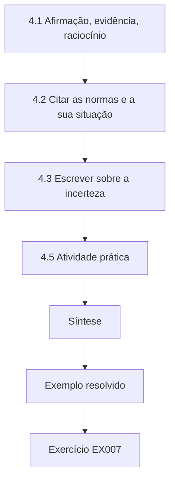

### Desenho lógico

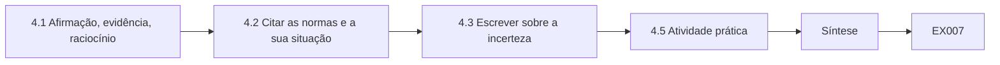

```text
[4.1 Afirmação, evidência, raciocínio]
    |
    v
[4.2 Citar as normas e a sua situação]
    |
    v
[4.3 Escrever sobre a incerteza]
    |
    v
[4.5 Atividade prática]
    |
    v
[Síntese]
    |
    v
[Exemplo resolvido] --> [Exercício EX007]
```
<!-- cykin:lesson-figures:end ch-04 -->


### Objetivos de aprendizagem

Você vai (1) estruturar um argumento como afirmação, evidência e raciocínio; (2) citar as fontes primárias com precisão, incluindo a sua situação; (3) escrever sobre a incerteza sem exagerá-la nem escondê-la; e (4) adaptar um resultado para um leitor técnico e para um não técnico.

### 4.1 Afirmação, evidência, raciocínio

Todo parágrafo de um relatório de segurança deve permitir que o leitor encontre três coisas: o que você afirma, que evidência sustenta a afirmação e por que a evidência a sustenta. "A VPN da HCU é vulnerável à computação quântica" é uma afirmação. "A configuração da VPN exportada em 3 de março negocia apenas o grupo ECDH 19" é uma evidência. "O ECDH é quebrado pelo algoritmo de Shor num computador quântico criptograficamente relevante, então o tráfego gravado da VPN poderia ser decifrado depois" é o raciocínio. Quando falta um dos três, os leitores ou desconfiam de um resultado correto, ou aceitam um sem sustentação.

### 4.2 Citar as normas e a sua situação

A escrita criptográfica depende de normas cuja situação muda. Cite o documento com precisão — "NIST FIPS 203, *Module-Lattice-Based Key-Encapsulation Mechanism Standard*, agosto de 2024" — com um link persistente, como o seu DOI. Declare a situação quando ela importar: as FIPS 203, 204 e 205 são normas finais; o [NIST IR 8547](https://doi.org/10.6028/NIST.IR.8547.ipd) era um rascunho público inicial em 12 de outubro de 2026, então as suas datas de transição propostas são propostas, e não regras; o FN-DSA ainda estava em desenvolvimento. Prefira as fontes primárias às notícias e confira se a fonte realmente diz o que você lhe atribui. Muitos erros nos relatórios de migração vêm de citar o resumo secundário de um rascunho como se fosse uma exigência final.

### 4.3 Escrever sobre a incerteza

Ninguém sabe quando existirá um computador quântico criptograficamente relevante. A boa escrita transforma essa incerteza em hipóteses explícitas: "Se uma máquina assim existir dentro de 15 anos, os registros com uma exigência de confidencialidade de 30 anos já estão expostos à coleta do tipo 'colete agora, decifre depois'." Evite tanto a falsa precisão ("em 2031") quanto o descaso ("faltam décadas, ignore"). Use faixas, declare quem fez uma estimativa e quando, e mostre como a sua recomendação muda ao longo da faixa.

Enunciados em duas partes como esse permitem que o leitor substitua a sua hipótese pela dele e ainda use o seu raciocínio. Diga quem fez cada estimativa que você cita e quando.

### 4.4 Exemplo resolvido

Uma frase de rascunho diz: "Os computadores quânticos vão quebrar a nossa criptografia até 2030, então o NIST nos obriga a mudar para o Kyber imediatamente." Reescrita: "As estimativas públicas de quando um computador quântico poderia quebrar o RSA-2048 variam muito, e nenhuma tem autoridade. O NIST publicou o ML-KEM, derivado do CRYSTALS-Kyber, como FIPS 203 em 2024, e o seu rascunho IR 8547 propõe tornar obsoletos os algoritmos vulneráveis à computação quântica depois de 2030 e proibi-los depois de 2035. Como o nosso arquivo de financiamentos imobiliários precisa permanecer confidencial por 30 anos, recomendamos iniciar neste ano a migração da troca de chaves das transferências do arquivo." Cada afirmação agora tem fonte, data e ressalvas.

### 4.5 Atividade prática

Pegue uma notícia de uma página sobre computação quântica. Marque cada afirmação factual, encontre a sua fonte primária, se houver, e reescreva a conclusão principal da notícia em três frases que respeitem as evidências.

A maioria das notícias mistura fatos corretos com afirmações sem fonte ou que exageram uma fonte. Escrever as suas três frases obriga você a decidir o que as evidências realmente sustentam. Compare a sua versão com a de um colega: se forem diferentes, verifique se um de vocês se apoiou numa afirmação que o outro não conseguiu encontrar na fonte. Guarde as fontes primárias que você encontrou, pois vai reutilizá-las em capítulos posteriores.

### 4.6 Erros comuns e limites

- Citar o blog de um fornecedor para o conteúdo de uma norma.
- Apresentar as datas propostas por um rascunho como obrigatórias.
- Escrever "à prova de computação quântica" ou "inquebrável"; prefira "projetado para resistir aos ataques quânticos conhecidos".

O blog de um fornecedor pode descrever uma norma com precisão, mas também pode misturar afirmações de produto ou um rascunho anterior. Cite a própria norma. Os documentos em rascunho propõem datas para comentários; eles não são exigências até serem publicados na forma final. Palavras absolutas como inquebrável prometem mais do que qualquer criptógrafo pode cumprir, e os leitores que depois souberem de um ataque desconfiarão de todo o resto do relatório.

### Exercícios

- **EX007 — Afirmação, evidência, raciocínio.** Escreva um resultado em três frases de que a AC interna da HCU usa RSA-2048 e por que isso importa. Rotule cada frase como A, E ou R. Rubrica: 3 = as três presentes e precisas.
- **EX008 — Disciplina quanto à situação.** Corrija esta frase: "A FIPS 206 exige o Falcon para todas as assinaturas a partir de 2025." Rubrica: 3 = observa que a FIPS 206 estava em desenvolvimento, nomeia o FN-DSA, remove a exigência falsa.

### Síntese

Uma escrita de segurança clara separa afirmação, evidência e raciocínio, cita as fontes primárias com a sua situação e transforma a incerteza em hipóteses declaradas.

<!-- cykin:chapter-navigation:start ch-04 -->
### Continue estudando — capítulo 04 de 40

[← Capítulo 03](#ch-03) · [Índice de capítulos do curso](../SUBJECTS.md) · [Capítulo 05 →](#ch-05)

Siga para a próxima lição escrita.
<!-- cykin:chapter-navigation:end -->

<a id="ch-05"></a>

## Capítulo 5 — Letramento em segurança

<!-- cykin:lesson-figures:start ch-05 -->
### Mapa da aula

Aula 05 publicada. Mapa, exemplo, EX009.

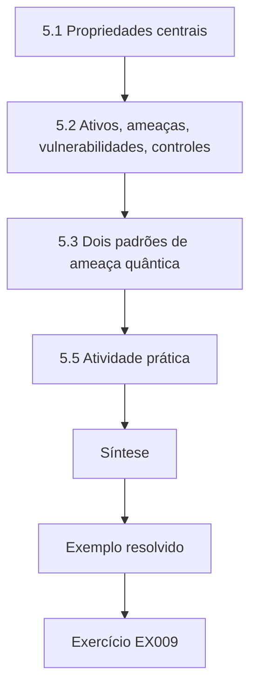

### Desenho lógico

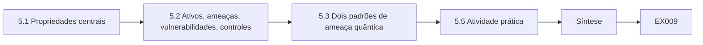

```text
[5.1 Propriedades centrais]
    |
    v
[5.2 Ativos, ameaças, vulnerabilidades, controles]
    |
    v
[5.3 Dois padrões de ameaça quântica]
    |
    v
[5.5 Atividade prática]
    |
    v
[Síntese]
    |
    v
[Exemplo resolvido] --> [Exercício EX009]
```
<!-- cykin:lesson-figures:end ch-05 -->


### Objetivos de aprendizagem

Você vai (1) definir confidencialidade, integridade, disponibilidade e autenticidade; (2) relacionar ativos, ameaças, vulnerabilidades e controles; (3) explicar "colete agora, decifre depois" e "falsifique depois" como padrões de ameaça; e (4) ler criticamente uma declaração de risco simples.

### 5.1 Propriedades centrais

*Confidencialidade* significa que apenas as partes autorizadas podem ler a informação; *integridade* significa que as mudanças não autorizadas são detectadas ou impedidas; *disponibilidade* significa que os usuários autorizados podem usar o serviço quando precisam; *autenticidade* significa que conseguimos saber quem produziu uma mensagem. A criptografia serve principalmente à confidencialidade (cifração, troca de chaves), à integridade e à autenticidade (códigos de autenticação de mensagem e assinaturas). A disponibilidade é fácil de esquecer nas mudanças criptográficas: uma migração que faz os handshakes falharem é um incidente de disponibilidade, mesmo que melhore a confidencialidade.

No caso da HCU, um gateway que rejeitasse os celulares mais antigos dos associados após uma mudança de algoritmo seria uma falha de segurança, mesmo que nenhum dado vazasse.

### 5.2 Ativos, ameaças, vulnerabilidades, controles

Um *ativo* é algo de valor — os dados dos associados, a capacidade de aprovar pagamentos. Uma *ameaça* é uma causa potencial de dano, geralmente um agente com uma capacidade e um motivo. Uma *vulnerabilidade* é uma fraqueza que a ameaça pode explorar. Um *controle* reduz a probabilidade ou o impacto. O risco é a combinação de probabilidade e impacto de um cenário que liga esses elementos. Na segurança quântica, a vulnerabilidade muitas vezes não é um bug, mas uma propriedade matemática de um algoritmo que se torna explorável quando passa a existir uma nova capacidade.

### 5.3 Dois padrões de ameaça quântica

*Colete agora, decifre depois* (HNDL, na sigla em inglês): um adversário grava hoje o tráfego cifrado e o guarda até que um computador quântico consiga recuperar a troca de chaves. O dano acontece no futuro, mas a coleta — e, portanto, a necessidade de agir — é agora, para quaisquer dados cuja confidencialidade precise durar mais do que a chegada de uma máquina assim. *Falsifique depois*: quando existir um computador quântico, um adversário poderá derivar chaves privadas de assinatura a partir das chaves públicas e falsificar assinaturas, atualizações de firmware ou certificados. Ao contrário do HNDL, a falsificação precisa da máquina no momento do ataque, então a migração das assinaturas pode seguir outro cronograma — exceto onde as assinaturas precisam continuar confiáveis por muitos anos, como nos documentos de financiamento imobiliário ou em dispositivos que não podem ser atualizados.

### 5.4 Exemplo resolvido

Declaração de risco da HCU, rascunho: "Risco de ataque quântico: alto." Melhorada: "Ativo: transferências do arquivo de financiamentos imobiliários entre as agências e o data center (confidencialidade exigida por 30 anos). Ameaça: um adversário com muitos recursos gravando o tráfego da WAN. Vulnerabilidade: a troca de chaves da VPN usa apenas ECDH. Impacto, se concretizado: divulgação do histórico financeiro dos associados. Probabilidade: a coleta é plausível agora; a decifração depende de uma capacidade futura incerta. Opções de controle: troca de chaves híbrida pós-quântica, redução dos dados em trânsito." A declaração melhorada sustenta uma decisão; o rascunho não.

A versão melhorada nomeia separadamente cada elemento do risco, para que os leitores possam discordar de uma parte sem rejeitar o todo. Ela também mostra por que o risco é urgente apesar da data incerta: a coleta pode acontecer hoje. Um revisor pode conferir cada parte contra as evidências, como a configuração da VPN ou a política de retenção do arquivo.

### 5.5 Atividade prática

Escreva declarações de risco no formato melhorado para dois ativos da HCU: as mensagens de autorização de cartão e a chave de assinatura de código do aplicativo móvel. Observe como os seus horizontes de tempo diferem.

As mensagens de autorização de cartão precisam de confidencialidade apenas por pouco tempo, então o "colete agora, decifre depois" importa pouco ali; a preocupação é a autenticação. A chave de assinatura de código importa enquanto as versões antigas do aplicativo forem confiáveis, o que faz do "falsifique depois" a principal preocupação. Escrever as duas declarações no mesmo formato torna essas diferenças visíveis, e a comparação ajuda a decidir qual ativo migrar primeiro.

### 5.6 Erros comuns e limites

- Tratar todo uso criptográfico como igualmente urgente.
- Ignorar a disponibilidade ao trocar algoritmos.
- Confundir uma ameaça (agente) com uma vulnerabilidade (fraqueza).

A urgência depende de quanto tempo os dados precisam continuar confidenciais e de quanto tempo as assinaturas precisam ser confiáveis. Tratar todo uso como igualmente urgente dilui o esforço e atrasa os casos que mais importam. Ignorar a disponibilidade pode transformar uma melhoria de segurança numa interrupção que os associados percebem. Confundir ameaças com vulnerabilidades leva a controles mirados na coisa errada, como tentar deter um adversário em vez de remover a fraqueza que ele exploraria.

### Exercícios

- **EX009 — Classificação de padrões.** Classifique cada item como HNDL, falsificação posterior ou nenhum: tráfego de VPN arquivado, assinatura de firmware dos caixas eletrônicos, cifração AES-256 do banco de dados, sessão TLS com o aplicativo móvel. Rubrica: 3 = os quatro corretos, com motivos de uma linha.
- **EX010 — Declaração de risco.** Reescreva "A PKI está sob risco quântico" como uma declaração de risco completa para a AC interna da HCU. Rubrica: 3 = ativo, ameaça, vulnerabilidade, impacto, probabilidade e controles presentes.

### Síntese

As propriedades de segurança, os elementos do risco e dois padrões de ameaça definidos pelo tempo — colete agora, decifre depois e falsifique depois — dão um vocabulário preciso o bastante para ordenar os riscos quânticos.

<!-- cykin:chapter-navigation:start ch-05 -->
### Continue estudando — capítulo 05 de 40

[← Capítulo 04](#ch-04) · [Índice de capítulos do curso](../SUBJECTS.md) · [Capítulo 06 →](#ch-06)

Siga para a próxima lição escrita.
<!-- cykin:chapter-navigation:end -->

<a id="ch-06"></a>

## Capítulo 6 — Estruturas discretas

<!-- cykin:lesson-figures:start ch-06 -->
### Mapa da aula

Aula 06 publicada. Mapa, exemplo, EX011.

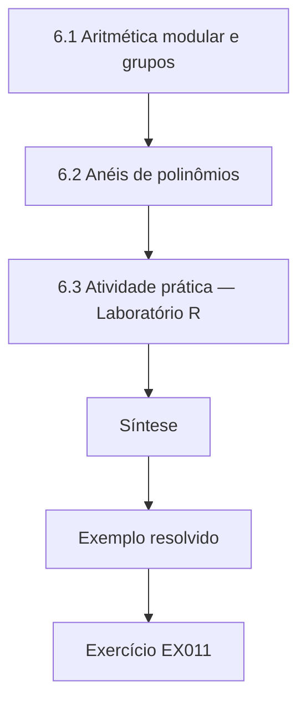

### Desenho lógico

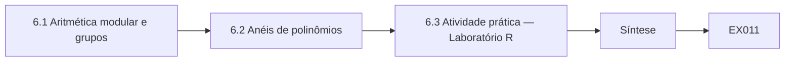

```text
[6.1 Aritmética modular e grupos]
    |
    v
[6.2 Anéis de polinômios]
    |
    v
[6.3 Atividade prática — Laboratório R]
    |
    v
[Síntese]
    |
    v
[Exemplo resolvido] --> [Exercício EX011]
```
<!-- cykin:lesson-figures:end ch-06 -->


### Objetivos de aprendizagem

Você vai (1) calcular com aritmética modular; (2) explicar os grupos e por que os períodos ocultos importam; (3) multiplicar polinômios no anel Z_q[x]/(x^n+1); e (4) ligar essas estruturas ao RSA, às curvas elípticas e ao ML-KEM.

### 6.1 Aritmética modular e grupos

Trabalhar módulo *q* mantém os números em {0, …, *q*−1}: 15 mod 7 = 1. Um *grupo* é um conjunto com uma operação associativa, que tem elemento neutro e inversos. Os números não nulos módulo um primo *p* formam um grupo sob a multiplicação; os pontos de uma curva elíptica formam um grupo sob a adição de pontos. Repetir a operação a partir de um elemento inicial *g* acaba gerando um ciclo: *g*, *g*², *g*³, … volta a 1 depois de *r* passos, em que *r* é a *ordem* de *g*. Encontrar *r* — um período oculto — é difícil classicamente para grupos grandes, e o RSA, o Diffie–Hellman e a criptografia de curvas elípticas se apoiam todos em problemas equivalentes ou redutíveis a encontrar esses períodos ou logaritmos discretos. O algoritmo de Shor encontra períodos de forma eficiente num computador quântico, e é por isso que todos eles caem juntos.

### 6.2 Anéis de polinômios

Um anel de polinômios Z_q[*x*]/(*x*^*n*+1) contém os polinômios de grau menor que *n* com coeficientes módulo *q*. Para multiplicar, multiplique normalmente e depois substitua *x*^*n* por −1. O ML-KEM ([FIPS 203](https://doi.org/10.6028/NIST.FIPS.203)) usa *n* = 256 e *q* = 3329; o ML-DSA ([FIPS 204](https://doi.org/10.6028/NIST.FIPS.204)) usa *n* = 256 e *q* = 8380417. Vetores desses polinômios formam *módulos*, daí "reticulado de módulos". O anel é escolhido pela compacidade e pela multiplicação rápida; a segurança vem do acréscimo de um pequeno ruído aleatório, tema do Capítulo 23. Não se conhece nenhum ataque quântico eficiente por busca de períodos contra esses problemas com ruído.

### 6.3 Atividade prática — Laboratório R

```python
# Lab R (ch 6): multiplication in R_q = Z_q[x]/(x^n + 1), the ring behind ML-KEM (there n=256, q=3329).
q, n = 17, 4
def mul(a, b):
    c = [0] * n
    for i in range(n):
        for j in range(n):
            k = i + j
            if k < n:
                c[k] = (c[k] + a[i] * b[j]) % q
            else:                       # x^n = -1, so wrap around with a sign flip
                c[k - n] = (c[k - n] - a[i] * b[j]) % q
    return c
a = [1, 2, 0, 3]      # 1 + 2x + 3x^3
b = [0, 1, 0, 0]      # x
print("a*x  =", mul(a, b), " (coefficients shift; x^3 * x = x^4 = -1 -> 17-3 = 14)")
print("a*a  =", mul(a, a))
```

Saída esperada:

```text
a*x  = [14, 1, 2, 0]  (coefficients shift; x^3 * x = x^4 = -1 -> 17-3 = 14)
a*a  = [6, 4, 12, 6]
```

Confira à mão: (1 + 2*x* + 3*x*³)·*x* = *x* + 2*x*² + 3*x*⁴ = −3 + *x* + 2*x*² ≡ 14 + *x* + 2*x*² (mod 17).

O laboratório multiplica dois polinômios pequenos num anel com parâmetros de brinquedo e imprime o resultado. Fazer um produto à mão, como mostrado, é a melhor forma de ver onde acontece a troca de sinal. Os parâmetros reais são muito maiores, mas a regra é a mesma, e as bibliotecas que você vai usar a aplicam com algoritmos muito mais rápidos. O anel de brinquedo não é seguro; ele existe apenas para tornar a aritmética visível.

### 6.4 Exemplo resolvido

Um desenvolvedor da HCU pergunta por que a sua biblioteca pós-quântica "multiplica polinômios" quando o RSA "eleva números a potências". O RSA trabalha no grupo multiplicativo módulo *N*, onde existe um período oculto e o Shor consegue encontrá-lo. O ML-KEM trabalha com álgebra linear com ruído sobre anéis de polinômios, onde não se conhece nenhuma estrutura de períodos assim que ajude. A aritmética parece diferente porque o problema difícil é diferente.

Vale a pena responder à pergunta do desenvolvedor antes de qualquer trabalho de migração, porque ela explica por que os novos algoritmos exigem novas habilidades de revisão. O código que lida com polinômios e ruído tem modos de falha diferentes do código que lida com inteiros grandes, como erros na redução ou na amostragem do ruído.

### 6.5 Erros comuns e limites

- Esquecer a troca de sinal ao reduzir *x*^*n* a −1.
- Acreditar que a estrutura do anel sozinha dá segurança; sem ruído, as equações são fáceis de resolver.
- Supor que "nenhum ataque conhecido" significa "demonstradamente seguro".

A troca de sinal é o erro mais comum no cálculo à mão, e os testes com respostas conhecidas o detectam. O segundo erro importa mais: o anel torna a aritmética conveniente, mas a segurança vem do ruído acrescentado. Sem ele, as equações são álgebra linear comum e fáceis de resolver. "Nenhum ataque conhecido" é uma afirmação sobre o conhecimento atual, então as normas incluem margens de segurança e são revistas à medida que a pesquisa continua.

### Exercícios

- **EX011 — Ordem de um elemento.** Encontre a ordem de 3 módulo 7 listando as potências. Rubrica: 3 = ordem correta, com a lista.
- **EX012 — Produto no anel.** Calcule (2 + *x*)(3 + *x*³) em Z_17[*x*]/(*x*⁴+1) e confira com o Laboratório R. Rubrica: 3 = coeficientes corretos, com a redução mostrada.

### Síntese

A criptografia de chave pública clássica esconde períodos em grupos, que o algoritmo de Shor encontra. A PQC baseada em reticulados calcula em anéis de polinômios e esconde os segredos sob ruído, uma estrutura sem atalho quântico conhecido.

<!-- cykin:chapter-navigation:start ch-06 -->
### Continue estudando — capítulo 06 de 40

[← Capítulo 05](#ch-05) · [Índice de capítulos do curso](../SUBJECTS.md) · [Capítulo 07 →](#ch-07)

Siga para a próxima lição escrita.
<!-- cykin:chapter-navigation:end -->

<a id="ch-07"></a>

## Capítulo 7 — Redes e protocolos

<!-- cykin:lesson-figures:start ch-07 -->
### Mapa da aula

Aula 07 publicada. Mapa, exemplo, EX013.

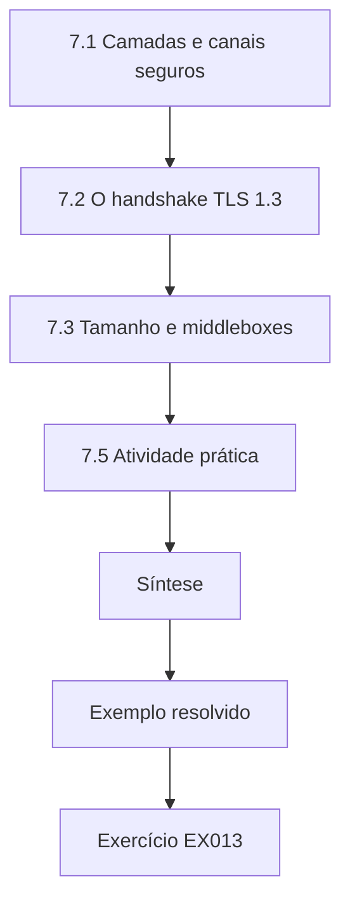

### Desenho lógico

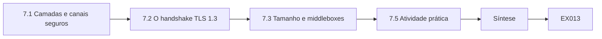

```text
[7.1 Camadas e canais seguros]
    |
    v
[7.2 O handshake TLS 1.3]
    |
    v
[7.3 Tamanho e middleboxes]
    |
    v
[7.5 Atividade prática]
    |
    v
[Síntese]
    |
    v
[Exemplo resolvido] --> [Exercício EX013]
```
<!-- cykin:lesson-figures:end ch-07 -->


### Objetivos de aprendizagem

Você vai (1) descrever as camadas do TCP/IP e onde operam o TLS, o IPsec e o SSH; (2) acompanhar um handshake TLS 1.3 e identificar a troca de chaves e a autenticação; (3) explicar por que as chaves e assinaturas pós-quânticas pressionam o tamanho das mensagens; e (4) nomear os documentos da IETF que definem a troca de chaves híbrida.

### 7.1 Camadas e canais seguros

Os dados atravessam as redes em camadas: enlace, internet (IP), transporte (TCP, UDP, QUIC) e aplicação. Os canais seguros inserem a criptografia em pontos diferentes. O TLS protege fluxos de aplicação como o HTTPS; o IPsec com IKEv2 protege pacotes IP entre locais, como nas VPNs das agências da HCU; o SSH protege as sessões dos administradores. Cada um tem duas tarefas criptográficas: o *estabelecimento de chaves*, que acorda um segredo de sessão novo, e a *autenticação*, que prova quem é o par, geralmente com certificados e assinaturas.

As duas tarefas enfrentam ameaças quânticas diferentes. O estabelecimento de chaves importa para o "colete agora, decifre depois", porque o tráfego gravado pode ser aberto quando o segredo de sessão for recuperado. A autenticação importa apenas no momento da conexão, já que uma assinatura falsificada depois não consegue mudar um handshake passado.

### 7.2 O handshake TLS 1.3

No TLS 1.3 ([RFC 8446](https://www.rfc-editor.org/rfc/rfc8446.html)), o cliente envia um ClientHello listando os grupos suportados e um compartilhamento de chave; o servidor responde com um ServerHello contendo o seu compartilhamento de chave e, depois, mensagens cifradas que levam a sua cadeia de certificados e uma assinatura CertificateVerify. O estabelecimento de chaves e a autenticação são separados: um grupo híbrido como o X25519MLKEM768, especificado para o TLS no [RFC 10024](https://www.rfc-editor.org/rfc/rfc10024.html), substitui apenas a parte da troca de chaves. O seu compartilhamento de chave do cliente tem 1.216 bytes e o do servidor, 1.120 bytes, contra 32 bytes do X25519 sozinho. A cadeia de certificados permanece inalterada até que sejam implantados certificados pós-quânticos.

### 7.3 Tamanho e middleboxes

Mensagens maiores importam. Um ClientHello acima de cerca de 1.500 bytes pode ocupar dois segmentos TCP; alguns firewalls e dispositivos de inspeção antigos tratam mal essas mensagens ou identificadores de grupo desconhecidos. As assinaturas pós-quânticas são ainda maiores: uma assinatura ML-DSA-44 tem 2.420 bytes ([FIPS 204](https://doi.org/10.6028/NIST.FIPS.204)), contra cerca de 72 do ECDSA P-256. O Capítulo 30 mede o que isso causa às cadeias de certificados.

Antes de culpar o novo algoritmo por uma falha, verifique para onde foram os bytes. Uma captura de pacotes em laboratório mostra se uma mensagem foi dividida, descartada ou rejeitada, e por qual dispositivo.

### 7.4 Exemplo resolvido

A equipe de rede da HCU vê um aumento de conexões que falham depois de ativar um grupo híbrido num gateway web de teste. Uma captura de pacotes no laboratório mostra que o ClientHello agora ocupa dois segmentos, e um proxy de inspeção legado numa agência derruba a conexão. A correção não é desativar a troca de chaves pós-quântica em todo lugar, mas atualizar ou contornar esse proxy, registrando o problema no log da migração. O diagnóstico exigiu conhecer as duas camadas: o tamanho veio da criptografia, a falha veio do tratamento no transporte.

### 7.5 Atividade prática

Usando um navegador de laboratório e o seu próprio servidor de teste, ou traces de handshake publicados, identifique a lista de grupos suportados num ClientHello e o grupo selecionado no ServerHello. Registre quais mensagens são cifradas no TLS 1.3. Não capture o tráfego de outras pessoas.

A maior parte do handshake depois do ServerHello é cifrada no TLS 1.3, inclusive o certificado, então um observador passivo vê menos do que nas versões mais antigas. Compare uma conexão que oferece um grupo híbrido com uma que oferece apenas grupos clássicos e anote a diferença no tamanho do ClientHello. Os traces publicados são uma alternativa segura se você não tiver um servidor de teste próprio. Anote a ferramenta que usou e a sua versão, para que outro estudante possa repetir a observação.

### 7.6 Erros comuns e limites

- Acreditar que a troca de chaves híbrida também torna a autenticação pós-quântica.
- Culpar o algoritmo por falhas causadas por middleboxes.
- Capturar tráfego em redes que você não está autorizado a monitorar.

A troca de chaves híbrida protege os segredos de sessão contra a decifração posterior, mas o certificado e a sua assinatura continuam clássicos até que os certificados mudem, o que é uma migração separada e mais lenta. As falhas por middleboxes são comuns nas primeiras implantações, e diagnosticá-las exige evidências da rede, e não suposições sobre o algoritmo. Capturar tráfego sem autorização é ilegal em muitos lugares e quebra a confiança de que o trabalho de segurança depende, por melhor que seja a intenção.

### Exercícios

- **EX013 — Separe as tarefas.** Para o TLS 1.3, o IKEv2 e o SSH, nomeie o mecanismo de estabelecimento de chaves e o de autenticação numa implantação clássica típica. Rubrica: 3 = seis entradas corretas.
- **EX014 — Orçamento de tamanho.** Quantos bytes a mais um cliente envia no seu compartilhamento de chave com o X25519MLKEM768 do que com o X25519 sozinho? Rubrica: 3 = 1.184 bytes, com os tamanhos citados.

### Síntese

Os protocolos seguros separam o estabelecimento de chaves da autenticação. A troca de chaves híbrida pós-quântica muda o primeiro, aumenta os handshakes e pode expor middleboxes antigos; a autenticação muda depois, com os certificados pós-quânticos.

<!-- cykin:chapter-navigation:start ch-07 -->
### Continue estudando — capítulo 07 de 40

[← Capítulo 06](#ch-06) · [Índice de capítulos do curso](../SUBJECTS.md) · [Capítulo 08 →](#ch-08)

Siga para a próxima lição escrita.
<!-- cykin:chapter-navigation:end -->

<a id="ch-08"></a>

## Capítulo 8 — Programação II

<!-- cykin:lesson-figures:start ch-08 -->
### Mapa da aula

Aula 08 publicada. Mapa, exemplo, EX015.

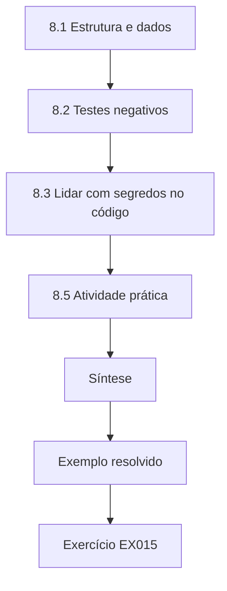

### Desenho lógico

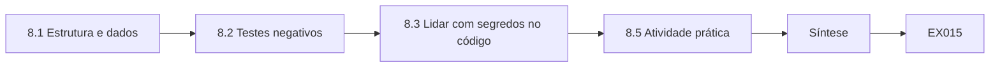

```text
[8.1 Estrutura e dados]
    |
    v
[8.2 Testes negativos]
    |
    v
[8.3 Lidar com segredos no código]
    |
    v
[8.5 Atividade prática]
    |
    v
[Síntese]
    |
    v
[Exemplo resolvido] --> [Exercício EX015]
```
<!-- cykin:lesson-figures:end ch-08 -->


### Objetivos de aprendizagem

Você vai (1) estruturar programas maiores com módulos, data classes e tratamento de erros; (2) interpretar entradas estruturadas, como CSV e JSON; (3) escrever testes tanto para entradas válidas quanto para inválidas; e (4) evitar erros de segurança comuns em código que lida com chaves.

### 8.1 Estrutura e dados

À medida que os programas crescem, a estrutura os mantém corretos. Agrupe as funções relacionadas em módulos, represente os registros com `dataclasses` para que os campos tenham nome e lance exceções para estados inválidos, em vez de devolver em silêncio valores errados. Os módulos `csv` e `json` da biblioteca padrão interpretam formatos comuns; validar cada campo ao lê-lo — tipo, faixa, valores permitidos — impede que dados ruins se propaguem. No trabalho de migração, os inventários chegam como exportações CSV de scanners e de bancos de dados de configuração, e a maioria dos erros de análise começa numa coluna não validada.

### 8.2 Testes negativos

Um teste positivo confere que uma entrada válida funciona; um *teste negativo* confere que uma entrada inválida é rejeitada. O código criptográfico precisa dos dois. Um decodificador de chaves de encapsulamento ML-KEM precisa aceitar exatamente 800, 1.184 ou 1.568 bytes para os três conjuntos de parâmetros da FIPS 203 e rejeitar qualquer outra coisa, e a FIPS 203 também especifica verificações de entrada sobre os coeficientes da chave. Bibliotecas que pularam essas verificações já aceitaram, historicamente, entradas malformadas que vazaram informações ou derrubaram serviços. Escreva os testes negativos antes de escrever o decodificador.

Os testes da HCU incluem chaves com um byte a menos e com um byte a mais.

### 8.3 Lidar com segredos no código

Mantenha os segredos fora dos logs, das mensagens de exceção e do controle de versão. Prefira passar *handles* de chaves (referências mantidas por um HSM ou pelo repositório de chaves do sistema operacional) em vez dos bytes brutos da chave. Compare segredos com funções de tempo constante. Nunca escreva a sua própria implementação de produção de um algoritmo pós-quântico; use uma biblioteca verificada e trate com desconfiança até um pequeno código de encapsulamento, porque os canais laterais e os bugs de interpretação vivem na cola tanto quanto no núcleo.

Para a HCU, isso significa chamar a biblioteca aprovada por uma pequena interface e revisar essa interface com o mesmo cuidado que todo o resto.

### 8.4 Exemplo resolvido

Um analista da HCU recebe `inventory.csv` com as colunas `host, protocol, group`. Um script descuidado conta as linhas em que `group == "x25519"` e relata "a maioria dos hosts é clássica". Uma versão cuidadosa normaliza as maiúsculas e minúsculas, rejeita as linhas com grupo vazio como *desconhecidas* em vez de *clássicas* e imprime três números: clássicos, híbridos e desconhecidos. O script cuidadoso revela que 18% das linhas sintéticas são desconhecidas — um fato que o primeiro script escondia.

Tratar o desconhecido como clássico teria feito o inventário parecer mais completo e mais uniformemente clássico do que era, escondendo os hosts cuja criptografia ninguém conhecia. Os desconhecidos se tornam uma lista de trabalho própria: alguém precisa verificar esses hosts diretamente antes que o inventário possa ser confiável. O script cuidadoso também registra a data do arquivo de entrada, para que os leitores posteriores saibam quão recentes são as contagens.

### 8.5 Atividade prática

Escreva uma função que leia linhas `host,group`, valide que `group` pertence a um conjunto permitido e devolva as contagens de híbridos, clássicos e desconhecidos. Inclua um teste negativo com uma cadeia de grupo desconhecida.

Normalize as maiúsculas e minúsculas e os espaços antes de comparar e decida de antemão o que conta como híbrido. Um nome de grupo que você nunca viu deve cair em desconhecido, nunca em clássico por padrão. O seu teste negativo deve mostrar que um nome de grupo escrito errado ou inventado é contado como desconhecido e que a função não quebra diante de uma linha vazia. Imprima as três contagens numa ordem fixa, para que as saídas de execuções diferentes possam ser comparadas.

### 8.6 Erros comuns e limites

- Tratar dados ausentes como um resultado negativo.
- Capturar todas as exceções e continuar em silêncio.
- Escrever criptografia própria em vez de chamar uma implementação verificada.

Os dados ausentes são um resultado sobre o inventário, e não sobre os sistemas. Engolir exceções esconde as linhas que falharam, então os totais parecem completos quando não estão; registre cada falha com o número da linha. A criptografia própria falha de maneiras que os testes raramente detectam, como diferenças de tempo, e as bibliotecas verificadas tiveram anos de revisão que uma implementação nova não consegue igualar.

### Exercícios

- **EX015 — Testes negativos.** Liste quatro testes negativos para uma função que carrega uma chave pública ML-DSA-65 (1.952 bytes na FIPS 204). Rubrica: 3 = quatro casos de falha distintos e significativos.
- **EX016 — Desconhecido não é não.** Explique em duas frases por que contar campos vazios como "clássicos" enviesa um inventário. Rubrica: 3 = identifica a direção do viés e a consequência para a decisão.

### Síntese

Código estruturado, entradas validadas e testes negativos tornam a análise confiável; no código criptográfico, rejeitar uma entrada ruim é tão importante quanto tratar uma entrada boa.

<!-- cykin:chapter-navigation:start ch-08 -->
### Continue estudando — capítulo 08 de 40

[← Capítulo 07](#ch-07) · [Índice de capítulos do curso](../SUBJECTS.md) · [Capítulo 09 →](#ch-09)

Siga para a próxima lição escrita.
<!-- cykin:chapter-navigation:end -->

<a id="ch-09"></a>

## Capítulo 9 — Dados e bancos de dados

<!-- cykin:lesson-figures:start ch-09 -->
### Mapa da aula

Aula 09 publicada. Mapa, exemplo, EX017.

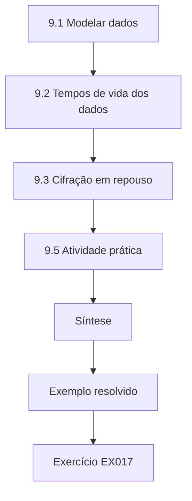

### Desenho lógico

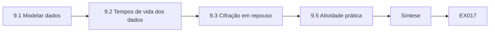

```text
[9.1 Modelar dados]
    |
    v
[9.2 Tempos de vida dos dados]
    |
    v
[9.3 Cifração em repouso]
    |
    v
[9.5 Atividade prática]
    |
    v
[Síntese]
    |
    v
[Exemplo resolvido] --> [Exercício EX017]
```
<!-- cykin:lesson-figures:end ch-09 -->


### Objetivos de aprendizagem

Você vai (1) modelar dados com entidades, atributos e relacionamentos; (2) escrever consultas SQL simples; (3) associar aos dados tempos de retenção e de confidencialidade; e (4) explicar como o tempo de vida dos dados determina a urgência quântica.

### 9.1 Modelar dados

Um banco de dados relacional guarda tabelas de linhas. Uma *entidade* (associado, conta, documento) se torna uma tabela; os *atributos* se tornam colunas; os *relacionamentos* se tornam chaves que ligam as tabelas. As consultas SQL selecionam, filtram e juntam: `SELECT host FROM services WHERE kex_group = 'ECDHE-P256'` devolve os hosts que usam um determinado grupo. Modelos bem feitos tornam a análise possível: se uma equipe de migração guarda cada observação criptográfica com a sua fonte e a sua data, ela pode depois perguntar quais observações estão desatualizadas.

A tabela de inventário da HCU registra, para cada linha, o host, o protocolo, o grupo, a fonte e a data da observação. A coluna de fonte distingue uma exportação de configuração de uma captura passiva, que têm confiabilidades diferentes.

### 9.2 Tempos de vida dos dados

Toda classe de dados tem um *período de retenção* (quanto tempo é guardada) e um *tempo de confidencialidade* (por quanto tempo a sua divulgação causaria dano). Eles diferem: as mensagens de autorização de cartão são guardadas por sete anos para disputas, mas são quase inofensivas depois que o cartão expira; os documentos de financiamento imobiliário são guardados e continuam sensíveis por 30 anos. Michele Mosca (2018) formulou a consequência quântica: se *x* é o tempo durante o qual os dados precisam continuar seguros, *y* o tempo para migrar e *z* o tempo até um computador quântico capaz, então *x* + *y* > *z* significa que os dados já estão em risco. Os bancos de dados são onde *x* é registrado, então um modelo de dados com atributos de tempo de vida é a primeira ferramenta quantitativa do planejamento da migração.

### 9.3 Cifração em repouso

Os bancos de dados cifram os dados em repouso com algoritmos simétricos como o AES-256, cujas chaves são envelopadas por chaves de cifração de chaves. A camada simétrica não é o problema quântico. O problema é como as chaves viajam: se as chaves do banco de dados são copiadas para outro local por um canal que usa transporte de chaves RSA ou ECDH, os backups gravados podem expô-las depois. O inventário, portanto, segue as chaves, e não apenas os dados.

Os jobs de backup da HCU, por exemplo, copiam chaves envelopadas entre os data centers pela mesma VPN que transporta o arquivo de financiamentos imobiliários.

### 9.4 Exemplo resolvido

A HCU modela `data_class(name, retention_years, confidentiality_years, transfer_channel)`. Uma consulta encontra as classes com `confidentiality_years >= 15 AND transfer_channel = 'vpn-ecdh'`: os documentos de financiamento imobiliário e os registros de identidade dos associados. Essas duas classes se tornam as primeiras candidatas à troca de chaves híbrida, antes do tráfego de cartões, de alto volume mas de vida curta.

O tráfego de cartões é alto em volume, mas perde o seu valor em poucos dias, então o "colete agora, decifre depois" importa pouco para ele. Os registros de financiamento imobiliário e de identidade mantêm o seu valor por décadas. Ordenar a migração pelo tempo de confidencialidade, e não pelo volume de tráfego ou pela facilidade, põe o esforço onde a exposição futura é maior. O resultado da consulta é uma lista inicial para a discussão com os donos dos dados, que podem conhecer outras classes de vida longa que a tabela ainda não contém.

### 9.5 Atividade prática

Crie uma tabela de cinco linhas com classes de dados sintéticas da HCU, com retenção, tempo de confidencialidade e canal. Escreva a consulta acima e justifique a ordem de migração que ela sugere.

Inclua pelo menos uma classe cuja retenção seja longa, mas cujo tempo de confidencialidade seja curto, como os relatórios anuais publicados, para que a diferença fique visível. A sua justificativa deve explicar por que cada classe cai onde cai e qual hipótese mudaria a sua posição. Compare a sua ordenação com a de um colega e anote qualquer classe que vocês posicionaram de forma diferente, com o motivo. Guarde a tabela; capítulos posteriores a ampliam.

### 9.6 Erros comuns e limites

- Confundir retenção com tempo de confidencialidade.
- Supor que a cifração em repouso resolve a exposição em trânsito.
- Registrar os tempos de vida uma vez e nunca mais revisá-los após mudanças de contratos ou de leis.

A retenção é quanto tempo um registro é guardado; o tempo de confidencialidade é por quanto tempo a sua divulgação causaria dano. Eles muitas vezes diferem. A cifração em repouso protege as cópias armazenadas, mas não diz nada sobre as cópias enviadas por uma rede. Os tempos de vida mudam quando mudam as leis, os contratos ou as práticas de negócio, então cada um precisa de um responsável e de uma data de revisão; caso contrário, as prioridades da migração se afastam lentamente da realidade.

### Exercícios

- **EX017 — SQL.** Escreva uma consulta que devolva as classes de dados cujo tempo de confidencialidade exceda 10 anos e cujo canal use uma troca de chaves vulnerável à computação quântica. Rubrica: 3 = sintaxe e condições corretas.
- **EX018 — Tempos de vida.** Dê tempos de retenção e de confidencialidade plausíveis para as autorizações de cartão e os arquivos de financiamento imobiliário e explique a diferença. Rubrica: 3 = valores razoáveis e diferença justificada.

### Síntese

Modelos de dados com atributos de tempo de vida transformam a pergunta quântica numa consulta. É preciso seguir as chaves, e não apenas os dados, para encontrar a exposição.

<!-- cykin:chapter-navigation:start ch-09 -->
### Continue estudando — capítulo 09 de 40

[← Capítulo 08](#ch-08) · [Índice de capítulos do curso](../SUBJECTS.md) · [Capítulo 10 →](#ch-10)

Siga para a próxima lição escrita.
<!-- cykin:chapter-navigation:end -->

<a id="ch-10"></a>

## Capítulo 10 — Ética e prática autorizada

<!-- cykin:lesson-figures:start ch-10 -->
### Mapa da aula

Aula 10 publicada. Mapa, exemplo, EX019.

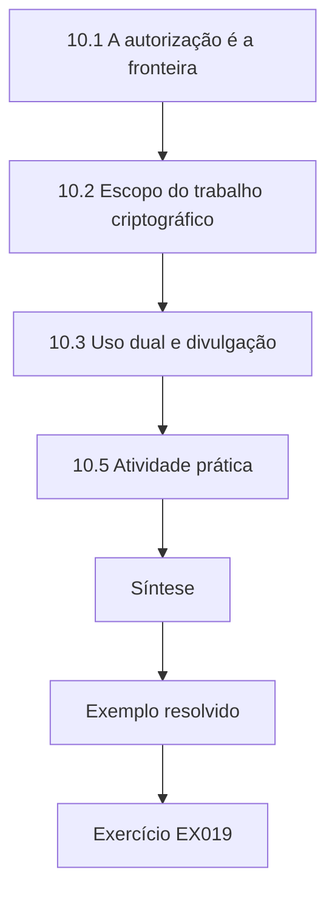

### Desenho lógico

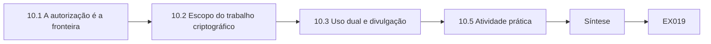

```text
[10.1 A autorização é a fronteira]
    |
    v
[10.2 Escopo do trabalho criptográfico]
    |
    v
[10.3 Uso dual e divulgação]
    |
    v
[10.5 Atividade prática]
    |
    v
[Síntese]
    |
    v
[Exemplo resolvido] --> [Exercício EX019]
```
<!-- cykin:lesson-figures:end ch-10 -->


### Objetivos de aprendizagem

Você vai (1) explicar por que a autorização define o trabalho de segurança legítimo; (2) escrever uma declaração de escopo para uma avaliação criptográfica; (3) lidar com responsabilidade com o conhecimento de uso dual; e (4) encaminhar as fraquezas descobertas pela divulgação coordenada.

### 10.1 A autorização é a fronteira

A mesma ação — varrer um servidor em busca dos grupos TLS que ele suporta, capturar um handshake, testar se um dispositivo aceita um algoritmo rebaixado — é trabalho profissional quando o dono do sistema a autoriza por escrito, e um crime ou uma quebra de confiança quando não autoriza. A autorização precisa nomear os sistemas, a janela de tempo, as técnicas permitidas, os dados que você pode coletar e a pessoa a contatar se algo quebrar. A aprovação verbal de um engenheiro amigo não é autorização; tampouco o fato de um serviço ser alcançável pela internet.

### 10.2 Escopo do trabalho criptográfico

As avaliações criptográficas podem parecer inofensivas, mas tocam coisas sensíveis: os certificados revelam nomes de hosts internos, as capturas de handshake podem conter metadados e os testes de rebaixamento podem quebrar sessões de produção. Um bom escopo diz, por exemplo: "Observação passiva dos handshakes TLS na porta espelho do gateway de teste da HCU, de 1º a 14 de maio; nenhuma retenção de payload; nenhum teste ativo de rebaixamento fora do laboratório isolado; resultados compartilhados apenas com o escritório de segurança da HCU." Os experimentos ativos que modificam a negociação ou injetam falhas pertencem a bancadas de teste isoladas.

Um escopo escrito também protege o estudante: se algo quebrar, o registro mostra o que era permitido.

### 10.3 Uso dual e divulgação

Saber encontrar sistemas vulneráveis à computação quântica também diz a um adversário onde procurar. Publique resultados agregados, e não listas de hosts vulneráveis nomeados. Se você encontrar uma fraqueza no produto de um fornecedor — por exemplo, uma biblioteca que aceita chaves ML-KEM malformadas —, relate-a em particular ao fornecedor, combine um prazo e publique apenas depois de uma correção ou do prazo combinado. Rotule claramente todos os dados sintéticos, para que os exemplos de ensino nunca sejam confundidos com resultados reais sobre organizações reais.

Os relatórios da HCU sobre a sua própria migração seguem a mesma regra e descrevem o progresso por contagens.

### 10.4 Exemplo resolvido

Um estagiário da HCU percebe que o site público de um banco parceiro ainda oferece apenas troca de chaves clássica e propõe "varrer todos os bancos parceiros" para um projeto de aula. A resposta ética: observar um único handshake público feito numa visita normal pelo navegador é algo comum, mas varrer sistematicamente os parceiros está fora da autoridade da HCU. Em vez disso, o estagiário estuda medições agregadas publicadas e pede à equipe de gestão de fornecedores da HCU que inclua perguntas sobre prontidão pós-quântica nos questionários aos parceiros.

A resposta mantém o objetivo útil, saber quão preparados estão os parceiros, enquanto o leva para um canal em que a HCU tem legitimidade para perguntar.

### 10.5 Atividade prática

Redija um pedido de autorização de uma página para um inventário TLS passivo de uma rede de teste sintética da HCU. Inclua os sistemas, as datas, as técnicas, o tratamento dos dados, as condições de parada e os contatos.

As condições de parada dizem quando interromper: por exemplo, se a rede de teste mostrar tráfego de produção inesperado ou se um serviço se degradar. Os contatos devem incluir alguém que possa autorizar uma parada a qualquer hora. O tratamento dos dados declara o que é capturado, onde é guardado e quando é apagado. Peça a um colega que leia o seu pedido como se fosse o dono do sistema e liste tudo o que ele se recusaria a assinar.

### 10.6 Erros comuns e limites

- Tratar a possibilidade de alcançar um sistema pela internet como permissão.
- Reter os payloads dos pacotes "por precaução".
- Publicar listas nomeadas de sistemas vulneráveis.

Conseguir alcançar um sistema não é o mesmo que ter permissão para testá-lo; a permissão vem do seu dono, por escrito. Os payloads podem conter dados pessoais de que a avaliação nunca precisou, e guardá-los cria risco sem benefício. As listas nomeadas ajudam os atacantes a escolher alvos, então compartilhe-as apenas com as pessoas que vão corrigir os sistemas. Cada erro prejudica a confiança que permite às equipes de segurança fazer o seu trabalho.

### Exercícios

- **EX019 — Lacunas de escopo.** Identifique três elementos ausentes em: "Você pode testar a nossa criptografia na semana que vem." Rubrica: 3 = três entre sistemas, técnicas, tratamento dos dados, janela, contatos, condições de parada.
- **EX020 — Divulgação.** Descreva as etapas depois de descobrir que o equipamento de VPN de um fornecedor recorre em silêncio à troca de chaves clássica quando o híbrido está configurado. Rubrica: 3 = relato privado, evidências, prazo, publicação coordenada.

### Síntese

A autorização, o tratamento dos dados dentro do escopo e a divulgação coordenada são o que torna profissional a avaliação criptográfica. Os experimentos ativos de rebaixamento ou de injeção de falhas pertencem apenas a bancadas de teste isoladas e autorizadas.

<!-- cykin:chapter-navigation:start ch-10 -->
### Continue estudando — capítulo 10 de 40

[← Capítulo 09](#ch-09) · [Índice de capítulos do curso](../SUBJECTS.md) · [Capítulo 11 →](#ch-11)

Siga para a próxima lição escrita.
<!-- cykin:chapter-navigation:end -->

<a id="ch-11"></a>

## Capítulo 11 — Sistemas operacionais

<!-- cykin:lesson-figures:start ch-11 -->
### Mapa da aula

Aula 11 publicada. Mapa, exemplo, EX021.

```mermaid
flowchart TD
  N0["11.1 Isolamento e privilégio"]
  N1["11.2 Provedores criptográficos"]
  N2["11.3 Atualizações e boot"]
  N3["11.5 Atividade prática"]
  N4["Síntese"]
  N0 --> N1 --> N2 --> N3 --> N4
  N4 --> EX["Exemplo resolvido"]
  EX --> Q["Exercício EX021"]
```

### Desenho lógico

```mermaid
flowchart LR
  N0["11.1 Isolamento e privilégio"]
  N1["11.2 Provedores criptográficos"]
  N2["11.3 Atualizações e boot"]
  N3["11.5 Atividade prática"]
  N4["Síntese"]
  N0 --> N1 --> N2 --> N3 --> N4 --> Q["EX021"]
```

```text
[11.1 Isolamento e privilégio]
    |
    v
[11.2 Provedores criptográficos]
    |
    v
[11.3 Atualizações e boot]
    |
    v
[11.5 Atividade prática]
    |
    v
[Síntese]
    |
    v
[Exemplo resolvido] --> [Exercício EX021]
```
<!-- cykin:lesson-figures:end ch-11 -->


### Objetivos de aprendizagem

Você vai (1) descrever processos, isolamento de memória, permissões de arquivos e serviços do sistema; (2) explicar como os sistemas operacionais oferecem serviços criptográficos e armazenamento de chaves; (3) identificar as dependências no nível do sistema operacional que controlam uma migração; e (4) raciocinar sobre os canais de atualização e as suas assinaturas.

### 11.1 Isolamento e privilégio

Um sistema operacional isola os processos em espaços de endereçamento separados, impõe permissões de arquivos e concede privilégios a usuários e serviços. Chaves guardadas num arquivo que todos podem ler anulam tudo isso; chaves mantidas por um serviço privilegiado, ou por hardware como um TPM, só são alcançáveis por interfaces definidas. O menor privilégio — dar a cada componente apenas o acesso de que ele precisa — se aplica ao material criptográfico tanto quanto aos arquivos.

O inventário da HCU registra, portanto, onde cada chave fica, além do algoritmo que ela usa.

### 11.2 Provedores criptográficos

As aplicações raramente implementam a criptografia elas mesmas. Elas chamam um *provedor*: os provedores do OpenSSL no Linux, o framework CNG no Windows, os repositórios de chaves da plataforma nos sistemas móveis. O provedor e a sua versão decidem quais algoritmos uma aplicação pode usar, então uma migração pós-quântica muitas vezes começa como uma atualização do sistema operacional ou de uma biblioteca. As políticas criptográficas de todo o sistema, em algumas distribuições Linux, definem os algoritmos permitidos num só lugar; isso é valioso para a agilidade, porque uma única mudança de política pode ativar um grupo híbrido em muitos serviços, e perigoso se for mudado sem testes.

### 11.3 Atualizações e boot

Os sistemas operacionais confiam em atualizações assinadas e, pelo boot seguro, em componentes de boot assinados. Hoje essas assinaturas usam tipicamente RSA ou ECDSA. Como os ataques de falsificação posterior visam âncoras de confiança de vida longa, os fornecedores estão planejando assinaturas pós-quânticas ou baseadas em hash para o firmware e as cadeias de boot; a [SP 800-208](https://doi.org/10.6028/NIST.SP.800-208) aprova os esquemas baseados em hash com estado LMS e XMSS, adequados à assinatura de firmware quando o signatário consegue gerenciar o estado com cuidado. Os dispositivos cuja ROM de boot só consegue verificar RSA não podem ser atualizados apenas por software.

Esses dispositivos precisam de um plano de substituição.

### 11.4 Exemplo resolvido

Os servidores das agências da HCU rodam uma distribuição Linux cuja versão atual do OpenSSL suporta o grupo híbrido X25519MLKEM768 no TLS. A equipe descobre que o middleware bancário central traz a sua própria biblioteca TLS, mais antiga e ligada estaticamente, e ignora o provedor do sistema operacional. Atualizar o sistema operacional não muda nada para esse middleware; o fornecedor precisa entregar uma nova versão. A visão no nível do sistema operacional revelou uma dependência oculta que uma lista de verificação servidor a servidor teria deixado escapar.

A equipe acrescenta ao inventário uma coluna que registra se cada aplicação usa a biblioteca do sistema ou a sua própria e pede a cada fornecedor um roteiro.

### 11.5 Atividade prática

Numa máquina virtual de laboratório que você controla, liste as bibliotecas criptográficas instaladas e as suas versões e encontre onde está configurada a política criptográfica do sistema (se houver). Registre quais aplicações ligam as suas próprias cópias.

Procure aplicações que trazem a sua própria biblioteca TLS, como alguns bancos de dados, ambientes de execução de linguagens e agentes de fornecedores. As suas versões podem estar anos atrás da biblioteca do sistema. Faça isso apenas numa máquina que você controla e não mude a política criptográfica durante o exercício. O seu registro se torna uma pequena versão do inventário de dependências que a HCU constrói para os seus servidores, e as mesmas perguntas valem em escala.

### 11.6 Erros comuns e limites

- Supor que uma atualização do sistema operacional migra todas as aplicações.
- Editar uma política criptográfica de todo o sistema diretamente na produção.
- Deixar de lado as assinaturas da cadeia de boot e das atualizações.

As aplicações que trazem as suas próprias bibliotecas não mudam quando o sistema operacional muda. As mudanças de política de todo o sistema podem quebrar serviços de maneiras difíceis de rastrear, então teste-as num laboratório e implante-as gradualmente. As assinaturas de boot e de atualização são fáceis de esquecer porque funcionam em silêncio, mas protegem o código mais confiável da máquina e muitas vezes têm os prazos de migração mais longos.

### Exercícios

- **EX021 — Dependência de provedor.** Explique por que uma aplicação que liga estaticamente a sua biblioteca TLS é um item de migração separado. Rubrica: 3 = consequências de dependência, de responsabilidade e de testes.
- **EX022 — Cadeia de boot.** Por que as assinaturas baseadas em hash com estado são adequadas à assinatura de firmware, mas arriscadas para um servidor web? Rubrica: 3 = menciona o gerenciamento do estado, o volume de assinaturas e a recuperação.

### Síntese

Os sistemas operacionais fornecem os provedores criptográficos, o armazenamento de chaves e as cadeias de atualização assinadas de que as aplicações dependem. A migração, portanto, passa pelas camadas do sistema operacional e das bibliotecas — e por todo componente que as contorna.

<!-- cykin:chapter-navigation:start ch-11 -->
### Continue estudando — capítulo 11 de 40

[← Capítulo 10](#ch-10) · [Índice de capítulos do curso](../SUBJECTS.md) · [Capítulo 12 →](#ch-12)

Siga para a próxima lição escrita.
<!-- cykin:chapter-navigation:end -->

<a id="ch-12"></a>

## Capítulo 12 — Probabilidade e estatística

<!-- cykin:lesson-figures:start ch-12 -->
### Mapa da aula

Aula 12 publicada. Mapa, exemplo, EX023.

```mermaid
flowchart TD
  N0["12.1 Eventos raros em escala"]
  N1["12.2 Atividade prática — Laboratório P"]
  N2["12.3 Taxas medidas e intervalos"]
  N3["12.4 Taxas de base"]
  N4["Síntese"]
  N0 --> N1 --> N2 --> N3 --> N4
  N4 --> EX["Exemplo resolvido"]
  EX --> Q["Exercício EX023"]
```

### Desenho lógico

```mermaid
flowchart LR
  N0["12.1 Eventos raros em escala"]
  N1["12.2 Atividade prática — Laboratório P"]
  N2["12.3 Taxas medidas e intervalos"]
  N3["12.4 Taxas de base"]
  N4["Síntese"]
  N0 --> N1 --> N2 --> N3 --> N4 --> Q["EX023"]
```

```text
[12.1 Eventos raros em escala]
    |
    v
[12.2 Atividade prática — Laboratório P]
    |
    v
[12.3 Taxas medidas e intervalos]
    |
    v
[12.4 Taxas de base]
    |
    v
[Síntese]
    |
    v
[Exemplo resolvido] --> [Exercício EX023]
```
<!-- cykin:lesson-figures:end ch-12 -->


### Objetivos de aprendizagem

Você vai (1) calcular probabilidades de eventos independentes e contagens esperadas; (2) raciocinar sobre probabilidades de falha muito pequenas; (3) usar intervalos de confiança para taxas medidas; e (4) interpretar os números de falha de decifração dos esquemas pós-quânticos.

### 12.1 Eventos raros em escala

Se um evento tem probabilidade *p* por tentativa e há *N* tentativas independentes, o número esperado de ocorrências é *Np*, e a probabilidade de pelo menos uma é 1 − (1 − *p*)^*N* ≈ *Np* quando *Np* é pequeno. Essa fórmula simples explica por que os criptógrafos exigem probabilidades de falha astronomicamente pequenas. Uma taxa de falha de 2^−20 parece minúscula, mas em 10^9 handshakes ela prevê cerca de 950 falhas. O ML-KEM é projetado para que o desencapsulamento honesto falhe com probabilidade de cerca de 2^−139 no ML-KEM-512 e de cerca de 2^−165 no ML-KEM-768, segundo a análise da FIPS 203, então as falhas são desprezíveis em qualquer escala realista.

### 12.2 Atividade prática — Laboratório P

```python
# Lab P (ch 12): how small must a failure probability be? Binomial reasoning for rare events.
import math
for p_exp in (-20, -40, -139):
    p = 10.0 ** (p_exp * math.log10(2))       # p = 2^p_exp
    for n_ops in (1e9, 1e15):
        exp_fail = n_ops * p
        print(f"p = 2^{p_exp:5d}, {n_ops:.0e} operations -> expected failures {exp_fail:.3e}")
```

Saída esperada:

```text
p = 2^  -20, 1e+09 operations -> expected failures 9.537e+02
p = 2^  -20, 1e+15 operations -> expected failures 9.537e+08
p = 2^  -40, 1e+09 operations -> expected failures 9.095e-04
p = 2^  -40, 1e+15 operations -> expected failures 9.095e+02
p = 2^ -139, 1e+09 operations -> expected failures 1.435e-33
p = 2^ -139, 1e+15 operations -> expected failures 1.435e-27
```

Observe como cada mudança de 20 bits no expoente desloca a contagem esperada por um fator de cerca de um milhão.

As linhas do meio mostram por que as probabilidades de falha nas normas são tão pequenas. Uma taxa que parece desprezível para um bilhão de operações pode produzir centenas de falhas em um milhão de bilhões, que os grandes serviços alcançam ao longo da sua vida. As últimas linhas mostram uma probabilidade tão pequena que não se esperam falhas em nenhuma escala realista. Quando um projeto cita uma taxa de falha, multiplique-a pelo número de operações que você espera antes de decidir se ela importa.

### 12.3 Taxas medidas e intervalos

Os dados operacionais dão contagens, não probabilidades. Se 3 de 5.000 conexões de teste falham, a estimativa pontual é 0,06%, mas a taxa verdadeira pode ser maior. Um intervalo de confiança de 95% — por exemplo, o intervalo de Wilson usado no Capítulo 29 — expressa essa incerteza. Com amostras pequenas, o limite superior é o que importa para uma decisão de seguir ou não: "estamos razoavelmente confiantes de que a taxa de falha está abaixo de *u*" é a afirmação defensável.

Relate o intervalo junto com a contagem e o tamanho da amostra, para que o leitor possa julgá-lo.

### 12.4 Taxas de base

A probabilidade também protege contra alarmes enganosos. Se um detector sinaliza os handshakes que "parecem tentativas de rebaixamento" com 99% de sensibilidade e 1% de falsos positivos, mas as tentativas reais de rebaixamento ocorrem em um handshake por milhão, então quase todos os alertas são falsos. Pergunte sempre pela taxa de base antes de interpretar uma contagem de alertas.

Neste exemplo, um milhão de handshakes daria cerca de dez mil alertas falsos e aproximadamente um verdadeiro. Uma equipe que recebesse esse fluxo aprenderia a ignorar o alerta, o que anula o seu propósito. Detectores melhores, ou a aplicação da regra apenas onde os rebaixamentos são mais prováveis, aumentam a parcela de alertas verdadeiros. A HCU pede esses números antes de adotar qualquer nova regra de detecção.

### 12.5 Exemplo resolvido

O aplicativo móvel da HCU realiza 2 × 10^8 estabelecimentos de chave por ano. Se um esquema hipotético falhasse com probabilidade 2^−40, as falhas esperadas seriam 2 × 10^8 × 9,1 × 10^−13 ≈ 1,8 × 10^−4 por ano — desprezíveis. Se um bug de implementação elevasse a taxa para 1 em 10^5, a contagem esperada seria de 2.000 por ano, visível nos chamados de suporte. As taxas de falha medidas testam, portanto, a implementação, e não a matemática.

Pediu-se à equipe de suporte da HCU que observasse esse padrão durante o piloto híbrido. Um aumento repentino dos erros de conexão após a atualização de uma biblioteca apontaria para o código, já que a própria taxa de falha do esquema não consegue produzir esses números.

### 12.6 Erros comuns e limites

- Ler a estimativa pontual de uma amostra pequena como a taxa verdadeira.
- Ignorar as taxas de base ao interpretar alertas.
- Supor independência onde as falhas são correlacionadas (um middlebox ruim afeta todas as conexões que passam por ele).

Amostras pequenas podem produzir uma estimativa pontual muito distante da taxa verdadeira, sobretudo para eventos raros; relate o intervalo. As taxas de base decidem se um alerta provavelmente é real. As falhas correlacionadas, como muitas conexões passando por um único dispositivo defeituoso, quebram a independência que os modelos simples supõem, então as falhas se agrupam e as médias enganam. Verifique onde as falhas ocorrem antes de tratá-las como independentes.

### Exercícios

- **EX023 — Falhas esperadas.** Com *p* = 2^−30 e 10^12 operações, calcule o número esperado de falhas. Rubrica: 3 = ≈ 931, com o método mostrado.
- **EX024 — Taxa de base.** Para o detector de rebaixamento de 12.4, estime a fração de alertas verdadeiros entre 10^8 handshakes. Rubrica: 3 = cerca de 100 verdadeiros em cerca de 10^6 alertas (≈ 0,01%), com o método mostrado.

### Síntese

Contagens esperadas, limites de confiança e taxas de base transformam probabilidades minúsculas e dados operacionais ruidosos em decisões defensáveis.

<!-- cykin:chapter-navigation:start ch-12 -->
### Continue estudando — capítulo 12 de 40

[← Capítulo 11](#ch-11) · [Índice de capítulos do curso](../SUBJECTS.md) · [Capítulo 13 →](#ch-13)

Siga para a próxima lição escrita.
<!-- cykin:chapter-navigation:end -->

<a id="ch-13"></a>

## Capítulo 13 — Identidade e acesso

<!-- cykin:lesson-figures:start ch-13 -->
### Mapa da aula

Aula 13 publicada. Mapa, exemplo, EX025.

```mermaid
flowchart TD
  N0["13.1 Três etapas"]
  N1["13.2 A PKI em resumo"]
  N2["13.3 Fluxos de autenticação"]
  N3["13.5 Atividade prática"]
  N4["Síntese"]
  N0 --> N1 --> N2 --> N3 --> N4
  N4 --> EX["Exemplo resolvido"]
  EX --> Q["Exercício EX025"]
```

### Desenho lógico

```mermaid
flowchart LR
  N0["13.1 Três etapas"]
  N1["13.2 A PKI em resumo"]
  N2["13.3 Fluxos de autenticação"]
  N3["13.5 Atividade prática"]
  N4["Síntese"]
  N0 --> N1 --> N2 --> N3 --> N4 --> Q["EX025"]
```

```text
[13.1 Três etapas]
    |
    v
[13.2 A PKI em resumo]
    |
    v
[13.3 Fluxos de autenticação]
    |
    v
[13.5 Atividade prática]
    |
    v
[Síntese]
    |
    v
[Exemplo resolvido] --> [Exercício EX025]
```
<!-- cykin:lesson-figures:end ch-13 -->


### Objetivos de aprendizagem

Você vai (1) distinguir identificação, autenticação e autorização; (2) explicar como os certificados e a infraestrutura de chaves públicas (PKI) ligam identidades a chaves; (3) identificar os elementos vulneráveis à computação quântica nos fluxos de autenticação comuns; e (4) planejar onde as assinaturas pós-quânticas serão necessárias primeiro.

### 13.1 Três etapas

A *identificação* alega uma identidade; a *autenticação* a prova; a *autorização* decide o que a parte autenticada pode fazer. Senhas, códigos de uso único e passkeys autenticam usuários; certificados e assinaturas autenticam máquinas e software. A autorização é geralmente uma contabilidade simétrica — listas de controle de acesso e papéis — e não é ameaçada diretamente pelos computadores quânticos. A autenticação baseada em assinaturas de chave pública é.

Manter as três etapas separadas ajuda uma equipe de migração a manter o foco. As tabelas de papéis e as listas de acesso da HCU não precisam de mudança por motivos quânticos. Todo lugar onde uma assinatura ou um login por chave pública prova a identidade precisa, e esses lugares estão espalhados por celulares, servidores, a autoridade certificadora e as versões de software. Listá-los por etapa torna o escopo do trabalho mais claro.

### 13.2 A PKI em resumo

Um certificado é uma declaração assinada por uma autoridade certificadora (AC): "esta chave pública pertence a este nome, válida até esta data". Os verificadores confiam num pequeno conjunto de ACs raiz e seguem as cadeias até elas. Se um adversário consegue calcular a chave privada de uma AC a partir da sua chave pública — como o algoritmo de Shor permitiria para o RSA e o ECDSA —, ele pode emitir certificados para qualquer nome. Como as chaves raiz têm vida longa e estão amplamente embutidas, a PKI é o alvo arquetípico da falsificação posterior. As normas de assinatura pós-quântica oferecem substitutos: o ML-DSA, na [FIPS 204](https://doi.org/10.6028/NIST.FIPS.204), para uso geral, e o SLH-DSA, na [FIPS 205](https://doi.org/10.6028/NIST.FIPS.205), como opção conservadora baseada em hash.

### 13.3 Fluxos de autenticação

As passkeys e os autenticadores FIDO usam assinaturas de chave pública (muitas vezes ECDSA) dentro de um elemento seguro. Os tokens de login único são assinados com RSA ou ECDSA. Os certificados de assinatura de código protegem as atualizações de software. Cada fluxo tem um caminho de migração diferente: os tokens de vida curta podem mudar rapidamente quando as bibliotecas suportarem o ML-DSA; os autenticadores de hardware precisam de dispositivos novos; as ACs raiz precisam de um longo planejamento, porque as partes confiantes precisam primeiro confiar nas novas raízes.

A HCU agrupa os seus fluxos pelo caminho de que cada um precisa. Os tokens de vida curta vêm primeiro; a AC, por último.

### 13.4 Exemplo resolvido

A HCU lista os seus usos de autenticação: as passkeys dos associados (ECDSA no hardware do celular), os tokens de SSO dos funcionários (RSA-2048, vida de 10 minutos), a AC interna (raiz RSA-4096, validade de 20 anos), a assinatura de código do aplicativo móvel (ECDSA, controlada pela plataforma). O risco de falsificação posterior é maior para a raiz de vida longa e para a assinatura de código, em que uma assinatura falsificada permitiria a um adversário distribuir software malicioso. Os tokens de SSO de vida curta têm prioridade menor: falsificar um exige um computador quântico no momento do ataque, e a chave pode ser trocada rapidamente assim que existir um.

A lista também mostra quem controla cada mudança. A HCU pode mudar os seus próprios tokens e a sua AC; para as passkeys e a assinatura de código, depende dos fabricantes de celulares e das plataformas de aplicativos.

### 13.5 Atividade prática

Desenhe a hierarquia de certificados da HCU: raiz, duas intermediárias, folhas de servidor e de cliente. Anote em cada uma o algoritmo, a validade e quem precisa confiar nela. Marque quais mudanças exigem que as partes confiantes atualizem os seus repositórios de confiança.

As partes confiantes incluem os celulares dos associados, os servidores das agências, os caixas eletrônicos e os bancos parceiros, cada um com uma forma diferente de atualizar a confiança. Alguns podem receber uma nova raiz numa atualização de rotina; outros, como os caixas eletrônicos, podem precisar da visita de um fornecedor. Marque esses com cuidado, porque eles ditam o ritmo de toda a migração dos certificados. Compare o seu diagrama com o de um colega e confira se os dois puseram os mesmos períodos de validade nos mesmos certificados.

### 13.6 Erros comuns e limites

- Tratar as listas de autorização como vulneráveis à computação quântica.
- Planejar migrar os certificados folha antes que as partes confiantes confiem numa raiz pós-quântica.
- Esquecer os autenticadores de hardware que não podem ser atualizados.

As listas de acesso e as tabelas de papéis não usam matemática de chave pública, então os computadores quânticos não as ameaçam. Emitir certificados folha pós-quânticos antes que as partes confiantes confiem numa raiz correspondente faz as conexões falharem. Os autenticadores de hardware com algoritmos fixos só podem ser substituídos, o que exige orçamento e anos. Um plano que os ignora parecerá completo no papel e travará na prática, quando se descobrir que os dispositivos estão nos bolsos dos associados.

### Exercícios

- **EX025 — Classificar.** Para senhas, passkeys, tokens de SSO e uma AC raiz interna, declare se um computador quântico ameaça o mecanismo e por quê. Rubrica: 3 = quatro entradas corretas e fundamentadas.
- **EX026 — Ordem do trabalho.** Explique por que uma raiz pós-quântica precisa ser distribuída às partes confiantes antes que os certificados folha pós-quânticos sejam úteis. Rubrica: 3 = lógica de validação da cadeia enunciada.

### Síntese

Os computadores quânticos ameaçam a autenticação de chave pública, e não a lógica de autorização. As raízes da PKI e a assinatura de código são os alvos de vida longa; os tokens de vida curta podem vir depois.

<!-- cykin:chapter-navigation:start ch-13 -->
### Continue estudando — capítulo 13 de 40

[← Capítulo 12](#ch-12) · [Índice de capítulos do curso](../SUBJECTS.md) · [Capítulo 14 →](#ch-14)

Siga para a próxima lição escrita.
<!-- cykin:chapter-navigation:end -->

<a id="ch-14"></a>

## Capítulo 14 — Fundamentos de privacidade

<!-- cykin:lesson-figures:start ch-14 -->
### Mapa da aula

Aula 14 publicada. Mapa, exemplo, EX027.

```mermaid
flowchart TD
  N0["14.1 Princípios"]
  N1["14.2 Tempo de vida do dano"]
  N2["14.3 A minimização como controle quântico"]
  N3["14.5 Atividade prática"]
  N4["Síntese"]
  N0 --> N1 --> N2 --> N3 --> N4
  N4 --> EX["Exemplo resolvido"]
  EX --> Q["Exercício EX027"]
```

### Desenho lógico

```mermaid
flowchart LR
  N0["14.1 Princípios"]
  N1["14.2 Tempo de vida do dano"]
  N2["14.3 A minimização como controle quântico"]
  N3["14.5 Atividade prática"]
  N4["Síntese"]
  N0 --> N1 --> N2 --> N3 --> N4 --> Q["EX027"]
```

```text
[14.1 Princípios]
    |
    v
[14.2 Tempo de vida do dano]
    |
    v
[14.3 A minimização como controle quântico]
    |
    v
[14.5 Atividade prática]
    |
    v
[Síntese]
    |
    v
[Exemplo resolvido] --> [Exercício EX027]
```
<!-- cykin:lesson-figures:end ch-14 -->


### Objetivos de aprendizagem

Você vai (1) enunciar princípios centrais de privacidade, como a limitação da finalidade e a minimização; (2) relacionar o dano à privacidade com o tempo de confidencialidade; (3) explicar por que o "colete agora, decifre depois" é um problema de privacidade; e (4) projetar uma medição que minimize os dados para o trabalho de migração.

### 14.1 Princípios

A legislação e a prática de privacidade compartilham princípios comuns: coletar dados pessoais para uma finalidade declarada, coletar apenas o necessário (*minimização*), guardá-los apenas pelo tempo necessário (*limitação do armazenamento*), protegê-los adequadamente e ser transparente. Esses princípios dizem respeito às pessoas, e não aos sistemas; um dano à privacidade é um dano a um associado cujos dados são expostos, mesmo que a organização não sofra perda alguma.

Numa migração quântica, esses princípios moldam duas coisas: quais dados mais precisam de proteção e como o próprio trabalho de migração trata as informações pessoais encontradas pelo caminho.

### 14.2 Tempo de vida do dano

Alguns dados pessoais deixam de importar rapidamente; outros continuam sensíveis por toda a vida — condições de saúde, dificuldades financeiras, documentos de identidade. O "colete agora, decifre depois" transforma a sensibilidade de vida longa em risco presente: o tráfego gravado hoje pode revelar amanhã o que um associado contou em confiança décadas antes. Para a privacidade, o *x* relevante na desigualdade de Mosca é o tempo de vida do dano à pessoa, que pode exceder o período de retenção da organização. Apagar um registro do banco de dados da HCU não apaga uma cópia que um adversário gravou em trânsito.

### 14.3 A minimização como controle quântico

A proteção mais barata para os dados é não enviá-los. Reduzir o que atravessa as redes — tokenizar números de conta, manter os campos sensíveis no data center e enviar apenas resultados derivados — diminui a exposição ao HNDL, qualquer que seja o algoritmo. A minimização também se aplica à própria medição da migração: um inventário precisa de nomes de algoritmos e identificadores de hosts, e não do conteúdo das mensagens.

A primeira revisão do tráfego das agências da HCU encontrou nomes de associados viajando junto com transações que precisavam apenas de um token de conta. Substituir os nomes por tokens reduziu a exposição de imediato, antes que qualquer algoritmo mudasse.

### 14.4 Exemplo resolvido

O fluxo de pedidos de empréstimo da HCU envia os perfis completos dos solicitantes das agências para a sede, incluindo anotações médicas nos casos de dificuldade financeira. Uma revisão de privacidade descobre que os analistas de crédito da sede precisam apenas de um indicador de dificuldade e de um valor. Mudar o formulário para que as anotações médicas fiquem no processo da agência reduz tanto a pegada de privacidade quanto os dados expostos à decifração futura, antes que qualquer algoritmo pós-quântico seja implantado. A troca de chaves híbrida na VPN das agências é então agendada para os fluxos restantes.

### 14.5 Atividade prática

Para três fluxos de dados sintéticos da HCU, liste os campos de dados pessoais, a finalidade e quais campos poderiam ser removidos, tokenizados ou agregados antes da transmissão.

Os candidatos típicos são nomes completos enviados onde um identificador bastaria, datas de nascimento enviadas para verificações que só precisam de uma faixa etária e números de conta enviados onde um token funciona. Para cada campo que você remover, diga quem perceberia e se algum processo quebra. Depois, estime quanto a mudança reduz os dados de vida longa que atravessam a rede, que é a exposição da qual o "colete agora, decifre depois" depende.

### 14.6 Erros comuns e limites

- Igualar o período de retenção ao tempo de vida do dano.
- Coletar capturas completas de pacotes para um inventário.
- Tratar a PQC como substituta da minimização, e não como complemento.

O dano da divulgação pode durar muito mais do que o registro é guardado: um arquivo de financiamento imobiliário apagado que foi gravado em trânsito ainda pode ser decifrado depois. As capturas completas coletam dados pessoais de que o inventário nunca precisou e criam um novo repositório a proteger. Os algoritmos pós-quânticos protegem o que é enviado; a minimização reduz o que é enviado. Os dois funcionam juntos, e nenhum substitui o outro.

### Exercícios

- **EX027 — Tempo de vida do dano.** Dê dois tipos de dados cujo dano à privacidade dure mais do que o período de retenção da HCU e explique a consequência para o HNDL. Rubrica: 3 = dois exemplos, com raciocínio ligado ao tráfego gravado.
- **EX028 — Minimize o inventário.** Especifique os campos mínimos de que um inventário TLS passivo precisa e dois campos que ele não deve coletar. Rubrica: 3 = listas justificadas.

### Síntese

O dano à privacidade pode durar mais do que qualquer cronograma de retenção, o que faz do "colete agora, decifre depois" uma questão de privacidade. A minimização reduz a exposição sob qualquer algoritmo e deve preceder e acompanhar a PQC.

<!-- cykin:chapter-navigation:start ch-14 -->
### Continue estudando — capítulo 14 de 40

[← Capítulo 13](#ch-13) · [Índice de capítulos do curso](../SUBJECTS.md) · [Capítulo 15 →](#ch-15)

Siga para a próxima lição escrita.
<!-- cykin:chapter-navigation:end -->

<a id="ch-15"></a>

## Capítulo 15 — Evidências e medição

<!-- cykin:lesson-figures:start ch-15 -->
### Mapa da aula

Aula 15 publicada. Mapa, exemplo, EX029.

```mermaid
flowchart TD
  N0["15.1 O que torna uma medição útil"]
  N1["15.2 Indicadores de prontidão"]
  N2["15.3 Proveniência"]
  N3["15.5 Atividade prática"]
  N4["Síntese"]
  N0 --> N1 --> N2 --> N3 --> N4
  N4 --> EX["Exemplo resolvido"]
  EX --> Q["Exercício EX029"]
```

### Desenho lógico

```mermaid
flowchart LR
  N0["15.1 O que torna uma medição útil"]
  N1["15.2 Indicadores de prontidão"]
  N2["15.3 Proveniência"]
  N3["15.5 Atividade prática"]
  N4["Síntese"]
  N0 --> N1 --> N2 --> N3 --> N4 --> Q["EX029"]
```

```text
[15.1 O que torna uma medição útil]
    |
    v
[15.2 Indicadores de prontidão]
    |
    v
[15.3 Proveniência]
    |
    v
[15.5 Atividade prática]
    |
    v
[Síntese]
    |
    v
[Exemplo resolvido] --> [Exercício EX029]
```
<!-- cykin:lesson-figures:end ch-15 -->


### Objetivos de aprendizagem

Você vai (1) definir validade, confiabilidade e cobertura para as medições de segurança; (2) escolher indicadores de prontidão criptográfica; (3) registrar a proveniência de cada observação; e (4) apresentar as medições com os seus pontos cegos.

### 15.1 O que torna uma medição útil

Uma medição é *válida* se mede o que afirma medir, *confiável* se dá o mesmo resultado quando repetida, e tem *cobertura* conhecida se sabemos que parcela da população ela observa. A "porcentagem de conexões TLS que usam troca de chaves híbrida" é válida se contada a partir das mensagens ServerHello, confiável se o sensor for estável, e a sua cobertura é a parcela do tráfego que passa pelo sensor. Sem a cobertura, um número de 90% pode descrever apenas o décimo fácil do parque.

A cobertura é a propriedade que mais falta nos painéis de segurança.

### 15.2 Indicadores de prontidão

Indicadores úteis para uma migração quântica incluem: a parcela de ativos com um inventário criptográfico conhecido; a parcela de fluxos de dados de vida longa protegidos por troca de chaves híbrida; a parcela de certificados emitidos por ACs capazes de emitir certificados pós-quânticos; o número de fornecedores com um roteiro de PQC publicado; e o tempo médio para mudar um algoritmo por configuração. Cada indicador deve ter um responsável, uma fonte e uma frequência de atualização.

A HCU começou com três desses e acrescentou os outros quando os responsáveis foram acordados. Cada um tem uma fonte.

### 15.3 Proveniência

Registre para cada observação: o que foi observado, por qual método (rede passiva, configuração, varredura de código, declaração do fornecedor), quando e por quem. Os métodos diferem em confiança: um handshake observado é uma evidência mais forte do que a ficha técnica de um fornecedor. No TLS 1.3, um sensor passivo vê o grupo selecionado, mas não o certificado do servidor, que é cifrado, então os algoritmos dos certificados precisam vir de evidências dos endpoints ou da configuração. Misturar métodos sem rótulos faz os painéis parecerem mais certos do que são.

O inventário da HCU tem uma coluna para o método e outra para a data, e os painéis mostram as duas.

### 15.4 Exemplo resolvido

O primeiro painel da HCU relata "92% das conexões híbridas". Ao inspecioná-lo, descobre-se que o único sensor fica diante do novo gateway web, que já usa o X25519MLKEM768; as VPNs das agências e a rede de caixas eletrônicos são invisíveis para ele. O painel corrigido mostra "tráfego web: 92% híbrido (cobertura do sensor: 100% do gateway web); VPN: 0% (evidência de configuração, 40/40 agências); caixas eletrônicos: desconhecido (sem sensor)". O número de destaque caiu, e a qualidade das decisões subiu.

A correção não mudou nenhum sistema, apenas o que o painel afirmava. Os gestores passaram a ver onde restava trabalho e onde a equipe simplesmente não tinha visibilidade. A linha dos caixas eletrônicos levou a um pedido ao fornecedor dos caixas eletrônicos por evidências de configuração, já que acrescentar um sensor de rede ali não era possível.

### 15.5 Atividade prática

Projete três indicadores de prontidão para a HCU. Para cada um, dê a definição, a fonte, a cobertura, o responsável e a frequência de atualização, e nomeie uma forma como ele poderia enganar.

Uma boa definição diz exatamente o que é contado e o que não é. A cobertura deve declarar que parte do parque a fonte consegue ver. Um responsável é uma pessoa ou um papel que vai perceber quando o número parecer errado. A forma como um indicador poderia enganar é muitas vezes a sua linha mais útil: por exemplo, uma contagem de fornecedores com roteiros não diz nada sobre se os roteiros são realistas ou têm datas.

### 15.6 Erros comuns e limites

- Relatar uma porcentagem sem o seu denominador e a sua cobertura.
- Tratar as alegações dos fornecedores como observações.
- Contar conexões quando a decisão diz respeito a ativos ou classes de dados.

Uma porcentagem sem a sua base pode esconder uma amostra minúscula ou enviesada. As declarações dos fornecedores são úteis, mas não testadas; rotule-as como alegações até que alguém observe o comportamento. Contar conexões favorece os sistemas movimentados, enquanto as decisões de migração geralmente dizem respeito a quais ativos ou classes de dados estão protegidos. Um único serviço web movimentado pode fazer o número parecer bom enquanto um enlace de arquivo, pouco movimentado mas sensível, continua clássico. Escolha a unidade que corresponde à decisão.

### Exercícios

- **EX029 — Cobertura.** Reescreva "95% dos nossos certificados estão prontos para PQC" de modo que declare o método, a cobertura e o denominador. Rubrica: 3 = os três presentes e plausíveis.
- **EX030 — Projeto de indicador.** Proponha um indicador para "capacidade de mudar algoritmos rapidamente" e explique como medi-lo. Rubrica: 3 = definição, método de medição, limitação.

### Síntese

Medições válidas e confiáveis, com cobertura e proveniência declaradas, permitem que os tomadores de decisão vejam tanto o progresso quanto os pontos cegos.

<!-- cykin:chapter-navigation:start ch-15 -->
### Continue estudando — capítulo 15 de 40

[← Capítulo 14](#ch-14) · [Índice de capítulos do curso](../SUBJECTS.md) · [Capítulo 16 →](#ch-16)

Siga para a próxima lição escrita.
<!-- cykin:chapter-navigation:end -->

<a id="ch-16"></a>

## Capítulo 16 — Arquitetura de segurança

<!-- cykin:lesson-figures:start ch-16 -->
### Mapa da aula

Aula 16 publicada. Mapa, exemplo, EX031.

```mermaid
flowchart TD
  N0["16.1 Fronteiras e zonas"]
  N1["16.2 Diagramas de fluxo de dados"]
  N2["16.3 Agilidade criptográfica"]
  N3["16.4 Fronteiras no tempo"]
  N4["Síntese"]
  N0 --> N1 --> N2 --> N3 --> N4
  N4 --> EX["Exemplo resolvido"]
  EX --> Q["Exercício EX031"]
```

### Desenho lógico

```mermaid
flowchart LR
  N0["16.1 Fronteiras e zonas"]
  N1["16.2 Diagramas de fluxo de dados"]
  N2["16.3 Agilidade criptográfica"]
  N3["16.4 Fronteiras no tempo"]
  N4["Síntese"]
  N0 --> N1 --> N2 --> N3 --> N4 --> Q["EX031"]
```

```text
[16.1 Fronteiras e zonas]
    |
    v
[16.2 Diagramas de fluxo de dados]
    |
    v
[16.3 Agilidade criptográfica]
    |
    v
[16.4 Fronteiras no tempo]
    |
    v
[Síntese]
    |
    v
[Exemplo resolvido] --> [Exercício EX031]
```
<!-- cykin:lesson-figures:end ch-16 -->


### Objetivos de aprendizagem

Você vai (1) descrever fronteiras de confiança, zonas e defesa em profundidade; (2) desenhar um diagrama de fluxo de dados que mostre as proteções criptográficas; (3) explicar a agilidade criptográfica como uma propriedade da arquitetura; e (4) identificar as fronteiras de confiança de vida longa que atravessam o tempo.

### 16.1 Fronteiras e zonas

Uma *fronteira de confiança* separa componentes com níveis de confiança diferentes — a internet e a camada web da HCU, a camada web e a zona bancária central, uma agência e o data center. Os dados que atravessam uma fronteira precisam de uma proteção adequada à sua sensibilidade: cifração, autenticação, validação. A *defesa em profundidade* sobrepõe controles independentes, para que uma falha não exponha tudo.

Para a migração quântica, as fronteiras que mais importam são aquelas em que dados de vida longa saem de uma zona protegida por uma rede que outra pessoa poderia gravar.

### 16.2 Diagramas de fluxo de dados

Um diagrama de fluxo de dados mostra entidades externas, processos, repositórios de dados e os fluxos entre eles, com as fronteiras de confiança desenhadas como linhas tracejadas. Anotar cada fluxo com o protocolo, o algoritmo de troca de chaves, o algoritmo de autenticação e o tempo de vida dos dados transforma o diagrama num mapa de exposição quântica: qualquer fluxo que atravessa uma fronteira não confiável com dados de vida longa e troca de chaves clássica é candidato ao "colete agora, decifre depois".

O primeiro diagrama da HCU levou uma semana para ser anotado, sobretudo porque ninguém sabia qual algoritmo vários fluxos usavam. Essas lacunas foram tão úteis quanto as respostas: cada uma virou uma pergunta para um responsável ou um fornecedor. Desenhar o diagrama antes de escolher qualquer algoritmo novo fez o plano partir do que os sistemas realmente fazem.

### 16.3 Agilidade criptográfica

A *agilidade criptográfica* é a capacidade de trocar algoritmos criptográficos com esforço e risco limitados. Na arquitetura, ela significa política centralizada, identificadores de algoritmo que viajam com os dados, bibliotecas que suportam vários algoritmos e interfaces que toleram chaves e assinaturas maiores. O [CSWP 39](https://doi.org/10.6028/NIST.CSWP.39-upd1) do NIST discute as considerações sobre a agilidade criptográfica. Uma arquitetura sem agilidade trata a migração PQC como uma reconstrução única; uma arquitetura ágil a trata como a primeira de várias mudanças planejadas.

Para a HCU, a agilidade é testada perguntando quanto tempo levaria para trocar um algoritmo na VPN das agências.

### 16.4 Fronteiras no tempo

Algumas fronteiras não são atravessadas no espaço, mas no tempo. Um financiamento imobiliário assinado hoje será verificado por um tribunal ou um comprador anos depois; um arquivo cifrado hoje será decifrado durante uma auditoria futura. A arquitetura deve mostrar os serviços de longo prazo — carimbo de tempo, recifração de arquivos, renovação de evidências — como componentes cuja própria criptografia precisa ser migrada.

O arquivo de financiamentos imobiliários da HCU é o caso mais claro: a sua cifração e as suas assinaturas precisam continuar funcionando, e seguras, décadas depois da criação dos documentos. Cada uma precisa de um responsável.

### 16.5 Exemplo resolvido

O diagrama da HCU mostra aplicativo móvel → gateway web (fronteira com a internet, TLS híbrido), gateway web → sistema bancário central (interno, TLS clássico), sistema bancário central → arquivo (interno, AES-256 em repouso, chaves envelopadas com RSA-OAEP), agência → data center (fronteira da WAN, IPsec ECDH). A anotação revela duas prioridades: a WAN das agências, pelo HNDL, e as chaves do arquivo envelopadas com RSA, que ficam expostas se as chaves envelopadas forem algum dia copiadas para fora do local.

O enlace TLS interno entre o gateway e o sistema bancário central é clássico, mas fica dentro do data center, o que reduz a sua prioridade. O diagrama tornou essas escolhas visíveis numa só página, e o escritório de segurança da HCU o usou para acordar o plano de migração do primeiro ano.

### 16.6 Erros comuns e limites

- Desenhar diagramas sem algoritmos e tempos de vida.
- Considerar apenas as fronteiras de rede, e não as fronteiras no tempo.
- Fixar as escolhas de algoritmo no código da aplicação.

Um diagrama sem algoritmos e tempos de vida não consegue mostrar a exposição quântica, por mais organizado que pareça. As fronteiras no tempo são fáceis de deixar passar porque não aparecem nos mapas de rede; os arquivos, os carimbos de tempo e os registros assinados as atravessam em silêncio. As escolhas de algoritmo fixadas no código da aplicação transformam cada mudança futura num projeto de software, o oposto da agilidade criptográfica. Registre cada escolha na configuração ou na política, para que possa ser encontrada e mudada depois.

### Exercícios

- **EX031 — Mapa de exposição.** Para o diagrama da HCU em 16.5, ordene os quatro fluxos pela prioridade de HNDL e justifique a ordem. Rubrica: 3 = ordem coerente com a fronteira, o tempo de vida e o algoritmo.
- **EX032 — Recursos de agilidade.** Liste três recursos de arquitetura que permitiriam à HCU trocar o ML-KEM-768 por outro KEM, se necessário. Rubrica: 3 = três recursos concretos e distintos.

### Síntese

As fronteiras de confiança, os fluxos de dados anotados e a agilidade criptográfica permitem que os arquitetos localizem a exposição quântica e projetem para trocas repetidas de algoritmo, inclusive nas fronteiras atravessadas no tempo.

<!-- cykin:chapter-navigation:start ch-16 -->
### Continue estudando — capítulo 16 de 40

[← Capítulo 15](#ch-15) · [Índice de capítulos do curso](../SUBJECTS.md) · [Capítulo 17 →](#ch-17)

Siga para a próxima lição escrita.
<!-- cykin:chapter-navigation:end -->

<a id="ch-17"></a>

## Capítulo 17 — Conceitos de criptografia

<!-- cykin:lesson-figures:start ch-17 -->
### Mapa da aula

Aula 17 publicada. Mapa, exemplo, EX033.

```mermaid
flowchart TD
  N0["17.1 A caixa de ferramentas"]
  N1["17.2 As normas do NIST"]
  N2["17.3 Atividade prática — Laboratório L"]
  N3["Síntese"]
  N0 --> N1 --> N2 --> N3
  N3 --> EX["Exemplo resolvido"]
  EX --> Q["Exercício EX033"]
```

### Desenho lógico

```mermaid
flowchart LR
  N0["17.1 A caixa de ferramentas"]
  N1["17.2 As normas do NIST"]
  N2["17.3 Atividade prática — Laboratório L"]
  N3["Síntese"]
  N0 --> N1 --> N2 --> N3 --> Q["EX033"]
```

```text
[17.1 A caixa de ferramentas]
    |
    v
[17.2 As normas do NIST]
    |
    v
[17.3 Atividade prática — Laboratório L]
    |
    v
[Síntese]
    |
    v
[Exemplo resolvido] --> [Exercício EX033]
```
<!-- cykin:lesson-figures:end ch-17 -->


### Objetivos de aprendizagem

Você vai (1) distinguir cifração simétrica, funções de hash, MACs, troca de chaves, KEMs e assinaturas; (2) explicar os níveis de segurança e as categorias pós-quânticas do NIST; (3) construir e quebrar uma assinatura de uso único de Lamport; e (4) nomear as três normas pós-quânticas finais do NIST.

### 17.1 A caixa de ferramentas

A *cifração simétrica* (AES) usa uma única chave compartilhada; as *funções de hash* (SHA-2, SHA-3) comprimem os dados numa impressão digital; os *MACs* (HMAC) provam a integridade com uma chave compartilhada; a *troca de chaves* (Diffie–Hellman) permite que duas partes derivem um segredo compartilhado por um canal público; um *mecanismo de encapsulamento de chaves* (KEM) permite que uma parte encapsule um segredo novo para a chave pública da outra; as *assinaturas* permitem que qualquer um verifique que o detentor de uma chave privada aprovou uma mensagem. Os computadores quânticos ameaçam a troca de chaves, a cifração de chave pública e as assinaturas baseadas em fatoração e logaritmos discretos; as primitivas simétricas e os hashes precisam, no máximo, de parâmetros maiores.

### 17.2 As normas do NIST

Em agosto de 2024, o NIST publicou três normas pós-quânticas: a [FIPS 203](https://doi.org/10.6028/NIST.FIPS.203), ML-KEM, um KEM baseado em reticulados com os conjuntos de parâmetros ML-KEM-512, -768 e -1024; a [FIPS 204](https://doi.org/10.6028/NIST.FIPS.204), ML-DSA, uma assinatura baseada em reticulados; e a [FIPS 205](https://doi.org/10.6028/NIST.FIPS.205), SLH-DSA, uma assinatura baseada em hash sem estado. Antes disso, a [SP 800-208](https://doi.org/10.6028/NIST.SP.800-208) havia aprovado as assinaturas baseadas em hash com estado LMS e XMSS. O NIST define as *categorias* de segurança 1–5 por comparação com a quebra do AES-128, do SHA-256, do AES-192, do SHA-384 e do AES-256; o ML-KEM-768 visa a categoria 3.

Para a HCU, os conjuntos de parâmetros da categoria três são o ponto de partida comum, já que oferecem uma margem confortável com tamanho moderado.

### 17.3 Atividade prática — Laboratório L

O esquema de Lamport assina uma mensagem revelando, para cada bit do seu hash, um de dois valores secretos cujos hashes formam a chave pública.

```python
# Lab L (ch 17): Lamport one-time signatures from SHA-256 - the idea under SLH-DSA, LMS and XMSS.
import hashlib, secrets
H = lambda b: hashlib.sha256(b).digest()
def keygen(bits=256):
    sk = [(secrets.token_bytes(32), secrets.token_bytes(32)) for _ in range(bits)]
    pk = [(H(a), H(b)) for a, b in sk]
    return sk, pk
def bits_of(msg):
    d = int.from_bytes(H(msg), "big"); return [(d >> (255 - i)) & 1 for i in range(256)]
def sign(sk, msg): return [sk[i][b] for i, b in enumerate(bits_of(msg))]
def verify(pk, msg, sig): return all(H(s) == pk[i][b] for i, (s, b) in enumerate(zip(sig, bits_of(msg))))
sk, pk = keygen()
s1 = sign(sk, b"firmware v1.0")
print("valid signature verifies:", verify(pk, b"firmware v1.0", s1))
print("tampered message rejected:", not verify(pk, b"firmware v1.1", s1))
s2 = sign(sk, b"firmware v1.1")          # KEY REUSE: never do this
revealed = sum(1 for i in range(256) if bits_of(b"firmware v1.0")[i] != bits_of(b"firmware v1.1")[i])
print(f"after one reuse, both secrets revealed at {revealed}/256 positions -> forging needs ~2^{256 - revealed} hashes, not 2^256")
print("signature size:", 256 * 32, "bytes; public key:", 2 * 256 * 32, "bytes")
```

Saída esperada:

```text
valid signature verifies: True
tampered message rejected: True
after one reuse, both secrets revealed at 118/256 positions -> forging needs ~2^138 hashes, not 2^256
signature size: 8192 bytes; public key: 16384 bytes
```

A segurança se apoia apenas na função de hash, e é por isso que as assinaturas baseadas em hash são consideradas conservadoras. A reutilização é fatal: duas assinaturas revelam os dois segredos em muitas posições. O SLH-DSA constrói árvores de assinaturas de uso único e de poucos usos, para que uma única chave possa assinar muitas mensagens sem estado; o LMS e o XMSS o fazem com um estado que o signatário nunca pode repetir.

### 17.4 Exemplo resolvido

O arquiteto da HCU pergunta qual primitiva atende a cada necessidade: a cifração do arquivo (AES-256, manter), o transporte de chaves para o arquivo (KEM: ML-KEM-768 num híbrido), a assinatura dos extratos (ML-DSA-65 quando houver suporte, ou híbrido com ECDSA durante a transição), a assinatura do firmware dos caixas eletrônicos (LMS pela SP 800-208 ou SLH-DSA, porque o volume de assinaturas é baixo e o conservadorismo é valorizado).

Cada escolha decorre da necessidade, e não do algoritmo mais novo. A cifração simétrica fica porque a busca de Grover deixa o AES-256 forte. O transporte de chaves precisa de um KEM. As assinaturas precisam ser verificáveis enquanto a declaração assinada importar. A assinatura de firmware favorece os esquemas baseados em hash porque a sua segurança se apoia apenas nas funções de hash, e o baixo volume de assinaturas torna prático o gerenciamento do estado.

### 17.5 Erros comuns e limites

- Chamar o ML-KEM de "cifração"; ele é um KEM que produz um segredo compartilhado.
- Reutilizar chaves de assinatura de uso único ou com estado.
- Tratar o laboratório de Lamport de brinquedo como código utilizável.

Um KEM dá aos dois lados um segredo compartilhado; os próprios dados são então cifrados com um algoritmo simétrico. As chaves de assinatura com estado nunca podem assinar duas vezes com a mesma chave de uso único, o que significa que o signatário precisa acompanhar o estado de forma confiável, inclusive entre backups e falhas. O esquema de Lamport do laboratório existe para mostrar a ideia das assinaturas baseadas em hash; ele é inseguro na prática e nunca deve ser usado fora da sala de aula.

### Exercícios

- **EX033 — Escolha a primitiva.** Para o armazenamento de senhas, a integridade das mensagens entre dois servidores da HCU, o acordo de chave de sessão e a aprovação de documentos, nomeie a primitiva e um algoritmo padronizado. Rubrica: 3 = quatro escolhas corretas.
- **EX034 — Reutilização.** Usando a saída do Laboratório L, explique por que a segunda assinatura de Lamport permite a falsificação. Rubrica: 3 = os dois segredos em muitas posições, combinados para assinar novas mensagens.

### Síntese

Os computadores quânticos quebram a troca de chaves e as assinaturas de chave pública baseadas em fatoração e logaritmos discretos. As FIPS 203, 204 e 205 e a SP 800-208 do NIST fornecem os substitutos; as primitivas simétricas e de hash permanecem, com tamanhos adequados.

<!-- cykin:chapter-navigation:start ch-17 -->
### Continue estudando — capítulo 17 de 40

[← Capítulo 16](#ch-16) · [Índice de capítulos do curso](../SUBJECTS.md) · [Capítulo 18 →](#ch-18)

Siga para a próxima lição escrita.
<!-- cykin:chapter-navigation:end -->

<a id="ch-18"></a>

## Capítulo 18 — Métodos de pesquisa I

<!-- cykin:lesson-figures:start ch-18 -->
### Mapa da aula

Aula 18 publicada. Mapa, exemplo, EX035.

```mermaid
flowchart TD
  N0["18.1 Perguntas"]
  N1["18.2 Métodos"]
  N2["18.3 Populações, amostras e validade"]
  N3["18.5 Atividade prática"]
  N4["Síntese"]
  N0 --> N1 --> N2 --> N3 --> N4
  N4 --> EX["Exemplo resolvido"]
  EX --> Q["Exercício EX035"]
```

### Desenho lógico

```mermaid
flowchart LR
  N0["18.1 Perguntas"]
  N1["18.2 Métodos"]
  N2["18.3 Populações, amostras e validade"]
  N3["18.5 Atividade prática"]
  N4["Síntese"]
  N0 --> N1 --> N2 --> N3 --> N4 --> Q["EX035"]
```

```text
[18.1 Perguntas]
    |
    v
[18.2 Métodos]
    |
    v
[18.3 Populações, amostras e validade]
    |
    v
[18.5 Atividade prática]
    |
    v
[Síntese]
    |
    v
[Exemplo resolvido] --> [Exercício EX035]
```
<!-- cykin:lesson-figures:end ch-18 -->


### Objetivos de aprendizagem

Você vai (1) formular uma pergunta pesquisável; (2) escolher entre revisão de literatura, medição, experimento e estudo de caso; (3) projetar um estudo de medição simples com população e amostra declaradas; e (4) identificar as ameaças à validade.

### 18.1 Perguntas

Uma boa pergunta de pesquisa é específica, respondível com as evidências disponíveis e relevante para uma decisão. "A PQC é boa?" não é pesquisável. "Que parcela dos fluxos entre as agências da HCU e o data center leva dados com um tempo de confidencialidade acima de 15 anos?" é. As perguntas nesta área costumam ter as formas *quanto* (medição), *o que acontece se* (experimento), *como foi* (estudo de caso) ou *o que se sabe* (revisão de literatura).

O escritório de segurança da HCU pede à equipe de estudantes perguntas do segundo tipo, porque cada resposta muda uma prioridade da migração ou uma linha do orçamento.

### 18.2 Métodos

Uma *revisão de literatura* resume sistematicamente as fontes primárias, registrando os termos de busca e as regras de inclusão. Um *estudo de medição* conta propriedades de uma população, como os grupos TLS oferecidos por um conjunto de servidores. Um *experimento* muda um fator e observa o efeito, como a latência do handshake com e sem um grupo híbrido num laboratório. Um *estudo de caso* examina uma migração em profundidade. Cada método responde a perguntas diferentes; combiná-los fortalece as conclusões.

Os estudos da própria HCU combinam uma medição do seu parque com experimentos de laboratório nos enlaces mais lentos das agências.

### 18.3 Populações, amostras e validade

Declare a população (todos os serviços web da HCU), o quadro de amostragem (os serviços no registro de ativos) e a amostra (os alcançáveis a partir da rede de teste). A *validade interna* pergunta se o efeito observado é causado pelo fator estudado; a *validade externa* pergunta se os resultados se generalizam. Um experimento de latência numa rede de laboratório rápida pode não prever os resultados nos enlaces das agências rurais; isso é um limite de validade externa, e não uma falha, desde que seja declarado.

O próprio registro de ativos da HCU pode estar incompleto, o que é um problema de quadro a ser declarado.

### 18.4 Exemplo resolvido

Pergunta: "Ativar o X25519MLKEM768 no gateway de teste da HCU aumenta o tempo mediano de handshake dos clientes das agências?" Método: experimento de laboratório com latência de agência emulada de 40 ms e 1% de perda; 1.000 handshakes por condição, alternando a ordem para controlar a deriva. Resultado (sintético): a mediana aumenta 0,9 ms; o percentil 99 aumenta 3 ms porque alguns ClientHellos precisam de um segundo segmento. Nota de validade: a perda emulada não reproduz o comportamento do proxy de inspeção real da agência.

O relatório declara tanto a mediana quanto a cauda e o limite da emulação. A equipe de rede da HCU então testou numa agência com o proxy real antes da implantação ampla, que é onde a lacuna de validade externa apareceria.

### 18.5 Atividade prática

Escreva um protocolo de estudo de uma página para medir quantos serviços internos da HCU suportam o TLS 1.3, incluindo a população, o quadro, a amostra, o método, o tratamento dos dados e as ameaças à validade.

Um protocolo escrito antes da coleta dos dados impede que as escolhas posteriores sejam moldadas pelos resultados. Diga como você vai contar um serviço que não responde, como vai tratar os serviços fora do registro e por quanto tempo os dados serão guardados. As ameaças à validade podem incluir serviços alcançáveis apenas a partir de algumas redes ou uma rede de teste diferente da produção. Peça a um colega que leia o protocolo e tente encontrar uma escolha que você deixou sem declarar.

### 18.6 Erros comuns e limites

- Perguntas amplas demais para serem respondidas.
- Quadros de amostragem não declarados que escondem o viés de seleção.
- Generalizar a latência do laboratório para as redes de produção.

Uma pergunta ampla produz respostas vagas sobre as quais ninguém consegue agir. Um quadro não declarado esconde quais sistemas nunca estiveram na amostra, e os ausentes muitas vezes são os mais antigos e frágeis. As redes de laboratório são mais limpas que a produção, então os resultados de latência e de falhas devem ser apresentados como limites inferiores até serem confirmados em campo. Escreva cada limite ao lado do resultado que ele afeta, e não num lugar separado que os leitores podem pular.

### Exercícios

- **EX035 — Afie a pergunta.** Transforme "Os nossos fornecedores estão prontos para a computação quântica?" numa pergunta pesquisável, com um método. Rubrica: 3 = específica, mensurável, relevante para a decisão.
- **EX036 — Validade.** Nomeie uma ameaça à validade interna e uma à validade externa no experimento de 18.4. Rubrica: 3 = as duas corretas e explicadas.

### Síntese

Perguntas pesquisáveis, populações explícitas e limites de validade declarados transformam opiniões sobre a prontidão quântica em evidências.

<!-- cykin:chapter-navigation:start ch-18 -->
### Continue estudando — capítulo 18 de 40

[← Capítulo 17](#ch-17) · [Índice de capítulos do curso](../SUBJECTS.md) · [Capítulo 19 →](#ch-19)

Siga para a próxima lição escrita.
<!-- cykin:chapter-navigation:end -->

<a id="ch-19"></a>

## Capítulo 19 — Segurança quântica e pós-quântica: escopo e teoria

<!-- cykin:lesson-figures:start ch-19 -->
### Mapa da aula

Aula 19 publicada. Mapa, exemplo, EX037.

```mermaid
flowchart TD
  N0["19.1 Escopo"]
  N1["19.2 PQC versus QKD"]
  N2["19.3 A desigualdade de Mosca"]
  N3["19.4 Atividade prática — Laboratório M"]
  N4["19.5 Normas e situação da transição"]
  N5["Síntese"]
  N0 --> N1 --> N2 --> N3 --> N4 --> N5
  N5 --> EX["Exemplo resolvido"]
  EX --> Q["Exercício EX037"]
```

### Desenho lógico

```mermaid
flowchart LR
  N0["19.1 Escopo"]
  N1["19.2 PQC versus QKD"]
  N2["19.3 A desigualdade de Mosca"]
  N3["19.4 Atividade prática — Laboratório M"]
  N4["19.5 Normas e situação da transição"]
  N5["Síntese"]
  N0 --> N1 --> N2 --> N3 --> N4 --> N5 --> Q["EX037"]
```

```text
[19.1 Escopo]
    |
    v
[19.2 PQC versus QKD]
    |
    v
[19.3 A desigualdade de Mosca]
    |
    v
[19.4 Atividade prática — Laboratório M]
    |
    v
[19.5 Normas e situação da transição]
    |
    v
[Síntese]
    |
    v
[Exemplo resolvido] --> [Exercício EX037]
```
<!-- cykin:lesson-figures:end ch-19 -->


### Objetivos de aprendizagem

Você vai (1) definir o escopo da segurança quântica e pós-quântica; (2) enunciar a desigualdade de Mosca e aplicá-la variando as hipóteses; (3) distinguir a criptografia pós-quântica da distribuição quântica de chaves; e (4) resumir a situação das normas do NIST e das orientações de transição.

### 19.1 Escopo

A área cobre quatro perguntas. O que os computadores quânticos podem fazer com a criptografia? (O Shor quebra o RSA, o Diffie–Hellman e as curvas elípticas; o Grover enfraquece quadraticamente a busca simétrica.) O que substitui os algoritmos vulneráveis? (A criptografia pós-quântica: algoritmos clássicos que se acredita resistirem ao ataque quântico.) Como as organizações migram? (Inventário, priorização, implantação híbrida, agilidade.) E que papel, se algum, cabe às tecnologias de comunicação quântica, como a distribuição quântica de chaves (QKD)? Este livro se concentra nas três primeiras, porque a PQC roda nos computadores e redes de hoje.

A QKD é discutida brevemente abaixo.

### 19.2 PQC versus QKD

Os algoritmos PQC, como o ML-KEM, são implementações em software e hardware de esquemas matemáticos; eles funcionam em qualquer rede. A QKD usa estados quânticos da luz para estabelecer chaves e precisa de enlaces dedicados e nós confiáveis, e ainda precisa de autenticação clássica. A [NSA](https://www.nsa.gov/Cybersecurity/Quantum-Key-Distribution-QKD-and-Quantum-Cryptography-QC/) declarou que não apoia a QKD para os sistemas de segurança nacional e recomenda, em vez disso, os algoritmos resistentes à computação quântica. Para uma organização como a HCU, a PQC é o caminho prático.

Os enlaces da HCU passam por linhas dedicadas alugadas e pela internet, onde a QKD exigiria uma infraestrutura nova.

### 19.3 A desigualdade de Mosca

Mosca (2018) deu à área a sua regra de planejamento. Seja *x* o tempo durante o qual os dados precisam continuar seguros, *y* o tempo que a migração leva e *z* o tempo até que exista um computador quântico criptograficamente relevante (CRQC). Se *x* + *y* > *z*, você já está atrasado para esses dados. Como *z* é desconhecido, varie-o: as decisões corretas em toda uma faixa plausível de *z* são robustas.

Para a HCU, os trinta anos do arquivo tornam grande o lado esquerdo, qualquer que seja o tempo de migração escolhido. Mesmo que um CRQC estivesse a quarenta anos de distância, uma migração que levasse mais de dez anos deixaria parte dos dados do arquivo exposta. A desigualdade transforma uma pergunta irrespondível, quando a máquina vai chegar, numa pergunta utilizável: para quais dados a resposta não importa?

### 19.4 Atividade prática — Laboratório M

```python
# Lab M (ch 19): Mosca's inequality x + y > z for synthetic Harbourline Credit Union data, sweeping z.
assets = [  # (name, shelf-life x in years, migration time y in years) - synthetic
    ("mortgage archive", 30, 4), ("member records", 10, 3), ("card authorisation", 0.01, 5), ("branch VPN traffic", 7, 2)]
for z in (10, 15, 20):  # years until a cryptographically relevant quantum computer: an assumption, not a forecast
    late = [n for n, x, y in assets if x + y > z]
    print(f"z={z:>2}: at risk now -> {', '.join(late) if late else 'none'}")
```

Saída esperada:

```text
z=10: at risk now -> mortgage archive, member records
z=15: at risk now -> mortgage archive
z=20: at risk now -> mortgage archive
```

As mensagens de autorização de cartão têm vida curta, então saem da lista; o arquivo de financiamentos imobiliários está em risco sob todas as hipóteses da variação. Essa é a conclusão robusta.

O laboratório varia o tempo de chegada desconhecido em três valores e, para cada um, imprime as classes de dados da HCU cujo tempo de confidencialidade mais o tempo de migração o excede. Os registros dos associados aparecem apenas sob a hipótese mais curta, então a sua situação depende da data incerta; o arquivo de financiamentos imobiliários aparece nas três. As classes que mudam de situação dentro da variação são onde a data realmente importa, e elas precisam de um julgamento mais cuidadoso e de revisão regular à medida que as estimativas mudam. As classes que nunca aparecem, como as mensagens de cartão, podem esperar as atualizações de rotina.

### 19.5 Normas e situação da transição

As FIPS 203, 204 e 205 são finais (agosto de 2024). A [SP 800-227](https://doi.org/10.6028/NIST.SP.800-227) dá recomendações para o uso de KEMs. O rascunho [IR 8547](https://doi.org/10.6028/NIST.IR.8547.ipd) do NIST propõe tornar obsoletos, depois de 2030, os algoritmos vulneráveis à computação quântica com segurança de 112 bits e proibir, depois de 2035, os algoritmos de chave pública vulneráveis à computação quântica; como rascunho, ele sinaliza uma direção, e não datas vinculantes. O FN-DSA (FIPS 206) e uma norma baseada no HQC estavam em desenvolvimento em 12 de outubro de 2026. O [RFC 9794](https://www.rfc-editor.org/rfc/rfc9794.html) define a terminologia dos esquemas híbridos pós-quânticos/tradicionais (PQ/T).

A HCU acompanha esses documentos com a sua situação e a data da verificação.

### 19.6 Exemplo resolvido

O conselho da HCU pede uma resposta num único slide. "Os computadores quânticos capazes de quebrar a nossa criptografia de chave pública não existem hoje, e a sua data é incerta. O nosso arquivo de financiamentos imobiliários precisa permanecer confidencial por 30 anos, então as transferências gravadas estão em risco sob qualquer cronograma plausível; vamos proteger esses fluxos primeiro, com troca de chaves híbrida pós-quântica, seguindo as normas de 2024 do NIST. As assinaturas e os dispositivos seguem um cronograma planejado, alinhado ao rascunho das orientações de transição do NIST."

O slide evita uma data prevista, declara a exigência que gera a urgência e nomeia a primeira ação. Os membros do conselho podem contestar qualquer parte, e cada parte aponta para evidências no plano. Um slide seguinte lista o que o conselho vai ouvir a cada trimestre.

### 19.7 Erros comuns e limites

- Citar uma única data de CRQC como fato.
- Apresentar a QKD como substituta direta da PQC.
- Tratar as datas do rascunho IR 8547 como finais.

As estimativas publicadas de quando um CRQC poderia existir variam muito e mudam à medida que a pesquisa avança, então uma única data dá uma falsa confiança. A QKD precisa de hardware especial e de enlaces dedicados, resolve apenas a distribuição de chaves e ainda precisa de autenticação clássica. As orientações em rascunho estão abertas a comentários e podem mudar antes da publicação. Cada erro faz um plano parecer mais firme do que as evidências permitem, e o plano quebra quando a hipótese quebra.

### Exercícios

- **EX037 — Mosca.** Para os registros dos associados, com *x* = 10 e *y* = 3, para quais valores de *z* a HCU já está atrasada? Rubrica: 3 = *z* < 13, com raciocínio.
- **EX038 — PQC ou QKD.** Dê dois motivos pelos quais a HCU deve priorizar a PQC em vez da QKD nos enlaces das agências. Rubrica: 3 = motivos de infraestrutura e de autenticação/orientações.

### Síntese

A segurança quântica e pós-quântica pergunta o que os computadores quânticos quebram, o que os substitui e como migrar. A desigualdade de Mosca, variada sobre cronogramas incertos, ordena os dados; as FIPS 203/204/205 fornecem os substitutos.

<!-- cykin:chapter-navigation:start ch-19 -->
### Continue estudando — capítulo 19 de 40

[← Capítulo 18](#ch-18) · [Índice de capítulos do curso](../SUBJECTS.md) · [Capítulo 20 →](#ch-20)

Siga para a próxima lição escrita.
<!-- cykin:chapter-navigation:end -->

<a id="ch-20"></a>

## Capítulo 20 — Segurança quântica e pós-quântica: casos fundamentais

<!-- cykin:lesson-figures:start ch-20 -->
### Mapa da aula

Aula 20 publicada. Mapa, exemplo, EX039.

```mermaid
flowchart TD
  N0["20.1 O Shor e as estimativas de recursos"]
  N1["20.2 Candidatos quebrados"]
  N2["20.3 Falhas de implementação"]
  N3["20.4 Implantação inicial"]
  N4["20.6 Atividade prática"]
  N5["Síntese"]
  N0 --> N1 --> N2 --> N3 --> N4 --> N5
  N5 --> EX["Exemplo resolvido"]
  EX --> Q["Exercício EX039"]
```

### Desenho lógico

```mermaid
flowchart LR
  N0["20.1 O Shor e as estimativas de recursos"]
  N1["20.2 Candidatos quebrados"]
  N2["20.3 Falhas de implementação"]
  N3["20.4 Implantação inicial"]
  N4["20.6 Atividade prática"]
  N5["Síntese"]
  N0 --> N1 --> N2 --> N3 --> N4 --> N5 --> Q["EX039"]
```

```text
[20.1 O Shor e as estimativas de recursos]
    |
    v
[20.2 Candidatos quebrados]
    |
    v
[20.3 Falhas de implementação]
    |
    v
[20.4 Implantação inicial]
    |
    v
[20.6 Atividade prática]
    |
    v
[Síntese]
    |
    v
[Exemplo resolvido] --> [Exercício EX039]
```
<!-- cykin:lesson-figures:end ch-20 -->


### Objetivos de aprendizagem

Você vai (1) resumir os casos públicos que moldaram a prática pós-quântica; (2) explicar o que cada caso ensina sobre evidências e hipóteses; (3) relacionar os casos com a implantação híbrida; e (4) aplicar as suas lições às decisões da HCU.

### 20.1 O Shor e as estimativas de recursos

O algoritmo de Shor de 1994 (versão em periódico de 1997) mostrou que a fatoração e os logaritmos discretos são resolvíveis de forma eficiente num computador quântico. Por décadas, a questão foram os recursos. Gidney e Ekerå (2021) estimaram 20 milhões de qubits ruidosos funcionando por oito horas para fatorar o RSA-2048; Gidney (2025) baixou isso para menos de um milhão de qubits ruidosos em menos de uma semana, sob hipóteses declaradas sobre as taxas de erro e a conectividade. A lição: as estimativas de recursos caem à medida que os algoritmos e a correção de erros melhoram, então os planos não podem depender de que a estimativa de hoje permaneça fixa.

O plano da HCU usa, portanto, uma faixa de datas de chegada, e não um único número.

### 20.2 Candidatos quebrados

O processo do NIST eliminou candidatos publicamente. O Rainbow, uma assinatura multivariada, foi quebrado por Beullens (2022) com um ataque de recuperação de chave que rodava "num fim de semana num laptop". O SIKE, um KEM baseado em isogenias, foi quebrado por Castryck e Decru (2022) com um ataque clássico. Os dois haviam sobrevivido a anos de análise. A lição: os esquemas novos carregam o risco de quebras clássicas, o que é um argumento central para a implantação híbrida — combinar um algoritmo pós-quântico e um tradicional, para que um atacante precise quebrar os dois.

Nenhuma das quebras precisou de um computador quântico.

### 20.3 Falhas de implementação

O KyberSlash (Bernstein et al., 2024) mostrou que várias implementações do Kyber vazavam informações secretas pelo tempo das operações de divisão, embora a matemática fosse sólida. A lição: uma norma correta não é uma implementação correta; use bibliotecas verificadas e mantenha-as atualizadas.

Para a HCU, a lição virou uma pergunta de compras: qual biblioteca e qual versão cada equipamento usa, e com que rapidez o fornecedor entrega as correções? Um fornecedor que não consegue responder é um risco, qualquer que seja o algoritmo que ele alega suportar.

### 20.4 Implantação inicial

A equipe do Chrome, do Google, anunciou em 2023 a troca de chaves híbrida pós-quântica ([Chromium Blog](https://blog.chromium.org/2023/08/protecting-chrome-traffic-with-hybrid.html)), e alguns servidores e middleboxes falharam diante do ClientHello maior. A lição: a implantação expõe bugs do ecossistema que nenhuma revisão de especificação encontra; a implantação em estágios e o monitoramento são essenciais.

A maioria das falhas veio de software que supunha que as mensagens de handshake continuariam pequenas. Os navegadores implantaram gradualmente, mediram as falhas e trabalharam com os operadores de servidores para corrigi-las. A HCU segue o mesmo padrão em escala menor, com as suas agências piloto.

### 20.5 Exemplo resolvido

O fornecedor da HCU propõe ativar imediatamente o ML-KEM puro nas VPNs das agências. Aplicando os casos: o SIKE mostra que um esquema novo pode falhar de repente, então um híbrido com ECDH é o projeto de transição prudente; o KyberSlash mostra que a versão da implementação do fornecedor importa, então a HCU pergunta qual biblioteca e qual versão o equipamento usa; a experiência do Chrome mostra que uma agência com um dispositivo legado pode quebrar, então a HCU começa com três agências piloto.

Cada agência piloto é monitorada quanto a fallbacks e falhas de handshake antes que qualquer implantação mais ampla seja aprovada.

### 20.6 Atividade prática

Escreva um cartão de lição de meia página para um dos quatro casos: o que aconteceu, a fonte primária, o que ele mudou na prática e uma pergunta que ele levanta para a HCU.

Um bom cartão é curto o bastante para ser lido em um minuto e aponta para a fonte primária, e não para um resumo dela. A mudança prática deve ser específica, como a passagem para projetos híbridos ou testes de tempo mais rigorosos. A sua pergunta para a HCU deve ser uma que a equipe realmente consiga responder, por exemplo quais produtos dos seus fornecedores ainda usam uma versão vulnerável de biblioteca.

### 20.7 Erros comuns e limites

- Concluir a partir do SIKE que toda a PQC é frágil; o ML-KEM se apoia numa família de problemas diferente e bem estudada.
- Tratar as estimativas de recursos como previsões de datas.
- Supor que uma norma final implica implementações seguras.

O SIKE e o Rainbow foram quebrados pelas suas próprias estruturas; os problemas de reticulados do ML-KEM têm uma longa história de pesquisa e resistiram à análise. Isso é evidência, e não demonstração, e é por isso que se usam híbridos durante a transição. As estimativas de recursos mostram do que um algoritmo precisaria, e não quando alguém vai construí-lo. As implementações precisam de revisão e testes próprios, como o KyberSlash mostrou para um projeto sólido.

### Exercícios

- **EX039 — Do caso ao controle.** Associe cada um dos quatro casos a um controle que a HCU deveria adotar. Rubrica: 3 = quatro associações plausíveis e distintas.
- **EX040 — Tendência das estimativas.** Explique por que a queda das estimativas de recursos deve mudar o planejamento de *y* (tempo de migração) na desigualdade de Mosca, e não apenas o de *z*. Rubrica: 3 = defende começar mais cedo e construir agilidade.

### Síntese

A queda das estimativas de recursos, os candidatos quebrados, as falhas de implementação e os bugs de implantação ensinam, cada um, um controle: planejar para a incerteza, implantar híbridos, usar bibliotecas verificadas e implantar em estágios.

<!-- cykin:chapter-navigation:start ch-20 -->
### Continue estudando — capítulo 20 de 40

[← Capítulo 19](#ch-19) · [Índice de capítulos do curso](../SUBJECTS.md) · [Capítulo 21 →](#ch-21)

Siga para a próxima lição escrita.
<!-- cykin:chapter-navigation:end -->

<a id="ch-21"></a>

## Capítulo 21 — Segurança quântica e pós-quântica: modelos de sistema

<!-- cykin:lesson-figures:start ch-21 -->
### Mapa da aula

Aula 21 publicada. Mapa, exemplo, EX041.

```mermaid
flowchart TD
  N0["21.1 O que o modelo contém"]
  N1["21.2 Classes de exposição"]
  N2["21.3 Comparando alternativas"]
  N3["21.5 Atividade prática"]
  N4["Síntese"]
  N0 --> N1 --> N2 --> N3 --> N4
  N4 --> EX["Exemplo resolvido"]
  EX --> Q["Exercício EX041"]
```

### Desenho lógico

```mermaid
flowchart LR
  N0["21.1 O que o modelo contém"]
  N1["21.2 Classes de exposição"]
  N2["21.3 Comparando alternativas"]
  N3["21.5 Atividade prática"]
  N4["Síntese"]
  N0 --> N1 --> N2 --> N3 --> N4 --> Q["EX041"]
```

```text
[21.1 O que o modelo contém]
    |
    v
[21.2 Classes de exposição]
    |
    v
[21.3 Comparando alternativas]
    |
    v
[21.5 Atividade prática]
    |
    v
[Síntese]
    |
    v
[Exemplo resolvido] --> [Exercício EX041]
```
<!-- cykin:lesson-figures:end ch-21 -->


### Objetivos de aprendizagem

Você vai (1) construir um modelo de sistema que liste componentes, interfaces e funções criptográficas; (2) classificar cada função pela exposição quântica; (3) registrar a responsabilidade e os mecanismos de mudança; e (4) usar o modelo para comparar alternativas de migração.

### 21.1 O que o modelo contém

Um modelo de sistema para a segurança quântica lista, para cada componente, as suas funções criptográficas (estabelecimento de chaves, autenticação, proteção de dados, integridade de código), os algoritmos usados, os parâmetros, a biblioteca ou o hardware que os implementa, o responsável e o *mecanismo de mudança* — configuração, atualização de software, versão do fornecedor ou substituição do hardware. O modelo estende o diagrama de fluxo de dados do Capítulo 16 com os fatos necessários para estimar o esforço.

O mecanismo de mudança costuma ser o fato decisivo, porque define quanto tempo uma mudança leva. A HCU o preenche responsável por responsável.

### 21.2 Classes de exposição

Classifique cada função: *exposta ao HNDL* (estabelecimento de chaves clássico que protege dados cuja confidencialidade dura além de um *z* plausível); *exposta à falsificação posterior* (assinaturas clássicas cuja confiança precisa durar além de *z*, ou que não podem ser substituídas rapidamente); *adequada diante do Grover* (funções simétricas e de hash com tamanhos suficientes); e *desconhecida*. A classe desconhecida não é um erro de arredondamento; ela costuma conter os itens mais difíceis, como os dispositivos embarcados.

A HCU registra o motivo de cada classificação para que ela possa ser revisada. Uma função só sai da classe desconhecida quando chegam evidências, como uma exportação de configuração ou uma declaração do fornecedor testada.

### 21.3 Comparando alternativas

Com o modelo, as alternativas se tornam comparáveis. Para a VPN das agências da HCU: (a) atualizar o firmware dos equipamentos para suportar a troca de chaves híbrida no IKEv2 conforme a [RFC 9370](https://www.rfc-editor.org/rfc/rfc9370.html); (b) acrescentar uma chave pré-compartilhada misturada ao IKEv2 conforme a [RFC 8784](https://www.rfc-editor.org/rfc/rfc8784.html), como camada pós-quântica provisória; (c) substituir os equipamentos. O modelo registra, para cada uma, o mecanismo de mudança, a proteção obtida, o custo operacional e o risco residual. A opção (b) protege contra o HNDL rapidamente se as chaves forem bem gerenciadas; (a) é o alvo; (c) só é necessária onde o suporte no firmware nunca chegar.

### 21.4 Exemplo resolvido

A HCU modela o seu parque de terminais de cartão: 3.000 terminais, troca de chaves ECDH com o switch de pagamentos, firmware assinado com RSA, atualizações controladas pelo fornecedor e uma ROM de boot no hardware que verifica apenas RSA. Exposição: a troca de chaves está exposta ao HNDL apenas para os dados de cartão de vida curta (prioridade baixa); a assinatura do firmware está exposta à falsificação posterior e a ROM de boot não pode mudar, então o caminho realista é a substituição no fim da vida útil, com um requisito de compras de assinatura pós-quântica do firmware.

O modelo transforma um problema técnico difícil numa decisão de planejamento com data conhecida: os ciclos de substituição já estão no orçamento da HCU, então acrescentar um requisito à próxima compra custa pouco agora e evita uma substituição não planejada depois.

### 21.5 Atividade prática

Modele três componentes da HCU (gateway web, AC interna, caixa eletrônico) numa tabela com função, algoritmo, implementação, responsável, mecanismo de mudança e classe de exposição.

Para cada componente, o mecanismo de mudança deve dizer quem age: a equipe da HCU mudando a configuração, um fornecedor entregando uma atualização ou uma substituição de hardware. Marque a classe de exposição com um motivo curto. Se você não conseguir determinar um item, escreva desconhecido em vez de adivinhar, e anote que evidência resolveria a questão. Compare a sua tabela com a de um colega; as divergências costumam revelar uma hipótese que um de vocês fez em silêncio.

### 21.6 Erros comuns e limites

- Omitir os mecanismos de mudança, o que esconde o esforço real.
- Tratar os itens desconhecidos como de baixo risco.
- Modelar apenas servidores e esquecer dispositivos e parceiros.

O mecanismo de mudança define o esforço: uma mudança de configuração pode levar um dia, enquanto uma substituição de hardware leva anos. Os itens desconhecidos costumam ser desconhecidos por serem antigos ou fechados, o que os torna mais propensos a ser difíceis, e não menos. Os dispositivos e os parceiros carregam boa parte do risco num ambiente financeiro, dos terminais de cartão aos enlaces com bancos parceiros, e deixá-los de fora faz o modelo parecer mais simples que a realidade.

### Exercícios

- **EX041 — Classe de exposição.** Classifique: TLS para o aplicativo móvel (dados de sessão guardados por 7 anos), cifração AES-256 do arquivo, assinatura de código RSA para ferramentas internas, criptografia desconhecida nos dispensadores de cédulas dos caixas eletrônicos. Rubrica: 3 = quatro classes corretas com motivos.
- **EX042 — Alternativas.** Compare as opções (a) e (b) de 21.3 quanto à proteção, ao esforço e ao risco residual. Rubrica: 3 = três dimensões para cada uma.

### Síntese

Um modelo de sistema registra funções criptográficas, implementações, responsáveis e mecanismos de mudança, classifica a exposição e torna as alternativas comparáveis segundo critérios explícitos.

<!-- cykin:chapter-navigation:start ch-21 -->
### Continue estudando — capítulo 21 de 40

[← Capítulo 20](#ch-20) · [Índice de capítulos do curso](../SUBJECTS.md) · [Capítulo 22 →](#ch-22)

Siga para a próxima lição escrita.
<!-- cykin:chapter-navigation:end -->

<a id="ch-22"></a>

## Capítulo 22 — Segurança quântica e pós-quântica: dados e dependências

<!-- cykin:lesson-figures:start ch-22 -->
### Mapa da aula

Aula 22 publicada. Mapa, exemplo, EX043.

```mermaid
flowchart TD
  N0["22.1 Fontes do inventário"]
  N1["22.2 Atividade prática — Laboratório I"]
  N2["22.3 Dependências"]
  N3["Síntese"]
  N0 --> N1 --> N2 --> N3
  N3 --> EX["Exemplo resolvido"]
  EX --> Q["Exercício EX043"]
```

### Desenho lógico

```mermaid
flowchart LR
  N0["22.1 Fontes do inventário"]
  N1["22.2 Atividade prática — Laboratório I"]
  N2["22.3 Dependências"]
  N3["Síntese"]
  N0 --> N1 --> N2 --> N3 --> Q["EX043"]
```

```text
[22.1 Fontes do inventário]
    |
    v
[22.2 Atividade prática — Laboratório I]
    |
    v
[22.3 Dependências]
    |
    v
[Síntese]
    |
    v
[Exemplo resolvido] --> [Exercício EX043]
```
<!-- cykin:lesson-figures:end ch-22 -->


### Objetivos de aprendizagem

Você vai (1) explicar o que é uma lista de materiais criptográficos (CBOM); (2) combinar fontes de evidência num inventário; (3) calcular a cobertura e a parcela de desconhecidos; e (4) rastrear as dependências por bibliotecas, fornecedores e parceiros.

### 22.1 Fontes do inventário

Nenhum método isolado encontra toda a criptografia. A *observação passiva da rede* vê os algoritmos negociados na transmissão; a *revisão de configuração* lê o que os serviços estão configurados para oferecer; a *varredura de código e de binários* encontra chamadas de bibliotecas e constantes embutidas; as *declarações dos fornecedores* descrevem os produtos fechados; os *repositórios de certificados* revelam os algoritmos de assinatura e a validade. Uma CBOM registra, para cada ativo e função, o algoritmo, os parâmetros, a implementação e a fonte da evidência, de forma análoga a uma lista de materiais de software para componentes.

Cada método tem pontos cegos, então a HCU os combina e registra a fonte de cada entrada.

### 22.2 Atividade prática — Laboratório I

```python
# Lab I (ch 22): aggregate a synthetic cryptographic bill of materials (CBOM) and measure coverage.
records = [  # (asset, function, algorithm, source)
    ("web-gateway", "key-exchange", "X25519MLKEM768", "passive"), ("web-gateway", "signature", "RSA-2048", "config"),
    ("atm-controller", "key-exchange", "ECDHE-P256", "passive"), ("atm-controller", "signature", "ECDSA-P256", "code"),
    ("core-banking", "key-exchange", "RSA-kex", "config"), ("billing", "data-at-rest", "AES-256-GCM", "code"),
    ("card-terminal", "unknown", "unknown", "none"), ("branch-vpn", "key-exchange", "ECDHE-P384", "config")]
VULN = {"RSA-2048", "ECDHE-P256", "ECDSA-P256", "RSA-kex", "ECDHE-P384"}
assets = {r[0] for r in records}
unknown = {r[0] for r in records if r[2] == "unknown"}
vuln = [r for r in records if r[2] in VULN]
print(f"assets {len(assets)}, unknown {len(unknown)} ({100*len(unknown)/len(assets):.0f}%)")
print(f"quantum-vulnerable uses {len(vuln)}:", ", ".join(f"{a}/{f}" for a, f, _, _ in vuln))
print("hybrid key exchange present on:", [r[0] for r in records if "MLKEM" in r[2]])
```

Saída esperada:

```text
assets 6, unknown 1 (17%)
quantum-vulnerable uses 5: web-gateway/signature, atm-controller/key-exchange, atm-controller/signature, core-banking/key-exchange, branch-vpn/key-exchange
hybrid key exchange present on: ['web-gateway']
```

Seis ativos sintéticos produzem cinco usos vulneráveis à computação quântica e um ativo (17 %) cuja criptografia é desconhecida. O terminal de cartão desconhecido precisa de uma consulta ao fornecedor antes que possa ser planejado.

O laboratório combina evidências de mais de uma fonte para cada ativo e imprime um resumo com a parcela de desconhecidos. Cada linha mantém a sua fonte, então quem lê consegue ver quais achados se apoiam em observação e quais em declarações de fornecedores. Rodar o mesmo script nos dados do próximo trimestre vai mostrar se a parcela de desconhecidos está caindo, o que é, por si só, um indicador útil do progresso da migração.

### 22.3 Dependências

A criptografia é herdada. Uma aplicação usa um framework que usa uma biblioteca TLS que usa o provedor do sistema operacional; um fornecedor de SaaS termina o TLS numa CDN que a HCU não controla; a API de um parceiro dita quais algoritmos o cliente da HCU precisa suportar. Desenhe as cadeias de dependência dos fluxos de alta prioridade e identifique a *parte controladora* de cada elo — aquela que precisa agir para que o algoritmo mude. Uma migração só está completa para um fluxo quando todos os elos tiverem mudado.

Os elos que a HCU não controla precisam de roteiros dos seus responsáveis.

### 22.4 Exemplo resolvido

O fluxo do mobile banking da HCU depende de: a pilha TLS do sistema operacional do celular (fornecedor da plataforma), a biblioteca de rede do aplicativo (desenvolvedores da HCU), uma CDN que termina o TLS (provedor da CDN), o gateway web (equipe de rede da HCU) e a API do sistema bancário central (fornecedor do sistema central). A troca de chaves híbrida do celular à CDN depende do suporte da plataforma e da CDN; da CDN ao gateway, da CDN e da HCU; do gateway ao sistema central, da HCU e do fornecedor do sistema central. Três segmentos, quatro partes controladoras e quatro cronogramas diferentes.

O fluxo só é registrado como migrado quando os três segmentos tiverem mudado, e a HCU acompanha cada parte separadamente.

### 22.5 Erros comuns e limites

- Depender de uma única fonte de evidência.
- Registrar algoritmos sem a fonte da evidência e a data.
- Declarar um fluxo migrado quando apenas o segmento da HCU mudou.

Cada fonte deixa algo escapar: os sensores de rede não veem os certificados no TLS 1.3, a configuração pode diferir do comportamento, as declarações dos fornecedores podem estar desatualizadas. Combiná-las, com cada linha rotulada, dá um retrato mais completo e mais honesto. Um fluxo só está migrado quando todas as partes da sua cadeia tiverem mudado, então registre o estado de cada elo separadamente, em vez de marcar o fluxo como concluído quando a parte da HCU estiver pronta.

### Exercícios

- **EX043 — Aritmética da cobertura.** Se mais dois ativos do Laboratório I se tornarem desconhecidos, qual é a parcela de desconhecidos? Rubrica: 3 = 3/8 ≈ 38 % com o método (oito ativos, três desconhecidos).
- **EX044 — Partes controladoras.** No fluxo móvel de 22.4, quais segmentos a HCU pode migrar unilateralmente? Rubrica: 3 = a configuração do gateway e a biblioteca do aplicativo, com raciocínio sobre os demais.

### Síntese

Uma CBOM funde várias fontes de evidência com a sua procedência; a cobertura e a parcela de desconhecidos mostram o que o inventário ainda não enxerga, e as cadeias de dependência revelam quem precisa agir.

<!-- cykin:chapter-navigation:start ch-22 -->
### Continue estudando — capítulo 22 de 40

[← Capítulo 21](#ch-21) · [Índice de capítulos do curso](../SUBJECTS.md) · [Capítulo 23 →](#ch-23)

Siga para a próxima lição escrita.
<!-- cykin:chapter-navigation:end -->

<a id="ch-23"></a>

## Capítulo 23 — Segurança quântica e pós-quântica: métodos I

<!-- cykin:lesson-figures:start ch-23 -->
### Mapa da aula

Aula 23 publicada. Mapa, exemplo, EX045.

```mermaid
flowchart TD
  N0["23.1 Learning With Errors"]
  N1["23.2 Atividade prática — Laboratório W"]
  N2["23.3 Do LWE ao ML-KEM"]
  N3["Síntese"]
  N0 --> N1 --> N2 --> N3
  N3 --> EX["Exemplo resolvido"]
  EX --> Q["Exercício EX045"]
```

### Desenho lógico

```mermaid
flowchart LR
  N0["23.1 Learning With Errors"]
  N1["23.2 Atividade prática — Laboratório W"]
  N2["23.3 Do LWE ao ML-KEM"]
  N3["Síntese"]
  N0 --> N1 --> N2 --> N3 --> Q["EX045"]
```

```text
[23.1 Learning With Errors]
    |
    v
[23.2 Atividade prática — Laboratório W]
    |
    v
[23.3 Do LWE ao ML-KEM]
    |
    v
[Síntese]
    |
    v
[Exemplo resolvido] --> [Exercício EX045]
```
<!-- cykin:lesson-figures:end ch-23 -->


### Objetivos de aprendizagem

Você vai (1) enunciar o problema Learning With Errors (LWE); (2) executar uma cifração LWE de brinquedo e explicar por que a decifração funciona; (3) descrever como o ML-KEM transforma essa ideia num KEM; e (4) explicar os conjuntos de parâmetros e as categorias de segurança.

### 23.1 Learning With Errors

Dada uma matriz aleatória *A* módulo *q* e um vetor *b* = *As* + *e*, em que *s* é secreto e *e* é um vetor de pequenos erros aleatórios, recupere *s*. Sem *e*, a eliminação gaussiana resolve o sistema rapidamente. Com *e*, os melhores algoritmos clássicos e quânticos conhecidos levam tempo exponencial na dimensão, porque o problema passa a ser encontrar vetores curtos em reticulados de alta dimensão. Regev (2009) introduziu o LWE e mostrou que a sua dificuldade se relaciona com problemas de reticulados no pior caso. O ML-KEM usa uma variante estruturada, o Module-LWE, sobre os anéis de polinômios do Capítulo 6.

### 23.2 Atividade prática — Laboratório W

```python
# Lab W (ch 23): a TOY Regev-style LWE encryption of one bit. Deliberately insecure parameters.
import random
rng = random.Random(5)
n, q, m = 16, 3329, 64
def small(): return rng.choice([-2, -1, 0, 1, 2])
s = [rng.randrange(q) for _ in range(n)]
A = [[rng.randrange(q) for _ in range(n)] for _ in range(m)]
b = [(sum(A[i][j] * s[j] for j in range(n)) + small()) % q for i in range(m)]   # b = A s + e
def enc(bit):
    r = [rng.randrange(2) for _ in range(m)]                                        # random subset
    u = [sum(r[i] * A[i][j] for i in range(m)) % q for j in range(n)]
    v = (sum(r[i] * b[i] for i in range(m)) + bit * (q // 2)) % q
    return u, v
def dec(u, v):
    d = (v - sum(u[j] * s[j] for j in range(n))) % q                                 # = bit*q/2 + small noise
    return 1 if q // 4 < d < 3 * q // 4 else 0
ok = sum(dec(*enc(bit)) == bit for bit in [rng.randrange(2) for _ in range(2000)])
print(f"toy LWE: {ok}/2000 bits decrypted correctly (noise stays below q/4)")
```

Saída esperada:

```text
toy LWE: 2000/2000 bits decrypted correctly (noise stays below q/4)
```

Para cifrar um bit, somam-se um subconjunto aleatório das linhas; o ruído acumulado continua pequeno, enquanto o bit é posto em *q*/2. Quem decifra remove a parte que depende de *s* e verifica se o resto está mais perto de 0 ou de *q*/2. Os parâmetros aqui são de brinquedo — um segredo de 16 dimensões é fácil de recuperar — e servem apenas para mostrar o mecanismo.

Rodar o laboratório várias vezes com escolhas aleatórias diferentes mostra que a decifração continua dando certo, porque o ruído fica abaixo do limiar.

### 23.3 Do LWE ao ML-KEM

O ML-KEM ([FIPS 203](https://doi.org/10.6028/NIST.FIPS.203)) usa o Module-LWE com polinômios de 256 coeficientes, comprime os textos cifrados e envolve a cifração numa transformação (uma variante da Fujisaki–Okamoto), de modo que o desencapsulamento recifra e confere o texto cifrado, o que protege contra ataques de texto cifrado escolhido. A interface é um KEM: o KeyGen produz uma chave de encapsulamento e uma chave de desencapsulamento; o Encaps produz um texto cifrado e um segredo compartilhado de 32 bytes; o Decaps recupera o segredo. Os conjuntos de parâmetros ML-KEM-512, -768 e -1024 visam as categorias 1, 3 e 5 do NIST. As chaves de encapsulamento têm 800, 1.184 e 1.568 bytes; os textos cifrados, 768, 1.088 e 1.568 bytes.

### 23.4 Exemplo resolvido

A HCU escolhe o ML-KEM-768 para a troca de chaves híbrida porque a categoria 3 oferece uma margem acima da segurança equivalente ao AES-128, é o conjunto de parâmetros usado pelo grupo TLS X25519MLKEM768, amplamente implantado, e a sua chave de 1.184 bytes cabe nos handshakes típicos. O ML-KEM-1024 fica reservado para qualquer parceiro cujas regras exijam a categoria 5.

A escolha é registrada com os seus motivos para que possa ser revista se as orientações mudarem. As chaves e os textos cifrados maiores foram medidos no laboratório antes de a escolha ser confirmada, e os enlaces das agências os comportaram sem mudanças na rede.

### 23.5 Erros comuns e limites

- Achar que os parâmetros do laboratório de brinquedo são seguros.
- Esquecer que o ML-KEM é um KEM, e não uma função de cifração genérica.
- Escolher os parâmetros apenas pelo tamanho, sem considerar os requisitos de política.

Os parâmetros de brinquedo são escolhidos para que quem lê consiga acompanhar a aritmética, o que significa que um atacante também conseguiria. Um KEM produz um segredo compartilhado que uma cifra simétrica depois usa; ele não cifra mensagens arbitrárias diretamente. A escolha dos parâmetros depende da categoria de segurança, da política e do suporte nos protocolos, além do tamanho. Um conjunto menor pode servir para a maioria dos usos, mas as regras de um parceiro podem exigir um maior, qualquer que seja o desempenho.

### Exercícios

- **EX045 — Por que o ruído importa.** Explique em três frases por que o LWE sem erro é fácil e com erro é considerado difícil. Rubrica: 3 = argumento da álgebra linear versus o dos vetores curtos em reticulados.
- **EX046 — Escolha de parâmetros.** O parceiro da HCU exige a categoria 5 para o estabelecimento de chaves. Qual conjunto ML-KEM, e quantos bytes têm a chave de encapsulamento e o texto cifrado? Rubrica: 3 = ML-KEM-1024, 1.568 e 1.568 bytes.

### Síntese

O LWE esconde um segredo sob um pequeno ruído; o ML-KEM constrói sobre a sua variante modular um KEM eficiente e seguro contra texto cifrado escolhido, com três conjuntos de parâmetros associados às categorias do NIST.

<!-- cykin:chapter-navigation:start ch-23 -->
### Continue estudando — capítulo 23 de 40

[← Capítulo 22](#ch-22) · [Índice de capítulos do curso](../SUBJECTS.md) · [Capítulo 24 →](#ch-24)

Siga para a próxima lição escrita.
<!-- cykin:chapter-navigation:end -->

<a id="ch-24"></a>

## Capítulo 24 — Segurança quântica e pós-quântica: controles

<!-- cykin:lesson-figures:start ch-24 -->
### Mapa da aula

Aula 24 publicada. Mapa, exemplo, EX047.

```mermaid
flowchart TD
  N0["24.1 Famílias de controles"]
  N1["24.2 Estabelecimento de chaves híbrido"]
  N2["24.3 Associando controles à exposição"]
  N3["24.4 Risco residual"]
  N4["24.6 Atividade prática"]
  N5["Síntese"]
  N0 --> N1 --> N2 --> N3 --> N4 --> N5
  N5 --> EX["Exemplo resolvido"]
  EX --> Q["Exercício EX047"]
```

### Desenho lógico

```mermaid
flowchart LR
  N0["24.1 Famílias de controles"]
  N1["24.2 Estabelecimento de chaves híbrido"]
  N2["24.3 Associando controles à exposição"]
  N3["24.4 Risco residual"]
  N4["24.6 Atividade prática"]
  N5["Síntese"]
  N0 --> N1 --> N2 --> N3 --> N4 --> N5 --> Q["EX047"]
```

```text
[24.1 Famílias de controles]
    |
    v
[24.2 Estabelecimento de chaves híbrido]
    |
    v
[24.3 Associando controles à exposição]
    |
    v
[24.4 Risco residual]
    |
    v
[24.6 Atividade prática]
    |
    v
[Síntese]
    |
    v
[Exemplo resolvido] --> [Exercício EX047]
```
<!-- cykin:lesson-figures:end ch-24 -->


### Objetivos de aprendizagem

Você vai (1) listar as principais famílias de controles para o risco quântico; (2) explicar o estabelecimento de chaves híbrido PQ/T e a sua terminologia; (3) escolher controles para as exposições ao HNDL e à falsificação posterior; e (4) documentar o risco residual depois dos controles.

### 24.1 Famílias de controles

Os controles para o risco quântico se dividem em cinco famílias. Os *controles de algoritmo* implantam algoritmos pós-quânticos ou híbridos. Os *controles de dados* minimizam, encurtam ou recifram os dados para que menos coisa fique exposta. Os *controles de gestão de chaves* acrescentam chaves simétricas pré-compartilhadas ou encurtam a vida das chaves. Os *controles de arquitetura* centralizam a política criptográfica para ganhar agilidade. Os *controles de governança* incluem a responsabilidade pelo inventário, as cláusulas de compras e os cronogramas de transição.

A maioria das exposições da HCU precisa de controles de mais de uma família. Os controles de governança são os mais lentos para mostrar efeito, mas mantêm as outras famílias avançando ao longo dos anos que uma migração leva.

### 24.2 Estabelecimento de chaves híbrido

Um esquema híbrido PQ/T, na terminologia da [RFC 9794](https://www.rfc-editor.org/rfc/rfc9794.html), combina um componente pós-quântico e um tradicional de modo que o resultado seja seguro se qualquer um dos componentes for. No TLS, o X25519MLKEM768 ([RFC 10024](https://www.rfc-editor.org/rfc/rfc10024.html)) concatena um segredo compartilhado do ML-KEM-768 com um segredo compartilhado do X25519 e alimenta os dois no key schedule. Os híbridos protegem contra dois riscos ao mesmo tempo: um futuro computador quântico (que quebraria o X25519) e uma quebra clássica inesperada ou uma falha de implementação no esquema novo. A [SP 800-227](https://doi.org/10.6028/NIST.SP.800-227) discute a combinação de KEMs e os métodos aprovados de combinação de chaves.

### 24.3 Associando controles à exposição

Para a exposição ao HNDL, implante o estabelecimento de chaves híbrido nos fluxos que levam dados de vida longa e minimize o que esses fluxos carregam. Para a exposição à falsificação posterior, planeje assinaturas pós-quânticas, começando pelas âncoras de confiança de vida longa e pela assinatura de código, e compre dispositivos que as suportem; onde as assinaturas precisarem continuar verificáveis por décadas, planeje também a renovação dos carimbos de tempo do arquivo. Para os itens desconhecidos, o controle é a investigação: uma consulta ao fornecedor ou um teste de laboratório.

O plano da HCU lista cada exposição com o controle escolhido e a evidência que vai mostrar que ele funcionou.

### 24.4 Risco residual

Nenhum controle remove todo o risco. Depois da troca de chaves híbrida na VPN das agências, os riscos residuais incluem a autenticação clássica (falsificação posterior, urgência menor), dispositivos desconhecidos atrás das agências e a chance de uma configuração voltar silenciosamente ao modo apenas clássico. Declare o risco residual explicitamente, com um responsável e uma data de revisão; um relatório de migração que alega "seguro contra a computação quântica" sem risco residual não é crível.

A HCU monitora os handshakes para detectar o retorno silencioso a grupos apenas clássicos. Cada retorno é registrado e revisado pela equipe de rede em até uma semana.

### 24.5 Exemplo resolvido

O plano de controles da HCU para o arquivo de hipotecas: (1) IKEv2 híbrido para as transferências das agências; (2) parar de enviar os documentos digitalizados toda noite, enviando-os uma única vez na conclusão; (3) reenvelopar as chaves do arquivo com transporte de chaves baseado em ML-KEM dentro do HSM quando o HSM o suportar; (4) risco residual: carimbos de tempo do arquivo assinados com RSA, responsável o chefe de Gestão de Documentos, revisão anual.

O item dois é um controle de dados que reduz a exposição imediatamente e quase não custa nada. O item três depende de um fornecedor e por isso é datado pelo roteiro do HSM, e não pela HCU. O item quatro nomeia um responsável para um risco que ainda não pode ser fechado. Juntos, eles mostram que um plano crível mistura famílias de controles e admite o que resta.

### 24.6 Atividade prática

Produza uma tabela de controles para três exposições da HCU, com família do controle, controle específico, efeito esperado, responsável e risco residual.

Escolha exposições de tipos diferentes, como um fluxo exposto ao HNDL, uma âncora de confiança exposta à falsificação posterior e um dispositivo desconhecido. O efeito esperado deve ser mensurável, por exemplo a parcela do tráfego de um fluxo que usa troca de chaves híbrida. Nomeie um papel real como responsável, e não uma equipe. O risco residual deve dizer o que continua exposto depois do controle e quando será revisado, para que a tabela registre o que continua em aberto, além do que foi feito.

### 24.7 Erros comuns e limites

- Alegar que a troca de chaves híbrida torna a autenticação pós-quântica.
- Ignorar os controles de dados, que costumam ser os mais baratos.
- Omitir o risco residual.

A troca de chaves híbrida protege os segredos de sessão; as assinaturas e os certificados continuam clássicos até serem mudados separadamente. Os controles de dados, como enviar menos, enviar com menos frequência ou apagar mais cedo, costumam cortar a exposição mais rápido e mais barato que qualquer mudança de algoritmo. Omitir o risco residual faz um plano parecer concluído quando não está, e os leitores que notam a lacuna deixam de confiar no resto do relatório.

### Exercícios

- **EX047 — Justificativa do híbrido.** Dê dois riscos distintos contra os quais um híbrido PQ/T protege. Rubrica: 3 = quebra quântica do tradicional e quebra clássica/de implementação do pós-quântico.
- **EX048 — Linha da tabela de controles.** Escreva uma linha de controle completa para a AC raiz interna da HCU. Rubrica: 3 = família, controle, efeito, responsável, risco residual.

### Síntese

Os controles de algoritmo, de dados, de gestão de chaves, de arquitetura e de governança juntos reduzem o risco quântico; os híbridos protegem contra surpresas quânticas e clássicas, e o risco residual precisa ser declarado.

<!-- cykin:chapter-navigation:start ch-24 -->
### Continue estudando — capítulo 24 de 40

[← Capítulo 23](#ch-23) · [Índice de capítulos do curso](../SUBJECTS.md) · [Capítulo 25 →](#ch-25)

Siga para a próxima lição escrita.
<!-- cykin:chapter-navigation:end -->

<a id="ch-25"></a>

## Capítulo 25 — Laboratório I

<!-- cykin:lesson-figures:start ch-25 -->
### Mapa da aula

Aula 25 publicada. Mapa, exemplo, EX049.

```mermaid
flowchart TD
  N0["25.1 Por que testar as implementações"]
  N1["25.2 Atividade prática — Laboratório V"]
  N2["25.3 Registros de laboratório"]
  N3["25.4 Interpretando os resultados"]
  N4["Síntese"]
  N0 --> N1 --> N2 --> N3 --> N4
  N4 --> EX["Exemplo resolvido"]
  EX --> Q["Exercício EX049"]
```

### Desenho lógico

```mermaid
flowchart LR
  N0["25.1 Por que testar as implementações"]
  N1["25.2 Atividade prática — Laboratório V"]
  N2["25.3 Registros de laboratório"]
  N3["25.4 Interpretando os resultados"]
  N4["Síntese"]
  N0 --> N1 --> N2 --> N3 --> N4 --> Q["EX049"]
```

```text
[25.1 Por que testar as implementações]
    |
    v
[25.2 Atividade prática — Laboratório V]
    |
    v
[25.3 Registros de laboratório]
    |
    v
[25.4 Interpretando os resultados]
    |
    v
[Síntese]
    |
    v
[Exemplo resolvido] --> [Exercício EX049]
```
<!-- cykin:lesson-figures:end ch-25 -->


### Objetivos de aprendizagem

Você vai (1) executar testes de resposta conhecida (KATs) e testes negativos; (2) explicar por que os programas de validação testam implementações; (3) construir um registro de laboratório reprodutível; e (4) interpretar corretamente os resultados de aprovação e reprovação.

### 25.1 Por que testar as implementações

As normas definem algoritmos; as implementações ainda podem estar erradas. Os testes de resposta conhecida rodam uma implementação sobre entradas fixas e comparam com as saídas publicadas; os testes negativos fornecem entradas malformadas e esperam a rejeição. O Cryptographic Algorithm Validation Program do NIST aplica esses testes às implementações das FIPS 203, 204 e 205. Os estudantes não conseguem validar uma biblioteca de produção, mas podem aprender o hábito com as primitivas da biblioteca padrão.

O objetivo do exercício é separar duas afirmações fáceis de confundir: que um algoritmo é sólido, e que um determinado código o calcula corretamente. Os desenvolvedores da HCU confiam na primeira a partir do processo de normalização e precisam estabelecer a segunda por conta própria para cada biblioteca que implantam.

### 25.2 Atividade prática — Laboratório V

```python
# Lab V (ch 25): known-answer and negative tests - the habit behind validating PQC libraries.
import hashlib
KATS = [  # (function, input, expected hex prefix) - published test values for SHA-3 / SHAKE on empty input
    ("sha3_256", b"", "a7ffc6f8bf1ed76651c14756a061d662f580ff4de43b49fa82d80a4b80f8434a"),
    ("shake_128/32", b"", "7f9c2ba4e88f827d616045507605853ed73b8093f6efbc88eb1a6eacfa66ef26"),
]
def run(name, data):
    if name == "sha3_256": return hashlib.sha3_256(data).hexdigest()
    return hashlib.shake_128(data).hexdigest(32)
for name, data, want in KATS:
    print(f"KAT {name:13s}", "PASS" if run(name, data) == want else "FAIL")
SIZES = {"ML-KEM-512": 800, "ML-KEM-768": 1184, "ML-KEM-1024": 1568}   # encapsulation-key bytes, FIPS 203
def validate_ek(param, ek):
    if len(ek) != SIZES[param]: raise ValueError(f"{param}: expected {SIZES[param]} bytes, got {len(ek)}")
    return True
for param, n in [("ML-KEM-768", 1184), ("ML-KEM-768", 1183), ("ML-KEM-512", 1184)]:
    try: validate_ek(param, bytes(n)); print(f"negative/positive test {param} len {n}: accepted")
    except ValueError as e: print(f"negative/positive test {param} len {n}: rejected ({e})")
```

Saída esperada:

```text
KAT sha3_256      PASS
KAT shake_128/32  PASS
negative/positive test ML-KEM-768 len 1184: accepted
negative/positive test ML-KEM-768 len 1183: rejected (ML-KEM-768: expected 1184 bytes, got 1183)
negative/positive test ML-KEM-512 len 1184: rejected (ML-KEM-512: expected 800 bytes, got 1184)
```

Os KATs de hash passam porque o SHA-3 do Python coincide com os valores publicados; as verificações de comprimento mostram uma aceitação e duas rejeições. Um decodificador ML-KEM real também verifica os intervalos dos coeficientes, como a FIPS 203 exige.

Os dois tipos de teste são necessários. Os KATs confirmam que as entradas corretas dão as saídas publicadas; os testes negativos confirmam que as entradas de tamanho errado são recusadas, e não processadas. Observe o terceiro caso: uma chave com o comprimento certo para o ML-KEM-768 ainda é rejeitada quando quem chama alega ML-KEM-512, porque o conjunto de parâmetros precisa coincidir. Muitos bugs reais de interoperabilidade vêm exatamente desse tipo de descompasso entre um rótulo e os bytes que o acompanham.

### 25.3 Registros de laboratório

Um registro de laboratório declara a pergunta, o ambiente (versões do sistema operacional, do Python e das bibliotecas), as entradas, os comandos exatos, as saídas e a interpretação. Guarde-o junto com o código para que qualquer pessoa possa rodá-lo de novo. Se uma atualização de biblioteca mudar um resultado, o registro mostra o que mudou.

Os bons registros também anotam o que não foi testado, para que um leitor posterior não suponha uma cobertura que nunca existiu. Na HCU, o registro de laboratório de cada biblioteca criptográfica fica ao lado da sua configuração no controle de versão, e o chamado de mudança de qualquer atualização de biblioteca aponta para o registro da nova execução. Um auditor consegue então rastrear uma versão de produção até a evidência de que ela foi aprovada.

### 25.4 Interpretando os resultados

Um KAT aprovado mostra que a implementação coincide com a referência naquelas entradas; ele não mostra comportamento de tempo constante, tratamento correto das chaves nem integração segura. Um teste reprovado pode revelar um bug na implementação, no vetor de teste ou no harness. Inclua um *controle negativo* — uma implementação deliberadamente errada que o teste precisa pegar — para confirmar que o harness consegue reprovar.

No Laboratório V, os comprimentos de chave rejeitados funcionam como uma versão simples desse controle. Se o controle passar, o próprio harness está quebrado e todos os resultados anteriores ficam em dúvida.

### 25.5 Exemplo resolvido

Uma desenvolvedora da HCU integra uma nova biblioteca de PQC. O seu registro de laboratório: a versão da biblioteca, os vetores de teste dos arquivos de KAT publicados pelo fornecedor, um harness que compara as saídas e um controle negativo que inverte um byte de uma saída esperada para verificar que o harness relata a reprovação. Todos os KATs passam; o controle negativo reprova, como esperado. O registro anota que o comportamento quanto a canais laterais não foi testado e está coberto pela avaliação da própria biblioteca.

A desenvolvedora também registra de onde vieram os vetores e quando foram baixados, para que uma atualização posterior dos arquivos do fornecedor possa ser conferida com a versão usada.

### 25.6 Erros comuns e limites

- Tratar o sucesso nos KATs como prova de segurança.
- Harnesses que não conseguem reprovar.
- Versões não registradas, o que torna os resultados irreprodutíveis.
- Rodar apenas testes positivos, de modo que as entradas malformadas nunca são exercitadas.
- Baixar vetores de teste de um espelho não oficial sem verificar a sua origem.
- Não rodar nada de novo depois de uma atualização de biblioteca porque a execução anterior passou.
- Testar uma biblioteca isoladamente e supor que a integração se comporta igual, quando o código que a chama pode passar o conjunto de parâmetros errado ou tratar mal os erros.

Cada um desses deixa uma lacuna que o registro de laboratório deveria tornar visível, e não esconder.

### Exercícios

- **EX049 — Controle negativo.** Descreva um controle negativo para o KAT de SHA3-256 do Laboratório V. Rubrica: 3 = entrada ou valor esperado deliberadamente errado que precisa produzir FAIL.
- **EX050 — Limites.** Liste três propriedades que um KAT aprovado não estabelece. Rubrica: 3 = canais laterais, gestão de chaves, integração/uso no protocolo (ou equivalentes).

### Síntese

Os testes de resposta conhecida e os negativos, registrados de forma reprodutível e conferidos com controles negativos, são a evidência básica de que uma implementação coincide com a sua norma — e nada mais.

<!-- cykin:chapter-navigation:start ch-25 -->
### Continue estudando — capítulo 25 de 40

[← Capítulo 24](#ch-24) · [Índice de capítulos do curso](../SUBJECTS.md) · [Capítulo 26 →](#ch-26)

Siga para a próxima lição escrita.
<!-- cykin:chapter-navigation:end -->

<a id="ch-26"></a>

## Capítulo 26 — Segurança quântica e pós-quântica: métodos II

<!-- cykin:lesson-figures:start ch-26 -->
### Mapa da aula

Aula 26 publicada. Mapa, exemplo, EX051.

```mermaid
flowchart TD
  N0["26.1 Combinando segredos"]
  N1["26.2 Atividade prática — Laboratório C"]
  N2["26.3 Assinaturas pós-quânticas"]
  N3["26.4 Comparando as opções"]
  N4["Síntese"]
  N0 --> N1 --> N2 --> N3 --> N4
  N4 --> EX["Exemplo resolvido"]
  EX --> Q["Exercício EX051"]
```

### Desenho lógico

```mermaid
flowchart LR
  N0["26.1 Combinando segredos"]
  N1["26.2 Atividade prática — Laboratório C"]
  N2["26.3 Assinaturas pós-quânticas"]
  N3["26.4 Comparando as opções"]
  N4["Síntese"]
  N0 --> N1 --> N2 --> N3 --> N4 --> Q["EX051"]
```

```text
[26.1 Combinando segredos]
    |
    v
[26.2 Atividade prática — Laboratório C]
    |
    v
[26.3 Assinaturas pós-quânticas]
    |
    v
[26.4 Comparando as opções]
    |
    v
[Síntese]
    |
    v
[Exemplo resolvido] --> [Exercício EX051]
```
<!-- cykin:lesson-figures:end ch-26 -->


### Objetivos de aprendizagem

Você vai (1) explicar como os segredos híbridos são combinados com uma função de derivação de chaves; (2) executar um combinador de brinquedo e interpretar as suas saídas; (3) descrever o ML-DSA e o SLH-DSA no nível conceitual; e (4) comparar as opções de assinatura por tamanho, velocidade e hipóteses.

### 26.1 Combinando segredos

Um KEM híbrido produz dois segredos compartilhados. Um *combinador* alimenta os dois, mais um contexto como a transcrição do handshake, numa função de derivação de chaves (KDF), de modo que a saída seja imprevisível se qualquer um dos segredos for. A concatenação seguida do HKDF-Extract, como no projeto híbrido do TLS, é uma abordagem padrão; a [SP 800-56C Rev. 2](https://doi.org/10.6028/NIST.SP.800-56Cr2) e a SP 800-227 descrevem os métodos aprovados de derivação e de combinação de chaves.

O combinador é pequeno, mas é nele que a segurança do híbrido de fato se decide.

### 26.2 Atividade prática — Laboratório C

```python
# Lab C (ch 26): a hybrid key combiner. The session key depends on BOTH shared secrets.
import hashlib, hmac
def hkdf_extract(salt, ikm): return hmac.new(salt, ikm, hashlib.sha256).digest()
def combine(ss_pq, ss_trad, context):
    # Concatenate secrets (PQ first, as in X25519MLKEM768), bind the transcript/context, then extract.
    return hkdf_extract(b"\x00" * 32, ss_pq + ss_trad + context).hex()[:16]
pq, trad, ctx = b"P" * 32, b"T" * 32, b"handshake-transcript-hash"
print("baseline              ", combine(pq, trad, ctx))
print("PQ secret changed     ", combine(b"Q" * 32, trad, ctx))
print("traditional changed   ", combine(pq, b"U" * 32, ctx))
print("context changed       ", combine(pq, trad, b"other-transcript"))
```

Saída esperada:

```text
baseline               d48e982e8c06ca60
PQ secret changed      d4c36ea2d90b2e9c
traditional changed    8dcefa12ded3d99c
context changed        af06eca8abcd45a9
```

Mudar qualquer um dos segredos, ou o contexto, muda completamente a chave derivada. Vincular o contexto impede que um atacante reutilize segredos entre handshakes diferentes.

As quatro chaves não compartilham nenhum padrão visível, que é a propriedade que uma KDF deve dar. A ordem das entradas também importa: o laboratório põe o segredo pós-quântico primeiro, como no X25519MLKEM768, e as duas pontas precisam usar a mesma ordem, senão derivam chaves diferentes. Num protocolo real, o contexto é o hash da transcrição do handshake, e a saída é expandida em chaves separadas para cada direção, em vez de truncada como aqui para exibição.

### 26.3 Assinaturas pós-quânticas

O ML-DSA ([FIPS 204](https://doi.org/10.6028/NIST.FIPS.204)) é uma assinatura baseada em reticulados que usa a técnica "Fiat–Shamir with aborts": quem assina amostra repetidamente até que a assinatura candidata não revele nada sobre a chave. Os conjuntos de parâmetros ML-DSA-44, -65 e -87 têm assinaturas de 2.420, 3.309 e 4.627 bytes. O SLH-DSA ([FIPS 205](https://doi.org/10.6028/NIST.FIPS.205)) depende apenas de funções de hash; ele tem chaves públicas minúsculas (32–64 bytes), mas assinaturas grandes (de 7.856 a 49.856 bytes) e assinatura mais lenta. O LMS e o XMSS são menores e mais rápidos, mas têm estado. O FN-DSA, baseado no Falcon, promete assinaturas compactas e ainda está em desenvolvimento.

### 26.4 Comparando as opções

Compare as assinaturas quanto a: hipótese (reticulados versus hash), tamanhos, velocidade de assinatura e de verificação, existência de estado e suporte no ecossistema. Para os certificados TLS, a velocidade e o tamanho moderado do ML-DSA são o melhor encaixe. Para o firmware assinado raramente e verificado no boot, o conservadorismo do SLH-DSA ou as assinaturas pequenas do LMS podem ser preferidos. Para documentos que precisam de décadas de confiança, o conservadorismo pesa muito.

As escolhas da própria HCU seguem esse padrão: ML-DSA para os certificados do gateway, com a assinatura do firmware dos terminais de cartão ainda em análise. Cada escolha é registrada com o motivo, para que possa ser revista quando o suporte no ecossistema ou a criptoanálise mudarem.

### 26.5 Exemplo resolvido

A HCU compara opções para assinar os extratos dos associados, produzidos 500.000 vezes por mês: ML-DSA-65 (assinaturas de 3.309 bytes, assinatura rápida) versus SLH-DSA-SHA2-128s (assinaturas de 7.856 bytes, assinatura lenta). O volume e o tamanho dos PDFs favorecem o ML-DSA-65; a HCU registra o risco residual da hipótese e planeja manter os identificadores de algoritmo em cada documento, para que uma mudança futura seja possível.

A comparação é registrada no log de decisões junto com a taxa de assinatura medida nos servidores de extratos da HCU, para que possa ser revista se os volumes mudarem. As medições mostraram que o SLH-DSA teria precisado de hardware adicional para acompanhar.

### 26.6 Erros comuns e limites

- Combinar segredos por XOR sem vínculo com o contexto.
- Escolher o SLH-DSA para TLS de alto volume sem medir o custo.
- Usar assinaturas com estado onde o estado não pode ser protegido.
- Truncar a saída combinada abaixo da força necessária para a chave de sessão.
- Comparar esquemas de assinatura apenas pelo tamanho da assinatura, ignorando a chave pública levada em cada certificado.
- Deixar o identificador de algoritmo fora dos documentos assinados, o que dificulta uma migração posterior.
- Supor que um projeto híbrido é seguro porque cada componente é, sem verificar que o combinador vincula os dois segredos e o contexto.

### Exercícios

- **EX051 — Propriedade do combinador.** Usando o Laboratório C, explique por que a chave de sessão continua imprevisível se o X25519 for quebrado, mas o ML-KEM não. Rubrica: 3 = falta ao atacante uma entrada da KDF.
- **EX052 — Escolha da assinatura.** Escolha uma assinatura para o firmware dos caixas eletrônicos, assinado quatro vezes por ano, e justifique. Rubrica: 3 = LMS/XMSS ou SLH-DSA com raciocínio sobre volume, estado e conservadorismo.

### Síntese

Os segredos híbridos são combinados por uma KDF vinculada ao contexto. O ML-DSA serve para a assinatura de alto volume; o SLH-DSA e as assinaturas baseadas em hash com estado trocam tamanho ou estado por hipóteses conservadoras.

<!-- cykin:chapter-navigation:start ch-26 -->
### Continue estudando — capítulo 26 de 40

[← Capítulo 25](#ch-25) · [Índice de capítulos do curso](../SUBJECTS.md) · [Capítulo 27 →](#ch-27)

Siga para a próxima lição escrita.
<!-- cykin:chapter-navigation:end -->

<a id="ch-27"></a>

## Capítulo 27 — Segurança quântica e pós-quântica: verificação

<!-- cykin:lesson-figures:start ch-27 -->
### Mapa da aula

Aula 27 publicada. Mapa, exemplo, EX053.

```mermaid
flowchart TD
  N0["27.2 Verificando a negociação"]
  N1["27.3 Downgrade e fallback"]
  N2["27.4 Evidências"]
  N3["27.6 Atividade prática"]
  N4["Síntese"]
  N0 --> N1 --> N2 --> N3 --> N4
  N4 --> EX["Exemplo resolvido"]
  EX --> Q["Exercício EX053"]
```

### Desenho lógico

```mermaid
flowchart LR
  N0["27.2 Verificando a negociação"]
  N1["27.3 Downgrade e fallback"]
  N2["27.4 Evidências"]
  N3["27.6 Atividade prática"]
  N4["Síntese"]
  N0 --> N1 --> N2 --> N3 --> N4 --> Q["EX053"]
```

```text
[27.2 Verificando a negociação]
    |
    v
[27.3 Downgrade e fallback]
    |
    v
[27.4 Evidências]
    |
    v
[27.6 Atividade prática]
    |
    v
[Síntese]
    |
    v
[Exemplo resolvido] --> [Exercício EX053]
```
<!-- cykin:lesson-figures:end ch-27 -->


### Objetivos de aprendizagem

Você vai (1) definir objetivos de verificação para uma migração; (2) testar se a troca de chaves híbrida é de fato negociada; (3) detectar downgrade e fallback num laboratório; e (4) coletar evidências de verificação que outras pessoas consigam reproduzir.

### 27.1 Objetivos de verificação

A verificação pergunta se o sistema faz o que o projeto diz. Numa migração, os objetivos incluem: o grupo híbrido é oferecido e selecionado para os clientes no escopo; o fallback clássico ocorre apenas onde é permitido; os certificados são validados em todos os clientes suportados; o desempenho fica dentro do orçamento; e os logs registram os algoritmos negociados.

Cada objetivo precisa de um método e de um resultado esperado registrados antes de os testes começarem, para que os resultados não possam ser reinterpretados depois. Na HCU, os objetivos são aplicados separadamente ao gateway web e à VPN das agências, porque eles usam produtos diferentes e falham de maneiras diferentes.

### 27.2 Verificando a negociação

A configuração diz o que um servidor *oferece*; o handshake mostra o que é *selecionado*. Verifique a seleção pelo lado do cliente (saída de um cliente de teste mostrando o grupo) e pelo lado do servidor (logs dos grupos negociados). No TLS 1.3, o grupo selecionado aparece no ServerHello em claro, então um sensor passivo autorizado consegue confirmá-lo. No IKEv2, os logs dos equipamentos ou as capturas de laboratório mostram os métodos de troca de chaves negociados conforme a RFC 9370.

As duas visões devem concordar. Se o cliente relata o grupo híbrido, mas os logs do servidor discordam, suspeite de um middlebox ou de um log que registra as ofertas, e não as seleções. A HCU verifica as duas visões em cada local.

### 27.3 Downgrade e fallback

O TLS 1.3 protege a integridade da negociação por meio do handshake vinculado à transcrição, então um atacante ativo não consegue simplesmente remover o grupo híbrido sem ser detectado. Mas o fallback ainda pode ocorrer legitimamente: um cliente que não suporta o grupo, ou um servidor configurado com preferência pelos grupos clássicos. Os testes de laboratório devem incluir clientes com e sem suporte híbrido e confirmar que cada um obtém o resultado esperado. Os experimentos de downgrade ativo pertencem apenas a um ambiente de teste isolado.

Cada resultado esperado deve ser registrado ao lado da versão do cliente no plano de testes.

### 27.4 Evidências

Registre os casos de teste, as versões dos clientes, os hashes da configuração do servidor, as saídas e as datas. Um relatório de verificação lista cada objetivo com aprovado, reprovado ou não testado, mais o local da evidência.

Os objetivos não testados são listados tão abertamente quanto as reprovações, porque um relatório que os omite exagera a cobertura. A HCU guarda o hash da configuração com cada resultado, para que um revisor posterior consiga dizer se uma aprovação ainda vale depois que a configuração do gateway mudar. Um relatório mais antigo que a configuração atual é tratado como desatualizado até que os testes sejam rodados de novo contra ela.

### 27.5 Exemplo resolvido

O laboratório da HCU verifica o gateway web piloto: um cliente com capacidade híbrida seleciona o X25519MLKEM768 (aprovado); um cliente legado seleciona o X25519 (fallback esperado, aprovado); a ordem de preferência do gateway foi configurada por engano com o X25519 primeiro, então até os clientes com capacidade híbrida escolheram o X25519 numa build de teste (reprovado, corrigido reordenando). Sem a verificação pelo lado do cliente, a configuração teria parecido correta.

A correção foi verificada rodando de novo os dois clientes depois da mudança. A lição para a HCU foi tornar a verificação pelo lado do cliente uma parte permanente de toda mudança no gateway, e não apenas do piloto, para que uma lista de preferências reordenada seja pega antes de chegar aos associados.

### 27.6 Atividade prática

Escreva uma lista de verificação com seis objetivos para um gateway da HCU com suporte híbrido, com o método e a evidência esperada para cada um.

Inclua pelo menos um objetivo sobre o fallback para clientes legados e um sobre o registro em log dos grupos negociados. Para cada objetivo, nomeie o cliente ou a ferramenta usada, o resultado esperado e onde a evidência será guardada. Depois marque quais objetivos podem ser verificados no laboratório e quais precisam de logs de produção, já que os do segundo tipo só podem ser confirmados depois que o piloto começar.

### 27.7 Erros comuns e limites

- Verificar a configuração em vez da negociação.
- Testar apenas clientes modernos.
- Rodar testes de downgrade na produção.
- Tratar um único handshake aprovado como prova para todos os locais e tipos de cliente.
- Esquecer de verificar de novo depois de uma mudança de configuração, de modo que a evidência anterior já não corresponde ao que roda.
- Ler a lista de ofertas do servidor como se fosse o grupo selecionado.
- Deixar os objetivos não testados fora do relatório, em vez de marcá-los como não testados.

Cada um desses faz um relatório parecer mais completo que a evidência por trás dele.

### Exercícios

- **EX053 — Oferecer versus selecionar.** Explique como um servidor pode oferecer um grupo híbrido e, ainda assim, nunca selecioná-lo. Rubrica: 3 = ordem de preferência ou suporte do cliente explicados.
- **EX054 — Registro de evidências.** Liste cinco campos que todo registro de verificação deve conter. Rubrica: 3 = cinco campos pertinentes.

### Síntese

A verificação confere o comportamento negociado, os caminhos de fallback e as evidências, e não apenas a configuração; os registros reprodutíveis transformam os testes em garantia.

<!-- cykin:chapter-navigation:start ch-27 -->
### Continue estudando — capítulo 27 de 40

[← Capítulo 26](#ch-26) · [Índice de capítulos do curso](../SUBJECTS.md) · [Capítulo 28 →](#ch-28)

Siga para a próxima lição escrita.
<!-- cykin:chapter-navigation:end -->

<a id="ch-28"></a>

## Capítulo 28 — Segurança quântica e pós-quântica: análise de falhas

<!-- cykin:lesson-figures:start ch-28 -->
### Mapa da aula

Aula 28 publicada. Mapa, exemplo, EX055.

```mermaid
flowchart TD
  N0["28.1 FMEA para a mudança criptográfica"]
  N1["28.2 Resposta à quebra de um algoritmo"]
  N2["28.3 Atividade prática — Laboratório A"]
  N3["28.4 Recuperação e critérios de saída"]
  N4["Síntese"]
  N0 --> N1 --> N2 --> N3 --> N4
  N4 --> EX["Exemplo resolvido"]
  EX --> Q["Exercício EX055"]
```

### Desenho lógico

```mermaid
flowchart LR
  N0["28.1 FMEA para a mudança criptográfica"]
  N1["28.2 Resposta à quebra de um algoritmo"]
  N2["28.3 Atividade prática — Laboratório A"]
  N3["28.4 Recuperação e critérios de saída"]
  N4["Síntese"]
  N0 --> N1 --> N2 --> N3 --> N4 --> Q["EX055"]
```

```text
[28.1 FMEA para a mudança criptográfica]
    |
    v
[28.2 Resposta à quebra de um algoritmo]
    |
    v
[28.3 Atividade prática — Laboratório A]
    |
    v
[28.4 Recuperação e critérios de saída]
    |
    v
[Síntese]
    |
    v
[Exemplo resolvido] --> [Exercício EX055]
```
<!-- cykin:lesson-figures:end ch-28 -->


### Objetivos de aprendizagem

Você vai (1) aplicar a análise de modos de falha e efeitos (FMEA) a uma migração; (2) planejar para a quebra de um algoritmo; (3) usar um registro orientado por política para ganhar agilidade; e (4) definir procedimentos de recuperação e critérios de saída.

### 28.1 FMEA para a mudança criptográfica

A FMEA lista, para cada componente, as maneiras como ele pode falhar, o efeito, a causa, como a falha seria detectada e uma prioridade de risco. Os modos de falha da migração incluem: falha do handshake por causa do tamanho das mensagens; retorno silencioso ao clássico; falha na validação de certificados em clientes antigos; degradação do desempenho em dispositivos restritos; descompasso na gestão de chaves entre HSMs; e um algoritmo deixar de ser confiável depois de uma criptoanálise.

Pontuar cada modo de falha quanto à gravidade, à probabilidade e à detectabilidade torna a classificação explícita e aberta a questionamento. As falhas silenciosas merecem atenção especial, porque nada alerta sobre elas por padrão.

### 28.2 Resposta à quebra de um algoritmo

O Rainbow e o SIKE mostram que um esquema pode cair de repente. Um plano de resposta diz quem decide, com que rapidez a configuração consegue remover o algoritmo, quais sistemas precisam de uma nova versão e quais precisam de hardware, e qual fallback é aceitável. Os híbridos tornam isso sobrevivível: se o ML-KEM fosse inesperadamente enfraquecido, os fluxos híbridos ainda se apoiariam no X25519 enquanto um substituto é implantado.

O plano deve ser ensaiado no laboratório antes de ser necessário. Sem um plano, a HCU estaria decidindo sob pressão quais agências e terminais mudar primeiro, e a resposta dependeria de quem estivesse de plantão.

### 28.3 Atividade prática — Laboratório A

```python
# Lab A (ch 28): crypto-agility through a policy-driven registry instead of hard-coded algorithms.
import hashlib, hmac
REGISTRY = {"hmac-sha256": lambda k, m: hmac.new(k, m, hashlib.sha256).digest(),
            "hmac-sha3-256": lambda k, m: hmac.new(k, m, hashlib.sha3_256).digest()}
POLICY = {"tag-algorithm": "hmac-sha256", "accept": ["hmac-sha256", "hmac-sha3-256"]}
def protect(key, msg):
    alg = POLICY["tag-algorithm"]; return alg, REGISTRY[alg](key, msg)
def check(key, msg, alg, tag):
    if alg not in POLICY["accept"]: return False            # algorithm identifier is authenticated by policy
    return hmac.compare_digest(REGISTRY[alg](key, msg), tag)
k, m = b"k" * 32, b"member statement 42"
a1, t1 = protect(k, m)
POLICY["tag-algorithm"] = "hmac-sha3-256"                   # migration = one policy change
a2, t2 = protect(k, m)
print("old tag still verifies during transition:", check(k, m, a1, t1))
print("new tag verifies:", check(k, m, a2, t2), "| algorithms:", a1, "->", a2)
POLICY["accept"] = ["hmac-sha3-256"]                        # retire the old algorithm
print("old tag after retirement:", check(k, m, a1, t1))
```

Saída esperada:

```text
old tag still verifies during transition: True
new tag verifies: True | algorithms: hmac-sha256 -> hmac-sha3-256
old tag after retirement: False
```

A migração é uma mudança de política, e não de código. O identificador do algoritmo viaja com os dados; durante a transição, os dois algoritmos são aceitos, e depois da aposentadoria o antigo é recusado. Usar um MAC aqui mantém o laboratório simples; o mesmo padrão se aplica às assinaturas e aos KEMs.

Num sistema real, o registro guardaria identificadores de KEMs e de assinaturas, e a política seria carregada da configuração, em vez de definida no código. O laboratório também mostra por que a aposentadoria é uma etapa separada: as tags criadas sob o algoritmo antigo deixam de ser verificadas, então os dados que precisam continuar válidos precisam ser protegidos de novo antes.

### 28.4 Recuperação e critérios de saída

Cada estágio precisa de um procedimento de rollback e de um critério de saída. O rollback restaura rapidamente a configuração anterior se as falhas excederem o orçamento. Os critérios de saída dizem quando um estado de transição termina, como "negociação apenas clássica abaixo de 0,5 % por 90 dias", para que o fallback não se torne permanente.

Os dois devem ser acordados antes de o estágio começar, e não depois que um problema aparecer. A HCU escreve os passos de rollback no chamado de mudança e os testa no laboratório, porque um rollback que nunca foi executado tende a falhar no momento em que é necessário. O critério de saída é revisado em cada decisão de estágio, e qualquer prorrogação é registrada com um motivo e uma nova data.

### 28.5 Exemplo resolvido

A FMEA da HCU classifica em primeiro lugar o "retorno silencioso ao clássico na VPN das agências": grave para o HNDL, provável por erro de configuração, difícil de detectar sem monitoramento. Controle: alertar quando qualquer agência negociar sem o método pós-quântico, relatório semanal da parcela de fallback. O "ClientHello grande descartado por proxy legado" fica em segundo: aparece rapidamente, então o controle é a implantação em estágios e um runbook de rollback.

A FMEA é revisada depois de cada estágio da implantação, já que os resultados medidos podem mudar a classificação. Os dois controles são testados no laboratório antes de o piloto começar.

### 28.6 Erros comuns e limites

- Considerar apenas as falhas de disponibilidade, e não as falhas silenciosas de segurança.
- Nenhum plano para a quebra de um algoritmo.
- Fallbacks de transição sem critérios de saída.
- Pontuar a detectabilidade de forma generosa demais para falhas que não produzem erro.
- Escrever procedimentos de rollback que nunca foram ensaiados.
- Classificar os modos de falha uma vez e nunca revisitá-los depois que a implantação produz dados reais.
- Deixar os descompassos na gestão de chaves fora do escopo porque ficam com outra equipe.

Cada um desses deixa na mesa um risco que a análise deveria expor.

### Exercícios

- **EX055 — Linha da FMEA.** Escreva uma linha da FMEA para "falha na validação de certificados em clientes legados depois dos certificados pós-quânticos". Rubrica: 3 = modo, efeito, causa, detecção, prioridade.
- **EX056 — Resposta à quebra.** Esboce cinco passos que a HCU dá se for anunciada uma fraqueza séria num algoritmo pós-quântico implantado. Rubrica: 3 = responsável pela decisão, avaliação, mudança de configuração, novas versões/hardware, comunicação.

### Síntese

A FMEA expõe tanto as falhas barulhentas quanto as silenciosas; a agilidade, os híbridos, os runbooks de rollback e os critérios de saída tornam sobrevivíveis a mudança e a quebra de algoritmos.

<!-- cykin:chapter-navigation:start ch-28 -->
### Continue estudando — capítulo 28 de 40

[← Capítulo 27](#ch-27) · [Índice de capítulos do curso](../SUBJECTS.md) · [Capítulo 29 →](#ch-29)

Siga para a próxima lição escrita.
<!-- cykin:chapter-navigation:end -->

<a id="ch-29"></a>

## Capítulo 29 — Segurança quântica e pós-quântica: operações

<!-- cykin:lesson-figures:start ch-29 -->
### Mapa da aula

Aula 29 publicada. Mapa, exemplo, EX057.

```mermaid
flowchart TD
  N0["29.1 Implantação em estágios"]
  N1["29.2 Atividade prática — Laboratório K"]
  N2["29.3 Monitoramento"]
  N3["29.4 Comunicação"]
  N4["29.7 Rollback na prática"]
  N5["Síntese"]
  N0 --> N1 --> N2 --> N3 --> N4 --> N5
  N5 --> EX["Exemplo resolvido"]
  EX --> Q["Exercício EX057"]
```

### Desenho lógico

```mermaid
flowchart LR
  N0["29.1 Implantação em estágios"]
  N1["29.2 Atividade prática — Laboratório K"]
  N2["29.3 Monitoramento"]
  N3["29.4 Comunicação"]
  N4["29.7 Rollback na prática"]
  N5["Síntese"]
  N0 --> N1 --> N2 --> N3 --> N4 --> N5 --> Q["EX057"]
```

```text
[29.1 Implantação em estágios]
    |
    v
[29.2 Atividade prática — Laboratório K]
    |
    v
[29.3 Monitoramento]
    |
    v
[29.4 Comunicação]
    |
    v
[29.7 Rollback na prática]
    |
    v
[Síntese]
    |
    v
[Exemplo resolvido] --> [Exercício EX057]
```
<!-- cykin:lesson-figures:end ch-29 -->


### Objetivos de aprendizagem

Você vai (1) planejar uma implantação em estágios com canários; (2) usar limites de confiança nas decisões de promoção; (3) monitorar os algoritmos negociados na produção; e (4) coordenar a mudança com o help desk e os parceiros.

### 29.1 Implantação em estágios

As operações introduzem a mudança gradualmente: ativar um grupo híbrido para 1 % do tráfego, depois 10 %, depois todos, verificando em cada estágio que as taxas de falha ficam dentro de um orçamento acordado. Cada estágio tem uma duração longa o bastante para mostrar os padrões semanais e um responsável nomeado pela decisão.

O orçamento e as durações dos estágios são acordados antes de o primeiro estágio começar, para que a pressão para terminar não os mude no meio do caminho. A HCU define o seu orçamento em relação à taxa de falhas de referência medida no gateway antes de qualquer mudança, e trata um local com equipamentos incomuns como um estágio próprio, em vez de diluí-lo na média do resto.

### 29.2 Atividade prática — Laboratório K

```python
# Lab K (ch 29): canary gate for enabling a hybrid group - promote only if failures stay within budget.
import math
def upper95(k, n):                      # Wilson upper bound
    z = 1.96; p = k / n; d = 1 + z*z/n
    return ((p + z*z/(2*n)) + z*math.sqrt(p*(1-p)/n + z*z/(4*n*n))) / d
baseline, budget = 5e-4, 4e-4            # baseline failure rate, allowed increase
for stage, k, n in [("1% canary", 3, 5000), ("10% canary", 28, 50000), ("10% canary (proxy site)", 96, 50000)]:
    ub = upper95(k, n); ok = ub <= baseline + budget
    print(f"{stage:24s} {k}/{n}  upper95={ub:.5f}  {'PROMOTE' if ok else 'HOLD'}")
```

Saída esperada:

```text
1% canary                3/5000  upper95=0.00176  HOLD
10% canary               28/50000  upper95=0.00081  PROMOTE
10% canary (proxy site)  96/50000  upper95=0.00234  HOLD
```

A decisão usa o limite superior de confiança, e não a estimativa pontual. A estimativa pontual do primeiro canário é baixa, mas a amostra é pequena; o limite excede o orçamento, então a equipe espera mais dados. O canário do local com proxy mostra um problema real.

O segundo canário tem uma amostra maior, então o seu limite é estreito o bastante para promover. O terceiro tem o mesmo tamanho de amostra, mas mais falhas, e o seu limite fica bem acima do orçamento, então a equipe segura e investiga o local, em vez de esperar mais dados.

### 29.3 Monitoramento

O monitoramento da produção deve relatar os grupos de troca de chaves negociados por serviço e local, as parcelas de fallback, as falhas de handshake por tipo de erro e os erros de validação de certificados. Os alertas disparam quando o fallback excede os limiares. O atraso da medição importa: se os dados dos parceiros chegam mensalmente, as decisões de promoção dos fluxos de parceiros não podem ser semanais.

Os painéis devem separar os locais, para que um local com problema não desapareça numa média. O monitoramento da HCU relata a parcela de fallback de cada agência, e foi assim que o problema do proxy na sua implantação foi encontrado rapidamente. O fallback que cresce devagar também é um sinal de alerta.

### 29.4 Comunicação

Publique uma nota curta em cada estágio: o que mudou, o limite de falhas medido, as exceções conhecidas e a próxima data de decisão. A equipe do help desk que sabe que uma implantação híbrida chegou a um local encaminha rapidamente os chamados relacionados.

As notas são curtas e vão sempre para a mesma lista, para que a equipe saiba onde procurar. A HCU as envia aos gerentes das agências e ao help desk, e as guarda com o registro da implantação como parte da evidência do que mudou e quando. Quando um estágio é segurado, a nota diz isso claramente e dá o motivo, para que ninguém suponha que a implantação avançou em silêncio.

### 29.5 Exemplo resolvido

A HCU implanta a troca de chaves híbrida no seu gateway web. O estágio 1 (1 %, uma semana) é segurado porque o limite de confiança é largo; o estágio 1 prorrogado para duas semanas é promovido. O estágio 2, em 10 %, revela falhas elevadas vindas de uma agência com um proxy de inspeção legado; essa agência é excluída, o fornecedor do proxy é acionado e o resto prossegue. O monitoramento mostra 0,3 % de fallback depois da implantação completa, todo vindo de clientes antigos.

A agência excluída tem a sua própria data de saída, depois da qual é revista. A nota de cada estágio foi para o help desk no mesmo dia.

### 29.6 Erros comuns e limites

- Promover com base em estimativas pontuais de amostras pequenas.
- Monitorar apenas as falhas, e não o fallback.
- Mudar a configuração sem que o help desk saiba.
- Tirar a média de todos os locais juntos, de modo que um local com falhas fica escondido.
- Segurar um estágio sem registrar um motivo ou uma nova data de decisão.
- Deixar um local excluído sem responsável nem prazo, de modo que ele nunca volta à implantação.
- Definir o orçamento de falhas depois de ver os dados, e não antes.

Cada um desses transforma uma mudança medida e em estágios numa implantação que ninguém consegue explicar por completo depois.

### 29.7 Rollback na prática

Todo estágio precisa de um rollback ensaiado: a configuração exata a restaurar, quem pode acioná-lo e quanto tempo leva. Ensaie-o no laboratório antes do primeiro canário. Um rollback que nunca foi testado é uma esperança, e não um controle. Depois de um rollback, registre o que foi observado, guarde a evidência e decida se a causa foi o algoritmo, a implementação ou o ambiente antes de tentar de novo; a maioria dos rollbacks da primeira tentativa em implantações híbridas se deve a problemas do ambiente, como proxies antigos.

### Exercícios

- **EX057 — Regra de promoção.** Explique por que o primeiro canário do Laboratório K é segurado, embora 3/5.000 = 0,06 % esteja abaixo do limiar de 0,09 %. Rubrica: 3 = o limite superior excede o orçamento por causa da amostra pequena.
- **EX058 — Conjunto de monitoramento.** Liste quatro métricas para monitorar uma implantação híbrida e a condição de alerta de uma delas. Rubrica: 3 = quatro métricas pertinentes, um alerta sensato.

### Síntese

As implantações em estágios com portões baseados em limites de confiança, o monitoramento dos algoritmos negociados e uma comunicação clara transformam uma mudança arriscada numa mudança controlada.

<!-- cykin:chapter-navigation:start ch-29 -->
### Continue estudando — capítulo 29 de 40

[← Capítulo 28](#ch-28) · [Índice de capítulos do curso](../SUBJECTS.md) · [Capítulo 30 →](#ch-30)

Siga para a próxima lição escrita.
<!-- cykin:chapter-navigation:end -->

<a id="ch-30"></a>

## Capítulo 30 — Laboratório II

<!-- cykin:lesson-figures:start ch-30 -->
### Mapa da aula

Aula 30 publicada. Mapa, exemplo, EX059.

```mermaid
flowchart TD
  N0["30.1 Por que os bytes importam para a autenticação"]
  N1["30.2 Atividade prática — Laboratório B"]
  N2["30.3 Efeitos na rede"]
  N3["30.4 Relato"]
  N4["30.7 Enxugando a cadeia"]
  N5["Síntese"]
  N0 --> N1 --> N2 --> N3 --> N4 --> N5
  N5 --> EX["Exemplo resolvido"]
  EX --> Q["Exercício EX059"]
```

### Desenho lógico

```mermaid
flowchart LR
  N0["30.1 Por que os bytes importam para a autenticação"]
  N1["30.2 Atividade prática — Laboratório B"]
  N2["30.3 Efeitos na rede"]
  N3["30.4 Relato"]
  N4["30.7 Enxugando a cadeia"]
  N5["Síntese"]
  N0 --> N1 --> N2 --> N3 --> N4 --> N5 --> Q["EX059"]
```

```text
[30.1 Por que os bytes importam para a autenticação]
    |
    v
[30.2 Atividade prática — Laboratório B]
    |
    v
[30.3 Efeitos na rede]
    |
    v
[30.4 Relato]
    |
    v
[30.7 Enxugando a cadeia]
    |
    v
[Síntese]
    |
    v
[Exemplo resolvido] --> [Exercício EX059]
```
<!-- cykin:lesson-figures:end ch-30 -->


### Objetivos de aprendizagem

Você vai (1) estimar os bytes do handshake para cadeias de certificados pós-quânticos; (2) comparar quantitativamente as opções de assinatura; (3) relacionar a contagem de bytes com o comportamento da rede; e (4) relatar os resultados com as hipóteses.

### 30.1 Por que os bytes importam para a autenticação

A troca de chaves híbrida acrescenta cerca de 2,3 kB por handshake TLS. A autenticação pós-quântica acrescenta mais: cada certificado contém uma chave pública e uma assinatura, e o handshake inclui uma assinatura CertificateVerify e, muitas vezes, carimbos de tempo de certificado assinados (SCTs). Com o ML-DSA, cada um desses elementos cresce.

Como uma cadeia leva vários desses elementos, o crescimento se multiplica, em vez de se somar. Um servidor pode enviar dois certificados, cada um com uma chave e uma assinatura ML-DSA, mais o CertificateVerify e duas assinaturas de SCT, então os bytes de autenticação podem superar várias vezes os bytes da troca de chaves. É por isso que a HCU trata os certificados como uma decisão de migração separada da troca de chaves.

### 30.2 Atividade prática — Laboratório B

```python
# Lab B (ch 30): bytes of authentication in a TLS handshake for different signature choices.
# Sizes in bytes: (public key, signature). ML-DSA from FIPS 204; SLH-DSA-128s from FIPS 205.
algs = {"ECDSA P-256": (65, 72), "RSA-2048": (270, 256), "ML-DSA-44": (1312, 2420),
        "ML-DSA-65": (1952, 3309), "SLH-DSA-SHA2-128s": (32, 7856)}
def chain_bytes(alg, depth=2, scts=2):
    pk, sig = algs[alg]
    certs = depth * (pk + sig + 400)          # leaf + intermediate: key + CA signature + ~400 B fields
    return certs + sig + scts * sig           # + CertificateVerify + embedded SCT signatures
for a in algs:
    print(f"{a:20s} ~{chain_bytes(a):6d} bytes of certificates and signatures")
```

Saída esperada:

```text
ECDSA P-256          ~  1290 bytes of certificates and signatures
RSA-2048             ~  2620 bytes of certificates and signatures
ML-DSA-44            ~ 15524 bytes of certificates and signatures
ML-DSA-65            ~ 21249 bytes of certificates and signatures
SLH-DSA-SHA2-128s    ~ 40144 bytes of certificates and signatures
```

O modelo supõe uma cadeia de dois certificados, ~400 bytes de outros campos por certificado e dois SCTs; as cadeias reais variam. O ML-DSA-44 aumenta os bytes de autenticação cerca de doze vezes em relação ao ECDSA; o SLH-DSA-128s, mais de trinta vezes.

A contagem é deliberadamente simples: cada certificado leva a sua própria chave pública e uma assinatura do emissor, e o handshake acrescenta uma assinatura CertificateVerify mais uma assinatura por SCT. O SLH-DSA tem uma chave pública minúscula, mas assinaturas muito grandes, então é o mais atingido pelo número de assinaturas na cadeia. Mudar a profundidade ou a quantidade de SCTs no laboratório mostra qual alavanca importa mais para cada esquema.

### 30.3 Efeitos na rede

A janela de congestionamento inicial do TCP costuma permitir cerca de dez segmentos (~14 kB) antes de esperar uma confirmação. Um voo do servidor que a exceda custa uma ida e volta extra — pequena num enlace de data center, perceptível num caminho móvel ou de satélite de 150 ms. A compressão de certificados ([RFC 8879](https://www.rfc-editor.org/rfc/rfc8879.html)) ajuda pouco com chaves e assinaturas de alta entropia. As respostas de engenharia incluem cadeias mais curtas, menos SCTs e uma escolha cuidadosa dos conjuntos de parâmetros.

Para os usuários móveis da HCU, essa ida e volta extra nos enlaces celulares é a principal preocupação.

### 30.4 Relato

Relate os resultados com as hipóteses: profundidade da cadeia, tamanhos dos campos, número de SCTs, janela inicial. Declare que o modelo estima bytes, e não latência, e que a latência precisa ser medida.

As comparações só são válidas quando todos os esquemas rodam com as mesmas hipóteses. A HCU anexa os parâmetros do Laboratório B ao seu relatório sobre as opções de certificados, para que um revisor possa mudar uma hipótese, como o número de SCTs, e ver o efeito. A latência medida nos enlaces emulados é relatada separadamente da estimativa de bytes.

### 30.5 Exemplo resolvido

O aplicativo móvel da HCU fala com o gateway por enlaces celulares com idas e voltas de 80 ms. O Laboratório B sugere ~15,5 kB de autenticação com o ML-DSA-44, um pouco acima de uma janela inicial típica. O plano da HCU: manter os certificados ECDSA enquanto monitora o suporte no ecossistema, testar cadeias ML-DSA-44 no laboratório com um SCT e medir a latência em enlaces celulares emulados antes de qualquer mudança.

A decisão será revista quando os navegadores e as bibliotecas cliente suportarem amplamente os certificados ML-DSA. Os associados em enlaces lentos notariam o atraso primeiro, então os testes emulados usam as piores condições de agência e móveis que a HCU registrou, e não a média.

### 30.6 Erros comuns e limites

- Igualar bytes a latência.
- Ignorar os SCTs e os certificados intermediários.
- Comparar esquemas de assinatura apenas pelo tamanho da assinatura, e não pela chave pública mais a assinatura.
- Supor que a compressão de certificados vai compensar a diferença.
- Testar apenas em redes rápidas de laboratório, onde uma ida e volta extra é invisível.
- Escolher um conjunto de parâmetros maior do que a política exige, acrescentando bytes sem benefício.
- Relatar um único número de bytes sem a profundidade da cadeia e a quantidade de SCTs por trás dele.

Cada um desses faz o custo da autenticação pós-quântica parecer diferente do que os usuários de fato vivenciam.

### 30.7 Enxugando a cadeia

Quando os bytes importam, os engenheiros têm várias alavancas antes de escolher outro algoritmo: remover intermediários desnecessários, reduzir o número de SCTs embutidos onde a política permitir, evitar enviar um certificado raiz em que o cliente já confia e preferir o ML-DSA-44 aos conjuntos de parâmetros maiores onde a categoria 2 atender à política. Cada alavanca tem um custo de política ou de compatibilidade, então registre quais foram usadas e por quê. Rode de novo o Laboratório B com a configuração enxugada e guarde os dois resultados no registro de laboratório.

Anote qualquer cliente que falhe com a cadeia enxugada.

### Exercícios

- **EX059 — Recalcular.** Usando a fórmula do Laboratório B, calcule os bytes do ML-DSA-65 com um SCT em vez de dois. Rubrica: 3 = 21.249 − 3.309 = 17.940 bytes.
- **EX060 — Lista de hipóteses.** Liste quatro hipóteses por trás do Laboratório B e como cada uma poderia mudar o resultado. Rubrica: 3 = quatro hipóteses com a direção do efeito.

### Síntese

A autenticação pós-quântica multiplica os bytes do handshake; modelos simples com hipóteses declaradas orientam onde medir a latência e como enxugar as cadeias.

<!-- cykin:chapter-navigation:start ch-30 -->
### Continue estudando — capítulo 30 de 40

[← Capítulo 29](#ch-29) · [Índice de capítulos do curso](../SUBJECTS.md) · [Capítulo 31 →](#ch-31)

Siga para a próxima lição escrita.
<!-- cykin:chapter-navigation:end -->

<a id="ch-31"></a>

## Capítulo 31 — Segurança quântica e pós-quântica: casos avançados

<!-- cykin:lesson-figures:start ch-31 -->
### Mapa da aula

Aula 31 publicada. Mapa, exemplo, EX061.

```mermaid
flowchart TD
  N0["31.1 Dispositivos restritos"]
  N1["31.2 Assinaturas com estado na prática"]
  N2["31.3 Assinaturas e arquivos de longo prazo"]
  N3["31.4 Parceiros e fornecedores"]
  N4["31.6 Atividade prática"]
  N5["Síntese"]
  N0 --> N1 --> N2 --> N3 --> N4 --> N5
  N5 --> EX["Exemplo resolvido"]
  EX --> Q["Exercício EX061"]
```

### Desenho lógico

```mermaid
flowchart LR
  N0["31.1 Dispositivos restritos"]
  N1["31.2 Assinaturas com estado na prática"]
  N2["31.3 Assinaturas e arquivos de longo prazo"]
  N3["31.4 Parceiros e fornecedores"]
  N4["31.6 Atividade prática"]
  N5["Síntese"]
  N0 --> N1 --> N2 --> N3 --> N4 --> N5 --> Q["EX061"]
```

```text
[31.1 Dispositivos restritos]
    |
    v
[31.2 Assinaturas com estado na prática]
    |
    v
[31.3 Assinaturas e arquivos de longo prazo]
    |
    v
[31.4 Parceiros e fornecedores]
    |
    v
[31.6 Atividade prática]
    |
    v
[Síntese]
    |
    v
[Exemplo resolvido] --> [Exercício EX061]
```
<!-- cykin:lesson-figures:end ch-31 -->


### Objetivos de aprendizagem

Você vai (1) analisar migrações com dispositivos restritos, assinaturas de longo prazo e parceiros; (2) aplicar a gestão de assinaturas com estado; (3) planejar a proteção de arquivos de longo prazo; e (4) raciocinar sobre as dependências de terceiros.

### 31.1 Dispositivos restritos

Os terminais de cartão, os caixas eletrônicos e os controladores prediais têm memória limitada, processadores lentos e vidas úteis longas. O ML-KEM é rápido o bastante para a maioria, mas os tamanhos das chaves e das assinaturas podem exceder os buffers, e as ROMs de boot que verificam apenas RSA não podem mudar. O plano realista combina atualizações de firmware onde possível, gateways que terminam os protocolos pós-quânticos na frente dos dispositivos que não conseguem fazê-lo e requisitos de compras para que os substitutos estejam prontos.

Na HCU, os 3.000 terminais de cartão são o caso mais claro. Cada modelo precisa de um registro do que o seu firmware consegue verificar e de quanta memória tem, para que o plano possa dizer quais terminais serão atualizados e quais ficarão atrás de um gateway até serem substituídos.

### 31.2 Assinaturas com estado na prática

O LMS e o XMSS ([SP 800-208](https://doi.org/10.6028/NIST.SP.800-208)) exigem que cada chave de uso único seja usada uma vez. O estado precisa sobreviver a quedas, backups e failover de HSM sem retroceder. A SP 800-208 exige que esses esquemas sejam gerados e usados dentro de módulos criptográficos de hardware e proíbe exportar as chaves privadas, o que reflete o perigo da duplicação do estado. As organizações que os usam planejam com antecedência o número total de assinaturas e monitoram a capacidade restante.

Esgotar as chaves de uso único interrompe completamente a assinatura, então o planejamento de capacidade faz parte do projeto.

### 31.3 Assinaturas e arquivos de longo prazo

Uma hipoteca assinada com ECDSA hoje ainda precisa ser verificável daqui a 30 anos. Se um computador quântico puder falsificar o ECDSA mais tarde, um falsificador poderia antedatar documentos. Os sistemas de arquivo tratam isso com carimbos de tempo e registros de evidência renovados com algoritmos mais fortes antes que os antigos enfraqueçam; a renovação prova que o documento existia enquanto a sua assinatura original ainda era confiável. Os arquivos cifrados precisam de um cuidado semelhante: recifrar com chaves novas não ajuda se os textos cifrados antigos ou as chaves envelopadas já tiverem sido copiados.

Para a HCU, isso significa que o plano do arquivo cobre as assinaturas, os carimbos de tempo e as chaves em conjunto.

### 31.4 Parceiros e fornecedores

As redes de pagamento, os provedores de serviços compartilhados e os reguladores definem requisitos que a HCU não consegue mudar sozinha. Os planos de migração listam as dependências de parceiros, pedem roteiros e incluem cláusulas contratuais de suporte a algoritmos e de divulgação do inventário.

Onde um parceiro ainda não consegue dizer quando vai suportar algoritmos pós-quânticos, o plano registra isso como uma dependência em aberto, com um responsável e uma data para perguntar de novo, em vez de supor que o parceiro estará pronto a tempo. A HCU acompanha assim a sua rede de pagamentos e o seu provedor do sistema bancário central, já que os dois controlam fluxos que ela não consegue mudar sozinha.

### 31.5 Exemplo resolvido

O fornecedor dos caixas eletrônicos da HCU oferece uma atualização de firmware que suporta o ML-KEM no enlace entre o caixa eletrônico e o switch, mas não a assinatura pós-quântica do firmware, porque a ROM de boot verifica apenas RSA. Decisão: implantar a atualização da troca de chaves para proteger o tráfego relacionado aos PINs (de vida curta, mas sensível), aceitar o risco residual de falsificação posterior no firmware até a substituição em cinco anos e exigir a verificação de boot com LMS ou ML-DSA na licitação da substituição.

O risco residual é escrito no registro de riscos com um responsável, para que seja revisado todo ano, em vez de esquecido até a chegada da substituição.

### 31.6 Atividade prática

Escreva um plano de uma página para o arquivo de hipotecas de 30 anos da HCU, cobrindo assinaturas, carimbos de tempo, cifração e envelopamento de chaves.

Diga quais documentos precisam de proteção pelo período inteiro, quando os registros de evidência serão renovados, como a renovação é acionada e quem é o responsável. Explique como o plano lida com os textos cifrados e as chaves envelopadas que podem já ter sido copiados, já que a recifração sozinha não os ajuda. Termine com as três primeiras ações que a HCU deveria tomar este ano e a evidência que cada uma vai produzir. Limite-se a uma página.

### 31.7 Erros comuns e limites

- Usar assinaturas com estado em software sem estado protegido.
- Supor que a recifração corrige a exposição passada.
- Deixar as dependências de parceiros fora do plano.
- Tratar um gateway na frente de dispositivos antigos como permanente, e não como uma ponte até a substituição.
- Renovar os carimbos de tempo do arquivo apenas depois que o algoritmo antigo já está em dúvida, quando a renovação já não consegue provar nada.
- Planejar o número total de assinaturas com estado sem prever o uso em testes, backup e failover.
- Comprar dispositivos substitutos sem a verificação de boot pós-quântica na licitação.

### Exercícios

- **EX061 — Retrocesso do estado.** Descreva o que acontece se um signatário LMS for restaurado do backup de ontem e assinar de novo. Rubrica: 3 = reutilização da chave de uso único, risco de falsificação, prevenção.
- **EX062 — Renovação do arquivo.** Explique por que a renovação dos carimbos de tempo precisa ocorrer antes que o algoritmo original seja enfraquecido. Rubrica: 3 = prova de existência enquanto a confiança se mantinha.

### Síntese

Os dispositivos restritos, as assinaturas com estado, os arquivos de longo prazo e as dependências de parceiros exigem planos que combinem atualizações, gateways, compras, renovação e contratos.

<!-- cykin:chapter-navigation:start ch-31 -->
### Continue estudando — capítulo 31 de 40

[← Capítulo 30](#ch-30) · [Índice de capítulos do curso](../SUBJECTS.md) · [Capítulo 32 →](#ch-32)

Siga para a próxima lição escrita.
<!-- cykin:chapter-navigation:end -->

<a id="ch-32"></a>

## Capítulo 32 — Segurança quântica e pós-quântica: interfaces interdisciplinares

<!-- cykin:lesson-figures:start ch-32 -->
### Mapa da aula

Aula 32 publicada. Mapa, exemplo, EX063.

```mermaid
flowchart TD
  N0["32.1 Direito e regulação"]
  N1["32.2 Finanças e compras"]
  N2["32.3 Comunicação e governança"]
  N3["32.5 Atividade prática"]
  N4["32.7 Reguladores e auditores"]
  N5["Síntese"]
  N0 --> N1 --> N2 --> N3 --> N4 --> N5
  N5 --> EX["Exemplo resolvido"]
  EX --> Q["Exercício EX063"]
```

### Desenho lógico

```mermaid
flowchart LR
  N0["32.1 Direito e regulação"]
  N1["32.2 Finanças e compras"]
  N2["32.3 Comunicação e governança"]
  N3["32.5 Atividade prática"]
  N4["32.7 Reguladores e auditores"]
  N5["Síntese"]
  N0 --> N1 --> N2 --> N3 --> N4 --> N5 --> Q["EX063"]
```

```text
[32.1 Direito e regulação]
    |
    v
[32.2 Finanças e compras]
    |
    v
[32.3 Comunicação e governança]
    |
    v
[32.5 Atividade prática]
    |
    v
[32.7 Reguladores e auditores]
    |
    v
[Síntese]
    |
    v
[Exemplo resolvido] --> [Exercício EX063]
```
<!-- cykin:lesson-figures:end ch-32 -->


### Objetivos de aprendizagem

Você vai (1) conectar a migração para PQC ao direito, às finanças, às compras e à comunicação; (2) traduzir o risco técnico para as decisões do conselho; (3) estimar os fatores de custo da migração; e (4) projetar o envolvimento das partes interessadas.

### 32.1 Direito e regulação

Os reguladores esperam cada vez mais que as instituições financeiras gerenciem o risco criptográfico. Os contratos definem períodos de confidencialidade que se tornam o *x* da desigualdade de Mosca. As regras de prova para documentos assinados moldam o projeto dos arquivos. Um advogado e um criptógrafo olhando para o mesmo arquivo de hipotecas veem dois lados de um mesmo requisito.

Reunir as duas visões cedo evita um projeto tecnicamente sólido em que não se possa confiar numa disputa. Na HCU, a equipe jurídica fornece os períodos de confidencialidade de cada classe de dados, e esses períodos se tornam as entradas do modelo de priorização, em vez de estimativas feitas apenas pela equipe técnica.

### 32.2 Finanças e compras

Os fatores de custo da migração incluem o esforço do inventário, as atualizações de software, a substituição de hardware, os testes, o treinamento da equipe e a coordenação com os parceiros. Alinhar a substituição de hardware aos ciclos naturais de renovação reduz o custo; as cláusulas de compras que exigem agilidade de algoritmos, suporte pós-quântico e inventários criptográficos reduzem o custo futuro. As equipes de finanças precisam de faixas e hipóteses, e não de números únicos.

Uma faixa que mostra o efeito de um fornecedor atrasado ou de uma substituição antecipada é mais útil que um número preciso que se revela errado. A estimativa da HCU separa os custos que ela controla, como testes e treinamento, dos custos definidos pelos parceiros e fornecedores.

### 32.3 Comunicação e governança

Os conselhos precisam de decisões de uma página: exposição, opções, recomendação, faixa de custo, risco residual. A equipe precisa saber o que muda para ela. Os associados precisam de tranquilidade sem alarme. Evite mensagens baseadas no medo; descreva o que está sendo protegido e por que o momento é prudente.

Os mesmos fatos podem servir a cada público se o nível de detalhe mudar. O documento da HCU para o conselho sobre a migração cabe numa página, com a evidência técnica anexada para quem a quiser. O aviso aos associados, se algum dia for necessário, diz o que está protegido e que nada é exigido dos associados.

### 32.4 Exemplo resolvido

O líder de segurança da HCU apresenta ao conselho: "O nosso arquivo de hipotecas de 30 anos está exposto ao risco do tráfego gravado sob qualquer cronograma quântico plausível. Opção A: troca de chaves híbrida nas VPNs das agências em até 12 meses, custo de UM 180–260 mil (unidades monetárias sintéticas). Opção B: esperar a substituição completa dos equipamentos em quatro anos, custo incluído no orçamento de renovação, mas com mais quatro anos de exposição. Recomendação: A, mais requisitos pós-quânticos na licitação da renovação. Risco residual: assinaturas clássicas nos carimbos de tempo do arquivo, tratadas no plano do arquivo." O conselho aprova A com um relatório trimestral.

### 32.5 Atividade prática

Prepare um mapa das partes interessadas da migração da HCU: jurídico, finanças, compras, operações de TI, fornecedores, parceiros, associados e reguladores, com o que cada um precisa e fornece.

Marque quais grupos precisam aprovar as decisões, quais precisam ser consultados e quais só precisam ser informados. Anote qualquer grupo cuja cooperação esteja no caminho crítico, como a rede de pagamentos, e diga como e quando ele será contatado. Depois compare o seu mapa com o de um colega e discuta qualquer grupo que um de vocês tenha esquecido. Mantenha o mapa atualizado conforme o plano mudar.

### 32.6 Erros comuns e limites

- Apresentar detalhes técnicos sem uma decisão.
- Estimativas de custo com um único número.
- Ignorar as compras como controle.
- Deixar o jurídico e as compras de fora até que o projeto técnico esteja concluído.
- Tratar a comunicação com os associados como algo secundário.
- Escrever documentos para o conselho que listam riscos, mas não pedem uma decisão.
- Supor que os reguladores querem o mesmo detalhe que os engenheiros.
- Esquecer que os cronogramas dos parceiros podem ditar o ritmo.

Cada um desses torna mais difícil financiar, aprovar ou executar um plano técnico sólido. Envolver esses grupos cedo custa pouco e evita retrabalho.

### 32.7 Reguladores e auditores

Os auditores vão pedir evidências, e não intenções: o inventário com a sua cobertura, o método de priorização, o plano aprovado e o progresso em relação a ele. Organizar o programa de migração de modo que esses artefatos existam como subprodutos do trabalho normal — a CBOM regenerada a cada trimestre, registros de decisão para cada escolha — torna as auditorias mais baratas e mais honestas do que preparar documentos especiais antes de cada revisão.

Um relatório de progresso honesto inclui os itens atrasados e o porquê. A equipe de auditoria interna da HCU revisa a CBOM e os registros de decisão uma vez por ano e relata quaisquer lacunas ao comitê de riscos.

### Exercícios

- **EX063 — Slide para o conselho.** Escreva uma decisão de cinco linhas para o conselho sobre a migração da AC interna da HCU. Rubrica: 3 = exposição, opções, recomendação, faixa de custo, risco residual.
- **EX064 — Cláusula de compras.** Redija duas cláusulas contratuais que apoiem a agilidade criptográfica. Rubrica: 3 = cláusulas específicas e exigíveis.

### Síntese

A migração para PQC é interdisciplinar: o direito define os tempos de vida, as finanças e as compras moldam o custo, e a governança transforma a análise em decisões.

<!-- cykin:chapter-navigation:start ch-32 -->
### Continue estudando — capítulo 32 de 40

[← Capítulo 31](#ch-31) · [Índice de capítulos do curso](../SUBJECTS.md) · [Capítulo 33 →](#ch-33)

Siga para a próxima lição escrita.
<!-- cykin:chapter-navigation:end -->

<a id="ch-33"></a>

## Capítulo 33 — Métodos de pesquisa II

<!-- cykin:lesson-figures:start ch-33 -->
### Mapa da aula

Aula 33 publicada. Mapa, exemplo, EX065.

```mermaid
flowchart TD
  N0["33.1 Desenho comparativo"]
  N1["33.2 Incerteza e replicação"]
  N2["33.3 Evidências qualitativas"]
  N3["33.4 Seções de métodos"]
  N4["33.6 Atividade prática"]
  N5["Síntese"]
  N0 --> N1 --> N2 --> N3 --> N4 --> N5
  N5 --> EX["Exemplo resolvido"]
  EX --> Q["Exercício EX065"]
```

### Desenho lógico

```mermaid
flowchart LR
  N0["33.1 Desenho comparativo"]
  N1["33.2 Incerteza e replicação"]
  N2["33.3 Evidências qualitativas"]
  N3["33.4 Seções de métodos"]
  N4["33.6 Atividade prática"]
  N5["Síntese"]
  N0 --> N1 --> N2 --> N3 --> N4 --> N5 --> Q["EX065"]
```

```text
[33.1 Desenho comparativo]
    |
    v
[33.2 Incerteza e replicação]
    |
    v
[33.3 Evidências qualitativas]
    |
    v
[33.4 Seções de métodos]
    |
    v
[33.6 Atividade prática]
    |
    v
[Síntese]
    |
    v
[Exemplo resolvido] --> [Exercício EX065]
```
<!-- cykin:lesson-figures:end ch-33 -->


### Objetivos de aprendizagem

Você vai (1) projetar estudos comparativos com variáveis controladas; (2) tratar a incerteza das medições e a replicação; (3) analisar dados qualitativos de entrevistas; e (4) escrever uma seção de métodos que outras pessoas consigam repetir.

### 33.1 Desenho comparativo

As perguntas comparativas — "qual de duas configurações híbridas tem melhor desempenho nos enlaces das agências?" — precisam de variáveis controladas: o mesmo hardware, a mesma emulação de rede, as mesmas versões de cliente, ordem aleatorizada. Registre tudo o que poderia diferir. Prefira desenhos pareados, em que cada condição roda no mesmo conjunto de clientes, para que a variação entre clientes se cancele.

Num laboratório, pequenas diferenças, como uma atualização em segundo plano numa máquina virtual, podem ser maiores que o efeito medido. Rode primeiro um piloto curto para verificar se a própria medição é estável antes de coletar os dados principais.

### 33.2 Incerteza e replicação

Relate as medianas e os percentis altos com intervalos de confiança; repita as execuções em dias diferentes; publique os scripts e as configurações. Um resultado que desaparece na replicação era ruído. Para eventos raros, como as falhas de handshake, planeje os tamanhos de amostra com antecedência, para que os limites de confiança sejam estreitos o bastante para sustentar a decisão.

Declare os intervalos no texto, e não apenas num apêndice, para que os leitores vejam quão certo é cada resultado. Uma diferença menor que a variação entre execuções deve ser relatada como nenhuma diferença detectável, o que é, por si só, um achado útil para uma decisão de migração.

### 33.3 Evidências qualitativas

Muitas perguntas sobre a migração são organizacionais: por que uma equipe atrasou? o que os fornecedores dizem sobre os roteiros? As entrevistas semiestruturadas, codificadas por temas recorrentes, respondem a essas perguntas. Proteja os entrevistados com consentimento, anonimização e armazenamento seguro. Combine os achados qualitativos com as medições: as entrevistas podem explicar por que o fallback persiste em certas agências.

As notas das entrevistas são analisadas com o mesmo cuidado que as medições: o esquema de codificação é registrado, e uma segunda pessoa codifica uma amostra para verificar a concordância. As citações são relatadas sem nomes nem detalhes que identifiquem uma agência ou uma pessoa.

### 33.4 Seções de métodos

Uma seção de métodos declara a pergunta, o desenho, o contexto, os participantes ou sistemas, o procedimento, as medidas, a análise e as limitações. O teste é a replicação: outro estudante conseguiria rodar de novo o seu estudo a partir do texto e obter resultados comparáveis?

Escreva-a enquanto o estudo é feito, e não depois. Inclua as versões exatas do software, a configuração de qualquer emulação de rede e quantas execuções foram feitas. As limitações também pertencem a esta seção: nos estudos da HCU, a mais comum é que o laboratório não reproduz todos os dispositivos encontrados nas agências.

### 33.5 Exemplo resolvido

Um estudo da HCU compara handshakes híbridos ML-KEM-768 com handshakes X25519 clássicos em enlaces de agência emulados (RTT de 40 ms, 1 % de perda). Desenho pareado: 20 VMs cliente, cada uma rodando 500 handshakes por condição em ordem aleatória, repetidos em três dias. Resultado (sintético): mediana +0,8 ms (IC de 95 % 0,6–1,0), p99 +3,1 ms (IC 2,2–4,3). As entrevistas com cinco funcionários de TI das agências explicam que duas agências passam por um proxy antigo, que a emulação não incluía — uma limitação declarada e o próximo estudo.

O achado do proxy se liga à implantação do Capítulo 29. Os scripts do estudo são guardados para que ele possa ser rodado de novo.

### 33.6 Atividade prática

Escreva uma seção de métodos para um estudo dos efeitos do tamanho da cadeia de certificados no aplicativo móvel da HCU, incluindo o raciocínio sobre o tamanho da amostra.

Explique de quantos handshakes você precisa para detectar uma diferença que importa, quais dispositivos cliente e condições de rede você vai emular e como vai separar o efeito do tamanho da cadeia de outras mudanças. Declare que resultado levaria a HCU a manter o ECDSA e qual apoiaria uma mudança para o ML-DSA. Liste as limitações que você espera antes de coletar qualquer dado.

### 33.7 Erros comuns e limites

- Comparações não pareadas com clientes não controlados.
- Relatar apenas médias para latências assimétricas.
- Entrevistas sem consentimento ou anonimização.
- Mudar duas variáveis ao mesmo tempo, de modo que o efeito não pode ser atribuído.
- Rodar toda uma condição antes da outra, deixando que os efeitos da hora do dia se infiltrem.
- Relatar os resultados de um dia como se fossem gerais.
- Tirar conclusões de entrevistas apenas com a equipe mais entusiasmada.

Cada um desses enfraquece a evidência da qual depende uma decisão de migração. A correção, em todos os casos, é planejar antes da coleta de dados. Escreva o plano primeiro.

### Exercícios

- **EX065 — Desenho pareado.** Explique por que o desenho pareado de 33.5 é mais forte do que rodar cada condição em clientes diferentes. Rubrica: 3 = redução da variância e confusão.
- **EX066 — Checklist de métodos.** Liste os oito elementos de uma seção de métodos e dê um exemplo específico da HCU para dois deles. Rubrica: 3 = lista completa com exemplos.

### Síntese

As comparações controladas, as medições replicadas com incerteza, a investigação qualitativa ética e as seções de métodos replicáveis tornam confiável a pesquisa sobre a migração.

<!-- cykin:chapter-navigation:start ch-33 -->
### Continue estudando — capítulo 33 de 40

[← Capítulo 32](#ch-32) · [Índice de capítulos do curso](../SUBJECTS.md) · [Capítulo 34 →](#ch-34)

Siga para a próxima lição escrita.
<!-- cykin:chapter-navigation:end -->

<a id="ch-34"></a>

## Capítulo 34 — Projeto comparativo

<!-- cykin:lesson-figures:start ch-34 -->
### Mapa da aula

Aula 34 publicada. Mapa, exemplo, EX067.

```mermaid
flowchart TD
  N0["34.1 Critérios e pesos"]
  N1["34.2 Pontuação e sensibilidade"]
  N2["34.3 O projeto"]
  N3["34.5 Atividade prática"]
  N4["34.7 Apresentando a comparação"]
  N5["Síntese"]
  N0 --> N1 --> N2 --> N3 --> N4 --> N5
  N5 --> EX["Exemplo resolvido"]
  EX --> Q["Exercício EX067"]
```

### Desenho lógico

```mermaid
flowchart LR
  N0["34.1 Critérios e pesos"]
  N1["34.2 Pontuação e sensibilidade"]
  N2["34.3 O projeto"]
  N3["34.5 Atividade prática"]
  N4["34.7 Apresentando a comparação"]
  N5["Síntese"]
  N0 --> N1 --> N2 --> N3 --> N4 --> N5 --> Q["EX067"]
```

```text
[34.1 Critérios e pesos]
    |
    v
[34.2 Pontuação e sensibilidade]
    |
    v
[34.3 O projeto]
    |
    v
[34.5 Atividade prática]
    |
    v
[34.7 Apresentando a comparação]
    |
    v
[Síntese]
    |
    v
[Exemplo resolvido] --> [Exercício EX067]
```
<!-- cykin:lesson-figures:end ch-34 -->


### Objetivos de aprendizagem

Você vai (1) comparar duas ou mais abordagens de migração segundo critérios explícitos; (2) ponderar os critérios de forma transparente; (3) testar a sensibilidade da conclusão aos pesos e às hipóteses; e (4) apresentar uma recomendação defensável.

### 34.1 Critérios e pesos

As comparações precisam de critérios acordados com antecedência: proteção contra o HNDL, proteção contra a falsificação posterior, risco operacional, custo, tempo de implantação, agilidade para mudanças futuras e dependência de terceiros. Os pesos expressam as prioridades; publique-os para que os leitores possam discordar dos pesos, e não de julgamentos ocultos.

Um critério que não pode ser pontuado com evidências deve ser reformulado ou descartado. Na HCU, os pesos foram definidos pelo responsável pelo risco depois de uma discussão com as operações e as finanças, e cada critério tem uma definição curta, para que dois avaliadores o leiam da mesma forma. A proteção contra o HNDL tem o maior peso por causa do arquivo de hipotecas.

### 34.2 Pontuação e sensibilidade

Pontue cada alternativa por critério numa escala simples, com evidências. Multiplique pelos pesos e some. Depois varie os pesos e as hipóteses principais (cronograma do CRQC, datas de entrega dos fornecedores) para ver se a classificação muda. Uma recomendação que se mantém com ponderações razoáveis é robusta; uma que se inverte com pequenas mudanças deve ser apresentada como uma decisão apertada.

Registre cada pontuação com a sua fonte. Uma pontuação sem evidência por trás é um palpite e deve ser marcada como tal. As execuções de sensibilidade são escolhidas onde os revisores mais discordam, e não ao acaso, para que a análise responda às perguntas que as pessoas de fato estão fazendo.

### 34.3 O projeto

Os estudantes comparam, para a WAN das agências da HCU, três opções: (A) IKEv2 híbrido pelo firmware dos equipamentos, (B) chaves pré-compartilhadas pós-quânticas da RFC 8784 como camada provisória e (C) um novo produto SD-WAN com suporte híbrido nativo. As evidências vêm do modelo de sistema (Capítulo 21), das medições de laboratório (Capítulos 25 e 30) e das declarações dos fornecedores, rotuladas como tais.

Cada opção é descrita com detalhe suficiente para que quem lê veja o que de fato mudaria numa agência. A comparação cobre todas as 40 agências, anotando onde o equipamento ou o enlace de uma agência difere do resto, porque uma exceção pode mudar qual opção é viável ali.

### 34.4 Exemplo resolvido

Pontuações sintéticas (1–5) com os pesos HNDL 0,35, risco operacional 0,2, custo 0,15, tempo 0,15, agilidade 0,15: A = 4,4,4,3,4 → 3,85; B = 3,3,5,5,2 → 3,45; C = 5,2,1,2,5 → 3,35. Sensibilidade: se o peso do tempo subir para 0,3 (tirando 0,15 do HNDL), B ultrapassa A por pouco (A 3,70 vs. B 3,75). A recomendação passa a ser "A como alvo; B como provisória nas agências onde o firmware atrasar".

Os pesos foram acordados com o responsável pelo risco da HCU antes do início da pontuação, e a execução de sensibilidade foi escolhida porque o tempo de entrega foi o fator mais disputado na revisão. As agências que esperam o firmware são nomeadas no plano.

### 34.5 Atividade prática

Complete a comparação com as suas próprias pontuações e evidências; rode pelo menos duas variações de sensibilidade; escreva uma recomendação de uma página.

Onde uma pontuação depender de uma declaração do fornecedor, rotule-a e diga como você a verificaria. Na recomendação, declare a opção, o motivo principal, o resultado de sensibilidade que poderia mudá-la e a primeira ação que a HCU deveria tomar. Mantenha a página legível para alguém que não vai abrir a tabela de pontuação. Depois peça a um colega que mude um peso e veja se a sua recomendação se mantém.

### 34.6 Erros comuns e limites

- Escolher os critérios depois da pontuação.
- Tratar as alegações dos fornecedores como evidência medida.
- Apresentar uma única classificação sem sensibilidade.
- Usar critérios demais, de modo que cada um tem pouco peso e a pontuação vira ruído.
- Contar duas vezes uma mesma preocupação com dois nomes, como custo e tempo quando os dois medem o mesmo atraso do fornecedor.
- Pontuações sem evidência registrada.
- Omitir a opção de não fazer nada por enquanto, que é uma escolha real com os seus próprios riscos.

Revise a lista de critérios com alguém de fora do projeto antes de pontuar. Guarde anotações dessa revisão.

### 34.7 Apresentando a comparação

Mostre a tabela de pontuação, os pesos e os resultados de sensibilidade numa página, seguidos da evidência por trás de cada pontuação. Os leitores devem conseguir mudar um peso de cabeça e ver se a conclusão sobrevive. Onde uma pontuação se apoiar numa declaração do fornecedor, e não numa medição, marque-a, porque essas pontuações são as primeiras a revisitar quando o fornecedor entregar ou atrasar.

Guarde o histórico de versões da tabela. Quando um fornecedor entregar atrasado ou adiantado, atualize a pontuação afetada, rode de novo as verificações de sensibilidade e anote a data, para que os leitores vejam como e por que a recomendação evoluiu.

### Exercícios

- **EX067 — Recalcular.** Confira os totais ponderados de 34.4 para A e B com os pesos alterados. Rubrica: 3 = aritmética correta mostrada.
- **EX068 — Critério.** Proponha um critério adicional pertinente para a HCU e explique como você o pontuaria com evidências. Rubrica: 3 = critério pertinente e mensurável.

### Síntese

Critérios, pesos e análise de sensibilidade transparentes transformam uma comparação de opções de migração numa recomendação que outras pessoas conseguem conferir e questionar.

<!-- cykin:chapter-navigation:start ch-34 -->
### Continue estudando — capítulo 34 de 40

[← Capítulo 33](#ch-33) · [Índice de capítulos do curso](../SUBJECTS.md) · [Capítulo 35 →](#ch-35)

Siga para a próxima lição escrita.
<!-- cykin:chapter-navigation:end -->

<a id="ch-35"></a>

## Capítulo 35 — Proposta do projeto final

<!-- cykin:lesson-figures:start ch-35 -->
### Mapa da aula

Aula 35 publicada. Mapa, exemplo, EX069.

```mermaid
flowchart TD
  N0["35.1 Escolhendo um problema"]
  N1["35.2 Estrutura da proposta"]
  N2["35.3 Autorização e ética"]
  N3["35.5 Atividade prática"]
  N4["35.7 Acordo com o orientador"]
  N5["Síntese"]
  N0 --> N1 --> N2 --> N3 --> N4 --> N5
  N5 --> EX["Exemplo resolvido"]
  EX --> Q["Exercício EX069"]
```

### Desenho lógico

```mermaid
flowchart LR
  N0["35.1 Escolhendo um problema"]
  N1["35.2 Estrutura da proposta"]
  N2["35.3 Autorização e ética"]
  N3["35.5 Atividade prática"]
  N4["35.7 Acordo com o orientador"]
  N5["Síntese"]
  N0 --> N1 --> N2 --> N3 --> N4 --> N5 --> Q["EX069"]
```

```text
[35.1 Escolhendo um problema]
    |
    v
[35.2 Estrutura da proposta]
    |
    v
[35.3 Autorização e ética]
    |
    v
[35.5 Atividade prática]
    |
    v
[35.7 Acordo com o orientador]
    |
    v
[Síntese]
    |
    v
[Exemplo resolvido] --> [Exercício EX069]
```
<!-- cykin:lesson-figures:end ch-35 -->


### Objetivos de aprendizagem

Você vai (1) escolher um problema de projeto final em segurança quântica e pós-quântica; (2) escrever os objetivos, o escopo, os métodos e as entregas; (3) planejar a autorização, a ética e o tratamento dos dados; e (4) definir os critérios de sucesso e os riscos.

### 35.1 Escolhendo um problema

Um bom projeto final trata de uma decisão real, pode ser concluído em um ano letivo e usa evidências que o estudante pode obter legalmente. Temas adequados: um método de inventário e priorização para uma organização sintética; uma comparação de laboratório de configurações híbridas; um projeto de proteção de arquivos; uma refatoração para agilidade criptográfica de uma pequena ferramenta de código aberto; ou um estudo dos roteiros de PQC dos fornecedores a partir de documentos públicos.

Os melhores temas vêm com uma pessoa nomeada que usaria o resultado. Um estudo que responde a uma pergunta que ninguém está fazendo é mais difícil de motivar e de avaliar, por melhor que seja o seu método.

### 35.2 Estrutura da proposta

Declare o problema e por que ele importa; os objetivos e as perguntas de pesquisa; o escopo (dentro e fora); o método; os dados e a autorização; as entregas (relatório, código, registros de laboratório); o cronograma com marcos; os riscos e as mitigações; e os critérios de sucesso. Os critérios de sucesso devem ser observáveis, por exemplo "um laboratório reprodutível mostrando os grupos negociados para cinco tipos de cliente".

Uma proposta de três ou quatro páginas basta. A parte mais importante costuma ser a dos riscos: o que acontece se uma biblioteca, um conjunto de dados ou o acesso a entrevistas não chegar a tempo, e qual será o plano alternativo. Os revisores procuram critérios que possam claramente ser cumpridos ou não.

### 35.3 Autorização e ética

Qualquer trabalho em sistemas reais precisa de autorização escrita do responsável. Prefira ambientes sintéticos ou de laboratório. Planeje a minimização e a retenção dos dados. Se houver entrevistas, planeje o consentimento e a anonimização. Se você puder encontrar vulnerabilidades em produtos, planeje a divulgação coordenada.

Escreva esses planos antes de começar e peça que sejam conferidos pelo orientador e, quando houver entrevistas, pelo processo de ética da sua instituição. Registre quaisquer dados que você não vai coletar e por quê. Nos projetos baseados na HCU, todos os dados são sintéticos, o que remove a maioria dos riscos, mas não a necessidade de descrever como o modelo foi construído.

### 35.4 Exemplo resolvido

Proposta (sintética): "Priorizando a migração quântica da HCU com uma CBOM ponderada pelo tempo de vida." Objetivos: construir uma CBOM para um modelo sintético da HCU com 60 ativos; classificar os fluxos usando a desigualdade de Mosca variando *z*; validar a classificação com três entrevistas com profissionais. Escopo: estabelecimento de chaves e assinaturas; exclui a QKD. Dados: modelo sintético, normas públicas, entrevistas consentidas. Entregas: ferramenta em Python, relatório, registro de laboratório. Sucesso: classificação estável para *z* de 10 a 25 anos nos cinco primeiros fluxos, ou uma explicação documentada onde ela não for.

O plano de entrevistas foi revisado quanto ao consentimento antes da aprovação.

### 35.5 Atividade prática

Redija a sua proposta usando a estrutura acima e depois troque-a com um colega para uma revisão segundo o teste dos critérios de sucesso.

O revisor deve verificar se cada critério de sucesso poderia ser claramente julgado cumprido ou não cumprido no fim do ano, e se o escopo cabe no tempo disponível. Revise a proposta usando os comentários dele e guarde as duas versões, para que as mudanças fiquem visíveis para o seu orientador. Se o revisor não conseguir julgar um critério, reescreva-o até que consiga.

### 35.6 Erros comuns e limites

- Escopo grande demais para um ano.
- Critérios de sucesso não observáveis.
- Supor acesso a sistemas reais sem autorização.
- Escolher um método antes de a pergunta estar clara.
- Deixar o cronograma sem marcos, de modo que os atrasos são notados tarde demais.
- Planejar entrevistas sem prever tempo para a aprovação ética.
- Escrever objetivos que descrevem uma atividade, como estudar um tema, em vez de uma resposta que possa ser julgada.

Cada um desses torna mais difícil fazer a avaliação final de forma justa. Uma revisão da proposta por um colega costuma pegá-los cedo.

### 35.7 Acordo com o orientador

Antes de começar, acorde a proposta com o seu orientador por escrito, incluindo o que conta como sucesso e o que acontece se uma dependência importante falhar — por exemplo, se uma biblioteca necessária para o laboratório não for lançada. Um plano alternativo de um parágrafo evita uma correria no fim e deixa claro que um resultado negativo bem documentado é um desfecho aceitável.

O acordo é revisto se o escopo mudar. Anote qualquer mudança num adendo datado e assinado por vocês dois, para que a avaliação final seja medida pela versão acordada, e não pelo primeiro rascunho.

### Exercícios

- **EX069 — Critérios de sucesso.** Reescreva "a ferramenta deve funcionar bem" como dois critérios de sucesso observáveis. Rubrica: 3 = critérios mensuráveis e pertinentes.
- **EX070 — Tabela de riscos.** Liste três riscos de projeto para a proposta resolvida, com mitigações. Rubrica: 3 = riscos e mitigações plausíveis.

### Síntese

Uma proposta de projeto final declara um problema relevante para uma decisão, um escopo delimitado, evidências legais, critérios de sucesso observáveis e riscos gerenciados.

<!-- cykin:chapter-navigation:start ch-35 -->
### Continue estudando — capítulo 35 de 40

[← Capítulo 34](#ch-34) · [Índice de capítulos do curso](../SUBJECTS.md) · [Capítulo 36 →](#ch-36)

Siga para a próxima lição escrita.
<!-- cykin:chapter-navigation:end -->

<a id="ch-36"></a>

## Capítulo 36 — Prática de campo ou comunitária

<!-- cykin:lesson-figures:start ch-36 -->
### Mapa da aula

Aula 36 publicada. Mapa, exemplo, EX071.

```mermaid
flowchart TD
  N0["36.1 Formas de prática"]
  N1["36.2 Trabalhando dentro dos processos"]
  N2["36.3 Comunicação"]
  N3["36.4 Reflexão"]
  N4["36.6 Atividade prática"]
  N5["Síntese"]
  N0 --> N1 --> N2 --> N3 --> N4 --> N5
  N5 --> EX["Exemplo resolvido"]
  EX --> Q["Exercício EX071"]
```

### Desenho lógico

```mermaid
flowchart LR
  N0["36.1 Formas de prática"]
  N1["36.2 Trabalhando dentro dos processos"]
  N2["36.3 Comunicação"]
  N3["36.4 Reflexão"]
  N4["36.6 Atividade prática"]
  N5["Síntese"]
  N0 --> N1 --> N2 --> N3 --> N4 --> N5 --> Q["EX071"]
```

```text
[36.1 Formas de prática]
    |
    v
[36.2 Trabalhando dentro dos processos]
    |
    v
[36.3 Comunicação]
    |
    v
[36.4 Reflexão]
    |
    v
[36.6 Atividade prática]
    |
    v
[Síntese]
    |
    v
[Exemplo resolvido] --> [Exercício EX071]
```
<!-- cykin:lesson-figures:end ch-36 -->


### Objetivos de aprendizagem

Você vai (1) aplicar as habilidades do curso num estágio supervisionado ou num projeto comunitário; (2) trabalhar dentro dos processos de autorização e de mudança de uma organização; (3) comunicar-se com não especialistas; e (4) refletir sobre a prática usando evidências.

### 36.1 Formas de prática

Os estágios podem envolver apoiar o inventário criptográfico de uma organização, escrever orientações internas sobre PQC, testar uma atualização de biblioteca num laboratório ou ajudar uma organização comunitária (uma biblioteca, uma entidade beneficente ou um pequeno negócio) a entender quais dos seus serviços dependem de fornecedores que precisam migrar. O aprendizado vem de fazer trabalho real sob restrições reais.

Qualquer que seja o contexto, acorde no início o que você vai produzir e quem vai usar. Um inventário curto ou uma página de orientações que uma equipe de fato adota ensina mais que um relatório grande que ninguém lê, e dá a você evidências concretas para o seu diário de prática.

### 36.2 Trabalhando dentro dos processos

As organizações têm controle de mudanças, políticas de segurança e supervisores. Siga-os. Obtenha um escopo por escrito do seu supervisor. Nunca rode ferramentas em sistemas de produção sem aprovação; nunca leve dados para casa. Se você notar algo grave — por exemplo, uma chave privada exposta —, relate imediatamente pelo processo da organização.

Pergunte cedo como as mudanças são aprovadas, porque um teste de laboratório que parecia simples pode precisar de um chamado e de uma revisão. Guarde cópias das aprovações com o seu diário. Trabalhar dentro desses processos faz parte do aprendizado: uma migração numa organização real anda na velocidade do seu controle de mudanças.

### 36.3 Comunicação

Os não especialistas precisam de linguagem simples. Em vez de "migrar o KEX para o híbrido ML-KEM-768", diga "atualizar a forma como os nossos sistemas combinam chaves secretas, para que o tráfego gravado continue protegido mesmo que computadores quânticos poderosos sejam construídos". Verifique a compreensão perguntando o que o ouvinte vai fazer em seguida.

Um resumo curto por escrito depois de uma reunião também ajuda. Ele registra o que foi acordado em palavras que os dois lados entendem e permite ao ouvinte corrigir um mal-entendido antes que ele vire uma ação errada. Mantenha o detalhe técnico num apêndice para quem o quiser.

### 36.4 Reflexão

Mantenha um diário de prática: o que você fez, que evidências produziu, o que o surpreendeu, o que faria diferente. Relacione as entradas aos conceitos do curso. A reflexão transforma a experiência em habilidade transferível.

Escreva as entradas logo depois do trabalho, enquanto os detalhes estão frescos, e mantenha-as breves. Inclua os erros e o que você aprendeu com eles, já que essas costumam ser as entradas mais úteis. Ao longo de um estágio, o diário mostra como o seu julgamento se desenvolveu, que é exatamente o que os avaliadores procuram. Anote qualquer evidência que você possa compartilhar e tudo o que precise manter confidencial.

### 36.5 Exemplo resolvido

Uma estudante faz trabalho voluntário numa pequena cooperativa de crédito comunitária (sintética) que usa uma plataforma bancária hospedada. Com a aprovação escrita do gerente, a estudante revisa os documentos públicos de segurança e o contrato do fornecedor, não encontra nenhum roteiro de PQC e redige três perguntas para a próxima reunião com o fornecedor: quais algoritmos protegem os dados em trânsito, quando a troca de chaves híbrida será suportada e se o fornecedor mantém um inventário criptográfico. A estudante também escreve um explicativo de uma página em linguagem simples para o conselho.

As perguntas foram acordadas primeiro com o gerente.

### 36.6 Atividade prática

Escreva um acordo de escopo e as três primeiras entradas de um diário de prática para o seu estágio ou para um estágio simulado.

O acordo de escopo deve nomear o seu supervisor, os sistemas ou documentos a que você pode ter acesso, o que você vai produzir e o que não pode fazer. Cada entrada do diário deve registrar a tarefa, a evidência produzida e uma reflexão. Se você estiver simulando um estágio, baseie-o no caso da HCU e declare quais partes são inventadas. Peça ao seu supervisor que assine o acordo.

### 36.7 Erros comuns e limites

- Agir fora do escopo acordado para ajudar.
- Usar jargão com não especialistas.
- Diários que listam tarefas sem evidências nem reflexão.
- Guardar as anotações apenas na cabeça, de modo que nada pode ser mostrado depois.
- Prometer resultados que a organização não pediu.
- Fazer cópias de documentos fora do escopo acordado.
- Supor que o silêncio significa aprovação.
- Esquecer de encerrar o estágio com a entrega do que você produziu.

Cada um desses torna mais difícil para a organização confiar no trabalho ou usá-lo. Uma verificação semanal em relação ao escopo ajuda.

### Exercícios

- **EX071 — Linguagem simples.** Explique a "migração das assinaturas" a um membro do conselho sem formação técnica, em três frases. Rubrica: 3 = preciso, sem jargão, acionável.
- **EX072 — Escalonamento.** Você encontra uma chave privada numa pasta compartilhada durante um estágio. Liste as suas próximas quatro ações. Rubrica: 3 = parar, relatar pelo processo, não copiar/usar, documentar.

### Síntese

A prática supervisionada aplica as habilidades do curso dentro dos processos de autorização e de mudança, com comunicação simples e reflexão baseada em evidências.

<!-- cykin:chapter-navigation:start ch-36 -->
### Continue estudando — capítulo 36 de 40

[← Capítulo 35](#ch-35) · [Índice de capítulos do curso](../SUBJECTS.md) · [Capítulo 37 →](#ch-37)

Siga para a próxima lição escrita.
<!-- cykin:chapter-navigation:end -->

<a id="ch-37"></a>

## Capítulo 37 — Seminário de revisão de evidências

<!-- cykin:lesson-figures:start ch-37 -->
### Mapa da aula

Aula 37 publicada. Mapa, exemplo, EX073.

```mermaid
flowchart TD
  N0["37.1 Tipos de fonte"]
  N1["37.2 Avaliando alegações sobre cronogramas"]
  N2["37.3 Avaliando alegações sobre desempenho"]
  N3["37.4 Crítica estruturada"]
  N4["37.6 Atividade prática"]
  N5["Síntese"]
  N0 --> N1 --> N2 --> N3 --> N4 --> N5
  N5 --> EX["Exemplo resolvido"]
  EX --> Q["Exercício EX073"]
```

### Desenho lógico

```mermaid
flowchart LR
  N0["37.1 Tipos de fonte"]
  N1["37.2 Avaliando alegações sobre cronogramas"]
  N2["37.3 Avaliando alegações sobre desempenho"]
  N3["37.4 Crítica estruturada"]
  N4["37.6 Atividade prática"]
  N5["Síntese"]
  N0 --> N1 --> N2 --> N3 --> N4 --> N5 --> Q["EX073"]
```

```text
[37.1 Tipos de fonte]
    |
    v
[37.2 Avaliando alegações sobre cronogramas]
    |
    v
[37.3 Avaliando alegações sobre desempenho]
    |
    v
[37.4 Crítica estruturada]
    |
    v
[37.6 Atividade prática]
    |
    v
[Síntese]
    |
    v
[Exemplo resolvido] --> [Exercício EX073]
```
<!-- cykin:lesson-figures:end ch-37 -->


### Objetivos de aprendizagem

Você vai (1) avaliar criticamente as fontes sobre computação quântica e PQC; (2) distinguir resultados revisados por pares, normas, preprints, material de fornecedores e jornalismo; (3) avaliar alegações sobre cronogramas e desempenho; e (4) dar e receber críticas estruturadas de colegas.

### 37.1 Tipos de fonte

As *normas* (FIPS, SP, RFC) têm autoridade sobre o que os algoritmos são e como usá-los, com o status anotado. Os *artigos revisados por pares* passam pelo escrutínio de especialistas, mas ainda podem estar errados. Os *preprints*, como os artigos do arXiv ou do IACR ePrint, são iniciais e não revisados, embora muitos sejam publicados depois; Gidney (2025) era um preprint quando citado aqui. O *material de fornecedores* tem interesses comerciais. O *jornalismo* simplifica e muitas vezes relata errado. Pondere as evidências de acordo e diga em que tipo você se apoia.

Uma alegação sustentada por duas fontes independentes de tipos diferentes é mais forte que uma repetida por muitas fontes que copiam umas às outras.

### 37.2 Avaliando alegações sobre cronogramas

Pergunte: quem fez a estimativa, com que hipóteses (taxas de erro, quantidades de qubits, algoritmos), quando, e que faixa ela dá? Distinga as estimativas de recursos ("quantos qubits seriam necessários") das previsões ("quando eles vão existir"). As pesquisas com especialistas fornecem distribuições, e não datas.

Verifique se uma estimativa mais recente substituiu a que você está lendo, já que as estimativas de recursos caíram fortemente com o tempo. Quando uma notícia der um único ano, rastreie-o até a fonte original e veja que faixa e que hipóteses ela de fato declarou. Na HCU, as alegações sobre cronogramas alimentam a desigualdade de Mosca, então uma data descuidada pode mudar quais fluxos parecem urgentes.

### 37.3 Avaliando alegações sobre desempenho

Pergunte: que hardware, qual implementação, qual conjunto de parâmetros, o que foi medido (operações por segundo, latência do handshake, bytes) e com que variabilidade? Os benchmarks de assembly otimizado não preveem o comportamento em dispositivos restritos.

Pergunte também se o resultado foi reproduzido por alguém além dos autores. Um número de desempenho medido num servidor diz pouco sobre um terminal de cartão. Na HCU, os benchmarks úteis são os rodados nos mesmos equipamentos e enlaces usados nas agências, então as medições de laboratório costumam importar mais que as tabelas publicadas.

### 37.4 Crítica estruturada

A crítica segue uma estrutura: resumir a alegação com justiça; avaliar as evidências; identificar as hipóteses; anotar o que mudaria a conclusão; sugerir melhorias. Critique o trabalho, e não a pessoa.

Um resumo justo é o passo mais difícil e o mais importante: se o autor não reconhecer o seu resumo, o resto da crítica vai errar o alvo. Termine com o que a fonte de fato estabelece, e não apenas com as suas fraquezas. Uma crítica que não encontra nada útil numa fonte deve dizer por que ela foi considerada.

### 37.5 Exemplo resolvido

Um whitepaper de fornecedor afirma: "o nosso sistema de QKD torna a sua rede à prova de computação quântica". Avaliação: fonte de fornecedor; "à prova de computação quântica" não é uma propriedade definida; a QKD ainda precisa de autenticação, que o documento não trata; as orientações da NSA não apoiam a QKD para os sistemas de segurança nacional; a alegação não tem escopo. Conclusão: não é evidência adequada para a decisão da HCU.

A avaliação ainda anota o que o documento mostra: o fornecedor tem hardware funcionando, o que pode importar para enlaces de nicho. Ele simplesmente não responde à pergunta da HCU. Um pedido de avaliação independente seria o próximo passo.

### 37.6 Atividade prática

Em grupos, avaliem um preprint, uma norma e uma notícia sobre PQC usando as estruturas acima; apresentem uma crítica de dois minutos de cada um.

Usem a mesma estrutura para cada fonte: um resumo justo, as evidências oferecidas, as hipóteses e o que mudaria a conclusão. Anotem o tipo de fonte e quanto peso ela merece. Depois comparem as três críticas em grupo: a norma, o preprint e a notícia concordaram, e, se não, em qual deles um tomador de decisão deveria confiar e por quê?

### 37.7 Erros comuns e limites

- Tratar os preprints como resolvidos.
- Rejeitar de saída o material de fornecedores, em vez de ponderá-lo.
- Criticar o tom em vez das evidências.
- Citar um único ano para a chegada da computação quântica sem a faixa por trás dele.
- Citar um resumo secundário quando o original está disponível.
- Ignorar a data de uma fonte num campo em que as estimativas mudam rapidamente.
- Aceitar um benchmark sem perguntar em que hardware ele rodou.

Cada um desses deixa uma evidência fraca moldar uma decisão que ela não consegue sustentar. Mantenha uma nota curta de avaliação para cada fonte em que você se apoia.

### Exercícios

- **EX073 — Ponderação das fontes.** Classifique por autoridade para "tamanho do texto cifrado do ML-KEM-768": uma notícia, a FIPS 203, um blog de fornecedor, um benchmark revisado por pares. Rubrica: 3 = FIPS 203 primeiro, motivos para os demais.
- **EX074 — Alegação sobre cronograma.** Avalie: "Os especialistas concordam que o RSA será quebrado em 2029." Rubrica: 3 = identifica o falso consenso, as hipóteses ausentes, previsão vs. estimativa.

### Síntese

A revisão de evidências pondera as fontes por tipo e interesse, interroga as hipóteses por trás das alegações sobre cronogramas e desempenho e critica o trabalho de forma construtiva.

<!-- cykin:chapter-navigation:start ch-37 -->
### Continue estudando — capítulo 37 de 40

[← Capítulo 36](#ch-36) · [Índice de capítulos do curso](../SUBJECTS.md) · [Capítulo 38 →](#ch-38)

Siga para a próxima lição escrita.
<!-- cykin:chapter-navigation:end -->

<a id="ch-38"></a>

## Capítulo 38 — Execução do projeto final

<!-- cykin:lesson-figures:start ch-38 -->
### Mapa da aula

Aula 38 publicada. Mapa, exemplo, EX075.

```mermaid
flowchart TD
  N0["38.1 Executando o plano"]
  N1["38.2 Reprodutibilidade"]
  N2["38.3 Mudanças de escopo"]
  N3["38.4 Registros de decisão"]
  N4["38.6 Atividade prática"]
  N5["38.8 Trabalhando com os orientadores"]
  N6["Síntese"]
  N0 --> N1 --> N2 --> N3 --> N4 --> N5 --> N6
  N6 --> EX["Exemplo resolvido"]
  EX --> Q["Exercício EX075"]
```

### Desenho lógico

```mermaid
flowchart LR
  N0["38.1 Executando o plano"]
  N1["38.2 Reprodutibilidade"]
  N2["38.3 Mudanças de escopo"]
  N3["38.4 Registros de decisão"]
  N4["38.6 Atividade prática"]
  N5["38.8 Trabalhando com os orientadores"]
  N6["Síntese"]
  N0 --> N1 --> N2 --> N3 --> N4 --> N5 --> N6 --> Q["EX075"]
```

```text
[38.1 Executando o plano]
    |
    v
[38.2 Reprodutibilidade]
    |
    v
[38.3 Mudanças de escopo]
    |
    v
[38.4 Registros de decisão]
    |
    v
[38.6 Atividade prática]
    |
    v
[38.8 Trabalhando com os orientadores]
    |
    v
[Síntese]
    |
    v
[Exemplo resolvido] --> [Exercício EX075]
```
<!-- cykin:lesson-figures:end ch-38 -->


### Objetivos de aprendizagem

Você vai (1) executar o plano do seu projeto final com marcos; (2) manter código e registros de laboratório reprodutíveis; (3) gerenciar as mudanças de escopo; e (4) documentar as decisões ao longo do caminho.

### 38.1 Executando o plano

Trabalhe em marcos: ambiente pronto; primeiros dados ou primeiro modelo; primeira análise; análise completa; rascunho do relatório. Em cada marco, compare o progresso com o plano e registre os desvios. Um progresso pequeno e frequente vale mais que grandes esforços tardios.

Planeje uma folga antes do marco do rascunho do relatório, já que a análise quase sempre leva mais tempo que o esperado. Se um marco atrasar, diga isso cedo e ajuste o que vem depois, em vez de comprimir a escrita nas últimas semanas. Uma nota curta em cada marco, dizendo o que foi feito e o que vem a seguir, facilita muito o relato posterior.

### 38.2 Reprodutibilidade

Use controle de versão para o código, a configuração e o texto. Registre as versões do ambiente. Escreva scripts que regenerem cada figura e tabela a partir das entradas brutas. Mantenha os geradores de dados sintéticos com sementes fixas, para que os resultados possam ser reproduzidos exatamente, como fazem os laboratórios deste livro.

Teste você mesmo a reprodutibilidade antes da entrega, clonando o repositório num ambiente limpo e rodando tudo do zero. Qualquer coisa que falhe ali falharia também para um examinador. Registre a data e o resultado dessa verificação no seu registro de laboratório, para poder mostrar que ela foi feita.

### 38.3 Mudanças de escopo

As descobertas mudam os planos. Se a documentação de um fornecedor mostrar que um laboratório planejado é impossível, registre a mudança, o seu motivo e o seu efeito sobre os objetivos, e acorde-a com o seu orientador. As mudanças de escopo silenciosas tornam a avaliação injusta e as conclusões pouco claras.

Mantenha as mudanças de escopo no mesmo lugar que os registros de decisão, para que o relatório final possa listá-las juntas. Uma mudança que estreita o trabalho é aceitável se for explicada; uma mudança escondida nos resultados não é. A sua avaliação será julgada pelo escopo acordado, então garanta que ele esteja atualizado.

### 38.4 Registros de decisão

Mantenha registros de decisão curtos: contexto, opções, decisão, consequências. "Escolhemos o ML-KEM-768, e não o -1024, para o laboratório porque a política sintética da HCU exige a categoria 3 e o grupo TLS usa o -768." Os registros de decisão tornam o relatório final mais fácil de escrever e de defender.

Escreva cada registro no momento da decisão. Um registro escrito meses depois tende a justificar o resultado, em vez de explicar o raciocínio, e os revisores costumam perceber a diferença. No projeto final, uma pasta de registros datados de uma página basta.

### 38.5 Exemplo resolvido

O projeto final do Capítulo 35 constrói um gerador de CBOM sintética da HCU com 60 ativos e semente fixa, um script de classificação que varia *z* de 10 a 25 anos e um gerador de relatórios. No marco 3, o estudante descobre que a classificação dos cinco primeiros muda em *z* = 12 porque os registros dos associados entram. Registro de decisão: relatar a mudança como um achado e acrescentar uma figura de sensibilidade, em vez de ajustar as hipóteses para tornar a classificação estável.

A figura de sensibilidade se tornou depois um dos principais resultados do projeto final. Ela foi mantida no relatório final.

### 38.6 Atividade prática

Configure o seu repositório com o código, o gerador de dados, o modelo de registro de laboratório e a pasta de registros de decisão; complete a revisão do seu primeiro marco.

A revisão do marco deve comparar o que você planejou com o que fez e registrar quaisquer mudanças. Verifique se um clone novo do repositório consegue rodar o gerador de dados e reproduzir os primeiros resultados. Se não conseguir, corrija isso antes de seguir adiante, porque o problema só cresce à medida que mais código e dados são acrescentados. Depois planeje o segundo marco com datas.

### 38.7 Erros comuns e limites

- Trabalho sem controle de versão.
- Figuras feitas à mão que não podem ser regeneradas.
- Ajustar as hipóteses para obter um resultado preferido.
- Deixar os registros de decisão para o fim, quando os motivos já foram esquecidos.
- Mudar o escopo sem registrar.
- Guardar os dados brutos apenas num laptop.
- Pular as revisões de marco quando o trabalho vai bem, que é quando os pequenos problemas são mais fáceis de corrigir.

Cada um desses torna o relatório final mais difícil de escrever e de defender. A maioria pode ser evitada com uma rotina semanal fixa de commits, anotações e uma breve verificação em relação ao plano.

### 38.8 Trabalhando com os orientadores

Compartilhe as revisões de marco com o seu orientador de forma breve e regular: o que foi feito, o que foi aprendido, o que está bloqueado e que decisão você precisa. Os orientadores só conseguem ajudar com os problemas de que sabem, e uma atualização curta por escrito cria um registro que depois mostra como o trabalho evoluiu.

Guarde as atualizações no repositório. Uma boa atualização cabe em poucas linhas e termina com uma pergunta clara quando você precisa de uma decisão. Registre a resposta nos seus registros de decisão, para que as mudanças acordadas de método ou de escopo fiquem visíveis depois e não sejam reabertas na fase de avaliação.

### Exercícios

- **EX075 — Registro de decisão.** Escreva um registro de decisão para a escolha de um conjunto de dados sintético em vez de dados reais. Rubrica: 3 = contexto, opções, decisão, consequências.
- **EX076 — Auditoria de reprodutibilidade.** Liste cinco verificações que um colega deveria rodar para confirmar que o seu projeto final é reprodutível. Rubrica: 3 = cinco verificações concretas.

### Síntese

Os marcos, o controle de versão, os scripts reprodutíveis, as mudanças de escopo registradas e os registros de decisão transformam o plano de um projeto final num trabalho crível.

<!-- cykin:chapter-navigation:start ch-38 -->
### Continue estudando — capítulo 38 de 40

[← Capítulo 37](#ch-37) · [Índice de capítulos do curso](../SUBJECTS.md) · [Capítulo 39 →](#ch-39)

Siga para a próxima lição escrita.
<!-- cykin:chapter-navigation:end -->

<a id="ch-39"></a>

## Capítulo 39 — Avaliação do projeto final

<!-- cykin:lesson-figures:start ch-39 -->
### Mapa da aula

Aula 39 publicada. Mapa, exemplo, EX077.

```mermaid
flowchart TD
  N0["39.1 Em relação aos critérios"]
  N1["39.2 Limitações"]
  N2["39.3 Revisão independente"]
  N3["39.4 Incerteza residual"]
  N4["39.6 Atividade prática"]
  N5["39.8 Aprendendo com a avaliação"]
  N6["Síntese"]
  N0 --> N1 --> N2 --> N3 --> N4 --> N5 --> N6
  N6 --> EX["Exemplo resolvido"]
  EX --> Q["Exercício EX077"]
```

### Desenho lógico

```mermaid
flowchart LR
  N0["39.1 Em relação aos critérios"]
  N1["39.2 Limitações"]
  N2["39.3 Revisão independente"]
  N3["39.4 Incerteza residual"]
  N4["39.6 Atividade prática"]
  N5["39.8 Aprendendo com a avaliação"]
  N6["Síntese"]
  N0 --> N1 --> N2 --> N3 --> N4 --> N5 --> N6 --> Q["EX077"]
```

```text
[39.1 Em relação aos critérios]
    |
    v
[39.2 Limitações]
    |
    v
[39.3 Revisão independente]
    |
    v
[39.4 Incerteza residual]
    |
    v
[39.6 Atividade prática]
    |
    v
[39.8 Aprendendo com a avaliação]
    |
    v
[Síntese]
    |
    v
[Exemplo resolvido] --> [Exercício EX077]
```
<!-- cykin:lesson-figures:end ch-39 -->


### Objetivos de aprendizagem

Você vai (1) avaliar o seu projeto final em relação aos critérios de sucesso; (2) analisar as limitações e as ameaças à validade; (3) buscar uma revisão independente e responder a ela; e (4) declarar o que continua incerto.

### 39.1 Em relação aos critérios

Volte aos critérios de sucesso da sua proposta e avalie cada um: cumprido, parcialmente cumprido ou não cumprido, com evidências. Se os critérios mudaram, explique por quê. A avaliação é honesta quando relata claramente o sucesso parcial.

Para cada critério, aponte a evidência: uma execução de teste, uma figura ou o comentário de um revisor. Um critério que não pode ser avaliado deve ser listado como tal, com o motivo. Os examinadores respeitam mais um relato claro do que foi e do que não foi alcançado que uma avaliação que alega que tudo funcionou.

### 39.2 Limitações

Nomeie as limitações por tipo: dados (sintéticos, amostra pequena), método (redes emuladas), escopo (apenas troca de chaves) e tempo (status das normas numa data). Para cada uma, declare o efeito provável sobre as conclusões. As limitações não são desculpas; elas são a fronteira do que as suas evidências sustentam.

Seja específico sobre a direção de cada efeito quando puder: por exemplo, as redes emuladas podem subestimar a latência nos piores enlaces das agências. Quando você não conseguir dizer para que lado uma limitação empurra o resultado, diga isso também.

### 39.3 Revisão independente

Peça a um colega ou ao orientador que rode de novo parte do seu trabalho e questione as suas conclusões. Registre os comentários deles e as suas respostas. Os revisores costumam encontrar hipóteses não declaradas — por exemplo, que todas as agências usam o mesmo equipamento.

Dê ao revisor uma tarefa clara, como rodar de novo uma figura a partir do repositório e conferir uma conclusão. O resultado dele é evidência sobre a reprodutibilidade; o questionamento dele é evidência sobre a força do seu argumento. Relate as divergências que você não conseguiu resolver, em vez de deixá-las de fora.

### 39.4 Incerteza residual

Encerre com o que continua incerto: os cronogramas quânticos, as normas futuras (FN-DSA, HQC), as entregas dos fornecedores. Explique como um leitor deve atualizar as suas conclusões se esses fatores mudarem.

Para cada incerteza, diga que conclusão ela afeta e em que direção. Por exemplo, um cronograma quântico mais curto tornaria mais fluxos urgentes, mas não mudaria quais fluxos lideram a classificação. Isso permite aos leitores aplicar o seu trabalho depois que as hipóteses mudarem, em vez de descartá-lo. Date a declaração, porque o que conta como incerto nas normas e nos produtos muda de um ano para outro.

### 39.5 Exemplo resolvido

Avaliação do projeto final da CBOM: critério 1 (ferramenta reprodutível) cumprido — um colega a rodou de novo e obteve uma saída idêntica; critério 2 (classificação estável para *z* de 10–25) parcialmente cumprido — estável para *z* ≥ 13, muda abaixo disso; as entrevistas (3) apoiam a pertinência, mas são poucas demais para generalizar. Limitação: os dados sintéticos podem subestimar os ativos desconhecidos, que nos inventários reais costumam ser de 20–40 % (uma hipótese a verificar). Comentário do revisor: o modelo ignora os segmentos controlados por parceiros; resposta: acrescentado como trabalho futuro, com um esboço.

A avaliação relata cada achado em relação aos critérios acordados na proposta.

### 39.6 Atividade prática

Escreva a sua seção de avaliação e peça a um colega que rode de novo um resultado.

Avalie cada critério de sucesso com evidências, nomeie as limitações por tipo e o seu efeito provável, e registre o que continua incerto. Dê ao seu colega instruções claras e um limite de tempo, registre se ele reproduziu o resultado exatamente e anote qualquer passo que o tenha confundido. Corrija as instruções onde for preciso e depois acrescente os comentários dele e as suas respostas à avaliação. Mantenha a avaliação em até duas páginas e ponha as evidências detalhadas num apêndice, onde os leitores possam encontrá-las.

### 39.7 Erros comuns e limites

- Declarar sucesso sem evidência por critério.
- Esconder as limitações.
- Ignorar os achados dos revisores.
- Relatar apenas os resultados que sustentam a conclusão.
- Tratar uma limitação como motivo para descartar o trabalho, em vez de delimitá-lo.
- Chamar um critério de cumprido quando a evidência é parcial.
- Pedir revisão a quem dificilmente vai questionar você.
- Deixar as incertezas sem data.

Cada um desses torna a avaliação menos útil para o leitor que precisa agir com base nela. Um revisor independente ajuda a pegar a maioria deles. Peça um cedo.

### 39.8 Aprendendo com a avaliação

Termine a avaliação com lições para o próximo projeto: quais escolhas de método funcionaram, quais hipóteses eram as mais fracas e o que você mediria primeiro se começasse de novo. Essas lições são úteis para a organização e para os futuros estudantes, e mostram aos examinadores que você entende o lugar do trabalho num programa contínuo, em vez de tratá-lo como concluído.

Mantenha as lições breves e específicas. No projeto final da CBOM, por exemplo, a hipótese mais fraca era a parcela de ativos desconhecidos, então a primeira lição foi medi-la cedo em qualquer inventário real antes de confiar na classificação.

### Exercícios

- **EX077 — Sucesso parcial.** Escreva uma frase de avaliação para um critério parcialmente cumprido. Rubrica: 3 = status, evidência, motivo.
- **EX078 — Efeito de uma limitação.** Para "rede emulada em vez das agências reais", declare a direção provável do viés nos resultados de latência. Rubrica: 3 = subestima a latência de cauda/os efeitos de middleboxes, explicado.

### Síntese

A avaliação compara honestamente os resultados com os critérios, nomeia as limitações e os seus efeitos, incorpora a revisão independente e declara a incerteza residual.

<!-- cykin:chapter-navigation:start ch-39 -->
### Continue estudando — capítulo 39 de 40

[← Capítulo 38](#ch-38) · [Índice de capítulos do curso](../SUBJECTS.md) · [Capítulo 40 →](#ch-40)

Siga para a próxima lição escrita.
<!-- cykin:chapter-navigation:end -->

<a id="ch-40"></a>

## Capítulo 40 — Monografia e apresentação

<!-- cykin:lesson-figures:start ch-40 -->
### Mapa da aula

Aula 40 publicada. Mapa, exemplo, EX079.

```mermaid
flowchart TD
  N0["40.1 Estrutura da monografia"]
  N1["40.2 Apresentação"]
  N2["40.3 Defesa"]
  N3["40.4 Entrega"]
  N4["40.6 Atividade prática"]
  N5["Síntese"]
  N0 --> N1 --> N2 --> N3 --> N4 --> N5
  N5 --> EX["Exemplo resolvido"]
  EX --> Q["Exercício EX079"]
```

### Desenho lógico

```mermaid
flowchart LR
  N0["40.1 Estrutura da monografia"]
  N1["40.2 Apresentação"]
  N2["40.3 Defesa"]
  N3["40.4 Entrega"]
  N4["40.6 Atividade prática"]
  N5["Síntese"]
  N0 --> N1 --> N2 --> N3 --> N4 --> N5 --> Q["EX079"]
```

```text
[40.1 Estrutura da monografia]
    |
    v
[40.2 Apresentação]
    |
    v
[40.3 Defesa]
    |
    v
[40.4 Entrega]
    |
    v
[40.6 Atividade prática]
    |
    v
[Síntese]
    |
    v
[Exemplo resolvido] --> [Exercício EX079]
```
<!-- cykin:lesson-figures:end ch-40 -->


### Objetivos de aprendizagem

Você vai (1) estruturar uma monografia de bacharelado; (2) apresentar os achados a públicos técnicos e não técnicos; (3) defender as suas escolhas sob questionamento; e (4) entregar o trabalho de modo que outras pessoas possam continuá-lo.

### 40.1 Estrutura da monografia

Uma monografia contém: resumo; introdução com o problema e as perguntas; fundamentação com conceitos com fontes e o status das normas; método; resultados; discussão, incluindo as limitações; conclusão; referências; apêndices com o código e os registros de laboratório. Cada capítulo deve ser rastreável até as evidências. Rotule todos os dados sintéticos claramente no texto e nas legendas.

Mantenha a fundamentação curta e focada no que o leitor precisa para a sua pergunta; uma história completa da computação quântica raramente é necessária. Faça a discussão responder diretamente às perguntas de pesquisa, na mesma ordem em que foram feitas.

### 40.2 Apresentação

Prepare duas versões: uma palestra técnica com o método e os resultados, e um resumo curto orientado a decisões para não especialistas. Abra com a pergunta e a resposta; depois mostre as evidências; termine com o que o público deve fazer. Use uma ideia por slide e figuras legíveis.

Ensaie as duas versões com alguém de fora da área e anote onde a pessoa se perde. Uma figura que precisa de um minuto de explicação costuma ser complexa demais para um slide. Guarde slides de reserva com as evidências detalhadas para as perguntas, e termine na decisão que você quer que o público tome, e não num resumo dos métodos.

### 40.3 Defesa

Espere perguntas sobre as hipóteses ("por que *z* de 10 a 25?"), o método ("por que o desenho pareado?"), as normas ("o IR 8547 é final?") e a ética ("como você obteve os dados?"). Responda diretamente, admita a incerteza e aponte as evidências. Se você não souber, diga isso e explique como descobriria.

Prepare-se listando as perguntas que você faria se fosse o examinador, especialmente sobre as suas hipóteses mais fracas. Leve os registros de laboratório e os registros de decisão, para poder mostrar as evidências, em vez de lembrá-las. Uma resposta calma e honesta a uma pergunta difícil vale mais que uma resposta polida a uma fácil.

### 40.4 Entrega

Deixe um README que explique como rodar o código, regenerar os resultados e estender o trabalho, mais uma lista de perguntas em aberto. A prontidão quântica depende da continuidade; o seu trabalho tem mais valor quando outra pessoa consegue construir sobre ele.

Teste o README pedindo a alguém que não viu o projeto que o siga. Inclua as versões de todas as ferramentas usadas e a data do status das normas em que você se apoiou. Na HCU, a entrega iria para a equipe que conduz a migração, então as perguntas em aberto devem ser escritas como as decisões que ela vai enfrentar.

### 40.5 Exemplo resolvido

A apresentação do projeto final da CBOM abre: "Quais fluxos criptográficos da HCU devem migrar primeiro? Em todo cronograma quântico de 13 a 25 anos, os mesmos cinco fluxos lideram, encabeçados pelas transferências do arquivo de hipotecas." A versão para não especialistas termina: "Proteger em até um ano as conexões das agências que levam os arquivos de hipotecas; planejar em seguida as mudanças de certificados." Na defesa, um examinador pergunta por que a categoria 3 foi suposta; o estudante cita a política sintética e a associação de categorias da FIPS 203, e explica o efeito de escolher a categoria 5.

As duas versões usaram as mesmas figuras.

### 40.6 Atividade prática

Faça uma apresentação de dez minutos e um resumo de dois minutos; responda a três perguntas preparadas por um colega no papel de examinador.

Cronometre as duas versões e corte tudo o que passar do tempo. O colega deve fazer pelo menos uma pergunta sobre as hipóteses e uma sobre o método, e deve anotar qualquer resposta que não tenha ficado clara. Depois, revise o slide ou a explicação que causou mais dificuldade e registre a mudança no seu diário de prática, junto com o que você faria diferente da próxima vez. Guarde as anotações do colega com o seu diário.

### 40.7 Erros comuns e limites

- Resultados sem a pergunta.
- Postura defensiva sob questionamento.
- Nenhum material de entrega.
- Sobrecarregar os slides com tabelas que não podem ser lidas do fundo da sala.
- Alegar mais certeza do que as evidências sustentam quando sob pressão.
- Responder a uma pergunta diferente da que foi feita.
- Deixar o código e os dados sem instruções, de modo que o trabalho termina com o estudante.

Cada um desses reduz o valor de um projeto final que, de outro modo, poderia ser forte. Um ensaio com um colega expõe a maioria deles a tempo. Agende-o com uma semana de antecedência.

### Exercícios

- **EX079 — Resumo.** Escreva um resumo de 120 palavras para o projeto final da CBOM. Rubrica: 3 = problema, método, resultado, limitação, implicação.
- **EX080 — Resposta na defesa.** Responda: "Isto não é inútil se os computadores quânticos nunca chegarem?" Rubrica: 3 = argumento da incerteza do HNDL, benefícios da agilidade, proporcionalidade do custo.

### Síntese

Uma monografia rastreia cada afirmação até as evidências; as boas apresentações começam pela pergunta e pela resposta; as boas defesas admitem a incerteza; as boas entregas permitem que outros continuem.

<!-- cykin:chapter-navigation:start ch-40 -->
### Continue estudando — capítulo 40 de 40

[← Capítulo 39](#ch-39) · [Índice de capítulos do curso](../SUBJECTS.md) · [Resoluções →](#worked-results)

Siga para a próxima lição escrita.
<!-- cykin:chapter-navigation:end -->

<a id="worked-results"></a>

## Resoluções

Respostas-modelo; qualquer resposta que atenda à rubrica recebe a mesma pontuação. Os números sobre a HCU são sintéticos.

**EX001.** log₂(10^24) = 24 × 3,32 ≈ 79,7 → cerca de 80 bits; acrescentar 2^20 dá cerca de 100 bits.

**EX002.** Base: *n* = 1 exige uma avaliação, h₁ = H(s). Passo: se h_k exige *k* avaliações, h_{k+1} = H(h_k) exige exatamente mais uma, *k* + 1. Conclusão: por indução, h_n exige *n* avaliações para todo *n* ≥ 1.

**EX003.** Hardware: o chip do cartão e o teclado de PIN cifrador do caixa eletrônico guardam chaves (fornecedor/emissor do cartão). Firmware: o software assinado do caixa eletrônico, verificado no boot (fornecedor do caixa eletrônico). Sistema operacional/biblioteca: TLS ou IPsec do caixa eletrônico até o switch (equipe de rede da HCU/fornecedor). Aplicação: o MAC da mensagem de autorização e a verificação da resposta do host (operador do switch de pagamentos).

**EX004.** A vantagem quântica existe apenas para problemas estruturados específicos, como a busca de períodos e a busca não estruturada. O processamento em lote dos extratos é um processamento de dados comum — ler, formatar e gravar registros —, dominado por E/S e aritmética simples. Nenhum algoritmo quântico conhecido oferece uma aceleração significativa, e o hardware quântico atual seria muito mais lento.

**EX005.** `str(b"abc")` produz o texto de seis caracteres `b'abc'`, cujos bytes UTF-8 diferem dos três bytes `abc`, então os resumos diferem. Classe do bug: confusão de tipos entre texto e bytes (erro de codificação), que quebra a interoperabilidade em silêncio.

**EX006.** `def h(b): return hashlib.sha3_256(b).hexdigest()` com `assert h(b"") == "a7ffc6f8…8434a"`. O teste falha se a função calcular o hash de texto, usar SHA-256 no lugar ou truncar.

**EX007.** A: "A autoridade certificadora interna da HCU está exposta à futura falsificação de assinaturas." E: "O seu certificado raiz, exportado em (data), usa RSA-2048 com validade até 2044." R: "Um computador quântico criptograficamente relevante poderia derivar a chave privada RSA com o algoritmo de Shor e emitir certificados confiáveis, e a validade da raiz vai além das datas de chegada plausíveis, então o planejamento da migração deve começar agora."

**EX008.** "A FIPS 206, que vai especificar o FN-DSA (derivado do Falcon), ainda estava em desenvolvimento em 12 de outubro de 2026; ela ainda não impõe nenhuma exigência. As normas finais de assinatura do NIST são a FIPS 204 (ML-DSA) e a FIPS 205 (SLH-DSA)."

**EX009.** Tráfego de VPN arquivado: HNDL (gravado agora, decifrado depois). Assinatura de firmware dos caixas eletrônicos: falsificação posterior (atualizações falsificadas precisam de um CRQC no momento do ataque, mas os dispositivos têm vida longa). Cifração AES-256 do banco de dados: nenhum (adequada diante do Grover). Sessão TLS com o aplicativo móvel: HNDL se os dados da sessão continuarem sensíveis além de *z*; também falsificação posterior para o seu certificado.

**EX010.** Ativo: a raiz da AC interna da HCU e os certificados emitidos. Ameaça: um adversário futuro com um CRQC. Vulnerabilidade: a chave raiz RSA-2048. Impacto: certificados falsificados para serviços internos e VPNs, permitindo a personificação. Probabilidade: baixa hoje, crescendo com o progresso quântico; a validade da raiz até 2044 se sobrepõe às chegadas plausíveis. Controles: planejar uma raiz pós-quântica (ML-DSA), encurtar a validade, distribuir cedo a nova raiz às partes confiantes, inventariar os dependentes.

**EX011.** 3¹ = 3, 3² = 2, 3³ = 6, 3⁴ = 4, 3⁵ = 5, 3⁶ = 1 (mod 7): ordem 6.

**EX012.** (2 + *x*)(3 + *x*³) = 6 + 3*x* + 2*x*³ + *x*⁴ = 6 + 3*x* + 2*x*³ − 1 = 5 + 3*x* + 2*x*³ → [5, 3, 0, 2].

**EX013.** TLS 1.3: troca de chaves (EC)DHE; assinaturas de certificado (RSA/ECDSA) com CertificateVerify. IKEv2: Diffie–Hellman (muitas vezes grupos ECP); certificados ou chaves pré-compartilhadas com assinaturas/MACs. SSH: troca de chaves ECDH/curve25519; assinaturas da chave do host (Ed25519, ECDSA, RSA) e chaves de usuário.

**EX014.** 1.216 − 32 = 1.184 bytes a mais (a chave de encapsulamento ML-KEM-768, FIPS 203; tamanhos dos compartilhamentos conforme o RFC 10024).

**EX015.** Rejeitar: 1.951 bytes (curta); 1.953 bytes (longa); uma chave ML-DSA-44 (1.312 bytes) apresentada como ML-DSA-65; uma chave com identificador de algoritmo/envelope de codificação errado; entrada vazia. Quaisquer quatro casos distintos.

**EX016.** Contar campos vazios como clássicos faz o inventário parecer mais completo e mais uniformemente clássico do que é, escondendo os ativos cuja criptografia ninguém conhece. Os tomadores de decisão então subfinanciam a investigação dos itens desconhecidos, que muitas vezes incluem os dispositivos mais difíceis.

**EX017.** `SELECT name FROM data_class WHERE confidentiality_years > 10 AND transfer_channel IN ('vpn-ecdh', 'tls-ecdhe', 'rsa-kex');`

**EX018.** Autorizações de cartão: retenção de ~7 anos (disputas), confidencialidade de ~2–3 anos (até a expiração do cartão). Arquivos de financiamento imobiliário: retenção de ~30 anos, confidencialidade de ~30 anos ou mais (dados financeiros pessoais). A diferença existe porque o dano da divulgação termina quando as credenciais expiram, no caso dos cartões, mas não no caso dos dados de histórico de vida.

**EX019.** Faltam: quais sistemas; quais técnicas (passivas/ativas); a janela de tempo; o tratamento dos dados; os contatos e as condições de parada. Quaisquer três.

**EX020.** Reproduzir num laboratório isolado; registrar as versões e as evidências; relatar em particular ao contato de segurança do fornecedor; combinar um prazo de divulgação (por exemplo, 90 dias); informar o escritório de segurança da HCU e aplicar mitigações (monitoramento do fallback); publicar um alerta em conjunto após uma correção ou o prazo.

**EX021.** Ela ignora o provedor do sistema operacional, então as atualizações do sistema operacional e as políticas criptográficas do sistema não a mudam; o seu fornecedor ou desenvolvedor é responsável pela mudança; ela precisa ser testada e lançada separadamente, e a sua versão precisa constar do inventário.

**EX022.** O firmware é assinado raramente, por um signatário controlado que pode manter o estado num HSM, e a verificação só precisa de um código pequeno. Um servidor web assina constantemente, pode rodar em muitas réplicas e ser restaurado a partir de backups, então a reutilização do estado — fatal para o LMS/XMSS — se torna provável.

**EX023.** 2^−30 ≈ 9,31 × 10^−10; × 10^12 ≈ 931 falhas.

**EX024.** Tentativas verdadeiras: 10^8/10^6 = 100, detectadas ≈ 99. Alertas falsos: 1% de ~10^8 ≈ 10^6. Fração verdadeira ≈ 99/1.000.099 ≈ 0,01%.

**EX025.** Senhas: não diretamente (armazenamento simétrico/por hash; adequado diante do Grover). Passkeys: sim, assinaturas ECDSA (falsificação posterior). Tokens de SSO: sim, assinaturas RSA/ECDSA, mas de vida curta, prioridade menor. AC raiz interna: sim, chave de assinatura de vida longa, prioridade alta.

**EX026.** Os verificadores constroem cadeias até uma raiz confiável. Uma folha pós-quântica assinada por uma intermediária pós-quântica se encadeia a uma raiz pós-quântica; se as partes confiantes não confiam nessa raiz, a validação falha, então a raiz precisa ser distribuída primeiro aos repositórios de confiança.

**EX027.** As informações de saúde nos casos de dificuldade financeira e os documentos de identidade; os dois continuam danosos por toda a vida. O tráfego gravado que os leva pode ser decifrado depois que a HCU apaga a sua cópia, então a exposição ao HNDL é determinada pelo tempo de vida do dano, e não pela retenção.

**EX028.** Necessários: identificador do host/serviço, protocolo, grupos oferecidos e selecionado, algoritmo de assinatura, validade do certificado, data da observação, método. Não coletados: payloads; endereços IP dos clientes associados (ou apenas truncados); identificadores de sessão.

**EX029.** "A revisão de configuração do inventário de certificados da HCU (1.240 certificados do banco de dados da AC, 15 de março) mostra 95% emitidos por ACs cujo software suporta a emissão ML-DSA; os certificados de ACs externas (fora do banco de dados) estão excluídos."

**EX030.** Indicador: tempo mediano entre a aprovação de uma mudança de algoritmo e a produção, para uma classe de serviços. Medir a partir dos chamados de mudança (registros de data da aprovação à implantação) para mudanças de teste, como ativar um grupo novo. Limitação: as mudanças de teste podem ser mais fáceis que as reais; amostras pequenas.

**EX031.** 1) Agência → data center (WAN, fronteira não confiável, dados de 30 anos, ECDH). 2) Envelopamento das chaves do sistema bancário central → arquivo (RSA-OAEP, chaves de vida longa; expostas se copiadas). 3) Gateway → sistema central (interno, clássico; menor probabilidade de interceptação). 4) Aplicativo móvel → gateway (já híbrido; a autenticação continua clássica).

**EX032.** Configuração central da política criptográfica; identificadores de algoritmo guardados com os textos cifrados/chaves; bibliotecas/provedores que suportam vários KEMs por trás de uma única interface; formatos de mensagem com campos de comprimento que toleram chaves maiores; testes executáveis para qualquer algoritmo configurado.

**EX033.** Armazenamento de senhas: função de hash de senhas (por exemplo, PBKDF2 ou uma função que exige muita memória). Integridade entre servidores: HMAC-SHA-256. Acordo de chave de sessão: X25519MLKEM768 híbrido (FIPS 203 + RFC 10024). Aprovação de documentos: ML-DSA-65 (FIPS 204) ou híbrido com ECDSA durante a transição.

**EX034.** Cada assinatura revela um segredo por posição de bit. Os hashes de duas mensagens diferentes diferem em ~metade das posições, revelando ali os dois segredos (118/256 no Laboratório L). Um atacante pode assinar qualquer mensagem nova cujos bits de hash nas 138 posições restantes coincidam com o que foi revelado, o que exige cerca de 2^138 tentativas de hash; cada reutilização adicional reduz aproximadamente à metade as posições não coincidentes, então, depois de algumas reutilizações, as falsificações se tornam fáceis.

**EX035.** "Que parcela dos 25 fornecedores críticos da HCU publicou um roteiro de PQC com datas para a troca de chaves híbrida, medida pela revisão dos seus documentos públicos e das respostas aos questionários até 30 de junho?"

**EX036.** Interna: a deriva das condições do laboratório ao longo do tempo (mitigada pela alternância da ordem) ou efeitos de cache. Externa: a perda e a latência emuladas não reproduzem os proxies reais das agências nem as condições de rádio.

**EX037.** Atrasada quando *x* + *y* > *z*: 13 > *z*, então para *z* < 13 anos.

**EX038.** A PQC roda nas redes e nos dispositivos existentes, enquanto a QKD precisa de enlaces ópticos dedicados e de nós confiáveis em 40 agências; a QKD ainda exige autenticação clássica e não é apoiada pelas orientações da NSA para os sistemas de segurança nacional, enquanto a PQC está padronizada nas FIPS 203/204/205.

**EX039.** Queda das estimativas → planejar com cronogramas variados e começar cedo. Rainbow/SIKE → implantação híbrida. KyberSlash → bibliotecas verificadas e atualizadas e acompanhamento das versões. Implantação do Chrome → implantação em estágios com monitoramento.

**EX040.** Se *z* puder ser menor que o esperado, a única variável que a HCU controla é *y*. Começar mais cedo e construir agilidade reduz *y* nesta migração e nas futuras, mantendo *x* + *y* abaixo de uma faixa mais ampla de *z*.

**EX041.** TLS móvel: exposto ao HNDL (dados de 7 anos plausivelmente além de um *z* menor), mais falsificação posterior na autenticação. AES-256: adequado diante do Grover. Assinatura de código RSA para ferramentas internas: exposta à falsificação posterior (moderada). Criptografia dos dispensadores de cédulas: desconhecida — investigar.

**EX042.** (a) Proteção: troca de chaves híbrida PQ/T completa; esforço: atualização de firmware e testes em 40 equipamentos; residual: autenticação clássica. (b) Proteção: resistente à computação quântica se as PSKs forem fortes e secretas; esforço: distribuição e rotação das chaves; residual: risco de gestão de chaves, carga de escala e de rotação.

**EX043.** Oito ativos, três desconhecidos: 3/8 = 37,5 % ≈ 38 %.

**EX044.** A HCU controla a configuração do gateway e as escolhas da biblioteca de rede do seu aplicativo; o suporte do sistema operacional do celular, o da CDN e o do fornecedor do sistema central dependem de outros, então todo segmento também precisa de outra parte: celular→CDN (plataforma e provedor da CDN), CDN→gateway (provedor da CDN) e gateway→sistema central (fornecedor do sistema central).

**EX045.** Sem erro, *b* = *As* é um sistema linear resolvível por eliminação gaussiana. Com um erro pequeno, a eliminação amplifica o ruído e falha; recuperar *s* passa a ser encontrar um ponto próximo do reticulado em alta dimensão, para o que os melhores algoritmos clássicos e quânticos conhecidos levam tempo exponencial.

**EX046.** ML-KEM-1024: chave de encapsulamento de 1.568 bytes; texto cifrado de 1.568 bytes (FIPS 203).

**EX047.** Um futuro computador quântico que quebre o componente tradicional (X25519); uma quebra criptoanalítica clássica ou de implementação inesperada do novo componente pós-quântico.

**EX048.** Família: algoritmo + governança. Controle: criar uma raiz ML-DSA, distribuí-la às partes confiantes, emitir intermediárias pós-quânticas, encurtar a validade da raiz clássica. Efeito: remove a exposição à falsificação posterior quando os dependentes migrarem. Responsável: líder de PKI. Residual: clientes legados incapazes de verificar ML-DSA; revisão anual.

**EX049.** Rodar o harness contra uma implementação errada (por exemplo, SHA-256 em vez de SHA3-256) ou alterar um dígito hexadecimal do valor esperado; o harness precisa imprimir FAIL.

**EX050.** Comportamento de tempo constante e resistência a canais laterais; geração e armazenamento corretos das chaves; integração correta nos protocolos (negociação, tratamento de erros); qualidade da aleatoriedade.

**EX051.** A entrada da KDF concatena os dois segredos; um atacante que quebre o X25519 descobre um segredo, mas não o segredo do ML-KEM, então a saída da KDF continua imprevisível para ele.

**EX052.** LMS (SP 800-208) num HSM: poucas assinaturas, estado facilmente controlado, assinaturas pequenas e verificação rápida no caixa eletrônico; alternativamente, SLH-DSA pela ausência de estado, ao custo de assinaturas maiores. Os dois são conservadores (baseados em hash).

**EX053.** A ordem de preferência do servidor põe um grupo clássico primeiro e o servidor respeita a própria preferência, ou os clientes não suportam o grupo híbrido; a configuração o mostra como "oferecido", enquanto as negociações selecionam o clássico.

**EX054.** Caso de teste/objetivo; versões do cliente e do servidor; hash da configuração; saída observada (grupo selecionado); data, testador e local da evidência.

**EX055.** Modo: cadeia assinada com pós-quântico rejeitada. Efeito: interrupção do serviço para os clientes legados. Causa: bibliotecas cliente sem ML-DSA. Detecção: erros de validação na telemetria dos clientes e chamados no help desk. Prioridade: gravidade alta, probabilidade média, boa detecção → alta; controle por certificados duplos ou emissão em estágios.

**EX056.** O líder de segurança convoca o grupo de decisão criptográfica; avaliar a fraqueza diante dos conjuntos de parâmetros e dos híbridos implantados; mudar a política para remover ou rebaixar o algoritmo onde a configuração permitir; agendar as novas versões e o trabalho de hardware; comunicar à equipe, aos fornecedores, aos parceiros e aos reguladores, e registrar a decisão.

**EX057.** O limite superior de Wilson para 3/5.000 é de cerca de 0,18 %, acima do limiar de 0,09 % (referência de 0,05 % + 0,04 %); a amostra é pequena demais para mostrar que a taxa está dentro do orçamento.

**EX058.** Grupos negociados por serviço/local; parcela de fallback; taxa de falhas de handshake por tipo de erro; erros de validação de certificados. Alerta: parcela de fallback em qualquer agência acima de 1 % por 24 horas.

**EX059.** Remover uma assinatura ML-DSA-65: 21.249 − 3.309 = 17.940 bytes.

**EX060.** Profundidade da cadeia 2 (cadeias mais profundas aumentam os bytes); ~400 bytes de outros campos (mais extensões aumentam); dois SCTs (menos reduzem); sem compressão (a compressão quase não reduz as chaves pós-quânticas). Também exclui os bytes da troca de chaves.

**EX061.** O signatário restaurado reutiliza as chaves de uso único já usadas ontem; duas assinaturas com a mesma chave de uso único revelam segredos e permitem falsificações. Prevenção: estado guardado num HSM que não pode retroceder, faixas de índices reservadas, nenhuma restauração do estado a partir de backup sem avançá-lo.

**EX062.** A renovação acrescenta um novo carimbo de tempo que prova que o documento e a sua assinatura original existiam naquele momento; essa prova só é confiável se o algoritmo original ainda não estivesse quebrado então. Depois de uma quebra, as falsificações também poderiam receber carimbos de tempo.

**EX063.** Exposição: a raiz RSA válida até 2044 sustenta todo o TLS interno e as VPNs (falsificação posterior). Opções: raiz pós-quântica agora com emissão em estágios; esperar a atualização da AC pelo fornecedor. Recomendação: construir a raiz ML-DSA em 2027, distribuí-la aos repositórios de confiança, migrar as intermediárias até 2029. Custo: UM 90–150 mil. Risco residual: dispositivos legados que não conseguem verificar ML-DSA.

**EX064.** "O fornecedor deverá suportar a substituição de algoritmos criptográficos por configuração, incluindo os algoritmos das NIST FIPS 203 e FIPS 204, em até 12 meses após a solicitação." "O fornecedor deverá fornecer e manter atualizado um inventário criptográfico do produto entregue, listando algoritmos, parâmetros e bibliotecas."

**EX065.** Cada cliente roda as duas condições, então as diferenças entre clientes (hardware, sistema operacional, posição na rede) se cancelam na comparação; isso reduz a variância e remove a confusão entre cliente e condição.

**EX066.** Pergunta; desenho; contexto; sistemas/participantes; procedimento; medidas; análise; limitações. Exemplos: contexto — WAN de agência emulada com 40 ms/1 % de perda; medidas — mediana e p99 da latência do handshake.

**EX067.** A: 4×0,2 + 4×0,2 + 4×0,15 + 3×0,3 + 4×0,15 = 3,70. B: 3×0,2 + 3×0,2 + 5×0,15 + 5×0,3 + 2×0,15 = 3,75.

**EX068.** "Compatibilidade com os parceiros": parcela das conexões com parceiros que continuariam funcionando depois da mudança, pontuada a partir dos questionários dos parceiros e de testes de interoperabilidade no laboratório.

**EX069.** "A ferramenta reproduz o relatório completo a partir das entradas brutas com um único comando em menos de cinco minutos." "No modelo sintético, a ferramenta classifica 100 % dos ativos numa classe de exposição, com os desconhecidos listados."

**EX070.** Entrevistas indisponíveis → usar estudos de caso públicos. Modelo sintético irrealista → calibrar com estatísticas de inventário publicadas. Aumento do escopo → revisão de marco fixa com o orientador.

**EX071.** "Os nossos sistemas provam quem são usando assinaturas digitais. Os futuros computadores quânticos poderiam falsificar as assinaturas de hoje, então vamos passar gradualmente para os novos métodos de assinatura que o NIST padronizou em 2024, começando pelos sistemas em que se confia por mais tempo. Isso exige planejamento porque muitos dispositivos e parceiros precisam aceitar as novas assinaturas."

**EX072.** Parar e não copiar, usar nem mover a chave; relatar imediatamente ao supervisor/contato de segurança pelo processo da organização; documentar o que você viu e quando; seguir as instruções (por exemplo, revogação e rotação pelos responsáveis).

**EX073.** A FIPS 203 (norma primária) primeiro; o benchmark revisado por pares em segundo (verificável, pode relatar os tamanhos); o blog do fornecedor em terceiro (interessado, secundário); a notícia por último.

**EX074.** Esse consenso não existe; as pesquisas mostram ampla discordância. A alegação não dá fonte, hipóteses nem faixa e confunde uma previsão com uma estimativa de recursos. Reescreva-a como uma faixa com fonte.

**EX075.** Contexto: o projeto final precisa de dados de inventário; dados reais semelhantes aos da HCU são confidenciais. Opções: dados reais sob NDA; dados anonimizados; gerador sintético. Decisão: sintético com semente fixa. Consequências: reprodutível e compartilhável; o realismo precisa ser argumentado e as limitações declaradas.

**EX076.** Um clone novo roda; versões fixadas; um único comando regenera todas as figuras; sementes fixas dão saídas idênticas; os registros de laboratório coincidem com as saídas.

**EX077.** "O critério 2 foi parcialmente cumprido: a classificação dos cinco primeiros foi estável para *z* de 13 a 25 anos, mas mudou abaixo de 13 porque os registros dos associados (x + y = 13) entraram; ver a Figura 4."

**EX078.** A emulação omite os middleboxes e a variabilidade real do rádio e da WAN, então provavelmente subestima a latência de cauda e as taxas de falha.

**EX079.** (Exemplo) "As organizações precisam decidir que criptografia migrar primeiro à medida que a computação quântica avança. Construímos uma lista de materiais criptográficos ponderada pelo tempo de vida para uma cooperativa de crédito sintética com 60 ativos e classificamos os fluxos com a desigualdade de Mosca, variando o cronograma quântico de 10 a 25 anos. Os cinco primeiros fluxos, liderados pelas transferências do arquivo de hipotecas, foram estáveis para cronogramas de 13 anos ou mais; abaixo disso, os registros dos associados entraram. Três entrevistas com profissionais apoiaram a utilidade do método. Os resultados dependem de dados sintéticos e de tempos de vida declarados. As organizações podem adotar o método para priorizar a troca de chaves híbrida nos fluxos de dados de vida longa antes de tratar das assinaturas."

**EX080.** "O harvest-now-decrypt-later significa que os dados gravados ficam expostos se uma máquina capaz chegar em algum momento dentro do seu tempo de vida; não temos como saber que ela não vai chegar. O trabalho também constrói agilidade criptográfica e um inventário que compensam em qualquer mudança futura de algoritmo, e os primeiros passos — troca de chaves híbrida em alguns fluxos de vida longa — são baratos em relação ao dano potencial."

## Rota de ensino de quarenta disciplinas

Este é o curso de **bacharelado**. Ele constrói os fundamentos (1–18) e depois os aplica à sintética **Harbourline Credit Union (HCU)**: escopo e casos, modelos de sistema, inventário, métodos de reticulados, controles, laboratórios, verificação, análise de falhas, operações, casos avançados e trabalho de pesquisa e de projeto final (19–40).

<a id="references"></a>

## Referências

Links verificados em 12 de outubro de 2026; a situação das normas muda, então verifique novamente.

- Beullens, W. (2022). Breaking Rainbow takes a weekend on a laptop. IACR ePrint 2022/214. <https://eprint.iacr.org/2022/214>
- Bernstein, D. J., et al. (2024). KyberSlash. IACR ePrint 2024/1049. <https://eprint.iacr.org/2024/1049>
- Castryck, W., and Decru, T. (2022). An efficient key recovery attack on SIDH. IACR ePrint 2022/975. <https://eprint.iacr.org/2022/975>
- Chromium Blog (2023). Protecting Chrome Traffic with Hybrid Kyber KEM. <https://blog.chromium.org/2023/08/protecting-chrome-traffic-with-hybrid.html>
- Gidney, C. (2025). How to factor 2048 bit RSA integers with less than a million noisy qubits. arXiv:2505.15917. <https://arxiv.org/abs/2505.15917>
- Gidney, C., and Ekerå, M. (2021). *Quantum* 5, 433. <https://doi.org/10.22331/q-2021-04-15-433>
- Grover, L. K. (1996). A fast quantum mechanical algorithm for database search. *STOC '96*. <https://doi.org/10.1145/237814.237866>
- IETF RFCs: 8446 (TLS 1.3), 8784 (IKEv2 PSK mixing), 8879 (certificate compression), 9370 (multiple key exchanges in IKEv2), 9794 (PQ/T hybrid terminology), 10024 (hybrid TLS 1.3 groups). <https://www.rfc-editor.org/>
- Mosca, M. (2018). Cybersecurity in an era with quantum computers: will we be ready? *IEEE Security & Privacy* 16(5). <https://doi.org/10.1109/MSP.2018.3761723>
- NIST FIPS 203, 204, 205 (2024). <https://doi.org/10.6028/NIST.FIPS.203> · <https://doi.org/10.6028/NIST.FIPS.204> · <https://doi.org/10.6028/NIST.FIPS.205>
- NIST SP 800-208 (2020); SP 800-227 (2025); SP 800-56C Rev. 2. <https://doi.org/10.6028/NIST.SP.800-208> · <https://doi.org/10.6028/NIST.SP.800-227> · <https://doi.org/10.6028/NIST.SP.800-56Cr2>
- NIST IR 8547 initial public draft (2024); CSWP 39 upd1. <https://doi.org/10.6028/NIST.IR.8547.ipd> · <https://doi.org/10.6028/NIST.CSWP.39-upd1>
- NSA. Quantum Key Distribution (QKD) and Quantum Cryptography (QC). <https://www.nsa.gov/Cybersecurity/Quantum-Key-Distribution-QKD-and-Quantum-Cryptography-QC/>
- Regev, O. (2009). On lattices, learning with errors, random linear codes, and cryptography. *J. ACM* 56(6). <https://doi.org/10.1145/1568318.1568324>
- Shor, P. W. (1997). *SIAM J. Computing* 26(5), 1484–1509. <https://doi.org/10.1137/S0097539795293172>
