# Inteligência de ameaças e OSINT: um livro de bacharelado

- Idioma: português do Brasil (`pt`); curso de bacharelado, quatro anos. Edição de referência: [inglês](../../en/book/MANUSCRIPT.md).
- Estado editorial: **rascunho parcial em português**. Os capítulos 1–25 de 40 já estão escritos em português, com os exercícios EX001–EX075 e suas resoluções com rubricas de 0 a 3 e 5 laboratório(s) com saídas idênticas às da edição em inglês; os capítulos 26–40 (EX076–EX120) estão, por enquanto, apenas na [edição em inglês](../../en/book/MANUSCRIPT.md) e serão acrescentados em lotes. Os laboratórios usam apenas a biblioteca padrão do Python 3 sobre dados sintéticos. Revisão independente, revisão linguística e a verificação de páginas A4 continuam em aberto.
- Público: estudantes de graduação que se preparam para trabalhar como analistas juniores de inteligência de ameaças cibernéticas (CTI) ou para seguir na pesquisa.
- Autor: [hiagokinlevi](https://github.com/hiagokinlevi). Texto original sob [CC0 1.0](../../../../../LICENSE); as obras citadas mantêm seus direitos.
- Limite ético: nenhuma coleta sobre pessoas privadas reais, nenhuma evasão de termos de uso, nenhuma desanonimização e nenhum contato com infraestrutura de adversários. Organizações, pessoas e indicadores são **sintéticos**, salvo quando uma frase cita uma fonte pública; os endereços usam as faixas da RFC 5737 e os domínios usam `.example`.

[Página do curso](../../README.md) · [Índice de capítulos](../SUBJECTS.md) · [Plano do livro](PLAN.md) · [Skill do curso](../../skill/SKILL.md) · [Resoluções](#worked-results)

## Como usar este rascunho

Os capítulos 1–18 constroem fundamentos de raciocínio, computação, escrita, privacidade, evidência e pesquisa por meio de exemplos de inteligência. Os capítulos 19–32 ensinam teoria de CTI e OSINT, casos, modelos, dados, métodos, controles, verificação, análise de falhas, operações e interfaces, com dois laboratórios. Os capítulos 33–40 tratam de métodos de pesquisa, um projeto comparativo, o projeto final, a prática comunitária, a revisão de evidências e a tese. Cada capítulo tem objetivos, texto didático, um exemplo resolvido, um caso sintético rotulado, erros e limites, três exercícios pontuados de 0 a 3, uma síntese e um bloco **Continue estudando**.

### Caso contínuo sintético

| Elemento | Papel | Limite |
|---|---|---|
| **Halden County Health Trust (HCHT)** — três hospitais, um laboratório regional e um portal do paciente | Organização atendida pela CTI | Inventada |
| **Amara Diallo** | Estudante de graduação em estágio de meio período na equipe de segurança do HCHT | Inventada |
| **Health Sector Sharing Circle (HSSC)** | Comunidade regional que troca inteligência sob o TLP 2.0 | Inventada |

### Fontes principais

MITRE [ATT&CK](https://attack.mitre.org/); OASIS [STIX 2.1](https://docs.oasis-open.org/cti/stix/v2.1/stix-v2.1.html) e [TAXII 2.1](https://docs.oasis-open.org/cti/taxii/v2.1/taxii-v2.1.html); [Diamond Model](https://www.activeresponse.org/wp-content/uploads/2013/07/diamond.pdf); a [kill chain](https://www.lockheedmartin.com/content/dam/lockheed-martin/rms/documents/cyber/LM-White-Paper-Intel-Driven-Defense.pdf) de Hutchins et al.; NIST [SP 800-150](https://doi.org/10.6028/NIST.SP.800-150); FIRST [TLP 2.0](https://www.first.org/tlp/); [ICD 203](https://www.odni.gov/files/documents/ICD/ICD-203.pdf). Lista completa em [Referências](#references).

## Sumário

| Capítulos |
|---|
| [1](#ch-01) · [2](#ch-02) · [3](#ch-03) · [4](#ch-04) · [5](#ch-05) · [6](#ch-06) · [7](#ch-07) · [8](#ch-08) · [9](#ch-09) · [10](#ch-10) · [11](#ch-11) · [12](#ch-12) · [13](#ch-13) · [14](#ch-14) · [15](#ch-15) · [16](#ch-16) · [17](#ch-17) · [18](#ch-18) · [19](#ch-19) · [20](#ch-20) · [21](#ch-21) · [22](#ch-22) · [23](#ch-23) · [24](#ch-24) · [25](#ch-25) |

Capítulos 26–40: [edição em inglês](../../en/book/MANUSCRIPT.md#ch-26), até a chegada dos próximos lotes.

[Resoluções](#worked-results) · [Referências](#references)

<a id="ch-01"></a>

## Capítulo 1 — Raciocínio matemático

<!-- cyberabc:lesson-figures:start ch-01 -->
### Mapa da aula

Aula 01 publicada. Mapa, exemplo, EX001.

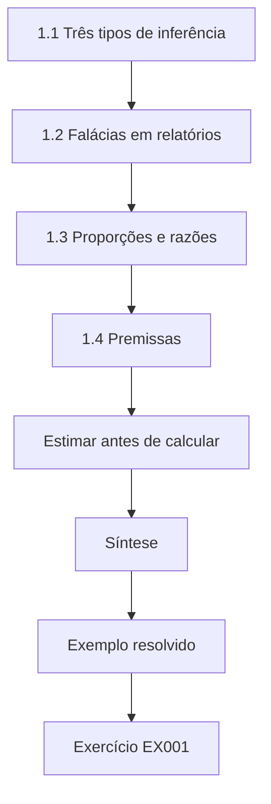

### Desenho lógico

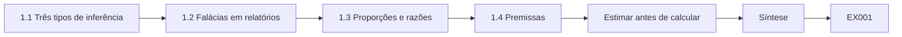

```text
[1.1 Três tipos de inferência]
    |
    v
[1.2 Falácias em relatórios]
    |
    v
[1.3 Proporções e razões]
    |
    v
[1.4 Premissas]
    |
    v
[Estimar antes de calcular]
    |
    v
[Síntese]
    |
    v
[Exemplo resolvido] --> [Exercício EX001]
```
<!-- cyberabc:lesson-figures:end ch-01 -->


### Objetivos de aprendizagem

Você vai (1) distinguir dedução, indução e abdução no trabalho de inteligência; (2) identificar falácias comuns em relatórios de ameaças; (3) usar proporções e razões corretamente; (4) explicitar as premissas por trás de uma conclusão.

### 1.1 Três tipos de inferência

A dedução vai de regras a conclusões certas: se todo relatório TLP:RED vai apenas para destinatários nomeados e Amara não está entre eles, ela não pode lê-lo. A indução generaliza a partir de casos: cinco relatórios do setor começaram com phishing, então o phishing é uma via de entrada comum. A abdução propõe a melhor explicação para uma observação: uma rajada de logins com falha durante a noite pode ser adivinhação de senhas. A análise de inteligência depende muito da abdução, e é por isso que suas conclusões precisam ser declaradas com incerteza. Amara rotula cada conclusão com a inferência que a produziu.

### 1.2 Falácias em relatórios

Raciocínio post hoc: uma indisponibilidade veio depois de um e-mail de phishing, então o e-mail a causou. Negligência da taxa-base: um detector com 99% de acerto parece decisivo até você lembrar como ataques reais são raros. Sobrevivência: estudar apenas os incidentes detectados diz pouco sobre os que não foram. Nomear a falácia no rascunho de um colega é uma habilidade útil de revisão. Na primeira revisão que Amara faz de um rascunho do HSSC, ela marca uma frase que atribui um surto de ransomware a um fornecedor porque a atualização do fornecedor chegou na véspera. O rascunho não oferece nenhuma outra ligação. Ela sugere reescrevê-la como hipótese e listar que evidências a confirmariam ou descartariam, o que transforma uma falácia em uma pergunta útil para o próximo analista.

### 1.3 Proporções e razões

"O phishing apareceu em 3 de 5 relatórios" é uma proporção, 60%. Relatar só "60%" esconde que a amostra é de cinco. Sempre dê o numerador e o denominador, especialmente quando o denominador é pequeno. Amara escreve "3 de 5 relatórios" em suas notas e acrescenta o período que eles cobrem. Quando um trimestre posterior traz vinte relatórios, a proporção pode ser comparada de forma justa, e os leitores veem que o primeiro número se apoiava em pouquíssimos casos. Uma porcentagem tirada de cinco itens pode oscilar vinte pontos com um relatório a mais, então apresentá-la sozinha sugere muito mais precisão do que a evidência tem.

### 1.4 Premissas

Toda conclusão se apoia em premissas. Escrevê-las — os relatórios são representativos; os carimbos de tempo estão corretos — permite que os leitores julguem quanto confiar no resultado. Amara mantém uma lista curta de premissas no fim de cada nota que escreve para a equipe de segurança do HCHT. Quando uma delas se revela errada, como um feed cujos carimbos de tempo usam outro fuso horário, ela vê na hora quais conclusões dependiam dela e revisa só essas. Premissas não declaradas são os erros mais difíceis de encontrar, porque ninguém sabe que precisa conferi-las.

### Estimar antes de calcular

Antes de rodar números, Amara escreve uma expectativa grosseira: cerca de metade dos relatórios do setor vai mencionar phishing. Se o valor calculado for muito diferente, ela confere os dados e o código antes de acreditar na surpresa. Estimativas grosseiras pegam cedo erros de planilha, linhas duplicadas e colunas mal lidas.

### Exemplo resolvido

Um blog de fornecedor afirma que "os ataques de ransomware a hospitais subiram 300%". Amara pergunta: 300% sobre qual linha de base, em que período, contados como? O blog conta incidentes relatados publicamente, que podem subir porque as regras de notificação mudaram. Ela registra a alegação como "os incidentes relatados aumentaram; taxa subjacente desconhecida".

> **Caso sintético.** A alegação do blog é inventada; o HCHT é fictício.

### Erros e limites

A lógica organiza o raciocínio, mas não substitui a evidência. Porcentagens de amostras minúsculas enganam mesmo quando a aritmética está certa.

### Exercícios

- **EX001 — Tipo de inferência.** Que tipo de inferência é "logins com falha durante a noite sugerem adivinhação de senhas"? *Rubrica:* 3 = abdução (melhor explicação), com justificativa; 2 = só o nome; 1 = dedução; 0 = nenhuma.
- **EX002 — Encontre a falácia.** "A indisponibilidade aconteceu depois do e-mail de phishing, então o e-mail a causou." Nomeie a falácia. *Rubrica:* 3 = post hoc ergo propter hoc, com o porquê; 2 = só o nome; 1 = falácia errada; 0 = nenhuma.
- **EX003 — Pergunta de linha de base.** Liste três perguntas a fazer sobre "os ataques subiram 300%". *Rubrica:* 3 = linha de base, período, método de contagem (ou mudança nas regras de notificação); 2 = duas; 1 = uma; 0 = nenhuma.

### Síntese

Nomeie o tipo de inferência, pegue as falácias, dê os numeradores junto com as porcentagens e escreva as premissas.

### Continue estudando — capítulo 01 de 40

[← Página do curso](../../README.md) · [Índice de capítulos do curso](../SUBJECTS.md) · [Capítulo 02 (rascunho) →](#ch-02)

<a id="ch-02"></a>

## Capítulo 2 — Sistemas computacionais

<!-- cyberabc:lesson-figures:start ch-02 -->
### Mapa da aula

Aula 02 publicada. Mapa, exemplo, EX004.

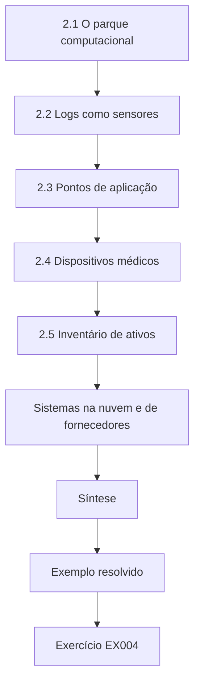

### Desenho lógico

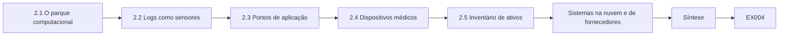

```text
[2.1 O parque computacional]
    |
    v
[2.2 Logs como sensores]
    |
    v
[2.3 Pontos de aplicação]
    |
    v
[2.4 Dispositivos médicos]
    |
    v
[2.5 Inventário de ativos]
    |
    v
[Sistemas na nuvem e de fornecedores]
    |
    v
[Síntese]
    |
    v
[Exemplo resolvido] --> [Exercício EX004]
```
<!-- cyberabc:lesson-figures:end ch-02 -->


### Objetivos de aprendizagem

Você vai (1) descrever os componentes do parque computacional de um hospital relevantes para a CTI; (2) explicar que logs cada componente produz; (3) identificar onde os indicadores podem ser conferidos; (4) reconhecer os dispositivos médicos como casos especiais.

### 2.1 O parque computacional

O HCHT opera estações de trabalho dos funcionários, aplicações clínicas, um portal do paciente, e-mail, um serviço de diretório, caixas de correio na nuvem, sistemas de laboratório e dispositivos médicos em rede. Cada um tem responsáveis, rotas de atualização e logs. A CTI só é útil se chega ao lugar onde pode ser conferida ou aplicada. A primeira tarefa de Amara é listar, para cada parte do parque, quem é o responsável, como é atualizada e o que registra. A lista mostra onde a inteligência pode ser usada depressa, como na filtragem de e-mail, e onde não pode, como nos sistemas de laboratório operados por um fornecedor sob contrato.

### 2.2 Logs como sensores

Gateways de e-mail registram remetentes e anexos; proxies web registram URLs; resolvedores DNS registram consultas; endpoints registram processos; o diretório registra logons. Quando o HSSC compartilha um domínio malicioso, Amara pode buscar contatos passados nos logs de DNS e de proxy — uma caçada retrospectiva. Uma caçada retrospectiva responde a uma pergunta simples: algo no HCHT contatou este domínio antes de sabermos que era malicioso? Amara confere se a retenção dos logs cobre o período descrito no relatório do HSSC, já que uma caçada não encontra contatos mais antigos que o log mais antigo. Onde a retenção é curta, ela registra a lacuna em vez de relatar um resultado limpo.

### 2.3 Pontos de aplicação

Filtros de e-mail, bloqueio por DNS, categorias de proxy e regras de endpoint podem agir sobre indicadores. Cada um tem um raio de impacto diferente. Bloquear um domínio no DNS afeta todo dispositivo que usa o resolvedor, inclusive os sistemas clínicos. Um bloqueio errado no DNS poderia impedir uma aplicação clínica de alcançar o serviço de um fornecedor e atrasar o atendimento aos pacientes. Por isso Amara registra, para cada ponto de aplicação, quem pode alterá-lo, com que rapidez um bloqueio pode ser revertido e quais sistemas ele afeta. Indicadores de baixa confiança vão primeiro para monitoramento, onde geram alertas sem interromper o tráfego, até que a evidência sustente um bloqueio.

### 2.4 Dispositivos médicos

Bombas de infusão e sistemas de imagem costumam rodar sistemas operacionais antigos e não podem ser corrigidos depressa. Podem não tolerar varreduras nem software de agente. A CTI sobre ameaças a esses dispositivos vai para a equipe de engenharia clínica, que decide pelo isolamento de rede em vez de mudanças no host. Amara aprende que a segurança do paciente vem primeiro: uma mudança de segurança que faz uma bomba parar de funcionar é pior do que a ameaça que ela pretendia tratar. A inteligência sobre esses dispositivos é redigida para engenheiros clínicos, nomeando o modelo do dispositivo e a exposição, e eles decidem que mudança é segura para os pacientes.

### 2.5 Inventário de ativos

Um inventário preciso permite que os analistas respondam "usamos o produto afetado?" em minutos quando chega um alerta. Sem ele, cada alerta dispara um exercício de adivinhação. O inventário do HCHT lista produtos de software e versões para estações de trabalho e servidores, mas os dispositivos médicos são registrados só pelo modelo, então Amara anota que alertas sobre software de dispositivos exigem conferência extra com a engenharia clínica. Manter o inventário atualizado é tarefa de operações; o papel de Amara é relatar onde as lacunas atrasaram uma resposta, para que os responsáveis possam corrigi-las.

### Sistemas na nuvem e de fornecedores

Alguns serviços do HCHT rodam em plataformas de fornecedores: o e-mail na nuvem, o portal de agendamento e o software de patologia. Os logs ficam com o fornecedor. Os contratos devem dizer que logs o HCHT pode obter e com que rapidez, porque uma caçada a indicadores é impossível sem acesso aos registros relevantes.

### Exemplo resolvido

O HSSC compartilha um alerta sobre um produto de servidor de imagem vulnerável. Amara consulta o inventário: dois servidores em um hospital correspondem. Ela envia o alerta à engenharia clínica com os identificadores dos ativos, e não à fila geral de TI, porque os servidores são sistemas médicos certificados.

> **Caso sintético.** O alerta e os servidores são inventados.

### Erros e limites

Inventários envelhecem; confirme com os responsáveis. Não faça varreduras em dispositivos médicos sem aprovação da engenharia clínica.

### Exercícios

- **EX004 — Fonte de log.** Que log mostraria se algum dispositivo do HCHT consultou um domínio malicioso na semana passada? *Rubrica:* 3 = logs do resolvedor DNS (proxy como fonte secundária); 2 = só o proxy; 1 = antivírus do endpoint; 0 = nenhuma.
- **EX005 — Rota do dispositivo.** Por que Amara encaminhou o alerta de imagem à engenharia clínica? *Rubrica:* 3 = sistemas médicos certificados; processo especial de mudança/segurança; responsáveis; 2 = só os responsáveis; 1 = conveniência; 0 = nenhuma.
- **EX006 — Raio de impacto.** Dê um risco de bloquear um domínio no resolvedor DNS de um hospital. *Rubrica:* 3 = pode quebrar sistemas clínicos que dependem dele/dano colateral; 2 = vago; 1 = nenhum risco; 0 = nenhuma.

### Síntese

Conheça o parque, seus logs e pontos de aplicação, trate os dispositivos médicos à parte e mantenha o inventário atualizado.

### Continue estudando — capítulo 02 de 40

[← Capítulo 01 (rascunho)](#ch-01) · [Índice de capítulos do curso](../SUBJECTS.md) · [Capítulo 03 (rascunho) →](#ch-03)

<a id="ch-03"></a>

## Capítulo 3 — Programação I

<!-- cyberabc:lesson-figures:start ch-03 -->
### Mapa da aula

Aula 03 publicada. Mapa, exemplo, EX007.

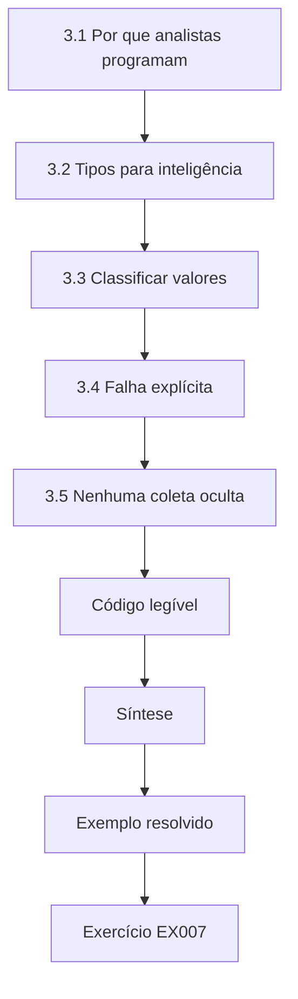

### Desenho lógico

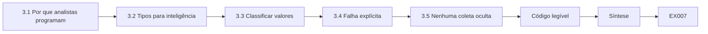

```text
[3.1 Por que analistas programam]
    |
    v
[3.2 Tipos para inteligência]
    |
    v
[3.3 Classificar valores]
    |
    v
[3.4 Falha explícita]
    |
    v
[3.5 Nenhuma coleta oculta]
    |
    v
[Código legível]
    |
    v
[Síntese]
    |
    v
[Exemplo resolvido] --> [Exercício EX007]
```
<!-- cyberabc:lesson-figures:end ch-03 -->


### Objetivos de aprendizagem

Você vai (1) escrever funções em Python que limpam e classificam indicadores; (2) usar strings, listas, conjuntos e dicionários; (3) tratar entradas ruins de forma explícita; (4) manter os scripts livres de coleta pela rede.

### 3.1 Por que analistas programam

Os analistas recebem indicadores em e-mails, PDFs e planilhas. Scripts pequenos extraem, limpam e comparam esses indicadores mais depressa e com mais precisão do que copiar à mão. Aqui, programar é uma ferramenta de leitura e conferência, não de coleta. Amara escreve seu primeiro script para ler indicadores de uma planilha compartilhada pelo HSSC, remover duplicatas e compará-los com uma lista exportada do gateway de e-mail. Feita à mão, a comparação levava uma hora e deixou passar duas correspondências; o script leva segundos e dá a mesma resposta toda vez que roda.

### 3.2 Tipos para inteligência

Uma string guarda um indicador. Uma lista mantém a ordem, como eventos no tempo. Um conjunto remove duplicatas e permite a interseção — quais indicadores aparecem tanto nos nossos logs quanto no feed? Um dicionário associa um indicador a seus metadados: fonte, TLP, primeira observação. Escolher o tipo certo torna a pergunta fácil de responder. O script de Amara guarda os indicadores do feed em um conjunto, então a sobreposição com os logs do HCHT é uma única interseção, e mantém os metadados em um dicionário, então cada correspondência vem com sua fonte e seu rótulo TLP. Sem o rótulo, ela não saberia quais correspondências podem ser compartilhadas com outras equipes.

### 3.3 Classificar valores

Uma função simples decide se uma string parece um endereço IPv4, um domínio ou um hash. O módulo `ipaddress` da biblioteca padrão valida endereços; verificações de tamanho e de caracteres distinguem hashes SHA-256 (64 caracteres hexadecimais) de outras strings. Amara testa a função com exemplos de cada tipo e com casos traiçoeiros, como um domínio que contém dígitos ou um hash com letras maiúsculas. Um valor mal classificado poderia mandar um domínio para uma lista de bloqueio de endereços, onde não faria nada, enquanto a analista acreditava que ele estava bloqueado.

### 3.4 Falha explícita

Se um valor não se encaixa em nenhum tipo, retorne "unknown" e guarde-o para revisão. Adivinhar cria indicadores falsos que podem depois bloquear serviços legítimos. O script de Amara grava os valores desconhecidos em um arquivo separado, com a linha de onde vieram, para que ela possa conferi-los à mão. Muitos se revelam indicadores desarmados, como domínios com colchetes em volta dos pontos, que o script agora trata de forma explícita. A falha explícita transformou um erro silencioso em uma lista de melhorias e manteve indicadores falsos fora das listas de bloqueio.

### 3.5 Nenhuma coleta oculta

Os scripts deste curso leem apenas arquivos locais. Código que baixa páginas web, consulta serviços externos ou entra em plataformas está fora deste capítulo e exige termos, permissão e supervisão. Amara faz duas perguntas sobre o próprio trabalho: de onde vem cada entrada, e ela tinha permissão para usá-la? Quando uma fonte publica apenas uma página web, ela pede à mesa do HSSC um arquivo exportado em vez de acrescentar uma etapa de download ao script. Qualquer etapa de coleta é uma decisão separada de sua supervisora, com aprovação e registro próprios.

### Código legível

Analistas compartilham scripts com colegas que precisam confiar na saída. Nomes de função claros, docstrings curtas e um pequeno teste com entradas conhecidas tornam um script revisável. Um teste que alimenta um hash válido, um hash truncado e um domínio mostra aos revisores exatamente como os casos de borda se comportam antes de o script tocar dados reais.

### Exemplo resolvido

Amara recebe 40 valores colados de um PDF. Seu classificador rotula 18 domínios, 12 endereços IPv4, 7 hashes SHA-256 e 3 desconhecidos — dois eram hashes truncados e um, um domínio com um colchete perdido do desarmamento. Ela corrige o colchete, devolve os hashes truncados ao remetente e armazena 38.

> **Caso sintético.** Os valores do PDF são inventados.

### Erros e limites

Verificações de padrão confirmam a forma, não a malícia. Um domínio de aparência válida ainda pode ser um erro de digitação.

### Exercícios

- **EX007 — Escolha um tipo.** Que tipo do Python encontra os indicadores presentes tanto no feed quanto nos logs do HCHT, e como? *Rubrica:* 3 = interseção de conjuntos (&); 2 = só conjunto; 1 = laço em lista sem remover duplicatas; 0 = nenhuma.
- **EX008 — Forma do hash.** Que forma tem um hash SHA-256 como texto? *Rubrica:* 3 = 64 caracteres hexadecimais; 2 = 64 caracteres; 1 = 32; 0 = nenhuma.
- **EX009 — Valor truncado.** O que Amara deve fazer com os dois hashes truncados? *Rubrica:* 3 = marcar como desconhecidos, não armazená-los como indicadores, avisar o remetente; 2 = descartar; 1 = completar e armazenar; 0 = nenhuma.

### Síntese

Use o tipo de dado certo, valide a forma, falhe de forma explícita e mantenha os scripts locais.

### Continue estudando — capítulo 03 de 40

[← Capítulo 02 (rascunho)](#ch-02) · [Índice de capítulos do curso](../SUBJECTS.md) · [Capítulo 04 (rascunho) →](#ch-04)

<a id="ch-04"></a>

## Capítulo 4 — Escrita acadêmica

<!-- cyberabc:lesson-figures:start ch-04 -->
### Mapa da aula

Aula 04 publicada. Mapa, exemplo, EX010.

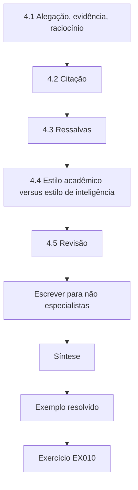

### Desenho lógico

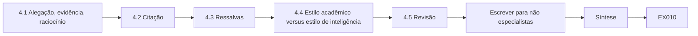

```text
[4.1 Alegação, evidência, raciocínio]
    |
    v
[4.2 Citação]
    |
    v
[4.3 Ressalvas]
    |
    v
[4.4 Estilo acadêmico versus estilo de inteligência]
    |
    v
[4.5 Revisão]
    |
    v
[Escrever para não especialistas]
    |
    v
[Síntese]
    |
    v
[Exemplo resolvido] --> [Exercício EX010]
```
<!-- cyberabc:lesson-figures:end ch-04 -->


### Objetivos de aprendizagem

Você vai (1) estruturar um argumento com alegação, evidência e raciocínio; (2) citar fontes corretamente; (3) escrever com a ressalva adequada; (4) adaptar hábitos acadêmicos à escrita de inteligência.

### 4.1 Alegação, evidência, raciocínio

Um parágrafo faz uma alegação, apresenta a evidência e explica por que a evidência sustenta a alegação. "O phishing é a via de entrada mais comum nos relatórios do HSSC (alegação); ele aparece em 3 de 5 relatórios de 2026 (evidência); as outras vias aparecem no máximo duas vezes (raciocínio)." Os leitores podem então contestar a evidência em vez de adivinhar o que você quis dizer. Amara usa esse padrão em todos os parágrafos de seus relatórios. Assim, sua supervisora confere a evidência depressa, e um leitor que discorda sabe exatamente que parte questionar. Quando uma alegação ainda não tem evidência, ela a rotula como hipótese e diz o que a testaria.

### 4.2 Citação

Cite especificações para definições (STIX 2.1 para tipos de objeto), artigos para modelos (Hutchins et al. para a kill chain) e fontes de dados para números. Parafraseie e cite; cite literalmente só quando a redação exata importa. Nunca cite um relatório com restrição TLP em trabalhos acadêmicos públicos. Amara mantém uma lista de referências para cada trabalho e confere se cada marcação TLP permite o uso que ela faz de uma fonte. Para um ensaio sobre phishing na saúde, ela cita apenas relatórios públicos e descreve as tendências do HSSC em termos gerais, sem nomear nenhum relatório restrito, para que o ensaio possa ser compartilhado com a turma.

### 4.3 Ressalvas

"Prova" raramente se justifica. "Sugere", "é compatível com" e palavras calibradas como "provável" sinalizam a incerteza com honestidade. O excesso de ressalvas — "talvez possivelmente quem sabe" — é tão inútil quanto exagerar a alegação. Amara aprende a escolher uma palavra calibrada por julgamento e a dizer em que ela se apoia, como "provável, com base em dois relatórios independentes". Um leitor pode agir com base nisso, ou pedir mais evidência, e esse é o propósito de fazer ressalvas com honestidade. Ela evita empilhar qualificadores, o que esconde o julgamento em vez de expressar sua incerteza.

### 4.4 Estilo acadêmico versus estilo de inteligência

A escrita acadêmica costuma construir o caminho até uma conclusão. A escrita de inteligência declara a conclusão principal primeiro. A ICD 203 pede que os produtos analíticos sejam claros e lógicos; os dois estilos compartilham esse objetivo, mas diferem na ordem. Amara aprende os dois. Na prática, ela escreve os ensaios do curso em estilo acadêmico e suas notas para o HCHT com a conclusão principal na primeira frase, seguida da evidência. Leitores ocupados da equipe de segurança podem ler só essa primeira linha, então ela precisa estar correta por si só. Sua supervisora confere se a evidência abaixo realmente a sustenta.

### 4.5 Revisão

Leia os rascunhos em voz alta, corte palavras que não mudam o sentido e peça a um colega que reformule sua alegação principal. Amara lê em voz alta sua primeira nota para o HCHT e encontra duas frases que dizem a mesma coisa. Um colega reformula sua alegação principal como "bloquear estes domínios" quando ela queria dizer "monitorar estes domínios", então ela reescreve a linha de abertura para deixar a ação clara. É na revisão que surge a maior parte da clareza de um relatório, e ela reserva tempo para isso em vez de tratar a revisão como opcional.

### Escrever para não especialistas

Gestores clínicos também leem as notas de segurança do HCHT. Troque o jargão por palavras simples ou defina-o uma vez: "phishing (e-mail fraudulento que engana as pessoas para que ajam)". Frases curtas, voz ativa e ações concretas — "encaminhe faturas suspeitas à central de atendimento" — tornam a orientação utilizável por funcionários ocupados das enfermarias, que têm minutos, e não horas, para lê-la.

### Exemplo resolvido

O primeiro parágrafo do ensaio de Amara mistura três alegações sobre phishing, ransomware e ameaças internas. Seu orientador pede uma alegação por parágrafo. Ela o divide em três, cada um com sua evidência, e leva a conclusão para a frase de abertura na versão em estilo de inteligência.

> **Caso sintético.** O ensaio é inventado.

### Erros e limites

Citar uma fonte não a torna confiável; avalie-a. As regras de integridade acadêmica proíbem apresentar a análise de outra pessoa como sua.

### Exercícios

- **EX010 — Monte um parágrafo.** Escreva um parágrafo de alegação, evidência e raciocínio sobre uma técnica do ATT&CK em um setor fictício. *Rubrica:* 3 = as três partes claras; 2 = duas; 1 = só a alegação; 0 = nenhuma.
- **EX011 — Fonte restrita.** Amara pode citar um relatório TLP:AMBER do HSSC em um ensaio público? *Rubrica:* 3 = não; usar fontes públicas ou exemplos sintéticos; 2 = não; 1 = sim, com atribuição; 0 = nenhuma.
- **EX012 — Diferença de ordem.** Como a ordem da escrita de inteligência difere da escrita acadêmica típica? *Rubrica:* 3 = conclusão principal primeiro vs construção até a conclusão; 2 = parcial; 1 = nenhuma diferença; 0 = nenhuma.

### Síntese

Uma alegação por parágrafo, cite com precisão e de forma lícita, faça ressalvas honestas e saiba quando começar pela conclusão.

### Continue estudando — capítulo 04 de 40

[← Capítulo 03 (rascunho)](#ch-03) · [Índice de capítulos do curso](../SUBJECTS.md) · [Capítulo 05 (rascunho) →](#ch-05)

<a id="ch-05"></a>

## Capítulo 5 — Letramento em segurança

<!-- cyberabc:lesson-figures:start ch-05 -->
### Mapa da aula

Aula 05 publicada. Mapa, exemplo, EX013.

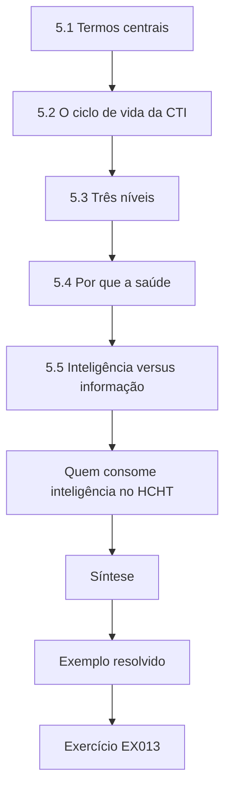

### Desenho lógico

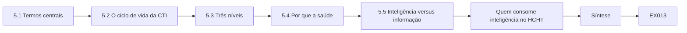

```text
[5.1 Termos centrais]
    |
    v
[5.2 O ciclo de vida da CTI]
    |
    v
[5.3 Três níveis]
    |
    v
[5.4 Por que a saúde]
    |
    v
[5.5 Inteligência versus informação]
    |
    v
[Quem consome inteligência no HCHT]
    |
    v
[Síntese]
    |
    v
[Exemplo resolvido] --> [Exercício EX013]
```
<!-- cyberabc:lesson-figures:end ch-05 -->


### Objetivos de aprendizagem

Você vai (1) definir ameaça, vulnerabilidade, risco e controle; (2) descrever o ciclo de vida da CTI; (3) distinguir inteligência estratégica, operacional e tática; (4) explicar por que a saúde atrai atacantes.

### 5.1 Termos centrais

Uma ameaça é uma causa potencial de dano — um ator ou um evento. Uma vulnerabilidade é uma fraqueza. O risco combina probabilidade e impacto. Um controle reduz o risco. A CTI informa a parte da ameaça nessa equação, para que os controles vão para onde importam. Para o HCHT, a ameaça é um grupo criminoso que envia phishing aos funcionários clínicos, a vulnerabilidade é um serviço de acesso remoto sem correção e o risco é alto porque uma indisponibilidade afetaria o atendimento aos pacientes. A inteligência sobre os métodos do grupo ajuda a decidir que controles reforçar primeiro.

### 5.2 O ciclo de vida da CTI

Direção (do que os tomadores de decisão precisam?), coleta, processamento, análise, disseminação e feedback. Na prática, a direção muitas vezes falta; os analistas então coletam tudo e não ajudam ninguém. Requisitos prioritários de inteligência resolvem isso. Amara ajuda sua supervisora a redigir os primeiros requisitos do HCHT: que ameaças poderiam interromper os serviços clínicos, quais fornecedores são visados e que técnicas aparecem em ataques ao setor de saúde. Cada requisito nomeia quem precisa da resposta e com que frequência. A coleta então se concentra nas fontes que os respondem, e o feedback mostra se as respostas foram úteis, de modo que o ciclo melhora com o tempo.

### 5.3 Três níveis

Estratégico: tendências e intenções para executivos — por exemplo, grupos criminosos que visam hospitais para extorsão. Operacional: campanhas e momento para os líderes de incidente — uma onda de phishing contra instituições de saúde neste mês. Tático: indicadores e técnicas para analistas — domínios remetentes e T1566 Phishing. Cada nível atinge um público diferente e pede um estilo diferente. Amara pratica escrever o mesmo relatório do HSSC de três formas: um parágrafo curto para o conselho, uma página para os líderes de incidente e uma lista de indicadores com técnicas para os analistas. Misturar níveis, como entregar listas de indicadores ao conselho, desperdiça o tempo do leitor e esconde o que ele precisa decidir.

### 5.4 Por que a saúde

Hospitais guardam dados sensíveis, funcionam 24 horas por dia e não toleram indisponibilidade, o que aumenta a pressão para pagar a extorsão. Sistemas legados e muitos fornecedores ampliam a exposição. A inteligência estratégica ajuda os conselhos a entender esse contexto sem sensacionalismo. O briefing de Amara para o conselho do HCHT usa relatórios do setor para descrever a ameaça com precisão e liga cada ponto a uma decisão que o conselho pode tomar, como financiar uma recuperação mais rápida dos sistemas clínicos. Ela evita linguagem alarmista e usa números só quando a fonte e a amostra estão claras.

### 5.5 Inteligência versus informação

Um feed de domínios é informação. Uma avaliação de que uma campanha visa sistemas de laboratório e de que o HCHT deve bloquear domínios específicos e orientar os funcionários do laboratório é inteligência — analisada e ligada a uma decisão. Amara confere cada produto que escreve com este teste: que decisão ele apoia, e quem a toma? Uma lista que ela não consegue ligar a uma decisão é mantida como informação e guardada para buscas futuras, não enviada como inteligência. Isso reserva a caixa de entrada da equipe de segurança para material que lhe pede algo, e ajuda o HSSC a ver quais dos itens compartilhados foram de fato usados.

### Quem consome inteligência no HCHT

Os consumidores incluem a central de atendimento, a equipe de rede, a engenharia clínica, o encarregado de proteção de dados e o conselho. Cada um precisa de detalhes diferentes em velocidades diferentes. Mapear os consumidores e suas decisões é o primeiro passo prático da direção, porque mostra que perguntas a inteligência precisa responder e em que formato cada público consegue de fato usar a resposta.

### Exemplo resolvido

O diretor executivo do HCHT pergunta se a instituição é "um alvo". A supervisora de Amara responde no nível estratégico: organizações de saúde da região enfrentaram campanhas de extorsão; a exposição do HCHT é típica; as principais prioridades defensivas são a resistência ao phishing e os backups. Os indicadores ficam fora do briefing executivo.

> **Caso sintético.** O briefing é inventado.

### Erros e limites

Briefings movidos pelo medo distorcem o investimento. Os níveis se sobrepõem; rotule o público pretendido.

### Exercícios

- **EX013 — Rótulo de nível.** Classifique "domínios remetentes da onda de phishing desta semana". *Rubrica:* 3 = tático, com o público; 2 = tático; 1 = estratégico; 0 = nenhuma.
- **EX014 — Etapa ausente.** Que etapa do ciclo de vida falta com mais frequência, e o que a corrige? *Rubrica:* 3 = direção; requisitos prioritários de inteligência; 2 = só direção; 1 = coleta; 0 = nenhuma.
- **EX015 — Omissão no briefing executivo.** Por que deixar os indicadores fora do briefing do diretor executivo? *Rubrica:* 3 = nível/público errado; executivos precisam de contexto estratégico e decisões; 2 = parcial; 1 = sigilo; 0 = nenhuma.

### Síntese

Use os termos centrais com precisão, comece o ciclo pela direção, ajuste o nível ao público e transforme informação em inteligência.

### Continue estudando — capítulo 05 de 40

[← Capítulo 04 (rascunho)](#ch-04) · [Índice de capítulos do curso](../SUBJECTS.md) · [Capítulo 06 (rascunho) →](#ch-06)

<a id="ch-06"></a>

## Capítulo 6 — Estruturas discretas

<!-- cyberabc:lesson-figures:start ch-06 -->
### Mapa da aula

Aula 06 publicada. Mapa, exemplo, EX016.

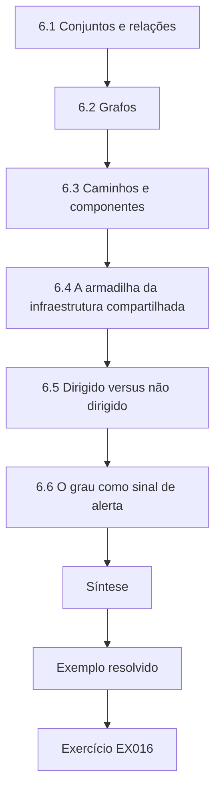

### Desenho lógico

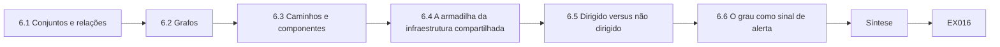

```text
[6.1 Conjuntos e relações]
    |
    v
[6.2 Grafos]
    |
    v
[6.3 Caminhos e componentes]
    |
    v
[6.4 A armadilha da infraestrutura compartilhada]
    |
    v
[6.5 Dirigido versus não dirigido]
    |
    v
[6.6 O grau como sinal de alerta]
    |
    v
[Síntese]
    |
    v
[Exemplo resolvido] --> [Exercício EX016]
```
<!-- cyberabc:lesson-figures:end ch-06 -->


### Objetivos de aprendizagem

Você vai (1) usar conjuntos e relações para modelar indicadores e atores; (2) representar inteligência como grafos; (3) raciocinar sobre caminhos e componentes conexos; (4) reconhecer os limites da análise de vínculos.

### 6.1 Conjuntos e relações

Cada feed é um conjunto de indicadores. A união combina feeds; a interseção mostra concordância; a diferença mostra o que só uma fonte tem. Uma relação forma pares de elementos: (domínio, resolve-para, endereço). Os objetos de relacionamento do STIX 2.1 expressam exatamente isso — um objeto de origem, um tipo de relacionamento e um objeto de destino. Amara usa operações de conjuntos para comparar dois feeds do HSSC e descobre que eles se sobrepõem em apenas um terço dos indicadores. A concordância entre fontes independentes aumenta a confiança; os indicadores encontrados em um único feed não estão errados, mas precisam de mais conferência antes de um bloqueio.

### 6.2 Grafos

Trate indicadores, famílias de malware e campanhas como nós, e os relacionamentos como arestas. Os grafos tornam os pivôs visíveis: dois domínios de phishing que resolveram para o mesmo endereço ficam ligados por esse nó de endereço. Os quatro vértices do Diamond Model — adversário, capacidade, infraestrutura, vítima — são, eles mesmos, um pequeno grafo para cada evento. Amara monta um pequeno grafo a partir de um relatório do HSSC e confere cada aresta com sua fonte antes de tirar conclusões. Cada aresta leva a fonte que a relatou e a data, então uma ligação que se apoia em um relatório antigo ou fraco pode ser identificada e, se preciso, removida sem reconstruir o grafo inteiro.

### 6.3 Caminhos e componentes

Um caminho liga dois nós por meio de arestas. Um componente conexo é um grupo em que todo nó alcança todos os outros. Às vezes os analistas tratam um componente como "uma campanha". Isso é uma hipótese, não um fato. Amara escreve "estes indicadores formam um grupo conexo, que pode ser uma campanha", e não "esta é uma campanha". Depois ela procura evidências que os separariam, como técnicas de entrega ou momentos diferentes. Um componente formado por um endereço de hospedagem compartilhada, por exemplo, pode juntar atores sem relação entre si, então a hipótese precisa ser testada antes que alguém aja com base nela.

### 6.4 A armadilha da infraestrutura compartilhada

Hospedagem compartilhada, redes de distribuição de conteúdo e endereços de nuvem ligam clientes sem relação entre si. Um endereço que serve milhares de domínios liga todos eles em um grafo ingênuo. Antes de confiar em uma ligação, pergunte quantas outras coisas compartilham aquele nó; nós de grau alto costumam ser ruído. Amara confere o número de domínios em cada endereço com as informações públicas do provedor de hospedagem ou com um registro de DNS passivo, e descarta as arestas que passam por nós que servem muitos sites sem relação. Ela registra cada aresta removida e o motivo, para que um revisor possa ver a escolha.

### 6.5 Dirigido versus não dirigido

"O domínio resolve para o endereço" tem direção; "apareceu no mesmo relatório" não tem. Mantenha a direção onde ela carrega significado, ou você vai raciocinar de trás para frente. Amara guarda cada relacionamento com seu tipo e sua direção, seguindo os objetos de relacionamento do STIX. Inverter uma aresta, por exemplo lendo "o endereço resolve para o domínio", poderia levar à falsa conclusão de que todo domínio em um endereço compartilhado pertence ao mesmo ator. Ligações não dirigidas, como a coocorrência em um relatório, ficam separadas e são tratadas como evidência mais fraca, já que só mostram que duas coisas foram mencionadas juntas.

### 6.6 O grau como sinal de alerta

O grau de um nó é o número de suas arestas. Um hub repentino em um pequeno grafo de inteligência merece inspeção: pode ser um servidor de comando genuíno, ou um resolvedor público, um provedor de webmail ou um artefato de parsing equivocado. Amara acrescenta ao script do grafo uma verificação de grau que lista, para revisão manual, qualquer nó acima de um limiar escolhido. O limiar é definido a partir da forma normal do grafo, e cada nó marcado é conferido com informações públicas antes de ser mantido. Um resolvedor público ou um provedor de webmail é removido com uma nota; um servidor genuíno é mantido e destacado.

### Exemplo resolvido

Amara liga seis domínios de phishing do HSSC. Cinco se juntam em um componente por meio de um único endereço. Ela confere o endereço: ele pertence a um grande provedor de hospedagem e serve muitos sites sem relação. Ela o remove como pivô; os seis domínios se dividem em três pequenos grupos, dois deles ligados por um padrão comum de e-mail de registro. Sua nota diz "dois domínios podem estar relacionados; evidência fraca".

> **Caso sintético.** Os domínios e os detalhes de hospedagem são inventados.

### Erros e limites

Grafos mostram coocorrência, não intenção. Um desenho com muitas linhas parece convincente; teste cada aresta.

### Exercícios

- **EX016 — Operação de conjuntos.** Que operação de conjuntos lista os indicadores que só o HSSC tem, e não a lista de bloqueio do próprio HCHT? *Rubrica:* 3 = diferença (HSSC − HCHT); 2 = nomeada, mas com a direção errada; 1 = interseção; 0 = nenhuma.
- **EX017 — Grau alto.** Por que Amara descartou o endereço de hospedagem como pivô? *Rubrica:* 3 = nó compartilhado/de grau alto liga sites sem relação; ligação falsa; 2 = parcial; 1 = era malicioso; 0 = nenhuma.
- **EX018 — Vértices do Diamond.** Nomeie os quatro vértices do Diamond Model. *Rubrica:* 3 = adversário, capacidade, infraestrutura, vítima; 2 = três; 1 = um ou dois; 0 = nenhuma.

### Síntese

Conjuntos e grafos organizam a inteligência; confira os nós de grau alto, mantenha a direção e trate os componentes como hipóteses.

### Continue estudando — capítulo 06 de 40

[← Capítulo 05 (rascunho)](#ch-05) · [Índice de capítulos do curso](../SUBJECTS.md) · [Capítulo 07 (rascunho) →](#ch-07)

<a id="ch-07"></a>

## Capítulo 7 — Redes e protocolos

<!-- cyberabc:lesson-figures:start ch-07 -->
### Mapa da aula

Aula 07 publicada. Mapa, exemplo, EX019.

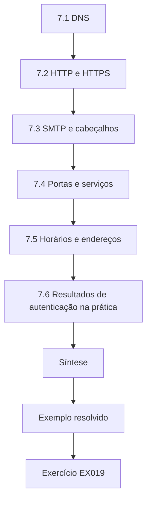

### Desenho lógico

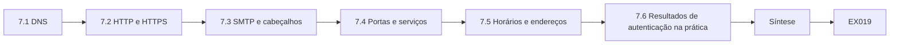

```text
[7.1 DNS]
    |
    v
[7.2 HTTP e HTTPS]
    |
    v
[7.3 SMTP e cabeçalhos]
    |
    v
[7.4 Portas e serviços]
    |
    v
[7.5 Horários e endereços]
    |
    v
[7.6 Resultados de autenticação na prática]
    |
    v
[Síntese]
    |
    v
[Exemplo resolvido] --> [Exercício EX019]
```
<!-- cyberabc:lesson-figures:end ch-07 -->


### Objetivos de aprendizagem

Você vai (1) explicar DNS, HTTP(S) e SMTP no nível de que a CTI precisa; (2) ler cabeçalhos de e-mail em busca de pistas sobre o remetente; (3) entender por que o tráfego cifrado limita a visibilidade; (4) relacionar protocolos a técnicas do ATT&CK.

### 7.1 DNS

O Domain Name System associa nomes a endereços. Os logs do resolvedor registram qual dispositivo pediu qual nome e quando. Como quase toda conexão começa com uma consulta, o DNS é a fonte mais amplamente útil para conferir indicadores de domínio. Amara verifica por quanto tempo o HCHT guarda os logs do resolvedor e se eles registram o endereço interno do dispositivo ou só o endereço de um servidor de encaminhamento, o que esconderia qual estação de trabalho fez a consulta. Os dois fatos decidem se uma busca retrospectiva por um domínio do HSSC consegue encontrar o dispositivo que o contatou, e ambos ficam escritos em suas notas sobre cada fonte.

### 7.2 HTTP e HTTPS

O tráfego web carrega a maior parte da atividade dos usuários e muito tráfego malicioso de comando. A técnica Application Layer Protocol do ATT&CK (T1071) descreve adversários que se misturam ao tráfego normal de web, e-mail ou DNS. Com HTTPS, um proxy pode ver só o nome do servidor, não o caminho completo, a menos que o tráfego seja inspecionado — uma decisão com implicações jurídicas e de privacidade em um hospital. A equipe jurídica e de privacidade do HCHT decidiu que categorias de tráfego podem ser inspecionadas, e os sites de saúde usados pelos funcionários para cuidados pessoais ficam excluídos. Amara trabalha com o que o proxy registra sob essa decisão, em geral o nome do servidor e o horário, e anota quando um indicador não pode ser conferido porque só o caminho completo o revelaria.

### 7.3 SMTP e cabeçalhos

Os cabeçalhos de e-mail registram o caminho que a mensagem percorreu: as linhas Received, o remetente do envelope e os resultados de autenticação (SPF, DKIM, DMARC). Um nome de exibição dizendo "HCHT Payroll" não significa nada se a autenticação falha e o domínio remetente é um domínio sósia. Amara aprende a ler primeiro os resultados de autenticação, depois o domínio remetente e só então o nome de exibição, que é a parte mais fácil de um atacante falsificar. Ela compara os domínios sósias dos relatórios do HSSC com os domínios do próprio HCHT para ver que truques miram a instituição.

### 7.4 Portas e serviços

Portas ou protocolos incomuns podem sugerir tunelamento, mas muitos sistemas médicos legítimos também usam portas incomuns. O contexto dado pelos responsáveis pelos ativos vale mais que regras práticas. Amara pergunta à equipe de engenharia clínica que portas seus dispositivos usam antes de tratar qualquer porta incomum como suspeita. Uma lista de portas clínicas conhecidas, mantida junto com o inventário de ativos, evita alertas sobre o tráfego normal de imagem e deixa as anomalias reais se destacarem. Cada entrada registra o modelo do dispositivo e o responsável que a confirmou.

### 7.5 Horários e endereços

Os logs de rede registram horários em fusos diferentes e endereços que podem ser traduzidos por firewalls. Normalize os horários para UTC e anote a tradução de endereços antes de correlacionar com indicadores compartilhados. Amara descobriu que o proxy do HCHT registrava a hora local, enquanto os relatórios do HSSC usam UTC, o que fazia um contato parecer ter ocorrido uma hora antes da primeira observação do domínio. Depois da normalização, a ordem fez sentido. Agora ela registra o fuso horário e qualquer tradução de endereços de cada fonte de log em uma tabela curta, para que outros analistas possam correlacionar eventos sem redescobrir os mesmos problemas.

### 7.6 Resultados de autenticação na prática

O SPF verifica se o servidor remetente pode enviar pelo domínio do envelope; o DKIM verifica uma assinatura sobre a mensagem; o DMARC os vincula ao domínio visível no campo From e declara a política do titular. Uma mensagem pode passar no SPF de um domínio sósia que o atacante controla, então passar nas verificações prova apenas quem a enviou, não que o remetente seja benigno. Amara acrescenta isso à sua lista de verificação para relatos de phishing. Para cada mensagem de phishing relatada, ela registra os três resultados e se o domínio visível é do próprio HCHT, de um parceiro conhecido ou um sósia. Isso torna visível, ao longo do tempo, o padrão de falsificação.

### Exemplo resolvido

Uma gerente de enfermaria encaminha um e-mail suspeito de "atualização salarial". Amara lê os cabeçalhos: o domínio no campo From é hcht-payrolI.example (I maiúsculo no lugar de l), o SPF passa para esse domínio sósia e o alinhamento DMARC falha em relação ao domínio real. Ela registra o sósia como indicador de phishing (T1566) e o compartilha com o HSSC em TLP:GREEN depois de remover o endereço da funcionária destinatária.

> **Caso sintético.** O e-mail e os domínios são inventados.

### Erros e limites

Cabeçalhos anteriores ao seu próprio gateway podem ser forjados. A inspeção de tráfego cifrado exige aprovação de política e aviso aos funcionários.

### Exercícios

- **EX019 — Veredito do cabeçalho.** O SPF passa, mas o alinhamento DMARC falha em relação ao domínio real. O que isso diz a Amara? *Rubrica:* 3 = o remetente está autorizado para o sósia, não para o domínio real; falsificação/sósia; 2 = parcial; 1 = o e-mail é seguro; 0 = nenhuma.
- **EX020 — Melhor fonte para domínios.** Por que o DNS é a fonte mais útil para indicadores de domínio? *Rubrica:* 3 = quase todas as conexões começam com consultas; cobertura ampla; 2 = parcial; 1 = criptografia; 0 = nenhuma.
- **EX021 — Limite do HTTPS.** O que um proxy normalmente vê no tráfego HTTPS sem inspeção? *Rubrica:* 3 = nome do servidor (SNI)/destino, não o caminho nem o conteúdo; 2 = só o destino; 1 = tudo; 0 = nenhuma.

### Síntese

Os logs de DNS, web e e-mail são os principais pontos de conferência do analista de CTI; leia os cabeçalhos com senso crítico e respeite os limites da visibilidade sobre o tráfego cifrado.

### Continue estudando — capítulo 07 de 40

[← Capítulo 06 (rascunho)](#ch-06) · [Índice de capítulos do curso](../SUBJECTS.md) · [Capítulo 08 (rascunho) →](#ch-08)

<a id="ch-08"></a>

## Capítulo 8 — Programação II

<!-- cyberabc:lesson-figures:start ch-08 -->
### Mapa da aula

Aula 08 publicada. Mapa, exemplo, EX022.

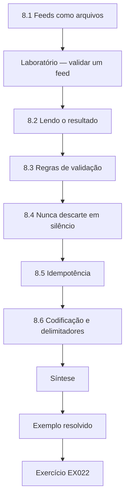

### Desenho lógico

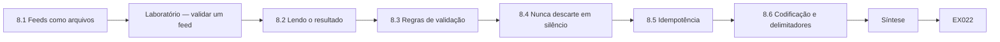

```text
[8.1 Feeds como arquivos]
    |
    v
[Laboratório — validar um feed]
    |
    v
[8.2 Lendo o resultado]
    |
    v
[8.3 Regras de validação]
    |
    v
[8.4 Nunca descarte em silêncio]
    |
    v
[8.5 Idempotência]
    |
    v
[8.6 Codificação e delimitadores]
    |
    v
[Síntese]
    |
    v
[Exemplo resolvido] --> [Exercício EX022]
```
<!-- cyberabc:lesson-figures:end ch-08 -->


### Objetivos de aprendizagem

Você vai (1) fazer o parsing de um feed de indicadores em CSV com a biblioteca padrão; (2) validar cada linha e registrar os motivos de rejeição; (3) relatar contagens com honestidade; (4) projetar scripts que possam ser auditados.

### 8.1 Feeds como arquivos

O HSSC distribui um CSV diário com colunas para tipo, valor, data da primeira observação e TLP. Planilhas estragam esses arquivos — transformam números longos em notação científica ou removem zeros à esquerda —, por isso Amara os processa com o módulo `csv` do Python. Ela mantém o arquivo original inalterado e grava a saída processada em um arquivo novo, para que qualquer dúvida sobre o feed possa ser conferida com o que o HSSC realmente enviou. Ela evita abrir o original em uma planilha mesmo para uma olhada rápida, porque salvá-lo por acidente poderia mudar valores sem que ninguém percebesse.

### Laboratório — validar um feed

```python
"""Lab 1 (ch 08): parse a synthetic CSV feed with the csv module and count accepted/rejected rows."""
import csv, io
data = """type,value,first_seen,tlp
domain,portal-login.example,2026-09-01,TLP:GREEN
ipv4,203.0.113.50,2026-09-02,TLP:AMBER
domain,,2026-09-02,TLP:GREEN
sha256,abc123,2026-09-03,TLP:GREEN
url,http://files.example/x,2026-09-04,TLP:CLEAR
"""
ok, bad = [], []
for row in csv.DictReader(io.StringIO(data)):
    if not row["value"]:
        bad.append(("empty value", row)); continue
    if row["type"] == "sha256" and len(row["value"]) != 64:
        bad.append(("sha256 length", row)); continue
    ok.append(row)
print("accepted", len(ok), "rejected", len(bad))
for reason, row in bad:
    print(" reject:", reason, row["type"], row["first_seen"])
```

Execute com `python3 lab_csvfeed.py`. Saída verificada:

```text
accepted 3 rejected 2
 reject: empty value domain 2026-09-02
 reject: sha256 length sha256 2026-09-03
```

### 8.2 Lendo o resultado

Três linhas passam; duas falham. Uma tem o valor de domínio vazio; outra diz ser um hash SHA-256, mas tem o tamanho errado. Cada rejeição é impressa com sua data e seu motivo, para que Amara possa enviar ao HSSC um feedback preciso, em vez de "seu feed está quebrado". O feedback vai para o contato do HSSC com os números das linhas, para que os erros sejam corrigidos na origem para todos os membros. Ela também confere se as mesmas falhas apareceram em arquivos anteriores. Nenhuma tinha aparecido.

### 8.3 Regras de validação

As regras verificam presença (nenhum valor vazio), forma (tamanho do hash, endereço válido), vocabulário permitido (rótulos TLP do FIRST TLP 2.0: CLEAR, GREEN, AMBER, AMBER+STRICT, RED) e formato de data. As regras devem ser poucas, explícitas e testadas. Amara escreve um teste para cada regra usando um pequeno arquivo de linhas boas e ruins, então mudar uma regra mostra na hora que casos ela afeta. Ela mantém a lista de regras na documentação do script e a compartilha com o HSSC, para que a comunidade saiba o que o HCHT confere e possa pegar problemas antes de enviar o feed. Novas regras só são acrescentadas depois que um problema real mostra que são necessárias.

### 8.4 Nunca descarte em silêncio

Um script que pula linhas ruins sem avisar torna as contagens indignas de confiança. Sempre relate os totais aceitos e rejeitados. A importação de Amara imprime os dois totais e grava as linhas rejeitadas em um arquivo, com o motivo de cada uma. Se os totais não somam o número de linhas do feed, o script para com um erro. Um descarte silencioso já escondeu por uma semana uma mudança de coluna em um feed, até que um domínio ausente foi notado por acaso, e é por isso que a regra agora é rígida.

### 8.5 Idempotência

Rodar a importação duas vezes não deve criar duplicatas. Use o valor mais o tipo como chave e atualize os metadados em vez de acrescentar linhas novas. Amara testa isso importando o mesmo feed duas vezes e conferindo que a contagem de linhas não muda, enquanto a data da última observação é atualizada. A idempotência importa porque as importações são executadas de novo depois de falhas, e as duplicatas inflariam as contagens nos relatórios e fariam um indicador parecer vir de duas fontes, aumentando uma confiança que a evidência não sustenta.

### 8.6 Codificação e delimitadores

Os feeds chegam com codificações e separadores diferentes. Abra os arquivos com uma codificação explícita, detecte ou declare o delimitador e remova caracteres invisíveis, como marcas de ordem de bytes, do primeiro cabeçalho. Muitos erros intrigantes de "coluna ausente" são só um caractere escondido no nome do primeiro campo. Amara acrescenta as duas etapas à sua função de importação. A importação imprime a codificação e o delimitador detectados, para que uma mudança na forma como o HSSC produz o arquivo seja notada na hora, em vez de aparecer mais tarde como um erro intrigante. Amara mantém um pequeno conjunto de arquivos de exemplo com codificações diferentes como testes.

### Exemplo resolvido

No dia seguinte, o feed traz uma linha com TLP "AMBER STRICT" (espaço em vez de sinal de mais). O script de Amara a rejeita com o motivo `unknown TLP label`. Ela pede ao HSSC que a corrija em vez de adivinhar, porque tratá-la como AMBER afrouxaria uma restrição.

> **Caso sintético.** As linhas do feed são inventadas.

### Erros e limites

Formato válido não é verdade. Um indicador bem formado pode estar errado ou desatualizado; a validação é só a primeira barreira.

### Exercícios

- **EX022 — Rejeições do laboratório.** Que duas linhas falharam no laboratório, e por quê? *Rubrica:* 3 = domínio vazio (09-02); tamanho de sha256 errado (09-03); 2 = uma; 1 = só as contagens; 0 = nenhuma.
- **EX023 — Erro de digitação no TLP.** Por que "AMBER STRICT" não deve ser mapeado automaticamente para AMBER? *Rubrica:* 3 = afrouxaria a restrição; perguntar ao remetente; 2 = parcial; 1 = inofensivo; 0 = nenhuma.
- **EX024 — Segurança na reexecução.** Como o importador deve evitar duplicatas quando roda duas vezes? *Rubrica:* 3 = chave por tipo+valor; atualizar em vez de inserir; 2 = remover duplicatas de forma vaga; 1 = apagar tudo antes; 0 = nenhuma.

### Síntese

Faça o parsing com código, valide de forma explícita, relate as rejeições e mantenha as importações idempotentes.

### Continue estudando — capítulo 08 de 40

[← Capítulo 07 (rascunho)](#ch-07) · [Índice de capítulos do curso](../SUBJECTS.md) · [Capítulo 09 (rascunho) →](#ch-09)

<a id="ch-09"></a>

## Capítulo 9 — Dados e bancos de dados

<!-- cyberabc:lesson-figures:start ch-09 -->
### Mapa da aula

Aula 09 publicada. Mapa, exemplo, EX025.

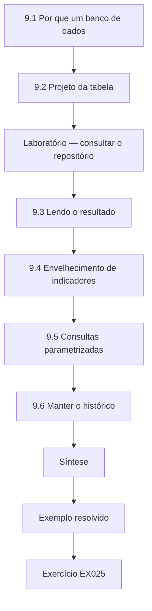

### Desenho lógico

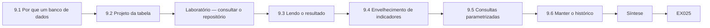

```text
[9.1 Por que um banco de dados]
    |
    v
[9.2 Projeto da tabela]
    |
    v
[Laboratório — consultar o repositório]
    |
    v
[9.3 Lendo o resultado]
    |
    v
[9.4 Envelhecimento de indicadores]
    |
    v
[9.5 Consultas parametrizadas]
    |
    v
[9.6 Manter o histórico]
    |
    v
[Síntese]
    |
    v
[Exemplo resolvido] --> [Exercício EX025]
```
<!-- cyberabc:lesson-figures:end ch-09 -->


### Objetivos de aprendizagem

Você vai (1) projetar uma pequena tabela de indicadores; (2) consultá-la com SQL por meio do `sqlite3` do Python; (3) encontrar indicadores desatualizados; (4) guardar os rótulos de tratamento junto com os dados.

### 9.1 Por que um banco de dados

Uma planilha funciona até que dois analistas a editem ao mesmo tempo. Um pequeno banco SQLite dá uma única fonte da verdade, consultas no lugar da filtragem manual e um registro do que se sabia e quando. Amara passa sua lista de indicadores de uma planilha compartilhada para o SQLite depois que dois analistas sobrescreveram as notas um do outro. O arquivo do banco entra no backup junto com os outros registros da equipe, e toda mudança é feita pelo script de importação ou por uma consulta revisada, então fica claro quem mudou o quê e quando.

### 9.2 Projeto da tabela

Colunas: `value`, `type`, `source`, rótulo TLP, `first_seen`, `last_seen` e `status`. Guardar o TLP em cada linha significa que as consultas podem filtrar o que pode ser compartilhado antes que qualquer coisa saia do HCHT. O status registra se um indicador está ativo, em revisão ou expirado. Amara acrescenta uma restrição para que a coluna TLP aceite apenas os cinco rótulos válidos, o que impede que um erro de digitação crie um rótulo que as consultas deixariam passar. As datas de primeira e última observação permitem à equipe mostrar por quanto tempo um indicador foi relevante, o que importa para as decisões de envelhecimento.

### Laboratório — consultar o repositório

```python
"""Lab 2 (ch 09): store synthetic indicators in an in-memory SQLite database and query by TLP and age."""
import sqlite3
db = sqlite3.connect(":memory:")
db.execute("create table ioc(value text primary key, type text, tlp text, last_seen text)")
db.executemany("insert into ioc values(?,?,?,?)", [
    ("portal-login.example", "domain", "TLP:GREEN", "2026-10-01"),
    ("203.0.113.50", "ipv4", "TLP:AMBER", "2026-07-15"),
    ("files.example", "domain", "TLP:CLEAR", "2026-10-08"),
    ("198.51.100.7", "ipv4", "TLP:GREEN", "2026-05-02"),
])
q = "select value, tlp from ioc where tlp in ('TLP:CLEAR','TLP:GREEN') and last_seen >= ? order by value"
for row in db.execute(q, ("2026-09-01",)):
    print(row)
print("stale:", db.execute("select count(*) from ioc where last_seen < '2026-09-01'").fetchone()[0])
```

Execute com `python3 lab_sql.py`. Saída verificada:

```text
('files.example', 'TLP:CLEAR')
('portal-login.example', 'TLP:GREEN')
stale: 2
```

### 9.3 Lendo o resultado

A consulta retorna dois domínios com seus rótulos TLP: files.example em TLP:CLEAR e portal-login.example em TLP:GREEN. Uma segunda consulta conta dois indicadores cuja data last_seen é mais antiga que o limiar de revisão — candidatos a expirar. A consulta filtra pelo TLP antes de retornar as linhas, então uma lista preparada para compartilhamento não pode incluir entradas restritas por engano. Amara revisa os dois candidatos a expirar com a supervisora antes de mudar o status deles, já que um pode continuar ativo segundo uma atualização recente do HSSC.

### 9.4 Envelhecimento de indicadores

Endereços mudam de mãos; domínios são registrados de novo. Um indicador do ano passado pode hoje pertencer a alguém inocente. Regras de envelhecimento — revisão depois de 90 dias para endereços, prazo maior para hashes — mantêm as listas de bloqueio precisas. A Pyramid of Pain de Bianco explica o porquê: indicadores de baixo nível são baratos de mudar para os adversários. Amara aplica as regras por meio de uma consulta agendada que lista os indicadores que devem ser revisados. Cada revisão pergunta se o indicador ainda aparece em relatórios ou logs recentes. Se não aparece, ele passa para monitoramento ou expira, e o motivo é registrado. Os hashes envelhecem mais devagar porque o hash de um arquivo nunca muda, embora o arquivo possa deixar de ser usado.

### 9.5 Consultas parametrizadas

Sempre passe os valores como parâmetros, nunca por concatenação de strings. Isso impede que valores malformados corrompam as consultas. Os scripts de Amara usam parâmetros em toda consulta que inclui um valor vindo de um feed, mesmo quando o valor já foi validado. Às vezes os feeds trazem aspas ou pontos e vírgulas dentro de nomes de domínio desarmados à mão, e uma consulta concatenada poderia falhar ou mudar de formas inesperadas. Os parâmetros eliminam o risco por completo e deixam o código mais fácil de ler e revisar. É um hábito simples e permanente.

### 9.6 Manter o histórico

Quando um indicador é aposentado, mude seu status para "expired" em vez de apagar a linha. Uma investigação posterior pode perguntar se o HCHT estava bloqueando aquele endereço em um dia específico, e só um histórico de mudanças de status com datas pode responder à pergunta com honestidade. Amara acrescenta uma pequena tabela de histórico que registra cada mudança de status com a data e o analista. Isso permite responder a essas perguntas com datas, e não com a memória, e deixa a equipe medir por quanto tempo os indicadores costumam ficar ativos antes de serem aposentados.

### Exemplo resolvido

Antes de enviar um resumo semanal aos membros do HSSC, Amara filtra apenas as linhas rotuladas TLP:CLEAR ou TLP:GREEN. Uma linha TLP:AMBER de um parceiro é excluída automaticamente. Ela também exporta a lista de desatualizados para revisão pela equipe de rede, em vez de apagar as linhas ela mesma.

> **Caso sintético.** Todas as linhas são inventadas.

### Erros e limites

Um banco de dados herda a qualidade de suas entradas. Os rótulos precisam ser registrados corretamente na importação.

### Exercícios

- **EX025 — Saída do laboratório.** O que a consulta de domínios retornou? *Rubrica:* 3 = files.example CLEAR e portal-login.example GREEN; 2 = um; 1 = só a contagem; 0 = nenhuma.
- **EX026 — Por que guardar o TLP.** Por que manter o rótulo TLP em cada linha? *Rubrica:* 3 = filtrar por consulta os dados compartilháveis antes da liberação; 2 = parcial; 1 = decoração; 0 = nenhuma.
- **EX027 — Tratamento dos desatualizados.** O que deve acontecer com os dois indicadores desatualizados? *Rubrica:* 3 = revisar com os responsáveis; expirar, não apagar em silêncio; 2 = apagar; 1 = manter para sempre; 0 = nenhuma.

### Síntese

Modele os indicadores com rótulos e datas, consulte com segurança, envelheça os indicadores e mantenha o histórico.

### Continue estudando — capítulo 09 de 40

[← Capítulo 08 (rascunho)](#ch-08) · [Índice de capítulos do curso](../SUBJECTS.md) · [Capítulo 10 (rascunho) →](#ch-10)

<a id="ch-10"></a>

## Capítulo 10 — Ética e prática autorizada

<!-- cyberabc:lesson-figures:start ch-10 -->
### Mapa da aula

Aula 10 publicada. Mapa, exemplo, EX028.

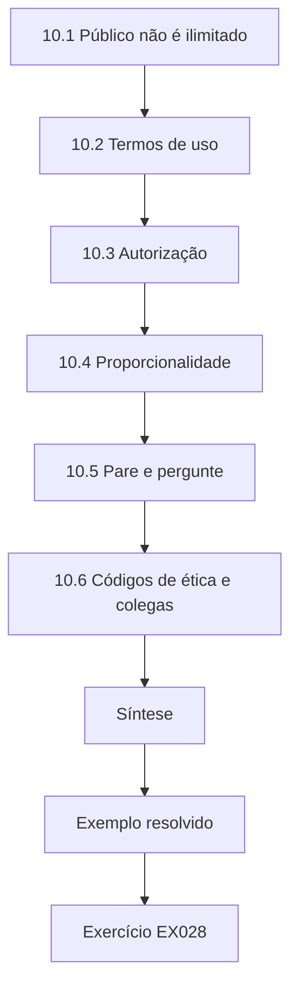

### Desenho lógico

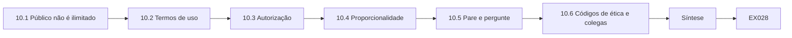

```text
[10.1 Público não é ilimitado]
    |
    v
[10.2 Termos de uso]
    |
    v
[10.3 Autorização]
    |
    v
[10.4 Proporcionalidade]
    |
    v
[10.5 Pare e pergunte]
    |
    v
[10.6 Códigos de ética e colegas]
    |
    v
[Síntese]
    |
    v
[Exemplo resolvido] --> [Exercício EX028]
```
<!-- cyberabc:lesson-figures:end ch-10 -->


### Objetivos de aprendizagem

Você vai (1) declarar os limites jurídicos e éticos da coleta de OSINT; (2) respeitar os termos de uso das plataformas; (3) aplicar princípios de proteção de dados; (4) reconhecer quando parar e perguntar.

### 10.1 Público não é ilimitado

Uma informação visível na internet não fica automaticamente livre para ser coletada, combinada e guardada. Leis de proteção de dados como o GDPR da UE se aplicam a dados pessoais seja qual for a forma como foram obtidos: a coleta precisa de uma base legal, de uma finalidade específica e de minimização. No Brasil, o papel equivalente cabe à Lei Geral de Proteção de Dados Pessoais (LGPD, Lei nº 13.709/2018), cujo cumprimento é fiscalizado pela Autoridade Nacional de Proteção de Dados (ANPD). Combinar fatos públicos dispersos sobre uma pessoa pode criar um perfil que a prejudica. As tarefas de Amara tratam de infraestrutura, como domínios e hospedagem, e não de pessoas. Quando uma fonte inclui dados pessoais, como o nome de um titular em um registro de domínio, ela registra apenas o que o requisito exige e anota por que aquilo foi guardado. O encarregado de proteção de dados do HCHT revisa todo ano a retenção de quaisquer dados pessoais pela equipe.

### 10.2 Termos de uso

As plataformas definem regras sobre acesso automatizado, uso de contas e reutilização de dados. Personas falsas, raspagem contra os termos e entrada em grupos fechados expõem o analista e o empregador a riscos jurídicos e de reputação. A política do HCHT os proíbe sem aprovação jurídica. Amara confere os termos de cada fonte pública antes de usá-la e mantém uma nota curta do que é permitido. Quando uma fonte proíbe o acesso automatizado, ela a usa manualmente ou não a usa. A aprovação da equipe jurídica é registrada junto com a fonte, para que analistas futuros conheçam a decisão e seus limites.

### 10.3 Autorização

Os analistas agem dentro de um mandato escrito: que perguntas, que fontes, que métodos. Interagir com infraestrutura de adversários — visitar páginas de phishing ativas a partir de um notebook de trabalho, cadastrar-se em fóruns criminosos — está fora da autoridade de uma estagiária e pode alertar os adversários ou violar a lei. O mandato de Amara lista os feeds do HSSC, os próprios logs do HCHT e uma lista curta de fontes públicas aprovadas, com os métodos permitidos para cada uma. Quando uma tarefa parece exigir algo fora da lista, como conferir uma página de phishing ativa, ela pergunta à supervisora, que pode organizar isso em um ambiente isolado ou decidir que não é necessário.

### 10.4 Proporcionalidade

Pergunte se a necessidade de inteligência justifica a intrusão. Identificar o provedor de hospedagem de um domínio de phishing para uma remoção é proporcional; pesquisar a vida privada de um suspeito não é trabalho da CTI e cabe, se a alguém, às autoridades policiais. Amara escreve nas notas a finalidade de cada etapa de coleta e a confere com esse teste antes de começar. Se a finalidade não pode ser declarada em termos de proteger os sistemas ou os pacientes do HCHT, a etapa é abandonada. Sua supervisora revisa todo mês uma amostra das notas para confirmar que a prática é seguida.

### 10.5 Pare e pergunte

Quando uma tarefa causar desconforto, faça uma pausa e pergunte à supervisora. Registre a pergunta e a resposta. O caderno de Amara tem uma página para essas perguntas, com a data, a resposta e quem a deu. No início do estágio, ela perguntou se podia buscar em uma rede social o perfil do remetente de um phishing; a resposta foi não, já que o requisito tratava do domínio, não da pessoa. Registrar a resposta evita que a mesma pergunta precise ser feita de novo e mostra aos revisores como as decisões foram tomadas.

### 10.6 Códigos de ética e colegas

Códigos profissionais — por exemplo, os de entidades de certificação em segurança — pedem que os membros ajam com honra e protejam a sociedade. Os colegas também ajudam: descrever uma coleta planejada a um colega muitas vezes expõe problemas que o analista não tinha notado. O HCHT faz uma breve "verificação de método" semanal, em que os estagiários apresentam qualquer fonte nova antes de usá-la. Amara apresenta sua primeira fonte nova na terceira semana. A verificação leva dez minutos. Os estagiários descrevem a fonte, o que ela responderia, seus termos e qualquer dado pessoal envolvido, e um colega faz perguntas. Várias fontes foram abandonadas ou limitadas depois de uma verificação, e as notas ficam guardadas com a lista de fontes da equipe.

### Exemplo resolvido

Um colega sugere criar um perfil falso para entrar em um fórum fechado onde dados hospitalares poderiam estar à venda. Amara recusa e escala o caso. A supervisora explica que, em vez disso, o HCHT vai perguntar ao HSSC e a seu fornecedor comercial de inteligência, que operam sob contratos e revisão jurídica, se dados do HCHT apareceram.

> **Caso sintético.** O cenário é inventado.

### Erros e limites

A lei varia conforme a jurisdição; este capítulo não é aconselhamento jurídico. Consulte o encarregado de proteção de dados do HCHT.

### Exercícios

- **EX028 — Dados públicos.** Explique por que a visibilidade pública não torna os dados pessoais livres para coleta. *Rubrica:* 3 = a lei de proteção de dados se aplica; finalidade, minimização, dano por perfilamento; 2 = parcial; 1 = são livres; 0 = nenhuma.
- **EX029 — Pedido do fórum.** O que Amara deve fazer quando lhe pedem para criar um perfil falso? *Rubrica:* 3 = recusar, escalar; usar parceiros autorizados; 2 = só recusar; 1 = obedecer; 0 = nenhuma.
- **EX030 — Proporcional ou não.** Pesquisar a família de um suspeito em redes sociais é CTI proporcional? *Rubrica:* 3 = não; fora do mandato; autoridades policiais; 2 = não; 1 = sim; 0 = nenhuma.

### Síntese

Colete de forma lícita, siga os termos, fique dentro do mandato, pese a proporcionalidade e pergunte quando tiver dúvida.

### Continue estudando — capítulo 10 de 40

[← Capítulo 09 (rascunho)](#ch-09) · [Índice de capítulos do curso](../SUBJECTS.md) · [Capítulo 11 (rascunho) →](#ch-11)

<a id="ch-11"></a>

## Capítulo 11 — Sistemas operacionais

<!-- cyberabc:lesson-figures:start ch-11 -->
### Mapa da aula

Aula 11 publicada. Mapa, exemplo, EX031.

```mermaid
flowchart TD
  N0["11.1 Processos e interpretadores de comandos"]
  N1["11.2 Privilégio"]
  N2["11.3 Telemetria de endpoint"]
  N3["11.4 Ler uma página de técnica"]
  N4["11.5 Serviços remotos"]
  N5["11.6 Correções e situação de suporte"]
  N6["Síntese"]
  N0 --> N1 --> N2 --> N3 --> N4 --> N5 --> N6
  N6 --> EX["Exemplo resolvido"]
  EX --> Q["Exercício EX031"]
```

### Desenho lógico

```mermaid
flowchart LR
  N0["11.1 Processos e interpretadores de comandos"]
  N1["11.2 Privilégio"]
  N2["11.3 Telemetria de endpoint"]
  N3["11.4 Ler uma página de técnica"]
  N4["11.5 Serviços remotos"]
  N5["11.6 Correções e situação de suporte"]
  N6["Síntese"]
  N0 --> N1 --> N2 --> N3 --> N4 --> N5 --> N6 --> Q["EX031"]
```

```text
[11.1 Processos e interpretadores de comandos]
    |
    v
[11.2 Privilégio]
    |
    v
[11.3 Telemetria de endpoint]
    |
    v
[11.4 Ler uma página de técnica]
    |
    v
[11.5 Serviços remotos]
    |
    v
[11.6 Correções e situação de suporte]
    |
    v
[Síntese]
    |
    v
[Exemplo resolvido] --> [Exercício EX031]
```
<!-- cyberabc:lesson-figures:end ch-11 -->


### Objetivos de aprendizagem

Você vai (1) relacionar conceitos de sistemas operacionais a técnicas do ATT&CK; (2) identificar a telemetria de endpoint útil para conferir inteligência; (3) explicar o privilégio e seu abuso; (4) ler uma página de técnica com senso crítico.

### 11.1 Processos e interpretadores de comandos

Um sistema operacional executa processos, cada um iniciado por um processo pai. Os atacantes costumam usar interpretadores nativos — PowerShell, shells de comando, hosts de script —, que o ATT&CK agrupa em Command and Scripting Interpreter (T1059). Como os administradores usam as mesmas ferramentas, a detecção depende do contexto: qual processo pai, qual usuário, qual horário. Amara observa que os administradores de um hospital rodam scripts à noite para backups e atualizações, então um script noturno não é suspeito por si só. A pergunta útil é se o processo pai e a conta correspondem ao que os administradores normalmente usam.

### 11.2 Privilégio

As contas carregam privilégios. Os atacantes preferem contas válidas (T1078) porque usar credenciais reais parece trabalho normal. O menor privilégio limita o que uma conta roubada pode fazer. No HCHT, as contas válidas incluem contas de fornecedores usadas para a manutenção remota de sistemas clínicos. Amara aprende que a inteligência sobre credenciais roubadas de fornecedores é especialmente urgente, já que essas contas costumam ter acesso amplo. Ela confere se cada conta de fornecedor no diretório tem um responsável e uma data de expiração, e relata à equipe de identidade as que não têm um ou outro.

### 11.3 Telemetria de endpoint

Eventos de criação de processo com linhas de comando, eventos de logon e instalações de serviço são os logs de endpoint mais relevantes para a CTI. Se um relatório diz que um grupo executou uma tarefa agendada com um nome específico, Amara pode buscar esse nome nos dados de endpoint do HCHT. Antes de buscar, Amara confirma com a equipe de endpoint quais sistemas enviam dados de processo, já que os dispositivos médicos e alguns sistemas de laboratório não rodam o agente. Onde falta telemetria, o resultado da busca diz isso, em vez de dar a entender que nada foi encontrado.

### 11.4 Ler uma página de técnica

Cada página de técnica do ATT&CK tem uma descrição, exemplos de procedimento tirados de relatórios públicos, mitigações e notas de detecção. Os exemplos de procedimento mostram que alguém observou aquilo; não mostram quão comum é. Amara usa as páginas de técnica para entender o que um relatório descreve, e não para estimar a probabilidade de o HCHT vê-lo. Quando um relatório associa um incidente a uma técnica, ela lê os exemplos de procedimento para ver se a associação faz sentido. As notas de detecção dão ideias de buscas, que ela confere com a equipe de endpoint antes de executar.

### 11.5 Serviços remotos

Remote Services (T1021) abrange atacantes que se movem entre sistemas usando acesso remoto legítimo. Em um hospital, a área de trabalho remota é usada por fornecedores, então linhas de base de quem se conecta a onde são essenciais. Amara ajuda a equipe a montar uma linha de base das conexões de fornecedores: qual fornecedor se conecta a quais sistemas, de quais endereços e em que horários. Uma conexão fora da linha de base não prova um ataque, mas merece uma conferência rápida com o fornecedor. A linha de base é revisada a cada trimestre com a engenharia clínica, já que os calendários de manutenção mudam e novos fornecedores são acrescentados.

### 11.6 Correções e situação de suporte

Sistemas operacionais sem suporte não recebem mais correções, então a inteligência sobre vulnerabilidades que os afetam não tem remédio por patch. O inventário deve registrar a situação de suporte, e os alertas que tocam sistemas sem suporte disparam controles compensatórios — segmentação, acesso restrito, monitoramento extra — acordados com o responsável pelo sistema. Amara acrescenta a situação de suporte às suas notas de alerta, para que os leitores vejam na hora se a correção é possível. Os controles compensatórios são revistos quando o plano de substituição do responsável muda. Amara mantém uma lista curta dos sistemas sem suporte, com seus controles e responsáveis, para que um alerta possa ser conferido com ela depressa, e anota quando uma data de substituição foi adiada.

### Exemplo resolvido

O HSSC relata que um intruso em outra instituição usou a área de trabalho remota a partir de uma conta de fornecedor às 03:00. Amara pede à equipe de endpoint do HCHT os logons remotos de contas de fornecedores fora do horário comercial nos últimos 30 dias. Aparecem dois; ambos correspondem a chamados de manutenção agendada. Ela registra "conferido; nenhuma correspondência", com a consulta e as datas.

> **Caso sintético.** O relatório e os logons são inventados.

### Erros e limites

A ausência nos logs pode significar falta de registro. Registre a cobertura ao relatar "nenhuma correspondência".

### Exercícios

- **EX031 — Escolha da técnica.** Um atacante entra com uma senha roubada de fornecedor. Que técnica do ATT&CK se encaixa? *Rubrica:* 3 = Valid Accounts T1078, com justificativa; 2 = só o nome; 1 = T1059; 0 = nenhuma.
- **EX032 — Cautela com procedimentos.** O que um exemplo de procedimento em uma página do ATT&CK não diz? *Rubrica:* 3 = frequência/prevalência ou se ele visa você; 2 = parcial; 1 = diz tudo; 0 = nenhuma.
- **EX033 — Registro de nenhuma correspondência.** O que Amara deve incluir ao registrar "nenhuma correspondência"? *Rubrica:* 3 = consulta, período, fonte de dados e lacunas de cobertura; 2 = dois; 1 = só o veredito; 0 = nenhuma.

### Síntese

Associe o comportamento do sistema operacional a técnicas, use a telemetria de endpoint para conferir relatórios e registre a cobertura junto com cada resultado negativo.

### Continue estudando — capítulo 11 de 40

[← Capítulo 10 (rascunho)](#ch-10) · [Índice de capítulos do curso](../SUBJECTS.md) · [Capítulo 12 (rascunho) →](#ch-12)

<a id="ch-12"></a>

## Capítulo 12 — Probabilidade e estatística

<!-- cyberabc:lesson-figures:start ch-12 -->
### Mapa da aula

Aula 12 publicada. Mapa, exemplo, EX034.

```mermaid
flowchart TD
  N0["12.1 Palavras de probabilidade estimativa"]
  N1["Laboratório — conferir palavras estimativas"]
  N2["12.2 Lendo o resultado"]
  N3["12.3 Taxas-base"]
  N4["12.4 Falsa precisão"]
  N5["12.5 Probabilidade versus confiança"]
  N6["12.6 Amostras pequenas"]
  N7["Síntese"]
  N0 --> N1 --> N2 --> N3 --> N4 --> N5 --> N6 --> N7
  N7 --> EX["Exemplo resolvido"]
  EX --> Q["Exercício EX034"]
```

### Desenho lógico

```mermaid
flowchart LR
  N0["12.1 Palavras de probabilidade estimativa"]
  N1["Laboratório — conferir palavras estimativas"]
  N2["12.2 Lendo o resultado"]
  N3["12.3 Taxas-base"]
  N4["12.4 Falsa precisão"]
  N5["12.5 Probabilidade versus confiança"]
  N6["12.6 Amostras pequenas"]
  N7["Síntese"]
  N0 --> N1 --> N2 --> N3 --> N4 --> N5 --> N6 --> N7 --> Q["EX034"]
```

```text
[12.1 Palavras de probabilidade estimativa]
    |
    v
[Laboratório — conferir palavras estimativas]
    |
    v
[12.2 Lendo o resultado]
    |
    v
[12.3 Taxas-base]
    |
    v
[12.4 Falsa precisão]
    |
    v
[12.5 Probabilidade versus confiança]
    |
    v
[12.6 Amostras pequenas]
    |
    v
[Síntese]
    |
    v
[Exemplo resolvido] --> [Exercício EX034]
```
<!-- cyberabc:lesson-figures:end ch-12 -->


### Objetivos de aprendizagem

Você vai (1) expressar a confiança analítica com palavras calibradas; (2) conferir a redação com uma escala de probabilidade; (3) explicar as taxas-base; (4) evitar a falsa precisão.

### 12.1 Palavras de probabilidade estimativa

Sherman Kent mostrou que os leitores interpretam "provável" em qualquer ponto entre cerca de 20% e 90%. A ICD 203 exige que os produtos analíticos expressem a probabilidade de forma consistente. As equipes adotam uma escala — por exemplo, "muito provável" para 80–95% — e a seguem. Amara usa a escala da equipe em todos os produtos e a acrescenta como nota de rodapé, para que leitores de fora da equipe possam interpretar as palavras. A descoberta de Kent mostra que o problema não é escrita descuidada, mas leituras realmente diferentes das mesmas palavras. Uma escala comum dá às palavras um significado fixo, e a nota de rodapé permite que os leitores do HSSC ou do conselho do HCHT a apliquem da mesma forma.

### Laboratório — conferir palavras estimativas

```python
"""Lab 3 (ch 12): map estimative words to a published probability scale and flag misuse (synthetic)."""
SCALE = {"almost no chance": (0, 5), "very unlikely": (5, 20), "unlikely": (20, 45),
         "roughly even chance": (45, 55), "likely": (55, 80), "very likely": (80, 95),
         "almost certainly": (95, 100)}
claims = [("C1", "likely", 70), ("C2", "very likely", 60), ("C3", "unlikely", 30), ("C4", "probable", 75)]
for cid, word, analyst_pct in claims:
    if word not in SCALE:
        print(cid, f"'{word}' not on team scale -> rewrite")
        continue
    lo, hi = SCALE[word]
    print(cid, word, f"{analyst_pct}%", "consistent" if lo <= analyst_pct <= hi else f"INCONSISTENT (scale {lo}-{hi}%)")
```

Execute com `python3 lab_wep.py`. Saída verificada:

```text
C1 likely 70% consistent
C2 very likely 60% INCONSISTENT (scale 80-95%)
C3 unlikely 30% consistent
C4 'probable' not on team scale -> rewrite
```

### 12.2 Lendo o resultado

A alegação C1 diz `likely` com 70% — consistente. C2 diz `very likely`, mas atribui 60%, fora da faixa de 80–95% da equipe, então a redação exagera a confiança. C3, `unlikely` com 30%, é consistente. C4 usa `probable`, que não está na escala da equipe e precisa ser reescrita. Amara devolve o rascunho com as duas alegações inconsistentes marcadas e a escala anexada. O autor pode mudar a palavra ou mudar o número, mas precisa explicar qual julgamento é o correto. A consistência é conferida antes que qualquer coisa saia da equipe, porque os leitores de fora agirão com base na palavra que veem, e não em um número que nunca leram.

### 12.3 Taxas-base

Se um e-mail em dez mil é malicioso, um filtro que marca 1% dos e-mails produz sobretudo alarmes falsos, mesmo que pegue todos os phishings. Sempre pergunte pela taxa-base antes de julgar uma detecção. Amara aplica isso a uma regra de alerta proposta depois de um relatório do HSSC e descobre que a maioria dos alertas esperados seria inofensiva. A equipe estreita a regra antes de implantá-la. Depois do ajuste, a regra dispara algumas vezes por semana, e cada alerta é conferido no mesmo dia, um ritmo que a equipe consegue sustentar.

### 12.4 Falsa precisão

"Há 73,4% de chance de este grupo ser o responsável" implica uma medição que não existe. Use faixas. Amara substitui esses números nos rascunhos por uma palavra da escala da equipe e uma justificativa curta. Um número preciso sugere que a probabilidade foi calculada a partir de dados, quando na prática reflete o julgamento de um analista com base em evidências incompletas. As faixas são honestas quanto a isso e mais fáceis de usar pelos leitores. Se um número é necessário para um modelo, ele é dado como intervalo e rotulado como estimativa.

### 12.5 Probabilidade versus confiança

A probabilidade descreve quão provável é um evento; a confiança descreve a qualidade da evidência e do raciocínio por trás do julgamento. A ICD 203 pede que os analistas expressem e expliquem as duas. Amara aprende a escrever as duas em uma frase, como "provável, com confiança moderada porque só uma fonte o relata". As duas podem divergir: um evento pode ser provável enquanto a confiança é baixa, se a evidência é escassa. Os leitores precisam das duas para decidir quanto peso dar a um julgamento. Amara confere as duas partes em cada julgamento de seus rascunhos.

### 12.6 Amostras pequenas

Com cinco relatórios, uma menção a mais ou a menos faz uma porcentagem oscilar vinte pontos. Quando as amostras são pequenas, relate as contagens, evite ordenar valores próximos e diga que o padrão pode mudar com mais dados. A estatística não salva uma amostra que simplesmente contém pouca informação. Amara aplica isso ao resumo trimestral do HSSC. Vários trimestres têm só um punhado de relatórios por categoria, então ela pede ao HSSC que mostre as contagens ao lado de cada porcentagem e marque as classificações que dependem de um ou dois relatórios. O HSSC adota a mudança no resumo seguinte.

### Exemplo resolvido

Amara escreve no rascunho, em inglês, a frase `It is probable the phishing wave will reach HCHT this week` ("é provável que a onda de phishing chegue ao HCHT nesta semana"). O script marca `probable` como fora da escala. Ela reescreve: "É provável (55–80%) que funcionários do HCHT recebam e-mails desta onda nesta semana; confiança moderada, com base em relatórios do HSSC de três instituições próximas."

> **Caso sintético.** O rascunho e os relatórios são inventados.

### Erros e limites

Escalas reduzem a ambiguidade, mas não tornam os julgamentos corretos. Acompanhe os desfechos para conferir a calibração ao longo do tempo.

### Exercícios

- **EX034 — Inconsistência no laboratório.** Que alegação estava inconsistente no laboratório, e por quê? *Rubrica:* 3 = C2: `very likely` com 60%, escala de 80–95%; 2 = só C2; 1 = C4; 0 = nenhuma.
- **EX035 — Armadilha da taxa-base.** Explique por que um filtro que marca 1% dos e-mails pode produzir sobretudo alarmes falsos. *Rubrica:* 3 = taxa-base de maliciosos muito abaixo de 1%; a maioria das marcações é benigna; 2 = parcial; 1 = o filtro está quebrado; 0 = nenhuma.
- **EX036 — Duas dimensões.** Distinga probabilidade de confiança. *Rubrica:* 3 = probabilidade do evento vs qualidade da evidência/raciocínio; 2 = parcial; 1 = são a mesma coisa; 0 = nenhuma.

### Síntese

Use uma escala comum, confira as taxas-base, evite a falsa precisão e declare tanto a probabilidade quanto a confiança.

### Continue estudando — capítulo 12 de 40

[← Capítulo 11 (rascunho)](#ch-11) · [Índice de capítulos do curso](../SUBJECTS.md) · [Capítulo 13 (rascunho) →](#ch-13)

<a id="ch-13"></a>

## Capítulo 13 — Identidade e acesso

<!-- cyberabc:lesson-figures:start ch-13 -->
### Mapa da aula

Aula 13 publicada. Mapa, exemplo, EX037.

```mermaid
flowchart TD
  N0["13.1 A identidade como perímetro"]
  N1["13.2 Autenticação multifator"]
  N2["13.3 Relatos de exposição de credenciais"]
  N3["13.4 Contas de serviço e de fornecedores"]
  N4["13.5 Medir o efeito do controle"]
  N5["13.6 Menor privilégio e revisões"]
  N6["Síntese"]
  N0 --> N1 --> N2 --> N3 --> N4 --> N5 --> N6
  N6 --> EX["Exemplo resolvido"]
  EX --> Q["Exercício EX037"]
```

### Desenho lógico

```mermaid
flowchart LR
  N0["13.1 A identidade como perímetro"]
  N1["13.2 Autenticação multifator"]
  N2["13.3 Relatos de exposição de credenciais"]
  N3["13.4 Contas de serviço e de fornecedores"]
  N4["13.5 Medir o efeito do controle"]
  N5["13.6 Menor privilégio e revisões"]
  N6["Síntese"]
  N0 --> N1 --> N2 --> N3 --> N4 --> N5 --> N6 --> Q["EX037"]
```

```text
[13.1 A identidade como perímetro]
    |
    v
[13.2 Autenticação multifator]
    |
    v
[13.3 Relatos de exposição de credenciais]
    |
    v
[13.4 Contas de serviço e de fornecedores]
    |
    v
[13.5 Medir o efeito do controle]
    |
    v
[13.6 Menor privilégio e revisões]
    |
    v
[Síntese]
    |
    v
[Exemplo resolvido] --> [Exercício EX037]
```
<!-- cyberabc:lesson-figures:end ch-13 -->


### Objetivos de aprendizagem

Você vai (1) explicar por que as credenciais são um alvo privilegiado; (2) ligar a inteligência de identidade aos controles; (3) tratar com responsabilidade os relatos de exposição de credenciais; (4) reconhecer, no nível conceitual, a fadiga de MFA e o roubo de sessão.

### 13.1 A identidade como perímetro

E-mail na nuvem e acesso remoto significam que uma senha válida pode alcançar sistemas clínicos de qualquer lugar. Valid Accounts (T1078) e Phishing (T1566) muitas vezes se combinam: o phishing captura a credencial e depois o atacante faz login. Por isso a CTI sobre phishing de credenciais leva a controles de identidade, e não só a filtros de e-mail. Amara acompanha um relatório de phishing do HSSC até seu efeito provável no HCHT: uma senha roubada usada para entrar no e-mail na nuvem a partir do exterior. As ações recomendadas vão para a equipe de identidade, além dos administradores de e-mail, e o relatório nomeia os padrões de login a vigiar, para que cada equipe saiba o que deve conferir.

### 13.2 Autenticação multifator

A MFA bloqueia a maioria dos ataques que dependem só da senha. Os adversários respondem disparando solicitações repetidas até que o usuário aprove uma, ou roubando tokens de sessão depois do login. A inteligência de que esses métodos estão ativos no setor justifica solicitações com correspondência de números e acesso condicional. Amara redige a recomendação com a equipe de identidade, explicando que métodos foram vistos no setor e como cada mudança responde a um deles. A correspondência de números dificulta muito a aprovação às cegas de solicitações repetidas, e o acesso condicional pode recusar logins de dispositivos não gerenciados. A equipe planeja uma implantação em etapas, para que os funcionários clínicos em estações compartilhadas não fiquem bloqueados no meio de um plantão.

### 13.3 Relatos de exposição de credenciais

Às vezes um parceiro relata endereços de e-mail e senhas do HCHT encontrados em um vazamento público. Trate-os como dados pessoais: restrinja o acesso, nunca cole senhas em chamados, force as redefinições por meio da equipe de identidade e informe o encarregado de proteção de dados. O papel de Amara é repassar o relato pelo canal combinado e registrar que ele foi recebido, e não testar se as senhas ainda funcionam. A equipe de identidade confere as contas e força as redefinições; o encarregado decide se a exposição precisa ser notificada. Uma nota curta registra a fonte, a data e as ações tomadas, sem nenhuma senha.

### 13.4 Contas de serviço e de fornecedores

Contas compartilhadas de fornecedores são difíceis de atribuir e muitas vezes ficam isentas de MFA. A inteligência sobre comprometimento de fornecedores no setor deve disparar primeiro uma revisão dessas contas. Amara ajuda a compilar uma lista das contas de fornecedores com seus responsáveis, os sistemas que alcançam, se a MFA se aplica e quando cada uma foi usada pela última vez. Várias contas não são usadas há meses e são desativadas depois de conferência com seus responsáveis. As contas que precisam continuar compartilhadas ficam restritas a endereços nomeados e são registradas com mais detalhe, para que seu uso ainda possa ser conferido.

### 13.5 Medir o efeito do controle

Depois de agir com base na inteligência, confira se o padrão de risco diminuiu: menos logons bem-sucedidos a partir de países novos, menos solicitações repetidas aprovadas. Amara compara as quatro semanas antes e depois da mudança, usando as mesmas consultas e anotando quaisquer outras mudanças que poderiam explicar a diferença, como um período de feriados com menos logins. Se o padrão não diminuiu, a inteligência ou o controle precisa de nova análise. Seu relatório curto inclui as contagens, o período e as limitações, e vai para a equipe de identidade e para o formulário de feedback do HSSC.

### 13.6 Menor privilégio e revisões

Revisões periódicas de acesso removem as contas de quem saiu e os direitos que não são mais necessários. A inteligência de que atacantes no setor estão reutilizando contas inativas transforma uma revisão de rotina em prioridade: as contas privilegiadas inativas são desativadas primeiro, e os responsáveis confirmam as que precisam continuar. Amara ajuda a equipe de identidade a preparar a lista e registra cada decisão. Os responsáveis têm duas semanas para confirmar que uma conta ainda é necessária; as contas não confirmadas são desativadas e podem ser restauradas a pedido. A revisão se repete a cada trimestre, e o número de contas privilegiadas inativas é acompanhado como medida de progresso.

### Exemplo resolvido

O HSSC alerta para uma campanha que envia solicitações falsas de MFA a funcionários da saúde. Amara confere os logs de login com a equipe de identidade: uma enfermeira aprovou uma solicitação às 02:14 a partir de uma localização desconhecida. A conta é redefinida, as sessões são revogadas e a enfermeira é contatada com gentileza, sem culpa. O HCHT ativa a correspondência de números.

> **Caso sintético.** A campanha e o login são inventados.

### Erros e limites

Os dados de localização são imprecisos; viagens e VPNs causam marcações falsas. Um tratamento sem culpa mantém os funcionários relatando.

### Exercícios

- **EX037 — Técnicas combinadas.** Que duas técnicas do ATT&CK se combinam no phishing de credenciais seguido de login? *Rubrica:* 3 = T1566 e T1078, na ordem; 2 = os nomes; 1 = uma; 0 = nenhuma.
- **EX038 — Tratamento do vazamento.** Liste três passos de tratamento seguro para um relato de vazamento de credenciais. *Rubrica:* 3 = restringir o acesso, nenhuma senha em chamados, redefinições pela equipe de identidade/informar o encarregado; 2 = dois; 1 = um; 0 = nenhuma.
- **EX039 — Conferência do controle.** Como o HCHT pode saber se a correspondência de números ajudou? *Rubrica:* 3 = medir as solicitações suspeitas aprovadas/logons de risco bem-sucedidos antes vs depois; 2 = vago; 1 = supor; 0 = nenhuma.

### Síntese

Trate a identidade como o perímetro, transforme a inteligência sobre credenciais em controles de identidade e trate as credenciais expostas como dados pessoais.

### Continue estudando — capítulo 13 de 40

[← Capítulo 12 (rascunho)](#ch-12) · [Índice de capítulos do curso](../SUBJECTS.md) · [Capítulo 14 (rascunho) →](#ch-14)

<a id="ch-14"></a>

## Capítulo 14 — Fundamentos de privacidade

<!-- cyberabc:lesson-figures:start ch-14 -->
### Mapa da aula

Aula 14 publicada. Mapa, exemplo, EX040.

```mermaid
flowchart TD
  N0["14.1 Dados pessoais na CTI"]
  N1["14.2 Ocultação antes do compartilhamento"]
  N2["Laboratório — ocultar dados de uma amostra"]
  N3["14.3 Lendo o resultado"]
  N4["14.4 Minimização e retenção"]
  N5["14.5 Dados de pacientes"]
  N6["14.6 Pseudonimização versus anonimização"]
  N7["Síntese"]
  N0 --> N1 --> N2 --> N3 --> N4 --> N5 --> N6 --> N7
  N7 --> EX["Exemplo resolvido"]
  EX --> Q["Exercício EX040"]
```

### Desenho lógico

```mermaid
flowchart LR
  N0["14.1 Dados pessoais na CTI"]
  N1["14.2 Ocultação antes do compartilhamento"]
  N2["Laboratório — ocultar dados de uma amostra"]
  N3["14.3 Lendo o resultado"]
  N4["14.4 Minimização e retenção"]
  N5["14.5 Dados de pacientes"]
  N6["14.6 Pseudonimização versus anonimização"]
  N7["Síntese"]
  N0 --> N1 --> N2 --> N3 --> N4 --> N5 --> N6 --> N7 --> Q["EX040"]
```

```text
[14.1 Dados pessoais na CTI]
    |
    v
[14.2 Ocultação antes do compartilhamento]
    |
    v
[Laboratório — ocultar dados de uma amostra]
    |
    v
[14.3 Lendo o resultado]
    |
    v
[14.4 Minimização e retenção]
    |
    v
[14.5 Dados de pacientes]
    |
    v
[14.6 Pseudonimização versus anonimização]
    |
    v
[Síntese]
    |
    v
[Exemplo resolvido] --> [Exercício EX040]
```
<!-- cyberabc:lesson-figures:end ch-14 -->


### Objetivos de aprendizagem

Você vai (1) identificar dados pessoais em produtos de inteligência; (2) ocultá-los antes do compartilhamento; (3) distinguir dados de vítimas de infraestrutura de adversários; (4) aplicar minimização e retenção.

### 14.1 Dados pessoais na CTI

Amostras de phishing contêm nomes e endereços dos destinatários; notas de incidente mencionam funcionários; os logs guardam os donos dos dispositivos. Pelas leis de proteção de dados, isso tudo são dados pessoais, e em um hospital parte deles pode se referir a pacientes, o que traz deveres mais rígidos. Amara mantém os dados pessoais fora de suas notas sempre que pode, usando papéis como "administrador da enfermaria" no lugar de nomes. Quando um nome é necessário, por exemplo para contatar um destinatário, ele fica no chamado do incidente, com acesso restrito, e não em notas de inteligência que circulam mais amplamente.

### 14.2 Ocultação antes do compartilhamento

Antes de enviar uma amostra ao HSSC, remova os e-mails e telefones dos funcionários e quaisquer identificadores de pacientes. Substitua-os por rótulos para que o sentido analítico sobreviva: "[staff-email] recebeu a mensagem". Amara confere também os anexos e os links embutidos, já que uma mensagem de phishing pode incluir o nome do destinatário em uma URL ou em um documento. A ocultação é revisada por uma segunda pessoa antes de qualquer envio, porque, uma vez compartilhada, a informação não pode ser recolhida de todos os membros. Os rótulos são consistentes, então várias amostras ainda podem ser comparadas depois da ocultação.

### Laboratório — ocultar dados de uma amostra

```python
"""Lab 4 (ch 14): redact email addresses and phone numbers from a synthetic incident note before sharing."""
import re
note = ("Phish reported by j.okoro@halden-health.example at 09:14; caller back on +44 20 7946 0958. "
        "Sender domain portal-login.example; reply-to billing@portal-login.example.")
internal = re.compile(r"[\w.+-]+@halden-health\.example")
phone = re.compile(r"\+\d[\d ]{8,}\d")
out = internal.sub("[staff-email]", note)
out = phone.sub("[phone]", out)
print(out)
print("adversary address kept:", "billing@portal-login.example" in out)
```

Execute com `python3 lab_redact.py`. Saída verificada:

```text
Phish reported by [staff-email] at 09:14; caller back on [phone]. Sender domain portal-login.example; reply-to billing@portal-login.example.
adversary address kept: True
```

### 14.3 Lendo o resultado

O e-mail e o telefone do funcionário são substituídos por marcadores. O endereço remetente do adversário é mantido, porque é o indicador de que os outros membros precisam. O script informa `adversary address kept: True`, confirmando que não ocultou demais. Amara acrescenta ao script testes para outros dados pessoais, como nomes em saudações. A ocultação em excesso removeria o que os membros do HSSC precisam; a ocultação insuficiente exporia os funcionários. Conferir as duas direções faz parte de toda mudança no script, e uma amostra de cada lote ainda é revisada por uma pessoa.

### 14.4 Minimização e retenção

Colete só o que a pergunta exige e guarde só pelo tempo necessário. Um prazo de retenção para amostras brutas de phishing — digamos, 90 dias — limita a exposição caso os próprios sistemas do HCHT sejam invadidos. A importação de Amara apaga automaticamente as amostras brutas quando o prazo termina, mantendo só os indicadores extraídos e um resumo com os dados ocultados. O prazo de retenção é acordado com o encarregado de proteção de dados e registrado nos procedimentos da equipe. Se uma investigação precisar de uma amostra por mais tempo, o motivo e a nova data são registrados, para que as exceções fiquem visíveis.

### 14.5 Dados de pacientes

Nunca compartilhe dados de pacientes pelos canais de inteligência. Se um incidente envolve prontuários, o encarregado de proteção de dados lidera, e as notificações seguem a lei, não os hábitos da CTI. Amara confere cada amostra em busca de dados de pacientes antes de qualquer outro processamento, e para se encontrar algum. O trabalho de inteligência precisa de indicadores e técnicas, não de prontuários, então nunca há motivo para enviá-los ao HSSC. Se uma mensagem de phishing contém informações de pacientes, a equipe de incidentes e o encarregado a tratam segundo os procedimentos de proteção de dados do HCHT, separadamente do trabalho de inteligência.

### 14.6 Pseudonimização versus anonimização

Substituir um nome por um rótulo estável é pseudonimização: os dados ainda podem ser religados por quem detém a chave, então continuam sendo dados pessoais pelo GDPR. A verdadeira anonimização remove qualquer meio razoável de reidentificação. No Brasil, a LGPD também só deixa de considerar dados pessoais os dados anonimizados (art. 12), e a Autoridade Nacional de Proteção de Dados (ANPD) fiscaliza sua aplicação. A maior parte do compartilhamento de CTI alcança apenas a primeira, então os controles de acesso continuam importando. O script de ocultação de Amara usa marcadores fixos em vez de rótulos estáveis, então os membros do HSSC não conseguem ligar um marcador a uma pessoa, mesmo ao longo de muitas amostras. Quando a ligação importa, por exemplo para mostrar que o mesmo funcionário foi visado duas vezes, a chave fica no HCHT e não é compartilhada com ninguém.

### Exemplo resolvido

O corpo de um e-mail de phishing inclui uma fatura falsa que cita o nome de um médico consultor real do HCHT. A ocultação automática de Amara não o pega, porque só reconhece e-mails e telefones. Sua revisão manual o encontra, e ela acrescenta uma etapa: toda amostra compartilhada recebe uma leitura humana em busca de nomes antes da liberação.

> **Caso sintético.** A amostra é inventada.

### Erros e limites

A ocultação baseada em padrões deixa passar nomes e texto livre. Automatize os casos fáceis; revise o resto à mão.

### Exercícios

- **EX040 — Ocultação em excesso.** Por que o endereço remetente do adversário precisa ser mantido? *Rubrica:* 3 = é o indicador compartilhado de que os outros precisam; não é dado de vítima; 2 = parcial; 1 = ocultar tudo; 0 = nenhuma.
- **EX041 — Nome não detectado.** Que mudança de processo se seguiu ao nome do consultor que passou? *Rubrica:* 3 = revisão humana obrigatória em busca de nomes antes da liberação; 2 = vago; 1 = nenhuma necessária; 0 = nenhuma.
- **EX042 — Pseudônimos.** Dados com rótulos estáveis no lugar dos nomes são anônimos pelo GDPR? *Rubrica:* 3 = não, são pseudonimizados e continuam dados pessoais se puderem ser religados; 2 = não; 1 = sim; 0 = nenhuma.

### Síntese

Encontre os dados pessoais, oculte com cuidado, mantenha os indicadores, minimize, retenha por pouco tempo e nunca faça dados de pacientes passarem pela CTI.

### Continue estudando — capítulo 14 de 40

[← Capítulo 13 (rascunho)](#ch-13) · [Índice de capítulos do curso](../SUBJECTS.md) · [Capítulo 15 (rascunho) →](#ch-15)

<a id="ch-15"></a>

## Capítulo 15 — Evidência e medição

<!-- cyberabc:lesson-figures:start ch-15 -->
### Mapa da aula

Aula 15 publicada. Mapa, exemplo, EX043.

```mermaid
flowchart TD
  N0["15.1 Três camadas"]
  N1["15.2 Proveniência"]
  N2["15.3 Medir a inteligência"]
  N3["15.4 Feedback"]
  N4["15.5 Tempestividade"]
  N5["15.6 Precisão e revocação dos bloqueios"]
  N6["Síntese"]
  N0 --> N1 --> N2 --> N3 --> N4 --> N5 --> N6
  N6 --> EX["Exemplo resolvido"]
  EX --> Q["Exercício EX043"]
```

### Desenho lógico

```mermaid
flowchart LR
  N0["15.1 Três camadas"]
  N1["15.2 Proveniência"]
  N2["15.3 Medir a inteligência"]
  N3["15.4 Feedback"]
  N4["15.5 Tempestividade"]
  N5["15.6 Precisão e revocação dos bloqueios"]
  N6["Síntese"]
  N0 --> N1 --> N2 --> N3 --> N4 --> N5 --> N6 --> Q["EX043"]
```

```text
[15.1 Três camadas]
    |
    v
[15.2 Proveniência]
    |
    v
[15.3 Medir a inteligência]
    |
    v
[15.4 Feedback]
    |
    v
[15.5 Tempestividade]
    |
    v
[15.6 Precisão e revocação dos bloqueios]
    |
    v
[Síntese]
    |
    v
[Exemplo resolvido] --> [Exercício EX043]
```
<!-- cyberabc:lesson-figures:end ch-15 -->


### Objetivos de aprendizagem

Você vai (1) distinguir observação, inferência e avaliação; (2) registrar a proveniência de cada evidência; (3) medir a utilidade da inteligência; (4) separar métricas de atividade de métricas de resultado.

### 15.1 Três camadas

Uma observação: "o proxy registrou uma conexão a portal-login.example às 09:41". Uma inferência: "o usuário provavelmente clicou no link de phishing". Uma avaliação: "o HCHT provavelmente foi visado pela campanha do setor". Cada camada precisa de sustentação própria, e os relatórios devem rotular qual é qual. Amara marca cada frase de seus rascunhos como observação, inferência ou avaliação. Os leitores podem então ver quais afirmações são fatos tirados dos logs e quais são julgamentos, e podem contestar os julgamentos sem duvidar dos fatos. Quando chega evidência nova, uma inferência pode mudar enquanto a observação continua a mesma.

### 15.2 Proveniência

Para cada item, registre quem o relatou, quando, por qual canal, sob qual TLP e em que ele se baseia. Sem proveniência, um indicador copiado entre feeds parece ter muitas fontes quando tem uma — a notificação circular. O banco de dados de Amara guarda a proveniência de cada indicador, e seus relatórios citam a fonte original, e não o feed que a repetiu. Quando dois membros do HSSC relatam o mesmo domínio, ela confere se ambos o viram de forma independente ou se um copiou o relatório do outro. Só observações independentes aumentam a confiança. A notificação circular já inflou duas vezes a confiança nos resumos do HSSC, e é por isso que a comunidade agora pede aos membros que declarem sua fonte original.

### 15.3 Medir a inteligência

Contar os indicadores ingeridos mede atividade. As medidas de resultado perguntam: a inteligência levou a um bloqueio que impediu algo, a uma caçada que encontrou algo ou a uma decisão que mudou? Menos indicadores, e melhores, podem produzir mais valor. Amara acrescenta ao banco de indicadores uma coluna de resultado: bloqueado, caçado com resultado, caçado sem resultado ou nenhuma ação. Depois de um trimestre, ela consegue mostrar quais fontes levaram a ações e quais só acrescentaram volume. Os números ajudam a equipe a decidir quais feeds valem o tempo de processamento e quais poderiam ser abandonados.

### 15.4 Feedback

Os consumidores devem dizer aos produtores o que ajudou. O formulário mensal de feedback do HSSC pergunta aos membros quais itens levaram a ações. Amara o preenche com honestidade, incluindo "nenhuma ação necessária". "Nenhuma ação necessária" é um feedback útil, porque diz ao HSSC que um item não se aplicava a membros como o HCHT. Amara acrescenta uma frase explicando o porquê, como "não usamos o produto afetado". O HSSC compartilha a cada trimestre um resumo do feedback de todos os membros, que mostra quais tipos de relatório os membros consideram mais úteis.

### 15.5 Tempestividade

Um indicador entregue depois do fim da campanha tem pouco valor. Registre o tempo entre a primeira observação e a ação do HCHT. Amara registra o horário da primeira observação segundo o relatório de origem e o horário em que o HCHT aplicou um bloqueio ou concluiu uma caçada. A mediana do intervalo é relatada a cada trimestre. Um intervalo longo pode vir de um feed lento, de uma revisão lenta ou de um processo de mudança lento, e o registro mostra qual etapa demorou mais. Encurtar a etapa mais lenta é a melhoria mais eficaz.

### 15.6 Precisão e revocação dos bloqueios

A precisão pergunta que parcela dos itens bloqueados era de fato maliciosa; a revocação pergunta que parcela dos itens maliciosos foi bloqueada. Um feed com alta revocação mas baixa precisão inunda a central de atendimento com reclamações; um com alta precisão mas baixa revocação deixa passar campanhas. Acompanhe as duas, em vez de uma única contagem de "acertos". Amara mede as duas para os principais feeds a cada trimestre. A precisão é conferida por amostragem dos itens bloqueados, confirmando cada um; a revocação é mais difícil, então ela a estima a partir de incidentes e de relatórios do HSSC que depois se provaram maliciosos. Os dois números são relatados com suas contagens e seus limites.

### Exemplo resolvido

Três feeds relatam o mesmo domínio. Amara confere a proveniência: dois citam o terceiro. Ela registra uma fonte independente, não três, e sua confiança continua moderada. Mais tarde, ela registra que o bloqueio do domínio impediu dois cliques — uma métrica de resultado para a revisão trimestral.

> **Caso sintético.** Os feeds e os cliques são inventados.

### Erros e limites

É difícil atribuir resultados apenas à inteligência. Relate a contribuição, não uma prova.

### Exercícios

- **EX043 — Rótulo da camada.** Rotule "o usuário provavelmente clicou no link" como observação, inferência ou avaliação. *Rubrica:* 3 = inferência, com justificativa; 2 = inferência; 1 = observação; 0 = nenhuma.
- **EX044 — Notificação circular.** Como a proveniência mudou a contagem de fontes de Amara? *Rubrica:* 3 = três relatórios, uma fonte independente; 2 = parcial; 1 = três fontes; 0 = nenhuma.
- **EX045 — Tipo de métrica.** "50.000 indicadores ingeridos neste mês" é uma métrica de atividade ou de resultado? Sugira uma alternativa de resultado. *Rubrica:* 3 = atividade; p. ex., bloqueios que impediram cliques/achados de caçadas; 2 = só atividade; 1 = resultado; 0 = nenhuma.

### Síntese

Separe as camadas de evidência, mantenha a proveniência, meça os resultados e dê feedback aos produtores.

### Continue estudando — capítulo 15 de 40

[← Capítulo 14 (rascunho)](#ch-14) · [Índice de capítulos do curso](../SUBJECTS.md) · [Capítulo 16 (rascunho) →](#ch-16)

<a id="ch-16"></a>

## Capítulo 16 — Arquitetura de segurança

<!-- cyberabc:lesson-figures:start ch-16 -->
### Mapa da aula

Aula 16 publicada. Mapa, exemplo, EX046.

```mermaid
flowchart TD
  N0["16.1 Camadas"]
  N1["16.2 CTI em cada camada"]
  N2["16.3 Segmentação"]
  N3["16.4 Escolher onde aplicar"]
  N4["16.5 Revisões de arquitetura"]
  N5["16.6 Os backups como consumidores de CTI"]
  N6["Síntese"]
  N0 --> N1 --> N2 --> N3 --> N4 --> N5 --> N6
  N6 --> EX["Exemplo resolvido"]
  EX --> Q["Exercício EX046"]
```

### Desenho lógico

```mermaid
flowchart LR
  N0["16.1 Camadas"]
  N1["16.2 CTI em cada camada"]
  N2["16.3 Segmentação"]
  N3["16.4 Escolher onde aplicar"]
  N4["16.5 Revisões de arquitetura"]
  N5["16.6 Os backups como consumidores de CTI"]
  N6["Síntese"]
  N0 --> N1 --> N2 --> N3 --> N4 --> N5 --> N6 --> Q["EX046"]
```

```text
[16.1 Camadas]
    |
    v
[16.2 CTI em cada camada]
    |
    v
[16.3 Segmentação]
    |
    v
[16.4 Escolher onde aplicar]
    |
    v
[16.5 Revisões de arquitetura]
    |
    v
[16.6 Os backups como consumidores de CTI]
    |
    v
[Síntese]
    |
    v
[Exemplo resolvido] --> [Exercício EX046]
```
<!-- cyberabc:lesson-figures:end ch-16 -->


### Objetivos de aprendizagem

Você vai (1) descrever a defesa em profundidade na rede de um hospital; (2) posicionar as entradas de CTI em cada camada; (3) explicar a segmentação dos sistemas clínicos; (4) escolher onde um indicador deve ser aplicado.

### 16.1 Camadas

Filtragem de e-mail, proxy web, filtragem de DNS, proteção de endpoint, controles de identidade, segmentação e backups formam camadas. Nenhuma camada sozinha impede todo ataque; a inteligência ajuda a ajustar cada uma. Amara associa cada tipo de inteligência que o HCHT recebe à camada que pode usá-lo e à equipe responsável por essa camada. O mapa mostra camadas que nenhuma inteligência alcança, como os backups, e inteligência que nenhuma camada pode usar, como indicadores de sistemas que o HCHT não opera. As duas lacunas são discutidas com o líder de segurança.

### 16.2 CTI em cada camada

Domínios remetentes alimentam os filtros de e-mail; domínios maliciosos alimentam o DNS e o proxy; hashes alimentam as ferramentas de endpoint; a inteligência sobre técnicas orienta as regras de detecção e o endurecimento; a inteligência sobre ransomware (Data Encrypted for Impact, T1486) orienta o isolamento dos backups. Amara encaminha cada item ao responsável certo com uma explicação curta do que fazer. As listas de hashes vão para a equipe de endpoint com a fonte e a confiança; os resumos de técnicas vão para o engenheiro de detecção com ideias de buscas; a inteligência sobre ransomware vai para a infraestrutura com os riscos específicos aos backups. Cada responsável confirma o que foi feito, o que alimenta as medidas de resultado.

### 16.3 Segmentação

Os dispositivos clínicos ficam em zonas de rede separadas, com caminhos rigidamente limitados. A inteligência sobre movimento lateral por serviços remotos reforça o argumento para bloquear caminhos desnecessários entre as zonas administrativas e clínicas. Amara reúne relatórios do setor em que atacantes passaram de sistemas administrativos para sistemas clínicos e resume os caminhos que usaram. A equipe de rede os compara com as regras de firewall do HCHT e encontra dois caminhos que não são mais necessários, que são fechados depois de conferência com a engenharia clínica. O resumo é guardado como evidência da mudança.

### 16.4 Escolher onde aplicar

Bloqueie onde o indicador é confiável e o raio de impacto é aceitável. O hash de um arquivo malicioso conhecido é seguro de bloquear nos endpoints. Um endereço de nuvem compartilhado não é seguro de bloquear no firewall. Amara escreve, ao lado de cada recomendação de bloqueio, o motivo do ponto de aplicação escolhido. Quando a confiabilidade é incerta, ela recomenda monitorar primeiro e bloquear depois, se a evidência crescer. O mesmo domínio pode ser seguro de bloquear no gateway de e-mail, onde só as mensagens são afetadas, mas arriscado no DNS, onde sistemas clínicos poderiam perder o acesso ao serviço de um fornecedor.

### 16.5 Revisões de arquitetura

Quando o HCHT projeta um sistema novo, a equipe de CTI resume as técnicas relevantes vistas no setor para que os arquitetos possam projetar contra elas desde o início. O resumo é curto e lista as técnicas relevantes para o tipo de sistema, como o acesso remoto para um portal de fornecedores ou o phishing para um novo fluxo de e-mail. Os arquitetos o usam para conferir o projeto, e a equipe de CTI depois confere o projeto quanto às técnicas listadas. Amara ajudou no resumo para um novo sistema de laboratório.

### 16.6 Os backups como consumidores de CTI

A inteligência setorial de que grupos de ransomware procuram e apagam os backups antes de cifrar (T1490 Inhibit System Recovery é uma técnica relacionada do ATT&CK) diz à equipe de infraestrutura o que proteger: cópias offline ou imutáveis, credenciais separadas para a administração dos backups e testes periódicos de restauração que provem que a recuperação funciona. O resumo de Amara sobre os relatórios do setor vai para a equipe de infraestrutura, que confirma quais proteções existem. A equipe também faz um teste de restauração depois do resumo, que mostra que um conjunto de backup compartilha credenciais com a administração comum. As credenciais são separadas dentro do mês, e o resultado é registrado como desfecho da inteligência.

### Exemplo resolvido

Um relatório do setor descreve atacantes que cifraram servidores de arquivos depois de apagar os backups. Amara o associa a T1486 e o passa ao líder de infraestrutura com uma pergunta: os backups do HCHT são offline ou imutáveis? Em um site, não são. O líder acrescenta uma cópia imutável, citando o relatório na solicitação de mudança.

> **Caso sintético.** O relatório e a lacuna de backup são inventados.

### Erros e limites

Mudanças de arquitetura levam tempo; a inteligência deve orientar as prioridades, não exigir um redesenho imediato.

### Exercícios

- **EX046 — Correspondência de camada.** Que camada deve receber o hash SHA-256 de um anexo malicioso? *Rubrica:* 3 = endpoint (e varredura de anexos de e-mail), com justificativa; 2 = endpoint; 1 = firewall; 0 = nenhuma.
- **EX047 — Endereço de nuvem.** Por que não bloquear um endereço de nuvem compartilhado no firewall? *Rubrica:* 3 = muitos serviços legítimos o compartilham; dano colateral; 2 = parcial; 1 = sempre bloquear; 0 = nenhuma.
- **EX048 — Pergunta sobre backups.** Que pergunta a inteligência sobre ransomware provocou, e o que mudou? *Rubrica:* 3 = os backups são offline/imutáveis? cópia imutável acrescentada em um site; 2 = um dos dois; 1 = vago; 0 = nenhuma.

### Síntese

Alimente cada camada com a inteligência que ela pode usar, aplique onde for confiável e inofensivo e use a inteligência sobre técnicas para moldar a arquitetura.

### Continue estudando — capítulo 16 de 40

[← Capítulo 15 (rascunho)](#ch-15) · [Índice de capítulos do curso](../SUBJECTS.md) · [Capítulo 17 (rascunho) →](#ch-17)

<a id="ch-17"></a>

## Capítulo 17 — Conceitos de criptografia

<!-- cyberabc:lesson-figures:start ch-17 -->
### Mapa da aula

Aula 17 publicada. Mapa, exemplo, EX049.

```mermaid
flowchart TD
  N0["17.1 Hashes"]
  N1["17.2 Cifragem"]
  N2["17.3 Assinaturas e certificados"]
  N3["17.4 Transparência de certificados"]
  N4["17.5 Proteger a inteligência"]
  N5["17.6 Correspondência aproximada e parcial"]
  N6["Síntese"]
  N0 --> N1 --> N2 --> N3 --> N4 --> N5 --> N6
  N6 --> EX["Exemplo resolvido"]
  EX --> Q["Exercício EX049"]
```

### Desenho lógico

```mermaid
flowchart LR
  N0["17.1 Hashes"]
  N1["17.2 Cifragem"]
  N2["17.3 Assinaturas e certificados"]
  N3["17.4 Transparência de certificados"]
  N4["17.5 Proteger a inteligência"]
  N5["17.6 Correspondência aproximada e parcial"]
  N6["Síntese"]
  N0 --> N1 --> N2 --> N3 --> N4 --> N5 --> N6 --> Q["EX049"]
```

```text
[17.1 Hashes]
    |
    v
[17.2 Cifragem]
    |
    v
[17.3 Assinaturas e certificados]
    |
    v
[17.4 Transparência de certificados]
    |
    v
[17.5 Proteger a inteligência]
    |
    v
[17.6 Correspondência aproximada e parcial]
    |
    v
[Síntese]
    |
    v
[Exemplo resolvido] --> [Exercício EX049]
```
<!-- cyberabc:lesson-figures:end ch-17 -->


### Objetivos de aprendizagem

Você vai (1) explicar hash, cifragem e assinaturas no nível dos conceitos; (2) entender o que o hash de um arquivo prova; (3) relacionar certificados à infraestrutura de phishing; (4) lidar com canais de inteligência cifrados.

### 17.1 Hashes

Um hash criptográfico como o SHA-256 associa um arquivo a uma impressão digital de tamanho fixo. Arquivos idênticos dão hashes idênticos; mudar um byte muda o hash por completo. Isso torna os hashes indicadores precisos — e frágeis, porque os adversários alteram arquivos com facilidade. A Pirâmide da Dor de Bianco coloca os hashes na base: fáceis para os defensores, triviais de mudar para os atacantes. Amara usa hashes para correspondências exatas em buscas nos endpoints, mas não depende só deles. Quando um relatório lista hashes, ela também procura o comportamento e as técnicas descritos, que duram mais.

### 17.2 Cifragem

A cifragem protege a confidencialidade. O ransomware abusa dela (T1486). O TLS protege o tráfego web, inclusive o tráfego de comando dos adversários. Por isso a cifragem define o que os defensores conseguem ver. Amara anota que o proxy do HCHT só vê os nomes de servidor no tráfego cifrado, como decidiram as equipes de privacidade e jurídica. Isso significa que indicadores de domínio são úteis, mas indicadores baseados em URLs completas muitas vezes não podem ser conferidos. A inteligência sobre ransomware vai para a proteção dos backups, já que a cifragem feita por atacantes não pode ser desfeita sem a chave. Cada limitação é registrada para que os leitores entendam o que significa uma busca sem resultados.

### 17.3 Assinaturas e certificados

Assinaturas digitais mostram quem assinou os dados e que eles não foram alterados. Certificados vinculam um nome de domínio a uma chave. Certificados gratuitos e automatizados fazem com que sites de phishing exibam rotineiramente um cadeado; o cadeado prova a cifragem, não a legitimidade. Amara explica isso no material de conscientização da equipe: o cadeado significa que a conexão é privada, não que o site pertence ao HCHT. Software assinado de fornecedores confiáveis também é conferido, porque uma chave de assinatura roubada pode fazer código malicioso parecer legítimo. Relatórios do setor sobre esses roubos são repassados à equipe de endpoint.

### 17.4 Transparência de certificados

Certificados de confiança pública são registrados em logs públicos. Buscar neles nomes parecidos com os domínios do HCHT pode revelar sites imitadores cedo — um método de OSINT ético e passivo. Amara faz buscas manuais ocasionais por nomes próximos aos domínios do HCHT e aos nomes de seus hospitais; transformá-las depois num processo regular vira o seu projeto final. Novas correspondências são conferidas apenas pela consulta de registros públicos; os sites ativos não são visitados a partir de notebooks do HCHT. Imitadores confirmados são comunicados à equipe de e-mail para bloqueio e, quando cabível, ao registrador para remoção, com a evidência registrada. Os resultados ficam nos registros da equipe.

### 17.5 Proteger a inteligência

O HSSC distribui material TLP:AMBER por um portal cifrado. Baixá-lo em dispositivos pessoais ou encaminhá-lo por e-mail comum viola o acordo de compartilhamento. Amara lê material AMBER apenas em dispositivos do HCHT e guarda qualquer trecho na pasta restrita da equipe. Quando um item AMBER precisa chegar a outra equipe do HCHT, ela envia um resumo pelo sistema interno de chamados, o que o acordo permite, em vez de encaminhar o original. As regras estão explicadas nas suas notas de integração. Violações são comunicadas ao HSSC.

### 17.6 Correspondência aproximada e parcial

Como um byte alterado derrota um hash exato, algumas ferramentas calculam hashes de similaridade que pontuam o quanto dois arquivos se parecem. Eles ajudam a agrupar variantes, mas produzem pontuações, não provas; uma similaridade alta entre dois instaladores benignos é comum. Trate-os como pistas para revisão humana. Amara usa as pontuações de similaridade apenas para escolher quais arquivos comparar à mão. Uma pontuação alta leva a um exame mais detido dos dois arquivos, de suas fontes e do que fazem; ela nunca basta sozinha para rotular um arquivo como malicioso ou incluí-lo numa lista de bloqueio. Amara registra a pontuação e o resultado da revisão juntos.

### Exemplo resolvido

Um funcionário pergunta se um site é seguro "porque tem cadeado". Amara explica que o cadeado significa que a conexão é cifrada, não que o site é genuíno. Depois consulta os registros de transparência de certificados e descobre que o domínio imitador obteve seu certificado há dois dias — o que é compatível com uma infraestrutura nova de phishing.

> **Caso sintético.** O site é inventado.

### Erros e limites

Correspondências de hash identificam apenas arquivos exatos. Certificados novos também são comuns em sites legítimos.

### Exercícios

- **EX049 — Fragilidade do hash.** Por que os hashes ficam na base da Pirâmide da Dor? *Rubrica:* 3 = o adversário os muda trivialmente; precisos, mas frágeis; 2 = parcial; 1 = difíceis de mudar; 0 = nenhuma.
- **EX050 — O mito do cadeado.** O que o cadeado do navegador prova? *Rubrica:* 3 = conexão cifrada com quem detém o certificado daquele nome; não a legitimidade; 2 = cifragem; 1 = site seguro; 0 = nenhuma.
- **EX051 — Verificação passiva.** Cite uma fonte passiva de OSINT para detectar cedo domínios imitadores. *Rubrica:* 3 = logs de transparência de certificados, com justificativa; 2 = o nome; 1 = visitar os sites; 0 = nenhuma.

### Síntese

Entenda o que os artefatos criptográficos provam, use a transparência de certificados de forma passiva e proteja a inteligência restrita em trânsito.

### Continue estudando — capítulo 17 de 40

[← Capítulo 16 (rascunho)](#ch-16) · [Índice de capítulos do curso](../SUBJECTS.md) · [Capítulo 18 (rascunho) →](#ch-18)

<a id="ch-18"></a>

## Capítulo 18 — Métodos de pesquisa I

<!-- cyberabc:lesson-figures:start ch-18 -->
### Mapa da aula

Aula 18 publicada. Mapa, exemplo, EX052.

```mermaid
flowchart TD
  N0["18.1 Perguntas de pesquisa"]
  N1["18.2 Métodos"]
  N2["18.3 Esquema de codificação"]
  N3["18.4 Amostragem"]
  N4["18.5 Ética"]
  N5["18.6 Busca na literatura"]
  N6["Confiabilidade entre codificadores"]
  N7["Síntese"]
  N0 --> N1 --> N2 --> N3 --> N4 --> N5 --> N6 --> N7
  N7 --> EX["Exemplo resolvido"]
  EX --> Q["Exercício EX052"]
```

### Desenho lógico

```mermaid
flowchart LR
  N0["18.1 Perguntas de pesquisa"]
  N1["18.2 Métodos"]
  N2["18.3 Esquema de codificação"]
  N3["18.4 Amostragem"]
  N4["18.5 Ética"]
  N5["18.6 Busca na literatura"]
  N6["Confiabilidade entre codificadores"]
  N7["Síntese"]
  N0 --> N1 --> N2 --> N3 --> N4 --> N5 --> N6 --> N7 --> Q["EX052"]
```

```text
[18.1 Perguntas de pesquisa]
    |
    v
[18.2 Métodos]
    |
    v
[18.3 Esquema de codificação]
    |
    v
[18.4 Amostragem]
    |
    v
[18.5 Ética]
    |
    v
[18.6 Busca na literatura]
    |
    v
[Confiabilidade entre codificadores]
    |
    v
[Síntese]
    |
    v
[Exemplo resolvido] --> [Exercício EX052]
```
<!-- cyberabc:lesson-figures:end ch-18 -->


### Objetivos de aprendizagem

Você vai (1) formular uma pergunta pesquisável; (2) escolher métodos qualitativos ou quantitativos; (3) desenhar um pequeno esquema de codificação para relatórios; (4) considerar a aprovação ética para pesquisas com pessoas.

### 18.1 Perguntas de pesquisa

"A CTI é útil?" é amplo demais. "Quais tipos de relatório do HSSC levaram os membros a tomar uma ação defensiva em 2026?" nomeia uma população, um período e um desfecho. Boas perguntas podem ser respondidas com dados disponíveis e lícitos. Amara refina a própria pergunta várias vezes com a orientadora até que fique estreita o bastante. Cada versão é anotada, para que ela possa mostrar como a pergunta evoluiu e por que algumas versões mais amplas foram abandonadas. A pergunta final pode ser respondida com os formulários de retorno do HSSC, que os membros concordaram que fossem usados em pesquisa.

### 18.2 Métodos

Métodos quantitativos contam — quantos relatórios mencionam phishing. Métodos qualitativos interpretam — como os analistas descrevem a confiança. Muitos estudos de CTI combinam os dois: codificam relatórios, contam os códigos e depois entrevistam analistas. Amara planeja um estudo misto: contar os tipos de relatório e as ações a partir dos formulários de retorno e depois entrevistar alguns analistas para entender por que alguns tipos levaram a ações. Cada método cobre uma fraqueza do outro: as contagens mostram padrões, as entrevistas os explicam. Amara explica a escolha no seu plano de pesquisa e lista o que cada método não consegue mostrar.

### 18.3 Esquema de codificação

Defina as categorias de antemão, com exemplos: "rota de entrada: phishing (T1566), aplicação pública explorada (T1190), conta válida (T1078), desconhecida". Dois codificadores rotulam os mesmos relatórios e comparam; as divergências refinam as definições. Amara escreve o esquema de codificação com definições e um exemplo por código, e os dois codificadores praticam antes em relatórios de fora do estudo. A concordância é medida antes da discussão, para que mostre o quanto as definições são claras. Códigos que causam divergência repetida são reescritos ou fundidos, e as mudanças são registradas com o motivo.

### 18.4 Amostragem

Relatórios públicos são uma amostra enviesada — os fornecedores publicam o que é interessante ou vendável. Declare o viés em vez de fingir que a amostra representa todos os incidentes. O estudo de Amara usa os formulários de retorno do HSSC, que têm o seu próprio viés: os membros que os preenchem podem ser mais engajados que os outros. Ela declara isso e compara o número de membros que responderam com o total. Os leitores podem então julgar até onde os resultados se aplicam à comunidade inteira e a outros setores com práticas de compartilhamento diferentes.

### 18.5 Ética

Entrevistas com analistas exigem consentimento informado e, numa universidade, revisão ética. Não peça aos participantes que revelem conteúdo restrito por TLP. O roteiro de entrevista de Amara pergunta sobre a prática em termos gerais, como o modo pelo qual os analistas julgam se um relatório é relevante, sem pedir o conteúdo dos relatórios. Os participantes podem parar a qualquer momento. As notas são anonimizadas e guardadas em sistemas da universidade, e o comitê de ética aprova o plano antes de qualquer entrevista. O coordenador do HSSC é informado, mas não vê as respostas individuais.

### 18.6 Busca na literatura

Antes de coletar dados, busque trabalhos anteriores: artigos revisados por pares, normas e relatórios de praticantes respeitados. Registre os termos de busca e as bases para que a revisão possa ser repetida, e anote quando uma fonte é um blog de fornecedor e não uma pesquisa revisada. A busca de Amara encontra poucos estudos sobre pequenas comunidades setoriais. Ela registra cada busca com a data, os termos e as bases, e lista as fontes incluídas e excluídas, com os motivos. Os relatórios de praticantes são mantidos, mas rotulados, e as suas afirmações são conferidas com trabalhos revisados sempre que possível. A lacuna que ela encontra na pesquisa sobre pequenas comunidades passa a fazer parte da justificativa do seu estudo.

### Confiabilidade entre codificadores

Quando dois codificadores rotulam vinte relatórios, conte quantas vezes concordam e discuta cada divergência. Uma divergência persistente numa categoria costuma indicar que a sua definição é vaga — por exemplo, se um link malicioso numa mensagem de texto conta como phishing. Aperte a definição, acrescente um exemplo e recodifique uma amostra nova para conferir se a concordância melhorou antes de analisar o conjunto completo.

### Exemplo resolvido

A primeira pergunta de Amara, "O que os hackers fazem com os hospitais?", é refinada com a tutora para "Quais técnicas de acesso inicial aparecem em relatórios públicos de incidentes de 2025–2026 sobre prestadores de saúde europeus?". Ela esboça um esquema de codificação de quatro categorias e o testa em cinco relatórios sintéticos.

> **Caso sintético.** Os relatórios do piloto são inventados.

### Erros e limites

Amostras pequenas não sustentam afirmações fortes. Relate os limites do método junto com os achados.

### Exercícios

- **EX052 — Afiar uma pergunta.** Reescreva "A CTI é útil?" como uma pergunta pesquisável. *Rubrica:* 3 = população, período, desfecho mensurável; 2 = dois deles; 1 = ainda vaga; 0 = nenhuma.
- **EX053 — Viés público.** Descreva um viés dos relatórios públicos de incidentes. *Rubrica:* 3 = seleção — os fornecedores publicam casos notáveis ou vendáveis, então as contagens se distorcem; 2 = vago; 1 = tentativa mínima; 0 = nenhuma.
- **EX054 — Regra das entrevistas.** O que Amara precisa obter antes de entrevistar analistas? *Rubrica:* 3 = consentimento informado e revisão ética; evitar conteúdo restrito; 2 = só o consentimento; 1 = vago; 0 = nenhuma.

### Síntese

Faça perguntas estreitas, combine métodos com bom senso, codifique de forma consistente, admita o viés de amostragem e respeite a ética da pesquisa.

### Continue estudando — capítulo 18 de 40

[← Capítulo 17 (rascunho)](#ch-17) · [Índice de capítulos do curso](../SUBJECTS.md) · [Capítulo 19 (rascunho) →](#ch-19)

<a id="ch-19"></a>

## Capítulo 19 — Inteligência de ameaças e OSINT: escopo e teoria

<!-- cyberabc:lesson-figures:start ch-19 -->
### Mapa da aula

Aula 19 publicada. Mapa, exemplo, EX055.

```mermaid
flowchart TD
  N0["19.1 Definições"]
  N1["19.2 Modelos"]
  N2["19.3 Padrões de compartilhamento"]
  N3["19.4 CTI e risco"]
  N4["19.5 Teoria e prática"]
  N5["19.6 Escolher um modelo"]
  N6["Síntese"]
  N0 --> N1 --> N2 --> N3 --> N4 --> N5 --> N6
  N6 --> EX["Exemplo resolvido"]
  EX --> Q["Exercício EX055"]
```

### Desenho lógico

```mermaid
flowchart LR
  N0["19.1 Definições"]
  N1["19.2 Modelos"]
  N2["19.3 Padrões de compartilhamento"]
  N3["19.4 CTI e risco"]
  N4["19.5 Teoria e prática"]
  N5["19.6 Escolher um modelo"]
  N6["Síntese"]
  N0 --> N1 --> N2 --> N3 --> N4 --> N5 --> N6 --> Q["EX055"]
```

```text
[19.1 Definições]
    |
    v
[19.2 Modelos]
    |
    v
[19.3 Padrões de compartilhamento]
    |
    v
[19.4 CTI e risco]
    |
    v
[19.5 Teoria e prática]
    |
    v
[19.6 Escolher um modelo]
    |
    v
[Síntese]
    |
    v
[Exemplo resolvido] --> [Exercício EX055]
```
<!-- cyberabc:lesson-figures:end ch-19 -->


### Objetivos de aprendizagem

Você vai (1) definir CTI e OSINT; (2) explicar o papel de modelos como a cadeia de intrusão (kill chain) e o Modelo Diamante; (3) descrever os padrões de compartilhamento — STIX, TAXII, TLP; (4) situar a CTI na gestão de riscos.

### 19.1 Definições

A inteligência de ameaças cibernéticas é o conhecimento analisado sobre a intenção, a capacidade e a atividade dos adversários que apoia decisões defensivas. A OSINT é a inteligência derivada de fontes publicamente disponíveis, coletadas de forma lícita. A NIST SP 800-150 apresenta o compartilhamento de informações sobre ameaças como um modo de as organizações melhorarem as defesas coletivamente. Para o HCHT, a palavra que define é "apoia": um item que não ajuda numa decisão sobre a defesa do trust é informação, por mais interessante que seja. Amara mantém as definições na primeira página do caderno e as usa para triar o que chega a cada dia, para que o tempo de análise vá para itens capazes de mudar o que o HCHT faz.

### 19.2 Modelos

A cadeia de intrusão de Hutchins, Cloppert e Amin (2011) divide as intrusões em fases, do reconhecimento às ações sobre os objetivos, mostrando que os defensores podem agir em qualquer fase. O Modelo Diamante (Caltagirone et al., 2013) descreve cada evento por adversário, capacidade, infraestrutura e vítima. O MITRE ATT&CK cataloga técnicas observadas em intrusões reais. Cada modelo destaca coisas diferentes, por isso Amara aplica os três a um relatório do HSSC e compara os resultados. A cadeia de intrusão mostra que o ataque foi detido na entrega; o Modelo Diamante liga a sua infraestrutura a um evento anterior; o ATT&CK lista as técnicas para o trabalho de detecção.

### 19.3 Padrões de compartilhamento

O STIX 2.1 define um vocabulário JSON para indicadores, agentes de ameaça, padrões de ataque e relações. O TAXII 2.1 define como trocar STIX sobre HTTPS. Os rótulos FIRST TLP 2.0 dizem aos destinatários com que amplitude podem compartilhar. O HCHT recebe o material do HSSC por TAXII e o guarda no seu próprio banco de dados, mapeado para campos STIX sempre que possível. Amara aprende que a marcação TLP acompanha cada objeto, de modo que um script pode conferir se um objeto pode ser compartilhado antes de sair do HCHT. Seguir os padrões significa que as ferramentas do HCHT leem o que os outros membros enviam sem conversão sob medida, o que poupa tempo numa equipe pequena.

### 19.4 CTI e risco

A CTI muda as estimativas de probabilidade nas avaliações de risco e indica quais controles priorizar. Sem vínculo com decisões de risco, a CTI vira um serviço de notícias. As notas de Amara sobre cada item terminam com o risco que ele afeta: qual sistema, qual consequência e como a probabilidade pode ter mudado. Quando o líder de segurança atualiza o registro de riscos do HCHT, essas notas são a evidência de cada mudança. Itens que não mudam nenhum risco são arquivados para buscas futuras, o que mantém os relatórios da equipe focados em decisões, não em notícias.

### 19.5 Teoria e prática

Modelos são lentes, não leis. Cada um simplifica; os analistas escolhem o que responde à pergunta em questão. Amara aprende isso quando um relatório do HSSC se encaixa mal na cadeia de intrusão: o atacante usou uma conta roubada de fornecedor e pulou a entrega por completo. O modelo ainda ajuda, mostrando quais fases foram puladas, mas não força o evento a uma forma que ele não tem. Ela anota o descompasso na sua análise, o que é mais honesto do que forçar cada fase a ter uma entrada, e explica em qual modelo se apoiou no lugar.

### 19.6 Escolher um modelo

Use a cadeia de intrusão quando a pergunta for onde interromper uma intrusão, o Modelo Diamante quando for como os eventos se conectam por infraestrutura ou capacidade compartilhadas, e o ATT&CK quando for quais comportamentos detectar. Misturá-los não é problema se o relatório disser qual lente produziu cada conclusão. Amara acrescenta a cada relatório uma linha que nomeia o modelo usado em cada conclusão. Os leitores podem então julgar cada conclusão pelas forças e limites da lente por trás dela, e um revisor pode perguntar se outro modelo teria levado a outro lugar. A linha custa poucas palavras e evita uma confusão comum.

### Exemplo resolvido

Amara descreve um evento de phishing com o Modelo Diamante: adversário desconhecido; capacidade, uma página de coleta de credenciais; infraestrutura, portal-login.example; vítima, um auxiliar financeiro do HCHT. Depois o situa na cadeia de intrusão, na entrega, e o mapeia para T1566. Cada lente responde a uma pergunta diferente.

> **Caso sintético.** O evento é inventado.

### Erros e limites

A linearidade da cadeia de intrusão falha em ataques internos ou na nuvem. O ATT&CK reflete o comportamento relatado, não a população inteira.

### Exercícios

- **EX055 — Escolha do modelo.** Que modelo você usaria para perguntar "onde poderíamos ter detido esta intrusão"? *Rubrica:* 3 = cadeia de intrusão, com justificativa; 2 = o nome; 1 = TLP; 0 = nenhuma.
- **EX056 — STIX vs TAXII.** Diferencie o STIX 2.1 do TAXII 2.1. *Rubrica:* 3 = STIX é o formato de dados; TAXII é o protocolo de transporte sobre HTTPS; 2 = parcial; 1 = são a mesma coisa; 0 = nenhuma.
- **EX057 — Sem risco.** O que acontece quando a CTI não está ligada a decisões de risco? *Rubrica:* 3 = vira notícia sem ação nem prioridade; 2 = parcial; 1 = vago; 0 = nenhuma.

### Síntese

A CTI é apoio à decisão construído sobre modelos e compartilhado por meio de padrões; escolha a lente certa e ligue-a ao risco.

### Continue estudando — capítulo 19 de 40

[← Capítulo 18 (rascunho)](#ch-18) · [Índice de capítulos do curso](../SUBJECTS.md) · [Capítulo 20 (rascunho) →](#ch-20)

<a id="ch-20"></a>

## Capítulo 20 — Inteligência de ameaças e OSINT: casos fundadores

<!-- cyberabc:lesson-figures:start ch-20 -->
### Mapa da aula

Aula 20 publicada. Mapa, exemplo, EX058.

```mermaid
flowchart TD
  N0["20.1 O artigo da cadeia de intrusão"]
  N1["20.2 Relatos sobre grupos"]
  N2["20.3 Ransomware contra a saúde"]
  N3["20.4 Cadeia de suprimentos"]
  N4["20.5 Ler casos com ética"]
  N5["20.6 Comparar casos"]
  N6["Do caso à pergunta local"]
  N7["Síntese"]
  N0 --> N1 --> N2 --> N3 --> N4 --> N5 --> N6 --> N7
  N7 --> EX["Exemplo resolvido"]
  EX --> Q["Exercício EX058"]
```

### Desenho lógico

```mermaid
flowchart LR
  N0["20.1 O artigo da cadeia de intrusão"]
  N1["20.2 Relatos sobre grupos"]
  N2["20.3 Ransomware contra a saúde"]
  N3["20.4 Cadeia de suprimentos"]
  N4["20.5 Ler casos com ética"]
  N5["20.6 Comparar casos"]
  N6["Do caso à pergunta local"]
  N7["Síntese"]
  N0 --> N1 --> N2 --> N3 --> N4 --> N5 --> N6 --> N7 --> Q["EX058"]
```

```text
[20.1 O artigo da cadeia de intrusão]
    |
    v
[20.2 Relatos sobre grupos]
    |
    v
[20.3 Ransomware contra a saúde]
    |
    v
[20.4 Cadeia de suprimentos]
    |
    v
[20.5 Ler casos com ética]
    |
    v
[20.6 Comparar casos]
    |
    v
[Do caso à pergunta local]
    |
    v
[Síntese]
    |
    v
[Exemplo resolvido] --> [Exercício EX058]
```
<!-- cyberabc:lesson-figures:end ch-20 -->


### Objetivos de aprendizagem

Você vai (1) analisar casos publicados que moldaram a prática de CTI; (2) extrair lições sem repetir detalhes de ataque; (3) comparar casos usando modelos; (4) relacionar as lições ao HCHT.

### 20.1 O artigo da cadeia de intrusão

Hutchins et al. descreveram defensores que acompanhavam um adversário persistente ao longo de intrusões repetidas, usando indicadores de fases anteriores para bloquear tentativas posteriores. A lição: a inteligência de uma intrusão protege contra a próxima, e os defensores ganham quando analisam também as tentativas que falharam. Amara aplica isso no HCHT registrando as tentativas de phishing bloqueadas com o mesmo cuidado que as bem-sucedidas. Padrões nas tentativas que falharam, como a mesma infraestrutura de envio, costumam aparecer antes que um ataque tenha sucesso. Ela também anota que fase cada tentativa alcançou.

### 20.2 Relatos sobre grupos

Relatos públicos sobre grupos de longa atuação, catalogados em entradas de grupo do ATT&CK como G0016 (APT29), mostraram que os adversários reutilizam técnicas de forma mais estável que a infraestrutura. A lição: a detecção por comportamento dura mais que as listas de indicadores. Amara usa essa lição ao decidir como gastar o tempo limitado da equipe: uma detecção para uma técnica vista em muitos relatórios do setor vale mais esforço que atualizar uma longa lista de endereços que podem mudar na semana seguinte. Os indicadores ainda importam para bloqueios rápidos, mas espera-se que envelheçam, enquanto as detecções por comportamento são revistas com menos frequência e continuam úteis por mais tempo.

### 20.3 Ransomware contra a saúde

Muitos alertas públicos descrevem ransomware interrompendo hospitais. Lições comuns: phishing ou serviços expostos como entrada, abuso de contas válidas, cifragem para impacto (T1486) e o papel decisivo de backups isolados e testados. Amara lê vários alertas públicos e lista as lições recorrentes numa tabela curta para a equipe de infraestrutura do HCHT. A tabela sustenta o pedido de verba da equipe para isolar os backups e testar restaurações com mais frequência. Ela cita cada alerta, para que a evidência possa ser conferida e atualizada quando surgirem alertas novos, e indica sobre quais lições o HCHT já agiu.

### 20.4 Cadeia de suprimentos

Comprometimentos de atualizações de software confiáveis (Supply Chain Compromise, T1195) mostraram que canais confiáveis podem entregar código malicioso. A lição para o HCHT: a inteligência sobre fornecedores e o monitoramento de atualizações importam. O HCHT depende de muitos fornecedores de software clínico e administrativo, e alguns enviam atualizações automaticamente. Amara ajuda a compilar uma lista desses fornecedores e dos sistemas que eles atualizam, para que a inteligência sobre o comprometimento de um fornecedor possa ser conferida com ela em minutos. A equipe de infraestrutura acrescenta monitoramento de mudanças inesperadas após atualizações nos sistemas mais críticos, e a lista é revista a cada trimestre.

### 20.5 Ler casos com ética

Estudos de caso ensinam padrões; reproduzir malware ou procedimentos passo a passo é desnecessário e inadequado nos trabalhos do curso. Os trabalhos de Amara descrevem os casos no nível das técnicas e das lições, citando fontes públicas. Ela não baixa amostras nem repete passos de ataque, nem mesmo em laboratório, porque o curso pede compreensão defensiva. Se um caso parece exigir detalhe técnico mais profundo, ela pergunta à orientadora se é necessário e como obtê-lo com segurança, e registra a resposta com as suas notas.

### 20.6 Comparar casos

Uma tabela de comparação ajuda: para cada caso, liste a técnica de entrada, a abordagem de persistência, o impacto e a lição defensiva. Padrões entre as linhas — as credenciais aparecem de novo e de novo — são mais úteis que qualquer história dramática isolada, e a tabela mantém a atenção na defesa, e não na mística do adversário. Amara monta uma tabela assim a partir de cinco casos públicos. Duas linhas compartilham o uso de credenciais roubadas, e três terminam em cifragem e numa recuperação longa. Ela apresenta a tabela à equipe de segurança como um resumo das defesas que mais importaram, com cada linha citando a sua fonte pública, e acrescenta casos novos a cada trimestre.

### Do caso à pergunta local

Cada caso deve terminar com uma pergunta para o HCHT: monitoramos as atualizações dos fornecedores, os backups estão isolados, perceberíamos o abuso de uma conta válida à noite? Escrever essa pergunta transforma a história numa verificação concreta que um responsável pode responder em uma semana.

### Exemplo resolvido

Amara monta uma tabela com três casos públicos de ransomware no setor de saúde: rota de entrada, tempo até o impacto, situação dos backups, tempo de recuperação. Dois se recuperaram mais rápido porque os backups estavam offline. Ela apresenta a tabela, com as fontes, numa sessão de aprendizagem da equipe.

> **Caso sintético.** A tabela e a sessão de Amara são inventadas; casos reais seriam citados a partir de fontes públicas.

### Erros e limites

Os casos publicados privilegiam eventos dramáticos. Evite generalizar demais a partir deles.

### Exercícios

- **EX058 — Lição da cadeia de intrusão.** Enuncie a principal lição do artigo de Hutchins et al. para os defensores. *Rubrica:* 3 = a inteligência de cada intrusão (inclusive as que falharam) bloqueia fases/tentativas posteriores; 2 = parcial; 1 = vago; 0 = nenhuma.
- **EX059 — Comportamento vs infraestrutura.** Por que a detecção por comportamento dura mais que as listas de indicadores? *Rubrica:* 3 = as técnicas mudam menos que domínios/endereços; 2 = parcial; 1 = o contrário; 0 = nenhuma.
- **EX060 — Padrão dos backups.** Que padrão a tabela de ransomware de Amara revelou? *Rubrica:* 3 = backups offline → recuperação mais rápida; 2 = parcial; 1 = vago; 0 = nenhuma.

### Síntese

Os casos fundadores ensinam lições duradouras: reutilize a inteligência entre intrusões, detecte comportamento, proteja os backups, vigie os fornecedores.

### Continue estudando — capítulo 20 de 40

[← Capítulo 19 (rascunho)](#ch-19) · [Índice de capítulos do curso](../SUBJECTS.md) · [Capítulo 21 (rascunho) →](#ch-21)

<a id="ch-21"></a>

## Capítulo 21 — Inteligência de ameaças e OSINT: modelos de sistema

<!-- cyberabc:lesson-figures:start ch-21 -->
### Mapa da aula

Aula 21 publicada. Mapa, exemplo, EX061.

```mermaid
flowchart TD
  N0["21.1 A inteligência como sistema"]
  N1["21.2 Gargalos"]
  N2["21.3 Ciclos de retroalimentação"]
  N3["21.4 O STIX como modelo de dados"]
  N4["21.5 Fronteiras"]
  N5["21.6 Aritmética da capacidade"]
  N6["Níveis de serviço"]
  N7["Síntese"]
  N0 --> N1 --> N2 --> N3 --> N4 --> N5 --> N6 --> N7
  N7 --> EX["Exemplo resolvido"]
  EX --> Q["Exercício EX061"]
```

### Desenho lógico

```mermaid
flowchart LR
  N0["21.1 A inteligência como sistema"]
  N1["21.2 Gargalos"]
  N2["21.3 Ciclos de retroalimentação"]
  N3["21.4 O STIX como modelo de dados"]
  N4["21.5 Fronteiras"]
  N5["21.6 Aritmética da capacidade"]
  N6["Níveis de serviço"]
  N7["Síntese"]
  N0 --> N1 --> N2 --> N3 --> N4 --> N5 --> N6 --> N7 --> Q["EX061"]
```

```text
[21.1 A inteligência como sistema]
    |
    v
[21.2 Gargalos]
    |
    v
[21.3 Ciclos de retroalimentação]
    |
    v
[21.4 O STIX como modelo de dados]
    |
    v
[21.5 Fronteiras]
    |
    v
[21.6 Aritmética da capacidade]
    |
    v
[Níveis de serviço]
    |
    v
[Síntese]
    |
    v
[Exemplo resolvido] --> [Exercício EX061]
```
<!-- cyberabc:lesson-figures:end ch-21 -->


### Objetivos de aprendizagem

Você vai (1) modelar o sistema de inteligência do HCHT como entradas, processos e saídas; (2) identificar ciclos de retroalimentação; (3) encontrar gargalos; (4) expressar o modelo em termos de objetos STIX.

### 21.1 A inteligência como sistema

Entradas: relatórios do HSSC, alertas públicos, feeds de fornecedores, incidentes internos. Processos: triagem, validação, enriquecimento, análise, armazenamento. Saídas: bloqueios, buscas, briefings, relatórios compartilhados. Retroalimentação: os consumidores relatam o que ajudou. Desenhar esse fluxo mostra onde o trabalho se acumula. Amara desenha o fluxo do HCHT numa página e conta o que passa por cada etapa numa semana típica. O desenho deixa claro que a análise é o ponto mais estreito, o que explica por que os relatórios costumam chegar atrasados. Ele também mostra que a retroalimentação raramente chega ao início do fluxo, então a direção é fraca, e a equipe concorda em acrescentar uma revisão mensal do que os consumidores pediram.

### 21.2 Gargalos

No HCHT, a análise é feita por uma supervisora e uma estagiária. Se a triagem passa todos os itens para a análise, a fila cresce mais rápido do que diminui. Uma regra de triagem — só seguem os itens que correspondem a ativos do HCHT ou ao setor — mantém o sistema estável. Amara testa a regra num mês de itens passados e descobre que cerca de um terço passaria, o que a equipe consegue atender. Os itens retidos ficam guardados e pesquisáveis, então nada se perde se depois se tornarem relevantes. A regra é revista a cada trimestre em comparação com o que deixou de ser visto.

### 21.3 Ciclos de retroalimentação

Ciclo positivo: briefings úteis trazem mais perguntas, que afiam a direção. Ciclo negativo: bloqueios demais por falso positivo fazem a equipe de rede ignorar os pedidos da CTI. Sistemas saudáveis monitoram os dois. Amara vigia o ciclo negativo acompanhando quantos bloqueios foram revertidos depois de reclamações. Quando as reversões aumentam, ela confere a fonte dos indicadores bloqueados e eleva o limiar de confiança para essa fonte. O ciclo positivo é sustentado respondendo às perguntas com rapidez e anotando em cada briefing o que a equipe de segurança pediu e o que mudou em consequência.

### 21.4 O STIX como modelo de dados

O STIX 2.1 representa a inteligência como objetos: `indicator`, `malware`, `threat-actor`, `attack-pattern`, `campaign`, `identity`, `report` e objetos `relationship` que os ligam. Cada objeto tem um identificador, carimbos de tempo e definições de marcação opcionais, como o TLP. Mapear as colunas do banco de dados do HCHT para o STIX facilita o compartilhamento posterior. Amara mapeia as próprias colunas para propriedades STIX. A coluna `value` vira o padrão do indicador, `first_seen` e `last_seen` viram os tempos de validade do indicador, e a coluna TLP vira uma definição de marcação. Duas colunas, `status` e `outcome`, não têm equivalente direto no STIX, então ela as mantém como campos locais e documenta a escolha para analistas futuros.

### 21.5 Fronteiras

A fronteira do modelo exclui as decisões clínicas; a CTI as informa por meio dos responsáveis, não diretamente. Por exemplo, a inteligência sobre ataques a bombas de infusão vai para a engenharia clínica, que decide quais mudanças são seguras para os pacientes. A equipe de CTI fornece fatos e opções, nunca instruções à equipe clínica. Amara desenha a fronteira no diagrama como uma linha que a inteligência só pode cruzar por meio de um responsável nomeado, o que lembra à equipe onde termina a sua autoridade e onde começa o julgamento clínico. Registrar essa fronteira evita recomendações bem-intencionadas, mas inseguras.

### 21.6 Aritmética da capacidade

Se chegam quarenta itens por semana e cada um leva trinta minutos para ser analisado, são necessárias vinte horas de analista. Duas pessoas com outras funções talvez forneçam oito. Sem triagem, o acúmulo cresce cerca de vinte e quatro itens por semana; anotar essa aritmética defende, em termos simples, filtros mais rigorosos ou mais pessoal. Amara apresenta esse cálculo ao líder de segurança. O líder concorda com a regra de triagem e pede um relatório mensal da fila, para que o crescimento seja notado cedo. Amara também mede o próprio tempo de análise por item, que fica mais perto de vinte minutos nos itens rotineiros, e atualiza a aritmética.

### Níveis de serviço

Combine metas simples com os consumidores: indicadores urgentes revisados em até quatro horas, itens rotineiros em até três dias úteis. As metas transformam o modelo do sistema em compromissos e revelam depressa quando a capacidade deixa de corresponder à demanda.

### Exemplo resolvido

Amara mapeia uma semana: chegaram 140 itens; 40 passaram pela triagem; 12 foram analisados; 3 levaram a uma ação. O gargalo é a análise. Ela propõe critérios de triagem mais rigorosos e um modelo de texto que corta pela metade o tempo de redação. A supervisora concorda em testar os dois por um mês.

> **Caso sintético.** As contagens são inventadas.

### Erros e limites

Diagramas de sistema simplificam o julgamento humano. Meça antes e depois das mudanças.

### Exercícios

- **EX061 — Encontre o gargalo.** Na semana de Amara, onde estava o gargalo e como você sabe? *Rubrica:* 3 = análise; 40 entraram, 12 concluídos; 2 = análise; 1 = coleta; 0 = nenhuma.
- **EX062 — Ciclo negativo.** Descreva um ciclo de retroalimentação negativo na entrega de CTI. *Rubrica:* 3 = bloqueios por falso positivo → a equipe de rede ignora a CTI; 2 = vago; 1 = tentativa mínima; 0 = nenhuma.
- **EX063 — Mapeamento STIX.** Que tipo de objeto STIX liga um indicador a um objeto malware? *Rubrica:* 3 = `relationship` (por exemplo, `indicates`); 2 = `relationship`; 1 = `report`; 0 = nenhuma.

### Síntese

Modele a CTI como um sistema, administre os gargalos, vigie os ciclos de retroalimentação e mapeie os dados para o STIX.

### Continue estudando — capítulo 21 de 40

[← Capítulo 20 (rascunho)](#ch-20) · [Índice de capítulos do curso](../SUBJECTS.md) · [Capítulo 22 (rascunho) →](#ch-22)

<a id="ch-22"></a>

## Capítulo 22 — Inteligência de ameaças e OSINT: dados e dependências

<!-- cyberabc:lesson-figures:start ch-22 -->
### Mapa da aula

Aula 22 publicada. Mapa, exemplo, EX064.

```mermaid
flowchart TD
  N0["22.1 Catálogo de fontes"]
  N1["22.2 Dependências"]
  N2["22.3 Termos e licenças"]
  N3["22.4 Pontos únicos de falha"]
  N4["22.5 Lacunas de cobertura"]
  N5["22.6 Avaliação das fontes ao longo do tempo"]
  N6["Fontes internas"]
  N7["Síntese"]
  N0 --> N1 --> N2 --> N3 --> N4 --> N5 --> N6 --> N7
  N7 --> EX["Exemplo resolvido"]
  EX --> Q["Exercício EX064"]
```

### Desenho lógico

```mermaid
flowchart LR
  N0["22.1 Catálogo de fontes"]
  N1["22.2 Dependências"]
  N2["22.3 Termos e licenças"]
  N3["22.4 Pontos únicos de falha"]
  N4["22.5 Lacunas de cobertura"]
  N5["22.6 Avaliação das fontes ao longo do tempo"]
  N6["Fontes internas"]
  N7["Síntese"]
  N0 --> N1 --> N2 --> N3 --> N4 --> N5 --> N6 --> N7 --> Q["EX064"]
```

```text
[22.1 Catálogo de fontes]
    |
    v
[22.2 Dependências]
    |
    v
[22.3 Termos e licenças]
    |
    v
[22.4 Pontos únicos de falha]
    |
    v
[22.5 Lacunas de cobertura]
    |
    v
[22.6 Avaliação das fontes ao longo do tempo]
    |
    v
[Fontes internas]
    |
    v
[Síntese]
    |
    v
[Exemplo resolvido] --> [Exercício EX064]
```
<!-- cyberabc:lesson-figures:end ch-22 -->


### Objetivos de aprendizagem

Você vai (1) catalogar as fontes de inteligência do HCHT e as suas dependências; (2) avaliar pontos únicos de falha; (3) avaliar as licenças e os termos das fontes; (4) planejar a perda de uma fonte.

### 22.1 Catálogo de fontes

Para cada fonte, registre: provedor, tipo de conteúdo, formato, método de entrega, licença ou termos, TLP, custo e responsável. O HSSC (STIX sobre TAXII 2.1, acordo de adesão), um serviço nacional de alertas (páginas web públicas), um feed comercial (contrato) e os registros internos de incidentes. Amara monta o catálogo numa planilha compartilhada revista a cada trimestre. Vários campos eram desconhecidos no início, como os termos exatos de redistribuição do feed comercial, e descobri-los levou mais tempo que registrar todo o resto. Hoje o catálogo responde em segundos à maioria das perguntas sobre uma fonte.

### 22.2 Dependências

O feed comercial depende da renovação de um contrato; o HSSC depende de pessoal voluntário; os scripts de importação dependem do conhecimento de uma analista. Cada uma é uma dependência que pode falhar. Amara acrescenta cada dependência ao catálogo com o que aconteceria se ela falhasse e com que rapidez a equipe perceberia. A data de renovação do contrato entra no calendário da equipe com um lembrete dois meses antes. Para o HSSC, ela anota o contato reserva que a comunidade oferece. A dependência do script é a que a equipe controla mais diretamente, o que leva ao trabalho de documentação e treinamento descrito a seguir.

### 22.3 Termos e licenças

Feeds comerciais muitas vezes proíbem a redistribuição. Antes de compartilhar com o HSSC um indicador aprendido num feed pago, Amara confere a licença. Alertas públicos podem permitir a reutilização com atribuição. Quando a licença proíbe o compartilhamento, Amara compartilha só a observação do próprio HCHT, por exemplo que o domínio foi visto nos seus logs, se a licença permitir isso, e do contrário apenas informa ao HSSC que um feed pago lista o item. Ela registra cada decisão na entrada da fonte no catálogo, para que a mesma pergunta seja respondida de forma consistente.

### 22.4 Pontos únicos de falha

Se a única pessoa que entende o script de importação sair, o pipeline para. Documentação, uma segunda pessoa treinada e código simples reduzem esse risco. Amara escreve um guia curto do script de importação, explicando cada passo e os erros comuns, e treina uma colega para executá-lo. A colega roda a importação por duas semanas enquanto Amara acompanha, o que revela dois passos não documentados que agora estão no guia. Simplificar o código também o tornou mais fácil de revisar e testar.

### 22.5 Lacunas de cobertura

As fontes cobrem umas ameaças melhor que outras. Alertas nacionais podem dar pouco peso às ameaças a dispositivos médicos; feeds de fornecedores podem se concentrar em malware comum. Uma tabela de cobertura mostra as lacunas. Amara monta a tabela com os tipos de ameaça nas linhas e as fontes nas colunas, marcando onde cada fonte dá uma cobertura útil. As células vazias mostram onde o HCHT depende da sorte. As ameaças a dispositivos médicos são a lacuna mais clara, então a equipe pergunta à engenharia clínica se os fabricantes de dispositivos publicam alertas que poderiam ser acrescentados como fonte. Dois fabricantes publicam, e os seus avisos entram no catálogo com um responsável.

### 22.6 Avaliação das fontes ao longo do tempo

As fontes mudam: um feed antes excelente pode piorar depois de uma aquisição, ou um grupo voluntário pode parar de publicar. Uma verificação trimestral — volume, pontualidade, proporção de itens que levam a ações — capta o declínio antes que os analistas percebam que uma fonte virou ruído em silêncio. Amara registra os resultados da verificação no catálogo, ao lado de cada fonte. Ao longo de um ano, as verificações mostram a pontualidade do feed comercial piorando depois de uma troca de dono, enquanto os avisos dos fabricantes se mostram mais úteis que o esperado. A equipe usa os números na renovação do contrato, pedindo ao fornecedor que explique o declínio, e ajusta o peso que cada fonte recebe na triagem.

### Fontes internas

Os incidentes do próprio HCHT são a sua inteligência mais relevante: mostram o que de fato chegou ao trust. Chamados da central de serviços sobre e-mails suspeitos, alertas de endpoint e notas de lições aprendidas devem entrar no catálogo como fontes, com o mesmo cuidado com os dados pessoais que o material externo.

### Exemplo resolvido

O contrato comercial fica uma semana sem vigência por um atraso nas compras. O catálogo de Amara mostra quais detecções dependem desse feed. A equipe as passa temporariamente para os dados do HSSC e leva a dependência ao registro de riscos.

> **Caso sintético.** A interrupção é inventada.

### Erros e limites

Catálogos ficam desatualizados; revise-os a cada trimestre.

### Exercícios

- **EX064 — Conferir a licença.** Por que Amara precisa conferir antes de compartilhar com o HSSC um indicador de feed pago? *Rubrica:* 3 = a licença pode proibir a redistribuição; 2 = parcial; 1 = não precisa conferir; 0 = nenhuma.
- **EX065 — Dependência humana.** Dê duas formas de reduzir a dependência de uma única analista. *Rubrica:* 3 = documentação; segunda pessoa treinada (ou código mais simples); 2 = uma; 1 = vago; 0 = nenhuma.
- **EX066 — Campos do catálogo.** Liste quatro campos de uma entrada do catálogo de fontes. *Rubrica:* 3 = quatro entre provedor/formato/entrega/licença/TLP/custo/responsável; 2 = três; 1 = um ou dois; 0 = nenhuma.

### Síntese

Conheça as suas fontes, os seus termos e dependências, e planeje a falha delas.

### Continue estudando — capítulo 22 de 40

[← Capítulo 21 (rascunho)](#ch-21) · [Índice de capítulos do curso](../SUBJECTS.md) · [Capítulo 23 (rascunho) →](#ch-23)

<a id="ch-23"></a>

## Capítulo 23 — Inteligência de ameaças e OSINT: métodos I

<!-- cyberabc:lesson-figures:start ch-23 -->
### Mapa da aula

Aula 23 publicada. Mapa, exemplo, EX067.

```mermaid
flowchart TD
  N0["23.1 Codificar relatórios"]
  N1["Laboratório — frequência das técnicas"]
  N2["23.2 Ler o resultado"]
  N3["23.3 Cautela"]
  N4["23.4 Da frequência à prioridade"]
  N5["23.5 Registro"]
  N6["23.6 Granularidade da codificação"]
  N7["Comparar com os incidentes internos"]
  N0 --> N1 --> N2 --> N3 --> N4 --> N5 --> N6 --> N7
  N7 --> EX["Exemplo resolvido"]
  EX --> Q["Exercício EX067"]
```

### Desenho lógico

```mermaid
flowchart LR
  N0["23.1 Codificar relatórios"]
  N1["Laboratório — frequência das técnicas"]
  N2["23.2 Ler o resultado"]
  N3["23.3 Cautela"]
  N4["23.4 Da frequência à prioridade"]
  N5["23.5 Registro"]
  N6["23.6 Granularidade da codificação"]
  N7["Comparar com os incidentes internos"]
  N0 --> N1 --> N2 --> N3 --> N4 --> N5 --> N6 --> N7 --> Q["EX067"]
```

```text
[23.1 Codificar relatórios]
    |
    v
[Laboratório — frequência das técnicas]
    |
    v
[23.2 Ler o resultado]
    |
    v
[23.3 Cautela]
    |
    v
[23.4 Da frequência à prioridade]
    |
    v
[23.5 Registro]
    |
    v
[23.6 Granularidade da codificação]
    |
    v
[Comparar com os incidentes internos]
    |
    v
[Exemplo resolvido] --> [Exercício EX067]
```
<!-- cyberabc:lesson-figures:end ch-23 -->


### Objetivos de aprendizagem

Você vai (1) codificar relatórios em técnicas do ATT&CK; (2) calcular a frequência das técnicas; (3) interpretar a frequência com cautela; (4) transformar a frequência em prioridades defensivas.

### 23.1 Codificar relatórios

Leia cada relatório e marque as técnicas com identificadores do ATT&CK, citando a frase que sustenta cada marcação. Evite marcar a partir de manchetes; marque apenas o que o texto descreve. Amara mantém a frase de apoio ao lado de cada marcação na sua planilha de codificação, para que um revisor possa conferir a marcação sem reler o relatório inteiro. Quando o texto é vago, como "o atacante obteve acesso", ela codifica "desconhecida" em vez de adivinhar uma técnica. As marcações são conferidas por um segundo leitor numa amostra.

### Laboratório — frequência das técnicas

```python
"""Lab 5 (ch 23): rank ATT&CK techniques by frequency across synthetic sector reports."""
from collections import Counter
reports = {
    "R1": ["T1566", "T1204", "T1059"], "R2": ["T1566", "T1078"], "R3": ["T1190", "T1059", "T1486"],
    "R4": ["T1566", "T1204", "T1486"], "R5": ["T1078", "T1021", "T1486"],
}
c = Counter(t for ts in reports.values() for t in ts)
for tid, n in c.most_common():
    print(f"{tid} in {n}/{len(reports)} reports")
```

Execute com `python3 lab_freq.py`. Saída verificada:

```text
T1566 in 3/5 reports
T1486 in 3/5 reports
T1204 in 2/5 reports
T1059 in 2/5 reports
T1078 in 2/5 reports
T1190 in 1/5 reports
T1021 in 1/5 reports
```

### 23.2 Ler o resultado

Em cinco relatórios sintéticos do HSSC, Phishing (T1566) e Data Encrypted for Impact (T1486) aparecem em três cada. User Execution (T1204), Command and Scripting Interpreter (T1059) e Valid Accounts (T1078) aparecem em dois. Exploit Public-Facing Application (T1190) e Remote Services (T1021) aparecem uma vez. Amara confere as contagens com a planilha de codificação antes de relatá-las. Cada contagem remete às frases dos relatórios por trás dela, para que o leitor veja como o número foi produzido. Os números descrevem apenas estes cinco relatórios e são apresentados como um resumo da amostra, com o período e a fonte declarados. Amara inclui a tabela numa nota curta para o líder de segurança.

### 23.3 Cautela

Cinco relatórios é muito pouco. A frequência reflete o que os autores dos relatórios notaram e escreveram, não o que aconteceu. Uma técnica que aparece uma vez pode importar mais se o HCHT estiver exposto a ela — um sistema exposto à internet e sem correções torna a T1190 relevante apesar da contagem baixa. Amara acrescenta à tabela uma coluna de exposição, anotando para cada técnica se o HCHT tem os sistemas ou as fraquezas que ela visa. Isso muda a leitura: uma técnica vista uma vez, mas que corresponde a um sistema exposto, sobe, enquanto uma frequente e já bem controlada desce. As contagens são o ponto de partida da análise, não a sua conclusão.

### 23.4 Da frequência à prioridade

A prioridade combina a frequência, a exposição do HCHT e as lacunas de controle. O phishing é frequente, e o HCHT já tem treinamento e filtragem; os serviços remotos aparecem uma vez, mas o acesso remoto dos fornecedores é mal monitorado. A lista final de prioridades pode pôr o monitoramento dos serviços remotos acima de mais treinamento contra phishing. Amara escreve a justificativa de cada posição da lista, para que o líder de segurança possa discordar de um julgamento específico, e não da classificação inteira. A lista é revista depois dos relatórios de cada trimestre e depois de qualquer incidente no HCHT, já que qualquer um dos dois pode mudar a exposição ou revelar uma lacuna nova. As mudanças são registradas com o motivo.

### 23.5 Registro

Guarde a planilha de codificação com os identificadores dos relatórios e as frases de apoio para que outros possam verificar. A planilha lista cada relatório por identificador e data, cada código com a sua frase de apoio e todos os códigos que foram discutidos e alterados. Amara a guarda com a análise e a vincula no relatório final. Outro analista pode então reconferir qualquer contagem ou aplicar o mesmo esquema aos relatórios do trimestre seguinte, o que torna comparáveis as tendências ao longo do tempo. A planilha é versionada no repositório da equipe.

### 23.6 Granularidade da codificação

O ATT&CK tem técnicas e subtécnicas. Codificar no nível da subtécnica dá detalhe, mas divide amostras pequenas em contagens minúsculas; codificar no nível da técnica é mais grosso, porém mais estável. Escolha um nível para cada estudo e declare-o, ou as contagens ficam incomparáveis. Amara codifica no nível da técnica nas suas contagens trimestrais. O detalhe das subtécnicas fica na planilha para referência, para que um estudo posterior com mais relatórios possa usá-lo. Amara anota o nível escolhido no parágrafo de método do relatório e, ao comparar com as contagens do próprio HSSC, confere qual nível foi usado antes de tirar qualquer conclusão.

### Comparar com os incidentes internos

Ponha as contagens do setor ao lado das marcações dos incidentes do próprio HCHT. Se os incidentes internos mostram abuso de contas válidas com muito mais frequência que os relatórios do setor, as condições locais importam mais que a média setorial.

### Exemplo resolvido

A primeira codificação de Amara marca T1059 num relatório que diz apenas "o atacante executou comandos". A supervisora pede a frase de apoio; ela não especifica um interpretador. As duas mantêm a marcação, mas anotam "baixa especificidade" na planilha.

> **Caso sintético.** Os relatórios são inventados.

### Erros e limites

A codificação é subjetiva; codifique uma amostra em dobro para conferir a concordância.

### Exercícios

- **EX067 — Líderes do laboratório.** Quais técnicas apareceram mais vezes no laboratório? *Rubrica:* 3 = T1566 e T1486, 3/5 cada; 2 = uma delas; 1 = errada; 0 = nenhuma.
- **EX068 — Contagem baixa, prioridade alta.** Por que a T1190 pode merecer prioridade apesar de aparecer uma vez? *Rubrica:* 3 = exposição do HCHT (sistema exposto à internet sem correções); 2 = parcial; 1 = não merece; 0 = nenhuma.
- **EX069 — Frase de apoio.** Por que registrar a frase de apoio de cada marcação? *Rubrica:* 3 = verificabilidade e revisão da codificação; 2 = parcial; 1 = formatação; 0 = nenhuma.

### Síntese

Codifique com cuidado, conte com honestidade, leia as contagens no contexto e combine-as com a exposição para definir prioridades.

### Continue estudando — capítulo 23 de 40

[← Capítulo 22 (rascunho)](#ch-22) · [Índice de capítulos do curso](../SUBJECTS.md) · [Capítulo 24 (rascunho) →](#ch-24)

<a id="ch-24"></a>

## Capítulo 24 — Inteligência de ameaças e OSINT: controles

<!-- cyberabc:lesson-figures:start ch-24 -->
### Mapa da aula

Aula 24 publicada. Mapa, exemplo, EX070.

```mermaid
flowchart TD
  N0["24.1 Da técnica à mitigação"]
  N1["24.2 A solicitação de controle"]
  N2["24.3 Efeitos colaterais"]
  N3["24.4 Verificação"]
  N4["24.5 Degradação"]
  N5["24.6 A detecção como controle"]
  N6["Priorizar as solicitações"]
  N7["Síntese"]
  N0 --> N1 --> N2 --> N3 --> N4 --> N5 --> N6 --> N7
  N7 --> EX["Exemplo resolvido"]
  EX --> Q["Exercício EX070"]
```

### Desenho lógico

```mermaid
flowchart LR
  N0["24.1 Da técnica à mitigação"]
  N1["24.2 A solicitação de controle"]
  N2["24.3 Efeitos colaterais"]
  N3["24.4 Verificação"]
  N4["24.5 Degradação"]
  N5["24.6 A detecção como controle"]
  N6["Priorizar as solicitações"]
  N7["Síntese"]
  N0 --> N1 --> N2 --> N3 --> N4 --> N5 --> N6 --> N7 --> Q["EX070"]
```

```text
[24.1 Da técnica à mitigação]
    |
    v
[24.2 A solicitação de controle]
    |
    v
[24.3 Efeitos colaterais]
    |
    v
[24.4 Verificação]
    |
    v
[24.5 Degradação]
    |
    v
[24.6 A detecção como controle]
    |
    v
[Priorizar as solicitações]
    |
    v
[Síntese]
    |
    v
[Exemplo resolvido] --> [Exercício EX070]
```
<!-- cyberabc:lesson-figures:end ch-24 -->


### Objetivos de aprendizagem

Você vai (1) mapear técnicas para mitigações usando o ATT&CK; (2) redigir uma solicitação de controle orientada por inteligência; (3) estimar o custo e os efeitos colaterais de um controle; (4) verificar se um controle funciona.

### 24.1 Da técnica à mitigação

Cada página de técnica do ATT&CK lista mitigações — para o phishing, treinamento de usuários, filtragem e restrição de conteúdo web; para contas válidas, autenticação multifator e gestão de contas privilegiadas. São pontos de partida, não prescrições. Amara confere cada mitigação sugerida com o que o HCHT já tem, para que uma solicitação peça apenas o que falta. Para contas válidas, a autenticação multifator está ativa para os funcionários, mas não para algumas contas de fornecedores, então a solicitação se concentra nelas. Mitigações que entrariam em conflito com o trabalho clínico são discutidas com o responsável pelo sistema antes de serem propostas.

### 24.2 A solicitação de controle

Uma boa solicitação declara: a inteligência (com fonte e TLP), a técnica, o controle proposto, o benefício esperado, os efeitos colaterais, o responsável e um prazo. Ela não exige; informa a decisão do responsável. Amara usa um modelo curto em todas as solicitações, o que facilita para os responsáveis compará-las e decidir depressa. O rótulo TLP mostra até onde o responsável pode repassar a inteligência. Os responsáveis podem aceitar, alterar ou recusar a solicitação, e a decisão é registrada com o motivo. Solicitações recusadas não são fracassos; mostram onde a inteligência e as necessidades operacionais divergem.

### 24.3 Efeitos colaterais

Bloquear macros em documentos fecha uma rota de entrega, mas pode quebrar uma planilha de laboratório usada todos os dias. Pergunte aos responsáveis sobre o impacto antes de propor. Amara aprendeu isso quando se descobriu que um bloqueio de macros proposto afetaria uma planilha que o laboratório usa para registrar os resultados de exames. O responsável sugeriu, em vez disso, assinar as macros do próprio laboratório e bloquear as não assinadas, o que fecha a mesma rota de entrega sem atrapalhar o trabalho. Perguntar primeiro transformou uma solicitação recusada num controle melhor, e a equipe do laboratório agora levanta preocupações parecidas cedo.

### 24.4 Verificação

Depois que um controle é aplicado, teste-o com segurança: envie um documento de teste inofensivo pelo filtro ou confirme que um domínio bloqueado não resolve. Registre o teste. Amara escreve os passos do teste na solicitação, para que o responsável saiba o que será conferido. Os testes usam arquivos inofensivos e domínios de teste conhecidos, nunca amostras maliciosas reais, e são feitos em acordo com o responsável. Um controle que falha no teste é comunicado ao responsável imediatamente, com a evidência, e a solicitação fica aberta até que um novo teste passe.

### 24.5 Degradação

Os controles se degradam: exceções são acrescentadas, regras são desativadas durante interrupções e nunca reativadas. Reconfira a cada trimestre. Amara agenda uma verificação trimestral de cada controle criado a partir da inteligência, comparando a configuração atual com a registrada. As exceções são listadas com o responsável e o motivo; as que não têm motivo são levadas ao responsável. Na primeira verificação, ela encontrou um domínio bloqueado que havia sido removido durante uma interrupção e nunca restaurado, e o comunicou na hora. A verificação leva cerca de duas horas por trimestre.

### 24.6 A detecção como controle

Nem todo risco pode ser prevenido. Onde a prevenção quebraria o trabalho clínico, uma regra de detecção mais uma resposta ensaiada pode ser o controle certo. A solicitação então nomeia quem recebe os alertas, com que rapidez precisa agir e o que vai fazer, para que a detecção não vire um painel que ninguém lê. Amara redige essas solicitações com os responsáveis pelos sistemas clínicos. As solicitações nomeiam os destinatários dos alertas, que podem ser contatados a qualquer hora, e descrevem uma resposta curta que não interrompe o atendimento aos pacientes, como isolar uma estação de trabalho enquanto um colega clínico continua em outra. A resposta é ensaiada uma vez com os responsáveis antes de a regra entrar em produção.

### Priorizar as solicitações

Os responsáveis recebem muitas solicitações. Ordene as suas pela frequência da técnica, pela exposição do HCHT e pelo custo do controle, e envie poucas solicitações fortes em vez de muitas fracas. Uma nota de capa curta explicando a ordem ajuda os responsáveis a planejar o próprio trabalho em torno dela.

### Exemplo resolvido

A inteligência mostra uma onda no setor usando anexos de documentos maliciosos (User Execution, T1204). Amara redige uma solicitação à equipe de e-mail: pôr em quarentena os anexos com macros vindos de remetentes externos, com um processo de exceção para dois fornecedores conhecidos. A equipe aceita; Amara verifica com um arquivo de teste inofensivo e registra o resultado.

> **Caso sintético.** A onda e os fornecedores são inventados.

### Erros e limites

As mitigações listadas no ATT&CK variam em força. Prefira controles que você consegue testar.

### Exercícios

- **EX070 — Conteúdo da solicitação.** Liste cinco elementos de uma solicitação de controle orientada por inteligência. *Rubrica:* 3 = cinco entre inteligência/fonte/TLP, técnica, controle, benefício, efeitos colaterais, responsável, prazo; 2 = três; 1 = um; 0 = nenhuma.
- **EX071 — Planilha do laboratório.** Por que perguntar aos responsáveis antes de propor um bloqueio de macros? *Rubrica:* 3 = pode quebrar um fluxo de trabalho crítico; exceções necessárias; 2 = parcial; 1 = não é preciso; 0 = nenhuma.
- **EX072 — Verificar um bloqueio.** Como Amara pode verificar com segurança o bloqueio de um domínio? *Rubrica:* 3 = testar que a resolução/conexão a partir de um dispositivo de teste falha; registrar; 2 = parcial; 1 = presumir; 0 = nenhuma.

### Síntese

Mapeie técnicas para mitigações, peça com evidência, pese os efeitos colaterais, verifique e reconfira.

### Continue estudando — capítulo 24 de 40

[← Capítulo 23 (rascunho)](#ch-23) · [Índice de capítulos do curso](../SUBJECTS.md) · [Capítulo 25 (rascunho) →](#ch-25)

<a id="ch-25"></a>

## Capítulo 25 — Inteligência de ameaças e OSINT: Laboratório I

<!-- cyberabc:lesson-figures:start ch-25 -->
### Mapa da aula

Aula 25 publicada. Mapa, exemplo, EX073.

```mermaid
flowchart TD
  N0["25.1 Desenho do laboratório"]
  N1["25.2 Regras do ambiente"]
  N2["25.3 Passos"]
  N3["25.4 O relatório de laboratório"]
  N4["25.5 Avaliação"]
  N5["25.6 Reprodutibilidade"]
  N6["25.7 Trabalho em dupla"]
  N7["Síntese"]
  N0 --> N1 --> N2 --> N3 --> N4 --> N5 --> N6 --> N7
  N7 --> EX["Exemplo resolvido"]
  EX --> Q["Exercício EX073"]
```

### Desenho lógico

```mermaid
flowchart LR
  N0["25.1 Desenho do laboratório"]
  N1["25.2 Regras do ambiente"]
  N2["25.3 Passos"]
  N3["25.4 O relatório de laboratório"]
  N4["25.5 Avaliação"]
  N5["25.6 Reprodutibilidade"]
  N6["25.7 Trabalho em dupla"]
  N7["Síntese"]
  N0 --> N1 --> N2 --> N3 --> N4 --> N5 --> N6 --> N7 --> Q["EX073"]
```

```text
[25.1 Desenho do laboratório]
    |
    v
[25.2 Regras do ambiente]
    |
    v
[25.3 Passos]
    |
    v
[25.4 O relatório de laboratório]
    |
    v
[25.5 Avaliação]
    |
    v
[25.6 Reprodutibilidade]
    |
    v
[25.7 Trabalho em dupla]
    |
    v
[Síntese]
    |
    v
[Exemplo resolvido] --> [Exercício EX073]
```
<!-- cyberabc:lesson-figures:end ch-25 -->


### Objetivos de aprendizagem

Você vai (1) executar um minipipeline de ponta a ponta com dados sintéticos; (2) combinar validação, armazenamento e ocultação de dados; (3) escrever um relatório de laboratório; (4) refletir sobre a segurança no laboratório e as regras para os dados.

### 25.1 Desenho do laboratório

Este laboratório junta os anteriores num só exercício. Os estudantes recebem um feed CSV sintético do HSSC, validam-no (capítulo 8), carregam as linhas aceitas no SQLite (capítulo 9), aplicam ocultação a uma amostra sintética de phishing (capítulo 14) e produzem um resumo compartilhável de uma página, filtrado para TLP:CLEAR e TLP:GREEN. O objetivo de juntá-los é ver como os erros se propagam: uma linha aceita por engano na validação pode acabar no resumo compartilhável. Os estudantes acompanham pelo menos um item, do feed bruto à página final, e explicam cada decisão tomada no caminho, que é o que uma analista do HCHT precisa saber fazer com qualquer indicador que sai do trust.

### 25.2 Regras do ambiente

Trabalhe apenas na máquina virtual do curso, sem rota para a internet. Use Python com a biblioteca padrão. Não cole no laboratório dados reais do HCHT nem indicadores reais do trabalho. Se um arquivo do laboratório parecer conter dados pessoais reais, pare e avise o instrutor. Essas regras espelham as do próprio HCHT: o trabalho fica num ambiente aprovado, usa ferramentas aprovadas e nunca mistura atividades do curso com inteligência real. A máquina isolada também significa que um erro, como um script que tenta acessar um domínio, não consegue chegar à internet nem alertar ninguém.

### 25.3 Passos

Primeiro, execute a validação e anote as rejeições com os motivos. Segundo, carregue as linhas aceitas e consulte por tipo e rótulo. Terceiro, aplique a ocultação à amostra e confirme que o endereço do adversário permanece. Quarto, escreva o resumo: o que foi recebido, o que foi rejeitado, o que pode ser compartilhado e com quem. Os estudantes registram a saída de cada passo antes de seguir, para que um problema possa ser rastreado até onde começou. O resumo é escrito por último e precisa bater com as contagens dos passos anteriores.

### 25.4 O relatório de laboratório

Um relatório de laboratório tem objetivo, método, resultados, problemas e reflexões. Os resultados incluem contagens exatas e saídas dos scripts; os problemas incluem tudo o que surpreendeu você. A reflexão pergunta o que mudaria com dados reais. O relatório da própria Amara anota que uma linha rejeitada teria sido aceita se ela tivesse confiado na visualização da planilha, o que mostra por que o passo de validação importa. As reflexões devem ser específicas: o que quebraria com um feed maior, uma coluna nova ou uma mistura diferente de TLP, e o que ela mudaria primeiro.

### 25.5 Avaliação

As notas premiam saídas corretas, raciocínio claro, problemas relatados com honestidade e rótulos de tratamento corretos. Formatação bonita não rende nada a mais. Uma saída correta sem explicação vale pouco, porque o curso ensina julgamento tanto quanto programação. Relatar com honestidade os problemas, inclusive um passo que não funcionou, rende crédito; escondê-lo custa mais que o próprio problema. Um TLP errado no resumo é tratado como erro grave, já que na prática violaria um acordo de compartilhamento. O retorno explica cada nota, para que os estudantes possam melhorar o relatório seguinte.

### 25.6 Reprodutibilidade

Um colega deve conseguir repetir o seu trabalho só a partir do relatório. Registre as versões dos scripts, os nomes dos arquivos de entrada, a ordem dos passos e qualquer edição manual. Se você corrigiu um valor à mão, diga; correções manuais escondidas tornam os resultados impossíveis de reproduzir. Os estudantes testam isso trocando relatórios e tentando reproduzir as contagens uns dos outros. Onde as contagens diferem, a dupla descobre se o relatório ou o script estava pouco claro, e o relatório é corrigido. O primeiro relatório de Amara omitiu a ordem em que ela executou duas consultas, o que mudou uma contagem; a tentativa da colega revelou isso.

### 25.7 Trabalho em dupla

Os estudantes trabalham em duplas: um executa os scripts, o outro confere as saídas com o esperado e registra as discrepâncias. Os papéis se invertem na metade. O trabalho em dupla pega erros cedo e pratica o hábito de revisão de que as equipes reais dependem. Quem confere anota qual deve ser cada saída antes de o script rodar, para que a comparação seja um teste de verdade, e não uma concordância depois do fato. As discrepâncias são listadas no relatório de laboratório com o modo como foram resolvidas. As duplas também combinam de antemão como registrar uma divergência, para que nenhum dos dois simplesmente ceda ao outro.

### Exemplo resolvido

A dupla de Amara descobre que o resumo inclui uma linha rotulada TLP:AMBER porque o filtro comparava os rótulos diferenciando maiúsculas e minúsculas, e a linha dizia `tlp:amber`. Os dois normalizam os rótulos para maiúsculas na importação, executam de novo e anotam o defeito na seção de problemas do relatório.

> **Caso sintético.** O feed e o defeito são material didático inventado.

### Erros e limites

Um laboratório prova o pipeline com dados sintéticos limpos; os feeds reais são mais bagunçados.

### Exercícios

- **EX073 — Ordem do laboratório.** Ponha validação, ocultação, armazenamento e resumo numa ordem sensata e justifique a posição de um passo. *Rubrica:* 3 = validar → armazenar → ocultar → resumir, com justificativa; 2 = só a ordem; 1 = confusa; 0 = nenhuma.
- **EX074 — Defeito de maiúsculas.** O que fez a linha AMBER vazar para o resumo, e o que corrigiu? *Rubrica:* 3 = comparação que diferencia maiúsculas; normalizar na importação; 2 = um dos dois; 1 = vago; 0 = nenhuma.
- **EX075 — Dados reais.** O que um estudante deve fazer se os dados do laboratório parecerem dados pessoais reais? *Rubrica:* 3 = parar, não usar, avisar o instrutor; 2 = parar; 1 = continuar; 0 = nenhuma.

### Síntese

Junte as peças, siga as regras do laboratório, relate com honestidade e torne o seu trabalho reprodutível.

### Continue estudando — capítulo 25 de 40

[← Capítulo 24 (rascunho)](#ch-24) · [Índice de capítulos do curso](../SUBJECTS.md) · [Capítulo 26 (plano; texto em tradução) →](PLAN.md#ch-26)

<a id="worked-results"></a>

## Resoluções

Respostas-modelo para EX001–EX075 (as de EX076–EX120 estão na edição em inglês até a tradução dos capítulos correspondentes). O Halden County Health Trust, Amara Diallo, o Health Sector Sharing Circle e todos os números são sintéticos. As respostas dos laboratórios citam saídas verificadas. Qualquer resposta que atenda à rubrica recebe a mesma pontuação.

**EX001.** Abdução — ela propõe a explicação mais plausível para uma observação sem prová-la.

**EX002.** Post hoc ergo propter hoc: supor que, porque um evento veio depois de outro, o primeiro causou o segundo.

**EX003.** Qual era o número de linha de base? Em que período a alta foi medida? Como os ataques foram contados — e as regras de notificação mudaram?

**EX004.** Os logs do resolvedor DNS; os logs do proxy web podem corroborar para o tráfego HTTP.

**EX005.** Os servidores de imagem são sistemas médicos certificados, com processo próprio de segurança e de mudança, e pertencem à engenharia clínica.

**EX006.** Se um serviço clínico legítimo compartilha o domínio ou depende dele, o bloqueio pode interromper o atendimento aos pacientes.

**EX007.** Um conjunto: `feed & seen` retorna os valores presentes nas duas coleções.

**EX008.** Exatamente 64 caracteres hexadecimais (0–9, a–f).

**EX009.** Rotulá-los como desconhecidos, mantê-los fora do repositório de indicadores e pedir ao remetente os valores completos.

**EX010.** Exemplo: "O abuso de contas válidas (T1078) é uma via recorrente nos relatórios fictícios do varejo (alegação); ele aparece em quatro de seis incidentes (evidência); como os atacantes usaram credenciais reais, os controles de perímetro não alertaram (raciocínio)."

**EX011.** Não. O TLP:AMBER limita o compartilhamento à organização destinatária; um ensaio público precisa se apoiar em fontes públicas ou em exemplos sintéticos.

**EX012.** A escrita de inteligência põe o julgamento principal primeiro; a escrita acadêmica costuma construir o argumento antes de concluir.

**EX013.** Tático — detalhe operacional para analistas que configuram filtros e fazem caçadas.

**EX014.** A direção; requisitos prioritários de inteligência escritos pelos tomadores de decisão a corrigem.

**EX015.** Os executivos decidem prioridades e investimentos; indicadores são detalhe tático que não ajuda nessa decisão.

**EX016.** A diferença HSSC menos HCHT: os elementos do conjunto do HSSC que não estão no conjunto da lista de bloqueio.

**EX017.** O endereço serve muitos sites sem relação entre si, então ligar por meio dele cria conexões falsas entre domínios sem operador comum.

**EX018.** Adversário, capacidade, infraestrutura e vítima (Caltagirone, Pendergast e Betz, 2013).

**EX019.** O titular do domínio sósia autorizou o servidor remetente, mas a mensagem não está alinhada com o domínio real do HCHT — um phishing clássico com domínio sósia.

**EX020.** Quase toda conexão de rede começa com uma consulta de nome, então os logs do resolvedor cobrem quase todos os dispositivos e aplicações.

**EX021.** Em geral, o endereço de destino e o nome do servidor, não o caminho da URL nem o conteúdo.

**EX022.** A linha de domínio datada de 2026-09-02 tinha o valor vazio; a linha de sha256 datada de 2026-09-03 tinha o tamanho errado. Três linhas foram aceitas.

**EX023.** O AMBER+STRICT limita o compartilhamento apenas à organização destinatária; mapeá-lo para AMBER permitiria um compartilhamento mais amplo do que a fonte pretendia.

**EX024.** Usar tipo mais valor como chave única e atualizar os metadados do registro existente em vez de inserir uma linha nova.

**EX025.** ('files.example', 'TLP:CLEAR') e ('portal-login.example', 'TLP:GREEN'); uma contagem separada encontrou 2 indicadores desatualizados.

**EX026.** Para que a consulta do resumo possa excluir automaticamente as linhas restritas e nada além do que o rótulo permite saia do HCHT.

**EX027.** Enviá-los para revisão; se confirmados como desatualizados, marcá-los como expirados, com data, para que o histórico sobreviva.

**EX028.** A lei de proteção de dados cobre os dados pessoais seja qual for a fonte; a coleta precisa de base legal e finalidade, deve ser mínima, e a agregação pode criar perfis nocivos.

**EX029.** Recusar, avisar a supervisora e encaminhar a pergunta ao HSSC ou a um fornecedor contratado que opere sob revisão jurídica.

**EX030.** Não. Isso excede o mandato da CTI e invade a vida de pessoas não envolvidas; identificar indivíduos é assunto das autoridades policiais.

**EX031.** Valid Accounts (T1078): o atacante abusa de credenciais legítimas em vez de explorar software.

**EX032.** Com que frequência o comportamento ocorre, ou se ele é relevante para sua organização — mostra apenas que foi observado e relatado.

**EX033.** A consulta exata, o intervalo de datas, a fonte de dados pesquisada e quaisquer lacunas conhecidas na cobertura de registro.

**EX034.** C2: usa `very likely` com uma estimativa de 60%, mas a escala da equipe reserva essa expressão para 80–95%.

**EX035.** Se só cerca de 0,01% dos e-mails é malicioso, marcar 1% significa aproximadamente cem mensagens benignas para cada phishing real.

**EX036.** A probabilidade é quão provável o evento é; a confiança é quão boas são a evidência e o raciocínio por trás dessa estimativa.

**EX037.** Phishing (T1566) para obter a credencial, depois Valid Accounts (T1078) para usá-la.

**EX038.** Limitar quem pode ver o relato; nunca copiar senhas em chamados; forçar as redefinições pela equipe de identidade e notificar o encarregado de proteção de dados.

**EX039.** Comparar o número de solicitações suspeitas aprovadas e de logins de risco bem-sucedidos antes e depois da mudança, em períodos semelhantes.

**EX040.** É infraestrutura do adversário — o indicador que os outros membros do HSSC precisam bloquear —, e não informação sobre uma vítima.

**EX041.** Toda amostra agora recebe uma leitura manual em busca de nomes e identificadores em texto livre antes de ser compartilhada.

**EX042.** Não. Rótulos estáveis são pseudonimização; se alguém puder religá-los, os dados continuam sendo dados pessoais.

**EX043.** Inferência — vai além da conexão registrada para inferir uma ação do usuário.

**EX044.** Dois dos três feeds citavam o terceiro, então havia uma única fonte independente e a confiança não aumentou.

**EX045.** Atividade. Uma alternativa de resultado é o número de conexões bloqueadas que impediram a digitação de credenciais ou o número de caçadas que encontraram atividade real.

**EX046.** A proteção de endpoint e a varredura de anexos de e-mail — elas inspecionam arquivos e podem bloquear hashes exatos com confiabilidade.

**EX047.** Muitos serviços legítimos compartilham endereços de nuvem, então bloquear um deles poderia cortar sistemas clínicos ou administrativos.

**EX048.** Os backups são offline ou imutáveis? Um site não tinha isso, então foi acrescentada uma cópia imutável.

**EX049.** Mudar um byte do arquivo cria um hash novo, então o adversário quase nada paga para escapar de um bloqueio por hash.

**EX050.** Que a conexão é cifrada com quem detém um certificado válido para aquele nome — não que o site seja honesto.

**EX051.** Logs de transparência de certificados: eles registram publicamente os certificados novos, então nomes imitadores aparecem sem contato com o site.

**EX052.** Exemplo: "Que parcela dos alertas do HSSC em 2026 levou os membros a relatar uma ação defensiva em até 30 dias?"

**EX053.** Viés de seleção: os fornecedores publicam casos incomuns ou comercialmente úteis, então intrusões comuns e sem graça ficam sub-representadas.

**EX054.** Consentimento informado de cada participante e aprovação ética da universidade; as perguntas devem evitar material restrito.

**EX055.** A cadeia de intrusão, porque ela expõe as fases em que os defensores podem detectar ou interromper o ataque.

**EX056.** O STIX 2.1 é a linguagem JSON que descreve a informação sobre ameaças; o TAXII 2.1 é o protocolo HTTPS para trocá-la.

**EX057.** Ela vira um feed de notícias: leitura interessante que não muda nenhum controle nem prioridade.

**EX058.** Os defensores podem usar o que aprendem com cada tentativa de intrusão, mesmo as que falharam, para deter o mesmo adversário em fases anteriores da próxima vez.

**EX059.** Os adversários mudam domínios e endereços a baixo custo, mas as suas técnicas e hábitos mudam devagar.

**EX060.** As organizações com backups offline se recuperaram mais rápido que as sem eles.

**EX061.** A análise: quarenta itens chegaram até ela, mas só doze foram concluídos, então o trabalho se acumulou ali.

**EX062.** Bloqueios repetidos por falso positivo irritam a equipe de rede, que passa a dar baixa prioridade aos pedidos da CTI, e assim até a boa inteligência age mais devagar.

**EX063.** Um objeto `relationship`, por exemplo do tipo `indicates`, do indicador para o malware.

**EX064.** A licença comercial pode proibir a redistribuição, então compartilhar poderia violar o contrato.

**EX065.** Escrever uma documentação clara do pipeline e treinar uma segunda pessoa para executá-lo e corrigi-lo.

**EX066.** Provedor, método de entrega, licença ou termos e TLP (também formato, custo e responsável).

**EX067.** Phishing (T1566) e Data Encrypted for Impact (T1486), cada uma em 3 de 5 relatórios.

**EX068.** Se o HCHT opera uma aplicação exposta à internet sem correções, a sua exposição torna a técnica importante, não importa quantas vezes outros a relataram.

**EX069.** Para que os revisores possam conferir se cada marcação é sustentada pelo texto e corrigir erros de codificação.

**EX070.** A inteligência com fonte e TLP, a técnica do ATT&CK, o controle proposto, o benefício esperado e os efeitos colaterais (mais o responsável e o prazo).

**EX071.** A equipe do laboratório depende de uma planilha com macros; um bloqueio sem consulta poderia interromper a emissão de resultados de exames.

**EX072.** A partir de um dispositivo de teste aprovado, conferir que o domínio não resolve mais nem aceita conexão, e registrar o horário e o resultado.

**EX073.** Validar, depois armazenar, depois aplicar a ocultação à amostra, depois resumir; a validação vem primeiro para que linhas ruins nunca entrem no banco de dados.

**EX074.** O filtro comparava os rótulos diferenciando maiúsculas e minúsculas, então `tlp:amber` não correspondia à exclusão; converter os rótulos para maiúsculas na importação resolveu.

**EX075.** Parar de trabalhar com eles, não copiá-los para lugar nenhum e avisar o instrutor imediatamente.

<a id="references"></a>
## Referências

Todos os DOIs foram resolvidos em doi.org em 12 de outubro de 2026, e as normas foram conferidas nas páginas de seus editores. A lista é idêntica à da edição em inglês e cobre o livro inteiro, acrescida apenas da LGPD, citada nesta edição como referência brasileira e conferida em sua fonte oficial; nenhuma das normas técnicas citadas foi verificada aqui como adotada pela ABNT, por isso são citadas em sua edição internacional. Organizações, pessoas, sistemas e números dos casos são sintéticos; somente as obras abaixo são reais.

- Bianco, D. (2013). The Pyramid of Pain. <https://detect-respond.blogspot.com/2013/03/the-pyramid-of-pain.html>
- Brasil. (2018). *Lei nº 13.709, de 14 de agosto de 2018 — Lei Geral de Proteção de Dados Pessoais (LGPD)*. Diário Oficial da União. <https://www.planalto.gov.br/ccivil_03/_ato2015-2018/2018/lei/l13709.htm>
- Caltagirone, S., Pendergast, A. and Betz, C. (2013). The Diamond Model of Intrusion Analysis. Technical Report ADA586960, Center for Cyber Intelligence Analysis and Threat Research. <https://www.activeresponse.org/wp-content/uploads/2013/07/diamond.pdf>
- European Union. Regulation (EU) 2016/679 (General Data Protection Regulation). <https://eur-lex.europa.eu/eli/reg/2016/679/oj>
- FIRST. Traffic Light Protocol (TLP) version 2.0. <https://www.first.org/tlp/>
- Heuer, R. J. (1999). Psychology of Intelligence Analysis. CIA Center for the Study of Intelligence. <https://www.cia.gov/resources/csi/books-monographs/psychology-of-intelligence-analysis-2/>
- Hutchins, E. M., Cloppert, M. J. and Amin, R. M. (2011). Intelligence-Driven Computer Network Defense Informed by Analysis of Adversary Campaigns and Intrusion Kill Chains. Lockheed Martin. <https://www.lockheedmartin.com/content/dam/lockheed-martin/rms/documents/cyber/LM-White-Paper-Intel-Driven-Defense.pdf>
- Kent, S. (1964). Words of Estimative Probability. CIA Studies in Intelligence. <https://www.cia.gov/resources/csi/static/Words-of-Estimative-Probability.pdf>
- MITRE ATT&CK Enterprise matrix, groups, software and technique pages. <https://attack.mitre.org/>
- NIST SP 800-150 (2016). Guide to Cyber Threat Information Sharing. <https://doi.org/10.6028/NIST.SP.800-150>
- NIST SP 800-61 Rev. 3 (2025). Incident Response Recommendations and Considerations for Cybersecurity Risk Management. <https://doi.org/10.6028/NIST.SP.800-61r3>
- OASIS. STIX Version 2.1 (Committee Specification / OASIS Standard). <https://docs.oasis-open.org/cti/stix/v2.1/stix-v2.1.html>
- OASIS. TAXII Version 2.1. <https://docs.oasis-open.org/cti/taxii/v2.1/taxii-v2.1.html>
- ODNI. Intelligence Community Directive 203: Analytic Standards (2015, amended 2022). <https://www.odni.gov/files/documents/ICD/ICD-203.pdf>
