# Application and Software Supply Chain Security: Doctoral Research Track

- Language: English (`en`); course 198, Doctoral research track (2 years).
- Editorial state: **published**. Chapters 1–8 of 8 have hand-written teaching text; exercises EX001–EX050 have matching worked results with 0–3 rubrics; four offline labs use only the Python 3 standard library on synthetic evidence, and their outputs are embedded from real runs. Independent review and the 300-page A4 verification remain open.
- Audience: doctoral researchers producing original, reproducible evidence on application and software supply chain security.
- Author: [hiagokinlevi](https://github.com/hiagokinlevi). Original text [CC0 1.0](../../../../../LICENSE); cited works keep their rights.
- Ethical and legal boundary: test and review only software you are authorised to assess; no exploit code, no payloads, no attack procedures and no instructions for bypassing controls. Weaknesses are taught from the defender's side using synthetic code and data. All evidence, people and organisations are **synthetic** unless a sentence cites a public source.

[Course home](../../README.md) · [Chapter index](../SUBJECTS.md) · [Book plan](PLAN.md) · [Course skill](../../skill/SKILL.md) · [Worked results](#worked-results)

## How to use this draft

Read in order: the chapters follow one doctoral candidate from research integrity and the field's frontier through a proposal, pilot, main study, critique, archive and defense. Run each lab where it appears, attempt the exercises before the worked results, and score yourself with the rubrics.

### Synthetic running case

| Element | Role | Boundary |
|---|---|---|
| **Yusuf Demir** | Doctoral candidate | Invented |
| **Prof. Helen Okafor** | Supervisor | Invented |
| **Larchwood Foundation** | Fictional open-source foundation running the larch registry | Invented |
| **quillog** | Fictional logging package fixed in 2.4.1 | Invented |

### Core sources

[OWASP Top 10:2021](https://owasp.org/Top10/); OWASP [ASVS](https://owasp.org/www-project-application-security-verification-standard/) 4.0.3 and 5.0.0; OWASP [WSTG](https://owasp.org/www-project-web-security-testing-guide/) and [SAMM](https://owaspsamm.org/); NIST [SP 800-218 (SSDF)](https://doi.org/10.6028/NIST.SP.800-218); [CWE Top 25](https://cwe.mitre.org/top25/); [SLSA v1.0](https://slsa.dev/spec/v1.0/); Shostack, *Threat Modeling: Designing for Security* (Wiley, 2014). Full list in [References](#references).

## Contents

| Chapters |
|---|
| [1](#ch-01) · [2](#ch-02) · [3](#ch-03) · [4](#ch-04) · [5](#ch-05) · [6](#ch-06) · [7](#ch-07) · [8](#ch-08) |

[Worked results](#worked-results) · [References](#references)

<a id="ch-01"></a>

## Chapter 1 — Advanced research integrity and methods

<!-- open-cyber-academy:lesson-figures:start ch-01 -->
### Lesson map

Lesson 01 published. Map, example, EX001.

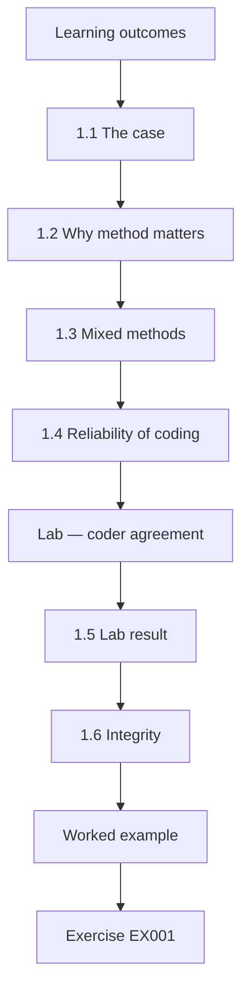

### Logical drawing


```text
[Learning outcomes]
    |
    v
[1.1 The case]
    |
    v
[1.2 Why method matters]
    |
    v
[1.3 Mixed methods]
    |
    v
[1.4 Reliability of coding]
    |
    v
[Lab — coder agreement]
    |
    v
[1.5 Lab result]
    |
    v
[1.6 Integrity]
    |
    v
[Worked example] --> [Exercise EX001]
```
<!-- open-cyber-academy:lesson-figures:end ch-01 -->


### Learning outcomes

You will (1) frame an application-security research question that can be answered with evidence; (2) choose methods that fit software-ecosystem data; (3) measure the reliability of human coding; (4) apply integrity rules to vulnerability research.

### 1.1 The case

Yusuf Demir is a doctoral candidate at the fictional Eastmoor University, supervised by Prof. Helen Okafor. His partner is the fictional Larchwood Foundation, which runs a synthetic open-source package registry called "larch". In January, a flaw was fixed in a popular logging package, quillog, in version 2.4.1. Months later, many projects that depend on quillog still pinned older versions. Yusuf's thesis asks whether automated dependency-update tools shorten the time projects keep known-vulnerable versions, and why some projects lag even with such tools.

### 1.2 Why method matters

Supply-chain research is full of tempting shortcuts: counting advisories, scraping manifests and calling every old version "vulnerable". Kula et al. (2018) showed that many projects do not update library dependencies and that developers are often unaware of the vulnerabilities in them; Decan, Mens and Constantinou (2018) measured how long vulnerable npm packages stayed reachable through dependency networks. Both papers define their measures carefully. Yusuf adopts the same discipline: every term in his question (fix release, adoption, exposure) gets an operational definition before data is touched.

### 1.3 Mixed methods

Numbers show how long exposure lasts; interviews with maintainers explain why. Yusuf plans a quantitative study of registry metadata and a qualitative study of 20 maintainers, following the interview-based approach of Wermke et al. (2022), who studied security and trust practices in open-source projects. The two halves answer different questions and need different checks: the numbers need matched samples and intervals, the interviews need a codebook and agreement between coders. Yusuf plans how they will be joined before collecting either, so that interview themes can be compared with exposure in the same projects rather than set side by side afterwards.

### 1.4 Reliability of coding

Deciding whether a project actually reaches the vulnerable code is a judgement. Two coders label each case and agreement is measured with Cohen's kappa, interpreted with the bands of Landis and Koch (1977). For quillog, the judgement is whether a dependent project calls the logging feature whose default the fix changed. Yusuf's codebook gives each label a definition and an example, and coders work without seeing each other's labels. The kappa target of 0.70 was set in the protocol before any coding began.

### Lab — coder agreement

```python
"""Cohen's kappa for two coders labelling 20 synthetic advisories as reachable (R) or not (N)."""
a = "RRNNRNRRNNRNNRRNNNRN"
b = "RRNNRNRNNNRNNRRNRNRN"
n = len(a); po = sum(x == y for x, y in zip(a, b)) / n
pe = sum((a.count(c) / n) * (b.count(c) / n) for c in "RN")
k = (po - pe) / (1 - pe)
print(f"observed agreement {po:.2f}, chance {pe:.3f}, kappa {k:.2f}")
```

Run with `python3 lab_kappa.py`. Verified output:

```text
observed agreement 0.90, chance 0.505, kappa 0.80
```

### 1.5 Lab result

On 20 synthetic advisories, the coders agree on 18 (0.90). Chance agreement is 0.505, so kappa is 0.80, "substantial" on the Landis–Koch scale, close to "almost perfect". The two disagreements become worked examples for a sharper codebook. The figure passes the protocol's target of 0.70, but Yusuf reports the two disagreements as well as the score. Both involved projects that import quillog only through another package, which the codebook did not address. A new rule for indirect use resolves them before main-study coding starts. The rule carries a date, so main-study coders know which version applied.

### 1.6 Integrity

Yusuf works only with public metadata and synthetic replicas; he never tests whether a vulnerability can be triggered in anyone's live system. Interviews have ethics approval, and quotations are anonymised. Findings about unpatched projects are reported in aggregate, so no individual maintainer is exposed. For quillog this means Yusuf never runs a project's code to check whether the flaw is reachable; reachability is coded from public source and manifests. Maintainers who agree to be interviewed are told how quotations will be anonymised and that their projects will not be named in results.

### Worked example

Yusuf's first protocol: research question, definitions (fix release = first version listed as fixed in the advisory; adoption = first manifest change that excludes all vulnerable versions; exposure = days between), coding procedure with kappa target ≥ 0.70, interview guide and ethics approval number. Prof. Okafor asks him to pre-register the analysis plan before collecting data.

> **Synthetic case.** Eastmoor University, Larchwood Foundation, the larch registry, quillog and all data are synthetic.

### Errors and limits

Kappa depends on how common each label is; report raw agreement and label counts alongside it.

### Exercises

- **EX001 — Thesis question.** State Yusuf's research question. *Rubric:* 3 = automated update tools shorten exposure; why some lag; 2 = partial; 1 = vague; 0 = none.
- **EX002 — Exposure definition.** How is exposure defined? *Rubric:* 3 = days from fix release to adoption excluding vulnerable versions; 2 = partial; 1 = vague; 0 = none.
- **EX003 — Prior work.** What did Kula et al. (2018) find? *Rubric:* 3 = many projects do not update; often unaware of vulnerabilities; 2 = partial; 1 = vague; 0 = none.
- **EX004 — Kappa result.** Report the lab's agreement figures. *Rubric:* 3 = 0.90 observed, 0.505 chance, kappa 0.80 substantial; 2 = partial; 1 = one; 0 = none.
- **EX005 — Why kappa.** Why not report raw agreement alone? *Rubric:* 3 = corrects for chance agreement; 2 = partial; 1 = vague; 0 = none.
- **EX006 — Integrity safeguard.** Give two integrity safeguards in Yusuf's study. *Rubric:* 3 = no live testing; ethics approval; anonymised; aggregate reporting (two); 2 = one; 1 = vague; 0 = none.
- **EX007 — Pre-registration.** Why pre-register the analysis plan? *Rubric:* 3 = prevents choosing analyses after seeing data; 2 = partial; 1 = vague; 0 = none.

### Synthesis

Define terms, measure coding reliability and protect people before collecting any supply-chain data.

### Continue studying — chapter 01 of 08

[← Course home](../../README.md) · [Course chapter index](../SUBJECTS.md) · [Chapter 02 (draft) →](#ch-02)

<a id="ch-02"></a>

## Chapter 2 — Application and software supply chain security: research frontier

<!-- open-cyber-academy:lesson-figures:start ch-02 -->
### Lesson map

Lesson 02 published. Map, example, EX008.

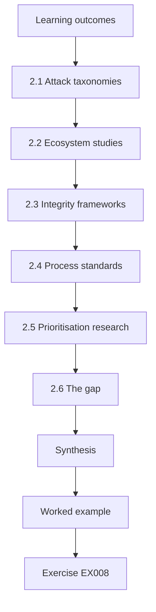

### Logical drawing

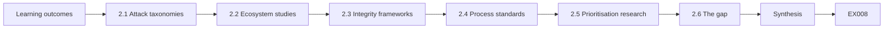

```text
[Learning outcomes]
    |
    v
[2.1 Attack taxonomies]
    |
    v
[2.2 Ecosystem studies]
    |
    v
[2.3 Integrity frameworks]
    |
    v
[2.4 Process standards]
    |
    v
[2.5 Prioritisation research]
    |
    v
[2.6 The gap]
    |
    v
[Synthesis]
    |
    v
[Worked example] --> [Exercise EX008]
```
<!-- open-cyber-academy:lesson-figures:end ch-02 -->


### Learning outcomes

You will (1) map the current research frontier in software supply chain security; (2) use attack taxonomies to place a study; (3) connect standards to open research problems; (4) identify a defensible gap.

### 2.1 Attack taxonomies

Ohm et al. (2020) reviewed real malicious packages and showed how attackers abuse install scripts, typosquatting and account takeover. Ladisa et al. (2023) built a taxonomy of attacks on open-source supply chains covering source, build, distribution and dependency stages, mapped to safeguards. Yusuf uses the taxonomy to state that his thesis concerns a defensive question about known vulnerabilities, not malicious code. Placing the thesis on the taxonomy makes its scope visible: it studies the dependency stage after a fix is published, where the threat is a known flaw left in place, not an attacker inserting code. Examiners can then judge the claims against that stage alone. The taxonomy also reminds him that update bots are themselves tools in the dependency path.

### 2.2 Ecosystem studies

Zimmermann et al. (2019) showed that a few maintainer accounts in npm can reach a large share of packages, so risk concentrates. Decan et al. (2018) quantified vulnerability propagation. These studies motivate measuring whole dependency graphs, not single packages. For the larch registry, these findings mean that quillog's fix matters only as far as it propagates through dependents, many of them indirect. Yusuf therefore measures exposure at the level of each dependent project and records whether quillog is a direct or transitive dependency, which later matters for the pinned-transitive explanation in H2.

### 2.3 Integrity frameworks

SLSA v1.0 (OpenSSF, 2023) defines build provenance levels; in-toto (Torres-Arias et al., 2019) records each supply-chain step; Sigstore (Newman et al., 2022) makes signing easy; reproducible builds (Lamb and Zacchiroli, 2022) let anyone verify a binary. Thompson's "Reflections on Trusting Trust" (1984) is the classic reminder that tools themselves can be subverted. These frameworks protect the integrity of what is built and shipped; they do not measure how quickly a fixed version reaches dependents. Yusuf cites them to show where his question sits beside them: a project can have strong provenance and still run a vulnerable quillog version for months. His findings complement these controls rather than compete with them.

### 2.4 Process standards

NIST SP 800-218, the SSDF (Souppaya et al., 2022), asks producers to respond to vulnerabilities in their components; it does not say how fast is achievable. That is a gap Yusuf's evidence can inform. For Larchwood, the gap is practical: the foundation can tell maintainers to remediate component vulnerabilities, but it has no evidence on how much an update bot shortens the delay, or what else is needed. Yusuf's results are meant to supply that evidence for RV.2, with the limits stated so the foundation does not quote a figure beyond its conditions.

### 2.5 Prioritisation research

EPSS (Jacobs et al., 2021) estimates the probability that a vulnerability will be exploited, which could weight exposure days by real risk. Yusuf uses EPSS only as a sensitivity analysis: weighting exposure days by exploitation probability tests whether the main result depends on a few low-risk advisories. Prof. Okafor suggested this check during the main study, and it is reported as a robustness result, not as a new outcome. The unweighted median stays the pre-registered measure. Scores are taken from the date each advisory was published.

### 2.6 The gap

Little evidence compares exposure with and without update tooling while explaining the human reasons for lag. Yusuf's gap statement names both halves. The first half is a measurement question that registry data can answer; the second is an explanation question that only maintainers can answer. A study that did only one would leave Larchwood either with a number it cannot act on or with reasons it cannot size. Naming both halves in the gap statement commits Yusuf to the mixed design.

### Worked example

Yusuf builds a matrix: rows are studies, columns are stage (taxonomy), method, data and limitation. Three cells reveal his niche: update-tooling effects are mostly reported in industry blogs, not peer-reviewed comparisons, and none link to maintainer explanations.

> **Synthetic case.** The matrix entries about Yusuf's niche are synthetic; cited works are real.

### Errors and limits

A gap claim is only as good as the search; document databases, terms and dates.

### Exercises

- **EX008 — Taxonomy use.** How does Yusuf use Ladisa et al. (2023)? *Rubric:* 3 = place thesis as defensive known-vulnerability question, not malicious code; 2 = partial; 1 = vague; 0 = none.
- **EX009 — Concentration finding.** What did Zimmermann et al. (2019) show? *Rubric:* 3 = few maintainer accounts reach large share of packages; 2 = partial; 1 = vague; 0 = none.
- **EX010 — Four integrity tools.** Name four integrity frameworks or tools. *Rubric:* 3 = SLSA, in-toto, Sigstore, reproducible builds; 2 = three; 1 = one; 0 = none.
- **EX011 — Trusting trust.** What does Thompson (1984) remind us? *Rubric:* 3 = tools themselves can be subverted; 2 = partial; 1 = vague; 0 = none.
- **EX012 — SSDF gap.** What does the SSDF leave open? *Rubric:* 3 = how fast response is achievable; 2 = partial; 1 = vague; 0 = none.
- **EX013 — EPSS role.** How could EPSS help the thesis? *Rubric:* 3 = weight exposure by exploit probability; 2 = partial; 1 = vague; 0 = none.
- **EX014 — Gap halves.** What are the two halves of Yusuf's gap? *Rubric:* 3 = comparative measurement + human explanations; 2 = one; 1 = vague; 0 = none.

### Synthesis

Place the study within taxonomies, frameworks and evidence, then state a documented gap.

### Continue studying — chapter 02 of 08

[← Chapter 01 (draft)](#ch-01) · [Course chapter index](../SUBJECTS.md) · [Chapter 03 (draft) →](#ch-03)

<a id="ch-03"></a>

## Chapter 3 — Original contribution proposal

<!-- open-cyber-academy:lesson-figures:start ch-03 -->
### Lesson map

Lesson 03 published. Map, example, EX015.

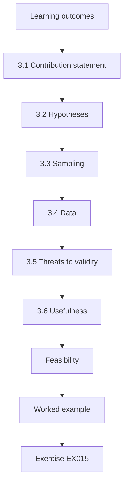

### Logical drawing


```text
[Learning outcomes]
    |
    v
[3.1 Contribution statement]
    |
    v
[3.2 Hypotheses]
    |
    v
[3.3 Sampling]
    |
    v
[3.4 Data]
    |
    v
[3.5 Threats to validity]
    |
    v
[3.6 Usefulness]
    |
    v
[Feasibility]
    |
    v
[Worked example] --> [Exercise EX015]
```
<!-- open-cyber-academy:lesson-figures:end ch-03 -->


### Learning outcomes

You will (1) write a contribution statement that is new, testable and useful; (2) state hypotheses and their falsifiers; (3) plan data, sampling and analysis; (4) anticipate threats to validity.

### 3.1 Contribution statement

"This thesis provides the first matched comparison of vulnerable-version exposure between projects that do and do not use automated update tools in a package ecosystem, and explains residual lag through maintainer interviews, yielding evidence-based guidance for SSDF practice RV.2 (assess, prioritise and remediate vulnerabilities)." The claim "first" rests on the literature matrix, which found update-tooling effects reported mainly in industry blogs. Yusuf keeps the matrix in the thesis appendix so examiners can check the claim against his search. The statement was later qualified after the workshop, when the within-project comparison showed a smaller effect than the matched comparison.

### 3.2 Hypotheses

H1: projects using update bots have shorter median exposure. H2: among bot users, long exposure is explained by breaking-change fear, test gaps or pinned transitive dependencies. Each hypothesis states what result would count against it: H1 fails if the bootstrap interval for the difference includes zero. H2 has its own counter-evidence: if interviews show that bot users with long exposure simply had no time, rather than test or dependency problems, H2's explanations are weakened. The proposal panel added a further check, comparing each interviewee's stated reason with their project's history of reverted upgrades.

### 3.3 Sampling

Projects depending directly on quillog before the fix, matched by size, age and activity, so that busy projects are not compared with abandoned ones. Abandoned projects (no commit for a year) are analysed separately. Matching on size, age and activity tries to make the groups comparable apart from bot use. Yusuf records the matching variables for every pair, so examiners can see how close the matches were. Abandoned projects would show long exposure for reasons unrelated to tooling, which is why they are kept out of the main comparison and described separately.

### 3.4 Data

Registry metadata (versions, dates), manifests from public repositories, advisory records and bot configuration files. No code is executed and no system is probed. The data are public, but Yusuf still records the date each item was collected, because manifests and advisories change. Bot configuration files tell him whether a project used an update bot during the exposure window, not only today. Each source is listed in the data management plan with how it was obtained and where it is stored.

### 3.5 Threats to validity

Selection: projects that adopt bots may already be careful. Measurement: a manifest change may not reach production. External: one ecosystem may not generalise. Each threat has a mitigation: matching, a sample check of release notes, and a replication in a second synthetic ecosystem. The matching addresses selection only partly, which the workshop reviewers later pointed out; the within-project comparison added after critique is the stronger response. The release-note check estimates how often a manifest change actually reached a published release. A second synthetic ecosystem tests whether the analysis code behaves the same way on different data.

### 3.6 Usefulness

The Larchwood Foundation wants guidance it can give maintainers; Yusuf commits to a plain-language summary. The summary will tell maintainers what the evidence supports, such as treating failing bot pull requests as security tasks, and what it does not, such as how users downstream behave. Larchwood's practitioners review a draft so the wording fits what maintainers actually read. Its claims will use the same numbers and limits as the thesis. The summary is planned for release alongside the thesis, not after it.

### Feasibility

The plan is costed in months: three for data collection, two for interviews, four for analysis and writing.

### Worked example

The proposal panel challenges H2: "How will you know fear of breaking changes is the reason, not an excuse?" Yusuf adds a check: for each interviewee, compare their stated reason with their project's history of reverted upgrades.

> **Synthetic case.** The proposal, panel and data plan are synthetic.

### Errors and limits

Matching reduces but cannot remove selection effects; say so.

### Exercises

- **EX015 — Contribution parts.** What makes the contribution new? *Rubric:* 3 = matched comparison + interview explanations; 2 = partial; 1 = vague; 0 = none.
- **EX016 — Falsifier.** When would H1 fail? *Rubric:* 3 = bootstrap interval includes zero; 2 = partial; 1 = vague; 0 = none.
- **EX017 — Matching purpose.** Why match projects? *Rubric:* 3 = avoid comparing busy with abandoned; selection; 2 = partial; 1 = vague; 0 = none.
- **EX018 — Measurement threat.** State the measurement threat and its mitigation. *Rubric:* 3 = manifest change may not reach production; check release notes sample; 2 = partial; 1 = vague; 0 = none.
- **EX019 — Panel challenge.** How did Yusuf answer the H2 challenge? *Rubric:* 3 = compare stated reason with reverted upgrade history; 2 = partial; 1 = vague; 0 = none.
- **EX020 — SSDF link.** Which SSDF practice does the thesis inform? *Rubric:* 3 = RV.2; 2 = partial; 1 = vague; 0 = none.

### Synthesis

A contribution is new, falsifiable, matched to threats and useful to someone named.

### Continue studying — chapter 03 of 08

[← Chapter 02 (draft)](#ch-02) · [Course chapter index](../SUBJECTS.md) · [Chapter 04 (draft) →](#ch-04)

<a id="ch-04"></a>

## Chapter 4 — Baseline replication and pilot

<!-- open-cyber-academy:lesson-figures:start ch-04 -->
### Lesson map

Lesson 04 published. Map, example, EX021.

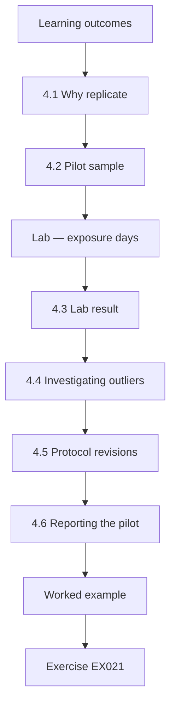

### Logical drawing

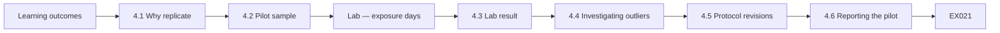

```text
[Learning outcomes]
    |
    v
[4.1 Why replicate]
    |
    v
[4.2 Pilot sample]
    |
    v
[Lab — exposure days]
    |
    v
[4.3 Lab result]
    |
    v
[4.4 Investigating outliers]
    |
    v
[4.5 Protocol revisions]
    |
    v
[4.6 Reporting the pilot]
    |
    v
[Worked example] --> [Exercise EX021]
```
<!-- open-cyber-academy:lesson-figures:end ch-04 -->


### Learning outcomes

You will (1) replicate a published measurement before extending it; (2) run a small pilot to test definitions and tools; (3) compute exposure from synthetic metadata; (4) revise the protocol from pilot lessons.

### 4.1 Why replicate

Before claiming anything new, Yusuf re-runs the style of measurement used by Decan et al. (2018) on a synthetic replica of their setting, checking that his scripts reproduce the expected pattern: most vulnerable packages are fixed upstream quickly, but dependents lag. Reproducing the known pattern on a replica shows that his scripts measure exposure the way the field does, before they are applied to quillog. If the replica had not shown dependents lagging, the fault would be in his pipeline, not in the field's finding. The replication scripts are archived with their output, so examiners can confirm the pipeline found the known lag before it measured quillog.

### 4.2 Pilot sample

Twelve projects that depended on quillog, six with an update bot and six without. The pilot checks whether exposure can be measured consistently from registry metadata and manifests, how long collection takes per project, and whether the coding rules work. Twelve projects are enough to find problems with definitions, but not to estimate an effect with any precision. The pilot sample is excluded from the main study. Six per group also kept the pilot to a few weeks of collection, leaving time for the protocol changes that followed.

### Lab — exposure days

```python
"""Exposure days: time from a fixed release to adoption by dependent projects (synthetic)."""
from statistics import median
# (project, uses_update_bot, days from fixed release to adopting it)
data = [("p01", True, 3), ("p02", True, 5), ("p03", True, 2), ("p04", True, 40), ("p05", True, 6), ("p06", True, 4),
        ("p07", False, 31), ("p08", False, 12), ("p09", False, 88), ("p10", False, 45), ("p11", False, 20), ("p12", False, 160)]
for bot in (True, False):
    d = [x[2] for x in data if x[1] == bot]
    print(f"bot={bot!s:5} n={len(d)} median={median(d)} days  max={max(d)}  within 7 days={sum(v <= 7 for v in d)}/{len(d)}")
```

Run with `python3 lab_exposure.py`. Verified output:

```text
bot=True  n=6 median=4.5 days  max=40  within 7 days=5/6
bot=False n=6 median=38.0 days  max=160  within 7 days=0/6
```

### 4.3 Lab result

Bot users: median 4.5 days, maximum 40, five of six adopted within a week. Non-users: median 38 days, maximum 160, none within a week. Project p04 is the bot user with 40 days. These are pilot figures and serve to test the pipeline, not to answer H1. The one long bot-user case is the most informative row, because it shows what kind of explanation H2 must account for. The non-users' long tail, with a maximum of 160 days, shows why medians and not means are reported.

### 4.4 Investigating outliers

p04's bot opened a pull request on day 1, but tests failed because quillog 2.4.1 changed a configuration default; the maintainer fixed tests on day 40. This is exactly the kind of lag H2 predicts. Yusuf records the case in his pilot memo with the pull-request date, the failing test and the date it was fixed. It leads to a protocol change: recording bot pull-request dates as well as merge dates, and coding test failures on bot pull requests, so the main study can see this pattern systematically.

### 4.5 Protocol revisions

The pilot shows that "adoption" must allow range specifiers: a manifest saying ">=2.4.0" already permits the fix if the lockfile is updated. Yusuf adds lockfiles to the data. Without lockfiles, projects whose manifests already allowed the fixed version would look exposed until someone edited the manifest. Adding lockfiles measures what the project actually resolves. The revision is listed in the pilot memo with the other two, and it was approved before the main study began. The original specifier is kept beside the resolved version for checking.

### 4.6 Reporting the pilot

The pilot is reported as a feasibility check, not evidence for H1; six projects per group cannot support strong claims. Yusuf writes the pilot chapter around what changed in the protocol and why, with the figures given as illustrations. The wide interval on the pilot difference shows why: any reader who took 33.5 days as an estimate of the effect would be misled. Its value is in the three protocol revisions, each of which changed what the main study collected and is listed in the pilot memo.

### Tooling checks

Yusuf checks his parsing scripts against hand-coded results for the twelve pilot projects before trusting them at scale. Two scripts misread pre-release version labels such as 2.4.1-rc1 as later than 2.4.1; the version comparison is rewritten to follow the ecosystem's published ordering rules and retested on a list of tricky cases.

### Worked example

Yusuf's pilot memo lists three revisions: include lockfiles, record bot pull-request dates as well as merge dates, and code test failures on bot pull requests. Prof. Okafor approves the main study.

> **Synthetic case.** All pilot data are synthetic.

### Errors and limits

Pilot effects are noisy; do not use them to set expectations for the main study's effect size.

### Exercises

- **EX021 — Replication aim.** Why replicate before extending? *Rubric:* 3 = check scripts reproduce known pattern; 2 = partial; 1 = vague; 0 = none.
- **EX022 — Pilot medians.** Give the pilot medians. *Rubric:* 3 = 4.5 days bot; 38 days no bot; 2 = one; 1 = vague; 0 = none.
- **EX023 — p04 story.** Why did p04 take 40 days? *Rubric:* 3 = bot PR day 1; tests failed on changed default; fixed day 40; 2 = partial; 1 = vague; 0 = none.
- **EX024 — Range specifiers.** What did the pilot reveal about adoption? *Rubric:* 3 = ranges permit fix if lockfile updated; add lockfiles; 2 = partial; 1 = vague; 0 = none.
- **EX025 — Pilot status.** How is the pilot reported? *Rubric:* 3 = feasibility, not evidence for H1; 2 = partial; 1 = vague; 0 = none.
- **EX026 — Three revisions.** List the three protocol revisions. *Rubric:* 3 = lockfiles; PR open dates; code test failures; 2 = two; 1 = one; 0 = none.

### Synthesis

Replicate first, pilot small, and let outliers sharpen definitions.

### Continue studying — chapter 04 of 08

[← Chapter 03 (draft)](#ch-03) · [Course chapter index](../SUBJECTS.md) · [Chapter 05 (draft) →](#ch-05)

<a id="ch-05"></a>

## Chapter 5 — Main study and independent validation

<!-- open-cyber-academy:lesson-figures:start ch-05 -->
### Lesson map

Lesson 05 published. Map, example, EX027.

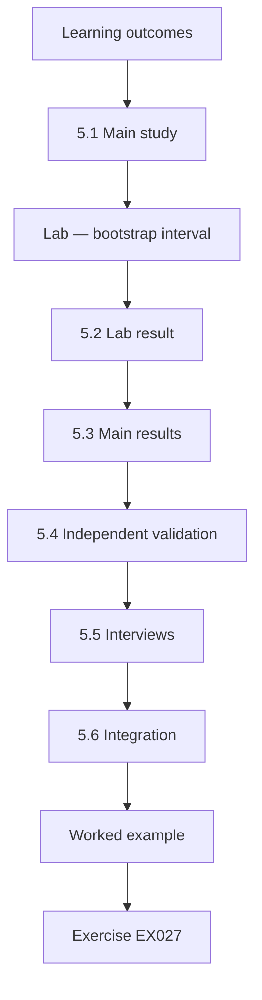

### Logical drawing

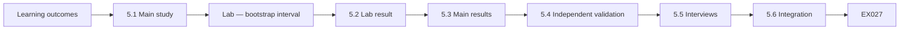

```text
[Learning outcomes]
    |
    v
[5.1 Main study]
    |
    v
[Lab — bootstrap interval]
    |
    v
[5.2 Lab result]
    |
    v
[5.3 Main results]
    |
    v
[5.4 Independent validation]
    |
    v
[5.5 Interviews]
    |
    v
[5.6 Integration]
    |
    v
[Worked example] --> [Exercise EX027]
```
<!-- open-cyber-academy:lesson-figures:end ch-05 -->


### Learning outcomes

You will (1) run the main quantitative study; (2) estimate uncertainty with the bootstrap; (3) validate results with an independent dataset and analyst; (4) integrate qualitative findings.

### 5.1 Main study

The main study covers 340 matched project pairs across three vulnerable packages. The analysis plan, pre-registered, uses the difference in median exposure with a bootstrap interval. Three vulnerable packages rather than one guard against a result that depends on quillog's particular fix. The analysis plan was registered before the main collection, and the matching variables and exclusion rule for abandoned projects are applied exactly as in the protocol. Lockfiles and bot pull-request dates are collected as the pilot required. Abandoned projects get their own table, outside the matched comparison.

### Lab — bootstrap interval

```python
"""Bootstrap 95% interval for the difference in median exposure days (no bot minus bot), seed 7."""
import random
from statistics import median
bot = [3, 5, 2, 40, 6, 4]; nobot = [31, 12, 88, 45, 20, 160]
rng = random.Random(7); diffs = []
for _ in range(5000):
    diffs.append(median(rng.choices(nobot, k=6)) - median(rng.choices(bot, k=6)))
diffs.sort()
print("observed difference:", median(nobot) - median(bot))
print("95% interval:", diffs[124], "to", diffs[4874])
```

Run with `python3 lab_bootstrap.py`. Verified output:

```text
observed difference: 33.5
95% interval: 8.0 to 118.5
```

### 5.2 Lab result

On the pilot data, the observed difference is 33.5 days (38 minus 4.5) and the 95% bootstrap interval runs from 8.0 to 118.5 days (5,000 resamples, seed 7). The interval excludes zero but is very wide; small samples give imprecise estimates, which is why the main study is larger. The point estimate comes from only twelve projects, so a few long-exposure projects can shift it greatly. Yusuf includes the pilot interval to show readers how much the main study's sample size narrows it. The seed and resample count are recorded so the interval can be regenerated exactly.

### 5.3 Main results

In the synthetic main study, the median difference is 21 days with a 95% interval of 15 to 28 days. H1 is supported. The interval is much narrower than the pilot's, which reflects 340 matched pairs instead of twelve projects. Yusuf reports the median difference first and leaves causal language for later, because matched observational data cannot rule out that careful projects both adopt bots and update faster. The within-project comparison added after critique addresses that concern. Prof. Okafor's EPSS-weighted sensitivity analysis left this conclusion unchanged.

### 5.4 Independent validation

A second analyst, given only the protocol, recomputes exposure for a random 10% of pairs; 33 of 34 match exactly, the other differs by one day due to a time-zone boundary. The protocol is clarified to use UTC dates. The single mismatch came from a date near midnight being read in different time zones by the two analysts. Clarifying the protocol to use UTC dates removes the ambiguity for any later replication. The second analyst worked from the protocol alone, so agreement also shows that the written definitions are sufficient.

### 5.5 Interviews

Twenty maintainers explain lag: test failures on bot updates (9), fear of breaking changes without tests (6), pinned transitive dependencies (3), no time (2). Coded with kappa 0.78. The counts add to twenty, one main reason coded per maintainer. Test failures and fear of breaking changes together account for most answers, which matches H2. The panel's check against reverted-upgrade history was applied to each interviewee, so the stated reasons are compared with what their projects actually did. At 0.78, kappa clears the protocol's target of 0.70 for interview coding as well.

### 5.6 Integration

Projects with long exposure despite bots mostly had weak tests, matching the interview themes. The joint display links these halves: exposure distributions on one side and interview themes on the other, with the test-failure finding connecting them. Yusuf states the link as consistent rather than proven, since interviewees and long-exposure projects need not be the same projects. The EPSS-weighted sensitivity analysis gave the same picture. Yusuf avoids reading the link as proof that tests cause lag, and the thesis presents it as a pattern for future work to test directly.

### Reporting standards

Results are reported with sample sizes, effect sizes, intervals and every analysis deviation from the pre-registration. Yusuf's one deviation, adding UTC dates, is listed with its reason. Readers can then judge the evidence without guessing what was tried and dropped.

### Worked example

Yusuf presents a joint display: exposure distributions on the left, interview themes with counts on the right, linked by the test-failure finding. Prof. Okafor suggests weighting exposure by EPSS scores as a sensitivity analysis; results hold.

> **Synthetic case.** Main-study numbers are synthetic.

### Errors and limits

Bootstrap intervals assume the sample represents the population; matched pairs from one ecosystem limit this.

### Exercises

- **EX027 — Lab numbers.** Report the lab's observed difference and interval. *Rubric:* 3 = 33.5; 8.0 to 118.5; 2 = partial; 1 = vague; 0 = none.
- **EX028 — Wide interval.** Why is the pilot interval wide? *Rubric:* 3 = small samples; 2 = partial; 1 = vague; 0 = none.
- **EX029 — Main result.** What was the main-study result? *Rubric:* 3 = 21 days, 15–28; H1 supported; 2 = partial; 1 = vague; 0 = none.
- **EX030 — Validation outcome.** What did independent validation find? *Rubric:* 3 = 33/34 match; one day off from time zone; UTC rule; 2 = partial; 1 = vague; 0 = none.
- **EX031 — Top lag reason.** What was the most common lag reason? *Rubric:* 3 = test failures on bot updates (9); 2 = partial; 1 = vague; 0 = none.
- **EX032 — Sensitivity analysis.** What sensitivity analysis was run? *Rubric:* 3 = EPSS-weighted exposure; held; 2 = partial; 1 = vague; 0 = none.

### Synthesis

Estimate with uncertainty, validate independently and integrate the human explanations.

### Continue studying — chapter 05 of 08

[← Chapter 04 (draft)](#ch-04) · [Course chapter index](../SUBJECTS.md) · [Chapter 06 (draft) →](#ch-06)

<a id="ch-06"></a>

## Chapter 6 — Peer critique and revision

<!-- open-cyber-academy:lesson-figures:start ch-06 -->
### Lesson map

Lesson 06 published. Map, example, EX033.

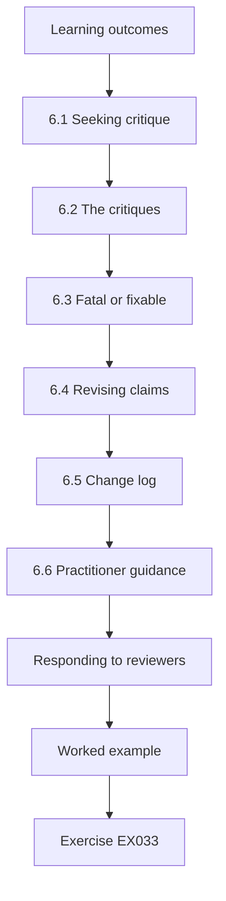

### Logical drawing

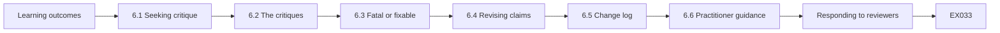

```text
[Learning outcomes]
    |
    v
[6.1 Seeking critique]
    |
    v
[6.2 The critiques]
    |
    v
[6.3 Fatal or fixable]
    |
    v
[6.4 Revising claims]
    |
    v
[6.5 Change log]
    |
    v
[6.6 Practitioner guidance]
    |
    v
[Responding to reviewers]
    |
    v
[Worked example] --> [Exercise EX033]
```
<!-- open-cyber-academy:lesson-figures:end ch-06 -->


### Learning outcomes

You will (1) invite structured critique of a supply-chain study; (2) separate fatal from fixable criticisms; (3) revise claims to match evidence; (4) record changes transparently.

### 6.1 Seeking critique

Yusuf submits a draft paper to a workshop and shares it with two practitioners at the Larchwood Foundation. He asks each reviewer to say what would make them reject the main claim. Asking reviewers what would make them reject the claim directs their attention to its weakest point instead of to presentation. The practitioners bring a different test: whether the guidance would help a maintainer facing a failing bot update. Yusuf logs every comment with its source in the change log before deciding how to respond.

### 6.2 The critiques

Reviewer 1: projects that adopt bots may already be more security-aware, so the bot may not cause the difference. Reviewer 2: exposure ends at the manifest change, but users may run old releases for months. Practitioner: the guidance should say what to do when tests fail, not just "use a bot". Each critique targets a different part of the argument: the first the causal reading, the second the definition of exposure, the third the usefulness of the guidance. Yusuf responds to each separately instead of answering them together.

### 6.3 Fatal or fixable

None is fatal. Reviewer 1's point limits the causal claim; Yusuf adds a within-project comparison of exposure before and after projects adopted a bot, which shows a smaller but still clear reduction (12 days). Reviewer 2's point defines the scope: the thesis measures producer-side exposure. The practitioner's comment was also fixable: the guidance gains a step for failing bot pull requests. None of the three required discarding data; each changed what the thesis claims, measures or recommends. The 12-day figure is reported beside the 21-day figure so readers can see both.

### 6.4 Revising claims

The headline changes from "bots cut exposure by 21 days" to "projects using bots had 21 days shorter median exposure; within projects, adopting a bot was followed by a 12-day reduction". The new headline names both comparisons and avoids saying that bots cause the reduction. Yusuf applies the same check to the abstract and the practitioner report, so the shorter claim appears everywhere. A reviewer who reads only the headline now gets the same scope as one who reads the method. The abstract now carries both comparisons' figures, matching the revised headline.

### 6.5 Change log

Every revision is listed with the reviewer comment that prompted it and where the text changed. The change log lets reviewers verify each response without rereading the whole paper. It also enters the archive, so examiners can trace the 12-day within-project comparison back to Reviewer 1's comment. One reviewer later asked to use it as a teaching example, which shows how much time it saves. Comments that led to no change are listed too, with the reason, so reviewers can see that nothing was ignored.

### 6.6 Practitioner guidance

The guidance adds: invest in tests for dependency updates; treat a failing bot pull request as a security task with an owner, consistent with SSDF RV.2. Both points come from the interviews and the p04 case: bot pull requests often failed because tests broke, and nobody owned the fix. The guidance does not claim that tests will remove all lag, since the interview counts include other reasons such as pinned transitive dependencies and lack of time. The step asks each project to name an owner for failing updates.

### Responding to reviewers

Yusuf answers each comment point by point, quoting it, stating what he changed and where, or explaining politely why he did not. He avoids defensive language; disagreements are argued with evidence, such as the within-project analysis, rather than with assertions.

### Worked example

The workshop accepts the revised paper. One reviewer notes the change log made re-review fast and asks to use it as an example for students.

> **Synthetic case.** Reviews and figures are synthetic.

### Errors and limits

Within-project comparisons can be confounded by time trends, such as ecosystem-wide tooling improvements.

### Exercises

- **EX033 — Reviewer question.** What did Yusuf ask reviewers? *Rubric:* 3 = what would make them reject the main claim; 2 = partial; 1 = vague; 0 = none.
- **EX034 — Selection critique.** How did Yusuf answer Reviewer 1? *Rubric:* 3 = within-project before/after comparison; 12 days; 2 = partial; 1 = vague; 0 = none.
- **EX035 — Scope critique.** How was Reviewer 2's point handled? *Rubric:* 3 = scope: producer-side exposure; 2 = partial; 1 = vague; 0 = none.
- **EX036 — Revised headline.** Give the revised headline. *Rubric:* 3 = 21 days shorter between; 12 within; 2 = partial; 1 = vague; 0 = none.
- **EX037 — Guidance addition.** What did the practitioner critique add? *Rubric:* 3 = tests for updates; failing bot PR is a security task with owner; 2 = partial; 1 = vague; 0 = none.
- **EX038 — Change log value.** Why keep a change log? *Rubric:* 3 = transparent; fast re-review; 2 = partial; 1 = vague; 0 = none.

### Synthesis

Ask what would sink the claim, fix what can be fixed and narrow what cannot.

### Continue studying — chapter 06 of 08

[← Chapter 05 (draft)](#ch-05) · [Course chapter index](../SUBJECTS.md) · [Chapter 07 (draft) →](#ch-07)

<a id="ch-07"></a>

## Chapter 7 — Thesis synthesis and reproducibility archive

<!-- open-cyber-academy:lesson-figures:start ch-07 -->
### Lesson map

Lesson 07 published. Map, example, EX039.

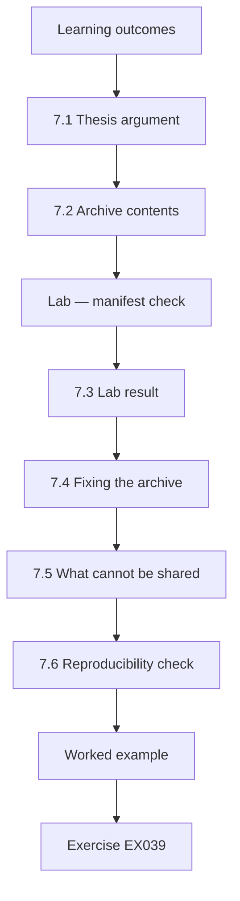

### Logical drawing

```mermaid
flowchart LR
  N0["Learning outcomes"]
  N1["7.1 Thesis argument"]
  N2["7.2 Archive contents"]
  N3["Lab — manifest check"]
  N4["7.3 Lab result"]
  N5["7.4 Fixing the archive"]
  N6["7.5 What cannot be shared"]
  N7["7.6 Reproducibility check"]
  N0 --> N1 --> N2 --> N3 --> N4 --> N5 --> N6 --> N7 --> Q["EX039"]
```

```text
[Learning outcomes]
    |
    v
[7.1 Thesis argument]
    |
    v
[7.2 Archive contents]
    |
    v
[Lab — manifest check]
    |
    v
[7.3 Lab result]
    |
    v
[7.4 Fixing the archive]
    |
    v
[7.5 What cannot be shared]
    |
    v
[7.6 Reproducibility check]
    |
    v
[Worked example] --> [Exercise EX039]
```
<!-- open-cyber-academy:lesson-figures:end ch-07 -->


### Learning outcomes

You will (1) synthesise studies into a coherent thesis argument; (2) build a reproducibility archive; (3) verify archive integrity with hashes; (4) document what cannot be shared.

### 7.1 Thesis argument

Chapter by chapter: exposure is measurable (pilot), lower with bots (main study), partly causal (within-project), and limited by tests (interviews). The final chapter links these to SSDF RV.2 and SLSA's emphasis on trustworthy, automated build and update processes. Each step in the argument carries its own limit: the within-project reduction is smaller than the matched difference, and the interviews explain lag only for those who agreed to talk. The link to SSDF RV.2 is framed as evidence for how to meet the practice, not as a measure of compliance.

### 7.2 Archive contents

Scripts, synthetic replicas, the codebook, the pre-registration, a README describing how to run everything, and a manifest of SHA-256 hashes for every file. The archive also contains the pilot memo and the change log, so readers can see how the protocol evolved. Interview material is limited to the codebook and coded counts, as the ethics approval required. The README lists commands in order and the expected tables, so a colleague can tell at once whether a rerun matched. Script, data and codebook files are all hashed, and the hashes appear in the thesis so a reader can confirm they have the archived versions.

### Lab — manifest check

```python
"""Check a synthetic dataset against its archived SHA-256 manifest."""
import hashlib
files = {"exposure.csv": b"project,bot,days\np01,1,3\np02,1,5\n", "codes.csv": b"id,coder_a,coder_b\n1,R,R\n"}
manifest = {"exposure.csv": hashlib.sha256(b"project,bot,days\np01,1,3\np02,1,5\n").hexdigest(),
            "codes.csv": hashlib.sha256(b"id,coder_a,coder_b\n1,R,N\n").hexdigest()}
for name, body in files.items():
    ok = hashlib.sha256(body).hexdigest() == manifest[name]
    print(f"{name:13} {'MATCH' if ok else 'MISMATCH'}")
```

Run with `python3 lab_manifest.py`. Verified output:

```text
exposure.csv  MATCH
codes.csv     MISMATCH
```

### 7.3 Lab result

exposure.csv matches its manifest hash; codes.csv does not. The manifest recorded coder B's first label as "N", but the file now says "R", because a late correction was made without updating the manifest. The lab shows the check doing its job: a correct change made silently still fails verification. The fix is not to undo the correction but to record it and regenerate the manifest. Yusuf's real archive is checked the same way before each release, and any mismatch is investigated before a new version is tagged.

### 7.4 Fixing the archive

Yusuf records the correction in the change log, regenerates the manifest and tags a new archive version. Silent edits break trust even when they are right. The new version has its own tag, so anyone holding the old archive can see that it was superseded and why. The examiner later ran the archive and obtained identical tables, and remarked on the manifest's version history. Keeping both versions accessible means earlier citations still point to something that exists. The log names the coder, the label and the date.

### 7.5 What cannot be shared

Interview transcripts stay private; the archive holds the codebook and coded counts only. Transcripts could identify maintainers through their projects and wording, even with names removed, so the ethics approval limits release to coded counts. Readers can still check the coding against the codebook and agreement figures. Researchers who want to replicate the qualitative part must collect their own interviews under their own approval. The data access statement explains this choice and points readers to the codebook, the agreement figures and the coded counts that remain available.

### 7.6 Reproducibility check

A colleague runs the archive on a clean machine from the README alone and reproduces every table. The colleague had not worked on the project and used only the README, which tests the instructions as much as the code. Every table matched, and the run is recorded with its date and archive tag. Any difference would have been fixed before the examiner received the archive. The colleague's notes on unclear steps were used to improve the README before the archive went to the examiner.

### Licences

Scripts are released under an open licence and synthetic replicas under CC0, so others may reuse them freely. The README states the licence of each part, the software versions needed and expected running time, which the colleague's clean-machine check confirmed at about twelve minutes. Clear licences matter: reviewers and practitioners hesitate to reuse material whose terms are unclear.

### Archive location

The archive is deposited in the university repository with a persistent identifier.

### Worked example

The examiner later runs the archive and gets identical tables. She notes the manifest version history as evidence of careful practice.

> **Synthetic case.** Files and hashes are synthetic.

### Errors and limits

Hashes prove files are unchanged, not that they are correct.

### Exercises

- **EX039 — Argument chain.** Summarise the thesis argument. *Rubric:* 3 = measurable; lower with bots; partly causal; limited by tests; 2 = partial; 1 = one; 0 = none.
- **EX040 — Archive list.** List four archive contents. *Rubric:* 3 = scripts, replicas, codebook, pre-registration, README, manifest (four); 2 = two; 1 = one; 0 = none.
- **EX041 — Lab outcome.** What did the manifest lab show? *Rubric:* 3 = exposure match; codes mismatch from unrecorded correction; 2 = partial; 1 = vague; 0 = none.
- **EX042 — Fix.** How was the mismatch fixed? *Rubric:* 3 = change log, regenerate manifest, new version tag; 2 = partial; 1 = vague; 0 = none.
- **EX043 — Private data.** What stays private? *Rubric:* 3 = interview transcripts; 2 = partial; 1 = vague; 0 = none.
- **EX044 — Hash limit.** What do hashes not prove? *Rubric:* 3 = correctness; 2 = partial; 1 = vague; 0 = none.

### Synthesis

A thesis argues across studies and an archive lets others check every step.

### Continue studying — chapter 07 of 08

[← Chapter 06 (draft)](#ch-06) · [Course chapter index](../SUBJECTS.md) · [Chapter 08 (draft) →](#ch-08)

<a id="ch-08"></a>

## Chapter 8 — Defense and publication plan

<!-- open-cyber-academy:lesson-figures:start ch-08 -->
### Lesson map

Lesson 08 published. Map, example, EX045.

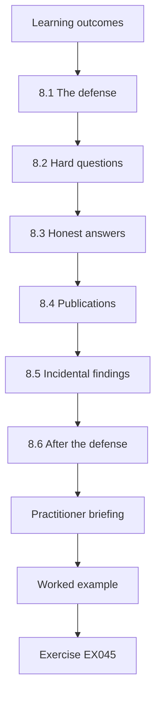

### Logical drawing


```text
[Learning outcomes]
    |
    v
[8.1 The defense]
    |
    v
[8.2 Hard questions]
    |
    v
[8.3 Honest answers]
    |
    v
[8.4 Publications]
    |
    v
[8.5 Incidental findings]
    |
    v
[8.6 After the defense]
    |
    v
[Practitioner briefing]
    |
    v
[Worked example] --> [Exercise EX045]
```
<!-- open-cyber-academy:lesson-figures:end ch-08 -->


### Learning outcomes

You will (1) prepare a doctoral defense on supply-chain evidence; (2) answer hard questions honestly; (3) plan publications and practitioner outputs; (4) plan responsible disclosure of any incidental findings.

### 8.1 The defense

Forty minutes: question, gap, methods, results, limits, contributions. Yusuf rehearses with three colleagues playing sceptical examiners. The rehearsal colleagues prepare questions from the critiques the paper received, so the hardest objections are practised first. Yusuf gives the limits their own slide early, rather than at the end where time may run short. He also prepares the conversion of the 12-day effect into a share of the foundation's median exposure, since practical importance is a likely question. Rehearsals with his supervisor keep the talk within forty minutes, leaving the rest of the defence for questions.

### 8.2 Hard questions

"Does your result hold outside larch?" "Does a shorter manifest exposure matter if users never upgrade?" "Could bots themselves be a supply-chain risk?" For the last, he cites Ladisa et al. (2023), whose taxonomy includes compromise of tools in the dependency path, and notes that his study did not measure that risk. For the first question, he answers that the matched comparison and interviews come from one registry and a second synthetic ecosystem, so generalisation is a hypothesis. For the second, he explains that the thesis measures producer-side exposure, a scope fixed after Reviewer 2's critique.

### 8.3 Honest answers

"I don't know, but here is how I would find out" is better than overclaiming. Yusuf uses this answer when asked about users who never upgrade: his data stop at the manifest, and a study of deployment telemetry would be needed. Saying so plainly protects the claims he can support. For the question about bots as a supply-chain risk, his answer cites the taxonomy and says plainly that his data cannot size that risk; he names the study design that could, such as tracing incidents in which update tools themselves were compromised.

### 8.4 Publications

Paper 1: matched comparison. Paper 2: interview study. Practitioner report for the Larchwood Foundation. Each is mapped to thesis chapters. Each output reports the same headline with both comparisons, so no version overstates the effect. The interview paper uses only coded counts and anonymised quotations, as the ethics approval requires. The practitioner report leads with the guidance on failing bot pull requests and links to the archive for anyone who wants the evidence. Paper 1 draws on the main-study and critique chapters, and Paper 2 on the interview chapter, so no finding is published twice.

### 8.5 Incidental findings

During data collection Yusuf noticed six synthetic projects still pinned to a vulnerable quillog version. Under the study's disclosure plan, the foundation's security team contacts the maintainers privately; the thesis reports only aggregate counts. Reporting only aggregates keeps the thesis from becoming a list of vulnerable projects. The foundation, not Yusuf, decides how to contact maintainers, which follows the plan approved before data collection. The thesis records when the foundation was informed, so examiners can see the plan was followed.

### 8.6 After the defense

Archive deposited, data access statement final, post-doctoral plan drafted. The deposited archive is the corrected version with the regenerated manifest. The data access statement explains that interview transcripts are withheld and how other researchers can obtain the synthetic replicas. The post-doctoral plan starts from the open questions he stated in the defence: user-side exposure and the risk posed by update bots themselves. The archive's persistent identifier is cited in every output, so readers of the papers and the practitioner report all reach the same deposited version.

### Practitioner briefing

After the defense, Yusuf gives a one-hour briefing to Larchwood maintainers: what exposure is, what the study found, and three practical steps (enable an update bot, invest in tests for upgrades, assign an owner to failing bot pull requests). Questions from maintainers suggest follow-up research on test coverage.

### Reflection

Yusuf notes that early pre-registration and the pilot saved months of rework later.

### Worked example

An examiner asks whether the 12-day within-project effect is practically important. Yusuf compares it with the foundation's median exposure of 30 days: a 40% reduction, valuable when combined with test investment. The examiners pass the thesis with minor corrections.

> **Synthetic case.** The defense is synthetic.

### Errors and limits

One ecosystem and three packages are a modest base; future work should replicate.

### Exercises

- **EX045 — Defense outline.** List the defense sections. *Rubric:* 3 = question, gap, methods, results, limits, contributions; 2 = four; 1 = two; 0 = none.
- **EX046 — Bot risk answer.** How did Yusuf answer the bot-risk question? *Rubric:* 3 = Ladisa taxonomy includes tool compromise; not measured; 2 = partial; 1 = vague; 0 = none.
- **EX047 — Honest stance.** What is better than overclaiming? *Rubric:* 3 = "don't know; here's how I'd find out"; 2 = partial; 1 = vague; 0 = none.
- **EX048 — Publications.** Name the planned outputs. *Rubric:* 3 = two papers + practitioner report; 2 = partial; 1 = vague; 0 = none.
- **EX049 — Disclosure.** How were the six projects handled? *Rubric:* 3 = foundation security team contacted privately; aggregate in thesis; 2 = partial; 1 = vague; 0 = none.
- **EX050 — Practical size.** Why is 12 days important? *Rubric:* 3 = ~40% of 30-day median; 2 = partial; 1 = vague; 0 = none.

### Synthesis

Defend with evidence and honesty, publish for researchers and practitioners, and disclose responsibly.

### Continue studying — chapter 08 of 08

[← Chapter 07 (draft)](#ch-07) · [Course chapter index](../SUBJECTS.md) · [Worked results ↓](#worked-results) · [Next course via chapter index →](../SUBJECTS.md)

<a id="worked-results"></a>

## Worked results

Model answers for EX001–EX050. Yusuf Demir, Prof. Helen Okafor, Larchwood Foundation, quillog and every figure are synthetic. Lab answers quote verified outputs. Any answer meeting the rubric scores equally.

**EX001.** Whether automated dependency-update tools shorten the time projects keep known-vulnerable versions, and why some lag.

**EX002.** Days between the first fixed release and the first manifest change excluding all vulnerable versions.

**EX003.** Many projects do not update library dependencies and developers are often unaware of the vulnerabilities in them.

**EX004.** Observed 0.90, chance 0.505, kappa 0.80 (substantial).

**EX005.** Because raw agreement includes agreement expected by chance.

**EX006.** No testing of live systems and anonymised, aggregate reporting of unpatched projects.

**EX007.** To stop analyses being chosen after seeing the data.

**EX008.** To place his thesis as a defensive question about known vulnerabilities rather than malicious code.

**EX009.** That a few maintainer accounts can reach a large share of npm packages, concentrating risk.

**EX010.** SLSA, in-toto, Sigstore and reproducible builds.

**EX011.** That compilers and other tools can themselves be subverted.

**EX012.** It requires responding to component vulnerabilities but not how fast is achievable.

**EX013.** By weighting exposure days by the estimated probability of exploitation.

**EX014.** Peer-reviewed comparison of exposure with and without tooling, and maintainers' explanations for lag.

**EX015.** A matched comparison of exposure with and without bots combined with interview explanations of residual lag.

**EX016.** If the bootstrap interval for the difference in medians includes zero.

**EX017.** So busy projects are not compared with abandoned ones and selection bias is reduced.

**EX018.** A manifest change may not reach production; a sample of release notes is checked.

**EX019.** By comparing each stated reason with the project's history of reverted upgrades.

**EX020.** RV.2: assess, prioritise and remediate vulnerabilities.

**EX021.** To check his scripts reproduce the published pattern before claiming anything new.

**EX022.** 4.5 days with a bot; 38 days without.

**EX023.** The bot's pull request on day 1 failed tests due to a changed default; the maintainer fixed tests on day 40.

**EX024.** Range specifiers may already permit the fix if the lockfile changes, so lockfiles are added.

**EX025.** As a feasibility check, not evidence for H1.

**EX026.** Include lockfiles, record bot pull-request dates and code test failures.

**EX027.** 33.5 days, with a 95% interval of 8.0 to 118.5.

**EX028.** Because six projects per group give imprecise estimates.

**EX029.** A 21-day median difference, 95% interval 15–28 days; H1 supported.

**EX030.** 33 of 34 matched; one differed by a day due to time zones, so UTC dates were specified.

**EX031.** Test failures on bot updates (9 of 20).

**EX032.** Weighting exposure by EPSS; results held.

**EX033.** What would make them reject the main claim.

**EX034.** With a within-project before-and-after comparison showing a 12-day reduction.

**EX035.** By defining the scope as producer-side exposure.

**EX036.** Bot users had 21 days shorter median exposure; within projects, adopting a bot was followed by a 12-day reduction.

**EX037.** Invest in tests and treat failing bot pull requests as owned security tasks.

**EX038.** It makes revisions transparent and re-review fast.

**EX039.** Exposure is measurable, lower with bots, partly causal and limited by test quality.

**EX040.** Scripts, synthetic replicas, the codebook and the hash manifest.

**EX041.** exposure.csv matched; codes.csv mismatched because a correction was made without updating the manifest.

**EX042.** Logged the correction, regenerated the manifest and tagged a new version.

**EX043.** Interview transcripts; only the codebook and counts are shared.

**EX044.** That the files are correct.

**EX045.** Question, gap, methods, results, limits and contributions.

**EX046.** He cited the Ladisa et al. taxonomy and stated his study did not measure that risk.

**EX047.** Saying you don't know and explaining how you would find out.

**EX048.** A matched-comparison paper, an interview paper and a practitioner report.

**EX049.** The foundation's security team contacted maintainers privately; the thesis reports aggregate counts only.

**EX050.** It is about a 40% reduction against a 30-day median.

<a id="references"></a>

## References

Links checked 12 October 2026; re-verify editions before citing. Organisations, people, systems, code and data in this book are synthetic unless a sentence cites a public source.

- Decan, A., Mens, T., & Constantinou, E. (2018). On the impact of security vulnerabilities in the npm package dependency network. *Proceedings of the 15th International Conference on Mining Software Repositories (MSR '18)*, 181–191. <https://doi.org/10.1145/3196398.3196401>
- Jacobs, J., Romanosky, S., Edwards, B., Adjerid, I., & Roytman, M. (2021). Exploit Prediction Scoring System (EPSS). *Digital Threats: Research and Practice*, 2(3), 1–17. <https://doi.org/10.1145/3436242>
- Johnson, B., Song, Y., Murphy-Hill, E., & Bowdidge, R. (2013). Why don't software developers use static analysis tools to find bugs? *35th International Conference on Software Engineering (ICSE)*, 672–681. <https://doi.org/10.1109/ICSE.2013.6606613>
- Kula, R. G., German, D. M., Ouni, A., Ishio, T., & Inoue, K. (2018). Do developers update their library dependencies? *Empirical Software Engineering*, 23(1), 384–417. <https://doi.org/10.1007/s10664-017-9521-5>
- Ladisa, P., Plate, H., Martinez, M., & Barais, O. (2023). SoK: Taxonomy of attacks on open-source software supply chains. *IEEE Symposium on Security and Privacy*, 1509–1526. <https://doi.org/10.1109/SP46215.2023.10179304>
- Lamb, C., & Zacchiroli, S. (2022). Reproducible builds: Increasing the integrity of software supply chains. *IEEE Software*, 39(2), 62–70. <https://doi.org/10.1109/MS.2021.3073045>
- Landis, J. R., & Koch, G. G. (1977). The measurement of observer agreement for categorical data. *Biometrics*, 33(1), 159–174. <https://doi.org/10.2307/2529310>
- MITRE. (2024). *CWE Top 25 Most Dangerous Software Weaknesses*. <https://cwe.mitre.org/top25/>
- Newman, Z., Meyers, J. S., & Torres-Arias, S. (2022). Sigstore: Software signing for everybody. *ACM SIGSAC Conference on Computer and Communications Security (CCS '22)*, 2353–2367. <https://doi.org/10.1145/3548606.3560596>
- NTIA. (2021). *The minimum elements for a software bill of materials (SBOM)*. U.S. Department of Commerce. <https://www.ntia.gov/report/2021/minimum-elements-software-bill-materials-sbom>
- Ohm, M., Plate, H., Sykosch, A., & Meier, M. (2020). Backstabber's knife collection: A review of open source software supply chain attacks. *DIMVA 2020*, LNCS 12223, 23–43. <https://doi.org/10.1007/978-3-030-52683-2_2>
- OpenSSF. (2023). *SLSA: Supply-chain Levels for Software Artifacts, version 1.0*. <https://slsa.dev/spec/v1.0/>
- OWASP Foundation. (2020). *Software Assurance Maturity Model (SAMM) v2.0*. <https://owaspsamm.org/model/>
- OWASP Foundation. (2020). *Web Security Testing Guide v4.2*. <https://owasp.org/www-project-web-security-testing-guide/>
- OWASP Foundation. (2021). *Application Security Verification Standard 4.0.3*. <https://owasp.org/www-project-application-security-verification-standard/>
- OWASP Foundation. (2021). *OWASP Top 10:2021*. <https://owasp.org/Top10/>
- OWASP Foundation. (2025). *Application Security Verification Standard 5.0.0*. <https://owasp.org/www-project-application-security-verification-standard/>
- Shostack, A. (2014). *Threat modeling: Designing for security*. Wiley. ISBN 978-1-118-80999-0.
- Souppaya, M., Scarfone, K., & Dodson, D. (2022). *Secure Software Development Framework (SSDF) version 1.1* (NIST SP 800-218). NIST. <https://doi.org/10.6028/NIST.SP.800-218>
- Thompson, K. (1984). Reflections on trusting trust. *Communications of the ACM*, 27(8), 761–763. <https://doi.org/10.1145/358198.358210>
- Torres-Arias, S., Afzali, H., Kuppusamy, T. K., Curtmola, R., & Cappos, J. (2019). in-toto: Providing farm-to-table guarantees for bits and bytes. *28th USENIX Security Symposium*, 1393–1410. <https://www.usenix.org/conference/usenixsecurity19/presentation/torres-arias>
- Wermke, D., Wöhler, N., Klemmer, J. H., Fourné, M., Acar, Y., & Fahl, S. (2022). Committed to trust: A qualitative study on security & trust in open source software projects. *IEEE Symposium on Security and Privacy*, 1880–1896. <https://doi.org/10.1109/SP46214.2022.9833686>
- Zimmermann, M., Staicu, C.-A., Tenny, C., & Pradel, M. (2019). Small world with high risks: A study of security threats in the npm ecosystem. *28th USENIX Security Symposium*, 995–1010. <https://www.usenix.org/conference/usenixsecurity19/presentation/zimmerman>
