# Cryptography and Trust Services: Doctoral Research Track

- Language: English (`en`); course 192, Doctoral research track (2 years).
- Editorial state: **published**. Chapters 1–8 of 8 have hand-written teaching text; exercises EX001–EX050 have matching worked results with 0–3 rubrics; five offline labs use only the Python 3 standard library on synthetic data, and their outputs are embedded from real runs. Independent review and the 300-page A4 verification remain open.
- Audience: doctoral candidates studying how cryptographic misuse in software can be measured and reduced as an engineering control.
- Author: [hiagokinlevi](https://github.com/hiagokinlevi). Original text [CC0 1.0](../../../../../LICENSE); cited works keep their rights.
- Boundary: this book studies the *use* of vetted cryptographic libraries. It never teaches designing or hand-implementing primitives for production; the small stdlib labs measure, count and hash synthetic data only. All people, organisations, keys and findings are **synthetic** unless a sentence cites a public source.

[Course home](../../README.md) · [Chapter index](../SUBJECTS.md) · [Book plan](PLAN.md) · [Course skill](../../skill/SKILL.md) · [Worked results](#worked-results)

## How to use this draft

Read in order. The chapters follow one doctoral candidate testing whether a cryptographic-misuse checklist plus an automated lint step in code review reduces confirmed misuse (nonce reuse, weak key handling, outdated primitives) in merged changes, through coder agreement, the research frontier, a registered proposal, a baseline audit and pilot, a randomised main study, peer critique, a hashed reproducibility archive and the defense. Run each lab where it appears, attempt the exercises before the worked results, and score yourself with the rubrics.

### Synthetic running case

| Element | Role | Boundary |
|---|---|---|
| **Nadia Haddad** | Doctoral candidate | Invented |
| **Prof. Oskar Brandt** | Supervisor | Invented |
| **Larkspur University** | Fictional university | Invented |
| **Meridian Payments Cooperative** | Fictional partner running 24 engineering teams | Invented |

### Core sources

Katz and Lindell, *Introduction to Modern Cryptography* (3rd ed.); Boneh and Shoup, [*A Graduate Course in Applied Cryptography*](https://toc.cryptobook.us/); Menezes et al., [*Handbook of Applied Cryptography*](https://cacr.uwaterloo.ca/hac/); NIST [SP 800-38D](https://doi.org/10.6028/NIST.SP.800-38D), [SP 800-57 Part 1](https://doi.org/10.6028/NIST.SP.800-57pt1r5), [FIPS 203](https://doi.org/10.6028/NIST.FIPS.203); [RFC 8446](https://www.rfc-editor.org/rfc/rfc8446); [RFC 5869](https://www.rfc-editor.org/rfc/rfc5869). Full list in [References](#references).

## Contents

| Chapters |
|---|
| [1](#ch-01) · [2](#ch-02) · [3](#ch-03) · [4](#ch-04) · [5](#ch-05) · [6](#ch-06) · [7](#ch-07) · [8](#ch-08) |

[Worked results](#worked-results) · [References](#references)

<a id="ch-01"></a>

## Chapter 1 — Advanced research integrity and methods

<!-- cykin:lesson-figures:start ch-01 -->
### Lesson map

Lesson 01 published. Map, example, EX001.

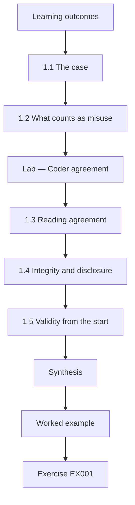

### Logical drawing


```text
[Learning outcomes]
    |
    v
[1.1 The case]
    |
    v
[1.2 What counts as misuse]
    |
    v
[Lab — Coder agreement]
    |
    v
[1.3 Reading agreement]
    |
    v
[1.4 Integrity and disclosure]
    |
    v
[1.5 Validity from the start]
    |
    v
[Synthesis]
    |
    v
[Worked example] --> [Exercise EX001]
```
<!-- cykin:lesson-figures:end ch-01 -->


### Learning outcomes

You will (1) frame a doctoral question about cryptographic misuse in code review; (2) build and test a reliable coding scheme for misuse findings; (3) set integrity and disclosure rules for handling weaknesses in live payment systems.

### 1.1 The case

Nadia Haddad is a doctoral candidate at the fictional Larkspur University, supervised by Prof. Oskar Brandt. Her partner, the fictional Meridian Payments Cooperative, has 24 engineering teams that call vetted cryptographic libraries for card tokenisation, webhook signing and data-at-rest encryption. Every team, change and figure in this book is synthetic. Nadia's question is whether adding a cryptographic-misuse checklist and an automated lint step to code review reduces the number of confirmed misuse findings per ten merged changes, compared with Meridian's usual review. The unit of interest is misuse of correct libraries, not broken algorithms, which matches what practitioners most often get wrong.

### 1.2 What counts as misuse

Misuse means a correct primitive used in a way that voids its security guarantee. Katz and Lindell show that authenticated encryption is secure only under stated conditions, and SP 800-38D makes one explicit: a GCM nonce must never repeat under the same key. Nadia's codebook has four categories. Nonce-iv covers repeated, predictable or truncated nonces and initialisation vectors. Key-handling covers hard-coded, logged, over-shared or never-rotated keys. Primitive-choice covers outdated or unsuitable algorithms such as unsalted fast hashes for passwords. Other catches residual issues. Each category carries a definition, two examples, two near misses and an overlap rule.

### Lab — Coder agreement

```python
"""Cohen's kappa for two coders labelling synthetic cryptographic-misuse findings (read-only)."""
from collections import Counter
CATS = ["nonce-iv", "key-handling", "primitive-choice", "other"]
# 48 synthetic findings: (coder A label, coder B label)
PAIRS = ([("nonce-iv", "nonce-iv")] * 12 + [("key-handling", "key-handling")] * 13 +
         [("primitive-choice", "primitive-choice")] * 10 + [("other", "other")] * 6 +
         [("key-handling", "primitive-choice")] * 3 + [("nonce-iv", "primitive-choice")] * 2 +
         [("other", "key-handling")] * 2)

def kappa(pairs):
    n = len(pairs)
    po = sum(a == b for a, b in pairs) / n
    ca, cb = Counter(a for a, _ in pairs), Counter(b for _, b in pairs)
    pe = sum(ca[c] * cb[c] for c in CATS) / n ** 2
    return po, pe, (po - pe) / (1 - pe)

def main():
    po, pe, k = kappa(PAIRS)
    print(f"items {len(PAIRS)}, agreed {sum(a == b for a, b in PAIRS)}")
    print(f"observed {po:.3f}, chance {pe:.3f}, kappa {k:.3f}")
    for (a, b), n in sorted(Counter(p for p in PAIRS if p[0] != p[1]).items()):
        print(f"disagree {a} -> {b}: {n}")

if __name__ == "__main__":
    main()
```

Run with `python3 lab_kappa.py`. Verified output:

```text
items 48, agreed 41
observed 0.854, chance 0.263, kappa 0.802
disagree key-handling -> primitive-choice: 3
disagree nonce-iv -> primitive-choice: 2
disagree other -> key-handling: 2
```

### 1.3 Reading agreement

Two trained coders independently label 48 synthetic findings and agree on 41, an observed agreement of 0.854. Chance agreement computed from each coder's category frequencies is 0.263, so Cohen's kappa is 0.802; Landis and Koch would call that substantial to almost perfect, but Nadia treats such labels as rough guidance. The disagreements are informative. Five of seven move a finding into primitive-choice, three from key-handling and two from nonce-iv. Coder B reads "a key derived with a fast hash" as an algorithm choice, while coder A reads it as key handling. Nadia adds an overlap rule: derivation of a key is key-handling unless the algorithm itself is deprecated.

### 1.4 Integrity and disclosure

Findings about live payment code are dangerous because a description of an unfixed weakness could help an attacker forge webhooks or decrypt stored tokens. Nadia's data agreement says Meridian shares a finding only after the fix has shipped or the code is retired, that repository names and key identifiers are replaced with pseudonyms, and that no key material, ciphertext sample or exploit procedure ever leaves Meridian. Findings sit on an encrypted university server with access logged. The ethics board also requires an escalation rule: any unfixed high-severity misuse Nadia notices during the study goes to Meridian's security lead within one working day, regardless of study arm.

### 1.5 Validity from the start

Nadia separates three validity questions before collecting real data. Construct validity asks whether "confirmed misuse per ten merged changes" captures what cryptographers mean by weaker security; she checks the codebook with two Meridian security engineers and against the failure modes listed in SP 800-57 Part 1 for key management. Internal validity asks whether any difference comes from the checklist rather than from team skill, which motivates random assignment of teams later. External validity asks whether results from one payments firm with mature libraries carry over to small start-ups, which she will argue cautiously rather than assume.

### Worked example

Nadia writes the question, the four-category codebook and the disclosure agreement, then runs the 48-item agreement exercise. Kappa of 0.802 and a clear drift toward primitive-choice lead to one new overlap rule before real coding.

> **Synthetic case.** Larkspur, Meridian and every finding are invented; SP 800-38D, SP 800-57 and Landis and Koch are real.

### Errors and limits

Kappa summarises agreement but hides where disagreement lies; always tabulate the off-diagonal cells. High agreement also cannot prove that the categories are the right ones, only that two people apply them alike.

### Exercises

- **EX001 — Research question.** State Nadia's research question in one sentence. *Rubric:* 3 = whether checklist plus lint reduces confirmed misuse per ten merged changes versus usual review;; 2 = checklist versus usual without the measure;; 1 = vague "better crypto";; 0 = none.
- **EX002 — Defining misuse.** How does the book define cryptographic misuse, and why is a GCM nonce rule an example? *Rubric:* 3 = correct primitive used so its guarantee fails; nonce reuse under one key voids GCM security per SP 800-38D;; 2 = definition only;; 1 = "weak algorithm";; 0 = none.
- **EX003 — Agreement figures.** Report observed agreement, chance agreement and kappa from the lab. *Rubric:* 3 = 0.854, 0.263, 0.802;; 2 = kappa only;; 1 = wrong but plausible;; 0 = none.
- **EX004 — Drift pattern.** Which category absorbed most disagreements, and what rule did Nadia add? *Rubric:* 3 = primitive-choice (5 of 7); key derivation is key-handling unless algorithm deprecated;; 2 = category only;; 1 = rule only;; 0 = none.
- **EX005 — Sharing condition.** Under what condition may Meridian share a finding with Nadia? *Rubric:* 3 = only after the fix ships or the code is retired, pseudonymised;; 2 = after fix;; 1 = any time;; 0 = none.
- **EX006 — Escalation duty.** What must Nadia do if she sees an unfixed high-severity misuse? *Rubric:* 3 = tell Meridian's security lead within one working day, whatever the arm;; 2 = report it;; 1 = note it in data;; 0 = none.
- **EX007 — Internal validity threat.** Name the internal-validity threat and the planned remedy. *Rubric:* 3 = team skill confounds the effect; randomise teams;; 2 = threat only;; 1 = generic bias;; 0 = none.

### Synthesis

A defensible study of crypto misuse starts with a precise codebook, measured coder agreement, explicit overlap rules and strict, ethics-approved handling of weaknesses in live systems.

### Continue studying — chapter 01 of 08

[← Course home](../../README.md) · [Course chapter index](../SUBJECTS.md) · [Chapter 02 (draft) →](#ch-02)

<a id="ch-02"></a>

## Chapter 2 — Cryptography and trust services: research frontier

<!-- cykin:lesson-figures:start ch-02 -->
### Lesson map

Lesson 02 published. Map, example, EX008.

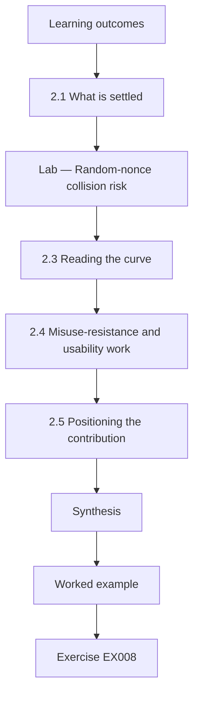

### Logical drawing

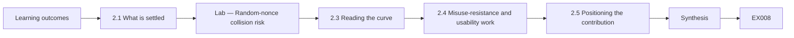

```text
[Learning outcomes]
    |
    v
[2.1 What is settled]
    |
    v
[Lab — Random-nonce collision risk]
    |
    v
[2.3 Reading the curve]
    |
    v
[2.4 Misuse-resistance and usability work]
    |
    v
[2.5 Positioning the contribution]
    |
    v
[Synthesis]
    |
    v
[Worked example] --> [Exercise EX008]
```
<!-- cykin:lesson-figures:end ch-02 -->


### Learning outcomes

You will (1) map the research frontier on usable and misuse-resistant cryptography; (2) quantify a misuse risk from a standard's stated limit; (3) position an original question against what standards already settle.

### 2.1 What is settled

Primitive security is largely not Nadia's question. AES is specified in FIPS 197, SHA-2 in FIPS 180-4, HMAC in FIPS 198-1, and signatures in FIPS 186-5 and RFC 8032. Boneh and Shoup present the reduction-based proofs that make these choices defensible, and Katz and Lindell show how authenticated encryption composes confidentiality and integrity. A thesis that re-litigates those results would add little. What remains open is the gap between a proven primitive and the code that calls it: parameters, nonces, key storage and protocol glue. That gap is where Meridian's audits keep finding trouble, and where Nadia places her contribution.

### 2.2 Nonce limits as a measurable risk

Standards often express misuse risk as a usage limit. SP 800-38D requires that, when 96-bit GCM nonces are generated randomly, a single key encrypt no more than 2^32 messages, because random nonces eventually collide and a collision exposes the XOR of two plaintexts and allows authentication-tag forgery. The birthday approximation gives the chance of at least one repeat among q random draws from 2^96 values as roughly q²/2^97. The lab computes that probability for three synthetic volumes to show why rotation policy, not the cipher, is the controllable variable.

### Lab — Random-nonce collision risk

```python
"""Birthday-bound estimate for random 96-bit AES-GCM nonces under one key (synthetic volumes)."""
import math

def p_collision(q, bits=96):
    # P(at least one repeat among q uniform draws from 2**bits values) ~ 1 - exp(-q(q-1)/2^(bits+1))
    return -math.expm1(-q * (q - 1) / 2 ** (bits + 1))

def main():
    for label, q in [("pilot service, 1e6 msgs", 10**6), ("busy queue, 2^32 msgs", 2**32),
                     ("unrotated key, 2^40 msgs", 2**40)]:
        print(f"{label:<26} P(repeat) = {p_collision(q):.3e}")
    q = 2**32
    print(f"2^32 limit -> about 1 in {1 / p_collision(q):,.0f}")

if __name__ == "__main__":
    main()
```

Run with `python3 lab_nonce.py`. Verified output:

```text
pilot service, 1e6 msgs    P(repeat) = 6.311e-18
busy queue, 2^32 msgs      P(repeat) = 1.164e-10
unrotated key, 2^40 msgs   P(repeat) = 7.629e-06
2^32 limit -> about 1 in 8,589,934,594
```

### 2.3 Reading the curve

At a million messages the repeat probability is about 6 × 10^-18, negligible. At the 2^32 limit it is about 1.2 × 10^-10, roughly one chance in 8.6 billion, which the standard treats as the acceptable ceiling. A synthetic queue that never rotates its key and reaches 2^40 messages climbs to about 7.6 × 10^-6, a risk no payments regulator would accept for a single key. Nadia draws the research lesson: the cipher was the same in all three rows. The difference came from operational discipline, namely counting invocations and rotating keys, which is exactly the behaviour a checklist and lint step could plausibly change.

### 2.4 Misuse-resistance and usability work

The frontier includes two responses to misuse. One designs primitives that fail more gracefully, such as nonce-misuse-resistant modes, so that a repeated nonce leaks equality of messages instead of breaking authenticity. The other studies developers and tooling, asking whether library interfaces, documentation or review aids change behaviour. Nadia's study belongs to the second line. She is careful in her literature review to cite only work she has read and verified, and to record for each paper its population, its measure of misuse and whether it measured shipped code or laboratory tasks, because those choices limit comparison.

### 2.5 Positioning the contribution

From the frontier review Nadia writes a positioning paragraph. Laboratory studies show that developers misuse libraries under time pressure, but few measure confirmed misuse in shipped production changes with randomised assignment. Her contribution is a randomised field study inside one organisation, measured by an audited count per ten merged changes, with a public codebook and analysis archive. She also states what she will not claim: she will not claim the checklist prevents all misuse, nor that results transfer to firms without vetted libraries. Saying what is out of scope keeps the examiners focused on the evidence she can produce.

### Worked example

Nadia tabulates the three nonce-volume rows, links the 2^32 limit to SP 800-38D, and argues that rotation discipline is the behaviour her intervention targets.

> **Synthetic note.** The message volumes belong to an invented queue; the 2^32 limit is the real SP 800-38D rule.

### Errors and limits

The birthday formula is an approximation for random nonces only; counter-based nonces have different failure modes, mainly state loss after restarts. Never treat a tiny probability as permission to skip rotation.

### Exercises

- **EX008 — Settled ground.** Which questions does Nadia treat as settled, and which open gap does she study? *Rubric:* 3 = primitive security (FIPS 197, 180-4, 186-5) settled; gap between primitive and calling code open;; 2 = gap only;; 1 = "new cipher";; 0 = none.
- **EX009 — GCM usage cap.** What usage limit does SP 800-38D set for random 96-bit nonces, and why? *Rubric:* 3 = at most 2^32 messages per key because collisions leak plaintext XOR and enable forgery;; 2 = limit only;; 1 = "rotate often";; 0 = none.
- **EX010 — Probability at the cap.** What repeat probability did the lab report at 2^32 messages? *Rubric:* 3 = about 1.164e-10, about 1 in 8.6 billion;; 2 = order of magnitude;; 1 = other row;; 0 = none.
- **EX011 — Unrotated queue.** What did the 2^40 row show and what lesson follows? *Rubric:* 3 = about 7.6e-6; operational rotation, not the cipher, drives risk;; 2 = number only;; 1 = lesson only;; 0 = none.
- **EX012 — Two frontier responses.** Name the two research responses to misuse and say which Nadia joins. *Rubric:* 3 = misuse-resistant primitives vs developer/tooling studies; she joins tooling;; 2 = both named;; 1 = one;; 0 = none.
- **EX013 — Literature record.** What three facts does Nadia record for each paper she reviews? *Rubric:* 3 = population, misuse measure, shipped code vs lab task;; 2 = two;; 1 = one;; 0 = none.
- **EX014 — Scope claim.** Give one claim Nadia explicitly declines to make. *Rubric:* 3 = checklist prevents all misuse, or results transfer to firms without vetted libraries;; 2 = vague limit;; 1 = unrelated;; 0 = none.

### Synthesis

The frontier is not in new primitives but in measured behaviour around them; standards' usage limits turn that behaviour into numbers a field study can test.

### Continue studying — chapter 02 of 08

[← Chapter 01 (draft)](#ch-01) · [Course chapter index](../SUBJECTS.md) · [Chapter 03 (draft) →](#ch-03)

<a id="ch-03"></a>

## Chapter 3 — Original contribution proposal

<!-- cykin:lesson-figures:start ch-03 -->
### Lesson map

Lesson 03 published. Map, example, EX015.

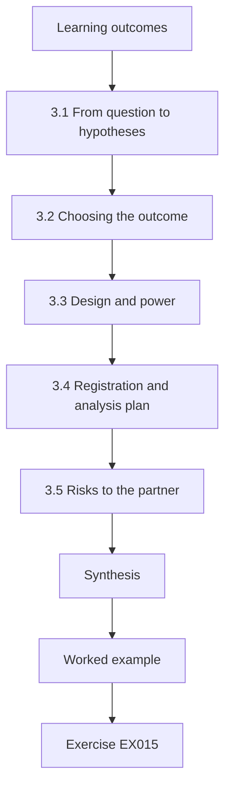

### Logical drawing

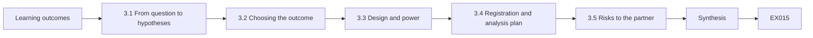

```text
[Learning outcomes]
    |
    v
[3.1 From question to hypotheses]
    |
    v
[3.2 Choosing the outcome]
    |
    v
[3.3 Design and power]
    |
    v
[3.4 Registration and analysis plan]
    |
    v
[3.5 Risks to the partner]
    |
    v
[Synthesis]
    |
    v
[Worked example] --> [Exercise EX015]
```
<!-- cykin:lesson-figures:end ch-03 -->


### Learning outcomes

You will (1) write falsifiable hypotheses for a misuse-reduction study; (2) choose a primary outcome and analysis before seeing data; (3) register the plan so later changes are visible.

### 3.1 From question to hypotheses

Nadia turns her question into a primary hypothesis and a secondary one. H1 states that teams using the checklist and lint step will average fewer confirmed misuse findings per ten merged changes than teams using usual review over one quarter. H2 states that a larger share of checklist teams will record zero misuse in that quarter. Both are directional and falsifiable: a null or reversed difference counts against them. She also writes a null expectation for the lint tool alone, because examiners will ask whether a cheap tool, rather than human attention, explains any effect.

### 3.2 Choosing the outcome

The primary outcome is confirmed misuse per ten merged changes that touch cryptographic code, measured per team. Confirmation means a blinded auditor, unaware of the arm, agrees that the change violates a codebook rule. Nadia rejects two tempting alternatives. Lint warnings would reward the tool for flagging its own patterns, and incidents would be too rare to measure in a quarter. She defines "touches cryptographic code" mechanically, as any change importing Meridian's approved crypto wrapper or the standard library modules hashlib, hmac or secrets, so that inclusion is not a judgement call.

### 3.3 Design and power

Twenty-four teams are available, so Nadia plans a cluster-randomised design with twelve teams per arm, stratified by product line so that tokenisation, webhooks and storage teams appear in both arms. Team-level randomisation avoids contamination, since engineers in one team share review habits. She estimates power from the baseline she will measure in Chapter 4 and states the honest limitation: with twelve clusters per arm only large effects are reliably detectable. She therefore pre-commits to a permutation test, which makes no normality assumption and suits small cluster counts.

### 3.4 Registration and analysis plan

Before any outcome data exist, Nadia deposits a time-stamped plan with her university's research office. It lists the hypotheses, primary and secondary outcomes, inclusion rule, randomisation seed policy, the permutation test with 20,000 shuffles, and the rule for handling teams that leave Meridian. It also lists what would count as a deviation. Registration is not bureaucracy for its own sake: it lets examiners distinguish confirmatory results from exploratory ones, and it protects Nadia from the temptation to switch outcomes when the first one disappoints.

### 3.5 Risks to the partner

The proposal also protects Meridian. The checklist never asks reviewers to test exploits; it asks questions such as whether each GCM key has an invocation counter and rotation trigger, whether keys come from a managed key service rather than source code, and whether password storage uses a memory-hard function such as Argon2 from RFC 9106. Control teams keep their usual review, so no team receives weaker protection than before. The escalation duty from Chapter 1 still applies in both arms, and the security lead may halt the study if any arm causes harm.

### Worked example

Nadia's one-page registration states H1 and H2, the outcome per ten crypto-touching changes, the 12-versus-12 stratified cluster design and the permutation test, then deposits it with a timestamp before baseline data are unblinded.

> **Synthetic note.** The registration office and checklist are invented for teaching; RFC 9106 and SP 800-38D are real references for the checklist items.

### Errors and limits

Registration cannot fix a weak outcome measure, and a small cluster count limits power whatever the test. Report deviations openly rather than silently amending the plan.

### Exercises

- **EX015 — Primary hypothesis.** Write H1 precisely. *Rubric:* 3 = checklist+lint teams average fewer confirmed misuse per ten merged crypto-touching changes over a quarter;; 2 = direction without unit;; 1 = undirected;; 0 = none.
- **EX016 — Rejected outcomes.** Why did Nadia reject lint warnings and incidents as outcomes? *Rubric:* 3 = warnings reward the tool's own patterns; incidents too rare in a quarter;; 2 = one reason;; 1 = vague;; 0 = none.
- **EX017 — Inclusion rule.** How is "touches cryptographic code" defined? *Rubric:* 3 = change imports the approved crypto wrapper, hashlib, hmac or secrets;; 2 = imports crypto;; 1 = reviewer judgement;; 0 = none.
- **EX018 — Cluster choice.** Why randomise teams rather than individual changes? *Rubric:* 3 = engineers in a team share habits, so per-change assignment contaminates arms;; 2 = contamination named;; 1 = convenience;; 0 = none.
- **EX019 — Registered contents.** List four items in the registered plan. *Rubric:* 3 = four of hypotheses, outcomes, inclusion rule, seed policy, permutation test, attrition rule, deviation definition;; 2 = three;; 1 = one or two;; 0 = none.
- **EX020 — Password checklist item.** What does the checklist ask about password storage, and which source backs it? *Rubric:* 3 = memory-hard function such as Argon2, RFC 9106;; 2 = Argon2 without source;; 1 = "hash passwords";; 0 = none.

### Synthesis

A registered plan with falsifiable hypotheses, a blinded and mechanically defined outcome and a design matched to the available clusters turns a good question into a test.

### Continue studying — chapter 03 of 08

[← Chapter 02 (draft)](#ch-02) · [Course chapter index](../SUBJECTS.md) · [Chapter 04 (draft) →](#ch-04)

<a id="ch-04"></a>

## Chapter 4 — Baseline replication and pilot

<!-- cykin:lesson-figures:start ch-04 -->
### Lesson map

Lesson 04 published. Map, example, EX021.

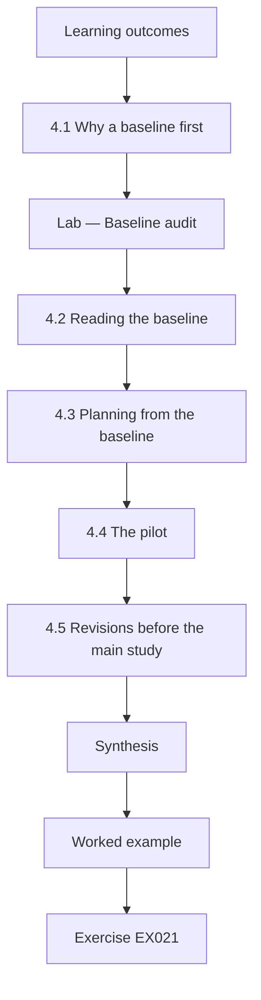

### Logical drawing

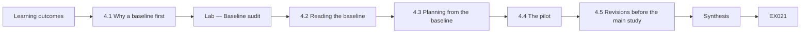

```text
[Learning outcomes]
    |
    v
[4.1 Why a baseline first]
    |
    v
[Lab — Baseline audit]
    |
    v
[4.2 Reading the baseline]
    |
    v
[4.3 Planning from the baseline]
    |
    v
[4.4 The pilot]
    |
    v
[4.5 Revisions before the main study]
    |
    v
[Synthesis]
    |
    v
[Worked example] --> [Exercise EX021]
```
<!-- cykin:lesson-figures:end ch-04 -->


### Learning outcomes

You will (1) measure a baseline misuse rate from a historical audit; (2) run a pilot that tests procedures rather than effects; (3) revise instruments before the main study.

### 4.1 Why a baseline first

A baseline tells Nadia how common misuse already is, which shapes power, and it replicates a claim Meridian believes but has never checked: that its wrapper library has made misuse rare. Two auditors, blind to the coming study, review a random sample of 80 crypto-touching changes merged in the previous year, using the Chapter 1 codebook with its new overlap rule. Each confirmed finding is linked to a pseudonymised change identifier. Nothing in the sample is shared outside Meridian until fixes for any open issues have shipped.

### Lab — Baseline audit

```python
"""Baseline count of confirmed crypto-misuse in 80 synthetic merged changes (read-only)."""
from collections import Counter
# (change id, confirmed misuse category or None) -- synthetic audit of last year's merges
CHANGES = ([("nonce-iv")] * 7 + [("key-handling")] * 9 + [("primitive-choice")] * 5 +
           [("other")] * 2 + [None] * 57)

def main():
    c = Counter(x for x in CHANGES if x)
    n = len(CHANGES); m = sum(c.values())
    print(f"changes {n}, with confirmed misuse {m} ({100 * m / n:.1f}%)")
    for k, v in c.most_common():
        print(f"  {k:<17} {v}")

if __name__ == "__main__":
    main()
```

Run with `python3 lab_baseline.py`. Verified output:

```text
changes 80, with confirmed misuse 23 (28.8%)
  key-handling      9
  nonce-iv          7
  primitive-choice  5
  other             2
```

### 4.2 Reading the baseline

Twenty-three of eighty changes, 28.8 percent, contain at least one confirmed misuse. Key-handling leads with nine, followed by nonce-iv with seven, primitive-choice with five and other with two. The replication therefore fails Meridian's belief: the wrapper reduced some algorithm mistakes, but keys still end up in configuration files and nonces are still sometimes derived from timestamps. Nadia records the rate as roughly 2.9 findings per ten changes for planning, while noting that one change can hold several findings and that her primary outcome counts findings, not changes.

### 4.3 Planning from the baseline

With a control mean near 1.5 to 2 findings per ten changes per team per quarter, Nadia judges that a halving would be detectable with twelve teams per arm but a 20 percent reduction would not. She writes this into an addendum to the registration, timestamped before the main study begins, so examiners can see the planning arithmetic was not adjusted afterwards. She also notes the distribution is skewed with many zeros, another reason the pre-registered permutation test suits the data better than a t-test.

### 4.4 The pilot

Two volunteer teams, excluded from the main study, use the checklist and lint step for four weeks. The pilot asks procedural questions only. Do reviewers complete the checklist? Does the lint rule for constant nonces fire on wrapper calls? Can the blinded auditor confirm findings without seeing which arm produced them? Reviewers complete 31 of 34 checklists. The nonce rule produces false positives on test fixtures, which use fixed nonces deliberately with throwaway keys. One auditor guesses the arm from checklist comments left in merge descriptions, a blinding leak.

### 4.5 Revisions before the main study

Nadia makes three changes and logs each as a pre-study revision. The lint rule skips files under test directories, documented so examiners can judge the trade-off. Checklist answers move from merge descriptions to a separate form the auditor never sees, closing the blinding leak. A checklist question about key rotation is reworded after reviewers misread "rotation" as file-system log rotation. She deliberately does not compute an effect from the pilot, because two non-random teams over four weeks cannot estimate one and a tempting number could bias later choices.

### Worked example

From the baseline Nadia reports 23 of 80 changes with misuse, key-handling first, and plans for a halving; from the pilot she fixes the test-fixture false positive, the blinding leak and an ambiguous question.

> **Synthetic note.** The 80 audited changes and both pilot teams are invented for teaching.

### Errors and limits

A one-year historical sample may under-count misuse that auditors could not see, such as keys set in deployment environments. Pilots test feasibility; reporting pilot effects as evidence is a common error.

### Exercises

- **EX021 — Baseline rate.** What share of audited changes contained misuse? *Rubric:* 3 = 23 of 80, 28.8 percent;; 2 = percentage only;; 1 = count of findings by category;; 0 = none.
- **EX022 — Leading category.** Which category led the baseline and with how many findings? *Rubric:* 3 = key-handling, 9;; 2 = category only;; 1 = nonce-iv;; 0 = none.
- **EX023 — Belief tested.** Which Meridian belief did the baseline fail to replicate? *Rubric:* 3 = that the wrapper library made misuse rare;; 2 = wrapper effective;; 1 = generic;; 0 = none.
- **EX024 — Detectable effect.** Which effect size did Nadia judge detectable and which not? *Rubric:* 3 = halving detectable, 20 percent reduction not, with 12 teams per arm;; 2 = one;; 1 = "large";; 0 = none.
- **EX025 — Pilot findings.** Name the three problems the pilot exposed. *Rubric:* 3 = test-fixture nonce false positives, blinding leak via merge comments, ambiguous rotation question;; 2 = two;; 1 = one;; 0 = none.
- **EX026 — No pilot effect.** Why does Nadia refuse to estimate an effect from the pilot? *Rubric:* 3 = two non-random teams over four weeks cannot estimate it and a number could bias choices;; 2 = too small;; 1 = forgot;; 0 = none.

### Synthesis

A replicated baseline sets realistic expectations, and a pilot that hunts for procedural faults, not effects, makes the main study trustworthy.

### Continue studying — chapter 04 of 08

[← Chapter 03 (draft)](#ch-03) · [Course chapter index](../SUBJECTS.md) · [Chapter 05 (draft) →](#ch-05)

<a id="ch-05"></a>

## Chapter 5 — Main study and independent validation

<!-- cykin:lesson-figures:start ch-05 -->
### Lesson map

Lesson 05 published. Map, example, EX027.

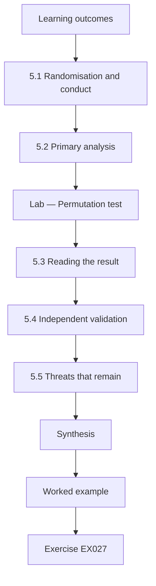

### Logical drawing

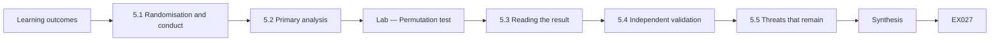

```text
[Learning outcomes]
    |
    v
[5.1 Randomisation and conduct]
    |
    v
[5.2 Primary analysis]
    |
    v
[Lab — Permutation test]
    |
    v
[5.3 Reading the result]
    |
    v
[5.4 Independent validation]
    |
    v
[5.5 Threats that remain]
    |
    v
[Synthesis]
    |
    v
[Worked example] --> [Exercise EX027]
```
<!-- cykin:lesson-figures:end ch-05 -->


### Learning outcomes

You will (1) run a cluster-randomised field study with blinded outcome confirmation; (2) analyse it with the pre-registered permutation test; (3) report primary and secondary results without overstating them.

### 5.1 Randomisation and conduct

Meridian's security lead, not Nadia, runs the randomisation script with a seed recorded in the registration, assigning six tokenisation-or-webhook teams and six storage-or-platform teams to each arm. The study runs one quarter. Checklist teams complete the form for every crypto-touching change and run the lint step in continuous integration; usual-review teams change nothing. Two auditors who never see arm labels confirm findings weekly from pseudonymised diffs. Nadia monitors only procedural metrics during the quarter, such as checklist completion, so that she cannot be accused of peeking at outcomes.

### 5.2 Primary analysis

At quarter end each team has a count of confirmed findings per ten merged crypto-touching changes. The observed difference in means is the statistic. Under the null hypothesis that the arm makes no difference, team labels are exchangeable, so the permutation test reshuffles the 24 team values into two groups of twelve many times and asks how often a difference at least as large as the observed one appears by chance. The lab reproduces the registered analysis with 20,000 shuffles and the seed fixed at 2026.

### Lab — Permutation test

```python
"""Permutation test: misuse per 10 merged changes, checklist+lint vs usual review (synthetic teams)."""
import random
CHECK = [0, 1, 0, 0, 2, 0, 1, 0, 0, 1, 0, 0]
USUAL = [2, 1, 3, 0, 2, 1, 2, 3, 1, 0, 2, 2]

def mean(x): return sum(x) / len(x)

def main():
    obs = mean(USUAL) - mean(CHECK)
    pool = CHECK + USUAL; rng = random.Random(2026); n = 20000; hits = 0
    for _ in range(n):
        rng.shuffle(pool)
        if mean(pool[12:]) - mean(pool[:12]) >= obs: hits += 1
    print(f"checklist mean {mean(CHECK):.2f}, usual mean {mean(USUAL):.2f}, diff {obs:.2f}")
    print(f"one-sided permutation p = {hits / n:.4f} (seed 2026, {n} shuffles)")
    print(f"zero-misuse teams: checklist {CHECK.count(0)}/12, usual {USUAL.count(0)}/12")

if __name__ == "__main__":
    main()
```

Run with `python3 lab_trial.py`. Verified output:

```text
checklist mean 0.42, usual mean 1.58, diff 1.17
one-sided permutation p = 0.0034 (seed 2026, 20000 shuffles)
zero-misuse teams: checklist 8/12, usual 2/12
```

### 5.3 Reading the result

Checklist teams average 0.42 confirmed findings per ten changes and usual-review teams 1.58, a difference of 1.17. Only about 0.34 percent of shuffles produce a difference that large, a one-sided p of 0.0034, so H1 is supported at the registered threshold of 0.05. The secondary outcome points the same way: eight of twelve checklist teams record zero misuse against two of twelve controls. Nadia reports both the effect size and the p-value, and she reports the raw team counts in an appendix so readers can recompute everything without trusting her summary.

### 5.4 Independent validation

Prof. Brandt arranges for a third auditor from another university, under the same data agreement, to re-confirm a random 30 percent of findings blind to arm. Agreement with the original auditors is high, and the re-confirmation changes no team's count by more than one, which leaves the conclusion intact. Nadia also checks the lint-only explanation from Chapter 3: lint warnings explain about a third of avoided nonce findings, but most avoided key-handling findings came from checklist questions the tool cannot see, such as whether a key is issued by the managed key service.

### 5.5 Threats that remain

Nadia lists remaining threats plainly. Reviewers in checklist teams knew they were observed, a Hawthorne effect that could fade once the study ends. Twelve clusters per arm make the estimate imprecise, so the true effect may be much smaller than 1.17. Auditors could not see secrets injected at deploy time, so key-handling findings remain an under-count in both arms. Finally, Meridian's mature wrapper may make checklists easier to apply than in firms that call low-level primitives directly, which limits transfer to those settings.

### Worked example

The registered permutation test gives 0.42 versus 1.58, a difference of 1.17 with p = 0.0034; a blinded third auditor and a lint-only check leave the conclusion intact, with four stated threats.

> **Synthetic note.** All team counts and auditors are invented; the permutation method is standard.

### Errors and limits

A small p-value does not measure how large or important an effect is, and a one-quarter study cannot show durability. Never drop teams after unblinding.

### Exercises

- **EX027 — Who randomised.** Who ran the randomisation, and why not Nadia? *Rubric:* 3 = Meridian's security lead with the registered seed, so the researcher cannot influence allocation;; 2 = who only;; 1 = Nadia;; 0 = none.
- **EX028 — Exchangeability logic.** Why may team labels be shuffled under the null? *Rubric:* 3 = if the arm has no effect, labels are exchangeable, so shuffles show chance differences;; 2 = partial;; 1 = "random";; 0 = none.
- **EX029 — Main numbers.** Report the two means, the difference and the p-value. *Rubric:* 3 = 0.42, 1.58, 1.17, p = 0.0034;; 2 = three of four;; 1 = one;; 0 = none.
- **EX030 — Zero-misuse comparison.** What did the secondary outcome show? *Rubric:* 3 = 8 of 12 checklist teams vs 2 of 12 controls with zero misuse;; 2 = direction;; 1 = wrong counts;; 0 = none.
- **EX031 — Lint-only check.** What did the lint-only analysis find? *Rubric:* 3 = lint explains about a third of avoided nonce findings; most key-handling gains came from checklist questions;; 2 = partial;; 1 = lint explains all;; 0 = none.
- **EX032 — Remaining threats.** Name three remaining threats. *Rubric:* 3 = three of Hawthorne, imprecision, deploy-time secrets unseen, limited transfer;; 2 = two;; 1 = one;; 0 = none.

### Synthesis

A pre-registered, blinded, cluster-randomised test supports the checklist effect; independent re-confirmation and honest threats keep the claim proportionate.

### Continue studying — chapter 05 of 08

[← Chapter 04 (draft)](#ch-04) · [Course chapter index](../SUBJECTS.md) · [Chapter 06 (draft) →](#ch-06)

<a id="ch-06"></a>

## Chapter 6 — Peer critique and revision

<!-- cykin:lesson-figures:start ch-06 -->
### Lesson map

Lesson 06 published. Map, example, EX033.

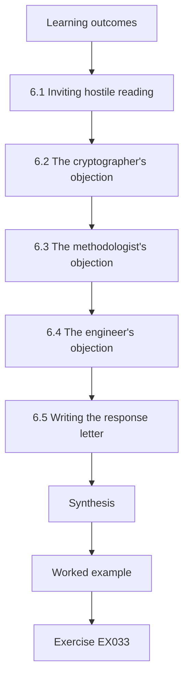

### Logical drawing

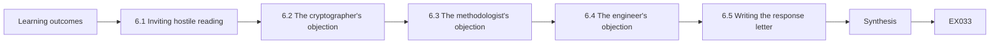

```text
[Learning outcomes]
    |
    v
[6.1 Inviting hostile reading]
    |
    v
[6.2 The cryptographer's objection]
    |
    v
[6.3 The methodologist's objection]
    |
    v
[6.4 The engineer's objection]
    |
    v
[6.5 Writing the response letter]
    |
    v
[Synthesis]
    |
    v
[Worked example] --> [Exercise EX033]
```
<!-- cykin:lesson-figures:end ch-06 -->


### Learning outcomes

You will (1) organise structured peer critique of a cryptographic field study; (2) separate fatal objections from fixable ones; (3) revise a manuscript with a traceable response letter.

### 6.1 Inviting hostile reading

Nadia circulates her draft paper to three readers chosen to disagree with her: an applied cryptographer, a software-engineering methodologist and a Meridian engineer from a control team. She asks each for the single objection most likely to sink the paper and for a list of smaller problems. She also gives them the registration, so they can check whether reported analyses match the plan. Inviting critique before submission is cheaper than receiving it from journal reviewers, and it trains the habit examiners look for: treating one's own result as a claim to be tested.

### 6.2 The cryptographer's objection

The cryptographer argues that "misuse per ten changes" weights every finding equally, although a repeated GCM nonce on a high-volume key is catastrophic while a deprecated hash in a test utility is cosmetic. Nadia accepts that this is a real construct problem but not a fatal one. She adds a severity-weighted sensitivity analysis using a three-level scale defined in advance of rescoring, and reports that the direction holds, while the gap narrows because several avoided findings were low severity. She also adds a paragraph explaining why the primary, unweighted measure was registered first.

### 6.3 The methodologist's objection

The methodologist notes that checklist teams merged slightly fewer crypto-touching changes during the quarter, raising the possibility that the checklist slowed work and that slower work, not better review, lowered misuse. Nadia checks merge counts and lead times. Checklist teams merged eight percent fewer such changes, and median review time rose by about twelve minutes. She reports both openly as costs, notes that a rate per ten changes already adjusts for volume, and frames the trade-off for practitioners: a modest time cost bought a sizeable reduction in confirmed misuse within this setting.

### 6.4 The engineer's objection

The control-team engineer points out that two usual-review teams own the oldest storage service, which carries legacy encryption code with more hazards. Stratification by product line placed both in the control arm by chance. Nadia treats this as a plausible imbalance. She runs a sensitivity analysis excluding the two legacy-heavy teams from control and their stratum partners from treatment; the difference shrinks to about 0.9 but remains positive. She reports the analysis as exploratory, because it was not registered, and recommends that future studies stratify by code age as well as product line.

### 6.5 Writing the response letter

For each objection Nadia's response letter quotes the comment, states whether she agrees, describes the change with section and line references, and labels any new analysis as exploratory. She resists two temptations: silently promoting a sensitivity result to the abstract, and dismissing an objection without evidence. Where she disagrees, such as a suggestion to drop the unweighted measure, she explains that changing the primary outcome after unblinding would breach the registration. The letter becomes part of her archive, so examiners can trace how the argument evolved.

### Worked example

Three critics raise severity weighting, slower merging and a legacy imbalance; Nadia answers with a severity sensitivity check, reported time costs and an exploratory exclusion, all logged in a response letter.

> **Synthetic note.** The reviewers and every rescored count in this chapter are invented.

### Errors and limits

Sensitivity analyses run after unblinding are exploratory however reassuring they look. A critique you cannot answer belongs in the limitations, not in a footnote.

### Exercises

- **EX033 — Choosing critics.** Why did Nadia pick three readers who would disagree? *Rubric:* 3 = to surface the most damaging objections before journal review, from crypto, methods and practice angles;; 2 = to get criticism;; 1 = friends;; 0 = none.
- **EX034 — Severity objection.** What did the cryptographer object to, and how did Nadia respond? *Rubric:* 3 = equal weighting of findings; added pre-defined severity-weighted sensitivity, direction holds, gap narrows;; 2 = objection only;; 1 = response only;; 0 = none.
- **EX035 — Cost of the checklist.** What costs did the slowdown check reveal? *Rubric:* 3 = 8 percent fewer crypto-touching merges, median review about 12 minutes longer;; 2 = one cost;; 1 = no cost;; 0 = none.
- **EX036 — Legacy imbalance.** What happened when legacy-heavy teams were excluded? *Rubric:* 3 = difference fell to about 0.9 but stayed positive; labelled exploratory;; 2 = number only;; 1 = vanished;; 0 = none.
- **EX037 — Future stratification.** What stratification change did Nadia recommend? *Rubric:* 3 = stratify by code age as well as product line;; 2 = stratify more;; 1 = randomise individuals;; 0 = none.
- **EX038 — Primary outcome retained.** Why did she refuse to drop the unweighted measure? *Rubric:* 3 = changing the primary outcome after unblinding breaches the registration;; 2 = it was first;; 1 = preference;; 0 = none.

### Synthesis

Structured hostile reading, sensitivity checks labelled as exploratory and a traceable response letter make a result stronger by exposing where it bends.

### Continue studying — chapter 06 of 08

[← Chapter 05 (draft)](#ch-05) · [Course chapter index](../SUBJECTS.md) · [Chapter 07 (draft) →](#ch-07)

<a id="ch-07"></a>

## Chapter 7 — Thesis synthesis and reproducibility archive

<!-- cykin:lesson-figures:start ch-07 -->
### Lesson map

Lesson 07 published. Map, example, EX039.

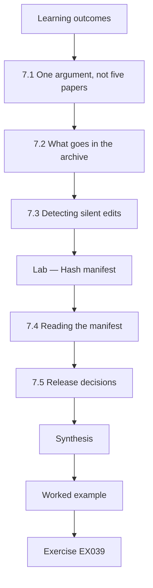

### Logical drawing

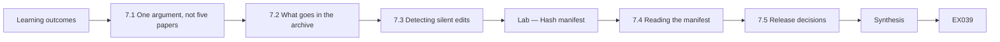

```text
[Learning outcomes]
    |
    v
[7.1 One argument, not five papers]
    |
    v
[7.2 What goes in the archive]
    |
    v
[7.3 Detecting silent edits]
    |
    v
[Lab — Hash manifest]
    |
    v
[7.4 Reading the manifest]
    |
    v
[7.5 Release decisions]
    |
    v
[Synthesis]
    |
    v
[Worked example] --> [Exercise EX039]
```
<!-- cykin:lesson-figures:end ch-07 -->


### Learning outcomes

You will (1) synthesise chapters into one argued thesis; (2) build a hashed reproducibility archive that detects silent edits; (3) decide what can and cannot be released from a security study.

### 7.1 One argument, not five papers

Nadia's thesis must read as a single argument. Her introduction states the claim: in one payments organisation, a cryptographic-misuse checklist with lint reduced confirmed misuse per ten crypto-touching changes over a quarter, at a modest time cost, with the effect concentrated in key-handling. Each chapter then answers one question the claim depends on: whether misuse can be coded reliably, why it matters by the standards' own limits, whether the baseline justified intervention, whether the trial supports the effect and whether it survives critique. Material that answers none of those questions moves to an appendix.

### 7.2 What goes in the archive

The archive lets an examiner rerun every number without contacting Nadia. It contains the codebook with version history, the registration and addendum, pseudonymised team-level counts, the randomisation and analysis scripts with seeds, the lab programs from this book, the response letter, and a README explaining how to run everything with only a standard Python installation. It excludes diffs, repository names and anything that could identify a Meridian system, as the data agreement requires. The README states this exclusion openly, so readers know which claims rest on data they cannot see.

### 7.3 Detecting silent edits

An archive is useful only if readers can tell whether it has changed since the thesis was examined. Nadia records a SHA-256 digest, defined in FIPS 180-4, of each file and a single root digest computed over the sorted file digests, and prints the root in the thesis itself. The lab builds such a manifest for three toy files and shows that changing one word in the findings file changes the root completely. A hash manifest proves integrity against accidental or unannounced edits; it does not prove who made the archive, which would need a digital signature such as Ed25519 from RFC 8032.

### Lab — Hash manifest

```python
"""SHA-256 manifest for a synthetic reproducibility archive (hashlib only)."""
import hashlib
FILES = {"codebook.md": b"nonce-iv | key-handling | primitive-choice | other\n",
         "findings.csv": b"id,team,arm,category\nF001,T03,check,nonce-iv\n",
         "analysis.py": b"# permutation test, seed 2026\n"}

def main():
    for name, data in sorted(FILES.items()):
        print(f"{hashlib.sha256(data).hexdigest()[:16]}...  {name}")
    whole = hashlib.sha256(b"".join(hashlib.sha256(FILES[k]).digest() for k in sorted(FILES))).hexdigest()
    print(f"manifest root {whole[:16]}...")
    tampered = dict(FILES, **{"findings.csv": FILES["findings.csv"].replace(b"check", b"usual")})
    root2 = hashlib.sha256(b"".join(hashlib.sha256(tampered[k]).digest() for k in sorted(tampered))).hexdigest()
    print(f"after one-word edit root {root2[:16]}... match={root2 == whole}")

if __name__ == "__main__":
    main()
```

Run with `python3 lab_archive.py`. Verified output:

```text
74b6ee0a6c357d2b...  analysis.py
dd8ff4efed0b0971...  codebook.md
8fb59a60f3904a37...  findings.csv
manifest root 4ed0159418d1b231...
after one-word edit root 1fcc81b868bef821... match=False
```

### 7.4 Reading the manifest

Each file digest is shown truncated to sixteen hex characters for readability, while the archive stores all sixty-four. The root over the sorted digests is 4ed0159418d1b231, and after a one-word edit that relabels a finding's arm, the root becomes 1fcc81b868bef821 and the match check prints False. Because SHA-256 is designed to be collision resistant, a reader who recomputes the root and finds the published value can be confident the files are those examined. Nadia warns that sorting must be documented; a different file order would produce a different root for identical content.

### 7.5 Release decisions

Some material cannot be released even with pseudonyms. Nadia applies a release test to each item: could it help someone find or exploit a weakness in a Meridian system that may still exist? Team-level counts and the codebook pass. Example findings pass only as invented paraphrases. The lint rules pass, because they detect patterns already described in public guidance. Auditor notes fail, because they mention internal service names. Meridian's security lead signs the final release list, and the archive's README links to it so readers understand why some evidence is described rather than shown.

### Worked example

Nadia writes a one-paragraph thesis claim, assembles the archive with a manifest whose root is printed in the thesis, and records a signed release list explaining each exclusion.

> **Synthetic note.** The three archive files and their digests are invented teaching data; SHA-256 itself is real (FIPS 180-4).

### Errors and limits

A digest detects change but cannot say whether the original content was honest. Never publish real key identifiers, even hashed, because low-entropy identifiers can be guessed and matched.

### Exercises

- **EX039 — Thesis claim.** State Nadia's synthesised thesis claim. *Rubric:* 3 = checklist+lint cut confirmed misuse per ten changes in one firm over a quarter, modest time cost, mainly key-handling;; 2 = effect only;; 1 = universal claim;; 0 = none.
- **EX040 — Archive exclusions.** What does the archive exclude and why? *Rubric:* 3 = diffs, repository names, anything identifying Meridian systems, per data agreement;; 2 = partial;; 1 = vague;; 0 = none.
- **EX041 — Manifest roots.** Report the root before and after the edit. *Rubric:* 3 = 4ed0159418d1b231 then 1fcc81b868bef821, match False;; 2 = one root;; 1 = "changed";; 0 = none.
- **EX042 — Hash versus signature.** What does the manifest prove and what does it not? *Rubric:* 3 = integrity against edits, not authorship; a signature such as Ed25519 (RFC 8032) proves origin;; 2 = one side;; 1 = confused;; 0 = none.
- **EX043 — Ordering pitfall.** Why must sorting be documented? *Rubric:* 3 = different file order gives a different root for identical content;; 2 = reproducibility;; 1 = style;; 0 = none.
- **EX044 — Release test.** State Nadia's release test and one item that fails it. *Rubric:* 3 = could it help find or exploit a weakness that may still exist; auditor notes fail;; 2 = test only;; 1 = item only;; 0 = none.

### Synthesis

A thesis is one claim defended chapter by chapter; a hashed, documented and carefully redacted archive lets others verify it without exposing the partner.

### Continue studying — chapter 07 of 08

[← Chapter 06 (draft)](#ch-06) · [Course chapter index](../SUBJECTS.md) · [Chapter 08 (draft) →](#ch-08)

<a id="ch-08"></a>

## Chapter 8 — Defense and publication plan

<!-- cykin:lesson-figures:start ch-08 -->
### Lesson map

Lesson 08 published. Map, example, EX045.

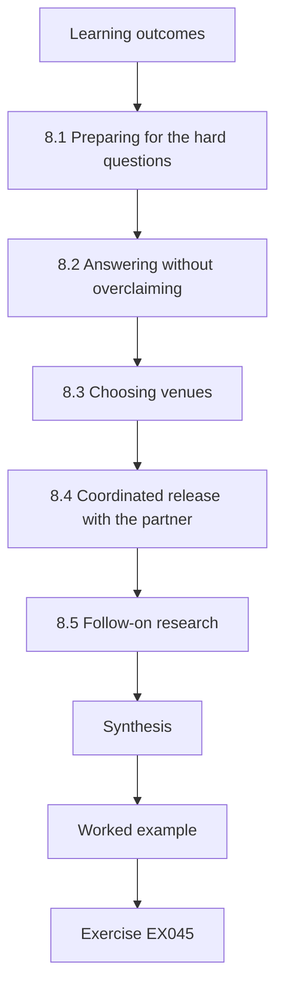

### Logical drawing

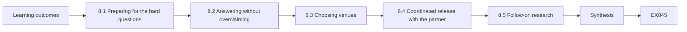

```text
[Learning outcomes]
    |
    v
[8.1 Preparing for the hard questions]
    |
    v
[8.2 Answering without overclaiming]
    |
    v
[8.3 Choosing venues]
    |
    v
[8.4 Coordinated release with the partner]
    |
    v
[8.5 Follow-on research]
    |
    v
[Synthesis]
    |
    v
[Worked example] --> [Exercise EX045]
```
<!-- cykin:lesson-figures:end ch-08 -->


### Learning outcomes

You will (1) prepare a doctoral defense around the claim's weakest points; (2) plan publication venues and coordinated release with a partner; (3) define follow-on research, including post-quantum migration.

### 8.1 Preparing for the hard questions

Nadia lists the ten questions she least wants to hear and prepares a short, evidence-based answer for each. Among them: why twelve clusters are enough, whether the Hawthorne effect explains the result, why severity weighting was not primary, and whether lint alone could deliver the gain. For each answer she points to a section, a table or an archive file rather than to her opinion. Prof. Brandt runs two mock defenses with colleagues who have not read the thesis, because they ask the naive questions that the real committee often asks first.

### 8.2 Answering without overclaiming

During the defense an examiner asks whether the study proves checklists work. Nadia answers that it shows a sizeable reduction in one organisation over one quarter, with a confidence that rests on a permutation test, blinded confirmation and a third auditor, and that durability and transfer are open. When asked why she did not test exploitability of findings, she explains that the ethics approval forbade exploit work and that confirmed codebook violations are a recognised proxy, not a measure of breaches. Precise, bounded answers earn more trust than confident generalisations.

### 8.3 Choosing venues

Nadia plans two papers. The trial goes to a peer-reviewed software-engineering security venue, where reviewers value randomised field evidence. A shorter practitioner article explains the checklist questions, each tied to a public source such as SP 800-38D for nonce limits, SP 800-57 for key lifecycles and RFC 9106 for password hashing. She checks each venue's open-data policy against her release list, and plans to post an accepted manuscript in an open repository so the checklist reaches teams that cannot pay for journal access.

### 8.4 Coordinated release with the partner

Before submission, Meridian's security lead reviews both manuscripts against the data agreement, confirming that no live weakness is described and that every example finding is an invented paraphrase. They agree on a timetable: the archive goes public on acceptance, the practitioner article after Meridian has rolled the checklist out to all teams, and any newly found issue follows Meridian's disclosure process before publication. Writing this down protects both parties and shows examiners that research outputs and partner security were planned together, not traded off at the last minute.

### 8.5 Follow-on research

Nadia proposes two follow-on studies. The first repeats the trial in organisations without a mature wrapper, stratified by code age, to test transfer. The second studies post-quantum migration: NIST has standardised ML-KEM in FIPS 203, ML-DSA in FIPS 204 and SLH-DSA in FIPS 205, and migrating to them will introduce new parameters, larger keys and hybrid handshakes, all fresh opportunities for misuse. She suggests extending the codebook with migration categories, such as unsupported hybrid combinations, and measuring whether checklist questions written now prevent mistakes when real migration work starts.

### Worked example

Nadia's defense pack maps ten hard questions to evidence, her publication plan pairs a trial paper with a practitioner article, and her release timetable with Meridian is signed before submission.

> **Synthetic note.** The committee, venues' decisions and Meridian timetable are invented; FIPS 203, 204 and 205 are real standards.

### Errors and limits

A defense is not won by certainty; claims beyond the evidence invite failure. Publication plans must never move faster than the partner's ability to fix what research reveals.

### Exercises

- **EX045 — Mock audiences.** Why did Prof. Brandt use colleagues who had not read the thesis? *Rubric:* 3 = they ask naive questions the committee often asks first;; 2 = fresh view;; 1 = availability;; 0 = none.
- **EX046 — Bounded answer.** How did Nadia answer whether the study proves checklists work? *Rubric:* 3 = sizeable reduction in one firm over one quarter, evidence from permutation test, blinding and third auditor; durability and transfer open;; 2 = partial;; 1 = "yes";; 0 = none.
- **EX047 — Exploitability question.** Why were findings not tested for exploitability? *Rubric:* 3 = ethics approval forbade exploit work; codebook violations are a recognised proxy;; 2 = one reason;; 1 = time;; 0 = none.
- **EX048 — Practitioner sources.** Which public sources back the practitioner article's checklist items? *Rubric:* 3 = SP 800-38D nonces, SP 800-57 key lifecycle, RFC 9106 passwords;; 2 = two;; 1 = one;; 0 = none.
- **EX049 — Release timetable.** Describe the agreed release order. *Rubric:* 3 = archive on acceptance; practitioner article after full rollout; new issues through Meridian disclosure first;; 2 = two parts;; 1 = one;; 0 = none.
- **EX050 — Post-quantum follow-on.** Which standards motivate the second follow-on study and why? *Rubric:* 3 = FIPS 203, 204, 205 (ML-KEM, ML-DSA, SLH-DSA); migration adds parameters, larger keys, hybrids open to misuse;; 2 = standards only;; 1 = "quantum";; 0 = none.

### Synthesis

A strong defense names the claim's limits before the committee does, and a publication plan coordinated with the partner turns evidence into safer practice without exposing live systems.

### Continue studying — chapter 08 of 08

[← Chapter 07 (draft)](#ch-07) · [Course chapter index](../SUBJECTS.md) · [Worked results ↓](#worked-results) · [Next course via chapter index →](../SUBJECTS.md)

<a id="worked-results"></a>

## Worked results

Model answers for EX001–EX050. Nadia Haddad, Prof. Oskar Brandt, Larkspur University, Meridian Payments Cooperative and every figure are synthetic. Lab answers quote verified outputs. Any answer meeting the rubric scores equally.

**EX001.** Does adding a crypto-misuse checklist and automated lint to review reduce confirmed misuse findings per ten merged changes compared with Meridian's usual review?

**EX002.** Misuse is a correct primitive used so that its guarantee no longer holds; reusing a GCM nonce under one key breaks the confidentiality and authenticity that SP 800-38D promises.

**EX003.** Observed 0.854 (41 of 48), chance 0.263, kappa 0.802.

**EX004.** Primitive-choice took five of seven disagreements; the new rule codes key derivation as key-handling unless the algorithm itself is deprecated.

**EX005.** Only after the fix is deployed or the code retired, and with repository names and key identifiers pseudonymised.

**EX006.** Escalate it to Meridian's security lead within one working day, regardless of which study arm the team is in.

**EX007.** Differences in team skill could explain results; random assignment of teams to arms controls it.

**EX008.** Security of standard primitives such as AES, SHA-2 and FIPS 186-5 signatures is settled; the open gap is how application code chooses parameters, nonces and key storage when calling them.

**EX009.** No more than 2^32 invocations per key, because random nonces can collide, and a GCM nonce collision reveals plaintext XOR and lets an attacker forge tags.

**EX010.** About 1.164 × 10^-10, roughly one chance in 8.6 billion.

**EX011.** Roughly 7.6 × 10^-6 for a key used 2^40 times; risk is driven by counting and rotating keys, not by the cipher itself.

**EX012.** Designing misuse-resistant primitives, and studying developers, interfaces and tooling; Nadia's study is in the tooling line.

**EX013.** The study population, how misuse was measured, and whether shipped code or laboratory tasks were observed.

**EX014.** She does not claim the checklist prevents all misuse, nor that findings generalise to organisations without vetted libraries.

**EX015.** Over one quarter, teams using the checklist and lint step will average fewer auditor-confirmed misuse findings per ten merged crypto-touching changes than teams using usual review.

**EX016.** Lint warnings would measure the tool's own rules and inflate its apparent effect, while real incidents are too infrequent to count within one quarter.

**EX017.** Any merged change that imports Meridian's approved crypto wrapper or the hashlib, hmac or secrets modules.

**EX018.** Engineers on one team share review habits, so assigning individual changes would let the intervention leak into control changes.

**EX019.** For example: H1 and H2, the primary outcome, the inclusion rule and the 20,000-shuffle permutation test (also seed policy, attrition and deviation rules).

**EX020.** Whether passwords are stored with a memory-hard function such as Argon2, as specified in RFC 9106.

**EX021.** Twenty-three of eighty sampled changes, or 28.8 percent.

**EX022.** Key-handling, with nine confirmed findings.

**EX023.** Meridian's assumption that its wrapper library had already made cryptographic misuse rare.

**EX024.** A halving of the control mean could be detected with twelve teams per arm; a 20 percent drop could not.

**EX025.** False-positive nonce warnings on test fixtures, auditors guessing the arm from checklist comments in merge descriptions, and reviewers misreading "rotation".

**EX026.** Two volunteer teams over four weeks are neither random nor large enough, and an early number could steer later decisions.

**EX027.** Meridian's security lead ran the script with the registered seed, keeping allocation outside the researcher's control.

**EX028.** If the intervention does nothing, which team got which label is arbitrary, so reshuffling labels generates the distribution of differences expected by chance.

**EX029.** Checklist 0.42, usual 1.58, difference 1.17, one-sided p = 0.0034.

**EX030.** Eight of twelve checklist teams had zero confirmed misuse compared with two of twelve usual-review teams.

**EX031.** Lint accounted for roughly a third of avoided nonce findings, but most avoided key-handling findings came from checklist questions outside the tool's view.

**EX032.** Observation effects, a wide uncertainty from only twelve clusters per arm, unseen deploy-time secrets, and limited transfer to firms without a mature wrapper.

**EX033.** Readers from cryptography, methodology and practice were most likely to find the paper's weakest points early, before journal reviewers did.

**EX034.** Equal weighting ignores severity; she added a severity-weighted sensitivity analysis with a scale set before rescoring, which kept the direction but narrowed the gap.

**EX035.** Eight percent fewer crypto-touching merges and roughly twelve extra minutes of median review time in checklist teams.

**EX036.** The difference dropped to about 0.9 findings per ten changes but remained positive, reported as an unregistered exploratory analysis.

**EX037.** Stratify future randomisation by code age in addition to product line.

**EX038.** The unweighted measure was the registered primary outcome, and replacing it after unblinding would break the pre-registration.

**EX039.** In one payments organisation, adding a crypto-misuse checklist and lint reduced confirmed misuse per ten crypto-touching changes over one quarter at a small time cost, mostly by reducing key-handling errors.

**EX040.** Diffs, repository names and any detail that could identify a Meridian system, because the data agreement forbids releasing them.

**EX041.** Root 4ed0159418d1b231 before the edit and 1fcc81b868bef821 afterwards, so the match check printed False.

**EX042.** The manifest shows the files have not changed since publication, but not who created them; proving origin would require a signature such as Ed25519 from RFC 8032.

**EX043.** The root is computed over digests in order, so another ordering of identical files produces a different root and false alarms.

**EX044.** Could the item help someone locate or exploit a weakness that may still be live? Auditor notes fail because they name internal services.

**EX045.** Readers new to the thesis raise the simple, basic questions that real committees tend to open with.

**EX046.** It shows a large reduction in one organisation over a single quarter, supported by the permutation test, blinded auditors and a third-party check, while long-term durability and transfer remain unanswered.

**EX047.** The ethics approval prohibited exploit testing, and confirmed violations of codebook rules are an accepted proxy rather than a count of breaches.

**EX048.** SP 800-38D for nonce limits, SP 800-57 Part 1 for key lifecycle and RFC 9106 for password hashing.

**EX049.** The archive is published on acceptance, the practitioner piece after Meridian's full rollout, and any new issue goes through Meridian's disclosure process before publication.

**EX050.** FIPS 203, 204 and 205 standardise ML-KEM, ML-DSA and SLH-DSA; migrating brings new parameters, bigger keys and hybrid handshakes that create fresh misuse risk.

<a id="references"></a>

## References

Links checked 12 October 2026; re-verify editions before citing. Organisations, people, systems, keys and data in this book are synthetic unless a sentence cites a public source.

- Barker, E. (2020). *Recommendation for key management: Part 1 — General* (NIST SP 800-57 Part 1 Rev. 5). NIST. <https://doi.org/10.6028/NIST.SP.800-57pt1r5>
- Barker, E., & Kelsey, J. (2015). *Recommendation for random number generation using deterministic random bit generators* (NIST SP 800-90A Rev. 1). NIST. <https://doi.org/10.6028/NIST.SP.800-90Ar1>
- Barnes, R., Bhargavan, K., Lipp, B., & Wood, C. (2022). *Hybrid public key encryption* (RFC 9180). IETF. <https://www.rfc-editor.org/rfc/rfc9180>
- Biryukov, A., Dinu, D., Khovratovich, D., & Josefsson, S. (2021). *Argon2 memory-hard function for password hashing and proof-of-work applications* (RFC 9106). IETF. <https://www.rfc-editor.org/rfc/rfc9106>
- Boneh, D., & Shoup, V. (2023). *A graduate course in applied cryptography* (version 0.6, draft). <https://toc.cryptobook.us/>
- Cooper, D., Santesson, S., Farrell, S., Boeyen, S., Housley, R., & Polk, W. (2008). *Internet X.509 public key infrastructure certificate and CRL profile* (RFC 5280). IETF. <https://www.rfc-editor.org/rfc/rfc5280>
- Dworkin, M. (2007). *Recommendation for block cipher modes of operation: Galois/Counter Mode (GCM) and GMAC* (NIST SP 800-38D). NIST. <https://doi.org/10.6028/NIST.SP.800-38D>
- Josefsson, S., & Liusvaara, I. (2017). *Edwards-curve digital signature algorithm (EdDSA)* (RFC 8032). IETF. <https://www.rfc-editor.org/rfc/rfc8032>
- Katz, J., & Lindell, Y. (2020). *Introduction to modern cryptography* (3rd ed.). CRC Press.
- Krawczyk, H., & Eronen, P. (2010). *HMAC-based extract-and-expand key derivation function (HKDF)* (RFC 5869). IETF. <https://www.rfc-editor.org/rfc/rfc5869>
- Krawczyk, H., Bellare, M., & Canetti, R. (1997). *HMAC: Keyed-hashing for message authentication* (RFC 2104). IETF. <https://www.rfc-editor.org/rfc/rfc2104>
- Landis, J. R., & Koch, G. G. (1977). The measurement of observer agreement for categorical data. *Biometrics*, 33(1), 159–174. <https://doi.org/10.2307/2529310>
- Langley, A., Hamburg, M., & Turner, S. (2016). *Elliptic curves for security* (RFC 7748). IETF. <https://www.rfc-editor.org/rfc/rfc7748>
- Laurie, B., Langley, A., & Kasper, E. (2013). *Certificate transparency* (RFC 6962). IETF. <https://www.rfc-editor.org/rfc/rfc6962>
- Menezes, A. J., van Oorschot, P. C., & Vanstone, S. A. (1996). *Handbook of applied cryptography*. CRC Press. Chapters free online: <https://cacr.uwaterloo.ca/hac/>
- Moriarty, K., Kaliski, B., Jonsson, J., & Rusch, A. (2016). *PKCS #1: RSA cryptography specifications version 2.2* (RFC 8017). IETF. <https://www.rfc-editor.org/rfc/rfc8017>
- National Institute of Standards and Technology. (2001, updated 2023). *Advanced Encryption Standard (AES)* (FIPS 197). <https://doi.org/10.6028/NIST.FIPS.197-upd1>
- National Institute of Standards and Technology. (2008). *The keyed-hash message authentication code (HMAC)* (FIPS 198-1). <https://doi.org/10.6028/NIST.FIPS.198-1>
- National Institute of Standards and Technology. (2015). *Secure hash standard (SHS)* (FIPS 180-4). <https://doi.org/10.6028/NIST.FIPS.180-4>
- National Institute of Standards and Technology. (2023). *Digital signature standard (DSS)* (FIPS 186-5). <https://doi.org/10.6028/NIST.FIPS.186-5>
- National Institute of Standards and Technology. (2024). *Module-lattice-based digital signature standard* (FIPS 204). <https://doi.org/10.6028/NIST.FIPS.204>
- National Institute of Standards and Technology. (2024). *Module-lattice-based key-encapsulation mechanism standard* (FIPS 203). <https://doi.org/10.6028/NIST.FIPS.203>
- National Institute of Standards and Technology. (2024). *Stateless hash-based digital signature standard* (FIPS 205). <https://doi.org/10.6028/NIST.FIPS.205>
- Percival, C., & Josefsson, S. (2016). *The scrypt password-based key derivation function* (RFC 7914). IETF. <https://www.rfc-editor.org/rfc/rfc7914>
- Rescorla, E. (2018). *The Transport Layer Security (TLS) protocol version 1.3* (RFC 8446). IETF. <https://www.rfc-editor.org/rfc/rfc8446>
- Shoup, V. (2004). *Sequences of games: A tool for taming complexity in security proofs* (Cryptology ePrint Archive, Paper 2004/332). <https://eprint.iacr.org/2004/332>
