# Criptografia e Serviços de Confiança: Trilha de Pesquisa de Doutorado

- Idioma: português do Brasil (`pt`); curso 192, trilha de pesquisa de doutorado (2 anos). Edição de referência: [inglês](../../en/book/MANUSCRIPT.md).
- Estado editorial: **publicado**. Os capítulos 1–8 de 8 têm texto didático escrito à mão; os exercícios EX001–EX050 têm resoluções correspondentes com rubricas de 0 a 3; os cinco laboratórios offline usam apenas a biblioteca padrão do Python 3 sobre dados sintéticos, e suas saídas foram incorporadas de execuções reais, idênticas às da edição em inglês. Revisão independente e a verificação de 300 páginas A4 continuam em aberto.
- Público: doutorandos que estudam como o uso indevido de criptografia em software pode ser medido e reduzido como controle de engenharia.
- Autor: [hiagokinlevi](https://github.com/hiagokinlevi). Texto original sob [CC0 1.0](../../../../../LICENSE); as obras citadas mantêm seus direitos.
- Limites: este livro estuda o *uso* de bibliotecas criptográficas avaliadas. Ele nunca ensina a projetar nem a implementar à mão primitivas para produção; os pequenos laboratórios com a biblioteca padrão apenas medem, contam e calculam hashes de dados sintéticos. Pessoas, organizações, chaves e achados são **sintéticos**, salvo quando uma frase cita uma fonte pública.

[Página do curso](../../README.md) · [Índice de capítulos](../SUBJECTS.md) · [Plano do livro](PLAN.md) · [Skill do curso](../../skill/SKILL.md) · [Resoluções](#worked-results)

## Como usar este rascunho

Leia na ordem. Os capítulos acompanham uma doutoranda que testa se um checklist de uso indevido de criptografia somado a uma etapa automatizada de lint na revisão de código reduz o uso indevido confirmado (reutilização de nonce, manuseio fraco de chaves, primitivas obsoletas) nas mudanças integradas, passando pela concordância entre codificadores, a fronteira da pesquisa, uma proposta registrada, uma auditoria de linha de base e um piloto, um estudo principal randomizado, a crítica por pares, um arquivo de reprodutibilidade com hashes e a defesa. Execute cada laboratório onde ele aparece, tente os exercícios antes de consultar as resoluções e avalie-se com as rubricas.

### Caso sintético

| Elemento | Papel | Natureza |
|---|---|---|
| **Nadia Haddad** | Doutoranda | Inventada |
| **Prof. Oskar Brandt** | Orientador | Inventado |
| **Larkspur University** | Universidade fictícia | Inventada |
| **Meridian Payments Cooperative** | Parceira fictícia com 24 equipes de engenharia | Inventada |

### Fontes principais

Katz e Lindell, *Introduction to Modern Cryptography* (3ª ed.); Boneh e Shoup, [*A Graduate Course in Applied Cryptography*](https://toc.cryptobook.us/); Menezes et al., [*Handbook of Applied Cryptography*](https://cacr.uwaterloo.ca/hac/); NIST [SP 800-38D](https://doi.org/10.6028/NIST.SP.800-38D), [SP 800-57 Part 1](https://doi.org/10.6028/NIST.SP.800-57pt1r5), [FIPS 203](https://doi.org/10.6028/NIST.FIPS.203); [RFC 8446](https://www.rfc-editor.org/rfc/rfc8446); [RFC 5869](https://www.rfc-editor.org/rfc/rfc5869). Lista completa em [Referências](#references).

## Sumário

| Capítulos em português |
|---|
| [1](#ch-01) · [2](#ch-02) · [3](#ch-03) · [4](#ch-04) · [5](#ch-05) · [6](#ch-06) · [7](#ch-07) · [8](#ch-08) |

[Resoluções](#worked-results) · [Referências](#references)

<a id="ch-01"></a>

## Capítulo 1 — Integridade e métodos avançados de pesquisa

<!-- cykin:lesson-figures:start ch-01 -->
### Mapa da aula

Aula 01 publicada. Mapa, exemplo, EX001.

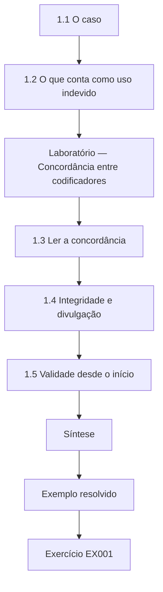

### Desenho lógico

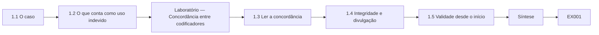

```text
[1.1 O caso]
    |
    v
[1.2 O que conta como uso indevido]
    |
    v
[Laboratório — Concordância entre codificadores]
    |
    v
[1.3 Ler a concordância]
    |
    v
[1.4 Integridade e divulgação]
    |
    v
[1.5 Validade desde o início]
    |
    v
[Síntese]
    |
    v
[Exemplo resolvido] --> [Exercício EX001]
```
<!-- cykin:lesson-figures:end ch-01 -->


### Objetivos de aprendizagem

Você vai (1) enquadrar uma questão de doutorado sobre o uso indevido de criptografia na revisão de código; (2) construir e testar um esquema de codificação confiável para os achados de uso indevido; (3) definir regras de integridade e de divulgação para lidar com fraquezas em sistemas de pagamento em produção.

### 1.1 O caso

Nadia Haddad é doutoranda na fictícia Larkspur University, sob orientação do Prof. Oskar Brandt. Sua parceira, a fictícia Meridian Payments Cooperative, tem 24 equipes de engenharia que chamam bibliotecas criptográficas avaliadas para a tokenização de cartões, a assinatura de webhooks e a cifração de dados em repouso. Todas as equipes, mudanças e números deste livro são sintéticos. A pergunta de Nadia é se acrescentar um checklist de uso indevido de criptografia e uma etapa automatizada de lint à revisão de código reduz o número de achados confirmados de uso indevido a cada dez mudanças integradas, em comparação com a revisão habitual da Meridian. A unidade de interesse é o uso indevido de bibliotecas corretas, e não algoritmos quebrados, o que corresponde ao que os profissionais mais erram.

### 1.2 O que conta como uso indevido

Uso indevido significa uma primitiva correta usada de um modo que anula sua garantia de segurança. Katz e Lindell mostram que a cifração autenticada só é segura sob condições declaradas, e o SP 800-38D torna uma delas explícita: um nonce do GCM nunca pode se repetir sob a mesma chave. O livro de códigos de Nadia tem quatro categorias. Nonce-iv cobre nonces e vetores de inicialização repetidos, previsíveis ou truncados. Key-handling cobre chaves embutidas no código, registradas em log, compartilhadas em excesso ou nunca rotacionadas. Primitive-choice cobre algoritmos obsoletos ou inadequados, como hashes rápidos sem salt para senhas. Other captura os problemas residuais. Cada categoria traz uma definição, dois exemplos, dois quase acertos e uma regra de sobreposição.

### Laboratório — Concordância entre codificadores

```python
"""Cohen's kappa for two coders labelling synthetic cryptographic-misuse findings (read-only)."""
from collections import Counter
CATS = ["nonce-iv", "key-handling", "primitive-choice", "other"]
# 48 synthetic findings: (coder A label, coder B label)
PAIRS = ([("nonce-iv", "nonce-iv")] * 12 + [("key-handling", "key-handling")] * 13 +
         [("primitive-choice", "primitive-choice")] * 10 + [("other", "other")] * 6 +
         [("key-handling", "primitive-choice")] * 3 + [("nonce-iv", "primitive-choice")] * 2 +
         [("other", "key-handling")] * 2)

def kappa(pairs):
    n = len(pairs)
    po = sum(a == b for a, b in pairs) / n
    ca, cb = Counter(a for a, _ in pairs), Counter(b for _, b in pairs)
    pe = sum(ca[c] * cb[c] for c in CATS) / n ** 2
    return po, pe, (po - pe) / (1 - pe)

def main():
    po, pe, k = kappa(PAIRS)
    print(f"items {len(PAIRS)}, agreed {sum(a == b for a, b in PAIRS)}")
    print(f"observed {po:.3f}, chance {pe:.3f}, kappa {k:.3f}")
    for (a, b), n in sorted(Counter(p for p in PAIRS if p[0] != p[1]).items()):
        print(f"disagree {a} -> {b}: {n}")

if __name__ == "__main__":
    main()
```

Execute com `python3 lab_kappa.py`. Saída verificada:

```text
items 48, agreed 41
observed 0.854, chance 0.263, kappa 0.802
disagree key-handling -> primitive-choice: 3
disagree nonce-iv -> primitive-choice: 2
disagree other -> key-handling: 2
```

### 1.3 Ler a concordância

Dois codificadores treinados rotulam de forma independente 48 achados sintéticos e concordam em 41, uma concordância observada de 0,854. A concordância ao acaso, calculada a partir das frequências de categoria de cada codificador, é 0,263, então o kappa de Cohen é 0,802; Landis e Koch chamariam isso de substancial a quase perfeito, mas Nadia trata esses rótulos como orientação aproximada. As discordâncias são informativas. Cinco das sete levam um achado para primitive-choice, três vindas de key-handling e duas de nonce-iv. O codificador B lê "uma chave derivada com um hash rápido" como uma escolha de algoritmo, enquanto o codificador A a lê como manuseio de chave. Nadia acrescenta uma regra de sobreposição: a derivação de uma chave é key-handling, a menos que o próprio algoritmo esteja obsoleto (deprecated).

### 1.4 Integridade e divulgação

Os achados sobre código de pagamento em produção são perigosos, porque a descrição de uma fraqueza não corrigida poderia ajudar um atacante a forjar webhooks ou a decifrar tokens armazenados. O acordo de dados de Nadia diz que a Meridian só compartilha um achado depois que a correção foi implantada ou o código foi desativado, que os nomes de repositórios e os identificadores de chaves são substituídos por pseudônimos e que nenhum material de chave, amostra de texto cifrado ou procedimento de exploração jamais sai da Meridian. Os achados ficam num servidor cifrado da universidade, com os acessos registrados. O comitê de ética também exige uma regra de escalonamento: qualquer uso indevido de alta severidade não corrigido que Nadia perceber durante o estudo vai para o líder de segurança da Meridian em até um dia útil, qualquer que seja o braço do estudo.

### 1.5 Validade desde o início

Nadia separa três questões de validade antes de coletar dados reais. A validade de construto pergunta se "uso indevido confirmado a cada dez mudanças integradas" captura o que os criptógrafos entendem por segurança enfraquecida; ela confere o livro de códigos com dois engenheiros de segurança da Meridian e contra os modos de falha listados no SP 800-57 Part 1 para o gerenciamento de chaves. A validade interna pergunta se qualquer diferença vem do checklist, e não da habilidade das equipes, o que motiva a atribuição aleatória das equipes mais adiante. A validade externa pergunta se os resultados de uma empresa de pagamentos com bibliotecas maduras se transferem para pequenas startups, o que ela vai argumentar com cautela, em vez de pressupor.

### Exemplo resolvido

Nadia escreve a pergunta, o livro de códigos com quatro categorias e o acordo de divulgação e depois executa o exercício de concordância com 48 itens. Um kappa de 0,802 e uma deriva clara para primitive-choice levam a uma nova regra de sobreposição antes da codificação real.

> **Caso sintético.** A Larkspur, a Meridian e todos os achados são inventados; o SP 800-38D, o SP 800-57 e Landis e Koch são reais.

### Erros e limites

O kappa resume a concordância, mas esconde onde está a discordância; sempre tabule as células fora da diagonal. Uma concordância alta também não prova que as categorias são as certas, apenas que duas pessoas as aplicam da mesma forma.

### Exercícios

- **EX001 — Pergunta de pesquisa.** Enuncie numa frase a pergunta de pesquisa de Nadia. *Rubrica:* 3 = se checklist mais lint reduz o uso indevido confirmado a cada dez mudanças integradas em relação à revisão habitual;; 2 = checklist versus habitual sem a medida;; 1 = "criptografia melhor" vago;; 0 = nenhuma.

- **EX002 — Definir o uso indevido.** Como o livro define o uso indevido de criptografia, e por que a regra do nonce do GCM é um exemplo? *Rubrica:* 3 = primitiva correta usada de modo que sua garantia falha; reutilizar o nonce sob uma chave anula a segurança do GCM segundo o SP 800-38D;; 2 = só a definição;; 1 = "algoritmo fraco";; 0 = nenhuma.

- **EX003 — Números da concordância.** Informe a concordância observada, a concordância ao acaso e o kappa do laboratório. *Rubrica:* 3 = 0,854, 0,263, 0,802;; 2 = só o kappa;; 1 = errado mas plausível;; 0 = nenhuma.

- **EX004 — Padrão de deriva.** Que categoria absorveu a maioria das discordâncias, e que regra Nadia acrescentou? *Rubrica:* 3 = primitive-choice (5 de 7); derivação de chave é key-handling, a menos que o algoritmo esteja obsoleto;; 2 = só a categoria;; 1 = só a regra;; 0 = nenhuma.

- **EX005 — Condição de compartilhamento.** Sob que condição a Meridian pode compartilhar um achado com Nadia? *Rubrica:* 3 = só depois que a correção for implantada ou o código desativado, com pseudônimos;; 2 = após a correção;; 1 = a qualquer momento;; 0 = nenhuma.

- **EX006 — Dever de escalonamento.** O que Nadia deve fazer se vir um uso indevido de alta severidade não corrigido? *Rubrica:* 3 = avisar o líder de segurança da Meridian em até um dia útil, qualquer que seja o braço;; 2 = relatar;; 1 = anotar nos dados;; 0 = nenhuma.

- **EX007 — Ameaça à validade interna.** Cite a ameaça à validade interna e o remédio planejado. *Rubrica:* 3 = a habilidade das equipes confunde o efeito; randomizar as equipes;; 2 = só a ameaça;; 1 = viés genérico;; 0 = nenhuma.

### Síntese

Um estudo defensável sobre uso indevido de criptografia começa com um livro de códigos preciso, concordância medida entre os codificadores, regras explícitas de sobreposição e um tratamento rigoroso, aprovado pela ética, das fraquezas em sistemas em produção.

<!-- cykin:chapter-navigation:start ch-01 -->
### Continue estudando — aula 01 (capítulo 01 de 08)

[← Início do curso](../../README.md) · [Índice das aulas](../SUBJECTS.md) · [Capítulo 02 →](#ch-02)

Continue para a próxima aula já escrita.
<!-- cykin:chapter-navigation:end -->

<a id="ch-02"></a>

## Capítulo 2 — Criptografia e serviços de confiança: fronteira da pesquisa

<!-- cykin:lesson-figures:start ch-02 -->
### Mapa da aula

Aula 02 publicada. Mapa, exemplo, EX008.

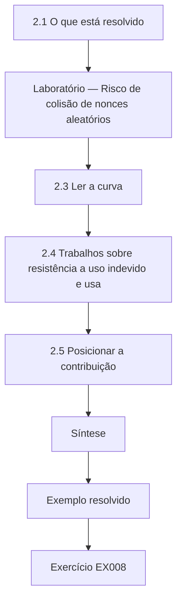

### Desenho lógico

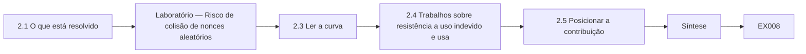

```text
[2.1 O que está resolvido]
    |
    v
[Laboratório — Risco de colisão de nonces aleatórios]
    |
    v
[2.3 Ler a curva]
    |
    v
[2.4 Trabalhos sobre resistência a uso indevido e usa]
    |
    v
[2.5 Posicionar a contribuição]
    |
    v
[Síntese]
    |
    v
[Exemplo resolvido] --> [Exercício EX008]
```
<!-- cykin:lesson-figures:end ch-02 -->


### Objetivos de aprendizagem

Você vai (1) mapear a fronteira da pesquisa sobre criptografia usável e resistente a uso indevido; (2) quantificar um risco de uso indevido a partir do limite declarado numa norma; (3) posicionar uma questão original em relação ao que as normas já resolvem.

### 2.1 O que está resolvido

A segurança das primitivas, em grande parte, não é a questão de Nadia. O AES é especificado no FIPS 197, o SHA-2 no FIPS 180-4, o HMAC no FIPS 198-1 e as assinaturas digitais no FIPS 186-5 e na RFC 8032. Boneh e Shoup apresentam as provas por redução que tornam essas escolhas defensáveis, e Katz e Lindell mostram como a cifração autenticada compõe confidencialidade e integridade. Uma tese que voltasse a litigar esses resultados acrescentaria pouco. O que continua em aberto é a distância entre uma primitiva provada e o código que a chama: parâmetros, nonces, armazenamento de chaves e a cola dos protocolos. É nessa distância que as auditorias da Meridian continuam encontrando problemas, e é ali que Nadia situa sua contribuição.

### 2.2 Limites de nonce como risco mensurável

As normas muitas vezes expressam o risco de uso indevido como um limite de uso. O SP 800-38D exige que, quando nonces de 96 bits do GCM são gerados aleatoriamente, uma única chave cifre no máximo 2^32 mensagens, porque nonces aleatórios acabam colidindo, e uma colisão expõe o XOR de dois textos claros e permite a falsificação da tag de autenticação. A aproximação do aniversário dá a chance de pelo menos uma repetição entre q sorteios aleatórios de 2^96 valores como aproximadamente q²/2^97. O laboratório calcula essa probabilidade para três volumes sintéticos, para mostrar por que a política de rotação, e não a cifra, é a variável controlável.

### Laboratório — Risco de colisão de nonces aleatórios

```python
"""Birthday-bound estimate for random 96-bit AES-GCM nonces under one key (synthetic volumes)."""
import math

def p_collision(q, bits=96):
    # P(at least one repeat among q uniform draws from 2**bits values) ~ 1 - exp(-q(q-1)/2^(bits+1))
    return -math.expm1(-q * (q - 1) / 2 ** (bits + 1))

def main():
    for label, q in [("pilot service, 1e6 msgs", 10**6), ("busy queue, 2^32 msgs", 2**32),
                     ("unrotated key, 2^40 msgs", 2**40)]:
        print(f"{label:<26} P(repeat) = {p_collision(q):.3e}")
    q = 2**32
    print(f"2^32 limit -> about 1 in {1 / p_collision(q):,.0f}")

if __name__ == "__main__":
    main()
```

Execute com `python3 lab_nonce.py`. Saída verificada:

```text
pilot service, 1e6 msgs    P(repeat) = 6.311e-18
busy queue, 2^32 msgs      P(repeat) = 1.164e-10
unrotated key, 2^40 msgs   P(repeat) = 7.629e-06
2^32 limit -> about 1 in 8,589,934,594
```

### 2.3 Ler a curva

Com um milhão de mensagens, a probabilidade de repetição é de cerca de 6 × 10^-18, desprezível. No limite de 2^32, é de cerca de 1,2 × 10^-10, aproximadamente uma chance em 8,6 bilhões, que a norma trata como o teto aceitável. Uma fila sintética que nunca rotaciona sua chave e chega a 2^40 mensagens sobe para cerca de 7,6 × 10^-6, um risco que nenhum regulador de pagamentos aceitaria para uma única chave. Nadia tira a lição para a pesquisa: a cifra era a mesma nas três linhas. A diferença veio da disciplina operacional, isto é, contar as invocações e rotacionar as chaves, que é exatamente o comportamento que um checklist e uma etapa de lint poderiam plausivelmente mudar.

### 2.4 Trabalhos sobre resistência a uso indevido e usabilidade

A fronteira inclui duas respostas ao uso indevido. Uma projeta primitivas que falham de forma mais suave, como os modos resistentes ao uso indevido de nonce (nonce-misuse-resistant), de modo que um nonce repetido vaze apenas a igualdade das mensagens, em vez de quebrar a autenticidade. A outra estuda os desenvolvedores e as ferramentas, perguntando se as interfaces das bibliotecas, a documentação ou os auxílios à revisão mudam o comportamento. O estudo de Nadia pertence à segunda linha. Na revisão de literatura, ela tem o cuidado de citar apenas trabalhos que leu e verificou, e de registrar para cada artigo sua população, sua medida de uso indevido e se mediu código entregue ou tarefas de laboratório, porque essas escolhas limitam a comparação.

### 2.5 Posicionar a contribuição

A partir da revisão da fronteira, Nadia escreve um parágrafo de posicionamento. Estudos de laboratório mostram que os desenvolvedores usam mal as bibliotecas sob pressão de tempo, mas poucos medem o uso indevido confirmado em mudanças de produção entregues, com atribuição aleatória. Sua contribuição é um estudo de campo randomizado dentro de uma organização, medido por uma contagem auditada a cada dez mudanças integradas, com um livro de códigos e um arquivo de análise públicos. Ela também declara o que não vai afirmar: não vai afirmar que o checklist impede todo uso indevido, nem que os resultados se transferem para empresas sem bibliotecas avaliadas. Dizer o que está fora do escopo mantém os examinadores concentrados nas evidências que ela consegue produzir.

### Exemplo resolvido

Nadia tabula as três linhas de volume de nonces, liga o limite de 2^32 ao SP 800-38D e argumenta que a disciplina de rotação é o comportamento que sua intervenção visa.

> **Caso sintético.** Os volumes de mensagens pertencem a uma fila inventada; o limite de 2^32 é a regra real do SP 800-38D.

### Erros e limites

A fórmula do aniversário é uma aproximação válida apenas para nonces aleatórios; nonces baseados em contador têm outros modos de falha, principalmente a perda de estado após reinicializações. Nunca trate uma probabilidade minúscula como permissão para pular a rotação.

### Exercícios

- **EX008 — Terreno resolvido.** Que questões Nadia trata como resolvidas, e que lacuna aberta ela estuda? *Rubrica:* 3 = segurança das primitivas (FIPS 197, 180-4, 186-5) resolvida; a distância entre a primitiva e o código que a chama, aberta;; 2 = só a lacuna;; 1 = "nova cifra";; 0 = nenhuma.

- **EX009 — Teto de uso do GCM.** Que limite de uso o SP 800-38D fixa para nonces aleatórios de 96 bits, e por quê? *Rubrica:* 3 = no máximo 2^32 mensagens por chave, porque colisões vazam o XOR dos textos claros e permitem falsificação;; 2 = só o limite;; 1 = "rotacionar sempre";; 0 = nenhuma.

- **EX010 — Probabilidade no teto.** Que probabilidade de repetição o laboratório relatou em 2^32 mensagens? *Rubrica:* 3 = cerca de 1,164e-10, cerca de 1 em 8,6 bilhões;; 2 = ordem de grandeza;; 1 = outra linha;; 0 = nenhuma.

- **EX011 — Fila sem rotação.** O que a linha de 2^40 mostrou, e que lição decorre dela? *Rubrica:* 3 = cerca de 7,6e-6; a rotação operacional, e não a cifra, determina o risco;; 2 = só o número;; 1 = só a lição;; 0 = nenhuma.

- **EX012 — Duas respostas da fronteira.** Cite as duas respostas da pesquisa ao uso indevido e diga a qual Nadia se junta. *Rubrica:* 3 = primitivas resistentes a uso indevido vs estudos de desenvolvedores/ferramentas; ela se junta às ferramentas;; 2 = as duas citadas;; 1 = uma;; 0 = nenhuma.

- **EX013 — Registro da literatura.** Que três fatos Nadia registra para cada artigo que revisa? *Rubrica:* 3 = população, medida de uso indevido, código entregue vs tarefa de laboratório;; 2 = dois;; 1 = um;; 0 = nenhuma.

- **EX014 — Afirmação de escopo.** Dê uma afirmação que Nadia explicitamente se recusa a fazer. *Rubrica:* 3 = que o checklist impede todo uso indevido, ou que os resultados se transferem para empresas sem bibliotecas avaliadas;; 2 = limite vago;; 1 = sem relação;; 0 = nenhuma.

### Síntese

A fronteira não está em novas primitivas, mas no comportamento medido em torno delas; os limites de uso das normas transformam esse comportamento em números que um estudo de campo pode testar.

<!-- cykin:chapter-navigation:start ch-02 -->
### Continue estudando — aula 02 (capítulo 02 de 08)

[← Capítulo 01](#ch-01) · [Índice das aulas](../SUBJECTS.md) · [Capítulo 03 →](#ch-03)

Continue para a próxima aula já escrita.
<!-- cykin:chapter-navigation:end -->

<a id="ch-03"></a>

## Capítulo 3 — Proposta de contribuição original

<!-- cykin:lesson-figures:start ch-03 -->
### Mapa da aula

Aula 03 publicada. Mapa, exemplo, EX015.

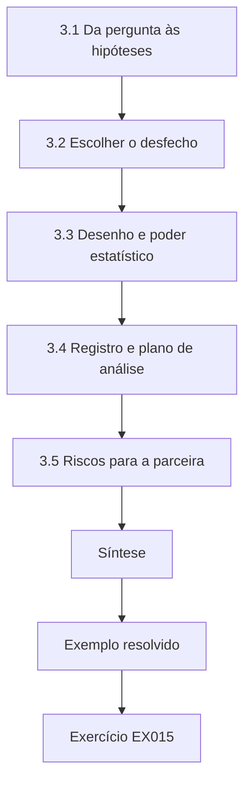

### Desenho lógico

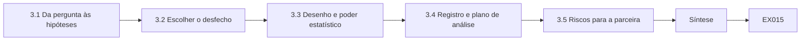

```text
[3.1 Da pergunta às hipóteses]
    |
    v
[3.2 Escolher o desfecho]
    |
    v
[3.3 Desenho e poder estatístico]
    |
    v
[3.4 Registro e plano de análise]
    |
    v
[3.5 Riscos para a parceira]
    |
    v
[Síntese]
    |
    v
[Exemplo resolvido] --> [Exercício EX015]
```
<!-- cykin:lesson-figures:end ch-03 -->


### Objetivos de aprendizagem

Você vai (1) escrever hipóteses falseáveis para um estudo de redução do uso indevido; (2) escolher um desfecho primário e a análise antes de ver os dados; (3) registrar o plano para que mudanças posteriores fiquem visíveis.

### 3.1 Da pergunta às hipóteses

Nadia transforma sua pergunta numa hipótese primária e numa secundária. A H1 afirma que as equipes que usam o checklist e a etapa de lint terão, ao longo de um trimestre, uma média menor de achados confirmados de uso indevido a cada dez mudanças integradas do que as equipes que usam a revisão habitual. A H2 afirma que uma parcela maior das equipes com checklist registrará zero uso indevido naquele trimestre. As duas são direcionais e falseáveis: uma diferença nula ou invertida conta contra elas. Ela também escreve uma expectativa nula para a ferramenta de lint sozinha, porque os examinadores vão perguntar se uma ferramenta barata, e não a atenção humana, explica algum efeito.

### 3.2 Escolher o desfecho

O desfecho primário é o uso indevido confirmado a cada dez mudanças integradas que tocam código criptográfico, medido por equipe. Confirmação significa que um auditor cego, que não sabe o braço, concorda que a mudança viola uma regra do livro de códigos. Nadia rejeita duas alternativas tentadoras. Os avisos do lint recompensariam a ferramenta por sinalizar seus próprios padrões, e os incidentes seriam raros demais para medir num trimestre. Ela define "toca código criptográfico" de forma mecânica, como qualquer mudança que importe o wrapper criptográfico aprovado da Meridian ou os módulos da biblioteca padrão hashlib, hmac ou secrets, para que a inclusão não dependa de julgamento.

### 3.3 Desenho e poder estatístico

Há vinte e quatro equipes disponíveis, então Nadia planeja um desenho randomizado por conglomerados com doze equipes por braço, estratificado por linha de produto, para que as equipes de tokenização, de webhooks e de armazenamento apareçam nos dois braços. A randomização no nível da equipe evita a contaminação, já que os engenheiros de uma equipe compartilham hábitos de revisão. Ela estima o poder a partir da linha de base que vai medir no capítulo 4 e declara a limitação honesta: com doze conglomerados por braço, só efeitos grandes são detectáveis com confiabilidade. Por isso, ela se compromete de antemão com um teste de permutação, que não pressupõe normalidade e se adapta a poucos conglomerados.

### 3.4 Registro e plano de análise

Antes que exista qualquer dado de desfecho, Nadia deposita um plano com carimbo de tempo no escritório de pesquisa da universidade. Ele lista as hipóteses, os desfechos primário e secundário, a regra de inclusão, a política de semente da randomização, o teste de permutação com 20.000 embaralhamentos e a regra para tratar equipes que saiam da Meridian. Também lista o que contaria como desvio. O registro não é burocracia por si mesma: permite que os examinadores distingam os resultados confirmatórios dos exploratórios e protege Nadia da tentação de trocar de desfecho quando o primeiro decepcionar.

### 3.5 Riscos para a parceira

A proposta também protege a Meridian. O checklist nunca pede que os revisores testem explorações; ele faz perguntas como se cada chave do GCM tem um contador de invocações e um gatilho de rotação, se as chaves vêm de um serviço gerenciado de chaves, e não do código-fonte, e se o armazenamento de senhas usa uma função com alto custo de memória (memory-hard), como o Argon2 da RFC 9106. As equipes de controle mantêm sua revisão habitual, então nenhuma equipe recebe proteção mais fraca do que antes. O dever de escalonamento do capítulo 1 continua valendo nos dois braços, e o líder de segurança pode interromper o estudo se algum braço causar dano.

### Exemplo resolvido

O registro de uma página de Nadia enuncia H1 e H2, o desfecho a cada dez mudanças que tocam criptografia, o desenho estratificado por conglomerados de 12 contra 12 e o teste de permutação, e depois é depositado com carimbo de tempo antes que os dados da linha de base sejam revelados.

> **Caso sintético.** O escritório de registro e o checklist são inventados para fins didáticos; a RFC 9106 e o SP 800-38D são referências reais para os itens do checklist.

### Erros e limites

O registro não conserta uma medida de desfecho fraca, e um número pequeno de conglomerados limita o poder, qualquer que seja o teste. Relate os desvios abertamente, em vez de emendar o plano em silêncio.

### Exercícios

- **EX015 — Hipótese primária.** Escreva a H1 com precisão. *Rubrica:* 3 = as equipes com checklist+lint têm média menor de uso indevido confirmado a cada dez mudanças integradas que tocam criptografia ao longo de um trimestre;; 2 = direção sem unidade;; 1 = sem direção;; 0 = nenhuma.

- **EX016 — Desfechos rejeitados.** Por que Nadia rejeitou os avisos do lint e os incidentes como desfechos? *Rubrica:* 3 = os avisos recompensam os próprios padrões da ferramenta; os incidentes são raros demais num trimestre;; 2 = um motivo;; 1 = vago;; 0 = nenhuma.

- **EX017 — Regra de inclusão.** Como é definido "toca código criptográfico"? *Rubrica:* 3 = a mudança importa o wrapper criptográfico aprovado, hashlib, hmac ou secrets;; 2 = importa criptografia;; 1 = julgamento do revisor;; 0 = nenhuma.

- **EX018 — Escolha dos conglomerados.** Por que randomizar equipes, e não mudanças individuais? *Rubrica:* 3 = os engenheiros de uma equipe compartilham hábitos, então a atribuição por mudança contamina os braços;; 2 = contaminação citada;; 1 = conveniência;; 0 = nenhuma.

- **EX019 — Conteúdo registrado.** Liste quatro itens do plano registrado. *Rubrica:* 3 = quatro entre hipóteses, desfechos, regra de inclusão, política de semente, teste de permutação, regra de atrito, definição de desvio;; 2 = três;; 1 = um ou dois;; 0 = nenhuma.

- **EX020 — Item de senhas do checklist.** O que o checklist pergunta sobre o armazenamento de senhas, e que fonte o apoia? *Rubrica:* 3 = função memory-hard como o Argon2, RFC 9106;; 2 = Argon2 sem fonte;; 1 = "fazer hash das senhas";; 0 = nenhuma.

### Síntese

Um plano registrado com hipóteses falseáveis, um desfecho cego e definido mecanicamente e um desenho ajustado aos conglomerados disponíveis transformam uma boa pergunta num teste.

<!-- cykin:chapter-navigation:start ch-03 -->
### Continue estudando — aula 03 (capítulo 03 de 08)

[← Capítulo 02](#ch-02) · [Índice das aulas](../SUBJECTS.md) · [Capítulo 04 →](#ch-04)

Continue para a próxima aula já escrita.
<!-- cykin:chapter-navigation:end -->

<a id="ch-04"></a>

## Capítulo 4 — Replicação da linha de base e piloto

<!-- cykin:lesson-figures:start ch-04 -->
### Mapa da aula

Aula 04 publicada. Mapa, exemplo, EX021.

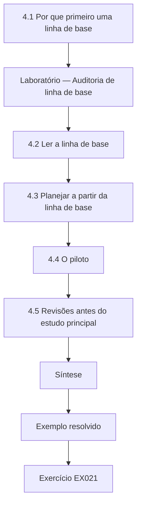

### Desenho lógico

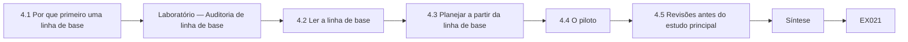

```text
[4.1 Por que primeiro uma linha de base]
    |
    v
[Laboratório — Auditoria de linha de base]
    |
    v
[4.2 Ler a linha de base]
    |
    v
[4.3 Planejar a partir da linha de base]
    |
    v
[4.4 O piloto]
    |
    v
[4.5 Revisões antes do estudo principal]
    |
    v
[Síntese]
    |
    v
[Exemplo resolvido] --> [Exercício EX021]
```
<!-- cykin:lesson-figures:end ch-04 -->


### Objetivos de aprendizagem

Você vai (1) medir uma taxa de uso indevido de linha de base a partir de uma auditoria histórica; (2) conduzir um piloto que testa procedimentos, e não efeitos; (3) revisar os instrumentos antes do estudo principal.

### 4.1 Por que primeiro uma linha de base

Uma linha de base diz a Nadia quão comum já é o uso indevido, o que molda o poder estatístico, e replica uma afirmação em que a Meridian acredita, mas nunca conferiu: a de que sua biblioteca wrapper tornou o uso indevido raro. Dois auditores, cegos em relação ao estudo que virá, revisam uma amostra aleatória de 80 mudanças integradas no ano anterior que tocam criptografia, usando o livro de códigos do capítulo 1 com sua nova regra de sobreposição. Cada achado confirmado é ligado a um identificador pseudonimizado da mudança. Nada da amostra é compartilhado fora da Meridian até que as correções de eventuais problemas em aberto tenham sido implantadas.

### Laboratório — Auditoria de linha de base

```python
"""Baseline count of confirmed crypto-misuse in 80 synthetic merged changes (read-only)."""
from collections import Counter
# (change id, confirmed misuse category or None) -- synthetic audit of last year's merges
CHANGES = ([("nonce-iv")] * 7 + [("key-handling")] * 9 + [("primitive-choice")] * 5 +
           [("other")] * 2 + [None] * 57)

def main():
    c = Counter(x for x in CHANGES if x)
    n = len(CHANGES); m = sum(c.values())
    print(f"changes {n}, with confirmed misuse {m} ({100 * m / n:.1f}%)")
    for k, v in c.most_common():
        print(f"  {k:<17} {v}")

if __name__ == "__main__":
    main()
```

Execute com `python3 lab_baseline.py`. Saída verificada:

```text
changes 80, with confirmed misuse 23 (28.8%)
  key-handling      9
  nonce-iv          7
  primitive-choice  5
  other             2
```

### 4.2 Ler a linha de base

Vinte e três de oitenta mudanças, 28,8 por cento, contêm pelo menos um uso indevido confirmado. Key-handling lidera com nove, seguido por nonce-iv com sete, primitive-choice com cinco e other com dois. A replicação, portanto, derruba a crença da Meridian: o wrapper reduziu alguns erros de algoritmo, mas as chaves ainda acabam em arquivos de configuração, e os nonces ainda às vezes são derivados de carimbos de tempo. Nadia registra a taxa como cerca de 2,9 achados a cada dez mudanças para fins de planejamento, observando que uma mudança pode conter vários achados e que seu desfecho primário conta achados, e não mudanças.

### 4.3 Planejar a partir da linha de base

Com uma média de controle perto de 1,5 a 2 achados a cada dez mudanças, por equipe, por trimestre, Nadia julga que uma redução pela metade seria detectável com doze equipes por braço, mas uma redução de 20 por cento não. Ela escreve isso num adendo ao registro, com carimbo de tempo anterior ao início do estudo principal, para que os examinadores vejam que a aritmética do planejamento não foi ajustada depois. Ela também observa que a distribuição é assimétrica, com muitos zeros, outro motivo pelo qual o teste de permutação pré-registrado se ajusta melhor aos dados do que um teste t.

### 4.4 O piloto

Duas equipes voluntárias, excluídas do estudo principal, usam o checklist e a etapa de lint por quatro semanas. O piloto faz apenas perguntas de procedimento. Os revisores preenchem o checklist? A regra de lint para nonces constantes dispara nas chamadas ao wrapper? O auditor cego consegue confirmar os achados sem ver qual braço os produziu? Os revisores preenchem 31 de 34 checklists. A regra de nonce produz falsos positivos nos fixtures de teste, que usam nonces fixos de propósito, com chaves descartáveis. Um auditor adivinha o braço pelos comentários do checklist deixados nas descrições de merge, um vazamento do cegamento.

### 4.5 Revisões antes do estudo principal

Nadia faz três mudanças e registra cada uma como revisão anterior ao estudo. A regra de lint ignora os arquivos sob diretórios de teste, o que fica documentado para que os examinadores possam julgar o trade-off. As respostas do checklist saem das descrições de merge para um formulário separado que o auditor nunca vê, fechando o vazamento do cegamento. Uma pergunta do checklist sobre a rotação de chaves é reescrita depois que os revisores leram "rotação" como rotação de logs do sistema de arquivos. Ela deliberadamente não calcula um efeito a partir do piloto, porque duas equipes não aleatórias ao longo de quatro semanas não conseguem estimá-lo, e um número tentador poderia enviesar as escolhas posteriores.

### Exemplo resolvido

A partir da linha de base, Nadia relata 23 de 80 mudanças com uso indevido, key-handling em primeiro, e planeja para uma redução pela metade; a partir do piloto, corrige o falso positivo dos fixtures de teste, o vazamento do cegamento e uma pergunta ambígua.

> **Caso sintético.** As 80 mudanças auditadas e as duas equipes do piloto são inventadas para fins didáticos.

### Erros e limites

Uma amostra histórica de um ano pode subcontar o uso indevido que os auditores não conseguiam ver, como chaves definidas nos ambientes de implantação. Os pilotos testam a viabilidade; relatar efeitos de piloto como evidência é um erro comum.

### Exercícios

- **EX021 — Taxa de linha de base.** Que parcela das mudanças auditadas continha uso indevido? *Rubrica:* 3 = 23 de 80, 28,8 por cento;; 2 = só a porcentagem;; 1 = contagem de achados por categoria;; 0 = nenhuma.

- **EX022 — Categoria líder.** Que categoria liderou a linha de base, e com quantos achados? *Rubrica:* 3 = key-handling, 9;; 2 = só a categoria;; 1 = nonce-iv;; 0 = nenhuma.

- **EX023 — Crença testada.** Que crença da Meridian a linha de base não conseguiu replicar? *Rubrica:* 3 = que a biblioteca wrapper tornou o uso indevido raro;; 2 = wrapper eficaz;; 1 = genérica;; 0 = nenhuma.

- **EX024 — Efeito detectável.** Que tamanho de efeito Nadia julgou detectável, e qual não? *Rubrica:* 3 = redução pela metade detectável, redução de 20 por cento não, com 12 equipes por braço;; 2 = um;; 1 = "grande";; 0 = nenhuma.

- **EX025 — Achados do piloto.** Cite os três problemas que o piloto expôs. *Rubrica:* 3 = falsos positivos de nonce nos fixtures de teste, vazamento do cegamento pelos comentários de merge, pergunta ambígua sobre rotação;; 2 = dois;; 1 = um;; 0 = nenhuma.

- **EX026 — Nenhum efeito de piloto.** Por que Nadia se recusa a estimar um efeito a partir do piloto? *Rubrica:* 3 = duas equipes não aleatórias em quatro semanas não conseguem estimá-lo, e um número poderia enviesar as escolhas;; 2 = pequeno demais;; 1 = esqueceu;; 0 = nenhuma.

### Síntese

Uma linha de base replicada estabelece expectativas realistas, e um piloto que caça falhas de procedimento, e não efeitos, torna o estudo principal confiável.

<!-- cykin:chapter-navigation:start ch-04 -->
### Continue estudando — aula 04 (capítulo 04 de 08)

[← Capítulo 03](#ch-03) · [Índice das aulas](../SUBJECTS.md) · [Capítulo 05 →](#ch-05)

Continue para a próxima aula já escrita.
<!-- cykin:chapter-navigation:end -->

<a id="ch-05"></a>

## Capítulo 5 — Estudo principal e validação independente

<!-- cykin:lesson-figures:start ch-05 -->
### Mapa da aula

Aula 05 publicada. Mapa, exemplo, EX027.

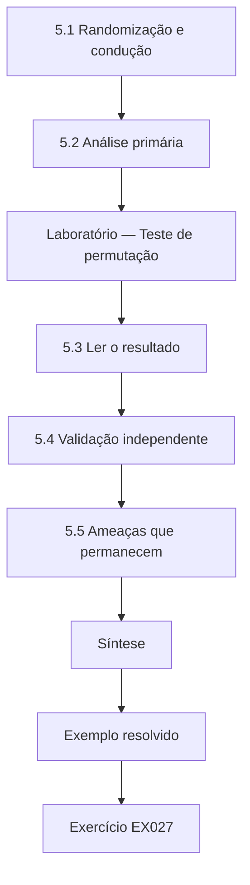

### Desenho lógico

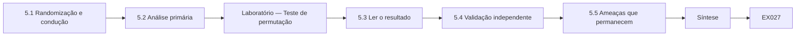

```text
[5.1 Randomização e condução]
    |
    v
[5.2 Análise primária]
    |
    v
[Laboratório — Teste de permutação]
    |
    v
[5.3 Ler o resultado]
    |
    v
[5.4 Validação independente]
    |
    v
[5.5 Ameaças que permanecem]
    |
    v
[Síntese]
    |
    v
[Exemplo resolvido] --> [Exercício EX027]
```
<!-- cykin:lesson-figures:end ch-05 -->


### Objetivos de aprendizagem

Você vai (1) conduzir um estudo de campo randomizado por conglomerados com confirmação cega dos desfechos; (2) analisá-lo com o teste de permutação pré-registrado; (3) relatar os resultados primários e secundários sem exagerá-los.

### 5.1 Randomização e condução

O líder de segurança da Meridian, e não Nadia, roda o script de randomização com uma semente registrada no plano, atribuindo seis equipes de tokenização ou webhooks e seis equipes de armazenamento ou plataforma a cada braço. O estudo dura um trimestre. As equipes com checklist preenchem o formulário para toda mudança que toca criptografia e rodam a etapa de lint na integração contínua; as equipes de revisão habitual não mudam nada. Dois auditores que nunca veem os rótulos dos braços confirmam os achados semanalmente a partir de diffs pseudonimizados. Durante o trimestre, Nadia monitora apenas métricas de procedimento, como o preenchimento dos checklists, para que não possa ser acusada de espiar os desfechos.

### 5.2 Análise primária

No fim do trimestre, cada equipe tem uma contagem de achados confirmados a cada dez mudanças integradas que tocam criptografia. A diferença observada entre as médias é a estatística. Sob a hipótese nula de que o braço não faz diferença, os rótulos das equipes são intercambiáveis, então o teste de permutação reembaralha muitas vezes os 24 valores das equipes em dois grupos de doze e pergunta com que frequência uma diferença pelo menos tão grande quanto a observada aparece por acaso. O laboratório reproduz a análise registrada com 20.000 embaralhamentos e a semente fixada em 2026.

### Laboratório — Teste de permutação

```python
"""Permutation test: misuse per 10 merged changes, checklist+lint vs usual review (synthetic teams)."""
import random
CHECK = [0, 1, 0, 0, 2, 0, 1, 0, 0, 1, 0, 0]
USUAL = [2, 1, 3, 0, 2, 1, 2, 3, 1, 0, 2, 2]

def mean(x): return sum(x) / len(x)

def main():
    obs = mean(USUAL) - mean(CHECK)
    pool = CHECK + USUAL; rng = random.Random(2026); n = 20000; hits = 0
    for _ in range(n):
        rng.shuffle(pool)
        if mean(pool[12:]) - mean(pool[:12]) >= obs: hits += 1
    print(f"checklist mean {mean(CHECK):.2f}, usual mean {mean(USUAL):.2f}, diff {obs:.2f}")
    print(f"one-sided permutation p = {hits / n:.4f} (seed 2026, {n} shuffles)")
    print(f"zero-misuse teams: checklist {CHECK.count(0)}/12, usual {USUAL.count(0)}/12")

if __name__ == "__main__":
    main()
```

Execute com `python3 lab_trial.py`. Saída verificada:

```text
checklist mean 0.42, usual mean 1.58, diff 1.17
one-sided permutation p = 0.0034 (seed 2026, 20000 shuffles)
zero-misuse teams: checklist 8/12, usual 2/12
```

### 5.3 Ler o resultado

As equipes com checklist têm média de 0,42 achado confirmado a cada dez mudanças, e as de revisão habitual, 1,58, uma diferença de 1,17. Só cerca de 0,34 por cento dos embaralhamentos produzem uma diferença tão grande, um p unilateral de 0,0034, então a H1 é apoiada no limiar registrado de 0,05. O desfecho secundário aponta na mesma direção: oito de doze equipes com checklist registram zero uso indevido, contra duas de doze de controle. Nadia relata tanto o tamanho do efeito quanto o valor-p e coloca as contagens brutas das equipes num apêndice, para que os leitores possam recalcular tudo sem confiar no resumo dela.

### 5.4 Validação independente

O Prof. Brandt providencia que um terceiro auditor de outra universidade, sob o mesmo acordo de dados, reconfirme às cegas, sem conhecer o braço, uma amostra aleatória de 30 por cento dos achados. A concordância com os auditores originais é alta, e a reconfirmação não muda a contagem de nenhuma equipe em mais de um, o que deixa a conclusão intacta. Nadia também confere a explicação baseada só no lint, do capítulo 3: os avisos do lint explicam cerca de um terço dos achados de nonce evitados, mas a maioria dos achados de key-handling evitados veio de perguntas do checklist que a ferramenta não consegue ver, como se uma chave é emitida pelo serviço gerenciado de chaves.

### 5.5 Ameaças que permanecem

Nadia lista com clareza as ameaças restantes. Os revisores das equipes com checklist sabiam que estavam sendo observados, um efeito Hawthorne que pode se desfazer quando o estudo terminar. Doze conglomerados por braço tornam a estimativa imprecisa, então o efeito verdadeiro pode ser bem menor do que 1,17. Os auditores não conseguiam ver os segredos injetados no momento da implantação, então os achados de key-handling continuam subcontados nos dois braços. Por fim, o wrapper maduro da Meridian pode tornar os checklists mais fáceis de aplicar do que em empresas que chamam primitivas de baixo nível diretamente, o que limita a transferência para esses contextos.

### Exemplo resolvido

O teste de permutação registrado dá 0,42 contra 1,58, uma diferença de 1,17 com p = 0,0034; um terceiro auditor cego e uma conferência só com o lint deixam a conclusão intacta, com quatro ameaças declaradas.

> **Caso sintético.** Todas as contagens das equipes e os auditores são inventados; o método de permutação é padrão.

### Erros e limites

Um valor-p pequeno não mede quão grande ou importante é um efeito, e um estudo de um trimestre não consegue mostrar durabilidade. Nunca exclua equipes depois de abrir o cegamento.

### Exercícios

- **EX027 — Quem randomizou.** Quem rodou a randomização, e por que não Nadia? *Rubrica:* 3 = o líder de segurança da Meridian com a semente registrada, para que a pesquisadora não influencie a alocação;; 2 = só quem;; 1 = Nadia;; 0 = nenhuma.

- **EX028 — Lógica da intercambialidade.** Por que os rótulos das equipes podem ser embaralhados sob a hipótese nula? *Rubrica:* 3 = se o braço não tem efeito, os rótulos são intercambiáveis, então os embaralhamentos mostram diferenças ao acaso;; 2 = parcial;; 1 = "aleatório";; 0 = nenhuma.

- **EX029 — Números principais.** Informe as duas médias, a diferença e o valor-p. *Rubrica:* 3 = 0,42, 1,58, 1,17, p = 0,0034;; 2 = três de quatro;; 1 = um;; 0 = nenhuma.

- **EX030 — Comparação de zero uso indevido.** O que o desfecho secundário mostrou? *Rubrica:* 3 = 8 de 12 equipes com checklist contra 2 de 12 de controle com zero uso indevido;; 2 = direção;; 1 = contagens erradas;; 0 = nenhuma.

- **EX031 — Conferência só com lint.** O que a análise só com lint encontrou? *Rubrica:* 3 = o lint explica cerca de um terço dos achados de nonce evitados; a maior parte dos ganhos em key-handling veio das perguntas do checklist;; 2 = parcial;; 1 = o lint explica tudo;; 0 = nenhuma.

- **EX032 — Ameaças restantes.** Cite três ameaças restantes. *Rubrica:* 3 = três entre Hawthorne, imprecisão, segredos de implantação não vistos, transferência limitada;; 2 = duas;; 1 = uma;; 0 = nenhuma.

### Síntese

Um teste pré-registrado, cego e randomizado por conglomerados sustenta o efeito do checklist; a reconfirmação independente e as ameaças declaradas com honestidade mantêm a afirmação proporcional.

<!-- cykin:chapter-navigation:start ch-05 -->
### Continue estudando — aula 05 (capítulo 05 de 08)

[← Capítulo 04](#ch-04) · [Índice das aulas](../SUBJECTS.md) · [Capítulo 06 →](#ch-06)

Continue para a próxima aula já escrita.
<!-- cykin:chapter-navigation:end -->

<a id="ch-06"></a>

## Capítulo 6 — Crítica por pares e revisão

<!-- cykin:lesson-figures:start ch-06 -->
### Mapa da aula

Aula 06 publicada. Mapa, exemplo, EX033.

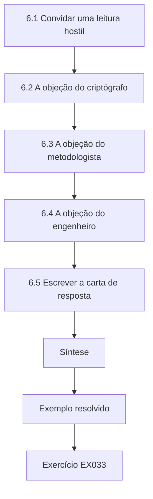

### Desenho lógico

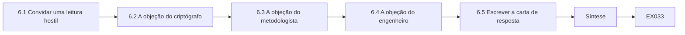

```text
[6.1 Convidar uma leitura hostil]
    |
    v
[6.2 A objeção do criptógrafo]
    |
    v
[6.3 A objeção do metodologista]
    |
    v
[6.4 A objeção do engenheiro]
    |
    v
[6.5 Escrever a carta de resposta]
    |
    v
[Síntese]
    |
    v
[Exemplo resolvido] --> [Exercício EX033]
```
<!-- cykin:lesson-figures:end ch-06 -->


### Objetivos de aprendizagem

Você vai (1) organizar uma crítica estruturada por pares de um estudo de campo em criptografia; (2) separar as objeções fatais das corrigíveis; (3) revisar um manuscrito com uma carta de resposta rastreável.

### 6.1 Convidar uma leitura hostil

Nadia distribui o rascunho do artigo a três leitores escolhidos para discordar dela: um criptógrafo aplicado, um metodologista de engenharia de software e um engenheiro da Meridian de uma equipe de controle. Ela pede a cada um a única objeção mais capaz de derrubar o artigo e uma lista de problemas menores. Ela também lhes entrega o registro, para que possam conferir se as análises relatadas correspondem ao plano. Convidar a crítica antes da submissão sai mais barato do que recebê-la dos revisores do periódico, e treina o hábito que os examinadores procuram: tratar o próprio resultado como uma afirmação a ser testada.

### 6.2 A objeção do criptógrafo

O criptógrafo argumenta que "uso indevido a cada dez mudanças" dá o mesmo peso a todo achado, embora um nonce do GCM repetido numa chave de alto volume seja catastrófico, enquanto um hash obsoleto num utilitário de teste é cosmético. Nadia aceita que esse é um problema real de construto, mas não fatal. Ela acrescenta uma análise de sensibilidade ponderada pela severidade, usando uma escala de três níveis definida antes da reclassificação, e relata que a direção se mantém, enquanto a diferença diminui, porque vários achados evitados eram de baixa severidade. Ela também acrescenta um parágrafo explicando por que a medida primária, não ponderada, foi registrada primeiro.

### 6.3 A objeção do metodologista

O metodologista observa que as equipes com checklist integraram um pouco menos de mudanças que tocam criptografia durante o trimestre, o que levanta a possibilidade de que o checklist tenha desacelerado o trabalho e de que o trabalho mais lento, e não uma revisão melhor, tenha reduzido o uso indevido. Nadia confere as contagens de merges e os lead times. As equipes com checklist integraram oito por cento menos dessas mudanças, e o tempo mediano de revisão subiu cerca de doze minutos. Ela relata os dois abertamente como custos, observa que uma taxa a cada dez mudanças já ajusta pelo volume e enquadra o trade-off para os profissionais: um custo de tempo modesto comprou uma redução considerável do uso indevido confirmado neste contexto.

### 6.4 A objeção do engenheiro

O engenheiro da equipe de controle aponta que duas equipes de revisão habitual são donas do serviço de armazenamento mais antigo, que traz código de cifração legado com mais riscos. A estratificação por linha de produto colocou as duas no braço de controle por acaso. Nadia trata isso como um desequilíbrio plausível. Ela roda uma análise de sensibilidade excluindo as duas equipes carregadas de legado do controle e seus pares de estrato do tratamento; a diferença cai para cerca de 0,9, mas continua positiva. Ela relata a análise como exploratória, porque não foi registrada, e recomenda que estudos futuros estratifiquem também pela idade do código, além da linha de produto.

### 6.5 Escrever a carta de resposta

Para cada objeção, a carta de resposta de Nadia cita o comentário, declara se ela concorda, descreve a mudança com referências de seção e linha e rotula qualquer nova análise como exploratória. Ela resiste a duas tentações: promover em silêncio um resultado de sensibilidade ao resumo e descartar uma objeção sem evidências. Onde discorda, como na sugestão de abandonar a medida não ponderada, ela explica que mudar o desfecho primário depois de abrir o cegamento violaria o registro. A carta passa a fazer parte do seu arquivo, para que os examinadores possam rastrear como o argumento evoluiu.

### Exemplo resolvido

Três críticos levantam a ponderação por severidade, a desaceleração dos merges e um desequilíbrio de legado; Nadia responde com uma conferência de sensibilidade por severidade, custos de tempo relatados e uma exclusão exploratória, tudo registrado numa carta de resposta.

> **Caso sintético.** Os revisores e todas as contagens reclassificadas deste capítulo são inventados.

### Erros e limites

Análises de sensibilidade rodadas depois de abrir o cegamento são exploratórias, por mais tranquilizadoras que pareçam. Uma crítica que você não consegue responder pertence às limitações, e não a uma nota de rodapé.

### Exercícios

- **EX033 — Escolher os críticos.** Por que Nadia escolheu três leitores que discordariam? *Rubrica:* 3 = para trazer à tona as objeções mais danosas antes da revisão do periódico, pelos ângulos da criptografia, do método e da prática;; 2 = para receber críticas;; 1 = amigos;; 0 = nenhuma.

- **EX034 — Objeção da severidade.** A que o criptógrafo se opôs, e como Nadia respondeu? *Rubrica:* 3 = peso igual para os achados; acrescentou sensibilidade ponderada por severidade predefinida, direção mantida, diferença menor;; 2 = só a objeção;; 1 = só a resposta;; 0 = nenhuma.

- **EX035 — Custo do checklist.** Que custos a conferência da desaceleração revelou? *Rubrica:* 3 = 8 por cento menos merges que tocam criptografia, revisão mediana cerca de 12 minutos mais longa;; 2 = um custo;; 1 = nenhum custo;; 0 = nenhuma.

- **EX036 — Desequilíbrio de legado.** O que aconteceu quando as equipes carregadas de legado foram excluídas? *Rubrica:* 3 = a diferença caiu para cerca de 0,9, mas continuou positiva; rotulada como exploratória;; 2 = só o número;; 1 = desapareceu;; 0 = nenhuma.

- **EX037 — Estratificação futura.** Que mudança na estratificação Nadia recomendou? *Rubrica:* 3 = estratificar também pela idade do código, além da linha de produto;; 2 = estratificar mais;; 1 = randomizar indivíduos;; 0 = nenhuma.

- **EX038 — Desfecho primário mantido.** Por que ela se recusou a abandonar a medida não ponderada? *Rubrica:* 3 = mudar o desfecho primário depois de abrir o cegamento viola o registro;; 2 = veio primeiro;; 1 = preferência;; 0 = nenhuma.

### Síntese

A leitura hostil estruturada, as verificações de sensibilidade rotuladas como exploratórias e uma carta de resposta rastreável tornam um resultado mais forte ao expor onde ele cede.

<!-- cykin:chapter-navigation:start ch-06 -->
### Continue estudando — aula 06 (capítulo 06 de 08)

[← Capítulo 05](#ch-05) · [Índice das aulas](../SUBJECTS.md) · [Capítulo 07 →](#ch-07)

Continue para a próxima aula já escrita.
<!-- cykin:chapter-navigation:end -->

<a id="ch-07"></a>

## Capítulo 7 — Síntese da tese e arquivo de reprodutibilidade

<!-- cykin:lesson-figures:start ch-07 -->
### Mapa da aula

Aula 07 publicada. Mapa, exemplo, EX039.

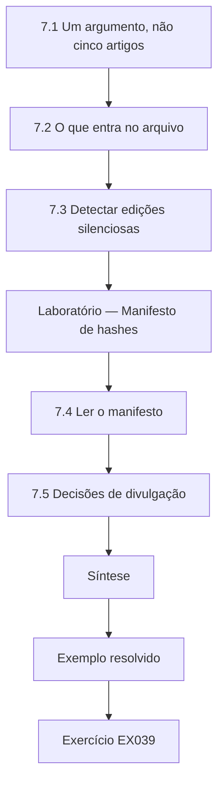

### Desenho lógico

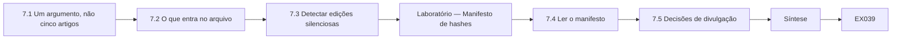

```text
[7.1 Um argumento, não cinco artigos]
    |
    v
[7.2 O que entra no arquivo]
    |
    v
[7.3 Detectar edições silenciosas]
    |
    v
[Laboratório — Manifesto de hashes]
    |
    v
[7.4 Ler o manifesto]
    |
    v
[7.5 Decisões de divulgação]
    |
    v
[Síntese]
    |
    v
[Exemplo resolvido] --> [Exercício EX039]
```
<!-- cykin:lesson-figures:end ch-07 -->


### Objetivos de aprendizagem

Você vai (1) sintetizar os capítulos numa única tese argumentada; (2) construir um arquivo de reprodutibilidade com hashes que detecte edições silenciosas; (3) decidir o que pode e o que não pode ser divulgado num estudo de segurança.

### 7.1 Um argumento, não cinco artigos

A tese de Nadia precisa ser lida como um único argumento. A introdução enuncia a afirmação: numa organização de pagamentos, um checklist de uso indevido de criptografia com lint reduziu o uso indevido confirmado a cada dez mudanças que tocam criptografia ao longo de um trimestre, com um custo de tempo modesto e com o efeito concentrado em key-handling. Cada capítulo responde então a uma pergunta de que a afirmação depende: se o uso indevido pode ser codificado com confiabilidade, por que ele importa segundo os limites das próprias normas, se a linha de base justificava a intervenção, se o experimento apoia o efeito e se ele sobrevive à crítica. O material que não responde a nenhuma dessas perguntas vai para um apêndice.

### 7.2 O que entra no arquivo

O arquivo permite que um examinador rode de novo cada número sem contatar Nadia. Ele contém o livro de códigos com histórico de versões, o registro e o adendo, as contagens pseudonimizadas por equipe, os scripts de randomização e de análise com as sementes, os programas de laboratório deste livro, a carta de resposta e um README que explica como rodar tudo apenas com uma instalação padrão do Python. Ele exclui os diffs, os nomes de repositórios e qualquer coisa que possa identificar um sistema da Meridian, como exige o acordo de dados. O README declara abertamente essa exclusão, para que os leitores saibam quais afirmações se apoiam em dados que eles não podem ver.

### 7.3 Detectar edições silenciosas

Um arquivo só é útil se os leitores conseguirem saber se ele mudou desde que a tese foi examinada. Nadia registra um digest SHA-256, definido no FIPS 180-4, de cada arquivo e um único digest raiz calculado sobre os digests dos arquivos ordenados, e imprime a raiz na própria tese. O laboratório constrói um manifesto desses para três arquivos de brinquedo e mostra que mudar uma palavra no arquivo de achados muda a raiz por completo. Um manifesto de hashes prova a integridade contra edições acidentais ou não anunciadas; ele não prova quem produziu o arquivo, o que exigiria uma assinatura digital como o Ed25519 da RFC 8032.

### Laboratório — Manifesto de hashes

```python
"""SHA-256 manifest for a synthetic reproducibility archive (hashlib only)."""
import hashlib
FILES = {"codebook.md": b"nonce-iv | key-handling | primitive-choice | other\n",
         "findings.csv": b"id,team,arm,category\nF001,T03,check,nonce-iv\n",
         "analysis.py": b"# permutation test, seed 2026\n"}

def main():
    for name, data in sorted(FILES.items()):
        print(f"{hashlib.sha256(data).hexdigest()[:16]}...  {name}")
    whole = hashlib.sha256(b"".join(hashlib.sha256(FILES[k]).digest() for k in sorted(FILES))).hexdigest()
    print(f"manifest root {whole[:16]}...")
    tampered = dict(FILES, **{"findings.csv": FILES["findings.csv"].replace(b"check", b"usual")})
    root2 = hashlib.sha256(b"".join(hashlib.sha256(tampered[k]).digest() for k in sorted(tampered))).hexdigest()
    print(f"after one-word edit root {root2[:16]}... match={root2 == whole}")

if __name__ == "__main__":
    main()
```

Execute com `python3 lab_archive.py`. Saída verificada:

```text
74b6ee0a6c357d2b...  analysis.py
dd8ff4efed0b0971...  codebook.md
8fb59a60f3904a37...  findings.csv
manifest root 4ed0159418d1b231...
after one-word edit root 1fcc81b868bef821... match=False
```

### 7.4 Ler o manifesto

Cada digest de arquivo aparece truncado em dezesseis caracteres hexadecimais para facilitar a leitura, enquanto o arquivo guarda todos os sessenta e quatro. A raiz sobre os digests ordenados é 4ed0159418d1b231, e, depois de uma edição de uma palavra que troca o braço de um achado, a raiz passa a ser 1fcc81b868bef821 e a verificação de correspondência imprime False. Como o SHA-256 é projetado para ser resistente a colisões, um leitor que recalcula a raiz e encontra o valor publicado pode confiar que os arquivos são os examinados. Nadia alerta que a ordenação precisa ser documentada; outra ordem de arquivos produziria uma raiz diferente para um conteúdo idêntico.

### 7.5 Decisões de divulgação

Algum material não pode ser divulgado nem com pseudônimos. Nadia aplica um teste de divulgação a cada item: ele poderia ajudar alguém a encontrar ou explorar uma fraqueza num sistema da Meridian que talvez ainda exista? As contagens por equipe e o livro de códigos passam. Os achados de exemplo só passam como paráfrases inventadas. As regras de lint passam, porque detectam padrões já descritos em orientações públicas. As anotações dos auditores não passam, porque mencionam nomes de serviços internos. O líder de segurança da Meridian assina a lista final de divulgação, e o README do arquivo aponta para ela, para que os leitores entendam por que algumas evidências são descritas em vez de mostradas.

### Exemplo resolvido

Nadia escreve a afirmação da tese em um parágrafo, monta o arquivo com um manifesto cuja raiz é impressa na tese e registra uma lista de divulgação assinada que explica cada exclusão.

> **Caso sintético.** Os três arquivos do arquivo e seus digests são dados didáticos inventados; o SHA-256 em si é real (FIPS 180-4).

### Erros e limites

Um digest detecta mudanças, mas não consegue dizer se o conteúdo original era honesto. Nunca publique identificadores reais de chaves, nem mesmo com hash, porque identificadores de baixa entropia podem ser adivinhados e comparados.

### Exercícios

- **EX039 — Afirmação da tese.** Enuncie a afirmação sintetizada da tese de Nadia. *Rubrica:* 3 = checklist+lint reduziu o uso indevido confirmado a cada dez mudanças numa empresa ao longo de um trimestre, custo de tempo modesto, sobretudo key-handling;; 2 = só o efeito;; 1 = afirmação universal;; 0 = nenhuma.

- **EX040 — Exclusões do arquivo.** O que o arquivo exclui, e por quê? *Rubrica:* 3 = diffs, nomes de repositórios, tudo o que identifique sistemas da Meridian, segundo o acordo de dados;; 2 = parcial;; 1 = vago;; 0 = nenhuma.

- **EX041 — Raízes do manifesto.** Informe a raiz antes e depois da edição. *Rubrica:* 3 = 4ed0159418d1b231 e depois 1fcc81b868bef821, match False;; 2 = uma raiz;; 1 = "mudou";; 0 = nenhuma.

- **EX042 — Hash versus assinatura.** O que o manifesto prova e o que não prova? *Rubrica:* 3 = integridade contra edições, não autoria; uma assinatura como o Ed25519 (RFC 8032) prova a origem;; 2 = um lado;; 1 = confuso;; 0 = nenhuma.

- **EX043 — Armadilha da ordenação.** Por que a ordenação precisa ser documentada? *Rubrica:* 3 = outra ordem de arquivos dá outra raiz para conteúdo idêntico;; 2 = reprodutibilidade;; 1 = estilo;; 0 = nenhuma.

- **EX044 — Teste de divulgação.** Enuncie o teste de divulgação de Nadia e um item que não passa nele. *Rubrica:* 3 = poderia ajudar a encontrar ou explorar uma fraqueza que talvez ainda exista; as anotações dos auditores não passam;; 2 = só o teste;; 1 = só o item;; 0 = nenhuma.

### Síntese

Uma tese é uma única afirmação defendida capítulo por capítulo; um arquivo com hashes, documentado e cuidadosamente expurgado permite que outros a verifiquem sem expor o parceiro.

<!-- cykin:chapter-navigation:start ch-07 -->
### Continue estudando — aula 07 (capítulo 07 de 08)

[← Capítulo 06](#ch-06) · [Índice das aulas](../SUBJECTS.md) · [Capítulo 08 →](#ch-08)

Continue para a próxima aula já escrita.
<!-- cykin:chapter-navigation:end -->

<a id="ch-08"></a>

## Capítulo 8 — Defesa e plano de publicação

<!-- cykin:lesson-figures:start ch-08 -->
### Mapa da aula

Aula 08 publicada. Mapa, exemplo, EX045.

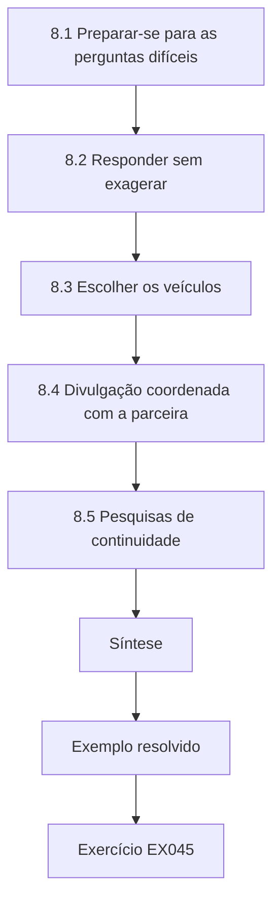

### Desenho lógico

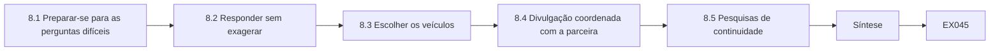

```text
[8.1 Preparar-se para as perguntas difíceis]
    |
    v
[8.2 Responder sem exagerar]
    |
    v
[8.3 Escolher os veículos]
    |
    v
[8.4 Divulgação coordenada com a parceira]
    |
    v
[8.5 Pesquisas de continuidade]
    |
    v
[Síntese]
    |
    v
[Exemplo resolvido] --> [Exercício EX045]
```
<!-- cykin:lesson-figures:end ch-08 -->


### Objetivos de aprendizagem

Você vai (1) preparar uma defesa de doutorado em torno dos pontos mais fracos da afirmação; (2) planejar os veículos de publicação e uma divulgação coordenada com a parceira; (3) definir pesquisas de continuidade, incluindo a migração pós-quântica.

### 8.1 Preparar-se para as perguntas difíceis

Nadia lista as dez perguntas que menos quer ouvir e prepara para cada uma uma resposta curta, baseada em evidências. Entre elas: por que doze conglomerados bastam, se o efeito Hawthorne explica o resultado, por que a ponderação por severidade não foi a primária e se o lint sozinho poderia trazer o ganho. Em cada resposta, ela aponta para uma seção, uma tabela ou um arquivo do arquivo de reprodutibilidade, e não para a própria opinião. O Prof. Brandt conduz duas defesas simuladas com colegas que não leram a tese, porque eles fazem as perguntas ingênuas que a banca real muitas vezes faz primeiro.

### 8.2 Responder sem exagerar

Durante a defesa, um examinador pergunta se o estudo prova que os checklists funcionam. Nadia responde que ele mostra uma redução considerável numa organização ao longo de um trimestre, com uma confiança que se apoia num teste de permutação, numa confirmação cega e num terceiro auditor, e que a durabilidade e a transferência continuam em aberto. Quando perguntam por que ela não testou a explorabilidade dos achados, ela explica que a aprovação ética proibia trabalho de exploração e que as violações confirmadas do livro de códigos são uma aproximação reconhecida, e não uma medida de invasões. Respostas precisas e delimitadas conquistam mais confiança do que generalizações confiantes.

### 8.3 Escolher os veículos

Nadia planeja dois artigos. O experimento vai para um veículo revisado por pares de segurança em engenharia de software, cujos revisores valorizam evidências de campo randomizadas. Um artigo mais curto para profissionais explica as perguntas do checklist, cada uma ligada a uma fonte pública, como o SP 800-38D para os limites de nonce, o SP 800-57 para o ciclo de vida das chaves e a RFC 9106 para o hash de senhas. Ela confere a política de dados abertos de cada veículo contra sua lista de divulgação e planeja publicar o manuscrito aceito num repositório aberto, para que o checklist chegue às equipes que não podem pagar pelo acesso aos periódicos.

### 8.4 Divulgação coordenada com a parceira

Antes da submissão, o líder de segurança da Meridian revisa os dois manuscritos contra o acordo de dados, confirmando que nenhuma fraqueza ativa é descrita e que todo achado de exemplo é uma paráfrase inventada. Eles combinam um cronograma: o arquivo se torna público na aceitação, o artigo para profissionais sai depois que a Meridian tiver implantado o checklist em todas as equipes, e qualquer problema recém-encontrado segue o processo de divulgação da Meridian antes da publicação. Registrar isso por escrito protege as duas partes e mostra aos examinadores que os resultados da pesquisa e a segurança da parceira foram planejados juntos, e não negociados um contra o outro no último minuto.

### 8.5 Pesquisas de continuidade

Nadia propõe dois estudos de continuidade. O primeiro repete o experimento em organizações sem um wrapper maduro, estratificado pela idade do código, para testar a transferência. O segundo estuda a migração pós-quântica: o NIST padronizou o ML-KEM no FIPS 203, o ML-DSA no FIPS 204 e o SLH-DSA no FIPS 205, e migrar para eles vai introduzir novos parâmetros, chaves maiores e handshakes híbridos, todos novas oportunidades de uso indevido. Ela sugere estender o livro de códigos com categorias de migração, como combinações híbridas não suportadas, e medir se as perguntas de checklist escritas agora evitam erros quando o trabalho real de migração começar.

### Exemplo resolvido

O pacote de defesa de Nadia liga dez perguntas difíceis a evidências, seu plano de publicação combina um artigo do experimento com um artigo para profissionais, e seu cronograma de divulgação com a Meridian é assinado antes da submissão.

> **Caso sintético.** A banca, as decisões dos veículos e o cronograma da Meridian são inventados; o FIPS 203, o 204 e o 205 são normas reais.

### Erros e limites

Uma defesa não se vence com certeza; afirmações além das evidências convidam ao fracasso. Os planos de publicação nunca devem andar mais depressa do que a capacidade da parceira de corrigir o que a pesquisa revela.

### Exercícios

- **EX045 — Plateias simuladas.** Por que o Prof. Brandt usou colegas que não tinham lido a tese? *Rubrica:* 3 = eles fazem as perguntas ingênuas que a banca muitas vezes faz primeiro;; 2 = visão nova;; 1 = disponibilidade;; 0 = nenhuma.

- **EX046 — Resposta delimitada.** Como Nadia respondeu se o estudo prova que os checklists funcionam? *Rubrica:* 3 = redução considerável numa empresa ao longo de um trimestre, evidências do teste de permutação, do cegamento e do terceiro auditor; durabilidade e transferência em aberto;; 2 = parcial;; 1 = "sim";; 0 = nenhuma.

- **EX047 — Pergunta sobre explorabilidade.** Por que os achados não foram testados quanto à explorabilidade? *Rubrica:* 3 = a aprovação ética proibia trabalho de exploração; as violações do livro de códigos são uma aproximação reconhecida;; 2 = um motivo;; 1 = tempo;; 0 = nenhuma.

- **EX048 — Fontes para profissionais.** Que fontes públicas apoiam os itens do checklist no artigo para profissionais? *Rubrica:* 3 = SP 800-38D para nonces, SP 800-57 para o ciclo de vida das chaves, RFC 9106 para senhas;; 2 = duas;; 1 = uma;; 0 = nenhuma.

- **EX049 — Cronograma de divulgação.** Descreva a ordem de divulgação acordada. *Rubrica:* 3 = arquivo na aceitação; artigo para profissionais após a implantação completa; novos problemas primeiro pela divulgação da Meridian;; 2 = duas partes;; 1 = uma;; 0 = nenhuma.

- **EX050 — Continuidade pós-quântica.** Que normas motivam o segundo estudo de continuidade, e por quê? *Rubrica:* 3 = FIPS 203, 204, 205 (ML-KEM, ML-DSA, SLH-DSA); a migração acrescenta parâmetros, chaves maiores e híbridos sujeitos a uso indevido;; 2 = só as normas;; 1 = "quântico";; 0 = nenhuma.

### Síntese

Uma defesa forte nomeia os limites da afirmação antes que a banca o faça, e um plano de publicação coordenado com o parceiro transforma as evidências em prática mais segura sem expor sistemas em produção.

<!-- cykin:chapter-navigation:start ch-08 -->
### Continue estudando — aula 08 (capítulo 08 de 08)

[← Capítulo 07](#ch-07) · [Índice das aulas](../SUBJECTS.md) · [Próximo curso pelo índice →](../SUBJECTS.md)

O índice aponta para o próximo curso do percurso de estudos.
<!-- cykin:chapter-navigation:end -->

<a id="worked-results"></a>

## Resoluções

Respostas-modelo para EX001–EX050. Nadia Haddad, o Prof. Oskar Brandt, a Larkspur University, a Meridian Payments Cooperative e todos os números são sintéticos; as respostas dos laboratórios citam saídas verificadas. Qualquer resposta que atenda à rubrica recebe a mesma pontuação.

**EX001.** Acrescentar um checklist de uso indevido de criptografia e lint automatizado à revisão reduz os achados confirmados de uso indevido a cada dez mudanças integradas, em comparação com a revisão habitual da Meridian?

**EX002.** Uso indevido é uma primitiva correta usada de modo que sua garantia deixa de valer; reutilizar um nonce do GCM sob uma mesma chave quebra a confidencialidade e a autenticidade que o SP 800-38D promete.

**EX003.** Observada 0,854 (41 de 48), ao acaso 0,263, kappa 0,802.

**EX004.** Primitive-choice recebeu cinco das sete discordâncias; a nova regra codifica a derivação de chave como key-handling, a menos que o próprio algoritmo esteja obsoleto.

**EX005.** Só depois que a correção for implantada ou o código desativado, e com os nomes de repositórios e os identificadores de chaves pseudonimizados.

**EX006.** Escalá-lo ao líder de segurança da Meridian em até um dia útil, independentemente do braço do estudo em que a equipe está.

**EX007.** Diferenças de habilidade entre as equipes poderiam explicar os resultados; a atribuição aleatória das equipes aos braços controla isso.

**EX008.** A segurança das primitivas padrão, como o AES, o SHA-2 e as assinaturas digitais do FIPS 186-5, está resolvida; a lacuna aberta é como o código das aplicações escolhe parâmetros, nonces e armazenamento de chaves ao chamá-las.

**EX009.** No máximo 2^32 invocações por chave, porque nonces aleatórios podem colidir, e uma colisão de nonce no GCM revela o XOR dos textos claros e permite que um atacante forje tags.

**EX010.** Cerca de 1,164 × 10^-10, aproximadamente uma chance em 8,6 bilhões.

**EX011.** Cerca de 7,6 × 10^-6 para uma chave usada 2^40 vezes; o risco é determinado pela contagem e pela rotação das chaves, e não pela cifra em si.

**EX012.** Projetar primitivas resistentes a uso indevido, e estudar desenvolvedores, interfaces e ferramentas; o estudo de Nadia está na linha das ferramentas.

**EX013.** A população estudada, como o uso indevido foi medido e se foi observado código entregue ou tarefas de laboratório.

**EX014.** Ela não afirma que o checklist impede todo uso indevido, nem que os achados se generalizam para organizações sem bibliotecas avaliadas.

**EX015.** Ao longo de um trimestre, as equipes que usam o checklist e a etapa de lint terão uma média menor de achados de uso indevido confirmados pelo auditor a cada dez mudanças integradas que tocam criptografia do que as equipes que usam a revisão habitual.

**EX016.** Os avisos do lint mediriam as próprias regras da ferramenta e inflariam seu efeito aparente, enquanto os incidentes reais são infrequentes demais para contar num único trimestre.

**EX017.** Qualquer mudança integrada que importe o wrapper criptográfico aprovado da Meridian ou os módulos hashlib, hmac ou secrets.

**EX018.** Os engenheiros de uma equipe compartilham hábitos de revisão, então atribuir mudanças individuais deixaria a intervenção vazar para as mudanças de controle.

**EX019.** Por exemplo: H1 e H2, o desfecho primário, a regra de inclusão e o teste de permutação com 20.000 embaralhamentos (além da política de semente e das regras de atrito e de desvio).

**EX020.** Se as senhas são armazenadas com uma função memory-hard como o Argon2, conforme especificado na RFC 9106.

**EX021.** Vinte e três de oitenta mudanças amostradas, ou 28,8 por cento.

**EX022.** Key-handling, com nove achados confirmados.

**EX023.** A suposição da Meridian de que sua biblioteca wrapper já tinha tornado raro o uso indevido de criptografia.

**EX024.** Uma redução pela metade da média de controle poderia ser detectada com doze equipes por braço; uma queda de 20 por cento não.

**EX025.** Avisos falsos positivos de nonce nos fixtures de teste, auditores adivinhando o braço pelos comentários do checklist nas descrições de merge e revisores lendo "rotação" de forma errada.

**EX026.** Duas equipes voluntárias ao longo de quatro semanas não são nem aleatórias nem grandes o bastante, e um número precoce poderia direcionar as decisões posteriores.

**EX027.** O líder de segurança da Meridian rodou o script com a semente registrada, mantendo a alocação fora do controle da pesquisadora.

**EX028.** Se a intervenção não faz nada, qual equipe recebeu qual rótulo é arbitrário, então reembaralhar os rótulos gera a distribuição das diferenças esperadas ao acaso.

**EX029.** Checklist 0,42, habitual 1,58, diferença 1,17, p unilateral = 0,0034.

**EX030.** Oito de doze equipes com checklist tiveram zero uso indevido confirmado, contra duas de doze equipes de revisão habitual.

**EX031.** O lint respondeu por cerca de um terço dos achados de nonce evitados, mas a maioria dos achados de key-handling evitados veio de perguntas do checklist fora do alcance da ferramenta.

**EX032.** Efeitos de observação, uma incerteza ampla por haver só doze conglomerados por braço, segredos de implantação não vistos e transferência limitada para empresas sem um wrapper maduro.

**EX033.** Leitores da criptografia, da metodologia e da prática eram os mais capazes de encontrar cedo os pontos mais fracos do artigo, antes que os revisores do periódico o fizessem.

**EX034.** O peso igual ignora a severidade; ela acrescentou uma análise de sensibilidade ponderada por severidade, com uma escala fixada antes da reclassificação, que manteve a direção, mas reduziu a diferença.

**EX035.** Oito por cento menos merges que tocam criptografia e cerca de doze minutos a mais de tempo mediano de revisão nas equipes com checklist.

**EX036.** A diferença caiu para cerca de 0,9 achado a cada dez mudanças, mas continuou positiva, relatada como análise exploratória não registrada.

**EX037.** Estratificar a randomização futura pela idade do código, além da linha de produto.

**EX038.** A medida não ponderada era o desfecho primário registrado, e substituí-la depois de abrir o cegamento quebraria o pré-registro.

**EX039.** Numa organização de pagamentos, acrescentar um checklist de uso indevido de criptografia e lint reduziu o uso indevido confirmado a cada dez mudanças que tocam criptografia ao longo de um trimestre, com um pequeno custo de tempo, sobretudo ao reduzir os erros de key-handling.

**EX040.** Os diffs, os nomes de repositórios e qualquer detalhe que possa identificar um sistema da Meridian, porque o acordo de dados proíbe divulgá-los.

**EX041.** Raiz 4ed0159418d1b231 antes da edição e 1fcc81b868bef821 depois, então a verificação de correspondência imprimiu False.

**EX042.** O manifesto mostra que os arquivos não mudaram desde a publicação, mas não quem os criou; provar a origem exigiria uma assinatura como o Ed25519 da RFC 8032.

**EX043.** A raiz é calculada sobre os digests em ordem, então outra ordenação de arquivos idênticos produz uma raiz diferente e falsos alarmes.

**EX044.** O item poderia ajudar alguém a localizar ou explorar uma fraqueza que talvez ainda esteja ativa? As anotações dos auditores não passam, porque citam serviços internos.

**EX045.** Leitores que não conhecem a tese levantam as perguntas simples e básicas com que as bancas reais costumam abrir.

**EX046.** Ele mostra uma redução grande numa organização ao longo de um único trimestre, apoiada pelo teste de permutação, pelos auditores cegos e por uma conferência de terceiros, enquanto a durabilidade de longo prazo e a transferência continuam sem resposta.

**EX047.** A aprovação ética proibia testes de exploração, e as violações confirmadas das regras do livro de códigos são uma aproximação aceita, e não uma contagem de invasões.

**EX048.** O SP 800-38D para os limites de nonce, o SP 800-57 Part 1 para o ciclo de vida das chaves e a RFC 9106 para o hash de senhas.

**EX049.** O arquivo é publicado na aceitação, o texto para profissionais depois da implantação completa na Meridian, e qualquer problema novo passa pelo processo de divulgação da Meridian antes da publicação.

**EX050.** O FIPS 203, o 204 e o 205 padronizam o ML-KEM, o ML-DSA e o SLH-DSA; a migração traz novos parâmetros, chaves maiores e handshakes híbridos que criam novos riscos de uso indevido.

<a id="references"></a>
## Referências

Todos os DOIs foram resolvidos em doi.org em 12 de outubro de 2026, e as normas foram conferidas nas páginas de seus editores. A lista é idêntica à da edição em inglês e cobre o livro inteiro; nenhuma das normas técnicas citadas foi verificada aqui como adotada pela ABNT, por isso são citadas em sua edição internacional. Organizações, pessoas, sistemas e números dos casos são sintéticos; somente as obras abaixo são reais.

- Barker, E. (2020). *Recommendation for key management: Part 1 — General* (NIST SP 800-57 Part 1 Rev. 5). NIST. <https://doi.org/10.6028/NIST.SP.800-57pt1r5>
- Barker, E., & Kelsey, J. (2015). *Recommendation for random number generation using deterministic random bit generators* (NIST SP 800-90A Rev. 1). NIST. <https://doi.org/10.6028/NIST.SP.800-90Ar1>
- Barnes, R., Bhargavan, K., Lipp, B., & Wood, C. (2022). *Hybrid public key encryption* (RFC 9180). IETF. <https://www.rfc-editor.org/rfc/rfc9180>
- Biryukov, A., Dinu, D., Khovratovich, D., & Josefsson, S. (2021). *Argon2 memory-hard function for password hashing and proof-of-work applications* (RFC 9106). IETF. <https://www.rfc-editor.org/rfc/rfc9106>
- Boneh, D., & Shoup, V. (2023). *A graduate course in applied cryptography* (version 0.6, draft). <https://toc.cryptobook.us/>
- Cooper, D., Santesson, S., Farrell, S., Boeyen, S., Housley, R., & Polk, W. (2008). *Internet X.509 public key infrastructure certificate and CRL profile* (RFC 5280). IETF. <https://www.rfc-editor.org/rfc/rfc5280>
- Dworkin, M. (2007). *Recommendation for block cipher modes of operation: Galois/Counter Mode (GCM) and GMAC* (NIST SP 800-38D). NIST. <https://doi.org/10.6028/NIST.SP.800-38D>
- Josefsson, S., & Liusvaara, I. (2017). *Edwards-curve digital signature algorithm (EdDSA)* (RFC 8032). IETF. <https://www.rfc-editor.org/rfc/rfc8032>
- Katz, J., & Lindell, Y. (2020). *Introduction to modern cryptography* (3rd ed.). CRC Press.
- Krawczyk, H., & Eronen, P. (2010). *HMAC-based extract-and-expand key derivation function (HKDF)* (RFC 5869). IETF. <https://www.rfc-editor.org/rfc/rfc5869>
- Krawczyk, H., Bellare, M., & Canetti, R. (1997). *HMAC: Keyed-hashing for message authentication* (RFC 2104). IETF. <https://www.rfc-editor.org/rfc/rfc2104>
- Landis, J. R., & Koch, G. G. (1977). The measurement of observer agreement for categorical data. *Biometrics*, 33(1), 159–174. <https://doi.org/10.2307/2529310>
- Langley, A., Hamburg, M., & Turner, S. (2016). *Elliptic curves for security* (RFC 7748). IETF. <https://www.rfc-editor.org/rfc/rfc7748>
- Laurie, B., Langley, A., & Kasper, E. (2013). *Certificate transparency* (RFC 6962). IETF. <https://www.rfc-editor.org/rfc/rfc6962>
- Menezes, A. J., van Oorschot, P. C., & Vanstone, S. A. (1996). *Handbook of applied cryptography*. CRC Press. Chapters free online: <https://cacr.uwaterloo.ca/hac/>
- Moriarty, K., Kaliski, B., Jonsson, J., & Rusch, A. (2016). *PKCS #1: RSA cryptography specifications version 2.2* (RFC 8017). IETF. <https://www.rfc-editor.org/rfc/rfc8017>
- National Institute of Standards and Technology. (2001, updated 2023). *Advanced Encryption Standard (AES)* (FIPS 197). <https://doi.org/10.6028/NIST.FIPS.197-upd1>
- National Institute of Standards and Technology. (2008). *The keyed-hash message authentication code (HMAC)* (FIPS 198-1). <https://doi.org/10.6028/NIST.FIPS.198-1>
- National Institute of Standards and Technology. (2015). *Secure hash standard (SHS)* (FIPS 180-4). <https://doi.org/10.6028/NIST.FIPS.180-4>
- National Institute of Standards and Technology. (2023). *Digital signature standard (DSS)* (FIPS 186-5). <https://doi.org/10.6028/NIST.FIPS.186-5>
- National Institute of Standards and Technology. (2024). *Module-lattice-based digital signature standard* (FIPS 204). <https://doi.org/10.6028/NIST.FIPS.204>
- National Institute of Standards and Technology. (2024). *Module-lattice-based key-encapsulation mechanism standard* (FIPS 203). <https://doi.org/10.6028/NIST.FIPS.203>
- National Institute of Standards and Technology. (2024). *Stateless hash-based digital signature standard* (FIPS 205). <https://doi.org/10.6028/NIST.FIPS.205>
- Percival, C., & Josefsson, S. (2016). *The scrypt password-based key derivation function* (RFC 7914). IETF. <https://www.rfc-editor.org/rfc/rfc7914>
- Rescorla, E. (2018). *The Transport Layer Security (TLS) protocol version 1.3* (RFC 8446). IETF. <https://www.rfc-editor.org/rfc/rfc8446>
- Shoup, V. (2004). *Sequences of games: A tool for taming complexity in security proofs* (Cryptology ePrint Archive, Paper 2004/332). <https://eprint.iacr.org/2004/332>
