# Perícia Digital e Análise de Malware: Livro de Pesquisa de Doutorado

- Idioma: português do Brasil (`pt`); trilha de pesquisa de doutorado, dois anos. Edição de referência: [inglês](../../en/book/MANUSCRIPT.md).
- Estado editorial: **publicado**. Os capítulos 1–8 de 8 têm texto didático escrito à mão; os exercícios EX001–EX050 têm resoluções correspondentes com rubricas de 0 a 3; três laboratórios offline usam apenas a biblioteca padrão do Python 3 sobre evidências sintéticas, e suas saídas foram incorporadas a partir de execuções reais. A revisão independente e a verificação de 300 páginas A4 continuam em aberto.
- Público: doutorandos que projetam uma contribuição original e testável para o método da perícia digital ou da análise de malware.
- Autor: [hiagokinlevi](https://github.com/hiagokinlevi). Texto original sob [CC0 1.0](../../../../../LICENSE); as obras citadas mantêm seus direitos.
- Limite ético e legal: examine apenas mídias e sistemas que você está autorizado a examinar; nada de malware ativo, código de exploração, *payloads* ou instruções para burlar proteções. O malware é discutido por meio de comportamento, artefatos e descrições estáticas seguras de amostras sintéticas. Todas as evidências, pessoas e organizações são **sintéticas**, salvo quando uma frase cita uma fonte pública.

[Página do curso](../../README.md) · [Índice de capítulos](../SUBJECTS.md) · [Plano do livro](PLAN.md) · [Skill do curso](../../skill/SKILL.md) · [Resoluções](#worked-results)

## Como usar este rascunho

O capítulo 1 estabelece a integridade e o método de pesquisa; o 2 mapeia a fronteira; o 3 formula uma contribuição; o 4 replica uma linha de base de *carving*; o 5 conduz o estudo principal com estimativas intervalares e validação independente; o 6 trata da crítica; o 7 monta a tese e um arquivo de reprodutibilidade verificado por hash; o 8 prepara a defesa e a publicação. Cada capítulo tem objetivos, texto didático, um exemplo resolvido, um caso sintético identificado, erros e limites, seis ou sete exercícios pontuados de 0 a 3, uma síntese e um bloco **Continue estudando**.

### Caso contínuo sintético

| Elemento | Papel | Limite |
|---|---|---|
| **Holloway Digital Evidence Lab** | Grupo de pesquisa universitário com um corpus de imagens de disco sintéticas | Inventado |
| **Ines Varga** | Doutoranda que mede como a fragmentação de arquivos afeta a revocação (*recall*) das ferramentas de *carving* | Inventada |
| **Prof. Daniel Achebe** | Orientador | Inventado |

### Fontes principais

NIST [SP 800-86](https://doi.org/10.6028/NIST.SP.800-86) e [SP 800-101r1](https://doi.org/10.6028/NIST.SP.800-101r1); [RFC 3227](https://www.rfc-editor.org/rfc/rfc3227); ISO/IEC [27037](https://www.iso.org/standard/44381.html), [27041](https://www.iso.org/standard/44405.html), [27042](https://www.iso.org/standard/44406.html) e [27043](https://www.iso.org/standard/44407.html); [SWGDE](https://www.swgde.org/documents/published-complete-listing); Carrier, *File System Forensic Analysis* (2005). Lista completa em [Referências](#references).

## Sumário

| Capítulos |
|---|
| [1](#ch-01) · [2](#ch-02) · [3](#ch-03) · [4](#ch-04) · [5](#ch-05) · [6](#ch-06) · [7](#ch-07) · [8](#ch-08) |

[Resoluções](#worked-results) · [Referências](#references)

<a id="ch-01"></a>

## Capítulo 1 — Integridade e métodos de pesquisa avançada

<!-- open-cyber-academy:lesson-figures:start ch-01 -->
### Mapa da aula

Aula 01 publicada. Mapa, exemplo, EX001.

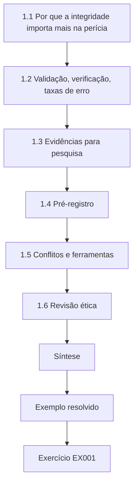

### Desenho lógico

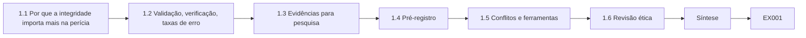

```text
[1.1 Por que a integridade importa mais na perícia]
    |
    v
[1.2 Validação, verificação, taxas de erro]
    |
    v
[1.3 Evidências para pesquisa]
    |
    v
[1.4 Pré-registro]
    |
    v
[1.5 Conflitos e ferramentas]
    |
    v
[1.6 Revisão ética]
    |
    v
[Síntese]
    |
    v
[Exemplo resolvido] --> [Exercício EX001]
```
<!-- open-cyber-academy:lesson-figures:end ch-01 -->


### Objetivos de aprendizagem

Você vai (1) aplicar princípios de integridade de pesquisa à pesquisa em perícia digital; (2) distinguir validação, verificação e estimativa de taxa de erro; (3) projetar estudos que usem evidências sintéticas ou obtidas licitamente; (4) pré-registrar hipóteses e planos de análise.

### 1.1 Por que a integridade importa mais na perícia

Achados periciais podem decidir liberdade, emprego e reputação. Uma pesquisa que exagera a confiabilidade de uma ferramenta pode chegar aos tribunais. A revisão da área feita por Garfinkel em 2010 alertou que faltavam à perícia digital os fundamentos científicos — corpora padronizados, taxas de erro, métodos reprodutíveis — que outras ciências forenses estavam sendo pressionadas a oferecer. Um projeto de doutorado deve reforçar esses fundamentos, não corroê-los. Para Ines, isso tem um significado concreto. Se ela relatar que o *carving* por cabeçalho e rodapé recupera a maioria dos arquivos do tipo JPEG sem declarar a fragmentação, um perito poderia repetir essa frase num laudo sobre um disco muito fragmentado, onde o método pode perder muito mais. Por isso, sua tese vincula cada valor de revocação às suas condições e ao seu intervalo.

### 1.2 Validação, verificação, taxas de erro

A ISO/IEC 27041 enquadra a validação como a produção de evidências de que um método é adequado ao propósito declarado, incluindo requisitos, desenho de testes e critérios de aceitação. A verificação confere se uma implementação ou execução específica se comporta como o método validado diz. Uma taxa de erro declara com que frequência, sob condições definidas, o método dá um resultado errado. A tese de Ines precisa manter esses três conceitos separados. No estudo dela, a validação é o desenho pré-registrado que mostra que a revocação pontuada por hash mede o que ela afirma medir. A verificação é a conferência de que cada execução usou o *carver*, as sementes e o pontuador arquivados. A taxa de erro é um menos a revocação para um nível de fragmentação declarado, relatada com seu intervalo de 95%.

### 1.3 Evidências para pesquisa

Material de casos reais traz problemas de privacidade, legais e de consentimento, e raramente pode ser compartilhado. Garfinkel, Farrell, Roussev e Dinolt (2009) defenderam corpora forenses padronizados para que os estudos possam ser repetidos. Ines constrói imagens de disco sintéticas com verdade de referência conhecida: cada arquivo, cada fragmento e cada exclusão é registrado na criação, de modo que a revocação pode ser medida com exatidão. Imagens sintéticas não eliminam todos os problemas. Elas respondem como o método se comporta sobre a saída do gerador, e Ines ainda precisa argumentar que o gerador se parece com mídias reais, razão pela qual um subestudo de realismo separado aparece em seu plano. Sem esse argumento, um leitor poderia descartar os valores de revocação como propriedades de um *layout* artificial e nada mais.

### 1.4 Pré-registro

Antes de conduzir o estudo principal, Ines escreve as hipóteses (H1: a revocação cai à medida que a fragmentação aumenta), as medidas primárias (revocação e precisão por imagem), a análise (estimativas intervalares, não apenas valores pontuais) e as regras de parada. Mudanças posteriores são permitidas, mas registradas com suas razões. Ela deposita o documento com o Prof. Achebe, com um *commit* datado, antes de gerar qualquer imagem do estudo principal. Essa ordem importa: se visse os resultados primeiro, ela poderia escolher os níveis de fragmentação ou as medidas que fazem o *carver* parecer melhor ou pior. O registro de desvios posterior é lido contra esse documento, para que os examinadores vejam quais escolhas foram fixadas de antemão.

### 1.5 Conflitos e ferramentas

Fornecedores de ferramentas podem financiar pesquisas. Financiamento, versões de ferramentas e qualquer relacionamento são declarados. O programa Computer Forensics Tool Testing do NIST mostra o valor de publicar abertamente especificações e resultados de testes. Ines não recebe financiamento de fornecedores, mas sua declaração ainda lista cada ferramenta pelo nome e pela versão, incluindo a versão do Python usada para construir as imagens e pontuar a saída. Um leitor que tente reproduzir um valor de revocação precisa dessa lista tanto quanto do código, e a política do Holloway Lab exige a declaração nos elementos pré-textuais da tese.

### 1.6 Revisão ética

Mesmo um trabalho sintético precisa de revisão ética se envolver pessoas — por exemplo, estudos com peritos. Os participantes consentem; seus dados de desempenho são pseudonimizados. O estudo principal de Ines não envolve participantes, por isso sua submissão ao comitê da universidade é curta: declara que todas as imagens são geradas, que nenhuma mídia real ou dado pessoal é usado e que nenhum malware é manipulado. O estudo futuro planejado sobre como os peritos interpretam recuperações parciais precisaria de revisão completa, com termos de consentimento e um plano para guardar as pontuações sob pseudônimos. Escrever a submissão curta agora dá ao comitê um registro para comparar mais tarde.

### Exemplo resolvido

O primeiro rascunho de Ines afirma que seu *carver* é "preciso". Seu orientador pergunta: preciso em quê, sob quais condições, contra qual verdade de referência, com qual incerteza? Ela reescreve o objetivo: "Estimar a revocação do *carving* por cabeçalho e rodapé para arquivos do tipo JPEG em imagens sintéticas com 0%, 10% e 30% de fragmentação, com intervalos de 95%."

> **Caso sintético.** O Holloway Lab, Ines e suas imagens são inventados.

### Erros e limites

Imagens sintéticas simplificam as mídias reais. Os resultados se transferem apenas na medida em que o gerador imita a realidade; diga isso.

### Exercícios

- **EX001 — Três termos.** Distinga validação, verificação e taxa de erro na pesquisa de métodos periciais. *Rubrica:* 3 = os três corretos, com exemplo; 2 = dois; 1 = um; 0 = nenhum.
- **EX002 — Por que corpora.** Por que Garfinkel et al. (2009) defenderam corpora padronizados? *Rubrica:* 3 = estudos repetíveis e comparáveis sem as barreiras dos dados de casos; 2 = parcial; 1 = vago; 0 = nada.
- **EX003 — Verdade de referência.** Que vantagem uma imagem sintética oferece para medir a revocação? *Rubrica:* 3 = verdade de referência conhecida de cada arquivo/fragmento; revocação exata; 2 = parcial; 1 = rapidez; 0 = nada.
- **EX004 — Reescreva o objetivo.** Reescreva "minha ferramenta é precisa" como um objetivo testável. *Rubrica:* 3 = medida, condições, verdade de referência, incerteza; 2 = três; 1 = vago; 0 = nada.
- **EX005 — Itens do pré-registro.** Liste quatro elementos de um pré-registro. *Rubrica:* 3 = hipóteses, medidas, análise, regras de parada/mudança; 2 = três; 1 = um; 0 = nada.
- **EX006 — Declaração de financiamento.** O que deve ser declarado quando um fornecedor financia pesquisa sobre ferramentas? *Rubrica:* 3 = financiamento, relacionamentos, versões das ferramentas; 2 = dois; 1 = um; 0 = nada.
- **EX007 — Limite de transferência.** Declare o principal limite para transferir resultados de imagens sintéticas para casos reais. *Rubrica:* 3 = realismo do gerador; declarar os limites; 2 = parcial; 1 = vago; 0 = nada.

### Síntese

A pesquisa pericial precisa separar validação, verificação e taxas de erro, usar evidências compartilháveis com verdade de referência, pré-registrar e declarar interesses.

### Continue estudando — capítulo 01 de 08

[← Página do curso](../../README.md) · [Índice de capítulos do curso](../SUBJECTS.md) · [Capítulo 02 (rascunho) →](#ch-02)

<a id="ch-02"></a>

## Capítulo 2 — Perícia digital e análise de malware: fronteira da pesquisa

<!-- open-cyber-academy:lesson-figures:start ch-02 -->
### Mapa da aula

Aula 02 publicada. Mapa, exemplo, EX008.

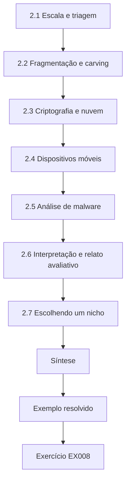

### Desenho lógico

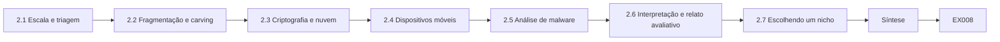

```text
[2.1 Escala e triagem]
    |
    v
[2.2 Fragmentação e carving]
    |
    v
[2.3 Criptografia e nuvem]
    |
    v
[2.4 Dispositivos móveis]
    |
    v
[2.5 Análise de malware]
    |
    v
[2.6 Interpretação e relato avaliativo]
    |
    v
[2.7 Escolhendo um nicho]
    |
    v
[Síntese]
    |
    v
[Exemplo resolvido] --> [Exercício EX008]
```
<!-- open-cyber-academy:lesson-figures:end ch-02 -->


### Objetivos de aprendizagem

Você vai (1) mapear problemas em aberto na perícia digital e na análise de malware; (2) relacioná-los a normas e a críticas publicadas; (3) identificar onde uma contribuição de doutorado é viável; (4) evitar temas que exijam trabalho inseguro ou ilícito.

### 2.1 Escala e triagem

Os volumes de armazenamento crescem mais depressa do que o tempo dos peritos. A pesquisa pergunta como fazer a triagem — quais artefatos examinar primeiro — sem perder evidências decisivas. Garfinkel (2010) apontou a escala como um desafio central para a década seguinte. O tema de Ines toca a triagem de forma indireta. Se a revocação do *carving* for baixa em mídias fragmentadas, um perito que faça a triagem começando pelo *carving* poderia concluir erroneamente que uma fotografia está ausente. A revocação medida diz a quem projeta a triagem quanto peso uma passada de *carving* merece antes da análise mais profunda, e em que tipo de imagem esse peso foi estimado.

### 2.2 Fragmentação e carving

Quando os metadados do sistema de arquivos se perdem, os *carvers* recuperam arquivos a partir dos bytes brutos. O *File System Forensic Analysis*, de Carrier, explica como surgem a alocação e a fragmentação. O *carving* por cabeçalho e rodapé falha em arquivos fragmentados; existe remontagem mais inteligente, mas suas taxas de erro raramente são relatadas em conjuntos de dados compartilhados. É nessa lacuna que Ines situa seu trabalho. Os estudos costumam mostrar um método de remontagem funcionando em arquivos de exemplo, mas raramente relatam quantos arquivos o método perde em muitas imagens com verdade conhecida, em cada nível de fragmentação. O gerador dela registra o intervalo de bytes de cada fragmento, de modo que a revocação pode ser contada em vez de estimada a partir de um punhado de demonstrações.

### 2.3 Criptografia e nuvem

A criptografia de disco completo e o armazenamento em nuvem tiram as evidências do alcance da aquisição de imagem tradicional. A pesquisa examina rotas lícitas de aquisição e quais artefatos permanecem nos *endpoints*. Ines registra essa área e a deixa de lado. Volumes criptografados e armazenamentos em nuvem levantam questões de processo legal e de recuperação de chaves que seu gerador não consegue modelar, e incluí-los ampliaria a tese além do que oito meses de estudo principal permitem. Seu capítulo de literatura nomeia a área como trabalho adjacente, para que os examinadores vejam que a fronteira foi escolhida, e lista os levantamentos publicados que ela leu antes de decidir.

### 2.4 Dispositivos móveis

O NIST SP 800-101r1 descreve níveis de aquisição móvel que vão do manual ao físico. Mudanças rápidas de plataforma fazem os resultados de validação envelhecerem depressa. Para um projeto de doutorado, esse envelhecimento é um risco: um resultado ligado a uma versão de sistema operacional de celular pode estar desatualizado antes da defesa. Ines escolheu imagens de disco em parte porque o *carving* de padrões de cabeçalho e rodapé em bytes brutos depende de formatos de arquivo que mudam muito mais devagar. Sua revisão de literatura declara essa razão para que a escolha não seja confundida com desconhecimento do trabalho em dispositivos móveis, e cita o SP 800-101r1 para os níveis de aquisição.

### 2.5 Análise de malware

A análise estática e a dinâmica, descritas em livros-texto como o *Practical Malware Analysis*, de Sikorski e Honig, enfrentam ofuscação e evasão. Continua a pesquisa sobre classificação de comportamento e sobre o mapeamento de comportamentos observados para técnicas do ATT&CK. O trabalho de doutorado aqui deve ocorrer em laboratórios isolados, com aprovação institucional; este livro usa apenas artefatos sintéticos e inertes. A revisão de Ines cobre o trabalho com malware apenas para mostrar por que ela não o escolheu. Sua pontuação de temas avaliou o agrupamento de *ransomware* ativo como baixo em segurança e em acesso a dados, e a literatura confirmou que esses estudos dependem de laboratórios isolados e de amostras que ela não poderia compartilhar. Sua tese mantém o limite ético deste livro, por isso não contém amostra alguma.

### 2.6 Interpretação e relato avaliativo

A ISO/IEC 27042 trata de análise e interpretação, incluindo repetibilidade e reprodutibilidade. Como os peritos expressam a força dos achados — e com que frequência concordam — é uma área pouco estudada. Isso se liga aos resultados de Ines. Um intervalo de revocação diz ao perito com que frequência um arquivo recuperado por *carving* pode estar faltando, mas não como redigir um laudo quando uma fotografia esperada está ausente. Ela cita essa lacuna como trabalho futuro: um estudo de como os peritos descrevem recuperações parciais e de com que frequência concordam sobre a força desses achados. Sua própria tese fornece as taxas de erro de que tal estudo precisaria como insumo.

### 2.7 Escolhendo um nicho

Uma contribuição viável é: estreita (uma classe de artefato), mensurável (verdade de referência disponível) e segura (sem malware ativo, sem dados pessoais). O tema de Ines atende às três condições. É estreito porque mede um método numa família de arquivos. É mensurável porque o gerador registra a verdade de cada arquivo. É seguro porque as imagens não contêm dados pessoais nem código malicioso. Sua banca aceitou o tema com base nisso, pedindo que ela mostrasse que as imagens sintéticas se parecem com mídias reais nas propriedades que afetam o *carving*.

### Exemplo resolvido

Ines lista cinco temas candidatos e pontua cada um em novidade, viabilidade, segurança e acesso a dados. "Agrupamento comportamental de *ransomware* ativo" pontua baixo em segurança e em acesso a dados. "Revocação do *carving* sob fragmentação controlada" pontua alto nos quatro critérios, e a literatura mostra poucos resultados baseados em intervalos sobre imagens sintéticas compartilhadas.

> **Caso sintético.** A pontuação é inventada.

### Erros e limites

Mapas da fronteira envelhecem depressa; registre a data da busca e as fontes.

### Exercícios

- **EX008 — Problema de escala.** Por que a escala é um problema central de pesquisa na perícia digital? *Rubrica:* 3 = o volume de dados supera o tempo dos peritos; triagem necessária; 2 = parcial; 1 = vago; 0 = nada.
- **EX009 — Fraqueza do carving.** Por que o *carving* por cabeçalho e rodapé falha em arquivos fragmentados? *Rubrica:* 3 = pressupõe bytes contíguos; captura dados intercalados; 2 = parcial; 1 = errado; 0 = nada.
- **EX010 — Envelhecimento em dispositivos móveis.** Por que os resultados de validação da perícia em dispositivos móveis envelhecem depressa? *Rubrica:* 3 = mudanças rápidas de sistema operacional/dispositivo; 2 = parcial; 1 = vago; 0 = nada.
- **EX011 — Segurança com malware.** Que condições a pesquisa de doutorado com malware deve cumprir? *Rubrica:* 3 = laboratório isolado, aprovação institucional, nenhuma liberação; 2 = duas; 1 = uma; 0 = nada.
- **EX012 — Lacuna de interpretação.** Nomeie uma área pouco estudada na interpretação de evidências. *Rubrica:* 3 = concordância entre peritos/expressão da força do achado; 2 = vago; 1 = tentativa mínima; 0 = nada.
- **EX013 — Critérios do nicho.** Que três propriedades tornam viável um nicho de doutorado aqui? *Rubrica:* 3 = estreito, mensurável, seguro; 2 = duas; 1 = uma; 0 = nada.
- **EX014 — Tema rejeitado.** Por que o agrupamento de *ransomware* ativo pontuou baixo? *Rubrica:* 3 = segurança e acesso a dados; 2 = um; 1 = novidade; 0 = nada.

### Síntese

Mapeie a fronteira contra normas e críticas e depois escolha um nicho estreito, mensurável e seguro.

### Continue estudando — capítulo 02 de 08

[← Capítulo 01 (rascunho)](#ch-01) · [Índice de capítulos do curso](../SUBJECTS.md) · [Capítulo 03 (rascunho) →](#ch-03)

<a id="ch-03"></a>

## Capítulo 3 — Proposta de contribuição original

<!-- open-cyber-academy:lesson-figures:start ch-03 -->
### Mapa da aula

Aula 03 publicada. Mapa, exemplo, EX015.

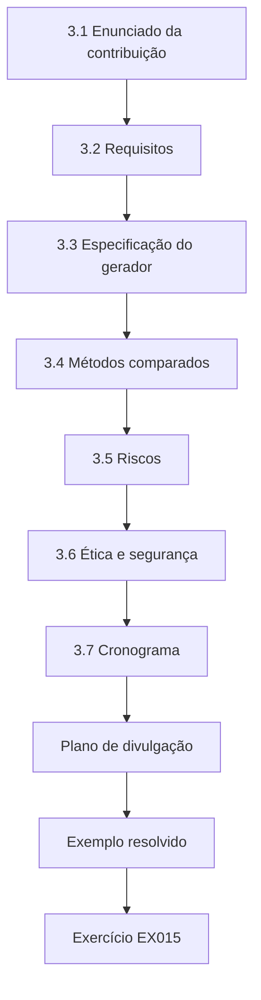

### Desenho lógico

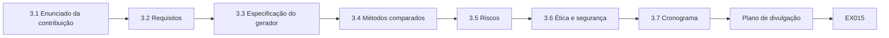

```text
[3.1 Enunciado da contribuição]
    |
    v
[3.2 Requisitos]
    |
    v
[3.3 Especificação do gerador]
    |
    v
[3.4 Métodos comparados]
    |
    v
[3.5 Riscos]
    |
    v
[3.6 Ética e segurança]
    |
    v
[3.7 Cronograma]
    |
    v
[Plano de divulgação]
    |
    v
[Exemplo resolvido] --> [Exercício EX015]
```
<!-- open-cyber-academy:lesson-figures:end ch-03 -->


### Objetivos de aprendizagem

Você vai (1) escrever uma proposta de doutorado para uma contribuição de método pericial; (2) definir requisitos na linguagem da ISO/IEC 27041; (3) especificar um gerador de conjuntos de dados com verdade de referência; (4) planejar riscos e ética.

### 3.1 Enunciado da contribuição

"Vou produzir um gerador de imagens sintéticas abertamente disponível, com fragmentação controlada, e estimativas intervalares da revocação e da precisão do *carving* para métodos de cabeçalho e rodapé e de remontagem, para que os peritos possam declarar taxas de erro dos métodos sob condições declaradas." Cada oração do enunciado pode ser conferida na defesa: se o gerador é público, se os intervalos são relatados para cada condição e cada método, e se as condições são declaradas. Ines evitou palavras como melhor ou preciso porque não podem ser testadas sem uma comparação e uma medida declaradas. O enunciado foi revisado uma vez, quando a comparação com a remontagem passou para trabalho futuro, e as duas versões são mantidas no registro.

### 3.2 Requisitos

Seguindo a ISO/IEC 27041, Ines escreve requisitos funcionais (o método recupera os arquivos cujos bytes estão presentes), requisitos não funcionais (tempo de execução, repetibilidade) e critérios de aceitação (por exemplo, o intervalo de revocação relatado para cada condição). Os critérios de aceitação tornam os requisitos testáveis. Uma execução só é aceita se o pontuador lê todos os manifestos, se cada arquivo recuperado tem seu hash calculado e se o intervalo de revocação é impresso para cada condição. Uma execução que falhe em qualquer desses pontos é refeita em vez de consertada à mão, e a falha é registrada no registro de análise com sua causa.

### 3.3 Especificação do gerador

Entradas: tipos de arquivo, tamanhos, quantidade, taxa de fragmentação, tipo de ruído, semente aleatória. Saídas: os bytes da imagem e um manifesto de verdade de referência que lista os intervalos de bytes e o hash SHA-256 de cada arquivo. A mesma semente deve reproduzir exatamente a mesma imagem. O manifesto é a verdade de referência que torna a revocação exata. Como lista os intervalos de bytes de cada arquivo, o pontuador também pode dizer por que um arquivo foi perdido, por exemplo, que foi dividido em fragmentos ou que seu rodapé se perdeu. Ines testa a promessa de reprodutibilidade gerando uma imagem duas vezes a partir da mesma semente e comparando os hashes SHA-256 das duas imagens antes do início do piloto.

### 3.4 Métodos comparados

*Carving* por cabeçalho e rodapé como linha de base; uma abordagem de remontagem que testa ordens candidatas de fragmentos. Ambos são implementados a partir de descrições publicadas; qualquer ferramenta de terceiros é identificada pela versão. Escrever os dois métodos a partir de descrições publicadas mantém a comparação transparente: cada pressuposto, como o tamanho máximo de arquivo que a linha de base vai recuperar, aparece em código que os examinadores podem ler. Ines registra esses parâmetros no mesmo arquivo das sementes, de modo que o arquivo de reprodutibilidade mostra exatamente quais configurações produziram cada valor. Uma ferramenta de terceiros, se usada para conferências, aparece com sua versão e a data em que foi obtida.

### 3.5 Riscos

O gerador pode ser simples demais; mitigue comparando estatísticas dos artefatos com descrições publicadas de mídias reais. A remontagem pode ser lenta; defina limites de tempo. Outro risco é um erro do pontuador que faça o método parecer melhor ou pior do que é. A mitigação dela é o piloto numa imagem pequena cuja verdade ela pode conferir à mão, mais um segundo laboratório que refaz o estudo. Cada risco tem um responsável e uma data de revisão no plano dela, e o Prof. Achebe revisa a tabela de riscos em cada reunião de orientação até o fim do estudo principal.

### 3.6 Ética e segurança

Nenhuma mídia real; nenhum dado pessoal; nenhum malware. Código liberado sob licença aberta. Essas escolhas também simplificam a revisão ética e a liberação. Como as imagens são geradas, nada nelas precisa ser ocultado antes da publicação, e outros laboratórios podem receber o conjunto de dados completo. Ines ainda registra esse limite em sua submissão ética e na tese, para que o leitor saiba que o resultado cobre apenas mídias sintéticas e que nenhum leitor deve aplicá-lo sem mudanças ao trabalho com casos reais. Um gerador aberto permite que os críticos testem as afirmações dela com suas próprias sementes.

### 3.7 Cronograma

Seis meses para o gerador e o piloto; oito para o estudo principal; quatro para a redação e o arquivo de reprodutibilidade; seis para a defesa e a publicação. O plano soma vinte e quatro meses, em linha com o programa de dois anos. Ines acrescenta pontos de controle: o piloto precisa ser aprovado antes do início do estudo principal, e a nova execução do segundo laboratório precisa terminar antes do fim da redação, porque o capítulo de validação depende dela. Se o gerador atrasar, o período de redação absorve o atraso, e não a data da defesa, que o departamento fixa com bastante antecedência. Os capítulos de fundamentação e do piloto são redigidos durante o estudo principal.

### Plano de divulgação

A proposta nomeia os produtos: o gerador e seus manifestos liberados abertamente, um relatório de validação utilizável por laboratórios e artigos em periódicos. Laboratórios acreditados segundo normas de qualidade forense precisam de taxas de erro de métodos que possam citar; projetar os produtos para eles desde o início aumenta o impacto.

### Exemplo resolvido

A banca pergunta como Ines vai mostrar que o gerador é realista. Ela acrescenta um subestudo que compara as distribuições de tamanho de fragmentos em suas imagens com descrições publicadas de sistemas de arquivos, e declara que as afirmações de realismo se limitarão a essas propriedades medidas.

> **Caso sintético.** A conversa com a banca é inventada.

### Erros e limites

Propostas mudam; mantenha um registro de mudanças datado.

### Exercícios

- **EX015 — Teste da contribuição.** O que torna testável o enunciado de contribuição de Ines? *Rubrica:* 3 = artefato específico, medidas, condições; 2 = parcial; 1 = vago; 0 = nada.
- **EX016 — Tipos de requisito.** Dê um requisito funcional e um não funcional. *Rubrica:* 3 = ambos corretos; 2 = um; 1 = confuso; 0 = nada.
- **EX017 — Propósito da semente.** Por que o gerador deve usar uma semente registrada? *Rubrica:* 3 = reprodutibilidade exata; 2 = parcial; 1 = rapidez; 0 = nada.
- **EX018 — Campos do manifesto.** O que o manifesto de verdade de referência registra? *Rubrica:* 3 = intervalos de bytes e hashes por arquivo; 2 = um; 1 = nomes; 0 = nada.
- **EX019 — Subestudo de realismo.** Como o realismo será demonstrado, e que limite decorre disso? *Rubrica:* 3 = comparar distribuições de fragmentos; afirmações limitadas às propriedades medidas; 2 = um; 1 = vago; 0 = nada.
- **EX020 — Ferramentas de terceiros.** Como as ferramentas de terceiros devem ser relatadas? *Rubrica:* 3 = nome e versão exata; 2 = nome; 1 = omitidas; 0 = nada.

### Síntese

Enuncie uma contribuição testável, escreva requisitos e critérios de aceitação, especifique um gerador reprodutível e planeje verificações de realismo.

### Continue estudando — capítulo 03 de 08

[← Capítulo 02 (rascunho)](#ch-02) · [Índice de capítulos do curso](../SUBJECTS.md) · [Capítulo 04 (rascunho) →](#ch-04)

<a id="ch-04"></a>

## Capítulo 4 — Replicação da linha de base e piloto

<!-- open-cyber-academy:lesson-figures:start ch-04 -->
### Mapa da aula

Aula 04 publicada. Mapa, exemplo, EX021.

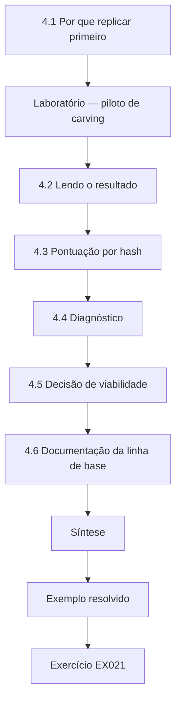

### Desenho lógico

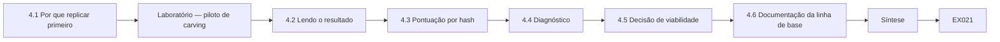

```text
[4.1 Por que replicar primeiro]
    |
    v
[Laboratório — piloto de carving]
    |
    v
[4.2 Lendo o resultado]
    |
    v
[4.3 Pontuação por hash]
    |
    v
[4.4 Diagnóstico]
    |
    v
[4.5 Decisão de viabilidade]
    |
    v
[4.6 Documentação da linha de base]
    |
    v
[Síntese]
    |
    v
[Exemplo resolvido] --> [Exercício EX021]
```
<!-- open-cyber-academy:lesson-figures:end ch-04 -->


### Objetivos de aprendizagem

Você vai (1) replicar um método de *carving* de linha de base numa pequena imagem sintética; (2) pontuar os resultados contra a verdade de referência por hash; (3) diagnosticar por que as recuperações falham; (4) decidir se o piloto justifica o estudo principal.

### 4.1 Por que replicar primeiro

Uma linha de base implementada de forma errada torna sem sentido todas as comparações posteriores. Ines primeiro implementa o *carving* simples por cabeçalho e rodapé e o executa numa imagem cuja verdade ela controla. A imagem do piloto é pequena de propósito. Com quatro arquivos de *layout* conhecido, Ines consegue prever à mão o que uma linha de base correta deve recuperar antes de executá-la. Se a saída diferisse da previsão, o *carver* ou o pontuador estaria errado, e ela corrigiria isso antes de gerar centenas de imagens maiores para o estudo principal.

### Laboratório — piloto de carving

```python
"""Lab (ch 04): header/footer carving on a synthetic byte image, scored against ground truth (no real media)."""
import hashlib, random
random.seed(7)
H, F = b"\xff\xd8\xff", b"\xff\xd9"
def body(n): return bytes(random.randrange(0, 255) for _ in range(n)).replace(b"\xff", b"\x00")
truth = {name: H + body(n) + F for name, n in (("a", 300), ("b", 500), ("c", 200), ("d", 400))}
c1, c2 = truth["c"][:100], truth["c"][100:]
image = body(64) + truth["a"] + body(32) + truth["b"] + c1 + body(50) + c2 + body(20) + truth["d"][:250] + body(40)
carved, pos = [], 0
while (s := image.find(H, pos)) != -1:
    e = image.find(F, s)
    nxt = image.find(H, s + 1)
    if e == -1 or (nxt != -1 and nxt < e):
        carved.append(image[s:nxt if nxt != -1 else len(image)]); pos = s + 1; continue
    carved.append(image[s:e + 2]); pos = e + 2
th = {hashlib.sha256(v).hexdigest(): k for k, v in truth.items()}
intact = [th[hashlib.sha256(c).hexdigest()] for c in carved if hashlib.sha256(c).hexdigest() in th]
print("carved:", len(carved), "intact matches:", sorted(intact))
print("recall:", f"{len(intact)}/{len(truth)}", "precision:", f"{len(intact)}/{len(carved)}")
```

Execute com `python3 lab_carve.py`. Saída verificada:

```text
carved: 4 intact matches: ['a', 'b']
recall: 2/4 precision: 2/4
```

### 4.2 Lendo o resultado

Quatro arquivos candidatos foram recuperados. Dois — a e b, ambos contíguos — correspondem exatamente aos hashes SHA-256 da verdade de referência. O arquivo c foi dividido em dois fragmentos com 50 bytes de dados alheios entre eles; o *carver* foi do cabeçalho ao rodapé de c e capturou os bytes intrusos, por isso o hash não confere. O arquivo d foi truncado: falta seu rodapé, então o *carver* seguiu até o fim da imagem. Revocação e precisão são ambas 2/4. Essas duas falhas são as que se espera do *carving* por cabeçalho e rodapé, de modo que o piloto confirma que tanto o gerador quanto o pontuador se comportam como projetado. O valor 2/4 não é um resultado do estudo; mostra apenas que a pontuação conta cada caso corretamente.

### 4.3 Pontuação por hash

A igualdade de hash é estrita: um byte errado faz falhar. Isso é apropriado para "recuperação intacta". Uma medida secundária — a sobreposição de bytes com a verdade — pode dar crédito à recuperação parcial, e a tese deve relatar ambas. Para o arquivo c do piloto, a sobreposição de bytes mostraria que a maior parte do arquivo foi capturada, com 50 bytes intrusos, enquanto a igualdade de hash o marca como perdido. Relatar as duas impede que os leitores confundam uma recuperação danificada com uma perda completa. O pontuador imprime as duas medidas para cada arquivo, para que os leitores vejam quais falhas de hash ainda recuperaram a maior parte dos bytes e quais não recuperaram quase nada.

### 4.4 Diagnóstico

Cada falha é explicada pelo manifesto: fragmentação (c) e truncamento (d). Ser capaz de explicar cada perda é evidência de que a pontuação funciona. Ines escreve o diagnóstico ao lado de cada falha em seu registro de análise, citando a entrada do manifesto com os limites dos fragmentos de c e o rodapé ausente de d. Uma perda que o manifesto não conseguisse explicar indicaria um defeito no gerador, no *carver* ou no pontuador, e ela pararia para encontrá-lo. As perdas do estudo principal são classificadas da mesma forma, a partir dos manifestos.

### 4.5 Decisão de viabilidade

O piloto é aprovado: o gerador e o pontuador se comportam como projetado, e as falhas correspondem a causas conhecidas. O estudo principal pode escalar para muitas imagens e condições. Ines também usa o piloto para conferir o esforço: gerar e pontuar uma imagem pequena leva pouco tempo, de modo que ela pode estimar quanto tempo as imagens do estudo principal vão levar antes de se comprometer com o cronograma. O Prof. Achebe aprova o piloto por escrito, e a aprovação é colocada no arquivo de reprodutibilidade junto com o registro do piloto. Se qualquer das falhas não tivesse causa conhecida, o estudo principal teria esperado.

### 4.6 Documentação da linha de base

O código, a semente e as saídas da linha de base são arquivados para que melhorias posteriores sejam comparadas exatamente com esta versão. Ines marca esta versão com uma *tag* em seu repositório e se refere à *tag* em cada tabela de resultados posterior. Se mais tarde ela corrigir um defeito na linha de base, a versão corrigida recebe uma nova *tag*, e qualquer valor produzido por ela é rotulado com essa *tag*, para que nenhum leitor confunda resultados de versões diferentes do *carver*. Executar de novo a linha de base marcada sobre a imagem do piloto deve dar novamente 2/4.

### Exemplo resolvido

O primeiro pontuador de Ines comparava tamanhos de arquivo em vez de hashes e relatava c como recuperado porque seu comprimento recuperado era próximo. A troca para hashes expôs o erro. Ela registra a mudança no registro de análise.

> **Caso sintético.** A imagem é material didático inventado.

### Erros e limites

Um piloto de quatro arquivos prova a mecânica, não o desempenho.

### Exercícios

- **EX021 — Contagens do piloto.** Relate a quantidade recuperada pelo piloto, as correspondências intactas, a revocação e a precisão. *Rubrica:* 3 = 4 recuperados; a, b intactos; 2/4 cada; 2 = a maior parte; 1 = um; 0 = nada.
- **EX022 — Falha do arquivo c.** Por que o arquivo c não correspondeu? *Rubrica:* 3 = fragmentado; bytes intrusos capturados; 2 = parcial; 1 = defeito de hash; 0 = nada.
- **EX023 — Falha do arquivo d.** Por que o arquivo d falhou? *Rubrica:* 3 = truncado, sem rodapé; seguiu até o fim da imagem; 2 = parcial; 1 = fragmentado; 0 = nada.
- **EX024 — Pontuação por tamanho.** O que deu errado quando o pontuador comparava tamanhos? *Rubrica:* 3 = deu crédito ao c corrompido como recuperado; hashes necessários; 2 = parcial; 1 = vago; 0 = nada.
- **EX025 — Segunda medida.** Por que relatar a sobreposição de bytes além da correspondência de hash? *Rubrica:* 3 = dá crédito à recuperação parcial; complementa a medida estrita; 2 = parcial; 1 = redundante; 0 = nada.
- **EX026 — Decisão de aprovação.** Com base em quê o piloto é aprovado? *Rubrica:* 3 = a mecânica funciona; as falhas correspondem a causas conhecidas; 2 = um; 1 = revocação alta; 0 = nada.

### Síntese

Replique a linha de base, pontue estritamente por hash, explique cada perda e use o piloto para decidir a viabilidade, não o desempenho.

### Continue estudando — capítulo 04 de 08

[← Capítulo 03 (rascunho)](#ch-03) · [Índice de capítulos do curso](../SUBJECTS.md) · [Capítulo 05 (rascunho) →](#ch-05)

<a id="ch-05"></a>

## Capítulo 5 — Estudo principal e validação independente

<!-- open-cyber-academy:lesson-figures:start ch-05 -->
### Mapa da aula

Aula 05 publicada. Mapa, exemplo, EX027.

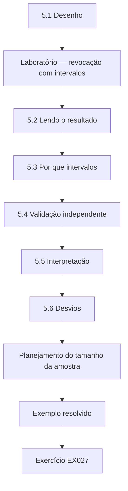

### Desenho lógico

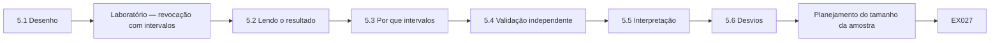

```text
[5.1 Desenho]
    |
    v
[Laboratório — revocação com intervalos]
    |
    v
[5.2 Lendo o resultado]
    |
    v
[5.3 Por que intervalos]
    |
    v
[5.4 Validação independente]
    |
    v
[5.5 Interpretação]
    |
    v
[5.6 Desvios]
    |
    v
[Planejamento do tamanho da amostra]
    |
    v
[Exemplo resolvido] --> [Exercício EX027]
```
<!-- open-cyber-academy:lesson-figures:end ch-05 -->


### Objetivos de aprendizagem

Você vai (1) conduzir o estudo principal em condições controladas; (2) relatar a revocação com estimativas intervalares; (3) organizar uma validação independente; (4) interpretar os resultados sem exagero.

### 5.1 Desenho

Três condições — imagens contíguas, 10% fragmentadas e 30% fragmentadas —, cada uma com 50 arquivos-alvo gerados a partir de sementes registradas. O *carver* de linha de base é executado nas três; as saídas são pontuadas por hash contra os manifestos. Com 50 arquivos por condição, cada valor de revocação se apoia numa contagem, como 48 de 50 arquivos contíguos recuperados intactos. As sementes estão listadas no pré-registro, de modo que ninguém pode depois trocar uma imagem incômoda por outra mais conveniente. O pontuador roda sem mudanças desde o piloto, e sua *tag* é impressa com cada tabela de resultados.

### Laboratório — revocação com intervalos

```python
"""Lab (ch 05): recall per synthetic test image with Wilson 95% intervals (stdlib only)."""
from math import sqrt
def wilson(k, n, z=1.96):
    p = k / n; d = 1 + z*z/n
    c = (p + z*z/(2*n)) / d; h = z*sqrt(p*(1-p)/n + z*z/(4*n*n)) / d
    return round(c - h, 3), round(c + h, 3)
runs = {"img-contig": (48, 50), "img-frag10": (41, 50), "img-frag30": (29, 50)}
for name, (k, n) in runs.items():
    print(name, f"recall={k/n:.2f}", "CI95=", wilson(k, n))
```

Execute com `python3 lab_wilson.py`. Saída verificada:

```text
img-contig recall=0.96 CI95= (0.865, 0.989)
img-frag10 recall=0.82 CI95= (0.692, 0.902)
img-frag30 recall=0.58 CI95= (0.442, 0.706)
```

### 5.2 Lendo o resultado

A revocação é 0,96 nas imagens contíguas (intervalo de Wilson de 95%: 0,865–0,989), 0,82 com 10% de fragmentação (0,692–0,902) e 0,58 com 30% (0,442–0,706). A revocação cai à medida que a fragmentação aumenta, o que sustenta H1. Os intervalos das condições contígua e de 30% não se sobrepõem; o intervalo de 10% se sobrepõe aos dois vizinhos, de modo que o estudo não consegue distinguir com confiança a condição de 10% de nenhum dos extremos com este tamanho de amostra. Ines redige isso com cuidado porque os dados sustentam uma tendência, não uma curva precisa. Sua tese relata os três intervalos numa só tabela e evita dizer que 10% de fragmentação causa uma queda específica. As estimativas pontuais são contagens de 48, 41 e 29 arquivos recuperados de 50.

### 5.3 Por que intervalos

Um número único esconde a incerteza. Laboratórios que citam uma taxa de erro precisam de sua faixa. O intervalo de Wilson se comporta melhor do que a aproximação normal simples quando as proporções estão perto de 0 ou de 1. Os próprios valores de Ines mostram por quê. Uma revocação contígua de 0,96 a partir de 50 arquivos poderia refletir uma taxa verdadeira em qualquer ponto entre cerca de 0,87 e 0,99, e um laboratório que use o *carver* deveria planejar em torno do limite inferior. Relatar apenas 0,96 convidaria os leitores a tratar o método como quase perfeito em mídias não fragmentadas. Ines calcula o intervalo de Wilson em seu próprio *script* e o imprime ao lado de cada contagem.

### 5.4 Validação independente

Um segundo laboratório, que recebe o gerador, as sementes e o *carver*, refaz o estudo. A ISO/IEC 27042 enfatiza a repetibilidade (mesmo laboratório, mesmo método) e a reprodutibilidade (laboratório ou operador diferente). Hashes de saída coincidentes demonstram reprodutibilidade. O segundo laboratório não recebe resultados de antemão, apenas o gerador, as sementes, o *carver*, o pontuador e o README, de modo que sua execução testa o arquivo de reprodutibilidade além do método. Ines compara os hashes de saída e as contagens de revocação dele com os seus, condição por condição, e registra cada diferença com sua causa, em vez de tirar a média das duas execuções.

### 5.5 Interpretação

O achado se aplica ao *carving* por cabeçalho e rodapé de arquivos do tipo JPEG nestas imagens sintéticas. Ele não declara taxas de erro do mundo real para nenhuma ferramenta comercial. Ines repete esse limite no resumo, no capítulo de resultados e na conclusão, para que nenhuma frase isolada possa ser citada sem suas condições. Um laboratório que queira uma taxa de erro para seu próprio *carver* em suas próprias mídias precisa fazer sua própria validação; o gerador dela lhe dá um meio de fazê-lo. O achado não pode ordenar ferramentas nem prever a revocação em nenhum disco real.

### 5.6 Desvios

Uma semente produziu uma imagem com um padrão de cabeçalho extra acidental no ruído; ela é mantida e relatada, não removida, porque remover dados incômodos enviesa os resultados. Ines também registra uma mudança de escopo. O método de remontagem listado entre os métodos comparados não foi executado no estudo principal; as medidas pré-registradas cobriam apenas a linha de base, por isso a comparação com a remontagem passou para trabalho futuro e o enunciado da contribuição foi revisado para corresponder. A imagem ruidosa permanece na condição de 30%, e seu efeito é descrito no registro de desvios.

### Planejamento do tamanho da amostra

Antes da execução principal, Ines confere quão largos seriam os intervalos para diferentes quantidades de arquivos. Com 50 arquivos, uma revocação observada perto de 0,8 dá um intervalo de cerca de 0,2 de largura. Reduzir essa largura à metade exige cerca de quatro vezes mais arquivos; ela reserva orçamento para isso no estudo ampliado.

### Exemplo resolvido

Os números do laboratório de validação coincidem exatamente em duas condições, mas diferem em um arquivo na de 30%. A investigação mostra que ele usou uma versão mais nova do Python, cujo gerador aleatório se comportava de outra forma numa função auxiliar. Ines fixa as versões no arquivo de reprodutibilidade e registra a discrepância.

> **Caso sintético.** Os valores são material didático inventado.

### Erros e limites

Cinquenta arquivos por condição dão intervalos largos; mais imagens os estreitariam.

### Exercícios

- **EX027 — Leitura do intervalo.** Declare a revocação e o intervalo de 95% com 30% de fragmentação. *Rubrica:* 3 = 0,58, 0,442–0,706; 2 = um; 1 = errado; 0 = nada.
- **EX028 — Significado da sobreposição.** O que implica a sobreposição do intervalo de 10% com os dois vizinhos? *Rubrica:* 3 = não é possível distinguir com este tamanho de amostra; 2 = parcial; 1 = significativo; 0 = nada.
- **EX029 — Escolha de Wilson.** Por que usar o intervalo de Wilson? *Rubrica:* 3 = melhor perto de 0/1 do que a aproximação normal; 2 = parcial; 1 = sem razão; 0 = nada.
- **EX030 — Repetir vs. reproduzir.** Distinga repetibilidade de reprodutibilidade. *Rubrica:* 3 = mesmo laboratório/operador vs. diferente; 2 = parcial; 1 = iguais; 0 = nada.
- **EX031 — Semente estranha.** Por que manter a imagem com um padrão de cabeçalho acidental? *Rubrica:* 3 = remover dados incômodos enviesa; relatá-la; 2 = parcial; 1 = excluir; 0 = nada.
- **EX032 — Deriva de versão.** O que causou a discrepância da validação, e qual foi a correção? *Rubrica:* 3 = diferença de versão do Python; fixar versões; 2 = um; 1 = vago; 0 = nada.

### Síntese

Conduza condições controladas, relate intervalos, busque reprodução independente e limite a interpretação ao que foi testado.

### Continue estudando — capítulo 05 de 08

[← Capítulo 04 (rascunho)](#ch-04) · [Índice de capítulos do curso](../SUBJECTS.md) · [Capítulo 06 (rascunho) →](#ch-06)

<a id="ch-06"></a>

## Capítulo 6 — Crítica de pares e revisão

<!-- open-cyber-academy:lesson-figures:start ch-06 -->
### Mapa da aula

Aula 06 publicada. Mapa, exemplo, EX033.

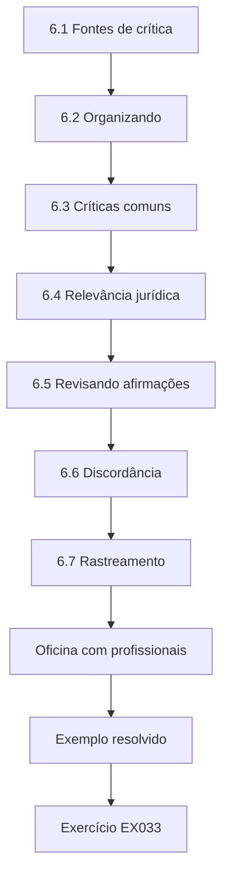

### Desenho lógico


```text
[6.1 Fontes de crítica]
    |
    v
[6.2 Organizando]
    |
    v
[6.3 Críticas comuns]
    |
    v
[6.4 Relevância jurídica]
    |
    v
[6.5 Revisando afirmações]
    |
    v
[6.6 Discordância]
    |
    v
[6.7 Rastreamento]
    |
    v
[Oficina com profissionais]
    |
    v
[Exemplo resolvido] --> [Exercício EX033]
```
<!-- open-cyber-academy:lesson-figures:end ch-06 -->


### Objetivos de aprendizagem

Você vai (1) solicitar e organizar a crítica de um estudo pericial; (2) responder ponto a ponto; (3) revisar afirmações e análises de forma transparente; (4) lidar com críticas sobre relevância jurídica.

### 6.1 Fontes de crítica

Orientador, banca, colegas de laboratório, pareceristas de conferências e profissionais da prática. Os profissionais perguntam se os resultados ajudam no trabalho com casos; os acadêmicos perguntam sobre o método. Ines trata os dois tipos de pergunta como úteis. Um profissional que pergunta se uma revocação de 0,58 deveria mudar a forma como resultados de *carving* são relatados aponta para a nota para profissionais que ela planeja, enquanto um acadêmico que pergunta sobre a escolha do intervalo testa o capítulo de método. Ela mantém os dois numa só tabela para que os comentários de nenhum dos grupos se percam. Pareceristas de conferências costumam pedir comparação com outros *carvers*, o que ela responde apontando para o escopo declarado e para o trabalho futuro sobre remontagem.

### 6.2 Organizando

Ines coloca cada comentário numa tabela: comentário, categoria (método, dados, interpretação, apresentação), resposta, mudança feita, localização. A tabela torna o progresso visível para o Prof. Achebe: cada linha mostra se um comentário foi aceito, parcialmente aceito ou respondido com evidências, e onde a tese mudou. Antes de cada reunião da banca, ela filtra as linhas ainda abertas, para que nenhum comentário seja esquecido. A versão final da tabela vai para o arquivo de reprodutibilidade junto com a tese, para que os examinadores possam rastrear cada mudança até o comentário que a motivou.

### 6.3 Críticas comuns

"Imagens sintéticas não são realistas." Resposta: o subestudo de realismo e os limites. "Só um tipo de arquivo." Resposta: aceito; listado como trabalho futuro, e um tipo semelhante a JPEG justificado por sua prevalência no trabalho com casos publicado. "A correspondência por hash é estrita demais." Resposta: resultados de sobreposição de bytes acrescentados. Cada resposta aponta para um lugar da tese onde a mudança pode ser conferida, como o capítulo de realismo ou a tabela de sobreposição de bytes. Uma resposta que não consegue apontar para esse lugar é tratada como inacabada. Críticas sobre realismo feitas por três pareceristas compartilham uma linha.

### 6.4 Relevância jurídica

Um profissional pergunta se as taxas de erro sobreviveriam ao escrutínio judicial de provas científicas. Ines responde que suas taxas se aplicam apenas ao método e às condições testados; os laboratórios precisam validar suas próprias ferramentas e procedimentos por processos no estilo da ISO/IEC 27041. Ela acrescenta um parágrafo curto sobre relevância jurídica ao seu capítulo de discussão. Ele explica que uma taxa de erro publicada para um método sob condições declaradas é um insumo para a validação de um laboratório, não um substituto dela, e nomeia as condições que um laboratório precisaria reproduzir antes de confiar nos valores dela.

### 6.5 Revisando afirmações

O resumo dizia originalmente "os *carvers* falham em arquivos fragmentados". Revisado: "A revocação do *carving* por cabeçalho e rodapé caiu de 0,96 para 0,58 à medida que a fragmentação subiu de 0% para 30% em imagens sintéticas." A revisão substituiu uma afirmação abrangente por uma vinculada a um método, a uma faixa de condições e a um conjunto de dados. Ines confere cada afirmação do resumo contra a tabela de resultados antes da submissão, e qualquer frase sem uma linha correspondente é cortada. A mesma conferência é repetida para a conclusão e para a nota para profissionais, porque as afirmações citadas fora de contexto costumam vir desses lugares.

### 6.6 Discordância

Quando Ines discorda, ela explica com evidências e oferece um meio-termo, como uma análise de sensibilidade adicional. Um parecerista queria que ela retirasse a condição de 10% porque seu intervalo se sobrepõe aos dois vizinhos. Ines a manteve, explicando que a sobreposição é em si um achado sobre o tamanho da amostra, e se ofereceu para relatar quantos arquivos por condição separariam os intervalos. O parecerista aceitou o meio-termo, e a tabela de comentários registra a troca. Ela nunca muda um resultado para resolver uma discordância; só a redação, a análise ou o escopo podem mudar, e cada mudança é registrada.

### 6.7 Rastreamento

Todas as revisões são registradas em *commits* com mensagens que fazem referência à tabela de comentários. Cada mensagem de *commit* nomeia o número da linha do comentário que responde, por exemplo, uma mudança no resumo que responde a uma observação da banca. Um leitor do repositório pode, portanto, seguir qualquer mudança até a pessoa e a razão que a motivaram. Ines também marca com uma *tag* a versão enviada a cada rodada de pareceristas, de modo que os comentários são sempre lidos contra o texto sobre o qual foram feitos. Quando um comentário não leva a nenhuma mudança, a linha registra por quê, de modo que a ausência de um *commit* também fica explicada.

### Oficina com profissionais

Ines apresenta resultados preliminares numa oficina com peritos de laboratório. Eles pedem resultados por tamanho de arquivo e orientação sobre quando suspeitar de fragmentação no trabalho com casos. Ela acrescenta uma decomposição por tamanho e uma nota curta para profissionais, mantendo ambas dentro das evidências que seu estudo sustenta, e agradece aos participantes nos agradecimentos sem nomear seus laboratórios.

### Exemplo resolvido

Um parecerista suspeita que o pontuador favorece a linha de base. Ines publica o pontuador separadamente e convida o parecerista a executá-lo em suas próprias imagens. O parecerista reproduz os números dela e retira a objeção.

> **Caso sintético.** O parecer é inventado.

### Erros e limites

Algumas críticas não podem ser resolvidas dentro de uma tese; liste-as abertamente.

### Exercícios

- **EX033 — Tabela de comentários.** Liste as colunas da tabela de comentários de Ines. *Rubrica:* 3 = comentário, categoria, resposta, mudança, localização; 2 = três; 1 = uma; 0 = nada.
- **EX034 — Resposta sobre realismo.** Como Ines respondeu a "imagens sintéticas não são realistas"? *Rubrica:* 3 = subestudo de realismo e limites declarados; 2 = parcial; 1 = descartou; 0 = nada.
- **EX035 — Pergunta sobre o tribunal.** O que Ines disse sobre o uso judicial de suas taxas de erro? *Rubrica:* 3 = aplicam-se apenas ao método testado; os laboratórios devem validar os seus; 2 = parcial; 1 = válidas em juízo; 0 = nada.
- **EX036 — Revisão do resumo.** Por que a afirmação do resumo foi revisada? *Rubrica:* 3 = genérica demais; substituída por enunciado medido e delimitado; 2 = parcial; 1 = estilo; 0 = nada.
- **EX037 — Suspeita sobre o pontuador.** Como a objeção de viés foi resolvida? *Rubrica:* 3 = pontuador liberado; parecerista reproduziu; 2 = parcial; 1 = ignorada; 0 = nada.
- **EX038 — Itens não resolvidos.** O que deve acontecer com críticas que não podem ser resolvidas? *Rubrica:* 3 = listá-las abertamente como limites/trabalho futuro; 2 = parcial; 1 = escondê-las; 0 = nada.

### Síntese

Organize a crítica, responda com evidências, restrinja as afirmações ao que foi medido e disponibilize as ferramentas para conferência independente.

### Continue estudando — capítulo 06 de 08

[← Capítulo 05 (rascunho)](#ch-05) · [Índice de capítulos do curso](../SUBJECTS.md) · [Capítulo 07 (rascunho) →](#ch-07)

<a id="ch-07"></a>

## Capítulo 7 — Síntese da tese e arquivo de reprodutibilidade

<!-- open-cyber-academy:lesson-figures:start ch-07 -->
### Mapa da aula

Aula 07 publicada. Mapa, exemplo, EX039.

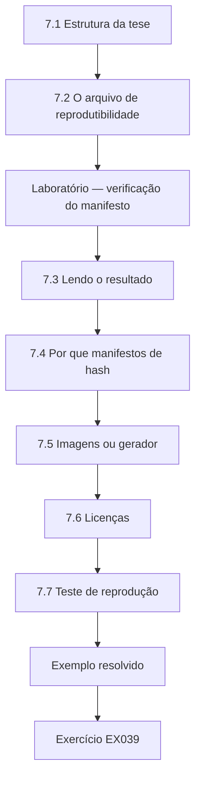

### Desenho lógico

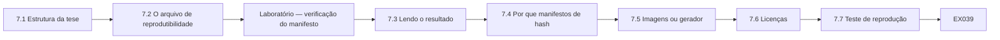

```text
[7.1 Estrutura da tese]
    |
    v
[7.2 O arquivo de reprodutibilidade]
    |
    v
[Laboratório — verificação do manifesto]
    |
    v
[7.3 Lendo o resultado]
    |
    v
[7.4 Por que manifestos de hash]
    |
    v
[7.5 Imagens ou gerador]
    |
    v
[7.6 Licenças]
    |
    v
[7.7 Teste de reprodução]
    |
    v
[Exemplo resolvido] --> [Exercício EX039]
```
<!-- open-cyber-academy:lesson-figures:end ch-07 -->


### Objetivos de aprendizagem

Você vai (1) estruturar uma tese de doutorado em perícia digital; (2) construir um arquivo de reprodutibilidade; (3) verificar a integridade do arquivo com hashes; (4) documentar o que outras pessoas precisam para refazer o trabalho.

### 7.1 Estrutura da tese

Introdução; fundamentação (sistemas de arquivos segundo Carrier, *carving*, normas de validação); projeto do gerador; piloto; estudo principal; validação por um segundo laboratório; discussão; limitações; conclusão; apêndices com manifestos e registros. A ordem espelha o raciocínio do estudo: o gerador precisa ser descrito antes que o piloto possa ser julgado, e o piloto antes do estudo principal. O capítulo de limitações lista a natureza sintética das imagens, a família única de arquivos e o método único executado no estudo principal. Os apêndices permitem que um examinador confira qualquer valor contra os registros brutos sem contatar Ines.

### 7.2 O arquivo de reprodutibilidade

Dados (as imagens ou o gerador mais as sementes), código (gerador, *carvers*, pontuador), ambiente (versões fixadas), resultados e um README que descreve como reproduzir cada tabela. Cada arquivo de resultado tem uma entrada SHA-256 num manifesto no topo do arquivo de reprodutibilidade. O README lista os comandos em ordem e a saída esperada de cada um, para que o leitor perceba imediatamente se sua execução reproduziu a tabela ou divergiu. Ines também informa o tamanho do próprio arquivo de reprodutibilidade e o tempo que uma execução completa leva num *notebook* comum.

### Laboratório — verificação do manifesto

```python
"""Lab (ch 07): SHA-256 manifest for a reproducibility archive, then verify a copy with one altered file."""
import hashlib
orig = {"data/img-contig.bin": b"synthetic-image-1", "data/img-frag10.bin": b"synthetic-image-2",
        "code/carve.py": b"print('carve')", "results/recall.csv": b"img,recall\ncontig,0.96\n"}
manifest = {p: hashlib.sha256(b).hexdigest() for p, b in orig.items()}
copy = dict(orig); copy["results/recall.csv"] = b"img,recall\ncontig,0.98\n"
for p in sorted(manifest):
    ok = hashlib.sha256(copy[p]).hexdigest() == manifest[p]
    print(p, "OK" if ok else "MISMATCH")
print("archive verified" if all(hashlib.sha256(copy[p]).hexdigest() == h for p, h in manifest.items()) else "archive FAILED verification")
```

Execute com `python3 lab_manifest.py`. Saída verificada:

```text
code/carve.py OK
data/img-contig.bin OK
data/img-frag10.bin OK
results/recall.csv MISMATCH
archive FAILED verification
```

### 7.3 Lendo o resultado

Três dos quatro arquivos da cópia do arquivo de reprodutibilidade correspondem às suas entradas no manifesto SHA-256. results/recall.csv não corresponde: seu valor de revocação mudou de 0,96 para 0,98. A verificação falha, exatamente como deve falhar quando qualquer resultado é alterado após a publicação. O laboratório demonstra, portanto, a conferência de propósito: um único dígito alterado basta para quebrar o manifesto. Ines executa a mesma verificação em seu arquivo de reprodutibilidade real antes da submissão, e a tese declara que todas as entradas conferiam naquela data. Como a falha nomeia results/recall.csv, Ines sabe qual tabela regenerar.

### 7.4 Por que manifestos de hash

O mesmo princípio protege as evidências: a ISO/IEC 27037 enfatiza preservar a integridade desde a aquisição, o que costuma ser demonstrado registrando valores de hash. Aplicá-lo a arquivos de pesquisa permite que os examinadores confiem que os resultados publicados são os que a tese relata. O próprio manifesto faz parte do apêndice da tese, de modo que alterar ao mesmo tempo um resultado e seu hash exigiria mudar também a tese depositada. Ines também registra a data em que o manifesto foi produzido e a *tag* do código que produziu os resultados que ele lista.

### 7.5 Imagens ou gerador

Publicar o gerador e as sementes ocupa menos espaço do que publicar as imagens e permite que outros as regenerem exatamente; Ines também publica uma imagem de amostra para conferências rápidas. A imagem de amostra permite que o leitor confira o *carver* rapidamente sem executar o gerador, e seu hash está no manifesto. Se alguma vez uma imagem regenerada diferir da amostra publicada, a diferença mostra que alguma parte do ambiente mudou, como aconteceu com a versão do Python durante a nova execução do segundo laboratório. Um leitor que regenere todos os 150 arquivos-alvo precisa apenas da lista de sementes e do gerador.

### 7.6 Licenças

Código sob licença aberta; texto sob os termos da universidade; nenhum dado de terceiros com termos restritivos. Ines conferiu a licença de cada dependência antes da liberação. Como seus laboratórios usam apenas a biblioteca padrão do Python, nenhuma licença de pacote externo se aplica ao código. O README declara a licença de cada parte do arquivo de reprodutibilidade, para que um laboratório possa reutilizar o gerador em seu próprio trabalho de validação sem pedir permissão, e a tese cita o texto da licença com um *link*. O escritório do repositório da universidade confirmou que depositar o arquivo de reprodutibilidade não conflita com seus termos.

### 7.7 Teste de reprodução

Antes da submissão, um colega segue o README numa máquina limpa e regenera todas as tabelas. O colega nunca viu o código e é orientado a não contatar Ines a menos que fique bloqueado. Cada ponto em que precisou adivinhar é tratado como uma falha do README e corrigido, e o teste é repetido até passar sem nenhuma pergunta. O relatório dele, com a data e a *tag* do arquivo de reprodutibilidade testado, é arquivado com a tese. O erro de caminho do *notebook* encontrado durante esse teste é citado como exemplo de por que a etapa vale o tempo que custa.

### Registros e cadernos

Os registros de análise anotam cada execução com data, semente, versão do código e hash da saída. Os examinadores podem rastrear qualquer valor da tese até a execução exata que o produziu.

### Exemplo resolvido

O teste de reprodução falha numa tabela porque um *script* lia um caminho de arquivo específico do *notebook* de Ines. Ela o substitui por um caminho relativo, executa de novo, atualiza o manifesto e registra a correção.

> **Caso sintético.** O arquivo de reprodutibilidade é inventado.

### Erros e limites

Um hash prova integridade, não correção; um resultado errado pode ser preservado fielmente.

### Exercícios

- **EX039 — Falha do manifesto.** Qual arquivo falhou na verificação, e por quê? *Rubrica:* 3 = results/recall.csv; valor mudou de 0,96→0,98; 2 = só o arquivo; 1 = errado; 0 = nada.
- **EX040 — Conteúdo do arquivo de reprodutibilidade.** Liste cinco componentes do arquivo de reprodutibilidade. *Rubrica:* 3 = dados/gerador+sementes, código, ambiente, resultados, README; 2 = três; 1 = um; 0 = nada.
- **EX041 — Paralelo com evidências.** Como o manifesto se relaciona com o tratamento de evidências? *Rubrica:* 3 = integridade por hashes, como na preservação da ISO/IEC 27037; 2 = parcial; 1 = vago; 0 = nada.
- **EX042 — Gerador em vez de imagens.** Por que publicar o gerador e as sementes em vez de apenas as imagens? *Rubrica:* 3 = menor; regeneração exata; 2 = um; 1 = sem razão; 0 = nada.
- **EX043 — Defeito de caminho.** O que quebrou o teste de reprodução, e como foi corrigido? *Rubrica:* 3 = caminho absoluto do *notebook*; caminho relativo, manifesto atualizado; 2 = um; 1 = vago; 0 = nada.
- **EX044 — Integridade vs. correção.** O que um hash coincidente não prova? *Rubrica:* 3 = que os resultados estão corretos; 2 = parcial; 1 = prova tudo; 0 = nada.

### Síntese

Estruture a tese com clareza, arquive tudo o que é necessário para refazê-la, verifique com hashes e teste a reprodução numa máquina limpa.

### Continue estudando — capítulo 07 de 08

[← Capítulo 06 (rascunho)](#ch-06) · [Índice de capítulos do curso](../SUBJECTS.md) · [Capítulo 08 (rascunho) →](#ch-08)

<a id="ch-08"></a>

## Capítulo 8 — Defesa e plano de publicação

<!-- open-cyber-academy:lesson-figures:start ch-08 -->
### Mapa da aula

Aula 08 publicada. Mapa, exemplo, EX045.

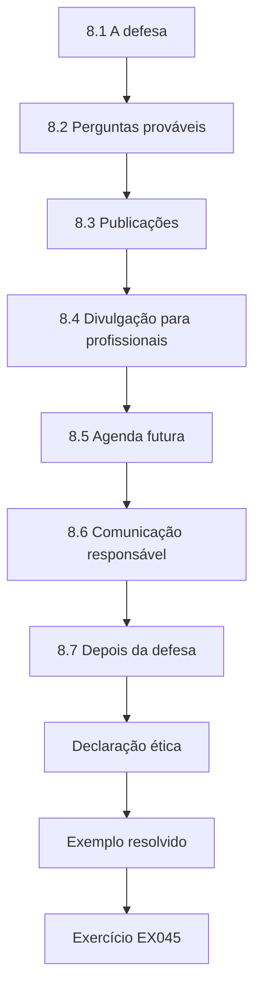

### Desenho lógico

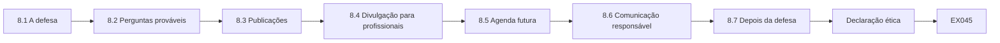

```text
[8.1 A defesa]
    |
    v
[8.2 Perguntas prováveis]
    |
    v
[8.3 Publicações]
    |
    v
[8.4 Divulgação para profissionais]
    |
    v
[8.5 Agenda futura]
    |
    v
[8.6 Comunicação responsável]
    |
    v
[8.7 Depois da defesa]
    |
    v
[Declaração ética]
    |
    v
[Exemplo resolvido] --> [Exercício EX045]
```
<!-- open-cyber-academy:lesson-figures:end ch-08 -->


### Objetivos de aprendizagem

Você vai (1) preparar uma defesa de doutorado em perícia digital; (2) antecipar perguntas de método, jurídicas e éticas; (3) planejar publicações e produtos para profissionais; (4) definir uma agenda de pesquisa de pós-doutorado.

### 8.1 A defesa

Vinte e cinco minutos: problema, contribuição, gerador, piloto, resultados principais com intervalos, validação, limites, impacto. Os examinadores sondam o método e as afirmações. Ines ensaia duas vezes com o Prof. Achebe e uma vez com colegas de laboratório no papel de examinadores hostis. Ela reserva um *slide* para a sobreposição do intervalo de 10%, porque espera essa pergunta, e coloca o significado em linguagem simples da revocação de 0,58 ao lado da tabela de resultados principais. A apresentação termina com os limites, e não com o impacto, para que a última coisa que os examinadores vejam seja a fronteira da afirmação.

### 8.2 Perguntas prováveis

Por que cabeçalho e rodapé como linha de base? Porque é amplamente descrito e seus pressupostos são explícitos. Por que arquivos do tipo JPEG? São prevalentes e têm estrutura bem definida. Quão realistas são as imagens? Responda a partir do subestudo de realismo. Um advogado de defesa poderia usar seu trabalho contra um perito? Sim, se um laboratório se apoiar numa ferramenta não validada; isso é uma razão para os laboratórios validarem, não uma falha da pesquisa. Ines prepara uma resposta de uma linha para cada pergunta e uma indicação da página onde estão as evidências.

### 8.3 Publicações

Um artigo em periódico sobre método e resultados; um artigo curto que descreve o gerador para reutilização do conjunto de dados; uma nota para profissionais que explica o que as taxas de erro significam e o que não significam. Cada produto tem um público diferente. O artigo precisa mostrar método e intervalos para os pareceristas; o artigo do gerador precisa explicar entradas e sementes para que outros possam reutilizá-lo; a nota para profissionais precisa dizer, em palavras simples, que os valores se aplicam ao *carving* por cabeçalho e rodapé em imagens sintéticas e não avaliam nenhuma ferramenta comercial. Os três citam a mesma versão do arquivo de reprodutibilidade, de modo que os valores da nota para profissionais podem ser rastreados até as mesmas execuções do artigo.

### 8.4 Divulgação para profissionais

Ofereça o gerador aos laboratórios para seus próprios exercícios de validação, de forma coerente com a orientação da ISO/IEC 27041 sobre o uso de testes externos dentro de um processo de validação. A oferta vem com um guia curto que explica como um laboratório pode definir níveis de fragmentação semelhantes aos de seus próprios casos e pontuar seu próprio *carver* contra os manifestos. Ines deixa claro que cabe ao laboratório, e não ao estudo dela, decidir se sua ferramenta é adequada ao propósito. O guia também declara quais propriedades das mídias reais o gerador não modela, para que os laboratórios saibam o que suas próprias verificações precisam cobrir.

### 8.5 Agenda futura

Mais tipos de arquivo; *layouts* realistas de sistemas de arquivos; métodos de remontagem; estudos de concordância entre peritos na interpretação de recuperações parciais. Cada item vem de um limite que ela relatou. Acrescentar tipos de arquivo responde ao limite da família única; *layouts* realistas respondem à crítica de realismo; os métodos de remontagem completam a comparação que o estudo principal deixou de fora; e o estudo de concordância trata de como os peritos redigem recuperações parciais. O Prof. Achebe sugere ordená-los por viabilidade para um projeto de pós-doutorado, começando pela comparação com a remontagem, porque o código já existe. Cada um reutiliza o gerador e os manifestos, de modo que não precisa de dados novos.

### 8.6 Comunicação responsável

A imprensa pode simplificar demais ("ferramentas forenses perdem 40% dos arquivos"). Prepare uma redação simples com as condições anexadas. A frase preparada por Ines diz: em imagens sintéticas com 30% de fragmentação, um método básico de *carving* recuperou intactos 58% dos arquivos de fotografia. Ela nomeia o método, as mídias e a condição. Ela também prepara uma resposta para a pergunta seguinte, sobre se as ferramentas reais são tão fracas assim: seu estudo não as testou, e os laboratórios devem conferir as suas. A assessoria de imprensa da universidade recebe a frase antes de qualquer entrevista, com as condições anexadas.

### 8.7 Depois da defesa

Faça as correções exigidas, deposite o arquivo de reprodutibilidade com um identificador persistente e atualize o README com a versão final. Cada correção é listada numa tabela com o comentário do examinador, a mudança e a página. Se uma correção alterar algum valor, os *scripts* são executados de novo a partir do arquivo marcado com *tag*, o manifesto é regenerado, e as versões antiga e nova são ambas mantidas. O identificador persistente passa então a apontar para a versão final depositada, que é a citada no artigo e na nota para profissionais.

### Declaração ética

A tese termina com uma declaração: nenhuma mídia real, nenhum dado pessoal, nenhum malware manipulado; gerador liberado abertamente; resultados delimitados às condições declaradas.

### Exemplo resolvido

Um examinador pergunta se uma revocação de 0,58 significa que as evidências obtidas por *carving* não são confiáveis. Ines responde: significa que o *carving* por cabeçalho e rodapé perde muitos arquivos fragmentados nestas imagens; os arquivos recuperados que correspondem a um hash conhecido continuam confiáveis pelo que são, e a ausência de um arquivo recuperado não mostra que o arquivo nunca existiu.

> **Caso sintético.** A defesa é inventada.

### Erros e limites

As defesas testam a comunicação tanto quanto o conteúdo; ensaie com colegas críticos.

### Exercícios

- **EX045 — Defesa da linha de base.** Justifique o *carving* por cabeçalho e rodapé como linha de base. *Rubrica:* 3 = amplamente descrito; pressupostos explícitos; 2 = um; 1 = o mais fácil; 0 = nada.
- **EX046 — Pergunta do advogado.** Como Ines deve responder à pergunta do advogado de defesa? *Rubrica:* 3 = mostra a necessidade de validação pelo laboratório, não uma falha da pesquisa; 2 = parcial; 1 = evasiva; 0 = nada.
- **EX047 — Três produtos.** Nomeie três publicações ou produtos planejados. *Rubrica:* 3 = artigo em periódico, artigo do gerador, nota para profissionais; 2 = dois; 1 = um; 0 = nada.
- **EX048 — Redação para a imprensa.** Reescreva com exatidão "ferramentas forenses perdem 40% dos arquivos". *Rubrica:* 3 = método, tipo de arquivo, condições, sintético; 2 = parcial; 1 = inalterada; 0 = nada.
- **EX049 — Inferência a partir da ausência.** O que a falha em recuperar um arquivo por *carving* não mostra? *Rubrica:* 3 = que ele nunca existiu; 2 = parcial; 1 = que ele não existia; 0 = nada.
- **EX050 — Depósito do arquivo de reprodutibilidade.** O que acontece com o arquivo de reprodutibilidade depois da defesa? *Rubrica:* 3 = correções, depósito com identificador persistente, atualização do README; 2 = dois; 1 = um; 0 = nada.

### Síntese

Defenda com afirmações precisas e delimitadas; planeje produtos para pesquisadores e profissionais; e comunique as taxas de erro com responsabilidade.

### Continue estudando — capítulo 08 de 08

[← Capítulo 07 (rascunho)](#ch-07) · [Índice de capítulos do curso](../SUBJECTS.md) · [Resoluções ↓](#worked-results) · [Próximo curso pelo índice de capítulos →](../SUBJECTS.md)

<a id="worked-results"></a>

## Resoluções

Respostas-modelo para EX001–EX050. O Holloway Digital Evidence Lab, Ines Varga, o Prof. Daniel Achebe e todos os valores são sintéticos. As respostas dos laboratórios citam saídas verificadas. Qualquer resposta que atenda à rubrica recebe a mesma pontuação.

**EX001.** A validação mostra que um método é adequado ao seu propósito em relação aos requisitos; a verificação confere se uma execução ou implementação específica se comporta como o método validado; uma taxa de erro declara com que frequência o método erra sob condições definidas — por exemplo, revocação de 0,82 do *carving* em imagens 10% fragmentadas.

**EX002.** Corpora compartilhados permitem que pesquisadores diferentes repitam e comparem estudos sem as barreiras de privacidade e legais dos dados de casos reais.

**EX003.** Cada arquivo e cada fragmento são registrados quando a imagem é construída, de modo que os itens recuperados podem ser pontuados exatamente contra a verdade.

**EX004.** "Estimar a revocação do *carving* para arquivos do tipo JPEG em imagens sintéticas com 0%, 10% e 30% de fragmentação, relatando intervalos de 95%."

**EX005.** Hipóteses, medidas primárias, plano de análise e regras de parada e de registro de mudanças.

**EX006.** A fonte de financiamento, qualquer relacionamento com o fornecedor e as versões exatas das ferramentas testadas.

**EX007.** Os resultados valem apenas na medida em que o gerador sintético se parece com mídias reais; a tese precisa declarar quais características do mundo real não foram modeladas.

**EX008.** O armazenamento cresce mais depressa do que o tempo dos peritos, por isso os métodos precisam priorizar artefatos sem perder evidências decisivas.

**EX009.** Ele pressupõe que os bytes de um arquivo estão contíguos entre o cabeçalho e o rodapé, de modo que arquivos fragmentados capturam dados alheios no meio.

**EX010.** Sistemas operacionais e *hardware* de celulares mudam com frequência, de modo que uma ferramenta validada no ano passado pode se comportar de outra forma agora.

**EX011.** Trabalhar num laboratório isolado, com aprovação institucional e com controles que impeçam qualquer liberação de amostras.

**EX012.** Com que consistência os peritos expressam a força de seus achados e concordam sobre ela.

**EX013.** Ele é estreito, mensurável contra a verdade de referência e seguro de conduzir.

**EX014.** Exigia manipular malware ativo e obter amostras reais, o que pontuou mal em segurança e em acesso a dados.

**EX015.** Ele nomeia o artefato (gerador), as medidas (revocação e precisão com intervalos), os métodos e as condições controladas.

**EX016.** Funcional: o método recupera todo arquivo cujos bytes estão integralmente presentes. Não funcional: a mesma entrada produz saída idêntica em execuções repetidas.

**EX017.** Para que qualquer pessoa possa regenerar a imagem idêntica e verificar os resultados.

**EX018.** Para cada arquivo, seus intervalos de bytes na imagem e seu hash SHA-256.

**EX019.** Comparando as distribuições de tamanho de fragmentos com descrições publicadas; as afirmações de realismo se restringem a essas propriedades medidas.

**EX020.** Pelo nome e pela versão exata, com as configurações utilizadas.

**EX021.** Quatro arquivos recuperados; a e b corresponderam aos hashes da verdade; revocação 2/4 e precisão 2/4.

**EX022.** O arquivo c foi dividido por 50 bytes alheios, que o *carver* incluiu entre o cabeçalho e o rodapé, por isso o hash diferiu.

**EX023.** Seu rodapé estava ausente porque o arquivo foi truncado, então o *carver* leu até o fim da imagem.

**EX024.** O tamanho recuperado do arquivo c era próximo do tamanho verdadeiro, por isso o pontuador baseado em tamanho o contou erroneamente como recuperado.

**EX025.** A correspondência de hash falha com um único byte errado; a sobreposição de bytes mostra quanto de um arquivo foi recuperado, o que dá um quadro mais completo.

**EX026.** O gerador e o pontuador funcionaram como projetado, e cada falha foi explicada pelo manifesto de verdade de referência.

**EX027.** Revocação de 0,58, com intervalo de Wilson de 95% de 0,442 a 0,706.

**EX028.** Com 50 arquivos por condição, o estudo não consegue separar com confiança a condição de 10% dos resultados contíguos nem dos de 30%.

**EX029.** Ele dá intervalos mais confiáveis quando as proporções estão perto de 0 ou de 1, como na revocação contígua de 0,96.

**EX030.** Repetibilidade é o mesmo laboratório e o mesmo operador obtendo o mesmo resultado; reprodutibilidade é um laboratório ou operador diferente obtendo-o.

**EX031.** Remover dados inconvenientes enviesa os resultados; mantê-los e relatá-los é o honesto.

**EX032.** Uma versão mais nova do Python mudou o comportamento aleatório de uma função auxiliar; Ines fixou as versões exatas no arquivo de reprodutibilidade.

**EX033.** Comentário, categoria, resposta, mudança feita e localização na tese.

**EX034.** Ela apontou para o subestudo de realismo e reafirmou que as conclusões se limitam às propriedades que ele mediu.

**EX035.** Suas taxas descrevem apenas o método testado em imagens sintéticas; cada laboratório precisa validar suas próprias ferramentas e procedimentos.

**EX036.** "Os *carvers* falham" generalizava demais; a revisão declara a queda de revocação medida e suas condições.

**EX037.** Ela liberou o pontuador; o parecerista o executou em imagens independentes, reproduziu os resultados e retirou a objeção.

**EX038.** Registrá-las abertamente na tese como limitações ou trabalho futuro.

**EX039.** results/recall.csv, porque seu valor de revocação contígua tinha sido alterado de 0,96 para 0,98 depois de o manifesto ser criado.

**EX040.** O gerador com as sementes (e uma imagem de amostra), todo o código, os detalhes do ambiente com versões fixadas, os arquivos de resultados e um README que explica a reprodução.

**EX041.** Ambos usam valores de hash registrados para mostrar que o material não mudou desde que foi capturado, como a ISO/IEC 27037 espera para as evidências.

**EX042.** Ocupa muito menos espaço e permite que qualquer pessoa regenere imagens idênticas a partir das sementes registradas.

**EX043.** Um *script* usava um caminho específico do *notebook* de Ines; a troca por um caminho relativo resolveu o problema, e o manifesto foi atualizado.

**EX044.** Que os resultados preservados estão corretos — apenas que não mudaram.

**EX045.** É amplamente descrito na literatura e seu pressuposto de contiguidade é explícito, o que faz dele um ponto de referência claro.

**EX046.** O trabalho mostra por que os laboratórios precisam validar suas ferramentas; contestar um método não validado é o sistema funcionando, não uma falha do estudo.

**EX047.** Um artigo em periódico sobre o método e os resultados, um artigo curto sobre o gerador e o conjunto de dados e uma nota para profissionais.

**EX048.** "Em imagens sintéticas com 30% de fragmentação, o *carving* por cabeçalho e rodapé recuperou intactos 58% dos arquivos do tipo JPEG."

**EX049.** Que o arquivo nunca existiu na mídia; ele pode estar fragmentado, sobrescrito ou ser de outro tipo.

**EX050.** Ines faz as correções, deposita o arquivo de reprodutibilidade com um identificador persistente e atualiza o README para a versão final.

<a id="references"></a>
## Referências

Todos os DOIs foram resolvidos em doi.org em 12 de outubro de 2026, e as normas foram conferidas nas páginas de seus editores. A lista é idêntica à da edição em inglês e cobre o livro inteiro; nenhuma das normas técnicas citadas foi verificada aqui como adotada pela ABNT, por isso são citadas em sua edição internacional. Organizações, pessoas, sistemas e números dos casos são sintéticos; somente as obras abaixo são reais.

- Carrier, B. (2005). *File System Forensic Analysis*. Addison-Wesley. ISBN 978-0-321-26817-4.
- Casey, E. (2011). *Digital Evidence and Computer Crime* (3rd ed.). Academic Press. ISBN 978-0-12-374268-1.
- Garfinkel, S. L. (2010). Digital forensics research: The next 10 years. *Digital Investigation*, 7, S64–S73. <https://doi.org/10.1016/j.diin.2010.05.009>
- Garfinkel, S., Farrell, P., Roussev, V., & Dinolt, G. (2009). Bringing science to digital forensics with standardized forensic corpora. *Digital Investigation*, 6, S2–S11. <https://doi.org/10.1016/j.diin.2009.06.016>
- IETF RFC 3227 (2002). Brezinski, D., & Killalea, T. Guidelines for Evidence Collection and Archiving. <https://www.rfc-editor.org/rfc/rfc3227>
- ISO/IEC 27037:2012. Guidelines for identification, collection, acquisition and preservation of digital evidence. <https://www.iso.org/standard/44381.html>
- ISO/IEC 27041:2015. Guidance on assuring suitability and adequacy of incident investigative method. <https://www.iso.org/standard/44405.html>
- ISO/IEC 27042:2015. Guidelines for the analysis and interpretation of digital evidence. <https://www.iso.org/standard/44406.html>
- ISO/IEC 27043:2015. Incident investigation principles and processes. <https://www.iso.org/standard/44407.html>
- MITRE ATT&CK. <https://attack.mitre.org/>
- NIST Computer Forensics Tool Testing (CFTT) Program. <https://www.nist.gov/itl/ssd/software-quality-group/computer-forensics-tool-testing-program-cftt>
- NIST National Software Reference Library (NSRL). <https://www.nist.gov/itl/ssd/software-quality-group/national-software-reference-library-nsrl>
- NIST SP 800-101 Rev. 1 (2014). Ayers, R., Brothers, S., & Jansen, W. Guidelines on Mobile Device Forensics. <https://doi.org/10.6028/NIST.SP.800-101r1>
- NIST SP 800-61 Rev. 3 (2025). Incident Response Recommendations and Considerations for Cybersecurity Risk Management. <https://doi.org/10.6028/NIST.SP.800-61r3>
- NIST SP 800-86 (2006). Kent, K., Chevalier, S., Grance, T., & Dang, H. Guide to Integrating Forensic Techniques into Incident Response. <https://doi.org/10.6028/NIST.SP.800-86>
- Sikorski, M., & Honig, A. (2012). *Practical Malware Analysis*. No Starch Press. <https://nostarch.com/malware>
- SWGDE (Scientific Working Group on Digital Evidence). Published documents. <https://www.swgde.org/documents/published-complete-listing>
