# Fatores Humanos e Política Cibernética: Trilha de Pesquisa de Doutorado

- Idioma: português do Brasil (`pt`); curso 190, trilha de pesquisa de doutorado (2 anos). Edição de referência: [inglês](../../en/book/MANUSCRIPT.md).
- Estado editorial: **publicado**. Os capítulos 1–8 de 8 têm texto didático escrito à mão; os exercícios EX001–EX050 têm resoluções correspondentes com rubricas de 0 a 3; os três laboratórios offline usam apenas a biblioteca padrão do Python 3 sobre dados sintéticos, e suas saídas foram incorporadas de execuções reais, idênticas às da edição em inglês. Revisão independente, revisão linguística e a verificação de 300 páginas A4 continuam em aberto.
- Público: doutorandos que testam se uma mudança na prática de conscientização em segurança muda o comportamento real dos funcionários.
- Autor: [hiagokinlevi](https://github.com/hiagokinlevi). Texto original sob [CC0 1.0](../../../../../LICENSE); as obras citadas mantêm seus direitos.
- Limites: os laboratórios calculam a concordância entre codificadores, o efeito de um desenho escalonado com verificação por permutação e digests de arquivo, sempre sobre dados sintéticos; nenhuma pessoa, caixa de e-mail ou simulação real está envolvida. As simulações de phishing descritas aqui seguem um protocolo ético: aprovação organizacional, nenhuma captura de credenciais, nenhuma culpa individual e relatórios apenas agregados. Pessoas, organizações, sistemas e dados são **sintéticos**, salvo quando uma frase cita uma fonte pública.

[Página do curso](../../README.md) · [Índice de capítulos](../SUBJECTS.md) · [Plano do livro](PLAN.md) · [Skill do curso](../../skill/SKILL.md) · [Resoluções](#worked-results)

## Como usar este rascunho

Leia na ordem. Os capítulos acompanham uma doutoranda que testa se um programa de conscientização centrado em reportes melhora o reporte rápido de e-mails suspeitos reais: integridade e métodos, a fronteira da pesquisa, a proposta, a replicação da linha de base e o piloto, o estudo principal e a validação, a crítica, a síntese e o arquivo, e a defesa. Execute cada laboratório onde ele aparece, tente os exercícios antes de consultar as resoluções e avalie-se com as rubricas.

### Caso sintético

| Elemento | Papel | Natureza |
|---|---|---|
| **Mireille Okonjo** | Doutoranda | Inventada |
| **Prof. Henrik Aalto** | Orientador | Inventado |
| **Calder University** | Universidade fictícia | Inventada |
| **Vantor Municipal Services** | Prefeitura fictícia com 4.000 servidores | Inventada |
| **Brenholt District** | Prefeitura fictícia da replicação | Inventada |

### Fontes principais

Adams e Sasse (1999), [doi:10.1145/322796.322806](https://doi.org/10.1145/322796.322806); Sasse, Brostoff e Weirich (2001), [doi:10.1023/A:1011902718709](https://doi.org/10.1023/A:1011902718709); Whitten e Tygar (1999); Herley (2009), [doi:10.1145/1719030.1719050](https://doi.org/10.1145/1719030.1719050); Lain, Kostiainen e Čapkun (2022), [doi:10.1109/SP46214.2022.9833766](https://doi.org/10.1109/SP46214.2022.9833766); NIST [SP 800-50 Rev. 1](https://doi.org/10.6028/NIST.SP.800-50r1) e a [NIST Phish Scale](https://doi.org/10.6028/NIST.TN.2276). Lista completa em [Referências](#references).

## Sumário

| Capítulos em português |
|---|
| [1](#ch-01) · [2](#ch-02) · [3](#ch-03) · [4](#ch-04) · [5](#ch-05) · [6](#ch-06) · [7](#ch-07) · [8](#ch-08) |

[Resoluções](#worked-results) · [Referências](#references)

<a id="ch-01"></a>

## Capítulo 1 — Integridade e métodos avançados de pesquisa

<!-- open-cyber-academy:lesson-figures:start ch-01 -->
### Mapa da aula

Aula 01 publicada. Mapa, exemplo, EX001.

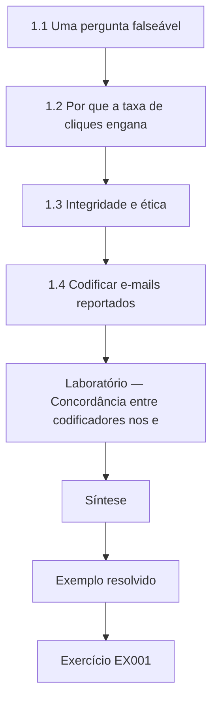

### Desenho lógico

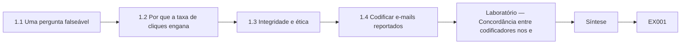

```text
[1.1 Uma pergunta falseável]
    |
    v
[1.2 Por que a taxa de cliques engana]
    |
    v
[1.3 Integridade e ética]
    |
    v
[1.4 Codificar e-mails reportados]
    |
    v
[Laboratório — Concordância entre codificadores nos e]
    |
    v
[Síntese]
    |
    v
[Exemplo resolvido] --> [Exercício EX001]
```
<!-- open-cyber-academy:lesson-figures:end ch-01 -->


### Objetivos de aprendizagem

Você vai (1) formular uma pergunta falseável sobre comportamento de segurança; (2) definir regras de integridade e de ética para pesquisas com funcionários; (3) medir a concordância na codificação de e-mails reportados.

### 1.1 Uma pergunta falseável

Mireille Okonjo é doutoranda na fictícia Calder University, sob orientação do Prof. Henrik Aalto. Sua parceira é a fictícia Vantor Municipal Services, uma prefeitura com quatro mil servidores. O programa de conscientização da Vantor é avaliado pela proporção de servidores que clicam em links de phishing simulado. A pergunta de Mireille é mais estreita e testável: um programa construído sobre a facilidade de reportar e sobre um retorno imediato e acolhedor aumenta a proporção de e-mails suspeitos reais reportados em até trinta minutos, em comparação com o programa atual, centrado em cliques? Ela registra de antemão qual resultado mostraria que sua ideia está errada.

### 1.2 Por que a taxa de cliques engana

Mireille revisa as críticas à taxa de cliques como desfecho. A taxa de cliques depende fortemente da dificuldade da isca, por isso muda quando a simulação muda, mesmo que o comportamento das pessoas continue o mesmo. Lain, Kostiainen e Čapkun (2022) estudaram phishing em uma grande organização por um longo período e constataram que algumas práticas populares de treinamento não ajudaram como se esperava, enquanto os reportes feitos pelos funcionários eram um sinal valioso. Dawkins e Jacobs (2023) descrevem a NIST Phish Scale, que classifica a dificuldade das iscas. Ela decide fixar a dificuldade das iscas em seu estudo e usar o reporte como desfecho principal.

### 1.3 Integridade e ética

Pesquisas com funcionários trazem riscos de engano, constrangimento e desequilíbrio de poder. O protocolo de Mireille, aprovado pelo comitê de ética da Calder e pela comissão de representantes dos servidores da Vantor, fixa regras: as simulações são anunciadas antecipadamente em nível organizacional, sem datas; nenhum resultado individual chega aos gestores; ninguém é punido por clicar; nenhuma credencial real é coletada, pois a página de destino registra apenas que um link foi aberto; e quem clica vê uma explicação curta e acolhedora. Ela pré-registra hipóteses, desfechos e análise antes de coletar dados, para não poder ajustá-los depois de ver os resultados.

### 1.4 Codificar e-mails reportados

O desfecho depende de julgar se um e-mail real reportado era de fato suspeito. Dois codificadores treinados rotulam de forma independente uma amostra piloto de reportes como suspeitos ou benignos, seguindo um guia escrito. O laboratório calcula a concordância e o kappa de Cohen, que corrige a concordância esperada pelo acaso; Landis e Koch (1977) oferecem faixas convencionais para interpretá-lo. A concordância é alta o bastante para prosseguir, e as divergências levam a uma regra mais clara sobre newsletters com links de rastreamento. A concordância medida entre codificadores é parte da evidência de que o desfecho significa algo estável.

### Laboratório — Concordância entre codificadores nos e-mails reportados

```python
# Cohen's kappa for two coders labelling 50 pilot reports suspicious (1) or benign (0), synthetic.
a = [1] * 22 + [0] * 3 + [1] * 2 + [0] * 23
b = [1] * 22 + [1] * 3 + [0] * 2 + [0] * 23
n = len(a); po = sum(x == y for x, y in zip(a, b)) / n
pa, pb = sum(a) / n, sum(b) / n
pe = pa * pb + (1 - pa) * (1 - pb)
print(f"reports {n}; agreement {po:.2f}; chance {pe:.3f}; kappa {(po - pe) / (1 - pe):.2f}")
```

Execute com `python3 lab_kappa.py`. Saída verificada:

```text
reports 50; agreement 0.90; chance 0.500; kappa 0.80
```

### Exemplo resolvido

Mireille formula uma pergunta falseável sobre reportes, troca a taxa de cliques pelo reporte com dificuldade de isca fixa, escreve regras éticas para as simulações e mede a concordância entre codificadores.

> **Caso sintético.** A Calder, a Vantor e todas as pessoas são sintéticas; Lain et al. (2022), Dawkins e Jacobs (2023) e Landis e Koch (1977) são reais.

### Erros e limites

O pré-registro não impede todo viés. O kappa depende da prevalência na amostra.

### Exercícios

- **EX001 — Desfecho falseável.** O que torna falseável a pergunta de Mireille? *Rubrica:* 3 = ela declara de antemão qual resultado mostraria que a ideia está errada;; 2 = declaração prévia;; 1 = vago;; 0 = nenhuma.
- **EX002 — Falha da taxa de cliques.** Por que a taxa de cliques é um desfecho fraco? *Rubrica:* 3 = depende fortemente da dificuldade da isca;; 2 = dificuldade;; 1 = vago;; 0 = nenhuma.
- **EX003 — Ferramenta de dificuldade.** Que ferramenta publicada ajuda a classificar a dificuldade das iscas? *Rubrica:* 3 = a NIST Phish Scale (Dawkins e Jacobs, 2023);; 2 = Phish Scale;; 1 = vago;; 0 = nenhuma.
- **EX004 — Regra da página de destino.** Como o protocolo evita coletar credenciais? *Rubrica:* 3 = a página de destino registra apenas que um link foi aberto;; 2 = sem captura;; 1 = vago;; 0 = nenhuma.
- **EX005 — Relatórios a gestores.** Quem recebe resultados individuais das simulações? *Rubrica:* 3 = ninguém; só se reportam agregados;; 2 = agregados;; 1 = gestores;; 0 = nenhuma.
- **EX006 — Resultado do kappa.** Que kappa a codificação piloto alcançou no laboratório? *Rubrica:* 3 = 0.80 em 50 reportes, concordância 0.90;; 2 = cerca de 0,8;; 1 = vago;; 0 = nenhuma.
- **EX007 — Mudança na regra de codificação.** Que regra mudou após as divergências entre codificadores? *Rubrica:* 3 = newsletters com links de rastreamento passaram a ser definidas com mais clareza;; 2 = newsletters;; 1 = vago;; 0 = nenhuma.

### Síntese

O trabalho de doutorado sobre comportamento de segurança precisa de um resultado falseável, ética rigorosa para simulações e concordância medida sobre como os resultados são codificados.

<!-- open-cyber-academy:chapter-navigation:start ch-01 -->
### Continue estudando — aula 01 (capítulo 01 de 08)

[← Início do curso](../../README.md) · [Índice das aulas](../SUBJECTS.md) · [Capítulo 02 →](#ch-02)

Continue para a próxima aula já escrita.
<!-- open-cyber-academy:chapter-navigation:end -->

<a id="ch-02"></a>

## Capítulo 2 — Fatores humanos e política cibernética: fronteira da pesquisa

<!-- open-cyber-academy:lesson-figures:start ch-02 -->
### Mapa da aula

Aula 02 publicada. Mapa, exemplo, EX008.

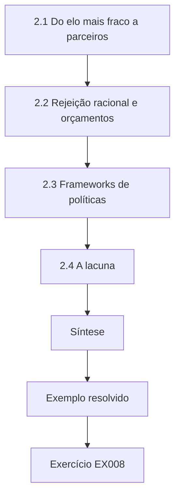

### Desenho lógico

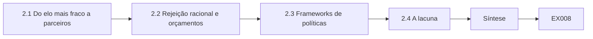

```text
[2.1 Do elo mais fraco a parceiros]
    |
    v
[2.2 Rejeição racional e orçamentos]
    |
    v
[2.3 Frameworks de políticas]
    |
    v
[2.4 A lacuna]
    |
    v
[Síntese]
    |
    v
[Exemplo resolvido] --> [Exercício EX008]
```
<!-- open-cyber-academy:lesson-figures:end ch-02 -->


### Objetivos de aprendizagem

Você vai (1) mapear a fronteira da pesquisa sobre conscientização e comportamento; (2) identificar lacunas que importam para políticas; (3) posicionar uma contribuição em relação aos trabalhos anteriores.

### 2.1 Do elo mais fraco a parceiros

Mireille reconstrói como o campo mudou. Adams e Sasse (1999) mostraram que usuários que quebravam as regras de senha muitas vezes estavam lidando com exigências impraticáveis, e não agindo com descuido. Sasse, Brostoff e Weirich (2001) argumentaram que chamar os usuários de elo mais fraco esconde falhas de projeto e que o objetivo deveria ser a segurança utilizável. Whitten e Tygar (1999) mostraram que mesmo usuários motivados não conseguiam usar corretamente um software de criptografia. Juntos, esses trabalhos deslocaram a fronteira da culpa atribuída às pessoas para o projeto de sistemas e políticas que se ajustem ao modo como as pessoas realmente trabalham.

### 2.2 Rejeição racional e orçamentos

Herley (2009) argumentou que os usuários muitas vezes rejeitam racionalmente conselhos de segurança porque, para eles, os custos superam os benefícios. Beautement, Sasse e Wonham (2008) descreveram um orçamento de compliance: as pessoas têm capacidade limitada para o esforço de segurança, e cada nova exigência compete com o trabalho. Bada, Sasse e Nurse (2019) revisaram por que campanhas de conscientização muitas vezes não mudam comportamentos, apontando mensagens de medo, excesso de informação e falta de apoio prático. Mireille observa que essas ideias preveem que sua intervenção só dará certo se reportar for barato e se o retorno for útil para os servidores.

### 2.3 Frameworks de políticas

Mireille revisa as orientações de política. A NIST SP 800-50 Rev. 1 (Hansche et al., 2024) trata conscientização e treinamento como um programa de aprendizagem, com papéis, levantamento de necessidades e avaliação. A ISO/IEC 27001:2022 (no Brasil, ABNT NBR ISO/IEC 27001:2022) exige que as organizações assegurem a conscientização e a competência das pessoas. As diretrizes de cultura de cibersegurança da ENISA (2019) se apoiam na ciência comportamental e recomendam medir a cultura, e não apenas a conclusão de cursos. Ela observa que os frameworks exigem avaliação, mas raramente dizem que desfecho avaliar, o que leva as organizações a recorrer a contagens de conclusão e a taxas de cliques por serem fáceis de medir. Essa lacuna é um dos motivos de ela ter escolhido o reporte como desfecho principal.

### 2.4 A lacuna

Mireille declara a lacuna: poucos estudos comparam programas centrados em reportes com programas centrados em cliques em uma organização do setor público, com dificuldade de isca fixa, desfechos pré-registrados e uma replicação independente. Sua contribuição é um estudo de campo escalonado com essas características e um protocolo de medição reutilizável. O Prof. Aalto a pressiona a declarar também o que a contribuição não é: ela não mede se os incidentes de violação diminuem, o que exigiria muito mais tempo e dados. Posicionar uma afirmação com precisão diante dos trabalhos anteriores a protege tanto do exagero quanto do descarte.

### Exemplo resolvido

Mireille reconstrói a passagem do pensamento do elo mais fraco para a segurança utilizável, revisa os argumentos de orçamento e de rejeição, mapeia as orientações de política e declara uma lacuna precisa.

> **Caso sintético.** O posicionamento é sintético; todas as obras citadas são reais.

### Erros e limites

Mapas da literatura refletem as escolhas de quem lê. As orientações de política mudam entre revisões.

### Exercícios

- **EX008 — Achado de Adams e Sasse.** O que Adams e Sasse (1999) constataram sobre usuários que quebravam regras? *Rubrica:* 3 = lidavam com exigências impraticáveis, não eram descuidados;; 2 = enfrentamento;; 1 = descuido;; 0 = nenhuma.
- **EX009 — Estudo do Johnny.** O que Whitten e Tygar (1999) mostraram? *Rubrica:* 3 = usuários motivados não conseguiam usar corretamente software de criptografia;; 2 = usabilidade;; 1 = vago;; 0 = nenhuma.
- **EX010 — Rejeição racional.** Por que, segundo Herley (2009), usuários podem rejeitar racionalmente os conselhos? *Rubrica:* 3 = os custos superam os benefícios para eles;; 2 = custo-benefício;; 1 = ignorância;; 0 = nenhuma.
- **EX011 — Ideia do orçamento de compliance.** O que é o orçamento de compliance? *Rubrica:* 3 = capacidade limitada de esforço de segurança que compete com o trabalho;; 2 = capacidade limitada;; 1 = vago;; 0 = nenhuma.
- **EX012 — Silêncio dos frameworks.** O que os frameworks costumam deixar sem especificar? *Rubrica:* 3 = que desfecho avaliar;; 2 = desfecho;; 1 = vago;; 0 = nenhuma.
- **EX013 — O que não se afirma.** O que a contribuição de Mireille não mede? *Rubrica:* 3 = se as violações diminuem;; 2 = violações;; 1 = vago;; 0 = nenhuma.
- **EX014 — Partes da contribuição.** Cite duas características da contribuição planejada. *Rubrica:* 3 = setor público, dificuldade de isca fixa, pré-registro, replicação, desenho escalonado;; 2 = duas;; 1 = vago;; 0 = nenhuma.

### Síntese

A fronteira passou de culpar os usuários a projetar para eles; uma contribuição precisa preenche uma lacuna mensurável sem exagerá-la.

<!-- open-cyber-academy:chapter-navigation:start ch-02 -->
### Continue estudando — aula 02 (capítulo 02 de 08)

[← Capítulo 01](#ch-01) · [Índice das aulas](../SUBJECTS.md) · [Capítulo 03 →](#ch-03)

Continue para a próxima aula já escrita.
<!-- open-cyber-academy:chapter-navigation:end -->

<a id="ch-03"></a>

## Capítulo 3 — Proposta de contribuição original

<!-- open-cyber-academy:lesson-figures:start ch-03 -->
### Mapa da aula

Aula 03 publicada. Mapa, exemplo, EX015.

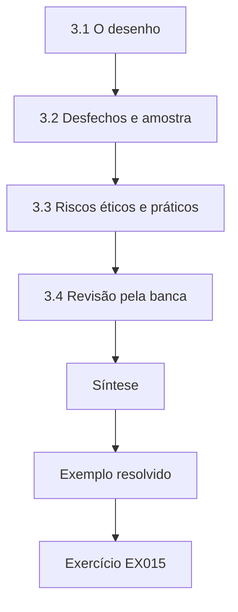

### Desenho lógico

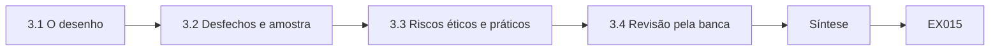

```text
[3.1 O desenho]
    |
    v
[3.2 Desfechos e amostra]
    |
    v
[3.3 Riscos éticos e práticos]
    |
    v
[3.4 Revisão pela banca]
    |
    v
[Síntese]
    |
    v
[Exemplo resolvido] --> [Exercício EX015]
```
<!-- open-cyber-academy:lesson-figures:end ch-03 -->


### Objetivos de aprendizagem

Você vai (1) escrever uma proposta de doutorado com desenho escalonado; (2) justificar o tamanho da amostra; (3) antecipar riscos éticos e práticos.

### 3.1 O desenho

Mireille propõe uma implantação escalonada nos doze departamentos da Vantor. Todos os departamentos começam no programa atual. A cada dois meses, três departamentos sorteados passam para o programa centrado em reportes: um botão de reporte com um clique, um agradecimento automático em poucos minutos, um resumo semanal mostrando o que os e-mails reportados eram de fato e simulações mensais curtas com dificuldade fixa na Phish Scale. Sortear a ordem de mudança permite comparar os departamentos antes e depois, controlando as variações sazonais das ameaças por e-mail que atingem todos ao mesmo tempo.

### 3.2 Desfechos e amostra

O desfecho primário é a proporção de e-mails suspeitos reais reportados por pelo menos um destinatário em até trinta minutos, codificados como no capítulo 1. Os desfechos secundários são as taxas de reporte nas simulações, as taxas de cliques nas simulações e o ônus percebido pelos servidores, medido em um questionário curto. Como o sorteio é feito por departamento, e não por pessoa, ela leva em conta o agrupamento: servidores de um mesmo departamento compartilham gestores e padrões de e-mail. Com doze clusters, ela estima que o estudo consegue detectar uma diferença de cerca de dez pontos percentuais e diz com clareza que efeitos menores podem passar despercebidos.

### 3.3 Riscos éticos e práticos

Mireille lista os riscos e as respostas. Os servidores podem se sentir vigiados: a comissão de representantes revisa todas as mensagens, e só se reportam resultados por departamento. Os gestores podem pedir os nomes de quem clica: o acordo de dados proíbe isso. Um ataque real durante o estudo pode ser confundido com uma simulação: os e-mails simulados levam um marcador oculto conhecido pela equipe de segurança, e todo reporte real é tratado normalmente. A equipe de TI pode mudar o filtro de e-mail no meio do estudo: as mudanças são registradas para que a análise possa levá-las em conta.

### 3.4 Revisão pela banca

A banca da proposta inclui um estatístico, uma psicóloga organizacional e um profissional de outra prefeitura. O estatístico pede um teste de permutação que respeite o desenho escalonado; a psicóloga pergunta como o ônus será medido; o profissional alerta que botões de reporte podem sobrecarregar equipes de segurança pequenas. Mireille acrescenta uma etapa de triagem automatizada que agrupa reportes duplicados. A banca aprova com essas mudanças. Propostas melhoram mais quando revisores de disciplinas diferentes podem contestá-las antes do início da coleta de dados. Os comentários da banca e as respostas de Mireille ficam em um apêndice da proposta, para leitores futuros.

### Exemplo resolvido

Mireille propõe uma implantação escalonada e sorteada em doze departamentos, define desfechos considerando o agrupamento, planeja salvaguardas éticas e revisa a proposta depois de uma banca multidisciplinar.

> **Caso sintético.** O desenho e os departamentos são sintéticos; a Phish Scale é real.

### Erros e limites

Doze clusters dão poder estatístico limitado. Desenhos escalonados podem ser perturbados por mudanças organizacionais.

### Exercícios

- **EX015 — Ordem sorteada.** Por que sortear a ordem em que os departamentos mudam? *Rubrica:* 3 = para controlar variações sazonais de ameaças que atingem todos;; 2 = sazonalidade;; 1 = vago;; 0 = nenhuma.
- **EX016 — Desfecho primário.** Qual é o desfecho primário do estudo? *Rubrica:* 3 = proporção de e-mails suspeitos reais reportados em até trinta minutos;; 2 = reporte;; 1 = cliques;; 0 = nenhuma.
- **EX017 — Motivo do agrupamento.** Por que levar o agrupamento em conta? *Rubrica:* 3 = servidores de um departamento compartilham gestores e padrões de e-mail;; 2 = contexto compartilhado;; 1 = vago;; 0 = nenhuma.
- **EX018 — Confusão com ataque real.** Como o protocolo evita confundir ataques reais com simulações? *Rubrica:* 3 = os e-mails simulados levam um marcador oculto conhecido pela equipe de segurança;; 2 = marcador;; 1 = vago;; 0 = nenhuma.
- **EX019 — Alerta do profissional.** Sobre o que o profissional alertou? *Rubrica:* 3 = botões de reporte podem sobrecarregar equipes de segurança pequenas;; 2 = carga de trabalho;; 1 = vago;; 0 = nenhuma.
- **EX020 — Resposta com triagem.** Como Mireille respondeu à preocupação com a carga de trabalho? *Rubrica:* 3 = uma etapa de triagem automatizada que agrupa reportes duplicados;; 2 = triagem;; 1 = vago;; 0 = nenhuma.

### Síntese

Uma proposta forte randomiza o que pode, mede o que importa, planeja os riscos éticos e convida à contestação antes da coleta de dados.

<!-- open-cyber-academy:chapter-navigation:start ch-03 -->
### Continue estudando — aula 03 (capítulo 03 de 08)

[← Capítulo 02](#ch-02) · [Índice das aulas](../SUBJECTS.md) · [Capítulo 04 →](#ch-04)

Continue para a próxima aula já escrita.
<!-- open-cyber-academy:chapter-navigation:end -->

<a id="ch-04"></a>

## Capítulo 4 — Replicação da linha de base e piloto

<!-- open-cyber-academy:lesson-figures:start ch-04 -->
### Mapa da aula

Aula 04 publicada. Mapa, exemplo, EX021.

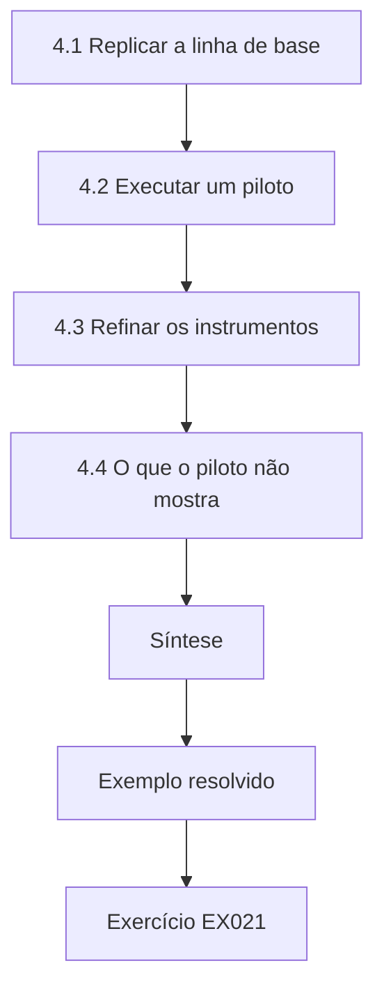

### Desenho lógico

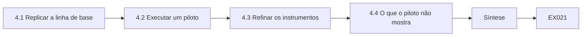

```text
[4.1 Replicar a linha de base]
    |
    v
[4.2 Executar um piloto]
    |
    v
[4.3 Refinar os instrumentos]
    |
    v
[4.4 O que o piloto não mostra]
    |
    v
[Síntese]
    |
    v
[Exemplo resolvido] --> [Exercício EX021]
```
<!-- open-cyber-academy:lesson-figures:end ch-04 -->


### Objetivos de aprendizagem

Você vai (1) replicar uma medição de linha de base; (2) executar um piloto da intervenção; (3) refinar os instrumentos antes do estudo principal.

### 4.1 Replicar a linha de base

Antes de mudar qualquer coisa, Mireille replica por três meses as medidas atuais da Vantor. Ela confirma que as taxas mensais de cliques nas simulações variam entre oito e dezenove por cento, acompanhando sobretudo a dificuldade das iscas, o que sustenta sua decisão de fixar a dificuldade. Ela também mede a linha de base do desfecho primário: cerca de um em cada quatro e-mails suspeitos reais é reportado em até trinta minutos. A replicação mostra que seu processo de medição funciona nesse ambiente e fornece o ponto de referência do qual dependem todas as afirmações posteriores. Ela também registra quantas simulações foram enviadas a cada mês, para que as comparações futuras usem a mesma base.

### 4.2 Executar um piloto

Dois departamentos que não fazem parte do estudo principal testam o programa centrado em reportes por seis semanas. Mireille fica atenta a problemas práticos. O botão de reporte funciona no e-mail do computador, mas fica escondido no aplicativo móvel, de modo que quem lê e-mails no celular não consegue reportar com facilidade. A mensagem de agradecimento chega depois de duas horas, e não de minutos, por causa de uma regra de e-mail. Os servidores acham o resumo semanal útil, porém longo demais. Pilotos existem para encontrar esses problemas a baixo custo, antes que prejudiquem o estudo principal. Cada problema é registrado com a data em que foi encontrado.

### 4.3 Refinar os instrumentos

Mireille corrige os problemas. O fornecedor acrescenta o botão de reporte ao aplicativo móvel; a regra de e-mail é corrigida; o resumo é reduzido a três exemplos. Ela também testa o questionário de ônus e percebe que uma pergunta é confusa, então a reescreve. Registra cada mudança e seu motivo em um log que será publicado com a tese. O Prof. Aalto observa que registros transparentes das mudanças feitas antes do estudo principal geram confiança nos resultados finais. O questionário revisado é testado de novo com cinco voluntários antes do estudo principal, e todos entendem todas as perguntas.

### 4.4 O que o piloto não mostra

Mireille resiste a apresentar efeitos do piloto como achados. Dois departamentos ao longo de seis semanas não podem mostrar se o programa funciona, e os departamentos do piloto se ofereceram como voluntários, de modo que podem estar excepcionalmente engajados. Ela relata o piloto apenas como uma verificação de viabilidade: o programa pode ser executado, as medidas funcionam e os problemas práticos foram corrigidos. Tratar um piloto como evidência de efeito é um erro comum, que leva a estudos principais confiantes demais e a replicações decepcionantes. Ela escreve essa ressalva no próprio relatório do piloto, para que ninguém na Vantor cite os números iniciais como prova de que o programa funciona, e pede ao comitê diretor que espere pelo estudo principal.

### Exemplo resolvido

Mireille replica as medidas de cliques e de reportes da linha de base, testa o programa em dois departamentos, corrige três problemas e relata o piloto apenas como verificação de viabilidade.

> **Caso sintético.** Os números e os departamentos são sintéticos.

### Erros e limites

Pilotos com voluntários não são representativos. Períodos de linha de base podem incluir eventos atípicos.

### Exercícios

- **EX021 — Faixa de cliques na linha de base.** Que faixa as taxas de cliques mostraram na linha de base? *Rubrica:* 3 = de oito a dezenove por cento, acompanhando a dificuldade das iscas;; 2 = faixa;; 1 = vago;; 0 = nenhuma.
- **EX022 — Reportes na linha de base.** Qual era a linha de base de reportes de e-mails suspeitos reais? *Rubrica:* 3 = cerca de um em cada quatro em até trinta minutos;; 2 = 25%;; 1 = vago;; 0 = nenhuma.
- **EX023 — Problema no celular.** Que problema o piloto encontrou no e-mail pelo celular? *Rubrica:* 3 = o botão de reporte ficava escondido no aplicativo móvel;; 2 = celular;; 1 = vago;; 0 = nenhuma.
- **EX024 — Atraso no retorno.** Por que os agradecimentos chegavam atrasados? *Rubrica:* 3 = uma regra de e-mail os atrasava em duas horas;; 2 = regra de e-mail;; 1 = vago;; 0 = nenhuma.
- **EX025 — Log de mudanças.** Por que registrar cada mudança antes do estudo principal? *Rubrica:* 3 = a transparência gera confiança nos resultados finais;; 2 = confiança;; 1 = vago;; 0 = nenhuma.
- **EX026 — Limites do piloto.** Por que o piloto não é evidência de efeito? *Rubrica:* 3 = dois departamentos voluntários em seis semanas não podem mostrá-lo;; 2 = viabilidade;; 1 = efeito;; 0 = nenhuma.

### Síntese

A replicação fixa a linha de base e um piloto encontra problemas práticos, mas nenhum dos dois deve ser confundido com evidência de efeito.

<!-- open-cyber-academy:chapter-navigation:start ch-04 -->
### Continue estudando — aula 04 (capítulo 04 de 08)

[← Capítulo 03](#ch-03) · [Índice das aulas](../SUBJECTS.md) · [Capítulo 05 →](#ch-05)

Continue para a próxima aula já escrita.
<!-- open-cyber-academy:chapter-navigation:end -->

<a id="ch-05"></a>

## Capítulo 5 — Estudo principal e validação independente

<!-- open-cyber-academy:lesson-figures:start ch-05 -->
### Mapa da aula

Aula 05 publicada. Mapa, exemplo, EX027.

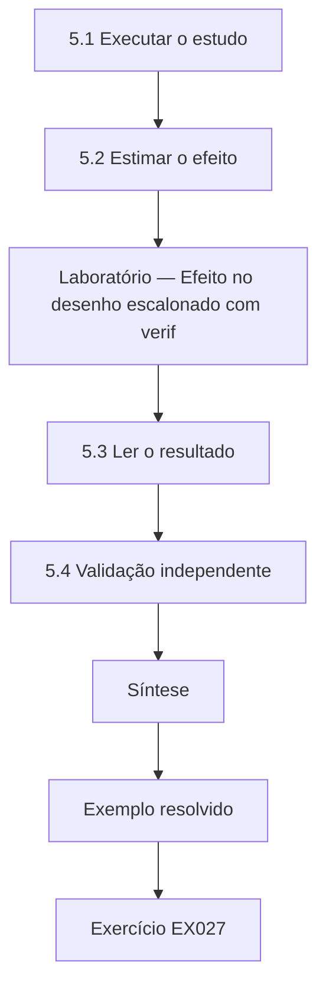

### Desenho lógico

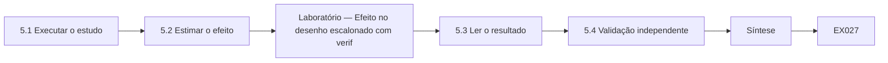

```text
[5.1 Executar o estudo]
    |
    v
[5.2 Estimar o efeito]
    |
    v
[Laboratório — Efeito no desenho escalonado com verif]
    |
    v
[5.3 Ler o resultado]
    |
    v
[5.4 Validação independente]
    |
    v
[Síntese]
    |
    v
[Exemplo resolvido] --> [Exercício EX027]
```
<!-- open-cyber-academy:lesson-figures:end ch-05 -->


### Objetivos de aprendizagem

Você vai (1) executar o estudo principal escalonado; (2) estimar o efeito com uma verificação por permutação; (3) organizar uma validação independente.

### 5.1 Executar o estudo

O estudo principal dura catorze meses. A cada dois meses, três departamentos mudam de programa, até que os doze usem o programa centrado em reportes. Mireille monitora a fidelidade: o botão está disponível, os agradecimentos chegam rápido, as simulações estão na dificuldade combinada? Dois meses depois do início, uma atualização do filtro de e-mail reduz o volume de e-mails suspeitos que chegam aos servidores. Como ela afeta todos os departamentos ao mesmo tempo e foi registrada, o desenho a absorve. Mireille publica notas mensais de fidelidade para o comitê diretor, sem nenhum dado individual. Cada nota é revisada pela comissão de representantes dos servidores antes de circular.

### 5.2 Estimar o efeito

Mireille compara departamentos-mês antes e depois da mudança, ajustando por mês para absorver as mudanças que atingem a organização inteira. O laboratório executa uma versão simplificada sobre dados sintéticos: estima a variação no reporte em até trinta minutos depois da mudança e repete a estimativa muitas vezes com a ordem de mudança embaralhada, para ver com que frequência o acaso, sozinho, produz um efeito tão grande. Seguindo seu pré-registro, ela reporta tanto a estimativa quanto a proporção de permutações, em vez de um único número de destaque. Mantém o script de análise congelado desde a data do pré-registro, e qualquer mudança posterior é registrada com seu motivo, para que os revisores vejam exatamente o que foi planejado e o que foi acrescentado.

### Laboratório — Efeito no desenho escalonado com verificação por permutação

```python
# Stepped rollout: 12 departments, 7 periods; switch order randomised. Synthetic 30-minute reporting rates.
import random
random.seed(11)
order = [1, 1, 1, 2, 2, 2, 3, 3, 3, 4, 4, 4]   # period each department switches
base = [0.22, 0.25, 0.27, 0.24, 0.21, 0.26, 0.23, 0.28, 0.25, 0.22, 0.24, 0.26]
month = [0.0, 0.01, -0.02, 0.00, 0.01, -0.01, 0.0]
rates = [[base[d] + month[t] + (0.17 if t >= order[d] else 0) + random.gauss(0, 0.02) for t in range(7)] for d in range(12)]
def effect(o):
    # regress on treatment after removing department and month means (two-way demeaning)
    y = [row[:] for row in rates]; x = [[1.0 if t >= o[d] else 0.0 for t in range(7)] for d in range(12)]
    for m in (y, x):
        for _ in range(50):
            for d in range(12):
                a = sum(m[d]) / 7; m[d] = [v - a for v in m[d]]
            for t in range(7):
                a = sum(m[d][t] for d in range(12)) / 12
                for d in range(12): m[d][t] -= a
    num = sum(x[d][t] * y[d][t] for d in range(12) for t in range(7))
    den = sum(x[d][t] ** 2 for d in range(12) for t in range(7))
    return num / den
est = effect(order); rng = random.Random(5); k = 0; N = 2000
for _ in range(N):
    o = order[:]; rng.shuffle(o)
    if abs(effect(o)) >= abs(est): k += 1
print(f"estimated change in 30-min reporting: {est:+.3f}; permutation share {k / N:.3f}")
```

Execute com `python3 lab_stepped.py`. Saída verificada:

```text
estimated change in 30-min reporting: +0.157; permutation share 0.000
```

### 5.3 Ler o resultado

O laboratório estima que o reporte subiu cerca de dezesseis pontos percentuais (+0.157) depois da mudança, e nenhuma das 2.000 ordens embaralhadas produz um efeito tão grande. As taxas de cliques nas simulações caíram um pouco, mas menos do que o reporte subiu, e o questionário de ônus não mostrou aumento. Mireille enuncia o achado de forma estreita: nesta prefeitura, com dificuldade de isca fixa, o programa centrado em reportes foi seguido de um reporte bem mais rápido de e-mails suspeitos reais. Ela não afirma que houve menos violações, algo que o estudo não mediu. Relata o resultado do ônus com o mesmo cuidado dado ao efeito principal.

### 5.4 Validação independente

Mireille providencia que um segundo analista, de outra universidade, receba os dados anonimizados por departamento-mês, o pré-registro e o plano de análise, mas não o código dela. O analista escreve uma análise independente e chega a uma estimativa a menos de dois pontos percentuais da dela. Uma segunda prefeitura, o fictício Brenholt District, também faz uma replicação mais curta e encontra um efeito menor, mas positivo. A validação independente mostra que o resultado não depende das escolhas de um único analista nem das peculiaridades de uma única organização. Os dois relatórios de validação são publicados ao lado da análise dela, com as diferenças explicadas.

### Exemplo resolvido

Mireille executa um estudo escalonado de catorze meses com verificações de fidelidade, estima um efeito sobre o reporte com uma verificação por permutação e obtém uma reanálise e uma replicação independentes.

> **Caso sintético.** As prefeituras, os dados e os resultados são sintéticos.

### Erros e limites

Desfechos por departamento escondem a variação individual. Replicações em outras prefeituras podem diferir em cultura.

### Exercícios

- **EX027 — Verificações de fidelidade.** O que o monitoramento de fidelidade verificava? *Rubrica:* 3 = disponibilidade do botão, agradecimentos rápidos e dificuldade fixa das simulações;; 2 = os três;; 1 = vago;; 0 = nenhuma.
- **EX028 — Atualização do filtro.** Por que a atualização do filtro não estragou o estudo? *Rubrica:* 3 = afetou todos os departamentos ao mesmo tempo e foi registrada;; 2 = o desenho absorve;; 1 = vago;; 0 = nenhuma.
- **EX029 — Estimativa do laboratório.** Que efeito o laboratório estimou? *Rubrica:* 3 = +0.157 no reporte em 30 minutos, proporção de permutações 0.000 em 2.000;; 2 = positivo;; 1 = vago;; 0 = nenhuma.
- **EX030 — Afirmação estreita.** Como Mireille enuncia o achado? *Rubrica:* 3 = reporte mais rápido nesta prefeitura com dificuldade fixa, não menos violações;; 2 = estreita;; 1 = violações caíram;; 0 = nenhuma.
- **EX031 — Preparação da reanálise.** O que o segundo analista recebeu? *Rubrica:* 3 = dados anonimizados, pré-registro e plano, mas não o código;; 2 = sem código;; 1 = tudo;; 0 = nenhuma.
- **EX032 — Resultado da replicação.** O que a replicação em Brenholt encontrou? *Rubrica:* 3 = um efeito menor, mas positivo;; 2 = menor;; 1 = vago;; 0 = nenhuma.

### Síntese

Um estudo escalonado com verificações de fidelidade, inferência por permutação e validação independente sustenta uma afirmação estreita e crível.

<!-- open-cyber-academy:chapter-navigation:start ch-05 -->
### Continue estudando — aula 05 (capítulo 05 de 08)

[← Capítulo 04](#ch-04) · [Índice das aulas](../SUBJECTS.md) · [Capítulo 06 →](#ch-06)

Continue para a próxima aula já escrita.
<!-- open-cyber-academy:chapter-navigation:end -->

<a id="ch-06"></a>

## Capítulo 6 — Crítica por pares e revisão

<!-- open-cyber-academy:lesson-figures:start ch-06 -->
### Mapa da aula

Aula 06 publicada. Mapa, exemplo, EX033.

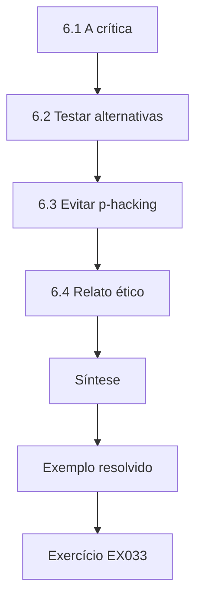

### Desenho lógico

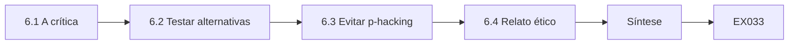

```text
[6.1 A crítica]
    |
    v
[6.2 Testar alternativas]
    |
    v
[6.3 Evitar p-hacking]
    |
    v
[6.4 Relato ético]
    |
    v
[Síntese]
    |
    v
[Exemplo resolvido] --> [Exercício EX033]
```
<!-- open-cyber-academy:lesson-figures:end ch-06 -->


### Objetivos de aprendizagem

Você vai (1) responder à revisão por pares de um estudo de comportamento; (2) revisar análises sem p-hacking; (3) fortalecer o relato ético.

### 6.1 A crítica

Mireille submete um artigo e recebe três pareceres. Um revisor argumenta que mais reportes podem simplesmente refletir mais alarmes falsos, sobrecarregando a equipe de segurança. Outro pergunta se foram as mensagens de agradecimento, e não o botão, que causaram o efeito. Um terceiro questiona se a supervisão da comissão de representantes mudou o comportamento dos servidores ao torná-los cientes do estudo. O Prof. Aalto a aconselha a tratar cada comentário como uma hipótese a testar sempre que possível e a admitir com clareza quando seus dados não puderem responder. Ela escreve uma carta de resposta que lista cada comentário com a ação tomada.

### 6.2 Testar alternativas

Quanto aos alarmes falsos, Mireille reporta a proporção de reportes codificados como benignos antes e depois da mudança: ela subiu ligeiramente, e a etapa de triagem manteve estável o tempo de tratamento. Quanto ao mecanismo, ela não consegue separar o botão do retorno, porque os dois foram introduzidos juntos, e diz isso abertamente, propondo um estudo fatorial como trabalho futuro. Quanto à consciência do estudo, ela observa que os anúncios foram para todos os departamentos ao mesmo tempo, de modo que essa consciência não deveria variar conforme o momento da mudança. Cada resposta declara o que foi pré-registrado e o que é exploratório.

### 6.3 Evitar p-hacking

Os revisores sugerem análises adicionais de subgrupos por idade e por função. Mireille executa as que são razoáveis, mas as rotula como exploratórias e reporta todas, não apenas as interessantes. Ela não muda o desfecho primário nem a análise. Herley e van Oorschot (2017) alertam que a pesquisa em segurança muitas vezes carece da disciplina de afirmações falseáveis e especificadas de antemão; manter a distinção entre resultados confirmatórios e exploratórios é o que permite aos leitores confiar no achado principal. Ela também publica uma tabela curta que compara, linha a linha, o plano pré-registrado com o que foi efetivamente feito, para que qualquer desvio fique visível e explicado.

### 6.4 Relato ético

Um revisor pede mais detalhes sobre danos. Mireille acrescenta uma seção sobre como as simulações foram desenhadas para evitar sofrimento: nenhuma isca sobre cortes salariais, luto ou saúde; nenhuma isca se passando por sindicatos; e um canal claro para os servidores apresentarem reclamações. Ela relata as duas reclamações recebidas e como foram resolvidas. O relato ético em pesquisas com simulações mostra a leitores e organizações como repetir o trabalho sem causar dano, o que importa tanto quanto o tamanho do efeito. Ela também compartilha o procedimento completo de reclamações em um apêndice.

### Exemplo resolvido

Mireille testa as explicações alternativas dos revisores, admite a questão do mecanismo, reporta com transparência os subgrupos exploratórios e amplia o relato ético.

> **Caso sintético.** Os pareceres e os números são sintéticos; Herley e van Oorschot (2017) é real.

### Erros e limites

Achados exploratórios podem ser ruído. Algumas preocupações dos revisores não podem ser resolvidas com os dados existentes.

### Exercícios

- **EX033 — Teste dos alarmes falsos.** Como Mireille tratou a preocupação com alarmes falsos? *Rubrica:* 3 = a proporção benigna subiu pouco; a triagem manteve estável o tempo de tratamento;; 2 = dados;; 1 = vago;; 0 = nenhuma.
- **EX034 — Limite do mecanismo.** Por que ela não consegue separar o botão do retorno? *Rubrica:* 3 = foram introduzidos juntos;; 2 = confundidos;; 1 = vago;; 0 = nenhuma.
- **EX035 — Desenho futuro.** Que estudo ela propôs para a questão do mecanismo? *Rubrica:* 3 = um estudo fatorial;; 2 = fatorial;; 1 = vago;; 0 = nenhuma.
- **EX036 — Tratamento dos subgrupos.** Como as análises de subgrupos foram reportadas? *Rubrica:* 3 = todas reportadas e rotuladas como exploratórias;; 2 = exploratórias;; 1 = selecionadas;; 0 = nenhuma.
- **EX037 — Temas de isca excluídos.** Que temas de isca foram excluídos para evitar sofrimento? *Rubrica:* 3 = cortes salariais, luto, saúde e falsificação de sindicatos;; 2 = dois;; 1 = vago;; 0 = nenhuma.
- **EX038 — Reclamações.** Quantas reclamações foram relatadas? *Rubrica:* 3 = duas, com sua resolução;; 2 = duas;; 1 = vago;; 0 = nenhuma.

### Síntese

Uma boa revisão testa alternativas, reconhece limites, separa o trabalho confirmatório do exploratório e relata a ética abertamente.

<!-- open-cyber-academy:chapter-navigation:start ch-06 -->
### Continue estudando — aula 06 (capítulo 06 de 08)

[← Capítulo 05](#ch-05) · [Índice das aulas](../SUBJECTS.md) · [Capítulo 07 →](#ch-07)

Continue para a próxima aula já escrita.
<!-- open-cyber-academy:chapter-navigation:end -->

<a id="ch-07"></a>

## Capítulo 7 — Síntese da tese e arquivo de reprodutibilidade

<!-- open-cyber-academy:lesson-figures:start ch-07 -->
### Mapa da aula

Aula 07 publicada. Mapa, exemplo, EX039.

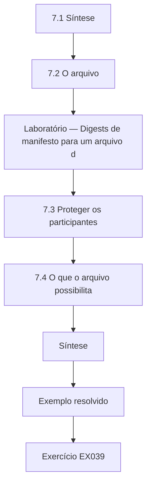

### Desenho lógico

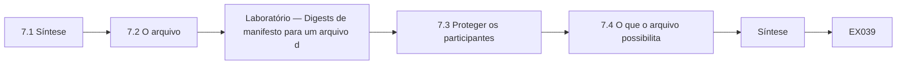

```text
[7.1 Síntese]
    |
    v
[7.2 O arquivo]
    |
    v
[Laboratório — Digests de manifesto para um arquivo d]
    |
    v
[7.3 Proteger os participantes]
    |
    v
[7.4 O que o arquivo possibilita]
    |
    v
[Síntese]
    |
    v
[Exemplo resolvido] --> [Exercício EX039]
```
<!-- open-cyber-academy:lesson-figures:end ch-07 -->


### Objetivos de aprendizagem

Você vai (1) sintetizar os achados em uma tese coerente; (2) montar um arquivo de reprodutibilidade; (3) proteger os participantes nos dados compartilhados.

### 7.1 Síntese

A tese de Mireille liga quatro partes: a crítica à taxa de cliques, o protocolo de medição, o estudo escalonado e a replicação. Ela enquadra a contribuição geral como evidência de que programas centrados em reportes podem melhorar a rapidez dos reportes quando reportar é barato e o retorno é rápido, o que é coerente com a ideia de orçamento de compliance de Beautement, Sasse e Wonham (2008). Ela também lista o que continua desconhecido: qual componente importa mais, se os efeitos duram além de catorze meses e se o reporte se traduz em menos incidentes danosos. Cada incógnita é ligada a um desenho concreto capaz de respondê-la.

### 7.2 O arquivo

Mireille monta um arquivo com o pré-registro, o código de análise, o guia de codificação, o log de mudanças, os dados anonimizados por departamento-mês, os modelos de simulação com suas classificações de dificuldade e as aprovações éticas. Cada arquivo é listado em um manifesto com um digest SHA-256, para que qualquer pessoa possa verificar que os arquivos não mudaram desde a publicação. O laboratório monta um manifesto para um pequeno arquivo sintético, depois edita um dos arquivos e mostra que a verificação aponta uma divergência. Ela testa o arquivo pedindo a um colega que execute de novo a análise principal apenas a partir dele, em um computador novo, o que dá certo depois que um arquivo faltante é acrescentado.

### Laboratório — Digests de manifesto para um arquivo de reprodutibilidade

```python
# Build a SHA-256 manifest for a synthetic archive, then detect an edited file.
import hashlib
files = {"prereg.md": b"H1: reporting rises after switch\n", "dept_month.csv": b"dept,month,rate\nG1,1,0.24\n",
         "coding_guide.md": b"Suspicious if sender spoofed or link mismatched\n"}
manifest = {n: hashlib.sha256(b).hexdigest() for n, b in files.items()}
files["dept_month.csv"] = b"dept,month,rate\nG1,1,0.42\n"
for n, b in files.items():
    print(f"{n}: {'OK' if hashlib.sha256(b).hexdigest() == manifest[n] else 'MISMATCH'} {manifest[n][:12]}")
```

Execute com `python3 lab_archive.py`. Saída verificada:

```text
prereg.md: OK 32460485b7ca
dept_month.csv: MISMATCH 92dd85d36614
coding_guide.md: OK 0b96e40b1bab
```

### 7.3 Proteger os participantes

Mesmo dados por departamento podem identificar pessoas em departamentos pequenos. Mireille funde os departamentos com menos de vinte servidores em grupos maiores antes da divulgação e elimina datas mais finas do que o mês. Os modelos de simulação são compartilhados sem a identidade visual da Vantor. Ela verifica que não restou nenhum campo de texto livre. O encarregado de proteção de dados da Vantor revisa o arquivo antes da divulgação. Reprodutibilidade e privacidade podem entrar em conflito, e ela documenta cada escolha para que outros entendam o que foi retido e por quê. O encarregado assina uma declaração curta confirmando a revisão, que é incluída no arquivo, e Mireille registra quais variáveis foram removidas ou agregadas.

### 7.4 O que o arquivo possibilita

Com o arquivo, outro pesquisador pode executar de novo todas as análises, conferir as decisões de codificação e reutilizar o protocolo em uma nova organização. O Prof. Aalto observa que isso importa especialmente na pesquisa sobre comportamento, em que os resultados muitas vezes não se replicam e as organizações mudam depressa. Mireille deposita o arquivo no repositório da Calder com um identificador persistente e uma licença que permite reutilização. Ela também escreve um guia curto para profissionais, para que as organizações possam aplicar o protocolo sem ler a tese inteira. Planeja atualizar o arquivo se forem encontrados erros.

### Exemplo resolvido

Mireille sintetiza seus achados com incógnitas claras, monta um arquivo verificado por digests, protege os participantes por meio de agregação e o deposita junto com um guia para profissionais.

> **Caso sintético.** O conteúdo do arquivo é sintético; Beautement, Sasse e Wonham (2008) é real.

### Erros e limites

Digests provam que os arquivos não mudaram, não que estão corretos. A agregação reduz o detalhe analítico.

### Exercícios

- **EX039 — Contribuição geral.** Como Mireille enquadra sua contribuição geral? *Rubrica:* 3 = programas centrados em reportes melhoram a rapidez do reporte quando reportar é barato e o retorno é rápido;; 2 = condicional;; 1 = universal;; 0 = nenhuma.
- **EX040 — Incógnitas abertas.** Cite uma questão que a tese deixa em aberto. *Rubrica:* 3 = qual componente importa, se os efeitos duram, se os incidentes caem;; 2 = uma;; 1 = vago;; 0 = nenhuma.
- **EX041 — Verificação do manifesto.** O que o laboratório do arquivo reportou depois da edição de um arquivo? *Rubrica:* 3 = MISMATCH para o CSV editado;; 2 = divergência;; 1 = vago;; 0 = nenhuma.
- **EX042 — Departamentos pequenos.** Como os departamentos pequenos foram protegidos? *Rubrica:* 3 = fundidos se tivessem menos de vinte servidores;; 2 = fundidos;; 1 = vago;; 0 = nenhuma.
- **EX043 — Revisão de privacidade.** Quem revisou o arquivo antes da divulgação? *Rubrica:* 3 = o encarregado de proteção de dados da Vantor;; 2 = DPO;; 1 = vago;; 0 = nenhuma.
- **EX044 — Guia para profissionais.** Por que escrever um guia curto para profissionais? *Rubrica:* 3 = para que as organizações apliquem o protocolo sem a tese inteira;; 2 = adoção;; 1 = vago;; 0 = nenhuma.

### Síntese

A síntese de uma tese declara contribuições e incógnitas, e um arquivo atento à privacidade permite que outras pessoas verifiquem e reutilizem o trabalho.

<!-- open-cyber-academy:chapter-navigation:start ch-07 -->
### Continue estudando — aula 07 (capítulo 07 de 08)

[← Capítulo 06](#ch-06) · [Índice das aulas](../SUBJECTS.md) · [Capítulo 08 →](#ch-08)

Continue para a próxima aula já escrita.
<!-- open-cyber-academy:chapter-navigation:end -->

<a id="ch-08"></a>

## Capítulo 8 — Defesa e plano de publicação

<!-- open-cyber-academy:lesson-figures:start ch-08 -->
### Mapa da aula

Aula 08 publicada. Mapa, exemplo, EX045.

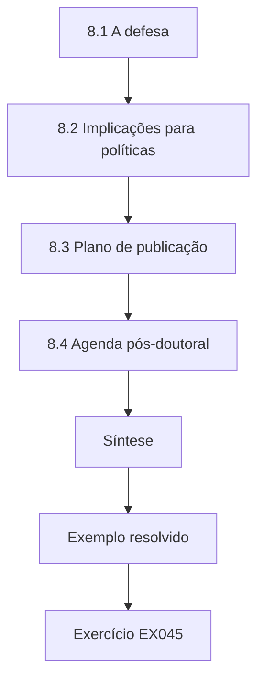

### Desenho lógico

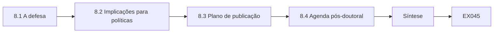

```text
[8.1 A defesa]
    |
    v
[8.2 Implicações para políticas]
    |
    v
[8.3 Plano de publicação]
    |
    v
[8.4 Agenda pós-doutoral]
    |
    v
[Síntese]
    |
    v
[Exemplo resolvido] --> [Exercício EX045]
```
<!-- open-cyber-academy:lesson-figures:end ch-08 -->


### Objetivos de aprendizagem

Você vai (1) defender a tese diante de perguntas de especialistas; (2) planejar publicações para públicos acadêmicos e profissionais; (3) definir uma agenda de pesquisa pós-doutoral.

### 8.1 A defesa

Na defesa, os examinadores fazem perguntas difíceis. Um deles pergunta se o reporte poderia ter subido porque os servidores têm medo de ser pegos pelas simulações. Mireille aponta o questionário de ônus e a política de nenhuma consequência individual, e admite que não pode descartar algum reporte motivado por ansiedade. Outro pergunta por que ela não mediu violações; ela explica o tempo e os dados que isso exigiria. Os examinadores valorizam respostas claras que separam o que a evidência mostra do que ela não pode mostrar. Ela se prepara para a defesa ensaiando com dois colegas que fazem o papel de examinadores céticos e questionam, uma a uma, todas as limitações.

### 8.2 Implicações para políticas

Os examinadores perguntam o que as prefeituras devem fazer. Mireille recomenda que as organizações avaliem os programas de conscientização pela rapidez dos reportes, e não apenas pelas taxas de cliques, classifiquem a dificuldade das simulações, nunca punam indivíduos por clicar e invistam em tornar o reporte fácil. Ela liga essas recomendações à NIST SP 800-50 Rev. 1, que pede a avaliação dos programas de aprendizagem, e às diretrizes de cultura da ENISA. Acrescenta que as políticas devem exigir revisão ética das simulações, porque simulações mal desenhadas podem prejudicar a confiança entre os servidores e as equipes de segurança. Cada recomendação está ligada a um resultado específico da tese.

### 8.3 Plano de publicação

Mireille planeja três produtos: um artigo em periódico sobre o estudo escalonado, um artigo metodológico sobre o protocolo de medição e um informe para equipes de segurança do setor público. Cada um tem um veículo-alvo e um cronograma preliminar. O identificador persistente do arquivo é citado nos três. Ela planeja divulgar o informe por uma rede do setor público, para que os resultados cheguem a organizações que raramente leem periódicos acadêmicos. Também planeja apresentar o trabalho em uma conferência de segurança do setor público e escrever um resumo em linguagem simples para os servidores da Vantor que participaram, agradecendo a eles e explicando o que a participação mostrou.

### 8.4 Agenda pós-doutoral

A próxima pergunta de pesquisa de Mireille decorre de seus limites: um estudo fatorial para separar o botão de reporte do retorno e um estudo mais longo que ligue o reporte ao tempo de resposta a incidentes. Ela pede financiamento tendo a Vantor e Brenholt como parceiras. O conselho final do Prof. Aalto é manter a disciplina que tornou a tese crível: pré-registro, desenho ético das simulações e validação independente. A defesa é aprovada com correções menores. Ela também planeja orientar um mestrando que ajudará no estudo fatorial e marca uma reunião com as duas prefeituras para acordar que dados cada uma pode compartilhar no novo projeto.

### Exemplo resolvido

Mireille responde aos examinadores com limites claros, extrai recomendações éticas de política, planeja três publicações e define uma agenda de continuidade com estudo fatorial.

> **Caso sintético.** A defesa e os planos são sintéticos; a SP 800-50 Rev. 1 e a ENISA (2019) são reais.

### Erros e limites

Recomendações de política generalizam para além de uma ou duas prefeituras. O financiamento pode não vir.

### Exercícios

- **EX045 — Pergunta sobre o medo.** Como Mireille respondeu à pergunta sobre reportes motivados por medo? *Rubrica:* 3 = questionário de ônus e política sem consequências, admitindo que não se pode descartar alguma ansiedade;; 2 = em parte;; 1 = negou;; 0 = nenhuma.
- **EX046 — Conselho de avaliação.** O que as organizações devem avaliar, em vez de apenas taxas de cliques? *Rubrica:* 3 = a rapidez dos reportes;; 2 = reportes;; 1 = conclusão de cursos;; 0 = nenhuma.
- **EX047 — Política de ética nas simulações.** Por que as políticas devem exigir revisão ética das simulações? *Rubrica:* 3 = simulações mal desenhadas prejudicam a confiança;; 2 = confiança;; 1 = vago;; 0 = nenhuma.
- **EX048 — Três produtos.** Que três produtos ela planeja? *Rubrica:* 3 = artigo em periódico, artigo metodológico e informe para profissionais;; 2 = dois;; 1 = vago;; 0 = nenhuma.
- **EX049 — Próximo estudo.** Qual é sua próxima pergunta de pesquisa? *Rubrica:* 3 = um estudo fatorial separando botão e retorno, e a ligação do reporte com o tempo de resposta;; 2 = fatorial;; 1 = vago;; 0 = nenhuma.
- **EX050 — Resultado da defesa.** Qual foi o resultado da defesa? *Rubrica:* 3 = aprovada com correções menores;; 2 = aprovada;; 1 = reprovada;; 0 = nenhuma.

### Síntese

Uma defesa de doutorado separa evidência de especulação, transforma as descobertas em políticas éticas e define as próximas perguntas de pesquisa.

<!-- open-cyber-academy:chapter-navigation:start ch-08 -->
### Continue estudando — aula 08 (capítulo 08 de 08)

[← Capítulo 07](#ch-07) · [Índice das aulas](../SUBJECTS.md) · [Próximo curso pelo índice →](../SUBJECTS.md)

O índice aponta para o próximo curso do percurso de estudos.
<!-- open-cyber-academy:chapter-navigation:end -->

<a id="worked-results"></a>

## Resoluções

Respostas-modelo para EX001–EX050. Mireille Okonjo, o Prof. Henrik Aalto, a Calder University, a Vantor Municipal Services, o Brenholt District e todos os números são sintéticos; as respostas dos laboratórios citam saídas verificadas. Qualquer resposta que atenda à rubrica recebe a mesma pontuação.

**EX001.** Ela registra de antemão o resultado que mostraria que o treinamento centrado em reportes não ajuda.

**EX002.** Porque mudam conforme a dificuldade da isca, mesmo quando o comportamento não muda.

**EX003.** A NIST Phish Scale, descrita por Dawkins e Jacobs (2023).

**EX004.** A página de destino registra apenas que um link foi aberto e não coleta nenhuma credencial.

**EX005.** Ninguém; os gestores veem apenas resultados agregados.

**EX006.** Kappa 0.80, com concordância bruta de 0.90 em 50 reportes do piloto.

**EX007.** Uma regra mais clara para newsletters que contêm links de rastreamento.

**EX008.** Que eles muitas vezes estavam lidando com exigências de senha impraticáveis, e não sendo descuidados.

**EX009.** Que mesmo usuários motivados não conseguiam usar corretamente a criptografia do PGP.

**EX010.** Porque o conselho lhes custa mais esforço do que o benefício que recebem.

**EX011.** A capacidade limitada das pessoas para o esforço de segurança, que compete com seu trabalho principal.

**EX012.** Que desfecho avaliar, o que faz as organizações recorrerem à conclusão de cursos e às taxas de cliques.

**EX013.** Se as violações efetivamente diminuem.

**EX014.** Um estudo de campo escalonado com dificuldade de isca fixa e desfechos pré-registrados, além de uma replicação.

**EX015.** Para que as variações sazonais das ameaças por e-mail possam ser separadas do efeito do programa.

**EX016.** A proporção de e-mails suspeitos reais reportados por alguém em até trinta minutos.

**EX017.** Porque servidores de um mesmo departamento compartilham gestores e padrões de e-mail, então não são independentes.

**EX018.** Os e-mails simulados levam um marcador oculto, e todo reporte real é tratado normalmente.

**EX019.** Que botões de reporte podem sobrecarregar equipes de segurança pequenas.

**EX020.** Acrescentando uma triagem automatizada que agrupa reportes duplicados.

**EX021.** Entre oito e dezenove por cento, acompanhando sobretudo a dificuldade das iscas.

**EX022.** Cerca de um em cada quatro era reportado em até trinta minutos.

**EX023.** O botão de reporte não aparecia no aplicativo móvel.

**EX024.** Uma regra de e-mail os atrasava em cerca de duas horas.

**EX025.** Para que os leitores vejam o que mudou e por quê, o que gera confiança nos resultados.

**EX026.** Porque dois departamentos voluntários em seis semanas não podem mostrar se o programa funciona.

**EX027.** Se o botão estava disponível, se os agradecimentos chegavam rápido e se as simulações ficavam na dificuldade combinada.

**EX028.** Porque atingiu todos os departamentos ao mesmo tempo, foi registrada e foi absorvida pelo ajuste por mês.

**EX029.** Cerca de dezesseis pontos percentuais (+0.157) a mais de reporte rápido, sem nenhuma das 2.000 ordens embaralhadas com efeito tão grande.

**EX030.** Como reporte mais rápido nesta prefeitura, com dificuldade de isca fixa, sem afirmar que houve menos violações.

**EX031.** Dados anonimizados por departamento-mês, o pré-registro e o plano de análise, mas não o código de Mireille.

**EX032.** Um efeito menor, mas ainda positivo.

**EX033.** Mostrou que os reportes benignos subiram apenas um pouco e que a triagem manteve estável o tempo de tratamento.

**EX034.** Porque o botão e o retorno foram introduzidos ao mesmo tempo.

**EX035.** Um estudo fatorial que varia separadamente o botão e o retorno.

**EX036.** Todas foram reportadas e claramente rotuladas como exploratórias.

**EX037.** Cortes salariais, luto, saúde e falsificação da identidade de sindicatos.

**EX038.** Duas reclamações, relatadas com o modo como cada uma foi resolvida.

**EX039.** Como evidência de que programas centrados em reportes melhoram a rapidez do reporte quando reportar é barato e o retorno é rápido.

**EX040.** Qual componente importa mais, se os efeitos duram além de catorze meses ou se os incidentes diminuem.

**EX041.** Um MISMATCH para o CSV sintético editado, enquanto os demais arquivos continuaram OK.

**EX042.** Os departamentos com menos de vinte servidores foram fundidos em grupos maiores.

**EX043.** O encarregado de proteção de dados da Vantor.

**EX044.** Para que as organizações possam usar o protocolo sem ler a tese inteira.

**EX045.** Citando o questionário de ônus e a política sem punição, mas admitindo que não se pode excluir algum reporte motivado por ansiedade.

**EX046.** A rapidez do reporte de e-mails suspeitos.

**EX047.** Porque simulações mal desenhadas podem prejudicar a confiança entre os servidores e as equipes de segurança.

**EX048.** Um artigo em periódico, um artigo metodológico e um informe para profissionais.

**EX049.** Um estudo fatorial que separe o botão do retorno, além de ligar o reporte ao tempo de resposta a incidentes.

**EX050.** Ela foi aprovada com correções menores.

<a id="references"></a>
## Referências

Todos os DOIs foram resolvidos em doi.org em 12 de outubro de 2026, e as normas foram conferidas nas páginas de seus editores. A lista é idêntica à da edição em inglês e cobre o livro inteiro, acrescida apenas da ABNT NBR ISO/IEC 27001:2022, citada nesta edição como referência brasileira e conferida em sua fonte oficial; as adoções brasileiras da ABNT listadas foram conferidas no catálogo oficial da ABNT, e as demais normas técnicas são citadas em sua edição internacional. Organizações, pessoas, sistemas e números dos casos são sintéticos; somente as obras abaixo são reais.

- Adams, A., & Sasse, M. A. (1999). Users are not the enemy. *Communications of the ACM*, 42(12), 40–46. <https://doi.org/10.1145/322796.322806>
- Associação Brasileira de Normas Técnicas. (2022). *ABNT NBR ISO/IEC 27001:2022 — Segurança da informação, segurança cibernética e proteção à privacidade — Sistemas de gestão da segurança da informação — Requisitos* (versão corrigida 2023). ABNT. <https://www.abntcatalogo.com.br/>
- Bada, M., Sasse, M. A., & Nurse, J. R. C. (2019). *Cyber security awareness campaigns: Why do they fail to change behaviour?* arXiv:1901.02672. <https://arxiv.org/abs/1901.02672>
- Beautement, A., Sasse, M. A., & Wonham, M. (2008). The compliance budget: Managing security behaviour in organisations. *Proceedings of the 2008 New Security Paradigms Workshop*, 47–58. <https://doi.org/10.1145/1595676.1595684>
- Dawkins, S., & Jacobs, J. (2023). *NIST Phish Scale user guide* (NIST TN 2276). NIST. <https://doi.org/10.6028/NIST.TN.2276>
- European Union Agency for Cybersecurity. (2019). *Cybersecurity culture guidelines: Behavioural aspects of cybersecurity*. ENISA. <https://www.enisa.europa.eu/publications/cybersecurity-culture-guidelines-behavioural-aspects-of-cybersecurity>
- Hansche, S., Ellis, B., Sanchez-Cherry, K., Snyder, J. N., & Walden, D. (2024). *Building a cybersecurity and privacy learning program* (NIST SP 800-50 Rev. 1). NIST. <https://doi.org/10.6028/NIST.SP.800-50r1>
- Herley, C. (2009). So long, and no thanks for the externalities: The rational rejection of security advice by users. *Proceedings of the 2009 New Security Paradigms Workshop*, 133–144. <https://doi.org/10.1145/1719030.1719050>
- Herley, C., & van Oorschot, P. C. (2017). SoK: Science, security and the elusive goal of security as a scientific pursuit. *2017 IEEE Symposium on Security and Privacy*, 99–120. <https://doi.org/10.1109/SP.2017.38>
- International Organization for Standardization. (2022). *ISO/IEC 27001:2022 Information security, cybersecurity and privacy protection — Information security management systems — Requirements*. <https://www.iso.org/standard/27001>
- Lain, D., Kostiainen, K., & Čapkun, S. (2022). Phishing in organizations: Findings from a large-scale and long-term study. *2022 IEEE Symposium on Security and Privacy*, 842–859. <https://doi.org/10.1109/SP46214.2022.9833766>
- Landis, J. R., & Koch, G. G. (1977). The measurement of observer agreement for categorical data. *Biometrics*, 33(1), 159–174. <https://doi.org/10.2307/2529310>
- Sasse, M. A., Brostoff, S., & Weirich, D. (2001). Transforming the 'weakest link' — a human/computer interaction approach to usable and effective security. *BT Technology Journal*, 19(3), 122–131. <https://doi.org/10.1023/A:1011902718709>
- Whitten, A., & Tygar, J. D. (1999). Why Johnny can't encrypt: A usability evaluation of PGP 5.0. *Proceedings of the 8th USENIX Security Symposium*. USENIX. <https://www.usenix.org/conference/8th-usenix-security-symposium/why-johnny-cant-encrypt-usability-evaluation-pgp-50>
