# Identity and Access Management: Doctoral Research Track

- Language: English (`en`); course 194, Doctoral research track (2 years).
- Editorial state: **published**. Chapters 1–8 of 8 have hand-written teaching text; exercises EX001–EX050 have matching worked results with 0–3 rubrics; Four offline labs use only the Python 3 standard library on synthetic evidence, and their outputs are embedded from real runs. Independent review and the 300-page A4 verification remain open.
- Audience: doctoral candidates and researchers studying how organisations achieve least privilege in identity and access management.
- Author: [hiagokinlevi](https://github.com/hiagokinlevi). Original text [CC0 1.0](../../../../../LICENSE); cited works keep their rights.
- Ethical and legal boundary: review and test only identity systems and accounts you are authorised to assess; no exploit code, no payloads, no attack procedures and no instructions for bypassing controls. Weaknesses are taught from the defender's side using synthetic accounts, entitlements, logs and data. All evidence, people and organisations are **synthetic** unless a sentence cites a public source.

[Course home](../../README.md) · [Chapter index](../SUBJECTS.md) · [Book plan](PLAN.md) · [Course skill](../../skill/SKILL.md) · [Worked results](#worked-results)

## How to use this draft

Read in order: the chapters follow one doctoral candidate studying excess privilege and access reviews at three partner organisations, through research integrity and coder agreement, the research frontier, a registered proposal, baseline replication and pilot, a randomised main study with blinded validation, peer critique, synthesis with a reproducibility archive, and the defense. Run each lab where it appears, attempt the exercises before the worked results, and score yourself with the rubrics.

### Synthetic running case

| Element | Role | Boundary |
|---|---|---|
| **Rhea Mwangi** | Doctoral candidate | Invented |
| **Prof. Daniel Osei** | Supervisor | Invented |
| **Thornfield University** | Fictional university | Invented |
| **Calder Valley Health Trust** | Fictional lead partner | Invented |

### Core sources

NIST [SP 800-63-4](https://doi.org/10.6028/NIST.SP.800-63-4), [SP 800-63B-4](https://doi.org/10.6028/NIST.SP.800-63B-4), [SP 800-162](https://doi.org/10.6028/NIST.SP.800-162), [SP 800-207](https://doi.org/10.6028/NIST.SP.800-207) and [SP 800-53r5](https://doi.org/10.6028/NIST.SP.800-53r5); IETF [RFC 6749](https://www.rfc-editor.org/rfc/rfc6749) and [RFC 9700](https://www.rfc-editor.org/rfc/rfc9700); [OpenID Connect Core 1.0](https://openid.net/specs/openid-connect-core-1_0.html); W3C [WebAuthn Level 2](https://www.w3.org/TR/webauthn-2/); OASIS [SAML 2.0](https://docs.oasis-open.org/security/saml/v2.0/saml-core-2.0-os.pdf). Full list in [References](#references).

## Contents

| Chapters |
|---|
| [1](#ch-01) · [2](#ch-02) · [3](#ch-03) · [4](#ch-04) · [5](#ch-05) · [6](#ch-06) · [7](#ch-07) · [8](#ch-08) |

[Worked results](#worked-results) · [References](#references)

<a id="ch-01"></a>

## Chapter 1 — Advanced research integrity and methods

<!-- cykin:lesson-figures:start ch-01 -->
### Lesson map

Lesson 01 published. Map, example, EX001.

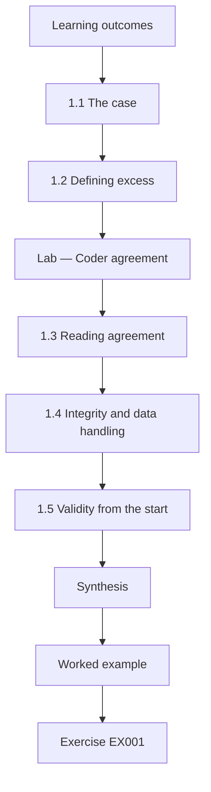

### Logical drawing

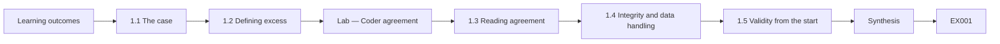

```text
[Learning outcomes]
    |
    v
[1.1 The case]
    |
    v
[1.2 Defining excess]
    |
    v
[Lab — Coder agreement]
    |
    v
[1.3 Reading agreement]
    |
    v
[1.4 Integrity and data handling]
    |
    v
[1.5 Validity from the start]
    |
    v
[Synthesis]
    |
    v
[Worked example] --> [Exercise EX001]
```
<!-- cykin:lesson-figures:end ch-01 -->


### Learning outcomes

You will (1) frame a doctoral question about excess privilege in identity systems; (2) design a valid coding scheme for entitlements; (3) establish ethical and data-handling rules for partner identity data.

### 1.1 The case

Rhea Mwangi is a doctoral candidate at the fictional Thornfield University, supervised by Prof. Daniel Osei. Her partners are three fictional public bodies, led by Calder Valley Health Trust, whose directories have grown over a decade to thousands of accounts and hundreds of roles. Managers approve access reviews every quarter, yet auditors keep finding staff with access they no longer need. Rhea's thesis asks two questions: does role-model complexity predict the rate of excess privilege, and does a structured access recertification procedure remove more excess than the usual approve-all review? Saltzer and Schroeder (1975) named least privilege as a design principle; her work asks how well organisations actually achieve it.

### 1.2 Defining excess

A study of excess privilege needs a definition two people would apply identically. Rhea codes each entitlement, meaning one permission or group membership held by one account, into four categories: needed, with a documented business purpose and recent use; excess, held without a purpose the role requires; dormant, not used for ninety days and with no documented seasonal need; and toxic, a combination that breaks a separation-of-duties rule, such as raising and approving the same payment. Each category has written decision rules and worked synthetic examples, drawing on the access control family of NIST SP 800-53 Rev. 5. The codebook is fixed before any partner data is coded.

### Lab — Coder agreement

```python
"""Cohen's kappa for two coders labelling synthetic entitlements (stdlib only)."""
from collections import Counter
cats = ["needed", "excess", "dormant", "toxic"]
a = ["needed"]*20 + ["excess"]*9 + ["dormant"]*7 + ["toxic"]*4
b = list(a)
for i, v in [(3, "excess"), (12, "dormant"), (22, "needed"), (31, "excess")]: b[i] = v
n = len(a); po = sum(x == y for x, y in zip(a, b)) / n
ca, cb = Counter(a), Counter(b); pe = sum(ca[c]*cb[c] for c in cats) / n**2
print(f"items={n} agree={sum(x == y for x, y in zip(a, b))} po={po:.2f} pe={pe:.2f} kappa={(po-pe)/(1-pe):.2f}")
for i, (x, y) in enumerate(zip(a, b)):
    if x != y: print(f"  item {i:02d}: coder A={x:8} coder B={y}")
```

Run with `python3 lab_kappa.py`. Verified output:

```text
items=40 agree=36 po=0.90 pe=0.33 kappa=0.85
  item 03: coder A=needed   coder B=excess
  item 12: coder A=needed   coder B=dormant
  item 22: coder A=excess   coder B=needed
  item 31: coder A=dormant  coder B=excess
```

### 1.3 Reading agreement

Two trained coders independently label forty synthetic entitlements and agree on thirty-six, an observed agreement of 0.90. Cohen's kappa, which removes the agreement expected by chance from the category frequencies, is 0.85. Landis and Koch (1977) would describe this as almost perfect, though Rhea treats their labels as rough guidance rather than thresholds. The four disagreements matter more than the summary: two separate needed from excess or dormant, where coders read the role description differently, and two separate excess from dormant. Each produces a sharper decision rule, such as checking the role catalogue before the usage log, and the exercise is repeated on fresh items after the change.

### 1.4 Integrity and data handling

Identity data is sensitive: it names staff, reveals who can reach patient records and shows where controls are weak. Rhea's data agreement lets partners replace names and account identifiers with consistent pseudonyms before export, keeps files on an encrypted university server with access logged, and forbids publishing any entitlement name that would identify a system. All examples in her thesis and in this book are synthetic. Ethics approval covers interviews with reviewers and administrators, who can withdraw at any time. She never logs in to partner systems or tests their controls; every observation comes from exports the partners choose to share, under their own change procedures.

### 1.5 Validity from the start

Rhea separates three validity questions early. Construct validity asks whether her four categories really capture excess privilege as practitioners understand it, so she checks the codebook with two partner administrators. Internal validity asks whether any observed change can be attributed to the review procedure rather than to staff turnover or a system migration, which shapes her design. External validity asks whether results from three public bodies generalise, which she will answer modestly. Writing these down at the start keeps later decisions honest, because each design choice can be checked against the threat it is meant to address.

### Worked example

Rhea writes the research questions, the four-category codebook and the data agreement, then runs the forty-item agreement exercise. Kappa of 0.85 and two clear disagreement patterns lead to two codebook clarifications before real coding begins.

> **Synthetic case.** Rhea Mwangi, Thornfield University, Calder Valley Health Trust and all figures and entitlements are synthetic.

### Errors and limits

Kappa summarises agreement but hides where disagreement lies; always inspect disagreements, and remember that high agreement does not prove the categories are the right ones.

### Exercises

- **EX001 — Entitlement unit.** In Rhea's study, what is one entitlement? *Rubric:* 3 = one permission or group membership held by one account;; 2 = one permission;; 1 = one account;; 0 = none.
- **EX002 — Toxic category.** Which category covers raising and approving the same payment? *Rubric:* 3 = toxic, a separation-of-duties breach;; 2 = toxic;; 1 = excess;; 0 = none.
- **EX003 — Kappa value.** State the observed agreement and kappa from the lab. *Rubric:* 3 = 0.90 and 0.85 with meaning;; 2 = both numbers;; 1 = one;; 0 = none.
- **EX004 — Chance correction.** What does kappa add beyond raw agreement? *Rubric:* 3 = removes agreement expected by chance from category frequencies;; 2 = chance;; 1 = vague;; 0 = none.
- **EX005 — Disagreement use.** How should the four disagreements be used? *Rubric:* 3 = sharpen decision rules and repeat on fresh items;; 2 = refine codebook;; 1 = ignore;; 0 = none.
- **EX006 — Data boundary.** Name two protections in Rhea's data agreement. *Rubric:* 3 = pseudonyms, encrypted logged storage, no publication of identifying names;; 2 = two;; 1 = one;; 0 = none.
- **EX007 — Internal validity threat.** Give one threat to attributing change to the review procedure. *Rubric:* 3 = staff turnover or system migration;; 2 = one threat;; 1 = vague;; 0 = none.

### Synthesis

A defensible doctoral study of excess privilege starts with a precise codebook, measured coder agreement and strict handling of sensitive identity data.

### Continue studying — chapter 01 of 08

[← Course home](../../README.md) · [Course chapter index](../SUBJECTS.md) · [Chapter 02 (draft) →](#ch-02)

<a id="ch-02"></a>

## Chapter 2 — Identity and access management: research frontier

<!-- cykin:lesson-figures:start ch-02 -->
### Lesson map

Lesson 02 published. Map, example, EX008.

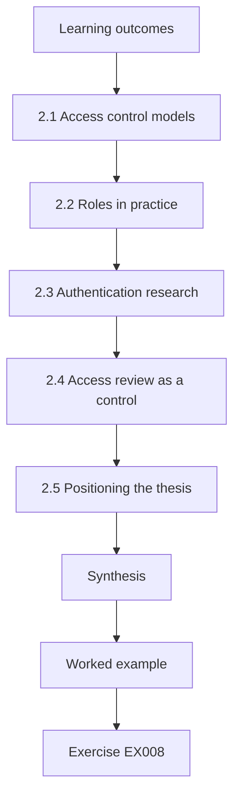

### Logical drawing

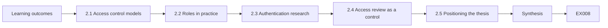

```text
[Learning outcomes]
    |
    v
[2.1 Access control models]
    |
    v
[2.2 Roles in practice]
    |
    v
[2.3 Authentication research]
    |
    v
[2.4 Access review as a control]
    |
    v
[2.5 Positioning the thesis]
    |
    v
[Synthesis]
    |
    v
[Worked example] --> [Exercise EX008]
```
<!-- cykin:lesson-figures:end ch-02 -->


### Learning outcomes

You will (1) map the research on access control models, authentication and access review; (2) locate the gap Rhea's thesis addresses; (3) position the contribution precisely.

### 2.1 Access control models

Research on authorisation has moved through several models. Role-based access control groups permissions into roles that reflect job functions, and Sandhu, Coyne, Feinstein and Youman (1996) formalised a family of such models, later shaped into a proposed NIST standard by Ferraiolo and colleagues (2001). Attribute-based access control, described in NIST SP 800-162, decides using attributes of the subject, object, action and environment, which suits rules that roles express poorly. Kuhn, Coyne and Weil (2010) argued for combining the two. Rhea's partners all use roles with some attribute rules layered on top, so her study sits where these models meet operational reality.

### 2.2 Roles in practice

In theory roles are clean; in practice they multiply. Organisations create new roles for special cases, copy existing ones with small changes and rarely retire old ones. Role mining research, such as Molloy and colleagues (2008), tries to infer sensible roles from existing assignments, giving weight to roles that carry business meaning. Rhea uses this work differently: rather than proposing new roles, she measures how complex the existing role model is, using roles per user and entitlements per role, and asks whether complexity predicts excess privilege. That question has been discussed widely by practitioners but rarely tested with a careful, reproducible design.

### 2.3 Authentication research

Although her thesis focuses on authorisation, Rhea reviews authentication research because the two interact. Bonneau, Herley, van Oorschot and Stajano (2012) compared many password replacement schemes across usability, deployability and security, showing that none dominates. NIST SP 800-63B-4 sets current requirements for authenticators, including phishing-resistant options. Strong authentication reduces the chance an attacker uses an account, but it does nothing to limit what a legitimate account can reach. Excess privilege therefore remains a risk even in organisations with excellent authentication, which is why Rhea treats it as a separate research problem.

### 2.4 Access review as a control

Periodic access review, also called recertification, asks managers to confirm that each person still needs each entitlement. NIST SP 800-53 Rev. 5 includes account review within its access control family. Practitioners report that reviewers often approve everything, because lists are long, entitlement names are cryptic and rejecting access risks complaints. Herley (2009) argued that people rationally reject security advice whose cost exceeds its visible benefit, which offers one explanation. Rhea's structured procedure tries to change that balance by showing reviewers usage evidence and plain-language descriptions, and by limiting each review to a manageable number of decisions.

### 2.5 Positioning the thesis

Rhea's contribution has two parts. First, a measured relationship between role-model complexity and excess privilege across three organisations, using a published codebook with known agreement. Second, a controlled comparison between a structured review and the usual review, with independent validation of removed entitlements. She states plainly what she will not claim: she will not test new access control models, will not measure attack outcomes, and will not claim results hold for every sector. Examiners can then judge the work against its stated scope, and later researchers know exactly which gaps remain open.

### Worked example

Rhea maps four strands of research, models, roles in practice, authentication and access review, and writes a one-paragraph gap statement linking complexity, excess privilege and review quality.

> **Synthetic case.** The literature cited is real; Rhea, her partners and her plans are synthetic.

### Errors and limits

Reviewing only one strand, such as access control models, misses the human factors that explain why reviews fail in practice.

### Exercises

- **EX008 — RBAC formalisation.** Who formalised a family of role-based access control models in 1996? *Rubric:* 3 = Sandhu, Coyne, Feinstein and Youman, Computer;; 2 = Sandhu et al.;; 1 = NIST only;; 0 = none.
- **EX009 — ABAC source.** Which NIST publication describes attribute-based access control? *Rubric:* 3 = SP 800-162 with its scope;; 2 = SP 800-162;; 1 = SP 800-63;; 0 = none.
- **EX010 — Role mining aim.** What does role mining research try to do? *Rubric:* 3 = infer meaningful roles from existing assignments;; 2 = infer roles;; 1 = delete roles;; 0 = none.
- **EX011 — Authentication limit.** Why does strong authentication not remove excess privilege? *Rubric:* 3 = it limits who uses an account, not what it reaches;; 2 = different problem;; 1 = it does;; 0 = none.
- **EX012 — Rubber-stamp explanation.** Which 2009 argument helps explain approve-all reviews? *Rubric:* 3 = Herley: people rationally reject advice whose cost exceeds visible benefit;; 2 = Herley;; 1 = vague;; 0 = none.
- **EX013 — Complexity measures.** Which two measures does Rhea use for role-model complexity? *Rubric:* 3 = roles per user and entitlements per role;; 2 = one;; 1 = vague;; 0 = none.
- **EX014 — Non-claims.** Name two things the thesis will not claim. *Rubric:* 3 = new models, attack outcomes, all sectors (two);; 2 = one;; 1 = vague;; 0 = none.

### Synthesis

Rhea's thesis sits between formal access control research and the practical failure of access reviews, with a narrow, testable contribution.

### Continue studying — chapter 02 of 08

[← Chapter 01 (draft)](#ch-01) · [Course chapter index](../SUBJECTS.md) · [Chapter 03 (draft) →](#ch-03)

<a id="ch-03"></a>

## Chapter 3 — Original contribution proposal

<!-- cykin:lesson-figures:start ch-03 -->
### Lesson map

Lesson 03 published. Map, example, EX015.

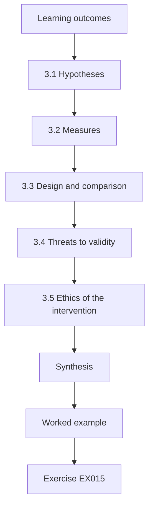

### Logical drawing

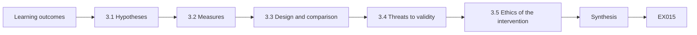

```text
[Learning outcomes]
    |
    v
[3.1 Hypotheses]
    |
    v
[3.2 Measures]
    |
    v
[3.3 Design and comparison]
    |
    v
[3.4 Threats to validity]
    |
    v
[3.5 Ethics of the intervention]
    |
    v
[Synthesis]
    |
    v
[Worked example] --> [Exercise EX015]
```
<!-- cykin:lesson-figures:end ch-03 -->


### Learning outcomes

You will (1) state hypotheses and their tests; (2) design the comparison of review procedures; (3) plan for threats to validity.

### 3.1 Hypotheses

Rhea registers two hypotheses with her supervisor before seeing partner data. H1: across business units, higher role-model complexity is associated with a higher rate of excess privilege, tested with a rank correlation because neither measure is expected to be normally distributed. H2: units using the structured review remove a greater share of coded excess entitlements than units using the usual review, tested by comparing removal rates. For each, she states what result would count against it, such as a correlation near zero or no difference in removal. Writing the falsifying result in advance prevents later reinterpretation of whatever the data shows.

### 3.2 Measures

The main outcome is the excess rate: entitlements coded excess, dormant or toxic, divided by all entitlements in a unit. Removal rate is the share of those entitlements removed after a review cycle. Complexity is measured by mean roles per user and mean entitlements per role, combined into a ranked index. Rhea also records reviewer time, because a procedure that removes more excess but takes far longer may not be adopted. Every measure has a written definition, a computation script tested on synthetic data and a note on its limitations, so examiners can check the numbers independently.

### 3.3 Design and comparison

Business units are randomly assigned, within each partner, to the structured review or the usual review for one cycle. Randomising within partners balances differences between organisations, such as directory products or culture. The structured review shows each reviewer the entitlement's plain-language description, its last use and the role it came from, and limits a sitting to fifty decisions. The usual review is left exactly as each partner runs it. Rhea cannot blind reviewers to their condition, but she blinds the coders who later judge whether removals were correct, which protects the main outcome from her own expectations.

### 3.4 Threats to validity

Rhea lists threats with mitigations. Contamination, where reviewers in one condition learn the other's method, is reduced by assigning whole units and asking partners not to share materials during the cycle. Seasonal effects, such as year-end staff changes, are handled by running both conditions in the same period. Measurement error in usage logs, which may miss some access paths, is checked by comparing logs with administrator knowledge on a sample. Small numbers of units limit statistical power, so Rhea reports effect sizes with intervals rather than relying on significance alone. Each remaining threat is stated openly in the thesis.

### 3.5 Ethics of the intervention

Changing a review process affects real people: wrongly removing access can stop a nurse reaching patient records during a shift. Rhea's protocol therefore requires that all removals follow each partner's normal change procedure, that any removal can be reversed within one working day, and that partners can stop the study at any time. Reviewers are told the purpose of the study and agree to take part. The ethics committee reviews these safeguards, and Rhea records every reversal as data, because wrongful removals are a cost of the procedure that must be reported alongside its benefits.

### Worked example

Rhea's proposal states two falsifiable hypotheses, defines four measures, randomises units within partners, blinds outcome coders and lists threats with mitigations and ethical safeguards.

> **Synthetic case.** Hypotheses, units and partners are synthetic.

### Errors and limits

Without randomisation and blinded outcome coding, any difference in removals could reflect which units were chosen or what the researcher hoped to see.

### Exercises

- **EX015 — H1 test.** Which test does H1 use and why? *Rubric:* 3 = rank correlation, measures not expected normal;; 2 = rank correlation;; 1 = t-test;; 0 = none.
- **EX016 — Excess rate.** Define the excess rate. *Rubric:* 3 = excess, dormant or toxic entitlements over all entitlements in a unit;; 2 = share of excess;; 1 = count;; 0 = none.
- **EX017 — Randomisation level.** At what level are units randomised, and why? *Rubric:* 3 = within partners, to balance organisational differences;; 2 = within partners;; 1 = vague;; 0 = none.
- **EX018 — Blinding target.** Who is blinded in the design? *Rubric:* 3 = outcome coders judging removals;; 2 = coders;; 1 = reviewers;; 0 = none.
- **EX019 — Reviewer time reason.** Why record reviewer time? *Rubric:* 3 = a slower procedure may not be adopted;; 2 = adoption;; 1 = no reason;; 0 = none.
- **EX020 — Reversal safeguard.** What safeguard protects staff from wrongful removal? *Rubric:* 3 = removals reversible within one working day via normal change;; 2 = reversible;; 1 = vague;; 0 = none.

### Synthesis

A strong proposal fixes hypotheses, measures and design before data, and plans honestly for threats and harms.

### Continue studying — chapter 03 of 08

[← Chapter 02 (draft)](#ch-02) · [Course chapter index](../SUBJECTS.md) · [Chapter 04 (draft) →](#ch-04)

<a id="ch-04"></a>

## Chapter 4 — Baseline replication and pilot

<!-- cykin:lesson-figures:start ch-04 -->
### Lesson map

Lesson 04 published. Map, example, EX021.

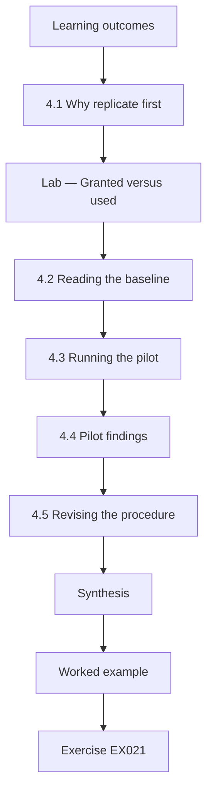

### Logical drawing

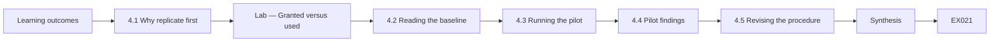

```text
[Learning outcomes]
    |
    v
[4.1 Why replicate first]
    |
    v
[Lab — Granted versus used]
    |
    v
[4.2 Reading the baseline]
    |
    v
[4.3 Running the pilot]
    |
    v
[4.4 Pilot findings]
    |
    v
[4.5 Revising the procedure]
    |
    v
[Synthesis]
    |
    v
[Worked example] --> [Exercise EX021]
```
<!-- cykin:lesson-figures:end ch-04 -->


### Learning outcomes

You will (1) replicate a baseline excess measurement on synthetic data; (2) run a pilot review; (3) revise the procedure from evidence.

### 4.1 Why replicate first

Before testing anything new, Rhea checks that she can reproduce a simple baseline: the share of granted entitlements not used in ninety days. Practitioner reports often cite such figures, but definitions vary. Replicating the measurement on synthetic data, then on one partner's export, confirms that her scripts, codebook and usage logs produce sensible results. If the baseline looked wildly different from what administrators expect, the problem would more likely lie in her pipeline than in the organisation, and finding that early is far cheaper than discovering it after the main study.

### Lab — Granted versus used

```python
"""Shadow comparison: entitlements granted versus used in 90 days for synthetic accounts (stdlib only)."""
granted = {"a01": {"ehr-read", "ehr-write", "rota"}, "a02": {"ehr-read", "billing"}, "a03": {"ehr-read", "ehr-write", "admin-console"},
           "a04": {"rota"}, "a05": {"ehr-read", "billing", "rota", "payroll"}, "a06": {"ehr-read"}}
used = {"a01": {"ehr-read", "ehr-write", "rota"}, "a02": {"ehr-read"}, "a03": {"ehr-read", "ehr-write"},
        "a04": {"rota"}, "a05": {"ehr-read", "rota"}, "a06": set()}
tot = unused = 0
for a in sorted(granted):
    u = sorted(granted[a] - used[a]); tot += len(granted[a]); unused += len(u)
    print(f"{a} granted={len(granted[a])} unused={u}")
print(f"total={tot} unused={unused} rate={unused/tot:.2f}")
```

Run with `python3 lab_shadow.py`. Verified output:

```text
a01 granted=3 unused=[]
a02 granted=2 unused=['billing']
a03 granted=3 unused=['admin-console']
a04 granted=1 unused=[]
a05 granted=4 unused=['billing', 'payroll']
a06 granted=1 unused=['ehr-read']
total=14 unused=5 rate=0.36
```

### 4.2 Reading the baseline

In the synthetic sample, six accounts hold fourteen entitlements and five were not used in ninety days, an unused rate of 0.36. The pattern matters as much as the rate: account a05 holds payroll and billing without using either, suggesting accumulated access from earlier jobs; a03 holds an administration console unused; and a06 has used nothing, which might mean a leaver whose account was not disabled. Unused is not the same as excess: some access is needed rarely, such as year-end payroll. That is why Rhea's codebook asks coders to check documented purpose before calling an unused entitlement excess.

### 4.3 Running the pilot

The pilot applies the structured review in one small unit at Calder Valley with eleven reviewers and about six hundred entitlements. Rhea observes two sittings, notes where reviewers hesitate and records time per decision. She keeps the usual review running in a comparable unit for reference. The pilot is not meant to test the hypothesis; with one unit per condition it cannot. Its purpose is to find practical problems, such as confusing descriptions or missing usage data, while the cost of fixing them is still low and before any units are randomised.

### 4.4 Pilot findings

Three problems appear. Plain-language descriptions are missing for about a fifth of entitlements, so reviewers fall back on guessing. Usage data is absent for one legacy application that does not log access, so its entitlements always appear unused. And some reviewers manage people they have never met, because reporting lines in the directory are out of date. Rhea writes each finding with evidence, such as the count of missing descriptions, and agrees a fix with the partner: descriptions written by system owners, the legacy application marked as unknown rather than unused, and reporting lines corrected before the main study.

### 4.5 Revising the procedure

Each change to the procedure is recorded in a version history with date, reason and evidence. Rhea also checks that the changes do not favour the structured condition unfairly: correcting reporting lines helps both conditions, so it is applied to all units. Marking the legacy application as unknown changes the measure, so she recodes the baseline with the new rule and reports both versions. Separating pilot lessons from main-study results, and declaring every change, lets examiners see that the final design was improved by evidence rather than tuned to produce a desired outcome.

### Worked example

The synthetic baseline shows 5 of 14 entitlements unused (rate 0.36); the pilot reveals missing descriptions, an unlogged legacy application and stale reporting lines, each fixed and recorded before the main study.

> **Synthetic case.** Accounts, entitlements and the pilot unit are synthetic.

### Errors and limits

Treating every unused entitlement as excess overstates the problem, because some legitimate access is used only occasionally.

### Exercises

- **EX021 — Unused count.** How many entitlements are unused in the lab, out of how many? *Rubric:* 3 = 5 of 14, rate 0.36;; 2 = 5;; 1 = 14;; 0 = none.
- **EX022 — Leaver signal.** Which account might belong to a leaver, and why? *Rubric:* 3 = a06, used nothing in 90 days;; 2 = a06;; 1 = a01;; 0 = none.
- **EX023 — Unused versus excess.** Why is unused not the same as excess? *Rubric:* 3 = some access is needed rarely, such as year-end payroll;; 2 = rare use;; 1 = it is;; 0 = none.
- **EX024 — Pilot purpose.** What is the pilot for, if not testing the hypothesis? *Rubric:* 3 = finding practical problems while cheap to fix;; 2 = problems;; 1 = testing;; 0 = none.
- **EX025 — Legacy fix.** How is the unlogged legacy application handled? *Rubric:* 3 = marked unknown rather than unused, baseline recoded;; 2 = unknown;; 1 = removed;; 0 = none.
- **EX026 — Fairness check.** Why apply corrected reporting lines to all units? *Rubric:* 3 = it helps both conditions, so applying everywhere avoids bias;; 2 = fairness;; 1 = speed;; 0 = none.

### Synthesis

Replicating a simple baseline and running a small pilot expose pipeline and procedure problems while they are still cheap to fix.

### Continue studying — chapter 04 of 08

[← Chapter 03 (draft)](#ch-03) · [Course chapter index](../SUBJECTS.md) · [Chapter 05 (draft) →](#ch-05)

<a id="ch-05"></a>

## Chapter 5 — Main study and independent validation

<!-- cykin:lesson-figures:start ch-05 -->
### Lesson map

Lesson 05 published. Map, example, EX027.

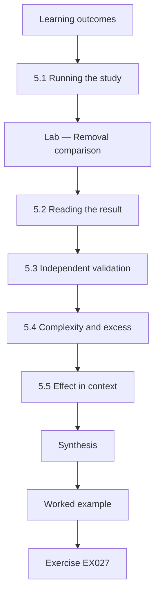

### Logical drawing

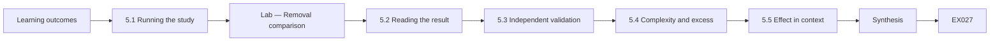

```text
[Learning outcomes]
    |
    v
[5.1 Running the study]
    |
    v
[Lab — Removal comparison]
    |
    v
[5.2 Reading the result]
    |
    v
[5.3 Independent validation]
    |
    v
[5.4 Complexity and excess]
    |
    v
[5.5 Effect in context]
    |
    v
[Synthesis]
    |
    v
[Worked example] --> [Exercise EX027]
```
<!-- cykin:lesson-figures:end ch-05 -->


### Learning outcomes

You will (1) run the randomised comparison; (2) estimate the difference in removal rates with its uncertainty; (3) validate removals independently.

### 5.1 Running the study

Twelve business units across the three partners take part, six in each condition, randomised within partners. Each runs one review cycle over six weeks. Rhea follows the written protocol and logs every deviation, such as a delayed sitting or a reviewer on leave, with date and reason. Partners export entitlements before and after the cycle under the data agreement, and Rhea codes them with the frozen codebook. She does not intervene in decisions; her role is to provide materials, observe and measure, which keeps the comparison between procedures rather than between levels of researcher attention.

### Lab — Removal comparison

```python
"""Compare excess-entitlement removal under rubber-stamp and structured reviews on synthetic units (stdlib only)."""
import statistics as st
stamp = [0.04, 0.12, 0.03, 0.09, 0.15, 0.06]
struct = [0.31, 0.18, 0.35, 0.12, 0.29, 0.24]
d = st.mean(struct) - st.mean(stamp); sp = ((st.variance(stamp) + st.variance(struct)) / 2) ** 0.5
print(f"rubber-stamp mean={st.mean(stamp):.3f} structured mean={st.mean(struct):.3f} diff={d:.3f} cohen_d={d/sp:.1f}")
```

Run with `python3 lab_trial.py`. Verified output:

```text
rubber-stamp mean=0.082 structured mean=0.248 diff=0.167 cohen_d=2.4
```

### 5.2 Reading the result

In the synthetic data, units using the usual review remove on average 8.2 percent of their coded excess, while structured units remove 24.8 percent, a difference of 16.7 percentage points. The standardised effect is large, but with six units per condition the estimate is uncertain, and Rhea reports an interval rather than a single figure. She also looks at spread: one structured unit removed only twelve percent, overlapping the usual-review range. A large average effect with visible variation suggests the procedure helps generally but depends on local factors, which she examines in interviews.

### 5.3 Independent validation

Removing more is only good if removals are correct. Two coders who do not know each unit's condition review a random sample of removed entitlements against role descriptions and interviews with line managers, classifying each removal as correct, wrong or unclear. Wrong removals, which had to be reversed, are counted as harm. In the synthetic study, structured units have slightly more reversals in absolute numbers but a similar rate of reversal per removal. Reporting both benefit and harm, measured by blinded coders, prevents the thesis from presenting a procedure as better when it simply removes more indiscriminately.

### 5.4 Complexity and excess

For H1, Rhea computes the rank correlation between each unit's complexity index and its baseline excess rate. Correlation is not causation: complex role models might cause excess, or both might stem from rapid organisational change. Rhea therefore avoids causal language, reports the correlation with its interval, and checks whether the pattern holds within each partner as well as across all units, since a relationship driven entirely by differences between organisations would mean something quite different from one present inside each. The analysis appears in chapter 7 alongside the synthesis.

### 5.5 Effect in context

An effect size only means something in context. Rhea compares the extra removal achieved by the structured review with the extra reviewer time it required, roughly eight minutes more per hundred decisions in the synthetic data. She also compares it with what auditors usually find, so partners can judge whether the improvement is meaningful. A procedure that removes a third more excess for a modest time cost is attractive; one that needs twice the time may not be sustained. Context turns a statistical result into a decision partners can make.

### Worked example

Structured units remove 24.8 percent of coded excess against 8.2 percent under usual review, with similar reversal rates confirmed by blinded coders; the effect is large but uncertain with twelve units.

> **Synthetic case.** Units, rates and reversals are synthetic.

### Errors and limits

Counting removals without checking their correctness rewards a procedure that removes access indiscriminately.

### Exercises

- **EX027 — Mean removal rates.** What are the two mean removal rates in the lab? *Rubric:* 3 = 8.2% usual, 24.8% structured;; 2 = both;; 1 = one;; 0 = none.
- **EX028 — Difference size.** What difference does the lab report? *Rubric:* 3 = 16.7 percentage points with uncertainty noted;; 2 = 0.167;; 1 = vague;; 0 = none.
- **EX029 — Spread meaning.** What does the structured unit at twelve percent suggest? *Rubric:* 3 = effect depends on local factors;; 2 = variation;; 1 = error;; 0 = none.
- **EX030 — Validation coders.** What do blinded validation coders classify? *Rubric:* 3 = removals as correct, wrong or unclear;; 2 = correctness;; 1 = reviewers;; 0 = none.
- **EX031 — Within-partner check.** Why check the correlation within each partner? *Rubric:* 3 = an all-unit pattern could just reflect differences between organisations;; 2 = confounding;; 1 = power;; 0 = none.
- **EX032 — Cost comparison.** What cost is set against the extra removals? *Rubric:* 3 = extra reviewer time, about eight minutes per hundred decisions;; 2 = time;; 1 = money;; 0 = none.

### Synthesis

A randomised comparison with blinded validation of removals shows both benefit and harm, and context decides whether the benefit is worth its cost.

### Continue studying — chapter 05 of 08

[← Chapter 04 (draft)](#ch-04) · [Course chapter index](../SUBJECTS.md) · [Chapter 06 (draft) →](#ch-06)

<a id="ch-06"></a>

## Chapter 6 — Peer critique and revision

<!-- cykin:lesson-figures:start ch-06 -->
### Lesson map

Lesson 06 published. Map, example, EX033.

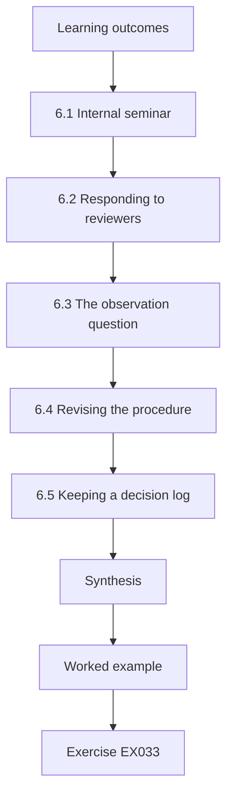

### Logical drawing

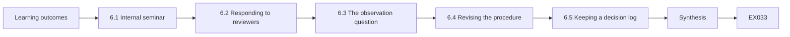

```text
[Learning outcomes]
    |
    v
[6.1 Internal seminar]
    |
    v
[6.2 Responding to reviewers]
    |
    v
[6.3 The observation question]
    |
    v
[6.4 Revising the procedure]
    |
    v
[6.5 Keeping a decision log]
    |
    v
[Synthesis]
    |
    v
[Worked example] --> [Exercise EX033]
```
<!-- cykin:lesson-figures:end ch-06 -->


### Learning outcomes

You will (1) present the study for critique; (2) respond to reviewers with evidence; (3) keep a decision log.

### 6.1 Internal seminar

Rhea presents her design and results at a department seminar before submitting a paper. She shows the codebook, agreement figures, randomisation, validation and limitations, then invites the hardest questions colleagues can find. One asks whether reviewers in the structured condition worked harder simply because they knew they were observed. Another asks whether usage logs miss access through shared service accounts. Rhea records every question she could not answer well, because those questions show exactly where the thesis needs clearer explanation, further analysis or a stated limitation.

### 6.2 Responding to reviewers

A workshop paper based on chapter 5 returns with three reviews. Rhea answers each comment in a response table: the comment, her reply, the evidence and the page where the change appears. Where a reviewer is right, she changes the paper. Where she disagrees, she explains why with evidence rather than assertion. One reviewer asks for a sensitivity analysis excluding the partner with the most units; Rhea runs it and reports that the direction of the effect holds with a wider interval. Specific, polite and evidenced replies earn more trust than defensive ones.

### 6.3 The observation question

The concern about observation is fair. Rhea observed only two sittings per unit, in both conditions, so attention was balanced. She also compares removal rates in observed and unobserved sittings within the structured condition and finds them similar. That does not rule out every effect of knowing about the study, since reviewers knew their unit was participating, but it reduces the worry. She adds the analysis to the thesis and states the remaining limitation plainly, rather than claiming the issue is resolved. Examiners value seeing a concern taken seriously and partially tested.

### 6.4 Revising the procedure

Feedback also improves the structured review itself. Reviewers asked for entitlements to be grouped by system, and for clearer marking of rarely used access that is still needed, such as emergency roles. Rhea revises the procedure for any future use, recording each change with its reason. She does not apply the revision retrospectively to her results: the study tested version 2 of the procedure, and the thesis says so. Keeping tested and improved versions separate prevents readers from assuming the revised procedure has the same evidence behind it as the one actually trialled.

### 6.5 Keeping a decision log

Throughout, Rhea keeps a decision log: each significant choice with date, options, decision and reason. It records why ninety days was chosen for dormancy, why units rather than reviewers were randomised and why one partner's legacy system was marked unknown. Over several years memory fades and examiners ask why. The log answers with evidence, protects against unconsciously rewriting the history of the project and helps any future researcher who wants to replicate or extend the work. It also makes writing the methods chapter far quicker.

### Worked example

Seminar and reviewer critique lead to a sensitivity analysis, an observed-versus-unobserved comparison and a revised procedure version, all recorded in the decision log.

> **Synthetic case.** Seminar, reviewers and analyses are synthetic.

### Errors and limits

Applying procedure improvements retrospectively to reported results misrepresents what was actually tested.

### Exercises

- **EX033 — Seminar value.** Why record questions Rhea could not answer well? *Rubric:* 3 = they show where explanation, analysis or limitation is needed;; 2 = gaps;; 1 = vague;; 0 = none.
- **EX034 — Response table.** List the columns of Rhea's response table. *Rubric:* 3 = comment, reply, evidence, page;; 2 = three;; 1 = one;; 0 = none.
- **EX035 — Sensitivity result.** What did the sensitivity analysis excluding the largest partner show? *Rubric:* 3 = effect direction held, wider interval;; 2 = held;; 1 = reversed;; 0 = none.
- **EX036 — Observation check.** How did Rhea partly test the observation concern? *Rubric:* 3 = compared observed and unobserved structured sittings;; 2 = compared;; 1 = ignored;; 0 = none.
- **EX037 — Procedure versions.** Which version did the study test? *Rubric:* 3 = version 2, revisions not applied retrospectively;; 2 = version 2;; 1 = latest;; 0 = none.
- **EX038 — Decision log content.** What does each decision log entry record? *Rubric:* 3 = date, options, decision, reason;; 2 = decision and reason;; 1 = date;; 0 = none.

### Synthesis

Critique handled with evidence, separate procedure versions and a decision log make the thesis stronger and more trustworthy.

### Continue studying — chapter 06 of 08

[← Chapter 05 (draft)](#ch-05) · [Course chapter index](../SUBJECTS.md) · [Chapter 07 (draft) →](#ch-07)

<a id="ch-07"></a>

## Chapter 7 — Thesis synthesis and reproducibility archive

<!-- cykin:lesson-figures:start ch-07 -->
### Lesson map

Lesson 07 published. Map, example, EX039.

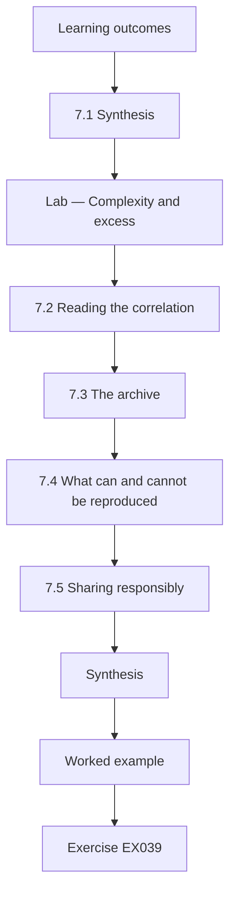

### Logical drawing

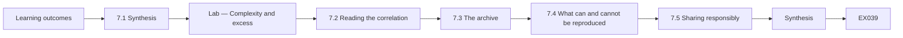

```text
[Learning outcomes]
    |
    v
[7.1 Synthesis]
    |
    v
[Lab — Complexity and excess]
    |
    v
[7.2 Reading the correlation]
    |
    v
[7.3 The archive]
    |
    v
[7.4 What can and cannot be reproduced]
    |
    v
[7.5 Sharing responsibly]
    |
    v
[Synthesis]
    |
    v
[Worked example] --> [Exercise EX039]
```
<!-- cykin:lesson-figures:end ch-07 -->


### Learning outcomes

You will (1) combine results into one argument; (2) assess the complexity relationship; (3) build a reproducibility archive that protects partners.

### 7.1 Synthesis

The synthesis chapter draws the studies together. Rhea's argument runs: excess privilege can be coded reliably; it is common in the partners' directories; units with more complex role models tend to have more of it; and a structured review removes substantially more of it than the usual review, at modest time cost and without a higher rate of wrongful removal. Each step is linked to evidence and its uncertainty. She states what is now known that was not before, and how confident readers should be, instead of repeating each chapter's results in turn.

### Lab — Complexity and excess

```python
"""Spearman correlation between role-model complexity and excess-privilege rate across synthetic business units (stdlib only)."""
units = [("U01", 3.1, 0.08), ("U02", 4.6, 0.12), ("U03", 2.2, 0.05), ("U04", 6.8, 0.21), ("U05", 5.0, 0.11),
         ("U06", 3.9, 0.14), ("U07", 7.5, 0.19), ("U08", 2.8, 0.07), ("U09", 5.9, 0.17), ("U10", 4.1, 0.09)]
def ranks(v):
    o = sorted(range(len(v)), key=lambda i: v[i]); r = [0]*len(v)
    for k, i in enumerate(o): r[i] = k + 1
    return r
x = ranks([u[1] for u in units]); y = ranks([u[2] for u in units]); n = len(units)
d2 = sum((p - q)**2 for p, q in zip(x, y))
print(f"units={n} sum_d2={d2} spearman_rho={1 - 6*d2/(n*(n*n-1)):.2f}")
```

Run with `python3 lab_corr.py`. Verified output:

```text
units=10 sum_d2=16 spearman_rho=0.90
```

### 7.2 Reading the correlation

Across ten synthetic units, the Spearman correlation between complexity and excess rate is 0.90, a strong positive association. Rhea treats it carefully. Ten units give a wide interval. The within-partner check shows the pattern in two partners but weaker in the third, where a recent reorganisation created many temporary roles. And correlation cannot show that complexity causes excess; both may stem from fast change. She concludes that complexity is a useful warning sign for where to focus reviews, which is a practical claim the evidence supports, rather than a causal claim it does not.

### 7.3 The archive

The reproducibility archive contains the codebook with version history, analysis scripts, the synthetic datasets used throughout this book, the decision log, and a guide to rerunning each analysis. Scripts use only the Python standard library so they run without installation. A short readme maps each table and figure in the thesis to the script that produced it. Real partner exports are not included: they stay on the encrypted university server until the agreed deletion date. The archive lets others check methods and logic even where exact figures cannot be reproduced.

### 7.4 What can and cannot be reproduced

Rhea is explicit. Anyone can rerun the agreement, correlation and comparison analyses on the synthetic data and get the published synthetic figures. Nobody outside the project can reproduce the real figures, because partner data cannot be shared. For those, she publishes summary statistics, the code that produced them and synthetic data with the same structure, so the method can be scrutinised. Being clear about this boundary is more honest than either claiming full reproducibility or offering nothing, and it is what examiners and journals increasingly expect from studies using sensitive data.

### 7.5 Sharing responsibly

Before releasing anything, Rhea removes details that could identify a partner, such as system names, role names and unit sizes that would be recognisable. She checks that no combination of remaining fields reveals an organisation, and asks each partner to review the release. She shares the codebook and structured review procedure openly, because practitioners can use them directly. Balancing openness with the duty of care owed to the organisations that trusted her is part of research integrity, not an obstacle to it, and future partners are more likely to cooperate with researchers who handle data this way.

### Worked example

The synthesis links reliable coding, common excess, a 0.90 complexity correlation treated as a warning sign, and a structured review that removes more excess safely; the archive supports reruns on synthetic data.

> **Synthetic case.** Units, correlation and archive contents are synthetic.

### Errors and limits

Presenting a strong correlation across few units as a causal finding overstates what the design can show.

### Exercises

- **EX039 — Spearman value.** What Spearman correlation does the lab report? *Rubric:* 3 = 0.90 with sum of squared rank differences 16;; 2 = 0.90;; 1 = 0.5;; 0 = none.
- **EX040 — Causal caution.** Why does Rhea avoid a causal claim about complexity? *Rubric:* 3 = correlation only; both may stem from fast change;; 2 = correlation;; 1 = she proves it;; 0 = none.
- **EX041 — Practical claim.** What practical claim does the correlation support? *Rubric:* 3 = complexity as a warning sign for where to focus reviews;; 2 = focus;; 1 = vague;; 0 = none.
- **EX042 — Archive contents.** Name three items in the archive. *Rubric:* 3 = codebook, scripts, synthetic data, decision log, guide (three);; 2 = two;; 1 = one;; 0 = none.
- **EX043 — Real data boundary.** Why can the real figures not be reproduced externally? *Rubric:* 3 = partner data cannot be shared under the agreement;; 2 = privacy;; 1 = lost;; 0 = none.
- **EX044 — Release check.** What check comes before releasing outputs? *Rubric:* 3 = remove identifiers, check combinations, partner review;; 2 = anonymise;; 1 = vague;; 0 = none.

### Synthesis

A careful synthesis claims only what the evidence supports, and a well-bounded archive lets others check the methods without exposing partners.

### Continue studying — chapter 07 of 08

[← Chapter 06 (draft)](#ch-06) · [Course chapter index](../SUBJECTS.md) · [Chapter 08 (draft) →](#ch-08)

<a id="ch-08"></a>

## Chapter 8 — Defense and publication plan

<!-- cykin:lesson-figures:start ch-08 -->
### Lesson map

Lesson 08 published. Map, example, EX045.

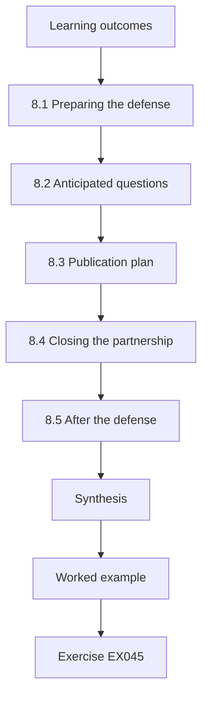

### Logical drawing


```text
[Learning outcomes]
    |
    v
[8.1 Preparing the defense]
    |
    v
[8.2 Anticipated questions]
    |
    v
[8.3 Publication plan]
    |
    v
[8.4 Closing the partnership]
    |
    v
[8.5 After the defense]
    |
    v
[Synthesis]
    |
    v
[Worked example] --> [Exercise EX045]
```
<!-- cykin:lesson-figures:end ch-08 -->


### Learning outcomes

You will (1) prepare for the defense; (2) answer likely questions with evidence; (3) plan publication and closure of the partnership.

### 8.1 Preparing the defense

Rhea rereads the whole thesis, lists its weakest points and prepares a short, evidence-based answer for each. She drafts a fifteen-minute opening that states the question, design, main findings, limits and contribution. A mock defense with two colleagues playing examiners exposes answers that are too long or vague. She practises saying I do not know where that is honest, followed by how the question could be answered. Preparation is about understanding her own work deeply enough to discuss it calmly from any angle, not memorising scripts.

### 8.2 Anticipated questions

Likely questions include why ninety days defines dormancy, how usage logs miss access, whether three public bodies generalise, why units rather than individuals were randomised, and what the third partner's weaker correlation means. For each, Rhea notes the relevant page, data and limitation. She also prepares for a broader question: if she started again, what would she change? Her honest answer, a longer study with two review cycles to measure whether excess grows back, shows she understands the limits of a single cycle and points naturally to future work.

### 8.3 Publication plan

Rhea plans two papers: one on the codebook and complexity relationship, one on the randomised review comparison. She chooses venues that publish empirical security and usable security research, checks that the data agreement permits each paper, and gives partners the chance to review drafts for identifying details. The codebook, procedure and synthetic data are released with the papers so other researchers can replicate or extend the work. She also writes a short practitioner summary, because the people who run access reviews rarely read academic papers.

### 8.4 Closing the partnership

After the defense and corrections, Rhea closes her obligations. Partner exports are deleted on the agreed date and deletion is confirmed in writing. Each partner receives a summary of findings for their own organisation, with recommendations such as focusing reviews on units with complex role models and adopting the structured review. Interview participants receive a plain-language summary. Closing carefully maintains trust between the university and the partners, which matters for future students, and completes the ethical commitments she made at the start of the study.

### 8.5 After the defense

Rhea makes the corrections the examiners require, records each change and submits the final thesis. She reflects on lessons for future research: securing usage data earlier, planning for two review cycles and budgeting more time for plain-language descriptions. She shares these lessons with her supervisor's group, where new students are starting related projects. Her final contribution is not only the findings but a reusable method, a codebook with known agreement, a tested review procedure and an archive, that others can build on to study least privilege in practice.

### Worked example

Rhea prepares a fifteen-minute opening and evidence-based answers, plans two papers with open materials, closes the partnership with confirmed deletion and summaries, and records lessons for future students.

> **Synthetic case.** Rhea, examiners, papers and partners are synthetic.

### Errors and limits

Preparing scripted answers instead of understanding the work leaves a candidate unable to handle unexpected questions.

### Exercises

- **EX045 — Opening contents.** What should the fifteen-minute opening state? *Rubric:* 3 = question, design, findings, limits, contribution;; 2 = most;; 1 = one;; 0 = none.
- **EX046 — Honest unknown.** How should Rhea handle a question she cannot answer? *Rubric:* 3 = say so honestly and explain how it could be answered;; 2 = admit;; 1 = guess;; 0 = none.
- **EX047 — Restart answer.** What would Rhea change if starting again? *Rubric:* 3 = longer study, two cycles to see if excess grows back;; 2 = longer;; 1 = vague;; 0 = none.
- **EX048 — Paper split.** What are Rhea's two planned papers? *Rubric:* 3 = codebook and complexity; randomised review comparison;; 2 = two topics;; 1 = one;; 0 = none.
- **EX049 — Deletion confirmation.** How is partner data handled at closure? *Rubric:* 3 = deleted on agreed date, confirmed in writing;; 2 = deleted;; 1 = kept;; 0 = none.
- **EX050 — Reusable method.** Name the reusable parts of Rhea's method. *Rubric:* 3 = codebook, procedure, archive;; 2 = two;; 1 = one;; 0 = none.

### Synthesis

A good defense rests on deep understanding of one's own evidence, and a careful close keeps faith with partners and participants.

### Continue studying — chapter 08 of 08

[← Chapter 07 (draft)](#ch-07) · [Course chapter index](../SUBJECTS.md) · [Worked results ↓](#worked-results) · [Next course via chapter index →](../SUBJECTS.md)

<a id="worked-results"></a>

## Worked results

Model answers for EX001–EX050. Rhea Mwangi, Prof. Daniel Osei, Thornfield University, Calder Valley Health Trust and every figure are synthetic. Lab answers quote verified outputs. Any answer meeting the rubric scores equally.

**EX001.** One permission or group membership held by one account.

**EX002.** Toxic: the combination breaks a separation-of-duties rule.

**EX003.** Observed agreement 0.90; kappa 0.85.

**EX004.** It subtracts the agreement expected by chance given each coder's category frequencies.

**EX005.** Turn each into a clearer decision rule and repeat the agreement exercise on new items.

**EX006.** Consistent pseudonyms and encrypted, access-logged storage (also: no publication of identifying entitlement names).

**EX007.** Staff turnover or a system migration during the study period.

**EX008.** Sandhu, Coyne, Feinstein and Youman (1996).

**EX009.** NIST SP 800-162.

**EX010.** Infer sensible, meaningful roles from existing user-permission assignments.

**EX011.** It reduces misuse of accounts but does not limit what a legitimate account can access.

**EX012.** Herley (2009): rational rejection of security effort whose cost exceeds visible benefit.

**EX013.** Roles per user and entitlements per role.

**EX014.** It will not test new access control models or measure attack outcomes (nor claim all sectors).

**EX015.** A rank (Spearman) correlation, because neither measure is expected to be normally distributed.

**EX016.** Entitlements coded excess, dormant or toxic divided by all entitlements in the unit.

**EX017.** Within each partner, so differences between organisations are balanced.

**EX018.** The coders who judge whether removals were correct.

**EX019.** Because a procedure that removes more but takes much longer may not be adopted.

**EX020.** Every removal follows normal change procedure and can be reversed within one working day.

**EX021.** Five of fourteen, a rate of 0.36.

**EX022.** a06, because it used none of its access in ninety days.

**EX023.** Some legitimate access is used only occasionally, so purpose must be checked first.

**EX024.** Finding practical problems early, while they are cheap to fix.

**EX025.** Its entitlements are marked unknown rather than unused, and the baseline is recoded.

**EX026.** The fix benefits both conditions, so applying it everywhere avoids favouring one.

**EX027.** About 8.2 percent under usual review and 24.8 percent under structured review.

**EX028.** A difference of about 16.7 percentage points (0.167).

**EX029.** That the effect varies with local factors and needs explanation.

**EX030.** Each sampled removal as correct, wrong or unclear.

**EX031.** A pattern across all units might only reflect differences between organisations.

**EX032.** The extra reviewer time, roughly eight minutes per hundred decisions.

**EX033.** They reveal where the thesis needs clearer explanation, more analysis or a stated limitation.

**EX034.** Comment, reply, evidence and the page where the change appears.

**EX035.** The direction held, with a wider interval.

**EX036.** By comparing removal rates in observed and unobserved sittings within the structured condition.

**EX037.** Version 2; later revisions are reported separately.

**EX038.** Date, options considered, decision made and reason.

**EX039.** 0.90 (sum of squared rank differences 16).

**EX040.** The design is correlational, and both complexity and excess may stem from rapid change.

**EX041.** That complexity is a useful warning sign for where to focus reviews.

**EX042.** The codebook, analysis scripts and synthetic data (also the decision log and rerun guide).

**EX043.** Partner exports cannot be shared under the data agreement.

**EX044.** Remove identifying details, check field combinations and have each partner review.

**EX045.** The question, design, main findings, limits and contribution.

**EX046.** Say she does not know and explain how the question could be answered.

**EX047.** A longer study with two review cycles to see whether excess grows back.

**EX048.** One on the codebook and complexity relationship, one on the review comparison.

**EX049.** Deleted on the agreed date, with deletion confirmed in writing.

**EX050.** A codebook with known agreement, a tested review procedure and a reproducibility archive.

<a id="references"></a>

## References

Links checked 12 October 2026; re-verify editions before citing. Organisations, people, systems, code and data in this book are synthetic unless a sentence cites a public source.

- Bonneau, J., Herley, C., van Oorschot, P. C., & Stajano, F. (2012). The quest to replace passwords: A framework for comparative evaluation of web authentication schemes. *2012 IEEE Symposium on Security and Privacy*, 553–567. <https://doi.org/10.1109/SP.2012.44>
- Ferraiolo, D. F., Sandhu, R., Gavrila, S., Kuhn, D. R., & Chandramouli, R. (2001). Proposed NIST standard for role-based access control. *ACM Transactions on Information and System Security*, 4(3), 224–274. <https://doi.org/10.1145/501978.501980>
- Florêncio, D., & Herley, C. (2007). A large-scale study of web password habits. *Proceedings of the 16th International Conference on World Wide Web*, 657–666. <https://doi.org/10.1145/1242572.1242661>
- Hardt, D. (Ed.). (2012). *The OAuth 2.0 authorization framework* (RFC 6749). IETF. <https://www.rfc-editor.org/rfc/rfc6749>
- Herley, C. (2009). So long, and no thanks for the externalities: The rational rejection of security advice by users. *Proceedings of the 2009 New Security Paradigms Workshop*, 133–144. <https://doi.org/10.1145/1719030.1719050>
- Hu, V. C., Ferraiolo, D., Kuhn, R., Schnitzer, A., Sandlin, K., Miller, R., & Scarfone, K. (2014). *Guide to attribute based access control (ABAC) definition and considerations* (NIST SP 800-162). NIST. <https://doi.org/10.6028/NIST.SP.800-162>
- Joint Task Force. (2020). *Security and privacy controls for information systems and organizations* (NIST SP 800-53 Rev. 5). NIST. <https://doi.org/10.6028/NIST.SP.800-53r5>
- Jones, M., Bradley, J., & Sakimura, N. (2015). *JSON Web Token (JWT)* (RFC 7519). IETF. <https://www.rfc-editor.org/rfc/rfc7519>
- Kuhn, D. R., Coyne, E. J., & Weil, T. R. (2010). Adding attributes to role-based access control. *Computer*, 43(6), 79–81. <https://doi.org/10.1109/MC.2010.155>
- Landis, J. R., & Koch, G. G. (1977). The measurement of observer agreement for categorical data. *Biometrics*, 33(1), 159–174. <https://doi.org/10.2307/2529310>
- Lodderstedt, T., Bradley, J., Labunets, A., & Fett, D. (2025). *Best current practice for OAuth 2.0 security* (RFC 9700, BCP 240). IETF. <https://www.rfc-editor.org/rfc/rfc9700>
- Molloy, I., Chen, H., Li, T., Wang, Q., Li, N., Bertino, E., Calo, S., & Lobo, J. (2008). Mining roles with semantic meanings. *Proceedings of the 13th ACM Symposium on Access Control Models and Technologies*, 21–30. <https://doi.org/10.1145/1377836.1377840>
- OASIS. (2005). *Assertions and protocols for the OASIS Security Assertion Markup Language (SAML) V2.0*. OASIS Standard. <https://docs.oasis-open.org/security/saml/v2.0/saml-core-2.0-os.pdf>
- Rose, S., Borchert, O., Mitchell, S., & Connelly, S. (2020). *Zero trust architecture* (NIST SP 800-207). NIST. <https://doi.org/10.6028/NIST.SP.800-207>
- Sakimura, N., Bradley, J., & Agarwal, N. (2015). *Proof Key for Code Exchange by OAuth public clients* (RFC 7636). IETF. <https://www.rfc-editor.org/rfc/rfc7636>
- Sakimura, N., Bradley, J., Jones, M., de Medeiros, B., & Mortimore, C. (2014). *OpenID Connect Core 1.0*. OpenID Foundation. <https://openid.net/specs/openid-connect-core-1_0.html>
- Saltzer, J. H., & Schroeder, M. D. (1975). The protection of information in computer systems. *Proceedings of the IEEE*, 63(9), 1278–1308. <https://doi.org/10.1109/PROC.1975.9939>
- Sandhu, R. S., Coyne, E. J., Feinstein, H. L., & Youman, C. E. (1996). Role-based access control models. *Computer*, 29(2), 38–47. <https://doi.org/10.1109/2.485845>
- Temoshok, D., Proud-Madruga, D., Choong, Y.-Y., Galluzzo, R., Gupta, S., LaSalle, C., Lefkovitz, N., & Regenscheid, A. (2025). *Digital identity guidelines* (NIST SP 800-63-4). NIST. <https://doi.org/10.6028/NIST.SP.800-63-4>
- Temoshok, D., Fenton, J. L., Choong, Y.-Y., Lefkovitz, N., Regenscheid, A., Galluzzo, R., & Richer, J. P. (2025). *Digital identity guidelines: Authentication and authenticator management* (NIST SP 800-63B-4). NIST. <https://doi.org/10.6028/NIST.SP.800-63B-4>
- W3C. (2021). *Web Authentication: An API for accessing public key credentials, Level 2*. W3C Recommendation. <https://www.w3.org/TR/webauthn-2/>
