# Information Security: Doctoral Research Track

- Language: English (`en`); course 186, Doctoral research track (2 years).
- Editorial state: **published**. Chapters 1–8 of 8 have hand-written teaching text; exercises EX001–EX050 have matching worked results with 0–3 rubrics; three offline labs use only the Python 3 standard library on synthetic data, and their outputs are embedded from real runs. Independent review and the 300-page A4 verification remain open.
- Audience: doctoral candidates studying whether risk-ranked security control prioritisation shortens critical patch latency and reduces excess privilege in public organisations.
- Author: [hiagokinlevi](https://github.com/hiagokinlevi). Original text [CC0 1.0](../../../../../LICENSE); cited works keep their rights.
- Boundary: the labs categorise synthetic systems by confidentiality, integrity and availability impact, measure excess privilege on synthetic accounts and estimate a difference-in-differences of synthetic patch latency with a bootstrap interval. Standards are cited by edition and paraphrased. All people, organisations, systems and data are **synthetic** unless a sentence cites a public source.

[Course home](../../README.md) · [Chapter index](../SUBJECTS.md) · [Book plan](PLAN.md) · [Course skill](../../skill/SKILL.md) · [Worked results](#worked-results)

## How to use this draft

Read in order. The chapters follow one doctoral candidate from integrity rules and the research frontier through a proposal, a measurement pilot, a main study with independent validation, peer critique, a reproducibility archive and the defense. Run each lab where it appears, attempt the exercises before the worked results, and score yourself with the rubrics.

### Synthetic running case

| Element | Role | Boundary |
|---|---|---|
| **Yusuf Al-Rashid** | Doctoral candidate | Invented |
| **Prof. Ingeborg Hald** | Supervisor | Invented |
| **Marlow University** | Fictional university | Invented |
| **Fernvale Municipal Services** | Fictional council with 30 departments and about 4,000 staff | Invented |

### Core sources

Anderson (2020), [doi:10.1002/9781119644682](https://doi.org/10.1002/9781119644682); ISO/IEC 27000:2026; ISO/IEC 27001:2022; ISO/IEC 27002:2022; NIST SP 800-53 Rev. 5; NIST SP 800-30 Rev. 1; FIPS 199, [doi:10.6028/NIST.FIPS.199](https://doi.org/10.6028/NIST.FIPS.199); NIST CSWP 29 (CSF 2.0); NIST SP 800-12 Rev. 1; Saltzer and Schroeder (1975), [doi:10.1109/PROC.1975.9939](https://doi.org/10.1109/PROC.1975.9939); Shadish, Cook and Campbell (2002). Full list in [References](#references).

## Contents

| Chapters |
|---|
| [1](#ch-01) · [2](#ch-02) · [3](#ch-03) · [4](#ch-04) · [5](#ch-05) · [6](#ch-06) · [7](#ch-07) · [8](#ch-08) |

[Worked results](#worked-results) · [References](#references)

<a id="ch-01"></a>

## Chapter 1 — Advanced research integrity and methods

<!-- cyberabc:lesson-figures:start ch-01 -->
### Lesson map

Lesson 01 published. Map, example, EX001.

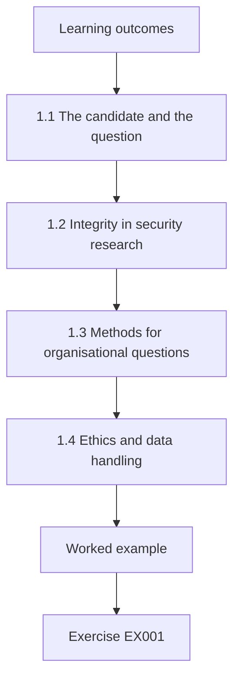

### Logical drawing

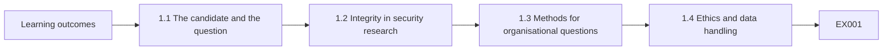

```text
[Learning outcomes]
    |
    v
[1.1 The candidate and the question]
    |
    v
[1.2 Integrity in security research]
    |
    v
[1.3 Methods for organisational questions]
    |
    v
[1.4 Ethics and data handling]
    |
    v
[Worked example] --> [Exercise EX001]
```
<!-- cyberabc:lesson-figures:end ch-01 -->


### Learning outcomes

You will (1) set integrity rules for security research involving a real-world partner; (2) choose methods that suit organisational security questions; (3) plan ethics review and data handling.

### 1.1 The candidate and the question

Yusuf Al-Rashid begins a two-year doctoral research track in information security at the fictional Marlow University, supervised by Prof. Ingeborg Hald. His partner organisation is Fernvale Municipal Services, a fictional city council with thirty departments and about four thousand staff. His question is whether ranking security controls by assessed risk, rather than applying them uniformly, shortens the time to patch critical vulnerabilities and reduces excess access rights. All data in this book are synthetic, generated to mirror the structure of such a study.

### 1.2 Integrity in security research

Prof. Hald sets integrity rules at the first meeting. Yusuf will never test live systems without written authorisation, will report any vulnerability he encounters to Fernvale's security team rather than publishing it, will pre-register hypotheses before analysing outcome data and will keep raw data separate from analysis code. She explains that security research carries a special risk: a careless paper can hand attackers a map of an organisation's weaknesses, so publication must describe patterns without exposing exploitable details of the partner. Yusuf signs them.

### 1.3 Methods for organisational questions

Yusuf compares methods. Controlled experiments are rarely possible inside a council, because departments cannot be randomly assigned to weaker security. Case studies give depth but weak generalisation. Quasi-experimental designs, discussed by Shadish, Cook and Campbell, compare groups that adopt a practice with groups that do not, before and after adoption. He chooses a difference-in-differences design, because Fernvale is rolling out risk-ranked patching in some departments first, creating a natural comparison group whose trends can absorb citywide changes. Prof. Hald approves the choice after discussion.

### 1.4 Ethics and data handling

The study uses logs of patch dates, vulnerability severity ratings and account permission records. These include staff identifiers, so Yusuf applies to the university ethics committee with a plan: identifiers are replaced by keyed pseudonyms inside Fernvale before export, only department-level results are published and raw extracts are destroyed after the thesis is examined. The committee approves with one condition: Fernvale's security lead must review any publication for operational sensitivity before submission. Yusuf records the condition in his data management plan. Yusuf agrees.

### Worked example

Yusuf frames a question on risk-ranked controls at Fernvale, sets integrity rules on authorisation, disclosure and pre-registration, chooses difference-in-differences and obtains ethics approval with pseudonymised exports and a security-lead review condition.

> **Synthetic case.** Marlow, Fernvale and all people are synthetic; Shadish, Cook and Campbell (2002) is real.

### Errors and limits

Publishing partner-specific weaknesses turns research into an attack guide; report patterns instead.

### Exercises

- **EX001 — Research question.** What does Yusuf's question compare? *Rubric:* 3 = risk-ranked versus uniform control application;; 2 = partly correct;; 1 = partial;; 0 = none.
- **EX002 — Partner scale.** How many departments does Fernvale have? *Rubric:* 3 = thirty;; 2 = partly correct;; 1 = wrong;; 0 = none.
- **EX003 — Live testing rule.** When may Yusuf test live systems? *Rubric:* 3 = only with written authorisation;; 2 = partly correct;; 1 = vague;; 0 = none.
- **EX004 — Found vulnerability.** What happens if Yusuf finds a vulnerability? *Rubric:* 3 = report it to Fernvale's security team;; 2 = partly correct;; 1 = publish;; 0 = none.
- **EX005 — Chosen design.** Which design does Yusuf choose? *Rubric:* 3 = difference-in-differences;; 2 = partly correct;; 1 = other;; 0 = none.
- **EX006 — Natural comparison.** Why does a comparison group exist? *Rubric:* 3 = risk-ranked patching rolls out to some departments first;; 2 = partly correct;; 1 = vague;; 0 = none.
- **EX007 — Ethics condition.** What condition did the ethics committee add? *Rubric:* 3 = security lead reviews publications for sensitivity;; 2 = partly correct;; 1 = vague;; 0 = none.

<!-- cyberabc:chapter-navigation:start ch-01 -->
### Continue studying — lesson 01 (chapter 01 of 08)

[← Course home](../../README.md) · [Course chapter index](../SUBJECTS.md) · [Chapter 02 →](#ch-02)

Continue to the next authored lesson.
<!-- cyberabc:chapter-navigation:end -->

<a id="ch-02"></a>

## Chapter 2 — Information security: research frontier

<!-- cyberabc:lesson-figures:start ch-02 -->
### Lesson map

Lesson 02 published. Map, example, EX008.

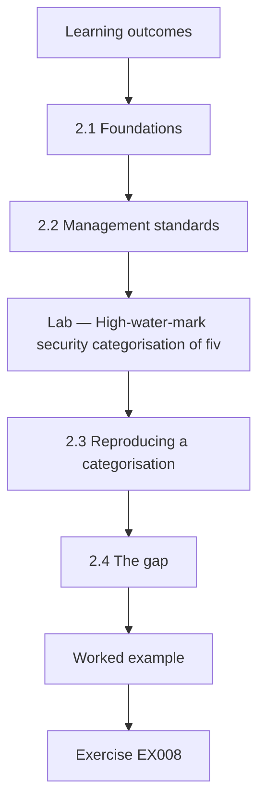

### Logical drawing

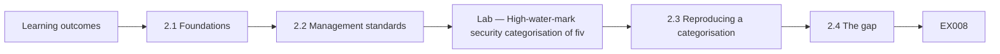

```text
[Learning outcomes]
    |
    v
[2.1 Foundations]
    |
    v
[2.2 Management standards]
    |
    v
[Lab — High-water-mark security categorisation of fiv]
    |
    v
[2.3 Reproducing a categorisation]
    |
    v
[2.4 The gap]
    |
    v
[Worked example] --> [Exercise EX008]
```
<!-- cyberabc:lesson-figures:end ch-02 -->


### Learning outcomes

You will (1) map foundational and current sources on information security management; (2) reproduce a security categorisation from a published standard; (3) locate an open research gap.

### 2.1 Foundations

Yusuf starts with foundations. Saltzer and Schroeder's 1975 paper set out design principles such as least privilege, fail-safe defaults and complete mediation, which still frame access control research. NIST SP 800-12r1 introduces confidentiality, integrity and availability as the core security objectives and explains how organisations manage them. Anderson's Security Engineering, third edition, shows through many cases that failures usually arise from incentives, usability and organisational process rather than broken cryptography, which supports Yusuf's focus on how controls are prioritised. He summarises each source in a short annotated note.

### 2.2 Management standards

He reviews management standards. ISO/IEC 27001:2022 sets requirements for an information security management system, including risk assessment and treatment. ISO/IEC 27002:2022 gives guidance on controls. ISO/IEC 27000:2026 provides an overview of how the family fits together. NIST SP 800-53r5 offers a large control catalogue, and the NIST Cybersecurity Framework 2.0 organises outcomes into govern, identify, protect, detect, respond and recover functions. He notes that all of these assume risk-based selection, yet say little about measuring its effect. Yusuf records this observation as the starting point for his gap.

### Lab — High-water-mark security categorisation of five synthetic systems

```python
"""FIPS 199-style high-water-mark categorisation of synthetic systems (stdlib only)."""
L = {"low": 1, "moderate": 2, "high": 3}
systems = {
    "payroll":        ("moderate", "high", "moderate"),
    "public_website": ("low", "moderate", "moderate"),
    "water_scada":    ("low", "high", "high"),
    "permits_portal": ("moderate", "moderate", "low"),
    "case_records":   ("high", "moderate", "moderate"),
}
from collections import Counter
cat = {s: max(v, key=L.get) for s, v in systems.items()}
for s, v in systems.items():
    print(f"{s:<15} C={v[0]:<8} I={v[1]:<8} A={v[2]:<8} -> {cat[s]}")
print("overall:", dict(Counter(cat.values())))
```

Run with `python3 lab_category.py`. Verified output:

```text
payroll         C=moderate I=high     A=moderate -> high
public_website  C=low      I=moderate A=moderate -> moderate
water_scada     C=low      I=high     A=high     -> high
permits_portal  C=moderate I=moderate A=low      -> moderate
case_records    C=high     I=moderate A=moderate -> high
overall: {'high': 3, 'moderate': 2}
```

### 2.3 Reproducing a categorisation

To understand risk-based selection concretely, Yusuf reproduces the categorisation approach of FIPS 199, which rates the potential impact of losing confidentiality, integrity and availability as low, moderate or high and takes the highest rating as the system's category. In the lab, five synthetic Fernvale systems yield three high systems, payroll, water control and case records, and two moderate systems, the public website and the permits portal. Water control is high despite low confidentiality impact, because integrity and availability failures could harm the public.

### 2.4 The gap

Yusuf searches for studies measuring whether risk-ranked control selection changes security outcomes in organisations. He finds many descriptions of frameworks, surveys of adoption and case reports, but few designs comparing adopters with non-adopters over time using operational measures such as patch latency. He frames this as his gap. Prof. Hald asks him to state the gap narrowly, as evidence about two outcome measures in one public body, rather than claiming to test the whole of risk-based security management. Yusuf rewrites the gap accordingly.

### Worked example

Yusuf reviews Saltzer and Schroeder, SP 800-12r1, Anderson and the ISO/IEC 27000 family, SP 800-53r5 and CSF 2.0, reproduces FIPS 199 categorisation giving three high and two moderate systems and states a narrow gap.

> **Synthetic case.** Systems are synthetic; outputs come from lab_category.py; all cited works are real.

### Errors and limits

Claiming a thesis tests a whole framework overstates what one study can show.

### Exercises

- **EX008 — Saltzer principle.** Name one Saltzer and Schroeder design principle. *Rubric:* 3 = least privilege, fail-safe defaults or complete mediation;; 2 = one;; 1 = vague;; 0 = none.
- **EX009 — Anderson insight.** What does Anderson show most failures arise from? *Rubric:* 3 = incentives, usability and process;; 2 = most;; 1 = one;; 0 = none.
- **EX010 — CSF functions.** Name the six CSF 2.0 functions. *Rubric:* 3 = govern, identify, protect, detect, respond, recover;; 2 = all;; 1 = some;; 0 = none.
- **EX011 — High-water rule.** How does FIPS 199 set a system's category? *Rubric:* 3 = the highest of the three impact ratings;; 2 = partly correct;; 1 = vague;; 0 = none.
- **EX012 — High systems.** Which synthetic systems are high? *Rubric:* 3 = payroll, water control and case records;; 2 = all;; 1 = some;; 0 = none.
- **EX013 — Water control reason.** Why is water control high despite low confidentiality impact? *Rubric:* 3 = integrity and availability failures could harm the public;; 2 = partly correct;; 1 = vague;; 0 = none.
- **EX014 — Stated gap.** How narrowly does Yusuf state his gap? *Rubric:* 3 = two outcome measures in one public body;; 2 = partly correct;; 1 = partial;; 0 = none.

<!-- cyberabc:chapter-navigation:start ch-02 -->
### Continue studying — lesson 02 (chapter 02 of 08)

[← Chapter 01](#ch-01) · [Course chapter index](../SUBJECTS.md) · [Chapter 03 →](#ch-03)

Continue to the next authored lesson.
<!-- cyberabc:chapter-navigation:end -->

<a id="ch-03"></a>

## Chapter 3 — Original contribution proposal

<!-- cyberabc:lesson-figures:start ch-03 -->
### Lesson map

Lesson 03 published. Map, example, EX015.

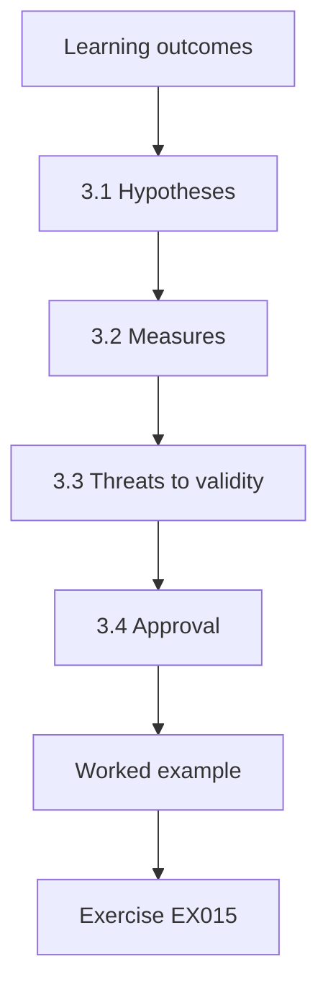

### Logical drawing

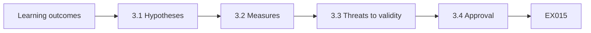

```text
[Learning outcomes]
    |
    v
[3.1 Hypotheses]
    |
    v
[3.2 Measures]
    |
    v
[3.3 Threats to validity]
    |
    v
[3.4 Approval]
    |
    v
[Worked example] --> [Exercise EX015]
```
<!-- cyberabc:lesson-figures:end ch-03 -->


### Learning outcomes

You will (1) state hypotheses and outcome measures precisely; (2) design comparison and threats to validity; (3) obtain approval for a proposal.

### 3.1 Hypotheses

Yusuf states two hypotheses. First, departments adopting risk-ranked patching will show a larger fall in median days to patch critical vulnerabilities than comparison departments over the same period. Second, departments adopting risk-ranked access reviews will show a larger fall in the share of accounts with privileges beyond their role baseline. He records the hypotheses, measures, analysis method and the minimum effect he would consider meaningful in a dated pre-registration document held by Prof. Hald. Prof. Hald signs and dates the document, and a copy is lodged with the graduate school.

### 3.2 Measures

Patch latency is the number of days from a critical vulnerability being published by the vendor to the fix being installed on an affected system, using medians because latency is skewed by a few very slow cases. Excess privilege is the share of accounts holding any permission outside their role's baseline, a direct operational measure of least privilege. Both come from existing systems, avoiding self-report bias. Yusuf documents each measure's source, formula and known errors, such as patches applied but not recorded.

### 3.3 Threats to validity

Yusuf lists threats. Departments chosen for early adoption might already be better run, a selection threat; he will compare pre-adoption trends. A citywide event, such as a major vendor vulnerability, might affect all departments; the comparison group absorbs it. Recording practices might change with adoption, a measurement threat; he will audit a sample of records against system evidence. Staff might change behaviour because they know they are studied; he notes this but expects little effect on automated logs. Each threat and response appears in the proposal.

### 3.4 Approval

The proposal panel includes Prof. Hald, a statistician and Fernvale's security lead as an external adviser. The statistician asks about sample size; Yusuf admits he cannot control how many vulnerabilities occur, and plans to report confidence intervals and power honestly rather than claiming certainty. The security lead asks that department names be coded in all outputs. The panel approves the proposal with both points recorded, and the pre-registration is frozen before outcome data are extracted. The security lead also offers to arrange access to anonymised test extracts.

### Worked example

Yusuf pre-registers two hypotheses on patch latency and excess privilege, defines measures from system data, lists selection, history, measurement and observation threats and gains approval with commitments on power reporting and coded department names.

> **Synthetic case.** The proposal is synthetic.

### Errors and limits

Changing hypotheses after seeing outcome data invalidates confirmatory claims.

### Exercises

- **EX015 — First hypothesis.** What does the first hypothesis predict? *Rubric:* 3 = a larger fall in median critical patch latency in adopting departments;; 2 = partly correct;; 1 = partial;; 0 = none.
- **EX016 — Median choice.** Why use medians for patch latency? *Rubric:* 3 = latency is skewed by a few very slow cases;; 2 = partly correct;; 1 = vague;; 0 = none.
- **EX017 — Excess privilege definition.** How is excess privilege measured? *Rubric:* 3 = share of accounts with permissions outside their role baseline;; 2 = partly correct;; 1 = vague;; 0 = none.
- **EX018 — Selection response.** How will Yusuf address the selection threat? *Rubric:* 3 = compare pre-adoption trends;; 2 = partly correct;; 1 = vague;; 0 = none.
- **EX019 — Statistician question.** What did the statistician ask about? *Rubric:* 3 = sample size;; 2 = partly correct;; 1 = other;; 0 = none.
- **EX020 — Freeze timing.** When is the pre-registration frozen? *Rubric:* 3 = before outcome data are extracted;; 2 = partly correct;; 1 = after;; 0 = none.

<!-- cyberabc:chapter-navigation:start ch-03 -->
### Continue studying — lesson 03 (chapter 03 of 08)

[← Chapter 02](#ch-02) · [Course chapter index](../SUBJECTS.md) · [Chapter 04 →](#ch-04)

Continue to the next authored lesson.
<!-- cyberabc:chapter-navigation:end -->

<a id="ch-04"></a>

## Chapter 4 — Baseline replication and pilot

<!-- cyberabc:lesson-figures:start ch-04 -->
### Lesson map

Lesson 04 published. Map, example, EX021.

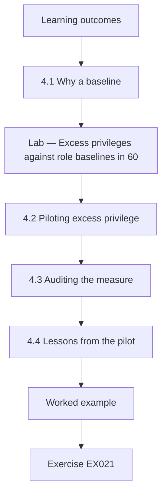

### Logical drawing

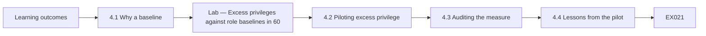

```text
[Learning outcomes]
    |
    v
[4.1 Why a baseline]
    |
    v
[Lab — Excess privileges against role baselines in 60]
    |
    v
[4.2 Piloting excess privilege]
    |
    v
[4.3 Auditing the measure]
    |
    v
[4.4 Lessons from the pilot]
    |
    v
[Worked example] --> [Exercise EX021]
```
<!-- cyberabc:lesson-figures:end ch-04 -->


### Learning outcomes

You will (1) replicate a baseline measurement before the main study; (2) pilot an excess privilege measure; (3) audit measurement quality.

### 4.1 Why a baseline

Before testing effects, Yusuf must show that his measures work on Fernvale's data. He replicates the council's own reported figure for critical patch latency from the previous year using his extraction and finds his median within a day of the reported value. He investigates the small difference and finds the council excluded systems scheduled for retirement. He documents the exclusion and decides to follow it, so his baseline matches the definition that departments already understand. Fernvale's security lead confirms the exclusion rule in writing for the study.

### Lab — Excess privileges against role baselines in 600 synthetic accounts

```python
"""Measure excess privileges against role baselines in synthetic accounts (stdlib only)."""
import random
random.seed(17)
roles = {"clerk": {"read_cases", "edit_cases"}, "finance": {"read_ledger", "post_ledger"},
         "it_support": {"reset_password", "read_logs"}}
extra_pool = ["read_ledger", "post_ledger", "edit_cases", "admin_console", "read_logs", "export_all"]
accts = []
for i in range(600):
    r = random.choice(list(roles))
    perms = set(roles[r])
    for p in extra_pool:
        if p not in perms and random.random() < 0.06: perms.add(p)
    accts.append((r, perms))
excess = [(r, p - roles[r]) for r, p in accts if p - roles[r]]
n_extra = sum(len(e) for _, e in excess)
admin = sum(1 for _, e in excess if "admin_console" in e)
print(f"accounts 600; with excess privilege {len(excess)} ({100*len(excess)/600:.1f}%)")
print(f"excess grants {n_extra}; accounts holding admin_console without need {admin}")
```

Run with `python3 lab_privilege.py`. Verified output:

```text
accounts 600; with excess privilege 152 (25.3%)
excess grants 166; accounts holding admin_console without need 34
```

### 4.2 Piloting excess privilege

The excess privilege measure is new to Fernvale, so Yusuf pilots it on six hundred synthetic accounts across three roles: clerk, finance and IT support. Each role has a baseline set of permissions. The lab finds 152 accounts, 25.3 percent, holding at least one permission beyond their baseline, with 166 excess grants in total. Thirty-four accounts hold the administrative console permission without needing it, which is the most serious finding because it allows configuration changes across the system. Yusuf reports these figures only to the security lead, not in public drafts.

### 4.3 Auditing the measure

Yusuf audits the pilot by taking a random sample of flagged accounts and asking department managers whether each excess permission is genuinely unneeded. Most are confirmed as unneeded. A few reflect temporary duties not recorded in the role baseline, such as a clerk covering finance during leave. He refines the measure to exclude permissions with an approved, unexpired exception, and records this refinement as a pre-specified definition change made before any outcome comparison, which the pre-registration permits for pilot-stage clarifications. The managers sign off.

### 4.4 Lessons from the pilot

The pilot shows that role baselines themselves are incomplete in some departments, which could make adopters look worse if adoption also improves baselines. Yusuf adds a check: baselines are frozen at the start of the study period, and later baseline changes are tracked separately. Prof. Hald notes that pilots often reveal that the measurement system is part of the intervention, and that separating the two is essential to interpreting any later difference between departments. Yusuf adds the frozen baselines to the data management plan and archives them with a checksum.

### Worked example

Yusuf replicates the council's patch latency baseline within a day, pilots excess privilege finding 152 of 600 accounts (25.3 percent) with 166 grants and 34 unneeded admin console holders, audits flags and freezes role baselines.

> **Synthetic case.** Accounts are synthetic; outputs come from lab_privilege.py.

### Errors and limits

Letting baselines change during a study confounds the measure with the intervention.

### Exercises

- **EX021 — Baseline gap cause.** What explained the small baseline difference? *Rubric:* 3 = the council excluded systems scheduled for retirement;; 2 = partly correct;; 1 = vague;; 0 = none.
- **EX022 — Excess share.** What share of pilot accounts held excess privilege? *Rubric:* 3 = 25.3% (152 of 600);; 2 = partly correct;; 1 = wrong;; 0 = none.
- **EX023 — Admin finding.** How many accounts held admin console access without need? *Rubric:* 3 = 34;; 2 = partly correct;; 1 = wrong;; 0 = none.
- **EX024 — Admin seriousness.** Why is unneeded admin console access most serious? *Rubric:* 3 = it allows system-wide configuration changes;; 2 = partly correct;; 1 = vague;; 0 = none.
- **EX025 — Measure refinement.** What refinement was made after the audit? *Rubric:* 3 = exclude permissions with approved unexpired exceptions;; 2 = partly correct;; 1 = vague;; 0 = none.
- **EX026 — Baseline freeze.** Why are role baselines frozen? *Rubric:* 3 = so baseline changes do not confound the measure;; 2 = partly correct;; 1 = vague;; 0 = none.

<!-- cyberabc:chapter-navigation:start ch-04 -->
### Continue studying — lesson 04 (chapter 04 of 08)

[← Chapter 03](#ch-03) · [Course chapter index](../SUBJECTS.md) · [Chapter 05 →](#ch-05)

Continue to the next authored lesson.
<!-- cyberabc:chapter-navigation:end -->

<a id="ch-05"></a>

## Chapter 5 — Main study and independent validation

<!-- cyberabc:lesson-figures:start ch-05 -->
### Lesson map

Lesson 05 published. Map, example, EX027.

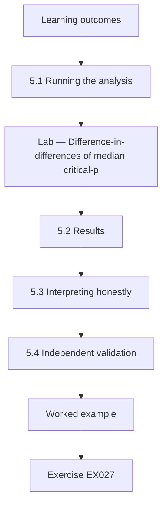

### Logical drawing

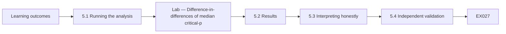

```text
[Learning outcomes]
    |
    v
[5.1 Running the analysis]
    |
    v
[Lab — Difference-in-differences of median critical-p]
    |
    v
[5.2 Results]
    |
    v
[5.3 Interpreting honestly]
    |
    v
[5.4 Independent validation]
    |
    v
[Worked example] --> [Exercise EX027]
```
<!-- cyberabc:lesson-figures:end ch-05 -->


### Learning outcomes

You will (1) run a pre-registered difference-in-differences analysis; (2) interpret an interval that includes zero; (3) arrange independent validation of the analysis.

### 5.1 Running the analysis

With the pre-registration frozen, Yusuf extracts synthetic patch records for three hundred critical vulnerability instances in each of four groups: adopting departments before and after risk-ranked patching, and comparison departments over the same two periods. He computes median latency in each group, the difference-in-differences of medians and a bootstrap confidence interval by resampling each group a thousand times with a fixed random seed. The script uses only Python's statistics and random modules, so reviewers can rerun it without special software. All four groups use the same extraction rule.

### Lab — Difference-in-differences of median critical-patch latency with a bootstrap interval

```python
"""Difference-in-differences of median critical-patch latency with bootstrap interval (stdlib only)."""
import random, statistics as st
random.seed(23)
def gen(n, m): return [random.expovariate(1/m) for _ in range(n)]
t_pre, t_post = gen(300, 21), gen(300, 12)   # departments using risk-ranked patching
c_pre, c_post = gen(300, 20), gen(300, 18)   # comparison departments
did = (st.median(t_post) - st.median(t_pre)) - (st.median(c_post) - st.median(c_pre))
bs = []
for _ in range(1000):
    r = lambda x: [random.choice(x) for _ in x]
    bs.append((st.median(r(t_post)) - st.median(r(t_pre))) - (st.median(r(c_post)) - st.median(r(c_pre))))
bs.sort()
print(f"medians days: treated {st.median(t_pre):.1f} -> {st.median(t_post):.1f}; comparison {st.median(c_pre):.1f} -> {st.median(c_post):.1f}")
print(f"difference-in-differences {did:.1f} days; 95% bootstrap CI {bs[25]:.1f} to {bs[974]:.1f}")
```

Run with `python3 lab_patch.py`. Verified output:

```text
medians days: treated 14.6 -> 10.1; comparison 12.6 -> 11.6
difference-in-differences -3.4 days; 95% bootstrap CI -7.4 to 1.2
```

### 5.2 Results

In adopting departments, median latency falls from 14.6 to 10.1 days. In comparison departments, it falls from 12.6 to 11.6 days. The difference-in-differences is minus 3.4 days, suggesting adopters improved by about three and a half days more than comparison departments. However, the 95 percent bootstrap interval runs from minus 7.4 to plus 1.2 days, so it includes zero. The data are consistent with a useful improvement, but also with no effect at all. Yusuf presents both group medians and the interval in one table, so readers see the raw changes as well as the single summary estimate. He avoids rounding the interval to hide its upper bound.

### 5.3 Interpreting honestly

Yusuf resists the temptation to describe the result as showing that risk-ranked patching works. Following his pre-registration, he reports the estimate, the interval and the fact that the hypothesis is not confirmed at the planned level of confidence. He also reports the pre-adoption medians, which show adopters starting slower than comparison departments, raising the possibility that part of the fall reflects catching up. Prof. Hald notes that an honest inconclusive result is a contribution, because it tells practitioners the effect is uncertain.

### 5.4 Independent validation

Yusuf sends his frozen script, synthetic data and pre-registration to a researcher at another university who has no stake in the result. She reruns the analysis and obtains identical figures, then tries a reasonable alternative, comparing means of log latency, and finds a similar direction and an interval that also includes zero. Her written report confirms that the conclusion does not depend on one analytic choice. Yusuf includes the report in his thesis appendix, with her permission. Her report names every file she checked.

### Worked example

Yusuf runs the pre-registered analysis, finds medians falling 14.6 to 10.1 in adopters and 12.6 to 11.6 in comparisons, a difference of minus 3.4 days with an interval from minus 7.4 to 1.2, reports it as inconclusive and has it independently reproduced.

> **Synthetic case.** Records are synthetic; outputs come from lab_patch.py.

### Errors and limits

Describing an interval that includes zero as proof of an effect misleads practitioners.

### Exercises

- **EX027 — Adopter medians.** How did adopters' median latency change? *Rubric:* 3 = 14.6 to 10.1 days;; 2 = partly correct;; 1 = wrong;; 0 = none.
- **EX028 — DiD estimate.** What is the difference-in-differences estimate? *Rubric:* 3 = minus 3.4 days;; 2 = partly correct;; 1 = wrong;; 0 = none.
- **EX029 — Interval bounds.** What is the 95% bootstrap interval? *Rubric:* 3 = minus 7.4 to plus 1.2 days;; 2 = partly correct;; 1 = wrong;; 0 = none.
- **EX030 — Zero meaning.** What does the interval including zero mean? *Rubric:* 3 = the data are consistent with no effect;; 2 = partly correct;; 1 = vague;; 0 = none.
- **EX031 — Catch-up concern.** Why might part of the fall be catching up? *Rubric:* 3 = adopters started slower than comparisons;; 2 = partly correct;; 1 = vague;; 0 = none.
- **EX032 — Validator alternative.** What alternative analysis did the validator try? *Rubric:* 3 = means of log latency;; 2 = partly correct;; 1 = vague;; 0 = none.

<!-- cyberabc:chapter-navigation:start ch-05 -->
### Continue studying — lesson 05 (chapter 05 of 08)

[← Chapter 04](#ch-04) · [Course chapter index](../SUBJECTS.md) · [Chapter 06 →](#ch-06)

Continue to the next authored lesson.
<!-- cyberabc:chapter-navigation:end -->

<a id="ch-06"></a>

## Chapter 6 — Peer critique and revision

<!-- cyberabc:lesson-figures:start ch-06 -->
### Lesson map

Lesson 06 published. Map, example, EX033.

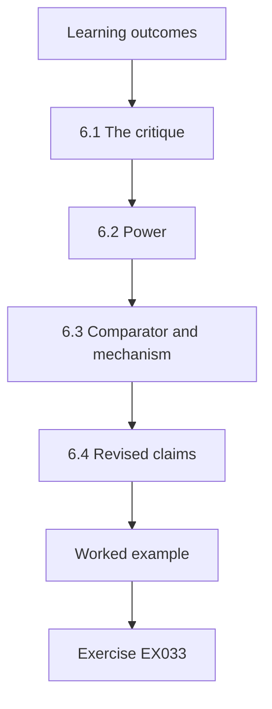

### Logical drawing

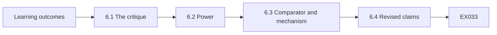

```text
[Learning outcomes]
    |
    v
[6.1 The critique]
    |
    v
[6.2 Power]
    |
    v
[6.3 Comparator and mechanism]
    |
    v
[6.4 Revised claims]
    |
    v
[Worked example] --> [Exercise EX033]
```
<!-- cyberabc:lesson-figures:end ch-06 -->


### Learning outcomes

You will (1) respond to critical peer review; (2) revise analysis and claims without changing confirmatory results; (3) separate exploratory findings from confirmatory ones.

### 6.1 The critique

Yusuf presents a draft paper at a departmental seminar and submits it to a workshop. Reviewers raise three points. First, the study may be underpowered: with this much variation, a three-day effect would often be missed. Second, the comparison departments include the water utility, whose patching is constrained by safety testing, making it a poor comparator. Third, the paper does not explain what risk-ranked patching changed in practice, so readers cannot tell what was actually tested. Yusuf logs each point with a planned response before revising.

### 6.2 Power

Yusuf runs a simulation, generating synthetic data with a true three-day effect and the observed spread, and counts how often his design detects it. Detection is well below the conventional eighty percent target. He adds this to the paper, stating that the study could not reliably detect effects of the size observed. He recommends that future studies pool several organisations. Prof. Hald notes that reporting power after an inconclusive result helps readers avoid concluding that the practice has no effect. In his simulation, detection occurs about thirty percent of the time.

### 6.3 Comparator and mechanism

On the comparator, Yusuf runs a sensitivity analysis excluding the water utility, labelled clearly as exploratory because it was not pre-registered. The estimate changes slightly but the interval still includes zero. On mechanism, he adds a section describing what changed: vulnerabilities were scored against each system's FIPS-199-style category, high systems were patched first and weekly reports went to department heads. He interviews two security officers to document practice, marking interview material as descriptive rather than causal evidence. These additions are marked as revisions.

### 6.4 Revised claims

The revised paper keeps the pre-registered result unchanged as the main finding, adds the power simulation, the exploratory sensitivity analysis and the mechanism description, and narrows the conclusion: in one council, risk-ranked patching was associated with a modest, uncertain reduction in critical patch latency. The workshop accepts the paper. Yusuf notes that critique improved the paper mainly by making its limits clearer, not by changing its numbers, which he considers the right outcome for honest research. He sends reviewers a letter listing every change made.

### Worked example

Yusuf answers critiques on power, comparator choice and mechanism with a power simulation, a labelled exploratory sensitivity analysis and a mechanism section, keeps the confirmatory result unchanged and narrows his conclusion.

> **Synthetic case.** The critique and revisions are synthetic.

### Errors and limits

Presenting exploratory reanalysis as confirmatory evidence hides researcher choices.

### Exercises

- **EX033 — Three critiques.** Name the three reviewer points. *Rubric:* 3 = power, comparator choice, missing mechanism;; 2 = all;; 1 = some;; 0 = none.
- **EX034 — Power finding.** What did the power simulation show? *Rubric:* 3 = about thirty percent detection, far below eighty;; 2 = partly correct;; 1 = vague;; 0 = none.
- **EX035 — Excluded comparator.** Which comparator was excluded in sensitivity analysis? *Rubric:* 3 = the water utility;; 2 = partly correct;; 1 = other;; 0 = none.
- **EX036 — Sensitivity label.** How is the sensitivity analysis labelled? *Rubric:* 3 = exploratory;; 2 = partly correct;; 1 = confirmatory;; 0 = none.
- **EX037 — Mechanism contents.** What did risk-ranked patching change? *Rubric:* 3 = category-based scoring, high systems first, weekly reports;; 2 = most;; 1 = few;; 0 = none.
- **EX038 — Narrowed conclusion.** What is the narrowed conclusion? *Rubric:* 3 = a modest, uncertain reduction in one council;; 2 = partly correct;; 1 = vague;; 0 = none.

<!-- cyberabc:chapter-navigation:start ch-06 -->
### Continue studying — lesson 06 (chapter 06 of 08)

[← Chapter 05](#ch-05) · [Course chapter index](../SUBJECTS.md) · [Chapter 07 →](#ch-07)

Continue to the next authored lesson.
<!-- cyberabc:chapter-navigation:end -->

<a id="ch-07"></a>

## Chapter 7 — Thesis synthesis and reproducibility archive

<!-- cyberabc:lesson-figures:start ch-07 -->
### Lesson map

Lesson 07 published. Map, example, EX039.

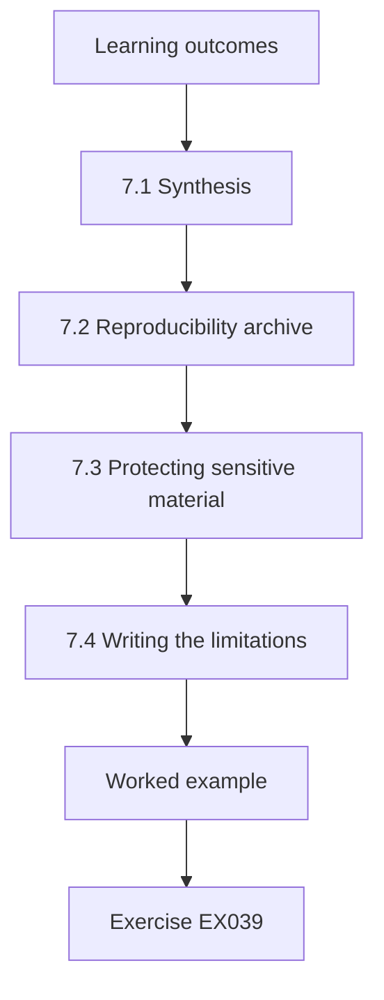

### Logical drawing

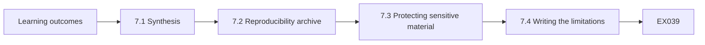

```text
[Learning outcomes]
    |
    v
[7.1 Synthesis]
    |
    v
[7.2 Reproducibility archive]
    |
    v
[7.3 Protecting sensitive material]
    |
    v
[7.4 Writing the limitations]
    |
    v
[Worked example] --> [Exercise EX039]
```
<!-- cyberabc:lesson-figures:end ch-07 -->


### Learning outcomes

You will (1) synthesise studies into a coherent thesis; (2) build a reproducibility archive; (3) protect sensitive material in archived research.

### 7.1 Synthesis

Yusuf's thesis combines three studies: the measurement pilot on excess privilege, the patch latency study and an access review study analysed the same way, which found a clearer reduction in excess privilege in adopting departments. His synthesis argues that risk-ranked practices are associated with improvements whose size varies by outcome and that measurement design strongly affects what can be detected. He organises chapters around these claims rather than chronologically, so each chapter supports a stated part of the argument. Each claim cites its supporting study.

### 7.2 Reproducibility archive

Yusuf builds an archive containing the pre-registration, frozen analysis scripts, synthetic datasets that reproduce every reported figure, a description of real data structures without real values and a README explaining how to rerun each analysis. He computes SHA-256 checksums for every file using Python's hashlib and lists them in a manifest, so examiners can confirm nothing changed after submission. The archive is deposited in the university repository with a persistent identifier. A colleague in another department follows the README on a clean machine and reproduces every figure, which confirms the archive is complete enough for examiners and later readers.

### 7.3 Protecting sensitive material

Because the work concerns a real type of organisation's security, Yusuf removes anything that could aid an attacker: system names, software versions, network details and department codes are replaced with generic labels. Fernvale's security lead reviews the archive and the thesis, as the ethics condition required, and asks him to remove a figure showing the slowest-patched system category. He replaces it with an aggregated chart. Prof. Hald notes that openness and security must be balanced deliberately in security research. The security lead approves the revision.

### 7.4 Writing the limitations

Yusuf writes limitations plainly: one organisation, low power for patch latency, possible catching-up effects, measures limited to operational logs and synthetic data in the public archive that mirror structure but not exact distributions of real data. For each limitation, he states how it affects the claims. He notes that limits sections in security research often understate organisational context, and he describes Fernvale's size, sector and regulatory environment so readers can judge transferability. Prof. Hald checks that each limitation is matched by a specific consequence for the conclusions, and Yusuf removes vague phrases that do not say what they limit.

### Worked example

Yusuf synthesises three studies around claims, archives pre-registration, scripts, synthetic data and checksummed manifests, removes attacker-useful details after security lead review and writes concrete limitations with context.

> **Synthetic case.** The thesis and archive are synthetic.

### Errors and limits

Archiving real system names and versions can expose the partner to attack.

### Exercises

- **EX039 — Third study.** What did the access review study find? *Rubric:* 3 = a clearer reduction in excess privilege;; 2 = partly correct;; 1 = vague;; 0 = none.
- **EX040 — Checksum tool.** Which module computes the checksums? *Rubric:* 3 = hashlib;; 2 = partly correct;; 1 = other;; 0 = none.
- **EX041 — Removed figure.** What figure did the security lead ask to remove? *Rubric:* 3 = the slowest-patched system category;; 2 = partly correct;; 1 = vague;; 0 = none.
- **EX042 — Generic labels.** What details become generic labels? *Rubric:* 3 = system names, versions, network details and department codes;; 2 = most;; 1 = few;; 0 = none.
- **EX043 — Archive data.** What data does the public archive contain? *Rubric:* 3 = synthetic data reproducing reported figures;; 2 = partly correct;; 1 = real;; 0 = none.
- **EX044 — Transferability aid.** How does Yusuf help readers judge transferability? *Rubric:* 3 = describes Fernvale's size, sector and regulation;; 2 = partly correct;; 1 = vague;; 0 = none.

<!-- cyberabc:chapter-navigation:start ch-07 -->
### Continue studying — lesson 07 (chapter 07 of 08)

[← Chapter 06](#ch-06) · [Course chapter index](../SUBJECTS.md) · [Chapter 08 →](#ch-08)

Continue to the next authored lesson.
<!-- cyberabc:chapter-navigation:end -->

<a id="ch-08"></a>

## Chapter 8 — Defense and publication plan

<!-- cyberabc:lesson-figures:start ch-08 -->
### Lesson map

Lesson 08 published. Map, example, EX045.

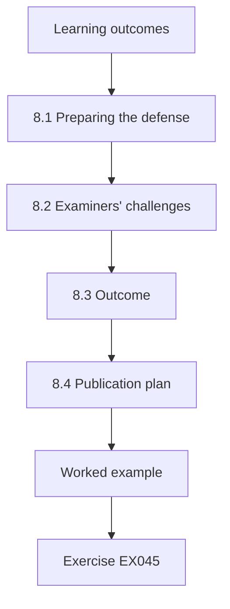

### Logical drawing

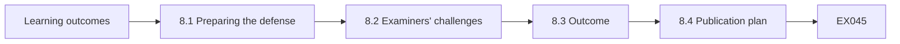

```text
[Learning outcomes]
    |
    v
[8.1 Preparing the defense]
    |
    v
[8.2 Examiners' challenges]
    |
    v
[8.3 Outcome]
    |
    v
[8.4 Publication plan]
    |
    v
[Worked example] --> [Exercise EX045]
```
<!-- cyberabc:lesson-figures:end ch-08 -->


### Learning outcomes

You will (1) defend a thesis with mixed results; (2) answer challenges about generalisation and ethics; (3) plan responsible publication.

### 8.1 Preparing the defense

Yusuf prepares a forty-minute presentation covering the gap, design, measures, results with intervals, critique and limits. He rehearses with colleagues who press him on the inconclusive patch result. He prepares a slide showing the patch estimate and interval beside the clearer excess privilege result, so examiners can see both without him emphasising the more favourable one. Prof. Hald advises him to state each claim in the same words used in the thesis to avoid drifting into stronger language under pressure. Rehearsals are timed.

### 8.2 Examiners' challenges

The external examiner asks whether one council can tell anything about risk-based security in general. Yusuf answers that it cannot establish general effects, but provides a tested measurement approach and an estimate that future pooled studies can use. A second examiner asks whether pseudonymised staff data posed risks. He explains the keyed pseudonyms, department-level reporting and destruction schedule. A third asks why he did not use incident counts; he explains that incidents are rare and inconsistently recorded, making them unreliable outcomes. Each answer is brief.

### 8.3 Outcome

The examiners pass the thesis with minor corrections: clarify the definition change made during the pilot and add a table comparing measures used in prior studies. They praise the pre-registration, independent validation and candid treatment of the inconclusive result. Yusuf makes the corrections within a month. He reflects that his most valuable contribution may be methodological, showing how operational logs can measure control effects, rather than any single estimate. The corrected thesis is approved by the internal examiner without further changes. Yusuf thanks Fernvale's security staff in his acknowledgements, naming no individual, as agreed in the original data sharing arrangement.

### 8.4 Publication plan

Yusuf plans three papers: the measurement method, the patch latency study with its power analysis and the access review study. Each will go to Fernvale's security lead for sensitivity review before submission, as agreed. He will publish synthetic data and code with each paper. He also plans a short practitioner note for council security teams. The next course in this area, data governance, examines how decision rights over data quality and use shape the evidence such security research relies on. Prof. Hald approves the plan.

### Worked example

Yusuf presents mixed results side by side, answers challenges on generalisation, pseudonymisation and incident counts, passes with minor corrections and plans three papers and a practitioner note with sensitivity review.

> **Synthetic case.** The defense is synthetic.

### Errors and limits

Drifting into stronger language under questioning overstates the thesis.

### Exercises

- **EX045 — Side-by-side slide.** What does the key slide show together? *Rubric:* 3 = the inconclusive patch result and the clearer privilege result;; 2 = partly correct;; 1 = vague;; 0 = none.
- **EX046 — Generalisation answer.** What can one council's study provide? *Rubric:* 3 = a tested measurement approach and an estimate for pooling;; 2 = partly correct;; 1 = vague;; 0 = none.
- **EX047 — Incident counts.** Why were incident counts not used? *Rubric:* 3 = rare and inconsistently recorded;; 2 = partly correct;; 1 = vague;; 0 = none.
- **EX048 — Corrections required.** Name one required correction. *Rubric:* 3 = clarify the pilot definition change or add a prior-measures table;; 2 = one;; 1 = vague;; 0 = none.
- **EX049 — Paper count.** How many papers does Yusuf plan? *Rubric:* 3 = three;; 2 = partly correct;; 1 = wrong;; 0 = none.
- **EX050 — Key contribution.** What may be Yusuf's most valuable contribution? *Rubric:* 3 = the methodological approach using operational logs;; 2 = partly correct;; 1 = vague;; 0 = none.

<!-- cyberabc:chapter-navigation:start ch-08 -->
### Continue studying — lesson 08 (chapter 08 of 08)

[← Chapter 07](#ch-07) · [Course chapter index](../SUBJECTS.md) · [Next course via chapter index →](../SUBJECTS.md)

The chapter index leads to the next course in the study path.
<!-- cyberabc:chapter-navigation:end -->

<a id="worked-results"></a>

## Worked results

Model answers for EX001–EX050. Yusuf Al-Rashid, Prof. Ingeborg Hald, Marlow University, Fernvale Municipal Services and every figure are synthetic. Lab answers quote verified outputs. Any answer meeting the rubric scores equally.

**EX001.** Ranking controls by assessed risk versus applying them uniformly.

**EX002.** Thirty departments.

**EX003.** Only with written authorisation.

**EX004.** He reports it to Fernvale's security team instead of publishing it.

**EX005.** A difference-in-differences design.

**EX006.** Fernvale rolls out risk-ranked patching to some departments first.

**EX007.** Fernvale's security lead must review publications for operational sensitivity.

**EX008.** Least privilege.

**EX009.** Incentives, usability and organisational process.

**EX010.** Govern, identify, protect, detect, respond and recover.

**EX011.** It takes the highest of the confidentiality, integrity and availability ratings.

**EX012.** Payroll, water control and case records.

**EX013.** Its integrity and availability failures could harm the public.

**EX014.** As evidence on two outcome measures in one public body.

**EX015.** A larger fall in median days to patch critical vulnerabilities in adopting departments.

**EX016.** Latency is skewed by a few very slow cases.

**EX017.** The share of accounts holding permissions outside their role baseline.

**EX018.** By comparing pre-adoption trends.

**EX019.** Sample size and power.

**EX020.** Before outcome data are extracted.

**EX021.** The council excluded systems due for retirement.

**EX022.** 25.3 percent, 152 of 600 accounts.

**EX023.** Thirty-four.

**EX024.** It allows configuration changes across the system.

**EX025.** Excluding permissions covered by an approved, unexpired exception.

**EX026.** So later baseline changes do not confound the outcome measure.

**EX027.** From 14.6 to 10.1 days.

**EX028.** Minus 3.4 days.

**EX029.** From minus 7.4 to plus 1.2 days.

**EX030.** The data are also consistent with no effect.

**EX031.** Adopters started with slower patching than comparison departments.

**EX032.** Comparing means of log latency.

**EX033.** Low power, a poor comparator and no description of the mechanism.

**EX034.** A three-day effect is detected only about thirty percent of the time.

**EX035.** The water utility.

**EX036.** As exploratory, because it was not pre-registered.

**EX037.** Scoring by system category, patching high systems first and weekly reports to heads.

**EX038.** A modest, uncertain reduction in critical patch latency in one council.

**EX039.** A clearer reduction in excess privilege in adopting departments.

**EX040.** Python's hashlib, using SHA-256.

**EX041.** A figure showing the slowest-patched system category.

**EX042.** System names, software versions, network details and department codes.

**EX043.** Synthetic datasets that reproduce every reported figure.

**EX044.** By describing Fernvale's size, sector and regulatory environment.

**EX045.** The patch estimate and interval beside the excess privilege result.

**EX046.** A tested measurement approach and an estimate for future pooled studies.

**EX047.** Incidents are rare and inconsistently recorded.

**EX048.** Clarify the pilot-stage definition change.

**EX049.** Three papers.

**EX050.** Showing how operational logs can measure control effects.

<a id="references"></a>
## References

Every DOI was resolved through doi.org on 12 October 2026, and ISO/IEC editions were checked against iso.org on the same day. Organisations, people, systems and figures in the running cases are synthetic; only the works below are real.

- Anderson, R. (2020). *Security engineering: A guide to building dependable distributed systems* (3rd ed.). Wiley. https://doi.org/10.1002/9781119644682
- ISO/IEC. (2022). *ISO/IEC 27001:2022 Information security, cybersecurity and privacy protection — Information security management systems — Requirements* (with Amd 1:2024). <https://www.iso.org/standard/27001>
- ISO/IEC. (2022). *ISO/IEC 27002:2022 Information security, cybersecurity and privacy protection — Information security controls*. <https://www.iso.org/standard/75652.html>
- ISO/IEC. (2026). *ISO/IEC 27000:2026 Information security, cybersecurity and privacy protection — Information security management systems — Overview* (6th ed., replacing ISO/IEC 27000:2018). <https://www.iso.org/standard/27000>
- Joint Task Force. (2020). *Security and privacy controls for information systems and organizations* (NIST SP 800-53 Rev. 5). National Institute of Standards and Technology. https://doi.org/10.6028/NIST.SP.800-53r5
- Joint Task Force Transformation Initiative. (2012). *Guide for conducting risk assessments* (NIST SP 800-30 Rev. 1). National Institute of Standards and Technology. https://doi.org/10.6028/NIST.SP.800-30r1
- National Institute of Standards and Technology. (2004). *Standards for security categorization of federal information and information systems* (FIPS 199). https://doi.org/10.6028/NIST.FIPS.199
- National Institute of Standards and Technology. (2024). *The NIST Cybersecurity Framework (CSF) 2.0* (NIST CSWP 29). https://doi.org/10.6028/NIST.CSWP.29
- Nieles, M., Dempsey, K., & Pillitteri, V. Y. (2017). *An introduction to information security* (NIST SP 800-12 Rev. 1). National Institute of Standards and Technology. https://doi.org/10.6028/NIST.SP.800-12r1
- Saltzer, J. H., & Schroeder, M. D. (1975). The protection of information in computer systems. *Proceedings of the IEEE, 63*(9), 1278–1308. https://doi.org/10.1109/PROC.1975.9939
- Shadish, W. R., Cook, T. D., & Campbell, D. T. (2002). *Experimental and quasi-experimental designs for generalized causal inference*. Houghton Mifflin.
