# Segurança da Informação: Trilha de Pesquisa de Doutorado

- Idioma: português do Brasil (`pt`); curso 186, trilha de pesquisa de doutorado (2 anos). Edição de referência: [inglês](../../en/book/MANUSCRIPT.md).
- Estado editorial: **publicado**. Os capítulos 1–8 de 8 têm texto didático escrito à mão; os exercícios EX001–EX050 têm resoluções correspondentes com rubricas de 0 a 3; os três laboratórios offline usam apenas a biblioteca padrão do Python 3 sobre dados sintéticos, e suas saídas foram incorporadas de execuções reais, idênticas às da edição em inglês. Revisão independente, revisão linguística e a verificação de 300 páginas A4 continuam em aberto.
- Público: doutorandos que estudam se a priorização de controles de segurança ordenada pelo risco encurta a latência de correção de vulnerabilidades críticas e reduz o privilégio excessivo em organizações públicas.
- Autor: [hiagokinlevi](https://github.com/hiagokinlevi). Texto original sob [CC0 1.0](../../../../../LICENSE); as obras citadas mantêm seus direitos.
- Limites: os laboratórios categorizam sistemas sintéticos pelo impacto sobre confidencialidade, integridade e disponibilidade, medem o privilégio excessivo em contas sintéticas e estimam uma diferença em diferenças da latência sintética de correções com um intervalo bootstrap. As normas são citadas pela edição e parafraseadas. Pessoas, organizações, sistemas e dados são **sintéticos**, salvo quando uma frase cita uma fonte pública.

[Página do curso](../../README.md) · [Índice de capítulos](../SUBJECTS.md) · [Plano do livro](PLAN.md) · [Skill do curso](../../skill/SKILL.md) · [Resoluções](#worked-results)

## Como usar este rascunho

Leia na ordem. Os capítulos acompanham um doutorando desde as regras de integridade e a fronteira da pesquisa, passando por uma proposta, um piloto de medição, um estudo principal com validação independente, a crítica por pares e um arquivo de reprodutibilidade, até a defesa. Execute cada laboratório onde ele aparece, tente os exercícios antes de consultar as resoluções e avalie-se com as rubricas.

### Caso sintético

| Elemento | Papel | Natureza |
|---|---|---|
| **Yusuf Al-Rashid** | Doutorando | Inventado |
| **Prof.ª Ingeborg Hald** | Orientadora | Inventada |
| **Marlow University** | Universidade fictícia | Inventada |
| **Fernvale Municipal Services** | Prefeitura fictícia com 30 departamentos e cerca de 4.000 funcionários | Inventada |

### Fontes principais

Anderson (2020), [doi:10.1002/9781119644682](https://doi.org/10.1002/9781119644682); ISO/IEC 27000:2026; ISO/IEC 27001:2022 (no Brasil, ABNT NBR ISO/IEC 27001:2022); ISO/IEC 27002:2022; NIST SP 800-53 Rev. 5; NIST SP 800-30 Rev. 1; FIPS 199, [doi:10.6028/NIST.FIPS.199](https://doi.org/10.6028/NIST.FIPS.199); NIST CSWP 29 (CSF 2.0); NIST SP 800-12 Rev. 1; Saltzer e Schroeder (1975), [doi:10.1109/PROC.1975.9939](https://doi.org/10.1109/PROC.1975.9939); Shadish, Cook e Campbell (2002). Lista completa em [Referências](#references).

## Sumário

| Capítulos em português |
|---|
| [1](#ch-01) · [2](#ch-02) · [3](#ch-03) · [4](#ch-04) · [5](#ch-05) · [6](#ch-06) · [7](#ch-07) · [8](#ch-08) |

[Resoluções](#worked-results) · [Referências](#references)

<a id="ch-01"></a>

## Capítulo 1 — Integridade e métodos avançados de pesquisa

<!-- open-cyber-academy:lesson-figures:start ch-01 -->
### Mapa da aula

Aula 01 publicada. Mapa, exemplo, EX001.

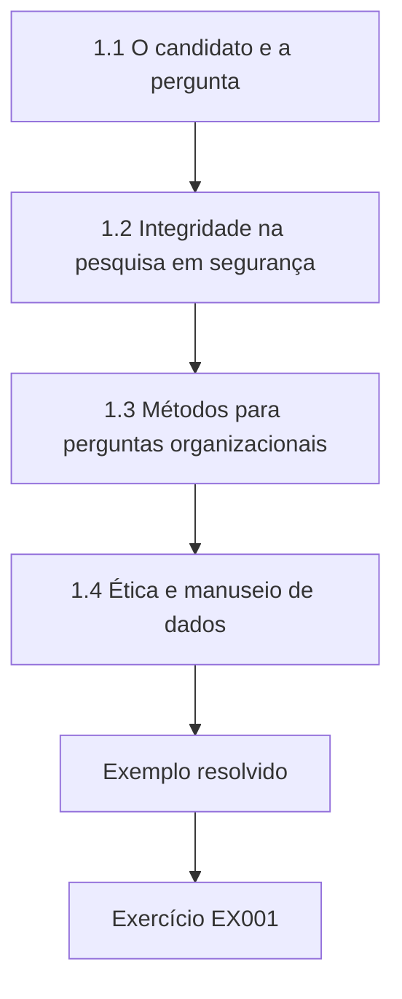

### Desenho lógico

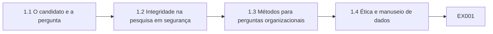

```text
[1.1 O candidato e a pergunta]
    |
    v
[1.2 Integridade na pesquisa em segurança]
    |
    v
[1.3 Métodos para perguntas organizacionais]
    |
    v
[1.4 Ética e manuseio de dados]
    |
    v
[Exemplo resolvido] --> [Exercício EX001]
```
<!-- open-cyber-academy:lesson-figures:end ch-01 -->


### Objetivos de aprendizagem

Você vai (1) definir regras de integridade para a pesquisa em segurança com um parceiro do mundo real; (2) escolher métodos adequados a perguntas organizacionais de segurança; (3) planejar a revisão ética e o manuseio de dados.

### 1.1 O candidato e a pergunta

Yusuf Al-Rashid começa uma trilha de pesquisa de doutorado de dois anos em segurança da informação na fictícia Marlow University, sob orientação da Prof.ª Ingeborg Hald. Sua organização parceira é a Fernvale Municipal Services, uma prefeitura fictícia com trinta departamentos e cerca de quatro mil funcionários. Sua pergunta é se ordenar os controles de segurança pelo risco avaliado, em vez de aplicá-los de maneira uniforme, encurta o tempo para corrigir vulnerabilidades críticas e reduz os direitos de acesso excessivos. Todos os dados deste livro são sintéticos, gerados para espelhar a estrutura de um estudo desse tipo.

### 1.2 Integridade na pesquisa em segurança

A Prof.ª Hald define as regras de integridade na primeira reunião. Yusuf nunca vai testar sistemas em produção sem autorização escrita, vai relatar qualquer vulnerabilidade que encontrar à equipe de segurança da Fernvale em vez de publicá-la, vai pré-registrar as hipóteses antes de analisar os dados de desfecho e vai manter os dados brutos separados do código de análise. Ela explica que a pesquisa em segurança traz um risco especial: um artigo descuidado pode entregar aos atacantes um mapa das fraquezas de uma organização, então a publicação deve descrever padrões sem expor detalhes exploráveis do parceiro. Yusuf as assina.

### 1.3 Métodos para perguntas organizacionais

Yusuf compara métodos. Experimentos controlados raramente são possíveis dentro de uma prefeitura, porque os departamentos não podem ser designados aleatoriamente para uma segurança mais fraca. Estudos de caso dão profundidade, mas pouca generalização. Os desenhos quase experimentais, discutidos por Shadish, Cook e Campbell, comparam grupos que adotam uma prática com grupos que não a adotam, antes e depois da adoção. Ele escolhe um desenho de diferença em diferenças, porque a Fernvale está implantando a correção ordenada pelo risco primeiro em alguns departamentos, o que cria um grupo de comparação natural cujas tendências podem absorver mudanças em toda a cidade. A Prof.ª Hald aprova a escolha depois de discuti-la.

### 1.4 Ética e manuseio de dados

O estudo usa logs das datas de correção, das classificações de gravidade das vulnerabilidades e dos registros de permissões das contas. Eles incluem identificadores de funcionários, então Yusuf submete ao comitê de ética da universidade um plano: os identificadores são substituídos por pseudônimos com chave dentro da Fernvale antes da exportação, apenas resultados por departamento são publicados e os extratos brutos são destruídos depois que a tese é examinada. O comitê aprova com uma condição: o líder de segurança da Fernvale deve revisar qualquer publicação quanto à sensibilidade operacional antes da submissão. Yusuf registra a condição no seu plano de gestão de dados. Yusuf concorda.

### Exemplo resolvido

Yusuf formula uma pergunta sobre controles ordenados pelo risco na Fernvale, define regras de integridade sobre autorização, divulgação e pré-registro, escolhe a diferença em diferenças e obtém aprovação ética com exportações pseudonimizadas e a condição de revisão pelo líder de segurança.

> **Caso sintético.** A Marlow, a Fernvale e todas as pessoas são sintéticas; Shadish, Cook e Campbell (2002) é real.

### Erros e limites

Publicar fraquezas específicas do parceiro transforma a pesquisa num guia de ataque; relate padrões em vez disso.

### Exercícios

- **EX001 — Pergunta de pesquisa.** O que a pergunta de Yusuf compara? *Rubrica:* 3 = aplicação de controles ordenada pelo risco versus uniforme;; 2 = parcialmente correto;; 1 = parcial;; 0 = nenhuma.

- **EX002 — Porte do parceiro.** Quantos departamentos tem a Fernvale? *Rubrica:* 3 = trinta;; 2 = parcialmente correto;; 1 = errado;; 0 = nenhuma.

- **EX003 — Regra de testes em produção.** Quando Yusuf pode testar sistemas em produção? *Rubrica:* 3 = só com autorização escrita;; 2 = parcialmente correto;; 1 = vago;; 0 = nenhuma.

- **EX004 — Vulnerabilidade encontrada.** O que acontece se Yusuf encontrar uma vulnerabilidade? *Rubrica:* 3 = relatá-la à equipe de segurança da Fernvale;; 2 = parcialmente correto;; 1 = publicar;; 0 = nenhuma.

- **EX005 — Desenho escolhido.** Que desenho Yusuf escolhe? *Rubrica:* 3 = diferença em diferenças;; 2 = parcialmente correto;; 1 = outro;; 0 = nenhuma.

- **EX006 — Comparação natural.** Por que existe um grupo de comparação? *Rubrica:* 3 = a correção ordenada pelo risco é implantada primeiro em alguns departamentos;; 2 = parcialmente correto;; 1 = vago;; 0 = nenhuma.

- **EX007 — Condição ética.** Que condição o comitê de ética acrescentou? *Rubrica:* 3 = o líder de segurança revisa as publicações quanto à sensibilidade;; 2 = parcialmente correto;; 1 = vago;; 0 = nenhuma.

<!-- open-cyber-academy:chapter-navigation:start ch-01 -->
### Continue estudando — aula 01 (capítulo 01 de 08)

[← Início do curso](../../README.md) · [Índice das aulas](../SUBJECTS.md) · [Capítulo 02 →](#ch-02)

Continue para a próxima aula já escrita.
<!-- open-cyber-academy:chapter-navigation:end -->

<a id="ch-02"></a>

## Capítulo 2 — Segurança da informação: fronteira da pesquisa

<!-- open-cyber-academy:lesson-figures:start ch-02 -->
### Mapa da aula

Aula 02 publicada. Mapa, exemplo, EX008.

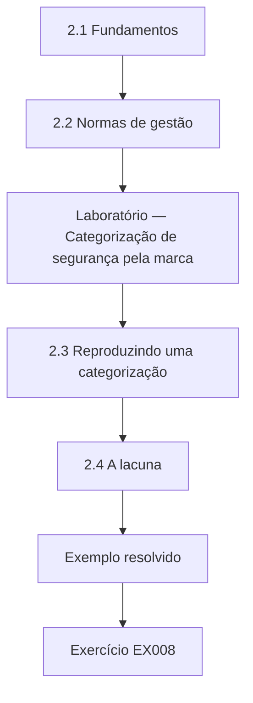

### Desenho lógico

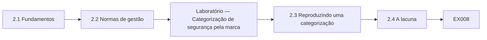

```text
[2.1 Fundamentos]
    |
    v
[2.2 Normas de gestão]
    |
    v
[Laboratório — Categorização de segurança pela marca]
    |
    v
[2.3 Reproduzindo uma categorização]
    |
    v
[2.4 A lacuna]
    |
    v
[Exemplo resolvido] --> [Exercício EX008]
```
<!-- open-cyber-academy:lesson-figures:end ch-02 -->


### Objetivos de aprendizagem

Você vai (1) mapear fontes fundamentais e atuais sobre gestão da segurança da informação; (2) reproduzir uma categorização de segurança a partir de uma norma publicada; (3) localizar uma lacuna de pesquisa em aberto.

### 2.1 Fundamentos

Yusuf começa pelos fundamentos. O artigo de Saltzer e Schroeder de 1975 estabeleceu princípios de projeto como o privilégio mínimo, os padrões à prova de falhas e a mediação completa, que ainda enquadram a pesquisa em controle de acesso. A NIST SP 800-12r1 apresenta a confidencialidade, a integridade e a disponibilidade como os objetivos centrais de segurança e explica como as organizações os gerenciam. O Security Engineering de Anderson, terceira edição, mostra por meio de muitos casos que as falhas costumam surgir de incentivos, usabilidade e processos organizacionais, e não de criptografia quebrada, o que sustenta o foco de Yusuf em como os controles são priorizados. Ele resume cada fonte numa breve nota comentada.

### 2.2 Normas de gestão

Ele revisa as normas de gestão. A ISO/IEC 27001:2022 (no Brasil, ABNT NBR ISO/IEC 27001:2022) estabelece requisitos para um sistema de gestão da segurança da informação, incluindo a avaliação e o tratamento de riscos. A ISO/IEC 27002:2022 dá orientações sobre controles. A ISO/IEC 27000:2026 oferece uma visão geral de como a família se encaixa. A NIST SP 800-53r5 oferece um grande catálogo de controles, e o NIST Cybersecurity Framework 2.0 organiza os resultados nas funções governar, identificar, proteger, detectar, responder e recuperar. Ele observa que todas elas pressupõem a seleção baseada em risco, mas dizem pouco sobre como medir seu efeito. Yusuf registra essa observação como ponto de partida para sua lacuna.

### Laboratório — Categorização de segurança pela marca d'água mais alta de cinco sistemas sintéticos

```python
"""FIPS 199-style high-water-mark categorisation of synthetic systems (stdlib only)."""
L = {"low": 1, "moderate": 2, "high": 3}
systems = {
    "payroll":        ("moderate", "high", "moderate"),
    "public_website": ("low", "moderate", "moderate"),
    "water_scada":    ("low", "high", "high"),
    "permits_portal": ("moderate", "moderate", "low"),
    "case_records":   ("high", "moderate", "moderate"),
}
from collections import Counter
cat = {s: max(v, key=L.get) for s, v in systems.items()}
for s, v in systems.items():
    print(f"{s:<15} C={v[0]:<8} I={v[1]:<8} A={v[2]:<8} -> {cat[s]}")
print("overall:", dict(Counter(cat.values())))
```

Execute com `python3 lab_category.py`. Saída verificada:

```text
payroll         C=moderate I=high     A=moderate -> high
public_website  C=low      I=moderate A=moderate -> moderate
water_scada     C=low      I=high     A=high     -> high
permits_portal  C=moderate I=moderate A=low      -> moderate
case_records    C=high     I=moderate A=moderate -> high
overall: {'high': 3, 'moderate': 2}
```

### 2.3 Reproduzindo uma categorização

Para entender concretamente a seleção baseada em risco, Yusuf reproduz a abordagem de categorização da FIPS 199, que classifica o impacto potencial da perda de confidencialidade, integridade e disponibilidade como low, moderate ou high e toma a classificação mais alta como a categoria do sistema. No laboratório, cinco sistemas sintéticos da Fernvale resultam em três sistemas high, a folha de pagamento, o controle da água e os registros de casos, e dois sistemas moderate, o site público e o portal de licenças. O controle da água é high apesar do impacto low sobre a confidencialidade, porque falhas de integridade e de disponibilidade poderiam prejudicar a população.

### 2.4 A lacuna

Yusuf procura estudos que meçam se a seleção de controles ordenada pelo risco muda os resultados de segurança nas organizações. Ele encontra muitas descrições de frameworks, levantamentos de adoção e relatos de caso, mas poucos desenhos que comparem adotantes com não adotantes ao longo do tempo usando medidas operacionais como a latência de correção. Ele formula isso como sua lacuna. A Prof.ª Hald pede que ele declare a lacuna de forma estreita, como evidência sobre duas medidas de desfecho num único órgão público, em vez de afirmar que testa toda a gestão de segurança baseada em risco. Yusuf reescreve a lacuna de acordo.

### Exemplo resolvido

Yusuf revisa Saltzer e Schroeder, a SP 800-12r1, Anderson e a família ISO/IEC 27000, a SP 800-53r5 e o CSF 2.0, reproduz a categorização da FIPS 199, que resulta em três sistemas high e dois moderate, e declara uma lacuna estreita.

> **Caso sintético.** Os sistemas são sintéticos; as saídas vêm de lab_category.py; todas as obras citadas são reais.

### Erros e limites

Afirmar que uma tese testa um framework inteiro exagera o que um único estudo pode mostrar.

### Exercícios

- **EX008 — Princípio de Saltzer.** Cite um princípio de projeto de Saltzer e Schroeder. *Rubrica:* 3 = privilégio mínimo, padrões à prova de falhas ou mediação completa;; 2 = um;; 1 = vago;; 0 = nenhuma.

- **EX009 — Percepção de Anderson.** De onde Anderson mostra que surge a maioria das falhas? *Rubrica:* 3 = incentivos, usabilidade e processos;; 2 = a maioria;; 1 = um;; 0 = nenhuma.

- **EX010 — Funções do CSF.** Cite as seis funções do CSF 2.0. *Rubrica:* 3 = governar, identificar, proteger, detectar, responder, recuperar;; 2 = todas;; 1 = algumas;; 0 = nenhuma.

- **EX011 — Regra da marca d'água mais alta.** Como a FIPS 199 define a categoria de um sistema? *Rubrica:* 3 = a mais alta das três classificações de impacto;; 2 = parcialmente correto;; 1 = vago;; 0 = nenhuma.

- **EX012 — Sistemas high.** Que sistemas sintéticos são high? *Rubrica:* 3 = folha de pagamento, controle da água e registros de casos;; 2 = todos;; 1 = alguns;; 0 = nenhuma.

- **EX013 — Motivo do controle da água.** Por que o controle da água é high apesar do impacto low sobre a confidencialidade? *Rubrica:* 3 = falhas de integridade e disponibilidade poderiam prejudicar a população;; 2 = parcialmente correto;; 1 = vago;; 0 = nenhuma.

- **EX014 — Lacuna declarada.** Com que estreiteza Yusuf declara sua lacuna? *Rubrica:* 3 = duas medidas de desfecho num único órgão público;; 2 = parcialmente correto;; 1 = parcial;; 0 = nenhuma.

<!-- open-cyber-academy:chapter-navigation:start ch-02 -->
### Continue estudando — aula 02 (capítulo 02 de 08)

[← Capítulo 01](#ch-01) · [Índice das aulas](../SUBJECTS.md) · [Capítulo 03 →](#ch-03)

Continue para a próxima aula já escrita.
<!-- open-cyber-academy:chapter-navigation:end -->

<a id="ch-03"></a>

## Capítulo 3 — Proposta de contribuição original

<!-- open-cyber-academy:lesson-figures:start ch-03 -->
### Mapa da aula

Aula 03 publicada. Mapa, exemplo, EX015.

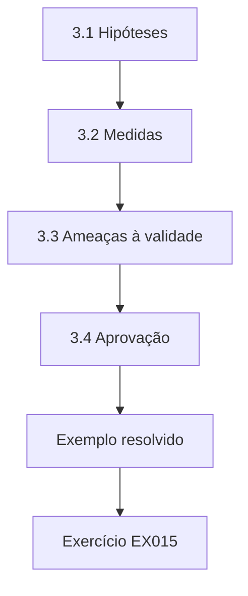

### Desenho lógico

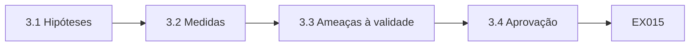

```text
[3.1 Hipóteses]
    |
    v
[3.2 Medidas]
    |
    v
[3.3 Ameaças à validade]
    |
    v
[3.4 Aprovação]
    |
    v
[Exemplo resolvido] --> [Exercício EX015]
```
<!-- open-cyber-academy:lesson-figures:end ch-03 -->


### Objetivos de aprendizagem

Você vai (1) declarar hipóteses e medidas de desfecho com precisão; (2) desenhar a comparação e as ameaças à validade; (3) obter a aprovação de uma proposta.

### 3.1 Hipóteses

Yusuf declara duas hipóteses. Primeira: os departamentos que adotam a correção ordenada pelo risco vão mostrar uma queda maior na mediana de dias para corrigir vulnerabilidades críticas do que os departamentos de comparação no mesmo período. Segunda: os departamentos que adotam revisões de acesso ordenadas pelo risco vão mostrar uma queda maior na proporção de contas com privilégios além da linha de base da sua função. Ele registra as hipóteses, as medidas, o método de análise e o menor efeito que consideraria significativo num documento de pré-registro datado, guardado pela Prof.ª Hald. A Prof.ª Hald assina e data o documento, e uma cópia é depositada na escola de pós-graduação.

### 3.2 Medidas

A latência de correção é o número de dias desde a publicação de uma vulnerabilidade crítica pelo fornecedor até a instalação da correção num sistema afetado, usando medianas porque a latência é distorcida por alguns poucos casos muito lentos. O privilégio excessivo é a proporção de contas que têm qualquer permissão fora da linha de base da sua função, uma medida operacional direta do privilégio mínimo. Ambas vêm de sistemas existentes, o que evita o viés do autorrelato. Yusuf documenta a fonte, a fórmula e os erros conhecidos de cada medida, como correções aplicadas, mas não registradas.

### 3.3 Ameaças à validade

Yusuf lista as ameaças. Os departamentos escolhidos para a adoção antecipada podem já ser mais bem administrados, uma ameaça de seleção; ele vai comparar as tendências anteriores à adoção. Um evento em toda a cidade, como uma grande vulnerabilidade de um fornecedor, pode afetar todos os departamentos; o grupo de comparação o absorve. As práticas de registro podem mudar com a adoção, uma ameaça de medição; ele vai auditar uma amostra dos registros contra as evidências dos sistemas. Os funcionários podem mudar de comportamento por saberem que estão sendo estudados; ele anota isso, mas espera pouco efeito sobre logs automatizados. Cada ameaça e sua resposta aparecem na proposta.

### 3.4 Aprovação

A banca da proposta inclui a Prof.ª Hald, um estatístico e o líder de segurança da Fernvale como consultor externo. O estatístico pergunta sobre o tamanho da amostra; Yusuf admite que não pode controlar quantas vulnerabilidades ocorrem e planeja relatar intervalos de confiança e o poder estatístico com honestidade, em vez de afirmar certeza. O líder de segurança pede que os nomes dos departamentos sejam codificados em todas as saídas. A banca aprova a proposta com os dois pontos registrados, e o pré-registro é congelado antes da extração dos dados de desfecho. O líder de segurança também se oferece para providenciar acesso a extratos de teste anonimizados.

### Exemplo resolvido

Yusuf pré-registra duas hipóteses sobre a latência de correção e o privilégio excessivo, define medidas a partir de dados dos sistemas, lista as ameaças de seleção, histórico, medição e observação e obtém aprovação com compromissos sobre o relato do poder e a codificação dos nomes dos departamentos.

> **Caso sintético.** A proposta é sintética.

### Erros e limites

Mudar as hipóteses depois de ver os dados de desfecho invalida as afirmações confirmatórias.

### Exercícios

- **EX015 — Primeira hipótese.** O que prevê a primeira hipótese? *Rubrica:* 3 = uma queda maior na mediana da latência de correção crítica nos departamentos adotantes;; 2 = parcialmente correto;; 1 = parcial;; 0 = nenhuma.

- **EX016 — Escolha da mediana.** Por que usar medianas para a latência de correção? *Rubrica:* 3 = a latência é distorcida por alguns poucos casos muito lentos;; 2 = parcialmente correto;; 1 = vago;; 0 = nenhuma.

- **EX017 — Definição de privilégio excessivo.** Como se mede o privilégio excessivo? *Rubrica:* 3 = proporção de contas com permissões fora da linha de base da função;; 2 = parcialmente correto;; 1 = vago;; 0 = nenhuma.

- **EX018 — Resposta à seleção.** Como Yusuf vai tratar a ameaça de seleção? *Rubrica:* 3 = comparar as tendências anteriores à adoção;; 2 = parcialmente correto;; 1 = vago;; 0 = nenhuma.

- **EX019 — Pergunta do estatístico.** Sobre o que o estatístico perguntou? *Rubrica:* 3 = tamanho da amostra;; 2 = parcialmente correto;; 1 = outra coisa;; 0 = nenhuma.

- **EX020 — Momento do congelamento.** Quando o pré-registro é congelado? *Rubrica:* 3 = antes da extração dos dados de desfecho;; 2 = parcialmente correto;; 1 = depois;; 0 = nenhuma.

<!-- open-cyber-academy:chapter-navigation:start ch-03 -->
### Continue estudando — aula 03 (capítulo 03 de 08)

[← Capítulo 02](#ch-02) · [Índice das aulas](../SUBJECTS.md) · [Capítulo 04 →](#ch-04)

Continue para a próxima aula já escrita.
<!-- open-cyber-academy:chapter-navigation:end -->

<a id="ch-04"></a>

## Capítulo 4 — Replicação da linha de base e piloto

<!-- open-cyber-academy:lesson-figures:start ch-04 -->
### Mapa da aula

Aula 04 publicada. Mapa, exemplo, EX021.

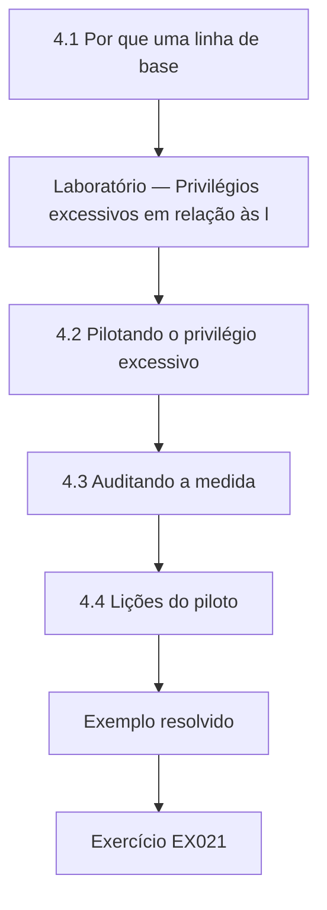

### Desenho lógico

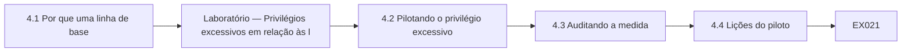

```text
[4.1 Por que uma linha de base]
    |
    v
[Laboratório — Privilégios excessivos em relação às l]
    |
    v
[4.2 Pilotando o privilégio excessivo]
    |
    v
[4.3 Auditando a medida]
    |
    v
[4.4 Lições do piloto]
    |
    v
[Exemplo resolvido] --> [Exercício EX021]
```
<!-- open-cyber-academy:lesson-figures:end ch-04 -->


### Objetivos de aprendizagem

Você vai (1) replicar uma medição de linha de base antes do estudo principal; (2) pilotar uma medida de privilégio excessivo; (3) auditar a qualidade da medição.

### 4.1 Por que uma linha de base

Antes de testar efeitos, Yusuf precisa mostrar que suas medidas funcionam com os dados da Fernvale. Ele replica, com a sua extração, o número que a própria prefeitura relatou para a latência de correção crítica do ano anterior e encontra uma mediana a menos de um dia do valor relatado. Ele investiga a pequena diferença e descobre que a prefeitura excluiu os sistemas com desativação programada. Ele documenta a exclusão e decide segui-la, para que sua linha de base corresponda à definição que os departamentos já entendem. O líder de segurança da Fernvale confirma por escrito a regra de exclusão para o estudo.

### Laboratório — Privilégios excessivos em relação às linhas de base das funções em 600 contas sintéticas

```python
"""Measure excess privileges against role baselines in synthetic accounts (stdlib only)."""
import random
random.seed(17)
roles = {"clerk": {"read_cases", "edit_cases"}, "finance": {"read_ledger", "post_ledger"},
         "it_support": {"reset_password", "read_logs"}}
extra_pool = ["read_ledger", "post_ledger", "edit_cases", "admin_console", "read_logs", "export_all"]
accts = []
for i in range(600):
    r = random.choice(list(roles))
    perms = set(roles[r])
    for p in extra_pool:
        if p not in perms and random.random() < 0.06: perms.add(p)
    accts.append((r, perms))
excess = [(r, p - roles[r]) for r, p in accts if p - roles[r]]
n_extra = sum(len(e) for _, e in excess)
admin = sum(1 for _, e in excess if "admin_console" in e)
print(f"accounts 600; with excess privilege {len(excess)} ({100*len(excess)/600:.1f}%)")
print(f"excess grants {n_extra}; accounts holding admin_console without need {admin}")
```

Execute com `python3 lab_privilege.py`. Saída verificada:

```text
accounts 600; with excess privilege 152 (25.3%)
excess grants 166; accounts holding admin_console without need 34
```

### 4.2 Pilotando o privilégio excessivo

A medida de privilégio excessivo é nova para a Fernvale, então Yusuf a pilota em seiscentas contas sintéticas distribuídas em três funções: escriturário, finanças e suporte de TI. Cada função tem um conjunto de permissões de linha de base. O laboratório encontra 152 contas, 25,3 por cento, com pelo menos uma permissão além da sua linha de base, com 166 concessões excessivas no total. Trinta e quatro contas têm a permissão do console administrativo sem precisar dela, o que é o achado mais grave, porque permite mudanças de configuração em todo o sistema. Yusuf relata esses números apenas ao líder de segurança, e não em rascunhos públicos.

### 4.3 Auditando a medida

Yusuf audita o piloto tomando uma amostra aleatória das contas sinalizadas e perguntando aos gerentes dos departamentos se cada permissão excessiva é de fato desnecessária. A maioria é confirmada como desnecessária. Algumas refletem atribuições temporárias não registradas na linha de base da função, como um escriturário que cobre as finanças durante uma licença. Ele refina a medida para excluir as permissões com uma exceção aprovada e ainda válida, e registra esse refinamento como uma mudança de definição pré-especificada, feita antes de qualquer comparação de desfechos, o que o pré-registro permite para esclarecimentos na fase de piloto. Os gerentes dão sua aprovação.

### 4.4 Lições do piloto

O piloto mostra que as próprias linhas de base das funções estão incompletas em alguns departamentos, o que poderia fazer os adotantes parecerem piores se a adoção também melhorasse as linhas de base. Yusuf acrescenta uma verificação: as linhas de base são congeladas no início do período do estudo, e as mudanças posteriores nelas são acompanhadas separadamente. A Prof.ª Hald observa que os pilotos muitas vezes revelam que o sistema de medição faz parte da intervenção, e que separar os dois é essencial para interpretar qualquer diferença posterior entre os departamentos. Yusuf acrescenta as linhas de base congeladas ao plano de gestão de dados e as arquiva com uma soma de verificação.

### Exemplo resolvido

Yusuf replica a linha de base da latência de correção da prefeitura com diferença de menos de um dia, pilota o privilégio excessivo, encontrando 152 de 600 contas (25,3 por cento) com 166 concessões e 34 detentores desnecessários do console administrativo, audita as sinalizações e congela as linhas de base das funções.

> **Caso sintético.** As contas são sintéticas; as saídas vêm de lab_privilege.py.

### Erros e limites

Deixar as linhas de base mudarem durante um estudo confunde a medida com a intervenção.

### Exercícios

- **EX021 — Causa da diferença na linha de base.** O que explicou a pequena diferença na linha de base? *Rubrica:* 3 = a prefeitura excluiu os sistemas com desativação programada;; 2 = parcialmente correto;; 1 = vago;; 0 = nenhuma.

- **EX022 — Proporção excessiva.** Que proporção das contas do piloto tinha privilégio excessivo? *Rubrica:* 3 = 25,3% (152 de 600);; 2 = parcialmente correto;; 1 = errado;; 0 = nenhuma.

- **EX023 — Achado administrativo.** Quantas contas tinham acesso ao console administrativo sem necessidade? *Rubrica:* 3 = 34;; 2 = parcialmente correto;; 1 = errado;; 0 = nenhuma.

- **EX024 — Gravidade administrativa.** Por que o acesso desnecessário ao console administrativo é o mais grave? *Rubrica:* 3 = permite mudanças de configuração em todo o sistema;; 2 = parcialmente correto;; 1 = vago;; 0 = nenhuma.

- **EX025 — Refinamento da medida.** Que refinamento foi feito depois da auditoria? *Rubrica:* 3 = excluir permissões com exceções aprovadas e ainda válidas;; 2 = parcialmente correto;; 1 = vago;; 0 = nenhuma.

- **EX026 — Congelamento da linha de base.** Por que as linhas de base das funções são congeladas? *Rubrica:* 3 = para que as mudanças nelas não confundam a medida;; 2 = parcialmente correto;; 1 = vago;; 0 = nenhuma.

<!-- open-cyber-academy:chapter-navigation:start ch-04 -->
### Continue estudando — aula 04 (capítulo 04 de 08)

[← Capítulo 03](#ch-03) · [Índice das aulas](../SUBJECTS.md) · [Capítulo 05 →](#ch-05)

Continue para a próxima aula já escrita.
<!-- open-cyber-academy:chapter-navigation:end -->

<a id="ch-05"></a>

## Capítulo 5 — Estudo principal e validação independente

<!-- open-cyber-academy:lesson-figures:start ch-05 -->
### Mapa da aula

Aula 05 publicada. Mapa, exemplo, EX027.

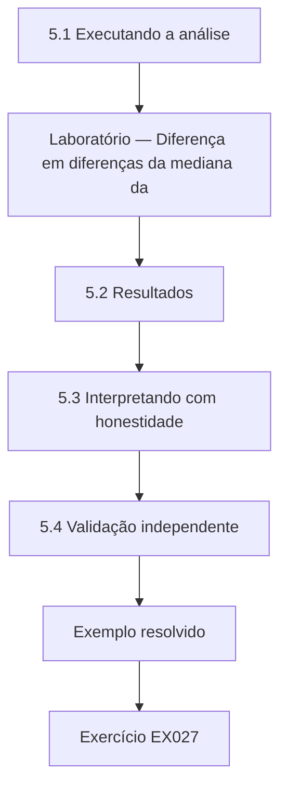

### Desenho lógico

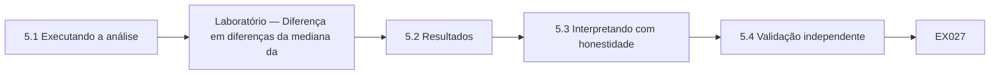

```text
[5.1 Executando a análise]
    |
    v
[Laboratório — Diferença em diferenças da mediana da]
    |
    v
[5.2 Resultados]
    |
    v
[5.3 Interpretando com honestidade]
    |
    v
[5.4 Validação independente]
    |
    v
[Exemplo resolvido] --> [Exercício EX027]
```
<!-- open-cyber-academy:lesson-figures:end ch-05 -->


### Objetivos de aprendizagem

Você vai (1) executar uma análise de diferença em diferenças pré-registrada; (2) interpretar um intervalo que inclui o zero; (3) providenciar a validação independente da análise.

### 5.1 Executando a análise

Com o pré-registro congelado, Yusuf extrai registros sintéticos de correção para trezentas instâncias de vulnerabilidades críticas em cada um de quatro grupos: os departamentos adotantes antes e depois da correção ordenada pelo risco, e os departamentos de comparação nos mesmos dois períodos. Ele calcula a mediana da latência em cada grupo, a diferença em diferenças das medianas e um intervalo de confiança bootstrap, reamostrando cada grupo mil vezes com uma semente aleatória fixa. O script usa apenas os módulos statistics e random do Python, para que os revisores possam executá-lo de novo sem software especial. Os quatro grupos usam a mesma regra de extração.

### Laboratório — Diferença em diferenças da mediana da latência de correção crítica com intervalo bootstrap

```python
"""Difference-in-differences of median critical-patch latency with bootstrap interval (stdlib only)."""
import random, statistics as st
random.seed(23)
def gen(n, m): return [random.expovariate(1/m) for _ in range(n)]
t_pre, t_post = gen(300, 21), gen(300, 12)   # departments using risk-ranked patching
c_pre, c_post = gen(300, 20), gen(300, 18)   # comparison departments
did = (st.median(t_post) - st.median(t_pre)) - (st.median(c_post) - st.median(c_pre))
bs = []
for _ in range(1000):
    r = lambda x: [random.choice(x) for _ in x]
    bs.append((st.median(r(t_post)) - st.median(r(t_pre))) - (st.median(r(c_post)) - st.median(r(c_pre))))
bs.sort()
print(f"medians days: treated {st.median(t_pre):.1f} -> {st.median(t_post):.1f}; comparison {st.median(c_pre):.1f} -> {st.median(c_post):.1f}")
print(f"difference-in-differences {did:.1f} days; 95% bootstrap CI {bs[25]:.1f} to {bs[974]:.1f}")
```

Execute com `python3 lab_patch.py`. Saída verificada:

```text
medians days: treated 14.6 -> 10.1; comparison 12.6 -> 11.6
difference-in-differences -3.4 days; 95% bootstrap CI -7.4 to 1.2
```

### 5.2 Resultados

Nos departamentos adotantes, a mediana da latência cai de 14,6 para 10,1 dias. Nos departamentos de comparação, cai de 12,6 para 11,6 dias. A diferença em diferenças é de menos 3,4 dias, o que sugere que os adotantes melhoraram cerca de três dias e meio a mais que os departamentos de comparação. No entanto, o intervalo bootstrap de 95 por cento vai de menos 7,4 a mais 1,2 dia, então inclui o zero. Os dados são compatíveis com uma melhora útil, mas também com nenhum efeito. Yusuf apresenta as medianas dos grupos e o intervalo numa única tabela, para que os leitores vejam as mudanças brutas além da estimativa-resumo. Ele evita arredondar o intervalo para esconder seu limite superior.

### 5.3 Interpretando com honestidade

Yusuf resiste à tentação de descrever o resultado como prova de que a correção ordenada pelo risco funciona. Seguindo seu pré-registro, ele relata a estimativa, o intervalo e o fato de que a hipótese não é confirmada no nível de confiança planejado. Ele também relata as medianas anteriores à adoção, que mostram os adotantes começando mais lentos que os departamentos de comparação, o que levanta a possibilidade de que parte da queda reflita uma recuperação do atraso. A Prof.ª Hald observa que um resultado inconclusivo honesto é uma contribuição, porque diz aos profissionais que o efeito é incerto.

### 5.4 Validação independente

Yusuf envia seu script congelado, os dados sintéticos e o pré-registro a uma pesquisadora de outra universidade que não tem interesse no resultado. Ela executa a análise de novo e obtém números idênticos, depois tenta uma alternativa razoável, comparando médias do logaritmo da latência, e encontra a mesma direção e um intervalo que também inclui o zero. Seu relatório escrito confirma que a conclusão não depende de uma única escolha analítica. Yusuf inclui o relatório no apêndice da tese, com a permissão dela. O relatório dela nomeia cada arquivo que ela conferiu.

### Exemplo resolvido

Yusuf executa a análise pré-registrada, encontra medianas que caem de 14,6 para 10,1 nos adotantes e de 12,6 para 11,6 nas comparações, uma diferença de menos 3,4 dias com intervalo de menos 7,4 a 1,2, relata o resultado como inconclusivo e o faz reproduzir de forma independente.

> **Caso sintético.** Os registros são sintéticos; as saídas vêm de lab_patch.py.

### Erros e limites

Descrever um intervalo que inclui o zero como prova de um efeito engana os profissionais.

### Exercícios

- **EX027 — Medianas dos adotantes.** Como mudou a mediana da latência dos adotantes? *Rubrica:* 3 = de 14,6 para 10,1 dias;; 2 = parcialmente correto;; 1 = errado;; 0 = nenhuma.

- **EX028 — Estimativa DiD.** Qual é a estimativa da diferença em diferenças? *Rubrica:* 3 = menos 3,4 dias;; 2 = parcialmente correto;; 1 = errado;; 0 = nenhuma.

- **EX029 — Limites do intervalo.** Qual é o intervalo bootstrap de 95%? *Rubrica:* 3 = de menos 7,4 a mais 1,2 dia;; 2 = parcialmente correto;; 1 = errado;; 0 = nenhuma.

- **EX030 — Significado do zero.** O que significa o intervalo incluir o zero? *Rubrica:* 3 = os dados são compatíveis com nenhum efeito;; 2 = parcialmente correto;; 1 = vago;; 0 = nenhuma.

- **EX031 — Preocupação com a recuperação.** Por que parte da queda pode ser recuperação do atraso? *Rubrica:* 3 = os adotantes começaram mais lentos que as comparações;; 2 = parcialmente correto;; 1 = vago;; 0 = nenhuma.

- **EX032 — Alternativa da validadora.** Que análise alternativa a validadora tentou? *Rubrica:* 3 = médias do logaritmo da latência;; 2 = parcialmente correto;; 1 = vago;; 0 = nenhuma.

<!-- open-cyber-academy:chapter-navigation:start ch-05 -->
### Continue estudando — aula 05 (capítulo 05 de 08)

[← Capítulo 04](#ch-04) · [Índice das aulas](../SUBJECTS.md) · [Capítulo 06 →](#ch-06)

Continue para a próxima aula já escrita.
<!-- open-cyber-academy:chapter-navigation:end -->

<a id="ch-06"></a>

## Capítulo 6 — Crítica por pares e revisão

<!-- open-cyber-academy:lesson-figures:start ch-06 -->
### Mapa da aula

Aula 06 publicada. Mapa, exemplo, EX033.

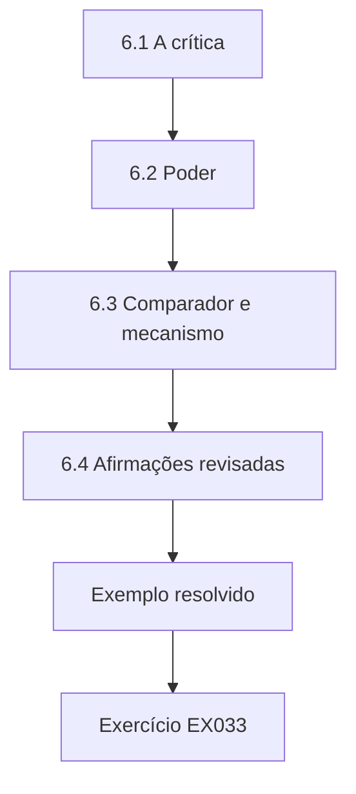

### Desenho lógico

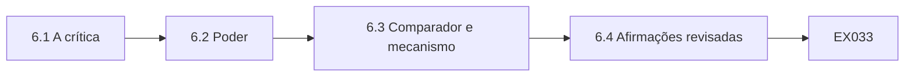

```text
[6.1 A crítica]
    |
    v
[6.2 Poder]
    |
    v
[6.3 Comparador e mecanismo]
    |
    v
[6.4 Afirmações revisadas]
    |
    v
[Exemplo resolvido] --> [Exercício EX033]
```
<!-- open-cyber-academy:lesson-figures:end ch-06 -->


### Objetivos de aprendizagem

Você vai (1) responder a uma revisão crítica por pares; (2) revisar a análise e as afirmações sem mudar os resultados confirmatórios; (3) separar os achados exploratórios dos confirmatórios.

### 6.1 A crítica

Yusuf apresenta um rascunho de artigo num seminário do departamento e o submete a um workshop. Os revisores levantam três pontos. Primeiro, o estudo pode ter poder insuficiente: com tanta variação, um efeito de três dias muitas vezes passaria despercebido. Segundo, os departamentos de comparação incluem a companhia de água, cujas correções são limitadas por testes de segurança operacional, o que a torna um mau comparador. Terceiro, o artigo não explica o que a correção ordenada pelo risco mudou na prática, então os leitores não conseguem saber o que de fato foi testado. Yusuf registra cada ponto com uma resposta planejada antes de revisar.

### 6.2 Poder

Yusuf executa uma simulação, gerando dados sintéticos com um efeito verdadeiro de três dias e a dispersão observada, e conta com que frequência seu desenho o detecta. A detecção fica bem abaixo da meta convencional de oitenta por cento. Ele acrescenta isso ao artigo, declarando que o estudo não conseguiria detectar com confiabilidade efeitos do tamanho observado. Ele recomenda que estudos futuros reúnam várias organizações. A Prof.ª Hald observa que relatar o poder depois de um resultado inconclusivo ajuda os leitores a não concluírem que a prática não tem efeito. Na simulação, a detecção ocorre em cerca de trinta por cento das vezes.

### 6.3 Comparador e mecanismo

Quanto ao comparador, Yusuf executa uma análise de sensibilidade que exclui a companhia de água, rotulada claramente como exploratória porque não foi pré-registrada. A estimativa muda um pouco, mas o intervalo ainda inclui o zero. Quanto ao mecanismo, ele acrescenta uma seção que descreve o que mudou: as vulnerabilidades foram pontuadas segundo a categoria de cada sistema no estilo da FIPS 199, os sistemas high foram corrigidos primeiro e relatórios semanais foram enviados aos chefes de departamento. Ele entrevista dois responsáveis pela segurança para documentar a prática, marcando o material das entrevistas como evidência descritiva, e não causal. Esses acréscimos são marcados como revisões.

### 6.4 Afirmações revisadas

O artigo revisado mantém inalterado o resultado pré-registrado como achado principal, acrescenta a simulação de poder, a análise de sensibilidade exploratória e a descrição do mecanismo, e estreita a conclusão: numa prefeitura, a correção ordenada pelo risco esteve associada a uma redução modesta e incerta na latência de correção crítica. O workshop aceita o artigo. Yusuf observa que a crítica melhorou o artigo principalmente ao tornar seus limites mais claros, e não ao mudar seus números, o que ele considera o resultado certo para uma pesquisa honesta. Ele envia aos revisores uma carta listando cada mudança feita.

### Exemplo resolvido

Yusuf responde às críticas sobre poder, escolha do comparador e mecanismo com uma simulação de poder, uma análise de sensibilidade exploratória rotulada e uma seção sobre o mecanismo, mantém inalterado o resultado confirmatório e estreita sua conclusão.

> **Caso sintético.** A crítica e as revisões são sintéticas.

### Erros e limites

Apresentar uma reanálise exploratória como evidência confirmatória esconde as escolhas do pesquisador.

### Exercícios

- **EX033 — Três críticas.** Cite os três pontos dos revisores. *Rubrica:* 3 = poder, escolha do comparador, mecanismo ausente;; 2 = todos;; 1 = alguns;; 0 = nenhuma.

- **EX034 — Achado sobre o poder.** O que a simulação de poder mostrou? *Rubrica:* 3 = detecção em cerca de trinta por cento, muito abaixo de oitenta;; 2 = parcialmente correto;; 1 = vago;; 0 = nenhuma.

- **EX035 — Comparador excluído.** Que comparador foi excluído na análise de sensibilidade? *Rubrica:* 3 = a companhia de água;; 2 = parcialmente correto;; 1 = outro;; 0 = nenhuma.

- **EX036 — Rótulo da sensibilidade.** Como a análise de sensibilidade é rotulada? *Rubrica:* 3 = exploratória;; 2 = parcialmente correto;; 1 = confirmatória;; 0 = nenhuma.

- **EX037 — Conteúdo do mecanismo.** O que a correção ordenada pelo risco mudou? *Rubrica:* 3 = pontuação por categoria, sistemas high primeiro, relatórios semanais;; 2 = a maioria;; 1 = poucos;; 0 = nenhuma.

- **EX038 — Conclusão estreitada.** Qual é a conclusão estreitada? *Rubrica:* 3 = uma redução modesta e incerta numa prefeitura;; 2 = parcialmente correto;; 1 = vago;; 0 = nenhuma.

<!-- open-cyber-academy:chapter-navigation:start ch-06 -->
### Continue estudando — aula 06 (capítulo 06 de 08)

[← Capítulo 05](#ch-05) · [Índice das aulas](../SUBJECTS.md) · [Capítulo 07 →](#ch-07)

Continue para a próxima aula já escrita.
<!-- open-cyber-academy:chapter-navigation:end -->

<a id="ch-07"></a>

## Capítulo 7 — Síntese da tese e arquivo de reprodutibilidade

<!-- open-cyber-academy:lesson-figures:start ch-07 -->
### Mapa da aula

Aula 07 publicada. Mapa, exemplo, EX039.

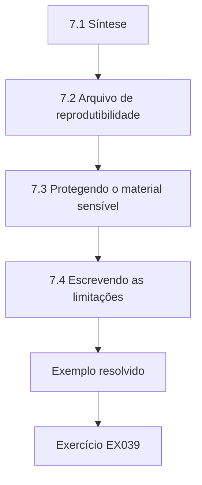

### Desenho lógico

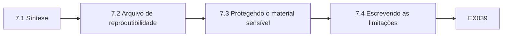

```text
[7.1 Síntese]
    |
    v
[7.2 Arquivo de reprodutibilidade]
    |
    v
[7.3 Protegendo o material sensível]
    |
    v
[7.4 Escrevendo as limitações]
    |
    v
[Exemplo resolvido] --> [Exercício EX039]
```
<!-- open-cyber-academy:lesson-figures:end ch-07 -->


### Objetivos de aprendizagem

Você vai (1) sintetizar estudos numa tese coerente; (2) montar um arquivo de reprodutibilidade; (3) proteger o material sensível da pesquisa arquivada.

### 7.1 Síntese

A tese de Yusuf combina três estudos: o piloto de medição do privilégio excessivo, o estudo da latência de correção e um estudo de revisões de acesso analisado da mesma forma, que encontrou uma redução mais clara do privilégio excessivo nos departamentos adotantes. Sua síntese argumenta que as práticas ordenadas pelo risco estão associadas a melhorias cujo tamanho varia conforme o desfecho e que o desenho da medição afeta fortemente o que pode ser detectado. Ele organiza os capítulos em torno dessas afirmações, e não em ordem cronológica, para que cada capítulo sustente uma parte declarada do argumento. Cada afirmação cita o estudo que a sustenta.

### 7.2 Arquivo de reprodutibilidade

Yusuf monta um arquivo com o pré-registro, os scripts de análise congelados, conjuntos de dados sintéticos que reproduzem cada número relatado, uma descrição das estruturas dos dados reais sem os valores reais e um README que explica como executar de novo cada análise. Ele calcula somas de verificação SHA-256 para cada arquivo usando o hashlib do Python e as lista num manifesto, para que os examinadores possam confirmar que nada mudou depois da submissão. O arquivo é depositado no repositório da universidade com um identificador persistente. Um colega de outro departamento segue o README numa máquina limpa e reproduz cada número, o que confirma que o arquivo está completo o bastante para os examinadores e os leitores futuros.

### 7.3 Protegendo o material sensível

Como o trabalho trata da segurança de um tipo real de organização, Yusuf remove tudo o que poderia ajudar um atacante: nomes de sistemas, versões de software, detalhes de rede e códigos de departamento são substituídos por rótulos genéricos. O líder de segurança da Fernvale revisa o arquivo e a tese, como a condição ética exigia, e pede que ele remova uma figura que mostra a categoria de sistemas corrigida mais lentamente. Ele a substitui por um gráfico agregado. A Prof.ª Hald observa que, na pesquisa em segurança, a abertura e a segurança precisam ser equilibradas de forma deliberada. O líder de segurança aprova a revisão.

### 7.4 Escrevendo as limitações

Yusuf escreve as limitações com franqueza: uma única organização, poder baixo para a latência de correção, possíveis efeitos de recuperação do atraso, medidas limitadas a logs operacionais e dados sintéticos no arquivo público que espelham a estrutura, mas não as distribuições exatas dos dados reais. Para cada limitação, ele declara como ela afeta as afirmações. Ele observa que as seções de limitações na pesquisa em segurança muitas vezes subestimam o contexto organizacional e descreve o porte, o setor e o ambiente regulatório da Fernvale para que os leitores possam julgar a transferibilidade. A Prof.ª Hald confere se cada limitação corresponde a uma consequência específica para as conclusões, e Yusuf remove expressões vagas que não dizem o que limitam.

### Exemplo resolvido

Yusuf sintetiza três estudos em torno de afirmações, arquiva o pré-registro, os scripts, os dados sintéticos e os manifestos com somas de verificação, remove os detalhes úteis a atacantes depois da revisão do líder de segurança e escreve limitações concretas com contexto.

> **Caso sintético.** A tese e o arquivo são sintéticos.

### Erros e limites

Arquivar nomes e versões reais de sistemas pode expor o parceiro a ataques.

### Exercícios

- **EX039 — Terceiro estudo.** O que o estudo de revisões de acesso encontrou? *Rubrica:* 3 = uma redução mais clara do privilégio excessivo;; 2 = parcialmente correto;; 1 = vago;; 0 = nenhuma.

- **EX040 — Ferramenta de soma de verificação.** Que módulo calcula as somas de verificação? *Rubrica:* 3 = hashlib;; 2 = parcialmente correto;; 1 = outro;; 0 = nenhuma.

- **EX041 — Figura removida.** Que figura o líder de segurança pediu para remover? *Rubrica:* 3 = a categoria de sistemas corrigida mais lentamente;; 2 = parcialmente correto;; 1 = vago;; 0 = nenhuma.

- **EX042 — Rótulos genéricos.** Que detalhes se tornam rótulos genéricos? *Rubrica:* 3 = nomes de sistemas, versões, detalhes de rede e códigos de departamento;; 2 = a maioria;; 1 = poucos;; 0 = nenhuma.

- **EX043 — Dados do arquivo.** Que dados o arquivo público contém? *Rubrica:* 3 = dados sintéticos que reproduzem os números relatados;; 2 = parcialmente correto;; 1 = reais;; 0 = nenhuma.

- **EX044 — Apoio à transferibilidade.** Como Yusuf ajuda os leitores a julgar a transferibilidade? *Rubrica:* 3 = descreve o porte, o setor e a regulação da Fernvale;; 2 = parcialmente correto;; 1 = vago;; 0 = nenhuma.

<!-- open-cyber-academy:chapter-navigation:start ch-07 -->
### Continue estudando — aula 07 (capítulo 07 de 08)

[← Capítulo 06](#ch-06) · [Índice das aulas](../SUBJECTS.md) · [Capítulo 08 →](#ch-08)

Continue para a próxima aula já escrita.
<!-- open-cyber-academy:chapter-navigation:end -->

<a id="ch-08"></a>

## Capítulo 8 — Defesa e plano de publicação

<!-- open-cyber-academy:lesson-figures:start ch-08 -->
### Mapa da aula

Aula 08 publicada. Mapa, exemplo, EX045.

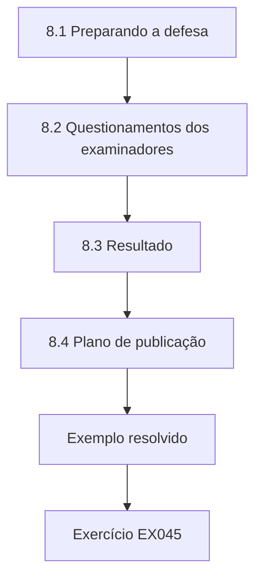

### Desenho lógico

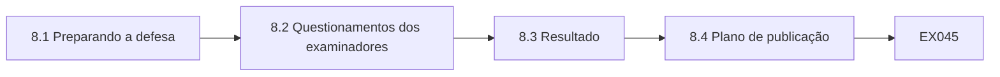

```text
[8.1 Preparando a defesa]
    |
    v
[8.2 Questionamentos dos examinadores]
    |
    v
[8.3 Resultado]
    |
    v
[8.4 Plano de publicação]
    |
    v
[Exemplo resolvido] --> [Exercício EX045]
```
<!-- open-cyber-academy:lesson-figures:end ch-08 -->


### Objetivos de aprendizagem

Você vai (1) defender uma tese com resultados mistos; (2) responder a questionamentos sobre generalização e ética; (3) planejar uma publicação responsável.

### 8.1 Preparando a defesa

Yusuf prepara uma apresentação de quarenta minutos que cobre a lacuna, o desenho, as medidas, os resultados com intervalos, a crítica e os limites. Ele ensaia com colegas que o pressionam sobre o resultado inconclusivo das correções. Ele prepara um slide que mostra a estimativa e o intervalo das correções ao lado do resultado mais claro do privilégio excessivo, para que os examinadores vejam os dois sem que ele enfatize o mais favorável. A Prof.ª Hald o aconselha a declarar cada afirmação com as mesmas palavras usadas na tese, para não derivar para uma linguagem mais forte sob pressão. Os ensaios são cronometrados.

### 8.2 Questionamentos dos examinadores

O examinador externo pergunta se uma única prefeitura pode dizer algo sobre a segurança baseada em risco em geral. Yusuf responde que ela não pode estabelecer efeitos gerais, mas oferece uma abordagem de medição testada e uma estimativa que estudos futuros combinados podem usar. Um segundo examinador pergunta se os dados pseudonimizados dos funcionários representaram riscos. Ele explica os pseudônimos com chave, o relato por departamento e o cronograma de destruição. Um terceiro pergunta por que ele não usou contagens de incidentes; ele explica que os incidentes são raros e registrados de forma inconsistente, o que os torna desfechos pouco confiáveis. Cada resposta é breve.

### 8.3 Resultado

Os examinadores aprovam a tese com correções menores: esclarecer a mudança de definição feita durante o piloto e acrescentar uma tabela que compare as medidas usadas em estudos anteriores. Eles elogiam o pré-registro, a validação independente e o tratamento franco do resultado inconclusivo. Yusuf faz as correções em um mês. Ele reflete que sua contribuição mais valiosa pode ser metodológica, ao mostrar como os logs operacionais podem medir os efeitos dos controles, e não alguma estimativa isolada. A tese corrigida é aprovada pelo examinador interno sem outras mudanças. Yusuf agradece à equipe de segurança da Fernvale nos agradecimentos, sem nomear ninguém, como combinado no acordo original de compartilhamento de dados.

### 8.4 Plano de publicação

Yusuf planeja três artigos: o método de medição, o estudo da latência de correção com sua análise de poder e o estudo das revisões de acesso. Cada um vai passar pela revisão de sensibilidade do líder de segurança da Fernvale antes da submissão, como combinado. Ele vai publicar dados sintéticos e código com cada artigo. Ele também planeja uma breve nota para os profissionais das equipes de segurança das prefeituras. O próximo curso desta área, governança de dados, examina como os direitos de decisão sobre a qualidade e o uso dos dados moldam as evidências em que esse tipo de pesquisa em segurança se apoia. A Prof.ª Hald aprova o plano.

### Exemplo resolvido

Yusuf apresenta os resultados mistos lado a lado, responde aos questionamentos sobre generalização, pseudonimização e contagens de incidentes, é aprovado com correções menores e planeja três artigos e uma nota para profissionais com revisão de sensibilidade.

> **Caso sintético.** A defesa é sintética.

### Erros e limites

Derivar para uma linguagem mais forte durante a arguição exagera a tese.

### Exercícios

- **EX045 — Slide lado a lado.** O que o slide principal mostra junto? *Rubrica:* 3 = o resultado inconclusivo das correções e o resultado mais claro do privilégio;; 2 = parcialmente correto;; 1 = vago;; 0 = nenhuma.

- **EX046 — Resposta sobre generalização.** O que o estudo de uma única prefeitura pode oferecer? *Rubrica:* 3 = uma abordagem de medição testada e uma estimativa para combinação;; 2 = parcialmente correto;; 1 = vago;; 0 = nenhuma.

- **EX047 — Contagens de incidentes.** Por que as contagens de incidentes não foram usadas? *Rubrica:* 3 = raras e registradas de forma inconsistente;; 2 = parcialmente correto;; 1 = vago;; 0 = nenhuma.

- **EX048 — Correções exigidas.** Cite uma correção exigida. *Rubrica:* 3 = esclarecer a mudança de definição do piloto ou acrescentar uma tabela de medidas anteriores;; 2 = uma;; 1 = vago;; 0 = nenhuma.

- **EX049 — Número de artigos.** Quantos artigos Yusuf planeja? *Rubrica:* 3 = três;; 2 = parcialmente correto;; 1 = errado;; 0 = nenhuma.

- **EX050 — Contribuição principal.** Qual pode ser a contribuição mais valiosa de Yusuf? *Rubrica:* 3 = a abordagem metodológica com logs operacionais;; 2 = parcialmente correto;; 1 = vago;; 0 = nenhuma.

<!-- open-cyber-academy:chapter-navigation:start ch-08 -->
### Continue estudando — aula 08 (capítulo 08 de 08)

[← Capítulo 07](#ch-07) · [Índice das aulas](../SUBJECTS.md) · [Próximo curso pelo índice →](../SUBJECTS.md)

O índice aponta para o próximo curso do percurso de estudos.
<!-- open-cyber-academy:chapter-navigation:end -->

<a id="worked-results"></a>

## Resoluções

Respostas-modelo para EX001–EX050. Yusuf Al-Rashid, a Prof.ª Ingeborg Hald, a Marlow University, a Fernvale Municipal Services e todos os números são sintéticos; as respostas dos laboratórios citam saídas verificadas. Qualquer resposta que atenda à rubrica recebe a mesma pontuação.

**EX001.** Ordenar os controles pelo risco avaliado versus aplicá-los de maneira uniforme.

**EX002.** Trinta departamentos.

**EX003.** Só com autorização escrita.

**EX004.** Ele a relata à equipe de segurança da Fernvale em vez de publicá-la.

**EX005.** Um desenho de diferença em diferenças.

**EX006.** A Fernvale implanta a correção ordenada pelo risco primeiro em alguns departamentos.

**EX007.** O líder de segurança da Fernvale deve revisar as publicações quanto à sensibilidade operacional.

**EX008.** O privilégio mínimo.

**EX009.** Incentivos, usabilidade e processos organizacionais.

**EX010.** Governar, identificar, proteger, detectar, responder e recuperar.

**EX011.** Toma a mais alta das classificações de confidencialidade, integridade e disponibilidade.

**EX012.** A folha de pagamento, o controle da água e os registros de casos.

**EX013.** Suas falhas de integridade e disponibilidade poderiam prejudicar a população.

**EX014.** Como evidência sobre duas medidas de desfecho num único órgão público.

**EX015.** Uma queda maior na mediana de dias para corrigir vulnerabilidades críticas nos departamentos adotantes.

**EX016.** A latência é distorcida por alguns poucos casos muito lentos.

**EX017.** A proporção de contas com permissões fora da linha de base da sua função.

**EX018.** Comparando as tendências anteriores à adoção.

**EX019.** O tamanho da amostra e o poder estatístico.

**EX020.** Antes da extração dos dados de desfecho.

**EX021.** A prefeitura excluiu os sistemas com desativação prevista.

**EX022.** 25,3 por cento, 152 de 600 contas.

**EX023.** Trinta e quatro.

**EX024.** Permite mudanças de configuração em todo o sistema.

**EX025.** Excluir as permissões cobertas por uma exceção aprovada e ainda válida.

**EX026.** Para que as mudanças posteriores nas linhas de base não confundam a medida de desfecho.

**EX027.** De 14,6 para 10,1 dias.

**EX028.** Menos 3,4 dias.

**EX029.** De menos 7,4 a mais 1,2 dia.

**EX030.** Os dados também são compatíveis com nenhum efeito.

**EX031.** Os adotantes começaram com correções mais lentas que os departamentos de comparação.

**EX032.** Comparar médias do logaritmo da latência.

**EX033.** Poder baixo, um mau comparador e nenhuma descrição do mecanismo.

**EX034.** Um efeito de três dias é detectado apenas em cerca de trinta por cento das vezes.

**EX035.** A companhia de água.

**EX036.** Como exploratória, porque não foi pré-registrada.

**EX037.** Pontuação pela categoria do sistema, correção dos sistemas high primeiro e relatórios semanais aos chefes.

**EX038.** Uma redução modesta e incerta na latência de correção crítica numa prefeitura.

**EX039.** Uma redução mais clara do privilégio excessivo nos departamentos adotantes.

**EX040.** O hashlib do Python, usando SHA-256.

**EX041.** Uma figura que mostra a categoria de sistemas corrigida mais lentamente.

**EX042.** Nomes de sistemas, versões de software, detalhes de rede e códigos de departamento.

**EX043.** Conjuntos de dados sintéticos que reproduzem cada número relatado.

**EX044.** Descrevendo o porte, o setor e o ambiente regulatório da Fernvale.

**EX045.** A estimativa e o intervalo das correções ao lado do resultado do privilégio excessivo.

**EX046.** Uma abordagem de medição testada e uma estimativa para futuros estudos combinados.

**EX047.** Os incidentes são raros e registrados de forma inconsistente.

**EX048.** Esclarecer a mudança de definição feita na fase de piloto.

**EX049.** Três artigos.

**EX050.** Mostrar como os logs operacionais podem medir os efeitos dos controles.

<a id="references"></a>
## Referências

Todos os DOIs foram resolvidos em doi.org em 12 de outubro de 2026, e as normas foram conferidas nas páginas de seus editores. A lista é idêntica à da edição em inglês e cobre o livro inteiro, acrescida apenas da ABNT NBR ISO/IEC 27001:2022, citada nesta edição como referência brasileira e conferida em sua fonte oficial; as adoções brasileiras da ABNT listadas foram conferidas no catálogo oficial da ABNT, e as demais normas técnicas são citadas em sua edição internacional. Organizações, pessoas, sistemas e números dos casos são sintéticos; somente as obras abaixo são reais.

- Anderson, R. (2020). *Security engineering: A guide to building dependable distributed systems* (3rd ed.). Wiley. https://doi.org/10.1002/9781119644682
- Associação Brasileira de Normas Técnicas. (2022). *ABNT NBR ISO/IEC 27001:2022 — Segurança da informação, segurança cibernética e proteção à privacidade — Sistemas de gestão da segurança da informação — Requisitos* (versão corrigida 2023). ABNT. <https://www.abntcatalogo.com.br/>
- ISO/IEC. (2022). *ISO/IEC 27001:2022 Information security, cybersecurity and privacy protection — Information security management systems — Requirements* (with Amd 1:2024). <https://www.iso.org/standard/27001>
- ISO/IEC. (2022). *ISO/IEC 27002:2022 Information security, cybersecurity and privacy protection — Information security controls*. <https://www.iso.org/standard/75652.html>
- ISO/IEC. (2026). *ISO/IEC 27000:2026 Information security, cybersecurity and privacy protection — Information security management systems — Overview* (6th ed., replacing ISO/IEC 27000:2018). <https://www.iso.org/standard/27000>
- Joint Task Force Transformation Initiative. (2012). *Guide for conducting risk assessments* (NIST SP 800-30 Rev. 1). National Institute of Standards and Technology. https://doi.org/10.6028/NIST.SP.800-30r1
- Joint Task Force. (2020). *Security and privacy controls for information systems and organizations* (NIST SP 800-53 Rev. 5). National Institute of Standards and Technology. https://doi.org/10.6028/NIST.SP.800-53r5
- National Institute of Standards and Technology. (2004). *Standards for security categorization of federal information and information systems* (FIPS 199). https://doi.org/10.6028/NIST.FIPS.199
- National Institute of Standards and Technology. (2024). *The NIST Cybersecurity Framework (CSF) 2.0* (NIST CSWP 29). https://doi.org/10.6028/NIST.CSWP.29
- Nieles, M., Dempsey, K., & Pillitteri, V. Y. (2017). *An introduction to information security* (NIST SP 800-12 Rev. 1). National Institute of Standards and Technology. https://doi.org/10.6028/NIST.SP.800-12r1
- Saltzer, J. H., & Schroeder, M. D. (1975). The protection of information in computer systems. *Proceedings of the IEEE, 63*(9), 1278–1308. https://doi.org/10.1109/PROC.1975.9939
- Shadish, W. R., Cook, T. D., & Campbell, D. T. (2002). *Experimental and quasi-experimental designs for generalized causal inference*. Houghton Mifflin.
