# Network and Communications Security: Doctoral Research Track

- Language: English (`en`); course 195, Doctoral research track (2 years).
- Editorial state: **published**. Chapters 1–8 of 8 have hand-written teaching text; exercises EX001–EX050 have matching worked results with 0–3 rubrics; Four offline labs use only the Python 3 standard library on synthetic evidence, and their outputs are embedded from real runs. Independent review and the 300-page A4 verification remain open.
- Audience: doctoral candidates researching network security who must produce original, reproducible evidence with partner organisations.
- Author: [hiagokinlevi](https://github.com/hiagokinlevi). Original text [CC0 1.0](../../../../../LICENSE); cited works keep their rights.
- Ethical and legal boundary: review and test only networks and devices you are authorised to assess; no exploit code, no payloads, no attack procedures and no instructions for bypassing controls. Weaknesses are taught from the defender's side using synthetic configurations, flow records, logs and data. All evidence, people and organisations are **synthetic** unless a sentence cites a public source.

[Course home](../../README.md) · [Chapter index](../SUBJECTS.md) · [Book plan](PLAN.md) · [Course skill](../../skill/SKILL.md) · [Worked results](#worked-results)

## How to use this draft

Read in order: the chapters follow one doctoral candidate studying firewall rule-base quality at three partner organisations, through research integrity and coder agreement, the research frontier, a registered proposal, baseline replication and pilot, a main study with blinded validation, peer critique, a synthetic reproducibility archive and the defense. Run each lab where it appears, attempt the exercises before the worked results, and score yourself with the rubrics.

### Synthetic running case

| Element | Role | Boundary |
|---|---|---|
| **Ines Carvalho** | Doctoral candidate | Invented |
| **Prof. Marcus Lindqvist** | Supervisor | Invented |
| **Halden University** | Fictional university | Invented |
| **Westbrook Water** | Fictional lead partner | Invented |

### Core sources

NIST [SP 800-41r1](https://doi.org/10.6028/NIST.SP.800-41r1), [SP 800-77r1](https://doi.org/10.6028/NIST.SP.800-77r1), [SP 800-94](https://doi.org/10.6028/NIST.SP.800-94), [SP 800-207](https://doi.org/10.6028/NIST.SP.800-207), [SP 800-153](https://doi.org/10.6028/NIST.SP.800-153) and [SP 800-53r5](https://doi.org/10.6028/NIST.SP.800-53r5); [CIS Controls v8](https://www.cisecurity.org/controls/v8); IETF [RFC 8446](https://www.rfc-editor.org/rfc/rfc8446), [RFC 4301](https://www.rfc-editor.org/rfc/rfc4301) and [RFC 2827](https://www.rfc-editor.org/rfc/rfc2827). Full list in [References](#references).

## Contents

| Chapters |
|---|
| [1](#ch-01) · [2](#ch-02) · [3](#ch-03) · [4](#ch-04) · [5](#ch-05) · [6](#ch-06) · [7](#ch-07) · [8](#ch-08) |

[Worked results](#worked-results) · [References](#references)

<a id="ch-01"></a>

## Chapter 1 — Advanced research integrity and methods

<!-- open-cyber-academy:lesson-figures:start ch-01 -->
### Lesson map

Lesson 01 published. Map, example, EX001.

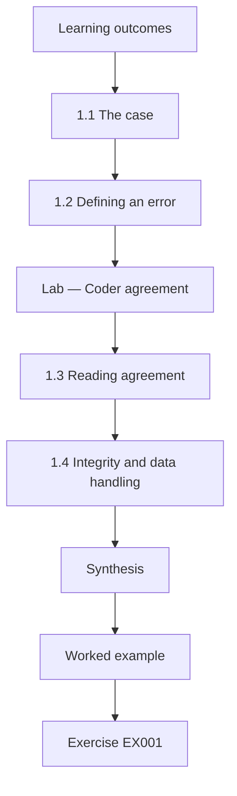

### Logical drawing

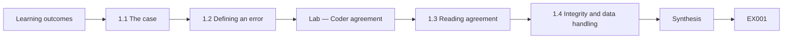

```text
[Learning outcomes]
    |
    v
[1.1 The case]
    |
    v
[1.2 Defining an error]
    |
    v
[Lab — Coder agreement]
    |
    v
[1.3 Reading agreement]
    |
    v
[1.4 Integrity and data handling]
    |
    v
[Synthesis]
    |
    v
[Worked example] --> [Exercise EX001]
```
<!-- open-cyber-academy:lesson-figures:end ch-01 -->


### Learning outcomes

You will (1) frame a doctoral question about firewall rule-base quality; (2) design valid measurement of configuration errors; (3) establish ethical and data-handling rules for partner configurations.

### 1.1 The case

Ines Carvalho is a doctoral candidate at the fictional Halden University, supervised by Prof. Marcus Lindqvist. Her partner organisations are three fictional regional bodies, led by Westbrook Water, whose firewalls have grown over fifteen years to hundreds of rules each. Engineers suspect many rules are redundant, overly broad or contradict earlier rules, but nobody can say how many or whether reviews help. Ines's thesis asks whether rule-base complexity predicts configuration errors and whether a structured review procedure reduces them. Wool (2004) found such a relationship in a study of real firewall configurations; her work aims to test it on modern rule bases and add an intervention.

### 1.2 Defining an error

A study of errors needs a definition that two people would apply the same way. Ines uses four categories drawn from the firewall literature and NIST SP 800-41 Rev. 1: a rule that is fine; a rule shadowed by an earlier rule, so it never matches; a rule broader than its documented purpose, such as allowing any source; and a rule with no traffic hits for a defined period and no documented owner. Each category has written decision rules and examples. The definitions are fixed before any partner data are coded, so results cannot reshape them.

### Lab — Coder agreement

```python
"""Cohen's kappa for two coders labelling 40 synthetic firewall rules as ok / shadowed / permissive / unused (stdlib only)."""
from collections import Counter
a = list("OOOOOOOOOOOOOOOOSSSSSSPPPPPPPPUUUUUUUUUU")
b = list("OOOOOOOOOOOOOOOSSSSSSOPPPPPPPUUUUUUUUUUP")
n = len(a); po = sum(x == y for x, y in zip(a, b)) / n
ca, cb = Counter(a), Counter(b); pe = sum(ca[k] * cb[k] for k in set(a) | set(b)) / n**2
k = (po - pe) / (1 - pe)
print(f"rules {n}; observed agreement {po:.3f}; chance {pe:.3f}; kappa {k:.3f}")
print("disagreements:", [(i + 1, x, y) for i, (x, y) in enumerate(zip(a, b)) if x != y])
```

Run with `python3 lab_kappa.py`. Verified output:

```text
rules 40; observed agreement 0.900; chance 0.285; kappa 0.860
disagreements: [(16, 'O', 'S'), (22, 'S', 'O'), (30, 'P', 'U'), (40, 'U', 'P')]
```

### 1.3 Reading agreement

Two trained coders independently label forty synthetic rules. They agree on 36, an observed agreement of 0.90, and Cohen's kappa, which corrects for agreement expected by chance, is 0.86. Landis and Koch (1977) would call this almost perfect agreement, though Ines treats such labels as rough guides. The four disagreements matter more than the number: two are between fine and shadowed, where the coders read an object group differently, and two between permissive and unused. Each leads to a sharper decision rule in the codebook, and the agreement exercise is repeated on fresh rules after the change.

### 1.4 Integrity and data handling

Firewall configurations reveal how a partner's network is built, which makes them sensitive. Ines's data agreement allows her to receive configurations only after the partner replaces real addresses and names with consistent pseudonyms, keeps the files on an encrypted university server and forbids publication of any rule text. All examples in her thesis and in this book are synthetic. Her ethics approval covers interviews with engineers, who can withdraw at any time. She never probes the partners' networks; every observation comes from configurations and logs the partners choose to share.

### Worked example

Ines writes the research question, the four-category codebook and the data agreement, then runs the forty-rule agreement exercise. Kappa of 0.86 and four clear disagreement patterns lead to two codebook clarifications before real coding begins.

> **Synthetic case.** Ines Carvalho, Halden University, Westbrook Water and all figures and rules are synthetic.

### Errors and limits

Kappa summarises agreement but hides where disagreement lies; always inspect disagreements, and remember that high agreement does not guarantee the categories are the right ones.

### Exercises

- **EX001 — Error categories.** Define the four rule categories Ines uses and give one decision rule for each. *Rubric:* 3 = all four with clear decision rules;; 2 = four categories without rules;; 1 = fewer than four;; 0 = none.
- **EX002 — Kappa reading.** Interpret observed agreement 0.90 and kappa 0.86 for a committee. *Rubric:* 3 = explains chance correction and limits;; 2 = explains kappa;; 1 = restates numbers;; 0 = none.
- **EX003 — Disagreement value.** Why are the four disagreements more useful than the kappa value? *Rubric:* 3 = show where the codebook is ambiguous and lead to fixes;; 2 = mention ambiguity;; 1 = vague;; 0 = none.
- **EX004 — Pseudonymisation.** Explain why partners pseudonymise configurations before sharing. *Rubric:* 3 = network design sensitivity, consistent mapping preserves analysis;; 2 = sensitivity;; 1 = vague;; 0 = none.
- **EX005 — Fixing definitions first.** What bias does fixing definitions before coding prevent? *Rubric:* 3 = post-hoc redefinition to fit results;; 2 = bias;; 1 = vague;; 0 = none.
- **EX006 — Observation boundary.** Why does Ines never probe partner networks? *Rubric:* 3 = authorisation, ethics, risk to operations;; 2 = not allowed;; 1 = vague;; 0 = none.
- **EX007 — Prior work link.** How does Wool (2004) shape the research question? *Rubric:* 3 = prior finding of complexity-error link to test and extend;; 2 = cites;; 1 = vague;; 0 = none.

### Synthesis

A defensible doctoral study of rule-base errors starts with a precise codebook, measured coder agreement and strict handling of sensitive configurations.

### Continue studying — chapter 01 of 08

[← Course home](../../README.md) · [Course chapter index](../SUBJECTS.md) · [Chapter 02 (draft) →](#ch-02)

<a id="ch-02"></a>

## Chapter 2 — Network and communications security: research frontier

<!-- open-cyber-academy:lesson-figures:start ch-02 -->
### Lesson map

Lesson 02 published. Map, example, EX008.

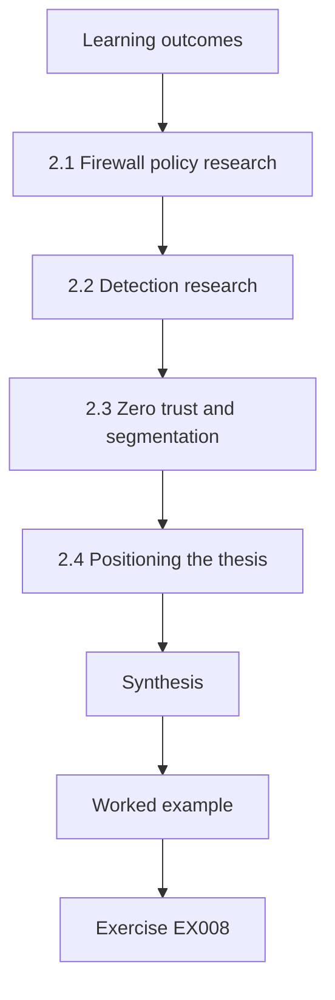

### Logical drawing

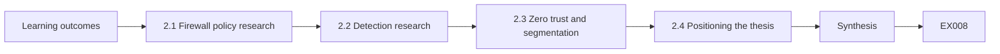

```text
[Learning outcomes]
    |
    v
[2.1 Firewall policy research]
    |
    v
[2.2 Detection research]
    |
    v
[2.3 Zero trust and segmentation]
    |
    v
[2.4 Positioning the thesis]
    |
    v
[Synthesis]
    |
    v
[Worked example] --> [Exercise EX008]
```
<!-- open-cyber-academy:lesson-figures:end ch-02 -->


### Learning outcomes

You will (1) survey current research on network policy, detection and zero trust; (2) identify an open gap; (3) position the thesis.

### 2.1 Firewall policy research

Research on firewall policy has moved from counting errors to analysing policies formally. Tools compare rules to find shadowing and redundancy, and studies such as Wool (2004) show that error counts grow with rule-base size. NIST SP 800-41 Rev. 1 recommends regular policy review, documented rule purposes and removal of unneeded rules, but gives little evidence on which review methods work. That gap between guidance and evidence is where Ines locates her contribution: an evaluated review procedure rather than another detection algorithm.

Her study therefore measures what reviewers find and miss under a defined procedure, rather than how many rule errors a tool can count.

### 2.2 Detection research

Network intrusion detection has a long research history, from Paxson's Bro system in 1999 to statistical and machine learning methods. Sommer and Paxson (2010) argued that machine learning often struggles in this setting because attacks are rare, traffic is diverse and errors are costly. Axelsson (2000) showed how low base rates turn even accurate detectors into sources of many false alarms. Ines reads these works because policy hygiene and detection interact: a cleaner rule base makes alerts easier to interpret and reduces the space detectors must cover.

### 2.3 Zero trust and segmentation

NIST SP 800-207 describes zero trust architecture, in which access decisions are made per request using identity and device state rather than network location. Many organisations move toward it gradually, keeping firewalls for segmentation while adding identity-aware controls. This makes rule-base quality more, not less, important during the transition, because old broad rules can undermine new controls. Ines notes that empirical work on how organisations manage this transition is scarce, which strengthens the case for studying rule hygiene in operational settings.

### 2.4 Positioning the thesis

Ines writes a positioning statement: her thesis contributes an empirical replication of the complexity-error relationship on modern rule bases, a validated codebook, and a controlled evaluation of a structured review procedure. She states what she will not do, such as building a new analysis tool or studying attack detection directly. Clear boundaries help examiners judge the contribution against its aims, and help partners understand what they will receive.

Ines states plainly which gap her work fills and which questions she leaves to others, so examiners can judge the contribution against its stated scope.

### Worked example

Ines builds a table of twelve key works with method, setting, finding and limitation, then marks three gaps: little evaluation of review procedures, few modern replications and almost no study of rule hygiene during zero trust transitions.

> **Synthetic case.** The literature cited is real; the thesis and partners are synthetic.

### Errors and limits

Surveys that list papers without comparing methods and limits do not reveal gaps; a structured comparison table does.

### Exercises

- **EX008 — Guidance gap.** What gap exists between SP 800-41 Rev. 1 and research evidence? *Rubric:* 3 = recommends review but lacks evidence on methods;; 2 = mentions review;; 1 = vague;; 0 = none.
- **EX009 — Base rates.** Explain Axelsson's base-rate point in two sentences. *Rubric:* 3 = low prevalence makes false alarms dominate;; 2 = false alarms;; 1 = vague;; 0 = none.
- **EX010 — Closed-world problem.** Summarise one reason Sommer and Paxson give for ML difficulty in intrusion detection. *Rubric:* 3 = rarity, diversity or cost of errors explained;; 2 = named;; 1 = vague;; 0 = none.
- **EX011 — Zero trust relevance.** Why does rule-base quality matter during a zero trust transition? *Rubric:* 3 = old broad rules undermine new controls;; 2 = still matters;; 1 = vague;; 0 = none.
- **EX012 — Positioning statement.** Write a one-sentence contribution statement for Ines's thesis. *Rubric:* 3 = names replication, codebook and evaluated intervention;; 2 = partial;; 1 = vague;; 0 = none.
- **EX013 — Scope exclusions.** Why state what the thesis will not do? *Rubric:* 3 = helps examiners and partners judge scope;; 2 = clarity;; 1 = vague;; 0 = none.
- **EX014 — Comparison table.** List four columns for a literature comparison table. *Rubric:* 3 = method, setting, finding, limitation;; 2 = three;; 1 = fewer;; 0 = none.

### Synthesis

The frontier shows strong guidance and tools for firewall policy, but weak evidence on what review practices actually reduce errors.

### Continue studying — chapter 02 of 08

[← Chapter 01 (draft)](#ch-01) · [Course chapter index](../SUBJECTS.md) · [Chapter 03 (draft) →](#ch-03)

<a id="ch-03"></a>

## Chapter 3 — Original contribution proposal

<!-- open-cyber-academy:lesson-figures:start ch-03 -->
### Lesson map

Lesson 03 published. Map, example, EX015.

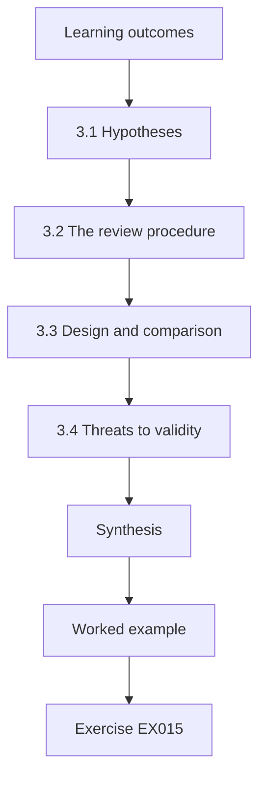

### Logical drawing


```text
[Learning outcomes]
    |
    v
[3.1 Hypotheses]
    |
    v
[3.2 The review procedure]
    |
    v
[3.3 Design and comparison]
    |
    v
[3.4 Threats to validity]
    |
    v
[Synthesis]
    |
    v
[Worked example] --> [Exercise EX015]
```
<!-- open-cyber-academy:lesson-figures:end ch-03 -->


### Learning outcomes

You will (1) state hypotheses; (2) design the replication and the intervention study; (3) plan analysis and threats to validity.

### 3.1 Hypotheses

Ines states two hypotheses before seeing partner data. H1: across firewalls, rule-base size is positively correlated with the number of coded errors. H2: firewalls whose teams follow the structured review procedure for one quarter show fewer errors per hundred rules than they did before, and fewer than a comparison group reviewing in their usual way. Each hypothesis names its measure and test, and both are registered with her supervisor and the department's research office.

Each hypothesis is written before data collection and registered with her supervisor.

### 3.2 The review procedure

The structured review is a short, repeatable procedure. For each rule, the team confirms an owner and documented purpose, checks for shadowing with an analysis tool, compares the rule's scope with its purpose, and checks hit counts over ninety days. Unclear rules are flagged for owner confirmation rather than deleted. The procedure is written as a one-page checklist so that it can be followed by any competent engineer, which is essential if the result is to generalise beyond Ines's partners.

### 3.3 Design and comparison

Twelve firewalls across the three partners are coded at baseline for H1. For H2, eight firewalls whose teams volunteer adopt the procedure, and their before-and-after rates are compared, with the other four as a comparison group. Random assignment is not possible because partners choose which teams take part, so Ines records team size, experience and workload to discuss selection effects. She also measures how long each review takes, because a procedure too costly to repeat would not be adopted.

The design is documented before data is seen.

### 3.4 Threats to validity

Ines lists threats and responses. Coders might know which firewalls were reviewed, so a second coder, blind to group, recodes a sample. Teams might change behaviour simply because they are observed; the comparison group helps estimate this. Rule bases change for reasons unrelated to the study, such as new projects; change logs are used to separate these. Finally, three partners in one sector may not represent others, a limit stated plainly in the proposal.

Each threat is paired with the mitigation planned and any that remain.

### Worked example

The proposal fits on eight pages: question, hypotheses, procedure, design, measures, analysis plan, threats and ethics. The committee asks for a blinded recoding sample, which Ines adds.

> **Synthetic case.** The proposal and partners are synthetic.

### Errors and limits

Without registered hypotheses, a study can drift toward whichever result looks strongest.

### Exercises

- **EX015 — Hypothesis wording.** Rewrite H2 so it names measure, groups and period. *Rubric:* 3 = all three;; 2 = two;; 1 = vague;; 0 = none.
- **EX016 — Owner confirmation.** Why are unclear rules flagged rather than deleted? *Rubric:* 3 = avoid outages, confirm purpose;; 2 = safety;; 1 = vague;; 0 = none.
- **EX017 — Selection effects.** Why record team size and experience? *Rubric:* 3 = discuss non-random selection;; 2 = context;; 1 = vague;; 0 = none.
- **EX018 — Blinding.** What does a blinded recoding sample protect against? *Rubric:* 3 = coder expectation bias;; 2 = bias;; 1 = vague;; 0 = none.
- **EX019 — Review time.** Why measure how long reviews take? *Rubric:* 3 = adoption cost;; 2 = cost;; 1 = vague;; 0 = none.
- **EX020 — Generalisation limit.** State one limit on generalising from three partners. *Rubric:* 3 = same sector, similar practices;; 2 = limited;; 1 = vague;; 0 = none.

### Synthesis

A registered proposal with a simple procedure, a comparison group and stated threats makes the contribution testable.

### Continue studying — chapter 03 of 08

[← Chapter 02 (draft)](#ch-02) · [Course chapter index](../SUBJECTS.md) · [Chapter 04 (draft) →](#ch-04)

<a id="ch-04"></a>

## Chapter 4 — Baseline replication and pilot

<!-- open-cyber-academy:lesson-figures:start ch-04 -->
### Lesson map

Lesson 04 published. Map, example, EX021.

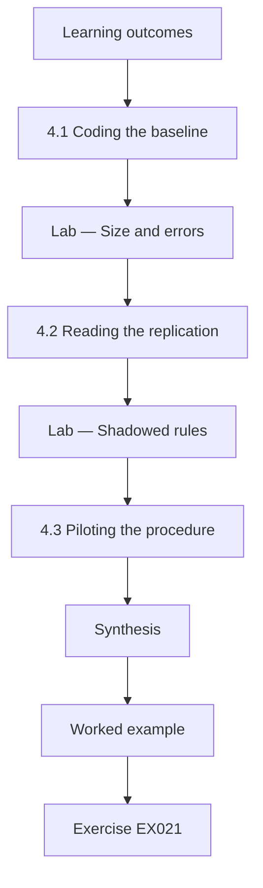

### Logical drawing

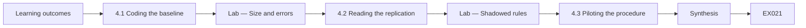

```text
[Learning outcomes]
    |
    v
[4.1 Coding the baseline]
    |
    v
[Lab — Size and errors]
    |
    v
[4.2 Reading the replication]
    |
    v
[Lab — Shadowed rules]
    |
    v
[4.3 Piloting the procedure]
    |
    v
[Synthesis]
    |
    v
[Worked example] --> [Exercise EX021]
```
<!-- open-cyber-academy:lesson-figures:end ch-04 -->


### Learning outcomes

You will (1) replicate the complexity-error relationship; (2) detect shadowed rules; (3) pilot the review procedure.

### 4.1 Coding the baseline

With the codebook fixed, two coders label every rule on the twelve firewalls, with an analysis tool assisting shadowing checks. Disagreements are resolved by discussion and recorded. Ines then counts errors per firewall and compares with rule-base size. To keep the analysis honest, she computes the correlation using ranks, which is robust to a few very large firewalls dominating the result.

Coding the baseline means classifying every rule in each partner's rule base using the codebook, before any review takes place. Ines records each decision with the rule identifier and a short reason, so disagreements can be traced. A second coder independently codes a random sample, and agreement is measured before the full baseline is accepted.

### Lab — Size and errors

```python
"""Spearman correlation between rule-base size and error count across 12 synthetic firewalls (stdlib only)."""
size = [40, 85, 120, 150, 210, 260, 330, 400, 520, 610, 780, 950]
errs = [2, 3, 3, 5, 4, 7, 6, 9, 8, 11, 12, 14]
def rank(v): s = sorted(v); return [s.index(x) + (s.count(x) - 1) / 2 + 1 for x in v]
rs, re_ = rank(size), rank(errs); n = len(size)
d2 = sum((a - b) ** 2 for a, b in zip(rs, re_))
print(f"firewalls {n}; spearman rho {1 - 6 * d2 / (n * (n * n - 1)):.3f}")
```

Run with `python3 lab_corr.py`. Verified output:

```text
firewalls 12; spearman rho 0.977
```

### 4.2 Reading the replication

The synthetic data give a Spearman correlation of 0.977 between rule count and error count, a very strong positive relationship consistent with H1 and with Wool's earlier findings. Ines is cautious: twelve firewalls is a small sample, and larger firewalls may also be older, have more owners or face more change. Correlation does not show that size causes errors. She reports the result as a replication of an association and discusses plausible mechanisms, such as the difficulty of keeping track of how hundreds of rules interact.

### Lab — Shadowed rules

```python
"""Find shadowed rules in a synthetic first-match rule list: a later rule fully covered by an earlier one (stdlib only)."""
import ipaddress as ip
rules = [  # (id, src, dst, port, action)
 (1, "10.0.0.0/8", "192.168.10.0/24", 443, "allow"), (2, "10.1.0.0/16", "192.168.10.5/32", 443, "deny"),
 (3, "0.0.0.0/0", "192.168.20.0/24", 22, "deny"), (4, "10.2.0.0/16", "192.168.20.7/32", 22, "allow"),
 (5, "10.3.0.0/16", "192.168.30.0/24", 3389, "allow"), (6, "10.3.4.0/24", "192.168.30.9/32", 3389, "allow")]
def covers(e, l):
    return ip.ip_network(l[1]).subnet_of(ip.ip_network(e[1])) and ip.ip_network(l[2]).subnet_of(ip.ip_network(e[2])) and e[3] == l[3]
for i, l in enumerate(rules):
    for e in rules[:i]:
        if covers(e, l):
            kind = "conflict" if e[4] != l[4] else "redundant"
            print(f"rule {l[0]} shadowed by rule {e[0]} ({kind})"); break
```

Run with `python3 lab_shadow.py`. Verified output:

```text
rule 2 shadowed by rule 1 (conflict)
rule 4 shadowed by rule 3 (conflict)
rule 6 shadowed by rule 5 (redundant)
```

### 4.3 Piloting the procedure

Before the main study, one team pilots the review on a test copy of a small rule base. The analysis lab shows how shadowing is found: rule 2 can never match because rule 1 already covers its traffic with the opposite action, a conflict that hides the engineer's intent; rule 6 is redundant under rule 5. The pilot takes the team three hours for sixty rules, longer than hoped, mainly because owners were hard to identify. Ines adds an owner-lookup step using the change log, which halves the time in a second pilot.

### Worked example

The baseline shows a strong rank correlation, the shadowing analysis identifies two conflicts and one redundancy in the pilot set, and the revised procedure takes ninety minutes per sixty rules.

> **Synthetic case.** Data and rules are synthetic.

### Errors and limits

A strong correlation in a small sample can be driven by confounders such as age; report it as association.

### Exercises

- **EX021 — Rank correlation.** Why use Spearman rather than Pearson here? *Rubric:* 3 = robust to outliers and non-linear monotonic relation;; 2 = robust;; 1 = vague;; 0 = none.
- **EX022 — Association claim.** Write a careful sentence reporting rho 0.977. *Rubric:* 3 = association, sample size, no causation;; 2 = association;; 1 = causal;; 0 = none.
- **EX023 — Conflict versus redundancy.** Distinguish a conflicting from a redundant shadowed rule. *Rubric:* 3 = opposite vs same action, consequences;; 2 = definitions;; 1 = vague;; 0 = none.
- **EX024 — Confounders.** Name two confounders for the size-error link. *Rubric:* 3 = age and number of owners or change rate;; 2 = one;; 1 = vague;; 0 = none.
- **EX025 — Pilot finding.** What did the pilot reveal and how was it fixed? *Rubric:* 3 = owner identification slow, change-log lookup;; 2 = slow;; 1 = vague;; 0 = none.
- **EX026 — Test copy.** Why pilot on a test copy? *Rubric:* 3 = no risk to production;; 2 = safety;; 1 = vague;; 0 = none.

### Synthesis

The baseline replicates the size-error association and the pilot makes the procedure practical.

### Continue studying — chapter 04 of 08

[← Chapter 03 (draft)](#ch-03) · [Course chapter index](../SUBJECTS.md) · [Chapter 05 (draft) →](#ch-05)

<a id="ch-05"></a>

## Chapter 5 — Main study and independent validation

<!-- open-cyber-academy:lesson-figures:start ch-05 -->
### Lesson map

Lesson 05 published. Map, example, EX027.

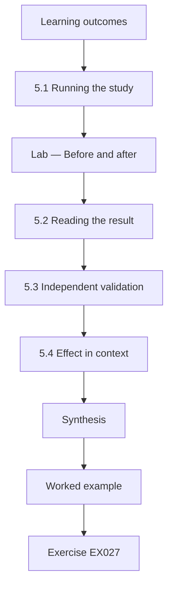

### Logical drawing


```text
[Learning outcomes]
    |
    v
[5.1 Running the study]
    |
    v
[Lab — Before and after]
    |
    v
[5.2 Reading the result]
    |
    v
[5.3 Independent validation]
    |
    v
[5.4 Effect in context]
    |
    v
[Synthesis]
    |
    v
[Worked example] --> [Exercise EX027]
```
<!-- open-cyber-academy:lesson-figures:end ch-05 -->


### Learning outcomes

You will (1) run the intervention study; (2) compare before and after; (3) validate coding independently.

### 5.1 Running the study

For one quarter, eight teams follow the review procedure while four continue their usual practice. Ines does not change any rules herself; teams make their own changes through their normal change process. She collects configurations at the start and end of the quarter, along with change logs and time records, and both coders recode all twelve firewalls at the end.

Running the study follows the written protocol step by step. Ines logs every deviation, such as a delayed review session or a missing configuration snapshot, with its date and reason. Deviations are reported in the thesis rather than hidden, because examiners judge validity partly on how honestly departures from the plan are described.

### Lab — Before and after

```python
"""Compare findings per 100 rules before and after a structured review, with a simple permutation test (stdlib only)."""
import random
pre = [6.1, 5.4, 7.2, 4.9, 6.8, 5.7, 6.3, 7.0]
post = [3.9, 4.1, 5.2, 3.3, 4.8, 4.0, 4.4, 5.1]
diff = sum(pre) / 8 - sum(post) / 8
random.seed(7); pool = pre + post; c = 0
for _ in range(10000):
    random.shuffle(pool)
    if sum(pool[:8]) / 8 - sum(pool[8:]) / 8 >= diff: c += 1
print(f"mean pre {sum(pre)/8:.2f} post {sum(post)/8:.2f} per 100 rules; difference {diff:.2f}; one-sided p ~ {c/10000:.4f}")
```

Run with `python3 lab_trial.py`. Verified output:

```text
mean pre 6.17 post 4.35 per 100 rules; difference 1.83; one-sided p ~ 0.0006
```

### 5.2 Reading the result

In the synthetic data, errors per hundred rules on reviewed firewalls fall from a mean of 6.17 to 4.35. A permutation test, which asks how often a difference this large would appear if the labels were shuffled at random, gives a one-sided p of about 0.0006. The comparison firewalls show a small fall over the same quarter, which Ines reports alongside, since part of the change may come from general attention to rule hygiene rather than the procedure itself.

She reports the interval alongside the estimate.

### 5.3 Independent validation

A second coder, blind to which firewalls were reviewed, recodes a random quarter of rules. Agreement remains high, and the blinded coder's error rates show the same direction of change. Ines also asks an engineer from a fourth organisation, not involved in the study, to apply the procedure to a synthetic rule base; the engineer finds similar categories of issue, suggesting the procedure is usable by outsiders. Both checks are reported in full, including where the blinded coder disagreed.

Disagreements are documented, not quietly resolved.

### 5.4 Effect in context

Ines translates the result into operational terms: for a firewall of five hundred rules, the reduction corresponds to about nine fewer problematic rules after one quarter. She reports the review time per hundred rules, so readers can weigh benefit against cost, and avoids claiming any reduction in incidents, which the study did not measure.

An effect size only means something in context. Ines compares the reduction in error rate with the effort the review required, measured in engineer hours, and with variation between partners. A modest average reduction that is consistent across partners may be more useful in practice than a large effect seen in only one organisation.

### Worked example

The final table lists mean errors per hundred rules, the difference, the permutation p value, the comparison group's change and review hours, with the blinded validation summarised beneath.

> **Synthetic case.** Data are synthetic.

### Errors and limits

A small p value says the difference is unlikely under random labelling; it does not measure how important the difference is.

### Exercises

- **EX027 — Permutation logic.** Explain the permutation test in plain words. *Rubric:* 3 = shuffle labels, compare differences;; 2 = shuffle;; 1 = vague;; 0 = none.
- **EX028 — Comparison group.** Why report the comparison group's change? *Rubric:* 3 = separate general attention from procedure effect;; 2 = context;; 1 = vague;; 0 = none.
- **EX029 — Operational translation.** Convert the difference into errors avoided for 500 rules. *Rubric:* 3 = about nine, shown;; 2 = roughly;; 1 = vague;; 0 = none.
- **EX030 — Blinded recoding.** What did blinded recoding confirm? *Rubric:* 3 = same direction, high agreement;; 2 = agreement;; 1 = vague;; 0 = none.
- **EX031 — Outsider test.** Why ask an outside engineer to apply the procedure? *Rubric:* 3 = usability beyond partners;; 2 = generalise;; 1 = vague;; 0 = none.
- **EX032 — Claim boundary.** What must Ines not claim from these results? *Rubric:* 3 = reduction in incidents;; 2 = causation broadly;; 1 = vague;; 0 = none.

### Synthesis

The main study supports H2 within its limits, and independent validation strengthens confidence in the coding.

### Continue studying — chapter 05 of 08

[← Chapter 04 (draft)](#ch-04) · [Course chapter index](../SUBJECTS.md) · [Chapter 06 (draft) →](#ch-06)

<a id="ch-06"></a>

## Chapter 6 — Peer critique and revision

<!-- open-cyber-academy:lesson-figures:start ch-06 -->
### Lesson map

Lesson 06 published. Map, example, EX033.

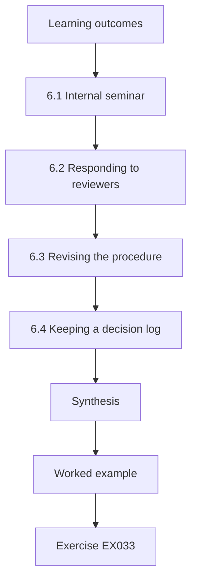

### Logical drawing

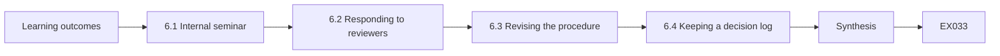

```text
[Learning outcomes]
    |
    v
[6.1 Internal seminar]
    |
    v
[6.2 Responding to reviewers]
    |
    v
[6.3 Revising the procedure]
    |
    v
[6.4 Keeping a decision log]
    |
    v
[Synthesis]
    |
    v
[Worked example] --> [Exercise EX033]
```
<!-- open-cyber-academy:lesson-figures:end ch-06 -->


### Learning outcomes

You will (1) present results for critique; (2) respond to challenges; (3) revise claims and methods.

### 6.1 Internal seminar

Ines presents the study at a department seminar. Colleagues question whether volunteer teams were simply more motivated, whether one quarter is long enough to show lasting change, and whether the codebook favours issues that the procedure is designed to find. She records each challenge and her answer, and marks those she cannot fully answer as limitations rather than defending them.

An internal seminar lets colleagues test the argument before outside reviewers do. Ines presents the design, results and limitations, then records questions she could not answer well. Those questions show where the thesis needs clearer explanation or further analysis, and preparing for them makes the eventual defense far less daunting.

### 6.2 Responding to reviewers

A workshop paper based on the baseline replication receives three reviews. One reviewer asks for the rule-size distribution and a sensitivity analysis excluding the two largest firewalls. Ines runs it, finds the association remains strong, and adds it to the paper. Another asks whether shadowing should count as an error when engineers use it deliberately as documentation; she adds a discussion and keeps the category, noting that undocumented shadowing is the main concern.

Each response cites the page where the change was made.

### 6.3 Revising the procedure

Partner engineers suggest that hit counts over ninety days miss rules for quarterly or yearly processes, such as financial year-end transfers. Ines changes the procedure to flag such rules for owner confirmation rather than marking them unused, and checks whether this changes earlier results. It reclassifies three rules but leaves the conclusions unchanged.

Feedback may show that parts of the review procedure were unclear or too slow. Ines revises the procedure, records each change with its reason, and keeps the original version, so readers know which version produced the results. Changes made after results are seen are labelled clearly as post hoc and are not presented as tested findings.

### 6.4 Keeping a decision log

Every change to codebook, procedure or analysis is entered in a dated decision log with the reason and its effect on results. The log is part of the thesis appendix, so examiners can see how the study evolved and that changes were not made to improve outcomes.

A decision log records every significant research choice with its date, the options considered, the choice made and the reason. Over a multi-year project memory fades, and examiners often ask why a particular choice was made. The log answers such questions with evidence, protects against unconscious rewriting of history, and makes the research easier for others to reproduce or extend.

### Worked example

The decision log grows to twenty-three entries by the end of the critique phase, each linked to the analysis version it affected.

> **Synthetic case.** Reviews and seminar are synthetic.

### Errors and limits

Treating every critique as an attack leads to defensive writing; recording and answering critiques improves both study and trust.

### Exercises

- **EX033 — Motivation challenge.** How should Ines respond to the motivated-volunteers critique? *Rubric:* 3 = acknowledge as limitation, use comparison and variables;; 2 = acknowledge;; 1 = dismiss;; 0 = none.
- **EX034 — Sensitivity analysis.** What is a sensitivity analysis here? *Rubric:* 3 = rerun excluding largest firewalls;; 2 = rerun;; 1 = vague;; 0 = none.
- **EX035 — Deliberate shadowing.** When might shadowing be deliberate, and how is it handled? *Rubric:* 3 = documentation purposes, flagged if undocumented;; 2 = deliberate;; 1 = vague;; 0 = none.
- **EX036 — Periodic rules.** Why might a ninety-day hit window misclassify rules? *Rubric:* 3 = quarterly or yearly processes;; 2 = missing rare use;; 1 = vague;; 0 = none.
- **EX037 — Decision log.** What does the decision log show examiners? *Rubric:* 3 = evolution and reasons, not outcome-driven;; 2 = history;; 1 = vague;; 0 = none.
- **EX038 — Unanswered critiques.** How should critiques Ines cannot answer be treated? *Rubric:* 3 = stated as limitations;; 2 = noted;; 1 = ignored;; 0 = none.

### Synthesis

Structured critique leads to clearer claims, a sensitivity analysis and a better procedure.

### Continue studying — chapter 06 of 08

[← Chapter 05 (draft)](#ch-05) · [Course chapter index](../SUBJECTS.md) · [Chapter 07 (draft) →](#ch-07)

<a id="ch-07"></a>

## Chapter 7 — Thesis synthesis and reproducibility archive

<!-- open-cyber-academy:lesson-figures:start ch-07 -->
### Lesson map

Lesson 07 published. Map, example, EX039.

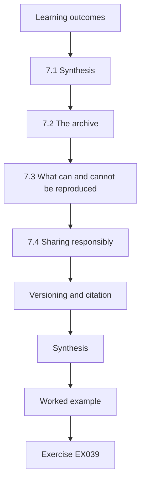

### Logical drawing

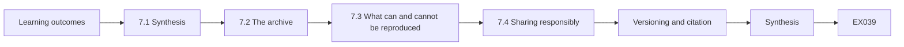

```text
[Learning outcomes]
    |
    v
[7.1 Synthesis]
    |
    v
[7.2 The archive]
    |
    v
[7.3 What can and cannot be reproduced]
    |
    v
[7.4 Sharing responsibly]
    |
    v
[Versioning and citation]
    |
    v
[Synthesis]
    |
    v
[Worked example] --> [Exercise EX039]
```
<!-- open-cyber-academy:lesson-figures:end ch-07 -->


### Learning outcomes

You will (1) synthesise findings; (2) build a reproducibility archive; (3) share synthetic materials.

### 7.1 Synthesis

The thesis brings together three contributions: a modern replication of the complexity-error association, a validated codebook and an evaluated review procedure. Ines writes the synthesis chapter around what practitioners should do differently: measure rule-base hygiene periodically, use the procedure with owner confirmation, and expect larger rule bases to need more review effort. Each recommendation is tied to evidence and its limits.

The synthesis chapter draws the separate studies together into one argument, showing how each result supports or qualifies the main claim. Ines states what is now known that was not known before, and how confident readers should be, rather than repeating each result in turn.

### 7.2 The archive

Real partner configurations cannot be published, so Ines builds a synthetic archive that mirrors their structure: rule bases with the same size distribution and error proportions, generated by documented scripts. The archive includes the codebook, all analysis scripts, the decision log and instructions to reproduce every table. A colleague who has not seen the study follows the instructions and reproduces the main results from the synthetic data.

The archive holds the codebook, scripts, synthetic examples and a readme explaining how to rerun each analysis. Partner configurations themselves are excluded under the data agreement.

### 7.3 What can and cannot be reproduced

Ines is explicit that the synthetic archive reproduces the analysis, not the original findings, which depend on partner data. She describes how partners could rerun the scripts on their own configurations, and offers the procedure under an open licence so others can test it. This is the honest limit of reproducibility when data are sensitive.

Ines states plainly which analyses others can rerun from the archive and which depend on partner data that cannot be shared. For the latter she provides summary statistics and synthetic data with the same structure, so methods can still be checked, even though exact figures cannot be reproduced.

### 7.4 Sharing responsibly

Before release, she checks that synthetic rules cannot be mapped back to partners: pseudonymised ranges are replaced with documentation ranges, rule names are generic and size distributions are smoothed. The partners review the archive and approve publication.

Sharing research outputs must not expose the partners. Before releasing anything, Ines removes identifying details such as names, address ranges and rule comments, checks that no combination of remaining fields reveals an organisation, and has partners confirm the release. She shares methods, codebooks and synthetic data openly, while keeping real configurations restricted, balancing openness with the duty of care she owes the organisations that trusted her.

### Versioning and citation

The archive is deposited in the university's repository with a persistent identifier and a version number, so later readers can cite exactly the version used in the thesis. When Ines corrects a script after publication, she releases a new version with a change note rather than overwriting the old one, because a reader trying to reproduce a published table needs the code that produced it. The thesis cites the archive version explicitly, and each table caption names the script that generated it, so the link between claim and code is visible on the page.

### Worked example

The archive contains five folders: codebook, scripts, synthetic data, decision log and instructions; the colleague's reproduction matches every table to two decimal places.

> **Synthetic case.** The archive is synthetic.

### Errors and limits

Releasing partner-derived data without checks risks exposing network designs.

### Exercises

- **EX039 — Recommendation link.** Tie one recommendation to its evidence. *Rubric:* 3 = recommendation and finding;; 2 = one;; 1 = vague;; 0 = none.
- **EX040 — Archive contents.** List the five archive folders. *Rubric:* 3 = five;; 2 = four;; 1 = fewer;; 0 = none.
- **EX041 — Reproduction scope.** What does the synthetic archive reproduce and what not? *Rubric:* 3 = analysis yes, original findings no;; 2 = partial;; 1 = vague;; 0 = none.
- **EX042 — Re-identification checks.** Name two checks before release. *Rubric:* 3 = documentation ranges and smoothed distributions;; 2 = one;; 1 = vague;; 0 = none.
- **EX043 — Independent reproduction.** Why have a colleague reproduce the results? *Rubric:* 3 = tests instructions are complete;; 2 = check;; 1 = vague;; 0 = none.
- **EX044 — Partner approval.** Why do partners review the archive? *Rubric:* 3 = ensure no sensitive details;; 2 = consent;; 1 = vague;; 0 = none.

### Synthesis

A careful synthetic archive makes the analysis reproducible without exposing partners.

### Continue studying — chapter 07 of 08

[← Chapter 06 (draft)](#ch-06) · [Course chapter index](../SUBJECTS.md) · [Chapter 08 (draft) →](#ch-08)

<a id="ch-08"></a>

## Chapter 8 — Defense and publication plan

<!-- open-cyber-academy:lesson-figures:start ch-08 -->
### Lesson map

Lesson 08 published. Map, example, EX045.

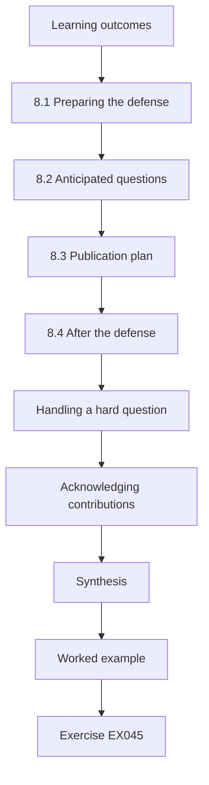

### Logical drawing

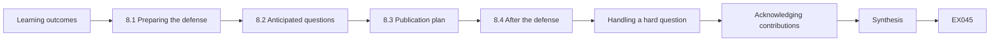

```text
[Learning outcomes]
    |
    v
[8.1 Preparing the defense]
    |
    v
[8.2 Anticipated questions]
    |
    v
[8.3 Publication plan]
    |
    v
[8.4 After the defense]
    |
    v
[Handling a hard question]
    |
    v
[Acknowledging contributions]
    |
    v
[Synthesis]
    |
    v
[Worked example] --> [Exercise EX045]
```
<!-- open-cyber-academy:lesson-figures:end ch-08 -->


### Learning outcomes

You will (1) prepare the defense; (2) anticipate questions; (3) plan publications.

### 8.1 Preparing the defense

Ines prepares a forty-minute talk: problem, contributions, methods, results, limits and implications. She rehearses with colleagues playing examiners and records the hardest questions. Each slide carries one claim and its evidence.

Preparing for the defense, Ines rereads the whole thesis, notes its weakest points, and prepares concise explanations for each. She practises a short opening summary that states the question, approach, main findings and contribution in a few minutes. A mock defense with colleagues playing examiners exposes unclear answers and gives her practice staying calm under sustained questioning.

### 8.2 Anticipated questions

Examiners are likely to ask about causation, generalisation beyond the sector, the cost of the procedure and why incidents were not measured. Ines prepares short, honest answers: the design supports association and a controlled before-after comparison, not broad causation; the sector limit is real; review costs are reported; incident data were too sparse and sensitive to analyse.

She practises answering each one concisely, with evidence.

Questions she cannot answer fully are acknowledged honestly, with what further work would settle them.

### 8.3 Publication plan

Two papers are planned: the replication and codebook for a measurement venue, and the intervention study for a practitioner-oriented security venue, both with the synthetic archive. A short practitioner guide based on the procedure is offered to the partners and published openly.

The publication plan identifies which chapters can become journal or conference papers, the likely venues, and the order of submission. Ines checks that data agreements permit each publication, involves partners in reviewing drafts, and plans to release the codebook and synthetic data alongside the papers so other researchers can build on the work.

### 8.4 After the defense

Ines plans to extend the study to organisations moving toward zero trust, testing whether rule hygiene affects the transition, a gap identified in chapter 2.

After the defense, Ines makes any corrections the examiners require, records each change, and submits the final thesis. She then sends partners a short summary of findings written for practitioners, closes the data agreement by deleting or returning partner data as promised, and archives her own records. Finally, she reflects on what she would do differently, which helps her supervise or advise future students on similar projects.

### Handling a hard question

Some questions cannot be fully answered, and examiners often ask them deliberately to see how a candidate reasons. Ines practises a three-step response: restate the question to confirm she understands it, say what her evidence does show, then say plainly what it cannot show and how a future study could address it. For example, asked whether the procedure would work in a large cloud provider, she explains that her partners managed hundreds of rules per firewall rather than tens of thousands of security group rules, that the procedure's steps would likely still apply, and that scaling would need automated owner lookup, which she has not tested.

### Acknowledging contributions

The thesis acknowledgements name the partner engineers who gave time to interviews and reviews, the second coder and the colleague who reproduced the archive, with their permission. Ines also records in the methods chapter exactly what each person contributed, which is good research practice and makes clear which work is hers. Partners receive a summary of the results before publication, with time to raise concerns about anything that could identify them. This keeps trust with organisations that took a risk by sharing sensitive configurations, and makes future collaborations more likely.

### Worked example

At the defense, examiners ask about the comparison group's improvement; Ines explains it and shows the difference-in-change estimate.

> **Synthetic case.** The defense is synthetic.

### Errors and limits

Overclaiming at a defense invites challenges that undermine sound results.

### Exercises

- **EX045 — Talk structure.** List six parts of the defense talk. *Rubric:* 3 = six;; 2 = five;; 1 = fewer;; 0 = none.
- **EX046 — Causation answer.** Answer the causation question briefly. *Rubric:* 3 = association plus controlled comparison, limits;; 2 = partial;; 1 = overclaim;; 0 = none.
- **EX047 — Incidents answer.** Why were incidents not measured? *Rubric:* 3 = sparse and sensitive data;; 2 = unavailable;; 1 = vague;; 0 = none.
- **EX048 — Venue choice.** Why split into two papers? *Rubric:* 3 = different audiences and contributions;; 2 = two topics;; 1 = vague;; 0 = none.
- **EX049 — Future work.** Name the planned future study. *Rubric:* 3 = zero trust transition and rule hygiene;; 2 = zero trust;; 1 = vague;; 0 = none.
- **EX050 — Practitioner guide.** Why publish a practitioner guide? *Rubric:* 3 = make procedure usable;; 2 = share;; 1 = vague;; 0 = none.

### Synthesis

The thesis closes with honest claims, a reproducible archive and a clear publication path.

### Continue studying — chapter 08 of 08

[← Chapter 07 (draft)](#ch-07) · [Course chapter index](../SUBJECTS.md) · [Worked results ↓](#worked-results) · [Next course via chapter index →](../SUBJECTS.md)

<a id="worked-results"></a>

## Worked results

Model answers for EX001–EX050. Ines Carvalho, Prof. Marcus Lindqvist, Halden University, Westbrook Water and every figure are synthetic. Lab answers quote verified outputs. Any answer meeting the rubric scores equally.

**EX001.** Fine; shadowed: an earlier rule matches all its traffic; permissive: broader than its documented purpose; unused: no hits for the period and no owner.

**EX002.** Coders agree on 90 percent of rules; after removing chance agreement, kappa 0.86 indicates strong reliability, though the disagreements still need review.

**EX003.** They show exactly which definitions are ambiguous, allowing targeted codebook clarifications.

**EX004.** Rules reveal network structure; consistent pseudonyms hide real details while keeping relationships needed for analysis.

**EX005.** It prevents changing what counts as an error after seeing which definition gives a stronger result.

**EX006.** Her approval covers shared configurations and interviews only; probing would exceed authorisation and could disrupt operations.

**EX007.** It reported that larger, more complex rule bases had more errors, which Ines tests on modern rule bases and extends with an intervention.

**EX008.** The guide recommends regular review but offers little evidence on which review methods reduce errors.

**EX009.** When attacks are rare, even a small false positive rate produces many more false alarms than true detections. Analysts then face mostly noise.

**EX010.** Attacks are rare and traffic highly diverse, so models trained on past data generalise poorly and errors are costly.

**EX011.** Legacy broad firewall rules can allow access that the new identity-based controls are meant to restrict.

**EX012.** The thesis replicates the complexity-error relationship on modern rule bases, validates a codebook and evaluates a structured review procedure.

**EX013.** It lets examiners judge the contribution against its aims and sets partner expectations.

**EX014.** Method, setting, main finding and limitation.

**EX015.** Firewalls using the structured review for one quarter show fewer coded errors per 100 rules than before and than comparison firewalls over the same quarter.

**EX016.** Deleting a rule whose purpose is unknown could break a needed service; owners confirm first.

**EX017.** Volunteer teams may differ systematically, so these variables help interpret differences.

**EX018.** Coders who know group membership might code reviewed firewalls more favourably.

**EX019.** A procedure that is effective but too costly will not be adopted, so cost is part of the result.

**EX020.** All three are regional public bodies in one sector, so results may not hold elsewhere.

**EX021.** Ranks reduce the influence of a few very large firewalls and capture monotonic relationships.

**EX022.** Across 12 firewalls, rule count and error count were strongly associated (Spearman rho 0.977), though the sample is small and the design cannot show causation.

**EX023.** A conflicting shadowed rule has the opposite action, hiding intent; a redundant one has the same action and is merely unnecessary.

**EX024.** Firewall age and the number of different engineers who have edited it.

**EX025.** Finding owners was slow; adding an owner lookup from the change log halved review time.

**EX026.** So no production rule is changed or disrupted during the pilot.

**EX027.** It repeatedly shuffles which firewalls count as before or after and checks how often a difference as large as the observed one appears by chance.

**EX028.** Part of the improvement may come from general attention, which the comparison group helps estimate.

**EX029.** 1.83 per 100 rules × 5 = about nine fewer problematic rules.

**EX030.** That coding agreement stayed high and the error reduction appeared even when the coder did not know group membership.

**EX031.** To check the procedure can be used by someone outside the study.

**EX032.** That the procedure reduces security incidents, which was not measured.

**EX033.** Acknowledge it as a limitation and discuss team variables and the comparison group's change.

**EX034.** Repeating the correlation without the two largest firewalls to see if the result depends on them.

**EX035.** Engineers sometimes keep shadowed rules as documentation; the study treats undocumented shadowing as the concern.

**EX036.** Rules used only at year-end or quarterly would show no hits yet still be needed.

**EX037.** How and why methods changed, demonstrating changes were not made to improve results.

**EX038.** Recorded as limitations in the thesis.

**EX039.** Larger rule bases need more review effort, supported by the strong size-error association.

**EX040.** Codebook, scripts, synthetic data, decision log and instructions.

**EX041.** It reproduces the analysis pipeline, not the original partner-based findings.

**EX042.** Replace ranges with documentation ranges and smooth size distributions.

**EX043.** It shows the archive and instructions are sufficient without the author's help.

**EX044.** They confirm nothing in it could reveal their networks.

**EX045.** Problem, contributions, methods, results, limits, implications.

**EX046.** The design shows strong association and a controlled before-after improvement, but not general causation.

**EX047.** Incident data were too sparse and sensitive to support analysis.

**EX048.** The replication suits a measurement venue and the intervention a practitioner venue.

**EX049.** How rule hygiene affects organisations' transition to zero trust.

**EX050.** So engineers can apply the procedure without reading the thesis.

<a id="references"></a>

## References

Links checked 12 October 2026; re-verify editions before citing. Organisations, people, systems, code and data in this book are synthetic unless a sentence cites a public source.

- Axelsson, S. (2000). The base-rate fallacy and the difficulty of intrusion detection. *ACM Transactions on Information and System Security*, 3(3), 186–205. <https://doi.org/10.1145/357830.357849>
- Barker, E., Dang, Q., Frankel, S., Scarfone, K., & Wouters, P. (2020). *Guide to IPsec VPNs* (NIST SP 800-77 Rev. 1). NIST. <https://doi.org/10.6028/NIST.SP.800-77r1>
- Center for Internet Security. (2021). *CIS Critical Security Controls v8*. <https://www.cisecurity.org/controls/v8>
- Chandramouli, R., & Rose, S. (2013). *Secure Domain Name System (DNS) deployment guide* (NIST SP 800-81-2). NIST. <https://doi.org/10.6028/NIST.SP.800-81-2>
- Claise, B., Trammell, B., & Aitken, P. (2013). *Specification of the IP Flow Information Export (IPFIX) protocol* (RFC 7011). IETF. <https://www.rfc-editor.org/rfc/rfc7011>
- Ferguson, P., & Senie, D. (2000). *Network ingress filtering* (RFC 2827, BCP 38). IETF. <https://www.rfc-editor.org/rfc/rfc2827>
- Gerhards, R. (2009). *The Syslog protocol* (RFC 5424). IETF. <https://www.rfc-editor.org/rfc/rfc5424>
- Joint Task Force. (2020). *Security and privacy controls for information systems and organizations* (NIST SP 800-53 Rev. 5). NIST. <https://doi.org/10.6028/NIST.SP.800-53r5>
- Kaufman, C., Hoffman, P., Nir, Y., Eronen, P., & Kivinen, T. (2014). *Internet Key Exchange Protocol Version 2 (IKEv2)* (RFC 7296). IETF. <https://www.rfc-editor.org/rfc/rfc7296>
- Kent, S., & Seo, K. (2005). *Security architecture for the Internet Protocol* (RFC 4301). IETF. <https://www.rfc-editor.org/rfc/rfc4301>
- Landis, J. R., & Koch, G. G. (1977). The measurement of observer agreement for categorical data. *Biometrics*, 33(1), 159–174. <https://doi.org/10.2307/2529310>
- Lepinski, M., & Kent, S. (2012). *An infrastructure to support secure Internet routing* (RFC 6480). IETF. <https://www.rfc-editor.org/rfc/rfc6480>
- McKay, K., & Cooper, D. (2019). *Guidelines for the selection, configuration, and use of Transport Layer Security (TLS) implementations* (NIST SP 800-52 Rev. 2). NIST. <https://doi.org/10.6028/NIST.SP.800-52r2>
- Paxson, V. (1999). Bro: A system for detecting network intruders in real-time. *Computer Networks*, 31(23–24), 2435–2463. <https://doi.org/10.1016/S1389-1286(99)00112-7>
- Rescorla, E. (2018). *The Transport Layer Security (TLS) protocol version 1.3* (RFC 8446). IETF. <https://www.rfc-editor.org/rfc/rfc8446>
- Rose, S., Borchert, O., Mitchell, S., & Connelly, S. (2020). *Zero trust architecture* (NIST SP 800-207). NIST. <https://doi.org/10.6028/NIST.SP.800-207>
- Saltzer, J. H., & Schroeder, M. D. (1975). The protection of information in computer systems. *Proceedings of the IEEE*, 63(9), 1278–1308. <https://doi.org/10.1109/PROC.1975.9939>
- Scarfone, K., & Hoffman, P. (2009). *Guidelines on firewalls and firewall policy* (NIST SP 800-41 Rev. 1). NIST. <https://doi.org/10.6028/NIST.SP.800-41r1>
- Scarfone, K., & Mell, P. (2007). *Guide to intrusion detection and prevention systems (IDPS)* (NIST SP 800-94). NIST. <https://doi.org/10.6028/NIST.SP.800-94>
- Sommer, R., & Paxson, V. (2010). Outside the closed world: On using machine learning for network intrusion detection. *2010 IEEE Symposium on Security and Privacy*, 305–316. <https://doi.org/10.1109/SP.2010.25>
- Souppaya, M., & Scarfone, K. (2012). *Guidelines for securing wireless local area networks (WLANs)* (NIST SP 800-153). NIST. <https://doi.org/10.6028/NIST.SP.800-153>
- Sriram, K., & Montgomery, D. (2019). *Resilient interdomain traffic exchange: BGP security and DDoS mitigation* (NIST SP 800-189). NIST. <https://doi.org/10.6028/NIST.SP.800-189>
- Wool, A. (2004). A quantitative study of firewall configuration errors. *Computer*, 37(6), 62–67. <https://doi.org/10.1109/MC.2004.2>
