# Authorized Offensive Security and Red Team: A Doctoral Research Companion

- Language: English (`en`); doctoral research track, two years; approximately 1,600 hours of planned study.
- Editorial state: **published**. Chapters 1–8 of 8 have authored teaching text; exercises EX001–EX050 have matching worked results with 0–3 rubrics; offline labs use the Python 3 standard library and their printed outputs were produced by real runs against synthetic data only. Independent review and the 300-page A4 verification remain open. Draft-chapter coverage is not a completed book.
- Audience: advanced researchers who will design, run and defend an original contribution in authorized offensive security and red-team measurement, ethics or methodology.
- Relation to neighbouring books: the [master's book](../../../../masters-2-years/offensive-security-red-team/en/book/MANUSCRIPT.md) teaches a first supervised dissertation; the [postgraduate book](../../../../postgraduate-2-years/offensive-security-red-team/en/book/MANUSCRIPT.md) teaches specialist practice. **This book is about producing and defending new knowledge**: integrity, frontier mapping, a falsifiable proposal, baseline replication, a main study with independent validation, critique, an archive and a defence.
- Author: [hiagokinlevi](https://github.com/hiagokinlevi). Original text [CC0 1.0](../../../../../LICENSE); cited works keep their rights.
- Educational boundary: not a qualification and **no authority to test real systems**. All organizations, people, findings and numbers in examples are **synthetic** unless a sentence cites a public source. Labs teach scoping, measurement and reporting — never weaponised techniques.

[Course home](../../README.md) · [Chapter index](../SUBJECTS.md) · [Book plan](PLAN.md) · [Course skill](../../skill/SKILL.md) · [Worked results](#worked-results)

## How to use this draft

Eight chapters follow the arc of a doctorate: integrity and methods (1), the research frontier (2), a proposal (3), baseline replication and pilot (4), the main study and independent validation (5), peer critique and revision (6), synthesis and a reproducibility archive (7), and defence and publication (8). Each chapter has learning outcomes, teaching text, a worked example, errors and limits, exercises scored 0–3 (0 absent or unsafe; 1 major gap; 2 minor gaps; 3 complete and justified), a synthesis and a **Continue studying** block. Labs are deterministic, run offline with `python3 file.py` on synthetic data, and print the results shown under *Expected output*.

### The running example (synthetic): North Harbour University Secure Testing Lab

> **Synthetic case — fiction.** The **North Harbour University Secure Testing Lab (NHUSTL)** is an invented university laboratory. Doctoral candidate *Elena Varga* studies whether *machine-checkable scope predicates* (CIDR, port and action allow-lists evaluated before each phase) reduce out-of-scope probes compared with prose rules of engagement alone, in authorized, isolated lab environments with synthetic targets. Every number about NHUSTL is invented. No real networks are touched.

### Source policy

Sources were checked on 12 October 2026: [NIST SP 800-115](https://doi.org/10.6028/NIST.SP.800-115) (*Technical Guide to Information Security Testing and Assessment*); the [Penetration Testing Execution Standard (PTES)](https://pentest-standard.readthedocs.io/en/latest/); [MITRE ATT&CK](https://attack.mitre.org/); the [OWASP Web Security Testing Guide (WSTG)](https://owasp.org/www-project-web-security-testing-guide/); [TIBER-EU](https://www.ecb.europa.eu/paym/cyber-resilience/tiber-eu/html/index.en.html); and [CBEST](https://www.bankofengland.co.uk/financial-stability/operational-resilience-of-the-financial-sector/cbest-threat-intelligence-led-assessments-implementation-guide) (Bank of England Implementation Guide, 2024 update). Research papers are cited by arXiv identifier, each opened and title-checked. Frameworks change; re-verify before relying on them. Legal content is orientation, not legal advice.

## Contents

| Stage | Chapter |
|---|---|
| 1 | [1 Advanced research integrity and methods](#ch-01) |
| 1 | [2 Authorized offensive security and red team: research frontier](#ch-02) |
| 2 | [3 Original contribution proposal](#ch-03) |
| 2 | [4 Baseline replication and pilot](#ch-04) |
| 3 | [5 Main study and independent validation](#ch-05) |
| 3 | [6 Peer critique and revision](#ch-06) |
| 4 | [7 Thesis synthesis and reproducibility archive](#ch-07) |
| 4 | [8 Defense and publication plan](#ch-08) |

[Worked results](#worked-results) · [References](#references)

<a id="ch-01"></a>

## Chapter 1 — Advanced research integrity and methods

<!-- cyberabc:lesson-figures:start ch-01 -->
### Lesson map

Lesson 01 published. Map, example, EX001.

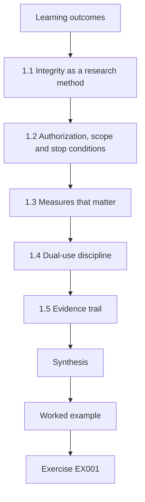

### Logical drawing

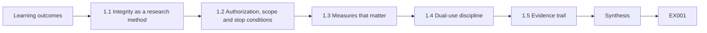

```text
[Learning outcomes]
    |
    v
[1.1 Integrity as a research method]
    |
    v
[1.2 Authorization, scope and stop conditions]
    |
    v
[1.3 Measures that matter]
    |
    v
[1.4 Dual-use discipline]
    |
    v
[1.5 Evidence trail]
    |
    v
[Synthesis]
    |
    v
[Worked example] --> [Exercise EX001]
```
<!-- cyberabc:lesson-figures:end ch-01 -->


### Learning outcomes

You will (1) state the integrity rules that govern authorized offensive-security research; (2) design studies that cannot harm people or out-of-scope systems; (3) choose measures that reflect effects, not theatre; (4) handle dual-use knowledge responsibly; and (5) keep an evidence trail others can audit.

### 1.1 Integrity as a research method

In this field, a failed integrity control is not a paperwork issue — it is an out-of-scope probe, a leaked credential, or a denial of service against a hospital. Integrity means: written authorization before any interaction with a target; a scope that a third party can check; stop conditions that are rehearsed; synthetic or consented data; and records that show what was done and why. NIST SP 800-115 frames assessment as a planned activity with rules; PTES places scoping and intelligence before any testing. Your doctorate inherits those habits and adds the standards of research: pre-registration of measures, replication and honest limits.

### 1.2 Authorization, scope and stop conditions

Authorization names the owner, the systems, the dates, the allowed actions and the data rules. Scope is the set of hosts, ports, identities and actions that are in. Stop conditions — for example, any real personal data, any out-of-scope host, any availability impact — pause work and escalate. A machine-checkable scope (CIDR, port and action lists) makes violations detectable rather than arguable.

```python
"""Check proposed engagement targets against a written scope (synthetic)."""
SCOPE_CIDRS = [("10.20.0.0", 16), ("192.168.50.0", 24)]  # inclusive synthetic ranges
SCOPE_PORTS = {22, 80, 443, 8080}
DENY_HOSTS = {"10.20.0.1", "192.168.50.1"}  # out-of-scope infra

def ip_int(s):
    a,b,c,d = map(int, s.split("."))
    return (a<<24)|(b<<16)|(c<<8)|d

def in_cidr(ip, net, bits):
    mask = (0xFFFFFFFF << (32-bits)) & 0xFFFFFFFF
    return (ip_int(ip) & mask) == (ip_int(net) & mask)

def check(host, port):
    reasons = []
    if host in DENY_HOSTS:
        reasons.append("deny-list")
    if not any(in_cidr(host, n, b) for n,b in SCOPE_CIDRS):
        reasons.append("outside-cidr")
    if port not in SCOPE_PORTS:
        reasons.append("port-not-in-scope")
    return ("ALLOW" if not reasons else "DENY"), reasons

tests = [
    ("10.20.1.10", 443),
    ("10.20.0.1", 443),
    ("192.168.50.20", 22),
    ("192.168.50.20", 3389),
    ("8.8.8.8", 80),
    ("192.168.1.10", 80),
]
for h,p in tests:
    v, r = check(h,p)
    print(f"target={h}:{p} decision={v} reasons={','.join(r) or '-'}")
```

Expected output:

```text
target=10.20.1.10:443 decision=ALLOW reasons=-
target=10.20.0.1:443 decision=DENY reasons=deny-list
target=192.168.50.20:22 decision=ALLOW reasons=-
target=192.168.50.20:3389 decision=DENY reasons=port-not-in-scope
target=8.8.8.8:80 decision=DENY reasons=outside-cidr
target=192.168.1.10:80 decision=DENY reasons=outside-cidr
```

Elena's lab uses the ranges and ports in the worked example: probes aimed at 8.8.8.8 or at port 3389 are denied before any packet leaves. Write the stop conditions into the runbook and rehearse them, so operators know what to do when one fires.

### 1.3 Measures that matter

Count effects: out-of-scope probes, confirmed findings with evidence, time-to-stop after a violation, remediation verification. Avoid vanity counts such as "number of tools run". Report rates with intervals. When you compare methods, change one factor at a time and hold the environment fixed.

```python
"""Lab S: reporting attack-success rates honestly: Wilson intervals,
seed variation and a paired bootstrap. Synthetic trial outcomes only."""
import math, random
def wilson(k, n, z=1.96):
    p = k/n; d = 1 + z*z/n
    c = (p + z*z/(2*n))/d; h = z*math.sqrt(p*(1-p)/n + z*z/(4*n*n))/d
    return c - h, c + h
for k, n in ((3, 20), (30, 200), (300, 2000)):
    lo, hi = wilson(k, n); print(f"successes={k}/{n} rate={k/n:.3f} wilson95=[{lo:.3f}, {hi:.3f}]")
# five seeds of a synthetic defence evaluation: per-seed attack success rate
rates = []
for seed in range(5):
    r = random.Random(seed); rates.append(sum(r.random() < 0.12 for _ in range(200))/200)
m = sum(rates)/5; sd = math.sqrt(sum((x-m)**2 for x in rates)/4)
print("per-seed rates:", " ".join(f"{x:.3f}" for x in rates), f"mean={m:.3f} sd={sd:.3f}")
# paired bootstrap: baseline vs defence on the same 300 synthetic trials
r = random.Random(42)
base = [r.random() < 0.30 for _ in range(300)]
defn = [b and r.random() < 0.6 for b in base]   # defence blocks ~40% of successes
diffs = []
for _ in range(2000):
    idx = [r.randrange(300) for _ in range(300)]
    diffs.append(sum(base[i] for i in idx)/300 - sum(defn[i] for i in idx)/300)
diffs.sort()
print(f"baseline_asr={sum(base)/300:.3f} defended_asr={sum(defn)/300:.3f} "
      f"reduction_ci95=[{diffs[50]:.3f}, {diffs[1949]:.3f}]")
```

Expected output:

```text
successes=3/20 rate=0.150 wilson95=[0.052, 0.360]
successes=30/200 rate=0.150 wilson95=[0.107, 0.206]
successes=300/2000 rate=0.150 wilson95=[0.135, 0.166]
per-seed rates: 0.110 0.130 0.135 0.105 0.145 mean=0.125 sd=0.017
baseline_asr=0.350 defended_asr=0.190 reduction_ci95=[0.120, 0.203]
```

The stats lab shows why counts matter: 3 successes in 20 and 300 in 2,000 both give a 15% rate, but the Wilson intervals are about 5–36% and 13.5–16.6%. Only the larger sample supports a precise claim. Elena's primary measure is out-of-scope probes per engagement-hour, with an interval.

### 1.4 Dual-use discipline

Your thesis will discuss techniques that could be misused. Publish methods and measurement, not weaponised procedures. Prefer synthetic targets and open lab topologies. Route any real weakness found during research through coordinated disclosure. Herzog's OSSTMM has been influential, yet Albrecht and Jensen (arXiv:2010.06377) show why a single "security quantity" is a poor research measure — prefer concrete, contextual metrics.

Elena's protocol states that she will publish predicates, rates and scoring code, not exploit chains, and that any real issue found on institutional systems goes through coordinated disclosure. Her measures are concrete — probe rates and time-to-stop — not a single security score.

### 1.5 Evidence trail

Keep: authorization, ROE, scope versions, tool versions, raw logs (redacted), findings with evidence hashes, and a change log. An auditor should be able to answer "what was tried, against what, when, under which permission?"

Elena's trail also records which scope version was active when each probe was logged, so a later dispute about what was in can be settled from the record rather than from memory. Pin tool versions beside the logs. Store the trail where only the study team and supervisors can read it.

### 1.6 Worked example (synthetic NHUSTL case)

Elena's first integrity plan: all studies run on NHUSTL's isolated `10.20.0.0/16` and `192.168.50.0/24` ranges; ports limited to 22, 80, 443, 8080; deny-list includes `10.20.0.1`. The scope lab shows how a proposed probe of `8.8.8.8:80` or `192.168.50.20:3389` is denied before packets leave. She pre-registers two measures: out-of-scope probe rate and minutes from violation note to stop.

Those two measures become her primary and secondary outcomes. The deny decisions in the scope lab are the first evidence that the checker works before any engagement starts. Both appear in her integrity plan before the first engagement.

### 1.7 Errors and limits

- Verbal authorization.
- Measures that count activity instead of effects.
- Publishing working exploit recipes.

Each error damages integrity from the start. Verbal authorization cannot be checked later and does not protect anyone if a probe causes harm. Counting tools run or packets sent says nothing about whether scope held. Publishing working exploit recipes turns research into an attack resource. Check your integrity plan for all three before any engagement starts. Elena's plan names written authorization, effect measures and dual-use limits before any engagement starts.

### Exercises

- **EX001 — Authorization.** Draft the authorization fields for Elena's study. Rubric: 3 = owner, systems, dates, actions, data, contacts; 2 = four; 1 = two; 0 = none.
- **EX002 — Scope lab.** Explain two DENY decisions from the lab. Rubric: 3 = both with matching reasons; 2 = one; 1 = vague; 0 = wrong.
- **EX003 — Stop condition.** Write three stop conditions with escalation. Rubric: 3 = three with who/how; 2 = two; 1 = one; 0 = none.
- **EX004 — Measure.** Propose a primary measure for comparing prose ROE vs machine-checkable scope. Rubric: 3 = effect measure, interval plan, confounders; 2 = measure only; 1 = vanity count; 0 = none.
- **EX005 — Stats lab.** Why is 300/2000 more informative than 3/20 at the same rate? Rubric: 3 = interval width; 2 = partial; 1 = vague; 0 = wrong.
- **EX006 — Dual-use.** How will you publish without enabling misuse? Rubric: 3 = methods/measurement, no payloads, synthetic targets, CVD path; 2 = three; 1 = one; 0 = none.
- **EX007 — Evidence.** List six artefacts in the evidence trail. Rubric: 3 = six apt; 2 = four; 1 = two; 0 = none.

### Synthesis

Doctoral integrity in authorized offensive security means permission, checkable scope, effect measures, dual-use restraint and an auditable trail — before any claim of contribution.

### Continue studying — chapter 01 of 08

[← Course home](../../README.md) · [Course chapter index](../SUBJECTS.md) · [Chapter 02 (draft) →](#ch-02)

<a id="ch-02"></a>

## Chapter 2 — Authorized offensive security and red team: research frontier

<!-- cyberabc:lesson-figures:start ch-02 -->
### Lesson map

Lesson 02 published. Map, example, EX008.

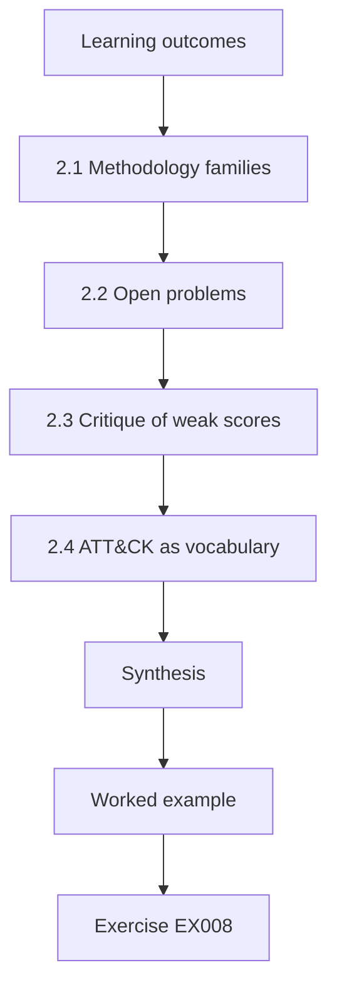

### Logical drawing

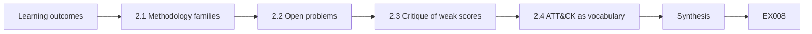

```text
[Learning outcomes]
    |
    v
[2.1 Methodology families]
    |
    v
[2.2 Open problems]
    |
    v
[2.3 Critique of weak scores]
    |
    v
[2.4 ATT&CK as vocabulary]
    |
    v
[Synthesis]
    |
    v
[Worked example] --> [Exercise EX008]
```
<!-- cyberabc:lesson-figures:end ch-02 -->


### Learning outcomes

You will (1) map the main methodology families and threat-led frameworks; (2) locate open research problems in measurement, ethics and assurance; (3) critique weak scoring schemes; (4) position ATT&CK as a vocabulary, not a completeness proof; and (5) write a frontier note that motivates a doctorate.

### 2.1 Methodology families

NIST SP 800-115 organises assessment into planning, discovery, attack (carefully bounded), reporting and remediation support. PTES sequences intelligence, threat modelling, vulnerability analysis, exploitation and post-exploitation under explicit scoping. OWASP WSTG provides web-specific test cases. Threat-led frameworks such as TIBER-EU and CBEST emphasise intelligence-led scenarios, purple-team collaboration and regulatory oversight for critical financial systems. Your frontier map should place each family by what it optimises: breadth of technical coverage, realism of adversary emulation, or assurance for supervisors.

Elena's map places NIST SP 800-115 and PTES under technical coverage, WSTG under web cases, and TIBER-EU and CBEST under threat-led assurance. Her doctorate sits with the first group: she measures whether a scoping instrument reduces out-of-scope probes, not whether an intelligence-led scenario finds business-critical weaknesses.

### 2.2 Open problems

Open problems that suit a doctorate include: how to measure out-of-scope risk reduction; how to validate that a control blocked an action without publishing an exploit; how coverage of ATT&CK techniques relates to residual risk; how human factors (fatigue, approval theatre) affect ROE compliance; and how to compare red-team report quality. Avoid "problems" that are merely "run more tools".

Elena's problem is the first of these: measuring whether machine-checkable predicates reduce out-of-scope probes. A doctorate that only wraps another scanner has no research question, only an engineering task.

### 2.3 Critique of weak scores

Aggregating security into a single number — as criticised for OSSTMM's rav (arXiv:2010.06377) — hides what failed and who is affected. Prefer structured findings with impact, evidence and verification status. Severity scores can prioritise work inside one engagement; they are not universal security quantities.

```python
"""Score synthetic findings for report priority (no exploit details)."""
# impact 0-3, exploitability 0-3, exposure 0-3  -> priority
findings = [
    ("SYN-001", "default admin password on staging web UI", 3, 3, 2),
    ("SYN-002", "missing security headers on public site", 1, 1, 3),
    ("SYN-003", "outdated TLS on internal admin port", 2, 2, 1),
    ("SYN-004", "verbose error messages disclose paths", 1, 2, 2),
    ("SYN-005", "service account with domain admin in lab AD", 3, 2, 1),
]

def priority(impact, exploitability, exposure):
    score = impact*4 + exploitability*2 + exposure
    if score >= 16: return "critical", score
    if score >= 11: return "high", score
    if score >= 7: return "medium", score
    return "low", score

for fid, title, i, e, x in findings:
    p, s = priority(i, e, x)
    print(f"{fid} priority={p:8} score={s:2} impact={i} exploitability={e} exposure={x} :: {title}")
```

Expected output:

```text
SYN-001 priority=critical score=20 impact=3 exploitability=3 exposure=2 :: default admin password on staging web UI
SYN-002 priority=medium   score= 9 impact=1 exploitability=1 exposure=3 :: missing security headers on public site
SYN-003 priority=high     score=13 impact=2 exploitability=2 exposure=1 :: outdated TLS on internal admin port
SYN-004 priority=medium   score=10 impact=1 exploitability=2 exposure=2 :: verbose error messages disclose paths
SYN-005 priority=critical score=17 impact=3 exploitability=2 exposure=1 :: service account with domain admin in lab AD
```

The findings lab scores impact, exploitability and exposure without describing an attack path. SYN-001, a default admin password on the staging web UI, scores 20 and is critical; SYN-002, missing headers, scores 9 and is medium. Severity helps an operator decide what to fix first inside one engagement; it is not a universal security quantity.

### 2.4 ATT&CK as vocabulary

MITRE ATT&CK is a living knowledge base of adversary tactics and techniques. Use it to label what was attempted and observed, to communicate with blue teams, and to show coverage gaps. Do not claim that covering a percentage of the matrix means a system is safe — coverage is a planning and reporting aid.

```python
"""ATT&CK-style coverage matrix over synthetic authorized techniques (names only)."""
# Synthetic engagement log: technique_id -> observed (True/False)
PLAN = ["T1046", "T1595", "T1082", "T1083", "T1059", "T1078", "T1021"]
OBSERVED = {"T1046", "T1595", "T1082", "T1083", "T1078"}
LABELS = {
    "T1046": "Network Service Discovery",
    "T1595": "Active Scanning",
    "T1082": "System Information Discovery",
    "T1083": "File and Directory Discovery",
    "T1059": "Command and Scripting Interpreter",
    "T1078": "Valid Accounts",
    "T1021": "Remote Services",
}
covered = 0
for tid in PLAN:
    hit = tid in OBSERVED
    covered += hit
    print(f"{tid} {LABELS[tid]:34} {'COVERED' if hit else 'PLANNED-NOT-SEEN'}")
print(f"coverage={covered}/{len(PLAN)} ({100*covered/len(PLAN):.0f}%)")
```

Expected output:

```text
T1046 Network Service Discovery          COVERED
T1595 Active Scanning                    COVERED
T1082 System Information Discovery       COVERED
T1083 File and Directory Discovery       COVERED
T1059 Command and Scripting Interpreter  PLANNED-NOT-SEEN
T1078 Valid Accounts                     COVERED
T1021 Remote Services                    PLANNED-NOT-SEEN
coverage=5/7 (71%)
```

The coverage lab shows 5 of 7 planned techniques observed, or 71%. Planned-not-seen techniques such as T1059 and T1021 go on the next authorized plan. Elena uses ATT&CK to label what operators attempted and what was observed, and to talk with blue teams, not to claim residual risk.

### 2.5 Worked example (synthetic NHUSTL case)

Elena's frontier note: prior work describes ROE in prose; threat-led frameworks require scenario fidelity; few studies measure whether machine-checkable predicates reduce out-of-scope actions. The findings lab shows prioritisation of synthetic issues without exploit detail. The coverage lab shows 71% of a planned technique set observed — a reporting fact, not a safety proof. Her gap: a controlled comparison of prose vs checkable scope on out-of-scope probe rate.

The gap is measurable, ethical and non-tool: a controlled comparison of prose against checkable scope on out-of-scope probe rate, in authorized labs with synthetic targets. That sentence becomes the first paragraph of her proposal.

### 2.6 Errors and limits

- Treating ATT&CK coverage as risk eliminated.
- Single-score "security levels".
- Frontier notes that list tools instead of questions.

Each error weakens the frontier note. Reading ATT&CK coverage as risk eliminated turns a planning aid into a false claim of safety. A single-score security level hides what failed, as Albrecht and Jensen argue. Listing tools instead of questions produces an engineering project, not a doctorate. Check your frontier note for all three before the proposal. Elena's note avoids all three.

### Exercises

- **EX008 — Families.** Place NIST 800-115, PTES, WSTG, TIBER-EU and CBEST on a one-page map. Rubric: 3 = all five with purpose; 2 = four; 1 = two; 0 = none.
- **EX009 — Open problem.** State one open problem as a measurable question. Rubric: 3 = measurable, ethical, non-tool; 2 = measurable; 1 = vague; 0 = none.
- **EX010 — Findings lab.** Why is SYN-001 critical while SYN-002 is medium? Rubric: 3 = impact/exploitability/exposure; 2 = partial; 1 = vague; 0 = wrong.
- **EX011 — Coverage.** What does 71% coverage mean and not mean? Rubric: 3 = planned techniques seen; not residual risk; 2 = one side; 1 = "mostly safe"; 0 = none.
- **EX012 — OSSTMM critique.** Summarise one argument from Albrecht and Jensen (arXiv:2010.06377). Rubric: 3 = accurate; 2 = partial; 1 = vague; 0 = wrong.
- **EX013 — Threat-led.** How do TIBER-EU/CBEST differ from a generic pentest? Rubric: 3 = intelligence-led, oversight, critical services; 2 = two; 1 = one; 0 = none.
- **EX014 — Frontier note.** Write Elena's gap in five sentences. Rubric: 3 = prior, gap, measure, ethics, contribution; 2 = three; 1 = one; 0 = none.

### Synthesis

The research frontier sits where methodology, measurement and ethics meet — not where another scanner can be wrapped. Map frameworks, reject empty scores and state a measurable gap.

### Continue studying — chapter 02 of 08

[← Chapter 01 (draft)](#ch-01) · [Course chapter index](../SUBJECTS.md) · [Chapter 03 (draft) →](#ch-03)

<a id="ch-03"></a>

## Chapter 3 — Original contribution proposal

<!-- cyberabc:lesson-figures:start ch-03 -->
### Lesson map

Lesson 03 published. Map, example, EX015.

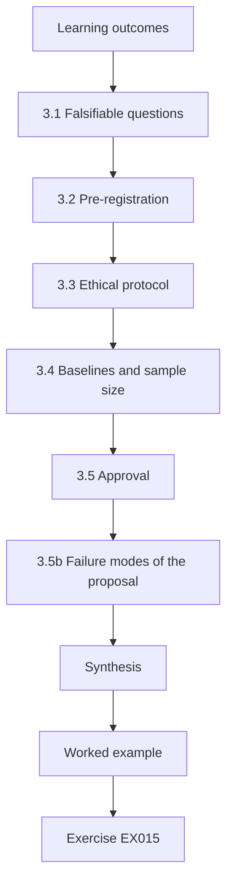

### Logical drawing

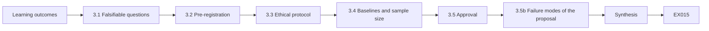

```text
[Learning outcomes]
    |
    v
[3.1 Falsifiable questions]
    |
    v
[3.2 Pre-registration]
    |
    v
[3.3 Ethical protocol]
    |
    v
[3.4 Baselines and sample size]
    |
    v
[3.5 Approval]
    |
    v
[3.5b Failure modes of the proposal]
    |
    v
[Synthesis]
    |
    v
[Worked example] --> [Exercise EX015]
```
<!-- cyberabc:lesson-figures:end ch-03 -->


### Learning outcomes

You will (1) write a falsifiable research question; (2) specify hypotheses, measures and analysis before collecting data; (3) design an ethical protocol for authorized lab studies; (4) plan baselines and sample sizes; and (5) obtain supervisory and ethics approval.

### 3.1 Falsifiable questions

A good question can be wrong. "Do machine-checkable scope predicates reduce out-of-scope probes compared with prose ROE, in NHUSTL's authorized labs, measured as probes per engagement-hour?" can fail. "How can red teams be better?" cannot.

Elena's question names the population (NHUSTL authorized labs), the intervention (predicate checker on or off), and the measure (out-of-scope probes per engagement-hour). A result of no difference would still be publishable if the study was powered and executed as planned. Write the question so a null result is still a clear answer.

### 3.2 Pre-registration

Write down: population (engagements on the lab range), intervention (predicate checker on/off), primary measure (out-of-scope probes / hour), secondary measures (time-to-stop, false stops), analysis (rate difference with interval), exclusions (aborted for infra failure). File it before the main study.

Elena files hers before the first main-study engagement. The file also records the ATT&CK and checker versions, so later readers know which definitions applied. A peer should be able to run the main study from the file alone. File it where the supervisor and ethics board can both find it.

### 3.3 Ethical protocol

Participants (student operators) consent; targets are synthetic; no real credentials; dual-use appendix explains what will not be published. Align with institutional ethics and with NIST SP 800-115's emphasis on careful planning.

```python
"""Evaluate proposed actions against synthetic rules of engagement."""
ROE = {
    "hours": ("09:00", "17:00"),
    "deny_actions": {"denial-of-service", "phishing-staff", "exfiltrate-real-data"},
    "require_approval": {"password-spray-lab", "privilege-escalation-lab"},
    "max_concurrency": 5,
}
proposals = [
    ("service-enum", "10:30", 3, False),
    ("denial-of-service", "10:30", 1, False),
    ("password-spray-lab", "10:30", 2, False),
    ("password-spray-lab", "10:30", 2, True),
    ("service-enum", "18:00", 2, False),
    ("service-enum", "11:00", 20, False),
]

def ok_time(t):
    return ROE["hours"][0] <= t <= ROE["hours"][1]

for action, when, conc, approved in proposals:
    reasons=[]
    if action in ROE["deny_actions"]: reasons.append("deny-action")
    if action in ROE["require_approval"] and not approved: reasons.append("needs-approval")
    if not ok_time(when): reasons.append("outside-hours")
    if conc > ROE["max_concurrency"]: reasons.append("concurrency")
    print(f"action={action:20} when={when} conc={conc:2} approved={approved} -> {'ALLOW' if not reasons else 'DENY'} {','.join(reasons) or '-'}")
```

Expected output:

```text
action=service-enum         when=10:30 conc= 3 approved=False -> ALLOW -
action=denial-of-service    when=10:30 conc= 1 approved=False -> DENY deny-action
action=password-spray-lab   when=10:30 conc= 2 approved=False -> DENY needs-approval
action=password-spray-lab   when=10:30 conc= 2 approved=True -> ALLOW -
action=service-enum         when=18:00 conc= 2 approved=False -> DENY outside-hours
action=service-enum         when=11:00 conc=20 approved=False -> DENY concurrency
```

The ROE lab shows the same discipline for proposed actions: denial of service is denied; a lab password spray needs approval; work at 18:00 or with concurrency 20 is denied. Findings from work outside these rules never enter study data. Consent forms state purpose, data used, withdrawal rights and contacts.

### 3.4 Baselines and sample size

Estimate the prose-ROE out-of-scope rate from a pilot. Choose a sample (engagements or hours) that can detect a meaningful reduction — for example, from 0.20 to 0.05 probes/hour — with a planned interval width.

Elena's pilot suggests a prose rate near 0.18 per hour. Detecting a drop towards 0.05 with a usable interval needs on the order of 20 two-hour engagements per arm, which is feasible across two terms at NHUSTL. Record the sketch as a planning figure, and refine it after the pilot's variance estimate.

### 3.5 Approval

Supervisor sign-off on science; ethics board on people; lab owner on systems. Keep versions of the proposal with dates.

Elena files all three before the pilot. A change to the proposal after approval needs a dated amendment, not an email. Without all three, the pilot does not start. Keep the signed copies with the pre-registration, and check that the dates still cover the work before each engagement. An expired lab authorization or ethics approval pauses the research as well as the assessment.

### 3.5b Failure modes of the proposal

Common failure modes: a question that only the intervention arm can "win" by construction; measures that punish reporting (operators hide probes); ethics that block independent validation. Stress-test the proposal by asking what result would make you abandon the idea, and whether that result is observable.

For Elena, a result that would abandon the idea is a checker that does not reduce out-of-scope probes once false stops are fixed. That result is observable from the primary measure. A measure that punished operators for reporting probes would hide the very events the study needs.

### 3.6 Worked example (synthetic NHUSTL case)

Elena's proposal: H1 — predicate checking halves out-of-scope probe rate vs prose ROE. Primary measure: denied or executed probes outside CIDR/port/action lists per engagement-hour. The ROE lab shows deny-action, outside-hours and concurrency rules blocking unsafe proposals before they run. Main-study target: 20 engagements per arm, after a pilot of 10 per arm. Ethics: student operators, synthetic targets, no publication of working attack procedures.

H1 can fail: if the checker rate matches the prose rate within the planned interval, the hypothesis is not supported. The ethics paragraph is short enough for the supervisor to quote when asked what will not be published.

### 3.7 Errors and limits

- Hypotheses written after looking at data.
- Pilots that use real client systems.
- Proposals without a stop-condition plan.

Each error damages the proposal. Hypotheses written after looking at data cannot be falsified honestly. Pilots on real client systems break authorization and expose real data. Proposals without stop conditions leave operators without a rehearsed pause. Check the proposal for all three before seeking approval. Elena's proposal addresses each one in writing before she seeks signatures, so examiners can see the controls were planned.

### Exercises

- **EX015 — Question.** Rewrite a vague goal as a falsifiable question. Rubric: 3 = population, intervention, measure; 2 = two; 1 = one; 0 = none.
- **EX016 — Pre-reg.** List eight pre-registration fields. Rubric: 3 = eight apt; 2 = six; 1 = three; 0 = none.
- **EX017 — ROE lab.** Explain two DENY rows. Rubric: 3 = both with rules; 2 = one; 1 = vague; 0 = wrong.
- **EX018 — Ethics.** List four ethics controls for Elena's study. Rubric: 3 = four; 2 = three; 1 = one; 0 = none.
- **EX019 — Sample.** Argue for 20 engagements per arm. Rubric: 3 = effect size, variance, feasibility; 2 = two; 1 = assertion; 0 = none.
- **EX020 — Approvals.** Who must sign what? Rubric: 3 = supervisor, ethics, lab owner with artefacts; 2 = two; 1 = one; 0 = none.

### Synthesis

A doctorate proposal commits to a falsifiable question, pre-registered measures, ethics that bound harm and approvals before data collection.

### Continue studying — chapter 03 of 08

[← Chapter 02 (draft)](#ch-02) · [Course chapter index](../SUBJECTS.md) · [Chapter 04 (draft) →](#ch-04)

<a id="ch-04"></a>

## Chapter 4 — Baseline replication and pilot

<!-- cyberabc:lesson-figures:start ch-04 -->
### Lesson map

Lesson 04 published. Map, example, EX021.

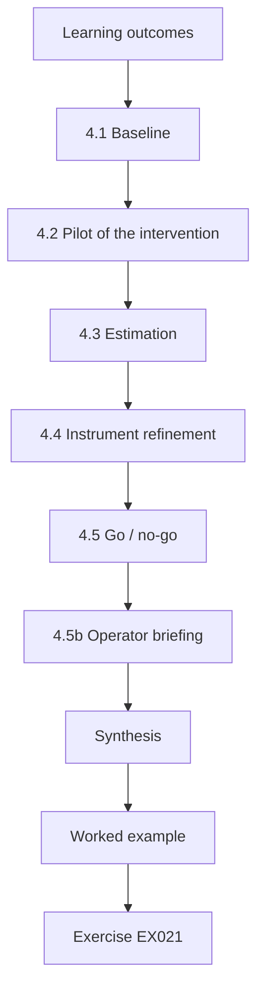

### Logical drawing

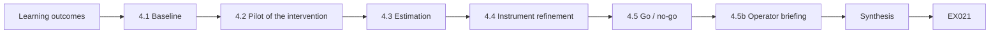

```text
[Learning outcomes]
    |
    v
[4.1 Baseline]
    |
    v
[4.2 Pilot of the intervention]
    |
    v
[4.3 Estimation]
    |
    v
[4.4 Instrument refinement]
    |
    v
[4.5 Go / no-go]
    |
    v
[4.5b Operator briefing]
    |
    v
[Synthesis]
    |
    v
[Worked example] --> [Exercise EX021]
```
<!-- cyberabc:lesson-figures:end ch-04 -->


### Learning outcomes

You will (1) replicate a baseline method under prose ROE; (2) run a pilot of the intervention; (3) estimate rates and variances; (4) refine instruments without peeking at final conclusions; and (5) decide go / no-go for the main study.

### 4.1 Baseline

Run the current practice — prose ROE read at the start — across a fixed lab topology. Log every probe attempt with host, port, action and timestamp. Score out-of-scope using the same predicate rules you will later enforce live, so the baseline is comparable.

Elena runs ten baseline engagements on the fixed NHUSTL topology. Scoring the baseline with the same predicates she will later enforce live means both arms use one definition of out-of-scope, so a difference can be attributed to the checker rather than to a change in scoring.

### 4.2 Pilot of the intervention

Enable the checker that evaluates proposals before execution. Record allows, denies and reasons. Watch for false stops that frustrate operators without improving safety.

Elena's pilot runs ten engagements with the checker on. She logs every allow and deny with its reason, and notes whether a deny was a false stop, such as a mistyped host that was actually in scope. False stops are a secondary measure: too many mean the checker is unusable, even if out-of-scope probes fall. In the pilot, both false stops came from one operator mistyping an in-scope host, which points to an interface fix rather than a policy change.

### 4.3 Estimation

Compute rates per hour with intervals. Note operator effects (some people probe more). Keep the pilot analysis descriptive; do not "succeed" the hypothesis yet.

```python
"""Rebuild a synthetic engagement timeline from event records."""
events = [
    ("09:00", "ROE brief signed", "auth"),
    ("09:15", "scoped host inventory loaded (12 hosts)", "prep"),
    ("10:02", "service enumeration on 10.20.1.0/28", "enum"),
    ("10:45", "finding SYN-001 noted on staging UI", "find"),
    ("11:10", "stop: host 10.20.0.1 probed — out of scope", "stop"),
    ("11:12", "escalated to client contact; confirmed deny-list", "comm"),
    ("13:00", "resume on in-scope hosts only", "auth"),
    ("15:30", "debrief draft shared with client", "report"),
]
# print chronological with phase tags; compute stop latency
print("phase timeline:")
for t, msg, phase in events:
    print(f"  {t} [{phase:6}] {msg}")
t0 = 10*60+45; t1 = 11*60+10
print(f"minutes from SYN-001 note to stop: {t1-t0}")
print(f"stop reason present: yes")
print(f"events={len(events)} phases={len(set(p for _,_,p in events))}")
```

Expected output:

```text
phase timeline:
  09:00 [auth  ] ROE brief signed
  09:15 [prep  ] scoped host inventory loaded (12 hosts)
  10:02 [enum  ] service enumeration on 10.20.1.0/28
  10:45 [find  ] finding SYN-001 noted on staging UI
  11:10 [stop  ] stop: host 10.20.0.1 probed — out of scope
  11:12 [comm  ] escalated to client contact; confirmed deny-list
  13:00 [auth  ] resume on in-scope hosts only
  15:30 [report] debrief draft shared with client
minutes from SYN-001 note to stop: 25
stop reason present: yes
events=8 phases=7
```

Elena reports pilot rates with intervals and does not test H1 yet. Operator effects are noted so the main study can plan for them, for example by modelling operator as a factor or by balancing slots across people. Keep the pilot analysis in a separate notebook from the main study. The synthetic timeline lab gives a concrete check: 25 minutes passed between the SYN-001 note and the stop, a latency the main study should track.

### 4.4 Instrument refinement

Clarify ROE wording, fix checker bugs, improve logging. Lock instruments before the main study. Document every change.

Elena's typo UX fix and the locked checker version are both recorded in the instrument log with dates. After lock, further changes need a supervisor-approved amendment. Locking stops silent drift between early and late engagements, and the main study does not start until the new version is pinned. Operators receive the locked version number in the briefing, so they can report if a different build appears.

### 4.5 Go / no-go

Go if: authorization still valid; instruments stable; pilot shows non-zero out-of-scope events under prose ROE (so there is something to reduce); ethics unchanged. No-go or redesign if the checker is unusable or the lab is unstable.

Elena's go decision lists all four. A no-go example is a false-stop rate above about 30%, which would force a UX redesign and a re-pilot before the main study. Going ahead with an unusable checker would produce data that measures frustration rather than scope compliance.

### 4.5b Operator briefing

Brief operators identically in both arms: same ROE text length, same topology map, same allowed tool categories. Differences should come from the checker, not from unequal preparation. Record briefing duration and attendance.

Elena's briefing script is identical in both arms and lasts the same number of minutes. Attendance is recorded so missing briefings can be reported as a limitation if they cluster in one arm. Unequal preparation would confound the comparison, so differences should come from the checker alone. The briefing pack also shows the same scoped inventory of twelve hosts in both arms, so neither group starts with a clearer map.

### 4.6 Worked example (synthetic NHUSTL case)

Baseline (10 engagements): 0.18 out-of-scope probes/hour (interval roughly 0.11–0.28). Pilot with checker (10 engagements): 0.04/hour; two false stops when an operator mistyped a host in scope. Timeline lab habits — note finding, stop, escalate — are rehearsed; minutes from SYN-001 note to stop in the synthetic timeline is 25. Elena fixes the typo UX and locks the checker version.

The baseline shows there is something to reduce: a non-zero out-of-scope rate under prose ROE. The pilot shows the checker can cut that rate, and exposes a UX bug that would have frustrated operators in the main study. Locking the checker after the fix keeps the main study comparable across engagements.

### 4.7 Errors and limits

- Changing the scoring rules between baseline and pilot.
- Treating pilot results as confirmatory.
- Skipping false-stop analysis.

Each error damages the comparison. Changing scoring rules between baseline and pilot means the two rates are not measuring the same thing. Treating pilot results as confirmatory inflates the chance of a false finding. Skipping false-stop analysis leaves a UX problem that will confound the main study. Check the pilot report for all three before the go decision. Elena's go criteria list each one.

### Exercises

- **EX021 — Baseline log.** Specify the log fields. Rubric: 3 = host, port, action, time, decision, operator; 2 = four; 1 = two; 0 = none.
- **EX022 — Comparability.** Why score baseline with the same predicates? Rubric: 3 = fair comparison; 2 = partial; 1 = vague; 0 = wrong.
- **EX023 — Timeline lab.** What does the stop latency show? Rubric: 3 = 25 minutes, process existence; 2 = number; 1 = vague; 0 = wrong.
- **EX024 — False stop.** How should Elena handle the mistyped-host stops? Rubric: 3 = UX fix, not weaken scope; 2 = partial; 1 = disable checker; 0 = none.
- **EX025 — Go criteria.** Write four go criteria. Rubric: 3 = four apt; 2 = three; 1 = one; 0 = none.
- **EX026 — No-go.** Give a no-go scenario and redesign. Rubric: 3 = scenario and redesign; 2 = scenario; 1 = vague; 0 = none.

### Synthesis

Baseline and pilot produce comparable rates, expose instrument problems and support a disciplined go / no-go — not a premature claim of success.

### Continue studying — chapter 04 of 08

[← Chapter 03 (draft)](#ch-03) · [Course chapter index](../SUBJECTS.md) · [Chapter 05 (draft) →](#ch-05)

<a id="ch-05"></a>

## Chapter 5 — Main study and independent validation

<!-- cyberabc:lesson-figures:start ch-05 -->
### Lesson map

Lesson 05 published. Map, example, EX027.

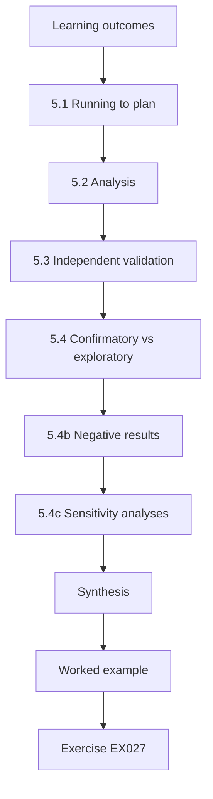

### Logical drawing

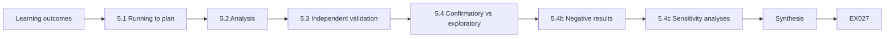

```text
[Learning outcomes]
    |
    v
[5.1 Running to plan]
    |
    v
[5.2 Analysis]
    |
    v
[5.3 Independent validation]
    |
    v
[5.4 Confirmatory vs exploratory]
    |
    v
[5.4b Negative results]
    |
    v
[5.4c Sensitivity analyses]
    |
    v
[Synthesis]
    |
    v
[Worked example] --> [Exercise EX027]
```
<!-- cyberabc:lesson-figures:end ch-05 -->


### Learning outcomes

You will (1) run the main study to the pre-registered plan; (2) analyse primary and secondary measures with uncertainty; (3) commission independent validation; (4) separate confirmatory from exploratory findings; and (5) report failures and limits.

### 5.1 Running to plan

Randomise or alternate arms (prose vs checker) across matched engagement slots. Hold topology, briefing length and allowed tool categories fixed. Do not tune the checker using main-study outcomes.

Elena interleaves prose and checker slots across the term so time and lab load do not favour one arm. Topology images, briefing scripts and allowed tool lists are pinned. Checker tuning from main-study outcomes is forbidden; any bug fix needs an amendment. Hold the plan in a short checklist that operators see before each slot.

### 5.2 Analysis

Primary: difference in out-of-scope probes per hour with a confidence interval. Secondary: time-to-stop; false-stop rate; operator workload scores. Pre-specify any hierarchical model for operator effects.

```python
"""Lab S: reporting attack-success rates honestly: Wilson intervals,
seed variation and a paired bootstrap. Synthetic trial outcomes only."""
import math, random
def wilson(k, n, z=1.96):
    p = k/n; d = 1 + z*z/n
    c = (p + z*z/(2*n))/d; h = z*math.sqrt(p*(1-p)/n + z*z/(4*n*n))/d
    return c - h, c + h
for k, n in ((3, 20), (30, 200), (300, 2000)):
    lo, hi = wilson(k, n); print(f"successes={k}/{n} rate={k/n:.3f} wilson95=[{lo:.3f}, {hi:.3f}]")
# five seeds of a synthetic defence evaluation: per-seed attack success rate
rates = []
for seed in range(5):
    r = random.Random(seed); rates.append(sum(r.random() < 0.12 for _ in range(200))/200)
m = sum(rates)/5; sd = math.sqrt(sum((x-m)**2 for x in rates)/4)
print("per-seed rates:", " ".join(f"{x:.3f}" for x in rates), f"mean={m:.3f} sd={sd:.3f}")
# paired bootstrap: baseline vs defence on the same 300 synthetic trials
r = random.Random(42)
base = [r.random() < 0.30 for _ in range(300)]
defn = [b and r.random() < 0.6 for b in base]   # defence blocks ~40% of successes
diffs = []
for _ in range(2000):
    idx = [r.randrange(300) for _ in range(300)]
    diffs.append(sum(base[i] for i in idx)/300 - sum(defn[i] for i in idx)/300)
diffs.sort()
print(f"baseline_asr={sum(base)/300:.3f} defended_asr={sum(defn)/300:.3f} "
      f"reduction_ci95=[{diffs[50]:.3f}, {diffs[1949]:.3f}]")
```

Expected output:

```text
successes=3/20 rate=0.150 wilson95=[0.052, 0.360]
successes=30/200 rate=0.150 wilson95=[0.107, 0.206]
successes=300/2000 rate=0.150 wilson95=[0.135, 0.166]
per-seed rates: 0.110 0.130 0.135 0.105 0.145 mean=0.125 sd=0.017
baseline_asr=0.350 defended_asr=0.190 reduction_ci95=[0.120, 0.203]
```

Lab S habits apply: report counts and intervals, not a single p-value story. Small samples produce wide Wilson intervals, so Elena's claim rests on twenty engagements per arm and on the interval for the difference. Secondary measures are reported with the same discipline, and labelled secondary. The lab makes the point concrete: the same 0.150 rate gives a Wilson interval of 0.052 to 0.360 at 3/20, but 0.135 to 0.166 at 300/2000.

### 5.3 Independent validation

Ask researchers who did not build the checker to repeat the scoring of out-of-scope events from raw logs, or to re-run a subset of engagements. Independence catches optimistic grading.

Elena's validators are two researchers who did not build the checker. They re-score out-of-scope labels from redacted logs, blind to arm, and report percent agreement. Disagreements are adjudicated and counted. Agreement below a pre-set threshold triggers adjudication of the full set, not only the disagreements. Validators record each disagreement with the log line and both labels, so the adjudicator sees evidence rather than two competing opinions.

### 5.4 Confirmatory vs exploratory

Confirmatory results answer the pre-registered question. Exploratory analyses (for example, which deny-reasons dominate) are labelled as such and do not rescue a failed primary hypothesis.

Elena's confirmatory claim is the difference in out-of-scope probes per hour. That port-not-in-scope dominated denies is exploratory: useful for operators, not a rescue if the primary had failed. Keep the line bright in every table and figure caption, so a reader cannot mistake an exploratory plot for the primary result. In her results chapter, the deny-reason breakdown sits in a separate exploratory section placed after the primary rate table.

### 5.4b Negative results

A non-significant primary result is still a contribution if the study was powered and executed as planned. Publish the rates, intervals and limits. Negative results prevent other labs from repeating the same blind alley and keep the literature honest.

Elena writes the negative-result paragraph into her thesis template before the main study, so she is ready to publish either way. A powered null result still tells other labs that this checker, under these conditions, did not move the rate. State the rates, intervals and limits even when H1 is not supported.

### 5.4c Sensitivity analyses

Plan one or two sensitivity checks in advance: exclude the highest-volume operator; recompute with a stricter out-of-scope definition. If the qualitative conclusion moves, discuss why. Sensitivity is not a search for a significant p-value.

Elena plans two: exclude the highest-volume operator, and recompute with a stricter out-of-scope definition that treats any deny-listed host contact as out of scope even if the operator stopped at once. Both are named in the pre-registration. If either check moves the qualitative conclusion, discuss why in the limitations, rather than searching for a significant p-value.

### 5.5 Worked example (synthetic NHUSTL case)

Main study (20+20 engagements): prose 0.17/hour (interval 0.12–0.23); checker 0.03/hour (0.01–0.07); difference about 0.14/hour. Independent validators agreed on 98% of out-of-scope labels. Exploratory: most denies were port-not-in-scope. Failure mode: one engagement had a lab network renumbering that invalidated CIDRs mid-run — excluded per pre-registered rule, reported in limits.

The primary result supports H1 under the stated conditions. Independent agreement of 98% shows the labels were not optimistic grading by Elena alone. The excluded engagement is named in the results table and limitations, with the rule that justified it.

### 5.6 Errors and limits

- Peeking and stopping early when results look good.
- Validators who co-authored the tool.
- Hiding exclusions.

Each error biases the result. Peeking and stopping early when results look good inflates false findings. Validators who co-authored the tool share the incentive to find an effect. Hiding exclusions lets the researcher shape the data without readers knowing. Check the analysis and validation plan for all three. Elena's analysis plan, written before collection, addresses all three. It fixes twenty engagements per arm, names validators outside the checker team, and lists every excluded engagement with its reason.

### Exercises

- **EX027 — Design.** How will you keep arms comparable? Rubric: 3 = topology, briefing, tools, timing; 2 = three; 1 = one; 0 = none.
- **EX028 — Primary result.** Report Elena's primary result in one sentence. Rubric: 3 = rates, intervals, conditions; 2 = rates only; 1 = "it worked"; 0 = none.
- **EX029 — Independence.** Design a validation protocol. Rubric: 3 = who, what, blinding, agreement metric; 2 = three; 1 = one; 0 = none.
- **EX030 — Exclusion.** Was excluding the renumbered engagement correct? Rubric: 3 = matches pre-reg, reported; 2 = partial; 1 = hide it; 0 = none.
- **EX031 — Exploratory.** Label one exploratory finding correctly. Rubric: 3 = labelled, not used as primary; 2 = partial; 1 = presented as confirmatory; 0 = none.
- **EX032 — Stats.** What interval fact from the lab supports cautious claims from small n? Rubric: 3 = wide intervals at small n; 2 = partial; 1 = vague; 0 = wrong.

### Synthesis

The main study follows the plan, quantifies uncertainty, seeks independent eyes and draws a bright line between confirmatory and exploratory claims.

### Continue studying — chapter 05 of 08

[← Chapter 04 (draft)](#ch-04) · [Course chapter index](../SUBJECTS.md) · [Chapter 06 (draft) →](#ch-06)

<a id="ch-06"></a>

## Chapter 6 — Peer critique and revision

<!-- cyberabc:lesson-figures:start ch-06 -->
### Lesson map

Lesson 06 published. Map, example, EX033.

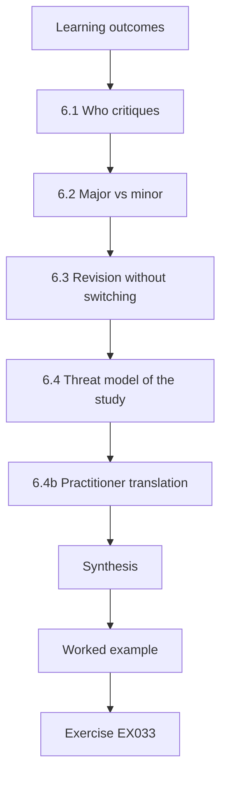

### Logical drawing

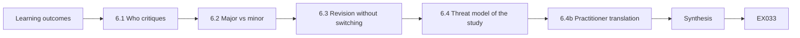

```text
[Learning outcomes]
    |
    v
[6.1 Who critiques]
    |
    v
[6.2 Major vs minor]
    |
    v
[6.3 Revision without switching]
    |
    v
[6.4 Threat model of the study]
    |
    v
[6.4b Practitioner translation]
    |
    v
[Synthesis]
    |
    v
[Worked example] --> [Exercise EX033]
```
<!-- cyberabc:lesson-figures:end ch-06 -->


### Learning outcomes

You will (1) solicit critique from methodology and practice experts; (2) separate major from minor issues; (3) revise without outcome-switching; (4) update the threat model of your own study; and (5) record a response-to-reviewers trail.

### 6.1 Who critiques

Invite: a red-team practitioner (ecological validity), a measurement researcher (statistics), an ethicist or counsel (authorization), and a blue-team lead (whether your reports would help defenders). Share redacted materials.

For Elena, each reviewer tests a different weak point. The practitioner asks whether NHUSTL's isolated 10.20.0.0/16 and 192.168.50.0/24 ranges resemble the networks where scope mistakes actually happen. The measurement researcher checks whether out-of-scope probes per engagement-hour, compared at 20 engagements per arm, supports the interval she reports. Counsel reads the authorization file, and the blue-team lead judges whether a deny-reason log would help defenders. Redacted materials still include the pre-registration, so each reviewer can see what she promised before the data arrived.

### 6.2 Major vs minor

Major: the measure does not match the claim; independence is compromised; ethics gap; results driven by one operator. Minor: wording, figure layout, related-work gaps. Major issues change conclusions or require new data.

Elena sorts every comment into one of these two lists before replying. The practitioner's point that NHUSTL's topology is too clean is major, because it bounds where the drop from 0.17 to 0.03 out-of-scope probes per hour can be claimed. A request to relabel a figure axis is minor. Sorting first stops her spending a week on presentation while a validity question waits, and the response trail shows reviewers that their major points received the larger share of revision effort.

### 6.3 Revision without switching

You may clarify, add sensitivity analyses, or collect new data under an amended pre-registration. You may not redefine success after seeing results. If the primary fails, say so and discuss why.

In Elena's case the pre-registered primary measure, out-of-scope probes per engagement-hour, stays fixed. She can add a sensitivity analysis that drops engagements aborted for infrastructure failure, because that exclusion was already named in the pre-registration. She cannot swap in time-to-stop as the headline if it happens to look stronger; it remains a secondary measure. The amendment log records each change with its date, so an examiner can compare the revised thesis against the plan filed before the main study.

### 6.4 Threat model of the study

Attackers of your study include: operators who game the checker; lab infra that drifts; validators who share incentives. Document residual risks to validity.

For NHUSTL, gaming the checker would mean operators splitting a probe across permitted ports or proposing actions the predicate cannot express, so that the checker records no violation while the behaviour still drifts. Lab drift would include a range renumbered mid-study, which would make an allowed CIDR silently cover new hosts. Validators who share Elena's supervisor share her incentive to find an effect. Each threat gets a recorded mitigation or is listed as a residual limit in the thesis.

```python
"""Password policy strength from synthetic samples (no cracking)."""
import math, string
samples = [
    "password",
    "P@ssw0rd",
    "correct-horse-battery",
    "Xk9!mQ2#vL7$",
    "aaaaaaaa",
]

def charset_size(s):
    n = 0
    if any(c.islower() for c in s): n += 26
    if any(c.isupper() for c in s): n += 26
    if any(c.isdigit() for c in s): n += 10
    if any(c in string.punctuation+"-" for c in s): n += 33
    return max(n, 1)

def entropy_bits(s):
    # naive: length * log2(charset); flags common patterns
    bits = len(s) * math.log2(charset_size(s))
    flags = []
    if s.lower() in {"password","admin","welcome","letmein"}: flags.append("common")
    if len(set(s)) == 1: flags.append("single-char")
    if s.isalpha() and s.istitle() and any(c.isdigit() for c in s): flags.append("word+digit")
    return bits, flags

for s in samples:
    b, f = entropy_bits(s)
    grade = "weak" if b < 40 or f else ("ok" if b < 60 else "strong")
    print(f"sample={s!r:28} bits={b:5.1f} grade={grade:6} flags={','.join(f) or '-'}")
```

Expected output:

```text
sample='password'                   bits= 37.6 grade=weak   flags=common
sample='P@ssw0rd'                   bits= 52.6 grade=ok     flags=-
sample='correct-horse-battery'      bits=123.5 grade=strong flags=-
sample='Xk9!mQ2#vL7$'               bits= 78.8 grade=strong flags=-
sample='aaaaaaaa'                   bits= 37.6 grade=weak   flags=single-char
```

### 6.4b Practitioner translation

After academic revision, write a one-page practitioner brief: what to configure, what to measure on the next authorized engagement, and what not to claim. If practitioners cannot use the brief, the contribution's path to impact is incomplete.

Elena's brief states the checker defaults, the two measures to watch on the next authorized engagement, and the refused claims: residual risk from coverage percentages, and replacement of threat-led programmes. She asks one NHUSTL operator to follow the brief cold and notes where they stall.

### 6.5 Worked example (synthetic NHUSTL case)

A practitioner argues that NHUSTL's topology is too clean versus enterprise networks. Elena adds a limitations subsection and a planned external replication, without changing the primary claim. A statistician asks for operator-level plots; she adds them as exploratory. The entropy lab is used in a teaching appendix on why "complexity scores" without context mislead — analogous to empty security scores.

The limitation and planned external replication answer the practitioner without moving the goalposts. The entropy lab's lesson — that bit counts without context grade the common pattern `P@ssw0rd` as ok at 52.6 bits — parallels empty security scores, and sits in a teaching appendix rather than in the primary claim.

### 6.6 Errors and limits

- Ignoring major critique.
- Quietly changing the primary measure.
- Defensive responses without evidence.

Each error damages honesty. Ignoring major critique leaves validity questions for examiners to find. Quietly changing the primary measure moves the goalposts after seeing results. Defensive responses without evidence do not convince reviewers or examiners. Check the response trail for all three before the next revision. Elena's response trail shows major issues first, with evidence for each reply. When a reviewer questioned the false-stop rate, she answered with the pilot logs and the typo fix rather than an argument.

### Exercises

- **EX033 — Reviewers.** Name four reviewer roles and one question each. Rubric: 3 = four apt; 2 = three; 1 = one; 0 = none.
- **EX034 — Major issue.** Give an example major issue for Elena and a fix. Rubric: 3 = issue and honest fix; 2 = issue; 1 = cosmetic; 0 = none.
- **EX035 — No switching.** What may she change after results? Rubric: 3 = clarify/sensitivity/new data with amendment; 2 = partial; 1 = redefine success; 0 = none.
- **EX036 — Validity threat.** List three threats to validity. Rubric: 3 = three with mitigations; 2 = two; 1 = one; 0 = none.
- **EX037 — Entropy lab.** How does the lab support scepticism of single scores? Rubric: 3 = bits without context mislead; analogy; 2 = partial; 1 = vague; 0 = wrong.
- **EX038 — Response trail.** Outline a response-to-reviewers table. Rubric: 3 = comment, response, change location; 2 = two; 1 = one; 0 = none.

### Synthesis

Critique improves honesty. Revise what the evidence supports; never silently move the goalposts.

### Continue studying — chapter 06 of 08

[← Chapter 05 (draft)](#ch-05) · [Course chapter index](../SUBJECTS.md) · [Chapter 07 (draft) →](#ch-07)

<a id="ch-07"></a>

## Chapter 7 — Thesis synthesis and reproducibility archive

<!-- cyberabc:lesson-figures:start ch-07 -->
### Lesson map

Lesson 07 published. Map, example, EX039.

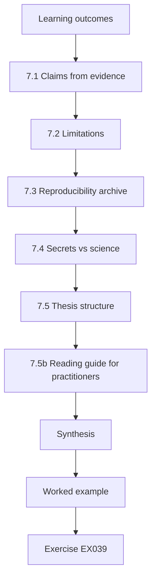

### Logical drawing

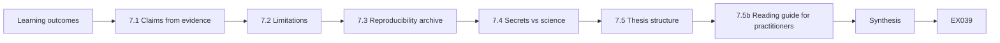

```text
[Learning outcomes]
    |
    v
[7.1 Claims from evidence]
    |
    v
[7.2 Limitations]
    |
    v
[7.3 Reproducibility archive]
    |
    v
[7.4 Secrets vs science]
    |
    v
[7.5 Thesis structure]
    |
    v
[7.5b Reading guide for practitioners]
    |
    v
[Synthesis]
    |
    v
[Worked example] --> [Exercise EX039]
```
<!-- cyberabc:lesson-figures:end ch-07 -->


### Learning outcomes

You will (1) synthesise claims that follow from evidence; (2) state limitations without apology theatre; (3) build a reproducibility archive others can run; (4) separate scientific artefacts from operational secrets; and (5) prepare the thesis structure.

### 7.1 Claims from evidence

Each claim cites a measure, a sample and conditions. Example: "On NHUSTL's synthetic ranges, enabling machine-checkable scope predicates reduced out-of-scope probes from 0.17/hour to 0.03/hour (20 engagements per arm)." Claims that need exploit detail are rewritten as measurement claims.

Elena's sentence names the setting, the rates and the sample. A claim such as "the lab is secure" would need exploit detail or a universal score; she rewrites every such draft as a measurement claim with conditions. Every claim in the results chapter should pass this test.

### 7.2 Limitations

List: synthetic topology; student operators; single checker implementation; English-only ROE; no live enterprise network. Limitations are not failures — they bound the claim.

Elena places the list before the discussion. Each line narrows where the 0.17 to 0.03 drop can be claimed: not yet on live enterprise networks, not yet with professional operators, not yet with other checker designs. Limitations are part of the contribution because they stop unsafe generalisation into live enterprise programmes. Each line is a bound on the claim, not an apology.

### 7.3 Reproducibility archive

Include: anonymised logs schema; checker source; scoring scripts; pre-registration; analysis notebooks that regenerate tables from raw data; environment pins. A peer should reproduce the primary table on a clean machine.

```python
"""Verify integrity of a synthetic evidence package."""
import hashlib, json
files = {
    "roe.pdf": b"SYNTHETIC-ROE-v1",
    "scope.csv": b"host,port\n10.20.1.10,443\n",
    "findings.json": b'[{"id":"SYN-001"}]',
}
expected = {n: hashlib.sha256(b).hexdigest()[:16] for n,b in files.items()}
# Simulate tampering of findings.json
current = dict(expected)
current["findings.json"] = hashlib.sha256(b'[{"id":"SYN-001"},{"id":"TAMPERED"}]').hexdigest()[:16]
print(json.dumps(expected, indent=1))
for n in sorted(expected):
    status = "OK" if expected[n] == current[n] else "MISMATCH"
    print(f"{n:16} {status}")
```

Expected output:

```text
{
 "roe.pdf": "18d74983d403e7db",
 "scope.csv": "01cc4815eddf3de6",
 "findings.json": "7f5f178ab43ef00f"
}
findings.json    MISMATCH
roe.pdf          OK
scope.csv        OK
```

Elena's archive regenerates the primary table — prose 0.17/hour against checker 0.03/hour, twenty engagements per arm — from the anonymised logs. Environment pins record the Python and checker versions. A peer who cannot rebuild the table on a clean machine has found a gap. Hash the release so examiners can detect accidental edits after pinning.

### 7.4 Secrets vs science

Keep out of the archive: real credentials, client names, weaponised procedures. Keep in: synthetic topologies, measures, code for scoping and scoring. Hash-pin the archive; the lab shows how a tampered findings file is detected.

Elena's private appendix holds authorization templates without signatures. The hash lab shows a tampered findings.json as MISMATCH while roe.pdf and scope.csv stay OK; she investigates, restores from a trusted copy and re-hashes before submission. Hash-pinning is what makes the archive trustworthy after it leaves your machine.

### 7.5 Thesis structure

Introduction; background (NIST 800-115, PTES, ATT&CK, TIBER-EU/CBEST, measurement critiques); related work; methods; results; discussion; ethics; archive guide; conclusion.

Elena's abstract states the question, measure and primary result in under 250 words, so a reader finds the claim before the archive guide. Each chapter maps to one stage of the doctorate: methods hold the pre-registration and ethics; results hold the rates; discussion and limitations bound the claim; and the archive guide tells a peer how to rebuild the primary table. Keep the order so examiners can find each piece quickly.

### 7.5b Reading guide for practitioners

Include a two-page reading guide at the front of the archive: how to install, how to replay the primary table, and which files are deliberately absent (and why). Busy assessors will not reverse-engineer your repository layout.

Elena's guide names the missing files — signed authorizations, any real vulnerability details — and the dual-use reason they are absent. Install and replay steps are numbered, with expected output matching the primary table. A colleague outside the project tests the guide on a clean machine before submission and reports any step that fails.

### 7.6 Worked example (synthetic NHUSTL case)

Elena's archive is a public repository with synthetic data and the checker. A private appendix holds institutional authorization templates without signatures. She verifies archive integrity with hashes before submission. Her synthesis chapter rejects the sentence "the lab is secure" in favour of the measured rate reduction under stated conditions.

The public repository is what examiners and later researchers can run. The private appendix stays inside the university. Hash verification before submission catches accidental edits that would make a rebuilt table disagree with the results chapter.

### 7.7 Errors and limits

- Archives that do not run.
- Claims broader than conditions.
- Mixing client secrets into public artefacts.

Each error weakens the thesis. Archives that do not run cannot support the reproducibility claim. Claims broader than the conditions invite readers to apply results where they were never tested. Client secrets in public artefacts turn research into an exposure. Check the archive and synthesis chapter for all three before submission. Ask a reviewer to check them too. Elena's reviewer replays the primary table from the public archive and searches it for client names before she submits.

### Exercises

- **EX039 — Claim.** Write one evidence-bound claim. Rubric: 3 = measure, sample, conditions; 2 = two; 1 = slogan; 0 = none.
- **EX040 — Limits.** List five limitations. Rubric: 3 = five apt; 2 = four; 1 = two; 0 = none.
- **EX041 — Archive.** List six archive contents. Rubric: 3 = six; 2 = four; 1 = two; 0 = none.
- **EX042 — Hash lab.** What does MISMATCH on findings.json imply? Rubric: 3 = tamper/change since pin; block trust; investigate; 2 = two; 1 = one; 0 = wrong.
- **EX043 — Secrets.** Classify four items as public archive vs private. Rubric: 3 = four correct; 2 = three; 1 = one; 0 = none.
- **EX044 — Structure.** Outline eight thesis chapters. Rubric: 3 = coherent order; 2 = most; 1 = few; 0 = none.

### Synthesis

Synthesis ties claims to evidence; the archive lets others check you; secrets stay out of the science pack.

### Continue studying — chapter 07 of 08

[← Chapter 06 (draft)](#ch-06) · [Course chapter index](../SUBJECTS.md) · [Chapter 08 (draft) →](#ch-08)

<a id="ch-08"></a>

## Chapter 8 — Defense and publication plan

<!-- cyberabc:lesson-figures:start ch-08 -->
### Lesson map

Lesson 08 published. Map, example, EX045.

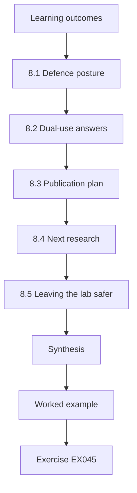

### Logical drawing

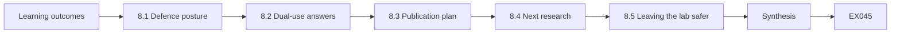

```text
[Learning outcomes]
    |
    v
[8.1 Defence posture]
    |
    v
[8.2 Dual-use answers]
    |
    v
[8.3 Publication plan]
    |
    v
[8.4 Next research]
    |
    v
[8.5 Leaving the lab safer]
    |
    v
[Synthesis]
    |
    v
[Worked example] --> [Exercise EX045]
```
<!-- cyberabc:lesson-figures:end ch-08 -->


### Learning outcomes

You will (1) defend methods, ethics and claims under examination; (2) answer dual-use and generalisation challenges; (3) plan publications that help defenders without enabling attackers; (4) map next research; and (5) leave the lab safer than you found it.

### 8.1 Defence posture

Open with the question, the measure and the primary result with intervals. Expect questions on: authorization; why synthetic labs; independence; what would falsify the claim; how operators might game the checker. Bring the pre-registration and a live demo of the checker on synthetic proposals.

Elena's opening fits in about ninety seconds: machine-checkable predicates versus prose ROE; out-of-scope probes per hour; 0.17 against 0.03 with intervals; synthetic NHUSTL ranges, student operators, twenty engagements per arm. The live demo shows a DENY on 8.8.8.8 before any packet leaves.

### 8.2 Dual-use answers

"We publish predicates and rates, not exploit chains. All targets were synthetic. Any real issue found on institutional systems went through coordinated disclosure." If pressed for a demo of an attack, refuse and offer a demo of the scope denial instead.

Elena's four-part answer is: refuse the exploit; demo the scope denial; restate the ethics and dual-use rules; note coordinated disclosure for any real issue. A demand for attack detail at a defence is usually a test of judgement. Offer the scope demo immediately, so the refusal is not the end of the answer.

### 8.3 Publication plan

Target: a measurement/ethics venue for the main result; a short practitioner brief for authorised teams; no "how to bypass" companion. Cite frameworks accurately (NIST SP 800-115, PTES, ATT&CK, WSTG, TIBER-EU, CBEST) with versions and dates.

Elena's plan lists one journal submission on measurement and ethics, with no exploit details, and one open archive release with hashes. Framework citations carry versions and access dates, because ATT&CK and WSTG change. There is no companion paper on how to bypass the checker.

### 8.4 Next research

External replication on another university lab; enterprise pilot under separate authorization; human-factors study of false stops; comparison with threat-led scenario controls from TIBER-style exercises.

```python
"""ATT&CK-style coverage matrix over synthetic authorized techniques (names only)."""
# Synthetic engagement log: technique_id -> observed (True/False)
PLAN = ["T1046", "T1595", "T1082", "T1083", "T1059", "T1078", "T1021"]
OBSERVED = {"T1046", "T1595", "T1082", "T1083", "T1078"}
LABELS = {
    "T1046": "Network Service Discovery",
    "T1595": "Active Scanning",
    "T1082": "System Information Discovery",
    "T1083": "File and Directory Discovery",
    "T1059": "Command and Scripting Interpreter",
    "T1078": "Valid Accounts",
    "T1021": "Remote Services",
}
covered = 0
for tid in PLAN:
    hit = tid in OBSERVED
    covered += hit
    print(f"{tid} {LABELS[tid]:34} {'COVERED' if hit else 'PLANNED-NOT-SEEN'}")
print(f"coverage={covered}/{len(PLAN)} ({100*covered/len(PLAN):.0f}%)")
```

Expected output:

```text
T1046 Network Service Discovery          COVERED
T1595 Active Scanning                    COVERED
T1082 System Information Discovery       COVERED
T1083 File and Directory Discovery       COVERED
T1059 Command and Scripting Interpreter  PLANNED-NOT-SEEN
T1078 Valid Accounts                     COVERED
T1021 Remote Services                    PLANNED-NOT-SEEN
coverage=5/7 (71%)
```

Elena's next-research page lists these four, each with a one-line authorization note. External replication comes first: another lab running the same checker and measures under its own approval. Enterprise pilots need separate authorization from the lab study, and must not reuse NHUSTL's synthetic-only approval. The human-factors study builds on the pilot's two false stops, asking how checker messages could help operators notice a mistyped in-scope host.

### 8.5 Leaving the lab safer

Document checker defaults; train the next cohort on stop conditions; remove any temporary exceptions; donate the synthetic topology to teaching. Coverage reporting (the lab) becomes a teaching exercise in humility: planned-not-seen is a prompt for the next authorized study, not a trophy.

Elena pins checker defaults, trains the next cohort on stop conditions, removes temporary exceptions and donates the synthetic topology to teaching. Planned-not-seen techniques from the coverage lab go on the next authorized study plan, with permission, rather than being tested freelance.

### 8.6 Worked example (synthetic NHUSTL case)

At defence, Elena is asked whether results generalise to CBEST-style assessments. She answers that CBEST is threat-led and regulator-supervised for financial firms; her contribution is a measurement instrument for scope compliance that such programmes could adopt, not a substitute for intelligence-led scenarios. She refuses a request to show a "fun exploit" and demos a DENY on `8.8.8.8` instead. Her publication plan lists one journal submission and one open archive release with hashes.

The CBEST answer is complementary, not substitute: a scope-compliance instrument could support such programmes, but does not replace intelligence-led scenarios or supervisory oversight. The refused exploit demo and the DENY on 8.8.8.8 show the same dual-use discipline as the publication plan.

### 8.7 Errors and limits

- Overclaiming generalisation to live enterprises.
- Publishing bypass recipes.
- Leaving temporary wide scope rules enabled.

Each error undoes earlier care. Overclaiming generalisation to live enterprises goes beyond synthetic labs and student operators. Publishing bypass recipes turns measurement research into an attack resource. Leaving temporary wide scope rules enabled is a risk to the next cohort. Check the defence and handoff plan for all three. Elena's handoff checklist names each one. Temporary wide scope rules are removed from the checker configuration, and the removal date is recorded on the checklist.

### Exercises

- **EX045 — Opening.** Write a 90-second defence opening. Rubric: 3 = question, measure, result, conditions; 2 = three; 1 = vague; 0 = none.
- **EX046 — Dual-use.** Answer "show us the exploit" in four sentences. Rubric: 3 = refuse, offer scope demo, ethics, CVD; 2 = three; 1 = shows exploit; 0 = none.
- **EX047 — CBEST.** Relate your work to CBEST without overclaim. Rubric: 3 = complementary, not substitute; 2 = partial; 1 = "we replace CBEST"; 0 = none.
- **EX048 — Pubs.** Plan two publications with venues and what is excluded. Rubric: 3 = both with exclusions; 2 = one; 1 = vague; 0 = none.
- **EX049 — Coverage lab.** How would you use a planned-not-seen technique ethically? Rubric: 3 = next authorized study, no freelance testing; 2 = partial; 1 = just attack it; 0 = none.
- **EX050 — Handoff.** List five handoff actions to leave the lab safer. Rubric: 3 = five apt; 2 = three; 1 = one; 0 = none.

### Synthesis

Defence and publication prove that your contribution is measured, ethical and usable — and that you will not trade integrity for spectacle.

### Continue studying — chapter 08 of 08

[← Chapter 07 (draft)](#ch-07) · [Course chapter index](../SUBJECTS.md) · [Worked results ↓](#worked-results) · [Next course via chapter index →](../SUBJECTS.md)

<a id="worked-results"></a>

## Worked results

Model answers; any answer meeting the rubric scores equally. North Harbour University Secure Testing Lab, Elena Varga and all their numbers are synthetic.

**EX001.** Owner: NHUSTL director. Systems: 10.20.0.0/16 and 192.168.50.0/24 lab ranges. Dates: study window. Actions: enumerated service discovery and credential use only on synthetic accounts. Data: synthetic only. Contacts: supervisor and lab on-call.

**EX002.** 10.20.0.1:443 is deny-listed infrastructure. 192.168.50.20:3389 uses a port outside {22,80,443,8080}. 8.8.8.8:80 is outside the CIDRs.

**EX003.** Real personal data appears → stop, notify privacy contact. Out-of-scope host contacted → stop, notify lab owner. Availability impact on shared lab services → stop, notify on-call.

**EX004.** Out-of-scope probes per engagement-hour, with a 95% interval, controlling for operator and slot. Confounders: briefing differences, topology changes.

**EX005.** Same 15% rate, but 3/20 has a wide interval (~5–36%) while 300/2000 is ~13.5–16.6%, so only the larger sample supports a precise claim.

**EX006.** Publish predicates, measures and rates; omit payloads and exploit steps; use synthetic targets; route real issues through coordinated disclosure.

**EX007.** Authorization, ROE, scope versions, tool versions, redacted logs, findings with evidence hashes.

**EX008.** NIST 800-115: assessment process. PTES: engagement phases. WSTG: web cases. TIBER-EU: EU threat-led for finance. CBEST: UK threat-led supervisory assessments.

**EX009.** "Does requiring human confirmation for high-impact lab actions reduce unapproved privilege-escalation attempts per hour in authorized teaching labs?"

**EX010.** SYN-001 combines high impact, high exploitability and moderate exposure (score 20). SYN-002 has low impact and exploitability despite high exposure (score 9).

**EX011.** It means 5 of 7 planned techniques were observed. It does not mean residual risk is 29% or that the system is mostly safe.

**EX012.** OSSTMM treats security as a quantity summarised by the rav, which collapses unlike properties into one number and is not a valid measure of operational security.

**EX013.** They are intelligence-led, focused on critical business services, and run with regulatory oversight — not only opportunistic vulnerability discovery.

**EX014.** Prior work states ROE in prose. Threat-led frameworks demand scenario fidelity. Few studies measure out-of-scope reduction. Elena will compare prose vs predicates on probe rate. Ethics: synthetic lab only.

**EX015.** "Among authorized NHUSTL engagements, does enabling a scope checker reduce out-of-scope probes per hour versus prose ROE alone?"

**EX016.** Population, intervention, primary measure, secondary measures, analysis, sample size, exclusions, ethics constraints.

**EX017.** denial-of-service is a deny-action. password-spray-lab without approval needs-approval. service-enum at 18:00 is outside-hours.

**EX018.** Consent; synthetic targets; no real credentials; dual-use publication limits.

**EX019.** Pilot variance suggests tens of engagements are needed to see a drop from ~0.2 to ~0.05/hour; 20 per arm is feasible in two terms.

**EX020.** Supervisor signs science; ethics board signs people protocol; lab owner signs systems authorization.

**EX021.** Host, port, action, timestamp, allow/deny, reason, operator ID, engagement ID.

**EX022.** Otherwise you compare different definitions of "out-of-scope" and cannot attribute differences to the intervention.

**EX023.** Twenty-five minutes from noting SYN-001 to stop shows a stop process exists; research can try to shorten it.

**EX024.** Improve host input validation and feedback; do not broaden scope to hide UX bugs.

**EX025.** Valid authorization; locked instruments; non-zero baseline rate; ethics unchanged.

**EX026.** Checker false-stop rate >30% → no-go; redesign UX and re-pilot before main study.

**EX027.** Same topology image, same briefing script and duration, same allowed tool categories, interleaved time slots.

**EX028.** "With 20 engagements per arm on NHUSTL synthetic ranges, out-of-scope probes fell from 0.17/hour (0.12–0.23) under prose ROE to 0.03/hour (0.01–0.07) with predicates."

**EX029.** Two validators blind to arm label re-score logs; report percent agreement and disagreements adjudication.

**EX030.** Yes — exclusions were pre-registered for infra failure, and the case is reported in limitations.

**EX031.** "Port-not-in-scope dominated denies" is exploratory; it was not the primary hypothesis.

**EX032.** Small samples produce wide Wilson intervals, so precise claims need larger n.

**EX033.** Practitioner: ecological validity? Statistician: interval correct? Ethicist: authorization adequate? Blue lead: is the report actionable?

**EX034.** Major: only one operator produced most events — fix by reporting operator-level results and sensitivity without that operator.

**EX035.** Clarifications, sensitivity analyses, or new data under an amended pre-registration — not a new primary success definition.

**EX036.** Gaming the checker (mitigate: log attempts); infra drift (pin images); validator incentives (independent lab).

**EX037.** High bit counts can still be weak if patterned; likewise a single security score can look strong while hiding failures.

**EX038.** Columns: reviewer comment; response; manuscript location of change.

**EX039.** "Predicate checking reduced out-of-scope probes from 0.17 to 0.03 per hour (20 engagements/arm, NHUSTL synthetic ranges)."

**EX040.** Synthetic topology; student operators; one checker; English ROE; no enterprise live network.

**EX041.** Schema; checker source; scoring scripts; pre-registration; analysis notebooks; environment pins.

**EX042.** The file changed since pinning — do not trust it; investigate; restore from a trusted copy.

**EX043.** Public: synthetic topology, checker code. Private: signed authorization, any real vulnerability details.

**EX044.** Intro; background; related work; methods; results; discussion; ethics/archive; conclusion.

**EX045.** "I asked whether machine-checkable scope predicates reduce out-of-scope probes versus prose ROE. On our synthetic lab ranges, rates fell from 0.17 to 0.03 per hour across 20 engagements per arm."

**EX046.** "I will not demonstrate an exploit. I can demonstrate the scope checker denying an out-of-scope host. Our ethics and dual-use rules forbid publishing attack procedures. Real issues go through coordinated disclosure."

**EX047.** CBEST is a regulator-led, threat-intelligence-driven assessment for financial firms. A scope-compliance instrument could support such programmes; it does not replace intelligence-led scenarios or supervisory oversight.

**EX048.** Journal paper on measurement/ethics (no exploit details). Practitioner brief on configuring checkers (no client data).

**EX049.** Add it to the next authorized study plan with permission — do not freelance-test it.

**EX050.** Pin checker defaults; train stop conditions; remove temp exceptions; publish synthetic topology; transfer on-call docs.

<a id="references"></a>

## References

Links checked 12 October 2026; frameworks change, so re-verify. arXiv identifiers were opened and titles checked.

- Albrecht, M. R., Jensen, R. B. (2020). The Vacuity of the Open Source Security Testing Methodology Manual. arXiv:2010.06377.
- Bank of England / PRA. CBEST Threat Intelligence-Led Assessments — Implementation Guide (2024 update). <https://www.bankofengland.co.uk/financial-stability/operational-resilience-of-the-financial-sector/cbest-threat-intelligence-led-assessments-implementation-guide>
- European Central Bank. TIBER-EU Framework. <https://www.ecb.europa.eu/paym/cyber-resilience/tiber-eu/html/index.en.html>
- MITRE ATT&CK. <https://attack.mitre.org/>
- NIST SP 800-115 (2008). Technical Guide to Information Security Testing and Assessment. <https://doi.org/10.6028/NIST.SP.800-115>
- OWASP Web Security Testing Guide (WSTG). <https://owasp.org/www-project-web-security-testing-guide/>
- Penetration Testing Execution Standard (PTES). <https://pentest-standard.readthedocs.io/en/latest/>
