# Segurança Ofensiva Autorizada e Red Team: Um Companheiro de Pesquisa para o Doutorado

- Idioma: português do Brasil (`pt`); trilha de pesquisa de doutorado, dois anos; aproximadamente 1.600 horas de estudo planejado. Edição de referência: [inglês](../../en/book/MANUSCRIPT.md).
- Estado editorial: **publicado**. Os capítulos 1–8 de 8 têm texto didático escrito; os exercícios EX001–EX050 têm resoluções correspondentes com rubricas de 0 a 3; os laboratórios offline usam a biblioteca padrão do Python 3, e as saídas impressas foram produzidas por execuções reais, apenas sobre dados sintéticos. A revisão independente e a verificação de 300 páginas A4 continuam em aberto. Cobertura de capítulos em rascunho não é um livro concluído.
- Público: pesquisadores avançados que vão projetar, conduzir e defender uma contribuição original em medição, ética ou metodologia de segurança ofensiva autorizada e de red team.
- Relação com os livros vizinhos: o [livro de mestrado](../../../../masters-2-years/offensive-security-red-team/en/book/MANUSCRIPT.md) ensina uma primeira dissertação supervisionada; o [livro de pós-graduação](../../../../postgraduate-2-years/offensive-security-red-team/en/book/MANUSCRIPT.md) ensina a prática especializada. **Este livro trata de produzir e defender conhecimento novo**: integridade, mapeamento da fronteira, uma proposta falseável, replicação da linha de base, um estudo principal com validação independente, crítica, um arquivo e uma defesa.
- Autor: [hiagokinlevi](https://github.com/hiagokinlevi). Texto original sob [CC0 1.0](../../../../../LICENSE); as obras citadas mantêm seus direitos.
- Limite educacional: não é uma qualificação e **não concede autorização para testar sistemas reais**. Todas as organizações, pessoas, achados e números dos exemplos são **sintéticos**, salvo quando uma frase cita uma fonte pública. Os laboratórios ensinam escopo, medição e relato — nunca técnicas transformadas em arma.

[Página do curso](../../README.md) · [Índice de capítulos](../SUBJECTS.md) · [Plano do livro](PLAN.md) · [Skill do curso](../../skill/SKILL.md) · [Resoluções](#worked-results)

## Como usar este rascunho

Oito capítulos seguem o arco de um doutorado: integridade e métodos (1), a fronteira da pesquisa (2), uma proposta (3), replicação da linha de base e piloto (4), o estudo principal e a validação independente (5), crítica por pares e revisão (6), síntese e um arquivo de reprodutibilidade (7), e defesa e publicação (8). Cada capítulo tem objetivos de aprendizagem, texto didático, um exemplo resolvido, erros e limites, exercícios pontuados de 0 a 3 (0 ausente ou inseguro; 1 lacuna grave; 2 lacunas menores; 3 completo e justificado), uma síntese e um bloco **Continue estudando**. Os laboratórios são determinísticos, rodam offline com `python3 arquivo.py` sobre dados sintéticos e imprimem os resultados mostrados em *Saída esperada*.

### O exemplo contínuo (sintético): North Harbour University Secure Testing Lab

> **Caso sintético — ficção.** O **North Harbour University Secure Testing Lab (NHUSTL)** é um laboratório universitário inventado. A doutoranda *Elena Varga* estuda se *predicados de escopo verificáveis por máquina* (listas de permissão de CIDR, portas e ações avaliadas antes de cada fase) reduzem as sondagens fora do escopo em comparação com regras de engajamento (ROE) apenas em prosa, em ambientes de laboratório autorizados e isolados, com alvos sintéticos. Todos os números sobre o NHUSTL são inventados. Nenhuma rede real é tocada.

### Política de fontes

As fontes foram conferidas em 12 de outubro de 2026: [NIST SP 800-115](https://doi.org/10.6028/NIST.SP.800-115) (*Technical Guide to Information Security Testing and Assessment*); o [Penetration Testing Execution Standard (PTES)](https://pentest-standard.readthedocs.io/en/latest/); o [MITRE ATT&CK](https://attack.mitre.org/); o [OWASP Web Security Testing Guide (WSTG)](https://owasp.org/www-project-web-security-testing-guide/); o [TIBER-EU](https://www.ecb.europa.eu/paym/cyber-resilience/tiber-eu/html/index.en.html); e o [CBEST](https://www.bankofengland.co.uk/financial-stability/operational-resilience-of-the-financial-sector/cbest-threat-intelligence-led-assessments-implementation-guide) (guia de implementação do Bank of England, atualização de 2024). Os artigos de pesquisa são citados pelo identificador arXiv, e cada um foi aberto e teve o título conferido. Os frameworks mudam; confira-os de novo antes de se apoiar neles. O conteúdo jurídico é orientação, não aconselhamento jurídico.

## Sumário

| Etapa | Capítulo |
|---|---|
| 1 | [1 Integridade e métodos avançados de pesquisa](#ch-01) |
| 1 | [2 Segurança ofensiva autorizada e red team: fronteira da pesquisa](#ch-02) |
| 2 | [3 Proposta de contribuição original](#ch-03) |
| 2 | [4 Replicação da linha de base e piloto](#ch-04) |
| 3 | [5 Estudo principal e validação independente](#ch-05) |
| 3 | [6 Crítica por pares e revisão](#ch-06) |
| 4 | [7 Síntese da tese e arquivo de reprodutibilidade](#ch-07) |
| 4 | [8 Plano de defesa e publicação](#ch-08) |

[Resoluções](#worked-results) · [Referências](#references)

<a id="ch-01"></a>

## Capítulo 1 — Integridade e métodos avançados de pesquisa

<!-- cykin:lesson-figures:start ch-01 -->
### Mapa da aula

Aula 01 publicada. Mapa, exemplo, EX001.

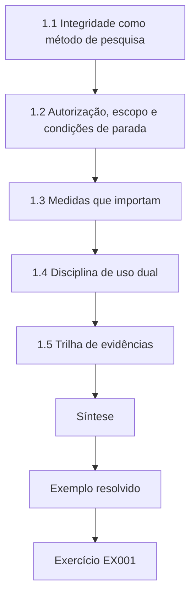

### Desenho lógico

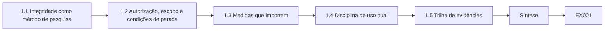

```text
[1.1 Integridade como método de pesquisa]
    |
    v
[1.2 Autorização, escopo e condições de parada]
    |
    v
[1.3 Medidas que importam]
    |
    v
[1.4 Disciplina de uso dual]
    |
    v
[1.5 Trilha de evidências]
    |
    v
[Síntese]
    |
    v
[Exemplo resolvido] --> [Exercício EX001]
```
<!-- cykin:lesson-figures:end ch-01 -->


### Objetivos de aprendizagem

Você vai (1) enunciar as regras de integridade que regem a pesquisa em segurança ofensiva autorizada; (2) projetar estudos que não possam causar dano a pessoas nem a sistemas fora do escopo; (3) escolher medidas que reflitam efeitos, não teatro; (4) lidar com responsabilidade com conhecimento de uso dual; e (5) manter uma trilha de evidências que outros possam auditar.

### 1.1 Integridade como método de pesquisa

Nesta área, um controle de integridade que falha não é uma questão de papelada — é uma sondagem fora do escopo, uma credencial vazada ou uma negação de serviço contra um hospital. Integridade significa: autorização por escrito antes de qualquer interação com um alvo; um escopo que um terceiro possa verificar; condições de parada ensaiadas; dados sintéticos ou consentidos; e registros que mostrem o que foi feito e por quê. O NIST SP 800-115 enquadra a avaliação como uma atividade planejada, com regras; o PTES coloca o escopo e a coleta de inteligência antes de qualquer teste. Seu doutorado herda esses hábitos e acrescenta os padrões da pesquisa: pré-registro das medidas, replicação e limites honestos.

### 1.2 Autorização, escopo e condições de parada

A autorização nomeia o proprietário, os sistemas, as datas, as ações permitidas e as regras sobre dados. O escopo é o conjunto de hosts, portas, identidades e ações que estão incluídos. As condições de parada — por exemplo, qualquer dado pessoal real, qualquer host fora do escopo, qualquer impacto na disponibilidade — interrompem o trabalho e acionam o escalonamento. Um escopo verificável por máquina (listas de CIDR, portas e ações) torna as violações detectáveis em vez de discutíveis.

```python
"""Check proposed engagement targets against a written scope (synthetic)."""
SCOPE_CIDRS = [("10.20.0.0", 16), ("192.168.50.0", 24)]  # inclusive synthetic ranges
SCOPE_PORTS = {22, 80, 443, 8080}
DENY_HOSTS = {"10.20.0.1", "192.168.50.1"}  # out-of-scope infra

def ip_int(s):
    a,b,c,d = map(int, s.split("."))
    return (a<<24)|(b<<16)|(c<<8)|d

def in_cidr(ip, net, bits):
    mask = (0xFFFFFFFF << (32-bits)) & 0xFFFFFFFF
    return (ip_int(ip) & mask) == (ip_int(net) & mask)

def check(host, port):
    reasons = []
    if host in DENY_HOSTS:
        reasons.append("deny-list")
    if not any(in_cidr(host, n, b) for n,b in SCOPE_CIDRS):
        reasons.append("outside-cidr")
    if port not in SCOPE_PORTS:
        reasons.append("port-not-in-scope")
    return ("ALLOW" if not reasons else "DENY"), reasons

tests = [
    ("10.20.1.10", 443),
    ("10.20.0.1", 443),
    ("192.168.50.20", 22),
    ("192.168.50.20", 3389),
    ("8.8.8.8", 80),
    ("192.168.1.10", 80),
]
for h,p in tests:
    v, r = check(h,p)
    print(f"target={h}:{p} decision={v} reasons={','.join(r) or '-'}")
```

Saída esperada:

```text
target=10.20.1.10:443 decision=ALLOW reasons=-
target=10.20.0.1:443 decision=DENY reasons=deny-list
target=192.168.50.20:22 decision=ALLOW reasons=-
target=192.168.50.20:3389 decision=DENY reasons=port-not-in-scope
target=8.8.8.8:80 decision=DENY reasons=outside-cidr
target=192.168.1.10:80 decision=DENY reasons=outside-cidr
```

O laboratório de Elena usa as faixas e portas do exemplo resolvido: sondagens dirigidas a 8.8.8.8 ou à porta 3389 são negadas antes que qualquer pacote saia. Escreva as condições de parada no runbook e ensaie-as, para que os operadores saibam o que fazer quando uma delas disparar.

### 1.3 Medidas que importam

Conte efeitos: sondagens fora do escopo, achados confirmados com evidências, tempo até a parada após uma violação, verificação da remediação. Evite contagens de vaidade, como "número de ferramentas executadas". Relate taxas com intervalos. Ao comparar métodos, mude um fator por vez e mantenha o ambiente fixo.

```python
"""Lab S: reporting attack-success rates honestly: Wilson intervals,
seed variation and a paired bootstrap. Synthetic trial outcomes only."""
import math, random
def wilson(k, n, z=1.96):
    p = k/n; d = 1 + z*z/n
    c = (p + z*z/(2*n))/d; h = z*math.sqrt(p*(1-p)/n + z*z/(4*n*n))/d
    return c - h, c + h
for k, n in ((3, 20), (30, 200), (300, 2000)):
    lo, hi = wilson(k, n); print(f"successes={k}/{n} rate={k/n:.3f} wilson95=[{lo:.3f}, {hi:.3f}]")
# five seeds of a synthetic defence evaluation: per-seed attack success rate
rates = []
for seed in range(5):
    r = random.Random(seed); rates.append(sum(r.random() < 0.12 for _ in range(200))/200)
m = sum(rates)/5; sd = math.sqrt(sum((x-m)**2 for x in rates)/4)
print("per-seed rates:", " ".join(f"{x:.3f}" for x in rates), f"mean={m:.3f} sd={sd:.3f}")
# paired bootstrap: baseline vs defence on the same 300 synthetic trials
r = random.Random(42)
base = [r.random() < 0.30 for _ in range(300)]
defn = [b and r.random() < 0.6 for b in base]   # defence blocks ~40% of successes
diffs = []
for _ in range(2000):
    idx = [r.randrange(300) for _ in range(300)]
    diffs.append(sum(base[i] for i in idx)/300 - sum(defn[i] for i in idx)/300)
diffs.sort()
print(f"baseline_asr={sum(base)/300:.3f} defended_asr={sum(defn)/300:.3f} "
      f"reduction_ci95=[{diffs[50]:.3f}, {diffs[1949]:.3f}]")
```

Saída esperada:

```text
successes=3/20 rate=0.150 wilson95=[0.052, 0.360]
successes=30/200 rate=0.150 wilson95=[0.107, 0.206]
successes=300/2000 rate=0.150 wilson95=[0.135, 0.166]
per-seed rates: 0.110 0.130 0.135 0.105 0.145 mean=0.125 sd=0.017
baseline_asr=0.350 defended_asr=0.190 reduction_ci95=[0.120, 0.203]
```

O laboratório de estatística mostra por que as contagens importam: 3 sucessos em 20 e 300 em 2.000 dão ambos uma taxa de 15%, mas os intervalos de Wilson são de cerca de 5–36% e de 13,5–16,6%. Só a amostra maior sustenta uma afirmação precisa. A medida primária de Elena é o número de sondagens fora do escopo por hora de engajamento, com um intervalo.

### 1.4 Disciplina de uso dual

Sua tese vai discutir técnicas que poderiam ser mal utilizadas. Publique métodos e medição, não procedimentos transformados em arma. Prefira alvos sintéticos e topologias de laboratório abertas. Encaminhe qualquer fraqueza real encontrada durante a pesquisa por divulgação coordenada. O OSSTMM de Herzog foi influente, mas Albrecht e Jensen (arXiv:2010.06377) mostram por que uma única "quantidade de segurança" é uma medida de pesquisa pobre — prefira métricas concretas e contextuais. O protocolo de Elena declara que ela publicará predicados, taxas e código de pontuação, não cadeias de exploração, e que qualquer problema real encontrado em sistemas da instituição passará por divulgação coordenada. Suas medidas são concretas — taxas de sondagem e tempo até a parada —, não uma pontuação única de segurança.

### 1.5 Trilha de evidências

Guarde: a autorização, as ROE, as versões do escopo, as versões das ferramentas, os logs brutos (com dados ocultados), os achados com hashes das evidências e um registro de mudanças. Um auditor deve conseguir responder "o que foi tentado, contra o quê, quando e sob qual permissão?" A trilha de Elena registra também qual versão do escopo estava ativa quando cada sondagem foi registrada, de modo que uma disputa posterior sobre o que estava incluído possa ser resolvida pelo registro, e não pela memória. Fixe as versões das ferramentas ao lado dos logs. Guarde a trilha onde só a equipe do estudo e os orientadores possam lê-la.

### 1.6 Exemplo resolvido (caso sintético do NHUSTL)

O primeiro plano de integridade de Elena: todos os estudos rodam nas faixas isoladas `10.20.0.0/16` e `192.168.50.0/24` do NHUSTL; as portas se limitam a 22, 80, 443 e 8080; a lista de negação inclui `10.20.0.1`. O laboratório de escopo mostra como uma sondagem proposta para `8.8.8.8:80` ou `192.168.50.20:3389` é negada antes que os pacotes saiam. Ela pré-registra duas medidas: a taxa de sondagens fora do escopo e os minutos entre a anotação da violação e a parada. Essas duas medidas se tornam seus desfechos primário e secundário. As decisões de negação no laboratório de escopo são a primeira evidência de que o verificador funciona antes de qualquer engajamento começar. Ambas aparecem em seu plano de integridade antes do primeiro engajamento.

### 1.7 Erros e limites

Três erros são comuns: autorização verbal; medidas que contam atividade em vez de efeitos; e publicação de receitas de exploração funcionais. Cada erro prejudica a integridade desde o início. A autorização verbal não pode ser verificada depois e não protege ninguém se uma sondagem causar dano. Contar ferramentas executadas ou pacotes enviados nada diz sobre se o escopo foi respeitado. Publicar receitas de exploração funcionais transforma a pesquisa num recurso de ataque. Verifique os três pontos em seu plano de integridade antes de qualquer engajamento começar. O plano de Elena nomeia a autorização por escrito, as medidas de efeito e os limites de uso dual antes de qualquer engajamento começar.

### Exercícios

- **EX001 — Autorização.** Redija os campos de autorização do estudo de Elena. Rubrica: 3 = proprietário, sistemas, datas, ações, dados, contatos; 2 = quatro; 1 = dois; 0 = nenhum.
- **EX002 — Laboratório de escopo.** Explique duas decisões DENY do laboratório. Rubrica: 3 = ambas com os motivos correspondentes; 2 = uma; 1 = vago; 0 = errado.
- **EX003 — Condição de parada.** Escreva três condições de parada com escalonamento. Rubrica: 3 = três com quem/como; 2 = duas; 1 = uma; 0 = nenhuma.
- **EX004 — Medida.** Proponha uma medida primária para comparar ROE em prosa com escopo verificável por máquina. Rubrica: 3 = medida de efeito, plano de intervalo, fatores de confusão; 2 = só a medida; 1 = contagem de vaidade; 0 = nenhuma.
- **EX005 — Laboratório de estatística.** Por que 300/2000 é mais informativo que 3/20 com a mesma taxa? Rubrica: 3 = largura do intervalo; 2 = parcial; 1 = vago; 0 = errado.
- **EX006 — Uso dual.** Como você vai publicar sem possibilitar o mau uso? Rubrica: 3 = métodos/medição, sem payloads, alvos sintéticos, caminho de divulgação coordenada; 2 = três; 1 = um; 0 = nenhum.
- **EX007 — Evidências.** Liste seis artefatos da trilha de evidências. Rubrica: 3 = seis adequados; 2 = quatro; 1 = dois; 0 = nenhum.

### Síntese

A integridade de doutorado em segurança ofensiva autorizada significa permissão, escopo verificável, medidas de efeito, contenção quanto ao uso dual e uma trilha auditável — antes de qualquer alegação de contribuição.

### Continue estudando — capítulo 01 de 08

[← Página do curso](../../README.md) · [Índice de capítulos do curso](../SUBJECTS.md) · [Capítulo 02 (rascunho) →](#ch-02)

<a id="ch-02"></a>

## Capítulo 2 — Segurança ofensiva autorizada e red team: fronteira da pesquisa

<!-- cykin:lesson-figures:start ch-02 -->
### Mapa da aula

Aula 02 publicada. Mapa, exemplo, EX008.

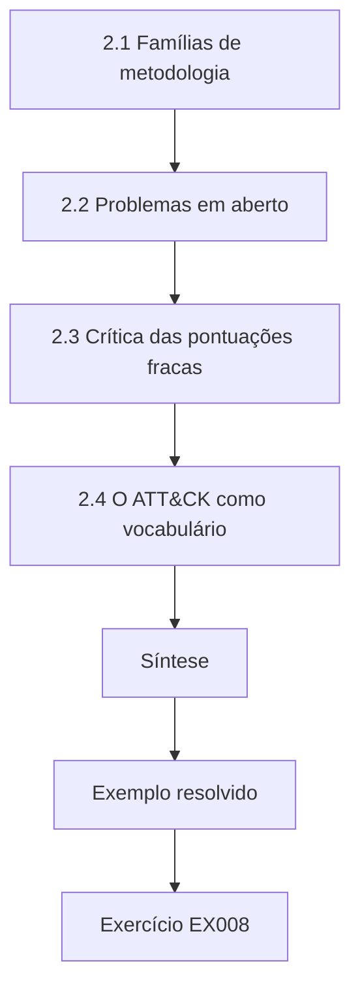

### Desenho lógico

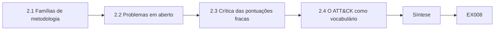

```text
[2.1 Famílias de metodologia]
    |
    v
[2.2 Problemas em aberto]
    |
    v
[2.3 Crítica das pontuações fracas]
    |
    v
[2.4 O ATT&CK como vocabulário]
    |
    v
[Síntese]
    |
    v
[Exemplo resolvido] --> [Exercício EX008]
```
<!-- cykin:lesson-figures:end ch-02 -->


### Objetivos de aprendizagem

Você vai (1) mapear as principais famílias de metodologia e os frameworks guiados por ameaças; (2) localizar problemas de pesquisa em aberto em medição, ética e garantia; (3) criticar esquemas de pontuação fracos; (4) posicionar o ATT&CK como vocabulário, não como prova de completude; e (5) escrever uma nota de fronteira que motive um doutorado.

### 2.1 Famílias de metodologia

O NIST SP 800-115 organiza a avaliação em planejamento, descoberta, ataque (cuidadosamente delimitado), relato e apoio à remediação. O PTES encadeia coleta de inteligência, modelagem de ameaças, análise de vulnerabilidades, exploração e pós-exploração sob escopo explícito. O OWASP WSTG fornece casos de teste específicos para a web. Frameworks guiados por ameaças, como o TIBER-EU e o CBEST, enfatizam cenários guiados por inteligência, colaboração de purple team e supervisão regulatória para sistemas financeiros críticos. Seu mapa da fronteira deve situar cada família pelo que ela otimiza: amplitude da cobertura técnica, realismo da emulação do adversário ou garantia para os supervisores.

O mapa de Elena coloca o NIST SP 800-115 e o PTES sob cobertura técnica, o WSTG sob casos web, e o TIBER-EU e o CBEST sob garantia guiada por ameaças. Seu doutorado se situa no primeiro grupo: ela mede se um instrumento de escopo reduz as sondagens fora do escopo, não se um cenário guiado por inteligência encontra fraquezas críticas para o negócio.

### 2.2 Problemas em aberto

Problemas em aberto adequados a um doutorado incluem: como medir a redução do risco fora do escopo; como validar que um controle bloqueou uma ação sem publicar uma exploração; como a cobertura de técnicas do ATT&CK se relaciona com o risco residual; como fatores humanos (fadiga, teatro de aprovação) afetam o cumprimento das ROE; e como comparar a qualidade de relatórios de red team. Evite "problemas" que são apenas "rodar mais ferramentas". O problema de Elena é o primeiro deles: medir se predicados verificáveis por máquina reduzem as sondagens fora do escopo. Um doutorado que apenas embrulha mais um scanner não tem pergunta de pesquisa, apenas uma tarefa de engenharia.

### 2.3 Crítica das pontuações fracas

Agregar a segurança num único número — como se criticou no rav do OSSTMM (arXiv:2010.06377) — esconde o que falhou e quem é afetado. Prefira achados estruturados, com impacto, evidências e estado de verificação. Pontuações de severidade podem priorizar o trabalho dentro de um engajamento; não são quantidades universais de segurança.

```python
"""Score synthetic findings for report priority (no exploit details)."""
# impact 0-3, exploitability 0-3, exposure 0-3  -> priority
findings = [
    ("SYN-001", "default admin password on staging web UI", 3, 3, 2),
    ("SYN-002", "missing security headers on public site", 1, 1, 3),
    ("SYN-003", "outdated TLS on internal admin port", 2, 2, 1),
    ("SYN-004", "verbose error messages disclose paths", 1, 2, 2),
    ("SYN-005", "service account with domain admin in lab AD", 3, 2, 1),
]

def priority(impact, exploitability, exposure):
    score = impact*4 + exploitability*2 + exposure
    if score >= 16: return "critical", score
    if score >= 11: return "high", score
    if score >= 7: return "medium", score
    return "low", score

for fid, title, i, e, x in findings:
    p, s = priority(i, e, x)
    print(f"{fid} priority={p:8} score={s:2} impact={i} exploitability={e} exposure={x} :: {title}")
```

Saída esperada:

```text
SYN-001 priority=critical score=20 impact=3 exploitability=3 exposure=2 :: default admin password on staging web UI
SYN-002 priority=medium   score= 9 impact=1 exploitability=1 exposure=3 :: missing security headers on public site
SYN-003 priority=high     score=13 impact=2 exploitability=2 exposure=1 :: outdated TLS on internal admin port
SYN-004 priority=medium   score=10 impact=1 exploitability=2 exposure=2 :: verbose error messages disclose paths
SYN-005 priority=critical score=17 impact=3 exploitability=2 exposure=1 :: service account with domain admin in lab AD
```

O laboratório de achados pontua impacto, explorabilidade e exposição sem descrever um caminho de ataque. O SYN-001, uma senha padrão de administrador na interface web de homologação, soma 20 e é crítico; o SYN-002, cabeçalhos ausentes, soma 9 e é médio. A severidade ajuda um operador a decidir o que corrigir primeiro dentro de um engajamento; não é uma quantidade universal de segurança.

### 2.4 O ATT&CK como vocabulário

O MITRE ATT&CK é uma base de conhecimento viva de táticas e técnicas de adversários. Use-o para rotular o que foi tentado e observado, para se comunicar com as equipes de blue team e para mostrar lacunas de cobertura. Não afirme que cobrir uma porcentagem da matriz significa que um sistema está seguro — a cobertura é um auxílio de planejamento e de relato.

```python
"""ATT&CK-style coverage matrix over synthetic authorized techniques (names only)."""
# Synthetic engagement log: technique_id -> observed (True/False)
PLAN = ["T1046", "T1595", "T1082", "T1083", "T1059", "T1078", "T1021"]
OBSERVED = {"T1046", "T1595", "T1082", "T1083", "T1078"}
LABELS = {
    "T1046": "Network Service Discovery",
    "T1595": "Active Scanning",
    "T1082": "System Information Discovery",
    "T1083": "File and Directory Discovery",
    "T1059": "Command and Scripting Interpreter",
    "T1078": "Valid Accounts",
    "T1021": "Remote Services",
}
covered = 0
for tid in PLAN:
    hit = tid in OBSERVED
    covered += hit
    print(f"{tid} {LABELS[tid]:34} {'COVERED' if hit else 'PLANNED-NOT-SEEN'}")
print(f"coverage={covered}/{len(PLAN)} ({100*covered/len(PLAN):.0f}%)")
```

Saída esperada:

```text
T1046 Network Service Discovery          COVERED
T1595 Active Scanning                    COVERED
T1082 System Information Discovery       COVERED
T1083 File and Directory Discovery       COVERED
T1059 Command and Scripting Interpreter  PLANNED-NOT-SEEN
T1078 Valid Accounts                     COVERED
T1021 Remote Services                    PLANNED-NOT-SEEN
coverage=5/7 (71%)
```

O laboratório de cobertura mostra 5 de 7 técnicas planejadas observadas, ou 71%. Técnicas planejadas e não vistas, como T1059 e T1021, entram no próximo plano autorizado. Elena usa o ATT&CK para rotular o que os operadores tentaram e o que foi observado, e para conversar com as equipes de blue team, não para alegar risco residual.

### 2.5 Exemplo resolvido (caso sintético do NHUSTL)

A nota de fronteira de Elena: trabalhos anteriores descrevem as ROE em prosa; frameworks guiados por ameaças exigem fidelidade de cenário; poucos estudos medem se predicados verificáveis por máquina reduzem ações fora do escopo. O laboratório de achados mostra a priorização de problemas sintéticos sem detalhes de exploração. O laboratório de cobertura mostra 71% de um conjunto planejado de técnicas observado — um fato de relato, não uma prova de segurança. Sua lacuna: uma comparação controlada entre escopo em prosa e escopo verificável quanto à taxa de sondagens fora do escopo.

A lacuna é mensurável, ética e não depende de ferramenta: uma comparação controlada entre escopo em prosa e escopo verificável quanto à taxa de sondagens fora do escopo, em laboratórios autorizados com alvos sintéticos. Essa frase se torna o primeiro parágrafo de sua proposta.

### 2.6 Erros e limites

Três erros são comuns: tratar a cobertura do ATT&CK como risco eliminado; "Níveis de segurança" de pontuação única; e notas de fronteira que listam ferramentas em vez de perguntas. Cada erro enfraquece a nota de fronteira. Ler a cobertura do ATT&CK como risco eliminado transforma um auxílio de planejamento numa falsa alegação de segurança. Um nível de segurança de pontuação única esconde o que falhou, como argumentam Albrecht e Jensen. Listar ferramentas em vez de perguntas produz um projeto de engenharia, não um doutorado. Verifique os três pontos em sua nota de fronteira antes da proposta. A nota de Elena evita os três.

### Exercícios

- **EX008 — Famílias.** Situe o NIST 800-115, o PTES, o WSTG, o TIBER-EU e o CBEST num mapa de uma página. Rubrica: 3 = os cinco, com propósito; 2 = quatro; 1 = dois; 0 = nenhum.
- **EX009 — Problema em aberto.** Enuncie um problema em aberto como pergunta mensurável. Rubrica: 3 = mensurável, ético, não dependente de ferramenta; 2 = mensurável; 1 = vago; 0 = nenhum.
- **EX010 — Laboratório de achados.** Por que o SYN-001 é crítico enquanto o SYN-002 é médio? Rubrica: 3 = impacto/explorabilidade/exposição; 2 = parcial; 1 = vago; 0 = errado.
- **EX011 — Cobertura.** O que 71% de cobertura significa e o que não significa? Rubrica: 3 = técnicas planejadas vistas; não é risco residual; 2 = um dos lados; 1 = "quase seguro"; 0 = nenhum.
- **EX012 — Crítica ao OSSTMM.** Resuma um argumento de Albrecht e Jensen (arXiv:2010.06377). Rubrica: 3 = preciso; 2 = parcial; 1 = vago; 0 = errado.
- **EX013 — Guiado por ameaças.** Em que o TIBER-EU/CBEST difere de um pentest genérico? Rubrica: 3 = guiado por inteligência, supervisão, serviços críticos; 2 = dois; 1 = um; 0 = nenhum.
- **EX014 — Nota de fronteira.** Escreva a lacuna de Elena em cinco frases. Rubrica: 3 = trabalhos anteriores, lacuna, medida, ética, contribuição; 2 = três; 1 = um; 0 = nenhum.

### Síntese

A fronteira da pesquisa está onde metodologia, medição e ética se encontram — não onde mais um scanner pode ser embrulhado. Mapeie os frameworks, rejeite pontuações vazias e enuncie uma lacuna mensurável.

### Continue estudando — capítulo 02 de 08

[← Capítulo 01 (rascunho)](#ch-01) · [Índice de capítulos do curso](../SUBJECTS.md) · [Capítulo 03 (rascunho) →](#ch-03)

<a id="ch-03"></a>

## Capítulo 3 — Proposta de contribuição original

<!-- cykin:lesson-figures:start ch-03 -->
### Mapa da aula

Aula 03 publicada. Mapa, exemplo, EX015.

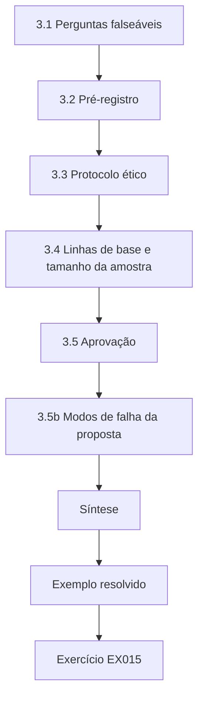

### Desenho lógico

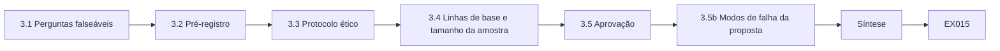

```text
[3.1 Perguntas falseáveis]
    |
    v
[3.2 Pré-registro]
    |
    v
[3.3 Protocolo ético]
    |
    v
[3.4 Linhas de base e tamanho da amostra]
    |
    v
[3.5 Aprovação]
    |
    v
[3.5b Modos de falha da proposta]
    |
    v
[Síntese]
    |
    v
[Exemplo resolvido] --> [Exercício EX015]
```
<!-- cykin:lesson-figures:end ch-03 -->


### Objetivos de aprendizagem

Você vai (1) escrever uma pergunta de pesquisa falseável; (2) especificar hipóteses, medidas e análise antes de coletar dados; (3) projetar um protocolo ético para estudos autorizados em laboratório; (4) planejar linhas de base e tamanhos de amostra; e (5) obter a aprovação da orientação e do comitê de ética.

### 3.1 Perguntas falseáveis

Uma boa pergunta pode estar errada. "Predicados de escopo verificáveis por máquina reduzem as sondagens fora do escopo em comparação com ROE em prosa, nos laboratórios autorizados do NHUSTL, medidas como sondagens por hora de engajamento?" pode falhar. "Como os red teams podem ser melhores?" não pode. A pergunta de Elena nomeia a população (laboratórios autorizados do NHUSTL), a intervenção (verificador de predicados ligado ou desligado) e a medida (sondagens fora do escopo por hora de engajamento). Um resultado sem diferença ainda seria publicável se o estudo tivesse poder estatístico e fosse executado conforme o planejado. Escreva a pergunta de modo que um resultado nulo ainda seja uma resposta clara.

### 3.2 Pré-registro

Anote: população (engajamentos na faixa do laboratório), intervenção (verificador de predicados ligado/desligado), medida primária (sondagens fora do escopo por hora), medidas secundárias (tempo até a parada, paradas falsas), análise (diferença de taxas com intervalo), exclusões (engajamentos abortados por falha de infraestrutura). Registre tudo antes do estudo principal. Elena registra o seu antes do primeiro engajamento do estudo principal. O arquivo também registra as versões do ATT&CK e do verificador, para que leitores posteriores saibam quais definições valiam. Um par deve conseguir conduzir o estudo principal só com esse arquivo. Guarde-o onde o orientador e o comitê de ética possam encontrá-lo.

### 3.3 Protocolo ético

Os participantes (operadores estudantes) consentem; os alvos são sintéticos; não há credenciais reais; um apêndice de uso dual explica o que não será publicado. Alinhe-se à ética institucional e à ênfase do NIST SP 800-115 em planejamento cuidadoso.

```python
"""Evaluate proposed actions against synthetic rules of engagement."""
ROE = {
    "hours": ("09:00", "17:00"),
    "deny_actions": {"denial-of-service", "phishing-staff", "exfiltrate-real-data"},
    "require_approval": {"password-spray-lab", "privilege-escalation-lab"},
    "max_concurrency": 5,
}
proposals = [
    ("service-enum", "10:30", 3, False),
    ("denial-of-service", "10:30", 1, False),
    ("password-spray-lab", "10:30", 2, False),
    ("password-spray-lab", "10:30", 2, True),
    ("service-enum", "18:00", 2, False),
    ("service-enum", "11:00", 20, False),
]

def ok_time(t):
    return ROE["hours"][0] <= t <= ROE["hours"][1]

for action, when, conc, approved in proposals:
    reasons=[]
    if action in ROE["deny_actions"]: reasons.append("deny-action")
    if action in ROE["require_approval"] and not approved: reasons.append("needs-approval")
    if not ok_time(when): reasons.append("outside-hours")
    if conc > ROE["max_concurrency"]: reasons.append("concurrency")
    print(f"action={action:20} when={when} conc={conc:2} approved={approved} -> {'ALLOW' if not reasons else 'DENY'} {','.join(reasons) or '-'}")
```

Saída esperada:

```text
action=service-enum         when=10:30 conc= 3 approved=False -> ALLOW -
action=denial-of-service    when=10:30 conc= 1 approved=False -> DENY deny-action
action=password-spray-lab   when=10:30 conc= 2 approved=False -> DENY needs-approval
action=password-spray-lab   when=10:30 conc= 2 approved=True -> ALLOW -
action=service-enum         when=18:00 conc= 2 approved=False -> DENY outside-hours
action=service-enum         when=11:00 conc=20 approved=False -> DENY concurrency
```

O laboratório de ROE mostra a mesma disciplina para ações propostas: a negação de serviço é negada; um password spray de laboratório precisa de aprovação; trabalho às 18:00 ou com concorrência 20 é negado. Achados de trabalho fora dessas regras nunca entram nos dados do estudo. Os termos de consentimento declaram o propósito, os dados usados, o direito de desistência e os contatos.

### 3.4 Linhas de base e tamanho da amostra

Estime a taxa fora do escopo sob ROE em prosa a partir de um piloto. Escolha uma amostra (engajamentos ou horas) capaz de detectar uma redução relevante — por exemplo, de 0,20 para 0,05 sondagem por hora — com uma largura de intervalo planejada. O piloto de Elena sugere uma taxa em prosa perto de 0,18 por hora. Detectar uma queda em direção a 0,05 com um intervalo útil exige da ordem de 20 engajamentos de duas horas por braço, o que é viável ao longo de dois semestres no NHUSTL. Registre o esboço como número de planejamento e refine-o depois da estimativa de variância do piloto.

### 3.5 Aprovação

O orientador assina a ciência; o comitê de ética, as pessoas; o proprietário do laboratório, os sistemas. Guarde as versões da proposta com datas. Elena registra as três antes do piloto. Uma mudança na proposta depois da aprovação exige uma emenda datada, não um e-mail. Sem as três, o piloto não começa. Guarde as cópias assinadas com o pré-registro e verifique, antes de cada engajamento, se as datas ainda cobrem o trabalho. Uma autorização do laboratório ou uma aprovação ética vencida suspende a pesquisa, assim como a avaliação.

### 3.5b Modos de falha da proposta

Modos de falha comuns: uma pergunta que só o braço da intervenção pode "vencer" por construção; medidas que punem o relato (os operadores escondem sondagens); uma ética que bloqueia a validação independente. Teste a proposta sob estresse perguntando que resultado faria você abandonar a ideia e se esse resultado é observável. Para Elena, um resultado que levaria a abandonar a ideia é um verificador que não reduz as sondagens fora do escopo depois de corrigidas as paradas falsas. Esse resultado é observável pela medida primária. Uma medida que punisse os operadores por relatar sondagens esconderia justamente os eventos de que o estudo precisa.

### 3.6 Exemplo resolvido (caso sintético do NHUSTL)

A proposta de Elena: H1 — a verificação de predicados reduz pela metade a taxa de sondagens fora do escopo em relação às ROE em prosa. Medida primária: sondagens negadas ou executadas fora das listas de CIDR/portas/ações por hora de engajamento. O laboratório de ROE mostra as regras deny-action, outside-hours e de concorrência bloqueando propostas inseguras antes que rodem. Meta do estudo principal: 20 engajamentos por braço, após um piloto de 10 por braço. Ética: operadores estudantes, alvos sintéticos, nenhuma publicação de procedimentos de ataque funcionais.

H1 pode falhar: se a taxa com o verificador coincidir com a taxa em prosa dentro do intervalo planejado, a hipótese não é sustentada. O parágrafo de ética é curto o bastante para o orientador citá-lo quando perguntarem o que não será publicado.

### 3.7 Erros e limites

Três erros são comuns: hipóteses escritas depois de olhar os dados; pilotos que usam sistemas reais de clientes; e propostas sem plano de condições de parada. Cada erro prejudica a proposta. Hipóteses escritas depois de olhar os dados não podem ser falseadas com honestidade. Pilotos em sistemas reais de clientes violam a autorização e expõem dados reais. Propostas sem condições de parada deixam os operadores sem uma pausa ensaiada. Verifique os três pontos na proposta antes de buscar aprovação. A proposta de Elena trata cada um por escrito antes que ela colete as assinaturas, para que os examinadores vejam que os controles foram planejados.

### Exercícios

- **EX015 — Pergunta.** Reescreva um objetivo vago como pergunta falseável. Rubrica: 3 = população, intervenção, medida; 2 = duas; 1 = uma; 0 = nenhuma.
- **EX016 — Pré-registro.** Liste oito campos de pré-registro. Rubrica: 3 = oito adequados; 2 = seis; 1 = três; 0 = nenhum.
- **EX017 — Laboratório de ROE.** Explique duas linhas DENY. Rubrica: 3 = ambas com as regras; 2 = uma; 1 = vago; 0 = errado.
- **EX018 — Ética.** Liste quatro controles éticos para o estudo de Elena. Rubrica: 3 = quatro; 2 = três; 1 = um; 0 = nenhum.
- **EX019 — Amostra.** Argumente a favor de 20 engajamentos por braço. Rubrica: 3 = tamanho de efeito, variância, viabilidade; 2 = dois; 1 = afirmação; 0 = nenhum.
- **EX020 — Aprovações.** Quem deve assinar o quê? Rubrica: 3 = orientador, ética, proprietário do laboratório, com os artefatos; 2 = dois; 1 = um; 0 = nenhum.

### Síntese

Uma proposta de doutorado se compromete com uma pergunta falseável, medidas pré-registradas, uma ética que limita o dano e aprovações antes da coleta de dados.

### Continue estudando — capítulo 03 de 08

[← Capítulo 02 (rascunho)](#ch-02) · [Índice de capítulos do curso](../SUBJECTS.md) · [Capítulo 04 (rascunho) →](#ch-04)

<a id="ch-04"></a>

## Capítulo 4 — Replicação da linha de base e piloto

<!-- cykin:lesson-figures:start ch-04 -->
### Mapa da aula

Aula 04 publicada. Mapa, exemplo, EX021.

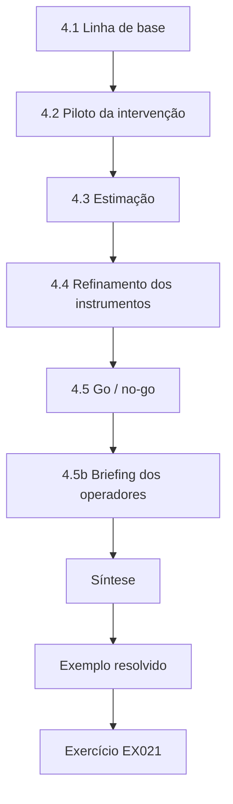

### Desenho lógico

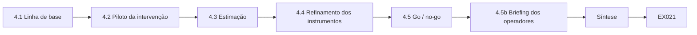

```text
[4.1 Linha de base]
    |
    v
[4.2 Piloto da intervenção]
    |
    v
[4.3 Estimação]
    |
    v
[4.4 Refinamento dos instrumentos]
    |
    v
[4.5 Go / no-go]
    |
    v
[4.5b Briefing dos operadores]
    |
    v
[Síntese]
    |
    v
[Exemplo resolvido] --> [Exercício EX021]
```
<!-- cykin:lesson-figures:end ch-04 -->


### Objetivos de aprendizagem

Você vai (1) replicar um método de linha de base sob ROE em prosa; (2) conduzir um piloto da intervenção; (3) estimar taxas e variâncias; (4) refinar os instrumentos sem espiar as conclusões finais; e (5) decidir se o estudo principal segue ou não (go / no-go).

### 4.1 Linha de base

Execute a prática atual — ROE em prosa lidas no início — sobre uma topologia de laboratório fixa. Registre cada tentativa de sondagem com host, porta, ação e horário. Pontue o que está fora do escopo com as mesmas regras de predicado que você vai aplicar depois ao vivo, para que a linha de base seja comparável. Elena conduz dez engajamentos de linha de base na topologia fixa do NHUSTL. Pontuar a linha de base com os mesmos predicados que ela vai aplicar depois ao vivo significa que os dois braços usam uma única definição de fora do escopo, de modo que uma diferença possa ser atribuída ao verificador, e não a uma mudança na pontuação.

### 4.2 Piloto da intervenção

Ative o verificador que avalia as propostas antes da execução. Registre permissões, negações e motivos. Fique atento a paradas falsas, que frustram os operadores sem melhorar a segurança. O piloto de Elena tem dez engajamentos com o verificador ligado. Ela registra cada permissão e cada negação com seu motivo e anota se uma negação foi uma parada falsa, como um host digitado errado que na verdade estava no escopo. As paradas falsas são uma medida secundária: em excesso, tornam o verificador inutilizável, mesmo que as sondagens fora do escopo caiam. No piloto, as duas paradas falsas vieram de um operador que digitou errado um host no escopo, o que aponta para uma correção de interface, e não para uma mudança de política.

### 4.3 Estimação

Calcule taxas por hora com intervalos. Anote os efeitos de operador (algumas pessoas sondam mais). Mantenha a análise do piloto descritiva; não declare a hipótese "vitoriosa" ainda.

```python
"""Rebuild a synthetic engagement timeline from event records."""
events = [
    ("09:00", "ROE brief signed", "auth"),
    ("09:15", "scoped host inventory loaded (12 hosts)", "prep"),
    ("10:02", "service enumeration on 10.20.1.0/28", "enum"),
    ("10:45", "finding SYN-001 noted on staging UI", "find"),
    ("11:10", "stop: host 10.20.0.1 probed — out of scope", "stop"),
    ("11:12", "escalated to client contact; confirmed deny-list", "comm"),
    ("13:00", "resume on in-scope hosts only", "auth"),
    ("15:30", "debrief draft shared with client", "report"),
]
# print chronological with phase tags; compute stop latency
print("phase timeline:")
for t, msg, phase in events:
    print(f"  {t} [{phase:6}] {msg}")
t0 = 10*60+45; t1 = 11*60+10
print(f"minutes from SYN-001 note to stop: {t1-t0}")
print(f"stop reason present: yes")
print(f"events={len(events)} phases={len(set(p for _,_,p in events))}")
```

Saída esperada:

```text
phase timeline:
  09:00 [auth  ] ROE brief signed
  09:15 [prep  ] scoped host inventory loaded (12 hosts)
  10:02 [enum  ] service enumeration on 10.20.1.0/28
  10:45 [find  ] finding SYN-001 noted on staging UI
  11:10 [stop  ] stop: host 10.20.0.1 probed — out of scope
  11:12 [comm  ] escalated to client contact; confirmed deny-list
  13:00 [auth  ] resume on in-scope hosts only
  15:30 [report] debrief draft shared with client
minutes from SYN-001 note to stop: 25
stop reason present: yes
events=8 phases=7
```

Elena relata as taxas do piloto com intervalos e ainda não testa H1. Os efeitos de operador são anotados para que o estudo principal possa se planejar para eles, por exemplo modelando o operador como fator ou equilibrando os horários entre as pessoas. Mantenha a análise do piloto num caderno separado do estudo principal. O laboratório de linha do tempo sintética dá uma verificação concreta: passaram-se 25 minutos entre a anotação do SYN-001 e a parada, uma latência que o estudo principal deve acompanhar.

### 4.4 Refinamento dos instrumentos

Esclareça a redação das ROE, corrija defeitos do verificador, melhore o registro. Trave os instrumentos antes do estudo principal. Documente cada mudança. A correção de usabilidade para erros de digitação feita por Elena e a versão travada do verificador ficam registradas, com datas, no log de instrumentos. Depois da trava, novas mudanças exigem uma emenda aprovada pelo orientador. A trava impede a deriva silenciosa entre engajamentos iniciais e tardios, e o estudo principal só começa quando a nova versão estiver fixada. Os operadores recebem o número da versão travada no briefing, para que possam relatar se aparecer um build diferente.

### 4.5 Go / no-go

Siga (go) se: a autorização continua válida; os instrumentos estão estáveis; o piloto mostra eventos fora do escopo diferentes de zero sob ROE em prosa (há, portanto, algo a reduzir); a ética não mudou. Não siga (no-go) ou reprojete se o verificador for inutilizável ou o laboratório for instável. A decisão de seguir de Elena lista os quatro critérios. Um exemplo de no-go é uma taxa de paradas falsas acima de cerca de 30%, que forçaria um reprojeto da usabilidade e um novo piloto antes do estudo principal. Seguir adiante com um verificador inutilizável produziria dados que medem frustração, e não cumprimento do escopo.

### 4.5b Briefing dos operadores

Faça o briefing dos operadores de modo idêntico nos dois braços: mesmo comprimento do texto das ROE, mesmo mapa da topologia, mesmas categorias de ferramentas permitidas. As diferenças devem vir do verificador, não de uma preparação desigual. Registre a duração do briefing e a presença. O roteiro de briefing de Elena é idêntico nos dois braços e dura o mesmo número de minutos. A presença é registrada para que briefings perdidos possam ser relatados como limitação, caso se concentrem num braço. Uma preparação desigual confundiria a comparação, por isso as diferenças devem vir apenas do verificador. O pacote de briefing também mostra o mesmo inventário de doze hosts no escopo nos dois braços, para que nenhum grupo comece com um mapa mais claro.

### 4.6 Exemplo resolvido (caso sintético do NHUSTL)

Linha de base (10 engajamentos): 0,18 sondagem fora do escopo por hora (intervalo de cerca de 0,11–0,28). Piloto com verificador (10 engajamentos): 0,04 por hora; duas paradas falsas quando um operador digitou errado um host do escopo. Os hábitos do laboratório de linha do tempo — anotar o achado, parar, escalonar — são ensaiados; na linha do tempo sintética, os minutos entre a anotação do SYN-001 e a parada são 25. Elena corrige a usabilidade dos erros de digitação e trava a versão do verificador. A linha de base mostra que há algo a reduzir: uma taxa fora do escopo diferente de zero sob ROE em prosa. O piloto mostra que o verificador pode cortar essa taxa e expõe um defeito de usabilidade que teria frustrado os operadores no estudo principal. Travar o verificador depois da correção mantém o estudo principal comparável entre os engajamentos.

### 4.7 Erros e limites

Três erros são comuns: mudar as regras de pontuação entre a linha de base e o piloto; tratar os resultados do piloto como confirmatórios; e pular a análise das paradas falsas. Cada erro prejudica a comparação. Mudar as regras de pontuação entre a linha de base e o piloto significa que as duas taxas não medem a mesma coisa. Tratar os resultados do piloto como confirmatórios aumenta a chance de um achado falso. Pular a análise das paradas falsas deixa um problema de usabilidade que vai confundir o estudo principal. Verifique os três pontos no relatório do piloto antes da decisão de seguir. Os critérios de go de Elena listam cada um.

### Exercícios

- **EX021 — Log da linha de base.** Especifique os campos do log. Rubrica: 3 = host, porta, ação, horário, decisão, operador; 2 = quatro; 1 = dois; 0 = nenhum.
- **EX022 — Comparabilidade.** Por que pontuar a linha de base com os mesmos predicados? Rubrica: 3 = comparação justa; 2 = parcial; 1 = vago; 0 = errado.
- **EX023 — Laboratório de linha do tempo.** O que a latência até a parada mostra? Rubrica: 3 = 25 minutos, existência do processo; 2 = o número; 1 = vago; 0 = errado.
- **EX024 — Parada falsa.** Como Elena deve tratar as paradas causadas por hosts digitados errado? Rubrica: 3 = correção de usabilidade, sem enfraquecer o escopo; 2 = parcial; 1 = desligar o verificador; 0 = nenhum.
- **EX025 — Critérios de go.** Escreva quatro critérios de go. Rubrica: 3 = quatro adequados; 2 = três; 1 = um; 0 = nenhum.
- **EX026 — No-go.** Dê um cenário de no-go e um reprojeto. Rubrica: 3 = cenário e reprojeto; 2 = cenário; 1 = vago; 0 = nenhum.

### Síntese

A linha de base e o piloto produzem taxas comparáveis, expõem problemas dos instrumentos e sustentam uma decisão disciplinada de go / no-go — não uma alegação prematura de sucesso.

### Continue estudando — capítulo 04 de 08

[← Capítulo 03 (rascunho)](#ch-03) · [Índice de capítulos do curso](../SUBJECTS.md) · [Capítulo 05 (rascunho) →](#ch-05)

<a id="ch-05"></a>

## Capítulo 5 — Estudo principal e validação independente

<!-- cykin:lesson-figures:start ch-05 -->
### Mapa da aula

Aula 05 publicada. Mapa, exemplo, EX027.

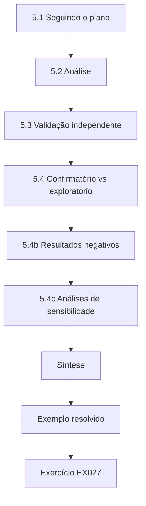

### Desenho lógico

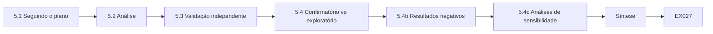

```text
[5.1 Seguindo o plano]
    |
    v
[5.2 Análise]
    |
    v
[5.3 Validação independente]
    |
    v
[5.4 Confirmatório vs exploratório]
    |
    v
[5.4b Resultados negativos]
    |
    v
[5.4c Análises de sensibilidade]
    |
    v
[Síntese]
    |
    v
[Exemplo resolvido] --> [Exercício EX027]
```
<!-- cykin:lesson-figures:end ch-05 -->


### Objetivos de aprendizagem

Você vai (1) conduzir o estudo principal conforme o plano pré-registrado; (2) analisar as medidas primária e secundárias com incerteza; (3) encomendar uma validação independente; (4) separar achados confirmatórios de exploratórios; e (5) relatar falhas e limites.

### 5.1 Seguindo o plano

Aleatorize ou alterne os braços (prosa vs verificador) entre horários de engajamento pareados. Mantenha fixos a topologia, a duração do briefing e as categorias de ferramentas permitidas. Não ajuste o verificador com base nos resultados do estudo principal. Elena intercala horários em prosa e com verificador ao longo do semestre, para que o tempo e a carga do laboratório não favoreçam um braço. As imagens da topologia, os roteiros de briefing e as listas de ferramentas permitidas ficam fixados. É proibido ajustar o verificador a partir dos resultados do estudo principal; qualquer correção de defeito exige uma emenda. Mantenha o plano numa lista de verificação curta, que os operadores veem antes de cada horário.

### 5.2 Análise

Primária: diferença nas sondagens fora do escopo por hora, com um intervalo de confiança. Secundárias: tempo até a parada; taxa de paradas falsas; pontuações de carga de trabalho dos operadores. Pré-especifique qualquer modelo hierárquico para os efeitos de operador.

```python
"""Lab S: reporting attack-success rates honestly: Wilson intervals,
seed variation and a paired bootstrap. Synthetic trial outcomes only."""
import math, random
def wilson(k, n, z=1.96):
    p = k/n; d = 1 + z*z/n
    c = (p + z*z/(2*n))/d; h = z*math.sqrt(p*(1-p)/n + z*z/(4*n*n))/d
    return c - h, c + h
for k, n in ((3, 20), (30, 200), (300, 2000)):
    lo, hi = wilson(k, n); print(f"successes={k}/{n} rate={k/n:.3f} wilson95=[{lo:.3f}, {hi:.3f}]")
# five seeds of a synthetic defence evaluation: per-seed attack success rate
rates = []
for seed in range(5):
    r = random.Random(seed); rates.append(sum(r.random() < 0.12 for _ in range(200))/200)
m = sum(rates)/5; sd = math.sqrt(sum((x-m)**2 for x in rates)/4)
print("per-seed rates:", " ".join(f"{x:.3f}" for x in rates), f"mean={m:.3f} sd={sd:.3f}")
# paired bootstrap: baseline vs defence on the same 300 synthetic trials
r = random.Random(42)
base = [r.random() < 0.30 for _ in range(300)]
defn = [b and r.random() < 0.6 for b in base]   # defence blocks ~40% of successes
diffs = []
for _ in range(2000):
    idx = [r.randrange(300) for _ in range(300)]
    diffs.append(sum(base[i] for i in idx)/300 - sum(defn[i] for i in idx)/300)
diffs.sort()
print(f"baseline_asr={sum(base)/300:.3f} defended_asr={sum(defn)/300:.3f} "
      f"reduction_ci95=[{diffs[50]:.3f}, {diffs[1949]:.3f}]")
```

Saída esperada:

```text
successes=3/20 rate=0.150 wilson95=[0.052, 0.360]
successes=30/200 rate=0.150 wilson95=[0.107, 0.206]
successes=300/2000 rate=0.150 wilson95=[0.135, 0.166]
per-seed rates: 0.110 0.130 0.135 0.105 0.145 mean=0.125 sd=0.017
baseline_asr=0.350 defended_asr=0.190 reduction_ci95=[0.120, 0.203]
```

Os hábitos do Lab S se aplicam: relate contagens e intervalos, não a história de um único valor-p. Amostras pequenas produzem intervalos de Wilson largos, por isso a alegação de Elena se apoia em vinte engajamentos por braço e no intervalo da diferença. As medidas secundárias são relatadas com a mesma disciplina, e rotuladas como secundárias. O laboratório torna o ponto concreto: a mesma taxa de 0,150 gera um intervalo de Wilson de 0,052 a 0,360 com 3/20, mas de 0,135 a 0,166 com 300/2000.

### 5.3 Validação independente

Peça a pesquisadores que não construíram o verificador que refaçam a pontuação dos eventos fora do escopo a partir dos logs brutos, ou que repitam um subconjunto dos engajamentos. A independência flagra a avaliação otimista. Os validadores de Elena são dois pesquisadores que não construíram o verificador. Eles repontuam os rótulos de fora do escopo a partir de logs com dados ocultados, sem saber o braço, e relatam a porcentagem de concordância. As discordâncias são arbitradas e contadas. Uma concordância abaixo de um limiar predefinido aciona a arbitragem do conjunto inteiro, não só das discordâncias. Os validadores registram cada discordância com a linha de log e os dois rótulos, para que o árbitro veja evidências, e não duas opiniões concorrentes.

### 5.4 Confirmatório vs exploratório

Resultados confirmatórios respondem à pergunta pré-registrada. Análises exploratórias (por exemplo, quais motivos de negação predominam) são rotuladas como tais e não resgatam uma hipótese primária que falhou. A alegação confirmatória de Elena é a diferença nas sondagens fora do escopo por hora. O fato de port-not-in-scope ter predominado nas negações é exploratório: útil para os operadores, não um resgate caso a primária tivesse falhado. Mantenha essa linha nítida em cada tabela e legenda de figura, para que um leitor não confunda um gráfico exploratório com o resultado primário. No capítulo de resultados dela, a distribuição dos motivos de negação fica numa seção exploratória separada, posicionada depois da tabela da taxa primária.

### 5.4b Resultados negativos

Um resultado primário não significativo ainda é uma contribuição se o estudo teve poder estatístico e foi executado conforme o planejado. Publique as taxas, os intervalos e os limites. Resultados negativos evitam que outros laboratórios repitam o mesmo beco sem saída e mantêm a literatura honesta. Elena escreve o parágrafo de resultado negativo no modelo de sua tese antes do estudo principal, para estar pronta a publicar em qualquer cenário. Um resultado nulo com poder estatístico ainda diz a outros laboratórios que este verificador, nestas condições, não alterou a taxa. Declare as taxas, os intervalos e os limites mesmo quando H1 não for sustentada.

### 5.4c Análises de sensibilidade

Planeje com antecedência uma ou duas verificações de sensibilidade: excluir o operador de maior volume; recalcular com uma definição mais estrita de fora do escopo. Se a conclusão qualitativa mudar, discuta por quê. Sensibilidade não é a busca por um valor-p significativo. Elena planeja duas: excluir o operador de maior volume e recalcular com uma definição mais estrita de fora do escopo, que trata qualquer contato com um host da lista de negação como fora do escopo, mesmo que o operador tenha parado de imediato. Ambas são nomeadas no pré-registro. Se alguma delas mudar a conclusão qualitativa, discuta por quê nas limitações, em vez de procurar um valor-p significativo.

### 5.5 Exemplo resolvido (caso sintético do NHUSTL)

Estudo principal (20+20 engajamentos): prosa 0,17 por hora (intervalo 0,12–0,23); verificador 0,03 por hora (0,01–0,07); diferença de cerca de 0,14 por hora. Os validadores independentes concordaram em 98% dos rótulos de fora do escopo. Exploratório: a maioria das negações foi port-not-in-scope. Modo de falha: num engajamento, uma renumeração da rede do laboratório invalidou os CIDRs no meio da execução — ele foi excluído pela regra pré-registrada e relatado nos limites. O resultado primário sustenta H1 nas condições declaradas. A concordância independente de 98% mostra que os rótulos não foram uma avaliação otimista de Elena sozinha. O engajamento excluído é nomeado na tabela de resultados e nas limitações, com a regra que justificou a exclusão.

### 5.6 Erros e limites

Três erros são comuns: espiar os dados e parar cedo quando os resultados parecem bons; validadores que são coautores da ferramenta; e esconder exclusões. Cada erro enviesa o resultado. Espiar e parar cedo quando os resultados parecem bons infla os achados falsos. Validadores coautores da ferramenta compartilham o incentivo de encontrar um efeito. Esconder exclusões permite ao pesquisador moldar os dados sem que os leitores saibam. Verifique os três pontos no plano de análise e de validação. O plano de análise de Elena, escrito antes da coleta, trata dos três. Ele fixa vinte engajamentos por braço, nomeia validadores de fora da equipe do verificador e lista cada engajamento excluído com seu motivo.

### Exercícios

- **EX027 — Desenho.** Como você vai manter os braços comparáveis? Rubrica: 3 = topologia, briefing, ferramentas, horários; 2 = três; 1 = um; 0 = nenhum.
- **EX028 — Resultado primário.** Relate o resultado primário de Elena numa frase. Rubrica: 3 = taxas, intervalos, condições; 2 = só as taxas; 1 = "funcionou"; 0 = nenhum.
- **EX029 — Independência.** Projete um protocolo de validação. Rubrica: 3 = quem, o quê, cegamento, métrica de concordância; 2 = três; 1 = um; 0 = nenhum.
- **EX030 — Exclusão.** Excluir o engajamento renumerado foi correto? Rubrica: 3 = condiz com o pré-registro, relatado; 2 = parcial; 1 = escondê-lo; 0 = nenhum.
- **EX031 — Exploratório.** Rotule corretamente um achado exploratório. Rubrica: 3 = rotulado, não usado como primário; 2 = parcial; 1 = apresentado como confirmatório; 0 = nenhum.
- **EX032 — Estatística.** Que fato sobre intervalos, vindo do laboratório, sustenta alegações cautelosas com n pequeno? Rubrica: 3 = intervalos largos com n pequeno; 2 = parcial; 1 = vago; 0 = errado.

### Síntese

O estudo principal segue o plano, quantifica a incerteza, busca olhares independentes e traça uma linha nítida entre alegações confirmatórias e exploratórias.

### Continue estudando — capítulo 05 de 08

[← Capítulo 04 (rascunho)](#ch-04) · [Índice de capítulos do curso](../SUBJECTS.md) · [Capítulo 06 (rascunho) →](#ch-06)

<a id="ch-06"></a>

## Capítulo 6 — Crítica por pares e revisão

<!-- cykin:lesson-figures:start ch-06 -->
### Mapa da aula

Aula 06 publicada. Mapa, exemplo, EX033.

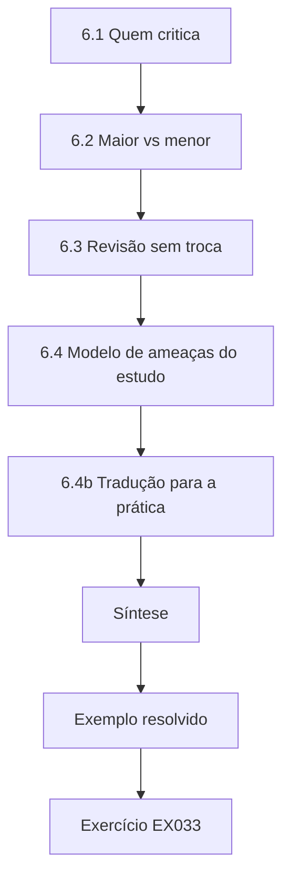

### Desenho lógico

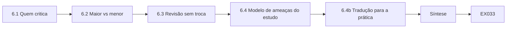

```text
[6.1 Quem critica]
    |
    v
[6.2 Maior vs menor]
    |
    v
[6.3 Revisão sem troca]
    |
    v
[6.4 Modelo de ameaças do estudo]
    |
    v
[6.4b Tradução para a prática]
    |
    v
[Síntese]
    |
    v
[Exemplo resolvido] --> [Exercício EX033]
```
<!-- cykin:lesson-figures:end ch-06 -->


### Objetivos de aprendizagem

Você vai (1) solicitar crítica de especialistas em metodologia e em prática; (2) separar questões maiores de menores; (3) revisar sem trocar o desfecho; (4) atualizar o modelo de ameaças do seu próprio estudo; e (5) registrar uma trilha de resposta aos revisores.

### 6.1 Quem critica

Convide: um profissional de red team (validade ecológica), um pesquisador de medição (estatística), um especialista em ética ou um advogado (autorização) e um líder de blue team (se seus relatórios ajudariam os defensores). Compartilhe materiais com dados ocultados. Para Elena, cada revisor testa um ponto fraco diferente. O profissional pergunta se as faixas isoladas 10.20.0.0/16 e 192.168.50.0/24 do NHUSTL se parecem com as redes onde os erros de escopo realmente acontecem. O pesquisador de medição verifica se as sondagens fora do escopo por hora de engajamento, comparadas com 20 engajamentos por braço, sustentam o intervalo que ela relata. O advogado lê o arquivo de autorização, e o líder de blue team avalia se um log de motivos de negação ajudaria os defensores. Os materiais com dados ocultados ainda incluem o pré-registro, para que cada revisor veja o que ela prometeu antes de os dados chegarem.

### 6.2 Maior vs menor

Maior: a medida não corresponde à alegação; a independência está comprometida; há uma lacuna ética; os resultados são puxados por um único operador. Menor: redação, diagramação das figuras, lacunas nos trabalhos relacionados. Questões maiores mudam as conclusões ou exigem dados novos. Elena classifica cada comentário numa dessas duas listas antes de responder. O argumento do profissional de que a topologia do NHUSTL é limpa demais é maior, porque limita onde a queda de 0,17 para 0,03 sondagem fora do escopo por hora pode ser alegada. Um pedido para renomear o eixo de uma figura é menor. Classificar primeiro evita que ela passe uma semana na apresentação enquanto uma questão de validade espera, e a trilha de resposta mostra aos revisores que seus pontos maiores receberam a maior parte do esforço de revisão.

### 6.3 Revisão sem troca

Você pode esclarecer, acrescentar análises de sensibilidade ou coletar dados novos sob um pré-registro emendado. Você não pode redefinir o sucesso depois de ver os resultados. Se a primária falhar, diga isso e discuta por quê. No caso de Elena, a medida primária pré-registrada, sondagens fora do escopo por hora de engajamento, permanece fixa. Ela pode acrescentar uma análise de sensibilidade que descarta os engajamentos abortados por falha de infraestrutura, porque essa exclusão já estava nomeada no pré-registro. Ela não pode pôr o tempo até a parada como manchete se ele parecer mais forte; ele continua sendo uma medida secundária. O log de emendas registra cada mudança com sua data, para que um examinador possa comparar a tese revisada com o plano registrado antes do estudo principal.

### 6.4 Modelo de ameaças do estudo

Os atacantes do seu estudo incluem: operadores que burlam o verificador; infraestrutura do laboratório que deriva; validadores que compartilham incentivos. Documente os riscos residuais à validade. No NHUSTL, burlar o verificador significaria operadores dividindo uma sondagem entre portas permitidas ou propondo ações que o predicado não consegue expressar, de modo que o verificador não registre violação enquanto o comportamento continua a derivar. A deriva do laboratório incluiria uma faixa renumerada no meio do estudo, o que faria um CIDR permitido passar a cobrir, silenciosamente, hosts novos. Validadores que têm o mesmo orientador de Elena compartilham seu incentivo de encontrar um efeito. Cada ameaça recebe uma mitigação registrada ou é listada na tese como limite residual.

```python
"""Password policy strength from synthetic samples (no cracking)."""
import math, string
samples = [
    "password",
    "P@ssw0rd",
    "correct-horse-battery",
    "Xk9!mQ2#vL7$",
    "aaaaaaaa",
]

def charset_size(s):
    n = 0
    if any(c.islower() for c in s): n += 26
    if any(c.isupper() for c in s): n += 26
    if any(c.isdigit() for c in s): n += 10
    if any(c in string.punctuation+"-" for c in s): n += 33
    return max(n, 1)

def entropy_bits(s):
    # naive: length * log2(charset); flags common patterns
    bits = len(s) * math.log2(charset_size(s))
    flags = []
    if s.lower() in {"password","admin","welcome","letmein"}: flags.append("common")
    if len(set(s)) == 1: flags.append("single-char")
    if s.isalpha() and s.istitle() and any(c.isdigit() for c in s): flags.append("word+digit")
    return bits, flags

for s in samples:
    b, f = entropy_bits(s)
    grade = "weak" if b < 40 or f else ("ok" if b < 60 else "strong")
    print(f"sample={s!r:28} bits={b:5.1f} grade={grade:6} flags={','.join(f) or '-'}")
```

Saída esperada:

```text
sample='password'                   bits= 37.6 grade=weak   flags=common
sample='P@ssw0rd'                   bits= 52.6 grade=ok     flags=-
sample='correct-horse-battery'      bits=123.5 grade=strong flags=-
sample='Xk9!mQ2#vL7$'               bits= 78.8 grade=strong flags=-
sample='aaaaaaaa'                   bits= 37.6 grade=weak   flags=single-char
```

### 6.4b Tradução para a prática

Depois da revisão acadêmica, escreva um resumo de uma página para profissionais: o que configurar, o que medir no próximo engajamento autorizado e o que não alegar. Se os profissionais não conseguirem usar o resumo, o caminho da contribuição até o impacto está incompleto. O resumo de Elena declara os padrões do verificador, as duas medidas a acompanhar no próximo engajamento autorizado e as alegações recusadas: risco residual a partir de porcentagens de cobertura e substituição de programas guiados por ameaças. Ela pede a um operador do NHUSTL que siga o resumo sem preparo prévio e anota onde ele trava.

### 6.5 Exemplo resolvido (caso sintético do NHUSTL)

Um profissional argumenta que a topologia do NHUSTL é limpa demais em comparação com redes corporativas. Elena acrescenta uma subseção de limitações e uma replicação externa planejada, sem mudar a alegação primária. Um estatístico pede gráficos por operador; ela os acrescenta como exploratórios. O laboratório de entropia é usado num apêndice didático sobre por que "pontuações de complexidade" sem contexto enganam — de modo análogo às pontuações de segurança vazias. A limitação e a replicação externa planejada respondem ao profissional sem mudar as regras do jogo. A lição do laboratório de entropia — que contagens de bits sem contexto classificam o padrão comum `P@ssw0rd` como ok, com 52,6 bits — é paralela às pontuações de segurança vazias e fica num apêndice didático, não na alegação primária.

### 6.6 Erros e limites

Três erros são comuns: ignorar crítica maior; trocar discretamente a medida primária; e respostas defensivas sem evidências. Cada erro prejudica a honestidade. Ignorar crítica maior deixa questões de validade para os examinadores encontrarem. Trocar discretamente a medida primária muda as regras do jogo depois de ver os resultados. Respostas defensivas sem evidências não convencem revisores nem examinadores. Verifique os três pontos na trilha de resposta antes da próxima revisão. A trilha de resposta de Elena mostra primeiro as questões maiores, com evidências para cada resposta. Quando um revisor questionou a taxa de paradas falsas, ela respondeu com os logs do piloto e a correção do erro de digitação, e não com um argumento.

### Exercícios

- **EX033 — Revisores.** Nomeie quatro papéis de revisor e uma pergunta para cada. Rubrica: 3 = quatro adequados; 2 = três; 1 = um; 0 = nenhum.
- **EX034 — Questão maior.** Dê um exemplo de questão maior para Elena e uma correção. Rubrica: 3 = questão e correção honesta; 2 = questão; 1 = cosmético; 0 = nenhum.
- **EX035 — Sem troca.** O que ela pode mudar depois dos resultados? Rubrica: 3 = esclarecer/sensibilidade/dados novos com emenda; 2 = parcial; 1 = redefinir o sucesso; 0 = nenhum.
- **EX036 — Ameaça à validade.** Liste três ameaças à validade. Rubrica: 3 = três com mitigações; 2 = duas; 1 = uma; 0 = nenhuma.
- **EX037 — Laboratório de entropia.** Como o laboratório sustenta o ceticismo diante de pontuações únicas? Rubrica: 3 = bits sem contexto enganam; analogia; 2 = parcial; 1 = vago; 0 = errado.
- **EX038 — Trilha de resposta.** Esboce uma tabela de resposta aos revisores. Rubrica: 3 = comentário, resposta, local da mudança; 2 = dois; 1 = um; 0 = nenhum.

### Síntese

A crítica melhora a honestidade. Revise o que as evidências sustentam; nunca mude as regras do jogo em silêncio.

### Continue estudando — capítulo 06 de 08

[← Capítulo 05 (rascunho)](#ch-05) · [Índice de capítulos do curso](../SUBJECTS.md) · [Capítulo 07 (rascunho) →](#ch-07)

<a id="ch-07"></a>

## Capítulo 7 — Síntese da tese e arquivo de reprodutibilidade

<!-- cykin:lesson-figures:start ch-07 -->
### Mapa da aula

Aula 07 publicada. Mapa, exemplo, EX039.

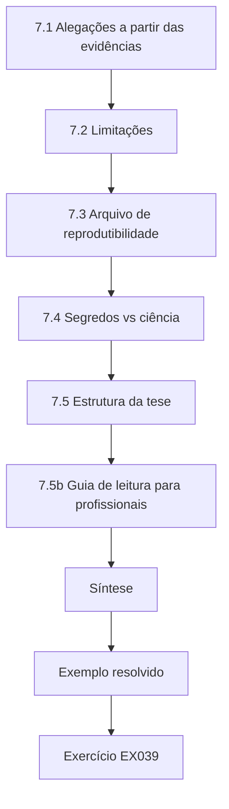

### Desenho lógico

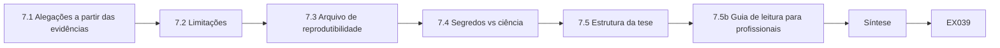

```text
[7.1 Alegações a partir das evidências]
    |
    v
[7.2 Limitações]
    |
    v
[7.3 Arquivo de reprodutibilidade]
    |
    v
[7.4 Segredos vs ciência]
    |
    v
[7.5 Estrutura da tese]
    |
    v
[7.5b Guia de leitura para profissionais]
    |
    v
[Síntese]
    |
    v
[Exemplo resolvido] --> [Exercício EX039]
```
<!-- cykin:lesson-figures:end ch-07 -->


### Objetivos de aprendizagem

Você vai (1) sintetizar alegações que decorrem das evidências; (2) declarar limitações sem teatro de desculpas; (3) montar um arquivo de reprodutibilidade que outros possam executar; (4) separar artefatos científicos de segredos operacionais; e (5) preparar a estrutura da tese.

### 7.1 Alegações a partir das evidências

Cada alegação cita uma medida, uma amostra e condições. Exemplo: "Nas faixas sintéticas do NHUSTL, ativar predicados de escopo verificáveis por máquina reduziu as sondagens fora do escopo de 0,17 por hora para 0,03 por hora (20 engajamentos por braço)." Alegações que precisariam de detalhes de exploração são reescritas como alegações de medição. A frase de Elena nomeia o cenário, as taxas e a amostra. Uma alegação como "o laboratório é seguro" precisaria de detalhes de exploração ou de uma pontuação universal; ela reescreve cada rascunho desse tipo como uma alegação de medição com condições. Toda alegação do capítulo de resultados deve passar nesse teste.

### 7.2 Limitações

Liste: topologia sintética; operadores estudantes; uma única implementação do verificador; ROE apenas em inglês; nenhuma rede corporativa ao vivo. Limitações não são falhas — elas delimitam a alegação. Elena coloca a lista antes da discussão. Cada linha estreita onde a queda de 0,17 para 0,03 pode ser alegada: ainda não em redes corporativas ao vivo, ainda não com operadores profissionais, ainda não com outros desenhos de verificador. As limitações fazem parte da contribuição porque impedem a generalização insegura para programas corporativos ao vivo. Cada linha é um limite da alegação, não uma desculpa.

### 7.3 Arquivo de reprodutibilidade

Inclua: o esquema dos logs anonimizados; o código-fonte do verificador; os scripts de pontuação; o pré-registro; os cadernos de análise que regeneram as tabelas a partir dos dados brutos; as versões fixadas do ambiente. Um par deve reproduzir a tabela primária numa máquina limpa.

```python
"""Verify integrity of a synthetic evidence package."""
import hashlib, json
files = {
    "roe.pdf": b"SYNTHETIC-ROE-v1",
    "scope.csv": b"host,port\n10.20.1.10,443\n",
    "findings.json": b'[{"id":"SYN-001"}]',
}
expected = {n: hashlib.sha256(b).hexdigest()[:16] for n,b in files.items()}
# Simulate tampering of findings.json
current = dict(expected)
current["findings.json"] = hashlib.sha256(b'[{"id":"SYN-001"},{"id":"TAMPERED"}]').hexdigest()[:16]
print(json.dumps(expected, indent=1))
for n in sorted(expected):
    status = "OK" if expected[n] == current[n] else "MISMATCH"
    print(f"{n:16} {status}")
```

Saída esperada:

```text
{
 "roe.pdf": "18d74983d403e7db",
 "scope.csv": "01cc4815eddf3de6",
 "findings.json": "7f5f178ab43ef00f"
}
findings.json    MISMATCH
roe.pdf          OK
scope.csv        OK
```

O arquivo de Elena regenera a tabela primária — prosa 0,17 por hora contra verificador 0,03 por hora, vinte engajamentos por braço — a partir dos logs anonimizados. As versões fixadas do ambiente registram as versões do Python e do verificador. Um par que não consiga reconstruir a tabela numa máquina limpa encontrou uma lacuna. Calcule o hash da versão publicada para que os examinadores possam detectar edições acidentais depois da fixação.

### 7.4 Segredos vs ciência

Deixe fora do arquivo: credenciais reais, nomes de clientes, procedimentos transformados em arma. Deixe dentro: topologias sintéticas, medidas, código de escopo e de pontuação. Fixe o arquivo por hash; o laboratório mostra como um arquivo de achados adulterado é detectado. O apêndice privado de Elena guarda modelos de autorização sem assinaturas. O laboratório de hash mostra um findings.json adulterado como MISMATCH, enquanto roe.pdf e scope.csv continuam OK; ela investiga, restaura a partir de uma cópia confiável e recalcula os hashes antes da submissão. A fixação por hash é o que torna o arquivo confiável depois que ele sai da sua máquina.

### 7.5 Estrutura da tese

Introdução; fundamentação (NIST 800-115, PTES, ATT&CK, TIBER-EU/CBEST, críticas de medição); trabalhos relacionados; métodos; resultados; discussão; ética; guia do arquivo; conclusão. O resumo de Elena declara a pergunta, a medida e o resultado primário em menos de 250 palavras, para que o leitor encontre a alegação antes do guia do arquivo. Cada capítulo corresponde a uma etapa do doutorado: os métodos contêm o pré-registro e a ética; os resultados contêm as taxas; a discussão e as limitações delimitam a alegação; e o guia do arquivo diz a um par como reconstruir a tabela primária. Mantenha a ordem para que os examinadores encontrem cada parte depressa.

### 7.5b Guia de leitura para profissionais

Inclua um guia de leitura de duas páginas no início do arquivo: como instalar, como reproduzir a tabela primária e quais arquivos estão deliberadamente ausentes (e por quê). Avaliadores ocupados não vão fazer engenharia reversa da organização do seu repositório. O guia de Elena nomeia os arquivos ausentes — autorizações assinadas, quaisquer detalhes de vulnerabilidades reais — e o motivo de uso dual de sua ausência. Os passos de instalação e reprodução são numerados, com saída esperada igual à tabela primária. Um colega de fora do projeto testa o guia numa máquina limpa antes da submissão e relata qualquer passo que falhe.

### 7.6 Exemplo resolvido (caso sintético do NHUSTL)

O arquivo de Elena é um repositório público com dados sintéticos e o verificador. Um apêndice privado guarda modelos institucionais de autorização sem assinaturas. Ela verifica a integridade do arquivo com hashes antes da submissão. Seu capítulo de síntese rejeita a frase "o laboratório é seguro" em favor da redução de taxa medida sob condições declaradas. O repositório público é o que examinadores e pesquisadores posteriores podem executar. O apêndice privado fica dentro da universidade. A verificação dos hashes antes da submissão flagra edições acidentais que fariam uma tabela reconstruída discordar do capítulo de resultados.

### 7.7 Erros e limites

Três erros são comuns: arquivos que não rodam; alegações mais amplas que as condições; e misturar segredos de clientes em artefatos públicos. Cada erro enfraquece a tese. Arquivos que não rodam não podem sustentar a alegação de reprodutibilidade. Alegações mais amplas que as condições convidam os leitores a aplicar os resultados onde eles nunca foram testados. Segredos de clientes em artefatos públicos transformam a pesquisa numa exposição. Verifique os três pontos no arquivo e no capítulo de síntese antes da submissão. Peça também a um revisor que os verifique. O revisor de Elena reproduz a tabela primária a partir do arquivo público e procura nele nomes de clientes antes da submissão.

### Exercícios

- **EX039 — Alegação.** Escreva uma alegação vinculada às evidências. Rubrica: 3 = medida, amostra, condições; 2 = dois; 1 = slogan; 0 = nenhum.
- **EX040 — Limites.** Liste cinco limitações. Rubrica: 3 = cinco adequadas; 2 = quatro; 1 = duas; 0 = nenhuma.
- **EX041 — Arquivo.** Liste seis conteúdos do arquivo. Rubrica: 3 = seis; 2 = quatro; 1 = dois; 0 = nenhum.
- **EX042 — Laboratório de hash.** O que um MISMATCH em findings.json implica? Rubrica: 3 = adulteração/mudança desde a fixação; bloquear a confiança; investigar; 2 = dois; 1 = um; 0 = errado.
- **EX043 — Segredos.** Classifique quatro itens como arquivo público ou privado. Rubrica: 3 = quatro corretos; 2 = três; 1 = um; 0 = nenhum.
- **EX044 — Estrutura.** Esboce oito capítulos de tese. Rubrica: 3 = ordem coerente; 2 = a maioria; 1 = poucos; 0 = nenhum.

### Síntese

A síntese vincula as alegações às evidências; o arquivo permite que outros verifiquem você; os segredos ficam fora do pacote científico.

### Continue estudando — capítulo 07 de 08

[← Capítulo 06 (rascunho)](#ch-06) · [Índice de capítulos do curso](../SUBJECTS.md) · [Capítulo 08 (rascunho) →](#ch-08)

<a id="ch-08"></a>

## Capítulo 8 — Plano de defesa e publicação

<!-- cykin:lesson-figures:start ch-08 -->
### Mapa da aula

Aula 08 publicada. Mapa, exemplo, EX045.

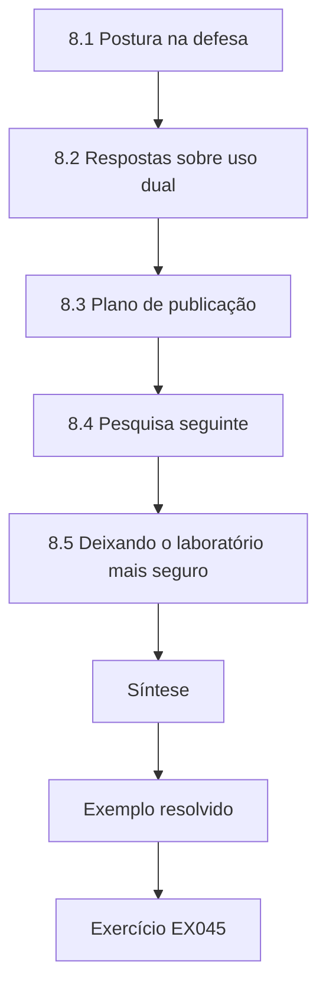

### Desenho lógico

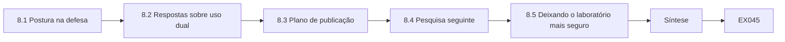

```text
[8.1 Postura na defesa]
    |
    v
[8.2 Respostas sobre uso dual]
    |
    v
[8.3 Plano de publicação]
    |
    v
[8.4 Pesquisa seguinte]
    |
    v
[8.5 Deixando o laboratório mais seguro]
    |
    v
[Síntese]
    |
    v
[Exemplo resolvido] --> [Exercício EX045]
```
<!-- cykin:lesson-figures:end ch-08 -->


### Objetivos de aprendizagem

Você vai (1) defender métodos, ética e alegações sob arguição; (2) responder a questionamentos sobre uso dual e generalização; (3) planejar publicações que ajudem os defensores sem habilitar atacantes; (4) mapear a pesquisa seguinte; e (5) deixar o laboratório mais seguro do que o encontrou.

### 8.1 Postura na defesa

Abra com a pergunta, a medida e o resultado primário com intervalos. Espere perguntas sobre: autorização; por que laboratórios sintéticos; independência; o que falsearia a alegação; como os operadores poderiam burlar o verificador. Leve o pré-registro e uma demonstração ao vivo do verificador sobre propostas sintéticas. A abertura de Elena cabe em cerca de noventa segundos: predicados verificáveis por máquina versus ROE em prosa; sondagens fora do escopo por hora; 0,17 contra 0,03, com intervalos; faixas sintéticas do NHUSTL, operadores estudantes, vinte engajamentos por braço. A demonstração ao vivo mostra um DENY para 8.8.8.8 antes que qualquer pacote saia.

### 8.2 Respostas sobre uso dual

"Publicamos predicados e taxas, não cadeias de exploração. Todos os alvos eram sintéticos. Qualquer problema real encontrado em sistemas da instituição passou por divulgação coordenada." Se pressionado a demonstrar um ataque, recuse e ofereça, em vez disso, uma demonstração da negação de escopo. A resposta de Elena em quatro partes é: recusar a exploração; demonstrar a negação de escopo; reafirmar as regras de ética e de uso dual; mencionar a divulgação coordenada para qualquer problema real. Uma exigência de detalhes de ataque numa defesa costuma ser um teste de discernimento. Ofereça a demonstração de escopo imediatamente, para que a recusa não seja o fim da resposta.

### 8.3 Plano de publicação

Alvo: um veículo de medição/ética para o resultado principal; um resumo curto para equipes autorizadas; nenhum complemento sobre "como contornar". Cite os frameworks com precisão (NIST SP 800-115, PTES, ATT&CK, WSTG, TIBER-EU, CBEST), com versões e datas. O plano de Elena lista uma submissão a periódico sobre medição e ética, sem detalhes de exploração, e uma publicação aberta do arquivo com hashes. As citações de frameworks trazem versões e datas de acesso, porque o ATT&CK e o WSTG mudam. Não há artigo complementar sobre como contornar o verificador.

### 8.4 Pesquisa seguinte

Replicação externa em outro laboratório universitário; piloto corporativo sob autorização separada; estudo de fatores humanos sobre as paradas falsas; comparação com controles de cenários guiados por ameaças de exercícios no estilo TIBER.

```python
"""ATT&CK-style coverage matrix over synthetic authorized techniques (names only)."""
# Synthetic engagement log: technique_id -> observed (True/False)
PLAN = ["T1046", "T1595", "T1082", "T1083", "T1059", "T1078", "T1021"]
OBSERVED = {"T1046", "T1595", "T1082", "T1083", "T1078"}
LABELS = {
    "T1046": "Network Service Discovery",
    "T1595": "Active Scanning",
    "T1082": "System Information Discovery",
    "T1083": "File and Directory Discovery",
    "T1059": "Command and Scripting Interpreter",
    "T1078": "Valid Accounts",
    "T1021": "Remote Services",
}
covered = 0
for tid in PLAN:
    hit = tid in OBSERVED
    covered += hit
    print(f"{tid} {LABELS[tid]:34} {'COVERED' if hit else 'PLANNED-NOT-SEEN'}")
print(f"coverage={covered}/{len(PLAN)} ({100*covered/len(PLAN):.0f}%)")
```

Saída esperada:

```text
T1046 Network Service Discovery          COVERED
T1595 Active Scanning                    COVERED
T1082 System Information Discovery       COVERED
T1083 File and Directory Discovery       COVERED
T1059 Command and Scripting Interpreter  PLANNED-NOT-SEEN
T1078 Valid Accounts                     COVERED
T1021 Remote Services                    PLANNED-NOT-SEEN
coverage=5/7 (71%)
```

A página de pesquisa seguinte de Elena lista essas quatro, cada uma com uma nota de autorização de uma linha. A replicação externa vem primeiro: outro laboratório executando o mesmo verificador e as mesmas medidas sob sua própria aprovação. Pilotos corporativos precisam de autorização separada da do estudo de laboratório e não devem reutilizar a aprovação do NHUSTL, restrita a dados sintéticos. O estudo de fatores humanos parte das duas paradas falsas do piloto e pergunta como as mensagens do verificador poderiam ajudar os operadores a perceber um host no escopo digitado errado.

### 8.5 Deixando o laboratório mais seguro

Documente os padrões do verificador; treine a próxima turma nas condições de parada; remova quaisquer exceções temporárias; doe a topologia sintética ao ensino. O relato de cobertura (o laboratório) se torna um exercício didático de humildade: planejado e não visto é um ponto de partida para o próximo estudo autorizado, não um troféu. Elena fixa os padrões do verificador, treina a próxima turma nas condições de parada, remove as exceções temporárias e doa a topologia sintética ao ensino. As técnicas planejadas e não vistas do laboratório de cobertura entram no plano do próximo estudo autorizado, com permissão, em vez de serem testadas por conta própria.

### 8.6 Exemplo resolvido (caso sintético do NHUSTL)

Na defesa, perguntam a Elena se os resultados se generalizam para avaliações no estilo CBEST. Ela responde que o CBEST é guiado por ameaças e supervisionado pelo regulador para empresas financeiras; sua contribuição é um instrumento de medição do cumprimento do escopo que tais programas poderiam adotar, não um substituto para cenários guiados por inteligência. Ela recusa um pedido para mostrar uma "exploração divertida" e, em vez disso, demonstra um DENY para `8.8.8.8`. Seu plano de publicação lista uma submissão a periódico e uma publicação aberta do arquivo com hashes.

A resposta sobre o CBEST é de complemento, não de substituição: um instrumento de cumprimento do escopo poderia apoiar tais programas, mas não substitui cenários guiados por inteligência nem a supervisão regulatória. A demonstração de exploração recusada e o DENY para 8.8.8.8 mostram a mesma disciplina de uso dual do plano de publicação.

### 8.7 Erros e limites

Três erros são comuns: alegar generalização excessiva para empresas ao vivo; publicar receitas de contorno; e deixar regras temporárias de escopo amplo ativadas. Cada erro desfaz o cuidado anterior. Alegar generalização excessiva para empresas ao vivo vai além de laboratórios sintéticos e operadores estudantes. Publicar receitas de contorno transforma a pesquisa de medição num recurso de ataque. Deixar regras temporárias de escopo amplo ativadas é um risco para a próxima turma. Verifique os três pontos no plano de defesa e de passagem. A lista de passagem de Elena nomeia cada um. As regras temporárias de escopo amplo são removidas da configuração do verificador, e a data da remoção fica registrada na lista.

### Exercícios

- **EX045 — Abertura.** Escreva uma abertura de defesa de 90 segundos. Rubrica: 3 = pergunta, medida, resultado, condições; 2 = três; 1 = vago; 0 = nenhum.
- **EX046 — Uso dual.** Responda a "mostre-nos a exploração" em quatro frases. Rubrica: 3 = recusar, oferecer demonstração de escopo, ética, divulgação coordenada; 2 = três; 1 = mostra a exploração; 0 = nenhum.
- **EX047 — CBEST.** Relacione seu trabalho ao CBEST sem alegar demais. Rubrica: 3 = complementar, não substituto; 2 = parcial; 1 = "substituímos o CBEST"; 0 = nenhum.
- **EX048 — Publicações.** Planeje duas publicações com veículos e o que fica excluído. Rubrica: 3 = ambas com exclusões; 2 = uma; 1 = vago; 0 = nenhum.
- **EX049 — Laboratório de cobertura.** Como você usaria eticamente uma técnica planejada e não vista? Rubrica: 3 = próximo estudo autorizado, sem testes por conta própria; 2 = parcial; 1 = simplesmente atacá-la; 0 = nenhum.
- **EX050 — Passagem.** Liste cinco ações de passagem para deixar o laboratório mais seguro. Rubrica: 3 = cinco adequadas; 2 = três; 1 = uma; 0 = nenhuma.

### Síntese

A defesa e a publicação provam que sua contribuição é medida, ética e utilizável — e que você não trocará a integridade pelo espetáculo.

### Continue estudando — capítulo 08 de 08

[← Capítulo 07 (rascunho)](#ch-07) · [Índice de capítulos do curso](../SUBJECTS.md) · [Resoluções ↓](#worked-results) · [Próximo curso pelo índice de capítulos →](../SUBJECTS.md)

<a id="worked-results"></a>

## Resoluções

Respostas-modelo para EX001–EX050. North Harbour University Secure Testing Lab, Elena Varga e todos os seus números são sintéticos. Qualquer resposta que atenda à rubrica recebe a mesma pontuação.

**EX001.** Proprietário: diretor do NHUSTL. Sistemas: faixas de laboratório 10.20.0.0/16 e 192.168.50.0/24. Datas: janela do estudo. Ações: descoberta de serviços enumerados e uso de credenciais apenas em contas sintéticas. Dados: apenas sintéticos. Contatos: orientador e plantão do laboratório.

**EX002.** 10.20.0.1:443 é infraestrutura da lista de negação. 192.168.50.20:3389 usa uma porta fora de {22,80,443,8080}. 8.8.8.8:80 está fora dos CIDRs.

**EX003.** Aparecem dados pessoais reais → parar, avisar o contato de privacidade. Host fora do escopo contatado → parar, avisar o proprietário do laboratório. Impacto na disponibilidade de serviços compartilhados do laboratório → parar, avisar o plantão.

**EX004.** Sondagens fora do escopo por hora de engajamento, com intervalo de 95%, controlando operador e horário. Fatores de confusão: diferenças de briefing, mudanças de topologia.

**EX005.** Mesma taxa de 15%, mas 3/20 tem um intervalo largo (~5–36%), enquanto 300/2000 fica em ~13,5–16,6%, de modo que só a amostra maior sustenta uma alegação precisa.

**EX006.** Publicar predicados, medidas e taxas; omitir payloads e passos de exploração; usar alvos sintéticos; encaminhar problemas reais por divulgação coordenada.

**EX007.** Autorização, ROE, versões do escopo, versões das ferramentas, logs com dados ocultados, achados com hashes das evidências.

**EX008.** NIST 800-115: processo de avaliação. PTES: fases do engajamento. WSTG: casos web. TIBER-EU: avaliação europeia guiada por ameaças para o setor financeiro. CBEST: avaliações supervisórias britânicas guiadas por ameaças.

**EX009.** "Exigir confirmação humana para ações de laboratório de alto impacto reduz as tentativas não aprovadas de escalonamento de privilégios por hora em laboratórios de ensino autorizados?"

**EX010.** O SYN-001 combina impacto alto, explorabilidade alta e exposição moderada (pontuação 20). O SYN-002 tem impacto e explorabilidade baixos, apesar da exposição alta (pontuação 9).

**EX011.** Significa que 5 de 7 técnicas planejadas foram observadas. Não significa que o risco residual seja de 29% nem que o sistema esteja quase seguro.

**EX012.** O OSSTMM trata a segurança como uma quantidade resumida pelo rav, que comprime propriedades distintas num único número e não é uma medida válida da segurança operacional.

**EX013.** São guiados por inteligência, focados em serviços críticos do negócio e conduzidos com supervisão regulatória — não apenas descoberta oportunista de vulnerabilidades.

**EX014.** Trabalhos anteriores enunciam as ROE em prosa. Frameworks guiados por ameaças exigem fidelidade de cenário. Poucos estudos medem a redução do que está fora do escopo. Elena vai comparar prosa e predicados quanto à taxa de sondagem. Ética: apenas laboratório sintético.

**EX015.** "Entre os engajamentos autorizados do NHUSTL, ativar um verificador de escopo reduz as sondagens fora do escopo por hora em comparação com ROE apenas em prosa?"

**EX016.** População, intervenção, medida primária, medidas secundárias, análise, tamanho da amostra, exclusões, restrições éticas.

**EX017.** denial-of-service é uma deny-action. password-spray-lab sem aprovação gera needs-approval. service-enum às 18:00 está outside-hours.

**EX018.** Consentimento; alvos sintéticos; nenhuma credencial real; limites de publicação por uso dual.

**EX019.** A variância do piloto sugere que são necessárias dezenas de engajamentos para ver uma queda de ~0,2 para ~0,05 por hora; 20 por braço é viável em dois semestres.

**EX020.** O orientador assina a ciência; o comitê de ética assina o protocolo com pessoas; o proprietário do laboratório assina a autorização dos sistemas.

**EX021.** Host, porta, ação, horário, permitir/negar, motivo, ID do operador, ID do engajamento.

**EX022.** Do contrário, você compara definições diferentes de "fora do escopo" e não consegue atribuir as diferenças à intervenção.

**EX023.** Vinte e cinco minutos entre a anotação do SYN-001 e a parada mostram que existe um processo de parada; a pesquisa pode tentar encurtá-lo.

**EX024.** Melhorar a validação da entrada de hosts e o retorno ao operador; não ampliar o escopo para esconder defeitos de usabilidade.

**EX025.** Autorização válida; instrumentos travados; taxa da linha de base diferente de zero; ética inalterada.

**EX026.** Taxa de paradas falsas do verificador >30% → no-go; reprojetar a usabilidade e refazer o piloto antes do estudo principal.

**EX027.** Mesma imagem de topologia, mesmo roteiro e duração de briefing, mesmas categorias de ferramentas permitidas, horários intercalados.

**EX028.** "Com 20 engajamentos por braço nas faixas sintéticas do NHUSTL, as sondagens fora do escopo caíram de 0,17 por hora (0,12–0,23) sob ROE em prosa para 0,03 por hora (0,01–0,07) com predicados."

**EX029.** Dois validadores, cegos ao rótulo do braço, repontuam os logs; relatam a porcentagem de concordância e a arbitragem das discordâncias.

**EX030.** Sim — as exclusões por falha de infraestrutura foram pré-registradas, e o caso é relatado nas limitações.

**EX031.** "Port-not-in-scope predominou nas negações" é exploratório; não era a hipótese primária.

**EX032.** Amostras pequenas produzem intervalos de Wilson largos, por isso alegações precisas exigem n maior.

**EX033.** Profissional: há validade ecológica? Estatístico: o intervalo está correto? Especialista em ética: a autorização é adequada? Líder de blue team: o relatório é acionável?

**EX034.** Maior: um único operador produziu a maioria dos eventos — corrigir relatando resultados por operador e uma sensibilidade sem esse operador.

**EX035.** Esclarecimentos, análises de sensibilidade ou dados novos sob um pré-registro emendado — não uma nova definição de sucesso primário.

**EX036.** Burla do verificador (mitigar: registrar as tentativas); deriva da infraestrutura (fixar as imagens); incentivos dos validadores (laboratório independente).

**EX037.** Contagens altas de bits ainda podem ser fracas se houver padrão; da mesma forma, uma pontuação única de segurança pode parecer forte enquanto esconde falhas.

**EX038.** Colunas: comentário do revisor; resposta; local da mudança no manuscrito.

**EX039.** "A verificação de predicados reduziu as sondagens fora do escopo de 0,17 para 0,03 por hora (20 engajamentos/braço, faixas sintéticas do NHUSTL)."

**EX040.** Topologia sintética; operadores estudantes; um verificador; ROE em inglês; nenhuma rede corporativa ao vivo.

**EX041.** Esquema; código-fonte do verificador; scripts de pontuação; pré-registro; cadernos de análise; versões fixadas do ambiente.

**EX042.** O arquivo mudou desde a fixação — não confie nele; investigue; restaure a partir de uma cópia confiável.

**EX043.** Público: topologia sintética, código do verificador. Privado: autorização assinada, quaisquer detalhes de vulnerabilidades reais.

**EX044.** Introdução; fundamentação; trabalhos relacionados; métodos; resultados; discussão; ética/arquivo; conclusão.

**EX045.** "Perguntei se predicados de escopo verificáveis por máquina reduzem as sondagens fora do escopo em comparação com ROE em prosa. Em nossas faixas sintéticas de laboratório, as taxas caíram de 0,17 para 0,03 por hora ao longo de 20 engajamentos por braço."

**EX046.** "Não vou demonstrar uma exploração. Posso demonstrar o verificador de escopo negando um host fora do escopo. Nossas regras de ética e de uso dual proíbem publicar procedimentos de ataque. Problemas reais passam por divulgação coordenada."

**EX047.** O CBEST é uma avaliação conduzida pelo regulador e guiada por inteligência de ameaças para empresas financeiras. Um instrumento de cumprimento do escopo poderia apoiar tais programas; ele não substitui cenários guiados por inteligência nem a supervisão regulatória.

**EX048.** Artigo de periódico sobre medição/ética (sem detalhes de exploração). Resumo para profissionais sobre a configuração de verificadores (sem dados de clientes).

**EX049.** Acrescentá-la ao plano do próximo estudo autorizado, com permissão — não testá-la por conta própria.

**EX050.** Fixar os padrões do verificador; treinar as condições de parada; remover exceções temporárias; publicar a topologia sintética; transferir a documentação de plantão.

<a id="references"></a>
## Referências

Todos os DOIs foram resolvidos em doi.org em 12 de outubro de 2026, e as normas foram conferidas nas páginas de seus editores. A lista é idêntica à da edição em inglês e cobre o livro inteiro; nenhuma das normas técnicas citadas foi verificada aqui como adotada pela ABNT, por isso são citadas em sua edição internacional. Organizações, pessoas, sistemas e números dos casos são sintéticos; somente as obras abaixo são reais.

- Albrecht, M. R., Jensen, R. B. (2020). The Vacuity of the Open Source Security Testing Methodology Manual. arXiv:2010.06377.
- Bank of England / PRA. CBEST Threat Intelligence-Led Assessments — Implementation Guide (2024 update). <https://www.bankofengland.co.uk/financial-stability/operational-resilience-of-the-financial-sector/cbest-threat-intelligence-led-assessments-implementation-guide>
- European Central Bank. TIBER-EU Framework. <https://www.ecb.europa.eu/paym/cyber-resilience/tiber-eu/html/index.en.html>
- MITRE ATT&CK. <https://attack.mitre.org/>
- NIST SP 800-115 (2008). Technical Guide to Information Security Testing and Assessment. <https://doi.org/10.6028/NIST.SP.800-115>
- OWASP Web Security Testing Guide (WSTG). <https://owasp.org/www-project-web-security-testing-guide/>
- Penetration Testing Execution Standard (PTES). <https://pentest-standard.readthedocs.io/en/latest/>
