# Segurança de TO, IoT e Sistemas Ciberfísicos: Métodos de Pesquisa de Doutorado e Prática de Tese

- Idioma: português do Brasil (`pt`); trilha de pesquisa de doutorado, dois anos; aproximadamente 1.600 horas de estudo planejado. Edição de referência: [inglês](../../en/book/MANUSCRIPT.md).
- Estado editorial: **publicado**. Os capítulos 1–8 de 8 têm texto didático escrito, os exercícios EX001–EX050 e as resoluções correspondentes. Revisão independente por especialistas, nova verificação das fontes, revisão de acessibilidade, revisão linguística e a verificação de 300 páginas A4 continuam em aberto. Cobertura de capítulos em rascunho não é um livro concluído.
- Público: pesquisadores avançados com experiência de pesquisa e uma pergunta defensável sobre a segurança de sistemas de controle industrial (ICS), da tecnologia operacional (TO), da Internet das Coisas industrial (IIoT) ou de outros sistemas ciberfísicos (CPS). Conhecimento de entrada: o conteúdo planejado para a trilha de [mestrado](../../../../masters-2-years/ot-iot-security/en/book/PLAN.md) desta área, ou experiência equivalente, mais familiaridade prática com teoria de controle (modelos em espaço de estados, malhas de realimentação), probabilidade e estatística, e com pelo menos um protocolo industrial, como Modbus ou DNP3.
- Relação com os cursos vizinhos: o [curso de doutorado em infraestrutura crítica](../../../critical-sector-security/README.md) estuda serviços, setores e cascatas intersetoriais; o [curso de doutorado em resposta a incidentes](../../../incident-response-resilience/README.md) estuda a detecção e a resposta organizacionais. **Este livro estuda a própria malha de controle**: sensores, atuadores, controladores, o processo físico, os protocolos industriais e as funções de segurança que mantêm as pessoas vivas quando todo o resto falha.
- Autoria e responsabilidade editorial: [hiagokinlevi](https://github.com/hiagokinlevi). O texto didático original, de propriedade do mantenedor, é dedicado sob [CC0 1.0](../../../../../LICENSE); as obras citadas mantêm seus próprios direitos.
- Limite educacional: esta trilha é um projeto educacional independente. Não é um programa de doutorado credenciado, não concede título e não concede autorização para acessar, varrer, testar ou estudar nenhuma planta, controlador, dispositivo, produto de fornecedor ou pessoa reais. Toda planta, organização, conjunto de dados, bancada de testes, participante e resultado numérico de um exemplo resolvido é **sintético**, salvo quando uma frase cita explicitamente uma fonte pública. Nada aqui é um procedimento operacional para uma instalação real.

[Página do curso](../../README.md) · [Índice de capítulos](../SUBJECTS.md) · [Plano do livro](PLAN.md) · [Skill do curso](../../skill/SKILL.md) · [Padrão do livro](../../../../../BOOK_STANDARD.md) · [Resoluções](#worked-results)

## Como usar este rascunho

Leia os oito capítulos em ordem; eles seguem o arco de um único projeto de doutorado. O Capítulo 1 fixa os padrões de integridade e de segurança para uma pesquisa em que um experimento pode abrir uma válvula. O Capítulo 2 mapeia a fronteira da pesquisa em segurança de TO e isola uma pergunta em aberto. O Capítulo 3 a transforma numa contribuição falseável. O Capítulo 4 replica as linhas de base e pilota o procedimento num modelo antes de qualquer bancada de testes ser tocada. O Capítulo 5 executa o estudo principal e o valida numa segunda bancada independente. O Capítulo 6 submete as alegações a uma crítica adversarial. O Capítulo 7 monta a tese e um arquivo de reprodutibilidade em camadas. O Capítulo 8 prepara a defesa, a divulgação coordenada e um plano de publicação.

Cada capítulo contém objetivos de aprendizagem, seções didáticas, um exemplo resolvido, uma atividade prática com código offline em Python 3 usando apenas a biblioteca padrão, erros comuns e limites, exercícios numerados com rubrica de 0 a 3, uma síntese e um bloco **Continue estudando**. Tente cada exercício antes de abrir as [resoluções](#worked-results).

Mantenha cinco rótulos em toda nota de pesquisa: **observação** (o que um instrumento ou uma fonte nomeados registraram), **inferência** (o que você conclui e sob quais pressupostos), **alegação** (o que você vai defender, com seu escopo), **decisão** (o que alguém escolheu por causa disso) e **consequência física** (o que acontece com o processo, os equipamentos, as pessoas ou o ambiente). A pesquisa em TO erra com mais frequência quando uma observação de rede é promovida silenciosamente a uma alegação sobre o processo físico.

### O corpus de pesquisa sintético

O livro acompanha um único projeto inventado, o **Setpoint Study**, que pergunta: *um detector que verifica invariantes físicos entre sensores independentes (um resíduo de balanço de massa com um teste de soma cumulativa) detecta a manipulação por repetição (replay) de sensor numa malha de controle de nível mais cedo e com menos alarmes falsos do que um alarme de processo de faixa fixa, e sob quais capacidades do atacante essa vantagem desaparece?*

| Elemento sintético | Papel | Limite |
|---|---|---|
| **Kestrel Water Works, Plant A** — um reservatório, uma bomba de entrada, um medidor de vazão, um transmissor de nível, um CLP e um enlace Modbus/TCP com um historiador SCADA | Contexto principal do modelo (capítulos 1 e 3–5). | Concessionária inventada; nenhuma planta, equipe ou registro reais. |
| **Bancada de testes T2, "Harrow Process Lab"** — uma bancada de dois tanques, em estilo universitário, com um relé de segurança separado | Contexto de validação independente (capítulos 5–6). | Laboratório inventado. |
| **TankBench-21** | Um benchmark sintético "publicado" cuja pontuação de detecção relatada não pode ser reproduzida (Capítulo 4). | Inventado; não o procure. |
| Estudos sintéticos **S1–S8** | Artigos fictícios usados para praticar a avaliação crítica (Capítulo 2). | Inventados. |
| Operadores **O01–O10** | Participantes fictícios da sala de controle numa revisão cega de alarmes (Capítulo 5). | Inventados; nenhum dado de seres humanos aparece. |

As saídas dos laboratórios vêm dos dados de teste impressos no texto e executados apenas com a biblioteca padrão do Python 3. Elas demonstram métodos; não são constatações sobre nenhum sistema real.

### Política de fontes

Afirmações factuais sobre normas, incidentes públicos ou pesquisas publicadas remetem a fontes consultadas pelo autor; verifique as versões de novo antes de se apoiar nelas. Referências centrais usadas ao longo do livro:

- NIST, [SP 800-82 Rev. 3, *Guide to Operational Technology (OT) Security*](https://csrc.nist.gov/pubs/sp/800/82/r3/final) (September 2023).
- ISA, [ISA/IEC 62443 series of standards](https://www.isa.org/standards-and-publications/isa-standards/isa-iec-62443-series-of-standards) (overview page).
- MITRE, [ATT&CK for ICS matrix](https://attack.mitre.org/matrices/ics/).
- Modbus Organization, [*Modbus Application Protocol Specification V1.1b3*](https://modbus.org/docs/Modbus_Application_Protocol_V1_1b3.pdf).
- J. Giraldo et al., ["A Survey of Physics-Based Attack Detection in Cyber-Physical Systems"](https://doi.org/10.1145/3203245), *ACM Computing Surveys* 51(4), 2018.
- D. Urbina et al., ["Limiting the Impact of Stealthy Attacks on Industrial Control Systems"](https://doi.org/10.1145/2976749.2978388), ACM CCS 2016.
- R. Sommer and V. Paxson, ["Outside the Closed World: On Using Machine Learning for Network Intrusion Detection"](https://doi.org/10.1109/SP.2010.25), IEEE S&P 2010.
- D. Arp et al., ["Dos and Don'ts of Machine Learning in Computer Security"](https://www.usenix.org/conference/usenixsecurity22/presentation/arp), USENIX Security 2022.
- E. S. Page, ["Continuous Inspection Schemes"](https://doi.org/10.1093/biomet/41.1-2.100), *Biometrika* 41, 1954 (o teste CUSUM).
- U.S. DHS, [*The Menlo Report: Ethical Principles Guiding Information and Communication Technology Research*](https://www.dhs.gov/sites/default/files/publications/CSD-MenloPrinciplesCORE-20120803_1.pdf) (2012).
- CISA, [Coordinated Vulnerability Disclosure Program](https://www.cisa.gov/coordinated-vulnerability-disclosure-process).
- ACM, [Artifact Review and Badging, Version 1.1](https://www.acm.org/publications/policies/artifact-review-and-badging-current).
- iTrust/SUTD, [Secure Water Treatment (SWaT) and related datasets](https://itrust.sutd.edu.sg/itrust-labs_datasets/) — descrito apenas no nível de sua página pública.

O vocabulário metodológico genérico (verificação versus validação, números aleatórios comuns) é identificado como tal, em vez de receber uma citação inventada.

## Sumário

1. [Integridade e métodos de pesquisa avançada](#ch-01)
2. [Segurança de TO, IoT e sistemas ciberfísicos: fronteira da pesquisa](#ch-02)
3. [Proposta de contribuição original](#ch-03)
4. [Replicação das linhas de base e piloto](#ch-04)
5. [Estudo principal e validação independente](#ch-05)
6. [Crítica de pares e revisão](#ch-06)
7. [Síntese da tese e arquivo de reprodutibilidade](#ch-07)
8. [Defesa e plano de publicação](#ch-08)
9. [Resoluções](#worked-results)

<a id="ch-01"></a>

## Capítulo 1 — Integridade e métodos de pesquisa avançada

<!-- cykin:lesson-figures:start ch-01 -->
### Mapa da aula

Aula 01 publicada. Mapa, exemplo, EX001.

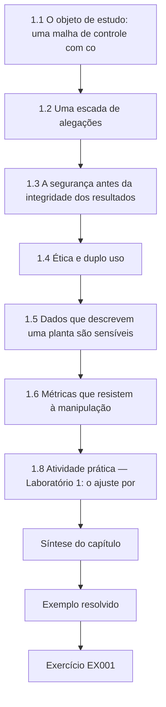

### Desenho lógico

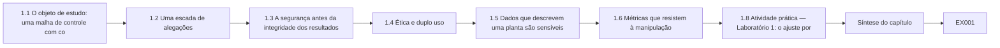

```text
[1.1 O objeto de estudo: uma malha de controle com co]
    |
    v
[1.2 Uma escada de alegações]
    |
    v
[1.3 A segurança antes da integridade dos resultados]
    |
    v
[1.4 Ética e duplo uso]
    |
    v
[1.5 Dados que descrevem uma planta são sensíveis]
    |
    v
[1.6 Métricas que resistem à manipulação]
    |
    v
[1.8 Atividade prática — Laboratório 1: o ajuste por]
    |
    v
[Síntese do capítulo]
    |
    v
[Exemplo resolvido] --> [Exercício EX001]
```
<!-- cykin:lesson-figures:end ch-01 -->


### Objetivos de aprendizagem e conexão

Ao final deste capítulo, você será capaz de: (1) explicar por que o processo físico, e não o pacote, é o objeto da pesquisa em segurança de TO; (2) situar uma alegação de pesquisa numa escada que vai da observação de rede até a consequência física; (3) desenhar um experimento cujo pior resultado plausível seja limitado por uma camada de segurança independente; (4) aplicar os princípios do Menlo à pesquisa industrial; e (5) escolher métricas de detecção que não possam ser manipuladas por convenções de pontuação. O capítulo se apoia no seu conhecimento de entrada sobre desenho de pesquisa e prepara o mapeamento da fronteira do Capítulo 2.

### 1.1 O objeto de estudo: uma malha de controle com consequências

Um sistema de informação falha divulgando, corrompendo ou retendo dados. Um sistema de controle industrial pode falhar de todas essas maneiras, mas a sua falha característica é outra: um **processo físico** sai do seu envelope seguro. Uma bomba trabalha a seco, um tanque transborda, uma dose de cloro passa do limite, uma turbina dispara. A NIST SP 800-82 Rev. 3 enquadra a TO como sistemas que "interagem com o ambiente físico" e enfatiza que a segurança física e a disponibilidade costumam dominar a ordem de prioridades que, na TI, é liderada pela confidencialidade. Essa diferença remodela a pesquisa. Um método de detecção que sinaliza toda escrita Modbus maliciosa, mas não consegue dizer se o processo foi posto em perigo, respondeu a uma pergunta de TI num ambiente de TO.

O pesquisador de doutorado, portanto, modela a malha explicitamente. Um **sensor** mede uma variável de processo (nível, pressão, vazão). Um **controlador**, tipicamente um controlador lógico programável (CLP), compara-a com um **setpoint** e calcula um comando. Um **atuador** (bomba, válvula, disjuntor) altera o processo. Uma **camada de supervisão** (SCADA, IHM, historiador) observa e ajusta os setpoints. Abaixo de todos eles fica um **sistema instrumentado de segurança (SIS)** ou um intertravamento cabeado, projetado para levar o processo a um estado seguro independentemente do sistema de controle. Cada elemento é um possível ponto de manipulação, e a honestidade de cada elemento é algo que o seu detector ou pressupõe ou testa.

### 1.2 Uma escada de alegações

Escreva toda alegação numa escada de cinco degraus e recuse-se a subir um degrau sem evidências para ele:

1. **Observação de protocolo** — um quadro com o código de função 6 (escrever registrador único) chegou à unidade 1 (a especificação Modbus define os códigos de função).
2. **Inferência de controle** — o registrador do setpoint mudou de 50 para 80.
3. **Inferência de processo** — a trajetória do nível do tanque foi coerente com o novo setpoint.
4. **Inferência de segurança** — a trajetória cruzaria (ou não) o trip de nível muito alto dentro do horizonte modelado.
5. **Alegação de consequência** — dano a equipamentos, liberação ou ferimentos teriam ocorrido (ou não), dadas as camadas de proteção independentes.

A maioria dos artigos publicados sobre detecção em TO para no degrau 1 ou 2 e relata acurácia; a maior parte do valor prático está nos degraus 3–5. Uma tese não precisa chegar ao degrau 5, mas precisa dizer onde para.

### 1.3 A segurança antes da integridade dos resultados

Um experimento de TI mal conduzido perde dados; um experimento de TO mal conduzido pode ferir alguém. As regras de integridade da pesquisa comum — relato honesto, pré-registro das análises, retenção dos dados brutos — permanecem, mas uma nova regra tem precedência: **nunca teste em produção**. Os experimentos rodam em simulações, em bancadas de laboratório isoladas cujo pior caso é inofensivo ou, excepcionalmente, no sistema de um operador, sob a autorização escrita do operador, a sua própria análise de segurança e uma pessoa nomeada com autoridade de parada. Mesmo num laboratório, o pesquisador deve listar o pior resultado físico plausível de cada experimento (por exemplo, "a água se derrama no piso do invólucro da bancada") e a camada independente que o limita (uma chave boia mecânica, não o CLP sob teste). Se a única proteção é o próprio sistema que você está atacando, o experimento não está limitado.

### 1.4 Ética e duplo uso

O Menlo Report adapta os princípios do Belmont à pesquisa em TIC: respeito às pessoas, beneficência, justiça e respeito à lei e ao interesse público. Na pesquisa em TO, a **beneficência** domina: uma técnica de evasão que derrota todos os detectores publicados é uma contribuição real e também uma receita. A resposta ética não é o silêncio, mas a proporção. Publique a *classe* de fraqueza, a medição defensiva e a mitigação; retenha os detalhes de exploração específicos de fornecedores até que a divulgação coordenada (Capítulo 8) tenha seguido o seu curso. O **respeito às pessoas** se aplica aos operadores que você entrevista ou observa: eles podem revelar práticas inseguras que poderiam lhes custar o emprego, então os termos de consentimento devem declarar quem vê as anotações brutas. O **respeito à lei** abrange o controle de exportação de algumas tecnologias industriais e os limites contratuais sobre os dados das bancadas de testes.

### 1.5 Dados que descrevem uma planta são sensíveis

Capturas de rede, programas de CLP, diagramas de tubulação e instrumentação e logs de alarmes formam, juntos, um mapa de como ferir uma instalação. Trate-os como sensíveis mesmo quando a instalação for uma bancada universitária, porque as bancadas reutilizam controladores comerciais e as suas configurações revelam o comportamento dos produtos. Defina os níveis cedo: T0 público, T1 compartilhável sob licença, T2 compartilhável com pesquisadores verificados, T3 nunca sai do dono. O Capítulo 7 transforma esses níveis num manifesto de liberação.

Atribua um nível a cada artefato no momento em que ele é criado, não quando a tese é escrita, e registre o dono que pode mudá-lo. Uma captura feita na Bancada de testes T2 começa em T2, mesmo que pareça inofensiva. Baixar um nível exige uma razão escrita, como remover endereços e identificadores de controladores, e uma segunda pessoa que verifique o resultado.

### 1.6 Métricas que resistem à manipulação

A pesquisa em detecção na TO tem um problema de medição. Os ataques em conjuntos de dados de séries temporais são segmentos longos e contíguos; uma convenção de pontuação muito usada, o *ajuste por pontos* (point adjustment), marca um segmento de ataque inteiro como detectado se qualquer ponto isolado dentro dele for sinalizado. Como mostra o Laboratório 1, ela pode transformar um detector que encontra 10% dos pontos de ataque num detector que relata um F1 quase perfeito. Arp et al. listam essa família de armadilhas — medidas de desempenho inadequadas, negligência da taxa de base, avaliação apenas em laboratório — para o aprendizado de máquina em segurança de modo geral. Para a TO, o conjunto defensável de métricas é: **revocação por evento** (fração dos episódios de ataque detectados), **tempo até a detecção** medido a partir do início do ataque, **alarmes falsos por turno de operador** (porque as avalanches de alarmes são, elas próprias, um perigo para a segurança) e **impacto físico na detecção** (quanto o processo já tinha se deslocado quando o alarme disparou). A última métrica é específica da TO e é a mais frequentemente omitida.

### 1.7 Exemplo resolvido: a primeira revisão de protocolo do Setpoint Study (sintético)

O primeiro protocolo do candidato propunha repetir ataques gravados na rede ativa do historiador da Kestrel Plant A, "somente leitura". O comitê de revisão levantou três problemas. Primeiro, *somente leitura é uma alegação, não uma propriedade*: uma ferramenta de captura numa porta espelhada (span) é passiva, mas uma ferramenta que consulta o CLP é ativa e acrescenta carga a um controlador com ciclo de varredura fixo. Segundo, o pior resultado plausível não estava declarado. Terceiro, a métrica era o F1 com ajuste por pontos. O protocolo revisado (a) transfere todos os experimentos de ataque para uma simulação da Plant A e, depois, para a Bancada de testes T2 isolada; (b) declara o pior resultado na T2 como "o tanque superior transborda para a bandeja coletora", limitado por uma válvula boia mecânica independente do CLP; (c) relata a revocação por evento, o atraso, os alarmes falsos por turno de 8 horas e o transbordamento máximo; e (d) nomeia o gerente do laboratório como autoridade de parada.

### 1.8 Atividade prática — Laboratório 1: o ajuste por pontos infla as pontuações

Execute-o offline. Ele cria uma sequência sintética de 100 rótulos com dois segmentos de ataque e um detector que sinaliza cinco amostras.

```python
# Lab 1 (synthetic): how "point-adjusted" scoring inflates an OT anomaly detector.
labels = [0]*20 + [1]*30 + [0]*30 + [1]*10 + [0]*10      # two attack segments (100 samples)
alarms = [0]*100
for i in (5, 40, 85, 86, 87):    # detector flagged five samples
    alarms[i] = 1
def scores(lab, pred):
    tp = sum(l and p for l, p in zip(lab, pred)); fp = sum((not l) and p for l, p in zip(lab, pred))
    fn = sum(l and not p for l, p in zip(lab, pred))
    prec = tp/(tp+fp) if tp+fp else 0.0; rec = tp/(tp+fn) if tp+fn else 0.0
    return round(prec, 3), round(rec, 3), round(2*prec*rec/(prec+rec), 3) if prec+rec else 0.0
def point_adjust(lab, pred):
    out = pred[:]; i = 0
    while i < len(lab):
        if lab[i]:
            j = i
            while j < len(lab) and lab[j]: j += 1
            if any(pred[i:j]): out[i:j] = [1]*(j-i)
            i = j
        else: i += 1
    return out
def events(lab, pred):
    segs, i = [], 0
    while i < len(lab):
        if lab[i]:
            j = i
            while j < len(lab) and lab[j]: j += 1
            segs.append((i, j)); i = j
        else: i += 1
    return sum(any(pred[a:b]) for a, b in segs), len(segs)
print("pointwise P/R/F1 :", scores(labels, alarms))
print("point-adjust     :", scores(labels, point_adjust(labels, alarms)))
print("events detected  :", events(labels, alarms))
```

Saída esperada:

```text
pointwise P/R/F1 : (0.8, 0.1, 0.178)
point-adjust     : (0.976, 1.0, 0.988)
events detected  : (2, 2)
```

Interpretação: os dois episódios foram detectados (revocação por evento 1,0), o que é genuinamente útil, mas o F1 ajustado por pontos de 0,988 esconde que o primeiro alarme no segmento um veio 20 amostras depois do início. Relate a revocação por evento *com* o atraso, nunca o F1 ajustado por pontos sozinho.

Os mesmos cinco alarmes produzem três histórias muito diferentes. Ponto a ponto, o detector encontrou quatro de quarenta amostras de ataque e gerou um alarme falso. Com o ajuste por pontos, ele parece quase perfeito. Por eventos, ele encontrou os dois episódios, um deles com atraso. Só a terceira visão, acompanhada do atraso, diz a um operador o que teria acontecido no tanque, e por isso é a que o Setpoint Study relata.

### 1.9 Erros comuns e limites

- Tratar uma anomalia de protocolo como uma anomalia de processo (o degrau 1 apresentado como degrau 3).
- Chamar uma captura passiva de "segura" enquanto se executam ferramentas de consulta ativas.
- Usar o CLP sob teste como o único limite de segurança num laboratório.
- Relatar uma única pontuação agregada sem os alarmes falsos por turno.
- Pressupor que as bancadas universitárias não são sensíveis porque são pequenas.

Cada erro tem uma salvaguarda. Escreva o degrau ao lado de cada alegação nas suas anotações. Chame de ativa qualquer ferramenta que envie requisições a um controlador, seja o que for que ela leia. Nomeie a camada independente que limita cada execução no laboratório, como a válvula boia na T2. Relate os alarmes falsos por turno de oito horas ao lado da revocação. Classifique os dados de bancadas universitárias no mesmo nível em que classificaria os dados de uma planta.

### Exercícios — capítulo 1

Rubrica para todos os exercícios deste livro: **3** = correto, delimitado, com evidências rotuladas e honesto sobre os limites; **2** = correto, com uma pequena lacuna de escopo ou de evidência; **1** = parcialmente correto ou com alegações sem rótulo; **0** = ausente, inseguro ou alegando demais.

- **EX001 — Alegações na escada para o slogan do transbordamento.** *Objetivo:* classificar alegações. *Insumo:* a afirmação "Nosso detector impede transbordamentos de tanques." *Passos:* reescrevê-la como uma alegação em cada um dos degraus 1–4 da escada, para um ataque ao setpoint via Modbus. *Evidência:* quatro alegações delimitadas. *Restrição:* nenhuma alegação de degrau 5 sem dados das camadas de proteção. *Rubrica:* 3 = quatro degraus com Modbus FC6/40001, setpoint 50→80, trajetória, trip modelado; nenhum degrau 5 sem dados de proteção; 2 = quatro degraus, mas vínculo fraco com o processo; 1 = omite um degrau ou inventa o degrau 5; 0 = slogan repetido.
- **EX002 — Limitar o experimento da bomba da T2.** *Objetivo:* limitar um experimento. Para um ataque à bomba da Bancada de testes T2, declare o pior resultado plausível, a camada de proteção independente e a autoridade de parada. *Evidência:* uma tabela de três linhas. *Rubrica:* 3 = transbordamento≈2 L, válvula boia+bandeja de 10 L, gerente nomeado com parada de emergência; camada só no CLP ≤1; 2 = três linhas, mas independência fraca; 1 = falta a autoridade de parada; 0 = sem limites.
- **EX003 — Coleta passiva versus ativa.** *Objetivo:* passivo versus ativo. Classifique cinco métodos de coleta de dados (captura em porta espelhada, consulta ao CLP, exportação do historiador, upload do projeto da estação de engenharia, extração do firmware) como passivos ou ativos e dê um risco para cada um. *Rubrica:* 3 = cinco métodos com passivo/ativo e um risco cada (porta espelhada, consulta, historiador, upload do projeto, firmware); 2 = quatro corretos; 1 = dois; 0 = nenhum.
- **EX004 — Revisão Menlo da publicação de uma evasão.** *Objetivo:* análise pelo Menlo. Aplique os quatro princípios à publicação de uma nova técnica de evasão contra detectores baseados em física. *Evidência:* um parágrafo por princípio e uma decisão de publicação. *Rubrica:* 3 = quatro princípios do Menlo + publicar a classe/defesa, reter os passos específicos de produtos; 2 = princípios sem decisão; 1 = um princípio; 0 = nenhum.
- **EX005 — Níveis do programa ladder ao simulador.** *Objetivo:* níveis de dados. Atribua T0–T3 a: um programa ladder de CLP, uma tabela anonimizada de contagem de alarmes, uma captura de rede com endereços IP, um P&ID, um simulador sintético. Justifique cada um. *Rubrica:* 3 = ladder T2/T3, alarmes T1, captura com IPs T2, P&ID T2/T3, simulador T0, com justificativas; 2 = quatro corretos; 1 = dois; 0 = nenhum.
- **EX006 — Atraso por evento versus ajuste por pontos.** *Objetivo:* métricas. Usando o Laboratório 1, calcule o atraso de detecção por evento para cada segmento e explique por que o ajuste por pontos o esconde. *Rubrica:* 3 = atrasos de 20 e 5 amostras + por que o ajuste por pontos os esconde; 2 = apenas os atrasos; 1 = um atraso; 0 = nenhum.
- **EX007 — Títulos do protocolo do Setpoint Study.** *Objetivo:* protocolo. Redija os dez títulos de um protocolo do Setpoint Study, incluindo as condições de parada e de abandono. *Rubrica:* 3 = dez títulos, incluindo parada (válvula boia, reinicialização, perda de registros>1%) e abandono; 2 = títulos sem parada/abandono; 1 = lista parcial; 0 = nenhum.

### Síntese do capítulo

A pesquisa em TO estuda malhas de controle cuja falha é física. Suba a escada de alegações apenas com evidências, limite cada experimento com uma camada de segurança independente, trate os dados de plantas como sensíveis e escolha métricas — revocação por evento, atraso, alarmes falsos por turno, impacto físico na detecção — que uma convenção de pontuação não consiga inflar.

<!-- cykin:chapter-navigation:start ch-01 -->
### Continue estudando — capítulo 01 de 08

[← Página do curso](../../README.md) · [Índice de capítulos do curso](../SUBJECTS.md) · [Capítulo 02 →](#ch-02)

Siga para a próxima lição escrita.
<!-- cykin:chapter-navigation:end -->

<a id="ch-02"></a>

## Capítulo 2 — Segurança de TO, IoT e sistemas ciberfísicos: fronteira da pesquisa

<!-- cykin:lesson-figures:start ch-02 -->
### Mapa da aula

Aula 02 publicada. Mapa, exemplo, EX008.

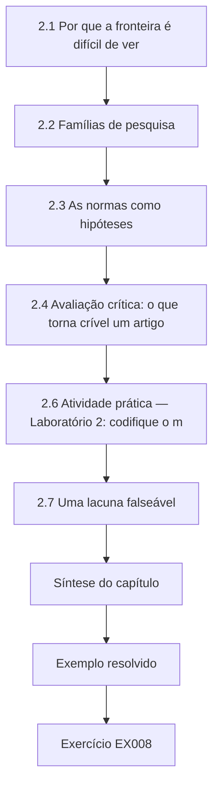

### Desenho lógico

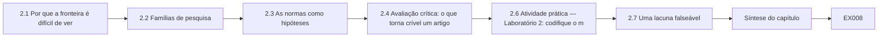

```text
[2.1 Por que a fronteira é difícil de ver]
    |
    v
[2.2 Famílias de pesquisa]
    |
    v
[2.3 As normas como hipóteses]
    |
    v
[2.4 Avaliação crítica: o que torna crível um artigo]
    |
    v
[2.6 Atividade prática — Laboratório 2: codifique o m]
    |
    v
[2.7 Uma lacuna falseável]
    |
    v
[Síntese do capítulo]
    |
    v
[Exemplo resolvido] --> [Exercício EX008]
```
<!-- cykin:lesson-figures:end ch-02 -->


### Objetivos de aprendizagem e conexão

Ao final deste capítulo, você será capaz de (1) organizar a literatura de segurança de TO em famílias de pesquisa, (2) ler normas como hipóteses testáveis, (3) avaliar artigos de detecção em relação às armadilhas de avaliação conhecidas, (4) usar incidentes públicos apenas no nível em que os seus analistas os publicaram e (5) declarar uma lacuna falseável. Ele se apoia na escada de alegações do Capítulo 1 e alimenta a proposta do Capítulo 3.

### 2.1 Por que a fronteira é difícil de ver

A pesquisa em segurança de TO está espalhada pela engenharia de controle (detecção de falhas, controle resiliente), pela segurança computacional (detecção de intrusões, análise de protocolos), pela engenharia de segurança física (análise de perigos, segurança funcional) e pela prática industrial (white papers de fornecedores, alertas governamentais). A mesma ideia aparece sob nomes diferentes: a *detecção de falhas baseada em resíduos* de um engenheiro de controle é a *detecção de anomalias baseada em física* de um pesquisador de segurança. Uma busca de escopo precisa, portanto, usar sinônimos de cada comunidade e pesquisar bases de dados de engenharia, além dos veículos de segurança.

Mantenha uma tabela de sinônimos com uma coluna por comunidade e uma linha por ideia, e atualize-a à medida que a triagem revelar novos termos. Pesquise as bases de engenharia com o vocabulário de controle e os veículos de segurança com o vocabulário de segurança; depois junte e elimine as duplicatas. Registre de qual comunidade veio cada estudo incluído, para que um leitor possa ver se o mapa é equilibrado ou pende para uma tradição.

### 2.2 Famílias de pesquisa

**Arquitetura e segmentação.** O modelo de referência Purdue, descrito na NIST SP 800-82 Rev. 3, organiza em camadas a empresa (níveis 4–5), a gestão de operações (3), o controle supervisório (2), o controle básico (1) e o processo físico (0), com uma DMZ industrial entre a TI e a TO. A ISA/IEC 62443-3-2 reformula a segmentação como *zonas e condutos*, com níveis de segurança-alvo. As perguntas de pesquisa incluem se os desenhos de segmentação de fato reduzem os caminhos de ataque alcançáveis e como a IIoT conectada à nuvem corrói o modelo em camadas.

**Segurança de protocolos.** Protocolos industriais clássicos, como o Modbus, foram projetados sem autenticação: a especificação do Modbus Application Protocol define códigos de função e modelos de dados, mas nenhum campo de segurança. O DNP3 acrescentou o Secure Authentication; o OPC UA inclui um modelo de segurança. A pesquisa estuda a adoção, as falhas de implementação e o custo de acrescentar segurança a redes determinísticas já existentes.

**Detecção.** A detecção baseada em rede modela o tráfego; a detecção baseada em processo (baseada em física) modela a planta. Giraldo et al. fizeram um levantamento da detecção baseada em física e constataram que as avaliações raramente consideram um adversário que conhece o detector; Urbina et al. propuseram medir o quanto um atacante *furtivo* consegue deslocar o processo enquanto permanece abaixo do limiar do detector — a ideia do impacto na detecção do Capítulo 1.

**Coengenharia de segurança física e cibernética.** Os métodos de análise de perigos (HAZOP, STPA) estão sendo estendidos a causas adversariais; a IEC 62443 e as normas de segurança funcional estão sendo alinhadas. A pesquisa pergunta como uma falha de segurança cibernética pode derrotar uma função de segurança física e como certificar ambas.

**Evidências de ameaça.** O MITRE ATT&CK for ICS cataloga técnicas de adversários como *Modify Parameter*, *Spoof Reporting Message* e *Manipulation of View*, cada uma fundamentada em relatos públicos. Incidentes públicos — a manipulação dos acionamentos das centrífugas pelo Stuxnet enquanto exibia valores normais, as quedas da distribuição na Ucrânia em 2015 e o malware dirigido a sistemas instrumentados de segurança (TRITON/TRISIS) — mostram que a *manipulação da visão*, a repetição de valores normais para os operadores, é um objetivo documentado de adversários, e não especulativo.

### 2.3 As normas como hipóteses

Uma norma codifica a crença de especialistas: "zonas com nível de segurança 2 resistem a atacantes casuais". Trate essas afirmações como hipóteses. Uma tese pode medir se um desenho de zonas reduz a alcançabilidade, se uma prática recomendada de alarmes reduz a sobrecarga dos operadores ou se um nível de segurança é alcançável dentro do orçamento de tempo de varredura de um controlador. Não cite uma norma como evidência de que as suas recomendações funcionam; cite-a como a alegação que você testa.

Escreva cada afirmação testada na tese tal como a norma a formula e, depois, como a hipótese mensurável que você derivou dela, para que os leitores possam julgar a tradução. Um resultado nulo é útil: se um desenho de zonas recomendado não reduz a alcançabilidade na sua topologia, isso diz algo sobre o desenho ou sobre a topologia, e ambos merecem ser relatados.

### 2.4 Avaliação crítica: o que torna crível um artigo de detecção em TO

Aplique o alerta de Sommer e Paxson — a detecção de anomalias funciona mal quando o espaço "normal" é aberto e os ataques são raros — e a lista de verificação de Arp et al. Pergunte a cada artigo: o conjunto de dados era uma bancada de testes ou uma planta? Os ataques foram gerados pelas mesmas pessoas que construíram o detector? O adversário conhece o detector? O limiar foi escolhido no conjunto de teste? O impacto na detecção é relatado? Conjuntos de dados públicos como o SWaT, do iTrust, vêm de uma bancada real (em escala reduzida) de tratamento de água, o que os torna valiosos, mas cada conjunto tem um conjunto fixo de ataques e uma planta fixa; alegações de generalização para além deles precisam de um segundo contexto.

### 2.5 Exemplo resolvido: avaliando os estudos sintéticos S1–S8

| Estudo (sintético) | Dados | Adversário ciente? | Origem do limiar | Impacto relatado? | Veredito |
|---|---|---|---|---|---|
| S1 | um conjunto de dados público de bancada | não | conjunto de teste | não | otimista |
| S2 | simulação | sim (limitado) | validação | sim | forte, mas uma só planta |
| S3 | logs de planta, sem ataques | — | — | — | apenas estudo de alarmes falsos |
| S4 | bancada | não | conjunto de teste | não | F1 ajustado por pontos |
| S5 | simulação + bancada | parcial | validação | parcial | promissor |
| S6 | só rede | não | validação | não | só degrau 1 |
| S7 | bancada, falsificação multissensor | sim | validação | sim | mostra evasão por replay+vazão |
| S8 | levantamento | — | — | — | mapa |

O padrão é a lacuna: nenhum estudo combina (a) um adversário ciente do detector, (b) limiares fixados antes do teste, (c) o impacto na detecção e (d) a validação numa segunda planta independente.

### 2.6 Atividade prática — Laboratório 2: codifique o mapa

Copie a tabela para um CSV e conte, com o módulo `csv` do Python, quantos estudos satisfazem cada critério. Contagens esperadas a partir da tabela: adversário plenamente ciente = 2 (S2, S7), limiares de validação = 4 (S2, S5, S6, S7), impacto plenamente relatado = 2 (S2, S7), dois contextos = 1 (S5). Mude uma decisão de codificação e observe como a declaração da lacuna muda; registre essa sensibilidade nas suas anotações.

Uma pequena mudança pode fazer um estudo cruzar a linha. Se a ciência do adversário em S5 for codificada como plena em vez de parcial, três estudos satisfazem esse critério em vez de dois, mas nenhum ainda combina as quatro propriedades, então a lacuna sobrevive. Registre cada regra de codificação com um exemplo e peça a um segundo codificador que codifique a tabela de forma independente antes de você se apoiar nela.

### 2.7 Uma lacuna falseável

Lacuna fraca: "A detecção baseada em física é pouco estudada." Lacuna forte: "Nenhuma avaliação relata tanto o atraso de detecção quanto o desvio máximo do processo na detecção para ataques de replay de sensor numa malha de nível, com limiares fixados com antecedência, em duas plantas independentes; prevemos que um resíduo de balanço de massa reduz o atraso em relação a um alarme de faixa e que a vantagem desaparece quando o atacante também controla o sensor de vazão independente." A versão forte nomeia a condição sob a qual a contribuição falha.

A lacuna forte prevê a sua própria falha, que o Setpoint Study mais tarde confirma como a classe B. É essa previsão que permite a uma banca julgar a tese com justiça: se o detector de resíduo também tivesse captado a classe B, a lacuna precisaria ser revista, porque um detector não deveria ser capaz de enxergar através de uma mentira coerente nos dois sensores sem algum outro sinal independente.

### 2.8 Erros comuns e limites

Citar material de marketing de fornecedores como evidência; tratar as técnicas do ATT&CK como frequências (elas são possibilidades documentadas, não taxas de base); alegar novidade por causa do nome de um novo conjunto de dados; descrever incidentes para além do que as análises públicas afirmam.

Um artigo de fornecedor pode apontar para uma pergunta, mas não pode respondê-la. O ATT&CK diz que a manipulação da visão já foi observada, não com que frequência. Um novo conjunto de dados só é novidade se permitir testar algo que não se podia testar antes. Ao descrever o Stuxnet, a Ucrânia ou o TRITON, diga o que os analistas citados relataram e pare aí.

### Exercícios — capítulo 2

- **EX008 — Sinônimos para sensores manipulados.** Monte uma tabela de sinônimos com pelo menos quatro termos da engenharia de controle e quatro da segurança para o conceito "detectar dados de sensor manipulados". *Rubrica:* 3 = ≥4 termos de controle + ≥4 de segurança para sensores manipulados; 2 = 3+3; 1 = só um lado; 0 = nenhum.
- **EX009 — Mapa Purdue da Plant A.** Mapeie os componentes da Plant A do Setpoint Study para os níveis Purdue 0–3 e nomeie o conduto que uma consulta ao historiador atravessa. *Rubrica:* 3 = componentes L0–L3 + a consulta ao historiador cruza a DMZ TI/TO (3.5) e 3–2; 2 = níveis sem conduíte; 1 = parcial; 0 = nenhum.
- **EX010 — Hipótese de zonas da 62443.** Reescreva uma recomendação de zonas e condutos da IEC 62443 como uma hipótese mensurável. *Rubrica:* 3 = hipótese mensurável com corte ≥90% na alcançabilidade de escrita e método de medição; 2 = hipótese sem métrica; 1 = slogan; 0 = nenhum.
- **EX011 — Avaliar o estudo S4.** Avalie o estudo S4 com cinco perguntas da §2.4 e declare que resultado ele pode apoiar. *Rubrica:* 3 = cinco pontos de avaliação + teto de sustentação (sinaliza algumas amostras; não atraso/impacto/generalização); 2 = avaliação sem teto; 1 = vago; 0 = nenhum.
- **EX012 — Duas técnicas do ATT&CK for ICS.** Escolha duas técnicas do ATT&CK for ICS relevantes para o Setpoint Study e explique por que a presença delas na matriz não é evidência de frequência. *Rubrica:* 3 = Spoof Reporting Message + Modify Parameter e nenhuma alegação de taxa-base; 2 = técnicas sem ressalva; 1 = uma técnica; 0 = nenhum.
- **EX013 — Inverter a codificação do adversário em S5.** Execute o Laboratório 2, mude a codificação do adversário em S5 para "sim" e relate como a declaração da lacuna muda. *Rubrica:* 3 = contagem de cientes→3, retirar o absoluto "nenhum estudo ciente", manter a lacuna da combinação; 2 = só a contagem; 1 = contagem errada; 0 = nenhum.
- **EX014 — Lacunas fraca e forte sobre DNP3-SA.** Escreva uma declaração de lacuna fraca e uma forte para outro tema de TO (por exemplo, a adoção do DNP3 Secure Authentication). *Rubrica:* 3 = fraca vs forte com amostra pública + previsão de latência; 2 = fraca/forte sem números; 1 = uma afirmação; 0 = nenhum.

### Síntese do capítulo

A fronteira fica entre comunidades; leia-a com sinônimos, trate as normas como hipóteses e avalie os artigos de detecção quanto à ciência do adversário, ao vazamento do limiar, ao relato do impacto e à validação num segundo contexto. Uma lacuna só é útil quando diz como poderia ser fechada e como esse fechamento poderia falhar.

<!-- cykin:chapter-navigation:start ch-02 -->
### Continue estudando — capítulo 02 de 08

[← Capítulo 01](#ch-01) · [Índice de capítulos do curso](../SUBJECTS.md) · [Capítulo 03 →](#ch-03)

Siga para a próxima lição escrita.
<!-- cykin:chapter-navigation:end -->

<a id="ch-03"></a>

## Capítulo 3 — Proposta de contribuição original

<!-- cykin:lesson-figures:start ch-03 -->
### Mapa da aula

Aula 03 publicada. Mapa, exemplo, EX015.

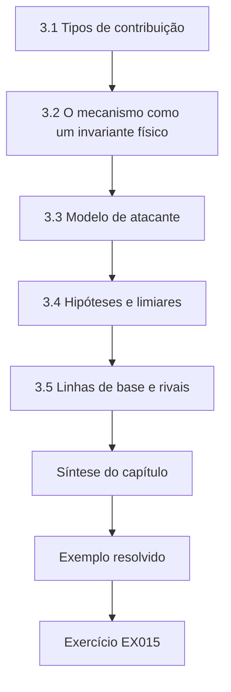

### Desenho lógico

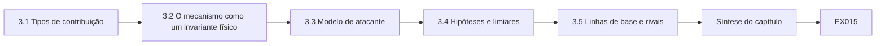

```text
[3.1 Tipos de contribuição]
    |
    v
[3.2 O mecanismo como um invariante físico]
    |
    v
[3.3 Modelo de atacante]
    |
    v
[3.4 Hipóteses e limiares]
    |
    v
[3.5 Linhas de base e rivais]
    |
    v
[Síntese do capítulo]
    |
    v
[Exemplo resolvido] --> [Exercício EX015]
```
<!-- cykin:lesson-figures:end ch-03 -->


### Objetivos de aprendizagem e conexão

Ao final deste capítulo, você será capaz de (1) escolher o tipo de contribuição que a sua tese faz, (2) expressar um mecanismo de detecção como um invariante físico, (3) definir um modelo de atacante explícito, (4) declarar hipóteses com limiares e explicações rivais e (5) pré-declarar as condições sob as quais a sua contribuição falha. Ele transforma a lacuna do Capítulo 2 num estudo que o Capítulo 4 pode pilotar.

### 3.1 Tipos de contribuição

Uma tese de segurança de TO pode contribuir com um **mecanismo** (um novo detector ou proteção), uma **medição** (uma forma de quantificar o impacto ou a exposição), uma **constatação empírica** (como os operadores ou as plantas de fato se comportam) ou um **princípio validado** (uma regra de projeto que se mantém entre contextos). O Setpoint Study contribui com uma comparação apoiada em medições: ele não inventa o teste CUSUM (Page, 1954) nem a detecção baseada em resíduos (levantada por Giraldo et al.); ele testa quando um invariante entre sensores ajuda contra um objetivo de adversário específico e documentado — a manipulação da visão — e quantifica onde ele deixa de ajudar. Um posicionamento honesto desse tipo é uma força numa defesa, não uma fraqueza.

### 3.2 O mecanismo como um invariante físico

O tanque da Plant A obedece a um balanço de massa discreto: próximo nível = nível + entrada − saída, com saída ≈ 0,02 × nível através de um orifício fixo no modelo sintético (equilíbrio de 50 unidades quando a entrada é 1,0). Um transmissor de nível e um medidor de vazão medem grandezas diferentes produzidas pela mesma física. Se um atacante repete leituras antigas de nível enquanto força a bomba, a estimativa de nível prevista a partir do medidor de vazão diverge do nível relatado. O **resíduo** r = nível relatado − nível previsto deve ficar perto de zero em operação normal e afastar-se sob esse ataque. Um **CUSUM** acumula a magnitude do resíduo acima de uma folga k e alarma quando a soma excede um limiar h; ele é projetado para captar pequenos desvios persistentes que uma faixa fixa deixa passar.

O invariante tem um pressuposto embutido: o medidor de vazão é honesto. Se o atacante controla os dois sensores (ou o CLP que os relata), o invariante pode ser satisfeito por uma mentira coerente. Declarar esse pressuposto é o início do modelo de atacante.

### 3.3 Modelo de atacante

Escreva o modelo como capacidades, conhecimento e objetivo:

| Elemento | Pressuposto do Setpoint Study |
|---|---|
| Capacidades | Acesso de escrita ao comando da bomba e à leitura de nível no enlace SCADA (coerente com *Modify Parameter* e *Spoof Reporting Message* do ATT&CK for ICS); **classe A**: só o sensor de nível; **classe B**: sensores de nível e de vazão. |
| Conhecimento | Conhece os limites do alarme de faixa; na classe B, conhece também o detector. |
| Objetivo | Elevar o nível real enquanto mantém os valores exibidos normais (manipulação da visão). |
| Fora do escopo | Comprometimento da válvula boia mecânica; adulteração física. |

### 3.4 Hipóteses e limiares

- **H1 (detecção):** contra o replay da classe A, o CUSUM do resíduo detecta ≥95% dos episódios, com atraso médio ≤ 60 passos, enquanto o alarme de faixa detecta ≤ 10%.
- **H2 (alarmes falsos):** em 100 execuções nominais, o CUSUM do resíduo não produz mais execuções com alarme falso do que o alarme de faixa.
- **H3 (impacto):** o transbordamento real máximo na detecção é menor com o CUSUM do que com o alarme de faixa.
- **H4 (condição de falha):** contra a classe B, a detecção do CUSUM cai para ≤ 10% — a fronteira prevista da contribuição.

Os limiares são justificados, não decorativos: 60 passos correspondem, na base de tempo sintética, ao tempo que o transbordamento leva para atingir metade da margem até o trip de nível muito alto. H4 é uma hipótese que você *quer* poder confirmar: um método cujos limites são medidos é mais útil do que um cujos limites são desconhecidos.

### 3.5 Linhas de base e rivais

As linhas de base são (a) o **alarme de faixa** que a planta já tem, (b) um **detector de rede** que sinaliza qualquer escrita no registrador de nível — trivialmente eficaz se as escritas forem raras, inútil se o atacante fizer o replay no sensor — e (c) um **oráculo** com acesso ao nível real, que dá o melhor atraso possível. As explicações rivais para qualquer vantagem do CUSUM incluem o ajuste do limiar nos dados de teste, um simulador limpo demais e magnitudes de ataque escolhidas para favorecer o método. Cada rival recebe um teste no Capítulo 4 ou 5.

### 3.6 Exemplo resolvido e Laboratório 3

O Laboratório 3 implementa o modelo e os dois detectores para 100 execuções com sementes fixas por condição.

```python
# Lab 3 - Setpoint Study (synthetic): fixed-band alarm vs. physics-residual CUSUM on one tank.
# Python 3 standard library only. Attack: pump forced to over-fill while the level sensor replays
# nominal values ("replay"); variant "replay+flow" also spoofs the inflow meter.
import random

def run(seed, attack, detector, steps=600, onset=300):
    rng = random.Random(seed)
    true_level, s, first_alarm, max_dev = 50.0, 0.0, None, 0.0
    est = 50.0
    for t in range(steps):
        inflow = 1.0 + rng.gauss(0, 0.05)
        if attack and t >= onset:
            inflow += 0.05                      # forced pump: hidden extra inflow
        true_level += inflow - 0.02 * true_level
        level_meas = true_level + rng.gauss(0, 0.3)
        flow_meas = inflow + rng.gauss(0, 0.02)
        if attack and t >= onset:
            level_meas = 50.0 + rng.gauss(0, 0.3)   # replayed nominal level
            if attack == "replay+flow":
                flow_meas = 1.0 + rng.gauss(0, 0.02)
        est = est + flow_meas - 0.02 * est      # mass-balance prediction from flow meter
        if detector == "band":
            hit = abs(level_meas - 50.0) > 1.5
        else:
            s = max(0.0, s + abs(level_meas - est) - 0.6)
            hit = s > 6.0
        if hit and first_alarm is None:
            first_alarm = t
        if t >= onset:
            max_dev = max(max_dev, true_level - 50.0)
    return first_alarm, max_dev

for det in ("band", "cusum"):
    fa = sum(run(k, None, det)[0] is not None for k in range(100))
    for atk in ("replay", "replay+flow"):
        res = [run(k, atk, det) for k in range(100)]
        hits = [a - 300 for a, _ in res if a is not None and a >= 300]
        delay = f"{sum(hits)/len(hits):.1f}" if hits else "n/a"
        print(f"{det:5s} {atk:11s} false_alarm_runs={fa}/100 detected={len(hits)}/100 "
              f"mean_delay={delay} worst_true_overfill={max(d for _, d in res):.2f}")
```

Saída esperada:

```text
band  replay      false_alarm_runs=9/100 detected=0/100 mean_delay=n/a worst_true_overfill=3.36
band  replay+flow false_alarm_runs=9/100 detected=0/100 mean_delay=n/a worst_true_overfill=3.26
cusum replay      false_alarm_runs=0/100 detected=100/100 mean_delay=31.8 worst_true_overfill=3.36
cusum replay+flow false_alarm_runs=0/100 detected=0/100 mean_delay=n/a worst_true_overfill=3.26
```

Lendo a saída em relação às hipóteses: H1 é apoiada no modelo (100/100, atraso de 31,8, contra 0/100); H2 é apoiada (0 contra 9 execuções com alarme falso — a faixa estreita de ±1,5 dispara com o ruído); H4 é confirmada (a classe B escapa completamente). O "worst true overfill" (pior transbordamento real) é o máximo ao longo de *toda* a janela do ataque, então H3 exige uma medição separada do transbordamento no instante do alarme — um exercício abaixo. Todos os números são propriedades de um modelo sintético, não de uma planta.

### 3.7 Erros comuns e limites

Alegar que um mecanismo é novo quando só a sua aplicação é; omitir o pressuposto do sensor honesto; escolher as magnitudes de ataque depois de ver o comportamento do detector; não ter nenhuma condição sob a qual a hipótese falhe.

Cada um desses erros tem um sintoma visível numa proposta: uma frase de contribuição que alega inventar o CUSUM, um modelo de atacante sem uma classe B, um ganho de ataque alterado depois que o Laboratório 3 foi executado ou uma lista de hipóteses sem H4. Leia a proposta em busca desses sintomas antes de enviá-la à banca e corrija-os enquanto o estudo ainda é barato de mudar.

### Exercícios — capítulo 3

- **EX015 — Posicionar a contribuição do Setpoint Study.** Classifique o tipo de contribuição do Setpoint Study e escreva uma declaração de posicionamento de duas frases citando trabalhos anteriores. *Rubrica:* 3 = comparação apoiada em medições + cita Page 1954 e Giraldo et al. 2018; 2 = tipo sem citações; 1 = alega inventar o CUSUM; 0 = nenhum.
- **EX016 — Nível de equilíbrio com vazão extra de entrada.** Derive o nível de equilíbrio do tanque do Laboratório 3 quando a entrada é 1,05 e explique o que isso significa para o objetivo do atacante. *Rubrica:* 3 = L*=52,5 e o atacante precisa de forçamento maior/saída bloqueada; 2 = só 52,5; 1 = equilíbrio errado; 0 = nenhum.
- **EX017 — Atacante de classe C contra os detectores.** Estenda a tabela do modelo de atacante com um atacante de classe C que controla a própria lógica do CLP; preveja o resultado para cada detector. *Rubrica:* 3 = a classe C evade a banda/CUSUM dentro do CLP; um CUSUM externo independente ainda detecta; 2 = evasão sem o caso externo; 1 = vago; 0 = nenhum.
- **EX018 — Transbordamento no momento do alarme para H3.** Modifique o Laboratório 3 para registrar o transbordamento real *no instante do alarme* e teste H3. *Rubrica:* 3 = transbordamento≈1,22 médio/1,60 máximo no alarme do CUSUM; a banda nunca dispara; H3 sustentada nessa configuração; 2 = números sem H3; 1 = só qualitativo; 0 = nenhum.
- **EX019 — Justificar um limiar de atraso para H1.** Justifique um limiar de atraso diferente para H1 usando um nível de trip muito alto declarado e a taxa de transbordamento. *Rubrica:* 3 = trip/margem/taxa → limiar≈60 passos com raciocínio; 2 = limiar sem derivação; 1 = número arbitrário; 0 = nenhum.
- **EX020 — Três rivais para uma vantagem do CUSUM.** Liste três explicações rivais para uma vantagem do CUSUM e o teste que descartaria cada uma. *Rubrica:* 3 = três rivais (ajuste, simulação limpa, escolha do ganho), cada um com um teste que o descarta; 2 = rivais sem testes; 1 = um rival; 0 = nenhum.

### Síntese do capítulo

Uma proposta forte se posiciona com honestidade, expressa o mecanismo como um invariante físico, torna explícito o pressuposto do sensor honesto por meio de um modelo de atacante e pré-declara as hipóteses — incluindo a que marca onde a contribuição falha.

<!-- cykin:chapter-navigation:start ch-03 -->
### Continue estudando — capítulo 03 de 08

[← Capítulo 02](#ch-02) · [Índice de capítulos do curso](../SUBJECTS.md) · [Capítulo 04 →](#ch-04)

Siga para a próxima lição escrita.
<!-- cykin:chapter-navigation:end -->

<a id="ch-04"></a>

## Capítulo 4 — Replicação das linhas de base e piloto

<!-- cykin:lesson-figures:start ch-04 -->
### Mapa da aula

Aula 04 publicada. Mapa, exemplo, EX021.

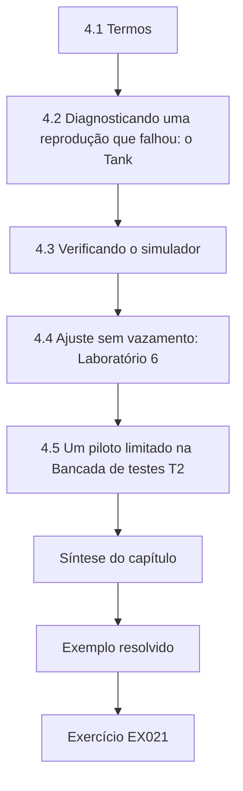

### Desenho lógico

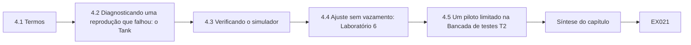

```text
[4.1 Termos]
    |
    v
[4.2 Diagnosticando uma reprodução que falhou: o Tank]
    |
    v
[4.3 Verificando o simulador]
    |
    v
[4.4 Ajuste sem vazamento: Laboratório 6]
    |
    v
[4.5 Um piloto limitado na Bancada de testes T2]
    |
    v
[Síntese do capítulo]
    |
    v
[Exemplo resolvido] --> [Exercício EX021]
```
<!-- cykin:lesson-figures:end ch-04 -->


### Objetivos de aprendizagem e conexão

Ao final deste capítulo, você será capaz de (1) distinguir reprodução, replicação e reimplementação, (2) diagnosticar por que um resultado publicado de detecção em TO não pode ser reproduzido, (3) verificar um simulador de processo antes de confiar nele, (4) desenhar um piloto limitado numa bancada isolada e (5) tomar uma decisão pré-declarada de seguir ou não seguir (go/no-go). Ele parte das hipóteses do Capítulo 3 e prepara o estudo principal do Capítulo 5.

### 4.1 Termos

A política de selos de artefatos da ACM distingue **repetibilidade** (mesma equipe, mesma configuração), **reprodutibilidade** (equipe diferente, mesmos artefatos) e **replicabilidade** (equipe diferente, artefatos próprios). Na TO, esses termos diferem fortemente, porque plantas, controladores e conjuntos de dados raramente podem ser compartilhados. Fixe o seu vocabulário antes de alegar qualquer um deles.

No Setpoint Study, executar de novo o Laboratório 3 com o mesmo código e as mesmas sementes é repetibilidade. Um colega executando o código arquivado é reprodutibilidade. O trabalho com o TankBench-21 é uma reimplementação a partir da descrição do artigo, mais próxima da replicação. Dizer isso com precisão impede que um revisor leia uma nova pontuação como uma confirmação independente do resultado original.

### 4.2 Diagnosticando uma reprodução que falhou: o TankBench-21

O benchmark sintético TankBench-21 relata um F1 de 0,96 para um alarme de faixa mais taxa de variação. A reimplementação do candidato obtém 0,31. Um diagnóstico disciplinado lista hipóteses e testa cada uma: (a) **convenção de pontuação** — o artigo usou o ajuste por pontos (o Laboratório 1 mostra que só isso pode explicar uma diferença desse tamanho); (b) **vazamento do limiar** — os limiares foram escolhidos na partição de teste; (c) **alinhamento dos rótulos** — os rótulos de ataque começam quando o script de ataque foi lançado, não quando o processo se desviou pela primeira vez; (d) **amostragem** — o artigo reduziu a amostragem para 10 s, suavizando o ruído. Pontuar de novo com o ajuste por pontos dá 0,94, dentro de uma tolerância pré-declarada de ±0,05, então a reprodução "tem sucesso" — mas tem sucesso em reproduzir uma métrica inflada. A tese registra os dois números e adota a revocação por evento mais o atraso.

### 4.3 Verificando o simulador

A verificação pergunta se o modelo foi construído corretamente; a validação pergunta se ele é o modelo correto (vocabulário padrão de modelagem). Os testes de verificação para o tanque do Laboratório 3 incluem: equilíbrio em 50,0 com a entrada nominal (verificação analítica); conservação da massa ao longo de 1.000 passos sem ruído; média do resíduo perto de zero sem ataque; e sementes que produzem traços idênticos em duas máquinas. Um detector avaliado num simulador não verificado é avaliado num sistema desconhecido.

Escreva cada teste de verificação como código que falha de forma ruidosa e execute o conjunto antes de cada lote de experimentos. Se a verificação do equilíbrio falhar depois de uma mudança no termo de saída, nenhum resultado de detector daquela versão é utilizável até ela passar. Guarde a saída dos testes junto com os registros das execuções, para que um examinador veja que a verificação precedeu os resultados que ela sustenta.

### 4.4 Ajuste sem vazamento: Laboratório 6

O CUSUM tem dois parâmetros, a folga k e o limiar h. Ajuste-os em sementes separadas das sementes de avaliação e examine a robustez ao erro de modelo. O Laboratório 6 varre k e acrescenta um viés constante de calibração de 0,4 unidade no sensor de nível — um descompasso realista entre o modelo e o instrumento.

```python
# Lab 6 (synthetic): CUSUM drift k vs. false alarms and detection delay - the tuning trade-off reviewers ask about.
import random
def first_alarm(seed, attack, k, h=6.0, steps=600, onset=300, bias=0.0):
    rng = random.Random(seed); true, est, s = 50.0, 50.0, 0.0
    for t in range(steps):
        inflow = 1.0 + rng.gauss(0, 0.05) + (0.05 if attack and t >= onset else 0.0)
        true += inflow - 0.02*true
        lvl = true + rng.gauss(0, 0.3) + bias
        if attack and t >= onset: lvl = 50.0 + rng.gauss(0, 0.3) + bias
        est += inflow + rng.gauss(0, 0.02) - 0.02*est
        s = max(0.0, s + abs(lvl - est) - k)
        if s > h: return t
    return None
for bias in (0.0, 0.4):
    for k in (0.4, 0.6, 0.8, 1.0):
        fa = sum(first_alarm(i, False, k, bias=bias) is not None for i in range(100))
        d = [a-300 for a in (first_alarm(i, True, k, bias=bias) for i in range(100)) if a is not None and a >= 300]
        print(f"bias={bias} k={k} false_alarm_runs={fa}/100 detected={len(d)}/100 mean_delay={sum(d)/len(d) if d else float('nan'):.1f}")
```

Saída esperada:

```text
bias=0.0 k=0.4 false_alarm_runs=0/100 detected=100/100 mean_delay=25.6
bias=0.0 k=0.6 false_alarm_runs=0/100 detected=100/100 mean_delay=30.9
bias=0.0 k=0.8 false_alarm_runs=0/100 detected=100/100 mean_delay=38.0
bias=0.0 k=1.0 false_alarm_runs=0/100 detected=100/100 mean_delay=46.1
bias=0.4 k=0.4 false_alarm_runs=97/100 detected=19/100 mean_delay=35.4
bias=0.4 k=0.6 false_alarm_runs=4/100 detected=99/100 mean_delay=46.1
bias=0.4 k=0.8 false_alarm_runs=0/100 detected=100/100 mean_delay=55.6
bias=0.4 k=1.0 false_alarm_runs=0/100 detected=100/100 mean_delay=66.5
```

Com um modelo perfeito, o menor k parece o melhor. Um pequeno viés de calibração torna k = 0,4 inútil: 97 execuções alarmam antes de o ataque começar, e apenas 19 alarmes ocorrem depois do início. A escolha defensável é k = 0,8, que troca cerca de 7 passos de atraso (em comparação com k = 0,6 sem viés) por robustez. É esse tipo de resultado que os revisores esperam ver *antes* do estudo principal.

### 4.5 Um piloto limitado na Bancada de testes T2

O piloto responde apenas a perguntas de viabilidade: a bancada consegue executar o cenário de replay com segurança, o historiador consegue registrar a 1 Hz e a válvula boia impede o transbordamento? Os dados do piloto não são usados em testes de hipóteses. Os critérios de go/no-go são escritos com antecedência: seguir se três execuções consecutivas terminarem sem que a válvula boia seja alcançada, com perda de registros abaixo de 1% e sem nenhuma reinicialização não planejada do controlador; caso contrário, revisar. O plano do piloto também registra quem pode parar uma execução e como (uma parada de emergência física que corta a energia da bomba, independente do CLP).

### 4.6 Erros comuns e limites

Chamar uma nova pontuação de replicação; confiar num simulador porque ele "parece certo"; ajustar nas sementes de avaliação; usar dados do piloto para testar hipóteses; não ter uma parada de emergência independente.

Cada erro deixa um resultado parecer melhor do que é. Uma nova pontuação com ajuste por pontos só confirma que a convenção original foi usada. Um traço de aparência plausível não é um teste de verificação aprovado. Sementes compartilhadas entre o ajuste e a avaliação vazam informação. As execuções do piloto respondem à viabilidade, não às hipóteses. E sem uma parada física que corte a energia da bomba independentemente do CLP, o piloto não está limitado.

### Exercícios — capítulo 4

- **EX021 — Termos de repetibilidade da ACM.** Classifique três atividades (executar de novo o seu próprio Laboratório 3, um colega executando o seu arquivo, um colega construindo o próprio modelo de tanque) segundo os termos da ACM. *Rubrica:* 3 = repetibilidade / reprodutibilidade / replicabilidade atribuídas corretamente; 2 = duas corretas; 1 = uma; 0 = nenhum.
- **EX022 — Registro da reprodução do TankBench-21.** Escreva uma entrada de registro de reprodução para o TankBench-21 com as quatro hipóteses, os testes e os resultados. *Rubrica:* 3 = quatro hipóteses com testes/resultados, incluindo ajuste por pontos→0,94; 2 = hipóteses sem resultados; 1 = parcial; 0 = nenhum.
- **EX023 — Teste de verificação da conservação de massa.** Escreva e execute um teste de verificação da conservação da massa no modelo sem ruído do Laboratório 3. *Rubrica:* 3 = equilíbrio sem ruído≈50 e verificação da identidade entrada−saída; 2 = só o equilíbrio; 1 = vago; 0 = nenhum.
- **EX024 — Escolher k sob viés de calibração.** Usando o Laboratório 6, escolha k para uma planta em que se espera um viés de calibração de até 0,4 e justifique a escolha com dois números. *Rubrica:* 3 = k=0,8 com 0/100 AF vs k=0,6 com 4/100 AF e o compromisso com o atraso; 2 = escolha de k sem os dois números; 1 = só k; 0 = nenhum.
- **EX025 — Critérios de prosseguir/parar do piloto na T2.** Escreva critérios de go/no-go para um piloto na T2, incluindo um critério de segurança e um critério de qualidade dos dados. *Rubrica:* 3 = segurança (válvula boia), dados (<1% de perda), reinicialização, pré-teste da parada de emergência; 2 = falta um; 1 = "prosseguir" vago; 0 = nenhum.
- **EX026 — Por que o 0,94 reproduzido não indica qualidade.** Explique por que o 0,94 reproduzido não é evidência de que o detector do TankBench-21 é bom. *Rubrica:* 3 = pontuação com ajuste por pontos ≠ desempenho em atraso/AF/turno + possível ajuste no conjunto de teste; 2 = uma razão; 1 = "alto demais"; 0 = nenhum.

### Síntese do capítulo

Reproduza as linhas de base com uma tolerância pré-declarada e diagnostique as diferenças de forma sistemática; verifique o simulador; ajuste em sementes separadas e submeta o ajuste a testes de estresse contra o erro de modelo; e pilote apenas para a viabilidade, com uma autoridade de parada física independente.

<!-- cykin:chapter-navigation:start ch-04 -->
### Continue estudando — capítulo 04 de 08

[← Capítulo 03](#ch-03) · [Índice de capítulos do curso](../SUBJECTS.md) · [Capítulo 05 →](#ch-05)

Siga para a próxima lição escrita.
<!-- cykin:chapter-navigation:end -->

<a id="ch-05"></a>

## Capítulo 5 — Estudo principal e validação independente

<!-- cykin:lesson-figures:start ch-05 -->
### Mapa da aula

Aula 05 publicada. Mapa, exemplo, EX027.

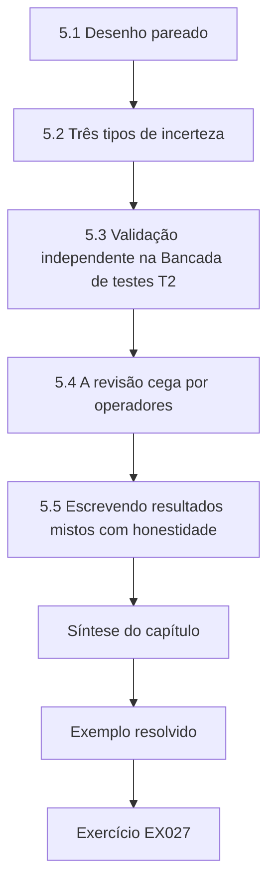

### Desenho lógico

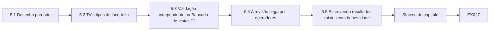

```text
[5.1 Desenho pareado]
    |
    v
[5.2 Três tipos de incerteza]
    |
    v
[5.3 Validação independente na Bancada de testes T2]
    |
    v
[5.4 A revisão cega por operadores]
    |
    v
[5.5 Escrevendo resultados mistos com honestidade]
    |
    v
[Síntese do capítulo]
    |
    v
[Exemplo resolvido] --> [Exercício EX027]
```
<!-- cykin:lesson-figures:end ch-05 -->


### Objetivos de aprendizagem e conexão

Ao final deste capítulo, você será capaz de (1) desenhar um experimento pareado com números aleatórios comuns, (2) relatar uma incerteza que separe o ruído da simulação da incerteza do modelo, (3) validar num segundo contexto independente, (4) incorporar uma revisão cega por operadores e (5) escrever um parágrafo de resultados honesto, incluindo resultados mistos. Ele executa o plano pilotado no Capítulo 4 e produz as alegações que o Capítulo 6 vai atacar.

### 5.1 Desenho pareado

Ao comparar duas configurações de um detector, execute ambas nas **mesmas** sementes aleatórias (números aleatórios comuns, uma técnica padrão de simulação). A diferença por semente remove o ruído compartilhado e estreita os intervalos de confiança. O Laboratório 5 compara k = 0,8 com k = 0,6 em duas variantes de planta: a Plant A, com um ganho de entrada do ataque de 0,05, e a Plant B, um tanque maior em que a mesma manipulação da bomba produz apenas 0,02 unidade por passo.

```python
# Lab 5 (synthetic): paired comparison of detection delay on two plant models with common random numbers + bootstrap CI.
import random
def delay(seed, k, gain):
    rng = random.Random(seed); true, est, s = 50.0, 50.0, 0.0
    for t in range(700):
        inflow = 1.0 + rng.gauss(0, 0.05) + (gain if t >= 300 else 0.0)
        true += inflow - 0.02*true
        lvl = 50.0 + rng.gauss(0, 0.3) if t >= 300 else true + rng.gauss(0, 0.3)
        est += inflow + rng.gauss(0, 0.02) - 0.02*est
        s = max(0.0, s + abs(lvl - est) - k)
        if s > 6.0 and t >= 300: return t - 300
    return 400
for plant, gain in (("A", 0.05), ("B", 0.02)):
    diffs = [delay(i, 0.8, gain) - delay(i, 0.6, gain) for i in range(200)]
    rng = random.Random(7); boots = sorted(sum(rng.choice(diffs) for _ in diffs)/len(diffs) for _ in range(2000))
    print(f"plant {plant}: mean delay(k=0.8)-delay(k=0.6)={sum(diffs)/len(diffs):.1f} steps, 95% CI [{boots[50]:.1f}, {boots[1949]:.1f}]")
```

Saída esperada:

```text
plant A: mean delay(k=0.8)-delay(k=0.6)=6.9 steps, 95% CI [6.5, 7.4]
plant B: mean delay(k=0.8)-delay(k=0.6)=45.4 steps, 95% CI [38.4, 53.0]
```

A robustez escolhida no Capítulo 4 custa cerca de 7 passos na Plant A, mas cerca de 45 passos na Plant B, onde o sinal do ataque é mais fraco. As execuções não detectadas são limitadas a 400 passos (censura à direita); a média da Plant B é, portanto, um limite inferior do custo real. O intervalo bootstrap descreve apenas o ruído da simulação — ele não diz nada sobre se o modelo de tanque representa alguma planta real.

### 5.2 Três tipos de incerteza

Separe a incerteza **estocástica** (variação de semente para semente, captada pelo intervalo), a incerteza **paramétrica** (coeficiente do orifício, níveis de ruído, viés de calibração — exploradas pela análise de sensibilidade, como no Laboratório 6) e a incerteza **estrutural** (um balanço de massa de um único tanque é, afinal, o modelo certo?). Só a segunda bancada de testes trata da terceira.

No Setpoint Study, o intervalo do Laboratório 5 cobre apenas o primeiro tipo. O Laboratório 6 cobre parte do segundo, por meio do viés de calibração e da folga. A Bancada de testes T2 é a primeira evidência sobre o terceiro, e a sua revocação menor mostra que o medidor de vazão honesto e sem atraso do modelo era simples demais. Relate cada tipo no seu próprio lugar, para que os leitores não confundam um com o outro.

### 5.3 Validação independente na Bancada de testes T2

A T2 difere do modelo da Plant A em aspectos que importam: dois tanques acoplados, um medidor de vazão diferente com o seu próprio atraso e um ciclo de varredura do CLP de 100 ms. Os limiares são congelados a partir do ajuste da Plant A antes de qualquer dado da T2 ser examinado — caso contrário, a validação seria só mais um exercício de ajuste. Resultados sintéticos da T2: replay da classe A detectado em 18 de 20 episódios (dois perdidos porque o atraso do medidor de vazão escondeu manipulações pequenas), atraso mediano maior do que na simulação, zero alarmes falsos em 40 horas nominais e evasão da classe B confirmada em todos os 10 ensaios. O estudo apoia, assim, H1 com uma ressalva (revocação menor com um instrumento com atraso) e confirma H4.

### 5.4 A revisão cega por operadores

Dez operadores sintéticos (O01–O10) revisaram linhas do tempo de alarmes sem saber qual detector as produzira. Oito preferiram o alarme do CUSUM porque ele chegava com uma tendência do resíduo que conseguiam interpretar; dois acharam o "resíduo" abstrato e queriam ver o nível previsto na IHM. A constatação é sobre a interpretabilidade, não sobre a acurácia da detecção, e ela muda o desenho: a tese recomenda exibir o nível previsto ao lado do nível relatado.

Dez participantes não podem apoiar uma alegação estatística sobre populações de operadores, e o estudo não faz nenhuma. A revisão mostra que a interpretabilidade é uma questão de projeto que merece ser medida mais tarde com equipes reais de salas de controle, com consentimento. Registre o protocolo, o método de cegamento e a razão declarada por cada operador, para que a recomendação possa ser rastreada até o que foi dito, e não até uma contagem.

### 5.5 Escrevendo resultados mistos com honestidade

"No modelo sintético da Plant A e na Bancada de testes T2 sintética, um CUSUM de resíduo de balanço de massa detectou ataques de replay de sensor da classe A que um alarme de faixa de ±1,5 deixou passar, sem nenhuma execução com alarme falso em operação nominal. A revocação caiu de 100% na simulação para 90% na T2 por causa do atraso do medidor de vazão. A robustez a um viés de calibração de 0,4 unidade exigiu uma folga maior, o que alongou o atraso de detecção em cerca de 7 passos na Plant A e em pelo menos 45 na Plant B, de sinal mais fraco. Quando o atacante também controlava o medidor de vazão (classe B), a detecção falhou em todos os ensaios, como previsto."

### 5.6 Erros comuns e limites

Sementes independentes em comparações pareadas; ajuste na bancada de validação; esconder as execuções censuradas; apresentar os intervalos como incerteza do mundo real; omitir a condição de falha do resumo.

Cada item tem uma verificação concreta neste estudo: o Laboratório 5 usa números aleatórios comuns, os limiares da T2 são congelados a partir do ajuste da Plant A, as execuções limitadas são relatadas como censuradas em 400 passos, o intervalo bootstrap é rotulado como ruído da simulação e o resumo declara que a classe B escapou da detecção em todos os ensaios. Um revisor deve conseguir confirmar cada verificação a partir do arquivo.

### Exercícios — capítulo 5

- **EX027 — Sementes independentes versus pareadas.** Execute de novo o Laboratório 5 com sementes independentes para as duas configurações e compare a largura dos intervalos com a da versão pareada. *Rubrica:* 3 = largura não pareada na Plant A≈3,2 vs pareada≈0,9 e a comparação na Plant B; 2 = só a direção; 1 = direção errada; 0 = nenhum.
- **EX028 — Seis fontes de incerteza classificadas.** Classifique seis fontes de incerteza do Setpoint Study como estocásticas, paramétricas ou estruturais. *Rubrica:* 3 = estocástica/paramétrica/estrutural com dois exemplos por classe; 2 = classes sem exemplos; 1 = uma classe; 0 = nenhum.
- **EX029 — Regra de congelamento antes da validação na T2.** Escreva a regra de congelamento dos limiares antes da validação na T2 e explique o que invalidaria a validação. *Rubrica:* 3 = congelar k=0,8 h=6 com hash antes da carga na T2 + o que invalida; 2 = congelamento sem invalidação; 1 = vago; 0 = nenhum.
- **EX030 — Censura à direita na Plant B.** Explique como a censura à direita enviesa a média da Plant B e proponha um resumo melhor. *Rubrica:* 3 = média como limite inferior + relatar a proporção de detecção/mediana entre os detectados ou estilo KM; 2 = viés sem resumo melhor; 1 = vago; 0 = nenhum.
- **EX031 — Revisão dos operadores no desenho e no limite.** Transforme a constatação da revisão por operadores numa recomendação de projeto e numa limitação. *Rubrica:* 3 = mostrar previsto vs relatado na IHM + limite dos operadores sintéticos; 2 = um dos dois; 1 = vago; 0 = nenhum.
- **EX032 — Parágrafo de resultados quando H1 falha na T2.** Escreva um parágrafo de resultados de 120 palavras para um estudo em que H1 falhou na T2. *Rubrica:* 3 = ~120 palavras com T2 9/20 vs simulação 100/100 e a explicação por atraso/folga; 2 = números sem o atraso; 1 = nota curta de falha; 0 = nenhum.

### Síntese do capítulo

Os desenhos pareados tornam as comparações mais nítidas; a incerteza tem três tipos e os intervalos captam apenas um; validar significa limiares congelados num contexto independente; e um parágrafo de resultados honesto carrega as suas ressalvas e a sua condição de falha.

<!-- cykin:chapter-navigation:start ch-05 -->
### Continue estudando — capítulo 05 de 08

[← Capítulo 04](#ch-04) · [Índice de capítulos do curso](../SUBJECTS.md) · [Capítulo 06 →](#ch-06)

Siga para a próxima lição escrita.
<!-- cykin:chapter-navigation:end -->

<a id="ch-06"></a>

## Capítulo 6 — Crítica de pares e revisão

<!-- cykin:lesson-figures:start ch-06 -->
### Mapa da aula

Aula 06 publicada. Mapa, exemplo, EX033.

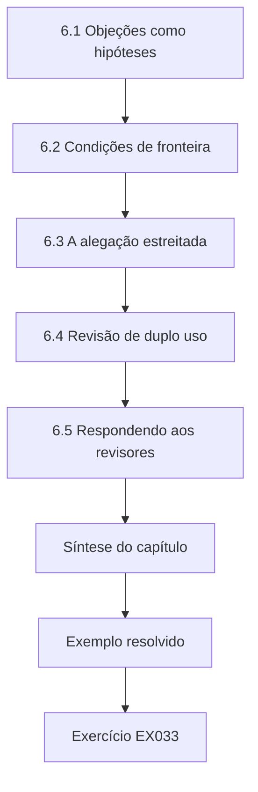

### Desenho lógico

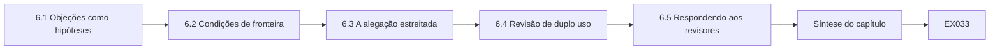

```text
[6.1 Objeções como hipóteses]
    |
    v
[6.2 Condições de fronteira]
    |
    v
[6.3 A alegação estreitada]
    |
    v
[6.4 Revisão de duplo uso]
    |
    v
[6.5 Respondendo aos revisores]
    |
    v
[Síntese do capítulo]
    |
    v
[Exemplo resolvido] --> [Exercício EX033]
```
<!-- cykin:lesson-figures:end ch-06 -->


### Objetivos de aprendizagem e conexão

Ao final deste capítulo, você será capaz de (1) organizar uma revisão interna de equipe vermelha (red team) das suas próprias alegações, (2) converter objeções em hipóteses testáveis, (3) caracterizar condições de fronteira em vez de escondê-las, (4) fazer uma revisão de duplo uso de um artigo antes da submissão e (5) escrever uma carta de resposta aos revisores que responda de fato. Ele ataca os resultados do Capítulo 5 e alimenta o argumento da tese do Capítulo 7.

### 6.1 Objeções como hipóteses

Convide dois colegas — idealmente um engenheiro de controle e um pesquisador de segurança ofensiva — para atacar as alegações. Registre cada objeção como uma hipótese com um teste:

| Objeção (equipe vermelha) | Hipótese | Teste | Resultado (sintético) |
|---|---|---|---|
| "O seu atacante é ingênuo: um atacante esperto sobe devagar." | Uma rampa lenta abaixo da folga do CUSUM escapa da detecção e ainda assim transborda. | Varrer o ganho do ataque de 0,005 a 0,05. | O ganho 0,005 é detectado em apenas 14/100 execuções e o 0,01 em 55/100, mas o pior transbordamento na janela de 300 passos fica em 1,12 e 1,37 unidade, contra 3,36 com ganho 0,05 — o argumento de limitação do impacto de Urbina et al. |
| "O medidor de vazão é só mais uma entrada do CLP." | Se o medidor estiver ligado ao mesmo CLP que o sensor de nível, a classe B é tão fácil quanto a classe A. | Inspecionar a fiação da T2 e o projeto da Plant A. | Na T2, ambos passam por um único CLP; o pressuposto do sensor honesto só vale para um medidor com fiação separada. |
| "Os operadores perceberiam a bomba funcionando." | A exibição do estado da bomba revela o ataque. | Revisar o projeto da IHM. | Só se o estado da bomba vier de um contato independente, e não do valor comandado. |
| "Os resultados dependem do nível de ruído." | Um ruído maior no sensor aumenta os alarmes falsos com k fixo. | Laboratório 6 com o ruído dobrado. | Exige novo ajuste; relatado como sensibilidade paramétrica. |

A segunda objeção é a mais importante: ela revela que a força da defesa é uma propriedade **arquitetural** (caminhos de medição independentes), e não algorítmica. A alegação da tese é revisada de acordo.

### 6.2 Condições de fronteira

Uma boa tese mapeia onde o método funciona. Para o Setpoint Study, as fronteiras são: (1) uma segunda medição independente da mesma física precisa existir e estar fora do controle do atacante; (2) o erro do modelo precisa ser menor do que o sinal do ataque; (3) ataques mais lentos do que a folga podem escapar, mas o seu impacto dentro de um horizonte declarado é limitado (no modelo, ≤1,37 unidade de transbordamento em 300 passos para ganhos ≤0,01). Elas são declaradas no resumo, não enterradas numa seção de limitações.

Cada fronteira deve ser declarada com a evidência que a mede: a inspeção da fiação da T2 para a primeira, a varredura do viés de calibração no Laboratório 6 para a segunda e a varredura do ganho do ataque da revisão da equipe vermelha para a terceira.

### 6.3 A alegação estreitada

Antes: "O CUSUM baseado em física detecta manipulação de sensores em estações de água." Depois: "Onde um sensor com fiação independente mede uma grandeza ligada por um balanço de massa conhecido, um CUSUM de resíduo com folga ajustada para o erro de calibração esperado detecta ataques de replay de um único sensor que os alarmes de faixa deixam passar e limita o transbordamento alcançável por ataques mais lentos; ele não oferece nenhuma proteção quando o atacante controla os dois caminhos de medição." A alegação estreitada tem alcance menor e evidências muito mais fortes.

Mantenha as versões de antes e de depois na tese, para que os leitores vejam como a crítica mudou o argumento. Confira cada frase posterior em relação à alegação estreitada: um resumo ou uma conclusão que volte a falar de estações de água em geral desfaz o trabalho. A alegação estreitada também dá aos operadores um teste direto do próprio local: a segunda medição tem fiação independente?

### 6.4 Revisão de duplo uso

Antes da submissão, pergunte: o artigo dá uma receita para a evasão da classe B contra um produto nomeado? (Não: ele descreve a classe de capacidade, que já está documentada como manipulação da visão.) Ele revela a configuração da T2? (Só a estrutura genérica.) Um defensor ganharia mais do que um atacante? (Sim: a recomendação arquitetural — caminhos de medição independentes — é acionável para os defensores e bem conhecida dos atacantes capazes.) Registre as respostas no apêndice da tese.

Peça a um revisor de fora do projeto que responda às mesmas perguntas sem ver as suas respostas e registre qualquer discordância e como ela foi resolvida. Se um trabalho posterior encontrar uma falha específica de um produto, como um CLP que aceita escritas que deveria recusar, a revisão é repetida e a divulgação é conduzida pelo processo coordenado antes da publicação.

### 6.5 Respondendo aos revisores

Responda a cada ponto, cite-o, declare o que mudou e onde, e discorde com evidências quando precisar. Exemplo: "O Revisor 2 afirma que o CUSUM não é novo. Concordamos e revisamos a §1 para posicionar a contribuição como uma medição de quando os invariantes entre sensores ajudam contra a manipulação da visão, citando Page (1954) e Giraldo et al. (2018). A nova declaração de contribuição está na p. 3."

Mantenha uma tabela com uma linha por ponto do revisor: a citação, a sua resposta, a mudança feita e a sua localização. Onde discordar, cite o resultado medido, como a classe B escapando em todos os ensaios, em vez de repetir a sua opinião. Envie a tabela com o manuscrito revisado, para que o editor possa conferir cada mudança.

### 6.6 Erros comuns e limites

Defender em vez de testar; esconder a falha da classe B; alegar generalidade entre plantas depois de dois contextos; responder aos revisores sem declarar as mudanças.

Cada erro transforma a crítica em defesa. Responda à objeção da rampa lenta com a varredura do ganho, não com garantias. Ponha a classe B no resumo. Limite a generalidade aos dois contextos medidos, o modelo da Plant A e a Bancada de testes T2. Nas cartas aos revisores, declare o que mudou e onde, para que um leitor possa verificar a revisão em vez de confiar na alegação. Mantenha a tabela de objeções na tese.

### Exercícios — capítulo 6

- **EX033 — A objeção de sobreajuste como teste.** Transforme a objeção "o seu limiar está sobreajustado" numa hipótese e num teste. *Rubrica:* 3 = hipótese de queda em sementes não vistas/T2 + ajustar 0–99 / avaliar 1000–1099 e T2; 2 = hipótese sem protocolo; 1 = repete a objeção; 0 = nenhum.
- **EX034 — Varrer o ganho do ataque para o CUSUM.** Modifique o Laboratório 3 para varrer o ganho do ataque (0,005, 0,01, 0,02, 0,05) para o CUSUM e relate a detecção e o pior transbordamento. *Rubrica:* 3 = quatro ganhos com contagens de detecção, atrasos e pior transbordamento iguais aos da varredura do laboratório; 2 = dois ganhos; 1 = qualitativo; 0 = nenhum.
- **EX035 — Parágrafo de limites para o resumo.** Escreva o parágrafo de condições de fronteira para o resumo em ≤ 80 palavras. *Rubrica:* 3 = ≤80 palavras: segunda medição independente, erro do modelo < ataque, ataques lentos ≤1,37 de transbordamento; 2 = limites sem números; 1 = alegação excessiva; 0 = nenhum.
- **EX036 — Estreitar a alegação sobre saneamento.** Reescreva a alegação "o método protege as concessionárias de água" como uma alegação estreitada. *Rubrica:* 3 = dois contextos sintéticos + vazão independente + falha na classe B; 2 = estreitada, mas ainda "saneamento"; 1 = edição menor; 0 = alegação original.
- **EX037 — Uso dual da sequência exata de falsificação na T2.** Faça uma revisão de duplo uso para a publicação da sequência exata de falsificação do medidor de vazão usada na T2. *Rubrica:* 3 = publicar classe+defesa; sequência exata da T2 só sob CVD/fornecedor; 2 = reter sem caminho; 1 = publicar tudo; 0 = nenhum.
- **EX038 — Resposta sobre a representatividade da bancada.** Escreva uma resposta ao revisor para "Os resultados da bancada de testes não são representativos de plantas reais." *Rubrica:* 3 = concordar com a diferença, apontar as alegações estreitadas + limiares congelados na T2 + risco residual; 2 = concorda sem apontar evidências; 1 = descarta; 0 = nenhum.

### Síntese do capítulo

A crítica é dado: converta as objeções em testes, deixe que elas estreitem a alegação, publique as condições de fronteira com destaque e faça a revisão de duplo uso antes da submissão. A objeção mais valiosa aqui transformou uma alegação algorítmica numa alegação arquitetural.

<!-- cykin:chapter-navigation:start ch-06 -->
### Continue estudando — capítulo 06 de 08

[← Capítulo 05](#ch-05) · [Índice de capítulos do curso](../SUBJECTS.md) · [Capítulo 07 →](#ch-07)

Siga para a próxima lição escrita.
<!-- cykin:chapter-navigation:end -->

<a id="ch-07"></a>

## Capítulo 7 — Síntese da tese e arquivo de reprodutibilidade

<!-- cykin:lesson-figures:start ch-07 -->
### Mapa da aula

Aula 07 publicada. Mapa, exemplo, EX039.

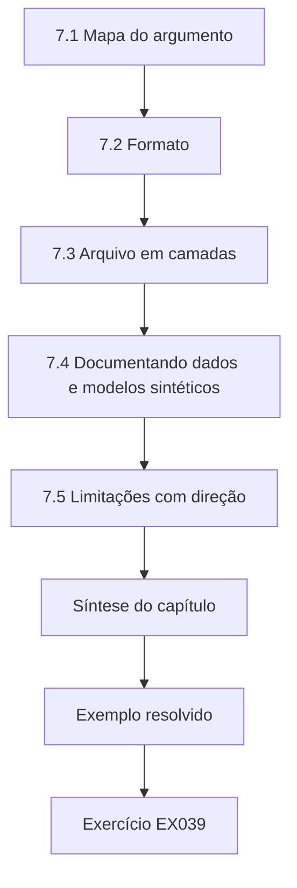

### Desenho lógico

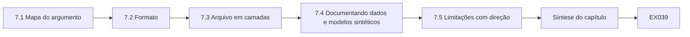

```text
[7.1 Mapa do argumento]
    |
    v
[7.2 Formato]
    |
    v
[7.3 Arquivo em camadas]
    |
    v
[7.4 Documentando dados e modelos sintéticos]
    |
    v
[7.5 Limitações com direção]
    |
    v
[Síntese do capítulo]
    |
    v
[Exemplo resolvido] --> [Exercício EX039]
```
<!-- cykin:lesson-figures:end ch-07 -->


### Objetivos de aprendizagem e conexão

Ao final deste capítulo, você será capaz de (1) mapear o argumento da tese das evidências até a alegação, (2) escolher um formato de tese, (3) construir um arquivo em camadas, verificado por hashes, que falha de forma fechada (fail closed), (4) documentar dados e modelos sintéticos e (5) escrever limitações que digam em que direção cada viés empurra. Ele reúne os capítulos 1–6 e prepara a defesa.

### 7.1 Mapa do argumento

Use uma estrutura de Toulmin: **alegação** (a alegação estreitada da §6.3), **dados** (resultados do Laboratório 3, do Laboratório 5 e da T2), **garantia** (o balanço de massa liga a vazão e o nível; um atacante que controla apenas um deles não consegue manter os dois coerentes), **respaldo** (testes de verificação, propriedades do CUSUM de Page), **qualificador** ("em dois contextos sintéticos"), **refutação** (classe B, rampas lentas, instrumentos com atraso). Cada elemento aponta para um capítulo e um artefato.

Desenhe o mapa numa página e confira cada seta: os dados citados de fato sustentam a garantia, e a refutação lista todas as fronteiras do capítulo de crítica? Um elemento sem nenhum artefato por trás é uma lacuna a fechar antes da defesa. Mantenha o mapa atualizado à medida que a redação muda, porque os examinadores frequentemente perguntam como uma única frase se liga às evidências.

### 7.2 Formato

Uma monografia convém a um único argumento integrado; uma tese baseada em publicações convém a artigos independentes com um capítulo de ligação. Em qualquer caso, o arquivo de reprodutibilidade pertence à tese, não a um artigo.

Para o Setpoint Study, uma tese baseada em publicações se encaixa naturalmente nos três artigos planejados, com o capítulo de ligação carregando a alegação estreitada e as condições de fronteira. Uma monografia poria o mesmo material num único argumento contínuo. Escolha com a sua banca cedo, porque a escolha muda quanta repetição é aceitável e como o trabalho em coautoria é creditado.

### 7.3 Arquivo em camadas

Os artefatos de TO carregam riscos diferentes. O código e o simulador sintético são T0 (públicos). Os traços sintéticos são T1. As configurações das bancadas são T2 (pesquisadores verificados). Os mapas derivados de plantas são T3 e nunca são liberados. Uma liberação precisa **falhar de forma fechada**: se o hash de qualquer arquivo diferir do manifesto, nada é liberado; os arquivos acima do nível de liberação são excluídos automaticamente. O Laboratório 7 demonstra essa lógica.

```python
# Lab 7: fail-closed reproducibility manifest check (stdlib). Creates synthetic files in ./archive_demo.
import hashlib, json, os
os.makedirs("archive_demo", exist_ok=True)
files = {"lab3.py": "print('model')\n", "traces_T1.csv": "t,level\n0,50.0\n", "plant_map_T3.txt": "RESTRICTED\n"}
for n, c in files.items():
    open(os.path.join("archive_demo", n), "w").write(c)
manifest = [{"path": n, "tier": "T3" if n.startswith("plant_map") else "T1",
             "sha256": hashlib.sha256(c.encode()).hexdigest()} for n, c in files.items()]
manifest[1]["sha256"] = "0"*64          # simulate a stale hash after an edit
def check(release_tier_max="T1"):
    ok = True
    for e in manifest:
        h = hashlib.sha256(open(os.path.join("archive_demo", e["path"]), "rb").read()).hexdigest()
        if e["tier"] > release_tier_max:
            print("EXCLUDE (tier)", e["path"], e["tier"]); continue
        if h != e["sha256"]:
            print("FAIL (hash)   ", e["path"]); ok = False
        else:
            print("OK            ", e["path"])
    return ok
print("release allowed:", check())
```

Saída esperada:

```text
OK             lab3.py
FAIL (hash)    traces_T1.csv
EXCLUDE (tier) plant_map_T3.txt T3
release allowed: False
```

O hash desatualizado bloqueia a liberação, e o arquivo T3 nunca é considerado. A comparação `e["tier"] > release_tier_max` funciona porque os nomes dos níveis se ordenam lexicograficamente T0 < T1 < T2 < T3 — uma conveniência que quebraria com um nível chamado "T10", o que é anotado no README do arquivo.

### 7.4 Documentando dados e modelos sintéticos

Declare, para cada conjunto de dados sintético, se ele é **inventado** (parâmetros escolhidos para o ensino) ou **calibrado** (ajustado às estatísticas de um sistema real). O tanque do Setpoint Study é inventado. Registre os parâmetros, as sementes, a versão do código gerador e o uso pretendido; advirta contra usá-lo para fazer alegações sobre plantas reais.

Escreva essa documentação como uma ficha de dados curta, guardada junto com o código gerador, e inclua o equilíbrio, o coeficiente do orifício de 0,02, os níveis de ruído e os ganhos de ataque. Nomeie os laboratórios que usaram cada configuração. Qualquer pessoa que reutilize os traços deve ver imediatamente que eles descrevem um modelo de ensino, e não medições da Kestrel ou de qualquer outra planta.

### 7.5 Limitações com direção

Uma tabela de limitações útil declara a direção de cada viés: medidor de vazão sem ruído na simulação (*superestima* a revocação — confirmado pela T2), modelo de malha única (direção *desconhecida* para plantas com várias malhas), operadores sintéticos (*desconhecida*), escala da bancada (*provavelmente superestima* a relação sinal-ruído), censura em 400 passos (*subestima* o custo de atraso da Plant B).

A direção importa porque diz ao leitor como ajustar a confiança. Se um viés superestima a revocação, o valor no mundo real provavelmente é menor; se for desconhecido, o leitor não deve pressupor nenhum dos sentidos. Mantenha a tabela ao lado dos resultados, e não no fim, e atualize-a quando uma nova evidência, como a revocação menor da T2, definir uma direção.

### 7.6 Erros comuns e limites

Arquivos que liberam tudo ou nada; manifestos não verificados; chamar dados inventados de "realistas"; limitações sem direção.

Um arquivo que libera tudo vaza detalhes da planta; um que não libera nada não pode ser verificado. Um manifesto nunca verificado dá um falso conforto, e é por isso que o Laboratório 7 falha de forma fechada. Os dados sintéticos devem ser chamados de inventados ou calibrados, nunca de realistas. E cada limitação deve dizer se empurra os resultados para cima, para baixo ou numa direção desconhecida. Execute a verificação do manifesto na cópia de liberação, nunca apenas no diretório de trabalho.

### Exercícios — capítulo 7

- **EX039 — Mapa de Toulmin da alegação estreitada.** Desenhe (como tabela) o mapa de Toulmin da alegação estreitada, com referências aos capítulos. *Rubrica:* 3 = alegação/dados/garantia/respaldo/qualificador/refutação com referências a capítulos; 2 = mapa sem um elemento; 1 = só a alegação; 0 = nenhum.
- **EX040 — Corrigir a comparação de níveis do Laboratório 7.** Corrija o Laboratório 7 para que os níveis sejam comparados numericamente e acrescente um caso de teste T10. *Rubrica:* 3 = comparação int(tier[1:]) + T10 vs T1 exclui; 2 = correção int sem T10; 1 = nota sobre ordenação de strings; 0 = nenhum.
- **EX041 — Classificar oito artefatos do Setpoint Study.** Atribua níveis a oito artefatos do Setpoint Study e justifique duas escolhas limítrofes. *Rubrica:* 3 = oito artefatos com níveis + duas justificativas limítrofes; 2 = níveis sem os limítrofes; 1 = quatro artefatos; 0 = nenhum.
- **EX042 — Cartão de dados do simulador do Laboratório 3.** Escreva uma ficha de conjunto de dados para o simulador do Laboratório 3 (propósito, parâmetros, inventado/calibrado, usos proibidos). *Rubrica:* 3 = propósito, parâmetros, status de inventado, usos proibidos; 2 = falta um campo; 1 = só o propósito; 0 = nenhum.
- **EX043 — Mais duas limitações com direção.** Acrescente duas linhas à tabela de limitações com direção. *Rubrica:* 3 = duas linhas com direção (*desconhecida*/*superestima* etc.); 2 = uma linha; 1 = sem direção; 0 = nenhum.
- **EX044 — Monografia versus formato por artigos.** Argumente a favor do formato de monografia ou do formato baseado em publicações para o Setpoint Study. *Rubrica:* 3 = escolher o formato com mapeamento dos três artigos ou razão de argumento integrado; 2 = escolha sem razão; 1 = vago; 0 = nenhum.

### Síntese do capítulo

A tese é um argumento em que cada elemento aponta para evidências; o arquivo libera apenas o que é seguro e verificado, falhando de forma fechada; os dados sintéticos são rotulados como inventados ou calibrados; e as limitações dizem para que lado enviesam o resultado.

<!-- cykin:chapter-navigation:start ch-07 -->
### Continue estudando — capítulo 07 de 08

[← Capítulo 06](#ch-06) · [Índice de capítulos do curso](../SUBJECTS.md) · [Capítulo 08 →](#ch-08)

Siga para a próxima lição escrita.
<!-- cykin:chapter-navigation:end -->

<a id="ch-08"></a>

## Capítulo 8 — Defesa e plano de publicação

<!-- cykin:lesson-figures:start ch-08 -->
### Mapa da aula

Aula 08 publicada. Mapa, exemplo, EX045.

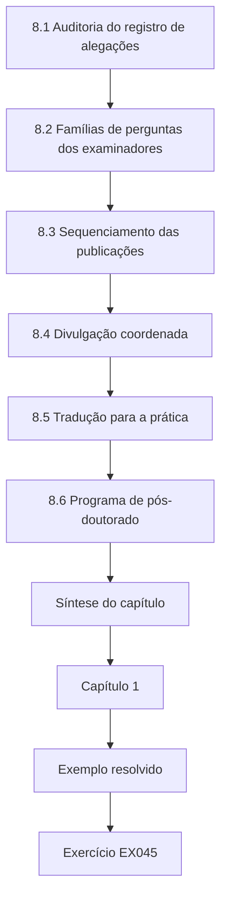

### Desenho lógico

```mermaid
flowchart LR
  N0["8.1 Auditoria do registro de alegações"]
  N1["8.2 Famílias de perguntas dos examinadores"]
  N2["8.3 Sequenciamento das publicações"]
  N3["8.4 Divulgação coordenada"]
  N4["8.5 Tradução para a prática"]
  N5["8.6 Programa de pós-doutorado"]
  N6["Síntese do capítulo"]
  N7["Capítulo 1"]
  N0 --> N1 --> N2 --> N3 --> N4 --> N5 --> N6 --> N7 --> Q["EX045"]
```

```text
[8.1 Auditoria do registro de alegações]
    |
    v
[8.2 Famílias de perguntas dos examinadores]
    |
    v
[8.3 Sequenciamento das publicações]
    |
    v
[8.4 Divulgação coordenada]
    |
    v
[8.5 Tradução para a prática]
    |
    v
[8.6 Programa de pós-doutorado]
    |
    v
[Síntese do capítulo]
    |
    v
[Capítulo 1]
    |
    v
[Exemplo resolvido] --> [Exercício EX045]
```
<!-- cykin:lesson-figures:end ch-08 -->


### Objetivos de aprendizagem e conexão

Ao final deste capítulo, você será capaz de (1) auditar um registro de alegações antes da defesa, (2) preparar-se para as famílias de perguntas dos examinadores, (3) sequenciar as publicações, (4) encaminhar vulnerabilidades de produtos pela divulgação coordenada e (5) traduzir as constatações para operadores e organismos de normalização. Ele conclui o projeto iniciado no Capítulo 1.

### 8.1 Auditoria do registro de alegações

Toda alegação da tese precisa de evidência, escopo e um falseador, e precisa evitar uma redação que alegue demais. O Laboratório 8 automatiza a primeira passada.

```python
# Lab 8: audit a thesis claim register (synthetic). Every claim needs evidence, scope and a falsifier.
claims = [
 {"id": "C1", "text": "Residual CUSUM detects replay on Plant A tank model", "evidence": "Lab3 100/100", "scope": "simulated tank, single-sensor replay", "falsifier": "replay+flow"},
 {"id": "C2", "text": "Method secures water utilities", "evidence": "", "scope": "", "falsifier": ""},
 {"id": "C3", "text": "Band alarms miss replay", "evidence": "Lab3 0/100", "scope": "band +/-1.5", "falsifier": ""},
 {"id": "C4", "text": "Detection holds on testbed T2", "evidence": "Ch5 table 5.2", "scope": "T2, class A replay", "falsifier": "class B: flow meter also spoofed"},
]
overreach = ("secures", "prevents all", "guarantees", "real-world")
for c in claims:
    issues = [f for f in ("evidence", "scope", "falsifier") if not c[f]]
    if any(w in c["text"].lower() for w in overreach): issues.append("overreach wording")
    print(c["id"], "PASS" if not issues else "REVISE: " + ", ".join(issues))
```

Saída esperada:

```text
C1 PASS
C2 REVISE: evidence, scope, falsifier, overreach wording
C3 REVISE: falsifier
C4 PASS
```

A C2 precisa ser apagada ou estreitada; a C3 precisa de um falseador (por exemplo, "uma faixa estreita o bastante para captar o replay excederia o orçamento de alarmes falsos do turno"). Uma lista de palavras-chave é uma verificação grosseira; a auditoria humana continua lendo cada alegação.

A lista de palavras-chave do Laboratório 8 é deliberadamente curta, então passar por ela prova pouco. Uma auditoria humana ainda deve ler a C4 em relação aos resultados da T2: o seu escopo é o replay da classe A porque a classe B escapou da detecção na T2, e a revocação de 18 em 20 pertence ao lado da alegação, não só no capítulo de resultados. Repita a auditoria depois de cada revisão do resumo ou da conclusão e guarde a saída de cada execução no histórico do registro de alegações, para que os examinadores vejam como as alegações se estreitaram.

### 8.2 Famílias de perguntas dos examinadores

Prepare respostas para: **posicionamento** ("o que há de novo além de Page e Giraldo?"), **validade** ("por que uma bancada de testes deveria generalizar?"), **adversário** ("o que faz um atacante mais forte?"), **segurança** ("como você limitou os experimentos na T2?"), **ética** ("o que você reteve e por quê?") e **impacto** ("o que um operador deve mudar na segunda-feira?"). A resposta à última é arquitetural: providenciar uma segunda medição, com fiação independente, das principais grandezas do processo e exibir os valores previstos ao lado dos relatados.

Ensaie cada família em voz alta com um colega que interrompa e mantenha uma folha com uma resposta curta e um ponteiro para a figura ou tabela que a sustenta. Quando não souber, diga que evidência responderia à pergunta e o que você de fato tem. Responda à pergunta feita e pare.

### 8.3 Sequenciamento das publicações

Artigo 1: a contribuição de metodologia de avaliação (impacto na detecção e métricas por evento, com a lição de reprodução no estilo do TankBench-21 contada de forma genérica). Artigo 2: a comparação do Setpoint Study, com as condições de fronteira. Artigo 3: a constatação sobre a interpretabilidade pelos operadores, com colaboradores de fatores humanos. Libere o arquivo T0/T1 com o Artigo 2.

Planeje cada artigo de modo que ele não contradiga a tese nem os outros artigos e registre quais alegações e figuras cada um reutiliza. Se o artigo sobre operadores atrasar por causa da revisão de fatores humanos, os outros dois ainda podem sair; o arquivo é liberado com o Artigo 2 porque é esse o artigo cujos números ele reproduz. Acerte a autoria com os colaboradores antes de começar a escrever.

### 8.4 Divulgação coordenada

Se a pesquisa revelar uma vulnerabilidade num produto comercial — por exemplo, um CLP que aceita escritas não autenticadas num registrador que deveria ser somente leitura —, relate-a ao fornecedor e, quando apropriado, a um coordenador como o programa de divulgação coordenada de vulnerabilidades da CISA, combine um cronograma e publique os detalhes técnicos apenas depois que houver mitigações disponíveis. Uma propriedade de projeto documentada numa especificação pública (a falta de autenticação no Modbus) não é uma divulgação de vulnerabilidade; uma falha de implementação é.

Registre o cronograma da divulgação no apêndice da tese, com as datas do primeiro contato, da confirmação pelo fornecedor e da publicação. Se o fornecedor não responder, siga o processo do coordenador em vez de publicar antes. A tese ainda pode descrever a classe de fraqueza, retendo nomes de produtos e passos até que existam mitigações.

### 8.5 Tradução para a prática

Escreva um resumo de duas páginas para os operadores, com níveis de confiança: "Confiança alta (modelo + bancada): os alarmes de faixa sozinhos não detectam leituras de nível repetidas. Confiança média (dois contextos): uma medição de vazão independente mais uma verificação do resíduo detecta o replay de um único sensor. Nenhuma proteção: se um único dispositivo ou CLP controla as duas medições." Sugira aos grupos de trabalho de normalização que caminhos de medição independentes sejam considerados na avaliação dos níveis de segurança das zonas — como proposta, não como constatação de conformidade.

Teste o resumo com um ou dois operadores antes de liberá-lo: eles conseguem dizer o que verificar na segunda-feira? Se não conseguirem, os níveis de confiança ou a recomendação precisam ser reescritos. Mantenha o resumo coerente com a alegação estreitada e não deixe que um formato mais curto descarte o caso em que um único dispositivo controla as duas medições.

### 8.6 Programa de pós-doutorado

Estender a plantas com várias malhas, testar modelos calibrados em vez de inventados, medir o tempo de resposta dos operadores com equipes reais de salas de controle (com consentimento) e estudar atacantes da classe C, que modificam a lógica do CLP.

Cada extensão testa uma fronteira que a tese mediu, mas não conseguiu cruzar. As plantas com várias malhas testam se os resíduos continuam interpretáveis quando as malhas interagem. Os modelos calibrados testam se os parâmetros inventados exageraram a separação. Os operadores reais testam a interpretabilidade em escala. Os atacantes da classe C, que podem reescrever a lógica do controlador, testam se algum invariante sobrevive quando o próprio controlador mente; os mesmos limites de segurança e a mesma revisão ética se aplicam às quatro.

### Exercícios — capítulo 8

- **EX045 — Auditar três alegações do Capítulo 5.** Audite três alegações do seu próprio parágrafo de resultados do Capítulo 5 usando os critérios do Laboratório 8. *Rubrica:* 3 = três alegações marcadas PASS/REVISE com correções de escopo; 2 = duas alegações; 1 = uma; 0 = nenhum.
- **EX046 — Respostas de defesa sobre posicionamento e segurança.** Escreva respostas-modelo às perguntas de posicionamento e de segurança dos examinadores. *Rubrica:* 3 = posicionamento além de Page/Giraldo + resposta de segurança com limite da T2/parada de emergência; 2 = uma família; 1 = vago; 0 = nenhum.
- **EX047 — Sequenciar três artigos por tipo de veículo.** Sequencie três artigos com veículos do tipo certo (segurança, controle, fatores humanos) e justifique a ordem. *Rubrica:* 3 = ordem segurança→controle/CPS→fatores humanos com razão de dependência; 2 = três veículos em ordem errada; 1 = um artigo; 0 = nenhum.
- **EX048 — Três decisões de divulgação.** Decida se cada uma de três constatações é um caso de divulgação: o Modbus não tem autenticação; um firmware de CLP aceita escritas num registrador protegido; o CLP da T2 compartilha a fiação dos dois sensores. *Rubrica:* 3 = Modbus=documentado; escrita em registrador protegido=CVD; fiação compartilhada da T2=dono do laboratório, não CVD de produto; 2 = duas corretas; 1 = uma; 0 = nenhum.
- **EX049 — Declarações de confiança sem a classe B.** Escreva as três declarações de confiança do resumo para operadores para um estudo em que a classe B não foi testada. *Rubrica:* 3 = alta/média/desconhecida com a classe B explicitamente não testada; 2 = falta a desconhecida; 1 = um nível; 0 = nenhum.
- **EX050 — Pós-doutorado de dois anos com duas hipóteses.** Esboce um programa de pós-doutorado de dois anos com duas hipóteses falseáveis. *Rubrica:* 3 = plano de dois anos com duas H falseáveis incluindo métricas/limites de AF; 2 = plano sem H falseáveis; 1 = só temas; 0 = nenhum.

### Síntese do capítulo

Audite cada alegação, prepare-se para as seis famílias de perguntas, publique numa ordem que construa credibilidade, divulgue as falhas de implementação por meio de coordenação e traduza as constatações com uma confiança explícita. A contribuição do doutorado é um método medido *e* os seus limites medidos.

<!-- cykin:chapter-navigation:start ch-08 -->
### Continue estudando — capítulo 08 de 08

[← Capítulo 07](#ch-07) · [Índice de capítulos do curso](../SUBJECTS.md) · [Resoluções →](#worked-results)

Siga para a próxima lição escrita.
<!-- cykin:chapter-navigation:end -->

<a id="worked-results"></a>

## Resoluções

Cada resposta mostra uma resposta defensável; as rubricas de cada exercício recompensam alternativas que atendam ao mesmo padrão de evidências, escopo e honestidade. Todos os números vêm dos laboratórios sintéticos.

### Capítulo 1

**EX001.** Degrau 1: "Foi observada uma escrita Modbus (código de função 6) no registrador de retenção 40001 da unidade 1." Degrau 2: "O setpoint de nível mudou de 50 para 80." Degrau 3: "A trajetória do nível subiu em direção a 80, coerente com o novo setpoint." Degrau 4: "No modelo, a trajetória cruzaria o trip de nível muito alto em t+420 s sem intervenção." O degrau 5 é retido: não há dados sobre a camada mecânica de alívio. "Impede transbordamentos" é substituído por "gerou um alarme N s antes do trip modelado".
**EX002.** Pior resultado: o tanque superior transborda para a bandeja coletora (≈2 L de água). Camada independente: válvula boia mecânica que fecha a entrada, mais uma bandeja coletora dimensionada para 10 L. Autoridade de parada: o gerente do laboratório, nomeado, com uma parada de emergência física que corta a energia da bomba. Rubrica: um intertravamento do CLP como única camada pontua ≤1.
**EX003.** Captura em porta espelhada: passiva; risco = dados sensíveis em repouso. Consulta ao CLP: ativa; acrescenta carga ao ciclo de varredura. Exportação do historiador: passiva para o CLP, mas ativa no historiador; risco = carga no servidor e volume de dados. Upload do projeto a partir da estação de engenharia: ativo; pode disparar mudanças de modo do controlador em alguns produtos. Extração do firmware: ativa e potencialmente disruptiva; pode exigir parar o controlador.
**EX004.** Respeito às pessoas: nenhum ser humano diretamente; os clientes dos fornecedores são afetados indiretamente. Beneficência: os defensores aprendem a exigir medições independentes; os atacantes ganham pouco além das táticas documentadas de manipulação da visão se os passos específicos de produtos forem retidos. Justiça: as pequenas concessionárias, menos capazes de aplicar correções, carregam o risco — publicar mitigações de baixo custo. Lei/interesse público: verificar as obrigações de divulgação e as regras de exportação. Decisão: publicar a classe de capacidade e a defesa; reter as sequências específicas de produtos até que a divulgação coordenada se conclua.
**EX005.** Programa ladder: T2/T3 (revela a lógica e os intertravamentos de segurança). Contagens de alarmes anonimizadas: T1. Captura com IPs: T2 (topologia). P&ID: T3 para plantas reais, T2 para uma bancada. Simulador sintético: T0.
**EX006.** O segmento 1 começa no índice 20; primeiro alarme em 40 → atraso de 20 amostras. O segmento 2 começa em 80; primeiro alarme em 85 → atraso de 5. O ajuste por pontos credita todos os 30 e 10 pontos como detectados, escondendo o atraso de 20 amostras durante o qual o processo se deslocou.
**EX007.** Título e pergunta; contexto e lacuna; hipóteses H1–H4; modelo de atacante; sistemas (simulador, T2) e limites de segurança; níveis e tratamento dos dados; métricas; plano de análise com limiares congelados; condições de parada (válvula boia alcançada, reinicialização não planejada, perda de registros >1%) e condições de abandono (a T2 não pode ser tornada segura; o simulador falha na verificação); plano de ética e de divulgação.

### Capítulo 2

**EX008.** Controle: detecção e isolamento de falhas, geração de resíduos, redundância analítica, monitoramento baseado em observadores, validação de sensores. Segurança: injeção de dados falsos, falsificação de sensores, manipulação da visão, ataque de replay, detecção de anomalias baseada em física.
**EX009.** Nível 0: tanque, bomba, transmissor de nível, medidor de vazão. Nível 1: CLP. Nível 2: SCADA/IHM. Nível 3: historiador (operações). Uma consulta ao historiador vinda da empresa atravessa o conduto da DMZ entre TI e TO (nível 3,5) e o conduto entre os níveis 3 e 2.
**EX010.** "Zonas entre o nível 2 e o nível 1, com um conduto limitado a códigos de função de leitura, reduzem em ≥90% o número de hosts capazes de emitir escritas Modbus aos CLPs, em comparação com uma rede plana, medido por análise de alcançabilidade da topologia sintética."
**EX011.** S4: dados de bancada; adversário não ciente; limiar no conjunto de teste; sem impacto; F1 ajustado por pontos. Ele apoia no máximo "o detector sinaliza algumas amostras dentro desses segmentos de ataque nesta bancada"; não apoia alegações de generalização, de atraso ou de impacto.
**EX012.** *Spoof Reporting Message* e *Modify Parameter*. A matriz documenta que adversários usaram ou poderiam usar uma técnica, com base em relatos públicos; ela não conta ocorrências em todas as plantas, então não dá nenhuma taxa de base.
**EX013.** A contagem de adversário ciente passa a 3 (S2, S5, S7). A declaração da lacuna precisa abandonar "nenhum estudo tem um adversário ciente do detector" e manter a lacuna da combinação (ciente + limiares congelados + impacto + dois contextos), que ainda nenhum estudo isolado satisfaz — S5 relata o impacto apenas parcialmente.
**EX014.** Fraca: "O DNP3-SA é pouco usado." Forte: "Nenhuma medição relata a proporção de estações remotas DNP3, numa amostra pública definida, que negociam o Secure Authentication, nem a latência que ele acrescenta em enlaces seriais; prevemos adoção abaixo de 10% e latência acima do orçamento de consulta em enlaces de 9,6 kbit/s, e seríamos refutados por uma adoção acima de 30%."

### Capítulo 3

**EX015.** Tipo de contribuição: comparação apoiada em medições, com limites caracterizados. "Não propomos um novo detector; partindo do CUSUM (Page, 1954) e da detecção baseada em resíduos (Giraldo et al., 2018), medimos quando um invariante de balanço de massa entre sensores detecta a manipulação da visão e a capacidade do atacante na qual ele falha."
**EX016.** Equilíbrio L* = entrada/0,02 = 1,05/0,02 = 52,5 unidades. Uma entrada extra persistente de 0,05 eleva o nível em apenas 2,5 unidades em regime permanente; o atacante precisa de uma forçante maior (ou de uma saída bloqueada) para chegar a um trip, o que afeta quais ganhos são realistas no Capítulo 6.
**EX017.** A classe C modifica a lógica do CLP, então pode forjar os dois valores relatados de forma coerente e suprimir os alarmes calculados no CLP. Alarme de faixa: evadido. CUSUM no CLP: evadido. CUSUM calculado fora do CLP, sobre sensores com fiação independente: ainda detecta. Conclusão: o posicionamento do detector importa tanto quanto o algoritmo.
**EX018.** Registrar `true_level − 50` no primeiro alarme dá, para o CUSUM com ganho 0,05, um transbordamento médio de 1,22 unidade e um máximo de 1,60 no instante do alarme; o alarme de faixa nunca dispara depois do início, então o seu transbordamento cresce até o máximo da janela, de 3,36. H3 é apoiada no modelo.
**EX019.** Suponha que o trip de nível muito alto esteja em 56 (margem de 6) e que o ataque eleve o nível a até ≈0,05 unidade/passo inicialmente. Metade da margem (3 unidades) seria alcançada em cerca de 60–80 passos, considerando a aproximação exponencial; um limiar de 60 passos é conservador. Um nível de trip diferente justifica um limiar diferente pela mesma aritmética.
**EX020.** (1) Ajuste do limiar nos dados de teste → ajustar em sementes separadas (Laboratório 6) e congelar. (2) Simulador limpo demais → acrescentar viés de calibração e validar na T2. (3) Magnitude do ataque escolhida para favorecer o método → varrer os ganhos (EX034) e relatar a curva completa.

### Capítulo 4

**EX021.** Executar de novo o próprio Laboratório 3: repetibilidade. Um colega executando o seu arquivo: reprodutibilidade. Um colega construindo o próprio modelo de tanque: replicabilidade.
**EX022.** Hipóteses: convenção de pontuação, vazamento do limiar, alinhamento dos rótulos, amostragem. Testes: pontuar de novo com ajuste por pontos (→0,94, dentro de ±0,05: explica a diferença); reajustar na partição de treino (nenhuma mudança adicional); deslocar os rótulos para o primeiro desvio do processo (pequena mudança); reduzir a amostragem (pequena mudança). Resultado: a reprodução do número relatado só tem sucesso com o ajuste por pontos; métricas por evento adotadas.
**EX023.** Execute o modelo sem ruído `true += 1.0 - 0.02*true` por 1.000 passos a partir de 50,0; o resultado é 50.000000, o que confirma o equilíbrio; um teste mais rigoroso calcula a entrada acumulada menos a saída e verifica que ela é igual ao nível final menos o inicial, dentro da tolerância de ponto flutuante.
**EX024.** k = 0,8: com viés de 0,4, ele tem 0/100 execuções com alarme falso e 100/100 detecções (atraso de 55,6), enquanto k = 0,6 tem 4/100 execuções com alarme falso. O custo de 7–10 passos de atraso é aceito em troca de zero alarmes falsos.
**EX025.** Seguir se: três execuções consecutivas terminarem sem que a válvula boia seja alcançada (segurança); perda de registros do historiador <1% a 1 Hz (dados); nenhuma reinicialização não planejada do CLP (estabilidade); parada de emergência testada antes de cada sessão. Caso contrário, não seguir e revisar.
**EX026.** Porque 0,94 reproduz uma pontuação ajustada por pontos, que credita segmentos inteiros por um único alarme; ela não diz nada sobre o atraso nem sobre os alarmes falsos por turno, e os limiares podem ter sido ajustados nos dados de teste.

### Capítulo 5

**EX027.** Substituir a semente pareada de k = 0,6 pela semente i+1000 dá, na Plant A, 6,9 passos, IC [5,3, 8,5] (largura 3,2), contra [6,5, 7,4] pareado (largura 0,9); na Plant B, 47,3, IC [36,5, 58,6], contra [38,4, 53,0]. O pareamento estreita os intervalos porque o ruído compartilhado se cancela.
**EX028.** Estocásticas: sorteios do ruído do sensor, ruído da entrada. Paramétricas: coeficiente do orifício, viés de calibração. Estruturais: modelo de tanque único, desconsideração do atraso do medidor de vazão.
**EX029.** "A folga k = 0,8 e o limiar h = 6,0 são fixados, submetidos a hash e registrados antes que qualquer dado de ataque da T2 seja carregado." Inspecionar dados de ataque da T2 antes do congelamento, ou mudar k depois de ver os resultados da T2, invalida a validação.
**EX030.** As execuções não detectadas, fixadas em 400, tornam a média um limite inferior. Relate a proporção de detecção separadamente e o atraso mediano entre as detectadas, ou uma curva de tempo até a detecção no estilo de Kaplan–Meier.
**EX031.** Recomendação: mostrar o nível previsto ao lado do relatado na IHM. Limitação: operadores sintéticos; as preferências podem não prever os tempos de resposta reais.
**EX032.** Exemplo: "H1 não foi apoiada na T2: o CUSUM do resíduo detectou 9 de 20 episódios da classe A, contra 100 de 100 na simulação. Um atraso de vários segundos no medidor de vazão produziu transientes no resíduo que exigiram uma folga maior, a qual então mascarou manipulações pequenas. Os alarmes falsos continuaram em zero. Concluímos que o simulador superestimou a relação sinal-ruído e que a dinâmica dos instrumentos precisa ser modelada antes de qualquer alegação sobre implantação."

### Capítulo 6

**EX033.** Hipótese: o desempenho cai quando os limiares são avaliados em sementes ou bancadas não vistas durante o ajuste. Teste: ajustar nas sementes 0–99, avaliar nas 1000–1099 e na T2 com os valores congelados; comparar a detecção e os alarmes falsos.
**EX034.** Resultado da varredura: ganho 0,005 → 14/100 detectados, atraso médio 186,0, pior transbordamento 1,12; 0,01 → 55/100, 168,3, 1,37; 0,02 → 100/100, 90,4, 1,87; 0,05 → 100/100, 31,8, 3,36. Os ataques lentos escapam, mas alcançam um transbordamento limitado na janela.
**EX035.** "O método exige uma segunda medição com fiação independente, ligada à medição atacada por um balanço de massa conhecido; o erro do modelo precisa ser menor do que o sinal do ataque. Ataques mais lentos do que a folga podem escapar, mas alcançaram ≤1,37 unidade de transbordamento modelado em 300 passos. Ele não oferece proteção quando um único atacante controla as duas medições."
**EX036.** "Em dois contextos sintéticos, um CUSUM de resíduo usando um medidor de vazão com fiação independente detectou o replay de nível de um único sensor que um alarme de faixa deixou passar; ele não protege contra um atacante que controla as duas medições."
**EX037.** Publicar a sequência exata da T2 dá aos atacantes uma receita pronta para uma configuração de produto específica, enquanto os defensores precisam apenas da classe de capacidade e da correção arquitetural. Decisão: publicar a classe e a defesa; compartilhar as sequências exatas apenas com o fornecedor, sob divulgação coordenada, se houver uma falha de produto envolvida.
**EX038.** "Concordamos que as bancadas diferem das plantas e estreitamos as nossas alegações aos dois contextos estudados (§6.3). Testamos a incerteza estrutural validando limiares congelados na simulação numa bancada independente, com instrumentos diferentes (§5.3), relatamos a perda de revocação resultante e listamos a validação em escala de planta como trabalho futuro (§8.6)."

### Capítulo 7

**EX039.** Alegação: a alegação estreitada (Cap. 6.3). Dados: Laboratório 3, Laboratório 5, T2 (Caps. 3, 5). Garantia: o balanço de massa liga a vazão e o nível (Cap. 3.2). Respaldo: testes de verificação, teoria do CUSUM (Cap. 4.3). Qualificador: dois contextos sintéticos (Cap. 5). Refutação: classe B, rampas lentas, atraso (Caps. 5–6).
**EX040.** Armazene os níveis como inteiros (`int(e["tier"][1:])`) e compare números; uma entrada T10 com nível máximo de liberação T1 passa então a ser excluída, em vez de passar indevidamente como "T10" < "T2".
**EX041.** Código do simulador T0; traços sintéticos T1; cadernos de laboratório T1; diagrama de fiação da bancada T2 T2; programa do CLP da T2 T2; anotações da revisão por operadores T2; configurações reais no estilo da Plant A T3; vídeos do piloto T2. Limítrofes: o diagrama de fiação (T2 porque revela a fraqueza do CLP compartilhado); as anotações dos operadores (T2 por causa de citações identificáveis).
**EX042.** Propósito: ensino e demonstração de método. Parâmetros: entrada 1,0±0,05, saída 0,02×nível, ruído de nível σ = 0,3, ruído de vazão σ = 0,02, ganho do ataque 0,05 no passo 300. Situação: inventado, não calibrado. Usos proibidos: alegações sobre plantas reais, benchmarking de produtos.
**EX043.** Início do ataque fixo no passo 300 (*desconhecida*; pode favorecer detectores com aquecimento). Objetivo único do atacante (*superestima* a generalidade).
**EX044.** O formato baseado em publicações convém: três contribuições separáveis (métricas, comparação, estudo com operadores) com um capítulo de ligação; uma monografia é defensável se a instituição preferir um único argumento integrado.

### Capítulo 8

**EX045.** Usando o parágrafo do EX032 ou da §5.5: "detectou o replay da classe A na simulação" → PASS com escopo; "robusto ao viés de calibração" → REVISE: acrescentar escopo (≤0,4 unidade); "funciona em plantas reais" → REVISE: alega demais.
**EX046.** Posicionamento: "O CUSUM e os resíduos são estabelecidos; a nossa contribuição é medir o atraso e o impacto na detecção para a manipulação da visão em dois contextos e identificar a capacidade do atacante na qual o método falha." Segurança: "Todos os ataques rodaram em simulação ou na T2, com uma válvula boia mecânica independente do CLP, uma bandeja coletora, uma parada de emergência física e uma autoridade de parada nomeada; nenhum sistema de produção foi tocado."
**EX047.** 1: artigo de metodologia num veículo de segurança (estabelece as métricas); 2: comparação num veículo de segurança de controle/CPS (usa essas métricas); 3: estudo com operadores num veículo de fatores humanos. A ordem constrói o vocabulário de que os artigos posteriores dependem.
**EX048.** O Modbus não tem autenticação: propriedade de projeto documentada, não uma divulgação. O CLP aceita escritas num registrador protegido: falha de implementação → divulgação coordenada. Fiação compartilhada na T2: problema de configuração do laboratório → avisar o dono do laboratório; não é uma vulnerabilidade de produto.
**EX049.** Alta: os alarmes de faixa sozinhos não detectam leituras de nível repetidas. Média: uma medição de vazão independente mais o resíduo detecta o replay de um único sensor. Desconhecida: a proteção contra um atacante que controla as duas medições não foi testada — não a pressuponha.
**EX050.** Ano 1: modelo calibrado com várias malhas; H: revocação da detecção por resíduo ≥80%, com alarmes falsos ≤1 por turno, quando as malhas se acoplam. Ano 2: estudo com operadores, com consentimento; H: exibir os valores previstos ao lado dos relatados reduz em ≥20% o tempo até o diagnóstico correto. Ambos com limiares congelados e critérios de refutação.

**Fim das resoluções.** Volte ao [índice de capítulos do curso](../SUBJECTS.md).

<a id="glossary"></a>

## Glossário

**ATT&CK for ICS.** Base de conhecimento da MITRE sobre táticas e técnicas de adversários contra sistemas de controle industrial; documenta possibilidades, não taxas-base.

**Atacante de classe A / classe B (Setpoint Study).** A classe A falsifica um único sensor (por exemplo, o nível) enquanto uma medição independente permanece honesta; a classe B controla as duas medições de forma consistente, de modo que um resíduo de balanço de massa não vê discordância.

**CUSUM.** Teste de soma cumulativa (Page, 1954), usado aqui sobre um resíduo de balanço de massa entre medições com fiação independente.

**Níveis de dados T0–T3.** Rótulos de tratamento que vão de dados sintéticos/públicos (T0–T1) a artefatos identificáveis de bancadas ou plantas (T2–T3), usados nas regras de arquivamento do Setpoint Study.

**Atraso de detecção por evento.** Amostras entre o início do segmento de ataque e o primeiro alarme verdadeiro; contrasta com as pontuações com ajuste por pontos, que creditam segmentos inteiros.

**Manipulação da visão.** Objetivo do adversário de alimentar operadores ou detectores com leituras falsas do processo enquanto o estado da planta diverge.

**Menlo Report.** Princípios éticos do DHS dos EUA (2012) para pesquisa em TIC: respeito às pessoas, beneficência, justiça, respeito à lei e ao interesse público.

**Plant A.** Contexto sintético de tanque único do Setpoint Study, usado nos experimentos de simulação e no ajuste dos limiares.

**Modelo Purdue / zonas e conduítes.** Arquitetura em camadas de ICS (NIST SP 800-82) e o enquadramento de segmentação da ISA/IEC 62443-3-2.

**Setpoint Study.** Caso doutoral contínuo (sintético): medir quando um CUSUM sobre o resíduo entre sensores detecta o replay do nível em comparação com um alarme de banda, e onde a classe B o derrota.

**Bancada de testes T2.** Bancada laboratorial isolada de tanque de água, com válvula boia mecânica, bandeja coletora e autoridade de parada de emergência nomeada; usada na validação com limiares congelados.

**TankBench-21.** Benchmark publicado anteriormente cujas pontuações com ajuste por pontos a tese reimplementa para expor os efeitos das métricas.

<a id="references"></a>

## Referências

Links verificados em 13 de outubro de 2026; verifique novamente as edições antes de citar.

- ACM. Artifact Review and Badging, Version 1.1. <https://www.acm.org/publications/policies/artifact-review-and-badging-current>
- Arp, D. et al. Dos and Don'ts of Machine Learning in Computer Security. USENIX Security 2022. <https://www.usenix.org/conference/usenixsecurity22/presentation/arp>
- CISA. Coordinated Vulnerability Disclosure Program. <https://www.cisa.gov/coordinated-vulnerability-disclosure-process>
- Giraldo, J. et al. A Survey of Physics-Based Attack Detection in Cyber-Physical Systems. *ACM Computing Surveys* 51(4), 2018. <https://doi.org/10.1145/3203245>
- IEC 62443-3-2. Security for industrial automation and control systems — Security risk assessment for system design. IEC.
- iTrust, SUTD. Secure Water Treatment (SWaT) and related datasets (public page). <https://itrust.sutd.edu.sg/itrust-labs_datasets/>
- MITRE. ATT&CK for Industrial Control Systems. <https://attack.mitre.org/matrices/ics/>
- NIST SP 800-82 Rev. 3. Guide to Operational Technology (OT) Security. <https://doi.org/10.6028/NIST.SP.800-82r3>
- Page, E. S. Continuous Inspection Schemes. *Biometrika* 41(1–2), 1954. <https://doi.org/10.1093/biomet/41.1-2.100>
- Urbina, D. et al. Limiting the Impact of Stealthy Attacks on Industrial Control Systems. ACM CCS 2016. <https://doi.org/10.1145/2976749.2978388>
- U.S. DHS. The Menlo Report: Ethical Principles Guiding Information and Communication Technology Research (2012). <https://www.dhs.gov/sites/default/files/publications/CSD-MenloPrinciplesCORE-20120803_1.pdf>
