# Quantum and Post-Quantum Security: Doctoral Research Methods and Thesis Practice

- Language: English (`en`); doctoral research track, two years; approximately 1,600 hours of planned study.
- Editorial state: **published**. Chapters 1–8 of 8 have authored teaching text, exercises EX001–EX050 and matching worked results. Independent subject-matter review, source re-verification, accessibility review, language editing and the 300-page A4 verification remain open. Draft-chapter coverage is not a completed book.
- Audience: advanced researchers with research experience and a defensible question about the security consequences of quantum computing, the migration to post-quantum cryptography (PQC), hybrid post-quantum/traditional (PQ/T) protocols or cryptographic agility. Entry knowledge: the content planned for the [master's](../../../../masters-2-years/quantum-post-quantum-security/en/book/PLAN.md) track in this area or equivalent experience, plus working literacy in public-key cryptography, discrete probability, basic linear algebra over finite rings, and one protocol family such as TLS 1.3, X.509 PKI or IKEv2.
- Relationship to neighbouring courses: a general cryptography course studies how primitives are built and proved. **This book studies the transition**: how a community learns whether quantum-vulnerable cryptography has been found, replaced, combined with PQC, and made replaceable again, and how a researcher produces evidence about that transition that survives critique.
- Author and editorial responsibility: [hiagokinlevi](https://github.com/hiagokinlevi). Original maintainer-owned teaching text is dedicated under [CC0 1.0](../../../../../LICENSE); cited works keep their own rights.
- Educational boundary: this track is an independent educational blueprint. It is not an accredited doctoral program, grants no degree, and grants no authority to scan, intercept, downgrade or test any real network, product, certificate authority or person. Every organization, dataset, corpus, participant and numerical result in a worked example is **synthetic** unless a sentence explicitly cites a public source. The toy lattice code in this book is deliberately insecure and must never protect real data.

[Course home](../../README.md) · [Chapter index](../SUBJECTS.md) · [Book plan](PLAN.md) · [Course skill](../../skill/SKILL.md) · [Book standard](../../../../../BOOK_STANDARD.md) · [Worked results](#worked-results)

## How to use this draft

Read the eight chapters in order; they follow the arc of one doctoral project. Chapter 1 sets integrity standards for research in a field where timelines are uncertain and vendor claims are loud. Chapter 2 maps the frontier — quantum cryptanalysis resource estimates, the NIST standards, hybrid protocols, implementation security and agility — and isolates an open question. Chapter 3 turns that question into a falsifiable contribution. Chapter 4 replicates baselines and pilots the method on a model corpus. Chapter 5 runs the main study and validates it on an independent second corpus. Chapter 6 submits the claims to adversarial critique. Chapter 7 assembles the thesis and a tiered reproducibility archive. Chapter 8 prepares the defense, coordinated disclosure and a publication plan.

Each chapter contains learning outcomes, teaching sections, a worked example, a practical activity with offline Python 3 standard-library code where useful, common errors and limits, numbered exercises with a 0–3 rubric, a synthesis and a **Continue studying** block. Attempt every exercise before opening the [worked results](#worked-results).

Keep five labels in every research note: **observation** (what a named instrument or source recorded), **inference** (what you conclude and under which assumptions), **claim** (what you will defend, with scope), **decision** (what someone chose because of it) and **exposure** (which data, signatures or systems remain quantum-vulnerable, and for how long). PQC research goes wrong most often when an observation about a protocol negotiation is silently promoted to a claim about an organization's quantum risk.

### The synthetic research corpus

The book follows one invented project, the **Ciphertrail Study**, which asks: *does a dual-source cryptographic inventory — passive handshake telemetry fused with static code and configuration analysis — recall quantum-vulnerable key-establishment and signature uses more completely than static analysis alone, at what precision, and in which asset classes does the advantage disappear?*

| Synthetic element | Role | Boundary |
|---|---|---|
| **Halden Regional Health Network (HRHN)** — 3 hospitals, 1,200 services, a private PKI, a VPN concentrator, medical devices on a segregated network | Primary corpus context (Chapters 1, 3–5). | Invented organization; no real hospital, patient or record. |
| **Marrow Logistics** — a freight company with a different stack, used as an untouched second corpus | Independent validation (Chapters 5–6). | Invented. |
| **InvBench-22** | A synthetic "published" inventory benchmark whose reported recall cannot be reproduced (Chapter 4). | Invented; do not search for it. |
| Synthetic studies **Q1–Q8** | Fictional papers used for appraisal practice (Chapter 2). | Invented. |
| Engineers **E01–E10** | Fictional practitioners in a blinded adjudication of inventory findings (Chapter 5). | Invented; no human-subjects data appear. |

### Source policy

Primary sources are cited by stable identifier and were checked on 12 October 2026. Standards change: FIPS 206 (FN-DSA, derived from Falcon) and the HQC standard were still in development at that date, and NIST IR 8547 remained an initial public draft. Re-verify every status before relying on it. Resource estimates for quantum attacks are research results with assumptions, not forecasts. The [references](#references) section lists every external source.

## Contents

1. [Advanced research integrity and methods](#ch-01)
2. [Quantum and post-quantum security: research frontier](#ch-02)
3. [Original contribution proposal](#ch-03)
4. [Baseline replication and pilot](#ch-04)
5. [Main study and independent validation](#ch-05)
6. [Peer critique and revision](#ch-06)
7. [Thesis synthesis and reproducibility archive](#ch-07)
8. [Defense and publication plan](#ch-08)
- [Worked results](#worked-results) · [References](#references)

<a id="ch-01"></a>

## Chapter 1 — Advanced research integrity and methods

<!-- cyberabc:lesson-figures:start ch-01 -->
### Lesson map

Lesson 01 published. Map, example, EX001.

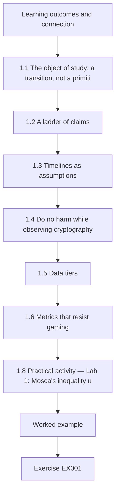

### Logical drawing

```mermaid
flowchart LR
  N0["Learning outcomes and connection"]
  N1["1.1 The object of study: a transition, not a primiti"]
  N2["1.2 A ladder of claims"]
  N3["1.3 Timelines as assumptions"]
  N4["1.4 Do no harm while observing cryptography"]
  N5["1.5 Data tiers"]
  N6["1.6 Metrics that resist gaming"]
  N7["1.8 Practical activity — Lab 1: Mosca's inequality u"]
  N0 --> N1 --> N2 --> N3 --> N4 --> N5 --> N6 --> N7 --> Q["EX001"]
```

```text
[Learning outcomes and connection]
    |
    v
[1.1 The object of study: a transition, not a primiti]
    |
    v
[1.2 A ladder of claims]
    |
    v
[1.3 Timelines as assumptions]
    |
    v
[1.4 Do no harm while observing cryptography]
    |
    v
[1.5 Data tiers]
    |
    v
[1.6 Metrics that resist gaming]
    |
    v
[1.8 Practical activity — Lab 1: Mosca's inequality u]
    |
    v
[Worked example] --> [Exercise EX001]
```
<!-- cyberabc:lesson-figures:end ch-01 -->


### Learning outcomes and connection

After this chapter you can (1) separate the five kinds of statement that PQC research produces and keep them labelled; (2) explain why claims about quantum timelines must be stated as conditional assumptions rather than predictions; (3) design an inventory study that cannot harm the systems it observes; (4) choose metrics that resist the most common ways of making a migration look finished; and (5) write a bounded protocol a review board could approve. The chapter builds on your entry research experience and prepares the literature mapping of Chapter 2.

### 1.1 The object of study: a transition, not a primitive

Most cryptography research studies an object that holds still: a scheme, a reduction, an implementation. Post-quantum security research usually studies something that moves. Organizations are replacing RSA, finite-field Diffie–Hellman and elliptic-curve algorithms — which Shor's algorithm would break on a sufficiently large fault-tolerant quantum computer ([Shor 1997](https://doi.org/10.1137/S0097539795293172)) — with algorithms standardized for quantum resistance: ML-KEM in [FIPS 203](https://doi.org/10.6028/NIST.FIPS.203), ML-DSA in [FIPS 204](https://doi.org/10.6028/NIST.FIPS.204) and SLH-DSA in [FIPS 205](https://doi.org/10.6028/NIST.FIPS.205), plus the stateful hash-based signatures LMS and XMSS profiled in [NIST SP 800-208](https://doi.org/10.6028/NIST.SP.800-208). The thing you measure is a moving boundary between quantum-vulnerable and quantum-resistant use, across protocols, products and decades of stored data.

That changes what counts as rigour. A reduction proof can be checked once. A claim such as "HRHN has migrated 80% of its key establishment" depends on how "use" was counted, who could see which systems, when the snapshot was taken and whether hybrid negotiation actually happened or was merely configured. The first discipline of this book is therefore to know which object a sentence describes: a primitive, a protocol, a deployment, an organization or an ecosystem.

### 1.2 A ladder of claims

Climb one rung at a time and never skip one in writing:

1. **Observation** — "The passive sensor recorded 41,212 TLS 1.3 handshakes on segment B between 1 and 7 March (synthetic); 63% selected group X25519MLKEM768." This is a measurement by a named instrument.
2. **Inference** — "Most browser-originated sessions on segment B are protected against harvest-now-decrypt-later collection of their key exchange, assuming ML-KEM-768 remains secure or X25519 remains secure." Note the explicit assumption: a PQ/T hybrid ([RFC 9794](https://www.rfc-editor.org/rfc/rfc9794.html)) is designed to remain secure if *either* component holds.
3. **Claim** — "Dual-source inventory recalls quantum-vulnerable key establishment in the HRHN corpus with recall 0.91 (95% CI 0.88–0.94)." A claim has scope, uncertainty and a method.
4. **Decision** — "The steering group prioritized the VPN concentrator." A decision is made by people and may be right for reasons outside your evidence.
5. **Exposure** — "Archived imaging studies encrypted under RSA-wrapped keys before 2026 remain decryptable by a future CRQC for as long as ciphertext copies exist." Exposure is the consequence you ultimately care about, and it frequently lies outside what any sensor can see.

The commonest integrity failure in this field is rung-skipping: a vendor scan (rung 1) becomes "the organization is quantum-safe" (an exposure statement) without any inference, claim or scope in between.

### 1.3 Timelines as assumptions

Nobody can currently observe when a cryptographically relevant quantum computer (CRQC) will exist. What can be observed is a sequence of published resource estimates. [Gidney and Ekerå (2021)](https://doi.org/10.22331/q-2021-04-15-433) estimated that RSA-2048 could be factored in about eight hours with twenty million noisy qubits under stated hardware assumptions; [Gidney (2025)](https://arxiv.org/abs/2505.15917) revised the estimate to fewer than one million noisy qubits running for less than a week, again under explicit assumptions about error rates, cycle time and connectivity. These are results about *algorithms and error-correction overheads*, not forecasts of engineering progress.

[Mosca (2018)](https://doi.org/10.1109/MSP.2018.3761723) framed the planning question as an inequality: if the confidentiality lifetime of data (*x*) plus the time to migrate (*y*) exceeds the time until a CRQC (*z*), then data encrypted today is at risk. A doctoral thesis may use this frame, but it must treat *z* as a parameter swept over a range and report how conclusions change, never as a single number borrowed from a survey. Lab 1 makes that sensitivity concrete.

Policy dates are a different kind of object again. [NIST IR 8547 (initial public draft)](https://doi.org/10.6028/NIST.IR.8547.ipd) proposes deprecating 112-bit quantum-vulnerable public-key algorithms after 2030 and disallowing them after 2035, and the NSA's [CNSA 2.0 advisory](https://media.defense.gov/2022/Sep/07/2003071834/-1/-1/0/CSA_CNSA_2.0_ALGORITHMS_.PDF) sets its own transition targets for national-security systems. These are decisions by institutions; cite them as decisions, with their status, not as evidence about quantum hardware.

### 1.4 Do no harm while observing cryptography

Inventory research touches live systems. Active TLS scanning of an internal network can trip intrusion prevention, exhaust connection tables on embedded devices or, in a hospital, disturb a medical device. Passive capture records metadata that can reveal who talked to whom. Code scanning can surface secrets. A sound protocol therefore specifies: written authorization from the system owner; passive collection by default; active probing only against an agreed list, rate-limited and outside clinical hours; capture limited to handshake metadata (no application payload, no private keys); immediate deletion of any credential discovered; and a named person with stop authority. Downgrade experiments — forcing a client to fall back from hybrid to classical groups — belong only in an isolated testbed, because they deliberately weaken real protection.

The Menlo Report's principles ([Dittrich and Kenneally 2012](https://www.dhs.gov/sites/default/files/publications/CSD-MenloPrinciplesCORE-20120803_1.pdf)) — respect for persons, beneficence, justice and respect for law and public interest — map directly onto these choices. Beneficence, in particular, means that a finding of a weak legacy device is reported to the owner before it is published.

### 1.5 Data tiers

Classify every artefact before it exists. **Tier 0** (public): code, synthetic data, aggregate counts. **Tier 1** (restricted): de-identified handshake metadata with hostnames replaced by stable pseudonyms. **Tier 2** (confidential): raw packet captures, configuration files, certificate inventories that reveal internal architecture. **Tier 3** (never collected): private keys, session keys, application payload, patient data. A protocol that cannot say which tier an artefact belongs to is not ready for review.

In the Ciphertrail Study the pseudonymized handshake export is tier 1 and the raw captures from HRHN segments stay at tier 2 on HRHN premises. Any credential discovered in code scanning moves to tier 3 handling at once: it is deleted, its owner is told, and the incident is logged without the value. The tier is written on the file itself as well as in the protocol.

### 1.6 Metrics that resist gaming

"Percentage of systems migrated" is the metric most likely to mislead. It can be raised by redefining "system", by counting configured rather than negotiated algorithms, or by excluding devices the scanner cannot reach. Prefer metrics with a denominator someone else can audit: **recall** of quantum-vulnerable uses against an adjudicated ground truth; **precision** of reported findings; **negotiated-hybrid share** weighted by data sensitivity; **unknown share** — the fraction of assets whose cryptography could not be determined, reported separately rather than silently treated as safe; and **time-to-replace** for a chosen algorithm, which measures agility rather than a one-time migration.

### 1.7 Worked example: the first protocol review of the Ciphertrail Study

The candidate's first draft proposes active scanning of all 1,200 HRHN services and reports "% quantum-safe". The review board (synthetic) returns five objections. (a) Active scanning of the segregated medical-device network is unjustified when passive capture at the boundary suffices; the revised protocol restricts active probes to 140 IT services and schedules them. (b) "Quantum-safe" is undefined; the revision replaces it with recall, precision and unknown share against an adjudicated sample. (c) Packet captures would contain patient-identifying hostnames; the revision pseudonymizes at the sensor and keeps raw captures at tier 2 on HRHN premises. (d) The CRQC date is cited from a single blog; the revision sweeps *z* and cites primary resource estimates. (e) No stop authority is named; the revision names HRHN's head of clinical engineering. Each objection forced a claim down to a rung the evidence could actually support.

### 1.8 Practical activity — Lab 1: Mosca's inequality under uncertainty

Run the script offline with Python 3. It treats *z* as a distribution chosen purely for teaching and asks how often *x* + *y* > *z* for four HRHN record classes.

```python
# Lab 1 (synthetic): Mosca's inequality x + y > z under uncertainty.
# x = years the data must stay confidential, y = years to migrate,
# z = years until a cryptographically relevant quantum computer (CRQC).
# The z distribution below is an ARBITRARY teaching assumption, not a forecast.
import random
random.seed(7)
def p_exposed(x, y, trials=20000, z_lo=8, z_hi=30):
    hits = 0
    for _ in range(trials):
        z = random.triangular(z_lo, z_hi, 15)  # mode 15 years: illustrative only
        if x + y > z:
            hits += 1
    return hits / trials
for name, x, y in [("appointment logs", 1, 4), ("lab results", 10, 4),
                   ("genomic archive", 50, 4), ("lab results, slow migration", 10, 9)]:
    print(f"{name:30s} x={x:2d} y={y:2d}  P(x+y>z) = {p_exposed(x, y):.3f}")
# Sensitivity: the same record class under a different z assumption
print("lab results, z in [15,40]     ", f"{p_exposed(10, 4, z_lo=15, z_hi=40):.3f}")
```

Expected output (seeded):

```text
appointment logs               x= 1 y= 4  P(x+y>z) = 0.000
lab results                    x=10 y= 4  P(x+y>z) = 0.234
genomic archive                x=50 y= 4  P(x+y>z) = 1.000
lab results, slow migration    x=10 y= 9  P(x+y>z) = 0.631
lab results, z in [15,40]      0.000
```

Read the output as a statement about the *model*, not about the world. The genomic archive is exposed under every assumption because its confidentiality lifetime alone exceeds any plausible *z*; migration speed cannot save data that has already been harvested. Lab results flip from 0.23 to 0.63 when migration slows, and to 0 under a more optimistic *z* range — which is exactly why a thesis must publish the sensitivity, not a single probability.

### 1.9 Common errors and limits

- Treating a resource estimate as a date. Estimates bound cost under assumptions; they do not schedule engineering.
- Counting configuration as negotiation. A server that offers a hybrid group protects nothing if no client selects it.
- Silent denominators. Assets the scanner cannot see must appear as "unknown", not disappear.
- Harmful observation. Active scans and downgrade tests on production can cause outages and weaken protection.
- Lab 1's distribution is arbitrary. Its value is the method of sensitivity analysis, not the probabilities.
- Turning a sensitivity table into a single headline probability.

### Exercises — chapter 1

Each exercise is scored 0–3: 0 absent or unsafe; 1 partially correct with a major gap; 2 correct with minor gaps; 3 complete, scoped and justified.

- **EX001 — Label the ladder.** Objective: separate statement types. Input: five sentences from the worked example. Constraint: use only the five labels. Steps: label each, then rewrite any rung-skipping sentence. Evidence: a labelled table. Rubric: 3 = all labels correct and both rewrites scoped.
- **EX002 — Define the object.** Objective: name the object of a claim. Input: "Our hospital is 80% PQC-ready." Steps: list four objects it could describe and the metric each would need. Evidence: a four-row table. Rubric: 3 = objects distinct, metrics auditable.
- **EX003 — Sweep z.** Objective: sensitivity analysis. Input: Lab 1. Steps: change the mode of *z* to 10 and 25; report all four record classes. Evidence: a table and two sentences of interpretation. Rubric: 3 = correct runs and an interpretation that does not treat *z* as a forecast.
- **EX004 — Harm review.** Objective: identify harms of observation. Input: a plan to run active TLS probes against all medical devices nightly. Steps: list three harms and a safer design for each. Evidence: harm table. Rubric: 3 = harms realistic, alternatives preserve the research question.
- **EX005 — Tier the artefacts.** Objective: data classification. Input: packet capture, pseudonymized handshake CSV, certificate inventory, analysis notebook, a discovered private key. Steps: assign tiers 0–3 and the handling for each. Evidence: a table. Rubric: 3 = the private key is deleted and reported, not stored.
- **EX006 — Ungameable metric.** Objective: metric design. Input: "% of systems migrated". Steps: describe two ways to game it and propose a replacement with an auditable denominator. Evidence: metric definition. Rubric: 3 = replacement includes unknown share.
- **EX007 — Bounded protocol.** Objective: write a reviewable protocol. Steps: one page covering authorization, collection mode, tiers, stop authority, disclosure and metrics for the Ciphertrail Study. Evidence: the protocol. Rubric: 3 = every element present and consistent with 1.4–1.6.

### Chapter synthesis

PQC research measures a transition whose most important quantity — when a CRQC exists — cannot be observed. Rigour therefore comes from labelled claims, timelines treated as swept assumptions, observation that cannot harm the observed, tiered data and metrics whose denominators an adversarial reader can audit.

### Continue studying — chapter 01 of 08

[← Course home](../../README.md) · [Course chapter index](../SUBJECTS.md) · [Chapter 02 (draft) →](#ch-02)

<a id="ch-02"></a>

## Chapter 2 — Quantum and post-quantum security: research frontier

<!-- cyberabc:lesson-figures:start ch-02 -->
### Lesson map

Lesson 02 published. Map, example, EX008.

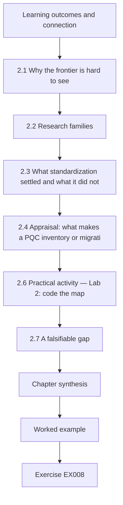

### Logical drawing

```mermaid
flowchart LR
  N0["Learning outcomes and connection"]
  N1["2.1 Why the frontier is hard to see"]
  N2["2.2 Research families"]
  N3["2.3 What standardization settled and what it did not"]
  N4["2.4 Appraisal: what makes a PQC inventory or migrati"]
  N5["2.6 Practical activity — Lab 2: code the map"]
  N6["2.7 A falsifiable gap"]
  N7["Chapter synthesis"]
  N0 --> N1 --> N2 --> N3 --> N4 --> N5 --> N6 --> N7 --> Q["EX008"]
```

```text
[Learning outcomes and connection]
    |
    v
[2.1 Why the frontier is hard to see]
    |
    v
[2.2 Research families]
    |
    v
[2.3 What standardization settled and what it did not]
    |
    v
[2.4 Appraisal: what makes a PQC inventory or migrati]
    |
    v
[2.6 Practical activity — Lab 2: code the map]
    |
    v
[2.7 A falsifiable gap]
    |
    v
[Chapter synthesis]
    |
    v
[Worked example] --> [Exercise EX008]
```
<!-- cyberabc:lesson-figures:end ch-02 -->


### Learning outcomes and connection

After this chapter you can (1) describe the six main research families in quantum and post-quantum security and the kind of evidence each produces; (2) explain what the NIST standardization process settled and what it left open; (3) appraise a PQC study for construct validity, baseline fairness and corpus independence; (4) code a literature map and locate an empty cell; and (5) state a falsifiable gap. It builds on the claim ladder of Chapter 1 and supplies the question that Chapter 3 turns into a contribution.

### 2.1 Why the frontier is hard to see

The field is split across communities that rarely cite each other: quantum-algorithm researchers publishing on arXiv, cryptographers at IACR venues and on the [IACR ePrint archive](https://eprint.iacr.org/), protocol engineers at the IETF, and practitioners writing vendor reports. Vocabulary differs — "quantum-safe", "quantum-resistant", "post-quantum" and "PQC-ready" are used loosely — so a keyword search misses half the literature. Build a synonym table before you search, and record the date: in this field a two-year-old survey can describe a broken scheme as a leading candidate.

### 2.2 Research families

1. **Quantum cryptanalysis and resource estimation.** Shor's algorithm breaks factoring and discrete logarithms in polynomial time on a fault-tolerant machine ([Shor 1997](https://doi.org/10.1137/S0097539795293172)); Grover's search gives at most a quadratic speed-up against symmetric keys and hashes ([Grover 1996](https://doi.org/10.1145/237814.237866)), which is why AES-256 and SHA-384/512 remain the conservative choices rather than being replaced. Current research refines qubit and time counts ([Gidney and Ekerå 2021](https://doi.org/10.22331/q-2021-04-15-433); [Gidney 2025](https://arxiv.org/abs/2505.15917)). Evidence: algorithmic analysis under explicit hardware models.
2. **Hard problems and schemes.** *Lattices* — learning with errors ([Regev 2009](https://doi.org/10.1145/1568318.1568324)) and its module variants underlie ML-KEM and ML-DSA; Falcon (NTRU lattices) is being standardized as FN-DSA. *Hashes* — SLH-DSA (stateless) and LMS/XMSS (stateful; [RFC 8554](https://www.rfc-editor.org/rfc/rfc8554.html), [RFC 8391](https://www.rfc-editor.org/rfc/rfc8391.html)) rely only on hash-function properties. *Codes* — Classic McEliece descends from [McEliece (1978)](https://ipnpr.jpl.nasa.gov/progress_report2/42-44/44N.PDF); HQC was selected in March 2025 for standardization as a second KEM based on a different assumption ([NIST IR 8545](https://doi.org/10.6028/NIST.IR.8545)). *Multivariate* — Rainbow, a third-round finalist, was broken by a key-recovery attack ([Beullens 2022](https://eprint.iacr.org/2022/214)). *Isogenies* — SIKE was broken by an efficient key-recovery attack ([Castryck and Decru 2022](https://eprint.iacr.org/2022/975)). Evidence: proofs, cryptanalysis, parameter estimates.
3. **Standards and policy.** FIPS 203/204/205 (August 2024), [SP 800-227](https://doi.org/10.6028/NIST.SP.800-227) on using KEMs (September 2025), the draft transition plan [NIST IR 8547](https://doi.org/10.6028/NIST.IR.8547.ipd) and agility guidance in [NIST CSWP 39](https://doi.org/10.6028/NIST.CSWP.39-upd1). Evidence: documents with status and history.
4. **Hybrid protocols.** Terminology in [RFC 9794](https://www.rfc-editor.org/rfc/rfc9794.html); TLS 1.3 hybrid groups such as X25519MLKEM768 in [RFC 10024](https://www.rfc-editor.org/rfc/rfc10024.html). Research questions concern combiner security, message size, middlebox tolerance and downgrade resistance. Evidence: proofs, interoperability tests, internet measurement.
5. **Implementation security.** Constant-time arithmetic, decryption-failure handling, fault attacks and side channels in lattice implementations; timing leaks from secret-dependent division in several Kyber implementations were reported as "KyberSlash" ([Bernstein et al. 2024](https://eprint.iacr.org/2024/1049)). Evidence: lab measurement against named code versions.
6. **Inventory and agility.** How organizations discover where cryptography is used, build a cryptographic bill of materials (CBOM) and make algorithms replaceable. Evidence: case studies, benchmarks, field measurements — the least mature family methodologically, as Lab 2 shows.

### 2.3 What standardization settled and what it did not

The NIST process settled a portfolio: one general-purpose KEM (ML-KEM), a lattice signature (ML-DSA), a conservative hash-based signature (SLH-DSA), with Falcon and HQC to follow ([NIST IR 8413](https://doi.org/10.6028/NIST.IR.8413) explains the third-round selections). It did not settle deployment: how hybrid secrets should be combined in every protocol, how certificates should carry new or composite keys, how constrained devices should cope with ML-DSA signatures of 2,420–4,627 bytes (FIPS 204 parameter sets), or how an organization can show that it has found every quantum-vulnerable use. The breaks of Rainbow and SIKE late in the process are the field's standing reminder that confidence in a hard problem is earned over years, which is the scientific argument for hybrid deployment and agility.

### 2.4 Appraisal: what makes a PQC inventory or migration study credible

Ask five questions. **Construct validity**: does "vulnerable use" mean an algorithm present in code, configured, negotiated, or protecting data with a long lifetime? **Ground truth**: who adjudicated it, blind to the method under test? **Baseline fairness**: was the rival tool configured by someone competent, with the same access? **Corpus independence**: was the method tuned on the corpus it was evaluated on, or validated on a second organization? **Unknowns**: are unreachable assets reported? A study can be useful while failing some of these, but its claims must shrink accordingly.

### 2.5 Worked example: appraising synthetic studies Q1–Q8

Q1 and Q6 are single-hospital case studies that report "94% of RSA use found" against a ground truth produced by the same tool — circular. Q2 and Q8 benchmark scanners on a corpus published by one of the vendors — independence "same-vendor". Q3 measures hybrid-group negotiation across a large set of public websites with a documented method and is independent. Q4 benchmarks hybrid handshakes in a lab with no external replication. Q5 reproduces a timing leak in two independent labs. Q7 is a position paper on agility with no data. Coding them (Lab 2) shows that inventory — the family a migration programme depends on most — has no study validated on an independent corpus. That empty cell becomes the Ciphertrail gap.

### 2.6 Practical activity — Lab 2: code the map

```python
# Lab 2 (synthetic): code eight fictional studies Q1-Q8 and find empty cells.
studies = {  # id: (family, evidence type, corpus independence)
    "Q1": ("inventory", "single-org case", "none"),
    "Q2": ("inventory", "benchmark", "same-vendor"),
    "Q3": ("hybrid-protocol", "internet measurement", "independent"),
    "Q4": ("hybrid-protocol", "lab benchmark", "none"),
    "Q5": ("implementation", "side-channel lab", "independent"),
    "Q6": ("inventory", "single-org case", "none"),
    "Q7": ("agility", "position paper", "none"),
    "Q8": ("inventory", "benchmark", "same-vendor"),
}
families = sorted({f for f, _, _ in studies.values()})
indep = ["none", "same-vendor", "independent"]
print(f"{'family':16s}" + "".join(f"{i:>13s}" for i in indep))
for fam in families:
    row = [sum(1 for f, _, c in studies.values() if f == fam and c == i) for i in indep]
    print(f"{fam:16s}" + "".join(f"{n:13d}" for n in row))
gaps = [fam for fam in families
        if not any(f == fam and c == "independent" for f, _, c in studies.values())]
print("families with no independently validated study:", ", ".join(gaps))
```

Expected output:

```text
family                   none  same-vendor  independent
agility                     1            0            0
hybrid-protocol             1            0            1
implementation              0            0            1
inventory                   2            2            0
families with no independently validated study: agility, inventory
```

Extend the coding scheme with a fourth column for "ground truth independent of tool" and re-run; a gap that survives two codings is more defensible than one that appears under a single scheme.

The table makes the gap visible in one glance: four inventory studies, none validated on an independent corpus. The coding is only as good as its rules, so write down what counts as same-vendor or independent before coding and ask a second person to code the eight studies separately. If the second coder moves a study into the independent column, the gap statement must change before it goes into the proposal.

### 2.7 A falsifiable gap

A gap is not "nobody has studied PQC inventories". It is a specific, testable absence: *no published inventory method reports recall of quantum-vulnerable key-establishment and signature uses against blind adjudication on a corpus independent of its development corpus, with unknown share reported.* The statement is falsifiable — one counter-example in the literature would close it — and it names the measurements a contribution must make.

Check the gap against the literature again just before submission, because a counter-example published during the thesis would close it. Record the date and the search used for that final check. If a study appears that partly fills the gap, the contribution can still stand, but it must be repositioned as replication or extension rather than first measurement.

### 2.8 Common errors and limits

- Citing a broken scheme as a candidate because the survey predates the break.
- Treating Grover as fatal to AES; it halves effective key length in the idealized model and is far harder to parallelize.
- Confusing quantum key distribution (QKD) with PQC. QKD is a physical-layer technique with distinct requirements; several national agencies, including the [NSA](https://www.nsa.gov/Cybersecurity/Quantum-Key-Distribution-QKD-and-Quantum-Cryptography-QC/), do not recommend it for national-security systems.
- Mistaking standards status: FN-DSA and HQC were not final standards on 12 October 2026.
- Lab 2's corpus is invented; the method, not the counts, transfers.

### Exercises — chapter 2

Rubric 0–3 as in Chapter 1.

- **EX008 — Synonym table.** Build a twelve-term synonym and exclusion table for a PQC inventory search across arXiv, ePrint and IETF. Evidence: table and two search strings. Rubric: 3 = covers vendor and standards vocabulary and excludes QKD-only work deliberately.
- **EX009 — Family evidence.** For each of the six families, name the strongest form of evidence and one typical weakness. Evidence: six-row table. Rubric: 3 = weaknesses specific.
- **EX010 — Status check.** Verify the current status of FIPS 206, the HQC standard and NIST IR 8547 from primary pages. Evidence: three citations with dates checked. Rubric: 3 = primary sources only, dates recorded.
- **EX011 — Appraise Q1.** Apply the five appraisal questions to Q1. Evidence: a paragraph per question. Rubric: 3 = identifies circular ground truth and the claim it can still support.
- **EX012 — Recode the map.** Add the "ground truth independent" column to Lab 2 with your own judgements. Evidence: code diff and output. Rubric: 3 = codes justified and gap re-examined.
- **EX013 — Lessons from breaks.** Explain in 250 words what the Rainbow and SIKE breaks imply for migration architecture. Rubric: 3 = links breaks to hybrid deployment and agility without overstating.
- **EX014 — State the gap.** Write a one-sentence falsifiable gap for a question of your own. Rubric: 3 = names population, measurement and what would falsify it.

### Chapter synthesis

The frontier spans six families with different evidence cultures. Standardization settled a portfolio of algorithms, not their deployment. Inventory and agility — the families migrations depend on most — have the weakest evidence, and a falsifiable gap there is a legitimate doctoral contribution.

### Continue studying — chapter 02 of 08

[← Chapter 01 (draft)](#ch-01) · [Course chapter index](../SUBJECTS.md) · [Chapter 03 (draft) →](#ch-03)

<a id="ch-03"></a>

## Chapter 3 — Original contribution proposal

<!-- cyberabc:lesson-figures:start ch-03 -->
### Lesson map

Lesson 03 published. Map, example, EX015.

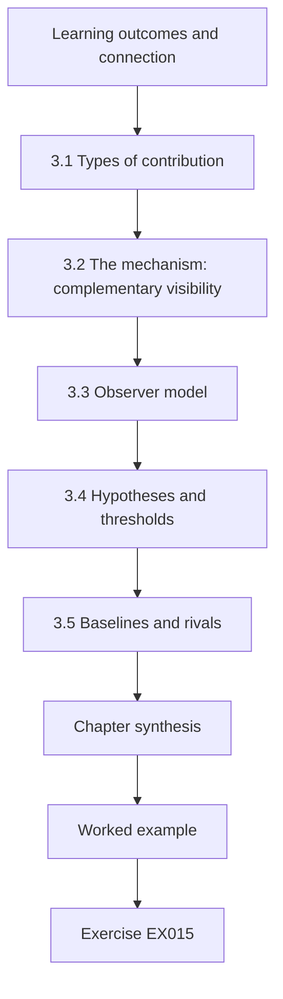

### Logical drawing

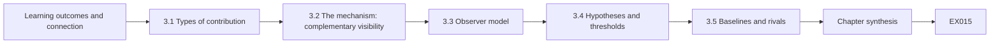

```text
[Learning outcomes and connection]
    |
    v
[3.1 Types of contribution]
    |
    v
[3.2 The mechanism: complementary visibility]
    |
    v
[3.3 Observer model]
    |
    v
[3.4 Hypotheses and thresholds]
    |
    v
[3.5 Baselines and rivals]
    |
    v
[Chapter synthesis]
    |
    v
[Worked example] --> [Exercise EX015]
```
<!-- cyberabc:lesson-figures:end ch-03 -->


### Learning outcomes and connection

After this chapter you can (1) classify a proposed contribution by type; (2) express a mechanism that explains *why* a method should work; (3) write an observer model — the counterpart, in inventory research, of an attacker model; (4) state hypotheses with pre-registered thresholds and failure conditions; and (5) select fair baselines and name rival explanations. It turns the falsifiable gap of Chapter 2 into a proposal that Chapter 4 can pilot.

### 3.1 Types of contribution

A doctoral contribution in this area is usually one of: a **new method** (a dual-source inventory procedure), a **new measurement** (the first independent recall estimate for inventory tools), a **new artefact** (an open adjudicated corpus), a **negative result** (showing that a widely used metric is invalid), or a **theory** (a model of how agility reduces time-to-replace). State one primary type; secondary contributions are welcome but must not dilute the claim examiners will test. The Ciphertrail Study's primary contribution is a measurement — independent recall and precision of a dual-source method — with the adjudicated corpus as a secondary artefact.

### 3.2 The mechanism: complementary visibility

A method deserves study when there is a reason it should work. Static analysis — scanning source code, dependency manifests, binaries and configuration — sees cryptography the organization builds and configures, but not what closed vendor appliances do internally. Passive telemetry — handshake metadata from TLS, SSH and IKE — sees what is actually negotiated on the wire, including inside vendor appliances, but sees nothing about data at rest and nothing about devices that never talk on a monitored segment. The mechanism is **complementary visibility**: the two sources fail on different asset classes, so their union should raise recall where one is blind and the other is not, and should not help where both are blind. A mechanism that predicts where the method will *fail* is more valuable than one that predicts only success, because it makes the claim falsifiable.

### 3.3 Observer model

Define what each instrument can and cannot observe, as an attacker model would define capabilities:

| Observer | Sees | Does not see |
|---|---|---|
| **S — static** | Algorithm identifiers and API calls in code; library versions; configuration files; certificate stores reachable on disk | Inside closed appliances; runtime negotiation choices; data encrypted by third parties |
| **P — passive** | Offered and selected TLS 1.3 groups and signature algorithms; certificate chains in clear (TLS 1.2) or as revealed by endpoint logs; SSH and IKE proposals | Data at rest; traffic on unmonitored segments; encrypted TLS 1.3 certificates without endpoint cooperation |
| **G — ground truth** | Blind adjudication by engineers E01–E10 with owner documentation | Uses that no document records (reported as unknown) |

Note the TLS 1.3 subtlety: certificates travel encrypted in TLS 1.3, so a purely passive sensor sees the selected key-exchange group but not the server's signature algorithm unless endpoint logging is added. A proposal that ignored this would overclaim passive coverage of signatures.

### 3.4 Hypotheses and thresholds

Pre-register, before seeing the main corpus:

- **H1** — Dual-source recall of quantum-vulnerable uses exceeds static-only recall by at least 0.10 on the HRHN corpus (paired comparison; the lower bound of the 95% CI of the difference is at least 0.10).
- **H2** — Dual-source precision is at least 0.90 (passive findings can produce duplicates and misattributions).
- **H3** — The recall gain is concentrated in vendor appliances; in data-at-rest uses the gain is below 0.02. *This hypothesis predicts a failure.*
- **H4** — Results transfer: on the untouched Marrow corpus, with thresholds and fusion rules frozen, the recall gain remains at least 0.05.

Each hypothesis has a stated condition under which it is rejected. H3 is included because a method that "helps everywhere" would be suspicious given the mechanism.

### 3.5 Baselines and rivals

The baseline is static-only analysis configured by a competent engineer with the same access, not a deliberately weak scanner. A second baseline is passive-only. Rival explanations for an observed gain include: passive findings duplicating static findings under different names (inflating counts), the adjudicators being influenced by which tool found an item (inflating precision), and the corpus over-representing appliances (inflating aggregate gain). The design answers each: canonical identifiers per use, blinded adjudication, and per-class reporting.

Write each rival with the result that would support it, so the design can be judged before data arrive.

### 3.6 Worked example and Lab 3

The proposal includes a model study to check whether H1 and H3 are even plausible before any data are collected. Detection probabilities are arbitrary teaching values chosen to embody the mechanism.

```python
# Lab 3 - Ciphertrail Study (synthetic): static-only vs dual-source inventory recall.
# Each quantum-vulnerable "use" belongs to an asset class; each source detects it with a
# class-specific probability (ARBITRARY teaching values). Dual-source = union of detections.
import random
random.seed(2026)
classes = {  # class: (count, P(static detects), P(passive detects))
    "in-house code":       (420, 0.90, 0.55),
    "vendor appliance":    (260, 0.20, 0.80),
    "embedded/offline":    (180, 0.30, 0.10),
    "data at rest":        (140, 0.70, 0.00),
}
tot = {"static": 0, "dual": 0}; n_all = 0
print(f"{'class':18s}{'n':>5s}{'static':>8s}{'dual':>7s}")
for c, (n, ps, pp) in classes.items():
    s = d = 0
    for _ in range(n):
        hs, hp = random.random() < ps, random.random() < pp
        s += hs; d += (hs or hp)
    tot["static"] += s; tot["dual"] += d; n_all += n
    print(f"{c:18s}{n:5d}{s/n:8.2f}{d/n:7.2f}")
print(f"{'ALL':18s}{n_all:5d}{tot['static']/n_all:8.2f}{tot['dual']/n_all:7.2f}")
```

Expected output:

```text
class                 n  static   dual
in-house code       420    0.89   0.94
vendor appliance    260    0.18   0.84
embedded/offline    180    0.39   0.47
data at rest        140    0.69   0.69
ALL                1000    0.59   0.79
```

The model shows the predicted pattern: a large gain on vendor appliances, almost none on data at rest, and an aggregate gain (0.20) that depends heavily on the class mix. That last point is a design warning — an organization with fewer appliances would show a smaller aggregate gain for the same method, so the thesis must report per-class results and the mix.

### 3.7 Common errors and limits

- Proposing a method without a mechanism, so that any result can be rationalized.
- Hypotheses that cannot fail, such as "dual-source recall is at least as high as static" (true by construction for a union).
- Weak baselines chosen to make the method look good.
- Ignoring that TLS 1.3 hides certificates from passive observers.
- Model studies prove only internal consistency; Lab 3's numbers are assumptions.

Each error has a visible symptom in a proposal: a method described without saying where it should fail, a hypothesis that a union guarantees, a static baseline run with default settings by someone unfamiliar with it, or a passive coverage claim for signatures under TLS 1.3. Check the proposal for those symptoms before the committee does.

### Exercises — chapter 3

- **EX015 — Contribution type.** Classify the Ciphertrail contribution and one alternative framing; argue which an examiner would find stronger. Rubric: 3 = justified with reference to testability.
- **EX016 — Mechanism.** Write a mechanism paragraph for a different method (e.g. inventory from software bills of materials). Rubric: 3 = predicts at least one failure class.
- **EX017 — Observer model.** Add an observer "E — endpoint logs" to the table in 3.3. Rubric: 3 = sees/does-not-see columns accurate, including privacy cost.
- **EX018 — Failing hypothesis.** Rewrite "dual-source is better" as a hypothesis that could be rejected. Rubric: 3 = threshold, comparison and rejection condition stated.
- **EX019 — Class mix.** Modify Lab 3 so vendor appliances are 60 instead of 260 (adjust in-house code to 620). Report aggregate gain and explain. Rubric: 3 = correct run and interpretation tied to class mix.
- **EX020 — Rivals.** Name two further rival explanations for a recall gain and the design feature that addresses each. Rubric: 3 = rivals plausible, controls specific.

### Chapter synthesis

A contribution is defensible when its mechanism predicts both success and failure, its observer model states what each instrument cannot see, its hypotheses can be rejected, and its baselines are strong. The Ciphertrail Study proposes complementary visibility and predicts where it will not help.

### Continue studying — chapter 03 of 08

[← Chapter 02 (draft)](#ch-02) · [Course chapter index](../SUBJECTS.md) · [Chapter 04 (draft) →](#ch-04)

<a id="ch-04"></a>

## Chapter 4 — Baseline replication and pilot

<!-- cyberabc:lesson-figures:start ch-04 -->
### Lesson map

Lesson 04 published. Map, example, EX021.

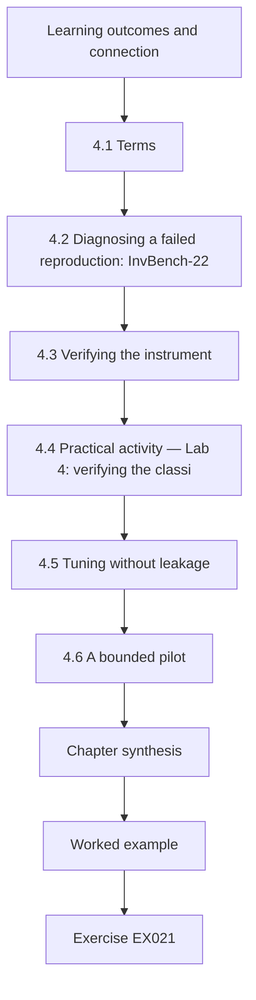

### Logical drawing

```mermaid
flowchart LR
  N0["Learning outcomes and connection"]
  N1["4.1 Terms"]
  N2["4.2 Diagnosing a failed reproduction: InvBench-22"]
  N3["4.3 Verifying the instrument"]
  N4["4.4 Practical activity — Lab 4: verifying the classi"]
  N5["4.5 Tuning without leakage"]
  N6["4.6 A bounded pilot"]
  N7["Chapter synthesis"]
  N0 --> N1 --> N2 --> N3 --> N4 --> N5 --> N6 --> N7 --> Q["EX021"]
```

```text
[Learning outcomes and connection]
    |
    v
[4.1 Terms]
    |
    v
[4.2 Diagnosing a failed reproduction: InvBench-22]
    |
    v
[4.3 Verifying the instrument]
    |
    v
[4.4 Practical activity — Lab 4: verifying the classi]
    |
    v
[4.5 Tuning without leakage]
    |
    v
[4.6 A bounded pilot]
    |
    v
[Chapter synthesis]
    |
    v
[Worked example] --> [Exercise EX021]
```
<!-- cyberabc:lesson-figures:end ch-04 -->


### Learning outcomes and connection

After this chapter you can (1) distinguish repeatability, reproducibility and replicability; (2) diagnose why a published inventory result fails to reproduce; (3) verify an instrument against known inputs before trusting its output; (4) tune parameters without leaking test data; and (5) run a bounded pilot that ends in an explicit go/no-go decision. It applies the proposal of Chapter 3 before the main study of Chapter 5.

### 4.1 Terms

Following the ACM's [artifact review and badging](https://www.acm.org/publications/policies/artifact-review-and-badging-current) vocabulary: **repeatability** — the same team obtains the same result with the same setup; **reproducibility** — a different team obtains it with the original artefacts; **replicability** — a different team obtains it with independently developed artefacts. A doctoral baseline should at least be reproduced, and the reproduction log should record every deviation, including versions of scanners, parsers and the TLS group registry used to classify codepoints.

In the Ciphertrail Study the InvBench-22 work is a reproduction, because it reuses the released corpus.

### 4.2 Diagnosing a failed reproduction: InvBench-22

The synthetic paper InvBench-22 reports that its scanner found "97% of quantum-vulnerable assets". The candidate obtains the released corpus and gets 61%. Three causes emerge, in order of discovery. First, **duplicate counting**: the paper counted findings, not uses — the same server appeared under a short name, a fully qualified name and two IP addresses, each counted as a hit against a single ground-truth item. Second, **ground-truth leakage**: the ground truth was built partly from the scanner's own earlier output, so items the scanner could not see were missing from the denominator. Third, **registry drift**: the paper's classifier predated the final ML-KEM codepoints and labelled the obsolete pre-standard hybrid codepoint as "unknown", which the authors then excluded. None of these is fraud; each is a measurement decision that was not reported. The reproduction log states each cause, quantifies its effect and notes which are inferences rather than confirmed by the authors.

### 4.3 Verifying the instrument

Before measuring HRHN, verify that the passive classifier maps each TLS supported-group codepoint correctly. The IANA [TLS Supported Groups registry](https://www.iana.org/assignments/tls-parameters/tls-parameters.xhtml#tls-parameters-8) lists the codepoints; RFC 10024 defines X25519MLKEM768, SecP256r1MLKEM768 and SecP384r1MLKEM1024. Unit tests with known inputs are the cheapest validity evidence a thesis can have. Two design rules matter. An unknown codepoint must be classified as *unknown*, never as safe. And identity must be canonicalized before counting, so that one use is one row.

### 4.4 Practical activity — Lab 4: verifying the classifier and counting uses

```python
# Lab 4 (synthetic): verify the passive classifier and show how duplicate counting inflates recall.
# TLS supported-group codepoints (IANA registry): 0x001D x25519, 0x0017 secp256r1,
# 0x11EC X25519MLKEM768, 0x11EB SecP256r1MLKEM768, 0x11ED SecP384r1MLKEM1024,
# 0x6399 X25519Kyber768Draft00 (obsolete pre-standard codepoint).
GROUPS = {0x001D: "classical", 0x0017: "classical", 0x11EC: "hybrid", 0x11EB: "hybrid",
          0x11ED: "hybrid", 0x6399: "pre-standard hybrid"}
def classify(code):
    return GROUPS.get(code, "unknown")          # never default an unknown codepoint to "safe"
tests = [(0x001D, "classical"), (0x11EC, "hybrid"), (0x6399, "pre-standard hybrid"), (0xFFFF, "unknown")]
assert all(classify(c) == want for c, want in tests), "classifier unit test failed"
print("classifier unit tests: 4/4 pass")
# Synthetic handshake findings: (server pseudonym, port, selected group)
findings = [("srv-014", 443, 0x001D), ("srv-014", 443, 0x001D), ("SRV-014.halden.example", 443, 0x001D),
            ("srv-022", 8443, 0x11EC), ("srv-031", 443, 0x0017), ("srv-031", 443, 0x0017)]
truth_vulnerable = {("srv-014", 443), ("srv-031", 443), ("srv-040", 22)}   # adjudicated uses
def canon(host):
    return host.lower().split(".")[0]
raw_hits = sum(1 for h, p, g in findings if classify(g) == "classical")
uses = {(canon(h), p) for h, p, g in findings if classify(g) == "classical"}
print(f"raw classical findings: {raw_hits}  -> naive 'recall' {raw_hits}/{len(truth_vulnerable)} = {raw_hits/len(truth_vulnerable):.2f}")
print(f"canonical uses found:   {len(uses & truth_vulnerable)}  -> recall {len(uses & truth_vulnerable)/len(truth_vulnerable):.2f}")
```

Expected output:

```text
classifier unit tests: 4/4 pass
raw classical findings: 5  -> naive 'recall' 5/3 = 1.67
canonical uses found:   2  -> recall 0.67
```

A "recall" above 1 is the clearest possible signal of a unit error, but subtler inflation — say from 0.61 to 0.97 — looks plausible and survives review unless the counting unit is stated. The missing SSH use on `srv-040` also illustrates the observer model: the TLS sensor cannot find it.

The lab separates two checks that are easy to confuse. The unit tests show the classifier maps known codepoints correctly, including an unknown one. The counting step shows how the same server, logged repeatedly and under two names, can inflate recall. Keep both in the instrument's test suite and run them before every collection, recording the IANA registry retrieval date beside the results.

### 4.5 Tuning without leakage

The fusion rule has parameters: how long a passive observation remains valid, how hostnames are matched to code repositories, and the confidence threshold for attributing a negotiated group to an asset. Tune them on a **development split** (in the Ciphertrail Study, HRHN hospital 1), freeze them, and evaluate on the held-out hospitals 2 and 3. Record every tuning run, including those that were abandoned; a garden of forking paths that is hidden is indistinguishable from p-hacking.

Keep a tuning log with the date, the parameter values and the result on hospital 1 for every run. When the rules are frozen, record the configuration hash in the same log.

### 4.6 A bounded pilot

The pilot runs for two weeks on one HRHN segment with 140 services. Pre-stated go/no-go criteria: classifier unit tests all pass; pseudonymization verified on a sample of 200 records by a second person; no operational incident attributable to the study; adjudicator agreement (Cohen's κ) at least 0.70 on a 60-item calibration set; and the protocol takes no more than four engineer-hours per 100 services. The synthetic pilot meets four criteria but records κ = 0.62, because adjudicators disagreed on whether a configured-but-never-negotiated RSA key-exchange cipher suite is a "use". The decision is *go with amendment*: the codebook now defines a use as any algorithm reachable by a peer in negotiation, with a separate flag for "configured, not observed".

### 4.7 Common errors and limits

- Counting findings rather than uses; always state the unit.
- Building ground truth from the tool under test.
- Using an outdated codepoint registry; record its retrieval date.
- Tuning on test data, even informally by "looking at a few results".
- A pilot without pre-stated criteria cannot fail and therefore teaches little.

Each error has a guard in this study: canonical identifiers for uses, adjudication blind to the tool, a dated registry, a split by hospital with frozen rules, and pre-stated pilot criteria. The pilot's low agreement of 0.62 is an example of a criterion doing its job; it forced a codebook amendment before the main study rather than after.

### Exercises — chapter 4

- **EX021 — Vocabulary.** Classify three scenarios as repeatability, reproducibility or replicability. Rubric: 3 = all correct with a one-line justification each.
- **EX022 — Reproduction log.** Write the log entry for InvBench-22 cause 2, separating observation from inference. Rubric: 3 = effect quantified, inference labelled.
- **EX023 — Extend the classifier.** Add unit tests to Lab 4 for SecP384r1MLKEM1024 (0x11ED, already in the table) and for an unknown codepoint 0x0200. Rubric: 3 = tests pass and unknown stays unknown.
- **EX024 — Canonical identity.** Propose a canonicalization rule for a use that handles IP addresses, aliases and load balancers. Rubric: 3 = addresses at least one failure mode of the rule.
- **EX025 — Split design.** Design development/test splits for HRHN that prevent leakage when two hospitals share a PKI. Rubric: 3 = identifies shared-PKI leakage and mitigates it.
- **EX026 — Go/no-go.** Given κ = 0.62 and all other criteria met, write the decision memo. Rubric: 3 = decision justified, amendment specific, re-test criterion stated.

### Chapter synthesis

Baselines are reproduced before they are beaten; instruments are verified on known inputs; the counting unit is stated; tuning is separated from testing; and a pilot exists to be able to fail. InvBench-22's inflated recall came from three unreported measurement decisions, not from the scanner.

### Continue studying — chapter 04 of 08

[← Chapter 03 (draft)](#ch-03) · [Course chapter index](../SUBJECTS.md) · [Chapter 05 (draft) →](#ch-05)

<a id="ch-05"></a>

## Chapter 5 — Main study and independent validation

<!-- cyberabc:lesson-figures:start ch-05 -->
### Lesson map

Lesson 05 published. Map, example, EX027.

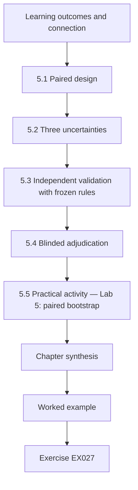

### Logical drawing

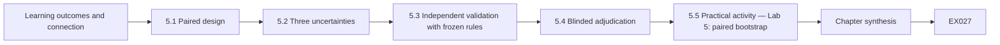

```text
[Learning outcomes and connection]
    |
    v
[5.1 Paired design]
    |
    v
[5.2 Three uncertainties]
    |
    v
[5.3 Independent validation with frozen rules]
    |
    v
[5.4 Blinded adjudication]
    |
    v
[5.5 Practical activity — Lab 5: paired bootstrap]
    |
    v
[Chapter synthesis]
    |
    v
[Worked example] --> [Exercise EX027]
```
<!-- cyberabc:lesson-figures:end ch-05 -->


### Learning outcomes and connection

After this chapter you can (1) run a paired comparison of two inventory methods on the same items; (2) separate sampling uncertainty, measurement uncertainty and model uncertainty; (3) validate on an independent corpus with frozen rules; (4) run blinded adjudication and report agreement; and (5) write an honest results paragraph. It executes the design that Chapter 4 piloted and supplies the results Chapter 6 will attack.

### 5.1 Paired design

Both methods are applied to the *same* adjudicated items, so the quantity of interest is a paired difference: for each quantum-vulnerable use, did static analysis find it, and did dual-source analysis find it? Pairing removes between-item variability — some uses are simply hard to find — and gives a much tighter interval than comparing two independent recall estimates. Because dual-source is a union that includes the static findings, the per-item difference can only be 0 or +1 for recall; precision, by contrast, can fall, which is why H2 exists.

### 5.2 Three uncertainties

**Sampling uncertainty** is what a bootstrap interval captures: had a different set of uses been adjudicated, the estimate would differ. **Measurement uncertainty** comes from adjudication: two engineers may disagree on whether a use exists, so report agreement (κ) and run a sensitivity analysis in which disputed items are counted both ways. **Model uncertainty** comes from analytic choices — the canonicalization rule, the observation window, the codebook definition of "use". Report a small specification curve: the main estimate under each defensible alternative. A conclusion that holds across all three is robust; one that holds only under one specification is a finding about that specification.

### 5.3 Independent validation with frozen rules

The Marrow Logistics corpus was never examined during development. The fusion rules, thresholds and codebook are frozen and hashed (SHA-256 of the configuration file recorded in the thesis log) before Marrow data are opened. Marrow differs deliberately: fewer vendor appliances, more embedded handheld scanners in warehouses, and an SSH-heavy operations team. The mechanism of Chapter 3 therefore predicts a smaller aggregate gain — a successful prediction of *reduced* benefit is evidence for the mechanism, not against the method.

Record the date Marrow data were first opened next to the frozen configuration hash.

### 5.4 Blinded adjudication

Engineers E01–E10 (synthetic) receive each candidate use with tool provenance removed and randomized order, plus owner documentation. Two engineers adjudicate every item; a third resolves disagreements. On the main study, synthetic agreement is κ = 0.78 after the codebook amendment from the pilot. Items no engineer can determine are coded *unknown*: 9% of HRHN assets and 14% of Marrow assets, reported alongside recall rather than dropped.

Report agreement per asset class as well as overall, because adjudicators may find appliances harder to judge than in-house code. Keep the third engineer's resolutions in a separate file, so that a reader can see how many items needed one and whether any class was disputed more than the others.

### 5.5 Practical activity — Lab 5: paired bootstrap

```python
# Lab 5 (synthetic): paired bootstrap CI for the recall gain (dual - static) on two corpora.
import random
def corpus(seed, mix):
    rng = random.Random(seed); items = []
    probs = {"code": (0.90, 0.55), "appliance": (0.20, 0.80), "embedded": (0.30, 0.10), "rest": (0.70, 0.0)}
    for cls, n in mix.items():
        ps, pp = probs[cls]
        for _ in range(n):
            s = rng.random() < ps; p = rng.random() < pp
            items.append((s, s or p))
    return items
def gain_ci(items, reps=2000, seed=1):
    rng = random.Random(seed); n = len(items)
    point = sum(d - s for s, d in items) / n
    boots = sorted(sum(d - s for s, d in (items[rng.randrange(n)] for _ in range(n))) / n for _ in range(reps))
    return point, boots[int(0.025 * reps)], boots[int(0.975 * reps)]
for name, seed, mix in [("HRHN hospitals 2-3", 11, {"code": 300, "appliance": 180, "embedded": 120, "rest": 100}),
                        ("Marrow (frozen rules)", 22, {"code": 500, "appliance": 60, "embedded": 200, "rest": 140})]:
    g, lo, hi = gain_ci(corpus(seed, mix))
    print(f"{name:24s} recall gain = {g:.3f}  95% CI [{lo:.3f}, {hi:.3f}]")
```

Expected output:

```text
HRHN hospitals 2-3       recall gain = 0.207  95% CI [0.176, 0.236]
Marrow (frozen rules)    recall gain = 0.097  95% CI [0.079, 0.116]
```

Under these synthetic assumptions, H1 (gain ≥ 0.10 on HRHN) is supported, and H4 (gain ≥ 0.05 on Marrow) is supported, with the smaller Marrow gain predicted by its class mix. The bootstrap interval reflects sampling only; it says nothing about adjudication error or about whether Marrow resembles any real company.

The lab draws per-class detections from the same arbitrary probabilities used in Lab 3 and applies them to two class mixes. The HRHN mix of 700 uses matches the held-out corpus size; Marrow's mix has fewer appliances and more embedded devices. The paired bootstrap resamples items, keeping each item's static and dual outcomes together, which is why the intervals are narrow.

### 5.6 Worked example: the honest results paragraph

"On the held-out HRHN corpus (synthetic; 700 adjudicated quantum-vulnerable uses), dual-source inventory increased recall by 0.21 (95% bootstrap CI 0.18–0.24) over a competently configured static baseline; precision was 0.93. The gain was concentrated in vendor appliances (0.63) and absent for data at rest (0.00), as predicted (H3). With rules frozen, the gain on an independent corpus was 0.10 (0.08–0.12). Nine and fourteen per cent of assets, respectively, could not be adjudicated and are excluded from the recall denominators; under a worst-case assumption that all unknown assets hold undiscovered vulnerable uses, recall falls by up to 0.12. These results describe two synthetic organizations and a model of detection; they are not estimates for real enterprises." Note what the paragraph refuses to say: it does not claim either organization is "quantum-safe" or that dual-source inventory is sufficient.

### 5.7 Common errors and limits

- Comparing unpaired recall estimates and reporting overlapping intervals as "no difference".
- Reporting only sampling uncertainty.
- Touching the validation corpus before freezing rules — even to "check the format".
- Dropping unknown assets from the denominator without saying so.
- Lab 5 simulates detection probabilities; real asset classes are messier.

Each error has a concrete guard in this study: the paired design, the three-uncertainty report, the frozen and hashed configuration before Marrow was opened, and the unknown shares of nine and fourteen per cent printed beside recall. A reviewer should be able to confirm all four from the archive without asking the candidate.

### Exercises — chapter 5

- **EX027 — Why pair?** Explain with Lab 5 why the paired interval is narrower than two independent intervals. Rubric: 3 = variance argument correct.
- **EX028 — Disputed items.** Given 40 disputed items on HRHN, describe the sensitivity analysis and how you would report it. Rubric: 3 = both-ways bounds and reporting sentence.
- **EX029 — Specification curve.** List four defensible alternative specifications for the main estimate. Rubric: 3 = each alters one analytic choice and is justified.
- **EX030 — Freeze protocol.** Write the freeze procedure for Marrow, including what is hashed and who witnesses it. Rubric: 3 = verifiable by an outsider.
- **EX031 — Predict Marrow.** Using Lab 3's per-class probabilities, predict Marrow's aggregate gain from its mix before running Lab 5. Rubric: 3 = prediction within 0.03 and method shown.
- **EX032 — Results paragraph.** Rewrite an overclaiming paragraph ("Our method makes organizations quantum-safe") in the style of 5.6. Rubric: 3 = scope, uncertainty and unknowns all present.

### Chapter synthesis

The main study is a paired comparison with three kinds of uncertainty reported, validated on an untouched corpus under frozen rules, adjudicated blind, and written up with its unknowns in the denominator conversation. A predicted reduction in benefit on a different corpus supports the mechanism.

### Continue studying — chapter 05 of 08

[← Chapter 04 (draft)](#ch-04) · [Course chapter index](../SUBJECTS.md) · [Chapter 06 (draft) →](#ch-06)

<a id="ch-06"></a>

## Chapter 6 — Peer critique and revision

<!-- cyberabc:lesson-figures:start ch-06 -->
### Lesson map

Lesson 06 published. Map, example, EX033.

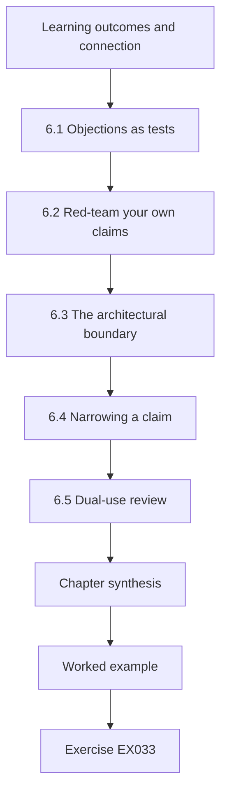

### Logical drawing

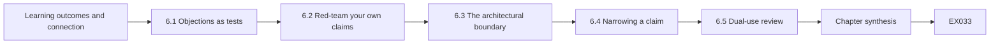

```text
[Learning outcomes and connection]
    |
    v
[6.1 Objections as tests]
    |
    v
[6.2 Red-team your own claims]
    |
    v
[6.3 The architectural boundary]
    |
    v
[6.4 Narrowing a claim]
    |
    v
[6.5 Dual-use review]
    |
    v
[Chapter synthesis]
    |
    v
[Worked example] --> [Exercise EX033]
```
<!-- cyberabc:lesson-figures:end ch-06 -->


### Learning outcomes and connection

After this chapter you can (1) convert reviewer objections into tests; (2) run an internal red-team review of your own claims; (3) find the architectural boundary beyond which a method cannot see; (4) narrow a claim without abandoning it; and (5) conduct a dual-use review of an inventory method. It takes the results of Chapter 5 and prepares the thesis argument of Chapter 7.

### 6.1 Objections as tests

A reviewer's objection is a hypothesis about your error. Treat each one as a test with a possible outcome, not as an attack to rebut. Three objections from the synthetic review of the Ciphertrail paper illustrate the method. **O1:** "Passive telemetry may find appliances only because HRHN's appliances happen to sit on the monitored segment." Test: re-run the analysis restricted to appliances on segments with and without sensors; the gain vanishes off-sensor, confirming that the method's benefit is conditional on sensor placement — a scope condition, now stated. **O2:** "Adjudicators could infer provenance from formatting." Test: give 50 items to two new engineers with formatting normalized; κ with the original labels is 0.81, so the objection is weakened but recorded. **O3:** "Recall of *uses* is not risk; one RSA-wrapped archive matters more than a hundred internal web servers." This is not testable within the data; it is a construct objection, answered by adding a sensitivity-weighted recall and conceding that weighting is a decision, not a measurement.

### 6.2 Red-team your own claims

Before external review, assign a colleague to argue that each claim is false. A useful red-team table has four columns: claim, strongest objection, test or concession, status after revision. Red-teaming in PQC research should always include an objection from the *threat-model* side: hybrid negotiation protects key establishment only if the classical and post-quantum shares are combined as specified and no downgrade path exists. An inventory that records X25519MLKEM768 as negotiated says nothing about whether a client would silently accept a classical-only group from an active attacker — a separate property that inventory does not measure.

### 6.3 The architectural boundary

Every method has a place it cannot see. For dual-source inventory the boundary includes: TLS 1.3 certificate signatures unless endpoints cooperate; firmware-update signatures verified offline inside devices; data at rest encrypted by third-party services; and protocols carried inside VPN tunnels the sensor cannot open. State the boundary as a diagram and a list in the thesis. Examiners respect a candidate who shows where the method stops more than one who implies it covers everything.

Draw the diagram with each blind zone labelled by the observer that misses it.

### 6.4 Narrowing a claim

Original claim: "Dual-source inventory substantially improves discovery of quantum-vulnerable cryptography." Narrowed claim after critique: "Where passive sensors observe the relevant segments, dual-source inventory increased recall of quantum-vulnerable key-establishment and TLS-1.2-visible signature uses by 0.10–0.21 in two synthetic organizations, concentrated in vendor appliances; it did not improve discovery of data-at-rest or offline firmware-signature uses." The narrowed claim is smaller and much harder to refute — exactly the trade a thesis should make.

Check the title, abstract and conclusions against the narrowed claim before submission.

### 6.5 Dual-use review

An inventory method is a map of where an organization is weakest. Published inventories, or tooling that fingerprints legacy cryptography across the internet, could guide a harvest-now-decrypt-later collector to the highest-value targets. The dual-use review asks: does the release include organization-identifying data (it must not); does the tool's default configuration scan only owner-authorized targets; are weaknesses in named products reported to vendors through coordinated disclosure ([ISO/IEC 29147](https://www.iso.org/standard/72311.html) describes vulnerability disclosure) before publication; and does the paper describe classes of weakness rather than lists of vulnerable hosts?

### 6.6 Worked example: the response letter

The synthetic response letter opens with a table mapping each objection to a change: O1 → new scope condition and an off-sensor analysis (Section 5.4 of the paper); O2 → new robustness check, κ reported; O3 → added sensitivity-weighted recall, and the abstract now says "uses" rather than "risk". It thanks reviewers without flattery, concedes what was right, and explains disagreements with evidence. Where the authors disagree — a reviewer asked for active scanning of medical devices to "complete" the ground truth — the letter explains the harm argument from Chapter 1 and offers a testbed experiment instead.

### 6.7 Common errors and limits

- Rebutting objections rhetorically instead of testing them.
- Narrowing a claim in the discussion but not in the title and abstract.
- Confusing inventory of negotiated algorithms with resistance to downgrade.
- Publishing per-organization findings that become a targeting list.
- Red-teaming only by friends who share your assumptions.

Each error has a remedy already used in the Ciphertrail review: objections O1 and O2 became tests, the narrowed claim moved into the abstract, downgrade resistance was named as outside the method, and the dual-use review removed organization-identifying data. For red-teaming, ask someone from the threat-model side who does not share your assumptions.

### Exercises — chapter 6

- **EX033 — Objection to test.** Convert three objections of your own into tests with possible outcomes. Rubric: 3 = each test could change the conclusion.
- **EX034 — Red-team table.** Build a four-column red-team table for the three main Ciphertrail claims. Rubric: 3 = includes a threat-model objection.
- **EX035 — Boundary diagram.** Draw (or describe in text) the architectural boundary of dual-source inventory with at least five unseen zones. Rubric: 3 = zones accurate and each linked to a scope statement.
- **EX036 — Narrow it.** Narrow "Hybrid TLS makes our hospital quantum-safe" into a defensible claim. Rubric: 3 = names the property, scope and what remains vulnerable.
- **EX037 — Dual-use review.** Complete a dual-use review for releasing the HRHN corpus. Rubric: 3 = decides what is released and why.
- **EX038 — Response letter.** Write the letter section answering O3. Rubric: 3 = concedes the construct point and shows the change.

### Chapter synthesis

Critique improves a thesis when objections become tests, the method's blind zone is drawn explicitly, claims shrink to what survives, and the release is reviewed for harm. Inventory evidence is not evidence of downgrade resistance or of risk reduction without further argument.

### Continue studying — chapter 06 of 08

[← Chapter 05 (draft)](#ch-05) · [Course chapter index](../SUBJECTS.md) · [Chapter 07 (draft) →](#ch-07)

<a id="ch-07"></a>

## Chapter 7 — Thesis synthesis and reproducibility archive

<!-- cyberabc:lesson-figures:start ch-07 -->
### Lesson map

Lesson 07 published. Map, example, EX039.

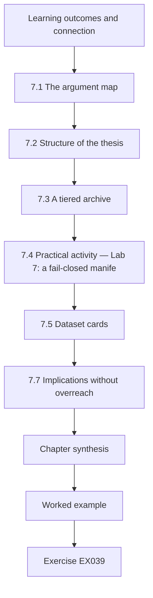

### Logical drawing

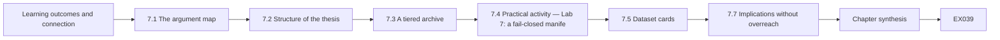

```text
[Learning outcomes and connection]
    |
    v
[7.1 The argument map]
    |
    v
[7.2 Structure of the thesis]
    |
    v
[7.3 A tiered archive]
    |
    v
[7.4 Practical activity — Lab 7: a fail-closed manife]
    |
    v
[7.5 Dataset cards]
    |
    v
[7.7 Implications without overreach]
    |
    v
[Chapter synthesis]
    |
    v
[Worked example] --> [Exercise EX039]
```
<!-- cyberabc:lesson-figures:end ch-07 -->


### Learning outcomes and connection

After this chapter you can (1) map a thesis argument from data to claim with explicit warrants; (2) build a tiered, fail-closed reproducibility archive; (3) write dataset cards for synthetic and restricted corpora; (4) state limits directionally — saying which way each limit would bias the result; and (5) connect the thesis to migration practice without overreach. It assembles Chapters 1–6 and prepares the defense of Chapter 8.

### 7.1 The argument map

Use Toulmin's structure for each major claim: **data** (Lab 5 paired differences), **warrant** (paired bootstrap estimates sampling uncertainty when items are exchangeable), **backing** (the method's standard use and the pilot's agreement statistics), **qualifier** ("where sensors observe the segment"), **rebuttal** (off-sensor appliances, unknown assets) and **claim**. Drawing the map exposes missing warrants. A common gap in PQC theses is the warrant that links inventory recall to risk reduction: it requires an argument about data lifetimes (Chapter 1's Mosca frame) and about what the organization does with findings, neither of which the inventory measures.

### 7.2 Structure of the thesis

A conventional order works: introduction and gap; background on quantum threat, standards and hybrid deployment; method and observer model; replication; main study; validation; critique and limits; conclusions. Put the narrowed claim in the first paragraph of the abstract. Put the architectural boundary in the method chapter, not hidden in limitations. Keep a single source of truth for every number — a results file generated by code — so that the abstract, tables and text cannot disagree.

Write the method chapter before the results chapter.

### 7.3 A tiered archive

Release tier 0 and tier 1 artefacts publicly; keep tier 2 with the data owner under an access agreement; never hold tier 3. The archive's manifest records each file's tier and SHA-256 hash, and the release process is **fail-closed**: any tier-2 file or hash mismatch blocks the release. Include the frozen configuration hash from Chapter 5 so that examiners can confirm validation used the frozen rules.

Run the release check on the exact archive that will be published, not on a working copy. Keep the manifest under version control.

### 7.4 Practical activity — Lab 7: a fail-closed manifest

```python
# Lab 7 (synthetic): a fail-closed reproducibility manifest. Any tier >= 2 file in the
# public archive, or any hash mismatch, stops the release.
import hashlib, json
files = {  # name: (tier, content) - contents are synthetic stand-ins
    "fusion_rules.json": (0, b'{"window_days": 14, "match": "canonical-host"}'),
    "corpus_synthetic.csv": (0, b"use_id,class,static,passive\nU1,code,1,0\n"),
    "handshakes_pseudonymized.csv": (1, b"host,group\nh-7f3a,0x001D\n"),
    "raw_capture.pcap": (2, b"\x00\x01binary"),
}
manifest = {n: {"tier": t, "sha256": hashlib.sha256(c).hexdigest()} for n, (t, c) in files.items()}
def release(manifest, files, public_max_tier=1):
    problems = []
    for n, m in manifest.items():
        if m["tier"] > public_max_tier:
            problems.append(f"{n}: tier {m['tier']} not releasable")
        elif hashlib.sha256(files[n][1]).hexdigest() != m["sha256"]:
            problems.append(f"{n}: hash mismatch")
    return ("BLOCKED", problems) if problems else ("RELEASED", [])
print(release(manifest, files))
del manifest["raw_capture.pcap"]
print(release(manifest, files))
print(json.dumps(manifest["fusion_rules.json"])[:60] + "...")
```

Expected output (the hash prefix is deterministic):

```text
('BLOCKED', ['raw_capture.pcap: tier 2 not releasable'])
('RELEASED', [])
{"tier": 0, "sha256": "db6dd8db390974cdd06e19b00d7fe35d26836...
```

The first call blocks the release because a tier-2 capture is in the manifest; removing it allows release. In a real archive, removing the file is not enough: check that no tier-0 or tier-1 file contains extracts from it, and record the removal in the archive's change log. The printed hash prefix lets an examiner confirm that the fusion rules in the archive match those frozen before validation. Run it again after every change to the archive.

### 7.5 Dataset cards

For each corpus, write a card covering: provenance (synthetic generator and seed, or owner and authorization), collection period, instruments and versions, pseudonymization method, known gaps (segments without sensors), label definitions (the amended codebook), agreement statistics, intended uses and prohibited uses (for example, no re-identification and no use as a target list). Synthetic corpora also need cards, because readers otherwise mistake generated distributions for field data.

Store each card beside its corpus and update it when errata are found. Date every card revision.

### 7.6 Directional limits

A limit without a direction is a ritual. State which way it pushes the estimate. *Unknown assets excluded from denominators* → recall overestimated (bounded by the worst-case analysis). *Sensors placed where appliances concentrate* → aggregate gain overestimated for organizations with sparser sensors. *Adjudicators with owner documentation* → ground truth may miss undocumented uses → both methods' recall overestimated, gain direction uncertain. *Synthetic organizations* → external validity unknown in both directions. A limits table with a "direction" column is one of the most valuable pages in the thesis.

### 7.7 Implications without overreach

The defensible practical implication is narrow: migration programmes that rely on static analysis alone are likely to under-find quantum-vulnerable uses in closed vendor appliances, and should combine sources where they can observe traffic and should report unknown shares. It does not follow that any organization is ready, that hybrid negotiation is downgrade-resistant, or that inventory replaces crypto-agility planning as described in [NIST CSWP 39](https://doi.org/10.6028/NIST.CSWP.39-upd1).

Write the implication as a recommendation with its condition attached, so that a practitioner reading only that paragraph still sees the scope: where sensors can observe traffic, and with unknown shares reported.

### 7.8 Common errors and limits

- Numbers typed by hand into the text that drift from the results file.
- Archives that silently include restricted captures.
- Limits listed without direction or magnitude.
- Implications that leap from "found more" to "safer".

Each error has a simple guard. Generate every number in the text from the results file. Run the fail-closed manifest check on the release archive. Add a direction and, where possible, a magnitude to each limit. Read the implications paragraph aloud and stop at any verb that implies safety rather than discovery.

### Exercises — chapter 7

- **EX039 — Toulmin map.** Map the H4 claim with all six elements. Rubric: 3 = warrant and rebuttal specific.
- **EX040 — Missing warrant.** Write the argument linking recall to risk reduction and list what evidence it would need. Rubric: 3 = involves data lifetime and remediation.
- **EX041 — Manifest.** Extend Lab 7 to fail when a file listed in the manifest is missing. Rubric: 3 = code works and fails closed.
- **EX042 — Dataset card.** Write the card for the Marrow corpus. Rubric: 3 = includes prohibited uses and known gaps.
- **EX043 — Directional limits.** Add three limits with direction and magnitude to the table in 7.6. Rubric: 3 = directions argued, magnitudes bounded where possible.
- **EX044 — Implication paragraph.** Write the practitioner implication for a migration lead in 150 words. Rubric: 3 = useful and within the evidence.

### Chapter synthesis

A thesis is an argument whose warrants are explicit, whose numbers have one source, whose archive cannot leak restricted data, and whose limits point in stated directions. Its implications are as narrow as its claims.

### Continue studying — chapter 07 of 08

[← Chapter 06 (draft)](#ch-06) · [Course chapter index](../SUBJECTS.md) · [Chapter 08 (draft) →](#ch-08)

<a id="ch-08"></a>

## Chapter 8 — Defense and publication plan

<!-- cyberabc:lesson-figures:start ch-08 -->
### Lesson map

Lesson 08 published. Map, example, EX045.

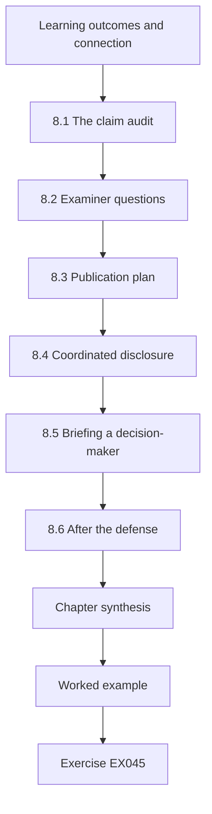

### Logical drawing

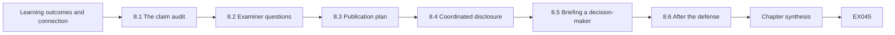

```text
[Learning outcomes and connection]
    |
    v
[8.1 The claim audit]
    |
    v
[8.2 Examiner questions]
    |
    v
[8.3 Publication plan]
    |
    v
[8.4 Coordinated disclosure]
    |
    v
[8.5 Briefing a decision-maker]
    |
    v
[8.6 After the defense]
    |
    v
[Chapter synthesis]
    |
    v
[Worked example] --> [Exercise EX045]
```
<!-- cyberabc:lesson-figures:end ch-08 -->


### Learning outcomes and connection

After this chapter you can (1) audit every claim in a thesis against its evidence; (2) anticipate and rehearse examiner questions; (3) plan the order and venues of publications; (4) run coordinated disclosure for product weaknesses found during research; and (5) brief a non-specialist decision-maker accurately. It closes the arc begun in Chapter 1 and leads to the worked-answer appendix.

### 8.1 The claim audit

List every sentence in the abstract, introduction and conclusion that asserts something. For each, record the rung (Chapter 1), the supporting table or figure, the uncertainty and the scope qualifier. Any claim without a supporting artefact is cut or rewritten. In the synthetic Ciphertrail audit, two sentences fail: one says "organizations" where the evidence covers two synthetic organizations, and one says "signatures" where passive evidence covers only TLS-1.2-visible certificate chains. Both are corrected before submission.

Repeat the audit after each round of revision.

### 8.2 Examiner questions

Prepare answers, with slide or page references, to the questions examiners in this field reliably ask. *Why should I believe your ground truth?* (blinding, κ, unknowns). *What happens with an organization that has no vendor appliances?* (mechanism predicts little gain; Marrow evidence). *Does your result depend on the CRQC date?* (no — inventory recall is independent of z; the prioritization implications are not, and are presented as a sweep). *What if ML-KEM is broken?* (inventory remains useful; hybrid deployment and agility are the architectural answer; cite the Rainbow and SIKE breaks as precedent for surprise). *What did you get wrong?* (the pilot's κ, the original construct of "use"). Rehearse with a hostile mock examiner and record which answers needed a page reference you did not have.

### 8.3 Publication plan

Order papers so that each stands alone and the strongest evidence appears first. A plausible plan: (1) the replication and measurement-unit paper (InvBench-style diagnosis, the counting unit and codepoint drift) at a measurement or systems-security venue; (2) the main dual-source study with validation; (3) the adjudicated corpus as a dataset paper with its card; (4) a practitioner-facing summary. Avoid salami-slicing results that are only meaningful together. Register the main study's analysis plan publicly before Marrow data are opened if a registry is available, or deposit a time-stamped hash.

### 8.4 Coordinated disclosure

During the synthetic study, the team observed that one appliance model accepted a classical-only fallback when its hybrid group was stripped by a middlebox in the testbed — a downgrade weakness. The disclosure plan: confirm the behaviour in the isolated testbed only; notify the vendor with reproducible details and a proposed 90-day window; inform HRHN's owner of affected units without publishing their identities; publish only after a fix or the agreed deadline, describing the class of weakness rather than an exploit recipe. The thesis records the disclosure timeline as evidence of ethical conduct.

### 8.5 Briefing a decision-maker

A one-page brief for HRHN's executive board (synthetic) states: what was measured (where quantum-vulnerable cryptography is used, not whether the network is "safe"); the main finding (static scanning alone missed most vendor-appliance uses; combining sources raised the share found from about one in five to more than four in five where sensors existed); what remains unknown (9% of assets; data at rest; offline device firmware); the decision requested (fund sensors on two unmonitored segments and require vendors to declare cryptographic algorithms in procurement); and what the brief does *not* claim (any date for a quantum computer). It uses no unexplained acronyms and attaches the limits table.

### 8.6 After the defense

Archive the final versions, update the dataset card with any errata, and schedule a re-verification of cited standards' status — FN-DSA and HQC will by then likely have final standards, and NIST IR 8547 may have been revised. A thesis about a transition should end with a statement of what would change its conclusions.

Note in the archive which conclusions depend on standards status, so that a reader after the next revision knows what to recheck. List those conclusions explicitly with their dependencies.

### 8.7 Common errors and limits

- Claims in the abstract broader than any table supports.
- Preparing answers to friendly questions only.
- Publishing a weakness before the vendor and owner are informed.
- Executive briefs that turn uncertainty into a single date or score.

Each error has a guard used earlier in this study: the claim audit, a hostile mock examiner, the disclosure timeline agreed with the vendor and the owner, and a brief that presents unknowns and ranges rather than a date. Review the brief with someone outside the project before it reaches the board.

### Exercises — chapter 8

- **EX045 — Claim audit.** Audit five assertive sentences from your Chapter 5 results paragraph. Rubric: 3 = every claim traced to an artefact, failures rewritten.
- **EX046 — Hostile questions.** Write five hostile examiner questions not listed in 8.2 and draft answers. Rubric: 3 = questions genuinely difficult, answers bounded.
- **EX047 — Publication order.** Propose and justify a three-paper plan for a thesis of your own. Rubric: 3 = each paper stands alone; no salami-slicing.
- **EX048 — Disclosure timeline.** Write a disclosure timeline for the downgrade weakness, including what happens if the vendor does not respond. Rubric: 3 = owner and vendor both covered; publication describes class not recipe.
- **EX049 — Executive brief.** Write the one-page brief described in 8.5. Rubric: 3 = accurate, actionable, no date or "safe" claim.
- **EX050 — What would change it.** List four future events and how each would change the thesis's conclusions. Rubric: 3 = includes a cryptanalytic, a standards and a field-evidence event.

### Chapter synthesis

The defense is the final claim audit: every assertion has an artefact, every hostile question has a bounded answer, publications stand alone, weaknesses are disclosed before they are published, and decision-makers receive what was measured rather than what they hoped to hear.

### Continue studying — chapter 08 of 08

[← Chapter 07 (draft)](#ch-07) · [Course chapter index](../SUBJECTS.md) · [Worked results ↓](#worked-results) · [Next course via chapter index →](../SUBJECTS.md)

<a id="worked-results"></a>

## Worked results

Answers are model responses for self-assessment; a different answer that meets the rubric scores equally. Synthetic numbers come from the seeded labs.

**EX001.** (1) observation — the sensor count; (2) inference — protection of segment-B sessions under the either-component assumption; (3) claim — recall with CI; (4) decision — VPN prioritization; (5) exposure — archived imaging. A rung-skipping sentence such as "segment B is quantum-safe" is rewritten: "63% of observed segment-B handshakes in the window negotiated a PQ/T hybrid group; other segments, signatures and stored data were not measured."

**EX002.** Primitive (are the deployed algorithms standardized PQC? metric: algorithm list against FIPS 203/204/205), protocol (do TLS/IKE configurations offer hybrid groups? metric: configuration share), deployment (are they negotiated? metric: negotiated share by sensitivity), organization (are vulnerable uses found and replaced? metric: recall, unknown share, time-to-replace). "80% ready" is meaningless until one object and its denominator are named.

**EX003.** With mode 10: lab results 0.415, slow migration 0.723; with mode 25: 0.097 and 0.325; appointment logs stay 0, genomic archive stays 1. With mode 10 the final "[15,40]" line (0.101) is invalid, because a mode outside the range violates the triangular distribution's definition — a reminder to validate model inputs; with mode 25 it is valid and still prints 0.000. Interpretation: the ranking of record classes is stable even though probabilities move by a factor of four, so prioritization (genomics first, then lab results) is more robust than any single probability.

**EX004.** Harms: device instability or reboot during care; alarm floods that desensitize the security team; weakening protection if probes trigger fallback modes. Alternatives: passive capture at the medical-network boundary; vendor documentation and procurement declarations; a testbed unit of each device model for active tests.

**EX005.** Packet capture tier 2 (kept on owner premises); pseudonymized CSV tier 1; certificate inventory tier 2 (reveals architecture); notebook tier 0 once it reads only tier-0/1 inputs; private key tier 3 — do not copy it, notify the owner to rotate it, record only the fact of discovery.

**EX006.** Gaming: redefine "system" to exclude hard cases; count configured hybrid groups that are never negotiated. Replacement: recall of adjudicated quantum-vulnerable uses with unknown share reported separately and negotiated-hybrid share weighted by data lifetime.

**EX007.** A full answer names HRHN's written authorization, passive-first collection with active probes limited to 140 IT services in scheduled windows, tiers 0–3 with tier 3 never collected, the head of clinical engineering as stop authority, owner-first disclosure, and recall/precision/unknown share against blind adjudication.

**EX008.** Terms include post-quantum, quantum-resistant, quantum-safe, PQC migration, cryptographic inventory, CBOM, crypto-agility, hybrid key exchange, ML-KEM/Kyber, ML-DSA/Dilithium, SLH-DSA/SPHINCS+, harvest now decrypt later; exclusion: QKD-only and quantum-network physical-layer papers unless they discuss migration. Search strings combine an inventory term AND a PQC term, with dated retrieval.

**EX009.** Cryptanalysis: algorithmic bounds / hardware assumptions age. Schemes: proofs and cryptanalysis / confidence grows slowly and breaks occur late. Standards: authoritative status / documents change. Hybrid protocols: interoperability measurement / lab results miss middleboxes. Implementation: reproducible lab leakage / tied to code versions. Inventory: field data / circular ground truth and missing denominators.

**EX010.** As of 12 October 2026: FIPS 206 (FN-DSA) in development; HQC selected (NIST IR 8545, March 2025) with a standard in development; NIST IR 8547 initial public draft (November 2024). Check the [NIST PQC project page](https://csrc.nist.gov/projects/post-quantum-cryptography) and record the retrieval date; a later reader must expect changes.

**EX011.** Construct: "RSA use" undefined. Ground truth: produced by the same tool — circular. Baseline: none. Independence: single site. Unknowns: not reported. Q1 can still support "the tool found these instances", not any recall figure.

**EX012.** Adding the column yields "no" for Q1, Q2, Q6, Q8 and "yes" or "not applicable" for others; inventory still has no study with both independent corpus and independent ground truth, so the gap survives two codings.

**EX013.** Two finalists or alternates fell to classical attacks discovered late in a public process, so confidence in a newer assumption is provisional. Architectures should therefore combine assumptions (PQ/T hybrids during transition), maintain a second standardized family (hash-based signatures, HQC alongside ML-KEM), and make algorithm replacement routine (agility). The breaks do not imply that ML-KEM is weak.

**EX014.** Model: "No published study measures time-to-replace a signature algorithm across a PKI with more than 1,000 certificates under a documented agility mechanism; one such measurement would falsify the gap."

**EX015.** Primary: measurement (independent recall/precision); alternative: new method. The measurement framing is stronger because it can be tested against an explicit threshold on an independent corpus; a "method" framing invites the reply "any union helps".

**EX016.** SBOM-based inventory sees declared libraries and versions; it predicts high recall for in-house software with build pipelines and failure for appliances without SBOMs, for algorithms selected at runtime by configuration, and for data at rest.

**EX017.** Endpoint logs see server-side certificate and signature algorithms in TLS 1.3, cipher choices and client identities; they do not see devices without logging or unmanaged clients; privacy cost is higher because logs may link users to services, so pseudonymize at source.

**EX018.** "On held-out HRHN items, the paired recall difference (dual − static) is at least 0.10; reject if the 95% CI lower bound is below 0.10." Any rejectable threshold earns credit.

**EX019.** Aggregate static 0.73 vs dual 0.81: gain 0.08 instead of 0.20 because the class that benefits most shrank. The method did not change; the mix did — so per-class results must be reported.

**EX020.** Rival: passive sensors placed after earlier incidents, so the observed gain reflects where problems were already known (control: sensor placement documented and analysed). Rival: static baseline run with stale repository access (control: same access snapshot date for both).

**EX021.** Same lab re-running its pipeline = repeatability; another team using the released corpus and code = reproducibility; another team building its own sensor and corpus = replicability.

**EX022.** "Observation: 214 of 1,000 ground-truth items in the released corpus carry the scanner's internal finding ID. Inference (unconfirmed by authors): ground truth was seeded from scanner output, excluding items the scanner could not see; recall is therefore overestimated. Effect: recomputing against owner-documented items alone lowers recall from 0.97 to 0.71."

**EX023.** Add the tests `(0x11ED, "hybrid")` and `(0x0200, "unknown")`; the table already maps 0x11ED, all six tests pass and unknown values are never mapped to safe.

**EX024.** Canonical use = (service owner record, logical service name, protocol, port). Map IPs through the asset register, aliases through DNS CNAME resolution recorded at snapshot time, and treat a load balancer VIP as one use per backend pool only if backends differ in cryptography. Failure mode: shared VIPs with heterogeneous backends need endpoint data.

**EX025.** Hospitals sharing an issuing CA leak certificate patterns between splits; split by PKI domain, or keep shared-PKI certificates entirely in the test split and tune only on non-PKI features.

**EX026.** "Go with amendment: κ 0.62 traced to the definition of 'use'. Codebook amended (reachable in negotiation; flag configured-not-observed). Re-test on 60 new calibration items; proceed if κ ≥ 0.70."

**EX027.** The variance of a paired difference is Var(D) + Var(S) minus twice their covariance; detection by the two methods is strongly correlated per item (both find easy items), so the covariance term shrinks the variance substantially.

**EX028.** Compute recall twice — all 40 disputed items counted as true vulnerable uses, then as non-uses — and report the range alongside the adjudicated estimate: "recall gain 0.21 (0.19–0.22 across dispute resolutions)".

**EX029.** Observation window 7 vs 14 vs 30 days; canonicalization by DNS vs asset register; including vs excluding configured-not-observed; adjudication by majority vs third-reviewer resolution.

**EX030.** Export fusion rules, thresholds and codebook to one file; compute SHA-256; post the hash to a time-stamped location (supervisor email and repository commit) witnessed by the supervisor; only then decrypt Marrow data; re-verify the hash in the analysis script.

**EX031.** Expected gain = Σ nᶜ(1−p_sᶜ)p_pᶜ / N = 0.089 for Marrow's mix; Lab 5 gives 0.097, within 0.03.

**EX032.** "In two synthetic organizations, combining passive telemetry with static analysis found more quantum-vulnerable uses than static analysis alone (recall +0.10 to +0.21) where sensors observed the traffic; it did not find data-at-rest uses, and up to 14% of assets remained undetermined. This is not an assessment of quantum safety."

**EX033.** E.g. "seasonal traffic hides rarely used services" → re-run with a 60-day window; "adjudicators favour documented assets" → compare recall on documented vs undocumented subsets; "codepoint drift" → re-classify with the current registry. Each can move the estimate.

**EX034.** Claims H1, H3, H4; threat-model objection: negotiated hybrid ≠ downgrade resistance → concession and scope statement; others as in 6.1.

**EX035.** Unseen zones: TLS 1.3 certificates without endpoint logs; offline firmware signatures; third-party encrypted storage; tunnelled traffic; unmonitored segments; removable media.

**EX036.** "Where clients and servers negotiate X25519MLKEM768, recorded TLS key exchanges are designed to resist future quantum decryption if either component remains secure; certificate signatures, downgrade behaviour, stored data and non-TLS protocols are not covered."

**EX037.** Release synthetic corpus, code and aggregate results; withhold pseudonymized handshake data unless HRHN approves and re-identification risk is assessed; never release captures; product weaknesses go to vendors first.

**EX038.** "We agree that recall of uses is not risk. We added a sensitivity-weighted recall (Section 5.6) using data-lifetime weights, report both, and changed the abstract from 'risk' to 'uses'. Weights are a governance decision, so we publish them for re-weighting."

**EX039.** Data: Marrow paired differences; warrant: frozen rules make Marrow a genuine out-of-sample test; backing: config hash; qualifier: under similar sensor placement; rebuttal: Marrow is synthetic and differs in mix; claim: gain ≥ 0.05 transfers.

**EX040.** Risk reduction requires found uses to be replaced before x + y > z for their data, so evidence is needed on remediation rate, data lifetimes and residual unknowns — none measured by the inventory.

**EX041.** In `release`, check `if n not in files: problems.append(f"{n}: missing")` before hashing; the function must still return BLOCKED for any problem.

**EX042.** Card: synthetic generator and seed; mix (code 500, appliance 60, embedded 200, rest 140); instruments simulated; no real hosts; known gaps — no SSH sensor model; labels per amended codebook; prohibited — use as evidence about real logistics firms.

**EX043.** Seasonal window → recall of rarely used services underestimated (direction known, magnitude bounded by 60-day re-run); adjudicator fatigue → noise, direction uncertain; registry retrieval date → hybrid share underestimated if newer codepoints missing.

**EX044.** "If your inventory relies only on code and configuration scanning, expect to miss cryptography inside vendor appliances. Where you can observe traffic, add handshake telemetry; require vendors to declare algorithms; report how many assets you could not assess. None of this tells you when quantum computers arrive or whether downgrade is prevented."

**EX045.** Each sentence gets rung, artefact, uncertainty and scope; typical failures are "organizations" (generalization) and "signatures" (TLS 1.3 blind spot) — both rewritten.

**EX046.** E.g. "Why trust synthetic organizations at all?" → they test the method's internal validity and mechanism; external validity is explicitly open. Answers stay bounded.

**EX047.** Replication paper; main study with validation; dataset paper — each with its own question and evidence.

**EX048.** Day 0 confirm in testbed; day 1 notify vendor and HRHN; day 30 status check; day 90 publish class-level advisory, escalating to a coordinator (e.g. a national CERT) if the vendor is silent.

**EX049.** The brief in 8.5 with measured scope, finding, unknowns, decision request and explicit non-claims.

**EX050.** A practical attack on ML-KEM (cryptanalytic) → hybrid importance rises, inventory unchanged; final FN-DSA/HQC standards (standards) → algorithm lists change; IR 8547 revised (policy) → prioritization changes; a real-organization replication (field evidence) → external validity tested.

<a id="references"></a>

## References

All links checked 12 October 2026. Status of standards changes; re-verify.

- Beullens, W. (2022). Breaking Rainbow takes a weekend on a laptop. IACR ePrint 2022/214. <https://eprint.iacr.org/2022/214>
- Bernstein, D. J., et al. (2024). KyberSlash: Exploiting secret-dependent division timings in Kyber implementations. IACR ePrint 2024/1049. <https://eprint.iacr.org/2024/1049>
- Castryck, W., and Decru, T. (2022). An efficient key recovery attack on SIDH. IACR ePrint 2022/975. <https://eprint.iacr.org/2022/975>
- Dittrich, D., and Kenneally, E. (2012). The Menlo Report: Ethical Principles Guiding Information and Communication Technology Research. U.S. DHS.
- Driscoll, F., Parsons, M., and Hale, B. (2025). Terminology for Post-Quantum Traditional Hybrid Schemes. RFC 9794. <https://www.rfc-editor.org/rfc/rfc9794.html>
- Gidney, C. (2025). How to factor 2048 bit RSA integers with less than a million noisy qubits. arXiv:2505.15917. <https://arxiv.org/abs/2505.15917>
- Gidney, C., and Ekerå, M. (2021). How to factor 2048 bit RSA integers in 8 hours using 20 million noisy qubits. *Quantum* 5, 433. <https://doi.org/10.22331/q-2021-04-15-433>
- Grover, L. K. (1996). A fast quantum mechanical algorithm for database search. *Proc. STOC '96*. <https://doi.org/10.1145/237814.237866>
- Hülsing, A., et al. (2018). XMSS: eXtended Merkle Signature Scheme. RFC 8391. <https://www.rfc-editor.org/rfc/rfc8391.html>
- McGrew, D., Curcio, M., and Fluhrer, S. (2019). Leighton-Micali Hash-Based Signatures. RFC 8554. <https://www.rfc-editor.org/rfc/rfc8554.html>
- McEliece, R. J. (1978). A public-key cryptosystem based on algebraic coding theory. JPL DSN Progress Report 42-44. <https://ipnpr.jpl.nasa.gov/progress_report2/42-44/44N.PDF>
- Mosca, M. (2018). Cybersecurity in an era with quantum computers: will we be ready? *IEEE Security & Privacy* 16(5). <https://doi.org/10.1109/MSP.2018.3761723>
- NIST (2024). FIPS 203, Module-Lattice-Based Key-Encapsulation Mechanism Standard. <https://doi.org/10.6028/NIST.FIPS.203>
- NIST (2024). FIPS 204, Module-Lattice-Based Digital Signature Standard. <https://doi.org/10.6028/NIST.FIPS.204>
- NIST (2024). FIPS 205, Stateless Hash-Based Digital Signature Standard. <https://doi.org/10.6028/NIST.FIPS.205>
- NIST (2020). SP 800-208, Recommendation for Stateful Hash-Based Signature Schemes. <https://doi.org/10.6028/NIST.SP.800-208>
- NIST (2025). SP 800-227, Recommendations for Key-Encapsulation Mechanisms. <https://doi.org/10.6028/NIST.SP.800-227>
- NIST (2022). IR 8413, Status Report on the Third Round of the NIST PQC Standardization Process. <https://doi.org/10.6028/NIST.IR.8413>
- NIST (2025). IR 8545, Status Report on the Fourth Round of the NIST PQC Standardization Process. <https://doi.org/10.6028/NIST.IR.8545>
- NIST (2024). IR 8547 (initial public draft), Transition to Post-Quantum Cryptography Standards. <https://doi.org/10.6028/NIST.IR.8547.ipd>
- NIST (2025, updated 2026). CSWP 39 upd1, Considerations for Achieving Crypto Agility. <https://doi.org/10.6028/NIST.CSWP.39-upd1>
- NSA (2022). Announcing the Commercial National Security Algorithm Suite 2.0. Cybersecurity advisory.
- Regev, O. (2009). On lattices, learning with errors, random linear codes, and cryptography. *Journal of the ACM* 56(6). <https://doi.org/10.1145/1568318.1568324>
- Shor, P. W. (1997). Polynomial-time algorithms for prime factorization and discrete logarithms on a quantum computer. *SIAM J. Computing* 26(5), 1484–1509. <https://doi.org/10.1137/S0097539795293172>
- Kwiatkowski, K., Kampanakis, P., Westerbaan, B., and Stebila, D. (2026). Post-Quantum Traditional (PQ/T) Hybrid Key Agreement Mechanisms for TLS 1.3. RFC 10024. <https://www.rfc-editor.org/rfc/rfc10024.html>
- IANA. Transport Layer Security (TLS) Parameters — Supported Groups registry. <https://www.iana.org/assignments/tls-parameters/tls-parameters.xhtml>
- ACM. Artifact Review and Badging, current version. <https://www.acm.org/publications/policies/artifact-review-and-badging-current>
