# Segurança Quântica e Pós-Quântica: Métodos de Pesquisa de Doutorado e Prática de Tese

- Idioma: português do Brasil (`pt`); trilha de pesquisa de doutorado, dois anos; aproximadamente 1.600 horas de estudo planejado. Edição de referência: [inglês](../../en/book/MANUSCRIPT.md).
- Estado editorial: **publicado**. Os capítulos 1–8 de 8 têm texto didático escrito, os exercícios EX001–EX050 e as resoluções correspondentes. Revisão independente por especialistas, nova verificação das fontes, revisão de acessibilidade, revisão linguística e a verificação de 300 páginas A4 continuam em aberto. Cobertura de capítulos em rascunho não é um livro concluído.
- Público: pesquisadores avançados com experiência de pesquisa e uma pergunta defensável sobre as consequências da computação quântica para a segurança, a migração para a criptografia pós-quântica (PQC), os protocolos híbridos pós-quânticos/tradicionais (PQ/T) ou a agilidade criptográfica. Conhecimento de entrada: o conteúdo planejado para a trilha de [mestrado](../../../../masters-2-years/quantum-post-quantum-security/en/book/PLAN.md) desta área, ou experiência equivalente, mais familiaridade prática com criptografia de chave pública, probabilidade discreta, álgebra linear básica sobre anéis finitos e uma família de protocolos, como TLS 1.3, PKI X.509 ou IKEv2.
- Relação com os cursos vizinhos: um curso geral de criptografia estuda como as primitivas são construídas e demonstradas. **Este livro estuda a transição**: como uma comunidade descobre se a criptografia vulnerável à computação quântica foi encontrada, substituída, combinada com PQC e tornada novamente substituível, e como um pesquisador produz evidências sobre essa transição que resistem à crítica.
- Autoria e responsabilidade editorial: [hiagokinlevi](https://github.com/hiagokinlevi). O texto didático original, de propriedade do mantenedor, é dedicado sob [CC0 1.0](../../../../../LICENSE); as obras citadas mantêm seus próprios direitos.
- Limite educacional: esta trilha é um projeto educacional independente. Não é um programa de doutorado credenciado, não concede título e não concede autorização para varrer, interceptar, rebaixar (downgrade) ou testar nenhuma rede, produto, autoridade certificadora ou pessoa reais. Toda organização, conjunto de dados, corpus, participante e resultado numérico de um exemplo resolvido é **sintético**, salvo quando uma frase cita explicitamente uma fonte pública. O código de reticulados de brinquedo deste livro é deliberadamente inseguro e nunca deve proteger dados reais.

[Página do curso](../../README.md) · [Índice de capítulos](../SUBJECTS.md) · [Plano do livro](PLAN.md) · [Skill do curso](../../skill/SKILL.md) · [Padrão do livro](../../../../../BOOK_STANDARD.md) · [Resoluções](#worked-results)

## Como usar este rascunho

Leia os oito capítulos em ordem; eles seguem o arco de um único projeto de doutorado. O Capítulo 1 fixa padrões de integridade para a pesquisa num campo em que os prazos são incertos e as alegações dos fornecedores são ruidosas. O Capítulo 2 mapeia a fronteira — estimativas de recursos da criptoanálise quântica, as normas do NIST, os protocolos híbridos, a segurança de implementação e a agilidade — e isola uma pergunta em aberto. O Capítulo 3 transforma essa pergunta numa contribuição falseável. O Capítulo 4 replica as linhas de base e pilota o método num corpus-modelo. O Capítulo 5 executa o estudo principal e o valida num segundo corpus independente. O Capítulo 6 submete as alegações a uma crítica adversarial. O Capítulo 7 monta a tese e um arquivo de reprodutibilidade em camadas. O Capítulo 8 prepara a defesa, a divulgação coordenada e um plano de publicação.

Cada capítulo contém objetivos de aprendizagem, seções didáticas, um exemplo resolvido, uma atividade prática com código offline em Python 3 usando apenas a biblioteca padrão, quando útil, erros comuns e limites, exercícios numerados com rubrica de 0 a 3, uma síntese e um bloco **Continue estudando**. Tente cada exercício antes de abrir as [resoluções](#worked-results).

Mantenha cinco rótulos em toda nota de pesquisa: **observação** (o que um instrumento ou uma fonte nomeados registraram), **inferência** (o que você conclui e sob quais pressupostos), **alegação** (o que você vai defender, com seu escopo), **decisão** (o que alguém escolheu por causa disso) e **exposição** (quais dados, assinaturas ou sistemas continuam vulneráveis à computação quântica, e por quanto tempo). A pesquisa em PQC erra com mais frequência quando uma observação sobre a negociação de um protocolo é promovida silenciosamente a uma alegação sobre o risco quântico de uma organização.

### O corpus de pesquisa sintético

O livro acompanha um único projeto inventado, o **Ciphertrail Study**, que pergunta: *um inventário criptográfico de duas fontes — telemetria passiva de handshakes fundida com análise estática de código e de configuração — recupera os usos de estabelecimento de chaves e de assinaturas vulneráveis à computação quântica de forma mais completa do que a análise estática sozinha, com que precisão, e em quais classes de ativos essa vantagem desaparece?*

| Elemento sintético | Papel | Limite |
|---|---|---|
| **Halden Regional Health Network (HRHN)** — 3 hospitais, 1.200 serviços, uma PKI privada, um concentrador de VPN, dispositivos médicos numa rede segregada | Contexto principal do corpus (capítulos 1 e 3–5). | Organização inventada; nenhum hospital, paciente ou registro reais. |
| **Marrow Logistics** — uma transportadora com uma pilha tecnológica diferente, usada como segundo corpus intocado | Validação independente (capítulos 5–6). | Inventada. |
| **InvBench-22** | Um benchmark de inventário sintético "publicado" cuja revocação relatada não pode ser reproduzida (Capítulo 4). | Inventado; não o procure. |
| Estudos sintéticos **Q1–Q8** | Artigos fictícios usados para praticar a avaliação crítica (Capítulo 2). | Inventados. |
| Engenheiros **E01–E10** | Profissionais fictícios numa adjudicação cega das constatações do inventário (Capítulo 5). | Inventados; nenhum dado de seres humanos aparece. |

### Política de fontes

As fontes primárias são citadas por identificador estável e foram verificadas em 12 de outubro de 2026. As normas mudam: a FIPS 206 (FN-DSA, derivada do Falcon) e a norma do HQC ainda estavam em desenvolvimento nessa data, e o NIST IR 8547 continuava sendo um rascunho público inicial. Verifique de novo cada situação antes de se apoiar nela. As estimativas de recursos para ataques quânticos são resultados de pesquisa com pressupostos, não previsões. A seção de [referências](#references) lista todas as fontes externas.

## Sumário

1. [Integridade e métodos de pesquisa avançada](#ch-01)
2. [Segurança quântica e pós-quântica: fronteira da pesquisa](#ch-02)
3. [Proposta de contribuição original](#ch-03)
4. [Replicação das linhas de base e piloto](#ch-04)
5. [Estudo principal e validação independente](#ch-05)
6. [Crítica de pares e revisão](#ch-06)
7. [Síntese da tese e arquivo de reprodutibilidade](#ch-07)
8. [Defesa e plano de publicação](#ch-08)
- [Resoluções](#worked-results) · [Referências](#references)

<a id="ch-01"></a>

## Capítulo 1 — Integridade e métodos de pesquisa avançada

<!-- cykin:lesson-figures:start ch-01 -->
### Mapa da aula

Aula 01 publicada. Mapa, exemplo, EX001.

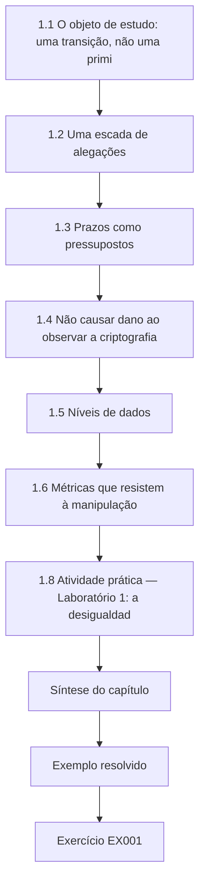

### Desenho lógico

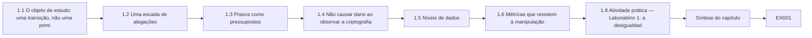

```text
[1.1 O objeto de estudo: uma transição, não uma primi]
    |
    v
[1.2 Uma escada de alegações]
    |
    v
[1.3 Prazos como pressupostos]
    |
    v
[1.4 Não causar dano ao observar a criptografia]
    |
    v
[1.5 Níveis de dados]
    |
    v
[1.6 Métricas que resistem à manipulação]
    |
    v
[1.8 Atividade prática — Laboratório 1: a desigualdad]
    |
    v
[Síntese do capítulo]
    |
    v
[Exemplo resolvido] --> [Exercício EX001]
```
<!-- cykin:lesson-figures:end ch-01 -->


### Objetivos de aprendizagem e conexão

Depois deste capítulo, você consegue (1) separar os cinco tipos de afirmação que a pesquisa em PQC produz e mantê-los rotulados; (2) explicar por que as alegações sobre prazos quânticos precisam ser enunciadas como pressupostos condicionais, e não como previsões; (3) projetar um estudo de inventário que não possa causar dano aos sistemas que observa; (4) escolher métricas que resistam às formas mais comuns de fazer uma migração parecer concluída; e (5) escrever um protocolo delimitado que um comitê de revisão possa aprovar. O capítulo parte da sua experiência de pesquisa de entrada e prepara o mapeamento da literatura do Capítulo 2.

### 1.1 O objeto de estudo: uma transição, não uma primitiva

A maior parte da pesquisa em criptografia estuda um objeto parado: um esquema, uma redução, uma implementação. A pesquisa em segurança pós-quântica geralmente estuda algo que se move. As organizações estão substituindo o RSA, o Diffie–Hellman de corpo finito e os algoritmos de curvas elípticas — que o algoritmo de Shor quebraria num computador quântico tolerante a falhas suficientemente grande ([Shor 1997](https://doi.org/10.1137/S0097539795293172)) — por algoritmos padronizados para resistência quântica: o ML-KEM na [FIPS 203](https://doi.org/10.6028/NIST.FIPS.203), o ML-DSA na [FIPS 204](https://doi.org/10.6028/NIST.FIPS.204) e o SLH-DSA na [FIPS 205](https://doi.org/10.6028/NIST.FIPS.205), além das assinaturas baseadas em hash com estado LMS e XMSS, perfiladas no [NIST SP 800-208](https://doi.org/10.6028/NIST.SP.800-208). O que você mede é uma fronteira móvel entre o uso vulnerável e o uso resistente à computação quântica, atravessando protocolos, produtos e décadas de dados armazenados.

Isso muda o que conta como rigor. Uma prova de redução pode ser verificada uma vez. Uma alegação como "a HRHN migrou 80% do seu estabelecimento de chaves" depende de como o "uso" foi contado, de quem podia ver quais sistemas, de quando o retrato foi tirado e de se a negociação híbrida realmente aconteceu ou estava apenas configurada. A primeira disciplina deste livro é, portanto, saber qual objeto uma frase descreve: uma primitiva, um protocolo, uma implantação, uma organização ou um ecossistema.

### 1.2 Uma escada de alegações

Suba um degrau de cada vez e nunca pule um por escrito:

1. **Observação** — "O sensor passivo registrou 41.212 handshakes TLS 1.3 no segmento B entre 1 e 7 de março (sintético); 63% selecionaram o grupo X25519MLKEM768." É uma medição feita por um instrumento nomeado.
2. **Inferência** — "A maioria das sessões originadas em navegadores no segmento B está protegida contra a coleta do tipo 'colher agora, decifrar depois' da sua troca de chaves, supondo que o ML-KEM-768 continue seguro ou que o X25519 continue seguro." Note o pressuposto explícito: um híbrido PQ/T ([RFC 9794](https://www.rfc-editor.org/rfc/rfc9794.html)) é projetado para continuar seguro se *qualquer um* dos componentes se mantiver.
3. **Alegação** — "O inventário de duas fontes recupera o estabelecimento de chaves vulnerável à computação quântica no corpus da HRHN com revocação de 0,91 (IC de 95% 0,88–0,94)." Uma alegação tem escopo, incerteza e um método.
4. **Decisão** — "O comitê diretor priorizou o concentrador de VPN." Uma decisão é tomada por pessoas e pode estar certa por razões que estão fora das suas evidências.
5. **Exposição** — "Os estudos de imagem arquivados, cifrados sob chaves embrulhadas com RSA antes de 2026, continuam decifráveis por um futuro CRQC enquanto existirem cópias do texto cifrado." A exposição é a consequência que realmente importa, e com frequência está fora do que qualquer sensor consegue ver.

A falha de integridade mais comum neste campo é pular degraus: uma varredura de fornecedor (degrau 1) vira "a organização é segura contra a computação quântica" (uma afirmação de exposição) sem nenhuma inferência, alegação ou escopo no meio.

### 1.3 Prazos como pressupostos

Ninguém consegue observar hoje quando existirá um computador quântico criptograficamente relevante (CRQC). O que se pode observar é uma sequência de estimativas de recursos publicadas. [Gidney e Ekerå (2021)](https://doi.org/10.22331/q-2021-04-15-433) estimaram que o RSA-2048 poderia ser fatorado em cerca de oito horas com vinte milhões de qubits ruidosos, sob pressupostos de hardware declarados; [Gidney (2025)](https://arxiv.org/abs/2505.15917) revisou a estimativa para menos de um milhão de qubits ruidosos funcionando por menos de uma semana, de novo sob pressupostos explícitos sobre taxas de erro, tempo de ciclo e conectividade. São resultados sobre *algoritmos e custos adicionais de correção de erros*, não previsões do progresso da engenharia.

[Mosca (2018)](https://doi.org/10.1109/MSP.2018.3761723) formulou a questão de planejamento como uma desigualdade: se o tempo de vida da confidencialidade dos dados (*x*) mais o tempo para migrar (*y*) excede o tempo até um CRQC (*z*), então os dados cifrados hoje estão em risco. Uma tese de doutorado pode usar esse enquadramento, mas precisa tratar *z* como um parâmetro varrido ao longo de uma faixa e relatar como as conclusões mudam, nunca como um número único tomado emprestado de uma pesquisa de opinião. O Laboratório 1 torna essa sensibilidade concreta.

As datas de políticas públicas são, mais uma vez, outro tipo de objeto. O [NIST IR 8547 (rascunho público inicial)](https://doi.org/10.6028/NIST.IR.8547.ipd) propõe tornar obsoletos os algoritmos de chave pública vulneráveis à computação quântica de 112 bits depois de 2030 e proibi-los depois de 2035, e o [comunicado CNSA 2.0](https://media.defense.gov/2022/Sep/07/2003071834/-1/-1/0/CSA_CNSA_2.0_ALGORITHMS_.PDF) da NSA fixa as suas próprias metas de transição para sistemas de segurança nacional. São decisões de instituições; cite-as como decisões, com a sua situação, e não como evidências sobre hardware quântico.

### 1.4 Não causar dano ao observar a criptografia

A pesquisa de inventário toca sistemas em operação. A varredura TLS ativa de uma rede interna pode disparar a prevenção de intrusões, esgotar as tabelas de conexões de dispositivos embarcados ou, num hospital, perturbar um dispositivo médico. A captura passiva registra metadados que podem revelar quem falou com quem. A varredura de código pode expor segredos. Um protocolo sólido, portanto, especifica: autorização escrita do dono do sistema; coleta passiva por padrão; sondagem ativa apenas contra uma lista combinada, com limite de taxa e fora do horário clínico; captura limitada aos metadados dos handshakes (sem carga útil da aplicação, sem chaves privadas); exclusão imediata de qualquer credencial descoberta; e uma pessoa nomeada com autoridade para interromper. Experimentos de rebaixamento — forçar um cliente a recuar de grupos híbridos para clássicos — pertencem apenas a uma bancada de testes isolada, porque enfraquecem deliberadamente uma proteção real.

Os princípios do Relatório Menlo ([Dittrich e Kenneally 2012](https://www.dhs.gov/sites/default/files/publications/CSD-MenloPrinciplesCORE-20120803_1.pdf)) — respeito às pessoas, beneficência, justiça e respeito à lei e ao interesse público — correspondem diretamente a essas escolhas. A beneficência, em particular, significa que a constatação de um dispositivo legado fraco é relatada ao dono antes de ser publicada.

### 1.5 Níveis de dados

Classifique cada artefato antes que ele exista. **Nível 0** (público): código, dados sintéticos, contagens agregadas. **Nível 1** (restrito): metadados de handshakes desidentificados, com nomes de host substituídos por pseudônimos estáveis. **Nível 2** (confidencial): capturas de pacotes brutas, arquivos de configuração, inventários de certificados que revelam a arquitetura interna. **Nível 3** (nunca coletado): chaves privadas, chaves de sessão, carga útil da aplicação, dados de pacientes. Um protocolo que não consegue dizer a que nível pertence um artefato não está pronto para revisão.

No Ciphertrail Study, a exportação pseudonimizada dos handshakes é de nível 1, e as capturas brutas dos segmentos da HRHN ficam no nível 2, nas instalações da HRHN. Qualquer credencial descoberta na varredura de código passa imediatamente ao tratamento de nível 3: é excluída, o seu dono é avisado e o incidente é registrado sem o valor. O nível é escrito no próprio arquivo, além de no protocolo.

### 1.6 Métricas que resistem à manipulação

"Percentual de sistemas migrados" é a métrica com maior probabilidade de enganar. Ela pode ser elevada redefinindo "sistema", contando algoritmos configurados em vez de negociados ou excluindo os dispositivos que o scanner não alcança. Prefira métricas com um denominador que outra pessoa possa auditar: a **revocação** dos usos vulneráveis à computação quântica em relação a uma verdade de referência adjudicada; a **precisão** das constatações relatadas; a **participação híbrida negociada**, ponderada pela sensibilidade dos dados; a **participação desconhecida** — a fração de ativos cuja criptografia não pôde ser determinada, relatada separadamente em vez de tratada em silêncio como segura; e o **tempo até a substituição** de um algoritmo escolhido, que mede a agilidade, e não uma migração única.

### 1.7 Exemplo resolvido: a primeira revisão de protocolo do Ciphertrail Study

O primeiro rascunho do candidato propõe a varredura ativa de todos os 1.200 serviços da HRHN e relata "% seguro contra a computação quântica". O comitê de revisão (sintético) devolve cinco objeções. (a) A varredura ativa da rede segregada de dispositivos médicos não se justifica quando a captura passiva na fronteira basta; o protocolo revisado restringe as sondagens ativas a 140 serviços de TI e as agenda. (b) "Seguro contra a computação quântica" não está definido; a revisão o substitui por revocação, precisão e participação desconhecida em relação a uma amostra adjudicada. (c) As capturas de pacotes conteriam nomes de host que identificam pacientes; a revisão pseudonimiza no sensor e mantém as capturas brutas no nível 2, nas instalações da HRHN. (d) A data do CRQC é citada de um único blog; a revisão varre *z* e cita estimativas de recursos primárias. (e) Nenhuma autoridade de interrupção é nomeada; a revisão nomeia o chefe de engenharia clínica da HRHN. Cada objeção forçou uma alegação a descer para um degrau que as evidências realmente conseguiam sustentar.

### 1.8 Atividade prática — Laboratório 1: a desigualdade de Mosca sob incerteza

Execute o script offline com Python 3. Ele trata *z* como uma distribuição escolhida apenas para o ensino e pergunta com que frequência *x* + *y* > *z* para quatro classes de registros da HRHN.

```python
# Lab 1 (synthetic): Mosca's inequality x + y > z under uncertainty.
# x = years the data must stay confidential, y = years to migrate,
# z = years until a cryptographically relevant quantum computer (CRQC).
# The z distribution below is an ARBITRARY teaching assumption, not a forecast.
import random
random.seed(7)
def p_exposed(x, y, trials=20000, z_lo=8, z_hi=30):
    hits = 0
    for _ in range(trials):
        z = random.triangular(z_lo, z_hi, 15)  # mode 15 years: illustrative only
        if x + y > z:
            hits += 1
    return hits / trials
for name, x, y in [("appointment logs", 1, 4), ("lab results", 10, 4),
                   ("genomic archive", 50, 4), ("lab results, slow migration", 10, 9)]:
    print(f"{name:30s} x={x:2d} y={y:2d}  P(x+y>z) = {p_exposed(x, y):.3f}")
# Sensitivity: the same record class under a different z assumption
print("lab results, z in [15,40]     ", f"{p_exposed(10, 4, z_lo=15, z_hi=40):.3f}")
```

Saída esperada (com semente):

```text
appointment logs               x= 1 y= 4  P(x+y>z) = 0.000
lab results                    x=10 y= 4  P(x+y>z) = 0.234
genomic archive                x=50 y= 4  P(x+y>z) = 1.000
lab results, slow migration    x=10 y= 9  P(x+y>z) = 0.631
lab results, z in [15,40]      0.000
```

Leia a saída como uma afirmação sobre o *modelo*, e não sobre o mundo. O arquivo genômico fica exposto sob qualquer pressuposto, porque só o seu tempo de vida de confidencialidade já excede qualquer *z* plausível; a velocidade da migração não consegue salvar dados que já foram colhidos. Os resultados de exames laboratoriais passam de 0,23 para 0,63 quando a migração fica mais lenta, e para 0 sob uma faixa de *z* mais otimista — e é exatamente por isso que uma tese precisa publicar a sensibilidade, e não uma probabilidade única.

### 1.9 Erros comuns e limites

- Tratar uma estimativa de recursos como uma data. As estimativas limitam o custo sob pressupostos; não agendam a engenharia.
- Contar configuração como negociação. Um servidor que oferece um grupo híbrido não protege nada se nenhum cliente o selecionar.
- Denominadores silenciosos. Os ativos que o scanner não vê precisam aparecer como "desconhecidos", e não desaparecer.
- Observação que causa dano. Varreduras ativas e testes de rebaixamento em produção podem causar interrupções e enfraquecer a proteção.
- A distribuição do Laboratório 1 é arbitrária. O seu valor está no método de análise de sensibilidade, não nas probabilidades.
- Transformar uma tabela de sensibilidade numa única probabilidade de manchete.

### Exercícios — capítulo 1

Cada exercício é pontuado de 0 a 3: 0 ausente ou inseguro; 1 parcialmente correto, com uma lacuna importante; 2 correto, com pequenas lacunas; 3 completo, delimitado e justificado.

- **EX001 — Rotular a escada.** Objetivo: separar os tipos de afirmação. Insumo: cinco frases do exemplo resolvido. Restrição: usar apenas os cinco rótulos. Passos: rotular cada uma e depois reescrever qualquer frase que pule degraus. Evidência: uma tabela rotulada. Rubrica: 3 = todos os rótulos corretos e as duas reescritas delimitadas.
- **EX002 — Definir o objeto.** Objetivo: nomear o objeto de uma alegação. Insumo: "O nosso hospital está 80% pronto para a PQC." Passos: listar quatro objetos que a frase poderia descrever e a métrica de que cada um precisaria. Evidência: uma tabela de quatro linhas. Rubrica: 3 = objetos distintos, métricas auditáveis.
- **EX003 — Varrer z.** Objetivo: análise de sensibilidade. Insumo: Laboratório 1. Passos: mudar a moda de *z* para 10 e para 25; relatar as quatro classes de registros. Evidência: uma tabela e duas frases de interpretação. Rubrica: 3 = execuções corretas e uma interpretação que não trate *z* como previsão.
- **EX004 — Revisão de danos.** Objetivo: identificar os danos da observação. Insumo: um plano de executar sondagens TLS ativas contra todos os dispositivos médicos todas as noites. Passos: listar três danos e um desenho mais seguro para cada um. Evidência: tabela de danos. Rubrica: 3 = danos realistas, alternativas que preservam a pergunta de pesquisa.
- **EX005 — Classificar os artefatos.** Objetivo: classificação de dados. Insumo: captura de pacotes, CSV pseudonimizado de handshakes, inventário de certificados, notebook de análise, uma chave privada descoberta. Passos: atribuir os níveis 0–3 e o tratamento de cada um. Evidência: uma tabela. Rubrica: 3 = a chave privada é excluída e relatada, não guardada.
- **EX006 — Métrica não manipulável.** Objetivo: desenho de métrica. Insumo: "% de sistemas migrados". Passos: descrever duas formas de manipulá-la e propor uma substituta com denominador auditável. Evidência: definição da métrica. Rubrica: 3 = a substituta inclui a participação desconhecida.
- **EX007 — Protocolo delimitado.** Objetivo: escrever um protocolo revisável. Passos: uma página cobrindo autorização, modo de coleta, níveis, autoridade de interrupção, divulgação e métricas para o Ciphertrail Study. Evidência: o protocolo. Rubrica: 3 = todos os elementos presentes e coerentes com 1.4–1.6.

### Síntese do capítulo

A pesquisa em PQC mede uma transição cuja grandeza mais importante — quando existirá um CRQC — não pode ser observada. O rigor vem, portanto, de alegações rotuladas, de prazos tratados como pressupostos varridos, de uma observação que não pode causar dano ao observado, de dados classificados em níveis e de métricas cujos denominadores um leitor adversarial consiga auditar.

<!-- cykin:chapter-navigation:start ch-01 -->
### Continue estudando — capítulo 01 de 08

[← Página do curso](../../README.md) · [Índice de capítulos do curso](../SUBJECTS.md) · [Capítulo 02 →](#ch-02)

Siga para a próxima lição escrita.
<!-- cykin:chapter-navigation:end -->

<a id="ch-02"></a>

## Capítulo 2 — Segurança quântica e pós-quântica: fronteira da pesquisa

<!-- cykin:lesson-figures:start ch-02 -->
### Mapa da aula

Aula 02 publicada. Mapa, exemplo, EX008.

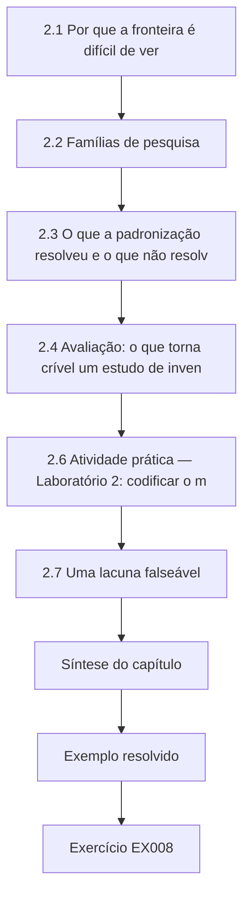

### Desenho lógico

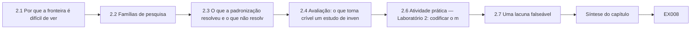

```text
[2.1 Por que a fronteira é difícil de ver]
    |
    v
[2.2 Famílias de pesquisa]
    |
    v
[2.3 O que a padronização resolveu e o que não resolv]
    |
    v
[2.4 Avaliação: o que torna crível um estudo de inven]
    |
    v
[2.6 Atividade prática — Laboratório 2: codificar o m]
    |
    v
[2.7 Uma lacuna falseável]
    |
    v
[Síntese do capítulo]
    |
    v
[Exemplo resolvido] --> [Exercício EX008]
```
<!-- cykin:lesson-figures:end ch-02 -->


### Objetivos de aprendizagem e conexão

Depois deste capítulo, você consegue (1) descrever as seis principais famílias de pesquisa em segurança quântica e pós-quântica e o tipo de evidência que cada uma produz; (2) explicar o que o processo de padronização do NIST resolveu e o que deixou em aberto; (3) avaliar um estudo de PQC quanto à validade de construto, à justiça da linha de base e à independência do corpus; (4) codificar um mapa da literatura e localizar uma célula vazia; e (5) enunciar uma lacuna falseável. Ele parte da escada de alegações do Capítulo 1 e fornece a pergunta que o Capítulo 3 transforma numa contribuição.

### 2.1 Por que a fronteira é difícil de ver

O campo está dividido entre comunidades que raramente se citam: pesquisadores de algoritmos quânticos que publicam no arXiv, criptógrafos nos eventos da IACR e no [arquivo ePrint da IACR](https://eprint.iacr.org/), engenheiros de protocolos no IETF e profissionais que escrevem relatórios de fornecedores. O vocabulário difere — "quantum-safe", "resistente à computação quântica", "pós-quântico" e "pronto para PQC" são usados de forma frouxa —, então uma busca por palavras-chave perde metade da literatura. Monte uma tabela de sinônimos antes de buscar e registre a data: neste campo, uma revisão de dois anos atrás pode descrever um esquema quebrado como candidato de destaque.

### 2.2 Famílias de pesquisa

1. **Criptoanálise quântica e estimativa de recursos.** O algoritmo de Shor quebra a fatoração e os logaritmos discretos em tempo polinomial numa máquina tolerante a falhas ([Shor 1997](https://doi.org/10.1137/S0097539795293172)); a busca de Grover dá no máximo um ganho quadrático contra chaves simétricas e hashes ([Grover 1996](https://doi.org/10.1145/237814.237866)), e é por isso que o AES-256 e o SHA-384/512 continuam sendo as escolhas conservadoras, em vez de serem substituídos. A pesquisa atual refina as contagens de qubits e de tempo ([Gidney e Ekerå 2021](https://doi.org/10.22331/q-2021-04-15-433); [Gidney 2025](https://arxiv.org/abs/2505.15917)). Evidência: análise algorítmica sob modelos de hardware explícitos.
2. **Problemas difíceis e esquemas.** *Reticulados* — o aprendizado com erros ([Regev 2009](https://doi.org/10.1145/1568318.1568324)) e as suas variantes em módulos fundamentam o ML-KEM e o ML-DSA; o Falcon (reticulados NTRU) está sendo padronizado como FN-DSA. *Hashes* — o SLH-DSA (sem estado) e o LMS/XMSS (com estado; [RFC 8554](https://www.rfc-editor.org/rfc/rfc8554.html), [RFC 8391](https://www.rfc-editor.org/rfc/rfc8391.html)) dependem apenas de propriedades das funções de hash. *Códigos* — o Classic McEliece descende de [McEliece (1978)](https://ipnpr.jpl.nasa.gov/progress_report2/42-44/44N.PDF); o HQC foi selecionado em março de 2025 para padronização como um segundo KEM baseado num pressuposto diferente ([NIST IR 8545](https://doi.org/10.6028/NIST.IR.8545)). *Multivariados* — o Rainbow, finalista da terceira rodada, foi quebrado por um ataque de recuperação de chave ([Beullens 2022](https://eprint.iacr.org/2022/214)). *Isogenias* — o SIKE foi quebrado por um ataque eficiente de recuperação de chave ([Castryck e Decru 2022](https://eprint.iacr.org/2022/975)). Evidência: provas, criptoanálise, estimativas de parâmetros.
3. **Normas e políticas.** As FIPS 203/204/205 (agosto de 2024), o [SP 800-227](https://doi.org/10.6028/NIST.SP.800-227) sobre o uso de KEMs (setembro de 2025), o plano de transição em rascunho [NIST IR 8547](https://doi.org/10.6028/NIST.IR.8547.ipd) e a orientação sobre agilidade no [NIST CSWP 39](https://doi.org/10.6028/NIST.CSWP.39-upd1). Evidência: documentos com situação e histórico.
4. **Protocolos híbridos.** Terminologia na [RFC 9794](https://www.rfc-editor.org/rfc/rfc9794.html); grupos híbridos do TLS 1.3, como o X25519MLKEM768, na [RFC 10024](https://www.rfc-editor.org/rfc/rfc10024.html). As perguntas de pesquisa dizem respeito à segurança do combinador, ao tamanho das mensagens, à tolerância dos middleboxes e à resistência ao rebaixamento. Evidência: provas, testes de interoperabilidade, medição na internet.
5. **Segurança de implementação.** Aritmética em tempo constante, tratamento de falhas de decifração, ataques de falha e canais laterais em implementações de reticulados; vazamentos de tempo por divisão dependente de segredo em várias implementações do Kyber foram relatados como "KyberSlash" ([Bernstein et al. 2024](https://eprint.iacr.org/2024/1049)). Evidência: medição em laboratório contra versões de código nomeadas.
6. **Inventário e agilidade.** Como as organizações descobrem onde a criptografia é usada, montam uma lista de materiais criptográficos (CBOM) e tornam os algoritmos substituíveis. Evidência: estudos de caso, benchmarks, medições de campo — a família metodologicamente menos madura, como mostra o Laboratório 2.

### 2.3 O que a padronização resolveu e o que não resolveu

O processo do NIST resolveu um portfólio: um KEM de uso geral (ML-KEM), uma assinatura de reticulados (ML-DSA), uma assinatura conservadora baseada em hash (SLH-DSA), com o Falcon e o HQC a seguir (o [NIST IR 8413](https://doi.org/10.6028/NIST.IR.8413) explica as seleções da terceira rodada). Não resolveu a implantação: como os segredos híbridos devem ser combinados em cada protocolo, como os certificados devem transportar chaves novas ou compostas, como os dispositivos restritos devem lidar com assinaturas ML-DSA de 2.420 a 4.627 bytes (conjuntos de parâmetros da FIPS 204) ou como uma organização pode mostrar que encontrou todo uso vulnerável à computação quântica. As quebras do Rainbow e do SIKE no fim do processo são o lembrete permanente do campo de que a confiança num problema difícil se conquista ao longo de anos, e esse é o argumento científico a favor da implantação híbrida e da agilidade.

### 2.4 Avaliação: o que torna crível um estudo de inventário ou de migração para PQC

Faça cinco perguntas. **Validade de construto**: "uso vulnerável" significa um algoritmo presente no código, configurado, negociado ou protegendo dados com longo tempo de vida? **Verdade de referência**: quem a adjudicou, sem saber qual método estava em teste? **Justiça da linha de base**: a ferramenta rival foi configurada por alguém competente, com o mesmo acesso? **Independência do corpus**: o método foi ajustado no mesmo corpus em que foi avaliado, ou validado numa segunda organização? **Desconhecidos**: os ativos inalcançáveis são relatados? Um estudo pode ser útil mesmo falhando em algumas dessas perguntas, mas as suas alegações precisam encolher na mesma medida.

### 2.5 Exemplo resolvido: avaliar os estudos sintéticos Q1–Q8

Q1 e Q6 são estudos de caso de um único hospital que relatam "94% do uso de RSA encontrado" contra uma verdade de referência produzida pela mesma ferramenta — circular. Q2 e Q8 fazem benchmarks de scanners num corpus publicado por um dos fornecedores — independência "mesmo fornecedor". Q3 mede a negociação de grupos híbridos num grande conjunto de sites públicos, com método documentado, e é independente. Q4 faz benchmarks de handshakes híbridos em laboratório, sem replicação externa. Q5 reproduz um vazamento de tempo em dois laboratórios independentes. Q7 é um artigo de posição sobre agilidade, sem dados. Codificá-los (Laboratório 2) mostra que o inventário — a família de que um programa de migração mais depende — não tem nenhum estudo validado num corpus independente. Essa célula vazia vira a lacuna do Ciphertrail.

### 2.6 Atividade prática — Laboratório 2: codificar o mapa

```python
# Lab 2 (synthetic): code eight fictional studies Q1-Q8 and find empty cells.
studies = {  # id: (family, evidence type, corpus independence)
    "Q1": ("inventory", "single-org case", "none"),
    "Q2": ("inventory", "benchmark", "same-vendor"),
    "Q3": ("hybrid-protocol", "internet measurement", "independent"),
    "Q4": ("hybrid-protocol", "lab benchmark", "none"),
    "Q5": ("implementation", "side-channel lab", "independent"),
    "Q6": ("inventory", "single-org case", "none"),
    "Q7": ("agility", "position paper", "none"),
    "Q8": ("inventory", "benchmark", "same-vendor"),
}
families = sorted({f for f, _, _ in studies.values()})
indep = ["none", "same-vendor", "independent"]
print(f"{'family':16s}" + "".join(f"{i:>13s}" for i in indep))
for fam in families:
    row = [sum(1 for f, _, c in studies.values() if f == fam and c == i) for i in indep]
    print(f"{fam:16s}" + "".join(f"{n:13d}" for n in row))
gaps = [fam for fam in families
        if not any(f == fam and c == "independent" for f, _, c in studies.values())]
print("families with no independently validated study:", ", ".join(gaps))
```

Saída esperada:

```text
family                   none  same-vendor  independent
agility                     1            0            0
hybrid-protocol             1            0            1
implementation              0            0            1
inventory                   2            2            0
families with no independently validated study: agility, inventory
```

Estenda o esquema de codificação com uma quarta coluna, "verdade de referência independente da ferramenta", e execute de novo; uma lacuna que sobrevive a duas codificações é mais defensável do que uma que aparece num único esquema.

A tabela torna a lacuna visível num relance: quatro estudos de inventário, nenhum validado num corpus independente. A codificação só é tão boa quanto as suas regras, então escreva o que conta como mesmo fornecedor ou independente antes de codificar e peça a uma segunda pessoa que codifique os oito estudos separadamente. Se o segundo codificador passar um estudo para a coluna independente, o enunciado da lacuna precisa mudar antes de entrar na proposta.

### 2.7 Uma lacuna falseável

Uma lacuna não é "ninguém estudou inventários de PQC". É uma ausência específica e testável: *nenhum método de inventário publicado relata a revocação dos usos de estabelecimento de chaves e de assinaturas vulneráveis à computação quântica em relação a uma adjudicação cega num corpus independente do seu corpus de desenvolvimento, com a participação desconhecida relatada.* O enunciado é falseável — um único contraexemplo na literatura o fecharia — e nomeia as medições que uma contribuição precisa fazer.

Verifique a lacuna de novo contra a literatura pouco antes da submissão, porque um contraexemplo publicado durante a tese a fecharia. Registre a data e a busca usadas nessa verificação final. Se aparecer um estudo que preencha a lacuna em parte, a contribuição ainda pode se sustentar, mas precisa ser reposicionada como replicação ou extensão, e não como primeira medição.

### 2.8 Erros comuns e limites

- Citar um esquema quebrado como candidato porque a revisão é anterior à quebra.
- Tratar Grover como fatal para o AES; ele reduz à metade o comprimento efetivo da chave no modelo idealizado e é muito mais difícil de paralelizar.
- Confundir a distribuição quântica de chaves (QKD) com a PQC. A QKD é uma técnica da camada física com requisitos distintos; várias agências nacionais, incluindo a [NSA](https://www.nsa.gov/Cybersecurity/Quantum-Key-Distribution-QKD-and-Quantum-Cryptography-QC/), não a recomendam para sistemas de segurança nacional.
- Errar a situação das normas: o FN-DSA e o HQC não eram normas finais em 12 de outubro de 2026.
- O corpus do Laboratório 2 é inventado; o que se transfere é o método, não as contagens.

### Exercícios — capítulo 2

Rubrica de 0 a 3, como no Capítulo 1.

- **EX008 — Tabela de sinônimos.** Monte uma tabela de doze termos, com sinônimos e exclusões, para uma busca sobre inventário de PQC no arXiv, no ePrint e no IETF. Evidência: tabela e duas expressões de busca. Rubrica: 3 = cobre o vocabulário dos fornecedores e das normas e exclui deliberadamente os trabalhos só de QKD.
- **EX009 — Evidências por família.** Para cada uma das seis famílias, nomeie a forma de evidência mais forte e uma fraqueza típica. Evidência: tabela de seis linhas. Rubrica: 3 = fraquezas específicas.
- **EX010 — Verificação de situação.** Verifique nas páginas primárias a situação atual da FIPS 206, da norma do HQC e do NIST IR 8547. Evidência: três citações com as datas de verificação. Rubrica: 3 = apenas fontes primárias, datas registradas.
- **EX011 — Avaliar Q1.** Aplique as cinco perguntas de avaliação a Q1. Evidência: um parágrafo por pergunta. Rubrica: 3 = identifica a verdade de referência circular e a alegação que ainda pode sustentar.
- **EX012 — Recodificar o mapa.** Acrescente ao Laboratório 2 a coluna "verdade de referência independente", com os seus próprios julgamentos. Evidência: diff do código e saída. Rubrica: 3 = códigos justificados e lacuna reexaminada.
- **EX013 — Lições das quebras.** Explique em 250 palavras o que as quebras do Rainbow e do SIKE implicam para a arquitetura da migração. Rubrica: 3 = liga as quebras à implantação híbrida e à agilidade sem exagerar.
- **EX014 — Enunciar a lacuna.** Escreva uma lacuna falseável de uma frase para uma pergunta sua. Rubrica: 3 = nomeia a população, a medição e o que a falsearia.

### Síntese do capítulo

A fronteira abrange seis famílias com culturas de evidência diferentes. A padronização resolveu um portfólio de algoritmos, não a sua implantação. O inventário e a agilidade — as famílias de que as migrações mais dependem — têm as evidências mais fracas, e uma lacuna falseável ali é uma contribuição de doutorado legítima.

<!-- cykin:chapter-navigation:start ch-02 -->
### Continue estudando — capítulo 02 de 08

[← Capítulo 01](#ch-01) · [Índice de capítulos do curso](../SUBJECTS.md) · [Capítulo 03 →](#ch-03)

Siga para a próxima lição escrita.
<!-- cykin:chapter-navigation:end -->

<a id="ch-03"></a>

## Capítulo 3 — Proposta de contribuição original

<!-- cykin:lesson-figures:start ch-03 -->
### Mapa da aula

Aula 03 publicada. Mapa, exemplo, EX015.

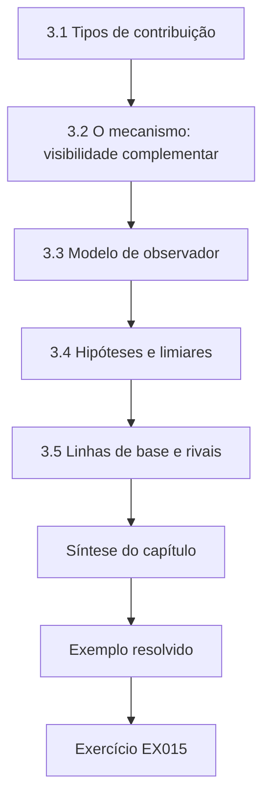

### Desenho lógico

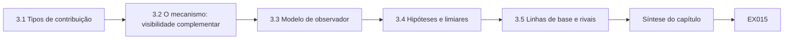

```text
[3.1 Tipos de contribuição]
    |
    v
[3.2 O mecanismo: visibilidade complementar]
    |
    v
[3.3 Modelo de observador]
    |
    v
[3.4 Hipóteses e limiares]
    |
    v
[3.5 Linhas de base e rivais]
    |
    v
[Síntese do capítulo]
    |
    v
[Exemplo resolvido] --> [Exercício EX015]
```
<!-- cykin:lesson-figures:end ch-03 -->


### Objetivos de aprendizagem e conexão

Depois deste capítulo, você consegue (1) classificar uma contribuição proposta por tipo; (2) expressar um mecanismo que explique *por que* um método deveria funcionar; (3) escrever um modelo de observador — o equivalente, na pesquisa de inventário, de um modelo de atacante; (4) enunciar hipóteses com limiares pré-registrados e condições de falha; e (5) selecionar linhas de base justas e nomear explicações rivais. Ele transforma a lacuna falseável do Capítulo 2 numa proposta que o Capítulo 4 pode pilotar.

### 3.1 Tipos de contribuição

Uma contribuição de doutorado nesta área geralmente é uma das seguintes: um **novo método** (um procedimento de inventário de duas fontes), uma **nova medição** (a primeira estimativa independente da revocação das ferramentas de inventário), um **novo artefato** (um corpus adjudicado aberto), um **resultado negativo** (mostrar que uma métrica muito usada é inválida) ou uma **teoria** (um modelo de como a agilidade reduz o tempo até a substituição). Enuncie um tipo principal; contribuições secundárias são bem-vindas, mas não devem diluir a alegação que os examinadores vão testar. A contribuição principal do Ciphertrail Study é uma medição — revocação e precisão independentes de um método de duas fontes —, com o corpus adjudicado como artefato secundário.

### 3.2 O mecanismo: visibilidade complementar

Um método merece estudo quando há uma razão para que ele funcione. A análise estática — varredura do código-fonte, dos manifestos de dependências, dos binários e da configuração — vê a criptografia que a organização constrói e configura, mas não o que os appliances fechados de fornecedores fazem internamente. A telemetria passiva — metadados dos handshakes de TLS, SSH e IKE — vê o que é realmente negociado na rede, inclusive dentro dos appliances de fornecedores, mas não vê nada sobre os dados em repouso nem sobre dispositivos que nunca conversam num segmento monitorado. O mecanismo é a **visibilidade complementar**: as duas fontes falham em classes de ativos diferentes, então a sua união deveria elevar a revocação onde uma é cega e a outra não, e não deveria ajudar onde as duas são cegas. Um mecanismo que prevê onde o método vai *falhar* é mais valioso do que um que prevê apenas o sucesso, porque torna a alegação falseável.

### 3.3 Modelo de observador

Defina o que cada instrumento consegue e não consegue observar, como um modelo de atacante definiria capacidades:

| Observador | Vê | Não vê |
|---|---|---|
| **S — estático** | Identificadores de algoritmos e chamadas de API no código; versões de bibliotecas; arquivos de configuração; repositórios de certificados alcançáveis em disco | O interior de appliances fechados; as escolhas de negociação em tempo de execução; dados cifrados por terceiros |
| **P — passivo** | Grupos e algoritmos de assinatura oferecidos e selecionados no TLS 1.3; cadeias de certificados em claro (TLS 1.2) ou reveladas pelos registros dos pontos finais; propostas de SSH e IKE | Dados em repouso; tráfego em segmentos não monitorados; certificados cifrados do TLS 1.3 sem cooperação dos pontos finais |
| **G — verdade de referência** | Adjudicação cega pelos engenheiros E01–E10, com a documentação dos donos | Usos que nenhum documento registra (relatados como desconhecidos) |

Note a sutileza do TLS 1.3: os certificados trafegam cifrados no TLS 1.3, então um sensor puramente passivo vê o grupo de troca de chaves selecionado, mas não o algoritmo de assinatura do servidor, a menos que se acrescente registro nos pontos finais. Uma proposta que ignorasse isso alegaria demais sobre a cobertura passiva das assinaturas.

### 3.4 Hipóteses e limiares

Pré-registre, antes de ver o corpus principal:

- **H1** — A revocação de duas fontes dos usos vulneráveis à computação quântica excede a revocação só estática em pelo menos 0,10 no corpus da HRHN (comparação pareada; o limite inferior do IC de 95% da diferença é de pelo menos 0,10).
- **H2** — A precisão de duas fontes é de pelo menos 0,90 (as constatações passivas podem produzir duplicatas e atribuições erradas).
- **H3** — O ganho de revocação se concentra nos appliances de fornecedores; nos usos de dados em repouso, o ganho fica abaixo de 0,02. *Esta hipótese prevê uma falha.*
- **H4** — Os resultados se transferem: no corpus intocado da Marrow, com limiares e regras de fusão congelados, o ganho de revocação continua sendo de pelo menos 0,05.

Cada hipótese tem uma condição declarada sob a qual é rejeitada. A H3 está incluída porque um método que "ajuda em toda parte" seria suspeito, dado o mecanismo.

### 3.5 Linhas de base e rivais

A linha de base é a análise só estática configurada por um engenheiro competente, com o mesmo acesso, e não um scanner deliberadamente fraco. Uma segunda linha de base é a só passiva. Entre as explicações rivais para um ganho observado estão: constatações passivas que duplicam constatações estáticas com nomes diferentes (inflando as contagens), adjudicadores influenciados por qual ferramenta encontrou um item (inflando a precisão) e um corpus que super-representa appliances (inflando o ganho agregado). O desenho responde a cada uma: identificadores canônicos por uso, adjudicação cega e relato por classe.

Escreva cada rival com o resultado que a sustentaria, para que o desenho possa ser julgado antes de os dados chegarem.

### 3.6 Exemplo resolvido e Laboratório 3

A proposta inclui um estudo-modelo para verificar se H1 e H3 são sequer plausíveis antes de qualquer dado ser coletado. As probabilidades de detecção são valores didáticos arbitrários, escolhidos para encarnar o mecanismo.

```python
# Lab 3 - Ciphertrail Study (synthetic): static-only vs dual-source inventory recall.
# Each quantum-vulnerable "use" belongs to an asset class; each source detects it with a
# class-specific probability (ARBITRARY teaching values). Dual-source = union of detections.
import random
random.seed(2026)
classes = {  # class: (count, P(static detects), P(passive detects))
    "in-house code":       (420, 0.90, 0.55),
    "vendor appliance":    (260, 0.20, 0.80),
    "embedded/offline":    (180, 0.30, 0.10),
    "data at rest":        (140, 0.70, 0.00),
}
tot = {"static": 0, "dual": 0}; n_all = 0
print(f"{'class':18s}{'n':>5s}{'static':>8s}{'dual':>7s}")
for c, (n, ps, pp) in classes.items():
    s = d = 0
    for _ in range(n):
        hs, hp = random.random() < ps, random.random() < pp
        s += hs; d += (hs or hp)
    tot["static"] += s; tot["dual"] += d; n_all += n
    print(f"{c:18s}{n:5d}{s/n:8.2f}{d/n:7.2f}")
print(f"{'ALL':18s}{n_all:5d}{tot['static']/n_all:8.2f}{tot['dual']/n_all:7.2f}")
```

Saída esperada:

```text
class                 n  static   dual
in-house code       420    0.89   0.94
vendor appliance    260    0.18   0.84
embedded/offline    180    0.39   0.47
data at rest        140    0.69   0.69
ALL                1000    0.59   0.79
```

O modelo mostra o padrão previsto: um grande ganho nos appliances de fornecedores, quase nenhum nos dados em repouso e um ganho agregado (0,20) que depende fortemente da composição das classes. Esse último ponto é um alerta de desenho — uma organização com menos appliances mostraria um ganho agregado menor para o mesmo método, então a tese precisa relatar os resultados por classe e a composição.

### 3.7 Erros comuns e limites

- Propor um método sem mecanismo, de modo que qualquer resultado possa ser racionalizado.
- Hipóteses que não podem falhar, como "a revocação de duas fontes é pelo menos tão alta quanto a estática" (verdadeiro por construção, para uma união).
- Linhas de base fracas, escolhidas para fazer o método parecer bom.
- Ignorar que o TLS 1.3 esconde os certificados dos observadores passivos.
- Estudos-modelo provam apenas a consistência interna; os números do Laboratório 3 são pressupostos.

Cada erro tem um sintoma visível numa proposta: um método descrito sem dizer onde deveria falhar, uma hipótese que uma união garante, uma linha de base estática executada com as configurações padrão por alguém que não a conhece, ou uma alegação de cobertura passiva das assinaturas sob TLS 1.3. Verifique esses sintomas na proposta antes que o comitê o faça.

### Exercícios — capítulo 3

- **EX015 — Tipo de contribuição.** Classifique a contribuição do Ciphertrail e um enquadramento alternativo; argumente qual um examinador acharia mais forte. Rubrica: 3 = justificado com referência à testabilidade.
- **EX016 — Mecanismo.** Escreva um parágrafo de mecanismo para um método diferente (por exemplo, inventário a partir de listas de materiais de software). Rubrica: 3 = prevê pelo menos uma classe de falha.
- **EX017 — Modelo de observador.** Acrescente um observador "E — registros dos pontos finais" à tabela de 3.3. Rubrica: 3 = colunas vê/não vê precisas, incluindo o custo para a privacidade.
- **EX018 — Hipótese que pode falhar.** Reescreva "duas fontes é melhor" como uma hipótese que possa ser rejeitada. Rubrica: 3 = limiar, comparação e condição de rejeição enunciados.
- **EX019 — Composição das classes.** Modifique o Laboratório 3 para que os appliances de fornecedores sejam 60 em vez de 260 (ajuste o código interno para 620). Relate o ganho agregado e explique. Rubrica: 3 = execução correta e interpretação ligada à composição das classes.
- **EX020 — Rivais.** Nomeie mais duas explicações rivais para um ganho de revocação e o elemento do desenho que responde a cada uma. Rubrica: 3 = rivais plausíveis, controles específicos.

### Síntese do capítulo

Uma contribuição é defensável quando o seu mecanismo prevê tanto o sucesso quanto a falha, o seu modelo de observador declara o que cada instrumento não consegue ver, as suas hipóteses podem ser rejeitadas e as suas linhas de base são fortes. O Ciphertrail Study propõe a visibilidade complementar e prevê onde ela não vai ajudar.

<!-- cykin:chapter-navigation:start ch-03 -->
### Continue estudando — capítulo 03 de 08

[← Capítulo 02](#ch-02) · [Índice de capítulos do curso](../SUBJECTS.md) · [Capítulo 04 →](#ch-04)

Siga para a próxima lição escrita.
<!-- cykin:chapter-navigation:end -->

<a id="ch-04"></a>

## Capítulo 4 — Replicação das linhas de base e piloto

<!-- cykin:lesson-figures:start ch-04 -->
### Mapa da aula

Aula 04 publicada. Mapa, exemplo, EX021.

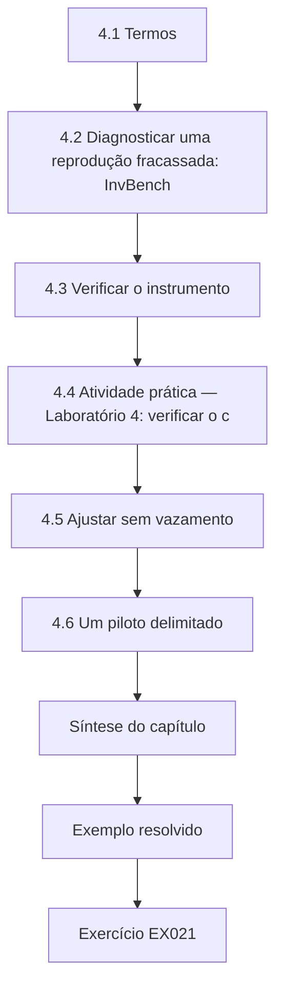

### Desenho lógico

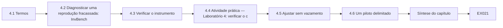

```text
[4.1 Termos]
    |
    v
[4.2 Diagnosticar uma reprodução fracassada: InvBench]
    |
    v
[4.3 Verificar o instrumento]
    |
    v
[4.4 Atividade prática — Laboratório 4: verificar o c]
    |
    v
[4.5 Ajustar sem vazamento]
    |
    v
[4.6 Um piloto delimitado]
    |
    v
[Síntese do capítulo]
    |
    v
[Exemplo resolvido] --> [Exercício EX021]
```
<!-- cykin:lesson-figures:end ch-04 -->


### Objetivos de aprendizagem e conexão

Depois deste capítulo, você consegue (1) distinguir repetibilidade, reprodutibilidade e replicabilidade; (2) diagnosticar por que um resultado de inventário publicado não se reproduz; (3) verificar um instrumento com entradas conhecidas antes de confiar na sua saída; (4) ajustar parâmetros sem vazar dados de teste; e (5) executar um piloto delimitado que termine numa decisão explícita de seguir ou não seguir. Ele aplica a proposta do Capítulo 3 antes do estudo principal do Capítulo 5.

### 4.1 Termos

Seguindo o vocabulário de [revisão e selos de artefatos](https://www.acm.org/publications/policies/artifact-review-and-badging-current) da ACM: **repetibilidade** — a mesma equipe obtém o mesmo resultado com a mesma configuração; **reprodutibilidade** — uma equipe diferente o obtém com os artefatos originais; **replicabilidade** — uma equipe diferente o obtém com artefatos desenvolvidos de forma independente. Uma linha de base de doutorado deve ser pelo menos reproduzida, e o registro da reprodução deve anotar cada desvio, incluindo as versões dos scanners, dos analisadores e do registro de grupos TLS usado para classificar os codepoints.

No Ciphertrail Study, o trabalho sobre o InvBench-22 é uma reprodução, porque reutiliza o corpus divulgado.

### 4.2 Diagnosticar uma reprodução fracassada: InvBench-22

O artigo sintético InvBench-22 relata que o seu scanner encontrou "97% dos ativos vulneráveis à computação quântica". O candidato obtém o corpus divulgado e chega a 61%. Surgem três causas, na ordem em que foram descobertas. Primeiro, **contagem duplicada**: o artigo contou constatações, não usos — o mesmo servidor aparecia com um nome curto, um nome totalmente qualificado e dois endereços IP, cada um contado como acerto contra um único item da verdade de referência. Segundo, **vazamento da verdade de referência**: a verdade de referência foi montada em parte a partir da saída anterior do próprio scanner, então os itens que o scanner não conseguia ver faltavam no denominador. Terceiro, **deriva do registro**: o classificador do artigo era anterior aos codepoints finais do ML-KEM e rotulava o codepoint híbrido pré-padrão obsoleto como "desconhecido", que os autores depois excluíram. Nada disso é fraude; cada uma é uma decisão de medição que não foi relatada. O registro da reprodução enuncia cada causa, quantifica o seu efeito e anota quais são inferências, e não fatos confirmados pelos autores.

### 4.3 Verificar o instrumento

Antes de medir a HRHN, verifique se o classificador passivo mapeia corretamente cada codepoint de grupo suportado do TLS. O [registro de Grupos Suportados do TLS](https://www.iana.org/assignments/tls-parameters/tls-parameters.xhtml#tls-parameters-8) da IANA lista os codepoints; a RFC 10024 define o X25519MLKEM768, o SecP256r1MLKEM768 e o SecP384r1MLKEM1024. Testes unitários com entradas conhecidas são a evidência de validade mais barata que uma tese pode ter. Duas regras de desenho importam. Um codepoint desconhecido precisa ser classificado como *desconhecido*, nunca como seguro. E a identidade precisa ser canonizada antes da contagem, para que um uso seja uma linha.

### 4.4 Atividade prática — Laboratório 4: verificar o classificador e contar usos

```python
# Lab 4 (synthetic): verify the passive classifier and show how duplicate counting inflates recall.
# TLS supported-group codepoints (IANA registry): 0x001D x25519, 0x0017 secp256r1,
# 0x11EC X25519MLKEM768, 0x11EB SecP256r1MLKEM768, 0x11ED SecP384r1MLKEM1024,
# 0x6399 X25519Kyber768Draft00 (obsolete pre-standard codepoint).
GROUPS = {0x001D: "classical", 0x0017: "classical", 0x11EC: "hybrid", 0x11EB: "hybrid",
          0x11ED: "hybrid", 0x6399: "pre-standard hybrid"}
def classify(code):
    return GROUPS.get(code, "unknown")          # never default an unknown codepoint to "safe"
tests = [(0x001D, "classical"), (0x11EC, "hybrid"), (0x6399, "pre-standard hybrid"), (0xFFFF, "unknown")]
assert all(classify(c) == want for c, want in tests), "classifier unit test failed"
print("classifier unit tests: 4/4 pass")
# Synthetic handshake findings: (server pseudonym, port, selected group)
findings = [("srv-014", 443, 0x001D), ("srv-014", 443, 0x001D), ("SRV-014.halden.example", 443, 0x001D),
            ("srv-022", 8443, 0x11EC), ("srv-031", 443, 0x0017), ("srv-031", 443, 0x0017)]
truth_vulnerable = {("srv-014", 443), ("srv-031", 443), ("srv-040", 22)}   # adjudicated uses
def canon(host):
    return host.lower().split(".")[0]
raw_hits = sum(1 for h, p, g in findings if classify(g) == "classical")
uses = {(canon(h), p) for h, p, g in findings if classify(g) == "classical"}
print(f"raw classical findings: {raw_hits}  -> naive 'recall' {raw_hits}/{len(truth_vulnerable)} = {raw_hits/len(truth_vulnerable):.2f}")
print(f"canonical uses found:   {len(uses & truth_vulnerable)}  -> recall {len(uses & truth_vulnerable)/len(truth_vulnerable):.2f}")
```

Saída esperada:

```text
classifier unit tests: 4/4 pass
raw classical findings: 5  -> naive 'recall' 5/3 = 1.67
canonical uses found:   2  -> recall 0.67
```

Uma "revocação" acima de 1 é o sinal mais claro possível de um erro de unidade, mas uma inflação mais sutil — digamos, de 0,61 para 0,97 — parece plausível e sobrevive à revisão, a menos que a unidade de contagem seja declarada. O uso de SSH ausente em `srv-040` também ilustra o modelo de observador: o sensor de TLS não consegue encontrá-lo.

O laboratório separa duas verificações fáceis de confundir. Os testes unitários mostram que o classificador mapeia corretamente os codepoints conhecidos, incluindo um desconhecido. A etapa de contagem mostra como o mesmo servidor, registrado repetidas vezes e com dois nomes, pode inflar a revocação. Mantenha as duas no conjunto de testes do instrumento e execute-as antes de cada coleta, registrando a data de obtenção do registro da IANA ao lado dos resultados.

### 4.5 Ajustar sem vazamento

A regra de fusão tem parâmetros: por quanto tempo uma observação passiva continua válida, como os nomes de host são associados aos repositórios de código e o limiar de confiança para atribuir um grupo negociado a um ativo. Ajuste-os numa **partição de desenvolvimento** (no Ciphertrail Study, o hospital 1 da HRHN), congele-os e avalie nos hospitais 2 e 3, reservados. Registre cada execução de ajuste, inclusive as abandonadas; um jardim de caminhos que se bifurcam que fica escondido é indistinguível de p-hacking.

Mantenha um registro de ajustes com a data, os valores dos parâmetros e o resultado no hospital 1 para cada execução. Quando as regras forem congeladas, registre o hash da configuração no mesmo registro.

### 4.6 Um piloto delimitado

O piloto dura duas semanas num segmento da HRHN com 140 serviços. Critérios de seguir/não seguir declarados de antemão: todos os testes unitários do classificador passam; a pseudonimização é verificada numa amostra de 200 registros por uma segunda pessoa; nenhum incidente operacional atribuível ao estudo; concordância entre adjudicadores (κ de Cohen) de pelo menos 0,70 num conjunto de calibração de 60 itens; e o protocolo não exige mais de quatro horas de engenheiro por 100 serviços. O piloto sintético atende a quatro critérios, mas registra κ = 0,62, porque os adjudicadores discordaram sobre se um conjunto de cifras de troca de chaves RSA configurado, mas nunca negociado, é um "uso". A decisão é *seguir com emenda*: o livro de códigos agora define um uso como qualquer algoritmo alcançável por um par na negociação, com uma marcação separada para "configurado, não observado".

### 4.7 Erros comuns e limites

- Contar constatações em vez de usos; declare sempre a unidade.
- Montar a verdade de referência a partir da ferramenta em teste.
- Usar um registro de codepoints desatualizado; registre a data de obtenção.
- Ajustar com dados de teste, mesmo informalmente, "olhando alguns resultados".
- Um piloto sem critérios declarados de antemão não pode falhar e, portanto, ensina pouco.

Cada erro tem uma salvaguarda neste estudo: identificadores canônicos para os usos, adjudicação cega em relação à ferramenta, um registro datado, uma partição por hospital com regras congeladas e critérios do piloto declarados de antemão. A baixa concordância de 0,62 do piloto é um exemplo de critério fazendo o seu trabalho; ela forçou uma emenda ao livro de códigos antes do estudo principal, e não depois.

### Exercícios — capítulo 4

- **EX021 — Vocabulário.** Classifique três cenários como repetibilidade, reprodutibilidade ou replicabilidade. Rubrica: 3 = todos corretos, com uma justificativa de uma linha cada.
- **EX022 — Registro da reprodução.** Escreva o item do registro para a causa 2 do InvBench-22, separando observação de inferência. Rubrica: 3 = efeito quantificado, inferência rotulada.
- **EX023 — Estender o classificador.** Acrescente ao Laboratório 4 testes unitários para o SecP384r1MLKEM1024 (0x11ED, já presente na tabela) e para um codepoint desconhecido 0x0200. Rubrica: 3 = os testes passam e o desconhecido continua desconhecido.
- **EX024 — Identidade canônica.** Proponha uma regra de canonização de um uso que trate endereços IP, apelidos e balanceadores de carga. Rubrica: 3 = aborda pelo menos um modo de falha da regra.
- **EX025 — Desenho da partição.** Projete partições de desenvolvimento/teste para a HRHN que evitem vazamento quando dois hospitais compartilham uma PKI. Rubrica: 3 = identifica o vazamento pela PKI compartilhada e o mitiga.
- **EX026 — Seguir/não seguir.** Dado κ = 0,62 e todos os outros critérios atendidos, escreva o memorando de decisão. Rubrica: 3 = decisão justificada, emenda específica, critério de novo teste enunciado.

### Síntese do capítulo

As linhas de base são reproduzidas antes de serem superadas; os instrumentos são verificados com entradas conhecidas; a unidade de contagem é declarada; o ajuste é separado do teste; e um piloto existe para poder falhar. A revocação inflada do InvBench-22 veio de três decisões de medição não relatadas, e não do scanner.

<!-- cykin:chapter-navigation:start ch-04 -->
### Continue estudando — capítulo 04 de 08

[← Capítulo 03](#ch-03) · [Índice de capítulos do curso](../SUBJECTS.md) · [Capítulo 05 →](#ch-05)

Siga para a próxima lição escrita.
<!-- cykin:chapter-navigation:end -->

<a id="ch-05"></a>

## Capítulo 5 — Estudo principal e validação independente

<!-- cykin:lesson-figures:start ch-05 -->
### Mapa da aula

Aula 05 publicada. Mapa, exemplo, EX027.

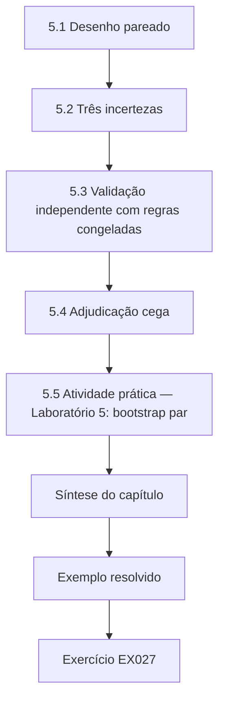

### Desenho lógico

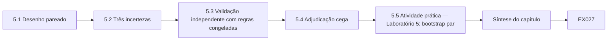

```text
[5.1 Desenho pareado]
    |
    v
[5.2 Três incertezas]
    |
    v
[5.3 Validação independente com regras congeladas]
    |
    v
[5.4 Adjudicação cega]
    |
    v
[5.5 Atividade prática — Laboratório 5: bootstrap par]
    |
    v
[Síntese do capítulo]
    |
    v
[Exemplo resolvido] --> [Exercício EX027]
```
<!-- cykin:lesson-figures:end ch-05 -->


### Objetivos de aprendizagem e conexão

Depois deste capítulo, você consegue (1) executar uma comparação pareada de dois métodos de inventário sobre os mesmos itens; (2) separar a incerteza amostral, a incerteza de medição e a incerteza de modelo; (3) validar num corpus independente com regras congeladas; (4) conduzir uma adjudicação cega e relatar a concordância; e (5) escrever um parágrafo de resultados honesto. Ele executa o desenho que o Capítulo 4 pilotou e fornece os resultados que o Capítulo 6 vai atacar.

### 5.1 Desenho pareado

Os dois métodos são aplicados aos *mesmos* itens adjudicados, então a grandeza de interesse é uma diferença pareada: para cada uso vulnerável à computação quântica, a análise estática o encontrou, e a análise de duas fontes o encontrou? O pareamento remove a variabilidade entre itens — alguns usos são simplesmente difíceis de encontrar — e dá um intervalo muito mais estreito do que comparar duas estimativas independentes de revocação. Como o método de duas fontes é uma união que inclui as constatações estáticas, a diferença por item só pode ser 0 ou +1 para a revocação; a precisão, ao contrário, pode cair, e é por isso que existe a H2.

### 5.2 Três incertezas

A **incerteza amostral** é o que um intervalo bootstrap captura: se outro conjunto de usos tivesse sido adjudicado, a estimativa seria diferente. A **incerteza de medição** vem da adjudicação: dois engenheiros podem discordar sobre se um uso existe, então relate a concordância (κ) e faça uma análise de sensibilidade em que os itens disputados são contados das duas formas. A **incerteza de modelo** vem das escolhas analíticas — a regra de canonização, a janela de observação, a definição de "uso" no livro de códigos. Relate uma pequena curva de especificações: a estimativa principal sob cada alternativa defensável. Uma conclusão que se mantém nas três é robusta; uma que se mantém apenas sob uma especificação é uma constatação sobre essa especificação.

### 5.3 Validação independente com regras congeladas

O corpus da Marrow Logistics nunca foi examinado durante o desenvolvimento. As regras de fusão, os limiares e o livro de códigos são congelados e têm o hash calculado (o SHA-256 do arquivo de configuração é registrado no diário da tese) antes de os dados da Marrow serem abertos. A Marrow difere de propósito: menos appliances de fornecedores, mais leitores portáteis embarcados nos armazéns e uma equipe de operações que usa muito SSH. O mecanismo do Capítulo 3 prevê, portanto, um ganho agregado menor — uma previsão bem-sucedida de benefício *reduzido* é evidência a favor do mecanismo, e não contra o método.

Registre a data em que os dados da Marrow foram abertos pela primeira vez ao lado do hash da configuração congelada.

### 5.4 Adjudicação cega

Os engenheiros E01–E10 (sintéticos) recebem cada uso candidato sem a procedência da ferramenta e em ordem aleatória, mais a documentação dos donos. Dois engenheiros adjudicam cada item; um terceiro resolve as discordâncias. No estudo principal, a concordância sintética é κ = 0,78, depois da emenda ao livro de códigos feita no piloto. Os itens que nenhum engenheiro consegue determinar são codificados como *desconhecidos*: 9% dos ativos da HRHN e 14% dos ativos da Marrow, relatados ao lado da revocação, em vez de descartados.

Relate a concordância por classe de ativo, além da geral, porque os adjudicadores podem achar os appliances mais difíceis de julgar do que o código interno. Guarde as resoluções do terceiro engenheiro num arquivo separado, para que o leitor veja quantos itens precisaram de uma e se alguma classe foi mais disputada do que as outras.

### 5.5 Atividade prática — Laboratório 5: bootstrap pareado

```python
# Lab 5 (synthetic): paired bootstrap CI for the recall gain (dual - static) on two corpora.
import random
def corpus(seed, mix):
    rng = random.Random(seed); items = []
    probs = {"code": (0.90, 0.55), "appliance": (0.20, 0.80), "embedded": (0.30, 0.10), "rest": (0.70, 0.0)}
    for cls, n in mix.items():
        ps, pp = probs[cls]
        for _ in range(n):
            s = rng.random() < ps; p = rng.random() < pp
            items.append((s, s or p))
    return items
def gain_ci(items, reps=2000, seed=1):
    rng = random.Random(seed); n = len(items)
    point = sum(d - s for s, d in items) / n
    boots = sorted(sum(d - s for s, d in (items[rng.randrange(n)] for _ in range(n))) / n for _ in range(reps))
    return point, boots[int(0.025 * reps)], boots[int(0.975 * reps)]
for name, seed, mix in [("HRHN hospitals 2-3", 11, {"code": 300, "appliance": 180, "embedded": 120, "rest": 100}),
                        ("Marrow (frozen rules)", 22, {"code": 500, "appliance": 60, "embedded": 200, "rest": 140})]:
    g, lo, hi = gain_ci(corpus(seed, mix))
    print(f"{name:24s} recall gain = {g:.3f}  95% CI [{lo:.3f}, {hi:.3f}]")
```

Saída esperada:

```text
HRHN hospitals 2-3       recall gain = 0.207  95% CI [0.176, 0.236]
Marrow (frozen rules)    recall gain = 0.097  95% CI [0.079, 0.116]
```

Sob esses pressupostos sintéticos, a H1 (ganho ≥ 0,10 na HRHN) é sustentada, e a H4 (ganho ≥ 0,05 na Marrow) é sustentada, com o ganho menor da Marrow previsto pela sua composição de classes. O intervalo bootstrap reflete apenas a amostragem; não diz nada sobre erros de adjudicação nem sobre se a Marrow se parece com alguma empresa real.

O laboratório sorteia as detecções por classe a partir das mesmas probabilidades arbitrárias usadas no Laboratório 3 e as aplica a duas composições de classes. A composição da HRHN, de 700 usos, corresponde ao tamanho do corpus reservado; a composição da Marrow tem menos appliances e mais dispositivos embarcados. O bootstrap pareado reamostra itens, mantendo juntos os resultados estático e de duas fontes de cada item, e é por isso que os intervalos são estreitos.

### 5.6 Exemplo resolvido: o parágrafo de resultados honesto

"No corpus reservado da HRHN (sintético; 700 usos vulneráveis à computação quântica adjudicados), o inventário de duas fontes aumentou a revocação em 0,21 (IC bootstrap de 95% 0,18–0,24) em relação a uma linha de base estática configurada com competência; a precisão foi de 0,93. O ganho se concentrou nos appliances de fornecedores (0,63) e esteve ausente nos dados em repouso (0,00), como previsto (H3). Com as regras congeladas, o ganho num corpus independente foi de 0,10 (0,08–0,12). Nove e catorze por cento dos ativos, respectivamente, não puderam ser adjudicados e estão excluídos dos denominadores da revocação; sob o pressuposto de pior caso de que todos os ativos desconhecidos contêm usos vulneráveis não descobertos, a revocação cai até 0,12. Esses resultados descrevem duas organizações sintéticas e um modelo de detecção; não são estimativas para empresas reais." Note o que o parágrafo se recusa a dizer: não alega que nenhuma das organizações seja "segura contra a computação quântica" nem que o inventário de duas fontes seja suficiente.

### 5.7 Erros comuns e limites

- Comparar estimativas de revocação não pareadas e relatar intervalos sobrepostos como "nenhuma diferença".
- Relatar apenas a incerteza amostral.
- Tocar o corpus de validação antes de congelar as regras — mesmo que seja para "verificar o formato".
- Retirar os ativos desconhecidos do denominador sem dizer.
- O Laboratório 5 simula probabilidades de detecção; as classes de ativos reais são mais confusas.

Cada erro tem uma salvaguarda concreta neste estudo: o desenho pareado, o relato das três incertezas, a configuração congelada e com hash antes de a Marrow ser aberta e as participações desconhecidas de nove e catorze por cento impressas ao lado da revocação. Um revisor deve conseguir confirmar as quatro a partir do arquivo, sem perguntar ao candidato.

### Exercícios — capítulo 5

- **EX027 — Por que parear?** Explique, com o Laboratório 5, por que o intervalo pareado é mais estreito do que dois intervalos independentes. Rubrica: 3 = argumento de variância correto.
- **EX028 — Itens disputados.** Dados 40 itens disputados na HRHN, descreva a análise de sensibilidade e como você a relataria. Rubrica: 3 = limites contando das duas formas e frase de relato.
- **EX029 — Curva de especificações.** Liste quatro especificações alternativas defensáveis para a estimativa principal. Rubrica: 3 = cada uma altera uma escolha analítica e é justificada.
- **EX030 — Protocolo de congelamento.** Escreva o procedimento de congelamento para a Marrow, incluindo o que recebe hash e quem o testemunha. Rubrica: 3 = verificável por alguém de fora.
- **EX031 — Prever a Marrow.** Usando as probabilidades por classe do Laboratório 3, preveja o ganho agregado da Marrow a partir da sua composição antes de executar o Laboratório 5. Rubrica: 3 = previsão a menos de 0,03 e método mostrado.
- **EX032 — Parágrafo de resultados.** Reescreva um parágrafo que alega demais ("O nosso método torna as organizações seguras contra a computação quântica") no estilo de 5.6. Rubrica: 3 = escopo, incerteza e desconhecidos presentes.

### Síntese do capítulo

O estudo principal é uma comparação pareada com três tipos de incerteza relatados, validada num corpus intocado sob regras congeladas, adjudicada às cegas e redigida com os seus desconhecidos presentes na discussão sobre o denominador. Uma redução prevista do benefício num corpus diferente sustenta o mecanismo.

<!-- cykin:chapter-navigation:start ch-05 -->
### Continue estudando — capítulo 05 de 08

[← Capítulo 04](#ch-04) · [Índice de capítulos do curso](../SUBJECTS.md) · [Capítulo 06 →](#ch-06)

Siga para a próxima lição escrita.
<!-- cykin:chapter-navigation:end -->

<a id="ch-06"></a>

## Capítulo 6 — Crítica de pares e revisão

<!-- cykin:lesson-figures:start ch-06 -->
### Mapa da aula

Aula 06 publicada. Mapa, exemplo, EX033.

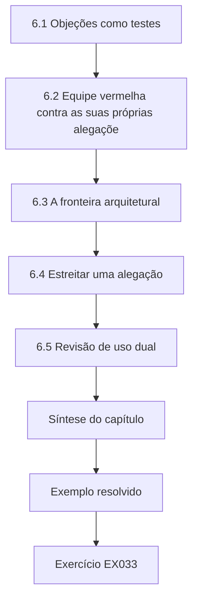

### Desenho lógico

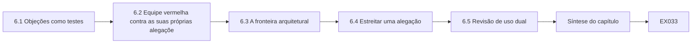

```text
[6.1 Objeções como testes]
    |
    v
[6.2 Equipe vermelha contra as suas próprias alegaçõe]
    |
    v
[6.3 A fronteira arquitetural]
    |
    v
[6.4 Estreitar uma alegação]
    |
    v
[6.5 Revisão de uso dual]
    |
    v
[Síntese do capítulo]
    |
    v
[Exemplo resolvido] --> [Exercício EX033]
```
<!-- cykin:lesson-figures:end ch-06 -->


### Objetivos de aprendizagem e conexão

Depois deste capítulo, você consegue (1) converter as objeções dos revisores em testes; (2) conduzir uma revisão interna de equipe vermelha das suas próprias alegações; (3) encontrar a fronteira arquitetural além da qual um método não consegue ver; (4) estreitar uma alegação sem abandoná-la; e (5) conduzir uma revisão de uso dual de um método de inventário. Ele toma os resultados do Capítulo 5 e prepara o argumento da tese do Capítulo 7.

### 6.1 Objeções como testes

A objeção de um revisor é uma hipótese sobre o seu erro. Trate cada uma como um teste com um resultado possível, e não como um ataque a ser rebatido. Três objeções da revisão sintética do artigo do Ciphertrail ilustram o método. **O1:** "A telemetria passiva pode encontrar appliances só porque os appliances da HRHN por acaso ficam no segmento monitorado." Teste: refazer a análise restrita aos appliances em segmentos com e sem sensores; o ganho desaparece fora dos sensores, confirmando que o benefício do método depende da posição dos sensores — uma condição de escopo, agora enunciada. **O2:** "Os adjudicadores poderiam inferir a procedência pela formatação." Teste: entregar 50 itens a dois novos engenheiros, com a formatação normalizada; o κ com os rótulos originais é 0,81, então a objeção fica enfraquecida, mas é registrada. **O3:** "A revocação de *usos* não é risco; um arquivo embrulhado com RSA importa mais do que cem servidores web internos." Isso não é testável dentro dos dados; é uma objeção de construto, respondida acrescentando uma revocação ponderada pela sensibilidade e admitindo que a ponderação é uma decisão, não uma medição.

### 6.2 Equipe vermelha contra as suas próprias alegações

Antes da revisão externa, designe um colega para argumentar que cada alegação é falsa. Uma tabela útil de equipe vermelha tem quatro colunas: alegação, objeção mais forte, teste ou concessão, situação depois da revisão. A equipe vermelha na pesquisa em PQC deve sempre incluir uma objeção do lado do *modelo de ameaça*: a negociação híbrida protege o estabelecimento de chaves apenas se as partes clássica e pós-quântica forem combinadas como especificado e não houver caminho de rebaixamento. Um inventário que registra o X25519MLKEM768 como negociado não diz nada sobre se um cliente aceitaria silenciosamente um grupo só clássico vindo de um atacante ativo — uma propriedade separada, que o inventário não mede.

### 6.3 A fronteira arquitetural

Todo método tem um lugar que não consegue ver. Para o inventário de duas fontes, a fronteira inclui: as assinaturas dos certificados do TLS 1.3, a menos que os pontos finais cooperem; as assinaturas de atualização de firmware verificadas offline dentro dos dispositivos; os dados em repouso cifrados por serviços de terceiros; e os protocolos transportados dentro de túneis VPN que o sensor não consegue abrir. Enuncie a fronteira na tese como um diagrama e uma lista. Os examinadores respeitam mais um candidato que mostra onde o método para do que um que dá a entender que ele cobre tudo.

Desenhe o diagrama com cada zona cega rotulada pelo observador que não a vê.

### 6.4 Estreitar uma alegação

Alegação original: "O inventário de duas fontes melhora substancialmente a descoberta de criptografia vulnerável à computação quântica." Alegação estreitada depois da crítica: "Onde os sensores passivos observam os segmentos relevantes, o inventário de duas fontes aumentou de 0,10 a 0,21 a revocação dos usos de estabelecimento de chaves vulneráveis à computação quântica e das assinaturas visíveis em TLS 1.2, em duas organizações sintéticas, concentrando-se nos appliances de fornecedores; não melhorou a descoberta de usos em dados em repouso nem em assinaturas de firmware offline." A alegação estreitada é menor e muito mais difícil de refutar — exatamente a troca que uma tese deve fazer.

Confira o título, o resumo e as conclusões com a alegação estreitada antes da submissão.

### 6.5 Revisão de uso dual

Um método de inventário é um mapa de onde uma organização é mais fraca. Inventários publicados, ou ferramentas que identificam criptografia legada em toda a internet, poderiam guiar um coletor do tipo "colher agora, decifrar depois" até os alvos de maior valor. A revisão de uso dual pergunta: a divulgação inclui dados que identificam a organização (não deve incluir); a configuração padrão da ferramenta varre apenas alvos autorizados pelos donos; as fraquezas em produtos nomeados são relatadas aos fornecedores por divulgação coordenada (a [ISO/IEC 29147](https://www.iso.org/standard/72311.html) descreve a divulgação de vulnerabilidades) antes da publicação; e o artigo descreve classes de fraquezas, em vez de listas de hosts vulneráveis?

### 6.6 Exemplo resolvido: a carta de resposta

A carta de resposta sintética começa com uma tabela que associa cada objeção a uma mudança: O1 → nova condição de escopo e uma análise fora dos sensores (Seção 5.4 do artigo); O2 → nova verificação de robustez, κ relatado; O3 → revocação ponderada pela sensibilidade acrescentada, e o resumo agora diz "usos" em vez de "risco". Ela agradece aos revisores sem bajulação, admite o que estava certo e explica as discordâncias com evidências. Onde os autores discordam — um revisor pediu a varredura ativa de dispositivos médicos para "completar" a verdade de referência —, a carta explica o argumento de dano do Capítulo 1 e oferece em troca um experimento em bancada de testes.

### 6.7 Erros comuns e limites

- Rebater objeções retoricamente, em vez de testá-las.
- Estreitar uma alegação na discussão, mas não no título e no resumo.
- Confundir o inventário dos algoritmos negociados com a resistência ao rebaixamento.
- Publicar constatações por organização que viram uma lista de alvos.
- Fazer a equipe vermelha apenas com amigos que compartilham os seus pressupostos.

Cada erro tem um remédio já usado na revisão do Ciphertrail: as objeções O1 e O2 viraram testes, a alegação estreitada passou para o resumo, a resistência ao rebaixamento foi nomeada como fora do método e a revisão de uso dual removeu os dados que identificavam a organização. Para a equipe vermelha, peça a alguém do lado do modelo de ameaça que não compartilhe os seus pressupostos.

### Exercícios — capítulo 6

- **EX033 — Da objeção ao teste.** Converta três objeções suas em testes com resultados possíveis. Rubrica: 3 = cada teste poderia mudar a conclusão.
- **EX034 — Tabela de equipe vermelha.** Monte uma tabela de equipe vermelha de quatro colunas para as três principais alegações do Ciphertrail. Rubrica: 3 = inclui uma objeção do modelo de ameaça.
- **EX035 — Diagrama da fronteira.** Desenhe (ou descreva em texto) a fronteira arquitetural do inventário de duas fontes, com pelo menos cinco zonas não vistas. Rubrica: 3 = zonas precisas e cada uma ligada a um enunciado de escopo.
- **EX036 — Estreitar.** Estreite "O TLS híbrido torna o nosso hospital seguro contra a computação quântica" numa alegação defensável. Rubrica: 3 = nomeia a propriedade, o escopo e o que continua vulnerável.
- **EX037 — Revisão de uso dual.** Complete uma revisão de uso dual para a divulgação do corpus da HRHN. Rubrica: 3 = decide o que é divulgado e por quê.
- **EX038 — Carta de resposta.** Escreva a seção da carta que responde a O3. Rubrica: 3 = admite o ponto de construto e mostra a mudança.

### Síntese do capítulo

A crítica melhora uma tese quando as objeções viram testes, a zona cega do método é desenhada explicitamente, as alegações encolhem até o que sobrevive e a divulgação é revisada quanto a danos. Evidências de inventário não são evidências de resistência ao rebaixamento nem de redução de risco sem argumentação adicional.

<!-- cykin:chapter-navigation:start ch-06 -->
### Continue estudando — capítulo 06 de 08

[← Capítulo 05](#ch-05) · [Índice de capítulos do curso](../SUBJECTS.md) · [Capítulo 07 →](#ch-07)

Siga para a próxima lição escrita.
<!-- cykin:chapter-navigation:end -->

<a id="ch-07"></a>

## Capítulo 7 — Síntese da tese e arquivo de reprodutibilidade

<!-- cykin:lesson-figures:start ch-07 -->
### Mapa da aula

Aula 07 publicada. Mapa, exemplo, EX039.

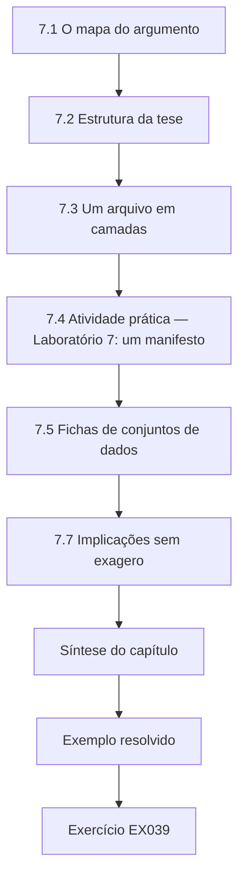

### Desenho lógico

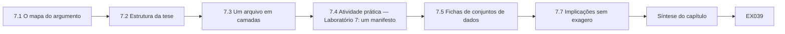

```text
[7.1 O mapa do argumento]
    |
    v
[7.2 Estrutura da tese]
    |
    v
[7.3 Um arquivo em camadas]
    |
    v
[7.4 Atividade prática — Laboratório 7: um manifesto]
    |
    v
[7.5 Fichas de conjuntos de dados]
    |
    v
[7.7 Implicações sem exagero]
    |
    v
[Síntese do capítulo]
    |
    v
[Exemplo resolvido] --> [Exercício EX039]
```
<!-- cykin:lesson-figures:end ch-07 -->


### Objetivos de aprendizagem e conexão

Depois deste capítulo, você consegue (1) mapear o argumento de uma tese dos dados até a alegação, com garantias explícitas; (2) montar um arquivo de reprodutibilidade em camadas, que falha de forma fechada; (3) escrever fichas de conjuntos de dados para corpora sintéticos e restritos; (4) enunciar os limites com direção — dizendo para que lado cada limite enviesaria o resultado; e (5) ligar a tese à prática de migração sem exagero. Ele reúne os capítulos 1–6 e prepara a defesa do Capítulo 8.

### 7.1 O mapa do argumento

Use a estrutura de Toulmin para cada alegação principal: **dados** (as diferenças pareadas do Laboratório 5), **garantia** (o bootstrap pareado estima a incerteza amostral quando os itens são intercambiáveis), **apoio** (o uso padrão do método e as estatísticas de concordância do piloto), **qualificador** ("onde os sensores observam o segmento"), **refutação** (appliances fora dos sensores, ativos desconhecidos) e **alegação**. Desenhar o mapa expõe as garantias que faltam. Uma lacuna comum nas teses de PQC é a garantia que liga a revocação do inventário à redução de risco: ela exige um argumento sobre os tempos de vida dos dados (o enquadramento de Mosca do Capítulo 1) e sobre o que a organização faz com as constatações, e nenhum dos dois é medido pelo inventário.

### 7.2 Estrutura da tese

Uma ordem convencional funciona: introdução e lacuna; fundamentos sobre a ameaça quântica, as normas e a implantação híbrida; método e modelo de observador; replicação; estudo principal; validação; crítica e limites; conclusões. Ponha a alegação estreitada no primeiro parágrafo do resumo. Ponha a fronteira arquitetural no capítulo de método, e não escondida nas limitações. Mantenha uma única fonte de verdade para cada número — um arquivo de resultados gerado por código —, para que o resumo, as tabelas e o texto não possam discordar.

Escreva o capítulo de método antes do capítulo de resultados.

### 7.3 Um arquivo em camadas

Divulgue publicamente os artefatos de nível 0 e de nível 1; mantenha o nível 2 com o dono dos dados, sob um acordo de acesso; nunca guarde o nível 3. O manifesto do arquivo registra o nível e o hash SHA-256 de cada arquivo, e o processo de divulgação **falha de forma fechada**: qualquer arquivo de nível 2 ou divergência de hash bloqueia a divulgação. Inclua o hash da configuração congelada do Capítulo 5, para que os examinadores possam confirmar que a validação usou as regras congeladas.

Execute a verificação de divulgação sobre o arquivo exato que será publicado, e não sobre uma cópia de trabalho. Mantenha o manifesto sob controle de versão.

### 7.4 Atividade prática — Laboratório 7: um manifesto que falha de forma fechada

```python
# Lab 7 (synthetic): a fail-closed reproducibility manifest. Any tier >= 2 file in the
# public archive, or any hash mismatch, stops the release.
import hashlib, json
files = {  # name: (tier, content) - contents are synthetic stand-ins
    "fusion_rules.json": (0, b'{"window_days": 14, "match": "canonical-host"}'),
    "corpus_synthetic.csv": (0, b"use_id,class,static,passive\nU1,code,1,0\n"),
    "handshakes_pseudonymized.csv": (1, b"host,group\nh-7f3a,0x001D\n"),
    "raw_capture.pcap": (2, b"\x00\x01binary"),
}
manifest = {n: {"tier": t, "sha256": hashlib.sha256(c).hexdigest()} for n, (t, c) in files.items()}
def release(manifest, files, public_max_tier=1):
    problems = []
    for n, m in manifest.items():
        if m["tier"] > public_max_tier:
            problems.append(f"{n}: tier {m['tier']} not releasable")
        elif hashlib.sha256(files[n][1]).hexdigest() != m["sha256"]:
            problems.append(f"{n}: hash mismatch")
    return ("BLOCKED", problems) if problems else ("RELEASED", [])
print(release(manifest, files))
del manifest["raw_capture.pcap"]
print(release(manifest, files))
print(json.dumps(manifest["fusion_rules.json"])[:60] + "...")
```

Saída esperada (o prefixo do hash é determinístico):

```text
('BLOCKED', ['raw_capture.pcap: tier 2 not releasable'])
('RELEASED', [])
{"tier": 0, "sha256": "db6dd8db390974cdd06e19b00d7fe35d26836...
```

A primeira chamada bloqueia a divulgação porque há uma captura de nível 2 no manifesto; removê-la permite a divulgação. Num arquivo real, remover o arquivo não basta: verifique se nenhum arquivo de nível 0 ou 1 contém extratos dele e registre a remoção no registro de mudanças do arquivo. O prefixo de hash impresso permite a um examinador confirmar que as regras de fusão do arquivo são as que foram congeladas antes da validação. Execute de novo depois de cada mudança no arquivo.

### 7.5 Fichas de conjuntos de dados

Para cada corpus, escreva uma ficha cobrindo: procedência (gerador sintético e semente, ou dono e autorização), período de coleta, instrumentos e versões, método de pseudonimização, lacunas conhecidas (segmentos sem sensores), definições dos rótulos (o livro de códigos emendado), estatísticas de concordância, usos pretendidos e usos proibidos (por exemplo, nenhuma reidentificação e nenhum uso como lista de alvos). Os corpora sintéticos também precisam de fichas, porque, do contrário, os leitores confundem distribuições geradas com dados de campo.

Guarde cada ficha ao lado do seu corpus e atualize-a quando forem encontradas erratas. Date cada revisão da ficha.

### 7.6 Limites com direção

Um limite sem direção é um ritual. Diga para que lado ele empurra a estimativa. *Ativos desconhecidos excluídos dos denominadores* → revocação superestimada (limitada pela análise de pior caso). *Sensores posicionados onde os appliances se concentram* → ganho agregado superestimado para organizações com sensores mais esparsos. *Adjudicadores com a documentação dos donos* → a verdade de referência pode deixar de fora usos não documentados → a revocação dos dois métodos fica superestimada, direção do ganho incerta. *Organizações sintéticas* → validade externa desconhecida nas duas direções. Uma tabela de limites com uma coluna de "direção" é uma das páginas mais valiosas da tese.

### 7.7 Implicações sem exagero

A implicação prática defensável é estreita: os programas de migração que se apoiam apenas na análise estática provavelmente encontram menos usos vulneráveis à computação quântica do que existem nos appliances fechados de fornecedores, e devem combinar fontes onde conseguem observar o tráfego e relatar as participações desconhecidas. Não decorre daí que alguma organização esteja pronta, que a negociação híbrida resista ao rebaixamento ou que o inventário substitua o planejamento da agilidade criptográfica descrito no [NIST CSWP 39](https://doi.org/10.6028/NIST.CSWP.39-upd1).

Escreva a implicação como uma recomendação com a sua condição anexada, para que um profissional que leia apenas esse parágrafo ainda veja o escopo: onde os sensores conseguem observar o tráfego, e com as participações desconhecidas relatadas.

### 7.8 Erros comuns e limites

- Números digitados à mão no texto que se afastam do arquivo de resultados.
- Arquivos que incluem silenciosamente capturas restritas.
- Limites listados sem direção nem magnitude.
- Implicações que saltam de "encontrou mais" para "mais seguro".

Cada erro tem uma salvaguarda simples. Gere todos os números do texto a partir do arquivo de resultados. Execute a verificação do manifesto que falha de forma fechada sobre o arquivo de divulgação. Acrescente uma direção e, quando possível, uma magnitude a cada limite. Leia em voz alta o parágrafo de implicações e pare em qualquer verbo que sugira segurança, e não descoberta.

### Exercícios — capítulo 7

- **EX039 — Mapa de Toulmin.** Mapeie a alegação da H4 com os seis elementos. Rubrica: 3 = garantia e refutação específicas.
- **EX040 — Garantia ausente.** Escreva o argumento que liga a revocação à redução de risco e liste as evidências de que ele precisaria. Rubrica: 3 = envolve o tempo de vida dos dados e a correção.
- **EX041 — Manifesto.** Estenda o Laboratório 7 para falhar quando um arquivo listado no manifesto estiver ausente. Rubrica: 3 = o código funciona e falha de forma fechada.
- **EX042 — Ficha do conjunto de dados.** Escreva a ficha do corpus da Marrow. Rubrica: 3 = inclui usos proibidos e lacunas conhecidas.
- **EX043 — Limites com direção.** Acrescente três limites, com direção e magnitude, à tabela de 7.6. Rubrica: 3 = direções argumentadas, magnitudes limitadas quando possível.
- **EX044 — Parágrafo de implicação.** Escreva a implicação para o líder de uma migração em 150 palavras. Rubrica: 3 = útil e dentro das evidências.

### Síntese do capítulo

Uma tese é um argumento cujas garantias são explícitas, cujos números têm uma única fonte, cujo arquivo não consegue vazar dados restritos e cujos limites apontam em direções declaradas. As suas implicações são tão estreitas quanto as suas alegações.

<!-- cykin:chapter-navigation:start ch-07 -->
### Continue estudando — capítulo 07 de 08

[← Capítulo 06](#ch-06) · [Índice de capítulos do curso](../SUBJECTS.md) · [Capítulo 08 →](#ch-08)

Siga para a próxima lição escrita.
<!-- cykin:chapter-navigation:end -->

<a id="ch-08"></a>

## Capítulo 8 — Defesa e plano de publicação

<!-- cykin:lesson-figures:start ch-08 -->
### Mapa da aula

Aula 08 publicada. Mapa, exemplo, EX045.

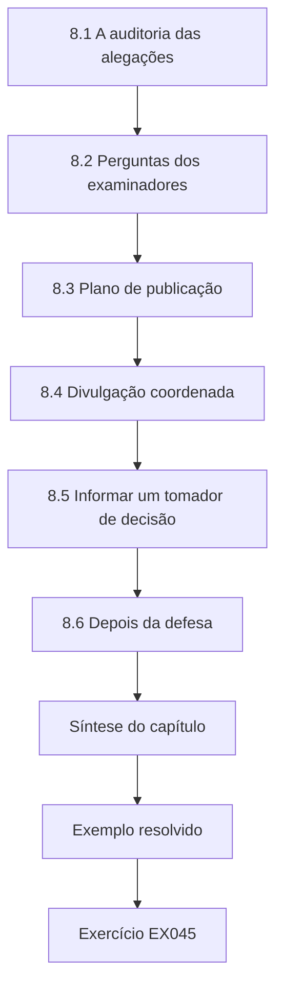

### Desenho lógico

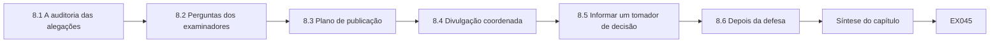

```text
[8.1 A auditoria das alegações]
    |
    v
[8.2 Perguntas dos examinadores]
    |
    v
[8.3 Plano de publicação]
    |
    v
[8.4 Divulgação coordenada]
    |
    v
[8.5 Informar um tomador de decisão]
    |
    v
[8.6 Depois da defesa]
    |
    v
[Síntese do capítulo]
    |
    v
[Exemplo resolvido] --> [Exercício EX045]
```
<!-- cykin:lesson-figures:end ch-08 -->


### Objetivos de aprendizagem e conexão

Depois deste capítulo, você consegue (1) auditar cada alegação de uma tese em relação às suas evidências; (2) antecipar e ensaiar as perguntas dos examinadores; (3) planejar a ordem e os veículos das publicações; (4) conduzir a divulgação coordenada das fraquezas de produtos encontradas durante a pesquisa; e (5) informar com precisão um tomador de decisão não especialista. Ele fecha o arco iniciado no Capítulo 1 e leva ao apêndice de resoluções.

### 8.1 A auditoria das alegações

Liste cada frase do resumo, da introdução e da conclusão que afirma algo. Para cada uma, registre o degrau (Capítulo 1), a tabela ou figura que a sustenta, a incerteza e o qualificador de escopo. Qualquer alegação sem um artefato de apoio é cortada ou reescrita. Na auditoria sintética do Ciphertrail, duas frases falham: uma diz "organizações" onde as evidências cobrem duas organizações sintéticas, e outra diz "assinaturas" onde as evidências passivas cobrem apenas as cadeias de certificados visíveis em TLS 1.2. As duas são corrigidas antes da submissão.

Repita a auditoria depois de cada rodada de revisão.

### 8.2 Perguntas dos examinadores

Prepare respostas, com referências a slides ou páginas, para as perguntas que os examinadores deste campo fazem com regularidade. *Por que eu deveria acreditar na sua verdade de referência?* (cegamento, κ, desconhecidos). *O que acontece com uma organização que não tem appliances de fornecedores?* (o mecanismo prevê pouco ganho; evidência da Marrow). *O seu resultado depende da data do CRQC?* (não — a revocação do inventário é independente de z; as implicações para a priorização não são, e são apresentadas como uma varredura). *E se o ML-KEM for quebrado?* (o inventário continua útil; a implantação híbrida e a agilidade são a resposta arquitetural; cite as quebras do Rainbow e do SIKE como precedente de surpresa). *O que você errou?* (o κ do piloto, o construto original de "uso"). Ensaie com um examinador simulado hostil e registre quais respostas precisaram de uma referência de página que você não tinha.

### 8.3 Plano de publicação

Ordene os artigos de modo que cada um se sustente sozinho e as evidências mais fortes apareçam primeiro. Um plano plausível: (1) o artigo de replicação e de unidade de medição (diagnóstico no estilo do InvBench, a unidade de contagem e a deriva dos codepoints) num veículo de medição ou de segurança de sistemas; (2) o estudo principal de duas fontes, com a validação; (3) o corpus adjudicado como artigo de conjunto de dados, com a sua ficha; (4) um resumo voltado para profissionais. Evite fatiar em salame resultados que só fazem sentido juntos. Registre publicamente o plano de análise do estudo principal antes de abrir os dados da Marrow, se houver um registro disponível, ou deposite um hash com carimbo de tempo.

### 8.4 Divulgação coordenada

Durante o estudo sintético, a equipe observou que um modelo de appliance aceitava um recuo só clássico quando o seu grupo híbrido era removido por um middlebox na bancada de testes — uma fraqueza de rebaixamento. O plano de divulgação: confirmar o comportamento apenas na bancada de testes isolada; notificar o fornecedor com detalhes reproduzíveis e uma janela proposta de 90 dias; informar o dono na HRHN sobre as unidades afetadas sem publicar as suas identidades; publicar apenas depois de uma correção ou do prazo combinado, descrevendo a classe da fraqueza, e não uma receita de exploração. A tese registra a linha do tempo da divulgação como evidência de conduta ética.

### 8.5 Informar um tomador de decisão

Um informe de uma página para o conselho executivo da HRHN (sintético) declara: o que foi medido (onde a criptografia vulnerável à computação quântica é usada, e não se a rede é "segura"); a constatação principal (a varredura estática sozinha deixou de encontrar a maioria dos usos nos appliances de fornecedores; combinar as fontes elevou a parcela encontrada de cerca de um em cada cinco para mais de quatro em cada cinco onde havia sensores); o que continua desconhecido (9% dos ativos; dados em repouso; firmware de dispositivos offline); a decisão solicitada (financiar sensores em dois segmentos não monitorados e exigir que os fornecedores declarem os algoritmos criptográficos nas compras); e o que o informe *não* alega (nenhuma data para um computador quântico). Ele não usa siglas sem explicação e anexa a tabela de limites.

### 8.6 Depois da defesa

Arquive as versões finais, atualize a ficha do conjunto de dados com quaisquer erratas e agende uma nova verificação da situação das normas citadas — o FN-DSA e o HQC provavelmente já terão normas finais, e o NIST IR 8547 pode ter sido revisado. Uma tese sobre uma transição deve terminar com um enunciado do que mudaria as suas conclusões.

Anote no arquivo quais conclusões dependem da situação das normas, para que um leitor depois da próxima revisão saiba o que verificar de novo. Liste essas conclusões explicitamente, com as suas dependências.

### 8.7 Erros comuns e limites

- Alegações no resumo mais amplas do que qualquer tabela sustenta.
- Preparar respostas apenas para perguntas amistosas.
- Publicar uma fraqueza antes de o fornecedor e o dono serem informados.
- Informes executivos que transformam a incerteza numa única data ou pontuação.

Cada erro tem uma salvaguarda usada antes neste estudo: a auditoria das alegações, um examinador simulado hostil, a linha do tempo da divulgação combinada com o fornecedor e o dono, e um informe que apresenta desconhecidos e faixas, e não uma data. Revise o informe com alguém de fora do projeto antes que ele chegue ao conselho.

### Exercícios — capítulo 8

- **EX045 — Auditoria das alegações.** Audite cinco frases afirmativas do seu parágrafo de resultados do Capítulo 5. Rubrica: 3 = cada alegação rastreada até um artefato, falhas reescritas.
- **EX046 — Perguntas hostis.** Escreva cinco perguntas hostis de examinadores que não estejam listadas em 8.2 e redija as respostas. Rubrica: 3 = perguntas realmente difíceis, respostas delimitadas.
- **EX047 — Ordem de publicação.** Proponha e justifique um plano de três artigos para uma tese sua. Rubrica: 3 = cada artigo se sustenta sozinho; sem fatiamento em salame.
- **EX048 — Linha do tempo da divulgação.** Escreva uma linha do tempo de divulgação para a fraqueza de rebaixamento, incluindo o que acontece se o fornecedor não responder. Rubrica: 3 = dono e fornecedor cobertos; a publicação descreve a classe, não a receita.
- **EX049 — Informe executivo.** Escreva o informe de uma página descrito em 8.5. Rubrica: 3 = preciso, acionável, sem data nem alegação de "seguro".
- **EX050 — O que o mudaria.** Liste quatro eventos futuros e como cada um mudaria as conclusões da tese. Rubrica: 3 = inclui um evento criptoanalítico, um de normas e um de evidência de campo.

### Síntese do capítulo

A defesa é a auditoria final das alegações: cada afirmação tem um artefato, cada pergunta hostil tem uma resposta delimitada, as publicações se sustentam sozinhas, as fraquezas são divulgadas antes de serem publicadas e os tomadores de decisão recebem o que foi medido, e não o que esperavam ouvir.

<!-- cykin:chapter-navigation:start ch-08 -->
### Continue estudando — capítulo 08 de 08

[← Capítulo 07](#ch-07) · [Índice de capítulos do curso](../SUBJECTS.md) · [Resoluções →](#worked-results)

Siga para a próxima lição escrita.
<!-- cykin:chapter-navigation:end -->

<a id="worked-results"></a>

## Resoluções

As respostas são respostas-modelo para autoavaliação; uma resposta diferente que atenda à rubrica recebe a mesma pontuação. Os números sintéticos vêm dos laboratórios com semente.

**EX001.** (1) observação — a contagem do sensor; (2) inferência — a proteção das sessões do segmento B sob o pressuposto de que qualquer um dos componentes se mantém; (3) alegação — a revocação com IC; (4) decisão — a priorização da VPN; (5) exposição — as imagens arquivadas. Uma frase que pula degraus, como "o segmento B é seguro contra a computação quântica", é reescrita: "63% dos handshakes observados no segmento B, na janela, negociaram um grupo híbrido PQ/T; outros segmentos, as assinaturas e os dados armazenados não foram medidos."

**EX002.** Primitiva (os algoritmos implantados são PQC padronizada? métrica: lista de algoritmos comparada com as FIPS 203/204/205), protocolo (as configurações de TLS/IKE oferecem grupos híbridos? métrica: parcela das configurações), implantação (eles são negociados? métrica: parcela negociada por sensibilidade), organização (os usos vulneráveis são encontrados e substituídos? métrica: revocação, participação desconhecida, tempo até a substituição). "80% pronto" não significa nada até que um objeto e o seu denominador sejam nomeados.

**EX003.** Com moda 10: resultados de exames 0,415, migração lenta 0,723; com moda 25: 0,097 e 0,325; os registros de agendamento continuam em 0, o arquivo genômico continua em 1. Com moda 10, a linha final "[15,40]" (0,101) é inválida, porque uma moda fora da faixa viola a definição da distribuição triangular — um lembrete para validar as entradas do modelo; com moda 25, ela é válida e ainda imprime 0,000. Interpretação: a ordem das classes de registros é estável, embora as probabilidades mudem por um fator de quatro, então a priorização (genômica primeiro, depois os resultados de exames) é mais robusta do que qualquer probabilidade isolada.

**EX004.** Danos: instabilidade ou reinicialização de dispositivos durante o atendimento; inundações de alarmes que dessensibilizam a equipe de segurança; enfraquecimento da proteção se as sondagens dispararem modos de recuo. Alternativas: captura passiva na fronteira da rede médica; documentação dos fornecedores e declarações nas compras; uma unidade de cada modelo de dispositivo numa bancada de testes para os testes ativos.

**EX005.** Captura de pacotes, nível 2 (mantida nas instalações do dono); CSV pseudonimizado, nível 1; inventário de certificados, nível 2 (revela a arquitetura); notebook, nível 0, desde que leia apenas entradas de nível 0/1; chave privada, nível 3 — não copiá-la, avisar o dono para rotacioná-la, registrar apenas o fato da descoberta.

**EX006.** Manipulação: redefinir "sistema" para excluir os casos difíceis; contar grupos híbridos configurados que nunca são negociados. Substituta: a revocação dos usos vulneráveis à computação quântica adjudicados, com a participação desconhecida relatada separadamente, e a parcela híbrida negociada ponderada pelo tempo de vida dos dados.

**EX007.** Uma resposta completa nomeia a autorização escrita da HRHN, a coleta passiva em primeiro lugar, com sondagens ativas limitadas a 140 serviços de TI em janelas agendadas, os níveis 0–3 com o nível 3 nunca coletado, o chefe de engenharia clínica como autoridade de interrupção, a divulgação primeiro ao dono e a revocação/precisão/participação desconhecida em relação a uma adjudicação cega.

**EX008.** Os termos incluem post-quantum, quantum-resistant, quantum-safe, migração para PQC, inventário criptográfico, CBOM, agilidade criptográfica, troca de chaves híbrida, ML-KEM/Kyber, ML-DSA/Dilithium, SLH-DSA/SPHINCS+, harvest now decrypt later; exclusão: artigos só de QKD e da camada física de redes quânticas, a menos que discutam a migração. As expressões de busca combinam um termo de inventário E um termo de PQC, com a data da obtenção.

**EX009.** Criptoanálise: limites algorítmicos / os pressupostos de hardware envelhecem. Esquemas: provas e criptoanálise / a confiança cresce devagar e as quebras ocorrem tarde. Normas: situação oficial / os documentos mudam. Protocolos híbridos: medição de interoperabilidade / os resultados de laboratório não veem os middleboxes. Implementação: vazamento reproduzível em laboratório / ligado a versões de código. Inventário: dados de campo / verdade de referência circular e denominadores ausentes.

**EX010.** Em 12 de outubro de 2026: FIPS 206 (FN-DSA) em desenvolvimento; HQC selecionado (NIST IR 8545, março de 2025), com a norma em desenvolvimento; NIST IR 8547 como rascunho público inicial (novembro de 2024). Consulte a [página do projeto de PQC do NIST](https://csrc.nist.gov/projects/post-quantum-cryptography) e registre a data da obtenção; um leitor posterior deve esperar mudanças.

**EX011.** Construto: "uso de RSA" indefinido. Verdade de referência: produzida pela mesma ferramenta — circular. Linha de base: nenhuma. Independência: um único local. Desconhecidos: não relatados. Q1 ainda pode sustentar "a ferramenta encontrou estas instâncias", mas nenhum número de revocação.

**EX012.** Acrescentar a coluna dá "não" para Q1, Q2, Q6, Q8 e "sim" ou "não se aplica" para os outros; o inventário continua sem nenhum estudo com corpus independente e verdade de referência independente ao mesmo tempo, então a lacuna sobrevive a duas codificações.

**EX013.** Dois finalistas ou alternativos caíram diante de ataques clássicos descobertos tarde num processo público, então a confiança num pressuposto mais novo é provisória. As arquiteturas devem, portanto, combinar pressupostos (híbridos PQ/T durante a transição), manter uma segunda família padronizada (assinaturas baseadas em hash, HQC ao lado do ML-KEM) e tornar rotineira a substituição de algoritmos (agilidade). As quebras não implicam que o ML-KEM seja fraco.

**EX014.** Modelo: "Nenhum estudo publicado mede o tempo até a substituição de um algoritmo de assinatura numa PKI com mais de 1.000 certificados sob um mecanismo de agilidade documentado; uma única medição desse tipo falsearia a lacuna."

**EX015.** Principal: medição (revocação/precisão independentes); alternativa: novo método. O enquadramento como medição é mais forte porque pode ser testado contra um limiar explícito num corpus independente; um enquadramento como "método" convida à resposta "qualquer união ajuda".

**EX016.** O inventário baseado em SBOM vê as bibliotecas e as versões declaradas; prevê alta revocação para o software interno com pipelines de build e falha para os appliances sem SBOM, para os algoritmos selecionados em tempo de execução pela configuração e para os dados em repouso.

**EX017.** Os registros dos pontos finais veem os certificados e os algoritmos de assinatura do lado do servidor no TLS 1.3, as escolhas de cifras e as identidades dos clientes; não veem dispositivos sem registro nem clientes não gerenciados; o custo para a privacidade é maior, porque os registros podem ligar usuários a serviços, então pseudonimize na origem.

**EX018.** "Nos itens reservados da HRHN, a diferença pareada de revocação (duas fontes − estática) é de pelo menos 0,10; rejeitar se o limite inferior do IC de 95% estiver abaixo de 0,10." Qualquer limiar rejeitável recebe crédito.

**EX019.** Agregado estático 0,73 contra 0,81 de duas fontes: ganho de 0,08 em vez de 0,20, porque a classe que mais se beneficia encolheu. O método não mudou; a composição mudou — por isso os resultados por classe precisam ser relatados.

**EX020.** Rival: sensores passivos instalados depois de incidentes anteriores, de modo que o ganho observado reflete onde os problemas já eram conhecidos (controle: posição dos sensores documentada e analisada). Rival: linha de base estática executada com acesso desatualizado aos repositórios (controle: a mesma data do retrato de acesso para os dois).

**EX021.** O mesmo laboratório reexecutando o seu pipeline = repetibilidade; outra equipe usando o corpus e o código divulgados = reprodutibilidade; outra equipe construindo o seu próprio sensor e corpus = replicabilidade.

**EX022.** "Observação: 214 dos 1.000 itens da verdade de referência no corpus divulgado trazem o ID interno de constatação do scanner. Inferência (não confirmada pelos autores): a verdade de referência foi semeada a partir da saída do scanner, excluindo os itens que ele não conseguia ver; a revocação está, portanto, superestimada. Efeito: recalcular apenas contra os itens documentados pelos donos reduz a revocação de 0,97 para 0,71."

**EX023.** Acrescentar os testes `(0x11ED, "hybrid")` e `(0x0200, "unknown")`; a tabela já mapeia 0x11ED, os seis testes passam e valores desconhecidos nunca são mapeados como seguros.

**EX024.** Uso canônico = (registro do dono do serviço, nome lógico do serviço, protocolo, porta). Mapear os IPs pelo registro de ativos, os apelidos pela resolução de CNAME do DNS registrada no momento do retrato, e tratar o VIP de um balanceador de carga como um uso por pool de back-ends apenas se os back-ends diferirem na criptografia. Modo de falha: VIPs compartilhados com back-ends heterogêneos precisam de dados dos pontos finais.

**EX025.** Hospitais que compartilham uma AC emissora vazam padrões de certificados entre as partições; particionar por domínio de PKI, ou manter os certificados da PKI compartilhada inteiramente na partição de teste e ajustar apenas com atributos que não sejam de PKI.

**EX026.** "Seguir com emenda: κ de 0,62 rastreado até a definição de 'uso'. Livro de códigos emendado (alcançável na negociação; marcação de configurado, não observado). Novo teste com 60 novos itens de calibração; prosseguir se κ ≥ 0,70."

**EX027.** A variância de uma diferença pareada é a soma das variâncias dos dois resultados menos duas vezes a sua covariância; a detecção pelos dois métodos é fortemente correlacionada por item (os dois encontram os itens fáceis), então o termo de covariância reduz substancialmente a variância.

**EX028.** Calcular a revocação duas vezes — com os 40 itens disputados contados como usos vulneráveis verdadeiros e depois como não usos — e relatar a faixa ao lado da estimativa adjudicada: "ganho de revocação de 0,21 (0,19–0,22 entre as resoluções das disputas)".

**EX029.** Janela de observação de 7 contra 14 contra 30 dias; canonização por DNS contra registro de ativos; incluir contra excluir os configurados não observados; adjudicação por maioria contra resolução pelo terceiro revisor.

**EX030.** Exportar as regras de fusão, os limiares e o livro de códigos para um único arquivo; calcular o SHA-256; publicar o hash num local com carimbo de tempo (e-mail ao orientador e commit no repositório), testemunhado pelo orientador; só então decifrar os dados da Marrow; verificar o hash de novo no script de análise.

**EX031.** Ganho esperado = Σ nᶜ(1−p_sᶜ)p_pᶜ / N = 0,089 para a composição da Marrow; o Laboratório 5 dá 0,097, a menos de 0,03.

**EX032.** "Em duas organizações sintéticas, combinar a telemetria passiva com a análise estática encontrou mais usos vulneráveis à computação quântica do que a análise estática sozinha (revocação de +0,10 a +0,21) onde os sensores observavam o tráfego; não encontrou usos em dados em repouso, e até 14% dos ativos continuaram indeterminados. Esta não é uma avaliação de segurança contra a computação quântica."

**EX033.** Por exemplo, "o tráfego sazonal esconde serviços raramente usados" → refazer com uma janela de 60 dias; "os adjudicadores favorecem os ativos documentados" → comparar a revocação nos subconjuntos documentado e não documentado; "deriva dos codepoints" → reclassificar com o registro atual. Cada um pode mover a estimativa.

**EX034.** Alegações H1, H3, H4; objeção do modelo de ameaça: híbrido negociado ≠ resistência ao rebaixamento → concessão e enunciado de escopo; as outras como em 6.1.

**EX035.** Zonas não vistas: certificados do TLS 1.3 sem registros dos pontos finais; assinaturas de firmware offline; armazenamento cifrado por terceiros; tráfego em túneis; segmentos não monitorados; mídias removíveis.

**EX036.** "Onde clientes e servidores negociam o X25519MLKEM768, as trocas de chaves TLS registradas são projetadas para resistir a uma futura decifração quântica se qualquer um dos componentes continuar seguro; as assinaturas dos certificados, o comportamento de rebaixamento, os dados armazenados e os protocolos que não são TLS não estão cobertos."

**EX037.** Divulgar o corpus sintético, o código e os resultados agregados; reter os dados pseudonimizados dos handshakes, a menos que a HRHN aprove e o risco de reidentificação seja avaliado; nunca divulgar as capturas; as fraquezas de produtos vão primeiro para os fornecedores.

**EX038.** "Concordamos que a revocação de usos não é risco. Acrescentamos uma revocação ponderada pela sensibilidade (Seção 5.6), usando pesos de tempo de vida dos dados, relatamos as duas e mudamos o resumo de 'risco' para 'usos'. Os pesos são uma decisão de governança, então os publicamos para que possam ser reponderados."

**EX039.** Dados: as diferenças pareadas da Marrow; garantia: as regras congeladas tornam a Marrow um teste genuíno fora da amostra; apoio: o hash da configuração; qualificador: sob posicionamento semelhante dos sensores; refutação: a Marrow é sintética e difere na composição; alegação: o ganho ≥ 0,05 se transfere.

**EX040.** A redução de risco exige que os usos encontrados sejam substituídos antes que x + y > z para os seus dados, então são necessárias evidências sobre a taxa de correção, os tempos de vida dos dados e os desconhecidos residuais — nada disso é medido pelo inventário.

**EX041.** Em `release`, verificar `if n not in files: problems.append(f"{n}: missing")` antes do cálculo do hash; a função ainda precisa devolver BLOCKED para qualquer problema.

**EX042.** Ficha: gerador sintético e semente; composição (código 500, appliance 60, embarcado 200, repouso 140); instrumentos simulados; nenhum host real; lacunas conhecidas — nenhum modelo de sensor SSH; rótulos conforme o livro de códigos emendado; proibido — uso como evidência sobre transportadoras reais.

**EX043.** Janela sazonal → revocação dos serviços raramente usados subestimada (direção conhecida, magnitude limitada pela reexecução com 60 dias); fadiga dos adjudicadores → ruído, direção incerta; data de obtenção do registro → parcela híbrida subestimada se faltarem codepoints mais novos.

**EX044.** "Se o seu inventário se apoia apenas na varredura de código e de configuração, espere deixar de encontrar a criptografia dentro dos appliances de fornecedores. Onde você conseguir observar o tráfego, acrescente telemetria dos handshakes; exija que os fornecedores declarem os algoritmos; relate quantos ativos você não conseguiu avaliar. Nada disso diz quando os computadores quânticos chegam nem se o rebaixamento é evitado."

**EX045.** Cada frase recebe degrau, artefato, incerteza e escopo; as falhas típicas são "organizações" (generalização) e "assinaturas" (o ponto cego do TLS 1.3) — ambas reescritas.

**EX046.** Por exemplo, "Por que confiar em organizações sintéticas?" → elas testam a validade interna e o mecanismo do método; a validade externa fica explicitamente em aberto. As respostas continuam delimitadas.

**EX047.** Artigo de replicação; estudo principal com validação; artigo de conjunto de dados — cada um com a sua própria pergunta e as suas evidências.

**EX048.** Dia 0: confirmar na bancada de testes; dia 1: notificar o fornecedor e a HRHN; dia 30: verificação da situação; dia 90: publicar um alerta no nível da classe, escalando para um coordenador (por exemplo, um CERT nacional) se o fornecedor ficar em silêncio.

**EX049.** O informe de 8.5, com o escopo medido, a constatação, os desconhecidos, o pedido de decisão e as não alegações explícitas.

**EX050.** Um ataque prático ao ML-KEM (criptoanalítico) → a importância do híbrido aumenta, o inventário não muda; normas finais do FN-DSA/HQC (normas) → as listas de algoritmos mudam; IR 8547 revisado (política) → a priorização muda; uma replicação numa organização real (evidência de campo) → a validade externa é testada.

<a id="references"></a>

## Referências

Todos os links foram verificados em 12 de outubro de 2026. A situação das normas muda; verifique novamente.

- Beullens, W. (2022). Breaking Rainbow takes a weekend on a laptop. IACR ePrint 2022/214. <https://eprint.iacr.org/2022/214>
- Bernstein, D. J., et al. (2024). KyberSlash: Exploiting secret-dependent division timings in Kyber implementations. IACR ePrint 2024/1049. <https://eprint.iacr.org/2024/1049>
- Castryck, W., and Decru, T. (2022). An efficient key recovery attack on SIDH. IACR ePrint 2022/975. <https://eprint.iacr.org/2022/975>
- Dittrich, D., and Kenneally, E. (2012). The Menlo Report: Ethical Principles Guiding Information and Communication Technology Research. U.S. DHS.
- Driscoll, F., Parsons, M., and Hale, B. (2025). Terminology for Post-Quantum Traditional Hybrid Schemes. RFC 9794. <https://www.rfc-editor.org/rfc/rfc9794.html>
- Gidney, C. (2025). How to factor 2048 bit RSA integers with less than a million noisy qubits. arXiv:2505.15917. <https://arxiv.org/abs/2505.15917>
- Gidney, C., and Ekerå, M. (2021). How to factor 2048 bit RSA integers in 8 hours using 20 million noisy qubits. *Quantum* 5, 433. <https://doi.org/10.22331/q-2021-04-15-433>
- Grover, L. K. (1996). A fast quantum mechanical algorithm for database search. *Proc. STOC '96*. <https://doi.org/10.1145/237814.237866>
- Hülsing, A., et al. (2018). XMSS: eXtended Merkle Signature Scheme. RFC 8391. <https://www.rfc-editor.org/rfc/rfc8391.html>
- McGrew, D., Curcio, M., and Fluhrer, S. (2019). Leighton-Micali Hash-Based Signatures. RFC 8554. <https://www.rfc-editor.org/rfc/rfc8554.html>
- McEliece, R. J. (1978). A public-key cryptosystem based on algebraic coding theory. JPL DSN Progress Report 42-44. <https://ipnpr.jpl.nasa.gov/progress_report2/42-44/44N.PDF>
- Mosca, M. (2018). Cybersecurity in an era with quantum computers: will we be ready? *IEEE Security & Privacy* 16(5). <https://doi.org/10.1109/MSP.2018.3761723>
- NIST (2024). FIPS 203, Module-Lattice-Based Key-Encapsulation Mechanism Standard. <https://doi.org/10.6028/NIST.FIPS.203>
- NIST (2024). FIPS 204, Module-Lattice-Based Digital Signature Standard. <https://doi.org/10.6028/NIST.FIPS.204>
- NIST (2024). FIPS 205, Stateless Hash-Based Digital Signature Standard. <https://doi.org/10.6028/NIST.FIPS.205>
- NIST (2020). SP 800-208, Recommendation for Stateful Hash-Based Signature Schemes. <https://doi.org/10.6028/NIST.SP.800-208>
- NIST (2025). SP 800-227, Recommendations for Key-Encapsulation Mechanisms. <https://doi.org/10.6028/NIST.SP.800-227>
- NIST (2022). IR 8413, Status Report on the Third Round of the NIST PQC Standardization Process. <https://doi.org/10.6028/NIST.IR.8413>
- NIST (2025). IR 8545, Status Report on the Fourth Round of the NIST PQC Standardization Process. <https://doi.org/10.6028/NIST.IR.8545>
- NIST (2024). IR 8547 (initial public draft), Transition to Post-Quantum Cryptography Standards. <https://doi.org/10.6028/NIST.IR.8547.ipd>
- NIST (2025, updated 2026). CSWP 39 upd1, Considerations for Achieving Crypto Agility. <https://doi.org/10.6028/NIST.CSWP.39-upd1>
- NSA (2022). Announcing the Commercial National Security Algorithm Suite 2.0. Cybersecurity advisory.
- Regev, O. (2009). On lattices, learning with errors, random linear codes, and cryptography. *Journal of the ACM* 56(6). <https://doi.org/10.1145/1568318.1568324>
- Shor, P. W. (1997). Polynomial-time algorithms for prime factorization and discrete logarithms on a quantum computer. *SIAM J. Computing* 26(5), 1484–1509. <https://doi.org/10.1137/S0097539795293172>
- Kwiatkowski, K., Kampanakis, P., Westerbaan, B., and Stebila, D. (2026). Post-Quantum Traditional (PQ/T) Hybrid Key Agreement Mechanisms for TLS 1.3. RFC 10024. <https://www.rfc-editor.org/rfc/rfc10024.html>
- IANA. Transport Layer Security (TLS) Parameters — Supported Groups registry. <https://www.iana.org/assignments/tls-parameters/tls-parameters.xhtml>
- ACM. Artifact Review and Badging, current version. <https://www.acm.org/publications/policies/artifact-review-and-badging-current>
