# Security Architecture and Engineering: Doctoral Research Track

- Language: English (`en`); course 191, Doctoral research track (2 years).
- Editorial state: **published**. Chapters 1–8 of 8 have hand-written teaching text; exercises EX001–EX050 have matching worked results with 0–3 rubrics; three offline labs use only the Python 3 standard library on synthetic data, and their outputs are embedded from real runs. Independent review and the 300-page A4 verification remain open.
- Audience: doctoral candidates testing whether an architecture practice changes security outcomes.
- Author: [hiagokinlevi](https://github.com/hiagokinlevi). Original text [CC0 1.0](../../../../../LICENSE); cited works keep their rights.
- Boundary: the labs compute agreement, a difference-in-differences estimate with a permutation check and archive digests on synthetic data; nothing touches a real organisation. All people, organisations, systems and data are **synthetic** unless a sentence cites a public source.

[Course home](../../README.md) · [Chapter index](../SUBJECTS.md) · [Book plan](PLAN.md) · [Course skill](../../skill/SKILL.md) · [Worked results](#worked-results)

## How to use this draft

Read in order. The chapters follow one doctoral candidate testing whether a STRIDE threat-modelling step at design review reduces post-release architecture defects: integrity and methods, the research frontier, the proposal, baseline replication and pilot, the main study and validation, critique, synthesis and archive, and the defense. Run each lab where it appears, attempt the exercises before the worked results, and score yourself with the rubrics.

### Synthetic running case

| Element | Role | Boundary |
|---|---|---|
| **Amara Lind** | Doctoral candidate | Invented |
| **Prof. Rafael Quintero** | Supervisor | Invented |
| **Halden Institute of Technology** | Fictional university | Invented |
| **Tessaro Insurance Group** | Fictional partner with thirty product teams | Invented |

### Core sources

Saltzer and Schroeder (1975), [doi:10.1109/PROC.1975.9939](https://doi.org/10.1109/PROC.1975.9939); Shostack, *Threat Modeling* (2014); NIST [SP 800-160 Vol. 1 Rev. 1](https://doi.org/10.6028/NIST.SP.800-160v1r1) and [SP 800-207](https://doi.org/10.6028/NIST.SP.800-207); Herley and van Oorschot (2017), [doi:10.1109/SP.2017.38](https://doi.org/10.1109/SP.2017.38); Wohlin et al. (2012). Full list in [References](#references).

## Contents

| Chapters |
|---|
| [1](#ch-01) · [2](#ch-02) · [3](#ch-03) · [4](#ch-04) · [5](#ch-05) · [6](#ch-06) · [7](#ch-07) · [8](#ch-08) |

[Worked results](#worked-results) · [References](#references)

<a id="ch-01"></a>

## Chapter 1 — Advanced research integrity and methods

<!-- open-cyber-academy:lesson-figures:start ch-01 -->
### Lesson map

Lesson 01 published. Map, example, EX001.

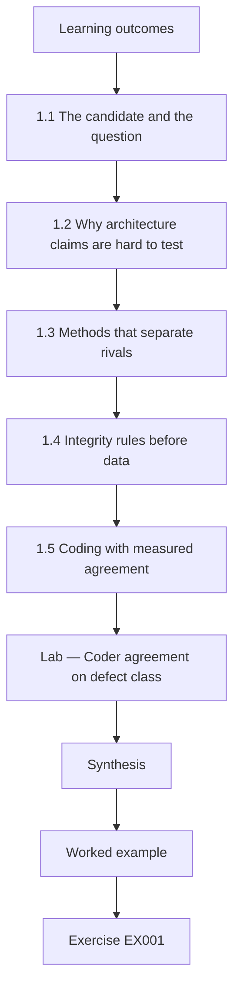

### Logical drawing

```mermaid
flowchart LR
  N0["Learning outcomes"]
  N1["1.1 The candidate and the question"]
  N2["1.2 Why architecture claims are hard to test"]
  N3["1.3 Methods that separate rivals"]
  N4["1.4 Integrity rules before data"]
  N5["1.5 Coding with measured agreement"]
  N6["Lab — Coder agreement on defect class"]
  N7["Synthesis"]
  N0 --> N1 --> N2 --> N3 --> N4 --> N5 --> N6 --> N7 --> Q["EX001"]
```

```text
[Learning outcomes]
    |
    v
[1.1 The candidate and the question]
    |
    v
[1.2 Why architecture claims are hard to test]
    |
    v
[1.3 Methods that separate rivals]
    |
    v
[1.4 Integrity rules before data]
    |
    v
[1.5 Coding with measured agreement]
    |
    v
[Lab — Coder agreement on defect class]
    |
    v
[Synthesis]
    |
    v
[Worked example] --> [Exercise EX001]
```
<!-- open-cyber-academy:lesson-figures:end ch-01 -->


### Learning outcomes

You will (1) state a falsifiable research question about an architecture practice; (2) choose methods that can tell the answer apart from its rivals; (3) set integrity rules for data, partners and authorship before any data exists; (4) build a coding scheme with measured agreement.

### 1.1 The candidate and the question

Amara Lind is a doctoral candidate at the fictional Halden Institute of Technology, supervised by Prof. Rafael Quintero. Her partner organisation is the fictional Tessaro Insurance Group, which runs thirty product teams building claims, policy and broker systems. Every person, organisation and number in this book is synthetic. Amara's question is whether a structured threat-modelling step at design review, using STRIDE as described by Shostack (2014), reduces the rate of architecture-level security defects found after release, compared with design review without that step. The question is falsifiable: a well-run study could show no reduction, and she commits in advance to reporting that result.

### 1.2 Why architecture claims are hard to test

Herley and van Oorschot (2017) argue that much security writing makes claims that cannot be refuted, such as saying a practice improves security without saying what observation would show it does not. Architecture is especially exposed to this problem because outcomes arrive late, defects are rare and many practices change at once. Amara responds by naming a measurable outcome, architecture-level defects per hundred design changes found in the twelve months after release, and by naming rival explanations in advance: team maturity, system age, regression to the mean after bad years and changes in how defects are reported.

### 1.3 Methods that separate rivals

Amara compares three designs. A before-and-after comparison inside adopting teams cannot separate the practice from general improvement over time. A randomised trial across teams would be strongest, but Tessaro cannot randomise which teams adopt because adoption follows budget cycles. She chooses a staggered adoption design with comparison teams and a difference-in-differences analysis, following the logic in Wohlin et al. (2012) for software engineering experiments, and pre-registers her primary outcome, covariates and stopping rules. She writes down which result patterns would support each rival explanation, so the analysis can test them rather than explain them away later.

### 1.4 Integrity rules before data

Before collecting anything, Amara agrees integrity rules with Tessaro and her ethics board. Defect records are pseudonymised so no engineer can be identified or blamed. Tessaro may review drafts for confidential details but cannot veto findings. Code, coding manuals and synthetic replicas of the data will be archived, while real records stay with Tessaro. Authorship follows contribution, and the coding assistant who classifies defects will be acknowledged. She records these rules with a date and a hash of the document in her lab notebook, so later readers can see they were not adjusted after the results were known.

### 1.5 Coding with measured agreement

Classifying a defect as architecture-level or implementation-level is a judgement, so Amara writes a coding manual with definitions and examples. An architecture defect is one whose fix requires changing a trust boundary, component responsibility or data flow; an implementation defect can be fixed inside one component. She and a second coder independently classify a pilot set and compute Cohen's kappa, interpreting it with the cautious bands of Landis and Koch (1977). The lab below computes kappa on forty synthetic pilot defects. A low value would mean the outcome measure is unreliable and the manual needs revision before any comparison is meaningful.

### Lab — Coder agreement on defect class

```python
# Cohen's kappa for two coders classifying 40 synthetic defects (A=architecture, I=implementation).
c1 = "AAAAAAAAAAAAAAAAIIIIIIIIIIIIIIIIIIIIIIII"
c2 = "AAAAAAAAAAAAAAIIIIAIIIIIIIIIIIIIIIIIIAII"
n = len(c1); po = sum(a == b for a, b in zip(c1, c2)) / n
pe = sum((c1.count(k) / n) * (c2.count(k) / n) for k in "AI")
print(f"items={n} observed agreement={po:.3f} expected={pe:.3f} kappa={(po - pe) / (1 - pe):.2f}")
```

Run with `python3 lab_kappa.py`. Verified output:

```text
items=40 observed agreement=0.900 expected=0.520 kappa=0.79
```

### Worked example

Amara writes the falsifiable question with its outcome and four rivals, chooses staggered adoption with difference-in-differences, dates and hashes her integrity rules and reaches a kappa of 0.79 on the pilot coding.

> **Synthetic case.** Halden Institute, Tessaro Insurance Group, Amara, Rafael and all data are invented; Shostack (2014), Herley and van Oorschot (2017), Wohlin et al. (2012) and Landis and Koch (1977) are real.

### Errors and limits

Kappa depends on class prevalence and can mislead when one class dominates. Pre-registration constrains analysis but does not guarantee honest data collection.

### Exercises

- **EX001 — Falsifiability test.** What observation would refute Amara's hypothesis? *Rubric:* 3 = no reduction, or an increase, in post-release architecture defects per hundred design changes for adopting teams relative to comparison teams;; 2 = names outcome without comparison;; 1 = says it cannot be refuted;; 0 = none.
- **EX002 — Herley critique.** What problem do Herley and van Oorschot identify in security claims? *Rubric:* 3 = many claims cannot be refuted because they name no observation that would contradict them;; 2 = unscientific claims;; 1 = vague;; 0 = none.
- **EX003 — Rejecting before-after.** Why is a simple before-and-after design weak here? *Rubric:* 3 = cannot separate the practice from general improvement or regression to the mean;; 2 = one rival;; 1 = strong design;; 0 = none.
- **EX004 — No randomisation.** Why could Tessaro not randomise adoption? *Rubric:* 3 = adoption follows budget cycles the researcher cannot control;; 2 = budget;; 1 = ethics only;; 0 = none.
- **EX005 — Industry veto.** What right does Tessaro have over drafts? *Rubric:* 3 = review for confidential details only, no veto over findings;; 2 = review;; 1 = full veto;; 0 = none.
- **EX006 — Defect definition.** How does the manual define an architecture-level defect? *Rubric:* 3 = fix requires changing a trust boundary, component responsibility or data flow;; 2 = partial;; 1 = any bug;; 0 = none.
- **EX007 — Pilot kappa value.** What kappa did the lab report and how is it read? *Rubric:* 3 = 0.79, substantial agreement in Landis and Koch bands;; 2 = value only;; 1 = below 0.4;; 0 = none.

### Synthesis

Doctoral architecture research begins with a falsifiable question, a design that can separate rivals, integrity rules fixed in advance and a reliable outcome measure.

### Continue studying — chapter 01 of 08

[← Course home](../../README.md) · [Course chapter index](../SUBJECTS.md) · [Chapter 02 (draft) →](#ch-02)

<a id="ch-02"></a>

## Chapter 2 — Security architecture and engineering: research frontier

<!-- open-cyber-academy:lesson-figures:start ch-02 -->
### Lesson map

Lesson 02 published. Map, example, EX008.

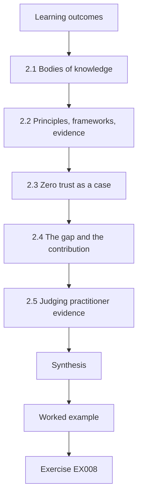

### Logical drawing

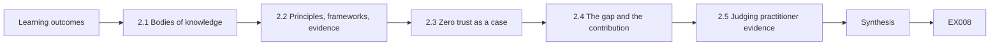

```text
[Learning outcomes]
    |
    v
[2.1 Bodies of knowledge]
    |
    v
[2.2 Principles, frameworks, evidence]
    |
    v
[2.3 Zero trust as a case]
    |
    v
[2.4 The gap and the contribution]
    |
    v
[2.5 Judging practitioner evidence]
    |
    v
[Synthesis]
    |
    v
[Worked example] --> [Exercise EX008]
```
<!-- open-cyber-academy:lesson-figures:end ch-02 -->


### Learning outcomes

You will (1) map the main bodies of knowledge in security architecture; (2) separate principles, frameworks and empirical evidence; (3) locate the gap Amara's study addresses; (4) judge evidence quality in practitioner literature.

### 2.1 Bodies of knowledge

Amara's literature map has four regions. Principles start with Saltzer and Schroeder (1975), whose design principles such as least privilege, fail-safe defaults and complete mediation still frame architecture reviews. Engineering standards include NIST SP 800-160 Vol. 1 Rev. 1, which treats security as a property engineered through the system life cycle. Enterprise frameworks include SABSA, described by Sherwood, Clark and Lynas (2005), and The Open Group's guide on integrating risk and security into TOGAF. Practice books include Shostack (2014) on threat modelling and Anderson (2020) on security engineering, which combines principles with many case studies of failure.

### 2.2 Principles, frameworks, evidence

These sources are different kinds of knowledge. Principles are reasoned arguments about what tends to make systems safer. Frameworks such as SABSA and TOGAF organise work and vocabulary, which helps teams communicate but does not by itself show that outcomes improve. Control catalogues such as NIST SP 800-53 Rev. 5 and ISO/IEC 27002:2022 list safeguards. Empirical evidence is a fourth category: observations that a practice changed outcomes in real organisations. Amara finds the fourth category thin. Many papers describe a method and a single case, but few compare outcomes with a credible counterfactual.

### 2.3 Zero trust as a case

Zero trust architecture, described in NIST SP 800-207, shows how fast a frontier moves. The publication defines tenets such as authenticating and authorising every request and not granting trust based on network location. Vendors and governments adopted the term rapidly, yet Amara finds little peer-reviewed evidence measuring how zero trust deployments change incident rates. This is not a criticism of the guidance, which is a design reference, but it shows a recurring gap: architectural ideas spread through standards and practice faster than research can test their effects. Her own study sits in that gap for threat modelling.

### 2.4 The gap and the contribution

After screening, Amara finds studies of threat-modelling usability, studies counting threats identified in workshops and practitioner reports of adoption. She finds no study in her search that links a threat-modelling step to post-release architecture defects with comparison teams. That is her gap. She states the contribution narrowly: an estimate, with uncertainty, of the effect at one organisation, a reusable coding manual and a replication package. She avoids claiming that threat modelling works in general, because one organisation cannot support that claim, and she lists the conditions under which her estimate might transfer.

### 2.5 Judging practitioner evidence

Much architecture knowledge appears in conference talks, vendor reports and blogs. Amara grades each source on a simple scale: does it report how data were collected, does it include a comparison, does it report failures as well as successes, and does it disclose conflicts of interest. A vendor survey claiming large reductions after adopting its platform scores low on comparison and conflicts. A team's honest post-incident review scores higher on transparency even with one case. She uses low-graded sources only to generate hypotheses, never as evidence of effect, and states this rule in her methods chapter.

### Worked example

Amara builds a four-region literature map, classifies twenty sources as principle, framework, catalogue or empirical, grades practitioner reports and writes a narrow contribution statement.

> **Synthetic case.** The screening counts and graded reports are synthetic; the cited works are real.

### Errors and limits

Literature searches miss grey literature and non-English work. A gap may exist because a question is hard to measure, not because nobody thought of it.

### Exercises

- **EX008 — Saltzer principles.** Name three Saltzer and Schroeder principles. *Rubric:* 3 = three of least privilege, fail-safe defaults, complete mediation, economy of mechanism, open design, separation of privilege, least common mechanism, psychological acceptability;; 2 = two;; 1 = vague;; 0 = none.
- **EX009 — Framework evidence.** Does adopting SABSA or TOGAF by itself show better outcomes? *Rubric:* 3 = no; frameworks organise work and vocabulary, outcomes need empirical evidence;; 2 = no;; 1 = yes;; 0 = none.
- **EX010 — SP 800-207 tenet.** State one tenet of zero trust from SP 800-207. *Rubric:* 3 = no implicit trust from network location or every request authenticated and authorised;; 2 = one;; 1 = trust internal network;; 0 = none.
- **EX011 — Thin category.** Which category of knowledge did Amara find thinnest? *Rubric:* 3 = empirical evidence comparing outcomes with a counterfactual;; 2 = empirical;; 1 = principles;; 0 = none.
- **EX012 — Narrow contribution.** Why does Amara avoid claiming threat modelling works in general? *Rubric:* 3 = one organisation cannot support a general claim; she lists transfer conditions;; 2 = one site;; 1 = it does;; 0 = none.
- **EX013 — Vendor survey grade.** Why does a vendor survey of its own platform score low? *Rubric:* 3 = no comparison and a conflict of interest;; 2 = one reason;; 1 = high;; 0 = none.
- **EX014 — Low-grade use.** How may low-graded sources be used? *Rubric:* 3 = only to generate hypotheses, never as evidence of effect;; 2 = hypotheses;; 1 = as evidence;; 0 = none.

### Synthesis

The frontier in security architecture is rich in principles and frameworks but thin in outcome evidence, which defines where doctoral work can contribute.

### Continue studying — chapter 02 of 08

[← Chapter 01 (draft)](#ch-01) · [Course chapter index](../SUBJECTS.md) · [Chapter 03 (draft) →](#ch-03)

<a id="ch-03"></a>

## Chapter 3 — Original contribution proposal

<!-- open-cyber-academy:lesson-figures:start ch-03 -->
### Lesson map

Lesson 03 published. Map, example, EX015.

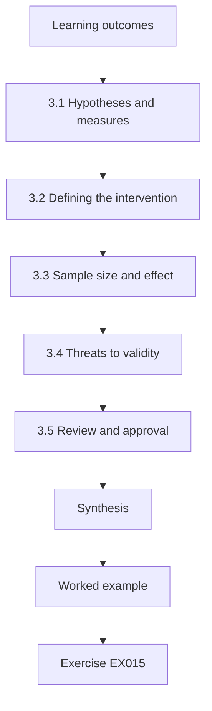

### Logical drawing

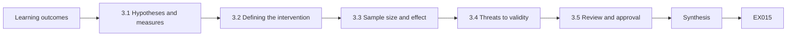

```text
[Learning outcomes]
    |
    v
[3.1 Hypotheses and measures]
    |
    v
[3.2 Defining the intervention]
    |
    v
[3.3 Sample size and effect]
    |
    v
[3.4 Threats to validity]
    |
    v
[3.5 Review and approval]
    |
    v
[Synthesis]
    |
    v
[Worked example] --> [Exercise EX015]
```
<!-- open-cyber-academy:lesson-figures:end ch-03 -->


### Learning outcomes

You will (1) write a proposal that states hypotheses, measures and analysis in advance; (2) define the intervention precisely enough to replicate; (3) plan sample size against realistic effect sizes; (4) anticipate threats to validity.

### 3.1 Hypotheses and measures

Amara's proposal states one primary hypothesis: teams that add a STRIDE threat-modelling step to design review will show a lower rate of post-release architecture defects per hundred design changes than comparison teams, measured over twelve months after each change. Secondary hypotheses concern defect severity and time to fix. Each measure has a definition, a data source and a coding rule. She also states what is not measured, such as defects never discovered, and explains why: they cannot be counted, so the study can only estimate effects on discovered defects, a limitation she will repeat in every chapter that reports results.

### 3.2 Defining the intervention

A vague intervention cannot be replicated. Amara specifies it in detail: before design approval, the team draws a data-flow diagram with trust boundaries, walks each element through the six STRIDE categories, records threats with owners and mitigations, and an architect from outside the team reviews the record. The session is time-boxed at ninety minutes for a typical change. She writes a fidelity checklist so that each session can be scored for whether it followed the protocol. Without fidelity data, a null result would be impossible to interpret, because nobody would know whether the practice was really applied.

### 3.3 Sample size and effect

Architecture defects are rare: Tessaro's history shows about four per hundred design changes. Amara asks what reduction would matter to Tessaro, and the security leadership says a quarter fewer defects would justify the time cost. With thirty teams and roughly forty design changes per team per year, she simulates the study many times under that assumed effect and finds that detecting it reliably needs at least eighteen months of follow-up. She records the simulation, its assumptions and the resulting plan, and she notes that a smaller true effect could easily go undetected, which she will report rather than hide.

### 3.4 Threats to validity

Following Wohlin et al. (2012), Amara lists threats in four groups. Construct validity: the defect classification may not capture what architects mean by an architecture flaw. Internal validity: adopting teams might also change other practices, such as adding security champions. External validity: an insurance company with a central architecture function may differ from a startup. Conclusion validity: rare outcomes give wide uncertainty. For each threat she writes a mitigation, such as recording concurrent practice changes every quarter and reporting confidence intervals rather than only significance tests.

### 3.5 Review and approval

Amara presents the proposal to her committee and to Tessaro's architecture board. The committee asks why she does not also measure threats found in sessions; she adds it as a process measure, not an outcome, because finding more threats does not prove fewer defects. Tessaro asks that teams not be ranked publicly; she agrees to report only aggregates. Both groups sign off, and she registers the proposal with a timestamp. She keeps a change log: any later change to measures or analysis will be recorded with a reason and reported, so readers can distinguish planned from exploratory results.

### Worked example

Amara writes a proposal with one primary and two secondary hypotheses, a ninety-minute STRIDE protocol with fidelity checklist, an eighteen-month follow-up based on simulation and a validity table.

> **Synthetic case.** Defect rates, team counts and board decisions are synthetic; Wohlin et al. (2012) and Shostack (2014) are real.

### Errors and limits

Simulated power depends on assumed variation between teams. Fidelity checklists can become box-ticking if reviewers do not observe sessions.

### Exercises

- **EX015 — Undiscovered defects.** Why can the study only estimate effects on discovered defects? *Rubric:* 3 = undiscovered defects cannot be counted, so they are outside the measure;; 2 = cannot count;; 1 = includes all;; 0 = none.
- **EX016 — Fidelity purpose.** Why is a fidelity checklist essential for interpreting a null result? *Rubric:* 3 = shows whether the practice was really applied; otherwise null is ambiguous;; 2 = applied;; 1 = not needed;; 0 = none.
- **EX017 — Meaningful effect.** What reduction did Tessaro leadership say would matter? *Rubric:* 3 = a quarter fewer architecture defects;; 2 = quarter;; 1 = any;; 0 = none.
- **EX018 — Follow-up length.** What follow-up did the simulation suggest, and why? *Rubric:* 3 = at least eighteen months, because defects are rare;; 2 = eighteen months;; 1 = six months;; 0 = none.
- **EX019 — Internal threat.** Give an internal-validity threat and its mitigation. *Rubric:* 3 = adopting teams also change other practices; record concurrent changes quarterly;; 2 = threat only;; 1 = external threat;; 0 = none.
- **EX020 — Threats-found measure.** Why is threats found in sessions a process measure, not an outcome? *Rubric:* 3 = finding more threats does not prove fewer defects;; 2 = not outcome;; 1 = is outcome;; 0 = none.

### Synthesis

A strong proposal fixes hypotheses, intervention, sample plan and validity threats in writing before outcome data are seen.

### Continue studying — chapter 03 of 08

[← Chapter 02 (draft)](#ch-02) · [Course chapter index](../SUBJECTS.md) · [Chapter 04 (draft) →](#ch-04)

<a id="ch-04"></a>

## Chapter 4 — Baseline replication and pilot

<!-- open-cyber-academy:lesson-figures:start ch-04 -->
### Lesson map

Lesson 04 published. Map, example, EX021.

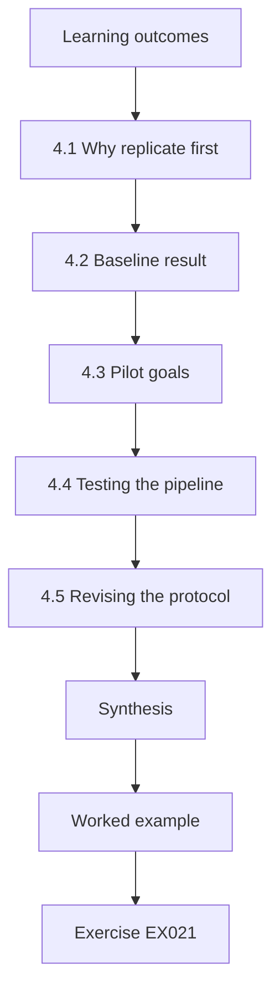

### Logical drawing

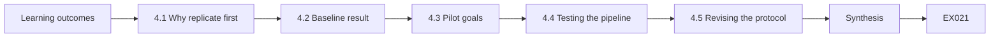

```text
[Learning outcomes]
    |
    v
[4.1 Why replicate first]
    |
    v
[4.2 Baseline result]
    |
    v
[4.3 Pilot goals]
    |
    v
[4.4 Testing the pipeline]
    |
    v
[4.5 Revising the protocol]
    |
    v
[Synthesis]
    |
    v
[Worked example] --> [Exercise EX021]
```
<!-- open-cyber-academy:lesson-figures:end ch-04 -->


### Learning outcomes

You will (1) replicate a published or prior baseline before extending it; (2) run a pilot to test procedures, not effects; (3) check data pipelines against known values; (4) revise the protocol from pilot evidence.

### 4.1 Why replicate first

Before testing her intervention, Amara checks that she can reproduce Tessaro's own historical baseline: about four architecture defects per hundred design changes. If her extraction and coding produce a very different number from the organisation's records, either the records or her method is wrong, and any later comparison would be built on sand. Replication of the baseline is a cheap test of the whole measurement chain. She extracts two years of historical changes and defects, codes them with the manual from chapter 1 and compares her rate with the figure security leadership reported in planning documents.

### 4.2 Baseline result

Her coding gives 3.6 architecture defects per hundred changes, slightly below the reported 4.1. Investigating, she finds that the reported figure counted duplicate tickets for the same defect when several teams were affected. After deduplicating, both numbers agree within rounding. This small discovery matters: had she compared her later measurements with the inflated planning figure, the intervention would have appeared to work even if nothing changed. She records the discrepancy and the fix in her change log and informs Tessaro, whose planning team corrects the dashboard for future reporting.

### 4.3 Pilot goals

The pilot runs with three volunteer teams for three months. Its goals are procedural: can teams complete the protocol in ninety minutes, can the fidelity checklist be scored consistently, does the defect data pipeline capture every relevant ticket, and do engineers find the session acceptable. The pilot is explicitly not meant to estimate the effect, because three teams over three months would produce too few defects for any conclusion. Amara states this in the pilot plan so nobody, including herself, is tempted to announce early success from a handful of numbers.

### 4.4 Testing the pipeline

Amara inserts ten synthetic test tickets with known classifications into a copy of the defect tracker and runs her extraction scripts. Nine arrive correctly; one, filed under a renamed project, is missed. She fixes the project mapping and reruns, recovering all ten. She keeps the synthetic tickets as a permanent regression test that runs before each data extraction. This practice, borrowed from software testing, gives a known-answer check for the research pipeline in the same way that test vectors give a known-answer check for cryptographic code.

### 4.5 Revising the protocol

Pilot evidence leads to three revisions. Sessions for large changes ran long, so the protocol now allows splitting them into two sessions. Fidelity scoring disagreed on whether trust boundaries were drawn, so the checklist gains an example diagram. Engineers found the external architect's review useful but slow, so reviews must now finish within five working days. Each revision is logged with its reason before the main study starts. Amara reports the pilot in the thesis as a separate chapter, including the problems, because future replicators will face the same practical difficulties.

### Worked example

Amara replicates the baseline at 3.6 per hundred changes, traces the 4.1 figure to duplicate tickets, fixes a pipeline gap with synthetic test tickets and logs three protocol revisions.

> **Synthetic case.** Baseline figures, pilot teams and tickets are synthetic.

### Errors and limits

A pilot with volunteer teams may be more motivated than typical teams. Regression tests catch known failure modes only.

### Exercises

- **EX021 — Baseline discrepancy.** What explained the gap between 3.6 and 4.1? *Rubric:* 3 = duplicate tickets for the same defect across teams in the reported figure;; 2 = duplicates;; 1 = coding error;; 0 = none.
- **EX022 — Inflated comparison risk.** What would have happened if the inflated figure were used as baseline? *Rubric:* 3 = the intervention would appear to work even without real change;; 2 = false success;; 1 = vague;; 0 = none.
- **EX023 — Pilot not effect.** Why was the pilot not used to estimate the effect? *Rubric:* 3 = three teams over three months yield too few defects;; 2 = too few;; 1 = it was;; 0 = none.
- **EX024 — Missed ticket.** Why was one synthetic ticket missed, and how was it fixed? *Rubric:* 3 = filed under a renamed project; fixed the project mapping;; 2 = cause;; 1 = vague;; 0 = none.
- **EX025 — Test ticket analogy.** What do the synthetic tickets resemble in cryptographic practice? *Rubric:* 3 = known-answer test vectors;; 2 = test vectors;; 1 = vague;; 0 = none.
- **EX026 — Large changes.** How was the protocol revised for large changes? *Rubric:* 3 = allowed splitting into two sessions;; 2 = split;; 1 = shortened;; 0 = none.

### Synthesis

Replicating the baseline and piloting procedures exposes measurement errors before they can masquerade as effects.

### Continue studying — chapter 04 of 08

[← Chapter 03 (draft)](#ch-03) · [Course chapter index](../SUBJECTS.md) · [Chapter 05 (draft) →](#ch-05)

<a id="ch-05"></a>

## Chapter 5 — Main study and independent validation

<!-- open-cyber-academy:lesson-figures:start ch-05 -->
### Lesson map

Lesson 05 published. Map, example, EX027.

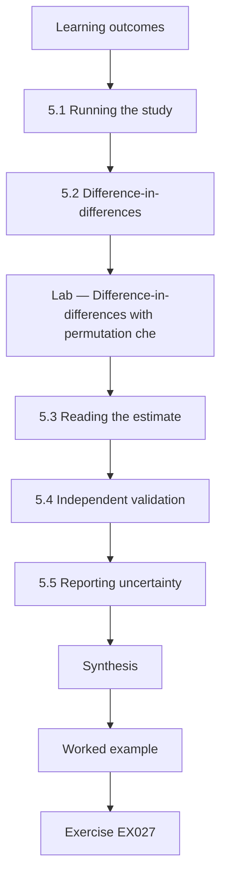

### Logical drawing

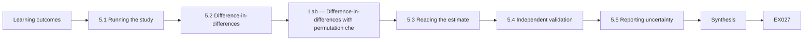

```text
[Learning outcomes]
    |
    v
[5.1 Running the study]
    |
    v
[5.2 Difference-in-differences]
    |
    v
[Lab — Difference-in-differences with permutation che]
    |
    v
[5.3 Reading the estimate]
    |
    v
[5.4 Independent validation]
    |
    v
[5.5 Reporting uncertainty]
    |
    v
[Synthesis]
    |
    v
[Worked example] --> [Exercise EX027]
```
<!-- open-cyber-academy:lesson-figures:end ch-05 -->


### Learning outcomes

You will (1) run a staggered adoption study with comparison teams; (2) estimate an effect with difference-in-differences; (3) obtain independent validation of coding and analysis; (4) report uncertainty honestly.

### 5.1 Running the study

Over eighteen months, eighteen Tessaro teams adopt the protocol in three waves as budgets allow, while twelve teams continue design review without it. Amara collects design changes, sessions, fidelity scores and defects monthly. Concurrent changes, such as one division introducing security champions, are recorded in a quarterly log. She avoids influencing outcomes: she does not attend sessions as a participant, and the coding assistant who classifies defects does not know which teams adopted. Blinding the coding protects the outcome measure from the very natural wish to see the intervention succeed.

### 5.2 Difference-in-differences

The analysis compares the change in defect rate for adopting teams with the change for comparison teams over the same period. If both groups improve equally, the difference is zero and the practice has no measurable effect beyond the general trend. The method assumes parallel trends: without the intervention, both groups would have moved similarly. Amara checks this assumption on pre-adoption data and finds trends close enough to proceed. The lab below computes the estimate on synthetic team-period rates and a simple permutation check, which shuffles adoption labels to see how often a difference as large arises by chance.

### Lab — Difference-in-differences with permutation check

```python
# Difference-in-differences on synthetic team rates (defects per 100 design changes) + permutation check.
import random, statistics
random.seed(5)
adopt = [(round(random.gauss(3.9, 0.5), 2), None) for _ in range(18)]
comp = [(round(random.gauss(3.7, 0.5), 2), None) for _ in range(12)]
adopt = [(b, round(b - 1.1 + random.gauss(0, 0.9), 2)) for b, _ in adopt]
comp = [(b, round(b - 0.3 + random.gauss(0, 0.9), 2)) for b, _ in comp]
def did(a, c):
    return statistics.mean(y - x for x, y in a) - statistics.mean(y - x for x, y in c)
est = did(adopt, comp)
print(f"adopting: {statistics.mean(x for x,_ in adopt):.2f} -> {statistics.mean(y for _,y in adopt):.2f}")
print(f"comparison: {statistics.mean(x for x,_ in comp):.2f} -> {statistics.mean(y for _,y in comp):.2f}")
print(f"DiD estimate: {est:.2f} per 100 changes")
allt = adopt + comp; hits = 0; R = 5000
for _ in range(R):
    random.shuffle(allt)
    if did(allt[:18], allt[18:]) <= est: hits += 1
print(f"permutation share as extreme: {hits / R:.3f}")
```

Run with `python3 lab_did.py`. Verified output:

```text
adopting: 3.75 -> 2.80
comparison: 3.83 -> 3.65
DiD estimate: -0.77 per 100 changes
permutation share as extreme: 0.022
```

### 5.3 Reading the estimate

On the synthetic data, adopting teams fell from 3.75 to 2.80 defects per hundred changes (a change of -0.95) while comparison teams fell from 3.83 to 3.65 (-0.18). The difference-in-differences is -0.77, about minus 0.8, roughly a fifth fewer defects relative to baseline. The permutation check shows a difference this large in about two per cent of shuffles. Amara reports the estimate with that uncertainty and notes it is slightly smaller than the quarter Tessaro hoped for. She avoids the word proves and writes that the data are consistent with a modest reduction under the stated assumptions.

### 5.4 Independent validation

A second researcher at another university, given only the coding manual and a random sample of defects, recodes them blind and reaches substantial agreement with the original coding. A statistician independently reruns the analysis from Amara's archived scripts and obtains the same estimate. Validation also covers a sensitivity analysis: excluding the division that introduced security champions changes the estimate only slightly, which weakens that rival explanation. Each validation step is reported with who did it, what they received and what they found, including one small coding disagreement that was resolved by clarifying a definition.

### 5.5 Reporting uncertainty

Amara's results section leads with the effect estimate and its interval, then fidelity data, then sensitivity analyses, then limitations. She reports that teams with low fidelity scores showed little change, which is consistent with the practice mattering but could also reflect less engaged teams. She avoids recommending universal adoption, instead stating that at Tessaro the practice was associated with a modest reduction at a cost of about ninety minutes per change. Honest uncertainty makes the result useful to other organisations deciding whether to try the practice under their own conditions.

### Worked example

Amara runs the eighteen-month study, estimates a difference-in-differences of about minus 0.8 defects per hundred changes with a permutation p of about 0.02, obtains blind recoding and an independent rerun, and reports fidelity and sensitivity results.

> **Synthetic case.** All team data, estimates and validators are synthetic.

### Errors and limits

Parallel trends can hold before adoption yet fail afterwards. Permutation checks with few teams have coarse resolution.

### Exercises

- **EX027 — Blind coding.** Why does the coding assistant not know which teams adopted? *Rubric:* 3 = to protect the outcome measure from expectation bias;; 2 = bias;; 1 = speed;; 0 = none.
- **EX028 — Parallel trends.** What assumption does difference-in-differences need? *Rubric:* 3 = parallel trends between groups without the intervention;; 2 = named;; 1 = vague;; 0 = none.
- **EX029 — Lab estimate.** What difference-in-differences and permutation result did the lab print? *Rubric:* 3 = about -0.77 per hundred changes, permutation share about 0.02;; 2 = estimate only;; 1 = positive;; 0 = none.
- **EX030 — Champions sensitivity.** What did excluding the security-champions division show? *Rubric:* 3 = estimate changed only slightly, weakening that rival;; 2 = slight change;; 1 = large change;; 0 = none.
- **EX031 — Low fidelity reading.** Why is the low-fidelity finding ambiguous? *Rubric:* 3 = consistent with the practice mattering or with less engaged teams;; 2 = both readings;; 1 = one reading;; 0 = none.
- **EX032 — Avoided claim.** What recommendation does Amara avoid, and what does she state instead? *Rubric:* 3 = avoids universal adoption; states modest reduction at Tessaro at about ninety minutes per change;; 2 = partial;; 1 = recommends universal;; 0 = none.

### Synthesis

A main study earns credibility through comparison groups, blind measurement, independent validation and plainly reported uncertainty.

### Continue studying — chapter 05 of 08

[← Chapter 04 (draft)](#ch-04) · [Course chapter index](../SUBJECTS.md) · [Chapter 06 (draft) →](#ch-06)

<a id="ch-06"></a>

## Chapter 6 — Peer critique and revision

<!-- open-cyber-academy:lesson-figures:start ch-06 -->
### Lesson map

Lesson 06 published. Map, example, EX033.

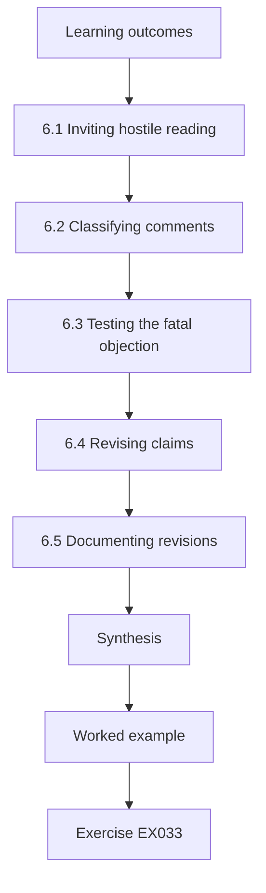

### Logical drawing

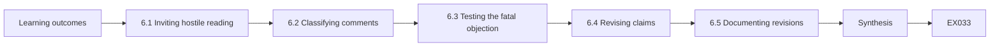

```text
[Learning outcomes]
    |
    v
[6.1 Inviting hostile reading]
    |
    v
[6.2 Classifying comments]
    |
    v
[6.3 Testing the fatal objection]
    |
    v
[6.4 Revising claims]
    |
    v
[6.5 Documenting revisions]
    |
    v
[Synthesis]
    |
    v
[Worked example] --> [Exercise EX033]
```
<!-- open-cyber-academy:lesson-figures:end ch-06 -->


### Learning outcomes

You will (1) seek critique that could overturn your conclusions; (2) classify reviewer comments by their consequence; (3) revise claims, not just wording; (4) document revisions transparently.

### 6.1 Inviting hostile reading

Amara circulates her results chapter to three readers chosen to disagree: an empirical software engineering researcher sceptical of observational designs, a practising enterprise architect who uses SABSA and doubts that defect counts capture architecture quality, and a threat-modelling advocate who suspects the effect is underestimated. She asks each to identify the weakest claim and the analysis that could overturn it. Inviting critique from people with different commitments is a practical defence against the comfortable blindness that comes from discussing work only with supportive colleagues and a supervisor who has watched it grow.

### 6.2 Classifying comments

Amara sorts comments into three groups. Fatal comments, if correct, would invalidate the main claim. Material comments would change an estimate or an interpretation. Presentational comments affect clarity. The sceptical researcher's point that adoption timing might follow team performance is potentially fatal, because teams adopting after a bad year would show regression to the mean. The architect's point that defect counts ignore design quality is material for interpretation. Several comments about figure labels are presentational. Sorting this way ensures she spends effort where it matters, rather than polishing prose while a fatal objection waits.

### 6.3 Testing the fatal objection

To test the regression-to-the-mean objection, Amara compares each adopting team's defect rate in the year before adoption with its longer history. If teams adopted after unusually bad years, their pre-adoption rates would sit above their own averages. She finds adopting teams' pre-adoption rates within normal variation, and comparison teams show similar patterns. She also reruns the estimate using a two-year pre-period instead of one, which changes it only slightly. The objection is not refuted absolutely, but its predicted signature is absent. She reports the test and its result, crediting the reviewer by name with permission.

### 6.4 Revising claims

The architect's comment leads to a substantive revision. Amara had written that threat modelling improves architecture security. She now writes that it was associated with fewer post-release architecture defects as coded in the study, and adds a paragraph on what defect counts miss: designs that are secure but brittle, or defects in systems never released. She also adds a qualitative appendix with interviews from six architects about how sessions changed their designs. The claim is now smaller but defensible, and the appendix gives readers another kind of evidence to weigh against the counts.

### 6.5 Documenting revisions

Every change after critique goes into a revision table with the comment, its classification, the response and the location of the change. Where Amara disagrees, she explains why, for example declining the advocate's request to drop low-fidelity teams from the main analysis because that would bias the estimate upward. The table becomes an appendix. Prof. Quintero notes that examiners read revision tables closely because they show how a candidate handles disagreement. Transparent revision distinguishes scholarly confidence, which rests on tested objections, from mere assertiveness, which rests on not having asked.

### Worked example

Amara collects critique from three opposed readers, classifies comments as fatal, material or presentational, tests regression to the mean, narrows her central claim and publishes a revision table.

> **Synthetic case.** Reviewers, comments and tests are synthetic.

### Errors and limits

Absence of an objection's signature is not proof it is wrong. Reviewers chosen by the author may still share blind spots.

### Exercises

- **EX033 — Reader selection.** Why choose readers who disagree with each other? *Rubric:* 3 = different commitments expose different weaknesses and counter comfortable blindness;; 2 = diversity;; 1 = supportive readers;; 0 = none.
- **EX034 — Fatal objection.** Which objection was potentially fatal and why? *Rubric:* 3 = adoption after bad years causes regression to the mean that mimics an effect;; 2 = named;; 1 = presentational;; 0 = none.
- **EX035 — Regression signature.** What signature would regression to the mean leave, and was it found? *Rubric:* 3 = pre-adoption rates above teams' own averages; not found;; 2 = signature only;; 1 = found;; 0 = none.
- **EX036 — Narrowed claim.** How did Amara rewrite her central claim? *Rubric:* 3 = associated with fewer post-release architecture defects as coded, not improves security;; 2 = narrower;; 1 = unchanged;; 0 = none.
- **EX037 — Declined request.** Which reviewer request did she decline and why? *Rubric:* 3 = dropping low-fidelity teams, as it would bias the estimate upward;; 2 = declined;; 1 = accepted;; 0 = none.
- **EX038 — Revision table value.** Why do examiners read revision tables closely? *Rubric:* 3 = they show how the candidate handles disagreement;; 2 = disagreement;; 1 = formatting;; 0 = none.

### Synthesis

Critique is most valuable when invited from opponents, sorted by consequence and answered by tests and narrower claims.

### Continue studying — chapter 06 of 08

[← Chapter 05 (draft)](#ch-05) · [Course chapter index](../SUBJECTS.md) · [Chapter 07 (draft) →](#ch-07)

<a id="ch-07"></a>

## Chapter 7 — Thesis synthesis and reproducibility archive

<!-- open-cyber-academy:lesson-figures:start ch-07 -->
### Lesson map

Lesson 07 published. Map, example, EX039.

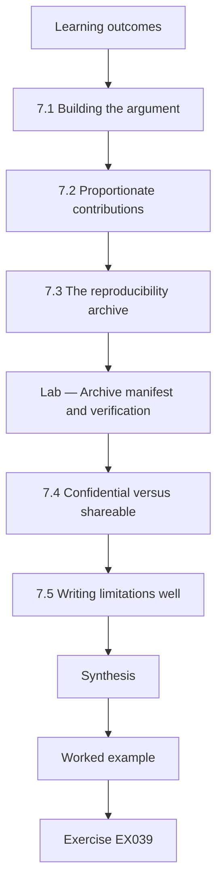

### Logical drawing

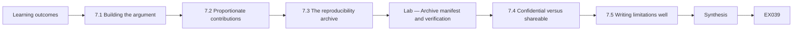

```text
[Learning outcomes]
    |
    v
[7.1 Building the argument]
    |
    v
[7.2 Proportionate contributions]
    |
    v
[7.3 The reproducibility archive]
    |
    v
[Lab — Archive manifest and verification]
    |
    v
[7.4 Confidential versus shareable]
    |
    v
[7.5 Writing limitations well]
    |
    v
[Synthesis]
    |
    v
[Worked example] --> [Exercise EX039]
```
<!-- open-cyber-academy:lesson-figures:end ch-07 -->


### Learning outcomes

You will (1) synthesise studies into a coherent thesis argument; (2) state contributions and limits in proportion to evidence; (3) build a reproducibility archive with integrity checks; (4) separate shareable artefacts from confidential data.

### 7.1 Building the argument

Amara's thesis has four empirical parts: the coding manual and its agreement, the baseline replication, the pilot and the main study with validation. The synthesis chapter connects them into one argument. Reliable measurement made the baseline trustworthy; the baseline exposed a dashboard error; the pilot refined the protocol; and the main study estimated a modest effect that survived validation and critique. Each link names its evidence. A thesis is not a collection of papers but an argument in which each part supplies a premise, and the synthesis shows the reader how the premises support the conclusion.

### 7.2 Proportionate contributions

She lists contributions with the strength of evidence for each. Strong: a reusable coding manual with substantial agreement and a public synthetic replication package. Moderate: an estimate of about a fifth fewer post-release architecture defects at one organisation. Weak and exploratory: the association between fidelity and effect. She lists what the thesis does not show: effects in other industries, effects on undiscovered defects or long-term design quality. Proportion matters because readers in industry may adopt practices on the strength of a thesis summary, and overstatement can waste their resources or create false confidence.

### 7.3 The reproducibility archive

Real defect records cannot leave Tessaro, so Amara's archive contains the analysis scripts, the coding manual, the fidelity checklist, a synthetic dataset generated to match the real data's structure and summary statistics, and a document explaining how the real data can be requested under agreement. Each file is listed in a manifest with its SHA-256 digest, so anyone can check that what they downloaded is what she archived. The lab below builds such a manifest for synthetic files and verifies it. She deposits the archive with a persistent identifier from her university repository.

### Lab — Archive manifest and verification

```python
# Build and verify a SHA-256 manifest for a synthetic replication package.
import hashlib
files = {"analysis/did.py": b"# synthetic analysis script\n", "data/synthetic_teams.csv": b"team,wave,pre,post\nT01,1,3.6,2.9\n",
         "docs/coding_manual.md": b"# Coding manual v3\n", "docs/fidelity_checklist.md": b"- DFD drawn\n- STRIDE per element\n"}
manifest = {p: hashlib.sha256(b).hexdigest() for p, b in files.items()}
files["data/synthetic_teams.csv"] += b"T02,2,4.1,3.0\n"   # simulated later edit
for p, b in files.items():
    print(f"{p:28} {'OK' if hashlib.sha256(b).hexdigest() == manifest[p] else 'MISMATCH'}")
```

Run with `python3 lab_archive.py`. Verified output:

```text
analysis/did.py              OK
data/synthetic_teams.csv     MISMATCH
docs/coding_manual.md        OK
docs/fidelity_checklist.md   OK
```

### 7.4 Confidential versus shareable

Amara applies a simple rule: share everything that does not identify people, customers or exploitable weaknesses. Coding manuals, scripts and synthetic data are shared. Real defect descriptions, which could reveal live vulnerabilities in Tessaro systems, are not. Interview transcripts are summarised in themes without quotes that could identify architects. She asks Tessaro's security team to review the archive for accidental disclosure, and they find one script comment naming an internal system, which she removes. Responsible sharing makes the work reproducible without creating a map of the partner's weaknesses.

### 7.5 Writing limitations well

The limitations section is specific. Instead of saying that results may not generalise, Amara writes that Tessaro has a central architecture board and mature defect tracking, so organisations lacking either may see different effects. Instead of saying that measurement may be imperfect, she gives the agreement value and names the defect types coders found hardest to classify. Specific limitations help later researchers design better studies, and they show examiners that the candidate understands the evidence well enough to know exactly where it stops. Vague limitations, by contrast, read as ritual and are usually skipped.

### Worked example

Amara writes a synthesis chapter linking four studies, grades contributions strong, moderate or weak, builds a SHA-256 manifest for a synthetic replication package and removes one disclosing comment after partner review.

> **Synthetic case.** Archive contents and partner review are synthetic.

### Errors and limits

Synthetic datasets can omit correlations that matter for some analyses. Manifests detect changes but do not authenticate the author unless signed.

### Exercises

- **EX039 — Thesis versus papers.** How does a thesis differ from a set of papers? *Rubric:* 3 = it is one argument in which each part supplies a premise;; 2 = argument;; 1 = same;; 0 = none.
- **EX040 — Graded contributions.** Which contribution did Amara grade as weak and exploratory? *Rubric:* 3 = association between fidelity and effect;; 2 = named;; 1 = effect estimate;; 0 = none.
- **EX041 — Archive manifest result.** What did the lab report after one archived file was altered? *Rubric:* 3 = the altered file failed verification and others passed;; 2 = failure noted;; 1 = all passed;; 0 = none.
- **EX042 — Synthetic data role.** Why does the archive contain synthetic rather than real data? *Rubric:* 3 = real defect records are confidential and could reveal live vulnerabilities;; 2 = confidential;; 1 = not needed;; 0 = none.
- **EX043 — Script comment.** What did Tessaro's review find in the archive? *Rubric:* 3 = a script comment naming an internal system, then removed;; 2 = comment;; 1 = vague;; 0 = none.
- **EX044 — Specific limitation.** Rewrite results may not generalise specifically. *Rubric:* 3 = Tessaro has a central architecture board and mature tracking; organisations without these may differ;; 2 = specific;; 1 = vague;; 0 = none.

### Synthesis

A thesis synthesis argues proportionately from linked evidence and leaves a verified, responsibly redacted archive behind.

### Continue studying — chapter 07 of 08

[← Chapter 06 (draft)](#ch-06) · [Course chapter index](../SUBJECTS.md) · [Chapter 08 (draft) →](#ch-08)

<a id="ch-08"></a>

## Chapter 8 — Defense and publication plan

<!-- open-cyber-academy:lesson-figures:start ch-08 -->
### Lesson map

Lesson 08 published. Map, example, EX045.

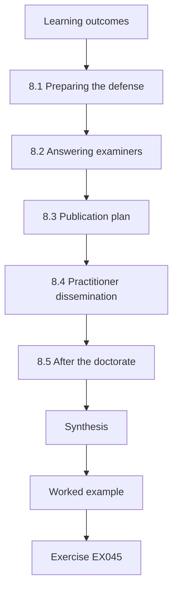

### Logical drawing

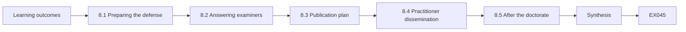

```text
[Learning outcomes]
    |
    v
[8.1 Preparing the defense]
    |
    v
[8.2 Answering examiners]
    |
    v
[8.3 Publication plan]
    |
    v
[8.4 Practitioner dissemination]
    |
    v
[8.5 After the doctorate]
    |
    v
[Synthesis]
    |
    v
[Worked example] --> [Exercise EX045]
```
<!-- open-cyber-academy:lesson-figures:end ch-08 -->


### Learning outcomes

You will (1) prepare a defense around the strongest objections; (2) answer examiners with evidence and concession; (3) plan publication venues and order; (4) plan dissemination to practitioners without overstating results.

### 8.1 Preparing the defense

Amara prepares by writing the ten hardest questions she expects, drawn from the revision table and her own doubts, and drafting evidence-based answers. Examples include why a single organisation, why not randomise, how coding reliability affects the estimate and what would change her mind. She rehearses with colleagues instructed to interrupt. Prof. Quintero advises that the defense is not a performance of certainty but a demonstration that she knows the boundaries of her evidence. Preparation turns anxiety into a list of specific, answerable questions, each linked to a section of the thesis.

### 8.2 Answering examiners

During the defense an external examiner argues that difference-in-differences cannot exclude unobserved shocks hitting only adopting teams. Amara agrees that it cannot exclude them completely, explains the quarterly log of concurrent changes and the sensitivity analysis, and proposes the test that would settle it: a future study with randomised wave order. A second examiner asks whether ninety minutes per change is worth a fifth fewer defects. She answers that this is a decision for each organisation and gives the inputs needed to make it. Concession where evidence is limited makes the remaining claims more credible.

### 8.3 Publication plan

She plans three outputs. The main study goes to a peer-reviewed empirical software engineering or security venue with the replication package. The coding manual and agreement study go to a workshop or journal focused on measurement. The pilot lessons go to a practitioner venue. She orders submissions so that the measurement paper, on which the others depend, appears first, and she cites the archive identifier in each. She agrees with Tessaro which details will be anonymised in all outputs and gives them the same advance review right as during the thesis.

### 8.4 Practitioner dissemination

Practitioners read summaries, not theses. Amara writes a two-page brief stating the finding in plain terms: at one insurer, adding a ninety-minute threat-modelling step to design review was associated with about a fifth fewer post-release architecture defects. It lists the conditions, costs and uncertainties, and links to the protocol and checklist. She declines a vendor's invitation to present the result as proof that its threat-modelling tool works, because her study did not test any tool. Careful dissemination protects both the research and the practitioners who might act on it.

### 8.5 After the doctorate

Amara records future work: a randomised-wave replication, a multi-organisation study across industries, measurement of design quality beyond defects and study of how threat modelling interacts with zero trust architectures under SP 800-207. She offers her coding manual to other researchers and agrees to review a replication proposal. Her final reflection notes that the most valuable skill learnt was not a statistical method but the habit of asking, for every claim, what observation would show it false and whether that observation had been sought. She intends to keep that habit in every future project.

### Worked example

Amara rehearses ten hard questions, concedes the unobserved-shock limit with a proposed randomised replication, orders three publications with the measurement paper first and declines a vendor endorsement.

> **Synthetic case.** Examiners, venues and the vendor invitation are synthetic; SP 800-207 is real.

### Errors and limits

Publication timelines are uncertain; plans should not delay sharing the archive. Practitioner briefs lose nuance and must link to full limitations.

### Exercises

- **EX045 — Defense purpose.** What does Prof. Quintero say the defense demonstrates? *Rubric:* 3 = knowledge of the boundaries of the evidence, not certainty;; 2 = boundaries;; 1 = certainty;; 0 = none.
- **EX046 — Unobserved shocks.** How does Amara answer the unobserved-shock objection? *Rubric:* 3 = concedes it cannot be fully excluded, cites concurrent-change log and sensitivity, proposes randomised wave order;; 2 = concession plus one;; 1 = denies;; 0 = none.
- **EX047 — Cost-worth question.** How does she answer whether ninety minutes is worth it? *Rubric:* 3 = a decision for each organisation; she supplies the inputs;; 2 = organisation decides;; 1 = yes always;; 0 = none.
- **EX048 — First paper.** Which paper is submitted first and why? *Rubric:* 3 = the measurement paper, because the others depend on it;; 2 = measurement;; 1 = main study;; 0 = none.
- **EX049 — Vendor decline.** Why decline the vendor's invitation? *Rubric:* 3 = the study did not test any tool, so it cannot endorse one;; 2 = no tool tested;; 1 = accepts;; 0 = none.
- **EX050 — Lasting habit.** What skill does Amara name as most valuable? *Rubric:* 3 = asking what observation would falsify each claim and seeking it;; 2 = falsification habit;; 1 = statistics;; 0 = none.

### Synthesis

A defense and publication plan succeed when they concede real limits, sequence outputs by dependency and refuse to let results be overstated.

### Continue studying — chapter 08 of 08

[← Chapter 07 (draft)](#ch-07) · [Course chapter index](../SUBJECTS.md) · [Worked results ↓](#worked-results) · [Next course via chapter index →](../SUBJECTS.md)

<a id="worked-results"></a>

## Worked results

Model answers for EX001–EX050. Amara Lind, Prof. Rafael Quintero, Halden Institute of Technology, Tessaro Insurance Group and every figure are synthetic. Lab answers quote verified outputs. Any answer meeting the rubric scores equally.

**EX001.** Adopting teams showing no lower, or a higher, rate of post-release architecture defects per hundred design changes than comparison teams over twelve months.

**EX002.** Many security claims are unfalsifiable: they assert benefit without saying which observation would show the benefit is absent.

**EX003.** It cannot distinguish the threat-modelling effect from improvement over time or from regression to the mean after bad years.

**EX004.** Because teams adopt according to budget cycles, which Amara cannot assign at random.

**EX005.** It may review drafts to remove confidential details but cannot block or change findings.

**EX006.** One whose fix requires changing a trust boundary, a component's responsibility or a data flow, rather than code inside one component.

**EX007.** Kappa was 0.79, with observed agreement 0.90, which falls in the substantial-agreement band of Landis and Koch.

**EX008.** Least privilege, fail-safe defaults and complete mediation.

**EX009.** No. They structure work and communication, but outcome improvement must be shown by empirical evidence.

**EX010.** No trust is granted based only on network location; every access request is authenticated and authorised.

**EX011.** Empirical evidence that compares outcomes against a credible counterfactual.

**EX012.** Because evidence from one organisation cannot support a general claim, so she states transfer conditions instead.

**EX013.** It lacks a comparison group and the vendor has a conflict of interest in the result.

**EX014.** Only to suggest hypotheses; never as evidence that a practice has an effect.

**EX015.** Because defects never discovered cannot be observed, so the outcome covers only those found.

**EX016.** It shows whether sessions followed the protocol, so a null result can be told apart from a failure to deliver the practice.

**EX017.** A reduction of about a quarter in post-release architecture defects.

**EX018.** At least eighteen months, because with about four defects per hundred changes shorter follow-up gives too few events.

**EX019.** Adopting teams may add other practices such as security champions; Amara records concurrent changes every quarter.

**EX020.** Because identifying more threats in workshops does not by itself show that fewer defects reach production.

**EX021.** The reported 4.1 counted duplicate tickets when one defect affected several teams; deduplication aligned the figures.

**EX022.** The intervention would have seemed effective even if nothing changed, because the baseline was overstated.

**EX023.** Three teams over three months produce too few defects to support any conclusion about effect.

**EX024.** It was under a renamed project; Amara fixed the project mapping and all ten were recovered.

**EX025.** They are like test vectors: known inputs with expected outputs that check the pipeline.

**EX026.** Large changes may now be threat-modelled in two separate sessions.

**EX027.** So that the wish to see the intervention succeed cannot influence how defects are classified.

**EX028.** That without the intervention, adopting and comparison teams would have followed parallel trends.

**EX029.** An estimate of -0.77 defects per hundred changes, with a permutation share of 0.022.

**EX030.** The estimate barely changed, which weakens the rival explanation that champions caused the reduction.

**EX031.** It fits the idea that the practice matters, but also the idea that less engaged teams both score low and improve less.

**EX032.** She avoids recommending universal adoption and states a modest reduction at Tessaro for about ninety minutes per change.

**EX033.** Because readers with different commitments look for different weaknesses, countering the blindness of supportive circles.

**EX034.** That teams adopting after bad years would improve anyway through regression to the mean, mimicking an effect.

**EX035.** Adopting teams' pre-adoption rates would sit above their own long-run averages; they did not.

**EX036.** That the practice was associated with fewer post-release architecture defects as coded, instead of saying it improves architecture security.

**EX037.** The request to drop low-fidelity teams, because excluding them would bias the effect estimate upward.

**EX038.** Because they reveal how the candidate tested and responded to objections.

**EX039.** It is a single argument in which each study supplies a premise toward the conclusion.

**EX040.** The association between session fidelity and the size of the effect.

**EX041.** The altered file was reported as a mismatch while the other files verified.

**EX042.** Because real defect records cannot leave Tessaro and might reveal exploitable weaknesses.

**EX043.** A comment in a script naming an internal system, which Amara removed.

**EX044.** Tessaro's central architecture board and mature defect tracking may not exist elsewhere, so effects could differ there.

**EX045.** That the candidate knows exactly where the evidence stops, not that she is certain.

**EX046.** She concedes it cannot be completely excluded, points to the concurrent-change log and sensitivity analysis, and proposes randomising wave order in future.

**EX047.** It is each organisation's decision, and she provides the cost and effect inputs needed to make it.

**EX048.** The coding manual and agreement paper, because the other papers rely on that measurement.

**EX049.** Because no tool was tested, so presenting the result as proof of a product would misrepresent it.

**EX050.** The habit of asking what observation would show a claim false and checking whether it was sought.

<a id="references"></a>

## References

Links checked 12 October 2026; re-verify editions before citing. Organisations, people, systems and data in this book are synthetic unless a sentence cites a public source.

- Anderson, R. (2020). *Security engineering: A guide to building dependable distributed systems* (3rd ed.). Wiley. Author's page: <https://www.cl.cam.ac.uk/archive/rja14/book.html>
- Herley, C., & van Oorschot, P. C. (2017). SoK: Science, security and the elusive goal of security as a scientific pursuit. *2017 IEEE Symposium on Security and Privacy*, 99–120. <https://doi.org/10.1109/SP.2017.38>
- International Organization for Standardization. (2022). *ISO/IEC 27001:2022 Information security, cybersecurity and privacy protection — Information security management systems — Requirements*. <https://www.iso.org/standard/27001>
- International Organization for Standardization. (2022). *ISO/IEC 27002:2022 Information security, cybersecurity and privacy protection — Information security controls*. <https://www.iso.org/standard/75652.html>
- Joint Task Force. (2020). *Security and privacy controls for information systems and organizations* (NIST SP 800-53 Rev. 5). NIST. <https://doi.org/10.6028/NIST.SP.800-53r5>
- Landis, J. R., & Koch, G. G. (1977). The measurement of observer agreement for categorical data. *Biometrics*, 33(1), 159–174. <https://doi.org/10.2307/2529310>
- Rose, S., Borchert, O., Mitchell, S., & Connelly, S. (2020). *Zero trust architecture* (NIST SP 800-207). NIST. <https://doi.org/10.6028/NIST.SP.800-207>
- Ross, R., Winstead, M., & McEvilley, M. (2022). *Engineering trustworthy secure systems* (NIST SP 800-160 Vol. 1 Rev. 1). NIST. <https://doi.org/10.6028/NIST.SP.800-160v1r1>
- Saltzer, J. H., & Schroeder, M. D. (1975). The protection of information in computer systems. *Proceedings of the IEEE*, 63(9), 1278–1308. <https://doi.org/10.1109/PROC.1975.9939>
- Sherwood, J., Clark, A., & Lynas, D. (2005). *Enterprise security architecture: A business-driven approach* (SABSA). CMP Books.
- Shostack, A. (2014). *Threat modeling: Designing for security*. Wiley.
- The Open Group. (2016, revised 2022). *Integrating risk and security within a TOGAF enterprise architecture* (TOGAF Series Guide G152). The Open Group.
- Wohlin, C., Runeson, P., Höst, M., Ohlsson, M. C., Regnell, B., & Wesslén, A. (2012). *Experimentation in software engineering*. Springer. <https://doi.org/10.1007/978-3-642-29044-2>
