# Arquitetura e Engenharia de Segurança: Trilha de Pesquisa de Doutorado

- Idioma: português do Brasil (`pt`); curso 191, trilha de pesquisa de doutorado (2 anos). Edição de referência: [inglês](../../en/book/MANUSCRIPT.md).
- Estado editorial: **publicado**. Os capítulos 1–8 de 8 têm texto didático escrito à mão na edição em inglês; os exercícios EX001–EX050 têm resoluções correspondentes com rubricas de 0 a 3; os três laboratórios offline usam apenas a biblioteca padrão do Python 3 sobre dados sintéticos, e suas saídas foram incorporadas de execuções reais, idênticas às da edição em inglês. Revisão independente, revisão linguística e a verificação de 300 páginas A4 continuam em aberto.
- Público: doutorandos que testam se uma prática de arquitetura muda os resultados de segurança.
- Autor: [hiagokinlevi](https://github.com/hiagokinlevi). Texto original sob [CC0 1.0](../../../../../LICENSE); as obras citadas mantêm seus direitos.
- Limites: os laboratórios calculam concordância, uma estimativa de diferença em diferenças com um teste de permutação e os digests de um arquivo, sempre sobre dados sintéticos; nada toca uma organização real. Pessoas, organizações, sistemas e dados são **sintéticos**, salvo quando uma frase cita uma fonte pública.

[Página do curso](../../README.md) · [Índice de capítulos](../SUBJECTS.md) · [Plano do livro](PLAN.md) · [Skill do curso](../../skill/SKILL.md) · [Resoluções](#worked-results)

## Como usar este rascunho

Leia na ordem. Os capítulos acompanham uma doutoranda que testa se uma etapa de threat modeling com STRIDE na revisão de design reduz os defeitos de arquitetura após o lançamento: integridade e métodos, a fronteira da pesquisa, a proposta, a replicação da linha de base e o piloto, o estudo principal e a validação, a crítica, a síntese e o arquivo, e a defesa. Execute cada laboratório onde ele aparece, tente os exercícios antes de consultar as resoluções e avalie-se com as rubricas.

### Caso sintético

| Elemento | Papel | Natureza |
|---|---|---|
| **Amara Lind** | Doutoranda | Inventada |
| **Prof. Rafael Quintero** | Orientador | Inventado |
| **Halden Institute of Technology** | Universidade fictícia | Inventada |
| **Tessaro Insurance Group** | Parceira fictícia com trinta equipes de produto | Inventada |

### Fontes principais

Saltzer e Schroeder (1975), [doi:10.1109/PROC.1975.9939](https://doi.org/10.1109/PROC.1975.9939); Shostack, *Threat Modeling* (2014); NIST [SP 800-160 Vol. 1 Rev. 1](https://doi.org/10.6028/NIST.SP.800-160v1r1) e [SP 800-207](https://doi.org/10.6028/NIST.SP.800-207); Herley e van Oorschot (2017), [doi:10.1109/SP.2017.38](https://doi.org/10.1109/SP.2017.38); Wohlin et al. (2012). Lista completa em [Referências](#references).

## Sumário

| Capítulos em português |
|---|
| [1](#ch-01) · [2](#ch-02) · [3](#ch-03) · [4](#ch-04) · [5](#ch-05) · [6](#ch-06) · [7](#ch-07) · [8](#ch-08) |

[Resoluções](#worked-results) · [Referências](#references)

<a id="ch-01"></a>

## Capítulo 1 — Integridade e métodos avançados de pesquisa

<!-- open-cyber-academy:lesson-figures:start ch-01 -->
### Mapa da aula

Aula 01 publicada. Mapa, exemplo, EX001.

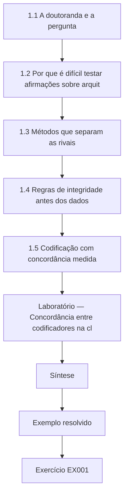

### Desenho lógico

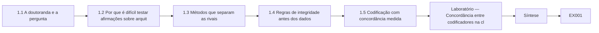

```text
[1.1 A doutoranda e a pergunta]
    |
    v
[1.2 Por que é difícil testar afirmações sobre arquit]
    |
    v
[1.3 Métodos que separam as rivais]
    |
    v
[1.4 Regras de integridade antes dos dados]
    |
    v
[1.5 Codificação com concordância medida]
    |
    v
[Laboratório — Concordância entre codificadores na cl]
    |
    v
[Síntese]
    |
    v
[Exemplo resolvido] --> [Exercício EX001]
```
<!-- open-cyber-academy:lesson-figures:end ch-01 -->


### Objetivos de aprendizagem

Você vai (1) formular uma pergunta de pesquisa falseável sobre uma prática de arquitetura; (2) escolher métodos capazes de distinguir a resposta de suas explicações rivais; (3) fixar regras de integridade para dados, parceiros e autoria antes de existir qualquer dado; (4) construir um esquema de codificação com concordância medida.

### 1.1 A doutoranda e a pergunta

Amara Lind é doutoranda no fictício Halden Institute of Technology, sob orientação do Prof. Rafael Quintero. Sua organização parceira é o fictício Tessaro Insurance Group, que mantém trinta equipes de produto construindo sistemas de sinistros, de apólices e de corretores. Todas as pessoas, organizações e números deste livro são sintéticos. A pergunta de Amara é se uma etapa estruturada de threat modeling na revisão de design, usando STRIDE como descrito por Shostack (2014), reduz a taxa de defeitos de segurança no nível da arquitetura encontrados após o lançamento, em comparação com a revisão de design sem essa etapa. A pergunta é falseável: um estudo bem conduzido poderia mostrar nenhuma redução, e ela se compromete de antemão a relatar esse resultado.

### 1.2 Por que é difícil testar afirmações sobre arquitetura

Herley e van Oorschot (2017) argumentam que boa parte do que se escreve sobre segurança faz afirmações que não podem ser refutadas, como dizer que uma prática melhora a segurança sem dizer que observação mostraria que ela não melhora. A arquitetura é especialmente exposta a esse problema, porque os resultados chegam tarde, os defeitos são raros e muitas práticas mudam ao mesmo tempo. Amara responde nomeando um desfecho mensurável, defeitos de arquitetura por cem mudanças de design encontrados nos doze meses após o lançamento, e nomeando de antemão as explicações rivais: maturidade da equipe, idade do sistema, regressão à média depois de anos ruins e mudanças na forma de reportar os defeitos.

### 1.3 Métodos que separam as rivais

Amara compara três desenhos. Uma comparação de antes e depois dentro das equipes que adotam a prática não consegue separar a prática da melhora geral ao longo do tempo. Um ensaio aleatorizado entre equipes seria o mais forte, mas a Tessaro não pode sortear quais equipes adotam, porque a adoção segue os ciclos orçamentários. Ela escolhe um desenho de adoção escalonada com equipes de comparação e uma análise de diferença em diferenças, seguindo a lógica de Wohlin et al. (2012) para experimentos em engenharia de software, e pré-registra o desfecho principal, as covariáveis e as regras de parada. Ela escreve que padrões de resultado apoiariam cada explicação rival, para que a análise possa testá-las, em vez de descartá-las com explicações depois.

### 1.4 Regras de integridade antes dos dados

Antes de coletar qualquer coisa, Amara acorda regras de integridade com a Tessaro e com seu comitê de ética. Os registros de defeitos são pseudonimizados, para que nenhum engenheiro possa ser identificado ou culpado. A Tessaro pode revisar os rascunhos em busca de detalhes confidenciais, mas não pode vetar os achados. O código, os manuais de codificação e réplicas sintéticas dos dados serão arquivados, enquanto os registros reais ficam com a Tessaro. A autoria segue a contribuição, e o assistente de codificação que classifica os defeitos será reconhecido. Ela registra essas regras com data e um hash do documento no seu caderno de laboratório, para que os leitores possam ver depois que elas não foram ajustadas quando os resultados já eram conhecidos.

### 1.5 Codificação com concordância medida

Classificar um defeito como de arquitetura ou de implementação é um julgamento, por isso Amara escreve um manual de codificação com definições e exemplos. Um defeito de arquitetura é aquele cuja correção exige mudar uma fronteira de confiança, a responsabilidade de um componente ou um fluxo de dados; um defeito de implementação pode ser corrigido dentro de um único componente. Ela e um segundo codificador classificam de forma independente um conjunto piloto e calculam o kappa de Cohen, interpretando-o com as faixas cautelosas de Landis e Koch (1977). O laboratório abaixo calcula o kappa sobre quarenta defeitos piloto sintéticos. Um valor baixo significaria que a medida de desfecho não é confiável e que o manual precisa de revisão antes que qualquer comparação faça sentido.

### Laboratório — Concordância entre codificadores na classe do defeito

```python
# Cohen's kappa for two coders classifying 40 synthetic defects (A=architecture, I=implementation).
c1 = "AAAAAAAAAAAAAAAAIIIIIIIIIIIIIIIIIIIIIIII"
c2 = "AAAAAAAAAAAAAAIIIIAIIIIIIIIIIIIIIIIIIAII"
n = len(c1); po = sum(a == b for a, b in zip(c1, c2)) / n
pe = sum((c1.count(k) / n) * (c2.count(k) / n) for k in "AI")
print(f"items={n} observed agreement={po:.3f} expected={pe:.3f} kappa={(po - pe) / (1 - pe):.2f}")
```

Execute com `python3 lab_kappa.py`. Saída verificada:

```text
items=40 observed agreement=0.900 expected=0.520 kappa=0.79
```

### Exemplo resolvido

Amara escreve a pergunta falseável com seu desfecho e quatro rivais, escolhe a adoção escalonada com diferença em diferenças, data e calcula o hash das suas regras de integridade e chega a um kappa de 0,79 na codificação piloto.

> **Caso sintético.** O Halden Institute, o Tessaro Insurance Group, Amara, Rafael e todos os dados são inventados; Shostack (2014), Herley e van Oorschot (2017), Wohlin et al. (2012) e Landis e Koch (1977) são reais.

### Erros e limites

O kappa depende da prevalência das classes e pode enganar quando uma classe domina. O pré-registro restringe a análise, mas não garante uma coleta de dados honesta.

### Exercícios

- **EX001 — Teste de falseabilidade.** Que observação refutaria a hipótese de Amara? *Rubrica:* 3 = nenhuma redução, ou um aumento, dos defeitos de arquitetura pós-lançamento por cem mudanças de design nas equipes que adotam, em relação às equipes de comparação;; 2 = nomeia o desfecho sem comparação;; 1 = diz que não pode ser refutada;; 0 = nenhuma.

- **EX002 — Crítica de Herley.** Que problema Herley e van Oorschot identificam nas afirmações de segurança? *Rubrica:* 3 = muitas afirmações não podem ser refutadas porque não nomeiam nenhuma observação que as contradiria;; 2 = afirmações não científicas;; 1 = vago;; 0 = nenhuma.

- **EX003 — Rejeição do antes e depois.** Por que um desenho simples de antes e depois é fraco aqui? *Rubrica:* 3 = não separa a prática da melhora geral ou da regressão à média;; 2 = uma rival;; 1 = desenho forte;; 0 = nenhuma.

- **EX004 — Sem aleatorização.** Por que a Tessaro não podia aleatorizar a adoção? *Rubrica:* 3 = a adoção segue ciclos orçamentários que a pesquisadora não controla;; 2 = orçamento;; 1 = só ética;; 0 = nenhuma.

- **EX005 — Veto da empresa.** Que direito a Tessaro tem sobre os rascunhos? *Rubrica:* 3 = revisar só em busca de detalhes confidenciais, sem veto sobre os achados;; 2 = revisão;; 1 = veto total;; 0 = nenhuma.

- **EX006 — Definição de defeito.** Como o manual define um defeito de arquitetura? *Rubrica:* 3 = a correção exige mudar uma fronteira de confiança, a responsabilidade de um componente ou um fluxo de dados;; 2 = parcial;; 1 = qualquer bug;; 0 = nenhuma.

- **EX007 — Kappa do piloto.** Que kappa o laboratório relatou e como ele é lido? *Rubrica:* 3 = 0,79, concordância substancial nas faixas de Landis e Koch;; 2 = só o valor;; 1 = abaixo de 0,4;; 0 = nenhuma.

### Síntese

A pesquisa de doutorado em arquitetura começa com uma pergunta falseável, um desenho capaz de separar as explicações rivais, regras de integridade fixadas de antemão e uma medida de resultado confiável.

<!-- open-cyber-academy:chapter-navigation:start ch-01 -->
### Continue estudando — aula 01 (capítulo 01 de 08)

[← Início do curso](../../README.md) · [Índice das aulas](../SUBJECTS.md) · [Capítulo 02 →](#ch-02)

Continue para a próxima aula já escrita.
<!-- open-cyber-academy:chapter-navigation:end -->

<a id="ch-02"></a>

## Capítulo 2 — Arquitetura e engenharia de segurança: fronteira da pesquisa

<!-- open-cyber-academy:lesson-figures:start ch-02 -->
### Mapa da aula

Aula 02 publicada. Mapa, exemplo, EX008.

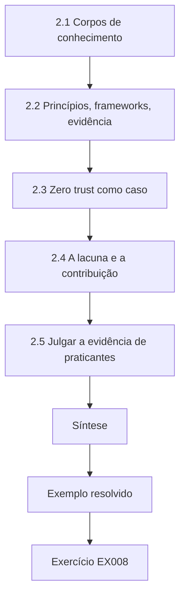

### Desenho lógico

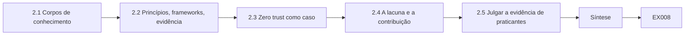

```text
[2.1 Corpos de conhecimento]
    |
    v
[2.2 Princípios, frameworks, evidência]
    |
    v
[2.3 Zero trust como caso]
    |
    v
[2.4 A lacuna e a contribuição]
    |
    v
[2.5 Julgar a evidência de praticantes]
    |
    v
[Síntese]
    |
    v
[Exemplo resolvido] --> [Exercício EX008]
```
<!-- open-cyber-academy:lesson-figures:end ch-02 -->


### Objetivos de aprendizagem

Você vai (1) mapear os principais corpos de conhecimento em arquitetura de segurança; (2) separar princípios, frameworks e evidência empírica; (3) localizar a lacuna que o estudo de Amara trata; (4) julgar a qualidade da evidência na literatura de praticantes.

### 2.1 Corpos de conhecimento

O mapa da literatura de Amara tem quatro regiões. Os princípios começam com Saltzer e Schroeder (1975), cujos princípios de design, como menor privilégio, padrões à prova de falha e mediação completa, ainda enquadram as revisões de arquitetura. Os padrões de engenharia incluem o NIST SP 800-160 Vol. 1 Rev. 1, que trata a segurança como uma propriedade construída ao longo do ciclo de vida do sistema. Os frameworks corporativos incluem o SABSA, descrito por Sherwood, Clark e Lynas (2005), e o guia do The Open Group sobre a integração de risco e segurança ao TOGAF. Os livros de prática incluem Shostack (2014), sobre threat modeling, e Anderson (2020), sobre engenharia de segurança, que combina princípios com muitos estudos de caso de falhas.

### 2.2 Princípios, frameworks, evidência

Essas fontes são tipos diferentes de conhecimento. Os princípios são argumentos raciocinados sobre o que tende a tornar os sistemas mais seguros. Frameworks como o SABSA e o TOGAF organizam o trabalho e o vocabulário, o que ajuda as equipes a se comunicar, mas não mostra por si só que os resultados melhoram. Catálogos de controles como o NIST SP 800-53 Rev. 5 e a ISO/IEC 27002:2022 listam salvaguardas. A evidência empírica é uma quarta categoria: observações de que uma prática mudou os resultados em organizações reais. Amara acha essa quarta categoria escassa. Muitos artigos descrevem um método e um único caso, mas poucos comparam os resultados com um contrafactual crível.

### 2.3 Zero trust como caso

A arquitetura zero trust, descrita no NIST SP 800-207, mostra a velocidade com que uma fronteira avança. A publicação define princípios como autenticar e autorizar cada requisição e não conceder confiança com base na localização na rede. Fornecedores e governos adotaram o termo rapidamente, mas Amara encontra pouca evidência revisada por pares que meça como as implantações de zero trust mudam as taxas de incidentes. Isso não é uma crítica à orientação, que é uma referência de design, mas mostra uma lacuna recorrente: as ideias de arquitetura se espalham por padrões e pela prática mais rápido do que a pesquisa consegue testar seus efeitos. O próprio estudo dela fica nessa lacuna, no caso do threat modeling.

### 2.4 A lacuna e a contribuição

Depois da triagem, Amara encontra estudos sobre a usabilidade do threat modeling, estudos que contam as ameaças identificadas em oficinas e relatos de praticantes sobre a adoção. Ela não encontra, na sua busca, nenhum estudo que ligue uma etapa de threat modeling aos defeitos de arquitetura pós-lançamento com equipes de comparação. Essa é a lacuna dela. Ela declara a contribuição de forma estreita: uma estimativa, com incerteza, do efeito numa organização, um manual de codificação reutilizável e um pacote de replicação. Ela evita afirmar que o threat modeling funciona em geral, porque uma organização não sustenta essa afirmação, e lista as condições em que sua estimativa poderia se transferir.

### 2.5 Julgar a evidência de praticantes

Muito do conhecimento de arquitetura aparece em palestras de conferência, relatórios de fornecedores e blogs. Amara classifica cada fonte numa escala simples: relata como os dados foram coletados, inclui uma comparação, relata as falhas além dos sucessos e declara conflitos de interesse. Uma pesquisa de fornecedor que afirma grandes reduções depois da adoção da sua plataforma pontua baixo em comparação e em conflitos. A revisão pós-incidente honesta de uma equipe pontua mais alto em transparência, mesmo com um único caso. Ela usa as fontes de nota baixa apenas para gerar hipóteses, nunca como evidência de efeito, e declara essa regra no capítulo de métodos.

### Exemplo resolvido

Amara monta um mapa da literatura com quatro regiões, classifica vinte fontes como princípio, framework, catálogo ou empírica, dá notas aos relatos de praticantes e escreve uma declaração estreita da contribuição.

> **Caso sintético.** As contagens da triagem e os relatos classificados são sintéticos; as obras citadas são reais.

### Erros e limites

As buscas na literatura deixam passar a literatura cinzenta e os trabalhos fora do inglês. Uma lacuna pode existir porque uma pergunta é difícil de medir, e não porque ninguém pensou nela.

### Exercícios

- **EX008 — Princípios de Saltzer.** Cite três princípios de Saltzer e Schroeder. *Rubrica:* 3 = três entre menor privilégio, padrões à prova de falha, mediação completa, economia de mecanismo, design aberto, separação de privilégios, menor mecanismo comum, aceitabilidade psicológica;; 2 = dois;; 1 = vago;; 0 = nenhuma.

- **EX009 — Evidência dos frameworks.** Adotar o SABSA ou o TOGAF mostra, por si só, resultados melhores? *Rubrica:* 3 = não; os frameworks organizam o trabalho e o vocabulário, e os resultados exigem evidência empírica;; 2 = não;; 1 = sim;; 0 = nenhuma.

- **EX010 — Princípio do SP 800-207.** Enuncie um princípio de zero trust do SP 800-207. *Rubrica:* 3 = nenhuma confiança implícita pela localização na rede ou cada requisição autenticada e autorizada;; 2 = um;; 1 = confiar na rede interna;; 0 = nenhuma.

- **EX011 — Categoria escassa.** Que categoria de conhecimento Amara achou mais escassa? *Rubrica:* 3 = evidência empírica que compara resultados com um contrafactual;; 2 = empírica;; 1 = princípios;; 0 = nenhuma.

- **EX012 — Contribuição estreita.** Por que Amara evita afirmar que o threat modeling funciona em geral? *Rubrica:* 3 = uma organização não sustenta uma afirmação geral; ela lista as condições de transferência;; 2 = um local;; 1 = funciona;; 0 = nenhuma.

- **EX013 — Nota da pesquisa do fornecedor.** Por que a pesquisa de um fornecedor sobre a própria plataforma pontua baixo? *Rubrica:* 3 = não tem comparação e há conflito de interesse;; 2 = um motivo;; 1 = alta;; 0 = nenhuma.

- **EX014 — Uso das fontes de nota baixa.** Como as fontes de nota baixa podem ser usadas? *Rubrica:* 3 = só para gerar hipóteses, nunca como evidência de efeito;; 2 = hipóteses;; 1 = como evidência;; 0 = nenhuma.

### Síntese

A fronteira em arquitetura de segurança é rica em princípios e frameworks, mas pobre em evidências de resultado, o que define onde o trabalho de doutorado pode contribuir.

<!-- open-cyber-academy:chapter-navigation:start ch-02 -->
### Continue estudando — aula 02 (capítulo 02 de 08)

[← Capítulo 01](#ch-01) · [Índice das aulas](../SUBJECTS.md) · [Capítulo 03 →](#ch-03)

Continue para a próxima aula já escrita.
<!-- open-cyber-academy:chapter-navigation:end -->

<a id="ch-03"></a>

## Capítulo 3 — Proposta de contribuição original

<!-- open-cyber-academy:lesson-figures:start ch-03 -->
### Mapa da aula

Aula 03 publicada. Mapa, exemplo, EX015.

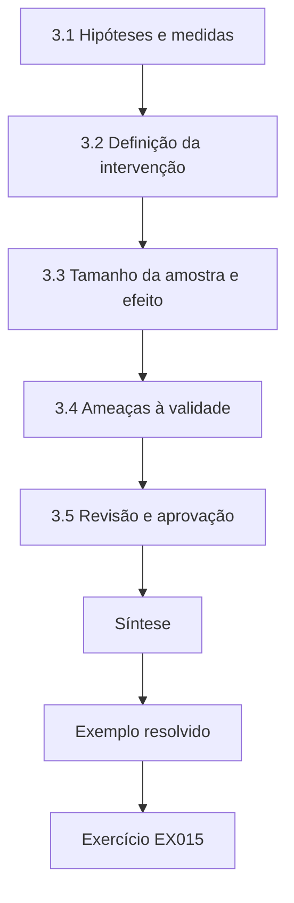

### Desenho lógico

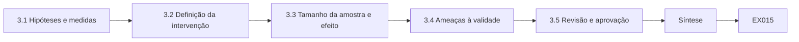

```text
[3.1 Hipóteses e medidas]
    |
    v
[3.2 Definição da intervenção]
    |
    v
[3.3 Tamanho da amostra e efeito]
    |
    v
[3.4 Ameaças à validade]
    |
    v
[3.5 Revisão e aprovação]
    |
    v
[Síntese]
    |
    v
[Exemplo resolvido] --> [Exercício EX015]
```
<!-- open-cyber-academy:lesson-figures:end ch-03 -->


### Objetivos de aprendizagem

Você vai (1) escrever uma proposta que declare de antemão hipóteses, medidas e análise; (2) definir a intervenção com precisão suficiente para ser replicada; (3) planejar o tamanho da amostra diante de tamanhos de efeito realistas; (4) antecipar as ameaças à validade.

### 3.1 Hipóteses e medidas

A proposta de Amara declara uma hipótese principal: as equipes que acrescentarem uma etapa de threat modeling com STRIDE à revisão de design apresentarão uma taxa menor de defeitos de arquitetura pós-lançamento por cem mudanças de design do que as equipes de comparação, medida ao longo de doze meses após cada mudança. As hipóteses secundárias tratam da gravidade dos defeitos e do tempo de correção. Cada medida tem uma definição, uma fonte de dados e uma regra de codificação. Ela também declara o que não é medido, como os defeitos nunca descobertos, e explica por quê: eles não podem ser contados, de modo que o estudo só pode estimar efeitos sobre os defeitos descobertos, uma limitação que ela vai repetir em todos os capítulos que relatarem resultados.

### 3.2 Definição da intervenção

Uma intervenção vaga não pode ser replicada. Amara a especifica em detalhe: antes da aprovação do design, a equipe desenha um diagrama de fluxo de dados com as fronteiras de confiança, percorre cada elemento pelas seis categorias do STRIDE, registra as ameaças com responsáveis e mitigações, e um arquiteto de fora da equipe revisa o registro. A sessão tem duração limitada a noventa minutos para uma mudança típica. Ela escreve um checklist de fidelidade, para que cada sessão possa ser pontuada quanto à aderência ao protocolo. Sem dados de fidelidade, um resultado nulo seria impossível de interpretar, porque ninguém saberia se a prática foi de fato aplicada.

### 3.3 Tamanho da amostra e efeito

Os defeitos de arquitetura são raros: o histórico da Tessaro mostra cerca de quatro por cem mudanças de design. Amara pergunta que redução importaria para a Tessaro, e a liderança de segurança diz que um quarto a menos de defeitos justificaria o custo de tempo. Com trinta equipes e cerca de quarenta mudanças de design por equipe por ano, ela simula o estudo muitas vezes sob esse efeito suposto e descobre que detectá-lo de forma confiável exige pelo menos dezoito meses de acompanhamento. Ela registra a simulação, suas premissas e o plano resultante, e observa que um efeito verdadeiro menor poderia facilmente passar despercebido, o que ela vai relatar, e não esconder.

### 3.4 Ameaças à validade

Seguindo Wohlin et al. (2012), Amara lista as ameaças em quatro grupos. Validade de construto: a classificação dos defeitos pode não captar o que os arquitetos entendem por falha de arquitetura. Validade interna: as equipes que adotam a prática podem mudar também outras práticas, como acrescentar security champions. Validade externa: uma seguradora com uma função central de arquitetura pode ser diferente de uma startup. Validade de conclusão: desfechos raros geram incerteza ampla. Para cada ameaça, ela escreve uma mitigação, como registrar a cada trimestre as mudanças de prática simultâneas e relatar intervalos de confiança, e não apenas testes de significância.

### 3.5 Revisão e aprovação

Amara apresenta a proposta à sua banca e ao conselho de arquitetura da Tessaro. A banca pergunta por que ela não mede também as ameaças encontradas nas sessões; ela a acrescenta como medida de processo, não de desfecho, porque encontrar mais ameaças não prova que haja menos defeitos. A Tessaro pede que as equipes não sejam ranqueadas publicamente; ela concorda em relatar apenas agregados. Os dois grupos aprovam, e ela registra a proposta com carimbo de tempo. Ela mantém um log de mudanças: qualquer alteração posterior nas medidas ou na análise será registrada com o motivo e relatada, para que os leitores distingam os resultados planejados dos exploratórios.

### Exemplo resolvido

Amara escreve uma proposta com uma hipótese principal e duas secundárias, um protocolo STRIDE de noventa minutos com checklist de fidelidade, um acompanhamento de dezoito meses baseado em simulação e uma tabela de validade.

> **Caso sintético.** As taxas de defeitos, o número de equipes e as decisões do conselho são sintéticos; Wohlin et al. (2012) e Shostack (2014) são reais.

### Erros e limites

O poder simulado depende da variação suposta entre as equipes. Os checklists de fidelidade podem virar preenchimento burocrático se os revisores não observarem as sessões.

### Exercícios

- **EX015 — Defeitos não descobertos.** Por que o estudo só pode estimar efeitos sobre os defeitos descobertos? *Rubrica:* 3 = os defeitos não descobertos não podem ser contados, então ficam fora da medida;; 2 = não podem ser contados;; 1 = inclui todos;; 0 = nenhuma.

- **EX016 — Propósito da fidelidade.** Por que um checklist de fidelidade é essencial para interpretar um resultado nulo? *Rubrica:* 3 = mostra se a prática foi de fato aplicada; sem ele, o nulo é ambíguo;; 2 = aplicada;; 1 = não é necessário;; 0 = nenhuma.

- **EX017 — Efeito relevante.** Que redução a liderança da Tessaro disse que importaria? *Rubrica:* 3 = um quarto a menos de defeitos de arquitetura;; 2 = um quarto;; 1 = qualquer uma;; 0 = nenhuma.

- **EX018 — Duração do acompanhamento.** Que acompanhamento a simulação sugeriu, e por quê? *Rubrica:* 3 = pelo menos dezoito meses, porque os defeitos são raros;; 2 = dezoito meses;; 1 = seis meses;; 0 = nenhuma.

- **EX019 — Ameaça interna.** Dê uma ameaça à validade interna e sua mitigação. *Rubrica:* 3 = as equipes que adotam mudam também outras práticas; registrar as mudanças simultâneas a cada trimestre;; 2 = só a ameaça;; 1 = ameaça externa;; 0 = nenhuma.

- **EX020 — Medida de ameaças encontradas.** Por que as ameaças encontradas nas sessões são medida de processo, e não de desfecho? *Rubrica:* 3 = encontrar mais ameaças não prova que haja menos defeitos;; 2 = não é desfecho;; 1 = é desfecho;; 0 = nenhuma.

### Síntese

Uma proposta forte fixa por escrito hipóteses, intervenção, plano amostral e ameaças à validade antes que os dados de resultado sejam vistos.

<!-- open-cyber-academy:chapter-navigation:start ch-03 -->
### Continue estudando — aula 03 (capítulo 03 de 08)

[← Capítulo 02](#ch-02) · [Índice das aulas](../SUBJECTS.md) · [Capítulo 04 →](#ch-04)

Continue para a próxima aula já escrita.
<!-- open-cyber-academy:chapter-navigation:end -->

<a id="ch-04"></a>

## Capítulo 4 — Replicação da linha de base e piloto

<!-- open-cyber-academy:lesson-figures:start ch-04 -->
### Mapa da aula

Aula 04 publicada. Mapa, exemplo, EX021.

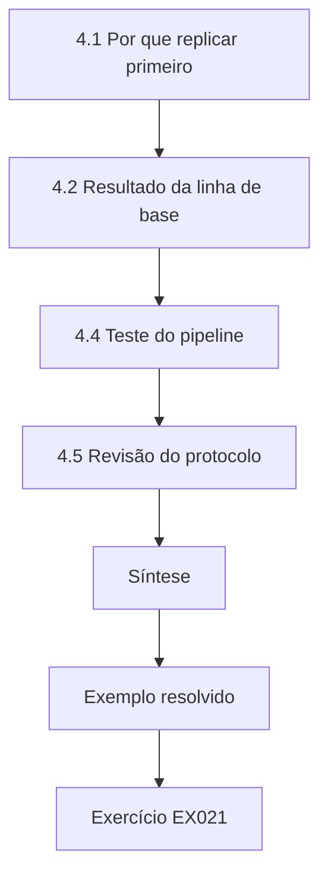

### Desenho lógico

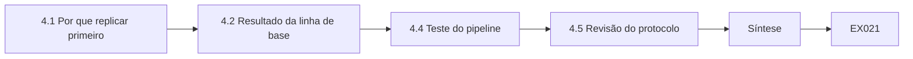

```text
[4.1 Por que replicar primeiro]
    |
    v
[4.2 Resultado da linha de base]
    |
    v
[4.4 Teste do pipeline]
    |
    v
[4.5 Revisão do protocolo]
    |
    v
[Síntese]
    |
    v
[Exemplo resolvido] --> [Exercício EX021]
```
<!-- open-cyber-academy:lesson-figures:end ch-04 -->


### Objetivos de aprendizagem

Você vai (1) replicar uma linha de base publicada ou anterior antes de estendê-la; (2) conduzir um piloto para testar procedimentos, não efeitos; (3) conferir os pipelines de dados contra valores conhecidos; (4) revisar o protocolo a partir das evidências do piloto.

### 4.1 Por que replicar primeiro

Antes de testar sua intervenção, Amara verifica se consegue reproduzir a linha de base histórica da própria Tessaro: cerca de quatro defeitos de arquitetura por cem mudanças de design. Se sua extração e sua codificação produzirem um número muito diferente dos registros da organização, ou os registros ou o método dela estão errados, e qualquer comparação posterior seria construída sobre areia. Replicar a linha de base é um teste barato de toda a cadeia de medição. Ela extrai dois anos de mudanças e defeitos históricos, codifica-os com o manual do capítulo 1 e compara sua taxa com o número que a liderança de segurança relatou nos documentos de planejamento.

### 4.2 Resultado da linha de base

A codificação dela dá 3,6 defeitos de arquitetura por cem mudanças, um pouco abaixo dos 4,1 relatados. Ao investigar, ela descobre que o número relatado contava chamados duplicados para o mesmo defeito quando várias equipes eram afetadas. Depois de remover as duplicatas, os dois números coincidem dentro do arredondamento. Essa pequena descoberta importa: se ela tivesse comparado suas medições posteriores com o número inflado do planejamento, a intervenção teria parecido funcionar mesmo que nada tivesse mudado. Ela registra a discrepância e a correção no log de mudanças e informa a Tessaro, cuja equipe de planejamento corrige o dashboard para os relatórios futuros.

### 4.3 Objetivos do piloto

O piloto roda com três equipes voluntárias por três meses. Seus objetivos são procedimentais: as equipes conseguem concluir o protocolo em noventa minutos, o checklist de fidelidade pode ser pontuado de forma consistente, o pipeline de dados de defeitos captura todos os chamados relevantes, e os engenheiros acham a sessão aceitável. O piloto explicitamente não serve para estimar o efeito, porque três equipes em três meses produziriam defeitos de menos para qualquer conclusão. Amara declara isso no plano do piloto, para que ninguém, nem ela mesma, se sinta tentado a anunciar um sucesso precoce a partir de um punhado de números.

### 4.4 Teste do pipeline

Amara insere dez chamados de teste sintéticos, com classificações conhecidas, numa cópia do rastreador de defeitos e roda seus scripts de extração. Nove chegam corretamente; um, aberto num projeto renomeado, se perde. Ela corrige o mapeamento de projetos e roda de novo, recuperando os dez. Ela mantém os chamados sintéticos como um teste de regressão permanente, que roda antes de cada extração de dados. Essa prática, tomada emprestada dos testes de software, dá uma verificação de resposta conhecida para o pipeline da pesquisa, da mesma forma que os vetores de teste dão uma verificação de resposta conhecida para o código criptográfico.

### 4.5 Revisão do protocolo

As evidências do piloto levam a três revisões. As sessões das mudanças grandes se estenderam, então o protocolo agora permite dividi-las em duas sessões. A pontuação de fidelidade divergiu sobre se as fronteiras de confiança tinham sido desenhadas, então o checklist ganha um diagrama de exemplo. Os engenheiros acharam útil, mas lenta, a revisão do arquiteto externo, então as revisões agora precisam terminar em até cinco dias úteis. Cada revisão é registrada com o motivo antes do início do estudo principal. Amara relata o piloto na tese como um capítulo separado, incluindo os problemas, porque quem for replicar o estudo vai enfrentar as mesmas dificuldades práticas.

### Exemplo resolvido

Amara replica a linha de base em 3,6 por cem mudanças, atribui o número de 4,1 a chamados duplicados, corrige uma lacuna do pipeline com chamados de teste sintéticos e registra três revisões do protocolo.

> **Caso sintético.** Os números da linha de base, as equipes do piloto e os chamados são sintéticos.

### Erros e limites

Um piloto com equipes voluntárias pode ser mais motivado do que as equipes típicas. Os testes de regressão só detectam os modos de falha conhecidos.

### Exercícios

- **EX021 — Discrepância da linha de base.** O que explicou a diferença entre 3,6 e 4,1? *Rubrica:* 3 = chamados duplicados para o mesmo defeito entre equipes no número relatado;; 2 = duplicatas;; 1 = erro de codificação;; 0 = nenhuma.

- **EX022 — Risco da comparação inflada.** O que teria acontecido se o número inflado fosse usado como linha de base? *Rubrica:* 3 = a intervenção pareceria funcionar mesmo sem mudança real;; 2 = falso sucesso;; 1 = vago;; 0 = nenhuma.

- **EX023 — Piloto não é efeito.** Por que o piloto não foi usado para estimar o efeito? *Rubrica:* 3 = três equipes em três meses geram defeitos de menos;; 2 = poucos demais;; 1 = foi usado;; 0 = nenhuma.

- **EX024 — Chamado perdido.** Por que um chamado sintético se perdeu, e como isso foi corrigido? *Rubrica:* 3 = estava num projeto renomeado; o mapeamento de projetos foi corrigido;; 2 = causa;; 1 = vago;; 0 = nenhuma.

- **EX025 — Analogia dos chamados de teste.** Com o que os chamados sintéticos se parecem na prática criptográfica? *Rubrica:* 3 = vetores de teste de resposta conhecida;; 2 = vetores de teste;; 1 = vago;; 0 = nenhuma.

- **EX026 — Mudanças grandes.** Como o protocolo foi revisado para as mudanças grandes? *Rubrica:* 3 = permitiu dividi-las em duas sessões;; 2 = divisão;; 1 = encurtado;; 0 = nenhuma.

### Síntese

Replicar a linha de base e pilotar os procedimentos expõe erros de medição antes que eles possam se passar por efeitos.

<!-- open-cyber-academy:chapter-navigation:start ch-04 -->
### Continue estudando — aula 04 (capítulo 04 de 08)

[← Capítulo 03](#ch-03) · [Índice das aulas](../SUBJECTS.md) · [Capítulo 05 →](#ch-05)

Continue para a próxima aula já escrita.
<!-- open-cyber-academy:chapter-navigation:end -->

<a id="ch-05"></a>

## Capítulo 5 — Estudo principal e validação independente

<!-- open-cyber-academy:lesson-figures:start ch-05 -->
### Mapa da aula

Aula 05 publicada. Mapa, exemplo, EX027.

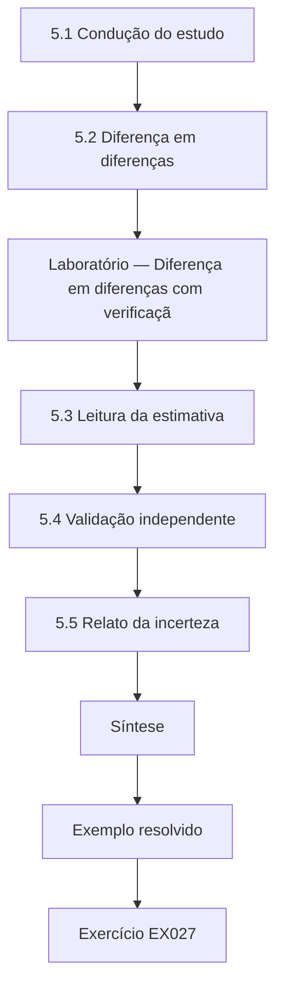

### Desenho lógico

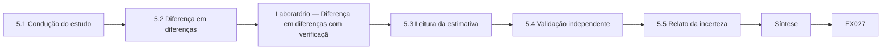

```text
[5.1 Condução do estudo]
    |
    v
[5.2 Diferença em diferenças]
    |
    v
[Laboratório — Diferença em diferenças com verificaçã]
    |
    v
[5.3 Leitura da estimativa]
    |
    v
[5.4 Validação independente]
    |
    v
[5.5 Relato da incerteza]
    |
    v
[Síntese]
    |
    v
[Exemplo resolvido] --> [Exercício EX027]
```
<!-- open-cyber-academy:lesson-figures:end ch-05 -->


### Objetivos de aprendizagem

Você vai (1) conduzir um estudo de adoção escalonada com equipes de comparação; (2) estimar um efeito com diferença em diferenças; (3) obter validação independente da codificação e da análise; (4) relatar a incerteza com honestidade.

### 5.1 Condução do estudo

Ao longo de dezoito meses, dezoito equipes da Tessaro adotam o protocolo em três ondas, conforme os orçamentos permitem, enquanto doze equipes continuam a revisão de design sem ele. Amara coleta todo mês as mudanças de design, as sessões, as pontuações de fidelidade e os defeitos. As mudanças simultâneas, como uma divisão que introduz security champions, são registradas num log trimestral. Ela evita influenciar os resultados: não participa das sessões, e o assistente de codificação que classifica os defeitos não sabe quais equipes adotaram a prática. O cegamento da codificação protege a medida de desfecho do desejo muito natural de ver a intervenção dar certo.

### 5.2 Diferença em diferenças

A análise compara a mudança na taxa de defeitos das equipes que adotam com a mudança nas equipes de comparação ao longo do mesmo período. Se os dois grupos melhoram igualmente, a diferença é zero e a prática não tem efeito mensurável além da tendência geral. O método pressupõe tendências paralelas: sem a intervenção, os dois grupos teriam evoluído de forma parecida. Amara verifica essa premissa nos dados anteriores à adoção e encontra tendências próximas o bastante para prosseguir. O laboratório abaixo calcula a estimativa sobre taxas sintéticas por equipe e período e uma verificação simples por permutação, que embaralha os rótulos de adoção para ver com que frequência uma diferença tão grande surge por acaso.

### Laboratório — Diferença em diferenças com verificação por permutação

```python
# Difference-in-differences on synthetic team rates (defects per 100 design changes) + permutation check.
import random, statistics
random.seed(5)
adopt = [(round(random.gauss(3.9, 0.5), 2), None) for _ in range(18)]
comp = [(round(random.gauss(3.7, 0.5), 2), None) for _ in range(12)]
adopt = [(b, round(b - 1.1 + random.gauss(0, 0.9), 2)) for b, _ in adopt]
comp = [(b, round(b - 0.3 + random.gauss(0, 0.9), 2)) for b, _ in comp]
def did(a, c):
    return statistics.mean(y - x for x, y in a) - statistics.mean(y - x for x, y in c)
est = did(adopt, comp)
print(f"adopting: {statistics.mean(x for x,_ in adopt):.2f} -> {statistics.mean(y for _,y in adopt):.2f}")
print(f"comparison: {statistics.mean(x for x,_ in comp):.2f} -> {statistics.mean(y for _,y in comp):.2f}")
print(f"DiD estimate: {est:.2f} per 100 changes")
allt = adopt + comp; hits = 0; R = 5000
for _ in range(R):
    random.shuffle(allt)
    if did(allt[:18], allt[18:]) <= est: hits += 1
print(f"permutation share as extreme: {hits / R:.3f}")
```

Execute com `python3 lab_did.py`. Saída verificada:

```text
adopting: 3.75 -> 2.80
comparison: 3.83 -> 3.65
DiD estimate: -0.77 per 100 changes
permutation share as extreme: 0.022
```

### 5.3 Leitura da estimativa

Nos dados sintéticos, as equipes que adotam caíram de 3,75 para 2,80 defeitos por cem mudanças (variação de -0,95), enquanto as equipes de comparação caíram de 3,83 para 3,65 (-0,18). A diferença em diferenças é de -0,77, cerca de menos 0,8, aproximadamente um quinto a menos de defeitos em relação à linha de base. A verificação por permutação mostra uma diferença desse tamanho em cerca de dois por cento dos embaralhamentos. Amara relata a estimativa com essa incerteza e observa que ela é um pouco menor que o quarto que a Tessaro esperava. Ela evita a palavra prova e escreve que os dados são compatíveis com uma redução modesta sob as premissas declaradas.

### 5.4 Validação independente

Um segundo pesquisador de outra universidade, que recebe apenas o manual de codificação e uma amostra aleatória de defeitos, os recodifica às cegas e chega a uma concordância substancial com a codificação original. Um estatístico roda de novo, de forma independente, a análise a partir dos scripts arquivados por Amara e obtém a mesma estimativa. A validação também abrange uma análise de sensibilidade: excluir a divisão que introduziu security champions muda a estimativa só um pouco, o que enfraquece essa explicação rival. Cada etapa de validação é relatada com quem a fez, o que recebeu e o que encontrou, incluindo uma pequena divergência de codificação resolvida com o esclarecimento de uma definição.

### 5.5 Relato da incerteza

A seção de resultados de Amara começa pela estimativa do efeito e seu intervalo, depois os dados de fidelidade, depois as análises de sensibilidade e, por fim, as limitações. Ela relata que as equipes com pontuação de fidelidade baixa mostraram pouca mudança, o que é compatível com a prática importar, mas também poderia refletir equipes menos engajadas. Ela evita recomendar a adoção universal e declara, em vez disso, que na Tessaro a prática esteve associada a uma redução modesta, a um custo de cerca de noventa minutos por mudança. Uma incerteza honesta torna o resultado útil para outras organizações que decidem se experimentam a prática nas suas próprias condições.

### Exemplo resolvido

Amara conduz o estudo de dezoito meses, estima uma diferença em diferenças de cerca de menos 0,8 defeito por cem mudanças, com p de permutação de cerca de 0,02, obtém a recodificação cega e uma nova execução independente e relata os resultados de fidelidade e de sensibilidade.

> **Caso sintético.** Todos os dados das equipes, as estimativas e os validadores são sintéticos.

### Erros e limites

As tendências paralelas podem valer antes da adoção e falhar depois. As verificações por permutação com poucas equipes têm resolução grosseira.

### Exercícios

- **EX027 — Codificação cega.** Por que o assistente de codificação não sabe quais equipes adotaram? *Rubrica:* 3 = para proteger a medida de desfecho do viés de expectativa;; 2 = viés;; 1 = rapidez;; 0 = nenhuma.

- **EX028 — Tendências paralelas.** Que premissa a diferença em diferenças exige? *Rubrica:* 3 = tendências paralelas entre os grupos sem a intervenção;; 2 = nomeada;; 1 = vago;; 0 = nenhuma.

- **EX029 — Estimativa do laboratório.** Que diferença em diferenças e que resultado de permutação o laboratório imprimiu? *Rubrica:* 3 = cerca de -0,77 por cem mudanças, proporção da permutação de cerca de 0,02;; 2 = só a estimativa;; 1 = positiva;; 0 = nenhuma.

- **EX030 — Sensibilidade aos champions.** O que mostrou a exclusão da divisão com security champions? *Rubrica:* 3 = a estimativa mudou só um pouco, enfraquecendo essa rival;; 2 = pequena mudança;; 1 = grande mudança;; 0 = nenhuma.

- **EX031 — Leitura da fidelidade baixa.** Por que o achado sobre a fidelidade baixa é ambíguo? *Rubrica:* 3 = é compatível com a prática importar ou com equipes menos engajadas;; 2 = as duas leituras;; 1 = uma leitura;; 0 = nenhuma.

- **EX032 — Afirmação evitada.** Que recomendação Amara evita, e o que declara no lugar? *Rubrica:* 3 = evita a adoção universal; declara uma redução modesta na Tessaro a cerca de noventa minutos por mudança;; 2 = parcial;; 1 = recomenda a adoção universal;; 0 = nenhuma.

### Síntese

Um estudo principal ganha credibilidade com grupos de comparação, medição cega, validação independente e incerteza relatada com clareza.

<!-- open-cyber-academy:chapter-navigation:start ch-05 -->
### Continue estudando — aula 05 (capítulo 05 de 08)

[← Capítulo 04](#ch-04) · [Índice das aulas](../SUBJECTS.md) · [Capítulo 06 →](#ch-06)

Continue para a próxima aula já escrita.
<!-- open-cyber-academy:chapter-navigation:end -->

<a id="ch-06"></a>

## Capítulo 6 — Crítica por pares e revisão

<!-- open-cyber-academy:lesson-figures:start ch-06 -->
### Mapa da aula

Aula 06 publicada. Mapa, exemplo, EX033.

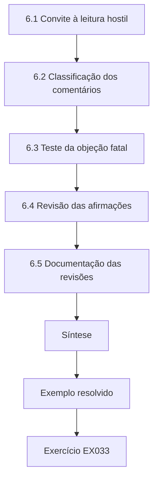

### Desenho lógico

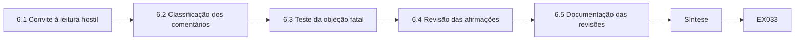

```text
[6.1 Convite à leitura hostil]
    |
    v
[6.2 Classificação dos comentários]
    |
    v
[6.3 Teste da objeção fatal]
    |
    v
[6.4 Revisão das afirmações]
    |
    v
[6.5 Documentação das revisões]
    |
    v
[Síntese]
    |
    v
[Exemplo resolvido] --> [Exercício EX033]
```
<!-- open-cyber-academy:lesson-figures:end ch-06 -->


### Objetivos de aprendizagem

Você vai (1) buscar a crítica capaz de derrubar suas conclusões; (2) classificar os comentários dos revisores pela consequência; (3) revisar as afirmações, e não só a redação; (4) documentar as revisões com transparência.

### 6.1 Convite à leitura hostil

Amara faz circular o capítulo de resultados entre três leitores escolhidos por discordarem: um pesquisador de engenharia de software empírica cético quanto a desenhos observacionais, um arquiteto corporativo em atividade que usa o SABSA e duvida que contagens de defeitos captem a qualidade da arquitetura, e um defensor do threat modeling que suspeita que o efeito esteja subestimado. Ela pede a cada um que identifique a afirmação mais fraca e a análise capaz de derrubá-la. Convidar a crítica de pessoas com compromissos diferentes é uma defesa prática contra a cegueira confortável que vem de discutir o trabalho só com colegas que apoiam e com um orientador que o viu crescer.

### 6.2 Classificação dos comentários

Amara separa os comentários em três grupos. Os comentários fatais, se corretos, invalidariam a afirmação principal. Os materiais mudariam uma estimativa ou uma interpretação. Os de apresentação afetam a clareza. O ponto do pesquisador cético de que o momento da adoção poderia acompanhar o desempenho das equipes é potencialmente fatal, porque as equipes que adotam depois de um ano ruim mostrariam regressão à média. O ponto do arquiteto de que as contagens de defeitos ignoram a qualidade do design é material para a interpretação. Vários comentários sobre os rótulos das figuras são de apresentação. Essa separação garante que ela dedique o esforço onde importa, em vez de polir o texto enquanto uma objeção fatal espera.

### 6.3 Teste da objeção fatal

Para testar a objeção da regressão à média, Amara compara a taxa de defeitos de cada equipe que adotou no ano anterior à adoção com o histórico mais longo dela. Se as equipes tivessem adotado depois de anos excepcionalmente ruins, suas taxas antes da adoção ficariam acima das suas próprias médias. Ela encontra as taxas pré-adoção dentro da variação normal, e as equipes de comparação mostram padrões semelhantes. Ela também refaz a estimativa usando um período anterior de dois anos em vez de um, o que a muda só um pouco. A objeção não é refutada de forma absoluta, mas sua assinatura prevista está ausente. Ela relata o teste e o resultado, creditando o revisor pelo nome, com permissão.

### 6.4 Revisão das afirmações

O comentário do arquiteto leva a uma revisão substantiva. Amara tinha escrito que o threat modeling melhora a segurança da arquitetura. Agora ela escreve que ele esteve associado a menos defeitos de arquitetura pós-lançamento, tal como codificados no estudo, e acrescenta um parágrafo sobre o que as contagens de defeitos deixam de fora: designs seguros, mas frágeis, ou defeitos em sistemas nunca lançados. Ela também acrescenta um apêndice qualitativo com entrevistas de seis arquitetos sobre como as sessões mudaram seus designs. A afirmação agora é menor, mas defensável, e o apêndice dá aos leitores outro tipo de evidência para pesar diante das contagens.

### 6.5 Documentação das revisões

Toda mudança feita depois da crítica entra numa tabela de revisões com o comentário, sua classificação, a resposta e o local da mudança. Quando Amara discorda, explica por quê, por exemplo ao recusar o pedido do defensor de retirar da análise principal as equipes de fidelidade baixa, porque isso enviesaria a estimativa para cima. A tabela vira um apêndice. O Prof. Quintero observa que os examinadores leem as tabelas de revisões com atenção, porque elas mostram como o candidato lida com a discordância. A revisão transparente distingue a confiança acadêmica, que se apoia em objeções testadas, da mera assertividade, que se apoia em não ter perguntado.

### Exemplo resolvido

Amara reúne a crítica de três leitores opostos, classifica os comentários como fatais, materiais ou de apresentação, testa a regressão à média, estreita sua afirmação central e publica uma tabela de revisões.

> **Caso sintético.** Os revisores, os comentários e os testes são sintéticos.

### Erros e limites

A ausência da assinatura de uma objeção não prova que ela esteja errada. Revisores escolhidos pela autora ainda podem compartilhar pontos cegos.

### Exercícios

- **EX033 — Escolha dos leitores.** Por que escolher leitores que discordam entre si? *Rubrica:* 3 = compromissos diferentes expõem fraquezas diferentes e combatem a cegueira confortável;; 2 = diversidade;; 1 = leitores que apoiam;; 0 = nenhuma.

- **EX034 — Objeção fatal.** Que objeção era potencialmente fatal, e por quê? *Rubrica:* 3 = a adoção depois de anos ruins causa uma regressão à média que imita um efeito;; 2 = nomeada;; 1 = de apresentação;; 0 = nenhuma.

- **EX035 — Assinatura da regressão.** Que assinatura a regressão à média deixaria, e ela foi encontrada? *Rubrica:* 3 = taxas pré-adoção acima das médias das próprias equipes; não foi encontrada;; 2 = só a assinatura;; 1 = foi encontrada;; 0 = nenhuma.

- **EX036 — Afirmação estreitada.** Como Amara reescreveu sua afirmação central? *Rubrica:* 3 = associado a menos defeitos de arquitetura pós-lançamento tal como codificados, e não melhora a segurança;; 2 = mais estreita;; 1 = inalterada;; 0 = nenhuma.

- **EX037 — Pedido recusado.** Que pedido de revisor ela recusou, e por quê? *Rubrica:* 3 = retirar as equipes de fidelidade baixa, pois enviesaria a estimativa para cima;; 2 = recusado;; 1 = aceito;; 0 = nenhuma.

- **EX038 — Valor da tabela de revisões.** Por que os examinadores leem as tabelas de revisões com atenção? *Rubrica:* 3 = mostram como o candidato lida com a discordância;; 2 = discordância;; 1 = formatação;; 0 = nenhuma.

### Síntese

A crítica é mais valiosa quando convidada de opositores, ordenada por consequência e respondida com testes e afirmações mais estreitas.

<!-- open-cyber-academy:chapter-navigation:start ch-06 -->
### Continue estudando — aula 06 (capítulo 06 de 08)

[← Capítulo 05](#ch-05) · [Índice das aulas](../SUBJECTS.md) · [Capítulo 07 →](#ch-07)

Continue para a próxima aula já escrita.
<!-- open-cyber-academy:chapter-navigation:end -->

<a id="ch-07"></a>

## Capítulo 7 — Síntese da tese e arquivo de reprodutibilidade

<!-- open-cyber-academy:lesson-figures:start ch-07 -->
### Mapa da aula

Aula 07 publicada. Mapa, exemplo, EX039.

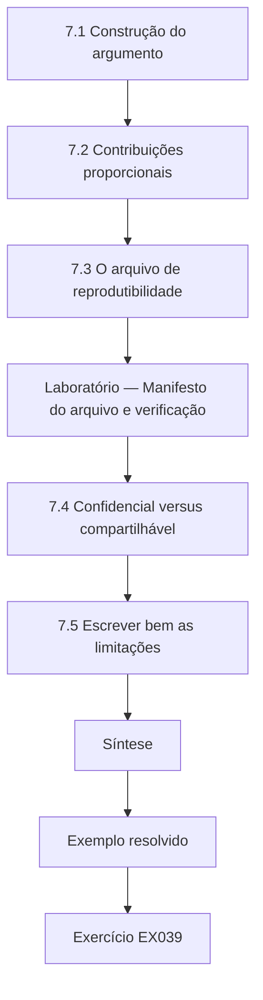

### Desenho lógico

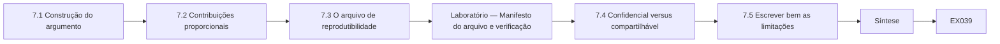

```text
[7.1 Construção do argumento]
    |
    v
[7.2 Contribuições proporcionais]
    |
    v
[7.3 O arquivo de reprodutibilidade]
    |
    v
[Laboratório — Manifesto do arquivo e verificação]
    |
    v
[7.4 Confidencial versus compartilhável]
    |
    v
[7.5 Escrever bem as limitações]
    |
    v
[Síntese]
    |
    v
[Exemplo resolvido] --> [Exercício EX039]
```
<!-- open-cyber-academy:lesson-figures:end ch-07 -->


### Objetivos de aprendizagem

Você vai (1) sintetizar os estudos num argumento de tese coerente; (2) declarar as contribuições e os limites na proporção das evidências; (3) construir um arquivo de reprodutibilidade com verificações de integridade; (4) separar os artefatos compartilháveis dos dados confidenciais.

### 7.1 Construção do argumento

A tese de Amara tem quatro partes empíricas: o manual de codificação e sua concordância, a replicação da linha de base, o piloto e o estudo principal com validação. O capítulo de síntese as liga num único argumento. A medição confiável tornou a linha de base digna de confiança; a linha de base expôs um erro no dashboard; o piloto refinou o protocolo; e o estudo principal estimou um efeito modesto que sobreviveu à validação e à crítica. Cada elo nomeia sua evidência. Uma tese não é uma coleção de artigos, mas um argumento em que cada parte fornece uma premissa, e a síntese mostra ao leitor como as premissas sustentam a conclusão.

### 7.2 Contribuições proporcionais

Ela lista as contribuições com a força da evidência de cada uma. Forte: um manual de codificação reutilizável com concordância substancial e um pacote público de replicação sintética. Moderada: uma estimativa de cerca de um quinto a menos de defeitos de arquitetura pós-lançamento numa organização. Fraca e exploratória: a associação entre fidelidade e efeito. Ela lista o que a tese não mostra: efeitos em outros setores, efeitos sobre defeitos não descobertos ou sobre a qualidade do design no longo prazo. A proporção importa porque os leitores da indústria podem adotar práticas com base no resumo de uma tese, e o exagero pode desperdiçar seus recursos ou criar uma falsa confiança.

### 7.3 O arquivo de reprodutibilidade

Os registros reais de defeitos não podem sair da Tessaro, então o arquivo de Amara contém os scripts de análise, o manual de codificação, o checklist de fidelidade, um conjunto de dados sintético gerado para reproduzir a estrutura e as estatísticas resumidas dos dados reais e um documento que explica como os dados reais podem ser solicitados mediante acordo. Cada arquivo é listado num manifesto com seu digest SHA-256, para que qualquer pessoa possa conferir se o que baixou é o que ela arquivou. O laboratório abaixo constrói um manifesto assim para arquivos sintéticos e o verifica. Ela deposita o arquivo com um identificador persistente no repositório da universidade.

### Laboratório — Manifesto do arquivo e verificação

```python
# Build and verify a SHA-256 manifest for a synthetic replication package.
import hashlib
files = {"analysis/did.py": b"# synthetic analysis script\n", "data/synthetic_teams.csv": b"team,wave,pre,post\nT01,1,3.6,2.9\n",
         "docs/coding_manual.md": b"# Coding manual v3\n", "docs/fidelity_checklist.md": b"- DFD drawn\n- STRIDE per element\n"}
manifest = {p: hashlib.sha256(b).hexdigest() for p, b in files.items()}
files["data/synthetic_teams.csv"] += b"T02,2,4.1,3.0\n"   # simulated later edit
for p, b in files.items():
    print(f"{p:28} {'OK' if hashlib.sha256(b).hexdigest() == manifest[p] else 'MISMATCH'}")
```

Execute com `python3 lab_archive.py`. Saída verificada:

```text
analysis/did.py              OK
data/synthetic_teams.csv     MISMATCH
docs/coding_manual.md        OK
docs/fidelity_checklist.md   OK
```

### 7.4 Confidencial versus compartilhável

Amara aplica uma regra simples: compartilhar tudo o que não identifique pessoas, clientes ou fraquezas exploráveis. Os manuais de codificação, os scripts e os dados sintéticos são compartilhados. As descrições reais dos defeitos, que poderiam revelar vulnerabilidades ativas nos sistemas da Tessaro, não são. As transcrições das entrevistas são resumidas em temas, sem citações que possam identificar os arquitetos. Ela pede à equipe de segurança da Tessaro que revise o arquivo em busca de divulgações acidentais, e eles encontram um comentário de script que nomeia um sistema interno, que ela remove. O compartilhamento responsável torna o trabalho reprodutível sem criar um mapa das fraquezas da parceira.

### 7.5 Escrever bem as limitações

A seção de limitações é específica. Em vez de dizer que os resultados podem não se generalizar, Amara escreve que a Tessaro tem um conselho central de arquitetura e um rastreamento de defeitos maduro, de modo que as organizações que não têm um ou outro podem ver efeitos diferentes. Em vez de dizer que a medição pode ser imperfeita, ela informa o valor da concordância e nomeia os tipos de defeito que os codificadores acharam mais difíceis de classificar. Limitações específicas ajudam pesquisadores futuros a desenhar estudos melhores e mostram aos examinadores que a candidata entende as evidências bem o bastante para saber exatamente onde elas param. Limitações vagas, ao contrário, soam como ritual e costumam ser puladas.

### Exemplo resolvido

Amara escreve um capítulo de síntese que liga quatro estudos, classifica as contribuições como fortes, moderadas ou fracas, constrói um manifesto SHA-256 para um pacote de replicação sintética e remove um comentário revelador depois da revisão da parceira.

> **Caso sintético.** O conteúdo do arquivo e a revisão da parceira são sintéticos.

### Erros e limites

Os conjuntos de dados sintéticos podem omitir correlações que importam para algumas análises. Os manifestos detectam mudanças, mas não autenticam a autora, a menos que sejam assinados.

### Exercícios

- **EX039 — Tese versus artigos.** Em que uma tese difere de um conjunto de artigos? *Rubrica:* 3 = é um único argumento em que cada parte fornece uma premissa;; 2 = argumento;; 1 = é igual;; 0 = nenhuma.

- **EX040 — Contribuições classificadas.** Que contribuição Amara classificou como fraca e exploratória? *Rubrica:* 3 = a associação entre fidelidade e efeito;; 2 = nomeada;; 1 = a estimativa do efeito;; 0 = nenhuma.

- **EX041 — Resultado do manifesto.** O que o laboratório relatou depois que um arquivo arquivado foi alterado? *Rubrica:* 3 = o arquivo alterado falhou na verificação e os outros passaram;; 2 = falha registrada;; 1 = todos passaram;; 0 = nenhuma.

- **EX042 — Papel dos dados sintéticos.** Por que o arquivo contém dados sintéticos, e não reais? *Rubrica:* 3 = os registros reais de defeitos são confidenciais e poderiam revelar vulnerabilidades ativas;; 2 = confidenciais;; 1 = não são necessários;; 0 = nenhuma.

- **EX043 — Comentário no script.** O que a revisão da Tessaro encontrou no arquivo? *Rubrica:* 3 = um comentário de script que nomeia um sistema interno, depois removido;; 2 = comentário;; 1 = vago;; 0 = nenhuma.

- **EX044 — Limitação específica.** Reescreva de forma específica os resultados podem não se generalizar. *Rubrica:* 3 = a Tessaro tem um conselho central de arquitetura e rastreamento maduro; organizações sem isso podem ser diferentes;; 2 = específica;; 1 = vaga;; 0 = nenhuma.

### Síntese

A síntese de uma tese argumenta de forma proporcional a partir de evidências encadeadas e deixa um arquivo verificado e anonimizado com responsabilidade.

<!-- open-cyber-academy:chapter-navigation:start ch-07 -->
### Continue estudando — aula 07 (capítulo 07 de 08)

[← Capítulo 06](#ch-06) · [Índice das aulas](../SUBJECTS.md) · [Capítulo 08 →](#ch-08)

Continue para a próxima aula já escrita.
<!-- open-cyber-academy:chapter-navigation:end -->

<a id="ch-08"></a>

## Capítulo 8 — Defesa e plano de publicação

<!-- open-cyber-academy:lesson-figures:start ch-08 -->
### Mapa da aula

Aula 08 publicada. Mapa, exemplo, EX045.

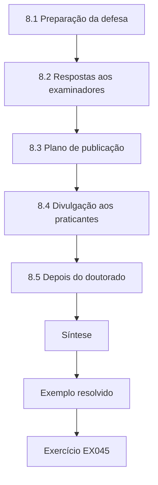

### Desenho lógico

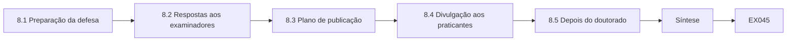

```text
[8.1 Preparação da defesa]
    |
    v
[8.2 Respostas aos examinadores]
    |
    v
[8.3 Plano de publicação]
    |
    v
[8.4 Divulgação aos praticantes]
    |
    v
[8.5 Depois do doutorado]
    |
    v
[Síntese]
    |
    v
[Exemplo resolvido] --> [Exercício EX045]
```
<!-- open-cyber-academy:lesson-figures:end ch-08 -->


### Objetivos de aprendizagem

Você vai (1) preparar uma defesa em torno das objeções mais fortes; (2) responder aos examinadores com evidências e concessões; (3) planejar os veículos e a ordem de publicação; (4) planejar a divulgação aos praticantes sem exagerar os resultados.

### 8.1 Preparação da defesa

Amara se prepara escrevendo as dez perguntas mais difíceis que espera, tiradas da tabela de revisões e das próprias dúvidas, e redigindo respostas baseadas em evidências. Entre os exemplos estão: por que uma única organização, por que não aleatorizar, como a confiabilidade da codificação afeta a estimativa e o que a faria mudar de ideia. Ela ensaia com colegas instruídos a interromper. O Prof. Quintero aconselha que a defesa não é uma encenação de certeza, mas uma demonstração de que ela conhece os limites das suas evidências. A preparação transforma a ansiedade numa lista de perguntas específicas e respondíveis, cada uma ligada a uma seção da tese.

### 8.2 Respostas aos examinadores

Durante a defesa, um examinador externo argumenta que a diferença em diferenças não consegue excluir choques não observados que atinjam só as equipes que adotaram. Amara concorda que ela não consegue excluí-los completamente, explica o log trimestral de mudanças simultâneas e a análise de sensibilidade e propõe o teste que resolveria a questão: um estudo futuro com ordem das ondas aleatorizada. Um segundo examinador pergunta se noventa minutos por mudança valem um quinto a menos de defeitos. Ela responde que essa decisão cabe a cada organização e fornece os insumos necessários para tomá-la. Conceder onde as evidências são limitadas torna as afirmações restantes mais críveis.

### 8.3 Plano de publicação

Ela planeja três produtos. O estudo principal vai para um veículo revisado por pares de engenharia de software empírica ou de segurança, com o pacote de replicação. O manual de codificação e o estudo de concordância vão para um workshop ou periódico focado em medição. As lições do piloto vão para um veículo de praticantes. Ela ordena as submissões para que o artigo de medição, do qual os outros dependem, saia primeiro, e cita o identificador do arquivo em cada um. Ela combina com a Tessaro quais detalhes serão anonimizados em todos os produtos e lhe dá o mesmo direito de revisão prévia que teve durante a tese.

### 8.4 Divulgação aos praticantes

Os praticantes leem resumos, não teses. Amara escreve um resumo de duas páginas que enuncia o achado em termos simples: numa seguradora, acrescentar uma etapa de threat modeling de noventa minutos à revisão de design esteve associado a cerca de um quinto a menos de defeitos de arquitetura pós-lançamento. Ele lista as condições, os custos e as incertezas e aponta para o protocolo e o checklist. Ela recusa o convite de um fornecedor para apresentar o resultado como prova de que a ferramenta de threat modeling dele funciona, porque o estudo dela não testou nenhuma ferramenta. Uma divulgação cuidadosa protege tanto a pesquisa quanto os praticantes que podem agir com base nela.

### 8.5 Depois do doutorado

Amara registra os trabalhos futuros: uma replicação com ondas aleatorizadas, um estudo com várias organizações de diferentes setores, a medição da qualidade do design além dos defeitos e o estudo de como o threat modeling interage com arquiteturas zero trust segundo o SP 800-207. Ela oferece seu manual de codificação a outros pesquisadores e aceita revisar uma proposta de replicação. Sua reflexão final observa que a habilidade mais valiosa que aprendeu não foi um método estatístico, mas o hábito de perguntar, para cada afirmação, que observação mostraria que ela é falsa e se essa observação foi buscada. Ela pretende manter esse hábito em todos os projetos futuros.

### Exemplo resolvido

Amara ensaia dez perguntas difíceis, concede o limite dos choques não observados propondo uma replicação aleatorizada, ordena três publicações com o artigo de medição primeiro e recusa o endosso a um fornecedor.

> **Caso sintético.** Os examinadores, os veículos e o convite do fornecedor são sintéticos; o SP 800-207 é real.

### Erros e limites

Os prazos de publicação são incertos; os planos não devem atrasar o compartilhamento do arquivo. Os resumos para praticantes perdem nuances e devem apontar para as limitações completas.

### Exercícios

- **EX045 — Propósito da defesa.** O que o Prof. Quintero diz que a defesa demonstra? *Rubrica:* 3 = o conhecimento dos limites das evidências, não a certeza;; 2 = limites;; 1 = certeza;; 0 = nenhuma.

- **EX046 — Choques não observados.** Como Amara responde à objeção dos choques não observados? *Rubrica:* 3 = concede que não podem ser totalmente excluídos, cita o log de mudanças simultâneas e a sensibilidade e propõe a ordem das ondas aleatorizada;; 2 = concessão mais um ponto;; 1 = nega;; 0 = nenhuma.

- **EX047 — Pergunta sobre o custo.** Como ela responde se noventa minutos valem a pena? *Rubrica:* 3 = é uma decisão de cada organização; ela fornece os insumos;; 2 = a organização decide;; 1 = sim, sempre;; 0 = nenhuma.

- **EX048 — Primeiro artigo.** Que artigo é submetido primeiro, e por quê? *Rubrica:* 3 = o artigo de medição, porque os outros dependem dele;; 2 = medição;; 1 = estudo principal;; 0 = nenhuma.

- **EX049 — Recusa ao fornecedor.** Por que recusar o convite do fornecedor? *Rubrica:* 3 = o estudo não testou nenhuma ferramenta, então não pode endossar uma;; 2 = nenhuma ferramenta testada;; 1 = aceita;; 0 = nenhuma.

- **EX050 — Hábito duradouro.** Que habilidade Amara aponta como a mais valiosa? *Rubrica:* 3 = perguntar que observação falsearia cada afirmação e buscá-la;; 2 = hábito de falseamento;; 1 = estatística;; 0 = nenhuma.

### Síntese

Uma defesa e um plano de publicação dão certo quando reconhecem limites reais, ordenam as produções por dependência e se recusam a deixar que os resultados sejam exagerados.

<!-- open-cyber-academy:chapter-navigation:start ch-08 -->
### Continue estudando — aula 08 (capítulo 08 de 08)

[← Capítulo 07](#ch-07) · [Índice das aulas](../SUBJECTS.md) · [Próximo curso pelo índice →](../SUBJECTS.md)

O índice aponta para o próximo curso do percurso de estudos.
<!-- open-cyber-academy:chapter-navigation:end -->

<a id="worked-results"></a>

## Resoluções

Respostas-modelo para EX001–EX050. Amara Lind, o Prof. Rafael Quintero, o Halden Institute of Technology, o Tessaro Insurance Group e todos os números são sintéticos; as respostas dos laboratórios citam saídas verificadas. Qualquer resposta que atenda à rubrica recebe a mesma pontuação.

**EX001.** Equipes que adotam a prática sem taxa menor, ou com taxa maior, de defeitos de arquitetura pós-lançamento por cem mudanças de design do que as equipes de comparação ao longo de doze meses.

**EX002.** Muitas afirmações de segurança são infalseáveis: afirmam um benefício sem dizer que observação mostraria que o benefício não existe.

**EX003.** Não consegue distinguir o efeito do threat modeling da melhora ao longo do tempo ou da regressão à média depois de anos ruins.

**EX004.** Porque as equipes adotam segundo os ciclos orçamentários, que Amara não pode atribuir ao acaso.

**EX005.** Pode revisar os rascunhos para retirar detalhes confidenciais, mas não pode bloquear nem alterar os achados.

**EX006.** Aquele cuja correção exige mudar uma fronteira de confiança, a responsabilidade de um componente ou um fluxo de dados, e não o código dentro de um único componente.

**EX007.** O kappa foi 0,79, com concordância observada de 0,90, o que fica na faixa de concordância substancial de Landis e Koch.

**EX008.** Menor privilégio, padrões à prova de falha e mediação completa.

**EX009.** Não. Eles estruturam o trabalho e a comunicação, mas a melhora dos resultados precisa ser mostrada por evidência empírica.

**EX010.** Nenhuma confiança é concedida apenas com base na localização na rede; cada requisição de acesso é autenticada e autorizada.

**EX011.** Evidência empírica que compara os resultados com um contrafactual crível.

**EX012.** Porque a evidência de uma organização não sustenta uma afirmação geral, então ela declara as condições de transferência.

**EX013.** Não tem grupo de comparação e o fornecedor tem conflito de interesse no resultado.

**EX014.** Apenas para sugerir hipóteses; nunca como evidência de que uma prática tem efeito.

**EX015.** Porque os defeitos nunca descobertos não podem ser observados, de modo que o desfecho cobre apenas os encontrados.

**EX016.** Mostra se as sessões seguiram o protocolo, para que um resultado nulo possa ser distinguido de uma falha na aplicação da prática.

**EX017.** Uma redução de cerca de um quarto nos defeitos de arquitetura pós-lançamento.

**EX018.** Pelo menos dezoito meses, porque, com cerca de quatro defeitos por cem mudanças, um acompanhamento mais curto gera eventos de menos.

**EX019.** As equipes que adotam podem acrescentar outras práticas, como security champions; Amara registra as mudanças simultâneas a cada trimestre.

**EX020.** Porque identificar mais ameaças nas oficinas não mostra, por si só, que menos defeitos chegam à produção.

**EX021.** Os 4,1 relatados contavam chamados duplicados quando um defeito afetava várias equipes; a remoção das duplicatas alinhou os números.

**EX022.** A intervenção teria parecido eficaz mesmo que nada mudasse, porque a linha de base estava superestimada.

**EX023.** Três equipes em três meses produzem defeitos de menos para sustentar qualquer conclusão sobre o efeito.

**EX024.** Estava num projeto renomeado; Amara corrigiu o mapeamento de projetos e os dez foram recuperados.

**EX025.** São como vetores de teste: entradas conhecidas com saídas esperadas que conferem o pipeline.

**EX026.** As mudanças grandes agora podem passar pelo threat modeling em duas sessões separadas.

**EX027.** Para que o desejo de ver a intervenção dar certo não influencie a classificação dos defeitos.

**EX028.** Que, sem a intervenção, as equipes que adotam e as de comparação teriam seguido tendências paralelas.

**EX029.** Uma estimativa de -0,77 defeito por cem mudanças, com proporção de permutação de 0,022.

**EX030.** A estimativa quase não mudou, o que enfraquece a explicação rival de que os champions causaram a redução.

**EX031.** É compatível com a ideia de que a prática importa, mas também com a de que as equipes menos engajadas pontuam baixo e melhoram menos.

**EX032.** Ela evita recomendar a adoção universal e declara uma redução modesta na Tessaro a cerca de noventa minutos por mudança.

**EX033.** Porque leitores com compromissos diferentes procuram fraquezas diferentes, combatendo a cegueira dos círculos que apoiam.

**EX034.** Que as equipes que adotam depois de anos ruins melhorariam de qualquer forma por regressão à média, imitando um efeito.

**EX035.** As taxas pré-adoção das equipes que adotaram ficariam acima das suas próprias médias de longo prazo; não ficaram.

**EX036.** Que a prática esteve associada a menos defeitos de arquitetura pós-lançamento, tal como codificados, em vez de dizer que ela melhora a segurança da arquitetura.

**EX037.** O pedido de retirar as equipes de fidelidade baixa, porque excluí-las enviesaria a estimativa do efeito para cima.

**EX038.** Porque revelam como o candidato testou as objeções e respondeu a elas.

**EX039.** É um único argumento em que cada estudo fornece uma premissa rumo à conclusão.

**EX040.** A associação entre a fidelidade das sessões e o tamanho do efeito.

**EX041.** O arquivo alterado foi relatado como divergente (MISMATCH), enquanto os outros arquivos foram verificados.

**EX042.** Porque os registros reais de defeitos não podem sair da Tessaro e poderiam revelar fraquezas exploráveis.

**EX043.** Um comentário num script que nomeava um sistema interno, que Amara removeu.

**EX044.** O conselho central de arquitetura e o rastreamento maduro de defeitos da Tessaro podem não existir em outros lugares, de modo que os efeitos poderiam ser diferentes lá.

**EX045.** Que a candidata sabe exatamente onde as evidências param, e não que ela tem certeza.

**EX046.** Ela concede que eles não podem ser completamente excluídos, aponta o log de mudanças simultâneas e a análise de sensibilidade e propõe aleatorizar a ordem das ondas no futuro.

**EX047.** É uma decisão de cada organização, e ela fornece os insumos de custo e efeito necessários para tomá-la.

**EX048.** O artigo do manual de codificação e da concordância, porque os outros artigos se apoiam nessa medição.

**EX049.** Porque nenhuma ferramenta foi testada, então apresentar o resultado como prova de um produto o deturparia.

**EX050.** O hábito de perguntar que observação mostraria que uma afirmação é falsa e de verificar se ela foi buscada.

<a id="references"></a>
## Referências

Todos os DOIs foram resolvidos em doi.org em 12 de outubro de 2026, e as normas foram conferidas nas páginas de seus editores. A lista é idêntica à da edição em inglês e cobre o livro inteiro, acrescida apenas da ABNT NBR ISO/IEC 27001:2022, citada nesta edição como referência brasileira e conferida em sua fonte oficial; as adoções brasileiras da ABNT listadas foram conferidas no catálogo oficial da ABNT, e as demais normas técnicas são citadas em sua edição internacional. Organizações, pessoas, sistemas e números dos casos são sintéticos; somente as obras abaixo são reais.

- Anderson, R. (2020). *Security engineering: A guide to building dependable distributed systems* (3rd ed.). Wiley. Author's page: <https://www.cl.cam.ac.uk/archive/rja14/book.html>
- Associação Brasileira de Normas Técnicas. (2022). *ABNT NBR ISO/IEC 27001:2022 — Segurança da informação, segurança cibernética e proteção à privacidade — Sistemas de gestão da segurança da informação — Requisitos* (versão corrigida 2023). ABNT. <https://www.abntcatalogo.com.br/>
- Herley, C., & van Oorschot, P. C. (2017). SoK: Science, security and the elusive goal of security as a scientific pursuit. *2017 IEEE Symposium on Security and Privacy*, 99–120. <https://doi.org/10.1109/SP.2017.38>
- International Organization for Standardization. (2022). *ISO/IEC 27001:2022 Information security, cybersecurity and privacy protection — Information security management systems — Requirements*. <https://www.iso.org/standard/27001>
- International Organization for Standardization. (2022). *ISO/IEC 27002:2022 Information security, cybersecurity and privacy protection — Information security controls*. <https://www.iso.org/standard/75652.html>
- Joint Task Force. (2020). *Security and privacy controls for information systems and organizations* (NIST SP 800-53 Rev. 5). NIST. <https://doi.org/10.6028/NIST.SP.800-53r5>
- Landis, J. R., & Koch, G. G. (1977). The measurement of observer agreement for categorical data. *Biometrics*, 33(1), 159–174. <https://doi.org/10.2307/2529310>
- Rose, S., Borchert, O., Mitchell, S., & Connelly, S. (2020). *Zero trust architecture* (NIST SP 800-207). NIST. <https://doi.org/10.6028/NIST.SP.800-207>
- Ross, R., Winstead, M., & McEvilley, M. (2022). *Engineering trustworthy secure systems* (NIST SP 800-160 Vol. 1 Rev. 1). NIST. <https://doi.org/10.6028/NIST.SP.800-160v1r1>
- Saltzer, J. H., & Schroeder, M. D. (1975). The protection of information in computer systems. *Proceedings of the IEEE*, 63(9), 1278–1308. <https://doi.org/10.1109/PROC.1975.9939>
- Sherwood, J., Clark, A., & Lynas, D. (2005). *Enterprise security architecture: A business-driven approach* (SABSA). CMP Books.
- Shostack, A. (2014). *Threat modeling: Designing for security*. Wiley.
- The Open Group. (2016, revised 2022). *Integrating risk and security within a TOGAF enterprise architecture* (TOGAF Series Guide G152). The Open Group.
- Wohlin, C., Runeson, P., Höst, M., Ohlsson, M. C., Regnell, B., & Wesslén, A. (2012). *Experimentation in software engineering*. Springer. <https://doi.org/10.1007/978-3-642-29044-2>
