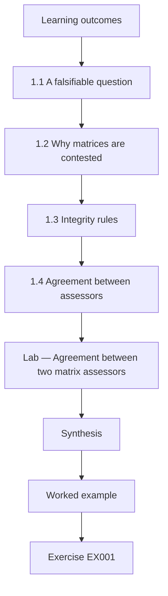
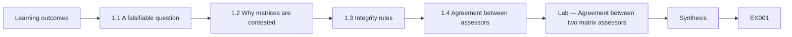
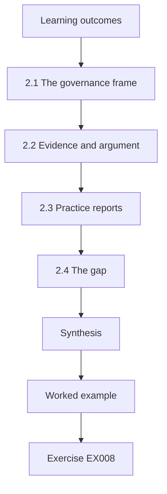
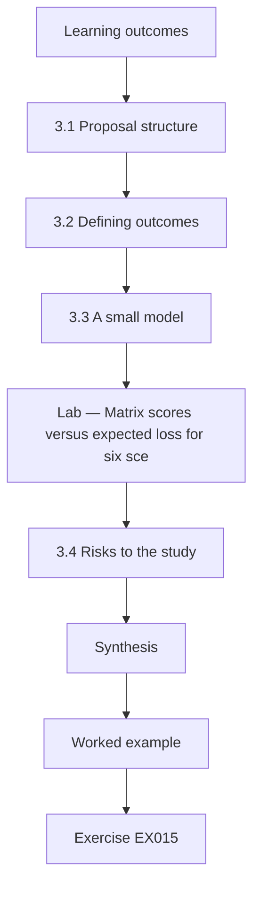
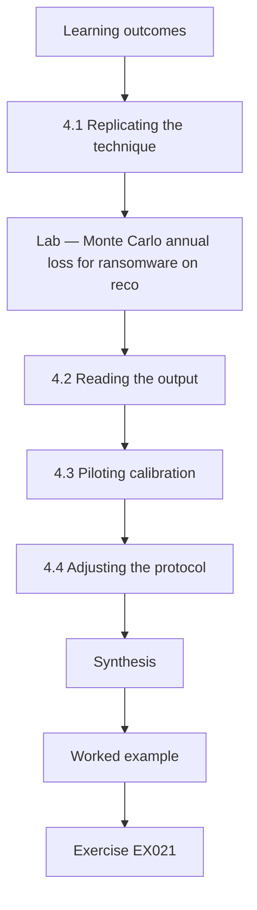
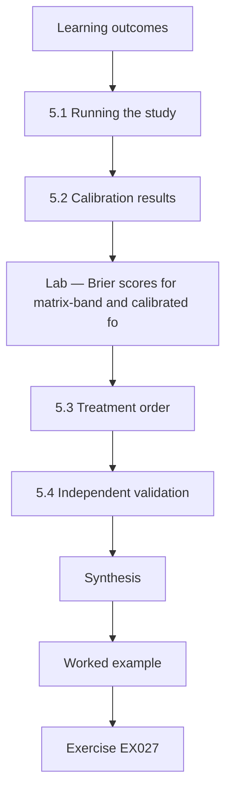
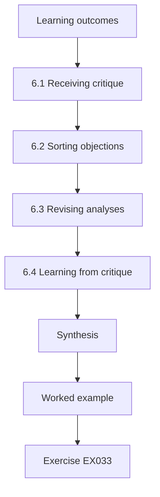
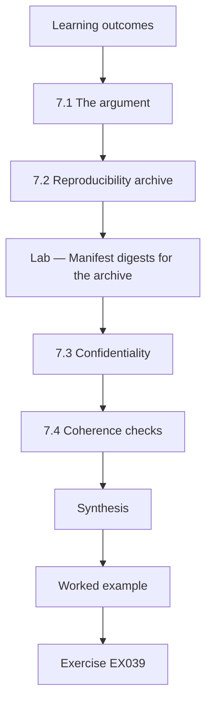
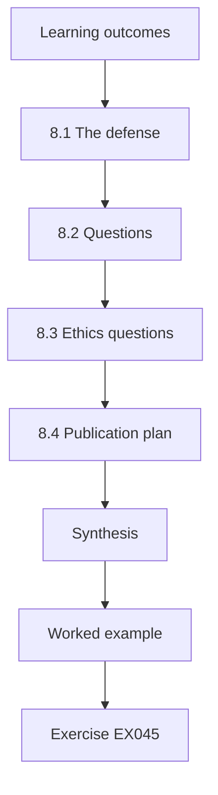

# Security Governance, Risk and Compliance: Doctoral Research Track

- Language: English (`en`); course 189, Doctoral research track (2 years).
- Editorial state: **published**. Chapters 1–8 of 8 have hand-written teaching text; exercises EX001–EX050 have matching worked results with 0–3 rubrics; five offline labs use only the Python 3 standard library on synthetic data, and their outputs are embedded from real runs. Independent review and the 300-page A4 verification remain open.
- Audience: doctoral candidates testing whether calibrated quantitative risk assessment improves on ordinal risk matrices in real governance settings.
- Author: [hiagokinlevi](https://github.com/hiagokinlevi). Original text [CC0 1.0](../../../../../LICENSE); cited works keep their rights.
- Boundary: the labs compute assessor agreement, a matrix-versus-expected-loss ranking, a Monte Carlo loss model, Brier scores and archive digests on synthetic data. Risk figures are illustrations, standards are cited by edition and paraphrased, and nothing here is a real audit, attestation or legal advice. All people, organisations, systems and data are **synthetic** unless a sentence cites a public source.

[Course home](../../README.md) · [Chapter index](../SUBJECTS.md) · [Book plan](PLAN.md) · [Course skill](../../skill/SKILL.md) · [Worked results](#worked-results)

## How to use this draft

Read in order. The chapters follow one doctoral candidate comparing risk matrices with calibrated quantitative assessment: integrity and methods, the research frontier, the proposal, pilot, the main study and validation, critique, synthesis and archive, and the defense. Run each lab where it appears, attempt the exercises before the worked results, and score yourself with the rubrics.

### Synthetic running case

| Element | Role | Boundary |
|---|---|---|
| **Amara Lindgren** | Doctoral candidate | Invented |
| **Prof. Rosa Delgado** | Supervisor | Invented |
| **Halvard University** | Fictional university | Invented |
| **Corvane Regional Health Board** | Fictional board with four hospitals and a 5×5 risk matrix | Invented |

### Core sources

Cox (2008), [doi:10.1111/j.1539-6924.2008.01030.x](https://doi.org/10.1111/j.1539-6924.2008.01030.x); Hubbard and Seiersen (2016); Freund and Jones (2015) on FAIR; ISO 31000:2018; ISO/IEC 27001:2022 and 27005:2022; NIST [SP 800-30 Rev. 1](https://doi.org/10.6028/NIST.SP.800-30r1) and [SP 800-37 Rev. 2](https://doi.org/10.6028/NIST.SP.800-37r2). Full list in [References](#references).

## Contents

| Chapters |
|---|
| [1](#ch-01) · [2](#ch-02) · [3](#ch-03) · [4](#ch-04) · [5](#ch-05) · [6](#ch-06) · [7](#ch-07) · [8](#ch-08) |

[Worked results](#worked-results) · [References](#references)

<a id="ch-01"></a>

## Chapter 1 — Advanced research integrity and methods

<!-- cyberabc:lesson-figures:start ch-01 -->
### Lesson map

Lesson 01 published. Map, example, EX001.



### Logical drawing



```text
[Learning outcomes]
    |
    v
[1.1 A falsifiable question]
    |
    v
[1.2 Why matrices are contested]
    |
    v
[1.3 Integrity rules]
    |
    v
[1.4 Agreement between assessors]
    |
    v
[Lab — Agreement between two matrix assessors]
    |
    v
[Synthesis]
    |
    v
[Worked example] --> [Exercise EX001]
```
<!-- cyberabc:lesson-figures:end ch-01 -->


### Learning outcomes

You will (1) frame a falsifiable question about how organisations assess cyber risk; (2) set integrity rules for research inside a regulated organisation; (3) measure agreement between assessors who use a risk matrix.

### 1.1 A falsifiable question

Amara Lindgren is a doctoral candidate at the fictional Halvard University, supervised by Prof. Rosa Delgado. Her research partner is the fictional Corvane Regional Health Board, which runs four hospitals and keeps a risk register built on a five-by-five risk matrix. Amara asks whether replacing ordinal matrix ratings with calibrated quantitative estimates, in the style of FAIR described by Freund and Jones (2015), leads to more consistent and better-calibrated risk decisions. She writes down in advance which results would show her idea is wrong: no gain in agreement, calibration or decision quality.

### 1.2 Why matrices are contested

Amara reviews the case against risk matrices. Cox (2008) showed that matrices can assign identical ratings to risks that differ greatly in expected loss, and can even rank a smaller risk above a larger one, because ordinal bands discard information. Hubbard and Seiersen (2016) argued that cybersecurity risk can be measured with calibrated ranges and simple simulation. Standards are more neutral: ISO/IEC 27005:2022 and NIST SP 800-30r1 allow qualitative, semi-quantitative and quantitative approaches. Amara's contribution is therefore empirical: to test, inside one organisation, whether the quantitative approach performs better in practice.

### 1.3 Integrity rules

Research inside a health board carries risks: exposing real weaknesses, embarrassing named managers and influencing the decisions being studied. Amara's protocol, approved by the Halvard ethics board and Corvane's information governance committee, sets rules. All published scenarios are synthetic composites; no real vulnerability or patient data leave Corvane; assessors take part voluntarily and may withdraw; individual performance is never reported to managers; and her analysis plan is pre-registered before data collection. She also declares that she has no financial interest in any risk quantification product.

### 1.4 Agreement between assessors

Before comparing methods, Amara measures how consistently Corvane's assessors use the existing matrix. Two experienced assessors independently rate forty synthetic risks into Low, Medium and High bands. The lab computes observed agreement and Cohen's kappa, which corrects for agreement expected by chance. Kappa is 0.19, which Landis and Koch (1977) would describe as slight agreement. Amara treats this as a baseline problem rather than a criticism of the assessors: if two experts often disagree about the same risk, the register's priorities may depend more on who rated a risk than on the risk itself.

### Lab — Agreement between two matrix assessors

```python
# Agreement between two assessors rating 40 synthetic risks on a 5x5 matrix (High/Medium/Low bands).
import random
r = random.Random(11)
bands = ["Low", "Medium", "High"]
truth = [r.choice(bands) for _ in range(40)]
def rate(t):
    if r.random() < 0.62: return t
    return r.choice([b for b in bands if b != t])
a = [rate(t) for t in truth]; b = [rate(t) for t in truth]
po = sum(x == y for x, y in zip(a, b)) / 40
pe = sum((a.count(k) / 40) * (b.count(k) / 40) for k in bands)
print(f"observed agreement {po:.2f}; chance {pe:.2f}; kappa {(po - pe) / (1 - pe):.2f}")
```

Run with `python3 lab_kappa.py`. Verified output:

```text
observed agreement 0.47; chance 0.35; kappa 0.19
```

### Worked example

Amara frames a falsifiable comparison of matrices and quantitative estimates, sets integrity rules for research in a health board and measures a matrix-agreement baseline of kappa 0.19.

> **Synthetic case.** Halvard, Corvane and all people are synthetic; Freund and Jones (2015), Cox (2008), Hubbard and Seiersen (2016), ISO/IEC 27005:2022, SP 800-30r1 and Landis and Koch (1977) are real.

### Errors and limits

Pre-registration does not remove all bias. Kappa depends on how often each band occurs.

### Exercises

- **EX001 — Falsifiable plan.** What makes Amara's question falsifiable? *Rubric:* 3 = she states beforehand which results would show her idea is wrong;; 2 = prior statement;; 1 = vague;; 0 = none.
- **EX002 — Cox critique.** What did Cox (2008) show about risk matrices? *Rubric:* 3 = identical ratings for very different risks and possible rank reversals;; 2 = information loss;; 1 = vague;; 0 = none.
- **EX003 — Standards neutrality.** What approaches do ISO/IEC 27005:2022 and SP 800-30r1 allow? *Rubric:* 3 = qualitative, semi-quantitative and quantitative;; 2 = all three;; 1 = quantitative only;; 0 = none.
- **EX004 — Publication rule.** What may appear in published scenarios? *Rubric:* 3 = only synthetic composites;; 2 = synthetic;; 1 = real weaknesses;; 0 = none.
- **EX005 — Interest declaration.** What does Amara declare? *Rubric:* 3 = no financial interest in risk quantification products;; 2 = conflict;; 1 = vague;; 0 = none.
- **EX006 — Baseline kappa.** What kappa did the two assessors reach? *Rubric:* 3 = 0.19, slight agreement;; 2 = 0.19;; 1 = 0.62;; 0 = none.
- **EX007 — Baseline meaning.** Why does low agreement matter for the register? *Rubric:* 3 = priorities may depend on who rated the risk;; 2 = rater effect;; 1 = vague;; 0 = none.

### Synthesis

Doctoral GRC research starts with a falsifiable question, strict integrity rules and a measured baseline.

### Continue studying — chapter 01 of 08

[← Course home](../../README.md) · [Course chapter index](../SUBJECTS.md) · [Chapter 02 (draft) →](#ch-02)

<a id="ch-02"></a>

## Chapter 2 — Security governance, risk and compliance: research frontier

<!-- cyberabc:lesson-figures:start ch-02 -->
### Lesson map

Lesson 02 published. Map, example, EX008.



### Logical drawing


```text
[Learning outcomes]
    |
    v
[2.1 The governance frame]
    |
    v
[2.2 Evidence and argument]
    |
    v
[2.3 Practice reports]
    |
    v
[2.4 The gap]
    |
    v
[Synthesis]
    |
    v
[Worked example] --> [Exercise EX008]
```
<!-- cyberabc:lesson-figures:end ch-02 -->


### Learning outcomes

You will (1) map the research frontier in security risk governance; (2) distinguish claims supported by evidence from claims supported by argument; (3) locate a defensible gap.

### 2.1 The governance frame

Amara maps how governance shapes risk work. NIST CSF 2.0 added a Govern function covering organisational context, risk management strategy, roles, policy and oversight. ISO/IEC 27001:2022 requires an organisation to define risk criteria, assess and treat information security risks and keep evidence. COBIT 2019 places risk optimisation among governance objectives for boards. ISO 31000:2018 offers principles for risk management in any field. These frameworks agree that risk decisions belong to accountable owners, but they say little about which assessment method produces better decisions. Amara records each source.

### 2.2 Evidence and argument

Amara sorts the literature by type of support. Gordon and Loeb (2002) offer a mathematical model showing that, under their assumptions, optimal security investment is at most about 37% of the expected loss, which is an argument from a model rather than an observation. Cox (2008) is also analytical. Hubbard and Seiersen (2016) draw on studies of expert calibration from outside security. Spears and Barki (2010) provide survey evidence that user participation in security risk management improves alignment with business processes. Few studies compare assessment methods inside real security programmes.

### 2.3 Practice reports

Amara also reads practice sources: framework documents, regulator guidance and industry reports. They describe what organisations do but rarely test whether it works. She notes that assessment methods spread by imitation and by auditor expectations, and that a matrix is often chosen because it is easy to explain to a board. This explains why matrices remain common despite analytical critiques: their benefits are social and procedural, while their costs, such as inconsistent priorities, are hard to see without measurement. She notes this tension.

### 2.4 The gap

Amara defines her gap precisely: there is little published evidence, from inside an operating security programme, on whether calibrated quantitative assessment improves consistency, calibration and treatment choices compared with an ordinal matrix, once training time and board communication are counted as costs. The gap is narrow enough to study in one organisation and important because many regulators and boards are asking whether to move to quantification. Prof. Delgado approves the framing and asks her to state clearly which effects her design cannot detect.

### Worked example

Amara maps governance frameworks, separates modelled arguments from empirical evidence and defines a gap in field evidence comparing matrices with calibrated quantification.

> **Synthetic case.** Corvane is synthetic; CSF 2.0, ISO/IEC 27001:2022, COBIT 2019, ISO 31000:2018, Gordon and Loeb (2002), Cox (2008), Hubbard and Seiersen (2016) and Spears and Barki (2010) are real.

### Errors and limits

Literature maps date quickly. Practice reports may be selective.

### Exercises

- **EX008 — Govern function.** What did CSF 2.0 add? *Rubric:* 3 = a Govern function;; 2 = Govern;; 1 = Detect;; 0 = none.
- **EX009 — Gordon-Loeb result.** What upper bound did Gordon and Loeb derive? *Rubric:* 3 = about 37% of expected loss;; 2 = 1/e;; 1 = 100%;; 0 = none.
- **EX010 — Spears and Barki.** What did Spears and Barki (2010) find? *Rubric:* 3 = user participation improves alignment with business processes;; 2 = participation;; 1 = vague;; 0 = none.
- **EX011 — Why matrices persist.** Why do matrices remain common? *Rubric:* 3 = easy to explain and expected by auditors;; 2 = social benefits;; 1 = accuracy;; 0 = none.
- **EX012 — Defined gap.** What gap does Amara study? *Rubric:* 3 = field evidence comparing matrices with calibrated quantification;; 2 = field evidence;; 1 = vague;; 0 = none.
- **EX013 — Supervisor request.** What did Prof. Delgado ask Amara to state? *Rubric:* 3 = which effects the design cannot detect;; 2 = limits;; 1 = vague;; 0 = none.
- **EX014 — Evidence types.** Why does Amara sort the literature by type of support? *Rubric:* 3 = models, experiments and practice reports support claims differently;; 2 = evidence strength;; 1 = vague;; 0 = none.

### Synthesis

The frontier shows strong argument but thin field evidence, which defines a precise gap.

### Continue studying — chapter 02 of 08

[← Chapter 01 (draft)](#ch-01) · [Course chapter index](../SUBJECTS.md) · [Chapter 03 (draft) →](#ch-03)

<a id="ch-03"></a>

## Chapter 3 — Original contribution proposal

<!-- cyberabc:lesson-figures:start ch-03 -->
### Lesson map

Lesson 03 published. Map, example, EX015.



### Logical drawing


```text
[Learning outcomes]
    |
    v
[3.1 Proposal structure]
    |
    v
[3.2 Defining outcomes]
    |
    v
[3.3 A small model]
    |
    v
[Lab — Matrix scores versus expected loss for six sce]
    |
    v
[3.4 Risks to the study]
    |
    v
[Synthesis]
    |
    v
[Worked example] --> [Exercise EX015]
```
<!-- cyberabc:lesson-figures:end ch-03 -->


### Learning outcomes

You will (1) write a doctoral proposal for a method comparison; (2) define outcomes for consistency, calibration and decision quality; (3) show with a small model why method choice can change priorities.

### 3.1 Proposal structure

Amara's proposal has five parts: problem and gap, research questions, design, analysis plan and risks. The research questions are: do calibrated quantitative estimates improve agreement between assessors; do they improve calibration of probability forecasts; and do they change which risks are treated first? The design uses Corvane's own assessors, randomly assigned to method, assessing the same synthetic scenarios built from real patterns. The proposal states expected contributions to theory, to practice and to the evidence base used by regulators. Corvane reviews the draft.

### 3.2 Defining outcomes

Each outcome has a measure. Consistency is measured by agreement between assessors, using kappa for bands and the ratio of estimates for quantities. Calibration is measured by the Brier score, the average squared difference between forecast probabilities and what actually happened, on short-horizon events that can be checked within the study. Decision quality is measured by whether the treatment order matches the order by expected loss computed from a reference panel. Amara writes these definitions in the pre-registration so they cannot drift later.

### 3.3 A small model

To show why method choice matters, Amara builds a small example of six synthetic scenarios with annual probabilities and loss sizes. The lab bands each on a five-by-five matrix and also computes expected loss. Ransomware on records has the largest expected loss, about 192 thousand per year, yet the matrix scores it 5, below payment fraud and supplier outage, which tie at 6. This reproduces in miniature the rank reversal and ties that Cox (2008) predicted, and it motivates the study. Prof. Delgado agrees. This gives a clear starting point.

### Lab — Matrix scores versus expected loss for six scenarios

```python
# Risk matrix versus expected loss for six synthetic scenarios (after Cox, 2008).
# (name, annual probability, loss in thousands)
S = [("ransomware on records", 0.08, 2400), ("payment fraud", 0.30, 180), ("laptop loss", 0.60, 25),
     ("supplier outage", 0.15, 900), ("insider data leak", 0.05, 1500), ("web defacement", 0.40, 40)]
def band_p(p): return 1 if p < 0.1 else 2 if p < 0.2 else 3 if p < 0.35 else 4 if p < 0.5 else 5
def band_i(x): return 1 if x < 50 else 2 if x < 200 else 3 if x < 1000 else 4 if x < 2000 else 5
rows = [(n, band_p(p) * band_i(x), p * x) for n, p, x in S]
for n, sc, el in sorted(rows, key=lambda t: -t[2]): print(f"{n}: matrix score {sc}, expected loss {el:.0f}k")
by_m = [n for n, _, _ in sorted(rows, key=lambda t: (-t[1], t[0]))]; by_e = [n for n, _, _ in sorted(rows, key=lambda t: -t[2])]
print("top by matrix:", by_m[0], "| top by expected loss:", by_e[0])
print("matrix ties at top score:", sum(1 for _, s, _ in rows if s == max(s for _, s, _ in rows)))
```

Run with `python3 lab_matrix.py`. Verified output:

```text
ransomware on records: matrix score 5, expected loss 192k
supplier outage: matrix score 6, expected loss 135k
insider data leak: matrix score 4, expected loss 75k
payment fraud: matrix score 6, expected loss 54k
web defacement: matrix score 4, expected loss 16k
laptop loss: matrix score 5, expected loss 15k
top by matrix: payment fraud | top by expected loss: ransomware on records
matrix ties at top score: 2
```

### 3.4 Risks to the study

Amara lists risks to her study: assessors may not complete calibration training; real incidents during the study may change attitudes; the reference panel may itself be biased; and Corvane may reorganise. For each she gives a mitigation, such as a short training module, recording incidents as covariates, using three independent panel members and agreeing a minimum participation level with Corvane in writing. A doctoral proposal that names its risks and mitigations is more credible to examiners and partners than one that assumes everything will go to plan.

### Worked example

Amara structures a proposal with three questions, defines agreement, Brier score and decision-order outcomes and uses a six-scenario model to show matrix ties and rank reversal.

> **Synthetic case.** Scenarios are synthetic; Cox (2008) is real.

### Errors and limits

Small models illustrate, they do not prove. Reference panels can share biases.

### Exercises

- **EX015 — Three questions.** What are the three research questions about? *Rubric:* 3 = agreement, calibration and treatment order;; 2 = three;; 1 = vague;; 0 = none.
- **EX016 — Brier definition.** What is the Brier score? *Rubric:* 3 = average squared difference between forecasts and outcomes;; 2 = squared error;; 1 = vague;; 0 = none.
- **EX017 — Model top risk.** Which scenario has the largest expected loss in the lab? *Rubric:* 3 = ransomware on records, about 192k;; 2 = ransomware;; 1 = payment fraud;; 0 = none.
- **EX018 — Matrix top risks.** Which scenarios top the matrix in the lab? *Rubric:* 3 = payment fraud and supplier outage tied at 6;; 2 = tie;; 1 = ransomware;; 0 = none.
- **EX019 — Panel mitigation.** How is reference panel bias mitigated? *Rubric:* 3 = three independent panel members;; 2 = three;; 1 = vague;; 0 = none.
- **EX020 — Participation agreement.** What did Amara agree with Corvane in writing? *Rubric:* 3 = a minimum participation level;; 2 = participation;; 1 = vague;; 0 = none.

### Synthesis

A strong proposal defines measurable outcomes and shows with a model why the question matters.

### Continue studying — chapter 03 of 08

[← Chapter 02 (draft)](#ch-02) · [Course chapter index](../SUBJECTS.md) · [Chapter 04 (draft) →](#ch-04)

<a id="ch-04"></a>

## Chapter 4 — Baseline replication and pilot

<!-- cyberabc:lesson-figures:start ch-04 -->
### Lesson map

Lesson 04 published. Map, example, EX021.



### Logical drawing


```text
[Learning outcomes]
    |
    v
[4.1 Replicating the technique]
    |
    v
[Lab — Monte Carlo annual loss for ransomware on reco]
    |
    v
[4.2 Reading the output]
    |
    v
[4.3 Piloting calibration]
    |
    v
[4.4 Adjusting the protocol]
    |
    v
[Synthesis]
    |
    v
[Worked example] --> [Exercise EX021]
```
<!-- cyberabc:lesson-figures:end ch-04 -->


### Learning outcomes

You will (1) replicate a published quantitative technique on synthetic data; (2) pilot calibration training with assessors; (3) adjust the protocol from pilot evidence.

### 4.1 Replicating the technique

Amara first replicates the core FAIR-style technique on synthetic data so she understands it fully. For the ransomware scenario she defines ranges for loss event frequency and loss magnitude, using minimum, most likely and maximum values, and runs a Monte Carlo simulation of twenty thousand years. The lab reports the mean annual loss, the chance of any loss in a year and high percentiles. She checks that the results behave as expected when ranges change, which is the basic test that a simulation is implemented correctly.

### Lab — Monte Carlo annual loss for ransomware on records

```python
# FAIR-style Monte Carlo: annual loss for ransomware on records (synthetic ranges).
import random
r = random.Random(5); N = 20000
def tri(lo, mode, hi): return r.triangular(lo, hi, mode)
losses = []
for _ in range(N):
    freq = tri(0.02, 0.06, 0.20)          # loss events per year
    events = sum(1 for _ in range(3) if r.random() < freq)
    losses.append(sum(tri(300, 1500, 6000) for _ in range(events)))
losses.sort()
mean = sum(losses) / N
print(f"mean annual loss {mean:.0f}k; P(loss>0) {sum(l > 0 for l in losses) / N:.3f}; 95th pct {losses[int(.95 * N)]:.0f}k; 99th pct {losses[int(.99 * N)]:.0f}k")
print(f"P(loss > 2000k) {sum(l > 2000 for l in losses) / N:.3f}")
```

Run with `python3 lab_mc.py`. Verified output:

```text
mean annual loss 709k; P(loss>0) 0.247; 95th pct 4062k; 99th pct 5810k
P(loss > 2000k) 0.163
```

### 4.2 Reading the output

The simulation gives a mean annual loss of about 709 thousand, but in roughly three years out of four there is no loss at all, and the 95th percentile is about 4.06 million. The chance of losing more than two million in a year is about 16%. Amara notes that the mean hides this skew: a board told only the average would misunderstand the risk. She plans to present loss exceedance probabilities, which answer questions boards actually ask, such as how likely a loss above a reserve level is.

### 4.3 Piloting calibration

Amara pilots a two-hour calibration module with six volunteer assessors. They practise giving ninety percent ranges for general-knowledge questions and receive feedback on how often the true answer fell inside. Before training, their ranges contained the answer about half the time; afterwards, closer to eight in ten. Hubbard and Seiersen (2016) describe this kind of training. Assessors report that the exercise was uncomfortable but useful, and two say it changed how they think about uncertainty in their own risk estimates. All six complete it.

### 4.4 Adjusting the protocol

The pilot leads to three changes. The calibration module is shortened to ninety minutes because attention dropped in the second hour. Scenario descriptions are rewritten to remove clinical jargon that confused non-clinical assessors. The analysis plan adds loss exceedance at a fixed threshold as a secondary outcome, because pilot assessors found it more meaningful than the mean. Amara records each change and its reason in an amendment log submitted to the ethics board, keeping the pre-registered primary outcomes unchanged. The board approves.

### Worked example

Amara replicates a Monte Carlo loss model, reads its skewed output, pilots calibration training and records protocol amendments.

> **Synthetic case.** Ranges, results and pilot figures are synthetic; Hubbard and Seiersen (2016) is real.

### Errors and limits

Simulations depend on input ranges. Pilot gains may not persist.

### Exercises

- **EX021 — Simulation size.** How many simulated years did the lab run? *Rubric:* 3 = twenty thousand;; 2 = 20,000;; 1 = vague;; 0 = none.
- **EX022 — Mean annual loss.** What mean annual loss did the lab report? *Rubric:* 3 = about 709 thousand;; 2 = 709k;; 1 = vague;; 0 = none.
- **EX023 — No-loss years.** In roughly what share of years was there no loss? *Rubric:* 3 = about three in four;; 2 = 75%;; 1 = vague;; 0 = none.
- **EX024 — Exceedance figure.** What was the chance of losing more than two million? *Rubric:* 3 = about 16%;; 2 = 0.163;; 1 = vague;; 0 = none.
- **EX025 — Pilot calibration.** How did range hit rates change with training? *Rubric:* 3 = from about half to about eight in ten;; 2 = improved;; 1 = vague;; 0 = none.
- **EX026 — Unchanged outcomes.** What did Amara keep unchanged when amending the protocol? *Rubric:* 3 = the pre-registered primary outcomes;; 2 = primary outcomes;; 1 = vague;; 0 = none.

### Synthesis

Replication, piloting and logged amendments prepare a sound main study.

### Continue studying — chapter 04 of 08

[← Chapter 03 (draft)](#ch-03) · [Course chapter index](../SUBJECTS.md) · [Chapter 05 (draft) →](#ch-05)

<a id="ch-05"></a>

## Chapter 5 — Main study and independent validation

<!-- cyberabc:lesson-figures:start ch-05 -->
### Lesson map

Lesson 05 published. Map, example, EX027.



### Logical drawing


```text
[Learning outcomes]
    |
    v
[5.1 Running the study]
    |
    v
[5.2 Calibration results]
    |
    v
[Lab — Brier scores for matrix-band and calibrated fo]
    |
    v
[5.3 Treatment order]
    |
    v
[5.4 Independent validation]
    |
    v
[Synthesis]
    |
    v
[Worked example] --> [Exercise EX027]
```
<!-- cyberabc:lesson-figures:end ch-05 -->


### Learning outcomes

You will (1) run a randomised comparison of assessment methods; (2) analyse calibration with the Brier score; (3) validate results with an independent panel.

### 5.1 Running the study

Corvane's thirty assessors are randomly assigned to two groups of fifteen. One group uses the existing matrix with its band definitions; the other completes the ninety-minute calibration module and gives probability and loss ranges. Both groups assess the same twenty synthetic scenarios and forecast the probability of thirty short-horizon events that can be checked within the study, such as whether a monthly patching target will be missed. Amara monitors completion without seeing individual answers until the study closes, which protects assessors from pressure.

### 5.2 Calibration results

When the quarter ends, eleven of the thirty forecast events have occurred. The lab computes the Brier score for each group, where lower is better. The matrix group, whose forecasts are band midpoints, scores 0.180; the calibrated group scores 0.167. The difference favours the calibrated group but is modest, and with thirty events the uncertainty is wide. Amara reports the result as a small improvement consistent with her hypothesis, not as decisive proof, and notes that more events would be needed for a firm conclusion.

### Lab — Brier scores for matrix-band and calibrated forecasts

```python
# Calibration of assessors' probability forecasts for 30 synthetic quarterly events.
import random
r = random.Random(21)
events = [r.random() < p for p in [0.1] * 10 + [0.3] * 10 + [0.6] * 10]
true_p = [0.1] * 10 + [0.3] * 10 + [0.6] * 10
matrix_group = [0.5 if p >= 0.3 else 0.2 for p in true_p]          # band midpoints from an ordinal scale
trained_group = [min(0.95, max(0.05, p + r.uniform(-0.08, 0.08))) for p in true_p]
def brier(f): return sum((fi - e) ** 2 for fi, e in zip(f, events)) / len(f)
print(f"events occurred {sum(events)}/30; Brier matrix-band group {brier(matrix_group):.3f}; Brier calibrated group {brier(trained_group):.3f}")
```

Run with `python3 lab_brier.py`. Verified output:

```text
events occurred 11/30; Brier matrix-band group 0.180; Brier calibrated group 0.167
```

### 5.3 Treatment order

For decision quality, Amara compares each group's top five scenarios with the reference ranking by expected loss computed by an independent three-person panel. The calibrated group's top five contain four of the panel's top five; the matrix group's contain three, with two ties that had to be broken by discussion. She notes that ties forced the matrix group to rely on informal judgement, which is exactly where inconsistency enters. The difference is small in absolute terms but matters because treatment budgets follow the top of the list.

### 5.4 Independent validation

To validate the findings, Amara asks a second health board, also fictional, to repeat a shortened version of the study with twelve assessors. The direction of results is the same: slightly better calibration and closer treatment order for the calibrated group, though the differences are smaller. She treats this as partial replication. Independent validation guards against results that depend on one organisation's culture or on the enthusiasm of a single research partner, and it strengthens the claim she can make in her thesis.

### Worked example

Amara randomises thirty assessors, finds Brier 0.167 versus 0.180, better top-five agreement for the calibrated group and partial replication elsewhere.

> **Synthetic case.** Both boards and all data are synthetic.

### Errors and limits

Thirty events give wide uncertainty. Assessors may share information across groups.

### Exercises

- **EX027 — Group allocation.** How were assessors assigned to methods? *Rubric:* 3 = randomly, fifteen per group;; 2 = random;; 1 = by seniority;; 0 = none.
- **EX028 — Events occurred.** How many of thirty forecast events occurred? *Rubric:* 3 = eleven;; 2 = 11;; 1 = vague;; 0 = none.
- **EX029 — Brier comparison.** What Brier scores did the groups achieve? *Rubric:* 3 = matrix 0.180, calibrated 0.167;; 2 = calibrated lower;; 1 = vague;; 0 = none.
- **EX030 — Top-five overlap.** How many of the panel's top five did each group include? *Rubric:* 3 = calibrated four, matrix three;; 2 = four vs three;; 1 = vague;; 0 = none.
- **EX031 — Tie effect.** Why do ties matter in the matrix group? *Rubric:* 3 = they force informal judgement where inconsistency enters;; 2 = ties;; 1 = vague;; 0 = none.
- **EX032 — Replication result.** What did the second board's study show? *Rubric:* 3 = same direction, smaller differences;; 2 = partial replication;; 1 = vague;; 0 = none.

### Synthesis

A randomised study with independent validation supports a modest, honestly stated advantage.

### Continue studying — chapter 05 of 08

[← Chapter 04 (draft)](#ch-04) · [Course chapter index](../SUBJECTS.md) · [Chapter 06 (draft) →](#ch-06)

<a id="ch-06"></a>

## Chapter 6 — Peer critique and revision

<!-- cyberabc:lesson-figures:start ch-06 -->
### Lesson map

Lesson 06 published. Map, example, EX033.



### Logical drawing


```text
[Learning outcomes]
    |
    v
[6.1 Receiving critique]
    |
    v
[6.2 Sorting objections]
    |
    v
[6.3 Revising analyses]
    |
    v
[6.4 Learning from critique]
    |
    v
[Synthesis]
    |
    v
[Worked example] --> [Exercise EX033]
```
<!-- cyberabc:lesson-figures:end ch-06 -->


### Learning outcomes

You will (1) respond to expert critique of a quantitative risk study; (2) separate methodological from philosophical objections; (3) revise claims and analyses.

### 6.1 Receiving critique

Amara presents her results at a doctoral workshop and submits a paper draft. Reviewers raise four points. A risk manager argues that boards understand matrices and may disengage from probability ranges. A statistician notes that thirty events are too few for confident calibration claims. An auditor asks how quantitative estimates would be evidenced for ISO/IEC 27001:2022 certification. A philosopher of science questions whether loss magnitudes for rare cyber events can ever be estimated meaningfully. Amara records each point and its source before responding.

### 6.2 Sorting objections

Amara sorts the critique. The statistician's point is methodological and can be addressed with more data or more cautious claims. The auditor's point is practical: ISO/IEC 27001:2022 requires a documented and repeatable risk assessment process, which a quantitative method can satisfy if its inputs and reasoning are recorded. The board engagement point is an empirical question she can partly test. The philosophical objection about rare events cannot be resolved by her data, so she acknowledges it as a limit of all risk assessment, matrix or quantitative.

### 6.3 Revising analyses

Amara revises. She adds a bootstrap interval for the Brier difference, which includes zero, and changes her wording from improves calibration to shows a small, uncertain improvement. She adds a short study with Corvane's board, presenting the same risks both ways, and records which presentation board members found more useful for decisions. Most preferred loss exceedance charts once explained, though two preferred the matrix. She adds an appendix describing how quantitative records map to the documented process expected by ISO/IEC 27001:2022.

### 6.4 Learning from critique

Prof. Delgado notes that good critique sharpens a thesis by forcing precise claims. Amara reflects that her early enthusiasm for quantification led her to underweight the social role of matrices in communication and governance. She now frames her contribution as evidence about trade-offs rather than a verdict that one method is superior. This change makes her work more useful to practitioners, who must balance accuracy, cost, explainability and audit expectations, and more defensible before examiners. She thanks each reviewer and lists every change in a response table for transparency.

### Worked example

Amara sorts four critiques, adds a bootstrap interval that includes zero, tests board presentation and reframes her contribution as evidence about trade-offs.

> **Synthetic case.** Critiques and results are synthetic; ISO/IEC 27001:2022 is real.

### Errors and limits

Board studies are small. Reframing can weaken claims too much.

### Exercises

- **EX033 — Statistician point.** What did the statistician object to? *Rubric:* 3 = thirty events are too few;; 2 = sample size;; 1 = vague;; 0 = none.
- **EX034 — Auditor answer.** How can quantitative methods meet ISO/IEC 27001:2022 expectations? *Rubric:* 3 = by recording inputs and reasoning in a repeatable process;; 2 = documentation;; 1 = vague;; 0 = none.
- **EX035 — Unresolvable objection.** Which objection cannot be resolved by Amara's data? *Rubric:* 3 = whether rare-event losses can be meaningfully estimated;; 2 = philosophical;; 1 = vague;; 0 = none.
- **EX036 — Bootstrap result.** What did the bootstrap interval for the Brier difference show? *Rubric:* 3 = it includes zero;; 2 = uncertain;; 1 = significant;; 0 = none.
- **EX037 — Board preference.** Which presentation did most board members prefer? *Rubric:* 3 = loss exceedance charts once explained;; 2 = exceedance;; 1 = matrix;; 0 = none.
- **EX038 — Reframed contribution.** How did Amara reframe her contribution? *Rubric:* 3 = evidence about trade-offs, not a verdict;; 2 = trade-offs;; 1 = superiority;; 0 = none.

### Synthesis

Critique sorted by type leads to more precise claims and a more useful contribution.

### Continue studying — chapter 06 of 08

[← Chapter 05 (draft)](#ch-05) · [Course chapter index](../SUBJECTS.md) · [Chapter 07 (draft) →](#ch-07)

<a id="ch-07"></a>

## Chapter 7 — Thesis synthesis and reproducibility archive

<!-- cyberabc:lesson-figures:start ch-07 -->
### Lesson map

Lesson 07 published. Map, example, EX039.



### Logical drawing


```text
[Learning outcomes]
    |
    v
[7.1 The argument]
    |
    v
[7.2 Reproducibility archive]
    |
    v
[Lab — Manifest digests for the archive]
    |
    v
[7.3 Confidentiality]
    |
    v
[7.4 Coherence checks]
    |
    v
[Synthesis]
    |
    v
[Worked example] --> [Exercise EX039]
```
<!-- cyberabc:lesson-figures:end ch-07 -->


### Learning outcomes

You will (1) synthesise findings into a coherent thesis argument; (2) build a reproducibility archive with integrity checks; (3) protect partner confidentiality in shared materials.

### 7.1 The argument

Amara's thesis argues that in an operating health board, calibrated quantitative assessment produced slightly better calibration, more consistent priorities and fewer unresolved ties than an ordinal matrix, at a training cost of ninety minutes per assessor, while board members needed explanation to use the outputs well. The advantage was modest and uncertain, and the partial replication supports its direction. She positions this against analytical critiques of matrices, showing that the predicted problems appear in practice but at smaller scale than critics sometimes imply.

### 7.2 Reproducibility archive

Amara builds an archive containing the pre-registered protocol, the synthetic scenario set, the analysis code with fixed random seeds and the codebook for bands and ranges. She computes a cryptographic digest for each file and lists the digests in a manifest, so that anyone can confirm the files have not changed since submission. The lab produces the manifest for four files. Reproducibility lets examiners and future researchers rerun her analyses and test alternative assumptions, which is essential when results are modest and open to interpretation.

### Lab — Manifest digests for the archive

```python
# Manifest digests for a reproducibility archive (synthetic file contents).
import hashlib
files = {"protocol_v3.md": "pre-registered protocol", "scenarios.csv": "id,prob,loss\n", "lab_mc.py": "seed=5", "codebook.md": "bands"}
for n, c in sorted(files.items()): print(n, hashlib.sha256(c.encode()).hexdigest()[:12])
print("files:", len(files))
```

Run with `python3 lab_archive.py`. Verified output:

```text
codebook.md 1a5db2aba54d
lab_mc.py 21df5d9b21fc
protocol_v3.md 0f7bd61c2ae0
scenarios.csv ed97f09e7efe
files: 4
```

### 7.3 Confidentiality

The archive contains no real Corvane risks, vulnerabilities or names. Scenarios are synthetic composites agreed with Corvane's information governance committee, and assessor responses are released only as aggregated tables. Amara documents the de-identification steps and has the committee approve the archive before deposit. She notes that a GRC study can leak sensitive information through context even when names are removed, such as a description of an unusual system, so she reviews each scenario for identifying details. Any doubtful scenario is rewritten or removed before deposit.

### 7.4 Coherence checks

Before submission, Amara checks coherence: every claim in the conclusion is traceable to a chapter and to evidence in the archive; limits stated in the results appear in the abstract; and terminology matches the standards she cites, such as using ISO 31000:2018 terms for risk criteria and treatment. She asks a fellow candidate to trace three claims at random. Both find the trail intact. Prof. Delgado approves submission, noting that a thesis whose claims can be traced and rerun earns trust beyond its numbers.

### Worked example

Amara states a modest, traceable thesis argument, archives protocol, data and code with a digest manifest and protects partner confidentiality.

> **Synthetic case.** Archive contents are synthetic; ISO 31000:2018 is real.

### Errors and limits

Digests prove integrity, not correctness. Context can still identify partners.

### Exercises

- **EX039 — Training cost.** What training cost does the thesis report? *Rubric:* 3 = ninety minutes per assessor;; 2 = 90 minutes;; 1 = vague;; 0 = none.
- **EX040 — Archive contents.** Name the four archived files. *Rubric:* 3 = protocol, scenarios, analysis code and codebook;; 2 = four;; 1 = vague;; 0 = none.
- **EX041 — Digest purpose.** What do the manifest digests let others confirm? *Rubric:* 3 = files have not changed since submission;; 2 = integrity;; 1 = correctness;; 0 = none.
- **EX042 — Context leak.** How can a GRC study leak information without names? *Rubric:* 3 = through identifying context such as unusual systems;; 2 = context;; 1 = vague;; 0 = none.
- **EX043 — Terminology source.** Which standard's terms does Amara use for risk criteria and treatment? *Rubric:* 3 = ISO 31000:2018;; 2 = ISO 31000;; 1 = COBIT;; 0 = none.
- **EX044 — Claim tracing.** How did Amara test coherence? *Rubric:* 3 = a fellow candidate traced three random claims;; 2 = tracing;; 1 = vague;; 0 = none.

### Synthesis

A coherent thesis is traceable, reproducible and careful with partner confidentiality.

### Continue studying — chapter 07 of 08

[← Chapter 06 (draft)](#ch-06) · [Course chapter index](../SUBJECTS.md) · [Chapter 08 (draft) →](#ch-08)

<a id="ch-08"></a>

## Chapter 8 — Defense and publication plan

<!-- cyberabc:lesson-figures:start ch-08 -->
### Lesson map

Lesson 08 published. Map, example, EX045.



### Logical drawing


```text
[Learning outcomes]
    |
    v
[8.1 The defense]
    |
    v
[8.2 Questions]
    |
    v
[8.3 Ethics questions]
    |
    v
[8.4 Publication plan]
    |
    v
[Synthesis]
    |
    v
[Worked example] --> [Exercise EX045]
```
<!-- cyberabc:lesson-figures:end ch-08 -->


### Learning outcomes

You will (1) defend a GRC thesis before examiners; (2) answer questions on method, ethics and practice; (3) plan publications and practical outputs.

### 8.1 The defense

Amara presents for thirty minutes: the governance problem, the gap, the randomised design, results with uncertainty, the replication and the limits. She shows the six-scenario model as a quick intuition for why matrices can mislead, followed by real study results to show how much this matters in practice. The examiners are a risk scientist, an information security governance professor and a hospital chief information security officer, chosen to cover theory, standards and practice. Each examiner received the archive two weeks before the defense day.

### 8.2 Questions

The risk scientist asks whether calibration on short-horizon events tells us anything about rare catastrophic losses. Amara answers that it does not directly; it shows assessors can express uncertainty honestly, which is necessary but not sufficient. The professor asks how the findings fit NIST SP 800-37r2's risk management framework; she explains that the method fits the assess and monitor steps without changing authorisation decisions. The practitioner asks about cost; she cites ninety minutes of training and modest analyst time per scenario.

### 8.3 Ethics questions

An examiner asks whether quantification could be misused to justify cutting security budgets. Amara agrees this risk exists, especially if wide ranges are reduced to a single optimistic figure. She recommends that boards always see ranges and exceedance probabilities, that assumptions are recorded and that results are reviewed by someone independent of the budget decision. She also notes that matrices can be misused in the same way, by quietly downgrading ratings. Governance, not method, is the main safeguard against motivated risk assessment.

### 8.4 Publication plan

The examiners pass the thesis with minor corrections. Amara plans three outputs: a journal article on the randomised comparison with the full archive; a shorter practitioner article on board presentation of risk; and a free training module on calibration for public-sector assessors. She will share the synthetic scenario set so that other organisations can run comparable studies. She notes that partial replication was a strength of her work and hopes others will replicate it in sectors beyond health. Each output names its funding and limits.

### Worked example

Amara defends her thesis, answers questions on rare events, SP 800-37r2 fit, cost and misuse, and plans three publications.

> **Synthetic case.** The defense is synthetic; SP 800-37r2 is real.

### Errors and limits

Examiners have their own views. Publication takes time.

### Exercises

- **EX045 — Examiner mix.** Which three perspectives did the examiners cover? *Rubric:* 3 = theory, standards and practice;; 2 = three;; 1 = vague;; 0 = none.
- **EX046 — Rare-event answer.** How did Amara answer on rare catastrophic losses? *Rubric:* 3 = calibration is necessary but not sufficient;; 2 = limits;; 1 = proof;; 0 = none.
- **EX047 — RMF fit.** Where does the method fit in SP 800-37r2? *Rubric:* 3 = the assess and monitor steps;; 2 = assess;; 1 = authorise;; 0 = none.
- **EX048 — Misuse safeguard.** What safeguards against motivated risk assessment? *Rubric:* 3 = governance with ranges, recorded assumptions and independent review;; 2 = governance;; 1 = method choice;; 0 = none.
- **EX049 — Defense outcome.** What was the defense outcome? *Rubric:* 3 = pass with minor corrections;; 2 = pass;; 1 = vague;; 0 = none.
- **EX050 — Shared resource.** What will Amara share for other organisations? *Rubric:* 3 = the synthetic scenario set;; 2 = scenarios;; 1 = real data;; 0 = none.

### Synthesis

A defense tests reasoning, ethics and practical value, and publication extends the contribution.

### Continue studying — chapter 08 of 08

[← Chapter 07 (draft)](#ch-07) · [Course chapter index](../SUBJECTS.md) · [Worked results ↓](#worked-results) · [Next course via chapter index →](../SUBJECTS.md)

<a id="worked-results"></a>

## Worked results

Model answers for EX001–EX050. Amara Lindgren, Prof. Rosa Delgado, Halvard University, Corvane Regional Health Board and every figure are synthetic. Lab answers quote verified outputs. Any answer meeting the rubric scores equally.

**EX001.** She writes down in advance that no gain in agreement, calibration or decision quality would count against her idea.

**EX002.** That matrices can give the same rating to risks with very different expected losses and can even reverse their order.

**EX003.** Qualitative, semi-quantitative and quantitative approaches.

**EX004.** Only synthetic composite scenarios, never real vulnerabilities or patient data.

**EX005.** That she has no financial interest in any risk quantification product.

**EX006.** 0.19, which Landis and Koch would call slight agreement.

**EX007.** Because priorities may depend more on which assessor rated a risk than on the risk itself.

**EX008.** A Govern function covering context, strategy, roles, policy and oversight.

**EX009.** Under their model, optimal investment is at most about 37% (1/e) of the expected loss.

**EX010.** Survey evidence that user participation in security risk management improves alignment with business processes.

**EX011.** Because they are easy to explain and spread through imitation and auditor expectations.

**EX012.** Field evidence from an operating programme on whether calibrated quantification beats matrices once costs are counted.

**EX013.** Which effects her design cannot detect.

**EX014.** Because mathematical models, empirical studies and practice reports support claims with different strength.

**EX015.** Whether quantification improves agreement, improves calibration and changes which risks are treated first.

**EX016.** The average squared difference between forecast probabilities and what happened.

**EX017.** Ransomware on records, about 192 thousand a year.

**EX018.** Payment fraud and supplier outage, tied at a score of 6.

**EX019.** By using three independent panel members.

**EX020.** A minimum level of assessor participation.

**EX021.** Twenty thousand simulated years.

**EX022.** About 709 thousand.

**EX023.** About three years in four, since the chance of any loss was about 0.25.

**EX024.** About 16% (0.163) per year.

**EX025.** From about half of answers inside the ranges to about eight in ten.

**EX026.** The pre-registered primary outcomes.

**EX027.** Randomly, into two groups of fifteen.

**EX028.** Eleven of thirty.

**EX029.** 0.180 for the matrix group and 0.167 for the calibrated group, where lower is better.

**EX030.** Four for the calibrated group and three for the matrix group.

**EX031.** Because ties must be broken by informal discussion, where inconsistency enters.

**EX032.** The same direction of results with smaller differences, a partial replication.

**EX033.** That thirty events are too few for confident calibration claims.

**EX034.** By documenting inputs and reasoning so the assessment process is repeatable.

**EX035.** The philosophical objection about estimating losses from rare events.

**EX036.** That it includes zero, so the improvement is uncertain.

**EX037.** Loss exceedance charts once explained, though two preferred the matrix.

**EX038.** As evidence about trade-offs rather than a verdict that one method is superior.

**EX039.** Ninety minutes of calibration training per assessor.

**EX040.** The protocol, the scenario set, the analysis code and the codebook.

**EX041.** That the files have not changed since submission.

**EX042.** Through context, such as a description of an unusual system.

**EX043.** ISO 31000:2018.

**EX044.** A fellow candidate traced three claims at random to chapters and archive evidence.

**EX045.** Risk theory, security governance standards and hospital practice.

**EX046.** That short-horizon calibration shows honest uncertainty, which is necessary but not sufficient.

**EX047.** In the assess and monitor steps, without changing authorisation decisions.

**EX048.** Governance: showing ranges, recording assumptions and independent review of results.

**EX049.** A pass with minor corrections.

**EX050.** The synthetic scenario set, so others can run comparable studies.

<a id="references"></a>

## References

Links checked 12 October 2026; re-verify editions before citing. Organisations, people, systems and figures in the running cases are synthetic; only the works below are real.

- Cox, L. A., Jr. (2008). What's wrong with risk matrices? *Risk Analysis*, 28(2), 497–512. <https://doi.org/10.1111/j.1539-6924.2008.01030.x>
- Freund, J., & Jones, J. (2015). *Measuring and managing information risk: A FAIR approach*. Butterworth-Heinemann. <https://doi.org/10.1016/C2013-0-09966-5>
- Gordon, L. A., & Loeb, M. P. (2002). The economics of information security investment. *ACM Transactions on Information and System Security*, 5(4), 438–457. <https://doi.org/10.1145/581271.581274>
- Hubbard, D. W., & Seiersen, R. (2016). *How to measure anything in cybersecurity risk*. Wiley. <https://doi.org/10.1002/9781119162315>
- International Organization for Standardization. (2018). *ISO 31000:2018 Risk management — Guidelines*. <https://www.iso.org/standard/65694.html>
- International Organization for Standardization. (2022a). *ISO/IEC 27001:2022 Information security, cybersecurity and privacy protection — Information security management systems — Requirements*. <https://www.iso.org/standard/27001>
- International Organization for Standardization. (2022c). *ISO/IEC 27005:2022 Information security, cybersecurity and privacy protection — Guidance on managing information security risks*. <https://www.iso.org/standard/80585.html>
- Joint Task Force. (2018). *Risk management framework for information systems and organizations: A system life cycle approach for security and privacy* (NIST SP 800-37 Rev. 2). NIST. <https://doi.org/10.6028/NIST.SP.800-37r2>
- Joint Task Force Transformation Initiative. (2012). *Guide for conducting risk assessments* (NIST SP 800-30 Rev. 1). NIST. <https://doi.org/10.6028/NIST.SP.800-30r1>
- National Institute of Standards and Technology. (2024). *The NIST Cybersecurity Framework (CSF) 2.0* (NIST CSWP 29). <https://doi.org/10.6028/NIST.CSWP.29>
- Spears, J. L., & Barki, H. (2010). User participation in information systems security risk management. *MIS Quarterly*, 34(3), 503–522. <https://doi.org/10.2307/25750689>
- Herley, C., & van Oorschot, P. C. (2017). SoK: Science, security and the elusive goal of security as a scientific pursuit. *2017 IEEE Symposium on Security and Privacy*, 99–120. <https://doi.org/10.1109/SP.2017.38>
- Landis, J. R., & Koch, G. G. (1977). The measurement of observer agreement for categorical data. *Biometrics*, 33(1), 159–174. <https://doi.org/10.2307/2529310>
- Wohlin, C., Runeson, P., Höst, M., Ohlsson, M. C., Regnell, B., & Wesslén, A. (2012). *Experimentation in software engineering*. Springer. <https://doi.org/10.1007/978-3-642-29044-2>
