# Governança, Riscos e Compliance de Segurança: Trilha de Pesquisa de Doutorado

- Idioma: português do Brasil (`pt`); curso 189, trilha de pesquisa de doutorado (2 anos). Edição de referência: [inglês](../../en/book/MANUSCRIPT.md).
- Estado editorial: **publicado**. Os capítulos 1–8 de 8 têm texto didático escrito à mão; os exercícios EX001–EX050 têm resoluções correspondentes com rubricas de 0 a 3; os cinco laboratórios offline usam apenas a biblioteca padrão do Python 3 sobre dados sintéticos, e suas saídas foram incorporadas de execuções reais, idênticas às da edição em inglês. Revisão independente, revisão linguística e a verificação de 300 páginas A4 continuam em aberto.
- Público: doutorandos que testam se a avaliação quantitativa calibrada de riscos supera as matrizes de risco ordinais em contextos reais de governança.
- Autor: [hiagokinlevi](https://github.com/hiagokinlevi). Texto original sob [CC0 1.0](../../../../../LICENSE); as obras citadas mantêm seus direitos.
- Limites: os laboratórios calculam a concordância entre avaliadores, uma comparação entre a matriz e a perda esperada, um modelo de perdas por Monte Carlo, escores de Brier e digests de arquivo, sempre sobre dados sintéticos. Os números de risco são ilustrações, as normas são citadas pela edição e parafraseadas, e nada aqui é auditoria, atestação ou aconselhamento jurídico reais. Pessoas, organizações, sistemas e dados são **sintéticos**, salvo quando uma frase cita uma fonte pública.

[Página do curso](../../README.md) · [Índice de capítulos](../SUBJECTS.md) · [Plano do livro](PLAN.md) · [Skill do curso](../../skill/SKILL.md) · [Resoluções](#worked-results)

## Como usar este rascunho

Leia na ordem. Os capítulos acompanham uma doutoranda que compara matrizes de risco com a avaliação quantitativa calibrada: integridade e métodos, a fronteira da pesquisa, a proposta, o piloto, o estudo principal e a validação, a crítica, a síntese e o arquivo, e a defesa. Execute cada laboratório onde ele aparece, tente os exercícios antes de consultar as resoluções e avalie-se com as rubricas.

### Caso sintético

| Elemento | Papel | Natureza |
|---|---|---|
| **Amara Lindgren** | Doutoranda | Inventada |
| **Profa. Rosa Delgado** | Orientadora | Inventada |
| **Halvard University** | Universidade fictícia | Inventada |
| **Corvane Regional Health Board** | Autoridade de saúde fictícia com quatro hospitais e uma matriz de risco 5×5 | Inventada |

### Fontes principais

Cox (2008), [doi:10.1111/j.1539-6924.2008.01030.x](https://doi.org/10.1111/j.1539-6924.2008.01030.x); Hubbard e Seiersen (2016); Freund e Jones (2015) sobre o FAIR; ISO 31000:2018 (no Brasil, ABNT NBR ISO 31000:2018); ISO/IEC 27001:2022 (no Brasil, ABNT NBR ISO/IEC 27001:2022) e 27005:2022; NIST [SP 800-30 Rev. 1](https://doi.org/10.6028/NIST.SP.800-30r1) e [SP 800-37 Rev. 2](https://doi.org/10.6028/NIST.SP.800-37r2). Lista completa em [Referências](#references).

## Sumário

| Capítulos em português |
|---|
| [1](#ch-01) · [2](#ch-02) · [3](#ch-03) · [4](#ch-04) · [5](#ch-05) · [6](#ch-06) · [7](#ch-07) · [8](#ch-08) |

[Resoluções](#worked-results) · [Referências](#references)

<a id="ch-01"></a>

## Capítulo 1 — Integridade e métodos avançados de pesquisa

<!-- open-cyber-academy:lesson-figures:start ch-01 -->
### Mapa da aula

Aula 01 publicada. Mapa, exemplo, EX001.

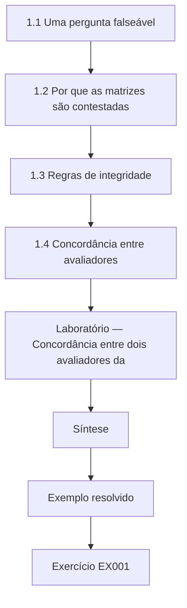

### Desenho lógico

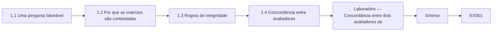

```text
[1.1 Uma pergunta falseável]
    |
    v
[1.2 Por que as matrizes são contestadas]
    |
    v
[1.3 Regras de integridade]
    |
    v
[1.4 Concordância entre avaliadores]
    |
    v
[Laboratório — Concordância entre dois avaliadores da]
    |
    v
[Síntese]
    |
    v
[Exemplo resolvido] --> [Exercício EX001]
```
<!-- open-cyber-academy:lesson-figures:end ch-01 -->


### Objetivos de aprendizagem

Você vai (1) formular uma pergunta falseável sobre como as organizações avaliam o risco cibernético; (2) definir regras de integridade para pesquisar dentro de uma organização regulada; (3) medir a concordância entre avaliadores que usam uma matriz de risco.

### 1.1 Uma pergunta falseável

Amara Lindgren é doutoranda na fictícia Halvard University, orientada pela Profa. Rosa Delgado. Sua parceira de pesquisa é o fictício Corvane Regional Health Board, que administra quatro hospitais e mantém um registro de riscos baseado numa matriz de risco cinco por cinco. Amara pergunta se substituir as classificações ordinais da matriz por estimativas quantitativas calibradas, no estilo do FAIR descrito por Freund e Jones (2015), leva a decisões de risco mais consistentes e mais bem calibradas. Ela registra de antemão que resultados mostrariam que sua ideia está errada: nenhum ganho de concordância, de calibração ou de qualidade de decisão.

### 1.2 Por que as matrizes são contestadas

Amara revisa os argumentos contra as matrizes de risco. Cox (2008) mostrou que as matrizes podem atribuir a mesma classificação a riscos com perdas esperadas muito diferentes e podem até colocar um risco menor acima de um maior, porque as faixas ordinais descartam informação. Hubbard e Seiersen (2016) argumentaram que o risco de cibersegurança pode ser medido com intervalos calibrados e simulações simples. As normas são mais neutras: a ISO/IEC 27005:2022 e o NIST SP 800-30r1 admitem abordagens qualitativas, semiquantitativas e quantitativas. A contribuição de Amara é, portanto, empírica: testar, dentro de uma organização, se a abordagem quantitativa funciona melhor na prática.

### 1.3 Regras de integridade

Pesquisar dentro de uma autoridade de saúde traz riscos: expor fraquezas reais, constranger gestores identificados e influenciar as próprias decisões estudadas. O protocolo de Amara, aprovado pelo comitê de ética da Halvard e pelo comitê de governança da informação da Corvane, fixa regras. Todos os cenários publicados são composições sintéticas; nenhuma vulnerabilidade real nem dado de paciente sai da Corvane; os avaliadores participam voluntariamente e podem desistir; o desempenho individual nunca é informado aos gestores; e o plano de análise é pré-registrado antes da coleta. Ela também declara não ter interesse financeiro em nenhum produto de quantificação de risco.

### 1.4 Concordância entre avaliadores

Antes de comparar métodos, Amara mede com que consistência os avaliadores da Corvane usam a matriz atual. Dois avaliadores experientes classificam, de forma independente, quarenta riscos sintéticos nas faixas Baixo, Médio e Alto. O laboratório calcula a concordância observada e o kappa de Cohen, que desconta a concordância esperada por acaso. O kappa é 0,19, o que Landis e Koch (1977) chamariam de concordância leve. Amara trata isso como um problema de linha de base, e não como crítica aos avaliadores: se dois especialistas discordam com frequência sobre o mesmo risco, as prioridades do registro podem depender mais de quem classificou o risco do que do próprio risco.

### Laboratório — Concordância entre dois avaliadores da matriz

```python
# Agreement between two assessors rating 40 synthetic risks on a 5x5 matrix (High/Medium/Low bands).
import random
r = random.Random(11)
bands = ["Low", "Medium", "High"]
truth = [r.choice(bands) for _ in range(40)]
def rate(t):
    if r.random() < 0.62: return t
    return r.choice([b for b in bands if b != t])
a = [rate(t) for t in truth]; b = [rate(t) for t in truth]
po = sum(x == y for x, y in zip(a, b)) / 40
pe = sum((a.count(k) / 40) * (b.count(k) / 40) for k in bands)
print(f"observed agreement {po:.2f}; chance {pe:.2f}; kappa {(po - pe) / (1 - pe):.2f}")
```

Execute com `python3 lab_kappa.py`. Saída verificada:

```text
observed agreement 0.47; chance 0.35; kappa 0.19
```

### Exemplo resolvido

Amara formula uma comparação falseável entre matrizes e estimativas quantitativas, define regras de integridade para pesquisar numa autoridade de saúde e mede uma linha de base de concordância da matriz com kappa de 0,19.

> **Caso sintético.** A Halvard, a Corvane e todas as pessoas são sintéticas; Freund e Jones (2015), Cox (2008), Hubbard e Seiersen (2016), a ISO/IEC 27005:2022, o SP 800-30r1 e Landis e Koch (1977) são reais.

### Erros e limites

O pré-registro não elimina todo viés. O kappa depende da frequência com que cada faixa aparece.

### Exercícios

- **EX001 — Plano falseável.** O que torna falseável a pergunta de Amara? *Rubrica:* 3 = ela declara de antemão que resultados mostrariam que sua ideia está errada;; 2 = declaração prévia;; 1 = vago;; 0 = nenhuma.
- **EX002 — Crítica de Cox.** O que Cox (2008) mostrou sobre as matrizes de risco? *Rubrica:* 3 = classificações idênticas para riscos muito diferentes e possíveis inversões de ordem;; 2 = perda de informação;; 1 = vago;; 0 = nenhuma.
- **EX003 — Neutralidade das normas.** Que abordagens a ISO/IEC 27005:2022 e o SP 800-30r1 admitem? *Rubrica:* 3 = qualitativa, semiquantitativa e quantitativa;; 2 = as três;; 1 = só quantitativa;; 0 = nenhuma.
- **EX004 — Regra de publicação.** O que pode aparecer nos cenários publicados? *Rubrica:* 3 = apenas composições sintéticas;; 2 = sintéticos;; 1 = fraquezas reais;; 0 = nenhuma.
- **EX005 — Declaração de interesses.** O que Amara declara? *Rubrica:* 3 = não ter interesse financeiro em produtos de quantificação de risco;; 2 = conflito;; 1 = vago;; 0 = nenhuma.
- **EX006 — Kappa de base.** Que kappa os dois avaliadores alcançaram? *Rubrica:* 3 = 0,19, concordância leve;; 2 = 0,19;; 1 = 0,62;; 0 = nenhuma.
- **EX007 — Sentido da linha de base.** Por que a baixa concordância importa para o registro? *Rubrica:* 3 = as prioridades podem depender de quem classificou o risco;; 2 = efeito do avaliador;; 1 = vago;; 0 = nenhuma.

### Síntese

A pesquisa de doutorado em GRC começa com uma pergunta falseável, regras de integridade rigorosas e uma linha de base medida.

<!-- open-cyber-academy:chapter-navigation:start ch-01 -->
### Continue estudando — aula 01 (capítulo 01 de 08)

[← Início do curso](../../README.md) · [Índice das aulas](../SUBJECTS.md) · [Capítulo 02 →](#ch-02)

Continue para a próxima aula já escrita.
<!-- open-cyber-academy:chapter-navigation:end -->

<a id="ch-02"></a>

## Capítulo 2 — Governança, riscos e compliance de segurança: a fronteira da pesquisa

<!-- open-cyber-academy:lesson-figures:start ch-02 -->
### Mapa da aula

Aula 02 publicada. Mapa, exemplo, EX008.

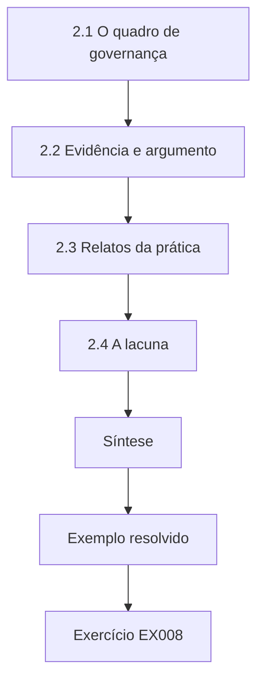

### Desenho lógico

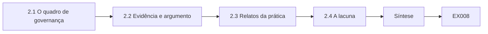

```text
[2.1 O quadro de governança]
    |
    v
[2.2 Evidência e argumento]
    |
    v
[2.3 Relatos da prática]
    |
    v
[2.4 A lacuna]
    |
    v
[Síntese]
    |
    v
[Exemplo resolvido] --> [Exercício EX008]
```
<!-- open-cyber-academy:lesson-figures:end ch-02 -->


### Objetivos de aprendizagem

Você vai (1) mapear a fronteira da pesquisa em governança de riscos de segurança; (2) distinguir afirmações apoiadas em evidências de afirmações apoiadas em argumentos; (3) localizar uma lacuna defensável.

### 2.1 O quadro de governança

Amara mapeia como a governança molda o trabalho com riscos. O NIST CSF 2.0 acrescentou uma função Govern, que cobre o contexto organizacional, a estratégia de gestão de riscos, os papéis, a política e a supervisão. A ISO/IEC 27001:2022, adotada no Brasil como ABNT NBR ISO/IEC 27001:2022, exige que a organização defina critérios de risco, avalie e trate os riscos de segurança da informação e guarde evidências. O COBIT 2019 coloca a otimização de riscos entre os objetivos de governança dos conselhos. A ISO 31000:2018 oferece princípios de gestão de riscos para qualquer área. Esses frameworks concordam que as decisões de risco cabem a responsáveis que prestam contas, mas pouco dizem sobre qual método de avaliação produz decisões melhores.

### 2.2 Evidência e argumento

Amara classifica a literatura pelo tipo de sustentação, registrando cada fonte. Gordon e Loeb (2002) oferecem um modelo matemático segundo o qual, sob suas premissas, o investimento ótimo em segurança é de no máximo cerca de 37% da perda esperada, o que é um argumento derivado de um modelo, e não uma observação. Cox (2008) também é analítico. Hubbard e Seiersen (2016) se apoiam em estudos sobre calibração de especialistas de fora da segurança. Spears e Barki (2010) trazem evidência de survey de que a participação dos usuários na gestão de riscos de segurança melhora o alinhamento com os processos de negócio. Poucos estudos comparam métodos de avaliação dentro de programas de segurança reais.

### 2.3 Relatos da prática

Amara também lê fontes da prática: documentos de frameworks, orientações de reguladores e relatórios do setor. Eles descrevem o que as organizações fazem, mas raramente testam se funciona. Ela observa que os métodos de avaliação se difundem por imitação e pelas expectativas dos auditores, e que a matriz muitas vezes é escolhida por ser fácil de explicar a um conselho. Isso explica por que as matrizes continuam comuns apesar das críticas analíticas: seus benefícios são sociais e procedimentais, enquanto seus custos, como prioridades inconsistentes, são difíceis de ver sem medição. Ela anota essa tensão.

### 2.4 A lacuna

Amara define a lacuna com precisão: há pouca evidência publicada, vinda de dentro de um programa de segurança em operação, sobre se a avaliação quantitativa calibrada melhora a consistência, a calibração e as escolhas de tratamento em comparação com uma matriz ordinal, quando o tempo de treinamento e a comunicação com o conselho entram como custos. A lacuna é estreita o bastante para ser estudada numa organização e importante porque muitos reguladores e conselhos estão se perguntando se devem migrar para a quantificação. A Profa. Delgado aprova o enquadramento e pede que Amara declare claramente que efeitos seu desenho não consegue detectar.

### Exemplo resolvido

Amara mapeia os frameworks de governança, separa argumentos derivados de modelos de evidências empíricas e define uma lacuna de evidência de campo na comparação entre matrizes e quantificação calibrada.

> **Caso sintético.** A Corvane é sintética; o CSF 2.0, a ISO/IEC 27001:2022 (ABNT NBR ISO/IEC 27001:2022), o COBIT 2019, a ISO 31000:2018, Gordon e Loeb (2002), Cox (2008), Hubbard e Seiersen (2016) e Spears e Barki (2010) são reais.

### Erros e limites

Mapas da literatura envelhecem depressa. Relatos da prática podem ser seletivos.

### Exercícios

- **EX008 — Função Govern.** O que o CSF 2.0 acrescentou? *Rubrica:* 3 = uma função Govern;; 2 = Govern;; 1 = Detect;; 0 = nenhuma.
- **EX009 — Resultado de Gordon e Loeb.** Que limite superior Gordon e Loeb derivaram? *Rubrica:* 3 = cerca de 37% da perda esperada;; 2 = 1/e;; 1 = 100%;; 0 = nenhuma.
- **EX010 — Spears e Barki.** O que Spears e Barki (2010) encontraram? *Rubrica:* 3 = a participação dos usuários melhora o alinhamento com os processos de negócio;; 2 = participação;; 1 = vago;; 0 = nenhuma.
- **EX011 — Por que as matrizes persistem.** Por que as matrizes continuam comuns? *Rubrica:* 3 = são fáceis de explicar e esperadas pelos auditores;; 2 = benefícios sociais;; 1 = precisão;; 0 = nenhuma.
- **EX012 — Lacuna definida.** Que lacuna Amara estuda? *Rubrica:* 3 = evidência de campo comparando matrizes e quantificação calibrada;; 2 = evidência de campo;; 1 = vago;; 0 = nenhuma.
- **EX013 — Pedido da orientadora.** O que a Profa. Delgado pediu que Amara declarasse? *Rubrica:* 3 = que efeitos o desenho não consegue detectar;; 2 = limites;; 1 = vago;; 0 = nenhuma.
- **EX014 — Tipos de evidência.** Por que Amara classifica a literatura pelo tipo de sustentação? *Rubrica:* 3 = modelos, experimentos e relatos da prática sustentam afirmações de modo diferente;; 2 = força da evidência;; 1 = vago;; 0 = nenhuma.

### Síntese

A fronteira mostra argumentação forte, mas poucas evidências de campo, o que define uma lacuna precisa.

<!-- open-cyber-academy:chapter-navigation:start ch-02 -->
### Continue estudando — aula 02 (capítulo 02 de 08)

[← Capítulo 01](#ch-01) · [Índice das aulas](../SUBJECTS.md) · [Capítulo 03 →](#ch-03)

Continue para a próxima aula já escrita.
<!-- open-cyber-academy:chapter-navigation:end -->

<a id="ch-03"></a>

## Capítulo 3 — Proposta de contribuição original

<!-- open-cyber-academy:lesson-figures:start ch-03 -->
### Mapa da aula

Aula 03 publicada. Mapa, exemplo, EX015.

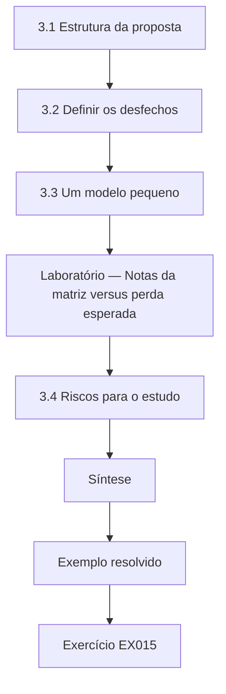

### Desenho lógico

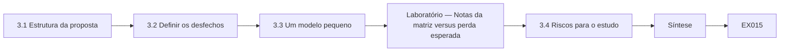

```text
[3.1 Estrutura da proposta]
    |
    v
[3.2 Definir os desfechos]
    |
    v
[3.3 Um modelo pequeno]
    |
    v
[Laboratório — Notas da matriz versus perda esperada]
    |
    v
[3.4 Riscos para o estudo]
    |
    v
[Síntese]
    |
    v
[Exemplo resolvido] --> [Exercício EX015]
```
<!-- open-cyber-academy:lesson-figures:end ch-03 -->


### Objetivos de aprendizagem

Você vai (1) escrever uma proposta de doutorado para comparar métodos; (2) definir desfechos de consistência, calibração e qualidade de decisão; (3) mostrar com um modelo pequeno por que a escolha do método pode mudar as prioridades.

### 3.1 Estrutura da proposta

A proposta de Amara tem cinco partes: problema e lacuna, perguntas de pesquisa, desenho, plano de análise e riscos. As perguntas são: as estimativas quantitativas calibradas melhoram a concordância entre avaliadores; melhoram a calibração das previsões de probabilidade; e mudam quais riscos são tratados primeiro? O desenho usa os próprios avaliadores da Corvane, distribuídos aleatoriamente entre os métodos, avaliando os mesmos cenários sintéticos construídos a partir de padrões reais. A proposta declara as contribuições esperadas para a teoria, para a prática e para a base de evidências usada pelos reguladores. A Corvane revisa o rascunho.

### 3.2 Definir os desfechos

Cada desfecho tem uma medida. A consistência é medida pela concordância entre avaliadores, com kappa para as faixas e a razão entre estimativas para as quantidades. A calibração é medida pelo escore de Brier, a média das diferenças ao quadrado entre as probabilidades previstas e o que de fato aconteceu, em eventos de curto horizonte que podem ser verificados durante o estudo. A qualidade de decisão é medida por quanto a ordem de tratamento coincide com a ordem por perda esperada calculada por um painel de referência. Amara escreve essas definições no pré-registro para que não mudem depois.

### 3.3 Um modelo pequeno

Para mostrar por que a escolha do método importa, Amara monta um exemplo pequeno com seis cenários sintéticos, cada um com probabilidade anual e tamanho da perda. O laboratório enquadra cada cenário numa matriz cinco por cinco e também calcula a perda esperada. O ransomware sobre prontuários tem a maior perda esperada, cerca de 192 mil por ano, mas a matriz lhe dá nota 5, abaixo da fraude em pagamentos e da indisponibilidade de fornecedor, empatadas em 6. Isso reproduz em miniatura a inversão de ordem e os empates que Cox (2008) previu, e motiva o estudo. A Profa. Delgado concorda: é um ponto de partida claro.

### Laboratório — Notas da matriz versus perda esperada em seis cenários

```python
# Risk matrix versus expected loss for six synthetic scenarios (after Cox, 2008).
# (name, annual probability, loss in thousands)
S = [("ransomware on records", 0.08, 2400), ("payment fraud", 0.30, 180), ("laptop loss", 0.60, 25),
     ("supplier outage", 0.15, 900), ("insider data leak", 0.05, 1500), ("web defacement", 0.40, 40)]
def band_p(p): return 1 if p < 0.1 else 2 if p < 0.2 else 3 if p < 0.35 else 4 if p < 0.5 else 5
def band_i(x): return 1 if x < 50 else 2 if x < 200 else 3 if x < 1000 else 4 if x < 2000 else 5
rows = [(n, band_p(p) * band_i(x), p * x) for n, p, x in S]
for n, sc, el in sorted(rows, key=lambda t: -t[2]): print(f"{n}: matrix score {sc}, expected loss {el:.0f}k")
by_m = [n for n, _, _ in sorted(rows, key=lambda t: (-t[1], t[0]))]; by_e = [n for n, _, _ in sorted(rows, key=lambda t: -t[2])]
print("top by matrix:", by_m[0], "| top by expected loss:", by_e[0])
print("matrix ties at top score:", sum(1 for _, s, _ in rows if s == max(s for _, s, _ in rows)))
```

Execute com `python3 lab_matrix.py`. Saída verificada:

```text
ransomware on records: matrix score 5, expected loss 192k
supplier outage: matrix score 6, expected loss 135k
insider data leak: matrix score 4, expected loss 75k
payment fraud: matrix score 6, expected loss 54k
web defacement: matrix score 4, expected loss 16k
laptop loss: matrix score 5, expected loss 15k
top by matrix: payment fraud | top by expected loss: ransomware on records
matrix ties at top score: 2
```

### 3.4 Riscos para o estudo

Amara lista os riscos do estudo: os avaliadores podem não concluir o treinamento de calibração; incidentes reais durante o estudo podem mudar atitudes; o próprio painel de referência pode ter viés; e a Corvane pode se reorganizar. Para cada um ela propõe uma mitigação, como um módulo de treinamento curto, o registro dos incidentes como covariáveis, o uso de três membros independentes no painel e um nível mínimo de participação combinado por escrito com a Corvane. Uma proposta de doutorado que nomeia seus riscos e mitigações é mais crível para examinadores e parceiros do que uma que supõe que tudo sairá conforme o plano.

### Exemplo resolvido

Amara estrutura uma proposta com três perguntas, define como desfechos a concordância, o escore de Brier e a ordem de decisão, e usa um modelo de seis cenários para mostrar os empates e a inversão de ordem da matriz.

> **Caso sintético.** Os cenários são sintéticos; Cox (2008) é real.

### Erros e limites

Modelos pequenos ilustram, não provam. Painéis de referência podem compartilhar vieses.

### Exercícios

- **EX015 — Três perguntas.** Sobre o que são as três perguntas de pesquisa? *Rubrica:* 3 = concordância, calibração e ordem de tratamento;; 2 = três;; 1 = vago;; 0 = nenhuma.
- **EX016 — Definição de Brier.** O que é o escore de Brier? *Rubrica:* 3 = média das diferenças ao quadrado entre previsões e resultados;; 2 = erro quadrático;; 1 = vago;; 0 = nenhuma.
- **EX017 — Maior risco no modelo.** Que cenário tem a maior perda esperada no laboratório? *Rubrica:* 3 = ransomware sobre prontuários, cerca de 192 mil;; 2 = ransomware;; 1 = fraude em pagamentos;; 0 = nenhuma.
- **EX018 — Topo da matriz.** Que cenários lideram a matriz no laboratório? *Rubrica:* 3 = fraude em pagamentos e indisponibilidade de fornecedor, empatadas em 6;; 2 = empate;; 1 = ransomware;; 0 = nenhuma.
- **EX019 — Mitigação do painel.** Como se mitiga o viés do painel de referência? *Rubrica:* 3 = três membros independentes no painel;; 2 = três;; 1 = vago;; 0 = nenhuma.
- **EX020 — Acordo de participação.** O que Amara combinou por escrito com a Corvane? *Rubrica:* 3 = um nível mínimo de participação;; 2 = participação;; 1 = vago;; 0 = nenhuma.

### Síntese

Uma proposta forte define resultados mensuráveis e mostra, com um modelo, por que a pergunta importa.

<!-- open-cyber-academy:chapter-navigation:start ch-03 -->
### Continue estudando — aula 03 (capítulo 03 de 08)

[← Capítulo 02](#ch-02) · [Índice das aulas](../SUBJECTS.md) · [Capítulo 04 →](#ch-04)

Continue para a próxima aula já escrita.
<!-- open-cyber-academy:chapter-navigation:end -->

<a id="ch-04"></a>

## Capítulo 4 — Replicação da linha de base e piloto

<!-- open-cyber-academy:lesson-figures:start ch-04 -->
### Mapa da aula

Aula 04 publicada. Mapa, exemplo, EX021.

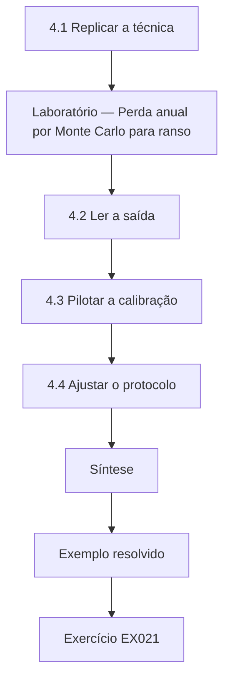

### Desenho lógico

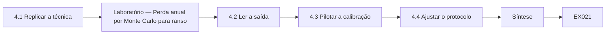

```text
[4.1 Replicar a técnica]
    |
    v
[Laboratório — Perda anual por Monte Carlo para ranso]
    |
    v
[4.2 Ler a saída]
    |
    v
[4.3 Pilotar a calibração]
    |
    v
[4.4 Ajustar o protocolo]
    |
    v
[Síntese]
    |
    v
[Exemplo resolvido] --> [Exercício EX021]
```
<!-- open-cyber-academy:lesson-figures:end ch-04 -->


### Objetivos de aprendizagem

Você vai (1) replicar uma técnica quantitativa publicada sobre dados sintéticos; (2) pilotar um treinamento de calibração com avaliadores; (3) ajustar o protocolo a partir das evidências do piloto.

### 4.1 Replicar a técnica

Amara primeiro replica a técnica central no estilo FAIR sobre dados sintéticos, para entendê-la por completo. Para o cenário de ransomware, ela define intervalos de frequência de eventos de perda e de magnitude da perda, com valores mínimo, mais provável e máximo, e executa uma simulação de Monte Carlo de vinte mil anos. O laboratório informa a perda anual média, a chance de haver alguma perda num ano e os percentis altos. Ela confere se os resultados se comportam como esperado quando os intervalos mudam, que é o teste básico de que uma simulação foi implementada corretamente.

### Laboratório — Perda anual por Monte Carlo para ransomware sobre prontuários

```python
# FAIR-style Monte Carlo: annual loss for ransomware on records (synthetic ranges).
import random
r = random.Random(5); N = 20000
def tri(lo, mode, hi): return r.triangular(lo, hi, mode)
losses = []
for _ in range(N):
    freq = tri(0.02, 0.06, 0.20)          # loss events per year
    events = sum(1 for _ in range(3) if r.random() < freq)
    losses.append(sum(tri(300, 1500, 6000) for _ in range(events)))
losses.sort()
mean = sum(losses) / N
print(f"mean annual loss {mean:.0f}k; P(loss>0) {sum(l > 0 for l in losses) / N:.3f}; 95th pct {losses[int(.95 * N)]:.0f}k; 99th pct {losses[int(.99 * N)]:.0f}k")
print(f"P(loss > 2000k) {sum(l > 2000 for l in losses) / N:.3f}")
```

Execute com `python3 lab_mc.py`. Saída verificada:

```text
mean annual loss 709k; P(loss>0) 0.247; 95th pct 4062k; 99th pct 5810k
P(loss > 2000k) 0.163
```

### 4.2 Ler a saída

A simulação dá uma perda anual média de cerca de 709 mil, mas em aproximadamente três anos de cada quatro não há perda alguma, e o percentil 95 fica em cerca de 4,06 milhões. A chance de perder mais de dois milhões num ano é de cerca de 16%. Amara observa que a média esconde essa assimetria: um conselho que ouvisse só a média entenderia mal o risco. Ela planeja apresentar probabilidades de excedência de perda, que respondem às perguntas que os conselhos de fato fazem, como a probabilidade de uma perda superar o nível da reserva.

### 4.3 Pilotar a calibração

Amara pilota um módulo de calibração de duas horas com seis avaliadores voluntários, e todos os seis o concluem. Eles praticam dar intervalos de noventa por cento para perguntas de conhecimentos gerais e recebem retorno sobre quantas vezes a resposta verdadeira caiu dentro do intervalo. Antes do treinamento, os intervalos continham a resposta em cerca de metade das vezes; depois, perto de oito em dez. Hubbard e Seiersen (2016) descrevem esse tipo de treinamento. Os avaliadores relatam que o exercício foi desconfortável, mas útil, e dois dizem que ele mudou sua maneira de pensar a incerteza nas próprias estimativas de risco.

### 4.4 Ajustar o protocolo

O piloto leva a três mudanças. O módulo de calibração é encurtado para noventa minutos, porque a atenção caiu na segunda hora. As descrições dos cenários são reescritas para tirar o jargão clínico que confundia os avaliadores não clínicos. O plano de análise acrescenta a excedência de perda num limiar fixo como desfecho secundário, porque os avaliadores do piloto a acharam mais significativa do que a média. Amara registra cada mudança e seu motivo num registro de emendas enviado ao comitê de ética, que o aprova, mantendo inalterados os desfechos primários pré-registrados.

### Exemplo resolvido

Amara replica um modelo de perdas por Monte Carlo, lê sua saída assimétrica, pilota o treinamento de calibração e registra as emendas do protocolo.

> **Caso sintético.** Os intervalos, os resultados e os números do piloto são sintéticos; Hubbard e Seiersen (2016) é real.

### Erros e limites

As simulações dependem dos intervalos de entrada. Os ganhos do piloto podem não se manter.

### Exercícios

- **EX021 — Tamanho da simulação.** Quantos anos simulados o laboratório executou? *Rubrica:* 3 = vinte mil;; 2 = 20.000;; 1 = vago;; 0 = nenhuma.
- **EX022 — Perda anual média.** Que perda anual média o laboratório informou? *Rubrica:* 3 = cerca de 709 mil;; 2 = 709k;; 1 = vago;; 0 = nenhuma.
- **EX023 — Anos sem perda.** Em que parcela aproximada dos anos não houve perda? *Rubrica:* 3 = cerca de três em quatro;; 2 = 75%;; 1 = vago;; 0 = nenhuma.
- **EX024 — Número de excedência.** Qual era a chance de perder mais de dois milhões? *Rubrica:* 3 = cerca de 16%;; 2 = 0,163;; 1 = vago;; 0 = nenhuma.
- **EX025 — Calibração no piloto.** Como as taxas de acerto dos intervalos mudaram com o treinamento? *Rubrica:* 3 = de cerca de metade para cerca de oito em dez;; 2 = melhoraram;; 1 = vago;; 0 = nenhuma.
- **EX026 — Desfechos inalterados.** O que Amara manteve inalterado ao emendar o protocolo? *Rubrica:* 3 = os desfechos primários pré-registrados;; 2 = desfechos primários;; 1 = vago;; 0 = nenhuma.

### Síntese

Replicação, pilotagem e emendas registradas preparam um estudo principal sólido.

<!-- open-cyber-academy:chapter-navigation:start ch-04 -->
### Continue estudando — aula 04 (capítulo 04 de 08)

[← Capítulo 03](#ch-03) · [Índice das aulas](../SUBJECTS.md) · [Capítulo 05 →](#ch-05)

Continue para a próxima aula já escrita.
<!-- open-cyber-academy:chapter-navigation:end -->

<a id="ch-05"></a>

## Capítulo 5 — Estudo principal e validação independente

<!-- open-cyber-academy:lesson-figures:start ch-05 -->
### Mapa da aula

Aula 05 publicada. Mapa, exemplo, EX027.

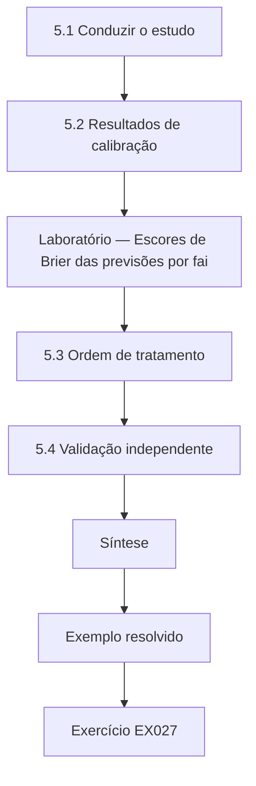

### Desenho lógico

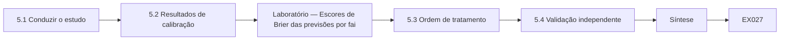

```text
[5.1 Conduzir o estudo]
    |
    v
[5.2 Resultados de calibração]
    |
    v
[Laboratório — Escores de Brier das previsões por fai]
    |
    v
[5.3 Ordem de tratamento]
    |
    v
[5.4 Validação independente]
    |
    v
[Síntese]
    |
    v
[Exemplo resolvido] --> [Exercício EX027]
```
<!-- open-cyber-academy:lesson-figures:end ch-05 -->


### Objetivos de aprendizagem

Você vai (1) conduzir uma comparação randomizada de métodos de avaliação; (2) analisar a calibração com o escore de Brier; (3) validar os resultados com um painel independente.

### 5.1 Conduzir o estudo

Os trinta avaliadores da Corvane são distribuídos aleatoriamente em dois grupos de quinze. Um grupo usa a matriz atual com suas definições de faixas; o outro conclui o módulo de calibração de noventa minutos e fornece intervalos de probabilidade e de perda. Os dois grupos avaliam os mesmos vinte cenários sintéticos e preveem a probabilidade de trinta eventos de curto horizonte que podem ser verificados durante o estudo, como o descumprimento de uma meta mensal de aplicação de patches. Amara acompanha a conclusão sem ver as respostas individuais até o fim do estudo, o que protege os avaliadores de pressões.

### 5.2 Resultados de calibração

Quando o trimestre termina, onze dos trinta eventos previstos aconteceram. O laboratório calcula o escore de Brier de cada grupo; quanto menor, melhor. O grupo da matriz, cujas previsões são os pontos médios das faixas, tem 0,180; o grupo calibrado, 0,167. A diferença favorece o grupo calibrado, mas é modesta, e com trinta eventos a incerteza é ampla. Amara relata o resultado como uma pequena melhora coerente com sua hipótese, e não como prova decisiva, e observa que seriam necessários mais eventos para uma conclusão firme.

### Laboratório — Escores de Brier das previsões por faixa da matriz e calibradas

```python
# Calibration of assessors' probability forecasts for 30 synthetic quarterly events.
import random
r = random.Random(21)
events = [r.random() < p for p in [0.1] * 10 + [0.3] * 10 + [0.6] * 10]
true_p = [0.1] * 10 + [0.3] * 10 + [0.6] * 10
matrix_group = [0.5 if p >= 0.3 else 0.2 for p in true_p]          # band midpoints from an ordinal scale
trained_group = [min(0.95, max(0.05, p + r.uniform(-0.08, 0.08))) for p in true_p]
def brier(f): return sum((fi - e) ** 2 for fi, e in zip(f, events)) / len(f)
print(f"events occurred {sum(events)}/30; Brier matrix-band group {brier(matrix_group):.3f}; Brier calibrated group {brier(trained_group):.3f}")
```

Execute com `python3 lab_brier.py`. Saída verificada:

```text
events occurred 11/30; Brier matrix-band group 0.180; Brier calibrated group 0.167
```

### 5.3 Ordem de tratamento

Para a qualidade de decisão, Amara compara os cinco primeiros cenários de cada grupo com a classificação de referência por perda esperada, calculada por um painel independente de três pessoas. Os cinco primeiros do grupo calibrado contêm quatro dos cinco primeiros do painel; os do grupo da matriz, três, com dois empates que tiveram de ser desfeitos por discussão. Ela observa que os empates obrigaram o grupo da matriz a recorrer ao julgamento informal, exatamente onde a inconsistência entra. A diferença é pequena em termos absolutos, mas importa porque os orçamentos de tratamento seguem o topo da lista.

### 5.4 Validação independente

Para validar os achados, Amara pede a uma segunda autoridade de saúde, também fictícia, que repita uma versão reduzida do estudo com doze avaliadores. A direção dos resultados é a mesma: calibração um pouco melhor e ordem de tratamento mais próxima no grupo calibrado, embora com diferenças menores. Ela trata isso como replicação parcial. A validação independente protege contra resultados que dependem da cultura de uma única organização ou do entusiasmo de um único parceiro de pesquisa, e fortalece a afirmação que ela poderá fazer na tese.

### Exemplo resolvido

Amara randomiza trinta avaliadores, encontra Brier de 0,167 contra 0,180, melhor concordância nos cinco primeiros para o grupo calibrado e replicação parcial em outra organização.

> **Caso sintético.** As duas autoridades de saúde e todos os dados são sintéticos.

### Erros e limites

Trinta eventos geram incerteza ampla. Os avaliadores podem trocar informações entre os grupos.

### Exercícios

- **EX027 — Alocação dos grupos.** Como os avaliadores foram distribuídos entre os métodos? *Rubrica:* 3 = aleatoriamente, quinze por grupo;; 2 = aleatória;; 1 = por antiguidade;; 0 = nenhuma.
- **EX028 — Eventos ocorridos.** Quantos dos trinta eventos previstos aconteceram? *Rubrica:* 3 = onze;; 2 = 11;; 1 = vago;; 0 = nenhuma.
- **EX029 — Comparação de Brier.** Que escores de Brier os grupos alcançaram? *Rubrica:* 3 = matriz 0,180, calibrado 0,167;; 2 = calibrado menor;; 1 = vago;; 0 = nenhuma.
- **EX030 — Sobreposição nos cinco primeiros.** Quantos dos cinco primeiros do painel cada grupo incluiu? *Rubrica:* 3 = calibrado quatro, matriz três;; 2 = quatro contra três;; 1 = vago;; 0 = nenhuma.
- **EX031 — Efeito dos empates.** Por que os empates importam no grupo da matriz? *Rubrica:* 3 = obrigam ao julgamento informal, onde a inconsistência entra;; 2 = empates;; 1 = vago;; 0 = nenhuma.
- **EX032 — Resultado da replicação.** O que mostrou o estudo da segunda autoridade? *Rubrica:* 3 = mesma direção, diferenças menores;; 2 = replicação parcial;; 1 = vago;; 0 = nenhuma.

### Síntese

Um estudo randomizado com validação independente sustenta uma vantagem modesta, apresentada com honestidade.

<!-- open-cyber-academy:chapter-navigation:start ch-05 -->
### Continue estudando — aula 05 (capítulo 05 de 08)

[← Capítulo 04](#ch-04) · [Índice das aulas](../SUBJECTS.md) · [Capítulo 06 →](#ch-06)

Continue para a próxima aula já escrita.
<!-- open-cyber-academy:chapter-navigation:end -->

<a id="ch-06"></a>

## Capítulo 6 — Crítica por pares e revisão

<!-- open-cyber-academy:lesson-figures:start ch-06 -->
### Mapa da aula

Aula 06 publicada. Mapa, exemplo, EX033.

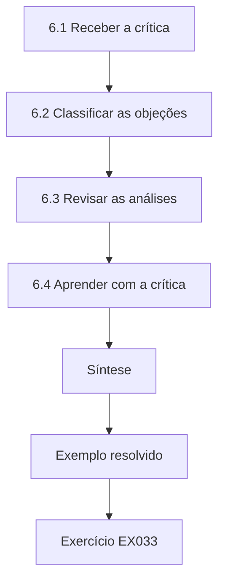

### Desenho lógico

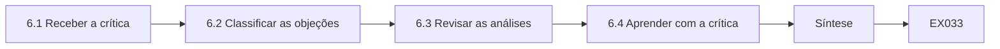

```text
[6.1 Receber a crítica]
    |
    v
[6.2 Classificar as objeções]
    |
    v
[6.3 Revisar as análises]
    |
    v
[6.4 Aprender com a crítica]
    |
    v
[Síntese]
    |
    v
[Exemplo resolvido] --> [Exercício EX033]
```
<!-- open-cyber-academy:lesson-figures:end ch-06 -->


### Objetivos de aprendizagem

Você vai (1) responder à crítica de especialistas a um estudo quantitativo de risco; (2) separar objeções metodológicas de objeções filosóficas; (3) revisar afirmações e análises.

### 6.1 Receber a crítica

Amara apresenta os resultados num workshop de doutorado e submete um rascunho de artigo. Os revisores levantam quatro pontos. Uma gestora de riscos argumenta que os conselhos entendem as matrizes e podem se desinteressar diante de intervalos de probabilidade. Um estatístico observa que trinta eventos são poucos para afirmações confiantes sobre calibração. Uma auditora pergunta como as estimativas quantitativas seriam evidenciadas para a certificação ISO/IEC 27001:2022. Um filósofo da ciência questiona se é possível estimar de forma significativa as magnitudes de perda de eventos cibernéticos raros. Amara registra cada ponto e sua origem antes de responder.

### 6.2 Classificar as objeções

Amara classifica a crítica. O ponto do estatístico é metodológico e pode ser tratado com mais dados ou com afirmações mais cautelosas. O ponto da auditora é prático: a ISO/IEC 27001:2022 exige um processo de avaliação de riscos documentado e repetível, que um método quantitativo pode atender se suas entradas e seu raciocínio forem registrados. O ponto sobre o engajamento do conselho é uma questão empírica que ela pode testar em parte. A objeção filosófica sobre eventos raros não pode ser resolvida por seus dados, então ela a reconhece como limite de toda avaliação de riscos, por matriz ou quantitativa.

### 6.3 Revisar as análises

Amara revisa. Acrescenta um intervalo bootstrap para a diferença de Brier, que inclui o zero, e troca a formulação "melhora a calibração" por "mostra uma melhora pequena e incerta". Acrescenta um estudo curto com o conselho da Corvane, apresentando os mesmos riscos dos dois modos, e registra qual apresentação os conselheiros acharam mais útil para decidir. A maioria preferiu os gráficos de excedência de perda depois de explicados, embora dois tenham preferido a matriz. Ela acrescenta um apêndice que descreve como os registros quantitativos se encaixam no processo documentado esperado pela ISO/IEC 27001:2022.

### 6.4 Aprender com a crítica

A Profa. Delgado observa que uma boa crítica afia a tese ao forçar afirmações precisas. Amara reflete que seu entusiasmo inicial pela quantificação a levou a subestimar o papel social das matrizes na comunicação e na governança. Agora ela enquadra sua contribuição como evidência sobre trade-offs, e não como veredito de que um método é superior. Essa mudança torna o trabalho mais útil para os profissionais, que precisam equilibrar precisão, custo, explicabilidade e expectativas de auditoria, e mais defensável diante dos examinadores. Ela agradece a cada revisor e lista todas as mudanças numa tabela de respostas, por transparência.

### Exemplo resolvido

Amara classifica quatro críticas, acrescenta um intervalo bootstrap que inclui o zero, testa a apresentação ao conselho e reenquadra sua contribuição como evidência sobre trade-offs.

> **Caso sintético.** As críticas e os resultados são sintéticos; a ISO/IEC 27001:2022 é real.

### Erros e limites

Estudos com conselhos são pequenos. O reenquadramento pode enfraquecer demais as afirmações.

### Exercícios

- **EX033 — Ponto do estatístico.** A que o estatístico objetou? *Rubrica:* 3 = trinta eventos são poucos;; 2 = tamanho da amostra;; 1 = vago;; 0 = nenhuma.
- **EX034 — Resposta à auditora.** Como os métodos quantitativos podem atender às expectativas da ISO/IEC 27001:2022? *Rubrica:* 3 = registrando entradas e raciocínio num processo repetível;; 2 = documentação;; 1 = vago;; 0 = nenhuma.
- **EX035 — Objeção sem solução.** Que objeção os dados de Amara não conseguem resolver? *Rubrica:* 3 = se as perdas de eventos raros podem ser estimadas de forma significativa;; 2 = filosófica;; 1 = vago;; 0 = nenhuma.
- **EX036 — Resultado do bootstrap.** O que mostrou o intervalo bootstrap para a diferença de Brier? *Rubrica:* 3 = que ele inclui o zero;; 2 = incerto;; 1 = significativo;; 0 = nenhuma.
- **EX037 — Preferência do conselho.** Que apresentação a maioria dos conselheiros preferiu? *Rubrica:* 3 = gráficos de excedência de perda depois de explicados;; 2 = excedência;; 1 = matriz;; 0 = nenhuma.
- **EX038 — Contribuição reenquadrada.** Como Amara reenquadrou sua contribuição? *Rubrica:* 3 = evidência sobre trade-offs, não um veredito;; 2 = trade-offs;; 1 = superioridade;; 0 = nenhuma.

### Síntese

A crítica ordenada por tipo leva a afirmações mais precisas e a uma contribuição mais útil.

<!-- open-cyber-academy:chapter-navigation:start ch-06 -->
### Continue estudando — aula 06 (capítulo 06 de 08)

[← Capítulo 05](#ch-05) · [Índice das aulas](../SUBJECTS.md) · [Capítulo 07 →](#ch-07)

Continue para a próxima aula já escrita.
<!-- open-cyber-academy:chapter-navigation:end -->

<a id="ch-07"></a>

## Capítulo 7 — Síntese da tese e arquivo de reprodutibilidade

<!-- open-cyber-academy:lesson-figures:start ch-07 -->
### Mapa da aula

Aula 07 publicada. Mapa, exemplo, EX039.

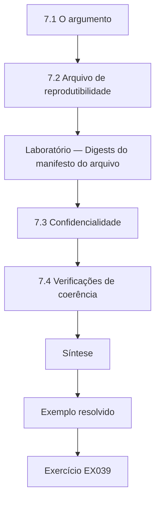

### Desenho lógico

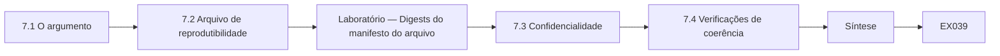

```text
[7.1 O argumento]
    |
    v
[7.2 Arquivo de reprodutibilidade]
    |
    v
[Laboratório — Digests do manifesto do arquivo]
    |
    v
[7.3 Confidencialidade]
    |
    v
[7.4 Verificações de coerência]
    |
    v
[Síntese]
    |
    v
[Exemplo resolvido] --> [Exercício EX039]
```
<!-- open-cyber-academy:lesson-figures:end ch-07 -->


### Objetivos de aprendizagem

Você vai (1) sintetizar os achados num argumento de tese coerente; (2) montar um arquivo de reprodutibilidade com verificações de integridade; (3) proteger a confidencialidade do parceiro nos materiais compartilhados.

### 7.1 O argumento

A tese de Amara sustenta que, numa autoridade de saúde em operação, a avaliação quantitativa calibrada produziu calibração um pouco melhor, prioridades mais consistentes e menos empates sem solução do que uma matriz ordinal, a um custo de treinamento de noventa minutos por avaliador, enquanto os conselheiros precisaram de explicação para usar bem os resultados. A vantagem foi modesta e incerta, e a replicação parcial apoia sua direção. Ela posiciona isso diante das críticas analíticas às matrizes, mostrando que os problemas previstos aparecem na prática, mas em escala menor do que os críticos às vezes sugerem.

### 7.2 Arquivo de reprodutibilidade

Amara monta um arquivo com o protocolo pré-registrado, o conjunto de cenários sintéticos, o código de análise com sementes aleatórias fixas e o livro de códigos das faixas e intervalos. Ela calcula um digest criptográfico de cada arquivo e lista os digests num manifesto, para que qualquer pessoa possa confirmar que os arquivos não mudaram desde a submissão. O laboratório produz o manifesto dos quatro arquivos. A reprodutibilidade permite que examinadores e futuros pesquisadores refaçam as análises e testem premissas alternativas, o que é essencial quando os resultados são modestos e abertos a interpretação.

### Laboratório — Digests do manifesto do arquivo

```python
# Manifest digests for a reproducibility archive (synthetic file contents).
import hashlib
files = {"protocol_v3.md": "pre-registered protocol", "scenarios.csv": "id,prob,loss\n", "lab_mc.py": "seed=5", "codebook.md": "bands"}
for n, c in sorted(files.items()): print(n, hashlib.sha256(c.encode()).hexdigest()[:12])
print("files:", len(files))
```

Execute com `python3 lab_archive.py`. Saída verificada:

```text
codebook.md 1a5db2aba54d
lab_mc.py 21df5d9b21fc
protocol_v3.md 0f7bd61c2ae0
scenarios.csv ed97f09e7efe
files: 4
```

### 7.3 Confidencialidade

O arquivo não contém riscos, vulnerabilidades nem nomes reais da Corvane. Os cenários são composições sintéticas acordadas com o comitê de governança da informação da Corvane, e as respostas dos avaliadores são divulgadas apenas em tabelas agregadas. Amara documenta as etapas de desidentificação e faz o comitê aprovar o arquivo antes do depósito. Ela observa que um estudo de GRC pode vazar informação sensível pelo contexto mesmo sem nomes, como a descrição de um sistema incomum, então revisa cada cenário em busca de detalhes identificadores. Todo cenário duvidoso é reescrito ou retirado antes do depósito.

### 7.4 Verificações de coerência

Antes da submissão, Amara verifica a coerência: cada afirmação da conclusão pode ser rastreada até um capítulo e até evidências no arquivo; os limites declarados nos resultados aparecem no resumo; e a terminologia segue as normas citadas, como os termos da ISO 31000:2018, adotada no Brasil como ABNT NBR ISO 31000:2018, para critérios de risco e tratamento. Ela pede a um colega doutorando que rastreie três afirmações escolhidas ao acaso, e as três trilhas estão íntegras. A Profa. Delgado aprova a submissão, observando que uma tese cujas afirmações podem ser rastreadas e refeitas conquista uma confiança que vai além dos números.

### Exemplo resolvido

Amara formula um argumento de tese modesto e rastreável, arquiva protocolo, dados e código com um manifesto de digests e protege a confidencialidade do parceiro.

> **Caso sintético.** O conteúdo do arquivo é sintético; a ISO 31000:2018 (ABNT NBR ISO 31000:2018) é real.

### Erros e limites

Os digests provam integridade, não correção. O contexto ainda pode identificar parceiros.

### Exercícios

- **EX039 — Custo de treinamento.** Que custo de treinamento a tese informa? *Rubrica:* 3 = noventa minutos por avaliador;; 2 = 90 minutos;; 1 = vago;; 0 = nenhuma.
- **EX040 — Conteúdo do arquivo.** Cite os quatro arquivos depositados. *Rubrica:* 3 = protocolo, cenários, código de análise e livro de códigos;; 2 = quatro;; 1 = vago;; 0 = nenhuma.
- **EX041 — Finalidade dos digests.** O que os digests do manifesto permitem confirmar? *Rubrica:* 3 = que os arquivos não mudaram desde a submissão;; 2 = integridade;; 1 = correção;; 0 = nenhuma.
- **EX042 — Vazamento pelo contexto.** Como um estudo de GRC pode vazar informação sem nomes? *Rubrica:* 3 = por contexto identificador, como sistemas incomuns;; 2 = contexto;; 1 = vago;; 0 = nenhuma.
- **EX043 — Fonte da terminologia.** Os termos de que norma Amara usa para critérios de risco e tratamento? *Rubrica:* 3 = ISO 31000:2018;; 2 = ISO 31000;; 1 = COBIT;; 0 = nenhuma.
- **EX044 — Rastreio de afirmações.** Como Amara testou a coerência? *Rubrica:* 3 = um colega doutorando rastreou três afirmações ao acaso;; 2 = rastreio;; 1 = vago;; 0 = nenhuma.

### Síntese

Uma tese coerente é rastreável, reproduzível e cuidadosa com a confidencialidade dos parceiros.

<!-- open-cyber-academy:chapter-navigation:start ch-07 -->
### Continue estudando — aula 07 (capítulo 07 de 08)

[← Capítulo 06](#ch-06) · [Índice das aulas](../SUBJECTS.md) · [Capítulo 08 →](#ch-08)

Continue para a próxima aula já escrita.
<!-- open-cyber-academy:chapter-navigation:end -->

<a id="ch-08"></a>

## Capítulo 8 — Defesa e plano de publicação

<!-- open-cyber-academy:lesson-figures:start ch-08 -->
### Mapa da aula

Aula 08 publicada. Mapa, exemplo, EX045.

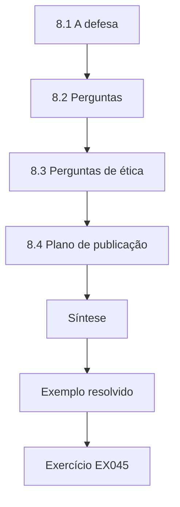

### Desenho lógico

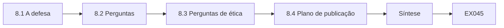

```text
[8.1 A defesa]
    |
    v
[8.2 Perguntas]
    |
    v
[8.3 Perguntas de ética]
    |
    v
[8.4 Plano de publicação]
    |
    v
[Síntese]
    |
    v
[Exemplo resolvido] --> [Exercício EX045]
```
<!-- open-cyber-academy:lesson-figures:end ch-08 -->


### Objetivos de aprendizagem

Você vai (1) defender uma tese de GRC diante de examinadores; (2) responder a perguntas sobre método, ética e prática; (3) planejar publicações e produtos práticos.

### 8.1 A defesa

Amara apresenta por trinta minutos: o problema de governança, a lacuna, o desenho randomizado, os resultados com sua incerteza, a replicação e os limites. Ela mostra o modelo de seis cenários como intuição rápida de por que as matrizes podem enganar, seguido dos resultados reais do estudo para mostrar quanto isso pesa na prática. A banca reúne uma cientista de riscos, um professor de governança de segurança da informação e uma CISO de hospital, escolhidos para cobrir teoria, normas e prática. Cada examinador recebeu o arquivo duas semanas antes do dia da defesa.

### 8.2 Perguntas

A cientista de riscos pergunta se a calibração em eventos de curto horizonte diz algo sobre perdas catastróficas raras. Amara responde que não diretamente; ela mostra que os avaliadores conseguem expressar a incerteza com honestidade, o que é necessário, mas não suficiente. O professor pergunta como os achados se encaixam no framework de gestão de riscos do NIST SP 800-37r2; ela explica que o método cabe nas etapas de avaliação e de monitoramento, sem mudar as decisões de autorização. A profissional pergunta sobre o custo; ela cita noventa minutos de treinamento e um tempo modesto de analista por cenário.

### 8.3 Perguntas de ética

Um examinador pergunta se a quantificação poderia ser mal usada para justificar cortes no orçamento de segurança. Amara concorda que esse risco existe, sobretudo se intervalos amplos forem reduzidos a um único número otimista. Ela recomenda que os conselhos sempre vejam intervalos e probabilidades de excedência, que as premissas sejam registradas e que os resultados sejam revisados por alguém independente da decisão orçamentária. Também observa que as matrizes podem ser mal usadas do mesmo jeito, rebaixando discretamente as classificações. A governança, e não o método, é a principal salvaguarda contra uma avaliação de riscos movida por interesses.

### 8.4 Plano de publicação

A banca aprova a tese com correções menores. Amara planeja três produtos: um artigo em periódico sobre a comparação randomizada, com o arquivo completo; um artigo mais curto, para profissionais, sobre a apresentação de riscos ao conselho; e um módulo gratuito de treinamento em calibração para avaliadores do setor público. Ela vai compartilhar o conjunto de cenários sintéticos para que outras organizações possam conduzir estudos comparáveis. Observa que a replicação parcial foi um ponto forte do trabalho e espera que outros a repliquem em setores além da saúde. Cada produto declara seu financiamento e seus limites.

### Exemplo resolvido

Amara defende a tese, responde a perguntas sobre eventos raros, o encaixe no SP 800-37r2, o custo e o mau uso, e planeja três publicações.

> **Caso sintético.** A defesa é sintética; o SP 800-37r2 é real.

### Erros e limites

Os examinadores têm suas próprias visões. Publicar leva tempo.

### Exercícios

- **EX045 — Composição da banca.** Que três perspectivas os examinadores cobriam? *Rubrica:* 3 = teoria, normas e prática;; 2 = três;; 1 = vago;; 0 = nenhuma.
- **EX046 — Resposta sobre eventos raros.** Como Amara respondeu sobre perdas catastróficas raras? *Rubrica:* 3 = a calibração é necessária, mas não suficiente;; 2 = limites;; 1 = prova;; 0 = nenhuma.
- **EX047 — Encaixe no RMF.** Onde o método se encaixa no SP 800-37r2? *Rubrica:* 3 = nas etapas de avaliação e de monitoramento;; 2 = avaliação;; 1 = autorização;; 0 = nenhuma.
- **EX048 — Salvaguarda contra o mau uso.** O que protege contra uma avaliação de riscos movida por interesses? *Rubrica:* 3 = governança com intervalos, premissas registradas e revisão independente;; 2 = governança;; 1 = escolha do método;; 0 = nenhuma.
- **EX049 — Resultado da defesa.** Qual foi o resultado da defesa? *Rubrica:* 3 = aprovação com correções menores;; 2 = aprovação;; 1 = vago;; 0 = nenhuma.
- **EX050 — Recurso compartilhado.** O que Amara vai compartilhar com outras organizações? *Rubrica:* 3 = o conjunto de cenários sintéticos;; 2 = cenários;; 1 = dados reais;; 0 = nenhuma.

### Síntese

Uma defesa testa raciocínio, ética e valor prático, e a publicação amplia a contribuição.

<!-- open-cyber-academy:chapter-navigation:start ch-08 -->
### Continue estudando — aula 08 (capítulo 08 de 08)

[← Capítulo 07](#ch-07) · [Índice das aulas](../SUBJECTS.md) · [Próximo curso pelo índice →](../SUBJECTS.md)

O índice aponta para o próximo curso do percurso de estudos.
<!-- open-cyber-academy:chapter-navigation:end -->

<a id="worked-results"></a>

## Resoluções

Respostas-modelo para EX001–EX050. Amara Lindgren, a Profa. Rosa Delgado, a Halvard University, o Corvane Regional Health Board e todos os números são sintéticos. As respostas dos laboratórios citam saídas verificadas. Qualquer resposta que atenda à rubrica recebe a mesma pontuação.

**EX001.** Ela registra de antemão que nenhum ganho de concordância, de calibração ou de qualidade de decisão contaria contra sua ideia.

**EX002.** Que as matrizes podem dar a mesma classificação a riscos com perdas esperadas muito diferentes e podem até inverter sua ordem.

**EX003.** Abordagens qualitativas, semiquantitativas e quantitativas.

**EX004.** Apenas composições sintéticas de cenários, nunca vulnerabilidades reais ou dados de pacientes.

**EX005.** Que não tem interesse financeiro em nenhum produto de quantificação de risco.

**EX006.** 0,19, o que Landis e Koch chamariam de concordância leve.

**EX007.** Porque as prioridades podem depender mais de qual avaliador classificou o risco do que do próprio risco.

**EX008.** Uma função Govern, que cobre contexto, estratégia, papéis, política e supervisão.

**EX009.** Pelo modelo deles, o investimento ótimo é de no máximo cerca de 37% (1/e) da perda esperada.

**EX010.** Evidência de survey de que a participação dos usuários na gestão de riscos de segurança melhora o alinhamento com os processos de negócio.

**EX011.** Porque são fáceis de explicar e se difundem por imitação e pelas expectativas dos auditores.

**EX012.** Evidência de campo, de um programa em operação, sobre se a quantificação calibrada supera as matrizes quando os custos entram na conta.

**EX013.** Que efeitos seu desenho não consegue detectar.

**EX014.** Porque modelos matemáticos, estudos empíricos e relatos da prática sustentam afirmações com forças diferentes.

**EX015.** Se a quantificação melhora a concordância, melhora a calibração e muda quais riscos são tratados primeiro.

**EX016.** A média das diferenças ao quadrado entre as probabilidades previstas e o que aconteceu.

**EX017.** Ransomware sobre prontuários, cerca de 192 mil por ano.

**EX018.** Fraude em pagamentos e indisponibilidade de fornecedor, empatadas com nota 6.

**EX019.** Usando três membros independentes no painel.

**EX020.** Um nível mínimo de participação dos avaliadores.

**EX021.** Vinte mil anos simulados.

**EX022.** Cerca de 709 mil.

**EX023.** Em cerca de três anos de cada quatro, já que a chance de alguma perda era de cerca de 0,25.

**EX024.** Cerca de 16% (0,163) ao ano.

**EX025.** De cerca de metade das respostas dentro dos intervalos para cerca de oito em dez.

**EX026.** Os desfechos primários pré-registrados.

**EX027.** Aleatoriamente, em dois grupos de quinze.

**EX028.** Onze de trinta.

**EX029.** 0,180 no grupo da matriz e 0,167 no grupo calibrado; quanto menor, melhor.

**EX030.** Quatro no grupo calibrado e três no grupo da matriz.

**EX031.** Porque os empates precisam ser desfeitos por discussão informal, onde a inconsistência entra.

**EX032.** A mesma direção de resultados, com diferenças menores: uma replicação parcial.

**EX033.** Que trinta eventos são poucos para afirmações confiantes sobre calibração.

**EX034.** Documentando entradas e raciocínio para que o processo de avaliação seja repetível.

**EX035.** A objeção filosófica sobre estimar perdas de eventos raros.

**EX036.** Que ele inclui o zero, então a melhora é incerta.

**EX037.** Os gráficos de excedência de perda, depois de explicados, embora dois tenham preferido a matriz.

**EX038.** Como evidência sobre trade-offs, e não como veredito de que um método é superior.

**EX039.** Noventa minutos de treinamento de calibração por avaliador.

**EX040.** O protocolo, o conjunto de cenários, o código de análise e o livro de códigos.

**EX041.** Que os arquivos não mudaram desde a submissão.

**EX042.** Pelo contexto, como a descrição de um sistema incomum.

**EX043.** ISO 31000:2018.

**EX044.** Um colega doutorando rastreou ao acaso três afirmações até os capítulos e as evidências do arquivo.

**EX045.** Teoria do risco, normas de governança de segurança e prática hospitalar.

**EX046.** Que a calibração de curto horizonte mostra incerteza honesta, o que é necessário, mas não suficiente.

**EX047.** Nas etapas de avaliação e de monitoramento, sem mudar as decisões de autorização.

**EX048.** Governança: mostrar intervalos, registrar premissas e revisar os resultados de forma independente.

**EX049.** Aprovação com correções menores.

**EX050.** O conjunto de cenários sintéticos, para que outros conduzam estudos comparáveis.

<a id="references"></a>
## Referências

Todos os DOIs foram resolvidos em doi.org em 12 de outubro de 2026, e as normas foram conferidas nas páginas de seus editores. A lista é idêntica à da edição em inglês e cobre o livro inteiro, acrescida apenas da ABNT NBR ISO 31000:2018 e da ABNT NBR ISO/IEC 27001:2022, citadas nesta edição como referências brasileiras e conferidas em suas fontes oficiais; as adoções brasileiras da ABNT listadas foram conferidas no catálogo oficial da ABNT, e as demais normas técnicas são citadas em sua edição internacional. Organizações, pessoas, sistemas e números dos casos são sintéticos; somente as obras abaixo são reais.

- Associação Brasileira de Normas Técnicas. (2018). *ABNT NBR ISO 31000:2018 — Gestão de riscos — Diretrizes*. ABNT. <https://www.abntcatalogo.com.br/>
- Associação Brasileira de Normas Técnicas. (2022). *ABNT NBR ISO/IEC 27001:2022 — Segurança da informação, segurança cibernética e proteção à privacidade — Sistemas de gestão da segurança da informação — Requisitos* (versão corrigida 2023). ABNT. <https://www.abntcatalogo.com.br/>
- Cox, L. A., Jr. (2008). What's wrong with risk matrices? *Risk Analysis*, 28(2), 497–512. <https://doi.org/10.1111/j.1539-6924.2008.01030.x>
- Freund, J., & Jones, J. (2015). *Measuring and managing information risk: A FAIR approach*. Butterworth-Heinemann. <https://doi.org/10.1016/C2013-0-09966-5>
- Gordon, L. A., & Loeb, M. P. (2002). The economics of information security investment. *ACM Transactions on Information and System Security*, 5(4), 438–457. <https://doi.org/10.1145/581271.581274>
- Herley, C., & van Oorschot, P. C. (2017). SoK: Science, security and the elusive goal of security as a scientific pursuit. *2017 IEEE Symposium on Security and Privacy*, 99–120. <https://doi.org/10.1109/SP.2017.38>
- Hubbard, D. W., & Seiersen, R. (2016). *How to measure anything in cybersecurity risk*. Wiley. <https://doi.org/10.1002/9781119162315>
- International Organization for Standardization. (2018). *ISO 31000:2018 Risk management — Guidelines*. <https://www.iso.org/standard/65694.html>
- International Organization for Standardization. (2022a). *ISO/IEC 27001:2022 Information security, cybersecurity and privacy protection — Information security management systems — Requirements*. <https://www.iso.org/standard/27001>
- International Organization for Standardization. (2022c). *ISO/IEC 27005:2022 Information security, cybersecurity and privacy protection — Guidance on managing information security risks*. <https://www.iso.org/standard/80585.html>
- Joint Task Force Transformation Initiative. (2012). *Guide for conducting risk assessments* (NIST SP 800-30 Rev. 1). NIST. <https://doi.org/10.6028/NIST.SP.800-30r1>
- Joint Task Force. (2018). *Risk management framework for information systems and organizations: A system life cycle approach for security and privacy* (NIST SP 800-37 Rev. 2). NIST. <https://doi.org/10.6028/NIST.SP.800-37r2>
- Landis, J. R., & Koch, G. G. (1977). The measurement of observer agreement for categorical data. *Biometrics*, 33(1), 159–174. <https://doi.org/10.2307/2529310>
- National Institute of Standards and Technology. (2024). *The NIST Cybersecurity Framework (CSF) 2.0* (NIST CSWP 29). <https://doi.org/10.6028/NIST.CSWP.29>
- Spears, J. L., & Barki, H. (2010). User participation in information systems security risk management. *MIS Quarterly*, 34(3), 503–522. <https://doi.org/10.2307/25750689>
- Wohlin, C., Runeson, P., Höst, M., Ohlsson, M. C., Regnell, B., & Wesslén, A. (2012). *Experimentation in software engineering*. Springer. <https://doi.org/10.1007/978-3-642-29044-2>
