# Threat Intelligence and OSINT: A Doctoral Research Book

- Language: English (`en`); doctoral research track, two years.
- Editorial state: **published**. Chapters 1–8 of 8 have hand-written teaching text; exercises EX001–EX056 have matching worked results with 0–3 rubrics; three offline labs use only the Python 3 standard library on synthetic data, and their outputs are embedded from real runs. Independent review and the 300-page A4 verification remain open.
- Audience: doctoral candidates designing an original, testable contribution to cyber threat intelligence (CTI) or open-source intelligence (OSINT) method.
- Author: [hiagokinlevi](https://github.com/hiagokinlevi). Original text [CC0 1.0](../../../../../LICENSE); cited works keep their rights.
- Ethical boundary: no collection about real private individuals, no terms-of-service evasion, no deanonymisation, no intrusion into adversary infrastructure. All datasets, people and organisations are **synthetic** unless a sentence cites a public source.

[Course home](../../README.md) · [Chapter index](../SUBJECTS.md) · [Book plan](PLAN.md) · [Course skill](../../skill/SKILL.md) · [Worked results](#worked-results)

## How to use this draft

Chapter 1 sets research integrity; 2 maps the frontier; 3 frames a contribution; 4 replicates baselines; 5 runs the main study with independent validation; 6 handles critique; 7 assembles the thesis and archive; 8 prepares defence and publication. Each chapter has outcomes, teaching, a worked example, a labelled synthetic case, errors and limits, seven exercises scored 0–3, a synthesis and a **Continue studying** block.

### Synthetic running case

| Element | Role | Boundary |
|---|---|---|
| **Larkspur CTI Lab** — university research group with a corpus of 1,200 synthetic CTI reports | Host of the research | Invented |
| **Tomas Ekberg** | Doctoral candidate studying how confidence language in CTI reports matches outcomes | Invented |
| **Dr. Hana Sato** | Supervisor | Invented |

### Core sources

MITRE [ATT&CK](https://attack.mitre.org/); OASIS [STIX 2.1](https://docs.oasis-open.org/cti/stix/v2.1/stix-v2.1.html) and [TAXII 2.1](https://docs.oasis-open.org/cti/taxii/v2.1/taxii-v2.1.html); the [Diamond Model](https://www.activeresponse.org/wp-content/uploads/2013/07/diamond.pdf); Hutchins et al. [kill chain paper](https://www.lockheedmartin.com/content/dam/lockheed-martin/rms/documents/cyber/LM-White-Paper-Intel-Driven-Defense.pdf); NIST [SP 800-150](https://doi.org/10.6028/NIST.SP.800-150); FIRST [TLP 2.0](https://www.first.org/tlp/); [ICD 203](https://www.odni.gov/files/documents/ICD/ICD-203.pdf). Full list in [References](#references).

## Contents

| Chapters |
|---|
| [1](#ch-01) · [2](#ch-02) · [3](#ch-03) · [4](#ch-04) · [5](#ch-05) · [6](#ch-06) · [7](#ch-07) · [8](#ch-08) |

[Worked results](#worked-results) · [References](#references)

<a id="ch-01"></a>

## Chapter 1 — Advanced research integrity and methods

<!-- cykin:lesson-figures:start ch-01 -->
### Lesson map

Lesson 01 published. Map, example, EX001.

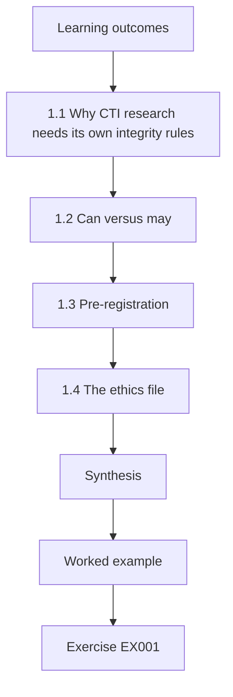

### Logical drawing

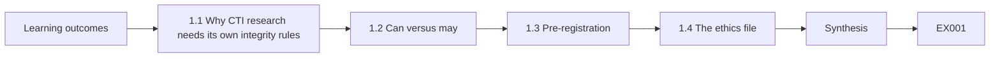

```text
[Learning outcomes]
    |
    v
[1.1 Why CTI research needs its own integrity rules]
    |
    v
[1.2 Can versus may]
    |
    v
[1.3 Pre-registration]
    |
    v
[1.4 The ethics file]
    |
    v
[Synthesis]
    |
    v
[Worked example] --> [Exercise EX001]
```
<!-- cykin:lesson-figures:end ch-01 -->


### Learning outcomes

You will (1) state the integrity obligations that apply to CTI and OSINT research; (2) separate data you may collect from data you merely can collect; (3) pre-register a question, a method and an analysis plan; (4) build an ethics file that a review board can approve.

### 1.1 Why CTI research needs its own integrity rules

Threat-intelligence research touches three sensitive populations at once: victims named in incident reports, analysts whose judgments are studied, and people who appear incidentally in open sources. A design that is statistically sound can still be unethical if it re-identifies a victim organisation from a sanitised report or scrapes a forum against its terms. Integrity in this field therefore combines ordinary research ethics — honesty, transparency, no fabrication — with data-protection law such as the EU General Data Protection Regulation and with the sharing restrictions the sources themselves carry, for example FIRST TLP 2.0 labels.

### 1.2 Can versus may

Public visibility does not equal permission. A profile page may be reachable without login, yet its platform's terms may forbid automated collection, and the person's data may still be personal data under GDPR. Tomas's rule: before any collection, write down the lawful basis, the terms that apply, the minimisation step and the retention period. If any of the four is blank, collection waits.

The forum corpus shows the rule working: its posts were reachable without login, but the forum's terms forbade research scraping and no permission was granted, so the "applicable terms" blank could not be filled honestly and the corpus was dropped before any collection.

### 1.3 Pre-registration

Pre-registering the research question, hypotheses, coding scheme and analysis plan before seeing outcome data protects against unconscious fitting. In CTI, where attribution narratives are seductive, this matters: once a group name such as APT29 (ATT&CK G0016) appears in a report, analysts tend to read every later artefact as confirming it. Heuer's Psychology of Intelligence Analysis documents this tendency in human judgment.

For Tomas, pre-registration fixes in advance the mapping of each estimative phrase to a probability and the rule for coding an outcome. If those were chosen after seeing which claims were confirmed, he could, without meaning to, place a phrase such as "likely" wherever it made the calibration curve look better.

### 1.4 The ethics file

The file holds: data inventory, lawful basis, TLP handling for each source, de-identification method, storage location, access list, retention clock, and a plan for incidental findings (for example, discovering an unreported live compromise in a sample). That last item is specific to security research and is often missing.

Tomas's file names a concrete route for that last item: if coding reveals evidence that a named organisation may still be compromised, he tells Dr. Sato, who contacts an appropriate coordinator through the sharing community, and he does not probe the organisation himself. The 200 TLP:AMBER+STRICT reports have their own line: lab-only analysis, no quotation, aggregate reporting.

### Worked example

Tomas plans to study 1,200 CTI reports. Two hundred carry TLP:AMBER+STRICT from a sharing community. His ethics file records that those may be analysed only inside the lab, never quoted, and that results will be reported in aggregate. A further corpus of forum posts is dropped because the forum's terms forbid research scraping and no permission was granted.

> **Synthetic case.** Larkspur CTI Lab, its corpus and Tomas's ethics file are invented.

### Errors and limits

Assuming "public means free to use" is the commonest integrity failure. Pre-registration does not forbid exploratory work; it requires labelling it as exploratory. This chapter is not legal advice.

### Exercises

- **EX001 — Four blanks.** List the four items Tomas must fill before any collection begins. *Rubric:* 3 = lawful basis, applicable terms, minimisation, retention; 2 = three; 1 = one or two; 0 = none.
- **EX002 — Amber corpus.** How may Tomas use the TLP:AMBER+STRICT reports in his thesis? *Rubric:* 3 = analyse inside the organisation only, no quotation or redistribution, aggregate reporting; 2 = restricts sharing vaguely; 1 = quote freely; 0 = none.
- **EX003 — Forum refusal.** Why is dropping the forum corpus correct even though posts are visible without login? *Rubric:* 3 = terms forbid scraping, no permission, personal data concerns; 2 = one reason; 1 = visible means allowed; 0 = none.
- **EX004 — Incidental compromise.** While coding a report, Tomas notices evidence that a named organisation may still be compromised. What should the ethics file have planned? *Rubric:* 3 = pre-agreed escalation route (supervisor, CERT/coordinator) without self-investigation; 2 = tell supervisor only; 1 = investigate himself; 0 = none.
- **EX005 — Confirmation trap.** Which bias does pre-registration help contain in attribution research, and how? *Rubric:* 3 = confirmation bias; fixes hypotheses and coding before outcomes; 2 = names bias; 1 = unrelated bias; 0 = none.
- **EX006 — Exploratory label.** Tomas finds an unexpected pattern not in his plan. How should he report it? *Rubric:* 3 = report as exploratory, separate from confirmatory, propose follow-up; 2 = report with weak labelling; 1 = present as planned; 0 = none.
- **EX007 — Access list.** Who should appear on the access list for the AMBER+STRICT subset? *Rubric:* 3 = only named lab members with need-to-know under the sharing agreement; 2 = lab members generally; 1 = anyone at the university; 0 = none.

### Synthesis

Write the lawful basis, terms, minimisation and retention before collecting; respect TLP; pre-register; plan for incidental findings.

### Continue studying — chapter 01 of 08

[← Course home](../../README.md) · [Course chapter index](../SUBJECTS.md) · [Chapter 02 (draft) →](#ch-02)

<a id="ch-02"></a>

## Chapter 2 — Threat intelligence and OSINT: research frontier

<!-- cykin:lesson-figures:start ch-02 -->
### Lesson map

Lesson 02 published. Map, example, EX008.

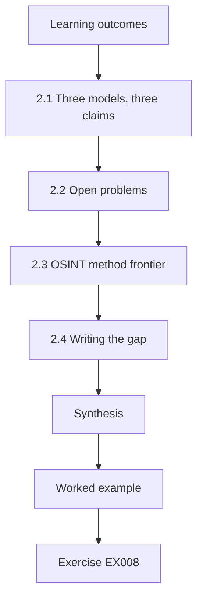

### Logical drawing

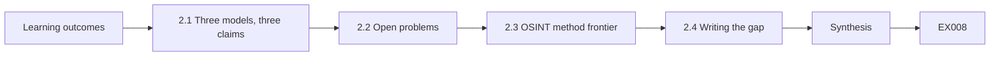

```text
[Learning outcomes]
    |
    v
[2.1 Three models, three claims]
    |
    v
[2.2 Open problems]
    |
    v
[2.3 OSINT method frontier]
    |
    v
[2.4 Writing the gap]
    |
    v
[Synthesis]
    |
    v
[Worked example] --> [Exercise EX008]
```
<!-- cykin:lesson-figures:end ch-02 -->


### Learning outcomes

You will (1) map the main open problems in CTI method; (2) distinguish models (kill chain, Diamond, ATT&CK) by what they claim; (3) identify where evidence in the literature is thin; (4) write a gap statement that a reviewer cannot dismiss as a literature summary.

### 2.1 Three models, three claims

Hutchins, Cloppert and Amin (2011) proposed the intrusion kill chain — reconnaissance, weaponization, delivery, exploitation, installation, command and control, actions on objectives — and argued that defenders win by breaking any link and by analysing campaigns rather than single incidents. Caltagirone, Pendergast and Betz (2013) proposed the Diamond Model: every event has adversary, capability, infrastructure and victim, and analysts pivot along the edges. MITRE ATT&CK is a curated knowledge base of observed tactics, techniques and groups. The first is a defensive strategy, the second an analytic ontology, the third an empirical catalogue. Research that treats them as interchangeable will confuse its own claims.

### 2.2 Open problems

Several questions remain weakly evidenced: how well confidence language in reports predicts later confirmation; how much indicator sharing actually reduces harm (NIST SP 800-150 describes how to share, not how much benefit results); how reproducible attribution is between independent teams; and how to measure the value of strategic intelligence for decision-makers. Each is researchable with careful design and synthetic or consented data.

Tomas's thesis takes the first question. The others suit different designs: harm reduction from sharing would need outcome data from organisations, and reproducibility of attribution would need independent teams working on the same artefacts, which is why they appear as follow-on work rather than in his proposal.

### 2.3 OSINT method frontier

Open-source investigation has grown faster than its validation. Questions include geolocation error rates, the reliability of archived web captures, and the privacy costs of aggregating individually harmless public facts. Doctoral work here must weigh research value against the harm of building aggregation tools.

Tomas's corpus deliberately avoids this frontier: it uses reports, not people, and the forum corpus was dropped. A thesis that geolocated images or linked public profiles would need a far heavier ethics file, because each step of aggregation can create a profile of a person that no single public fact revealed.

### 2.4 Writing the gap

A good gap statement has three parts: what is known (with citations), what is not known (stated precisely), and why it matters to a decision. "Little research exists on CTI" is not a gap; "no published study measures calibration of estimative language in vendor CTI reports against later confirmation" is.

Tomas's own statement follows the three parts: the norm is known, since ICD 203 requires expressing uncertainty and Kent proposed an estimative vocabulary; no measurement of calibration in commercial CTI appeared among the 40 papers and reports he reviewed; and it matters because SOC teams decide whether to block on the strength of those phrases.

### Worked example

Tomas reviews 40 papers and reports. He finds many descriptions of ICD 203's requirement to express uncertainty and of Kent's estimative-probability vocabulary, but no measurement of calibration in commercial CTI. His gap statement names that absence, cites Kent and ICD 203 for the norm, and links it to SOC decision-making about blocking.

> **Synthetic case.** Tomas's review count and gap statement are invented.

### Errors and limits

Vendor blogs are evidence of practice, not peer-reviewed findings; label them. Frontier enthusiasm does not justify building surveillance tooling.

### Exercises

- **EX008 — Model claims.** In one line each, state what kind of thing the kill chain, the Diamond Model and ATT&CK are. *Rubric:* 3 = strategy/phase model; event ontology; empirical knowledge base; 2 = two right; 1 = one; 0 = none.
- **EX009 — Weak gap.** Rewrite "there is not much research on threat sharing" as a precise gap. *Rubric:* 3 = specific unknown + population + measure; 2 = more specific but unmeasurable; 1 = unchanged; 0 = none.
- **EX010 — Diamond pivot.** Name the four core features and one pivot an analyst could make. *Rubric:* 3 = adversary, capability, infrastructure, victim + valid pivot (e.g. infrastructure→other victims); 2 = features only; 1 = partial; 0 = none.
- **EX011 — Aggregation harm.** Why can combining harmless public facts about a person create an ethical problem for OSINT research? *Rubric:* 3 = aggregation enables identification/profiling/harm; data-protection duties; 2 = privacy mention; 1 = no problem; 0 = none.
- **EX012 — Source grading.** How should Tomas cite a vendor blog in his literature review? *Rubric:* 3 = cite but label as grey literature/practice evidence, not peer-reviewed; 2 = cite with caution; 1 = treat as peer-reviewed; 0 = none.
- **EX013 — SP 800-150 scope.** What does NIST SP 800-150 provide, and what does it not measure? *Rubric:* 3 = guidance on sharing relationships/practices; not empirical benefit measurement; 2 = one half; 1 = wrong; 0 = none.
- **EX014 — Kill-chain thesis.** State the central defensive argument of Hutchins et al. in one sentence. *Rubric:* 3 = break any phase + campaign analysis/intelligence-driven defence; 2 = break the chain only; 1 = unrelated; 0 = none.

### Synthesis

Know what each model claims, find gaps that are precise and decision-linked, and weigh OSINT research value against aggregation harm.

### Continue studying — chapter 02 of 08

[← Chapter 01 (draft)](#ch-01) · [Course chapter index](../SUBJECTS.md) · [Chapter 03 (draft) →](#ch-03)

<a id="ch-03"></a>

## Chapter 3 — Original contribution proposal

<!-- cykin:lesson-figures:start ch-03 -->
### Lesson map

Lesson 03 published. Map, example, EX015.

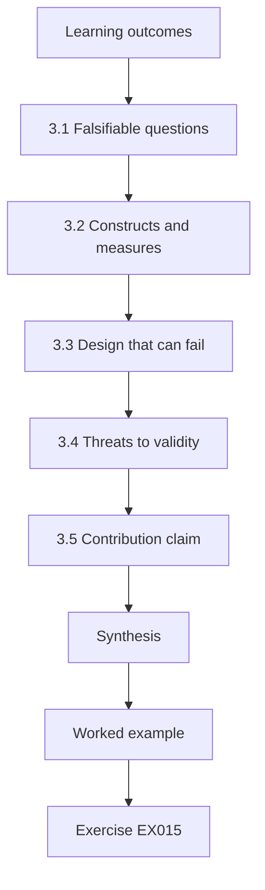

### Logical drawing

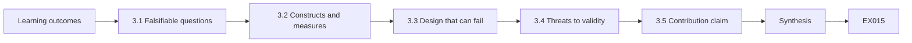

```text
[Learning outcomes]
    |
    v
[3.1 Falsifiable questions]
    |
    v
[3.2 Constructs and measures]
    |
    v
[3.3 Design that can fail]
    |
    v
[3.4 Threats to validity]
    |
    v
[3.5 Contribution claim]
    |
    v
[Synthesis]
    |
    v
[Worked example] --> [Exercise EX015]
```
<!-- cykin:lesson-figures:end ch-03 -->


### Learning outcomes

You will (1) frame a falsifiable research question; (2) define constructs and their operational measures; (3) choose a design that can fail; (4) write a proposal section on threats to validity before data collection.

### 3.1 Falsifiable questions

"Confidence language matters" cannot fail. "Statements labelled 'highly likely' in the corpus are later confirmed at a rate at least 20 percentage points above statements labelled 'possible'" can fail. A doctoral contribution earns its name by risking refutation.

The 20-point threshold also gives the committee a number to argue with before the data arrive. If they think a 10-point difference would already matter for blocking decisions, the right time to change the threshold is in the proposal, recorded in the pre-registration, not after the calibration curve is drawn.

### 3.2 Constructs and measures

Construct: analytic confidence as communicated. Measure: the estimative phrase in the key judgment, mapped to a numeric range on a published scale, for example Kent's words of estimative probability. Construct: confirmation. Measure: whether a later authoritative source in the corpus — an indictment summary, a vendor retraction, or a joint advisory — supports or contradicts the claim within 24 months. Every mapping decision is written in a codebook.

The 24-month window is itself a design choice with a cost: claims made late in the corpus have less time to be confirmed, so they are more likely to remain unresolved. The codebook therefore records the report date, and the analysis can check whether resolvability falls for recent reports.

### 3.3 Design that can fail

Tomas chooses a retrospective cohort design: sample key judgments, code their stated probability, code outcomes blind to the original phrase, and compute calibration. The design fails if outcomes are unknowable for most claims, so the proposal sets a minimum of 300 resolvable judgments before analysis proceeds.

The floor is a pre-registered stopping rule, not a target. If only 180 sampled judgments turn out to be resolvable, Tomas must extend the sample or revise the design under the rule written in advance, and report the shortfall; proceeding quietly with 180 would make the high-confidence bins too thin to estimate.

### 3.4 Threats to validity

Internal: coders may infer the phrase from context and bias outcome coding. Construct: an "outcome" source may itself rely on the original report. External: commercial reports may differ from government ones. Statistical: small bins give unstable calibration. Writing these down now lets the committee judge the plan rather than the luck of the result.

Each threat has a planned response. Outcome coders see claims with the estimative phrase removed. The circularity check the committee requested flags outcome sources that cite the original report. Commercial and government reports are analysed separately. The main sample over-weights high-confidence judgments so that the top bins are not the smallest, which the pilot showed was the weak point.

### 3.5 Contribution claim

The claim is narrow: the first measured calibration estimate of estimative language in a defined synthetic-plus-licensed corpus, with an open codebook. It is not "CTI is unreliable".

Keeping the claim narrow is what makes a negative result publishable. If high-confidence statements turn out to be confirmed no more often than possible ones, the thesis still delivers a measured estimate and an open codebook that others can apply to their own corpora; a broad claim would have nowhere to retreat. The open codebook is part of the claim for that reason: it lets other teams test the same question on their own reports.

### Worked example

Dr. Sato challenges the first draft question, "Are CTI vendors overconfident?" Tomas rewrites it with a measurable threshold, a defined corpus, a blind outcome-coding step and a resolvability floor. The committee approves the revised proposal with a request to add a circularity check for outcome sources.

> **Synthetic case.** The proposal exchange is invented.

### Errors and limits

Over-broad claims attract rejection; under-specified constructs cannot be replicated. A proposal is a plan, not a result.

### Exercises

- **EX015 — Make it falsifiable.** Rewrite "Attribution is often wrong" as a falsifiable hypothesis. *Rubric:* 3 = measurable rate, population, comparison or threshold, timeframe; 2 = measurable but no threshold; 1 = unchanged; 0 = none.
- **EX016 — Operational measure.** Give an operational measure for "confirmation" of a CTI key judgment. *Rubric:* 3 = defined later authoritative source + time window + support/contradict coding; 2 = vague later source; 1 = analyst feeling; 0 = none.
- **EX017 — Circularity check.** Why must outcome sources be checked for dependence on the original report? *Rubric:* 3 = circular confirmation inflates calibration; independent sources needed; 2 = partial; 1 = no need; 0 = none.
- **EX018 — Blind coding.** What is gained by coding outcomes without seeing the original estimative phrase? *Rubric:* 3 = prevents coder bias/expectation effect on outcome; 2 = fairness vaguely; 1 = speed; 0 = none.
- **EX019 — Resolvability floor.** What should Tomas do if only 180 of the sampled judgments are resolvable? *Rubric:* 3 = do not proceed as planned; extend sample or revise design per pre-registered rule; report shortfall; 2 = extend only; 1 = proceed silently; 0 = none.
- **EX020 — Validity class.** Classify "commercial reports may differ from government ones" as a validity threat type. *Rubric:* 3 = external validity/generalisability; 2 = validity vaguely; 1 = internal; 0 = none.
- **EX021 — Narrow claim.** Why is "CTI is unreliable" an inappropriate contribution claim for this study? *Rubric:* 3 = overgeneralises beyond corpus/construct; study measures calibration only; 2 = too broad; 1 = it is fine; 0 = none.

### Synthesis

Risk refutation, define measures in a codebook, design blind coding, write validity threats first, and keep the claim exactly as wide as the evidence.

### Continue studying — chapter 03 of 08

[← Chapter 02 (draft)](#ch-02) · [Course chapter index](../SUBJECTS.md) · [Chapter 04 (draft) →](#ch-04)

<a id="ch-04"></a>

## Chapter 4 — Baseline replication and pilot

<!-- cykin:lesson-figures:start ch-04 -->
### Lesson map

Lesson 04 published. Map, example, EX022.

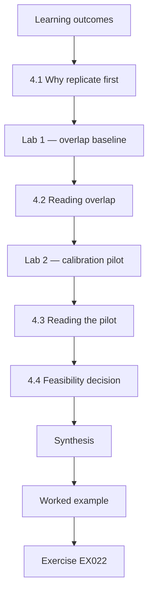

### Logical drawing


```text
[Learning outcomes]
    |
    v
[4.1 Why replicate first]
    |
    v
[Lab 1 — overlap baseline]
    |
    v
[4.2 Reading overlap]
    |
    v
[Lab 2 — calibration pilot]
    |
    v
[4.3 Reading the pilot]
    |
    v
[4.4 Feasibility decision]
    |
    v
[Synthesis]
    |
    v
[Worked example] --> [Exercise EX022]
```
<!-- cykin:lesson-figures:end ch-04 -->


### Learning outcomes

You will (1) replicate a simple published-style baseline before building on it; (2) compute a Brier score and calibration bins; (3) compute set overlap between indicator feeds; (4) decide from a pilot whether the main study is feasible.

### 4.1 Why replicate first

Building on an unreplicated baseline compounds error. A pilot that reproduces a known, simple measurement — such as overlap between two indicator feeds, a quantity often discussed in sharing literature — checks that your pipeline, parsing and definitions behave before the expensive study.

Tomas's pilot uses two such checks: Jaccard overlap between two small synthetic indicator feeds, and a Brier score on twelve pilot judgments. Both quantities can be computed by hand, so a mismatch between the script and the hand calculation points to a bug in parsing or definitions, not to a property of the corpus.

### Lab 1 — overlap baseline

```python
"""Lab 1 (ch 04): replicate a baseline - Jaccard overlap of synthetic indicator sets from two feeds."""
feed_a = {"203.0.113.7", "203.0.113.9", "198.51.100.44", "bad.example", "c2.example"}
feed_b = {"203.0.113.9", "198.51.100.44", "c2.example", "drop.example"}
inter, union = feed_a & feed_b, feed_a | feed_b
print(f"|A|={len(feed_a)} |B|={len(feed_b)} |A&B|={len(inter)} |A|B|={len(union)}")
print(f"Jaccard={len(inter)/len(union):.3f}")
print("only in A:", sorted(feed_a - feed_b))
print("only in B:", sorted(feed_b - feed_a))
```

Run with `python3 lab_overlap.py`. Verified output:

```text
|A|=5 |B|=4 |A&B|=3 |A|B|=6
Jaccard=0.500
only in A: ['203.0.113.7', 'bad.example']
only in B: ['drop.example']
```

### 4.2 Reading overlap

Three of six distinct indicators are shared, a Jaccard of 0.500. Overlap says nothing about quality: two feeds can agree on stale indicators. Bianco's Pyramid of Pain reminds analysts that hashes and IP addresses are cheap for adversaries to change, so high overlap on low-pyramid indicators is modest news.

For Tomas the overlap lab is a pipeline check, not a result: the 0.500 matches what he computes by hand from the six indicators, so the parsing and normalisation code behave as intended before the calibration work depends on them.

### Lab 2 — calibration pilot

```python
"""Lab 2 (ch 04): Brier score and calibration bins for synthetic analyst probability judgments."""
judgments = [  # (stated probability that the claim is true, outcome 1=true 0=false)
    (0.9, 1), (0.9, 1), (0.9, 0), (0.7, 1), (0.7, 0), (0.7, 1),
    (0.3, 0), (0.3, 1), (0.3, 0), (0.1, 0), (0.1, 0), (0.1, 0),
]
brier = sum((p - o) ** 2 for p, o in judgments) / len(judgments)
print(f"n={len(judgments)} Brier={brier:.3f}")
for p in sorted({p for p, _ in judgments}, reverse=True):
    outs = [o for q, o in judgments if q == p]
    print(f"stated {p:.1f}  observed {sum(outs)/len(outs):.2f}  (k={len(outs)})")
```

Run with `python3 lab_calibration.py`. Verified output:

```text
n=12 Brier=0.183
stated 0.9  observed 0.67  (k=3)
stated 0.7  observed 0.67  (k=3)
stated 0.3  observed 0.33  (k=3)
stated 0.1  observed 0.00  (k=3)
```

### 4.3 Reading the pilot

Twelve pilot judgments give a Brier score of 0.183 (0 is perfect, 0.25 is what always saying 0.5 earns on balanced outcomes). The 0.9 bin is confirmed only two times in three, suggesting overconfidence at the top; the 0.1 bin is well behaved. With three items per bin, none of this is a finding — it is a test that the code works and a hint about where sample size must be largest.

Tomas checked the first four Brier terms by hand against the script and they matched. He wrote the 0.9-bin hint in his lab notebook as exploratory and asked for the main sample to over-weight high-confidence judgments, turning a three-item curiosity into a design decision recorded before the main data were coded.

### 4.4 Feasibility decision

The pilot passes if parsing succeeds, coders can resolve outcomes for at least the floor fraction, and the scoring code reproduces hand calculations. It fails if outcomes are mostly unresolvable or coding takes far longer than budgeted.

In Tomas's pilot the third test passed, because the four hand-computed Brier terms matched the script. The time test is the one candidates tend to skip: if coding one judgment takes three times the budget, 300 resolvable judgments become a different project, and the place to find that out is the pilot, not month nine.

### Worked example

Tomas hand-computes the Brier score for the first four pilot items and matches the script. He records the 0.9-bin hint in his lab notebook as exploratory, not as a result, and requests that the main sample over-weight high-confidence judgments so that bin is estimated with adequate precision.

> **Synthetic case.** Both feeds and all twelve pilot judgments are invented.

### Errors and limits

Never publish pilot numbers as findings. Indicator values here use documentation addresses and `.example` names and are not real threats.

### Exercises

- **EX022 — Jaccard read.** Quote the Jaccard value and list the indicators only in feed A. *Rubric:* 3 = 0.500; 203.0.113.7 and bad.example; 2 = value only; 1 = wrong; 0 = none.
- **EX023 — Overlap meaning.** Why does high overlap between two hash-based feeds not prove either is valuable? *Rubric:* 3 = both could be stale/low-pyramid; overlap ≠ quality or relevance; 2 = partial; 1 = it proves value; 0 = none.
- **EX024 — Brier quote.** What Brier score does the pilot report, and what is the reference value for always saying 0.5? *Rubric:* 3 = 0.183 and 0.25; 2 = one; 1 = wrong; 0 = none.
- **EX025 — Top bin.** What does the 0.9 bin suggest, and why is it not a finding? *Rubric:* 3 = possible overconfidence (0.67 observed); k=3 too small, pilot only; 2 = one half; 1 = proven overconfidence; 0 = none.
- **EX026 — Hand check.** Compute (p−o)² for the first pilot item (0.9, 1). *Rubric:* 3 = 0.01; 2 = method right, arithmetic slip; 1 = wrong method; 0 = none.
- **EX027 — Sampling change.** What sampling change does the pilot motivate? *Rubric:* 3 = over-sample high-confidence judgments for precision; 2 = bigger sample generally; 1 = vague; 0 = none.
- **EX028 — Pilot fails.** Name two observations that would make Tomas stop after the pilot. *Rubric:* 3 = two of mostly unresolvable outcomes / coding time far over budget / script mismatch with hand calc; 2 = one; 1 = low Brier; 0 = none.

### Synthesis

Replicate the simple thing, verify code against hand calculation, treat pilot numbers as hints, and decide feasibility by pre-set rules.

### Continue studying — chapter 04 of 08

[← Chapter 03 (draft)](#ch-03) · [Course chapter index](../SUBJECTS.md) · [Chapter 05 (draft) →](#ch-05)

<a id="ch-05"></a>

## Chapter 5 — Main study and independent validation

<!-- cykin:lesson-figures:start ch-05 -->
### Lesson map

Lesson 05 published. Map, example, EX029.

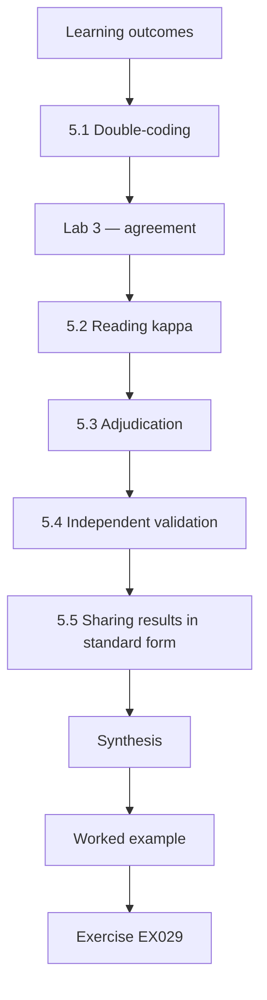

### Logical drawing

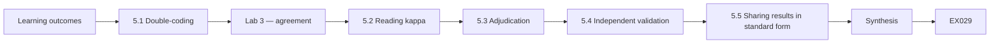

```text
[Learning outcomes]
    |
    v
[5.1 Double-coding]
    |
    v
[Lab 3 — agreement]
    |
    v
[5.2 Reading kappa]
    |
    v
[5.3 Adjudication]
    |
    v
[5.4 Independent validation]
    |
    v
[5.5 Sharing results in standard form]
    |
    v
[Synthesis]
    |
    v
[Worked example] --> [Exercise EX029]
```
<!-- cykin:lesson-figures:end ch-05 -->


### Learning outcomes

You will (1) organise blind double-coding of a corpus; (2) compute inter-rater agreement with Cohen's kappa; (3) adjudicate disagreements without contaminating the data; (4) arrange validation by a team that did not build the pipeline.

### 5.1 Double-coding

Two trained coders label each sampled event independently with the Diamond core feature that a key judgment concerns — adversary, capability, infrastructure or victim — and with outcome codes. Coders do not see each other's work until both are finished.

In the lab, ten events are coded; on the full sample of 340 judgments, the same procedure reached kappa 0.74 after one codebook revision. Independence matters because coders who discuss early items converge on each other's habits, which inflates agreement without improving the codebook.

### Lab 3 — agreement

```python
"""Lab 3 (ch 05): Cohen's kappa for two coders labelling synthetic events with a Diamond core feature."""
from collections import Counter
a = ["infra", "cap", "infra", "victim", "adv", "infra", "cap", "victim", "infra", "cap"]
b = ["infra", "cap", "cap",   "victim", "adv", "infra", "cap", "infra",  "infra", "cap"]
n = len(a)
po = sum(x == y for x, y in zip(a, b)) / n
ca, cb = Counter(a), Counter(b)
pe = sum(ca[k] * cb[k] for k in set(a) | set(b)) / n ** 2
kappa = (po - pe) / (1 - pe)
print(f"observed agreement={po:.2f} expected={pe:.2f} kappa={kappa:.3f}")
print("disagreements:", [i for i, (x, y) in enumerate(zip(a, b)) if x != y])
```

Run with `python3 lab_kappa.py`. Verified output:

```text
observed agreement=0.80 expected=0.31 kappa=0.710
disagreements: [2, 7]
```

### 5.2 Reading kappa

Raw agreement of 0.80 sounds strong, but chance alone would produce 0.31 given how often each label appears. Kappa removes that chance component and gives 0.710, conventionally described as substantial. Disagreements at items 2 and 7 both involve infrastructure versus another feature — a hint that the codebook's definition of infrastructure needs an example about shared hosting.

Tomas's revision added that example, and agreement on the full 340-judgment sample reached kappa 0.74. The chance-agreement figure matters for the thesis: if one label dominated, raw agreement could be high while kappa stayed low, and reporting only the raw figure would have overstated how well the codebook works.

### 5.3 Adjudication

A third person resolves disagreements using the codebook, and both original codes are preserved. Changing the codebook mid-study requires a version note and, where possible, recoding of earlier items with the new definition.

Tomas's one codebook revision, the shared-hosting example for infrastructure, is the case this rule covers. It carries a version note in the archive, and items coded under the first version were recoded so that kappa on the full sample is computed under a single definition. The adjudicator's decisions are logged with the codebook rule they relied on, so that a later reader can see whether one coder was overruled systematically.

### 5.4 Independent validation

A separate team re-runs the analysis from the archived data and code without assistance. Agreement on headline numbers is the validation. Disagreement is not failure; it is information that must be reported.

In Tomas's study the partner lab reproduced the Brier score to three decimals but found one mis-merged file. He fixed it and documented the correction in the thesis rather than in a private note. That error would never have shown up in his own reruns, because his pipeline merged the files the same wrong way every time.

### 5.5 Sharing results in standard form

Where findings include structured indicators or relationships, STIX 2.1 objects allow others to parse them; however, aggregated research results are usually better shared as tables and code than as indicators.

Tomas's results are a calibration table, a phrase-to-probability mapping and code; none of them is an indicator. Wrapping the calibration table in STIX objects would add parsing work for readers without adding meaning, so his archive publishes CSV with a schema and keeps STIX for any future work that produces threat objects.

### Worked example

On the full sample of 340 judgments (synthetic), coders reach kappa 0.74 after one codebook revision. The validation team at a partner lab reproduces the Brier score to three decimals but finds one mis-merged file; Tomas fixes it and documents the correction.

> **Synthetic case.** Sample size, kappa and the partner lab are invented.

### Errors and limits

Kappa depends on label prevalence; report raw agreement too. Validation by friends who helped build the pipeline is not independent.

### Exercises

- **EX029 — Kappa quote.** Quote observed agreement, expected agreement and kappa from the lab. *Rubric:* 3 = 0.80, 0.31, 0.710; 2 = two; 1 = one; 0 = none.
- **EX030 — Why kappa.** Why report kappa as well as 80% raw agreement? *Rubric:* 3 = corrects for chance agreement given label frequencies; 2 = "more rigorous"; 1 = no reason; 0 = none.
- **EX031 — Codebook signal.** What do the two disagreements suggest about the codebook? *Rubric:* 3 = infrastructure definition ambiguous; add example/clarify; 2 = codebook unclear; 1 = coders careless; 0 = none.
- **EX032 — Adjudication record.** What must be preserved when a third person adjudicates? *Rubric:* 3 = both original codes + adjudicated code + rationale/codebook version; 2 = final code + one original; 1 = final only; 0 = none.
- **EX033 — Independence test.** Is a validator who co-wrote the parsing script independent? Explain. *Rubric:* 3 = no; shares assumptions/errors; need separate team; 2 = no; 1 = yes; 0 = none.
- **EX034 — Validation finding.** The partner lab finds a mis-merged file. What must the thesis say? *Rubric:* 3 = report error, correction, effect on results; 2 = mention fix; 1 = hide it; 0 = none.
- **EX035 — STIX fit.** When would STIX 2.1 be a poor choice for sharing this study's results? *Rubric:* 3 = aggregate statistics/codebooks are not indicators; tables/code fit better; 2 = partial; 1 = always use STIX; 0 = none.

### Synthesis

Code blind and twice, correct for chance, adjudicate transparently, validate independently and report every correction.

### Continue studying — chapter 05 of 08

[← Chapter 04 (draft)](#ch-04) · [Course chapter index](../SUBJECTS.md) · [Chapter 06 (draft) →](#ch-06)

<a id="ch-06"></a>

## Chapter 6 — Peer critique and revision

<!-- cykin:lesson-figures:start ch-06 -->
### Lesson map

Lesson 06 published. Map, example, EX036.

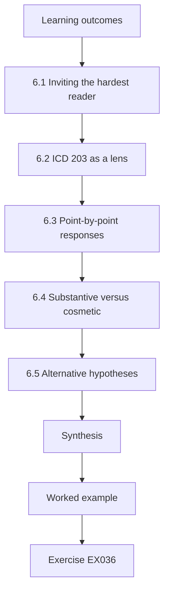

### Logical drawing

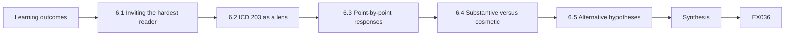

```text
[Learning outcomes]
    |
    v
[6.1 Inviting the hardest reader]
    |
    v
[6.2 ICD 203 as a lens]
    |
    v
[6.3 Point-by-point responses]
    |
    v
[6.4 Substantive versus cosmetic]
    |
    v
[6.5 Alternative hypotheses]
    |
    v
[Synthesis]
    |
    v
[Worked example] --> [Exercise EX036]
```
<!-- cykin:lesson-figures:end ch-06 -->


### Learning outcomes

You will (1) solicit adversarial critique of your own study; (2) apply ICD 203 tradecraft standards as a review lens; (3) respond to reviewers point by point; (4) distinguish revisions that change conclusions from those that improve presentation.

### 6.1 Inviting the hardest reader

A thesis committee is friendly by design. Doctoral candidates should also seek a red-cell reader: someone asked to find the weakest assumption. In CTI method research the classic weak points are circular outcome sources, corpus selection bias toward dramatic incidents, and confidence scales mapped after seeing the data.

Tomas's red-cell reader attacked a point the committee had not raised: confirmed claims are more likely to be followed up in public, which inflates apparent calibration for likely-true statements. The answer, a sensitivity analysis under two assumptions about unresolved claims, changed the abstract.

### 6.2 ICD 203 as a lens

ICD 203 asks analytic products to describe source quality, express uncertainty, separate information from assumptions and judgments, incorporate alternatives, show relevance, argue clearly, explain changes of judgment, aim for accuracy and use effective visuals. A research paper about CTI should meet the same bar it measures. Tomas runs his draft against that list and finds he never stated how his own conclusion would change if outcome sources were only half as independent as assumed.

His fix applies the ICD 203 standard on uncertainty to his own conclusion: the thesis now states how the calibration estimate moves if unresolved claims are treated first as unconfirmed and then as confirmed, using the two-assumption sensitivity analysis.

### 6.3 Point-by-point responses

Each reviewer comment receives a numbered reply: accepted with change (cite page), accepted partially (explain), or declined (explain with evidence). Silence on a comment reads as evasion.

Tomas's reply to the red-cell reader's follow-up-bias comment would be "accepted with change": it names the sensitivity analysis, the two assumptions about unresolved claims and the page where both ranges appear. A reader can check the reply against the thesis without re-reading the whole chapter. When a community partner asked him to drop a negative result, Tomas's reply was "declined", citing the pre-registered analysis plan that required reporting it; the wording change that partner also requested was "accepted with change".

### 6.4 Substantive versus cosmetic

A sensitivity analysis that moves the headline Brier from 0.17 to 0.21 is substantive and must reach the abstract. Fixing figure fonts is cosmetic. Candidates who bury substantive changes in an appendix lose trust.

Tomas's sensitivity analysis is that kind of change. Treating unresolved claims under two assumptions produced two ranges, and both went into the abstract, because a reader who saw only the more favourable one would misjudge how much the conclusion depends on follow-up behaviour. The figure-font fix goes in the change log and nowhere else, while the Brier shift is listed in the response letter as the first substantive change.

### 6.5 Alternative hypotheses

Analysis of competing hypotheses, discussed by Heuer, asks which evidence is inconsistent with each explanation rather than which is consistent with the favourite. A critique round is a good moment to list alternatives: for example, that apparent overconfidence reflects selective follow-up reporting rather than analyst miscalibration.

Tomas lists that alternative explicitly. Evidence inconsistent with it would be similar follow-up rates for confirmed and unconfirmed claims; the sensitivity analysis is his way of showing how much the conclusion changes if the alternative is true.

### Worked example

The red-cell reader argues that confirmed claims are more likely to be followed up in public, inflating apparent calibration for likely-true statements. Tomas adds a sensitivity analysis that treats unresolved claims under two assumptions and reports both ranges in the abstract.

> **Synthetic case.** The red-cell critique and sensitivity ranges are invented.

### Errors and limits

Critique is not personal; nor is every comment correct. Defend with evidence, not seniority.

### Exercises

- **EX036 — Red-cell target.** Name two assumptions a red-cell reader should attack first in Tomas's design. *Rubric:* 3 = two of outcome independence / corpus selection / post-hoc scale mapping / follow-up bias; 2 = one; 1 = typos; 0 = none.
- **EX037 — Missing standard.** Which ICD 203 element did Tomas's draft fail before revision? *Rubric:* 3 = expressing uncertainty/sensitivity of own conclusion to assumptions; 2 = vague uncertainty; 1 = visuals; 0 = none.
- **EX038 — Reply types.** List the three acceptable categories of response to a reviewer comment. *Rubric:* 3 = accepted with change, partially accepted, declined with reasons; 2 = two; 1 = ignore; 0 = none.
- **EX039 — Substantive test.** A reanalysis moves Brier from 0.17 to 0.21. Where must that appear? *Rubric:* 3 = abstract/main results + explanation; 2 = results only; 1 = appendix only; 0 = none.
- **EX040 — Competing story.** State one alternative explanation for apparent overconfidence in the top bin. *Rubric:* 3 = plausible alternative (selective follow-up, outcome-source bias, small k); 2 = vague; 1 = minimal attempt; 0 = none.
- **EX041 — ACH move.** In Heuer's analysis of competing hypotheses, what evidence matters most? *Rubric:* 3 = evidence inconsistent with hypotheses (disconfirming); 2 = diagnostic evidence vaguely; 1 = consistent evidence; 0 = none.
- **EX042 — Decline well.** Write a one-sentence decline to a reviewer who asks for real victim names. *Rubric:* 3 = decline citing ethics/TLP/data protection; offer aggregate alternative; 2 = decline only; 1 = comply; 0 = none.

### Synthesis

Invite hostile reading, hold yourself to ICD 203, answer every comment, promote substantive changes to the front, and test alternatives by disconfirmation.

### Continue studying — chapter 06 of 08

[← Chapter 05 (draft)](#ch-05) · [Course chapter index](../SUBJECTS.md) · [Chapter 07 (draft) →](#ch-07)

<a id="ch-07"></a>

## Chapter 7 — Thesis synthesis and reproducibility archive

<!-- cykin:lesson-figures:start ch-07 -->
### Lesson map

Lesson 07 published. Map, example, EX043.

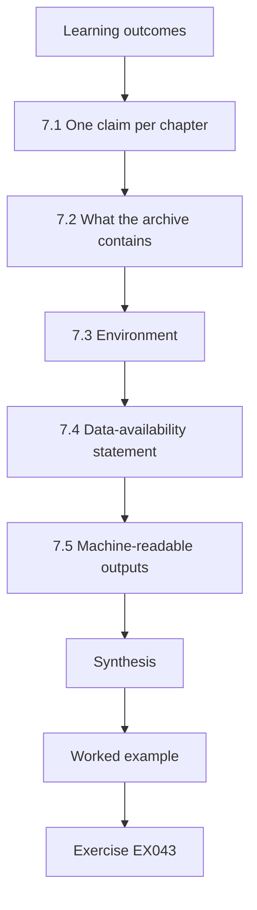

### Logical drawing

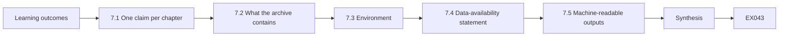

```text
[Learning outcomes]
    |
    v
[7.1 One claim per chapter]
    |
    v
[7.2 What the archive contains]
    |
    v
[7.3 Environment]
    |
    v
[7.4 Data-availability statement]
    |
    v
[7.5 Machine-readable outputs]
    |
    v
[Synthesis]
    |
    v
[Worked example] --> [Exercise EX043]
```
<!-- cykin:lesson-figures:end ch-07 -->


### Learning outcomes

You will (1) structure a thesis so each chapter carries one claim; (2) build a reproducibility archive that excludes restricted data lawfully; (3) document software environment and random seeds; (4) write a data-availability statement that is honest about restrictions.

### 7.1 One claim per chapter

Readers should be able to state each chapter's claim in a sentence: integrity design; gap; proposal; baseline replication; main calibration result; robustness under critique. If a chapter has three unrelated claims, split it; if it has none, cut it. Tomas applied the test to each of his six chapters: a chapter whose claim could not be stated in a sentence was split or cut, and the test caught a draft chapter mixing the gap with the proposal. For the calibration chapter, the sentence has to name the measure and the corpus scope, as EX043 asks.

### 7.2 What the archive contains

Code, codebook versions, synthetic test data, aggregate result tables, the pre-registration, and a script that rebuilds every figure. Restricted inputs — TLP:AMBER+STRICT reports, licensed vendor text — are replaced by a manifest of identifiers and SHA-256 hashes so that someone with lawful access can verify they hold the same files.

Tomas's archive holds 14 scripts, 3 codebook versions, a manifest of 1,200 report hashes and synthetic samples that exercise every code path. A colleague with no lab access rebuilt every figure in under an hour, which is the test that matters.

### 7.3 Environment

Record the Python version and confirm the analysis uses only the standard library, or pin every dependency. Record any random seed used for sampling. "It ran on my laptop" is not reproducibility.

Tomas's labs use only the standard library, which removes most dependency drift; the archive still records the Python version used. The main sample's selection uses a recorded seed, so the 340 judgments can be drawn again from the manifest by anyone with lawful access to the reports. The archive also records the operating system the figures were built on, because the colleague's one-hour rebuild was done on a different machine.

### 7.4 Data-availability statement

State what is open, what is restricted and why, and how an authorised researcher can request access. Do not say "available on request" if requests will in practice be refused.

For Tomas the restricted part is the 200 TLP:AMBER+STRICT reports and licensed vendor text. His statement names the sharing community and the licence holder as the routes for access, and the hash manifest lets an authorised researcher confirm they hold the same files. It also says what an authorised researcher cannot get: the reports themselves never leave the lab, so access means working on site under the same TLP:AMBER+STRICT rules that bound Tomas.

### 7.5 Machine-readable outputs

Where the thesis produces reusable structures — for example a mapping of estimative phrases to probability ranges — publish them as plain JSON or CSV with a schema. If the work creates threat objects, STIX 2.1 and TAXII 2.1 provide standard exchange formats, but a methods thesis rarely needs them.

Tomas's phrase-to-probability mapping is the obvious candidate: a CSV with one row per estimative phrase, its numeric range and the codebook version, so that others can apply the same mapping to their own reports.

### Worked example

A colleague with no lab access takes only the archive, runs the rebuild script against the synthetic samples and the aggregate tables, and compares each figure with the thesis draft; every figure matches, and the whole rebuild takes under an hour.

> **Synthetic case.** The archive contents and rebuild test are invented.

### Errors and limits

Hash manifests prove identity of files, not lawful access. Archive hosting must respect the same restrictions as the data.

### Exercises

- **EX043 — Chapter claim.** Write the one-sentence claim for the thesis chapter that reports calibration. *Rubric:* 3 = specific claim with measure and corpus scope; 2 = vague; 1 = topic only; 0 = none.
- **EX044 — Restricted replacement.** How does the archive represent restricted AMBER+STRICT reports? *Rubric:* 3 = identifier + SHA-256 manifest, no content; 2 = list of titles; 1 = include files; 0 = none.
- **EX045 — Environment line.** Give the two environment facts every rebuild needs recorded here. *Rubric:* 3 = Python version + seeds (or pinned deps); 2 = one; 1 = OS theme; 0 = none.
- **EX046 — Honest availability.** Rewrite "data available on request" honestly for licensed vendor reports. *Rubric:* 3 = states licence restriction, who can request, through what route; 2 = partial; 1 = unchanged; 0 = none.
- **EX047 — Rebuild test.** What does the colleague's one-hour rebuild demonstrate, and what does it not? *Rubric:* 3 = code/figures reproducible from archive; not that restricted inputs or coding were correct; 2 = one half; 1 = proves everything; 0 = none.
- **EX048 — Format choice.** Which format suits the phrase-to-probability mapping, and why not STIX? *Rubric:* 3 = JSON/CSV with schema; it is not a threat object; 2 = format only; 1 = STIX required; 0 = none.
- **EX049 — Hosting rule.** May the archive be placed on a public repository with restricted files encrypted inside? *Rubric:* 3 = no; restricted content must not be distributed even encrypted unless terms allow; use manifest; 2 = discouraged; 1 = yes; 0 = none.

### Synthesis

One claim per chapter, an archive that rebuilds everything lawful, honest availability, and restricted data represented by hashes alone.

### Continue studying — chapter 07 of 08

[← Chapter 06 (draft)](#ch-06) · [Course chapter index](../SUBJECTS.md) · [Chapter 08 (draft) →](#ch-08)

<a id="ch-08"></a>

## Chapter 8 — Defense and publication plan

<!-- cykin:lesson-figures:start ch-08 -->
### Lesson map

Lesson 08 published. Map, example, EX050.

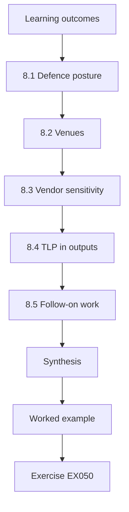

### Logical drawing

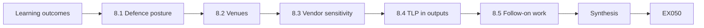

```text
[Learning outcomes]
    |
    v
[8.1 Defence posture]
    |
    v
[8.2 Venues]
    |
    v
[8.3 Vendor sensitivity]
    |
    v
[8.4 TLP in outputs]
    |
    v
[8.5 Follow-on work]
    |
    v
[Synthesis]
    |
    v
[Worked example] --> [Exercise EX050]
```
<!-- cykin:lesson-figures:end ch-08 -->


### Learning outcomes

You will (1) prepare a defence that foregrounds limits; (2) choose publication venues and pre-print timing responsibly; (3) handle disclosure when findings could embarrass named vendors; (4) plan follow-on work that extends rather than repeats the thesis.

### 8.1 Defence posture

Examiners test whether you know where your result stops. Open with the claim, the evidence and the three strongest threats to validity. A candidate who raises the follow-up-bias problem before the examiner does controls the conversation.

Tomas's three threats would be follow-up bias, outcome sources that depend on the original report, and a corpus that may over-represent dramatic incidents. His sensitivity analysis answers the first, the circularity check the second, and the stated scope of the corpus limits the third.

### 8.2 Venues

Peer-reviewed security venues, intelligence-studies journals and practitioner conferences reach different audiences. A methods result about calibration may need both: a journal for the method and a practitioner talk for SOC leaders. Pre-prints speed dissemination but should carry the same limits section as the final paper.

For Tomas, the calibration method and codebook fit a journal; the practical message, how much weight to give "highly likely" in a vendor report when deciding to block, fits a practitioner conference for SOC leaders. The pre-print carries the same sensitivity ranges as the abstract.

### 8.3 Vendor sensitivity

Even with synthetic or anonymised presentation, a reader may guess which vendor a pattern describes. Offer affected parties a short preview where agreements require it, but do not let preview become veto over honest findings. Never disclose TLP-restricted content to obtain goodwill.

Tomas's handling is the model: results reported by anonymised vendor class, previews given to the two community partners whose agreements required them, one wording change accepted, and a request to drop a negative result declined. The examiner's question at the defence was answered by describing that record.

### 8.4 TLP in outputs

Public papers are effectively TLP:CLEAR. Anything derived from restricted inputs must be aggregated enough that the source cannot be reconstructed. Check with the sharing community when in doubt.

Tomas's results derived from the 200 TLP:AMBER+STRICT reports appear only as aggregates within vendor classes, and no report is quoted. Where a class is so small that a single report could be identified from its row, the class is merged with another before publication. The merging rule is written in the archive so that a sharing-community member can check that no restricted report is recoverable from a published row.

### 8.5 Follow-on work

Natural extensions: a prospective study where analysts record numeric probabilities at writing time; a cross-language comparison; an intervention that trains calibration and measures change. Each needs its own ethics file.

The prospective study answers Tomas's biggest limitation: if analysts record a numeric probability when they write a judgment, there is no need to map phrases afterwards, and the mapping assumption the examiners questioned disappears. A calibration-training intervention would study analysts as participants, so it needs their informed consent, which the current corpus-only design never required.

### Worked example

At the defence, an examiner asks whether vendors were named. Tomas explains that results are reported by anonymised vendor class, that two community partners previewed the paper as their agreement required, and that one requested wording change was accepted while a request to drop a negative result was declined.

> **Synthetic case.** The defence exchange and vendor preview are invented.

### Errors and limits

Publishing a "leaderboard" of vendors' calibration from licensed data may breach licences and is methodologically shaky with small samples.

### Exercises

- **EX050 — Opening move.** What three things should the first defence slide carry? *Rubric:* 3 = claim, evidence, strongest validity threats; 2 = two; 1 = biography; 0 = none.
- **EX051 — Two venues.** Why might the calibration result go to both a journal and a practitioner conference? *Rubric:* 3 = method rigour/peer review + reach SOC decision-makers; 2 = one reason; 1 = more citations; 0 = none.
- **EX052 — Preview veto.** A vendor asks to remove a negative finding during preview. Response? *Rubric:* 3 = decline removal; consider factual corrections only; document; 2 = decline; 1 = remove; 0 = none.
- **EX053 — TLP of a paper.** What TLP level does a public paper effectively have, and what follows for restricted inputs? *Rubric:* 3 = CLEAR; restricted inputs only in non-reconstructable aggregate; 2 = CLEAR only; 1 = AMBER; 0 = none.
- **EX054 — Leaderboard risk.** Give two reasons not to publish a named-vendor calibration ranking. *Rubric:* 3 = licence/agreement breach + small-sample instability (or fairness); 2 = one; 1 = vague; 0 = none.
- **EX055 — Prospective design.** Describe the prospective follow-on study in one sentence. *Rubric:* 3 = analysts record numeric probability at writing; outcomes tracked forward; 2 = vague forward study; 1 = repeat thesis; 0 = none.
- **EX056 — Pre-print rule.** What must a pre-print include that a conference abstract might omit? *Rubric:* 3 = full limits/validity section; 2 = methods; 1 = vague; 0 = none.

### Synthesis

Lead with limits, choose venues for audiences, let preview correct facts but not findings, respect TLP in every output, and extend rather than repeat.

### Continue studying — chapter 08 of 08

[← Chapter 07 (draft)](#ch-07) · [Course chapter index](../SUBJECTS.md) · [Worked results ↓](#worked-results) · [Next course via chapter index →](../SUBJECTS.md)

<a id="worked-results"></a>

## Worked results

Model answers for EX001–EX056. Larkspur CTI Lab, Tomas Ekberg, Dr. Hana Sato, the corpus and every figure are synthetic. Lab answers quote verified outputs. Any answer meeting the rubric scores equally.

**EX001.** Lawful basis, the terms of service or sharing terms that apply, the minimisation step, and the retention period.

**EX002.** Only inside Larkspur CTI Lab by people covered by the sharing agreement; no quotations, no redistribution, results reported only as aggregates that cannot identify a report.

**EX003.** The forum's terms forbid research scraping and no permission was obtained; posts also contain personal data that public visibility does not make free to process.

**EX004.** A pre-agreed escalation: inform the supervisor, who contacts an appropriate coordinator such as a national CERT through the sharing community; Tomas does not probe the organisation himself.

**EX005.** Confirmation bias. Fixing hypotheses and the coding scheme before seeing outcome data stops later evidence being bent to fit an attractive attribution.

**EX006.** Report it in a clearly labelled exploratory section, separate from the confirmatory results, and propose a follow-up study to test it.

**EX007.** Only named Larkspur members with a documented need-to-know who are bound by the sharing agreement.

**EX008.** Kill chain: a phase-based defensive strategy model. Diamond Model: an ontology of the intrusion event. ATT&CK: an empirical, curated knowledge base of observed adversary behaviour.

**EX009.** Example: "No published study measures whether indicators received through a sector sharing community reduce time-to-detection in member SOCs compared with non-members."

**EX010.** Adversary, capability, infrastructure, victim. Example pivot: from a shared command-and-control domain (infrastructure) to other victims contacting that domain.

**EX011.** Individually harmless facts, combined, can identify, locate or profile a person, enabling harm and triggering data-protection duties even though each fact was public.

**EX012.** Cite it as grey literature describing practice, clearly separated from peer-reviewed evidence, and avoid resting a central claim on it alone.

**EX013.** It gives guidance on establishing sharing relationships, scoping and handling shared information; it does not empirically measure how much sharing improves security outcomes.

**EX014.** Defenders who analyse whole campaigns can disrupt an intrusion by breaking any single phase of the kill chain, turning intelligence about adversaries into defensive advantage.

**EX015.** Example: "Among attributions to a named group in the corpus, fewer than 70% are supported by an independent authoritative source within 24 months."

**EX016.** A judgment is "confirmed" if an independent authoritative source in the corpus (joint advisory, court document, vendor correction) supports it within 24 months, coded support/contradict/unresolved.

**EX017.** If the "confirming" source merely repeats the original report, agreement is circular and calibration looks better than it is; only independent sources count.

**EX018.** It stops coders' expectations — "they said highly likely, so it probably happened" — from leaking into the outcome code.

**EX019.** Follow the pre-registered rule: do not analyse as if the floor were met; extend the sample or revise the design with committee approval, and report the shortfall.

**EX020.** External validity — whether findings generalise beyond the sampled report population.

**EX021.** The study measures calibration of one construct in one defined corpus; claiming general unreliability of CTI exceeds what the data can show.

**EX022.** Jaccard=0.500; only in A: 203.0.113.7 and bad.example.

**EX023.** Both feeds may carry the same stale or easily changed low-pyramid indicators; agreement shows shared sourcing, not quality or relevance to a defender.

**EX024.** Brier=0.183; always forecasting 0.5 on balanced outcomes scores 0.25.

**EX025.** Observed 0.67 for stated 0.9 hints at overconfidence at the top, but with only three items it is a pilot signal, not a result.

**EX026.** (0.9 − 1)² = 0.01.

**EX027.** Over-sample high-confidence ("highly likely" and above) judgments so the top bins have enough items for precise calibration estimates.

**EX028.** Any two of: most outcomes unresolvable; coding time far above budget; the script disagreeing with hand calculation.

**EX029.** observed agreement 0.80, expected 0.31, kappa 0.710.

**EX030.** Some agreement happens by chance given how common each label is; kappa removes that expected agreement so the figure reflects real coder consistency.

**EX031.** Both disagreements involve infrastructure, so its definition is ambiguous; add a clarifying rule and an example (e.g. shared hosting) to the codebook.

**EX032.** Both coders' original codes, the adjudicated code, the rationale and the codebook version used.

**EX033.** No. Having written the parser, they share its assumptions and can miss the same errors; validation needs a team that did not build it.

**EX034.** Describe the mis-merge, how it was corrected, and whether any reported number changed and by how much.

**EX035.** When the results are aggregate statistics and coding rules rather than indicators or relationships; tables, codebooks and code serve readers better.

**EX036.** Any two of: independence of outcome sources, corpus selection toward dramatic incidents, mapping of the confidence scale after seeing outcomes, selective public follow-up.

**EX037.** Expressing uncertainty: the draft did not show how its conclusion depended on the independence assumption, so no sensitivity of the main judgment was given.

**EX038.** Accepted with change (with location), partially accepted (with explanation), declined (with evidence-based reasons).

**EX039.** In the abstract and main results, with an explanation of which assumption caused the shift.

**EX040.** Example: claims that turned out true are more often publicly followed up, so unresolved items are disproportionately false, distorting the top bin.

**EX041.** Evidence that is inconsistent with a hypothesis — disconfirming evidence is the most diagnostic.

**EX042.** "We cannot name victims because the sources are TLP-restricted and contain personal and organisational data; we provide aggregate counts by sector instead."

**EX043.** Example: "In 340 resolvable key judgments from the defined corpus, high-confidence estimative phrases were confirmed less often than their mapped probability (Brier 0.21 under the conservative assumption)."

**EX044.** As a manifest of report identifiers and SHA-256 hashes, with no content, so lawful holders can verify identity.

**EX045.** The Python version (with standard library only, or pinned dependencies) and the random seeds used for sampling.

**EX046.** "Vendor reports are licensed and cannot be redistributed; researchers holding the same licence can request the identifier manifest from the Larkspur data steward."

**EX047.** It shows the code, synthetic samples and aggregate tables rebuild all figures; it does not show the restricted inputs were coded correctly.

**EX048.** JSON or CSV with a documented schema; the mapping is a methodological table, not a threat object, so STIX adds complexity without benefit.

**EX049.** No. Distributing restricted content, even encrypted, can breach the licence or TLP; publish only the hash manifest.

**EX050.** The central claim, the evidence for it, and the strongest threats to its validity.

**EX051.** The journal tests the method under peer review; the practitioner conference reaches SOC leaders who make blocking decisions based on confidence language.

**EX052.** Decline to remove the finding; accept only factual corrections, and record the request and the response.

**EX053.** Effectively TLP:CLEAR, so restricted inputs may appear only as aggregates from which no source can be reconstructed.

**EX054.** It may breach licensing or sharing agreements, and per-vendor samples are too small to rank reliably.

**EX055.** Analysts attach a numeric probability to each key judgment when writing, and outcomes are tracked forward for 24 months to measure calibration without retrospective coding.

**EX056.** The full limits and validity section, so early readers see the same caveats as final readers.

<a id="references"></a>

## References

Links checked 12 October 2026; re-verify editions before citing.

- Bianco, D. (2013). The Pyramid of Pain. <https://detect-respond.blogspot.com/2013/03/the-pyramid-of-pain.html>
- Caltagirone, S., Pendergast, A. and Betz, C. (2013). The Diamond Model of Intrusion Analysis. Technical Report ADA586960, Center for Cyber Intelligence Analysis and Threat Research. <https://www.activeresponse.org/wp-content/uploads/2013/07/diamond.pdf>
- European Union. Regulation (EU) 2016/679 (General Data Protection Regulation). <https://eur-lex.europa.eu/eli/reg/2016/679/oj>
- FIRST. Traffic Light Protocol (TLP) version 2.0. <https://www.first.org/tlp/>
- Heuer, R. J. (1999). Psychology of Intelligence Analysis. CIA Center for the Study of Intelligence. <https://www.cia.gov/resources/csi/books-monographs/psychology-of-intelligence-analysis-2/>
- Hutchins, E. M., Cloppert, M. J. and Amin, R. M. (2011). Intelligence-Driven Computer Network Defense Informed by Analysis of Adversary Campaigns and Intrusion Kill Chains. Lockheed Martin. <https://www.lockheedmartin.com/content/dam/lockheed-martin/rms/documents/cyber/LM-White-Paper-Intel-Driven-Defense.pdf>
- Kent, S. (1964). Words of Estimative Probability. CIA Studies in Intelligence. <https://www.cia.gov/resources/csi/static/Words-of-Estimative-Probability.pdf>
- MITRE ATT&CK Enterprise matrix, groups, software and technique pages. <https://attack.mitre.org/>
- NIST SP 800-150 (2016). Guide to Cyber Threat Information Sharing. <https://doi.org/10.6028/NIST.SP.800-150>
- NIST SP 800-61 Rev. 3 (2025). Incident Response Recommendations and Considerations for Cybersecurity Risk Management. <https://doi.org/10.6028/NIST.SP.800-61r3>
- OASIS. STIX Version 2.1 (Committee Specification / OASIS Standard). <https://docs.oasis-open.org/cti/stix/v2.1/stix-v2.1.html>
- OASIS. TAXII Version 2.1. <https://docs.oasis-open.org/cti/taxii/v2.1/taxii-v2.1.html>
- ODNI. Intelligence Community Directive 203: Analytic Standards (2015, amended 2022). <https://www.odni.gov/files/documents/ICD/ICD-203.pdf>
