# Web3, Blockchain and Cryptoasset Security: Doctoral Research Track

- Language: English (`en`); course 193, Doctoral research track (2 years).
- Editorial state: **published**. Chapters 1–8 of 8 have hand-written teaching text; exercises EX001–EX050 have matching worked results with 0–3 rubrics; Four offline labs use only the Python 3 standard library on synthetic evidence, and their outputs are embedded from real runs. Independent review and the 300-page A4 verification remain open.
- Audience: doctoral candidates and researchers studying how smart-contract review processes can be designed and measured as security controls.
- Author: [hiagokinlevi](https://github.com/hiagokinlevi). Original text [CC0 1.0](../../../../../LICENSE); cited works keep their rights.
- Ethical and legal boundary: review and test only contracts, wallets and systems you are authorised to assess, on local simulations or test networks; no exploit code, no payloads, no attack procedures and no instructions for bypassing controls. Weaknesses are taught from the defender's side using synthetic ledgers, transactions, contract inventories and data. All evidence, people and organisations are **synthetic** unless a sentence cites a public source.

[Course home](../../README.md) · [Chapter index](../SUBJECTS.md) · [Book plan](PLAN.md) · [Course skill](../../skill/SKILL.md) · [Worked results](#worked-results)

## How to use this draft

Read in order: the chapters follow one doctoral candidate testing whether structured checklist review of smart contracts leaves fewer high-severity issues than unstructured review, through research integrity and coder agreement, the research frontier and tool overlap, a registered proposal, baseline replication and pilot, a randomised main study with blinded validation, peer critique, synthesis with a reproducibility archive, and the defense. Run each lab where it appears, attempt the exercises before the worked results, and score yourself with the rubrics.

### Synthetic running case

| Element | Role | Boundary |
|---|---|---|
| **Lucía Ferreyra** | Doctoral candidate | Invented |
| **Prof. Henrik Aalto** | Supervisor | Invented |
| **Kestrel Institute of Technology** | Fictional institute | Invented |
| **Harbourline Credit Union Consortium** | Fictional lead partner (permissioned settlement ledger) | Invented |

### Core sources

Nakamoto, [Bitcoin whitepaper](https://bitcoin.org/bitcoin.pdf); Wood, [Ethereum yellow paper](https://ethereum.github.io/yellowpaper/paper.pdf); NIST [IR 8202](https://doi.org/10.6028/NIST.IR.8202); [SWC registry](https://swcregistry.io/); [OWASP Smart Contract Top 10](https://owasp.org/www-project-smart-contract-top-10/); EEA [EthTrust Security Levels v3](https://entethalliance.org/specs/ethtrust-sl/v3/); [ConsenSys smart contract best practices](https://consensys.github.io/smart-contract-best-practices/); Atzei et al. ([2017](https://doi.org/10.1007/978-3-662-54455-6_8)); Luu et al. ([2016](https://doi.org/10.1145/2976749.2978309)). Full list in [References](#references).

## Contents

| Chapters |
|---|
| [1](#ch-01) · [2](#ch-02) · [3](#ch-03) · [4](#ch-04) · [5](#ch-05) · [6](#ch-06) · [7](#ch-07) · [8](#ch-08) |

[Worked results](#worked-results) · [References](#references)

<a id="ch-01"></a>

## Chapter 1 — Advanced research integrity and methods

<!-- open-cyber-academy:lesson-figures:start ch-01 -->
### Lesson map

Lesson 01 published. Map, example, EX001.

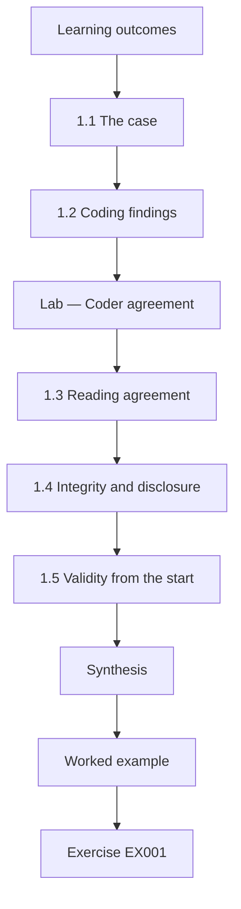

### Logical drawing

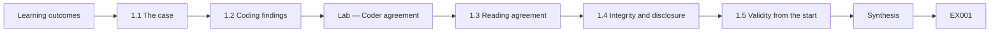

```text
[Learning outcomes]
    |
    v
[1.1 The case]
    |
    v
[1.2 Coding findings]
    |
    v
[Lab — Coder agreement]
    |
    v
[1.3 Reading agreement]
    |
    v
[1.4 Integrity and disclosure]
    |
    v
[1.5 Validity from the start]
    |
    v
[Synthesis]
    |
    v
[Worked example] --> [Exercise EX001]
```
<!-- open-cyber-academy:lesson-figures:end ch-01 -->


### Learning outcomes

You will (1) frame a doctoral question about smart-contract review quality; (2) build a reliable coding scheme for review findings; (3) set ethical rules for handling vulnerability data.

### 1.1 The case

Lucía Ferreyra is a doctoral candidate at the fictional Kestrel Institute of Technology, supervised by Prof. Henrik Aalto. Her lead partner is the fictional Harbourline Credit Union Consortium, which runs a permissioned Ethereum-compatible ledger for settlement between member credit unions, and two fictional open-source teams that build token and escrow contracts. Every contract, finding and figure in this book is synthetic. Her question is whether reviewing contracts against a structured checklist derived from public standards leaves fewer high-severity issues undetected than the usual unstructured expert review.

### 1.2 Coding findings

A study of review quality needs a way to label findings that two people apply identically. Lucía codes each finding into four categories drawn from the SWC registry and the OWASP Smart Contract Top 10: access control, external calls including re-entrancy, arithmetic and rounding, and other. Each category has a written definition, two positive examples, two near misses and a decision rule for overlaps, such as coding a missing permission check on an upgrade function as access control even when it involves an external call.

### Lab — Coder agreement

```python
"""Cohen's kappa for two coders labelling synthetic review findings (read-only)."""
from collections import Counter
CATS = ["access", "external-call", "arithmetic", "other"]
# 40 synthetic findings: (coder A label, coder B label)
PAIRS = ([("access", "access")] * 11 + [("external-call", "external-call")] * 9 +
         [("arithmetic", "arithmetic")] * 8 + [("other", "other")] * 7 +
         [("access", "other")] * 2 + [("external-call", "other")] * 2 + [("arithmetic", "access")])

def kappa(pairs):
    n = len(pairs)
    po = sum(a == b for a, b in pairs) / n
    ca, cb = Counter(a for a, _ in pairs), Counter(b for _, b in pairs)
    pe = sum(ca[c] * cb[c] for c in CATS) / n ** 2
    return po, pe, (po - pe) / (1 - pe)

def main():
    po, pe, k = kappa(PAIRS)
    print(f"items {len(PAIRS)}, agreed {sum(a == b for a, b in PAIRS)}")
    print(f"observed {po:.3f}, chance {pe:.3f}, kappa {k:.3f}")
    for (a, b), n in sorted(Counter(p for p in PAIRS if p[0] != p[1]).items()):
        print(f"disagree {a} -> {b}: {n}")

if __name__ == "__main__":
    main()
```

Run with `python3 lab_kappa.py`. Verified output:

```text
items 40, agreed 35
observed 0.875, chance 0.253, kappa 0.833
disagree access -> other: 2
disagree arithmetic -> access: 1
disagree external-call -> other: 2
```

### 1.3 Reading agreement

Two trained coders independently label forty synthetic findings and agree on thirty-five, an observed agreement of 0.875. Expected chance agreement from the category frequencies is 0.253, giving Cohen's kappa of 0.833, which Landis and Koch (1977) would call almost perfect, though Lucía treats such labels as rough guidance. Four of the five disagreements send a finding to other: two access and two external-call findings. That pattern shows the other category is absorbing borderline cases, so she tightens its definition before real coding begins.

### 1.4 Integrity and disclosure

Vulnerability data is dangerous: a description of an unfixed weakness in a deployed contract could help someone steal funds. Lucía's data agreement says that partners share findings only after fixes are deployed or the contract is retired, that all contract names and addresses are replaced with pseudonyms, and that no publication will include code or steps that would let a reader reproduce an attack. Findings are stored on an encrypted institute server with access logged. The ethics board approves the plan, including a rule for reporting any unfixed issue found during the study.

### 1.5 Validity from the start

Lucía separates three validity questions. Construct validity asks whether her four categories capture what practitioners mean by review quality, so she checks the codebook with two partner auditors. Internal validity asks whether any difference between procedures comes from the procedure rather than from reviewer skill or contract difficulty, which motivates random assignment and blinded checking later. External validity asks whether findings from a permissioned ledger and two open-source teams generalise to public decentralised finance, which she will discuss honestly rather than assume.

### Worked example

Lucía writes the research question, the four-category codebook and the disclosure agreement, then runs the forty-item agreement exercise. Kappa of 0.833 and a clear pattern of findings drifting into other lead to a tighter definition before real coding.

> **Synthetic case.** Lucía Ferreyra, Henrik Aalto, Kestrel Institute of Technology, Harbourline Credit Union Consortium and all contracts, findings and figures are synthetic; the SWC registry, OWASP Smart Contract Top 10 and Landis and Koch (1977) are real sources.

### Errors and limits

Kappa summarises agreement but hides where disagreement lies; inspect disagreements, and remember that high agreement does not prove the categories are the right ones.

### Exercises

- **EX001 — Research question.** State Lucía's research question. *Rubric:* 3 = whether checklist review leaves fewer high-severity issues than unstructured review;; 2 = checklist vs usual;; 1 = tools;; 0 = none.
- **EX002 — Category sources.** Which public sources shape the four categories? *Rubric:* 3 = SWC registry and OWASP Smart Contract Top 10;; 2 = SWC;; 1 = CVE;; 0 = none.
- **EX003 — Kappa value.** What kappa did the coders reach? *Rubric:* 3 = 0.833 from 35 of 40 agreed;; 2 = 0.83;; 1 = 0.875;; 0 = none.
- **EX004 — Disagreement pattern.** What pattern did the disagreements show? *Rubric:* 3 = four of five went to other;; 2 = other absorbs;; 1 = vague;; 0 = none.
- **EX005 — Disclosure rule.** When may partners share findings? *Rubric:* 3 = after fixes deployed or contract retired;; 2 = after fix;; 1 = anytime;; 0 = none.
- **EX006 — Publication limit.** What may never appear in publications? *Rubric:* 3 = code or steps that reproduce an attack;; 2 = attack steps;; 1 = names;; 0 = none.
- **EX007 — External validity.** What external validity concern does Lucía note? *Rubric:* 3 = permissioned ledger may not generalise to public DeFi;; 2 = generalisation;; 1 = vague;; 0 = none.

### Synthesis

A defensible study of review quality starts with a precise codebook, measured coder agreement and strict disclosure rules for vulnerability data.

### Continue studying — chapter 01 of 08

[← Course home](../../README.md) · [Course chapter index](../SUBJECTS.md) · [Chapter 02 (draft) →](#ch-02)

<a id="ch-02"></a>

## Chapter 2 — Web3, blockchain and cryptoasset security: research frontier

<!-- open-cyber-academy:lesson-figures:start ch-02 -->
### Lesson map

Lesson 02 published. Map, example, EX008.

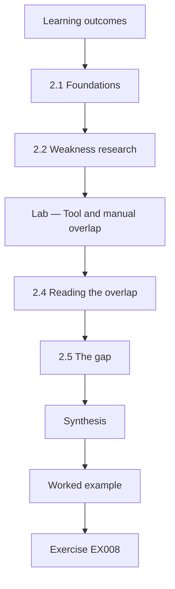

### Logical drawing

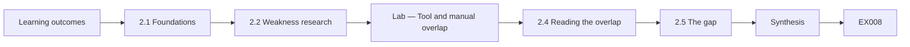

```text
[Learning outcomes]
    |
    v
[2.1 Foundations]
    |
    v
[2.2 Weakness research]
    |
    v
[Lab — Tool and manual overlap]
    |
    v
[2.4 Reading the overlap]
    |
    v
[2.5 The gap]
    |
    v
[Synthesis]
    |
    v
[Worked example] --> [Exercise EX008]
```
<!-- open-cyber-academy:lesson-figures:end ch-02 -->


### Learning outcomes

You will (1) map the research on smart-contract weaknesses and analysis; (2) compare automated and manual review evidence; (3) locate the gap the thesis addresses.

### 2.1 Foundations

Lucía begins with the systems themselves. Nakamoto's Bitcoin paper describes a ledger secured by proof of work, where history becomes harder to change as blocks accumulate. Wood's Ethereum yellow paper formally specifies a virtual machine that runs contract code, with gas limiting computation. NIST IR 8202 by Yaga and colleagues gives a neutral overview of blockchain components, consensus models and limitations. These sources explain why contract flaws matter so much: deployed code is hard to change and often controls value directly.

### 2.2 Weakness research

Atzei, Bartoletti and Cimoli (2017) surveyed attacks on Ethereum contracts and organised them by cause in the language, the virtual machine and the blockchain. Luu and colleagues (2016) built Oyente, a symbolic execution tool, and reported that many deployed contracts showed patterns such as transaction-ordering dependence and mishandled exceptions. The SWC registry catalogues weakness classes, and the EEA EthTrust Security Levels define requirements a reviewer can certify. Lucía reads these defensively, extracting categories and review requirements rather than attack techniques.

Her review checklist takes its categories from these sources, so each checklist item can be traced to a published weakness class.

### 2.3 Tools and their limits

Durieux and colleagues (2020) ran nine automated analysis tools on tens of thousands of contracts and found low agreement between tools and many false positives. Tsankov and colleagues (2018) presented Securify, which checks compliance and violation patterns. Perez and Livshits (2021) showed that contracts flagged as vulnerable were rarely exploited in practice, a reminder that flags are not harm. Lucía concludes that tools are valuable for coverage but cannot stand alone, and that the human review process itself has been studied far less than tools.

### Lab — Tool and manual overlap

```python
"""Overlap between automated-tool and manual-review findings on synthetic contracts (read-only)."""
TOOL = {"C1-access", "C1-call", "C2-arith", "C3-call", "C4-access", "C5-arith", "C6-other", "C7-call"}
MANUAL = {"C1-access", "C2-arith", "C2-logic", "C3-call", "C4-oracle", "C5-logic", "C7-call", "C8-access"}
FALSE_POS = {"C6-other"}

def main():
    both = TOOL & MANUAL
    union = TOOL | MANUAL
    print(f"tool {len(TOOL)}, manual {len(MANUAL)}, both {len(both)}, union {len(union)}")
    print(f"Jaccard {len(both) / len(union):.2f}")
    print("manual only:", ", ".join(sorted(MANUAL - TOOL)))
    print("tool only:", ", ".join(sorted(TOOL - MANUAL)), f"(confirmed false positives: {len(FALSE_POS)})")

if __name__ == "__main__":
    main()
```

Run with `python3 lab_overlap.py`. Verified output:

```text
tool 8, manual 8, both 4, union 12
Jaccard 0.33
manual only: C2-logic, C4-oracle, C5-logic, C8-access
tool only: C1-call, C4-access, C5-arith, C6-other (confirmed false positives: 1)
```

### 2.4 Reading the overlap

On eight synthetic contracts, the tool reports eight findings and manual reviewers eight, but only four are shared: a Jaccard similarity of 0.33 over twelve distinct findings. Manual review alone finds two business-logic issues, one oracle-dependence issue and one access-control issue. The tool alone reports four, one confirmed false positive. Lucía notes that the manual-only findings concern intent and context, which tools cannot know, supporting her focus on improving structured human review rather than replacing it. She records this pattern as motivation in her proposal.

### 2.5 The gap

Existing work compares tools with each other or with labelled benchmarks, and professional guidance such as ConsenSys best practices and EthTrust describes what reviewers should check. Few studies test, with controlled designs, whether structuring the human review process around such guidance changes what is missed. That is Lucía's gap. She writes it as a single paragraph her supervisor can challenge, naming what is known, what is assumed by practitioners and what her design will measure that has not been measured before.

### Worked example

The literature map links foundations, weakness taxonomies, tool studies and review standards; the overlap lab shows a Jaccard of 0.33 between tool and manual findings, with manual-only findings concerning intent and context.

> **Synthetic case.** Contracts and findings in the lab are synthetic; Nakamoto (2008), Wood, NIST IR 8202, Atzei et al. (2017), Luu et al. (2016), Durieux et al. (2020), Tsankov et al. (2018), Perez and Livshits (2021), the SWC registry, EEA EthTrust and ConsenSys best practices are real sources.

### Errors and limits

Treating tool flags as proof of exploitable harm overstates risk, as Perez and Livshits showed.

### Exercises

- **EX008 — Yellow paper role.** What does the Ethereum yellow paper specify? *Rubric:* 3 = the virtual machine that runs contract code with gas;; 2 = EVM;; 1 = Bitcoin;; 0 = none.
- **EX009 — Oyente method.** What technique did Oyente use? *Rubric:* 3 = symbolic execution;; 2 = symbolic;; 1 = fuzzing;; 0 = none.
- **EX010 — Durieux finding.** What did Durieux and colleagues find? *Rubric:* 3 = low agreement between tools and many false positives;; 2 = disagreement;; 1 = perfect tools;; 0 = none.
- **EX011 — Perez point.** What did Perez and Livshits show? *Rubric:* 3 = flagged contracts were rarely exploited;; 2 = not exploited;; 1 = all exploited;; 0 = none.
- **EX012 — Overlap value.** What Jaccard similarity did the lab report? *Rubric:* 3 = 0.33, 4 shared of 12;; 2 = 0.33;; 1 = 0.5;; 0 = none.
- **EX013 — Manual-only nature.** What do manual-only findings concern? *Rubric:* 3 = intent and context such as business logic and oracles;; 2 = logic;; 1 = syntax;; 0 = none.
- **EX014 — Thesis gap.** What gap does the thesis address? *Rubric:* 3 = controlled evidence on structured human review;; 2 = process;; 1 = tools;; 0 = none.

### Synthesis

The frontier shows strong tool research but little controlled evidence about structured human review, which defines the thesis gap.

### Continue studying — chapter 02 of 08

[← Chapter 01 (draft)](#ch-01) · [Course chapter index](../SUBJECTS.md) · [Chapter 03 (draft) →](#ch-03)

<a id="ch-03"></a>

## Chapter 3 — Original contribution proposal

<!-- open-cyber-academy:lesson-figures:start ch-03 -->
### Lesson map

Lesson 03 published. Map, example, EX015.

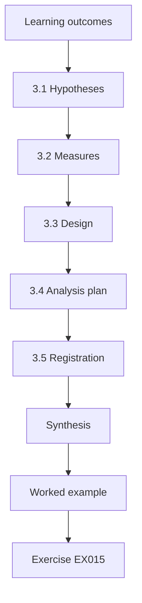

### Logical drawing

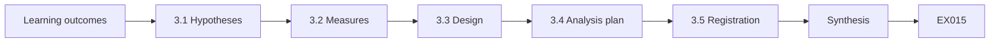

```text
[Learning outcomes]
    |
    v
[3.1 Hypotheses]
    |
    v
[3.2 Measures]
    |
    v
[3.3 Design]
    |
    v
[3.4 Analysis plan]
    |
    v
[3.5 Registration]
    |
    v
[Synthesis]
    |
    v
[Worked example] --> [Exercise EX015]
```
<!-- open-cyber-academy:lesson-figures:end ch-03 -->


### Learning outcomes

You will (1) specify hypotheses and measures; (2) design a randomised comparison; (3) register the plan before data collection.

### 3.1 Hypotheses

Lucía states her primary hypothesis: contracts reviewed with a structured checklist derived from EthTrust requirements and the SWC categories will have fewer residual high-severity issues than contracts reviewed in the usual unstructured way. Residual issues are those found by a blinded independent reviewer after the first review has closed. A secondary hypothesis is that the checklist will reduce residual access-control issues most, because the baseline will show they dominate. Writing hypotheses before data collection prevents choosing them afterwards to fit the results.

### 3.2 Measures

The primary measure is the count of residual high-severity issues per contract. Severity follows a written rubric based on impact on funds, control and availability, with two raters and agreement checked. Secondary measures include review hours, findings per hour and the share of findings in each category. Lucía also records contract size and complexity as covariates. Each measure has a definition, a source and a planned analysis, so nothing is invented after the data arrive. Raters are trained on the rubric with ten practice findings first.

### 3.3 Design

Twenty-four synthetic but realistic contracts, prepared with partner engineers and seeded only with weaknesses documented in public registries, are randomly assigned to the two procedures, twelve each, within size strata. Reviewers are partner auditors trained in both procedures and assigned to avoid reviewing the same contract twice. The blinded independent reviewer does not know which procedure was used. Random assignment and blinding protect internal validity against contract difficulty and reviewer expectations. Lucía documents the allocation with a fixed seed so it can be checked later by examiners.

### 3.4 Analysis plan

Because counts are small and not normally distributed, Lucía plans a one-sided permutation test on the difference in mean residual high-severity issues, with a fixed random seed and ten thousand shuffles, plus the count of contracts with no residual high issues. She also plans a sensitivity analysis excluding the largest contracts. Effect sizes are reported with intervals, not only p-values. A short plan written now prevents running many analyses and reporting only the favourable one. The plan also states how missing data will be handled.

### 3.5 Registration

Lucía registers the hypotheses, measures, design and analysis plan with a timestamped document held by her supervisor and the ethics board before any review begins. Any later change will be reported as a deviation with its reason. Registration is the main safeguard against researcher degrees of freedom: it makes her commitments visible and lets examiners compare what was planned with what was done, which is particularly important when a candidate hopes for a particular result. The registered document is cited in every later chapter.

### Worked example

The registered plan states two hypotheses, a residual-issue measure with a severity rubric, 24 contracts randomised within strata, blinded checking and a permutation analysis with fixed seed.

> **Synthetic case.** Contracts, reviewers and plans are synthetic; EEA EthTrust and the SWC registry are real sources.

### Errors and limits

Choosing hypotheses or analyses after seeing the data produces results that cannot be trusted.

### Exercises

- **EX015 — Residual definition.** What is a residual issue? *Rubric:* 3 = high-severity issue found by blinded reviewer after first review closed;; 2 = missed issue;; 1 = any finding;; 0 = none.
- **EX016 — Secondary hypothesis.** What is the secondary hypothesis? *Rubric:* 3 = checklist reduces residual access-control issues most;; 2 = access control;; 1 = vague;; 0 = none.
- **EX017 — Contract allocation.** How are contracts allocated? *Rubric:* 3 = 24 randomised within size strata, 12 per arm;; 2 = random;; 1 = chosen;; 0 = none.
- **EX018 — Seeding limit.** What weaknesses may contracts contain? *Rubric:* 3 = only those documented in public registries;; 2 = public;; 1 = new ones;; 0 = none.
- **EX019 — Planned test.** What test is planned? *Rubric:* 3 = one-sided permutation test with fixed seed;; 2 = permutation;; 1 = t-test only;; 0 = none.
- **EX020 — Registration purpose.** What does registration guard against? *Rubric:* 3 = researcher degrees of freedom;; 2 = flexibility;; 1 = cost;; 0 = none.

### Synthesis

Clear hypotheses, defined measures, randomisation, blinding and registration make the contribution testable.

### Continue studying — chapter 03 of 08

[← Chapter 02 (draft)](#ch-02) · [Course chapter index](../SUBJECTS.md) · [Chapter 04 (draft) →](#ch-04)

<a id="ch-04"></a>

## Chapter 4 — Baseline replication and pilot

<!-- open-cyber-academy:lesson-figures:start ch-04 -->
### Lesson map

Lesson 04 published. Map, example, EX021.

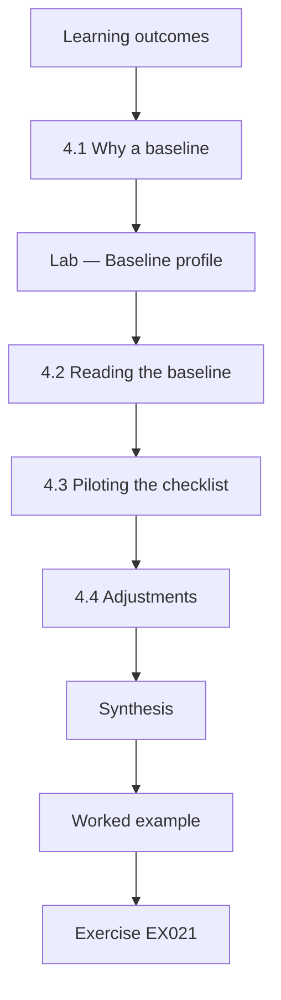

### Logical drawing

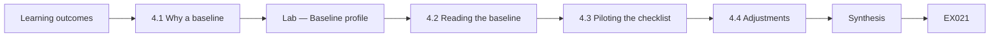

```text
[Learning outcomes]
    |
    v
[4.1 Why a baseline]
    |
    v
[Lab — Baseline profile]
    |
    v
[4.2 Reading the baseline]
    |
    v
[4.3 Piloting the checklist]
    |
    v
[4.4 Adjustments]
    |
    v
[Synthesis]
    |
    v
[Worked example] --> [Exercise EX021]
```
<!-- open-cyber-academy:lesson-figures:end ch-04 -->


### Learning outcomes

You will (1) replicate a baseline from historical findings; (2) pilot the checklist; (3) adjust procedures before the main study.

### 4.1 Why a baseline

Before testing a new procedure, Lucía needs to know what usual review finds. She codes sixty historical findings from four past partner reviews, all of contracts already fixed or retired, using the codebook from chapter one. The baseline tells her which categories dominate high-severity findings and whether projects differ, which informs both the secondary hypothesis and the checklist's emphasis. Replicating a baseline also tests whether her coding works on real-looking material rather than only training examples. She reports the coding agreement on this material too.

### Lab — Baseline profile

```python
"""Baseline profile of synthetic historical review findings by category and severity (read-only)."""
from collections import Counter
# (project, category, severity) for 60 synthetic findings from past reviews
ROWS = []
for proj, spec in {
    "P1": [("access", "high", 4), ("external-call", "high", 2), ("arithmetic", "medium", 3), ("other", "low", 6)],
    "P2": [("access", "high", 3), ("external-call", "high", 3), ("arithmetic", "medium", 2), ("other", "low", 7)],
    "P3": [("access", "medium", 5), ("external-call", "high", 1), ("arithmetic", "high", 2), ("other", "low", 7)],
    "P4": [("access", "high", 2), ("external-call", "medium", 4), ("arithmetic", "low", 3), ("other", "low", 6)],
}.items():
    for cat, sev, n in spec:
        ROWS += [(proj, cat, sev)] * n

def main():
    print(f"findings {len(ROWS)} across {len({r[0] for r in ROWS})} projects")
    high = [r for r in ROWS if r[2] == "high"]
    print(f"high severity {len(high)} ({100 * len(high) / len(ROWS):.1f}%)")
    for cat, n in Counter(r[1] for r in high).most_common():
        print(f"  high {cat}: {n}")
    for p, n in sorted(Counter(r[0] for r in high).items()):
        print(f"  {p} high: {n}")

if __name__ == "__main__":
    main()
```

Run with `python3 lab_baseline.py`. Verified output:

```text
findings 60 across 4 projects
high severity 17 (28.3%)
  high access: 9
  high external-call: 6
  high arithmetic: 2
  P1 high: 6
  P2 high: 6
  P3 high: 3
  P4 high: 2
```

### 4.2 Reading the baseline

The run reports sixty findings across four projects, seventeen of them high severity, 28.3 percent. Access control accounts for nine high findings, external calls six and arithmetic two. Projects P1 and P2 have six high findings each, P3 three and P4 two. Lucía notes that access control dominates, consistent with her secondary hypothesis, and that projects differ enough that she must stratify or account for project in the main study rather than pool everything naively. These figures are recorded with the run date and seed-free script.

### 4.3 Piloting the checklist

Lucía pilots the checklist with two auditors on four contracts not used in the main study. The checklist has thirty-two items grouped by category, each linked to an EthTrust requirement or SWC entry and phrased as a question about the code's intended behaviour. The pilot shows that reviewers skip items they judge irrelevant without recording why, and that three items are ambiguous. Pilots exist to find these problems while they are cheap to fix. Each problem is noted with the item and reviewer comment.

### 4.4 Adjustments

Lucía adds a not-applicable option that requires a one-line reason, rewrites the three ambiguous items and adds a short section on documentation of intended behaviour, because reviewers struggled to judge correctness without it. She records each change in a deviation log against the registered plan, noting that the pilot was planned and the changes precede main data collection. Supervisors approve the revised checklist, and the main study can begin with a tool that reviewers understand consistently. The revised version is frozen for the main study.

### Worked example

The baseline shows 17 of 60 findings are high severity, with access control the largest category; the pilot leads to three rewritten items, a recorded not-applicable option and a documentation section.

> **Synthetic case.** Findings, projects and the checklist are synthetic; EEA EthTrust and the SWC registry are real sources.

### Errors and limits

Skipping a pilot leaves ambiguities that add noise to the main study.

### Exercises

- **EX021 — Baseline source.** What does the baseline use? *Rubric:* 3 = sixty historical findings from fixed or retired contracts;; 2 = past findings;; 1 = live contracts;; 0 = none.
- **EX022 — High share.** What share of baseline findings were high severity? *Rubric:* 3 = 17 of 60, 28.3%;; 2 = 28%;; 1 = 50%;; 0 = none.
- **EX023 — Top category.** Which category had the most high findings? *Rubric:* 3 = access control, nine;; 2 = access;; 1 = arithmetic;; 0 = none.
- **EX024 — Project variation.** Why stratify by project? *Rubric:* 3 = projects differ in high findings;; 2 = variation;; 1 = cost;; 0 = none.
- **EX025 — Pilot problem.** What did the pilot reveal? *Rubric:* 3 = unrecorded skips and three ambiguous items;; 2 = ambiguity;; 1 = vague;; 0 = none.
- **EX026 — Change logging.** How are checklist changes recorded? *Rubric:* 3 = deviation log against the registered plan;; 2 = log;; 1 = not recorded;; 0 = none.

### Synthesis

A replicated baseline and a candid pilot ground the main study in real patterns and a usable instrument.

### Continue studying — chapter 04 of 08

[← Chapter 03 (draft)](#ch-03) · [Course chapter index](../SUBJECTS.md) · [Chapter 05 (draft) →](#ch-05)

<a id="ch-05"></a>

## Chapter 5 — Main study and independent validation

<!-- open-cyber-academy:lesson-figures:start ch-05 -->
### Lesson map

Lesson 05 published. Map, example, EX027.

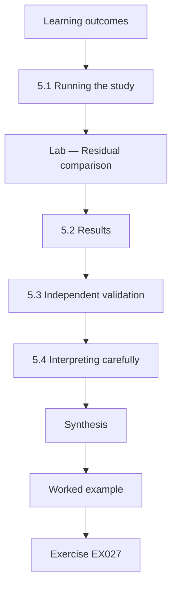

### Logical drawing

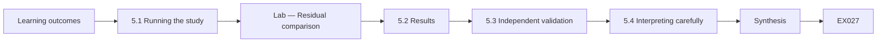

```text
[Learning outcomes]
    |
    v
[5.1 Running the study]
    |
    v
[Lab — Residual comparison]
    |
    v
[5.2 Results]
    |
    v
[5.3 Independent validation]
    |
    v
[5.4 Interpreting carefully]
    |
    v
[Synthesis]
    |
    v
[Worked example] --> [Exercise EX027]
```
<!-- open-cyber-academy:lesson-figures:end ch-05 -->


### Learning outcomes

You will (1) run the randomised comparison; (2) analyse residual issues; (3) validate findings independently.

### 5.1 Running the study

Over eight weeks, partner auditors review twenty-four contracts, twelve with the checklist and twelve with usual review, following the random allocation. Lucía monitors fidelity by checking that checklist reviews record every item and that usual reviews do not borrow the checklist. Each review closes with a findings report. The blinded independent reviewer then examines every contract and records high-severity issues not in the first report. Fidelity checks matter because a comparison is meaningless if the procedures blur together in practice.

### Lab — Residual comparison

```python
"""Compare residual high-severity findings after two review procedures (synthetic, read-only).
Residual = high-severity issues found by the blinded independent reviewer after the first review closed."""
import random, statistics
CHECKLIST = [0, 1, 0, 0, 1, 0, 2, 0, 0, 1, 0, 0]
USUAL = [1, 2, 0, 1, 2, 1, 3, 0, 1, 2, 1, 1]

def main():
    m1, m2 = statistics.mean(CHECKLIST), statistics.mean(USUAL)
    diff = m2 - m1
    print(f"contracts per arm {len(CHECKLIST)}")
    print(f"mean residual high: checklist {m1:.2f}, usual {m2:.2f}, difference {diff:.2f}")
    rng = random.Random(2026)
    pool = CHECKLIST + USUAL
    hits, reps = 0, 10000
    for _ in range(reps):
        rng.shuffle(pool)
        if statistics.mean(pool[12:]) - statistics.mean(pool[:12]) >= diff:
            hits += 1
    print(f"one-sided permutation p = {hits / reps:.4f} ({reps} shuffles, seed 2026)")
    print(f"contracts with zero residual high: checklist {CHECKLIST.count(0)}/12, usual {USUAL.count(0)}/12")

if __name__ == "__main__":
    main()
```

Run with `python3 lab_trial.py`. Verified output:

```text
contracts per arm 12
mean residual high: checklist 0.42, usual 1.25, difference 0.83
one-sided permutation p = 0.0146 (10000 shuffles, seed 2026)
contracts with zero residual high: checklist 8/12, usual 2/12
```

### 5.2 Results

The run reports mean residual high-severity issues of 0.42 per contract with the checklist and 1.25 with usual review, a difference of 0.83. The one-sided permutation test with seed 2026 and ten thousand shuffles gives p equal to 0.0146. Eight of twelve checklist contracts have no residual high issues, compared with two of twelve under usual review. Lucía reports the difference with its uncertainty and notes that twelve contracts per arm is a small sample, so the estimate is imprecise.

A p-value of 0.0146 makes chance an unlikely explanation for the 0.83 difference, but it says nothing about how large the true difference is.

### 5.3 Independent validation

To check that residual issues are real, a second independent reviewer, also blinded, assesses each residual issue for validity and severity. Agreement on severity is high, and two residual issues from the usual arm are downgraded to medium, which Lucía reports along with a sensitivity analysis that excludes them. The direction of the result holds. Validation guards against the possibility that one reviewer's judgements, rather than the procedures, produced the difference. Lucía records the validator's reasoning for each changed rating, and reports both the original and validated results side by side.

### 5.4 Interpreting carefully

Lucía writes that structured checklist review was associated with fewer residual high-severity issues in this sample of synthetic contracts and partner auditors. She does not claim the checklist prevents all serious issues, nor that the effect size will hold for public decentralised finance protocols with complex economic designs. She also notes that checklist reviews took on average fifteen percent longer, a cost partners must weigh. Careful interpretation keeps the claim within what the design supports. She states the limits in the abstract as well as the discussion.

### Worked example

Residual high-severity issues average 0.42 with the checklist and 1.25 with usual review (p = 0.0146, permutation); 8 of 12 checklist contracts have none, against 2 of 12.

> **Synthetic case.** Contracts, auditors and figures are synthetic.

### Errors and limits

Reporting only a p-value without effect size, sample size and limits overstates certainty.

### Exercises

- **EX027 — Mean residuals.** What were the mean residual high issues? *Rubric:* 3 = 0.42 checklist vs 1.25 usual;; 2 = 0.42;; 1 = equal;; 0 = none.
- **EX028 — Permutation result.** What p-value did the permutation test give? *Rubric:* 3 = 0.0146 with seed 2026;; 2 = 0.015;; 1 = 0.5;; 0 = none.
- **EX029 — Zero counts.** How many contracts had zero residual high issues? *Rubric:* 3 = 8 of 12 checklist, 2 of 12 usual;; 2 = 8 and 2;; 1 = all;; 0 = none.
- **EX030 — Fidelity meaning.** Why monitor fidelity? *Rubric:* 3 = to keep the procedures distinct;; 2 = separation;; 1 = speed;; 0 = none.
- **EX031 — Validation outcome.** What did the second reviewer change? *Rubric:* 3 = downgraded two usual-arm issues to medium;; 2 = downgrades;; 1 = vague;; 0 = none.
- **EX032 — Time cost.** What cost did the checklist add? *Rubric:* 3 = about fifteen percent longer reviews;; 2 = time;; 1 = vague;; 0 = none.

### Synthesis

A randomised, blinded comparison with independent validation supports a careful, bounded claim.

### Continue studying — chapter 05 of 08

[← Chapter 04 (draft)](#ch-04) · [Course chapter index](../SUBJECTS.md) · [Chapter 06 (draft) →](#ch-06)

<a id="ch-06"></a>

## Chapter 6 — Peer critique and revision

<!-- open-cyber-academy:lesson-figures:start ch-06 -->
### Lesson map

Lesson 06 published. Map, example, EX033.

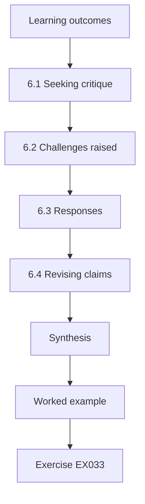

### Logical drawing

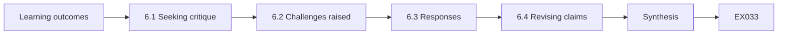

```text
[Learning outcomes]
    |
    v
[6.1 Seeking critique]
    |
    v
[6.2 Challenges raised]
    |
    v
[6.3 Responses]
    |
    v
[6.4 Revising claims]
    |
    v
[Synthesis]
    |
    v
[Worked example] --> [Exercise EX033]
```
<!-- open-cyber-academy:lesson-figures:end ch-06 -->


### Learning outcomes

You will (1) invite structured critique; (2) respond to methodological challenges; (3) revise claims and analyses.

### 6.1 Seeking critique

Lucía presents her results to a seminar of researchers and two external practitioners, and invites written critique against a short template: threats to validity, alternative explanations and missing analyses. Seeking critique early, before the thesis is written, gives time to respond with analysis rather than argument. She records every point with its source and her planned response, so that the thesis can show examiners how criticism shaped the work. She also asks one critic to argue deliberately against her conclusion, so that the strongest objections are heard before examiners raise them.

### 6.2 Challenges raised

Critics raise four points. First, seeded weaknesses come from public registries, which checklist items also reference, so the checklist may simply list what was planted. Second, auditors may have tried harder under the novel procedure. Third, the blinded reviewer might recognise checklist reports by their format. Fourth, twelve contracts per arm is small. Each is a fair challenge, and Lucía notes that the first is the most serious because it questions whether the comparison is fair at all. She thanks each critic and records the challenge verbatim.

### 6.3 Responses

For the first point, Lucía analyses the subset of residual issues that are business-logic or oracle problems not named on the checklist; the checklist arm still has fewer, though the difference is smaller. For the second, she reports that review hours were recorded and adds effort as a covariate. For the third, she shows reports were reformatted to a common template before blinded review. For the fourth, she agrees, reports intervals and calls for replication. Responding with analysis strengthens claims more than rebuttal.

### 6.4 Revising claims

After critique, Lucía revises her central claim: structured review was associated with fewer residual issues, with a smaller but consistent difference for issues not named on the checklist, suggesting that structure improves attention generally as well as coverage of listed items. She moves the strong version of the claim into limitations. Revising openly shows intellectual honesty and gives examiners confidence that the thesis reflects the evidence rather than her hopes. Her supervisor checks that every revised sentence matches the analyses, and the critique log is attached to the thesis as an appendix so examiners can trace each change.

### Worked example

Four critiques are logged; analyses of unlisted issues, effort covariates and formatting controls are added, and the central claim is narrowed accordingly.

> **Synthetic case.** Seminar participants, critiques and analyses are synthetic.

### Errors and limits

Answering critique with argument alone, without new analysis, leaves doubts unresolved.

### Exercises

- **EX033 — Critique template.** What does the critique template ask for? *Rubric:* 3 = threats, alternative explanations, missing analyses;; 2 = validity;; 1 = praise;; 0 = none.
- **EX034 — Most serious.** Which critique is most serious? *Rubric:* 3 = checklist may list what was planted;; 2 = seeding overlap;; 1 = sample size;; 0 = none.
- **EX035 — Unlisted analysis.** What did the unlisted-issue analysis show? *Rubric:* 3 = checklist still fewer, smaller difference;; 2 = smaller;; 1 = reversed;; 0 = none.
- **EX036 — Format control.** How was format recognition addressed? *Rubric:* 3 = reports reformatted to a common template;; 2 = common template;; 1 = ignored;; 0 = none.
- **EX037 — Revised claim.** How was the claim revised? *Rubric:* 3 = association with smaller consistent difference for unlisted issues;; 2 = narrowed;; 1 = strengthened;; 0 = none.
- **EX038 — Small sample reply.** How did Lucía respond to small samples? *Rubric:* 3 = report intervals and call for replication;; 2 = replication;; 1 = ignore;; 0 = none.

### Synthesis

Structured critique, analytic responses and openly revised claims make a thesis stronger and more credible.

### Continue studying — chapter 06 of 08

[← Chapter 05 (draft)](#ch-05) · [Course chapter index](../SUBJECTS.md) · [Chapter 07 (draft) →](#ch-07)

<a id="ch-07"></a>

## Chapter 7 — Thesis synthesis and reproducibility archive

<!-- open-cyber-academy:lesson-figures:start ch-07 -->
### Lesson map

Lesson 07 published. Map, example, EX039.

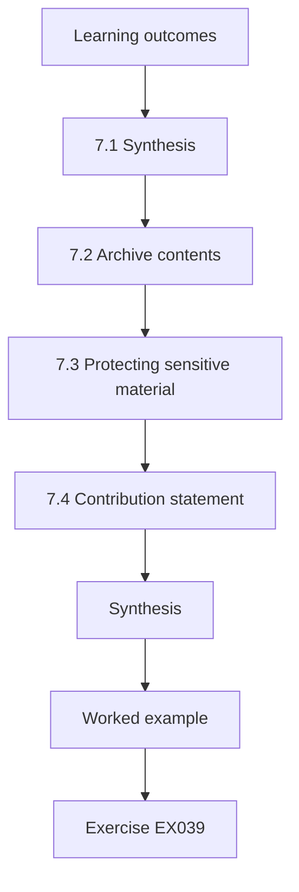

### Logical drawing

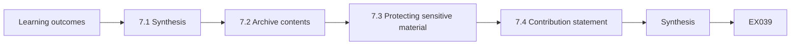

```text
[Learning outcomes]
    |
    v
[7.1 Synthesis]
    |
    v
[7.2 Archive contents]
    |
    v
[7.3 Protecting sensitive material]
    |
    v
[7.4 Contribution statement]
    |
    v
[Synthesis]
    |
    v
[Worked example] --> [Exercise EX039]
```
<!-- open-cyber-academy:lesson-figures:end ch-07 -->


### Learning outcomes

You will (1) synthesise findings into a coherent thesis; (2) build a reproducibility archive; (3) protect sensitive material.

### 7.1 Synthesis

Lucía's thesis argues that the human review process is a security control that can be designed and measured, not merely a matter of individual expertise. The chapters move from the gap in the literature, through measurement and baseline, to the randomised comparison and critique. She links results back to the sources: the checklist operationalises EthTrust requirements and SWC categories, the overlap study echoes Durieux on tool limits, and Perez and Livshits frame why residual issues are discussed as risk rather than as proven losses.

### 7.2 Archive contents

The reproducibility archive holds the codebook, checklist versions with the deviation log, the registered plan, anonymised and synthetic datasets, analysis scripts with fixed seeds and the outputs they produce. A short README explains how to rerun every figure using only the Python standard library. Lucía tests the archive by asking a colleague to reproduce the main results from scratch on a clean machine; one missing file is found and added. A tested archive is the only kind that reliably reproduces.

### 7.3 Protecting sensitive material

The archive includes no contract source, addresses or descriptions that could help someone attack a real deployment. Seeded weakness descriptions are reduced to registry identifiers and categories. Partner names are pseudonymised. Lucía's ethics board and partner security leads review the archive before release, and one free-text field that described a reviewer's reasoning in too much detail is removed. Reproducibility and safety are balanced deliberately, with the reasons documented. The review record, with reasons for each removal, is kept with the ethics file. Partners sign off the final archive before it is published on the institute repository.

### 7.4 Contribution statement

Lucía writes a one-page contribution statement: a validated codebook for review findings; a checklist instrument mapped to public standards; the first randomised, blinded comparison of structured and unstructured contract review in her setting; and an archive that allows replication. She also lists what the thesis does not show. Examiners use this statement to judge originality, so precision about both contributions and limits matters more than ambition. Her supervisor reads the statement against the thesis to confirm that every claim is supported by a named chapter and analysis, and asks her to remove one phrase that implied the result generalised to all blockchains.

### Worked example

The archive reproduces every figure on a clean machine after one missing file is added; a security review removes one over-detailed free-text field.

> **Synthetic case.** Archive contents and reviews are synthetic; EEA EthTrust, the SWC registry, Durieux et al. (2020) and Perez and Livshits (2021) are real sources.

### Errors and limits

Releasing contract code or detailed weakness descriptions in an archive can help attackers.

### Exercises

- **EX039 — Thesis argument.** What does the thesis argue? *Rubric:* 3 = review process is a designable, measurable control;; 2 = process control;; 1 = tools suffice;; 0 = none.
- **EX040 — Archive test.** How was the archive tested? *Rubric:* 3 = colleague reproduced results on a clean machine;; 2 = reproduction;; 1 = not tested;; 0 = none.
- **EX041 — Archive excluded.** What does the archive exclude? *Rubric:* 3 = contract source, addresses, attack-enabling descriptions;; 2 = code;; 1 = seeds;; 0 = none.
- **EX042 — Weakness representation.** How are seeded weaknesses described? *Rubric:* 3 = registry identifiers and categories only;; 2 = IDs;; 1 = full detail;; 0 = none.
- **EX043 — Removed field.** What did the security review remove? *Rubric:* 3 = an over-detailed free-text reasoning field;; 2 = free text;; 1 = vague;; 0 = none.
- **EX044 — Contribution count.** Name one listed contribution. *Rubric:* 3 = validated codebook;; 2 = randomised comparison;; 1 = vague;; 0 = none.

### Synthesis

A coherent argument, a tested archive and careful protection of sensitive material complete a reproducible thesis.

### Continue studying — chapter 07 of 08

[← Chapter 06 (draft)](#ch-06) · [Course chapter index](../SUBJECTS.md) · [Chapter 08 (draft) →](#ch-08)

<a id="ch-08"></a>

## Chapter 8 — Defense and publication plan

<!-- open-cyber-academy:lesson-figures:start ch-08 -->
### Lesson map

Lesson 08 published. Map, example, EX045.

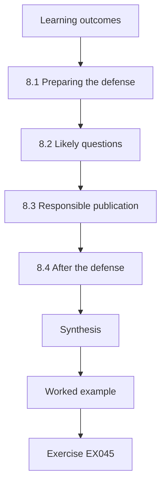

### Logical drawing

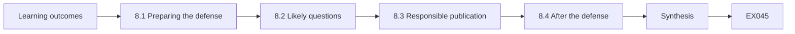

```text
[Learning outcomes]
    |
    v
[8.1 Preparing the defense]
    |
    v
[8.2 Likely questions]
    |
    v
[8.3 Responsible publication]
    |
    v
[8.4 After the defense]
    |
    v
[Synthesis]
    |
    v
[Worked example] --> [Exercise EX045]
```
<!-- open-cyber-academy:lesson-figures:end ch-08 -->


### Learning outcomes

You will (1) prepare for the defense; (2) anticipate examiner questions; (3) plan responsible publication.

### 8.1 Preparing the defense

Lucía prepares a forty-minute presentation that follows the argument rather than the chapter order: the problem, the gap, the instrument, the result, the critique and the limits. She rehearses with her supervisor and two peers acting as examiners, who interrupt with hard questions. Each rehearsal produces a list of weak answers, which she strengthens with evidence from the thesis rather than new claims. A defense is a conversation about evidence, and preparation means knowing where every number came from. She also prepares backup slides with key tables.

### 8.2 Likely questions

Lucía anticipates questions: why permissioned settlement contracts rather than public protocols; whether seeded weaknesses resemble real ones; how severity was rated and by whom; why permutation tests; what would change her conclusion; and what practitioners should do differently tomorrow. She writes a short answer for each with a page reference. Anticipating questions reduces anxiety and ensures answers are consistent with the written thesis, which examiners will check. Her supervisor reviews the answers and marks two that rely on assumption rather than evidence, which she rewrites with page references to the relevant analyses.

### 8.3 Responsible publication

Lucía plans two papers: one on the codebook and baseline, and one on the randomised comparison. Before submission, partner security leads confirm no content could aid attacks on deployed systems, and the checklist is published under an open licence with its standards mapping so practitioners can use it. She also plans a short practitioner note in plain language. Publishing responsibly means maximising usefulness to defenders while giving attackers nothing they could not already find in public registries. Co-authors from partners approve the final text.

### 8.4 After the defense

Examiners accept the thesis with minor corrections: clarify the severity rubric's examples and expand the discussion of economic and oracle risks that the checklist covers only lightly. Lucía completes the corrections, updates the archive and records the changes. She proposes follow-up work on public decentralised finance protocols with partners willing to share post-fix findings. The defense ends one study and frames the next, which is the natural shape of a research career. The corrected thesis is deposited with the archive, and the deposit record lists every correction with its page.

### Worked example

Rehearsals sharpen answers to six likely questions; the thesis is accepted with two minor corrections, and two papers plus a practitioner note are planned after partner security review.

> **Synthetic case.** The defense, examiners and publications are synthetic.

### Errors and limits

Publishing detailed weakness examples from partner contracts could aid attackers even after the study ends.

### Exercises

- **EX045 — Presentation order.** How is the presentation ordered? *Rubric:* 3 = by argument, not chapter order;; 2 = argument;; 1 = alphabetical;; 0 = none.
- **EX046 — Rehearsal output.** What does each rehearsal produce? *Rubric:* 3 = list of weak answers to strengthen;; 2 = weak answers;; 1 = slides;; 0 = none.
- **EX047 — Anticipated question.** Name one anticipated question. *Rubric:* 3 = why permissioned contracts;; 2 = how severity was rated;; 1 = favourite colour;; 0 = none.
- **EX048 — Pre-submission check.** What happens before submission? *Rubric:* 3 = partner security leads confirm nothing aids attacks;; 2 = security review;; 1 = vague;; 0 = none.
- **EX049 — Corrections requested.** What corrections were requested? *Rubric:* 3 = clarify severity examples, expand economic and oracle risks;; 2 = two;; 1 = vague;; 0 = none.
- **EX050 — Follow-up work.** What follow-up is proposed? *Rubric:* 3 = study public DeFi protocols with post-fix findings;; 2 = DeFi;; 1 = vague;; 0 = none.

### Synthesis

Evidence-based defense preparation and responsible publication carry the research safely to its audiences.

### Continue studying — chapter 08 of 08

[← Chapter 07 (draft)](#ch-07) · [Course chapter index](../SUBJECTS.md) · [Worked results ↓](#worked-results) · [Next course via chapter index →](../SUBJECTS.md)

<a id="worked-results"></a>

## Worked results

Model answers for EX001–EX050. Lucía Ferreyra, Prof. Henrik Aalto, Kestrel Institute of Technology, Harbourline Credit Union Consortium and every figure are synthetic. Lab answers quote verified outputs. Any answer meeting the rubric scores equally.

**EX001.** Whether structured checklist review leaves fewer high-severity issues undetected than usual unstructured expert review.

**EX002.** The SWC registry and the OWASP Smart Contract Top 10.

**EX003.** Kappa 0.833, with 35 of 40 findings agreed.

**EX004.** Four of five disagreements sent findings to the other category.

**EX005.** Only after fixes are deployed or the contract is retired.

**EX006.** Code or steps that would let a reader reproduce an attack.

**EX007.** Results from a permissioned ledger and two teams may not generalise to public decentralised finance.

**EX008.** The Ethereum virtual machine that runs contract code, with gas limiting computation.

**EX009.** Symbolic execution.

**EX010.** Low agreement between tools and many false positives.

**EX011.** Contracts flagged as vulnerable were rarely exploited in practice.

**EX012.** 0.33, with 4 shared findings of 12 distinct.

**EX013.** Intent and context, such as business logic and oracle dependence.

**EX014.** Little controlled evidence on whether structuring human review around guidance changes what is missed.

**EX015.** A high-severity issue found by the blinded independent reviewer after the first review closed.

**EX016.** The checklist reduces residual access-control issues most.

**EX017.** Twenty-four contracts randomised within size strata, twelve per procedure.

**EX018.** Only weaknesses documented in public registries.

**EX019.** A one-sided permutation test with a fixed seed and ten thousand shuffles.

**EX020.** Researcher degrees of freedom in choosing hypotheses and analyses.

**EX021.** Sixty historical findings from four past reviews of fixed or retired contracts.

**EX022.** 17 of 60, 28.3 percent.

**EX023.** Access control, with nine.

**EX024.** Projects differ, from six high findings to two.

**EX025.** Reviewers skipped items without reasons and three items were ambiguous.

**EX026.** In a deviation log against the registered plan.

**EX027.** 0.42 per contract with the checklist and 1.25 with usual review.

**EX028.** p = 0.0146, with seed 2026 and 10,000 shuffles.

**EX029.** Eight of twelve with the checklist and two of twelve with usual review.

**EX030.** So the two procedures do not blur together in practice.

**EX031.** Two usual-arm residual issues were downgraded to medium.

**EX032.** Reviews took on average about fifteen percent longer.

**EX033.** Threats to validity, alternative explanations and missing analyses.

**EX034.** That the checklist may simply list the weaknesses seeded from the same registries.

**EX035.** The checklist arm still had fewer, but the difference was smaller.

**EX036.** Reports were reformatted to a common template before blinded review.

**EX037.** Structured review was associated with fewer residual issues, with a smaller but consistent difference for unlisted issues.

**EX038.** She agreed, reported intervals and called for replication.

**EX039.** That the human review process is a security control that can be designed and measured.

**EX040.** A colleague reproduced the main results from scratch on a clean machine.

**EX041.** Contract source, addresses and descriptions that could help attack a deployment.

**EX042.** Reduced to registry identifiers and categories.

**EX043.** One free-text field describing a reviewer's reasoning in too much detail.

**EX044.** A validated codebook, a mapped checklist, the randomised comparison or the archive.

**EX045.** By the argument: problem, gap, instrument, result, critique and limits.

**EX046.** A list of weak answers to strengthen with evidence.

**EX047.** Why permissioned contracts, whether seeds are realistic, how severity was rated, or similar.

**EX048.** Partner security leads confirm no content could aid attacks on deployed systems.

**EX049.** Clarify the severity rubric's examples and expand discussion of economic and oracle risks.

**EX050.** A study of public decentralised finance protocols using post-fix findings.

<a id="references"></a>

## References

Links checked 12 October 2026; re-verify editions before citing. Organisations, people, systems, code and data in this book are synthetic unless a sentence cites a public source.

- Atzei, N., Bartoletti, M., & Cimoli, T. (2017). A survey of attacks on Ethereum smart contracts (SoK). In *Principles of Security and Trust (POST 2017)*, LNCS 10204, 164–186. Springer. <https://doi.org/10.1007/978-3-662-54455-6_8>
- Buterin, V. (2014). *Ethereum whitepaper: A next-generation smart contract and decentralized application platform*. ethereum.org. <https://ethereum.org/en/whitepaper/>
- ConsenSys Diligence. (n.d.). *Ethereum smart contract security best practices*. <https://consensys.github.io/smart-contract-best-practices/>
- Daian, P., Goldfeder, S., Kell, T., Li, Y., Zhao, X., Bentov, I., Breidenbach, L., & Juels, A. (2020). Flash Boys 2.0: Frontrunning in decentralized exchanges, miner extractable value, and consensus instability. *2020 IEEE Symposium on Security and Privacy*, 910–927. <https://doi.org/10.1109/SP40000.2020.00040>
- Durieux, T., Ferreira, J. F., Abreu, R., & Cruz, P. (2020). Empirical review of automated analysis tools on 47,587 Ethereum smart contracts. *Proceedings of the ACM/IEEE 42nd International Conference on Software Engineering*, 530–541. <https://doi.org/10.1145/3377811.3380364>
- Enterprise Ethereum Alliance. (2025). *EEA EthTrust Security Levels specification, version 3*. <https://entethalliance.org/specs/ethtrust-sl/v3/>
- Landis, J. R., & Koch, G. G. (1977). The measurement of observer agreement for categorical data. *Biometrics*, 33(1), 159–174. <https://doi.org/10.2307/2529310>
- Luu, L., Chu, D.-H., Olickel, H., Saxena, P., & Hobor, A. (2016). Making smart contracts smarter. *Proceedings of the 2016 ACM SIGSAC Conference on Computer and Communications Security*, 254–269. <https://doi.org/10.1145/2976749.2978309>
- Nakamoto, S. (2008). *Bitcoin: A peer-to-peer electronic cash system*. <https://bitcoin.org/bitcoin.pdf>
- OWASP Foundation. (n.d.). *OWASP Smart Contract Top 10*. <https://owasp.org/www-project-smart-contract-top-10/>
- Perez, D., & Livshits, B. (2021). Smart contract vulnerabilities: Vulnerable does not imply exploited. *30th USENIX Security Symposium*. <https://www.usenix.org/conference/usenixsecurity21/presentation/perez>
- SmartContractSecurity. (n.d.). *Smart Contract Weakness Classification (SWC) registry*. <https://swcregistry.io/>
- Tsankov, P., Dan, A., Drachsler-Cohen, D., Gervais, A., Bünzli, F., & Vechev, M. (2018). Securify: Practical security analysis of smart contracts. *Proceedings of the 2018 ACM SIGSAC Conference on Computer and Communications Security*, 67–82. <https://doi.org/10.1145/3243734.3243780>
- Wood, G. (n.d.). *Ethereum: A secure decentralised generalised transaction ledger* (Ethereum yellow paper, continuously revised). <https://ethereum.github.io/yellowpaper/paper.pdf>
- Yaga, D., Mell, P., Roby, N., & Scarfone, K. (2018). *Blockchain technology overview* (NIST IR 8202). NIST. <https://doi.org/10.6028/NIST.IR.8202>
