# Incident Response and Cyber Resilience: Engineering Response Systems That Hold Under Stress

- Language: English (`en`); engineering course, five years; approximately 4,000 hours of planned study (course 131 of 207 in the [study path](../../../../../STUDY_PATH.md)).
- Editorial state: **published**. Chapters 1–50 of 50 have authored teaching text; exercises EX001–EX100 (two per chapter) have matching worked results; eighteen offline labs are embedded with their verified output. Independent subject-matter review, source re-verification, accessibility review, language editing and the 300-page A4 verification remain open. The plan's target of three exercises per chapter is not yet met. Draft-chapter coverage is not a completed book.
- Audience: future designers and builders of incident-response capabilities — detection and evidence pipelines, case and workflow platforms, scoped containment controls, recovery architectures and the operations around them. Entry knowledge: secondary-school mathematics; the book builds calculus, probability, programming, networks and systems engineering from Chapter 1, always applied to response problems.
- Relation to the other books in this area: the practitioner books at [rapid](../../../../rapid-1-month/incident-response-resilience/en/book/MANUSCRIPT.md), [professional](../../../../professional-6-months/incident-response-resilience/en/book/MANUSCRIPT.md) and [technical](../../../../technical-18-months/incident-response-resilience/en/book/MANUSCRIPT.md) level teach how to *do* and *coordinate* incident response; the [master's book](../../../../masters-2-years/incident-response-resilience/en/book/MANUSCRIPT.md) teaches how to design and defend one empirical study of response practice; the [doctoral book](../../../../doctorate-2-years/incident-response-resilience/en/book/MANUSCRIPT.md) asks for an original, independently validated contribution to knowledge. **This engineering book is about building and verifying the response system itself**: deriving requirements and service objectives, designing evidence-preserving data paths and authorisation models, implementing capture services, workflows and scoped controls, measuring accuracy, latency and reliability, injecting faults, trialling recovery and defending the built system with an evidence dossier. Its research chapter (42) exists to find the system's limits, not to publish.
- Author and editorial responsibility: [hiagokinlevi](https://github.com/hiagokinlevi). Original maintainer-owned teaching text is dedicated under [CC0 1.0](../../../../../LICENSE); cited works keep their own rights and are not relicensed here.
- Educational boundary: this course is an independent educational blueprint. It is not an accredited engineering degree, grants no professional licence and grants no authority to access, collect from, test or modify any real system, account, tenant or network. Every organisation, person, account, host, address, case, number and lab output in a worked example is **synthetic** unless a sentence explicitly cites a public source. Nothing here is an operational procedure for a real organisation, and nothing is legal advice.

[Course home](../../README.md) · [Chapter index](../SUBJECTS.md) · [Book plan](PLAN.md) · [Course skill](../../skill/SKILL.md) · [Book standard](../../../../../BOOK_STANDARD.md) · [Worked results](#worked-results)

## How to use this draft

The fifty chapters follow the ten semesters of the plan. **Chapters 1–10** build mathematical, physical, computing and professional foundations — rates and accumulation of incident queues, workflow graphs and invariants, physical causes of telemetry loss, preserving programs, testable requirements, probability with base rates, evidence-bearing architecture, robust modules and engineering ethics. **Chapters 11–19** cover networks, operating systems, data systems, software engineering, security fundamentals, systems engineering, feedback control of automated response, security architecture, and identity and cryptography for evidence. **Chapter 20** frames incident response as an engineering problem bounded by authority, time, evidence and service continuity. **Chapters 21–42** are the field core: response requirements and objectives, telemetry and provenance models, threat and failure analysis of response systems, evidence pipelines and decision support, scoped containment control, evidence capture, measurement of triage accuracy and latency, orchestration, reliability, safety under partial failure, cross-platform integration, pipeline performance, auditable operations, validation of containment claims, playbook maintainability, decision optimisation and applied research on system limits — with two design studios (25, 35) and two verification laboratories (30, 40). **Chapters 43–50** are practice and the capstone sequence: practicum, design and build, independent review, trial and iteration, failure and recovery trial, evidence dossier, thesis and defense.

Every chapter has learning outcomes, teaching sections with definitions, a worked example, a practical activity or design task, common errors and limits, two exercises with rubrics and a synthesis. Eighteen chapters embed an offline lab written for the Python 3 standard library; the printed outputs were produced by running the code when this manuscript was assembled. Write your answer before opening the [worked results](#worked-results).

Keep four labels in your engineering notes: **requirement** (what must be true, verifiably), **design decision** (what was chosen, why, and what would change it), **evidence** (test, analysis, trial or review that supports a claim, with its version) and **residual risk** (what remains, and who owns it). The commonest failure in response engineering is not a wrong calculation; it is an action reported as an outcome, a claim no evidence supports, or a residual risk nobody owns.

### The synthetic design case used in this book

| Synthetic element | Role | Boundary |
|---|---|---|
| **Harrow Valley Shared Services (HVSS)** — a public-service IT provider with a central response team, a shared response platform and client tenants (a city council, a water utility's billing department, a community hospital trust) | The organisation whose response capability is engineered | Invented; no real organisation, staff or network |
| HVSS case platform, evidence store, workflow engine, containment controller, alert broker, collectors | The system designed, built and verified across the book | Invented; no real product is described |
| Accounts (`j.ortiz`, `m.kaur`, `u17`…), hosts (`HV-LT-0441`…), cases (C-1001…), domains ending `.example`, addresses in 192.0.2.0/24, 198.51.100.0/24 and 203.0.113.0/24 | Teaching identifiers | Synthetic or reserved for documentation ([RFC 5737](https://www.rfc-editor.org/rfc/rfc5737)) |
| All probabilities, rates, costs, trial results and lab outputs | Teaching data | Synthetic; the HMAC key in Lab 19 is published and must never be used |

### Source policy

Every factual statement about a standard, law or published study links to a source consulted in October 2026. Standards and laws change: re-verify versions and dates before relying on them. Standard engineering knowledge (the derivative, Little's law, availability arithmetic) is stated without a citation or with a classic reference. NIST SP 800-84 and SP 800-86 date from 2006 and RFC 3227 from 2002; they are cited for their enduring principles, and their tooling details need current verification. Provider-specific behaviour (token lifetimes, log delivery delays, API limits) varies by product and changes; the book teaches how to measure and record it rather than quoting values.

## Contents


1. [Calculus I](#ch-01)
2. [Discrete mathematics](#ch-02)
3. [Physics for computing](#ch-03)
4. [Programming I](#ch-04)
5. [Engineering communication](#ch-05)
6. [Calculus II](#ch-06)
7. [Probability and statistics](#ch-07)
8. [Computer architecture](#ch-08)
9. [Programming II](#ch-09)
10. [Engineering ethics and safety](#ch-10)
11. [Networks and protocols](#ch-11)
12. [Operating systems](#ch-12)
13. [Data systems](#ch-13)
14. [Software engineering](#ch-14)
15. [Security fundamentals](#ch-15)
16. [Systems engineering](#ch-16)
17. [Control and feedback basics](#ch-17)
18. [Security architecture](#ch-18)
19. [Identity and cryptography](#ch-19)
20. [Incident response engineering context and constraints](#ch-20)
21. [Response system requirements and service objectives](#ch-21)
22. [Incident data, telemetry and provenance models](#ch-22)
23. [Threat and failure analysis for response systems](#ch-23)
24. [Evidence pipeline and decision-support methods](#ch-24)
25. [Design studio: case intake and authorization model](#ch-25)
26. [Alternative containment and recovery architectures](#ch-26)
27. [Control design for scoped intervention](#ch-27)
28. [Implementation of evidence capture services](#ch-28)
29. [Measure triage accuracy and response latency](#ch-29)
30. [Verification lab: evidence preservation invariants](#ch-30)
31. [Implement incident workflow orchestration](#ch-31)
32. [Reliability engineering for response tooling](#ch-32)
33. [Safety and resilience under partial failure](#ch-33)
34. [Integrate identity, endpoint and cloud response](#ch-34)
35. [Design studio: coordinated recovery exercise](#ch-35)
36. [Performance and scale of event pipelines](#ch-36)
37. [Operating a response system with auditability](#ch-37)
38. [Validate containment and restoration claims](#ch-38)
39. [Maintainability and change control for playbooks](#ch-39)
40. [Verification lab: failure injection and recovery](#ch-40)
41. [Optimize decisions with measured tradeoffs](#ch-41)
42. [Applied research on response-system limits](#ch-42)
43. [Industry or public-service response practicum](#ch-43)
44. [Engineering capstone: design and build](#ch-44)
45. [Independent review of security and safety claims](#ch-45)
46. [Engineering capstone: trial and iteration](#ch-46)
47. [Failure and recovery trial with reproducible data](#ch-47)
48. [Evidence dossier and acceptance tests](#ch-48)
49. [Engineering thesis on response performance](#ch-49)
50. [Final defense of design and measured results](#ch-50)

The [worked results](#worked-results) contain EX001–EX100. A [glossary](#glossary) and [references](#references) close the book.


<a id="ch-01"></a>

## Chapter 01 — Calculus I

<!-- cykin:lesson-figures:start ch-01 -->
### Lesson map

Lesson 01 published. Map, example, EX001.

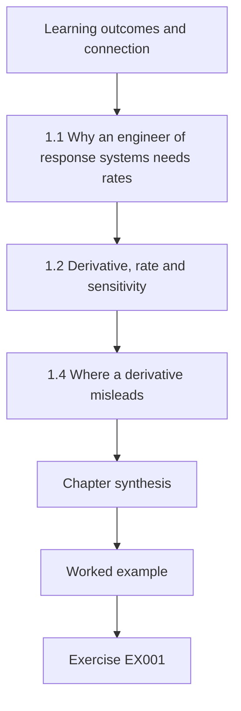

### Logical drawing

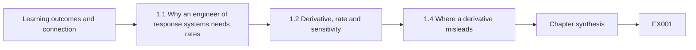

```text
[Learning outcomes and connection]
    |
    v
[1.1 Why an engineer of response systems needs rates]
    |
    v
[1.2 Derivative, rate and sensitivity]
    |
    v
[1.4 Where a derivative misleads]
    |
    v
[Chapter synthesis]
    |
    v
[Worked example] --> [Exercise EX001]
```
<!-- cykin:lesson-figures:end ch-01 -->


### Learning outcomes and connection

After this chapter you can (1) describe an incident queue as functions of time with explicit units; (2) use the derivative of the backlog to tell whether a response service is gaining or losing ground; (3) compute the sensitivity of a recovery estimate to its inputs; and (4) say where a smooth derivative misrepresents a queue of discrete cases. It prepares Chapter 6 (accumulation), Chapter 32 (reliability) and Chapter 36 (pipeline capacity).

### 1.1 Why an engineer of response systems needs rates

A response service is a machine that turns arriving work — alerts, reports, cases — into decisions. Whether it keeps up is a question about *rates*. Let $\lambda(t)$ be the arrival rate in cases per hour and $\mu$ the rate at which the team can close cases. If $Q(t)$ is the backlog, then, treated as a continuous quantity,

$$\frac{dQ}{dt} = \lambda(t) - \mu \quad \text{while } Q > 0,$$

and $dQ/dt = \max(0, \lambda - \mu)$ when the queue is empty. The sign of the derivative is the most important operational fact: positive means the backlog grows no matter how hard people work at the current capacity. Units keep you honest: $\lambda$ and $\mu$ are cases/hour, so $dQ/dt$ is cases/hour and $Q$ is cases. A design document that mixes "alerts per day" with "analyst hours" without a conversion is already wrong.

### 1.2 Derivative, rate and sensitivity

The derivative $f'(t)$ is the instantaneous rate of change; on a sampled series you estimate it with a difference quotient $(f(t+h)-f(t))/h$. A *sensitivity* is a derivative with respect to a parameter instead of time. If the time to drain a backlog $Q_0$ at net rate $\mu - \lambda$ is $T = Q_0/(\mu - \lambda)$, then

$$\frac{\partial T}{\partial \mu} = -\frac{Q_0}{(\mu-\lambda)^2}.$$

The square in the denominator is the engineering message: when capacity is only slightly above demand, a small loss of capacity — one analyst off sick — multiplies recovery time. Queueing theory reaches the same conclusion for waiting times as utilisation approaches one; [Little (1961)](https://doi.org/10.1287/opre.9.3.383) gives the identity $L = \lambda W$ relating average number in system, arrival rate and time in system that we use in Chapter 36.

### 1.3 Worked example (synthetic): an outage surge at Harrow Valley Shared Services

Harrow Valley Shared Services (HVSS) is a **synthetic** public-service organisation used throughout this book. Its response desk closes $\mu = 12$ cases/h. Normal arrivals follow a daily cycle, $8 + 3\sin(2\pi t/24)$ cases/h. A service outage from $t = 2$ h to $t = 6$ h adds 14 cases/h of user reports and alerts. Lab 1 integrates the backlog in steps of 0.1 h.

```python
"""Lab 1 (synthetic): incident-queue backlog during an outage. Euler integration, step 0.1 h."""
import math
MU = 12.0                      # analyst capacity, cases/hour (synthetic)
def lam(t):                    # arrival rate, cases/hour; outage surge 2 h..6 h
    base = 8 + 3 * math.sin(2 * math.pi * t / 24)
    return base + (14 if 2 <= t < 6 else 0)
dt, q, t, peak, peak_t, wait_area = 0.1, 0.0, 0.0, 0.0, 0.0, 0.0
rows = []
while t < 12 - 1e-9:
    dq = lam(t) - MU
    q = max(0.0, q + dq * dt)
    wait_area += q * dt
    t = round(t + dt, 10)
    if q > peak: peak, peak_t = q, t
    if abs(t - round(t)) < 1e-9 and int(round(t)) % 2 == 0:
        rows.append((int(round(t)), lam(t - dt), q))
for h, l, b in rows:
    print(f"t={h:2d}h  lambda={l:5.2f}/h  backlog={b:6.2f}")
print(f"peak backlog {peak:.2f} cases at t={peak_t:.1f}h")
print(f"case-hours waiting (area under backlog) {wait_area:.1f}")
print(f"derivative of backlog at t=3h: {lam(3)-MU:.2f} cases/h")
```

Expected output:

```text
t= 2h  lambda= 9.43/h  backlog=  0.00
t= 4h  lambda=24.56/h  backlog= 24.14
t= 6h  lambda=25.00/h  backlog= 49.85
t= 8h  lambda=10.64/h  backlog= 47.60
t=10h  lambda= 9.57/h  backlog= 43.85
t=12h  lambda= 8.08/h  backlog= 37.46
peak backlog 49.85 cases at t=6.0h
case-hours waiting (area under backlog) 370.7
derivative of backlog at t=3h: 12.12 cases/h
```

Read it as an engineer. At $t = 3$ h the backlog grows at about 12 cases per hour: during the surge, every hour adds roughly an hour of work. After the surge ends at 6 h, arrivals fall but stay near 9–11 cases/h, so the net drain rate is only 1–4 cases/h; twelve hours after the outage began, 37 cases are still waiting. The 371 case-hours of waiting is the accumulated delay that Chapter 6 teaches you to compute by integration.

### 1.4 Where a derivative misleads

Cases are discrete, arrive in bursts and are not interchangeable: one ransomware case may consume more effort than forty phishing reports. The continuous model also ignores that people triage, merge duplicates and defer low-severity work — so the model overstates the backlog of *important* work and understates the backlog of trivial work. A difference quotient on noisy hourly counts amplifies noise; smooth before you differentiate, and report the window used. Finally, $\mu$ is not constant: fatigue, handovers and context switching reduce it exactly when the surge is worst.

### 1.5 Common errors and limits

- Mixing units (per day vs per hour) in the same equation.
- Treating capacity as fixed during a long incident.
- Reporting a single "time to clear" without its sensitivity to capacity.
- Differentiating raw counts without smoothing or stating the step size.

Each error shows up in the HVSS surge of Lab 1. A planner who reads 12 cases/h as 288 per day and compares it with an hourly outage peak of 25 arrivals will mistake a twelve-hour backlog for a momentary blip. The 37 cases still waiting at t = 12 h assume that all twelve hours of capacity were delivered, which tired analysts on a long shift rarely achieve. Quote that figure with its sensitivity to capacity, and state the 0.1 h step the lab used.

### Exercises — chapter 01

**EX001 — Drain time sensitivity.** *Objective:* quantify how fragile a recovery estimate is. *Inputs:* backlog $Q_0 = 50$ cases, arrivals $\lambda = 10$ cases/h, capacity $\mu = 12$ cases/h. *Steps:* compute $T$; compute $\partial T/\partial \mu$; estimate $T$ if one of six analysts is lost (capacity falls proportionally). *Expected evidence:* three numbers with units and one sentence of interpretation. *Rubric:* 3 = all correct with interpretation; 2 = one error; 1 = formula only; 0 = none.

**EX002 — Reading Lab 1.** *Objective:* connect the model to a staffing decision. *Inputs:* Lab 1. *Steps:* change the outage surge to 7 h duration (2–9 h) in the code and record the peak backlog and its time; state one reason the real peak would differ. *Expected evidence:* modified line, two numbers, one limitation. *Rubric:* 3 = correct run and a substantive limitation; 2 = run only; 1 = attempt; 0 = none.

### Chapter synthesis

The backlog derivative $\lambda - \mu$ tells you whether a response service is winning. Sensitivities show how close-to-capacity operation turns small losses into long delays. Use the continuous model to reason, then check its assumptions against the discrete, bursty and uneven reality of cases.

<!-- cykin:chapter-navigation:start ch-01 -->
### Continue studying — chapter 01 of 50

[← Course home](../../README.md) · [Course chapter index](../SUBJECTS.md) · [Chapter 02 →](#ch-02)

Continue to the next authored lesson.
<!-- cykin:chapter-navigation:end -->

<a id="ch-02"></a>

## Chapter 02 — Discrete mathematics

<!-- cykin:lesson-figures:start ch-02 -->
### Lesson map

Lesson 02 published. Map, example, EX003.

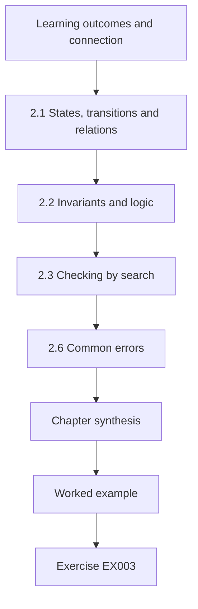

### Logical drawing

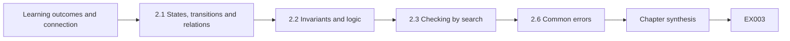

```text
[Learning outcomes and connection]
    |
    v
[2.1 States, transitions and relations]
    |
    v
[2.2 Invariants and logic]
    |
    v
[2.3 Checking by search]
    |
    v
[2.6 Common errors]
    |
    v
[Chapter synthesis]
    |
    v
[Worked example] --> [Exercise EX003]
```
<!-- cykin:lesson-figures:end ch-02 -->


### Learning outcomes and connection

After this chapter you can (1) represent case states and permitted actions as a directed graph and a relation; (2) write invariants in propositional and first-order logic; (3) search a transition graph for paths that violate an invariant; and (4) express separation of duties as a set constraint. It prepares Chapter 25 (intake and authorisation design) and Chapter 31 (workflow orchestration).

### 2.1 States, transitions and relations

A response workflow has a finite set of states $S$ — for example *new, triage, contain_req, approved, contained, recover, closed* — and a transition relation $T \subseteq S \times S$. Each transition may be labelled with the roles allowed to perform it: a function $\rho : T \to 2^R$ where $R$ is the set of roles. This is a labelled directed graph. Questions an engineer must answer are graph questions: is *closed* reachable from every state (no dead ends)? Can *contained* be reached without passing *approved*? Is any state reachable that should not be?

### 2.2 Invariants and logic

An **invariant** is a property that must hold in every reachable state or on every path. "No containment without approval" is a path property: for every path $s_0 \ldots s_k$ with $s_k = \textit{contained}$, there is $i < k$ with $s_i = \textit{approved}$. Separation of duties is a set property: the roles that may request containment and the roles that may approve it must be disjoint, $\rho(\textit{triage},\textit{contain\_req}) \cap \rho(\textit{contain\_req},\textit{approved}) = \emptyset$. Writing these down precisely is the first defence against the most common workflow defect: an edge added "for convenience" that bypasses a gate. The classic principles of [Saltzer and Schroeder (1975)](https://doi.org/10.1109/PROC.1975.9939) — complete mediation, separation of privilege, least privilege — become checkable statements once the workflow is a graph.

### 2.3 Checking by search

To test the path invariant, delete the *approved* node and ask whether *contained* is still reachable from *new*. Breadth-first search answers in time linear in the number of edges. If it is reachable, every edge into *contained* from a state other than *approved* is a candidate violation.

On the HVSS graph from Lab 2, deleting *approved* still leaves the path new → triage → contain_req → contained, so the search reports it and points at the convenience edge. The same search, run after every change to the transition table, turns a review comment into a repeatable check that a build can fail on.

### 2.4 Worked example (synthetic): an approval graph at HVSS

HVSS's draft workflow has eight edges. A developer added *contain_req → contained* so that engineers could "act immediately in emergencies".

```python
"""Lab 2 (synthetic): case-state transition relation and role authorisation invariant."""
from collections import deque
T = {  # (from, to): roles allowed
 ("new","triage"):{"intake","analyst"}, ("triage","contain_req"):{"analyst"},
 ("contain_req","approved"):{"duty_manager"}, ("approved","contained"):{"engineer"},
 ("contained","recover"):{"engineer"}, ("recover","closed"):{"duty_manager"},
 ("triage","closed"):{"analyst"}, ("contain_req","contained"):{"engineer"},  # suspicious edge
}
def reachable(src, avoid):
    seen, dq = {src}, deque([(src,[src])]); paths=[]
    while dq:
        s,p = dq.popleft()
        if s=="contained": paths.append(p)
        for (a,b) in T:
            if a==s and b not in seen and b not in avoid:
                seen.add(b); dq.append((b,p+[b]))
    return paths
print("edges:", len(T))
bad = reachable("new", avoid={"approved"})
print("paths to 'contained' that skip 'approved':", bad)
for (a,b),r in sorted(T.items()):
    if b=="contained" and a!="approved": print("violating edge:", a,"->",b,"roles",sorted(r))
# separation of duties: who requests may not approve
print("SoD holds:", not (T[("triage","contain_req")] & T[("contain_req","approved")]))
```

Expected output:

```text
edges: 8
paths to 'contained' that skip 'approved': [['new', 'triage', 'contain_req', 'contained']]
violating edge: contain_req -> contained roles ['engineer']
SoD holds: True
```

The search finds the bypass path and names the edge. Separation of duties holds — analysts request, duty managers approve — but that is irrelevant if the approval state can be skipped. The engineering response is not to delete emergency action but to model it explicitly: an *emergency_contain* state with its own role set, a mandatory retrospective approval within a stated time and an audit event, so the invariant becomes "every containment is preceded by approval *or* followed by retrospective review within 60 minutes" and can still be checked.

### 2.5 Limits

Graph models check structure, not people's behaviour: a duty manager who approves everything satisfies the invariant. State explosion appears when states carry data (tenant, severity); then you check properties over a model abstraction and test the implementation separately (Chapter 30).

Removing the *approved* node also tells you nothing about how long a request waited there, or whether the approver read the evidence before saying yes. Those properties need timestamps and audit records from the running platform, which Chapter 30 tests against the implementation rather than against the abstract graph of eight edges.

### 2.6 Common errors

- Writing invariants in prose that cannot be checked.
- Checking only the "happy path".
- Treating role names as people: one person holding two roles defeats separation of duties.

At HVSS the third error is a staffing question rather than a modelling one. If the night duty manager also covers analyst shifts, the disjoint role sets in Lab 2 still print `SoD holds: True`, yet one person can both request and approve the same containment. The check has to run over the assignment of people to roles for each shift, not only over the role labels on the edges. Equally, a test suite that walks only new → triage → contain_req → approved → contained would never have exercised the bypass edge that the breadth-first search found.

### Exercises — chapter 02

**EX003 — Formalise.** *Objective:* write precise invariants. *Inputs:* the eight edges of Lab 2. *Steps:* write in logic (a) no dead-end states except *closed*; (b) every path to *closed* that passes *contained* also passes *recover*; check (b) against the edge list. *Expected evidence:* two formulas and a verdict with a counterexample if false. *Rubric:* 3 = correct formulas and verdict; 2 = minor notation errors; 1 = prose only; 0 = none.

**EX004 — Repair.** *Objective:* restore the gate without losing emergency capability. *Inputs:* Lab 2. *Steps:* modify the transition table to add *emergency_contain*; extend the code to check the revised invariant; run it. *Expected evidence:* changed table, check code, output. *Rubric:* 3 = invariant checked and passing with emergency path present; 2 = model correct, check incomplete; 1 = edge simply deleted; 0 = none.

### Chapter synthesis

A workflow is a labelled graph; authorisation rules are invariants over its paths and labels. State them in logic, check them by search and treat every convenience edge as a hypothesis of failure until the check passes.

<!-- cykin:chapter-navigation:start ch-02 -->
### Continue studying — chapter 02 of 50

[← Chapter 01](#ch-01) · [Course chapter index](../SUBJECTS.md) · [Chapter 03 →](#ch-03)

Continue to the next authored lesson.
<!-- cykin:chapter-navigation:end -->

<a id="ch-03"></a>

## Chapter 03 — Physics for computing

<!-- cykin:lesson-figures:start ch-03 -->
### Lesson map

Lesson 03 published. Map, example, EX006.

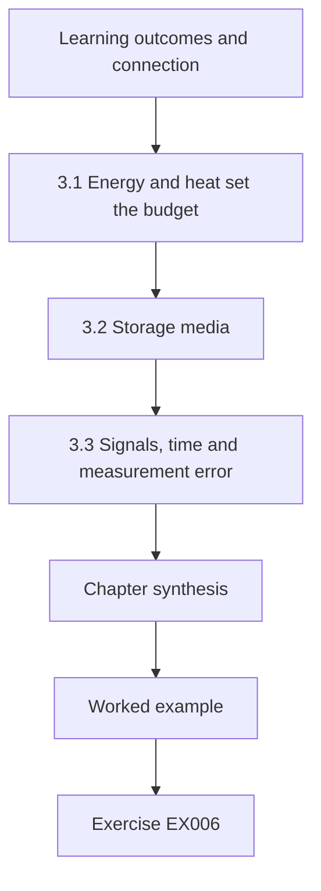

### Logical drawing

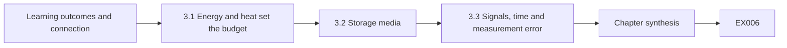

```text
[Learning outcomes and connection]
    |
    v
[3.1 Energy and heat set the budget]
    |
    v
[3.2 Storage media]
    |
    v
[3.3 Signals, time and measurement error]
    |
    v
[Chapter synthesis]
    |
    v
[Worked example] --> [Exercise EX006]
```
<!-- cykin:lesson-figures:end ch-03 -->


### Learning outcomes and connection

After this chapter you can (1) relate power, heat and throttling to lost telemetry; (2) explain how storage media fail and why that matters for evidence; (3) reason about clock drift and signal timing as measurement error; and (4) turn a physical failure chain into measurable checks. It prepares Chapter 8 (architecture), Chapter 11 (time sources) and Chapter 32 (reliability).

### 3.1 Energy and heat set the budget

Every sensor, collector and log forwarder converts electrical energy into computation and heat. Dynamic power in CMOS logic scales roughly with $C V^2 f$ (switched capacitance, voltage squared, clock frequency). When a device cannot shed heat, firmware lowers voltage and frequency — **thermal throttling** — and work that assumed full speed now misses deadlines. For a log forwarder, the symptom is not a crash but a growing internal buffer, then silent drops when the buffer is full. A response engineer must therefore treat "no events received" as ambiguous: quiet host, broken network, or a device too hot to keep up.

### 3.2 Storage media

Evidence lives on physical media. Flash memory wears with program/erase cycles and uses wear levelling and garbage collection, so a deleted block may persist or vanish independently of the file system; magnetic disks fail mechanically and develop bad sectors. [NIST SP 800-86](https://csrc.nist.gov/pubs/sp/800/86/final) (2006) describes collection from storage media; its device details need re-verification against current hardware, but its central point stands: acquisition must be planned around how the medium behaves. Power loss during a write can leave partially written records — a reason for write-ahead logs and checksums (Chapter 13). Research on DRAM disturbance by [Kim et al. (2014)](https://doi.org/10.1109/ISCA.2014.6853210) showed that even memory cells can be flipped by access patterns: integrity cannot be assumed from the physics alone.

### 3.3 Signals, time and measurement error

Clocks are oscillators with drift measured in parts per million (ppm). A crystal at 50 ppm drifts up to $50 \times 10^{-6} \times 86{,}400 \approx 4.3$ s per day if left unsynchronised. Correlating events across hosts with second-level resolution therefore requires synchronisation (NTP, [RFC 5905](https://www.rfc-editor.org/rfc/rfc5905)) and recording of offset when known. Every timestamp is a measurement with an error bar; a timeline that ignores it can invert cause and effect. Over the three unsynchronised days of EX006, a 40 ppm offset already exceeds ten seconds, larger than many gaps between logon and file activity.

### 3.4 Worked example (synthetic): the edge collector that went quiet

An HVSS branch office collector (a fan-less box in a cupboard, **synthetic**) normally forwards 40 events/s. On hot afternoons the CPU throttles from 1.8 GHz to 0.9 GHz; parsing capacity falls from 60 to 30 events/s; its 64 MB buffer at ~1 kB/event holds about 65,000 events, which at a deficit of 10 events/s lasts about 1.8 hours. Then events are dropped without an alarm. The physical failure chain is: ambient heat → throttling → capacity below arrival rate → buffer exhaustion → silent loss → analysts see a "quiet" host during the period that matters. Measurable checks: CPU temperature and frequency exported as telemetry; forwarder queue depth and drop counters; a heartbeat event every minute with sequence numbers so gaps are detectable at the receiver; clock offset reported with each batch.

### 3.5 Errors and limits

- Treating absence of events as evidence of absence of activity.
- Assuming timestamps from different hosts are directly comparable.
- Ignoring media behaviour when planning acquisition.
- Physical models give orders of magnitude; measure the actual device.

The edge collector in the worked example shows the first two errors together. After about 1.8 hours of throttled operation its buffer fills, and the receiver sees a quiet branch office exactly when events are being dropped. Without the heartbeat sequence numbers, that silence would be read as a calm afternoon. If its clock has also drifted, any events that do arrive cannot be placed against the central timeline without the reported offset.

### Exercises — chapter 03

**EX005 — Buffer budget.** *Objective:* compute time to silent loss. *Inputs:* arrival 40 events/s, throttled capacity 30 events/s, buffer 64 MiB, mean event 1,024 bytes. *Steps:* compute buffer capacity in events and time to exhaustion; recompute if a filter discards 30% of events before buffering. *Expected evidence:* two times with working. *Rubric:* 3 = both correct; 2 = one; 1 = method; 0 = none.

**EX006 — Clock error in a timeline.** *Objective:* reason about timestamp uncertainty. *Inputs:* host A unsynchronised for 3 days at up to +40 ppm; host B synchronised (±10 ms). A logon on A is stamped 10:00:05; a file copy on B stamped 10:00:00. *Steps:* bound A's error; decide whether the order "logon then copy" can be excluded. *Expected evidence:* bound and verdict. *Rubric:* 3 = correct bound (±10.4 s) and verdict that order is undetermined; 2 = bound only; 1 = attempt; 0 = none.

### Chapter synthesis

Physics limits what monitoring can see: heat throttles, media wear and clocks drift. Design for detectable gaps (sequence numbers, heartbeats, drop counters, clock offsets) so that silence and timing can be interpreted rather than trusted.

<!-- cykin:chapter-navigation:start ch-03 -->
### Continue studying — chapter 03 of 50

[← Chapter 02](#ch-02) · [Course chapter index](../SUBJECTS.md) · [Chapter 04 →](#ch-04)

Continue to the next authored lesson.
<!-- cykin:chapter-navigation:end -->

<a id="ch-04"></a>

## Chapter 04 — Programming I

<!-- cykin:lesson-figures:start ch-04 -->
### Lesson map

Lesson 04 published. Map, example, EX007.

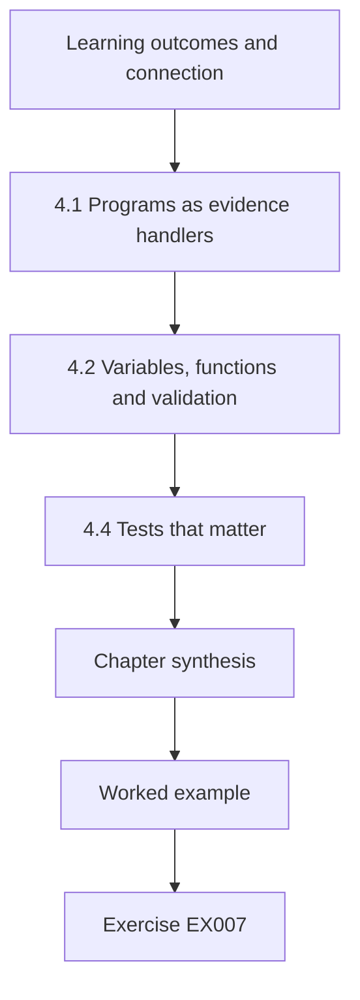

### Logical drawing

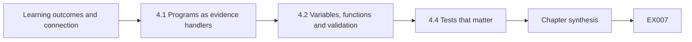

```text
[Learning outcomes and connection]
    |
    v
[4.1 Programs as evidence handlers]
    |
    v
[4.2 Variables, functions and validation]
    |
    v
[4.4 Tests that matter]
    |
    v
[Chapter synthesis]
    |
    v
[Worked example] --> [Exercise EX007]
```
<!-- cykin:lesson-figures:end ch-04 -->


### Learning outcomes and connection

After this chapter you can (1) write a small, deterministic program that reads synthetic case records; (2) validate inputs with explicit rules; (3) preserve every rejected record with its reasons instead of discarding it; and (4) test conservation — nothing enters without leaving through a known door. It prepares Chapter 9 (robust modules), Chapter 24 (evidence pipelines) and Chapter 30 (invariants).

### 4.1 Programs as evidence handlers

In incident response, a script is not just a convenience; it touches material that may later support a decision or a legal claim. Three habits follow. **Determinism**: the same input yields the same output, so others can reproduce it. **Transparency**: the program records what it did, including what it refused. **Preservation**: the original input is never modified; its hash is recorded before processing so later readers can verify they hold the same bytes ([FIPS 180-4](https://csrc.nist.gov/pubs/fips/180-4/upd1/final) specifies SHA-256).

### 4.2 Variables, functions and validation

Keep parsing, validation and output in separate functions. A validation function takes one record and returns a list of named errors; an empty list means valid. Names matter: "severity" is a better error than "bad row". Validate type (is it a timestamp?), range (severity 1–4), presence (reporter required) and uniqueness (no duplicate key). Use a standard parser for CSV — hand-splitting on commas breaks on quoted fields, which is exactly how many real intake tools corrupt data. In Lab 4 the `validate` function returns the names `timestamp`, `severity` and `reporter`, which a reviewer can count and sort later.

### 4.3 Worked example (synthetic): HVSS case intake

Lab 4 parses six records exported from a **synthetic** intake form. Four are flawed in different ways.

```python
"""Lab 4 (synthetic): validating intake parser that quarantines, never discards."""
import csv, io, hashlib, json
RAW = """case_id,reported_at,severity,reporter,summary
C-1001,2026-03-02T08:14:00Z,3,ops@hvss.example,Login failures spike
C-1002,2026-03-02T08:20:00Z,7,ops@hvss.example,Severity out of range
C-1003,not-a-date,2,desk@hvss.example,Bad timestamp
C-1001,2026-03-02T08:14:00Z,3,ops@hvss.example,Login failures spike
C-1004,2026-03-02T09:02:00Z,2,,Missing reporter
C-1005,2026-03-02T09:30:00Z,4,soc@hvss.example,"Phish, with comma"
"""
from datetime import datetime
def validate(r):
    errs=[]
    try: datetime.strptime(r["reported_at"],"%Y-%m-%dT%H:%M:%SZ")
    except ValueError: errs.append("timestamp")
    if r["severity"] not in {"1","2","3","4"}: errs.append("severity")
    if not r["reporter"]: errs.append("reporter")
    return errs
digest = hashlib.sha256(RAW.encode()).hexdigest()
accepted, quarantine, seen = [], [], set()
for n, r in enumerate(csv.DictReader(io.StringIO(RAW)), start=2):
    key = (r["case_id"], r["reported_at"])
    e = validate(r) + (["duplicate"] if key in seen else [])
    seen.add(key)
    (quarantine if e else accepted).append({"line": n, "errors": e, **r})
print("raw sha256", digest[:16])
print("accepted", [a["case_id"] for a in accepted])
for q in quarantine: print("quarantined line", q["line"], q["case_id"], q["errors"])
print("conservation:", len(accepted)+len(quarantine), "==", RAW.count("\n")-1)
```

Expected output:

```text
raw sha256 954554b24a46d4a7
accepted ['C-1001', 'C-1005']
quarantined line 3 C-1002 ['severity']
quarantined line 4 C-1003 ['timestamp']
quarantined line 5 C-1001 ['duplicate']
quarantined line 6 C-1004 ['reporter']
conservation: 6 == 6
```

Observe: the duplicate is detected by a composite key (case ID plus timestamp), the comma inside a quoted summary survives, every quarantined record keeps its line number and reasons, and a conservation check proves that accepted plus quarantined equals input lines. A reviewer can open the quarantine and decide; the program never silently decided for them. Note that line numbers start at 2 because line 1 of the export is the header row.

### 4.4 Tests that matter

Write tests for each rule and for the conservation property, plus one for idempotence — running the program twice on the same input gives the same output. Test the boundary values (severity 0, 1, 4, 5) and the empty file. A test that only checks the happy path tells you nothing about the failures that occur during incidents, when inputs are at their worst.

For Lab 4 the boundary tests are concrete: severities 0 and 5 must be quarantined with the reason `severity`, while 1 and 4 must be accepted. An empty export with only the header row should produce no accepted records and a conservation line of 0 == 0. Running the parser twice must print the same digest prefix 954554b24a46d4a7 and the same quarantine list.

### 4.5 Errors and limits

- `except: pass` or equivalent silent swallowing of errors.
- Dropping invalid rows rather than quarantining them.
- Editing the original file in place.
- Validation rules hard-coded without a version, so later readers cannot know which rules applied.

Each of these errors would break something visible in Lab 4. Swallowing the `ValueError` from `strptime` would let C-1003 through with the text not-a-date as its report time. Dropping instead of quarantining would make the conservation line print 2 == 6. Editing the export in place would change the SHA-256 digest that later readers rely on to confirm they hold the original bytes.

### Exercises — chapter 04

**EX007 — Extend validation.** *Objective:* add a rule without breaking conservation. *Inputs:* Lab 4. *Steps:* add a rule that `reporter` must end in `.example` (synthetic domain); add a seventh record that violates it; rerun and show conservation. *Expected evidence:* code diff and output. *Rubric:* 3 = rule works, conservation holds, new reason named; 2 = rule works without evidence; 1 = attempt; 0 = none.

**EX008 — Duplicate semantics.** *Objective:* reason about keys. *Inputs:* Lab 4. *Steps:* explain what happens if two different reporters submit the same case ID at the same second with different summaries; propose and justify a better duplicate rule. *Expected evidence:* explanation and rule. *Rubric:* 3 = identifies that the second is quarantined as a duplicate though it carries new information, and proposes content-aware handling (hash of the full row, or same-key-different-content flagged as conflict); 2 = partial; 1 = vague; 0 = none.

### Chapter synthesis

Write response programs that are deterministic, transparent and preserving: hash the input, validate with named rules, quarantine instead of discard and test conservation. These small habits scale into the evidence pipelines of later chapters.

<!-- cykin:chapter-navigation:start ch-04 -->
### Continue studying — chapter 04 of 50

[← Chapter 03](#ch-03) · [Course chapter index](../SUBJECTS.md) · [Chapter 05 →](#ch-05)

Continue to the next authored lesson.
<!-- cykin:chapter-navigation:end -->

<a id="ch-05"></a>

## Chapter 05 — Engineering communication

<!-- cykin:lesson-figures:start ch-05 -->
### Lesson map

Lesson 05 published. Map, example, EX009.

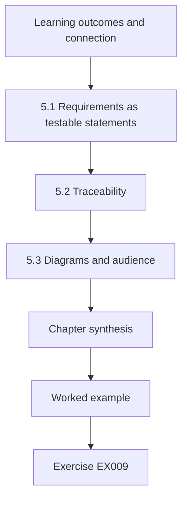

### Logical drawing

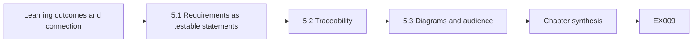

```text
[Learning outcomes and connection]
    |
    v
[5.1 Requirements as testable statements]
    |
    v
[5.2 Traceability]
    |
    v
[5.3 Diagrams and audience]
    |
    v
[Chapter synthesis]
    |
    v
[Worked example] --> [Exercise EX009]
```
<!-- cykin:lesson-figures:end ch-05 -->


### Learning outcomes and connection

After this chapter you can (1) rewrite vague claims as testable requirement statements; (2) maintain a traceability table from need to test; (3) draw a context diagram that names owners and trust boundaries; and (4) write risk notes that state assumptions and residual risk for the right audience. It prepares Chapters 16, 21 and 48.

### 5.1 Requirements as testable statements

A good requirement is **necessary, unambiguous, verifiable and owned**. "The platform will enable rapid response" fails all four. "When an analyst submits a containment request for a single user account, the platform shall present it to an approver within 60 seconds in 99% of requests measured over 30 days" is verifiable. Use "shall" for requirements, "should" for goals and name the verification method: test, analysis, inspection or demonstration. The [NASA Systems Engineering Handbook](https://www.nasa.gov/reference/systems-engineering-handbook/) gives a widely used treatment of requirement quality and verification methods.

### 5.2 Traceability

A trace table links each stakeholder need to requirements, design elements, tests and results. Its value appears during change: when the approval chain changes, you know which tests to rerun. A requirement without a test is a hope; a test without a requirement is either missing a requirement or wasted effort.

In the HVSS brief, a trace row for R3 would link the emergency-containment need to the *emergency_contain* state of Chapter 2, a test that confirms retrospective approval within 60 minutes, and the latest test result. When the response manager changes that window, the row shows which test must be rerun.

### 5.3 Diagrams and audience

A context diagram shows the system as one box, its external actors and data flows, and the trust boundaries crossed. Name owners on every external element. Write for the reader: a service owner needs consequences and decisions; an engineer needs interfaces and limits; an auditor needs evidence and accountability. One document can serve all three only if it is layered: a one-page summary, then detail. For HVSS the context diagram would show the identity provider, endpoint agent and client tenants as external actors, each with a named owner.

### 5.4 Worked example (synthetic): rewriting an HVSS design brief

The **synthetic** brief says: "The new response platform will automatically detect and stop attacks quickly, keep all evidence and integrate with everything. Security will own it." Problems: "automatically stop" conflicts with delegated authority (Chapter 10); "quickly" is unmeasured; "all evidence" is unbounded and conflicts with privacy minimisation; "everything" names no interfaces; "Security" is a department, not an accountable person. Rewrite (extract):

| ID | Requirement | Verification | Owner |
|---|---|---|---|
| R1 | Alerts from the identity provider and endpoint agent shall appear in the case queue within 5 min of event time for 99% of events. | Test with seeded events | Platform lead (named) |
| R2 | No containment action shall execute without a recorded approval by a role other than the requester, except the emergency path defined in R3. | Test + inspection | Response manager |
| R3 | Emergency containment shall be limited to one account or host and require retrospective approval within 60 min. | Test | Response manager |
| R4 | Raw events supporting a case shall be retained unaltered for 400 days with a verifiable hash manifest. | Test + analysis | Records officer |

Unresolved assumptions recorded as risk notes: the cloud provider's log delivery delay is unknown; retention conflicts with the privacy officer's 180-day default and needs a decision.

### 5.5 Errors and limits

- Unmeasurable adjectives (fast, robust, seamless).
- Requirements that prescribe a product instead of a property.
- Owners named as teams.
- Assumptions hidden in prose rather than listed.

The original HVSS brief in the worked example commits all four of these errors. "Quickly" and "stop attacks" are unmeasurable adjectives, "integrate with everything" names no interface, "Security will own it" names a department, and the 180-day privacy default against 400-day retention was hidden until the rewrite exposed it. Each rewritten requirement in the table answers one of those defects with a number, an interface, an owner or a recorded risk note.

### Exercises — chapter 05

**EX009 — Rewrite.** *Objective:* produce testable requirements. *Inputs:* "Recovery must be fast and reliable, and the platform must always be available during incidents." *Steps:* write three requirements with verification method and owner role; list two assumptions. *Expected evidence:* table and list. *Rubric:* 3 = measurable, owned, verifiable, assumptions explicit; 2 = one weak item; 1 = still vague; 0 = none.

**EX010 — Trace gap.** *Objective:* find gaps. *Inputs:* the R1–R4 table. *Steps:* add a "test ID" and "result" column with plausible synthetic entries and identify one requirement that cannot be verified by test alone and why. *Expected evidence:* table and explanation. *Rubric:* 3 = identifies R4 (400-day retention needs analysis/inspection of configuration and periodic sampled verification, not a single test) or an equally well-argued case; 2 = partial; 1 = attempt; 0 = none.

### Chapter synthesis

Engineering communication turns aspiration into commitments that can be checked. Write testable, owned requirements; trace them to tests; layer documents for their readers; and put assumptions in the open where they can be challenged.

<!-- cykin:chapter-navigation:start ch-05 -->
### Continue studying — chapter 05 of 50

[← Chapter 04](#ch-04) · [Course chapter index](../SUBJECTS.md) · [Chapter 06 →](#ch-06)

Continue to the next authored lesson.
<!-- cykin:chapter-navigation:end -->

<a id="ch-06"></a>

## Chapter 06 — Calculus II

<!-- cykin:lesson-figures:start ch-06 -->
### Lesson map

Lesson 06 published. Map, example, EX011.

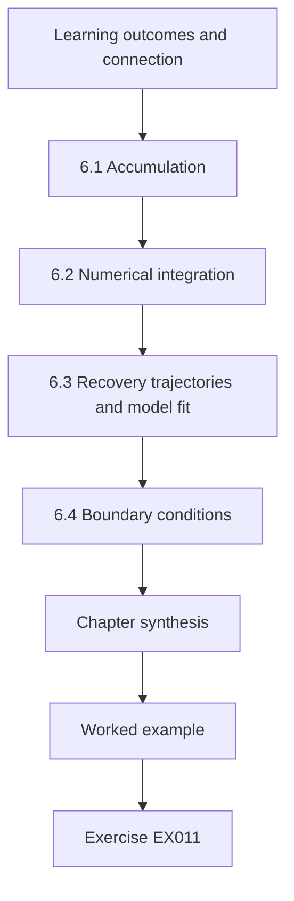

### Logical drawing

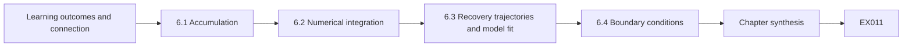

```text
[Learning outcomes and connection]
    |
    v
[6.1 Accumulation]
    |
    v
[6.2 Numerical integration]
    |
    v
[6.3 Recovery trajectories and model fit]
    |
    v
[6.4 Boundary conditions]
    |
    v
[Chapter synthesis]
    |
    v
[Worked example] --> [Exercise EX011]
```
<!-- cykin:lesson-figures:end ch-06 -->


### Learning outcomes and connection

After this chapter you can (1) compute accumulated backlog and accumulated waiting as integrals; (2) fit a simple recovery model to observations and judge the fit; (3) state boundary conditions that make a model valid; and (4) explain how integral-based measures change capacity decisions. It builds on Chapter 1 and prepares Chapters 29, 32 and 36.

### 6.1 Accumulation

If $\lambda(t)$ and $\mu(t)$ are arrival and service rates, the backlog is the accumulated difference,

$$Q(t) = Q(0) + \int_0^t \big(\lambda(s) - \mu(s)\big)\,ds,$$

clipped at zero. A second integral matters more for people affected by an incident: the **accumulated waiting** $W = \int_0^T Q(t)\,dt$, measured in case-hours. Two plans that clear the backlog at the same moment can differ greatly in $W$; the one that clears high-severity work first can have similar $W$ but very different harm. That is why "time to clear" alone is a poor objective.

### 6.2 Numerical integration

Real rates are samples, not formulas. The trapezoidal rule approximates $\int f$ by summing $(f_i + f_{i+1})h/2$; Euler's method, used in Lab 1, updates $Q \leftarrow Q + (\lambda - \mu)h$. Halving the step and comparing results is a simple convergence check: if the answer changes in the second significant digit, the step is too large. Lab 1 reports $W \approx 371$ case-hours for the 12 hours after the outage starts (Chapter 1). For Lab 1 the check means rerunning with a step of 0.05 h and confirming that the 371 case-hours change only in the third digit.

### 6.3 Recovery trajectories and model fit

Service recovery often looks like exponential approach to normal: performance $P(t) = P_\infty - (P_\infty - P_0)e^{-t/\tau}$, where $\tau$ is the time constant — after $\tau$, about 63% of the gap is closed. Fitting $\tau$ to observations by taking logs of the remaining gap turns the problem into linear regression. The fit is only a description: check residuals; if recovery happens in steps (a database comes back, then the portal), a smooth exponential hides the structure that matters for planning, and a piecewise model by dependency (Chapter 13) is better. The area between full performance and $P(t)$ is the resilience-loss measure proposed by [Bruneau et al. (2003)](https://doi.org/10.1193/1.1623497); for an exponential recovery it equals $(P_\infty - P_0)\tau$.

### 6.4 Boundary conditions

A model is valid inside stated conditions: initial backlog, staffing, arrival pattern and the assumption that work is not lost or merged. State them. "The backlog clears in 20 h *assuming* constant staffing of six, arrivals following last month's daily profile and no second incident" is a defensible statement; "the backlog clears in 20 h" is not.

The Lab 1 backlog figures carry their own conditions: a constant capacity of 12 cases/h, the sinusoidal daily profile, one outage between hours 2 and 6, and no merging of duplicate reports. Once any of these changes, such as a second outage or merged reports, the 37 cases waiting at hour 12 must be recomputed.

### 6.5 Worked example (synthetic): staffing a surge

HVSS considers adding two analysts (capacity 12 → 16 cases/h) from hour 4 to hour 10 of the Chapter 1 outage. Modify Lab 1 so `MU` is a function of time. Running the modified model gives a peak of 41.9 cases (down from 49.9) and $W \approx 250$ case-hours (down from 371). The peak falls only modestly because the extra staff arrive two hours into the surge; much of the reduction in $W$ comes from the faster drain between hours 6 and 10, when the base team alone would remove only 1–4 cases per hour. A cheaper design might defer low-severity cases during the surge and concentrate surge staff on the drain phase, where each added case/hour of capacity removes waiting that would otherwise persist for many hours.

### 6.6 Errors and limits

- Optimising time-to-clear while ignoring accumulated waiting and severity.
- Using a step size so large that the integral is wrong.
- Fitting smooth curves to step-wise recoveries.
- Forgetting the zero floor on backlog.

The surge-staffing example shows why the first error matters at HVSS. Measured by peak alone, two extra analysts look weak, cutting 49.9 cases to 41.9. Measured by accumulated waiting, they remove about 121 case-hours, and most of that saving comes during the drain phase between hours 6 and 10. Rerunning the modified model without the `max(0.0, ...)` clip would show the last error, since the backlog would go negative whenever arrivals fell below capacity.

### Exercises — chapter 06

**EX011 — Accumulated waiting.** *Objective:* compute $W$ by hand. *Inputs:* backlog rises linearly from 0 to 40 cases over 4 h, then falls linearly to 0 over 8 h. *Steps:* compute $W$; compute it again if the fall takes 4 h. *Expected evidence:* two numbers in case-hours. *Rubric:* 3 = 240 and 160 case-hours; 2 = one; 1 = method; 0 = none.

**EX012 — Surge staffing.** *Objective:* use the model for a decision. *Inputs:* Lab 1. *Steps:* implement `MU(t)` = 16 for $4 \le t < 10$, else 12; report peak backlog and $W$; compare with base. *Expected evidence:* code change, two numbers each case, recommendation. *Rubric:* 3 = correct numbers and a recommendation that considers severity or timing; 2 = numbers only; 1 = attempt; 0 = none.

### Chapter synthesis

Integrals measure what people experience: accumulated backlog, waiting and lost service. Compute them numerically with checked step sizes, fit recovery models only where their shape matches reality, and attach boundary conditions to every estimate.

<!-- cykin:chapter-navigation:start ch-06 -->
### Continue studying — chapter 06 of 50

[← Chapter 05](#ch-05) · [Course chapter index](../SUBJECTS.md) · [Chapter 07 →](#ch-07)

Continue to the next authored lesson.
<!-- cykin:chapter-navigation:end -->

<a id="ch-07"></a>

## Chapter 07 — Probability and statistics

<!-- cykin:lesson-figures:start ch-07 -->
### Lesson map

Lesson 07 published. Map, example, EX013.

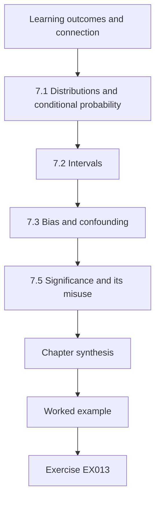

### Logical drawing

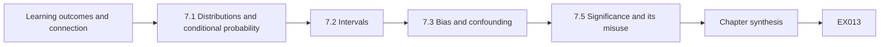

```text
[Learning outcomes and connection]
    |
    v
[7.1 Distributions and conditional probability]
    |
    v
[7.2 Intervals]
    |
    v
[7.3 Bias and confounding]
    |
    v
[7.5 Significance and its misuse]
    |
    v
[Chapter synthesis]
    |
    v
[Worked example] --> [Exercise EX013]
```
<!-- cykin:lesson-figures:end ch-07 -->


### Learning outcomes and connection

After this chapter you can (1) compute detection measures from outcomes and attach confidence intervals; (2) apply Bayes' rule to see how base rates change the meaning of an alert; (3) recognise confounding by case mix, including Simpson's paradox; and (4) report a comparison so that its uncertainty is visible. It prepares Chapters 29 (measurement), 41 (decisions) and 42 (applied research).

### 7.1 Distributions and conditional probability

An alert is a test. Its **sensitivity** is $P(\text{alert} \mid \text{incident})$; its **false-positive rate** is $P(\text{alert} \mid \text{no incident})$. What a responder needs is the **positive predictive value**, $P(\text{incident} \mid \text{alert})$, which by Bayes' rule is

$$\text{PPV} = \frac{s\,\pi}{s\,\pi + f(1-\pi)}$$

with prevalence $\pi$. [Axelsson (2000)](https://doi.org/10.1145/357830.357849) showed that this base-rate effect dominates intrusion detection: even excellent detectors produce mostly false alarms when real attacks are rare. [Alahmadi, Axon and Martinovic (2022)](https://www.usenix.org/conference/usenixsecurity22/presentation/alahmadi) document how analysts experience the result.

### 7.2 Intervals

A proportion from a small sample is uncertain. The Wilson score interval behaves better than the simple $\hat p \pm 1.96\sqrt{\hat p(1-\hat p)/n}$ near 0 or 1 and for small $n$. Always report $k/n$, the estimate and the interval. "90% correct" from 20 cases has an interval of roughly 70–97%.

In Lab 7, workflow B's low-severity score of 5/10 has a Wilson interval from 0.237 to 0.763, so it is consistent with almost any underlying rate. Workflow A's high-severity 19/20 still allows a true rate as low as 0.764.

### 7.3 Bias and confounding

Comparisons between workflows are confounded when the groups differ in case mix. **Simpson's paradox** ([Simpson, 1951](https://doi.org/10.1111/j.2517-6161.1951.tb00088.x)) is the extreme case: a workflow can be better in every severity stratum and worse overall because it handled a harder mix. Stratify by known confounders, or better, assign cases to workflows at random when you can (Chapter 29).

The HVSS comparison in Lab 7 has exactly this structure. Workflow B's team received 70 of its 80 cases at high severity, while A's team received only 20 of 100, so pooling rewards the easier mix. Randomly assigning incoming cases to A or B would have removed that imbalance before any review panel scored the outcomes.

### 7.4 Worked example (synthetic): two triage workflows

HVSS ran workflow A in one team and workflow B in another. A outcome is "correct escalation decision" as judged later by a review panel.

```python
"""Lab 7 (synthetic): detection measures with Wilson intervals, and a confounded comparison."""
import math
def wilson(k, n, z=1.96):
    if n == 0: return (0.0, 1.0)
    p = k / n; d = 1 + z*z/n
    c = (p + z*z/(2*n)) / d; h = z*math.sqrt(p*(1-p)/n + z*z/(4*n*n)) / d
    return (c - h, c + h)
# Workflow A and B outcomes, split by severity (TP = correct escalation of a true incident)
data = {"A": {"high": (19, 20), "low": (45, 80)}, "B": {"high": (60, 70), "low": (5, 10)}}
for w, d in data.items():
    k = sum(v[0] for v in d.values()); n = sum(v[1] for v in d.values())
    lo, hi = wilson(k, n)
    print(f"{w}: pooled correct {k}/{n} = {k/n:.3f}  95% CI [{lo:.3f}, {hi:.3f}]")
    for s, (k2, n2) in d.items():
        lo2, hi2 = wilson(k2, n2)
        print(f"   {s:4s} {k2}/{n2} = {k2/n2:.3f}  CI [{lo2:.3f}, {hi2:.3f}]")
# Base-rate: alert with sensitivity 0.95, false positive rate 0.02, prevalence 0.005
se, fpr, prev = 0.95, 0.02, 0.005
ppv = se*prev / (se*prev + fpr*(1-prev))
print(f"PPV at prevalence {prev}: {ppv:.3f}")
```

Expected output:

```text
A: pooled correct 64/100 = 0.640  95% CI [0.542, 0.727]
   high 19/20 = 0.950  CI [0.764, 0.991]
   low  45/80 = 0.562  CI [0.453, 0.666]
B: pooled correct 65/80 = 0.812  95% CI [0.713, 0.883]
   high 60/70 = 0.857  CI [0.757, 0.921]
   low  5/10 = 0.500  CI [0.237, 0.763]
PPV at prevalence 0.005: 0.193
```

Pooled, B looks far better (0.81 vs 0.64). Stratified, A is better in both severities (0.95 vs 0.86 high; 0.56 vs 0.50 low). The pooled result reflects that B's team received mostly high-severity cases, which are easier to judge correctly here. Note also the width of the intervals: the low-severity comparison for B rests on 10 cases and supports no conclusion. The PPV line shows the base-rate effect: with 95% sensitivity and a 2% false-positive rate, only about one alert in five is real at 0.5% prevalence.

### 7.5 Significance and its misuse

A $p$-value answers a narrow question about data under a null model; it does not measure effect size or importance. Searching many metrics until one is "significant" produces false findings ([Simmons, Nelson and Simonsohn, 2011](https://doi.org/10.1177/0956797611417632)). Pre-state the primary measure before looking at results.

For the HVSS triage comparison, the primary measure was correct escalation as judged by the review panel, and it should be fixed before results are opened. If the team then also tested time to first action, number of handovers and reopen rate, one of them would eventually look "significant" by chance.

### 7.6 Errors and limits

- Reporting accuracy without base rate or interval.
- Pooling across strata with different mixes.
- Treating the review panel's judgment as ground truth without measuring agreement.

All three errors can be seen in the Lab 7 comparison of workflows A and B. Quoting B's pooled 0.81 without its interval and case mix hides that A is better in both strata. Quoting 95% sensitivity without the 0.5% prevalence hides that only about one alert in five is real. Every 'correct' label also comes from one review panel, so a second independent reviewer on a sample is needed before agreement can be stated.

### Exercises — chapter 07

**EX013 — PPV.** *Objective:* apply Bayes' rule. *Inputs:* sensitivity 0.90, false-positive rate 0.01; prevalence 0.001 and 0.05. *Steps:* compute PPV for both; state the operational meaning. *Expected evidence:* two values and a sentence. *Rubric:* 3 = 0.083 and 0.826 with interpretation; 2 = one error; 1 = formula; 0 = none.

**EX014 — Fair comparison.** *Objective:* design out confounding. *Inputs:* Lab 7. *Steps:* compute a severity-standardised accuracy for A and B using a common mix of 50% high, 50% low; propose a data-collection design that avoids the problem next time. *Expected evidence:* two numbers and a design. *Rubric:* 3 = A 0.756, B 0.679 with randomised or stratified assignment design; 2 = numbers only; 1 = attempt; 0 = none.

### Chapter synthesis

Detection and response measures are proportions with uncertainty, conditioned on base rates and confounded by case mix. Report intervals, stratify or randomise, and let PPV — not sensitivity — describe what an alert means to a responder.

<!-- cykin:chapter-navigation:start ch-07 -->
### Continue studying — chapter 07 of 50

[← Chapter 06](#ch-06) · [Course chapter index](../SUBJECTS.md) · [Chapter 08 →](#ch-08)

Continue to the next authored lesson.
<!-- cykin:chapter-navigation:end -->

<a id="ch-08"></a>

## Chapter 08 — Computer architecture

<!-- cykin:lesson-figures:start ch-08 -->
### Lesson map

Lesson 08 published. Map, example, EX015.

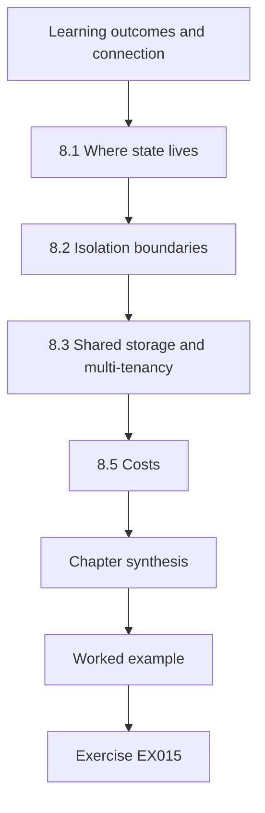

### Logical drawing

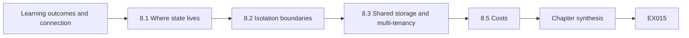

```text
[Learning outcomes and connection]
    |
    v
[8.1 Where state lives]
    |
    v
[8.2 Isolation boundaries]
    |
    v
[8.3 Shared storage and multi-tenancy]
    |
    v
[8.5 Costs]
    |
    v
[Chapter synthesis]
    |
    v
[Worked example] --> [Exercise EX015]
```
<!-- cykin:lesson-figures:end ch-08 -->


### Learning outcomes and connection

After this chapter you can (1) locate evidence-bearing state in processors, memory, firmware, storage and virtualisation layers; (2) order collection by volatility and cost; (3) explain how isolation boundaries affect what a responder can see and change; and (4) compare collection options for a virtualised host. It builds on Chapter 3 and prepares Chapters 12, 28 and 34.

### 8.1 Where state lives

A modern host stores state at many levels: CPU registers and caches (nanoseconds), main memory (lost at power-off), firmware (UEFI, device controllers), local and shared storage, and — for a virtual machine — the hypervisor's view of the guest's memory and disks. Each level differs in **volatility**, **accessibility** and **trust**. [RFC 3227](https://www.rfc-editor.org/rfc/rfc3227) (2002) recommends collecting from most to least volatile; the principle holds, though its examples date from an earlier generation of systems. Memory may contain running processes, network connections and decrypted keys that never reach disk; storage holds history; firmware can persist across reinstallation.

### 8.2 Isolation boundaries

Privilege rings, memory management units and hypervisors separate software. They also separate *observers*: a tool running inside a compromised guest relies on that guest's kernel to report truthfully, while a hypervisor-level snapshot observes the guest from outside its trust boundary. Speculative-execution attacks such as Spectre ([Kocher et al., 2019](https://doi.org/10.1109/SP.2019.00002)) show that boundaries can leak, so architecture must be treated as a set of assumptions to verify, not guarantees. This is why the booking-host table rates the in-guest memory tool as low to medium trust.

### 8.3 Shared storage and multi-tenancy

When several virtual machines share a storage array, a snapshot of a volume is cheap and fast but captures only what the guest has flushed; a memory snapshot captures volatile state but may be large and briefly pause the guest. In multi-tenant platforms the snapshot must not include another tenant's data — collection scope is an authorisation question as well as a technical one (Chapter 27). On the HVSS cluster that serves council, water-billing and hospital tenants, the scope check must confirm that the snapshotted volume belongs only to the booking host before collection starts.

### 8.4 Worked example (synthetic): HVSS booking host

A **synthetic** HVSS virtual machine runs the booking service on a hypervisor cluster with a shared storage array. An endpoint alert suggests a malicious process. Collection options:

| Option | Captures | Cost / risk | Trust |
|---|---|---|---|
| In-guest memory tool | processes, connections, keys | runs on suspect kernel; may alter state; 16 GB to copy | low–medium |
| Hypervisor memory snapshot | full guest RAM | brief pause; needs platform team; 16 GB | higher |
| Storage snapshot | disk blocks as flushed | near-instant; misses unflushed data | high for disk |
| Live triage commands | small, targeted | quick; each command changes state | low |

A defensible order: storage snapshot (cheap, protects disk history), hypervisor memory snapshot with recorded pause time, then targeted live triage only if needed; record hashes and times for each. The evidence-bearing map, not habit, drives the choice.

### 8.5 Costs

Estimate transfer time: 16 GB over a 1 Gb/s link at ~80% efficiency takes about $16 \times 8 / 0.8 \approx 160$ s; across a congested 100 Mb/s branch link it takes roughly 27 minutes, during which the service is degraded and the data change. Architecture determines whether collection is practical during an incident, so the evidence platform must be designed with collection paths in mind, not added afterwards.

The same arithmetic decides the order in the booking-host example. The storage snapshot is near-instant on the array, while the 16 GB memory snapshot must be copied off the hypervisor before analysis. Collecting it over a branch link would leave the booking service degraded for the whole transfer.

### 8.6 Errors and limits

- Trusting in-guest tools on a compromised kernel without corroboration.
- Ignoring firmware as a persistence location.
- Taking multi-tenant snapshots without scope checks.
- Forgetting that collection itself changes state; record what it changed.

In the booking-host case, each error has a specific guard. Findings from the in-guest memory tool are corroborated against the hypervisor snapshot before anyone relies on them. The storage snapshot is checked to contain only the booking host's volume on the shared array. The pause time of the memory snapshot and every live triage command are written into the record with their hashes and times.

### Exercises — chapter 08

**EX015 — Evidence map.** *Objective:* map state to collection. *Inputs:* a synthetic container host running 12 containers on a VM. *Steps:* list five evidence-bearing locations across layers, with volatility, a collection method and one trust caveat each. *Expected evidence:* table. *Rubric:* 3 = five layers covered with specific caveats; 2 = four; 1 = generic list; 0 = none.

**EX016 — Transfer budget.** *Objective:* decide feasibility. *Inputs:* 64 GB memory image; links of 10 Gb/s and 200 Mb/s at 80% efficiency; incident requires collection within 30 min. *Steps:* compute both times; recommend. *Expected evidence:* two times and recommendation. *Rubric:* 3 = ≈64 s and ≈53 min, with a recommendation such as hypervisor-local snapshot then later transfer or targeted collection; 2 = numbers; 1 = attempt; 0 = none.

### Chapter synthesis

Evidence lives at every architectural layer with different volatility and trust. Map it, choose collection by observer position and cost, respect isolation and tenancy boundaries, and design collection paths into the platform before they are needed.

<!-- cykin:chapter-navigation:start ch-08 -->
### Continue studying — chapter 08 of 50

[← Chapter 07](#ch-07) · [Course chapter index](../SUBJECTS.md) · [Chapter 09 →](#ch-09)

Continue to the next authored lesson.
<!-- cykin:chapter-navigation:end -->

<a id="ch-09"></a>

## Chapter 09 — Programming II

<!-- cykin:lesson-figures:start ch-09 -->
### Lesson map

Lesson 09 published. Map, example, EX018.

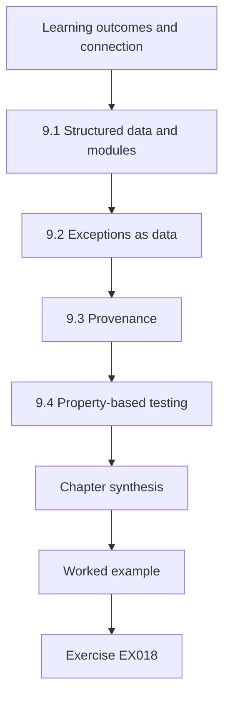

### Logical drawing

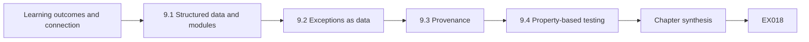

```text
[Learning outcomes and connection]
    |
    v
[9.1 Structured data and modules]
    |
    v
[9.2 Exceptions as data]
    |
    v
[9.3 Provenance]
    |
    v
[9.4 Property-based testing]
    |
    v
[Chapter synthesis]
    |
    v
[Worked example] --> [Exercise EX018]
```
<!-- cykin:lesson-figures:end ch-09 -->


### Learning outcomes and connection

After this chapter you can (1) structure an event-normalisation component as modules with clear interfaces; (2) handle errors as data rather than control-flow accidents; (3) write property-based tests that explore malformed and duplicate input; and (4) carry provenance through every transformation. It builds on Chapter 4 and prepares Chapters 14, 22 and 30.

### 9.1 Structured data and modules

A normaliser converts heterogeneous events into a common schema. Design it as a pipeline of small pure functions — parse, validate, map fields, enrich, emit — each with a typed input and output. Modules should hide decisions likely to change behind stable interfaces ([Parnas, 1972](https://doi.org/10.1145/361598.361623)); the mapping from a vendor's field names to your schema is such a decision. In the HVSS normaliser, the identity-provider field mapping lives in its own module with a version number, so a vendor rename changes one file and one mapping version.

### 9.2 Exceptions as data

Inside one function, an exception is fine. At the pipeline boundary, every failure becomes a record: `{"input_ref": ..., "stage": "parse", "error": "json_decode", "detail": ...}` routed to a dead-letter store. The pipeline never loses an input by raising past its caller. Retries apply only to transient errors (a dependency timeout), never to deterministic ones (malformed JSON), or you build an infinite loop.

In the HVSS burst, the truncated identity-provider events are deterministic failures: retrying a `json_decode` error on the same bytes will fail every time. A timeout from the user directory lookup in EX018 is transient, so it can be retried with a limit before the event goes on with its enrichment marked missing.

### 9.3 Provenance

Every output event carries the hash of its raw input, the normaliser version and the mapping version. Then an analyst who sees an odd field can ask "which rule produced this?" and get an answer. Provenance is cheap at write time and impossible to reconstruct later. The W3C PROV model ([PROV-Overview](https://www.w3.org/TR/prov-overview/)) gives vocabulary — entity, activity, agent — that maps directly: raw event (entity), normalisation (activity), normaliser version (agent). For the HVSS normaliser, those three fields would have shown at once which version had silently skipped the truncated identity-provider events.

### 9.4 Property-based testing

Example tests check cases you thought of; property tests check statements over many generated inputs. Useful properties for a normaliser: *conservation* (outputs + dead letters = inputs); *idempotence* (normalising an already-normalised event is the identity); *determinism* (same input, same output); *provenance* (every output's raw hash matches a stored raw input). A minimal stdlib generator:

```python
import random, json
def gen(rng):
    base = {"ts": "2026-03-02T08:00:00Z", "user": "u1", "action": "login"}
    m = rng.choice(["ok", "drop_key", "bad_json", "dup", "unicode", "huge"])
    if m == "drop_key": base.pop(rng.choice(list(base)))
    if m == "unicode": base["user"] = "ü\u202e1"     # includes a right-to-left override
    if m == "huge": base["action"] = "x" * 100_000
    s = json.dumps(base)
    return s[:-3] if m == "bad_json" else s
```

Run it with fixed seeds, assert the properties and keep failing seeds as regression tests. The right-to-left override character is a reminder that display-confusing input is an attack technique, not just a curiosity.

### 9.5 Worked example (synthetic)

HVSS's normaliser receives a burst in which 3% of identity-provider events are truncated JSON and 1% are exact duplicates. Version 1 caught the decode error with a bare `except` and continued — conservation failed by 3%, unnoticed for weeks. Version 2 routed errors to a dead-letter store with counters exported as metrics; the 3% became an alert and a vendor ticket on the first day.

Version 1 failed the conservation property of the previous subsection, because truncated inputs produced neither an output nor a dead letter. A property test with the `bad_json` generator mode would have exposed the gap before deployment.

### 9.6 Errors and limits

- Bare exception handlers that continue silently.
- Retrying deterministic failures.
- Dropping unknown fields (Chapter 24 shows the consequence).
- Property tests with random seeds that are not recorded.

Each error in this list maps onto a step in the HVSS normaliser history. The bare `except` in version 1 is the first error, and the weeks of unnoticed 3% loss are its cost. Retrying the truncated JSON would add load without ever succeeding. A failing generator seed that was not recorded cannot be replayed as a regression test after the fix, so the property test proves less than it seems.

### Exercises — chapter 09

**EX017 — Properties.** *Objective:* specify testable properties. *Inputs:* the generator above. *Steps:* write four properties as assertions for a normaliser `norm(s) -> (event | None, error | None)`; state which generator mode exercises each. *Expected evidence:* assertions and mapping. *Rubric:* 3 = conservation, determinism, idempotence and provenance or display-safety correctly mapped; 2 = three; 1 = vague; 0 = none.

**EX018 — Dead letters.** *Objective:* design failure handling. *Inputs:* normaliser with a dependency (a user directory lookup) that times out 2% of the time. *Steps:* specify retry policy, dead-letter schema and the metric that would alert operators. *Expected evidence:* specification. *Rubric:* 3 = bounded retries with backoff for timeouts only, enrichment marked missing rather than event dropped, metric with threshold; 2 = partial; 1 = generic; 0 = none.

### Chapter synthesis

Robust response software treats failure as data, carries provenance on every record and is tested with properties over generated hostile input. These habits are what make later pipeline guarantees provable rather than hoped for.

<!-- cykin:chapter-navigation:start ch-09 -->
### Continue studying — chapter 09 of 50

[← Chapter 08](#ch-08) · [Course chapter index](../SUBJECTS.md) · [Chapter 10 →](#ch-10)

Continue to the next authored lesson.
<!-- cykin:chapter-navigation:end -->

<a id="ch-10"></a>

## Chapter 10 — Engineering ethics and safety

<!-- cykin:lesson-figures:start ch-10 -->
### Lesson map

Lesson 10 published. Map, example, EX020.

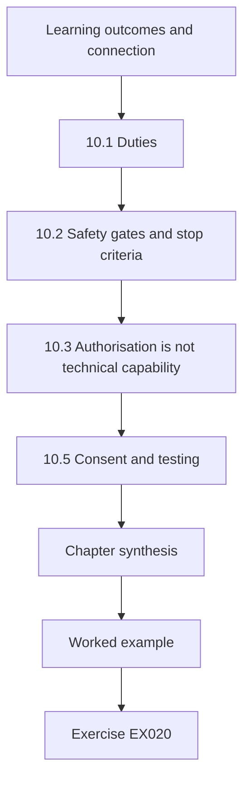

### Logical drawing

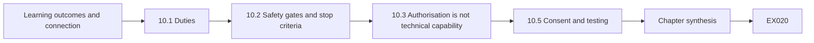

```text
[Learning outcomes and connection]
    |
    v
[10.1 Duties]
    |
    v
[10.2 Safety gates and stop criteria]
    |
    v
[10.3 Authorisation is not technical capability]
    |
    v
[10.5 Consent and testing]
    |
    v
[Chapter synthesis]
    |
    v
[Worked example] --> [Exercise EX020]
```
<!-- cykin:lesson-figures:end ch-10 -->


### Learning outcomes and connection

After this chapter you can (1) identify the duties an engineer of response systems holds toward users, data subjects and the public; (2) build authorisation, privacy and service safety into designs and tests; (3) define stop criteria and escalation paths before an intervention; and (4) recognise when a technically correct action is not yours to take. It prepares Chapters 25, 27, 33 and 43.

### 10.1 Duties

Professional codes such as the [ACM Code of Ethics](https://www.acm.org/code-of-ethics) and the [NSPE Code of Ethics for Engineers](https://www.nspe.org/resources/ethics/code-ethics) place public welfare and safety first and require honesty about limits. In response engineering those duties have concrete forms: **least privilege** (tools receive only the authority needed); **authorisation** (no action outside a delegated scope); **minimisation** (collect what the decision needs, not everything reachable — a principle in the [GDPR, Article 5](https://eur-lex.europa.eu/eli/reg/2016/679/oj)); and **harm awareness** (containment can harm people who depend on the contained service).

### 10.2 Safety gates and stop criteria

A **safety gate** is a check that must pass before an action proceeds; a **stop criterion** is a pre-agreed observable that halts an action already under way. Both are written before the incident, because during an incident pressure distorts judgement. A gate for host isolation might require: confirmed asset identity, confirmed owner notified, service criticality looked up, and an approver who is not the requester. A stop criterion might be: "if the clinical scheduling queue exceeds 50 waiting requests or any ward reports inability to view schedules, restore connectivity and escalate."

### 10.3 Authorisation is not technical capability

Your tooling may be able to disable any account. That does not mean you may. Authority comes from policy, contracts and law; engineering's job is to make the authorised path easy and the unauthorised path impossible or loud. Where authority is ambiguous, the design must route the decision to someone who has it. In EX020, the HVSS engineer's tooling may reach the second client's tenant, yet only that client can authorise action there. The right design there routes the observation to that client through the defined notification channel rather than acting.

### 10.4 Worked example (synthetic): isolating a clinical scheduling service

A **synthetic** HVSS client hospital runs a care-scheduling service. An alert suggests a compromised service account on its application server. The automatic playbook would isolate the server. Gates: (1) asset criticality = patient-facing → automatic isolation forbidden; (2) clinical service owner and on-call clinician lead must be contacted; (3) alternative: rotate the service account credential and block its outbound internet access, which reduces attacker capability without stopping scheduling; (4) stop criterion as above; (5) escalation path: response manager → hospital executive on call within 15 minutes if the owner cannot be reached. The decision record names who approved what and when. The engineering lesson: the playbook gained a criticality check and a less disruptive alternative action; the safety property "patient-facing services are never isolated without clinical approval" became a test.

### 10.5 Consent and testing

Tests and exercises involving real people or systems need agreement from those accountable, a defined scope and a way to stop. The [Menlo Report](https://www.dhs.gov/sites/default/files/publications/CSD-MenloPrinciplesCORE-20120803_1.pdf) adapts research-ethics principles — respect for persons, beneficence, justice and respect for law and public interest — to ICT work, and is a useful checklist for exercises and practicums (Chapter 43).

At HVSS, an exercise on the hospital trust's care-scheduling service would need agreement from the clinical service owner and the response manager. It would also need a scope limited to named test accounts and the same stop criterion of 50 waiting requests used for real isolation decisions.

### 10.6 Errors and limits

- Equating "the tool allows it" with "I am allowed".
- Stop criteria written after the action started.
- Collecting broadly "in case".
- Ethics treated as a sign-off rather than a design input.

The care-scheduling case shows how each error would have played out. The automatic playbook could isolate the application server, which is exactly the equation of tool capability with permission. Writing the 50-request stop criterion only after isolation had begun would leave wards without schedules while people argued about thresholds. In that case, ethics changed the design itself by adding a criticality check and a less disruptive credential rotation.

### Exercises — chapter 10

**EX019 — Gates and stops.** *Objective:* design safety into a playbook. *Inputs:* a synthetic water-billing portal whose web server shows signs of web-shell activity; the portal also handles emergency leak reports. *Steps:* write three gates, two stop criteria, a less disruptive alternative and an escalation path. *Expected evidence:* list. *Rubric:* 3 = specific, observable, with alternative that preserves leak reporting; 2 = generic; 1 = one element; 0 = none.

**EX020 — Authority.** *Objective:* recognise limits. *Inputs:* a managed-service engineer at HVSS sees, while handling a client case, that another client's account is used from the same attacker infrastructure. *Steps:* state what the engineer may and may not do, and what the system should support. *Expected evidence:* short argument. *Rubric:* 3 = no action in the other tenant without its authorisation; notify through the defined channel; system supports cross-tenant indicator sharing without data exposure; 2 = partial; 1 = acts directly; 0 = none.

### Chapter synthesis

Ethics in response engineering is concrete: least privilege, authorisation, minimisation and harm awareness, encoded as gates, stop criteria and escalation paths that are tested like any other requirement.

<!-- cykin:chapter-navigation:start ch-10 -->
### Continue studying — chapter 10 of 50

[← Chapter 09](#ch-09) · [Course chapter index](../SUBJECTS.md) · [Chapter 11 →](#ch-11)

Continue to the next authored lesson.
<!-- cykin:chapter-navigation:end -->

<a id="ch-11"></a>

## Chapter 11 — Networks and protocols

<!-- cykin:lesson-figures:start ch-11 -->
### Lesson map

Lesson 11 published. Map, example, EX022.

```mermaid
flowchart TD
  N0["Learning outcomes and connection"]
  N1["11.1 Paths and observation points"]
  N2["11.2 What protocols reveal"]
  N3["11.3 Loss and sampling"]
  N4["Chapter synthesis"]
  N0 --> N1 --> N2 --> N3 --> N4
  N4 --> EX["Worked example"]
  EX --> Q["Exercise EX022"]
```

### Logical drawing

```mermaid
flowchart LR
  N0["Learning outcomes and connection"]
  N1["11.1 Paths and observation points"]
  N2["11.2 What protocols reveal"]
  N3["11.3 Loss and sampling"]
  N4["Chapter synthesis"]
  N0 --> N1 --> N2 --> N3 --> N4 --> Q["EX022"]
```

```text
[Learning outcomes and connection]
    |
    v
[11.1 Paths and observation points]
    |
    v
[11.2 What protocols reveal]
    |
    v
[11.3 Loss and sampling]
    |
    v
[Chapter synthesis]
    |
    v
[Worked example] --> [Exercise EX022]
```
<!-- cykin:lesson-figures:end ch-11 -->


### Learning outcomes and connection

After this chapter you can (1) trace a connection path across zones and name every device that could log it; (2) explain what DNS, TLS and session logs can and cannot show; (3) account for packet loss, address translation and time sources when correlating records; and (4) decide which logs support a claim that "host X connected to service Y". It builds on Chapters 3 and 8 and prepares Chapters 22, 34 and 36.

### 11.1 Paths and observation points

A request from a user's browser to an application crosses a resolver, possibly a proxy, firewalls, a load balancer, a TLS terminator and an application server, and may call an identity service. Each hop is an **observation point** that may log something different: the resolver logs a name query, the firewall a 5-tuple, the load balancer a client address and backend, the application a user and action. Engineering a response capability begins with this map, because a claim is only as strong as the observation points that independently support it.

### 11.2 What protocols reveal

**DNS** logs show that a name was resolved by some client, not that a connection followed. **TLS 1.3** ([RFC 8446](https://www.rfc-editor.org/rfc/rfc8446)) encrypts most of the handshake after the ClientHello; middleboxes usually see the server name indication (unless encrypted) and certificate metadata only where TLS is terminated. **TCP** ([RFC 9293](https://www.rfc-editor.org/rfc/rfc9293)) state tells you whether a handshake completed; a firewall "allow" log does not prove data was exchanged. **Address translation** rewrites addresses: the firewall's source address may be a NAT pool, so mapping back to a host requires the NAT table log for that time. **Time**: correlate with synchronised clocks ([RFC 5905](https://www.rfc-editor.org/rfc/rfc5905)) and record offsets.

### 11.3 Loss and sampling

Flow exporters often sample (1 in N packets); packet captures drop under load; logs are delivered over UDP syslog and can be lost silently ([RFC 5424](https://www.rfc-editor.org/rfc/rfc5424) defines the message format, not reliable delivery). Absence in a sampled source is weak evidence.

EX022 puts a number on how weak that absence is as evidence. With flows sampled at 1 in 1,000, a six-packet probe escapes sampling entirely with probability of about 0.994. A NetFlow record that fails to show the probe therefore says almost nothing about whether it happened. In the citizen-portal example, the claim rests on the NAT log, proxy and endpoint instead, which record every connection rather than a sample.

### 11.4 Worked example (synthetic): HVSS multi-zone application

HVSS's **synthetic** citizen portal sits behind a reverse proxy in a DMZ; the application zone calls a remote identity provider over the internet. Claim to test: "workstation W-114 uploaded data to external address 203.0.113.50 at 14:02". (203.0.113.0/24 is a documentation range, [RFC 5737](https://www.rfc-editor.org/rfc/rfc5737).)

| Source | What it shows | Strength |
|---|---|---|
| Resolver log | W-114 resolved `files.example.net` → 203.0.113.50 at 14:01:58 | name intent only |
| Egress firewall | NAT pool address → 203.0.113.50:443 allowed, 14:02:01 | needs NAT log |
| NAT log | W-114's address mapped to pool port 40122 at 14:02:01 | links host to flow |
| Proxy | CONNECT by user `j.ortiz`, 48 MB sent | volume and user |
| Endpoint | process `sync.exe` opened socket at 14:02:00 | process attribution |

Three independent sources (NAT plus firewall, proxy, endpoint) agree within a second after offset correction: the claim is supported. Without the NAT log, the firewall record supports only "some host behind the NAT".

### 11.5 Errors and limits

- Treating DNS resolution as proof of connection.
- Ignoring NAT when attributing flows.
- Assuming syslog delivery is reliable.
- Correlating unsynchronised timestamps.

The W-114 claim in the worked example shows how each error would mislead an analyst. The resolver entry at 14:01:58 shows only that W-114 looked up `files.example.net`, not that it sent anything. The egress firewall alone shows only a NAT pool address, and it is the NAT log that maps port 40122 back to W-114. If the proxy's syslog stream had lost the CONNECT record, nothing would have flagged its absence. The one-second agreement between sources is meaningful only after each source's clock offset has been corrected.

### Exercises — chapter 11

**EX021 — Support a claim.** *Objective:* identify necessary evidence. *Inputs:* claim "server S-07 received an administrative login from a contractor laptop at 09:15"; S-07 is behind a load balancer that does source NAT. *Steps:* list the observation points needed and what each must show; name the weakest link. *Expected evidence:* list and weakest link. *Rubric:* 3 = includes load balancer logs with original client address (or forwarded header with trust caveat), authentication log on S-07, identity-provider log and laptop identity; weakest link argued; 2 = partial; 1 = one source; 0 = none.

**EX022 — Sampling.** *Objective:* reason about sampled flows. *Inputs:* NetFlow sampled 1:1000; a 6-packet exfiltration probe. *Steps:* compute the probability that none of the 6 packets is sampled (independent sampling); interpret. *Expected evidence:* number and sentence. *Rubric:* 3 = ≈0.994 with interpretation; 2 = number; 1 = attempt; 0 = none.

### Chapter synthesis

Map the path, list the observation points, understand what each protocol and device actually records and account for NAT, loss and time. A connection claim is supported when independent observation points agree.

<!-- cykin:chapter-navigation:start ch-11 -->
### Continue studying — chapter 11 of 50

[← Chapter 10](#ch-10) · [Course chapter index](../SUBJECTS.md) · [Chapter 12 →](#ch-12)

Continue to the next authored lesson.
<!-- cykin:chapter-navigation:end -->

<a id="ch-12"></a>

## Chapter 12 — Operating systems

<!-- cykin:lesson-figures:start ch-12 -->
### Lesson map

Lesson 12 published. Map, example, EX023.

```mermaid
flowchart TD
  N0["Learning outcomes and connection"]
  N1["12.1 Host state"]
  N2["12.3 Observation points and agent design"]
  N3["12.4 Baselines"]
  N4["Chapter synthesis"]
  N0 --> N1 --> N2 --> N3 --> N4
  N4 --> EX["Worked example"]
  EX --> Q["Exercise EX023"]
```

### Logical drawing

```mermaid
flowchart LR
  N0["Learning outcomes and connection"]
  N1["12.1 Host state"]
  N2["12.3 Observation points and agent design"]
  N3["12.4 Baselines"]
  N4["Chapter synthesis"]
  N0 --> N1 --> N2 --> N3 --> N4 --> Q["EX023"]
```

```text
[Learning outcomes and connection]
    |
    v
[12.1 Host state]
    |
    v
[12.3 Observation points and agent design]
    |
    v
[12.4 Baselines]
    |
    v
[Chapter synthesis]
    |
    v
[Worked example] --> [Exercise EX023]
```
<!-- cykin:lesson-figures:end ch-12 -->


### Learning outcomes and connection

After this chapter you can (1) model host state as processes, services, accounts, files, permissions and scheduled tasks; (2) explain what operating-system logs record and what they miss; (3) specify safe observation points for a response agent; and (4) distinguish expected from anomalous behaviour with a documented baseline. It builds on Chapter 8 and prepares Chapters 28 and 34.

### 12.1 Host state

The kernel mediates access to hardware and enforces permissions; user-space processes run under identities with privileges. Persistence mechanisms — services, scheduled tasks, startup entries, cron jobs — are ordinary administrative features that attackers reuse. A responder's model of a host lists: running processes with parent, user and command line; services and their accounts; scheduled tasks; local accounts and group memberships; listening sockets; recently modified executables; and installed updates. On the HVSS finance workstation of the next subsections, that model includes the two service accounts and the scheduled task `UpdateCheck`.

### 12.2 Logs and their limits

Operating systems log authentication, process creation (if enabled), service changes and policy changes. Logging must be configured: process command-line capture, for instance, is often off by default. Logs live on the host, so an attacker with administrative rights can clear or alter them; forwarding to a separate store quickly is what makes them evidence ([NIST SP 800-92](https://csrc.nist.gov/pubs/sp/800/92/final) covers log management). Kernel-level activity — a malicious driver — may not appear in user-space logs at all. On that workstation, the encoded `UpdateCheck` command is visible only if command-line capture was enabled.

### 12.3 Observation points and agent design

A response agent is itself privileged software and therefore a target and a risk. Design rules: run with the minimum privilege needed for each function (collection may need read access to memory; isolation needs network-stack control — separate them); sign and verify agent updates; log every command the agent executes to a store it cannot modify; rate-limit actions; and fail safe — if the agent loses contact with its control service, it continues collecting but does not initiate containment on its own (Chapter 33).

### 12.4 Baselines

"Anomalous" needs a reference. Build baselines per host role: expected services, scheduled tasks, accounts and parent–child process pairs. A **synthetic** HVSS finance workstation runs two service accounts: `svc-backup` (runs nightly at 01:00, reads user folders) and `svc-update` (runs the vendor updater weekly). An observed scheduled task named `UpdateCheck` running `powershell.exe -enc ...` as `svc-update` at 03:17 daily differs from baseline in three ways: interpreter instead of the updater binary, encoded command, daily schedule. Expected behaviour can still be malicious and anomalies can be benign (a new legitimate tool), so the baseline triggers investigation, not verdict.

### 12.5 Worked example (synthetic): safe observation

Specification for collecting on that workstation: (1) export scheduled task definitions and the task's history; (2) capture process list with command lines and parents; (3) copy the task's referenced script if any, hashing before and after copy; (4) query the authentication log for `svc-update` logons; (5) do *not* run the encoded command to "see what it does" on the host — decode it as text offline. Each step records the command, time, operator and output hash. Step 5 is the one most often skipped under pressure, and EX023 practises it with Python on an analysis machine.

### 12.6 Errors and limits

- Assuming logging is enabled because the OS supports it.
- Running unknown commands on the suspect host to understand them.
- One all-powerful agent identity.
- Treating baseline deviation as proof.

The HVSS finance workstation from the baseline example shows where each error bites. If command-line capture was never switched on, the `-enc` argument of `UpdateCheck` would not appear anywhere in the logs. Running the encoded command to understand it would execute the attacker's code under `svc-update`. An agent that holds both memory-read and isolation rights under one identity is the target EX024 asks you to split. The three deviations from baseline still justify investigation, not a verdict.

### Exercises — chapter 12

**EX023 — Decode safely.** *Objective:* inspect without executing. *Inputs:* the synthetic encoded command `SQBFAFgAIAAoAE4AZQB3AC0ATwBiAGoAZQBjAHQAKQA=` (Base64 of UTF-16LE text). *Steps:* decode it offline in Python without running it; report the text and what it suggests. *Expected evidence:* code and decoded string. *Rubric:* 3 = correct decode (`IEX (New-Object)`) with interpretation as an in-memory execution pattern, truncated; 2 = decode only; 1 = attempt; 0 = ran it.

**EX024 — Agent privileges.** *Objective:* design least privilege. *Inputs:* agent functions: process listing, file hashing, memory capture, network isolation, self-update. *Steps:* group them into privilege tiers and state controls for each tier. *Expected evidence:* table. *Rubric:* 3 = isolation and memory capture separated with approval/scope controls, signed update, immutable command log; 2 = partial; 1 = single tier; 0 = none.

### Chapter synthesis

Model host state explicitly, know which logs exist and how they can be defeated, design agents as least-privileged and auditable software, and use role baselines to direct investigation rather than to deliver verdicts.

<!-- cykin:chapter-navigation:start ch-12 -->
### Continue studying — chapter 12 of 50

[← Chapter 11](#ch-11) · [Course chapter index](../SUBJECTS.md) · [Chapter 13 →](#ch-13)

Continue to the next authored lesson.
<!-- cykin:chapter-navigation:end -->

<a id="ch-13"></a>

## Chapter 13 — Data systems

<!-- cykin:lesson-figures:start ch-13 -->
### Lesson map

Lesson 13 published. Map, example, EX026.

```mermaid
flowchart TD
  N0["Learning outcomes and connection"]
  N1["13.1 Transactions, consistency and logs"]
  N2["13.2 Backups, RPO and RTO"]
  N3["13.3 Restoration order"]
  N4["13.5 Integrity checks before reconnecting"]
  N5["Chapter synthesis"]
  N0 --> N1 --> N2 --> N3 --> N4 --> N5
  N5 --> EX["Worked example"]
  EX --> Q["Exercise EX026"]
```

### Logical drawing

```mermaid
flowchart LR
  N0["Learning outcomes and connection"]
  N1["13.1 Transactions, consistency and logs"]
  N2["13.2 Backups, RPO and RTO"]
  N3["13.3 Restoration order"]
  N4["13.5 Integrity checks before reconnecting"]
  N5["Chapter synthesis"]
  N0 --> N1 --> N2 --> N3 --> N4 --> N5 --> Q["EX026"]
```

```text
[Learning outcomes and connection]
    |
    v
[13.1 Transactions, consistency and logs]
    |
    v
[13.2 Backups, RPO and RTO]
    |
    v
[13.3 Restoration order]
    |
    v
[13.5 Integrity checks before reconnecting]
    |
    v
[Chapter synthesis]
    |
    v
[Worked example] --> [Exercise EX026]
```
<!-- cykin:lesson-figures:end ch-13 -->


### Learning outcomes and connection

After this chapter you can (1) treat databases and stores both as evidence sources and as services to restore; (2) use transactions, schemas and checksums to detect integrity loss; (3) relate backups to recovery point and recovery time objectives; and (4) derive a restoration order from dependencies and check it against objectives. It prepares Chapters 22, 28, 35 and 47.

### 13.1 Transactions, consistency and logs

A transactional database guarantees that a committed change is durable and that concurrent transactions do not see each other's partial work. It achieves durability with a write-ahead log, which is also evidence: it records changes in order and may reveal what an attacker modified even after rows were changed back. Schema constraints (foreign keys, check constraints) catch some corruption; application-level checksums on critical records catch more. [Codd (1970)](https://doi.org/10.1145/362384.362685) introduced the relational model whose integrity rules most case stores still rely on.

### 13.2 Backups, RPO and RTO

The **recovery point objective (RPO)** is the maximum acceptable data loss, measured in time; the **recovery time objective (RTO)** is the maximum acceptable time to restore service ([NIST SP 800-34 Rev. 1](https://csrc.nist.gov/pubs/sp/800/34/r1/upd1/final)). A backup's age at the moment of failure is the data loss you will suffer; if backups run every 6 h, an RPO of 4 h is not met for a random failure time. Backups must be protected from the same compromise that hits production — offline, immutable or under separate credentials — and *tested by restore*, not by job success. [NIST SP 800-184](https://csrc.nist.gov/pubs/sp/800/184/final) treats recovery planning and testing as a continuous discipline.

### 13.3 Restoration order

Components depend on each other: the case API needs the case database, the evidence store and the identity service. A topological sort of the dependency graph gives a valid order; the **critical path** — the longest dependent chain — gives the minimum time with unlimited parallel teams.

In Lab 13 the critical path runs identity → evidence store → case API → portal, adding 1 + 3 + 0.5 + 0.5 = 5.0 h. The queue and case database restores fit beside it on a second team, which is why EX026 also reaches 5.0 h. With a single team, the same restores take 7.5 h because nothing runs in parallel.

### 13.4 Worked example (synthetic): HVSS case platform after ransomware

```python
"""Lab 13 (synthetic): restoration order from dependencies; data loss against recovery point objectives."""
from graphlib import TopologicalSorter
deps = {"identity": set(), "case_db": {"identity"}, "evidence_store": {"identity"},
        "queue": set(), "case_api": {"case_db", "evidence_store", "queue"}, "portal": {"case_api", "identity"}}
restore_h = {"identity": 1.0, "case_db": 2.0, "evidence_store": 3.0, "queue": 0.5, "case_api": 0.5, "portal": 0.5}
last_backup_age_h = {"identity": 2, "case_db": 6, "evidence_store": 1, "queue": 0, "case_api": 0, "portal": 0}
rpo_h = {"identity": 4, "case_db": 4, "evidence_store": 1, "queue": 0, "case_api": 0, "portal": 0}
order = list(TopologicalSorter(deps).static_order())
print("restore order:", " -> ".join(order))
done = {}
for s in order:   # one team, sequential; a component may start when its dependencies are done
    start = max([done[d] for d in deps[s]], default=0.0)
    start = max(start, max(done.values(), default=0.0))
    done[s] = start + restore_h[s]
    flag = "MISSES RPO" if last_backup_age_h[s] > rpo_h[s] else "ok"
    print(f"{s:15s} ready at {done[s]:4.1f} h  data loss {last_backup_age_h[s]} h vs RPO {rpo_h[s]} h  {flag}")
# two teams: critical path length
cp = {}
for s in order: cp[s] = max([cp[d] for d in deps[s]], default=0.0) + restore_h[s]
print("critical path (unlimited teams): portal ready at", cp["portal"], "h")
```

Expected output:

```text
restore order: identity -> queue -> case_db -> evidence_store -> case_api -> portal
identity        ready at  1.0 h  data loss 2 h vs RPO 4 h  ok
queue           ready at  1.5 h  data loss 0 h vs RPO 0 h  ok
case_db         ready at  3.5 h  data loss 6 h vs RPO 4 h  MISSES RPO
evidence_store  ready at  6.5 h  data loss 1 h vs RPO 1 h  ok
case_api        ready at  7.0 h  data loss 0 h vs RPO 0 h  ok
portal          ready at  7.5 h  data loss 0 h vs RPO 0 h  ok
critical path (unlimited teams): portal ready at 5.0 h
```

Two findings. First, the case database's last clean backup is 6 h old against a 4 h RPO: the objective is missed before restoration begins, and the gap must be filled from other sources (write-ahead logs replicated elsewhere, email notifications, the queue's retained messages) or accepted and recorded. Second, one team needs 7.5 h; with parallel teams the critical path is 5 h (identity → evidence store → case API → portal). Whether 5 h meets the RTO is a staffing decision that the model makes explicit.

### 13.5 Integrity checks before reconnecting

Restoring from a backup taken after the intruder arrived restores the intruder. Before reconnecting: compare restored data with checksums or record counts from an independent source; scan for known persistence (new administrator accounts, triggers, stored procedures); and verify the backup timestamp precedes the earliest evidence of compromise — which itself is uncertain (Chapter 3).

For the HVSS case database, the 6 h old backup has to pass these checks before the case API reconnects. Its timestamp must precede the earliest evidence of the ransomware intrusion, allowing for clock uncertainty. Its record counts must match an independent source such as the queue's retained messages. It must also be scanned for administrator accounts or triggers that were not present in earlier backups.

### 13.6 Errors and limits

- Equating backup job success with restorability.
- Backups reachable with production administrator credentials.
- Restoring in an order that violates dependencies.
- Ignoring the RPO gap until after restoration.

Lab 13 exposes the last error in this list directly, before any restore begins. The case database misses its RPO by two hours before any restore work starts, so the gap must be filled or accepted while choosing sources. If that is discovered only after the portal is back at 7.5 h, the replicated write-ahead logs or retained queue messages may have expired. Restoring the case API before the evidence store would also break the dependency order the lab computes.

### Exercises — chapter 13

**EX025 — RPO for a schedule.** *Objective:* relate backup frequency to RPO. *Inputs:* backups every 6 h taking 30 min, failures uniformly random in time. *Steps:* compute worst-case and expected data loss (age of last completed backup); state the backup interval needed for a 4 h worst-case RPO. *Expected evidence:* numbers. *Rubric:* 3 = worst 6.5 h, expected 3.5 h, interval ≤ 3.5 h; 2 = one error; 1 = method; 0 = none.

**EX026 — Two teams.** *Objective:* schedule restoration. *Inputs:* Lab 13 data, two teams. *Steps:* produce a schedule respecting dependencies and give the portal-ready time. *Expected evidence:* schedule table. *Rubric:* 3 = 5.0 h schedule (team 1 identity, evidence store, case API, portal; team 2 queue, then case DB after identity) with dependency check; 2 = valid but slower; 1 = violates a dependency; 0 = none.

### Chapter synthesis

Data systems are evidence and service at once. Use transactions, logs and checksums for integrity; back up against your own compromise; test restores; derive restoration order from dependencies; and compare data loss with RPO before, not after, recovery.

<!-- cykin:chapter-navigation:start ch-13 -->
### Continue studying — chapter 13 of 50

[← Chapter 12](#ch-12) · [Course chapter index](../SUBJECTS.md) · [Chapter 14 →](#ch-14)

Continue to the next authored lesson.
<!-- cykin:chapter-navigation:end -->

<a id="ch-14"></a>

## Chapter 14 — Software engineering

<!-- cykin:lesson-figures:start ch-14 -->
### Lesson map

Lesson 14 published. Map, example, EX027.

```mermaid
flowchart TD
  N0["Learning outcomes and connection"]
  N1["14.1 Interfaces and versions"]
  N2["14.2 Tests that protect evidence"]
  N3["14.3 Review, deployment and rollback"]
  N4["14.5 Release plan"]
  N5["Chapter synthesis"]
  N0 --> N1 --> N2 --> N3 --> N4 --> N5
  N5 --> EX["Worked example"]
  EX --> Q["Exercise EX027"]
```

### Logical drawing

```mermaid
flowchart LR
  N0["Learning outcomes and connection"]
  N1["14.1 Interfaces and versions"]
  N2["14.2 Tests that protect evidence"]
  N3["14.3 Review, deployment and rollback"]
  N4["14.5 Release plan"]
  N5["Chapter synthesis"]
  N0 --> N1 --> N2 --> N3 --> N4 --> N5 --> Q["EX027"]
```

```text
[Learning outcomes and connection]
    |
    v
[14.1 Interfaces and versions]
    |
    v
[14.2 Tests that protect evidence]
    |
    v
[14.3 Review, deployment and rollback]
    |
    v
[14.5 Release plan]
    |
    v
[Chapter synthesis]
    |
    v
[Worked example] --> [Exercise EX027]
```
<!-- cykin:lesson-figures:end ch-14 -->


### Learning outcomes and connection

After this chapter you can (1) define interfaces and versioning for response tooling; (2) write acceptance and regression tests that detect evidence loss; (3) design review, deployment and rollback so a change cannot silently erase evidence or bypass controls; and (4) analyse a regression to its root cause. It builds on Chapters 4 and 9 and prepares Chapters 24, 37 and 39.

### 14.1 Interfaces and versions

An evidence-ingest service has consumers — analysts, detection rules, dashboards, legal hold — who depend on its output schema. Treat the schema as a published interface with semantic versions: a removed or renamed field is a breaking change requiring a major version and a migration plan. Consumers should declare which version they expect, so a mismatch fails loudly. [Brooks (1987)](https://doi.org/10.1109/MC.1987.1663532) argued that the essential difficulty of software is its conceptual complexity; interfaces are where that complexity is contained. The HVSS ingest defect below was a breaking change shipped as a minor version.

### 14.2 Tests that protect evidence

Three kinds matter. **Acceptance tests** state requirements as executable checks: "an event with a field unknown to the schema is stored with that field preserved under `extra`." **Regression tests** pin past defects. **Contract tests** run consumers' expectations against the producer's new version before release. A minimal regression test for the defect below:

```python
def test_unknown_fields_preserved():
    raw = {"id": "e1", "rule": "x", "user": "u1", "base": 10, "new_vendor_field": 7}
    out = normalise(raw)
    assert out["extra"]["new_vendor_field"] == 7
    assert sha256(canonical(raw)) == out["raw_sha256"]
```

Had this test existed before v3.2, the strict schema library would have failed it on the first build. The `mfa_reset` and `grantor_is_self` fields would then have stayed under `extra` instead of disappearing for three weeks.

### 14.3 Review, deployment and rollback

Code review finds defects that tests miss; inspections were shown early on to remove many defects before testing ([Fagan, 1976](https://doi.org/10.1147/sj.153.0182)). Deploy in stages — a canary receiving a copy of traffic, compared with the current version on output counts and field coverage — and keep the previous version deployable. Rollback restores the code, but not data processed meanwhile: if the new version dropped fields, events ingested during the window remain incomplete unless the raw input was kept and can be reprocessed. That is why raw retention (Chapter 4) is a precondition for safe deployment. The [Secure Software Development Framework (SP 800-218)](https://csrc.nist.gov/pubs/sp/800/218/final) lists practices for protecting the build and release pipeline itself.

### 14.4 Worked example (synthetic): the silent field drop

HVSS's ingest v3.2 switched to a strict schema library that discards unknown keys by default. A vendor had added `mfa_reset` and `grantor_is_self` fields two weeks earlier. No test failed, because tests used old fixtures. Three weeks later, a case review found that a self-granted administrator role had been ranked low (Chapter 24 reproduces the effect). Root cause analysis: (1) library default changed behaviour; (2) no acceptance test for unknown-field preservation; (3) fixtures not refreshed from production samples; (4) canary compared counts, not field coverage. Fixes: the regression test above; fixture refresh from sanitised samples monthly; a canary metric "distinct field names per source" with an alert on decrease; and reprocessing of the three-week window from raw storage.

### 14.5 Release plan

A release plan for ingest changes states: affected interfaces and versions; acceptance tests; canary duration and comparison metrics; rollback trigger and procedure; reprocessing plan; owner. It is a short document, reviewed like code.

For the HVSS v3.2 change, such a plan would have named the strict schema library as the change. It would have compared distinct field names per source during the canary and kept the three-week reprocessing path from raw storage ready before release. Its rollback trigger would have been any drop in distinct field names for the identity-provider source.

### 14.6 Errors and limits

- Fixtures that never change while inputs do.
- Rollback assumed to undo data effects.
- Schema libraries with lossy defaults.
- Canary metrics that measure volume only.

The HVSS ingest v3.2 incident combines all four errors in a single release. Fixtures written before the vendor added `mfa_reset` and `grantor_is_self` could not detect their loss. The library's lossy default discarded them, and a canary that compared event counts saw nothing wrong. Rolling back the code would still not have restored the fields in three weeks of stored events, so reprocessing from raw storage was required.

### Exercises — chapter 14

**EX027 — Acceptance tests.** *Objective:* encode requirements. *Inputs:* requirements: (a) unknown fields preserved; (b) events older than 30 days at arrival flagged `late` but stored; (c) normaliser version recorded. *Steps:* write three test functions in Python (pseudo-implementation acceptable). *Expected evidence:* code. *Rubric:* 3 = three precise tests with boundary cases (exactly 30 days); 2 = two; 1 = vague; 0 = none.

**EX028 — Release plan.** *Objective:* plan a safe change. *Inputs:* a change replacing the timestamp parser. *Steps:* write a release plan with canary metrics, rollback trigger and reprocessing plan. *Expected evidence:* plan. *Rubric:* 3 = includes parsed-timestamp distribution comparison, parse-failure rate, timezone edge cases, raw reprocessing; 2 = partial; 1 = generic; 0 = none.

### Chapter synthesis

Response tooling is software whose defects destroy evidence quietly. Version interfaces, test what must be preserved, deploy with canaries that measure information not just volume, keep raw inputs for reprocessing and treat a release plan as a reviewed artefact.

<!-- cykin:chapter-navigation:start ch-14 -->
### Continue studying — chapter 14 of 50

[← Chapter 13](#ch-13) · [Course chapter index](../SUBJECTS.md) · [Chapter 15 →](#ch-15)

Continue to the next authored lesson.
<!-- cykin:chapter-navigation:end -->

<a id="ch-15"></a>

## Chapter 15 — Security fundamentals

<!-- cykin:lesson-figures:start ch-15 -->
### Lesson map

Lesson 15 published. Map, example, EX029.

```mermaid
flowchart TD
  N0["Learning outcomes and connection"]
  N1["15.1 Assets, adversaries and properties"]
  N2["15.2 Controls as claims"]
  N3["15.3 Assurance and evidence"]
  N4["15.5 Residual risk"]
  N5["Chapter synthesis"]
  N0 --> N1 --> N2 --> N3 --> N4 --> N5
  N5 --> EX["Worked example"]
  EX --> Q["Exercise EX029"]
```

### Logical drawing

```mermaid
flowchart LR
  N0["Learning outcomes and connection"]
  N1["15.1 Assets, adversaries and properties"]
  N2["15.2 Controls as claims"]
  N3["15.3 Assurance and evidence"]
  N4["15.5 Residual risk"]
  N5["Chapter synthesis"]
  N0 --> N1 --> N2 --> N3 --> N4 --> N5 --> Q["EX029"]
```

```text
[Learning outcomes and connection]
    |
    v
[15.1 Assets, adversaries and properties]
    |
    v
[15.2 Controls as claims]
    |
    v
[15.3 Assurance and evidence]
    |
    v
[15.5 Residual risk]
    |
    v
[Chapter synthesis]
    |
    v
[Worked example] --> [Exercise EX029]
```
<!-- cykin:lesson-figures:end ch-15 -->


### Learning outcomes and connection

After this chapter you can (1) state assets, adversary capabilities and security properties precisely; (2) translate a control into a claim with stated assumptions; (3) identify evidence that would support or refute each claim; and (4) record residual risk with an owner. It prepares Chapters 18, 23, 38 and 45.

### 15.1 Assets, adversaries and properties

An **asset** is something whose loss matters: a user account, a case record, the ability to page responders. An **adversary model** states capabilities: what the attacker knows, can reach and can do — for example "holds one user's password and session cookie; can send phishing; cannot read the identity provider's database". **Security properties** are statements about assets under that model: confidentiality (only authorised parties read), integrity (only authorised changes, detectably), availability (service when needed), and for response systems also **accountability** (actions attributable to identities) and **non-bypassability** of controls. [Avižienis et al. (2004)](https://doi.org/10.1109/TDSC.2004.2) give the standard taxonomy of dependability and security attributes.

### 15.2 Controls as claims

A control is useful only as a claim that can be checked: "Multi-factor authentication prevents account takeover" is too broad. "For interactive logons to the case platform, possession of the password alone is insufficient to obtain a session, assuming the second factor is phishing-resistant and recovery flows require equal strength" is a claim with assumptions. [NIST SP 800-63B](https://csrc.nist.gov/pubs/sp/800/63/b/upd2/final) describes authenticator assurance levels that make such assumptions explicit. Claim P1 in the HVSS phishing case is written in that form.

### 15.3 Assurance and evidence

**Assurance** is justified confidence that properties hold. It comes from evidence: tests (including negative tests), inspection of configuration, analysis, and operational monitoring. For each claim, ask what observation would show it false. If nothing could, the claim is not engineering.

In the HVSS phishing case, P2 had a falsifying observation ready: an IMAP login success in the webmail logs. Because that observation was named in advance, the investigation could show that the legacy protocol was still enabled for one mailbox class. P3 had one too, file access after the reset time, and the absence of any revocation left that claim unsupported rather than confirmed.

### 15.4 Worked example (synthetic): account compromise across services

A **synthetic** HVSS staff member's credentials were phished. The attacker used them on the webmail service (password only, legacy protocol), then attempted the case platform (MFA enforced) and the file-sharing service (single sign-on with a session that lasts 14 days).

| Property claim | Evidence that supports | Evidence that refutes |
|---|---|---|
| P1 Case platform session requires second factor | IdP logs: password success, MFA failure, no session | any session without MFA event |
| P2 Legacy webmail protocol disabled | config export; negative test login fails | IMAP login success in logs |
| P3 Existing SSO sessions ended after reset | session list empty after revocation timestamp | file access after reset time |
| P4 Mailbox rules unchanged | audit log: no rule creation | forwarding rule created |

The investigation found P2 false (legacy protocol still enabled for one mailbox class) and P3 unsupported (no revocation was performed; the password reset did not end sessions). Residual risk was recorded: "file-sharing sessions may persist up to 14 days after credential reset; owner: identity service manager; mitigation: revoke sessions in reset playbook; due: 30 days." Chapter 38 returns to the general problem of verifying containment.

### 15.5 Residual risk

Every control leaves risk. Write it down with an owner, a review date and the condition that would trigger re-evaluation. Unowned residual risk becomes nobody's problem until it becomes an incident ([NIST SP 800-30 Rev. 1](https://csrc.nist.gov/pubs/sp/800/30/r1/final) frames risk as likelihood and impact under stated threats).

The HVSS residual-risk note on 14-day file-sharing sessions has all three parts: the identity service manager owns it, mitigation is due in 30 days, and the review would be triggered by any file access after a credential reset.

### 15.6 Errors and limits

- Controls stated without adversary model.
- Claims with no falsifying observation.
- Password reset assumed to end sessions.
- Residual risk without owner.

The HVSS phishing case from the worked example shows each of these errors in turn. Without an adversary model naming a stolen password and session cookie, "MFA protects us" could not be checked against the file-sharing service. The investigators assumed that resetting the password had ended the attacker's 14-day sessions, but no revocation had been performed. The risk became manageable only once the identity service manager was named as its owner with a deadline.

### Exercises — chapter 15

**EX029 — Write claims.** *Objective:* precise security claims. *Inputs:* the evidence store of HVSS, with signed manifests and a shared admin account. *Steps:* write two properties with adversary model and assumptions; give a refuting observation for each. *Expected evidence:* claims and observations. *Rubric:* 3 = precise, falsifiable, assumptions include key custody and shared account; 2 = partial; 1 = vague; 0 = none.

**EX030 — Residual risk register.** *Objective:* record residual risk. *Inputs:* worked example findings P2 and P3. *Steps:* write two register entries with owner role, mitigation, due date and re-evaluation trigger. *Expected evidence:* entries. *Rubric:* 3 = complete and specific; 2 = missing a field; 1 = vague; 0 = none.

### Chapter synthesis

Security engineering states assets, adversaries and properties precisely, turns controls into falsifiable claims, gathers evidence for and against them, and records the remaining risk with an owner.

<!-- cykin:chapter-navigation:start ch-15 -->
### Continue studying — chapter 15 of 50

[← Chapter 14](#ch-14) · [Course chapter index](../SUBJECTS.md) · [Chapter 16 →](#ch-16)

Continue to the next authored lesson.
<!-- cykin:chapter-navigation:end -->

<a id="ch-16"></a>

## Chapter 16 — Systems engineering

<!-- cykin:lesson-figures:start ch-16 -->
### Lesson map

Lesson 16 published. Map, example, EX031.

```mermaid
flowchart TD
  N0["Learning outcomes and connection"]
  N1["16.1 The system and its lifecycle"]
  N2["16.2 Stakeholders and needs"]
  N3["16.3 Architecture and interfaces"]
  N4["16.5 Verification and operations planning"]
  N5["Chapter synthesis"]
  N0 --> N1 --> N2 --> N3 --> N4 --> N5
  N5 --> EX["Worked example"]
  EX --> Q["Exercise EX031"]
```

### Logical drawing

```mermaid
flowchart LR
  N0["Learning outcomes and connection"]
  N1["16.1 The system and its lifecycle"]
  N2["16.2 Stakeholders and needs"]
  N3["16.3 Architecture and interfaces"]
  N4["16.5 Verification and operations planning"]
  N5["Chapter synthesis"]
  N0 --> N1 --> N2 --> N3 --> N4 --> N5 --> Q["EX031"]
```

```text
[Learning outcomes and connection]
    |
    v
[16.1 The system and its lifecycle]
    |
    v
[16.2 Stakeholders and needs]
    |
    v
[16.3 Architecture and interfaces]
    |
    v
[16.5 Verification and operations planning]
    |
    v
[Chapter synthesis]
    |
    v
[Worked example] --> [Exercise EX031]
```
<!-- cykin:lesson-figures:end ch-16 -->


### Learning outcomes and connection

After this chapter you can (1) identify stakeholders and their needs for a response platform; (2) decompose needs into requirements, architecture and interfaces; (3) build a requirements trace from need to acceptance test; and (4) plan verification and operations as lifecycle stages rather than afterthoughts. It builds on Chapter 5 and prepares Chapters 20, 21, 44 and 48.

### 16.1 The system and its lifecycle

An incident-response capability is a socio-technical system: people, procedures, tools, data and the organisations they serve. Systems engineering manages it across a lifecycle — concept, requirements, design, implementation, integration, verification, validation, operation, retirement. **Verification** asks "did we build it right?" (against requirements); **validation** asks "did we build the right thing?" (against stakeholder needs in realistic conditions). The [NASA Systems Engineering Handbook](https://www.nasa.gov/reference/systems-engineering-handbook/) and [NIST SP 800-160 Vol. 1 Rev. 1](https://csrc.nist.gov/pubs/sp/800/160/v1/r1/final) describe these processes, the latter for trustworthy secure systems specifically.

### 16.2 Stakeholders and needs

Stakeholders of a response platform include analysts (fast, clear queues), approvers (clear decision information), service owners (minimal disruption, notification), legal and records staff (preserved, defensible evidence), privacy officers (minimisation), auditors (accountability), platform operators (maintainable, observable) and, indirectly, the public served. Needs conflict: analysts want everything visible, privacy officers want minimisation. Systems engineering makes conflicts explicit and resolves them by decision, not by accident. The HVSS trace in the worked example shows one such conflict: analysts' visibility against the privacy officer's need N5.

### 16.3 Architecture and interfaces

Architecture allocates requirements to components and defines interfaces between them. Each interface needs an owner on both sides, a specification (data, timing, error behaviour) and a test. Most integration failures occur at interfaces nobody owned: the identity provider changed a log field; the paging provider rate-limited the platform during a surge.

In the HVSS trace, the IdP → API tenant claim is one such interface. The identity team owns the claim it issues, the case-API team owns how it is checked, and AT-07 tests both with a forged claim.

### 16.4 Worked example (synthetic): one platform, several teams

HVSS is deploying one response platform to its central security team and to three client organisations with their own responders. Extract of the trace:

| Need (stakeholder) | Requirement | Component | Interface | Acceptance test |
|---|---|---|---|---|
| N1 Client responders see only their cases (client CISO) | R7 Case queries shall return only cases of the caller's tenant | case API | IdP → API tenant claim | AT-07 cross-tenant query returns 0 rows; negative test with forged claim rejected |
| N2 Evidence defensible later (legal) | R4 Raw events retained unaltered 400 days with manifest | evidence store | ingest → store | AT-04 manifest verification on sampled items |
| N3 Approver decides in minutes (duty manager) | R2 Request shown to approver ≤ 60 s for 99% | workflow, paging | workflow → pager | AT-02 seeded requests, latency distribution |
| N4 Minimal disruption (service owners) | R12 Every containment action reversible with one recorded action | containment service | workflow → endpoint/IdP | AT-12 reverse after execute restores prior state |

The trace exposes a gap: N5 "privacy officer: analysts do not browse personal data without a case" had no requirement; R15 "data views require an open case ID and are logged" was added with its test.

### 16.5 Verification and operations planning

Plan verification while writing requirements; a requirement you cannot verify must be rewritten. Plan operations equally early: who monitors the platform, who patches it, how changes are approved (Chapter 37). A response platform that fails during an incident because nobody was on call for it is a systems-engineering failure, not bad luck.

For HVSS, AT-02 is planned when R2 is written: seeded containment requests, a measured latency distribution, and the 99% within 60 s target against which it is judged. The operations plan should also name who is on call for the platform and its paging interface when three client tenants depend on them.

### 16.6 Errors and limits

- Treating stakeholders as one "user".
- Interfaces without owners on both sides.
- Validation skipped because verification passed.
- Operations considered only at hand-over.

The HVSS deployment to one central team and three clients would expose each error early. Treating the central team and three client organisations as one user would have produced no tenant-isolation requirement like R7. Leaving the IdP → API tenant claim without an owner on the identity side would let a claim format change break AT-07 unnoticed. Passing AT-02 in a test environment would still not prove that a real duty manager decides within minutes when paged.

### Exercises — chapter 16

**EX031 — Extend the trace.** *Objective:* trace needs to tests. *Inputs:* the trace table. *Steps:* add two rows: one for the platform operator's need and one for the auditor's; include requirement, component, interface and acceptance test. *Expected evidence:* two rows. *Rubric:* 3 = specific, testable, interface named; 2 = one weak; 1 = vague; 0 = none.

**EX032 — Verification vs validation.** *Objective:* distinguish them. *Inputs:* AT-02 passes in the lab with 99.5% of requests under 60 s. *Steps:* explain why N3 might still not be met in operation and design a validation activity. *Expected evidence:* explanation and design. *Rubric:* 3 = identifies that display ≠ decision (approver may need context, may be asleep, may not have device), proposes an exercise measuring time to informed decision; 2 = partial; 1 = generic; 0 = none.

### Chapter synthesis

Systems engineering treats the response capability as a lifecycle system of people and tools, makes stakeholder conflicts explicit, assigns interfaces owners, traces needs to tests and distinguishes building it right from building the right thing.

<!-- cykin:chapter-navigation:start ch-16 -->
### Continue studying — chapter 16 of 50

[← Chapter 15](#ch-15) · [Course chapter index](../SUBJECTS.md) · [Chapter 17 →](#ch-17)

Continue to the next authored lesson.
<!-- cykin:chapter-navigation:end -->

<a id="ch-17"></a>

## Chapter 17 — Control and feedback basics

<!-- cykin:lesson-figures:start ch-17 -->
### Lesson map

Lesson 17 published. Map, example, EX033.

```mermaid
flowchart TD
  N0["Learning outcomes and connection"]
  N1["17.1 Response as feedback"]
  N2["17.2 Delay, noise and oscillation"]
  N3["17.3 Stabilising techniques"]
  N4["Chapter synthesis"]
  N0 --> N1 --> N2 --> N3 --> N4
  N4 --> EX["Worked example"]
  EX --> Q["Exercise EX033"]
```

### Logical drawing

```mermaid
flowchart LR
  N0["Learning outcomes and connection"]
  N1["17.1 Response as feedback"]
  N2["17.2 Delay, noise and oscillation"]
  N3["17.3 Stabilising techniques"]
  N4["Chapter synthesis"]
  N0 --> N1 --> N2 --> N3 --> N4 --> Q["EX033"]
```

```text
[Learning outcomes and connection]
    |
    v
[17.1 Response as feedback]
    |
    v
[17.2 Delay, noise and oscillation]
    |
    v
[17.3 Stabilising techniques]
    |
    v
[Chapter synthesis]
    |
    v
[Worked example] --> [Exercise EX033]
```
<!-- cykin:lesson-figures:end ch-17 -->


### Learning outcomes and connection

After this chapter you can (1) describe an alert-to-containment pipeline as a feedback loop with sensor, controller and actuator; (2) explain how delay and noise cause oscillation or missed action; (3) use thresholds with hysteresis and rate limits to stabilise automated response; and (4) place a human gate and a stability measure in the loop. It builds on Chapters 1 and 6 and prepares Chapters 27, 31 and 33.

### 17.1 Response as feedback

A **feedback loop** measures a system, compares the measurement with a goal and acts to reduce the difference. In automated response, the sensor is detection (a risk score per host or account), the controller is policy (isolate if score exceeds a threshold), the actuator is containment, and the plant is the organisation's IT estate — including users who react to being isolated. [Åström and Murray's *Feedback Systems*](https://fbswiki.org/wiki/index.php/Main_Page) is a freely available introduction to the theory.

### 17.2 Delay, noise and oscillation

Detection delay means the controller acts on old information. Noisy scores near a single threshold cause **chattering**: isolate, release, isolate again — each toggle disrupts users and erodes trust in the system. Isolation also changes the signal itself (an isolated host stops sending telemetry, so its score drops, so it is released): the action feeds back into the measurement. **Observability** suffers: a loop that acts can destroy the evidence it needs to judge whether it acted correctly. Lab 17 shows chattering with a single 0.45 threshold, which produces 9–10 toggles.

### 17.3 Stabilising techniques

**Hysteresis** uses two thresholds: act above $\theta_{on}$, release only below $\theta_{off} < \theta_{on}$. **Dwell time** requires the condition to persist for $k$ samples. **Rate limits** cap actions per period. **Human gates** require approval for actions beyond a scope. **Stability measure**: toggles per incident or per day, tracked as a service metric with a threshold.

Lab 17 measures the first and last of these techniques directly. With hysteresis between 0.55 and 0.35, toggles fall from 9 to 2 while first isolation stays at step 23. HVSS then added the human gate for servers and patient-facing services, plus a four-hour expiry for automatic workstation isolations.

### 17.4 Worked example (synthetic): HVSS auto-isolation loop

Lab 17 simulates 60 steps of a host risk score with noise (σ = 0.18); a true attack raises the mean from 0.25 to 0.6 during steps 20–34.

```python
"""Lab 17 (synthetic): automated alert-to-containment loop with delay; threshold and hysteresis."""
import random
def run(threshold, release, delay, seed=7, steps=60):
    rng = random.Random(seed); isolated = False; toggles = 0; hist = []; first = None; iso_steps = 0; false_iso = 0
    for t in range(steps):
        true_risk = 0.6 if 20 <= t < 35 else 0.25
        hist.append(true_risk + rng.gauss(0, 0.18))
        seen = hist[t - delay] if t >= delay else 0.0
        if not isolated and seen > threshold:
            isolated, toggles = True, toggles + 1
            if first is None and t >= 20: first = t
        elif isolated and seen < release: isolated, toggles = False, toggles + 1
        if isolated:
            iso_steps += 1
            if not (20 <= t < 35): false_iso += 1
    return toggles, first, iso_steps, false_iso
print("attack window: steps 20-34 (15 steps)")
for th, rel, d in [(0.45, 0.45, 0), (0.45, 0.45, 3), (0.55, 0.35, 3), (0.75, 0.35, 3)]:
    tg, first, iso, fi = run(th, rel, d)
    print(f"on>{th:.2f} off<{rel:.2f} delay {d}: toggles={tg:2d} first-isolation-in-window={first} isolated-steps={iso} outside-window={fi}")
```

Expected output:

```text
attack window: steps 20-34 (15 steps)
on>0.45 off<0.45 delay 0: toggles=10 first-isolation-in-window=20 isolated-steps=19 outside-window=4
on>0.45 off<0.45 delay 3: toggles= 9 first-isolation-in-window=23 isolated-steps=19 outside-window=7
on>0.55 off<0.35 delay 3: toggles= 2 first-isolation-in-window=23 isolated-steps=15 outside-window=3
on>0.75 off<0.35 delay 3: toggles= 2 first-isolation-in-window=30 isolated-steps=8 outside-window=3
```

A single threshold of 0.45 chatters (9–10 toggles) and isolates outside the attack window. Adding a three-step delay does not reduce chattering and delays first isolation to step 23. Hysteresis (on above 0.55, off below 0.35) reduces toggles to 2 with the same first-isolation time. Raising the on-threshold to 0.75 delays isolation to step 30, halfway through the attack: stability bought with responsiveness. In every configuration there are isolated steps outside the window — false isolations — which is why HVSS placed a human gate on any isolation of servers or patient-facing services, and allowed automatic action only for workstations with hysteresis, a four-hour automatic expiry and a toggle-rate alarm.

### 17.5 Errors and limits

- One threshold on a noisy signal.
- Ignoring that actions change the measured signal.
- Measuring only detection speed, not toggles and false actions.
- Automating actions whose harm is not bounded.

The four Lab 17 runs illustrate the first and third errors together. Judged only by first isolation, the single 0.45 threshold without delay looks best at step 20, yet it toggles ten times and isolates four steps outside the attack window. A report that lists toggles and outside-window isolations beside detection speed makes the hysteresis configuration the defensible choice.

### Exercises — chapter 17

**EX033 — Tune.** *Objective:* explore the trade-off. *Inputs:* Lab 17. *Steps:* run (on 0.60, off 0.35, delay 3) and (on 0.55, off 0.45, delay 3); report toggles, first isolation and outside-window steps; choose one and justify. *Expected evidence:* outputs and justification. *Rubric:* 3 = correct runs and justified choice referencing harm; 2 = runs only; 1 = attempt; 0 = none.

**EX034 — Human gate placement.** *Objective:* design the loop. *Inputs:* host classes: workstations, servers, patient-facing systems. *Steps:* specify for each class whether action is automatic, gated or forbidden, with thresholds, expiry and stability metric. *Expected evidence:* table. *Rubric:* 3 = differentiated by harm with stability metric and expiry; 2 = partial; 1 = uniform; 0 = none.

### Chapter synthesis

Automated response is a feedback loop. Delay, noise and self-influence cause chattering and blind spots; hysteresis, dwell, rate limits, expiry and human gates — measured by a stability metric — keep the loop safe.

<!-- cykin:chapter-navigation:start ch-17 -->
### Continue studying — chapter 17 of 50

[← Chapter 16](#ch-16) · [Course chapter index](../SUBJECTS.md) · [Chapter 18 →](#ch-18)

Continue to the next authored lesson.
<!-- cykin:chapter-navigation:end -->

<a id="ch-18"></a>

## Chapter 18 — Security architecture

<!-- cykin:lesson-figures:start ch-18 -->
### Lesson map

Lesson 18 published. Map, example, EX035.

```mermaid
flowchart TD
  N0["Learning outcomes and connection"]
  N1["18.1 Trust zones and boundaries"]
  N2["18.2 Planes"]
  N3["18.3 Logging and recovery paths"]
  N4["Chapter synthesis"]
  N0 --> N1 --> N2 --> N3 --> N4
  N4 --> EX["Worked example"]
  EX --> Q["Exercise EX035"]
```

### Logical drawing

```mermaid
flowchart LR
  N0["Learning outcomes and connection"]
  N1["18.1 Trust zones and boundaries"]
  N2["18.2 Planes"]
  N3["18.3 Logging and recovery paths"]
  N4["Chapter synthesis"]
  N0 --> N1 --> N2 --> N3 --> N4 --> Q["EX035"]
```

```text
[Learning outcomes and connection]
    |
    v
[18.1 Trust zones and boundaries]
    |
    v
[18.2 Planes]
    |
    v
[18.3 Logging and recovery paths]
    |
    v
[Chapter synthesis]
    |
    v
[Worked example] --> [Exercise EX035]
```
<!-- cykin:lesson-figures:end ch-18 -->


### Learning outcomes and connection

After this chapter you can (1) draw trust zones and boundaries for a response system; (2) separate the control plane, data plane and evidence plane; (3) place logging and recovery paths so that compromise of one zone does not silently corrupt evidence or disable response; and (4) choose between architectures under explicit threat and availability constraints. It builds on Chapter 15 and prepares Chapters 23, 26 and 44.

### 18.1 Trust zones and boundaries

A **trust zone** groups components that share a security posture and administrators; a **boundary** is where data or control crosses between zones and must be mediated. [Saltzer and Schroeder (1975)](https://doi.org/10.1109/PROC.1975.9939) named principles that still guide placement: economy of mechanism, fail-safe defaults, complete mediation, separation of privilege, least privilege, least common mechanism. [NIST SP 800-207](https://csrc.nist.gov/pubs/sp/800/207/final) adds the zero-trust view: no implicit trust from network location; each request is authenticated and authorised. In Architecture A, the corporate IdP is an implicit trust anchor for all three planes.

### 18.2 Planes

A response system has three planes. The **data plane** carries telemetry and case data. The **control plane** issues actions — isolate, disable, block — and holds the highest privilege. The **evidence plane** stores raw records, manifests and audit logs and must be writable by producers but not alterable by them. Separating the planes means separate identities, separate administrators where possible, and one-way flows into the evidence plane.

Architecture B in the worked example applies this separation of planes to the HVSS case service. Its evidence store sits in a separate account with write-only ingest roles, and its containment orchestrator holds credentials scoped per action. Its break-glass case access also avoids the corporate IdP, so compromising that provider does not give the attacker every plane at once.

### 18.3 Logging and recovery paths

Logs must leave the zone they describe quickly, to a store the zone's administrators cannot modify. A **recovery path** — how responders work if the main platform or the corporate identity provider is compromised — must exist before the incident: out-of-band communication, break-glass accounts stored offline, and a minimal case log that does not depend on the main platform.

For HVSS, the recovery path matters because identity compromise is the most common route in its past cases. If the corporate IdP is the system under attack, responders who sign in through it lose access exactly when they need the case service. The break-glass path in Architecture B exists for that situation.

### 18.4 Worked example (synthetic): two architectures for the HVSS case service

**Architecture A** places the case service, evidence store and containment orchestrator in the corporate cloud tenant, all administered by the cloud team and authenticated through the corporate identity provider (IdP). **Architecture B** places the evidence store in a separate account with write-only ingest roles and an independent administrator group; the containment orchestrator in its own account with credentials scoped per action; and break-glass access to the case service that does not depend on the corporate IdP.

| Criterion | A | B |
|---|---|---|
| Compromise of corporate IdP | attacker can reach evidence and controls | evidence and break-glass unaffected |
| Cloud admin insider | can alter evidence and audit logs | needs collusion with evidence admins |
| Availability during IdP outage | responders locked out | break-glass path works |
| Cost and complexity | lower | higher: two more accounts, separate admins, key custody |

Threat constraint: the scenario of highest concern is identity compromise — the most common path in HVSS's past cases. Availability constraint: responders must work when the IdP is down. B satisfies both; A satisfies neither. The decision record lists B's added costs and its residual risk: break-glass credentials themselves are a target, mitigated by offline storage, dual control and alerting on use.

### 18.5 Errors and limits

- Evidence stored where the investigated administrators can alter it.
- Response tooling dependent on the system under attack.
- Break-glass accounts never tested.
- Architecture chosen without stating the threat it addresses.

Architecture A commits the first two errors, since the cloud administrators who may be under investigation can alter the evidence store, and an IdP outage locks responders out. Architecture B avoids both of those errors but takes on the third risk instead. Its offline, dual-controlled break-glass credentials must be exercised on a schedule, or the first real use may fail.

### Exercises — chapter 18

**EX035 — Zone diagram.** *Objective:* draw zones and flows. *Inputs:* Architecture B. *Steps:* draw (text or ASCII) the zones, every cross-boundary flow with direction and the identity used; mark one-way flows. *Expected evidence:* diagram and flow list. *Rubric:* 3 = all planes separated, ingest write-only, audit flow one-way, break-glass shown; 2 = minor omissions; 1 = single zone; 0 = none.

**EX036 — Choose under constraints.** *Objective:* decide with explicit criteria. *Inputs:* a small HVSS client with two IT staff and no separate administrator group. *Steps:* adapt B to their constraint; state the residual risk. *Expected evidence:* design and risk. *Rubric:* 3 = e.g., evidence store with object lock / external managed service, break-glass with dual control from outside staff, residual insider risk acknowledged; 2 = partial; 1 = adopts A uncritically; 0 = none.

### Chapter synthesis

Security architecture for response systems separates data, control and evidence planes, moves logs out of reach of those they describe, provides recovery paths independent of the attacked systems and chooses designs against stated threats and availability needs.

<!-- cykin:chapter-navigation:start ch-18 -->
### Continue studying — chapter 18 of 50

[← Chapter 17](#ch-17) · [Course chapter index](../SUBJECTS.md) · [Chapter 19 →](#ch-19)

Continue to the next authored lesson.
<!-- cykin:chapter-navigation:end -->

<a id="ch-19"></a>

## Chapter 19 — Identity and cryptography

<!-- cykin:lesson-figures:start ch-19 -->
### Lesson map

Lesson 19 published. Map, example, EX037.

```mermaid
flowchart TD
  N0["Learning outcomes and connection"]
  N1["19.1 Identity"]
  N2["19.2 Hashes, MACs and signatures"]
  N3["19.3 Hash chains and anchors"]
  N4["19.5 Key lifecycle"]
  N5["Chapter synthesis"]
  N0 --> N1 --> N2 --> N3 --> N4 --> N5
  N5 --> EX["Worked example"]
  EX --> Q["Exercise EX037"]
```

### Logical drawing

```mermaid
flowchart LR
  N0["Learning outcomes and connection"]
  N1["19.1 Identity"]
  N2["19.2 Hashes, MACs and signatures"]
  N3["19.3 Hash chains and anchors"]
  N4["19.5 Key lifecycle"]
  N5["Chapter synthesis"]
  N0 --> N1 --> N2 --> N3 --> N4 --> N5 --> Q["EX037"]
```

```text
[Learning outcomes and connection]
    |
    v
[19.1 Identity]
    |
    v
[19.2 Hashes, MACs and signatures]
    |
    v
[19.3 Hash chains and anchors]
    |
    v
[19.5 Key lifecycle]
    |
    v
[Chapter synthesis]
    |
    v
[Worked example] --> [Exercise EX037]
```
<!-- cykin:lesson-figures:end ch-19 -->


### Learning outcomes and connection

After this chapter you can (1) distinguish authentication, authorisation and accountability in response systems; (2) explain what hashes, MACs and digital signatures do and do not prove; (3) build a tamper-evident evidence manifest with a hash chain and an independently held anchor; and (4) plan the key lifecycle and role separation that the cryptography depends on. It builds on Chapters 15 and 18 and prepares Chapters 28, 30 and 34.

### 19.1 Identity

**Authentication** establishes who is acting; **authorisation** decides what that identity may do; **accountability** links each action to an identity afterwards. Shared accounts break accountability regardless of cryptography. Service identities need the same rigour as people: one identity per function, short-lived credentials, and scopes that match the function.

Lab 19 records `collector-2` as the producer of every manifest entry, which is accountability only if that identity is used by one collector and no person. The worked example ends on the same point: administrators who share one account able to read the anchor key cannot be told apart afterwards. Each of them could have rewritten and re-anchored the chain.

### 19.2 Hashes, MACs and signatures

A cryptographic hash (SHA-256, [FIPS 180-4](https://csrc.nist.gov/pubs/fips/180-4/upd1/final)) gives a fixed-size fingerprint; anyone can compute it, so a hash proves only that two copies match — not who produced them. A **MAC** such as HMAC ([FIPS 198-1](https://csrc.nist.gov/pubs/fips/198-1/final), [RFC 2104](https://www.rfc-editor.org/rfc/rfc2104)) requires a secret key: whoever holds the key could have produced it, so it proves integrity relative to key holders. A **digital signature** ([Diffie and Hellman, 1976](https://doi.org/10.1109/TIT.1976.1055638); [Rivest, Shamir and Adleman, 1978](https://doi.org/10.1145/359340.359342)) can be verified by anyone with the public key and produced only by the private-key holder. None of them proves the content was *true* when signed — only that it has not changed since.

### 19.3 Hash chains and anchors

Linking each manifest entry to the hash of the previous one makes edits detectable: changing entry $i$ changes every later hash. But an attacker with write access can recompute the whole chain. The defence is an **anchor** — the latest head hash and entry count, authenticated with a key the attacker does not hold, or published to an independent party. Tamper-evident logging research ([Schneier and Kelsey, 1999](https://doi.org/10.1145/317087.317089); [Crosby and Wallach, 2009](https://www.usenix.org/legacy/event/sec09/tech/full_papers/crosby.pdf)) develops these ideas; trusted timestamping ([RFC 3161](https://www.rfc-editor.org/rfc/rfc3161)) binds a hash to a time asserted by a third party.

### 19.4 Worked example (synthetic): the HVSS evidence manifest

```python
"""Lab 19 (synthetic): hash-chained, HMAC-anchored evidence manifest; tamper detection."""
import hashlib, hmac, json
KEY = b"synthetic-anchor-key-not-for-production"
def entry_hash(prev, item):
    return hashlib.sha256((prev + json.dumps(item, sort_keys=True)).encode()).hexdigest()
def build(items):
    chain, prev = [], "0" * 64
    for it in items:
        prev = entry_hash(prev, it); chain.append({"item": it, "h": prev})
    anchor = hmac.new(KEY, f"{len(chain)}:{prev}".encode(), hashlib.sha256).hexdigest()
    return chain, anchor
def verify(chain, anchor):
    prev = "0" * 64
    for i, e in enumerate(chain):
        prev2 = entry_hash(prev, e["item"])
        if prev2 != e["h"]: return f"break at entry {i}"
        prev = prev2
    a = hmac.new(KEY, f"{len(chain)}:{prev}".encode(), hashlib.sha256).hexdigest()
    return "ok" if hmac.compare_digest(a, anchor) else "anchor mismatch (truncation or rewrite)"
items = [{"file": f"host{i}.evtx", "sha256": hashlib.sha256(f"blob{i}".encode()).hexdigest()[:16], "by": "collector-2"} for i in range(5)]
chain, anchor = build(items)
print("intact:", verify(chain, anchor))
t = json.loads(json.dumps(chain)); t[2]["item"]["sha256"] = "0" * 16
print("edited item 2:", verify(t, anchor))
print("truncated to 4:", verify(chain[:4], anchor))
r, _ = build(items[:4]); print("rewritten without key-held anchor:", verify(r, anchor))
```

Expected output:

```text
intact: ok
edited item 2: break at entry 2
truncated to 4: anchor mismatch (truncation or rewrite)
rewritten without key-held anchor: anchor mismatch (truncation or rewrite)
```

Editing an item breaks the chain at that entry. Truncation leaves a valid-looking chain but fails the anchor, because the anchor binds the count. A full rewrite also fails — but only because the attacker lacks the anchor key. **What the signature supports and what it does not:** it supports "this manifest has not changed since the anchor was computed by a key holder". It does not support "collector-2 collected these files correctly", "the files are what the label says" or "no other file existed". If administrators share one account that can read the anchor key, any of them could rewrite the chain and re-anchor: cryptography moves the trust to key custody and role separation, it does not remove it.

### 19.5 Key lifecycle

Generation (in a hardware security module or managed key service where possible), storage with access limited to the anchoring service, rotation with overlap so old anchors remain verifiable, revocation procedures, and logging of every key use. Document which keys protect which claims.

For the Lab 19 manifest, the published key `synthetic-anchor-key-not-for-production` breaks every one of these rules, which is why it is marked as never to be used. A production anchor key would sit in a managed key service that only the anchoring service can call, and its use would be logged. After rotation, the old key must stay available for verifying anchors computed before the change.

### 19.6 Errors and limits

- Treating a hash as proof of origin.
- Hash chains without independent anchors.
- Signing keys accessible to the people whose actions are logged.
- Claiming signatures prove truth of content.

Lab 19 shows the limit that lies behind each of these errors. The SHA-256 values for `host0.evtx` to `host4.evtx` show only that copies match, not who made them. The chain alone did not catch truncation to four entries; only the HMAC anchor, which binds the count, did. Even an intact anchor says nothing about whether collector-2 gathered the right files.

### Exercises — chapter 19

**EX037 — Attack the chain.** *Objective:* understand the anchor's role. *Inputs:* Lab 19. *Steps:* write code that appends a forged entry and recomputes the chain; show which check catches it with and without knowledge of `KEY`. *Expected evidence:* code and outputs. *Rubric:* 3 = shows anchor mismatch without key and silent success with key, with the conclusion about key custody; 2 = one case; 1 = attempt; 0 = none.

**EX038 — Claims and roles.** *Objective:* separate what crypto supports. *Inputs:* the HVSS evidence store with signed manifests and a shared administrator account. *Steps:* list three claims the signatures support, three they do not, and two role changes needed. *Expected evidence:* lists. *Rubric:* 3 = precise and role changes address key custody and named administration; 2 = partial; 1 = vague; 0 = none.

### Chapter synthesis

Identity gives accountability; hashes give matching; MACs and signatures give integrity relative to key holders; anchors make chains tamper-evident. Every cryptographic claim rests on key custody and role separation, which must be designed as carefully as the algorithms.

<!-- cykin:chapter-navigation:start ch-19 -->
### Continue studying — chapter 19 of 50

[← Chapter 18](#ch-18) · [Course chapter index](../SUBJECTS.md) · [Chapter 20 →](#ch-20)

Continue to the next authored lesson.
<!-- cykin:chapter-navigation:end -->

<a id="ch-20"></a>

## Chapter 20 — Incident response engineering context and constraints

<!-- cykin:lesson-figures:start ch-20 -->
### Lesson map

Lesson 20 published. Map, example, EX039.

```mermaid
flowchart TD
  N0["Learning outcomes and connection"]
  N1["20.1 The engineering view"]
  N2["20.2 Mission and stakeholders"]
  N3["20.3 Constraints"]
  N4["20.5 How this book differs"]
  N5["Chapter synthesis"]
  N0 --> N1 --> N2 --> N3 --> N4 --> N5
  N5 --> EX["Worked example"]
  EX --> Q["Exercise EX039"]
```

### Logical drawing

```mermaid
flowchart LR
  N0["Learning outcomes and connection"]
  N1["20.1 The engineering view"]
  N2["20.2 Mission and stakeholders"]
  N3["20.3 Constraints"]
  N4["20.5 How this book differs"]
  N5["Chapter synthesis"]
  N0 --> N1 --> N2 --> N3 --> N4 --> N5 --> Q["EX039"]
```

```text
[Learning outcomes and connection]
    |
    v
[20.1 The engineering view]
    |
    v
[20.2 Mission and stakeholders]
    |
    v
[20.3 Constraints]
    |
    v
[20.5 How this book differs]
    |
    v
[Chapter synthesis]
    |
    v
[Worked example] --> [Exercise EX039]
```
<!-- cykin:lesson-figures:end ch-20 -->


### Learning outcomes and connection

After this chapter you can (1) frame incident response as a system design problem with a mission, stakeholders and constraints; (2) draw a context diagram for a response capability; (3) build a prioritised constraint register covering authority, time, evidence, safety, regulation and resources; and (4) explain how this engineering view differs from coordination-only or research-only views. It integrates Chapters 1–19 and opens the field core (Chapters 21–42).

### 20.1 The engineering view

The [NIST SP 800-61 Rev. 3](https://csrc.nist.gov/pubs/sp/800/61/r3/final) recommendations place incident response inside cybersecurity risk management, organised by the CSF 2.0 functions ([NIST CSF 2.0](https://www.nist.gov/cyberframework)). The [FIRST CSIRT Services Framework](https://www.first.org/standards/frameworks/csirts/csirt_services_framework_v2.1) lists services a team may offer. An engineer asks a further question: *what system — people, process, data, tooling — must be built so that these services are delivered with measurable quality under stress, and how will we know?* That means requirements, architecture, implementation, verification and operation, the subjects of the rest of this book.

### 20.2 Mission and stakeholders

A mission statement for a response capability should name what is protected and what "good response" means: "Detect, decide and act on incidents affecting HVSS and its client services so that harmful activity is stopped within authorised scope, essential services continue or recover within agreed objectives, and decisions are supported by preserved evidence." Stakeholders are those of Chapter 16, plus external ones: regulators, law enforcement, insurers, suppliers and the public. For HVSS, "within authorised scope" means within each client tenant's delegated authority, so the council, utility and hospital trust each bound what may be done in their systems.

### 20.3 Constraints

Constraints bound the design space:

- **Authority**: what may be done, by whom, in which systems and tenants (Chapter 10).
- **Time**: detection, decision and recovery objectives; regulatory notification deadlines — for example, the [NIS2 Directive](https://eur-lex.europa.eu/eli/dir/2022/2555/oj/) requires an early warning to the CSIRT or competent authority within 24 hours of becoming aware of a significant incident for entities in scope.
- **Evidence**: what must be preserved, for how long and with what integrity.
- **Service continuity**: which services may never be interrupted without specific approval.
- **Privacy**: minimisation and lawful basis for processing personal data.
- **Resources**: staff, budget, telemetry coverage, skills.
- **Safety**: actions that could harm people (Chapter 10).

### 20.4 Worked example (synthetic): HVSS context

HVSS provides IT services to a city council, a water utility's billing department and a community hospital trust (all **synthetic**). Telemetry is uneven: good endpoint coverage at the council, little at the hospital's legacy systems; uptime commitments are strict for the hospital's scheduling and the utility's leak-reporting line.

Context diagram (text form): *Response capability* ↔ client service owners (notifications, approvals); ← telemetry sources (IdP, endpoints, cloud logs, firewalls); → containment interfaces (IdP, endpoint agent, firewall); → evidence store; ↔ regulators and CSIRTs (notifications); ↔ suppliers (vendor support); ↔ on-call staff (pager, chat, out-of-band phone).

Prioritised constraint register (extract):

| # | Constraint | Source | Design consequence |
|---|---|---|---|
| C1 | No interruption of hospital scheduling without clinical approval | contract, safety | containment must support non-disruptive alternatives and gates |
| C2 | Regulatory notification timelines for in-scope clients | law | case platform must timestamp awareness and prompt notification steps |
| C3 | Hospital legacy telemetry minimal | resources | detection claims for hospital limited; compensate with network observation |
| C4 | Client data separated by tenant | contract, privacy | tenant-scoped data and actions (Chapter 27) |
| C5 | Two analysts on nights | resources | automation for triage support, not decisions; surge plan |

### 20.5 How this book differs

A coordination-focused course trains people to run incidents; a research course studies how response works. This course builds and verifies the capability: you will specify, construct and test the platforms, pipelines and procedures that make coordination possible and research measurable.

In HVSS terms, the coordination course teaches the duty manager how to run the hospital-scheduling case. This book designs the gates, evidence path and measured objectives that the duty manager relies on during that case. Its chapters therefore end in evidence that the built system works, not in a coordination checklist.

### 20.6 Errors and limits

- Starting from a product rather than a mission and constraints.
- Ignoring regulatory clocks until an incident.
- Uniform design despite uneven telemetry and criticality.

The HVSS constraint register in the worked example shows how each error is avoided. Starting from a product would have skipped C1, so the containment design would lack non-disruptive alternatives for hospital scheduling. Leaving regulatory clocks until an incident would leave C2 unimplemented, with no recorded moment of awareness from which to count the NIS2 24-hour early warning. A uniform design would also overstate what detection can claim for the hospital's legacy systems, which C3 explicitly limits.

### Exercises — chapter 20

**EX039 — Context diagram.** *Objective:* frame the system. *Inputs:* a synthetic regional transport ticketing operator with an online shop, station kiosks and a payment provider. *Steps:* produce a context diagram (text) with at least eight external elements and their flows. *Expected evidence:* diagram. *Rubric:* 3 = complete with owners and trust boundaries; 2 = six elements; 1 = vague; 0 = none.

**EX040 — Constraint register.** *Objective:* prioritise constraints. *Inputs:* same operator. *Steps:* write six constraints with source and design consequence, and rank them with a justification. *Expected evidence:* table and ranking rationale. *Rubric:* 3 = specific, sourced, consequences actionable; 2 = partial; 1 = list only; 0 = none.

### Chapter synthesis

Incident response engineering starts with mission, stakeholders and constraints — authority, time, evidence, continuity, privacy, resources and safety — and turns them into a context diagram and a prioritised register that drive every later design decision.

<!-- cykin:chapter-navigation:start ch-20 -->
### Continue studying — chapter 20 of 50

[← Chapter 19](#ch-19) · [Course chapter index](../SUBJECTS.md) · [Chapter 21 →](#ch-21)

Continue to the next authored lesson.
<!-- cykin:chapter-navigation:end -->

<a id="ch-21"></a>

## Chapter 21 — Response system requirements and service objectives

<!-- cykin:lesson-figures:start ch-21 -->
### Lesson map

Lesson 21 published. Map, example, EX041.

```mermaid
flowchart TD
  N0["Learning outcomes and connection"]
  N1["21.1 Functional requirements and service objectives"]
  N2["21.2 Objectives for response systems"]
  N3["21.3 Conflicts"]
  N4["Chapter synthesis"]
  N0 --> N1 --> N2 --> N3 --> N4
  N4 --> EX["Worked example"]
  EX --> Q["Exercise EX041"]
```

### Logical drawing

```mermaid
flowchart LR
  N0["Learning outcomes and connection"]
  N1["21.1 Functional requirements and service objectives"]
  N2["21.2 Objectives for response systems"]
  N3["21.3 Conflicts"]
  N4["Chapter synthesis"]
  N0 --> N1 --> N2 --> N3 --> N4 --> Q["EX041"]
```

```text
[Learning outcomes and connection]
    |
    v
[21.1 Functional requirements and service objectives]
    |
    v
[21.2 Objectives for response systems]
    |
    v
[21.3 Conflicts]
    |
    v
[Chapter synthesis]
    |
    v
[Worked example] --> [Exercise EX041]
```
<!-- cykin:lesson-figures:end ch-21 -->


### Learning outcomes and connection

After this chapter you can (1) convert broad response aims into functional requirements and measurable service objectives; (2) define latency, integrity and auditability objectives with measurement methods; (3) detect conflicting objectives and record the decision that resolves them; and (4) write acceptance criteria that a test can pass or fail. It builds on Chapters 5, 16 and 20 and prepares Chapters 29, 44 and 48.

### 21.1 Functional requirements and service objectives

**Functional requirements** state what the system does: "the platform shall create a case from an alert, linking the alert's raw event". **Service objectives** state how well, measured over time: "99% of alerts from tier-1 sources appear in the queue within 5 minutes of event time, measured weekly". The site reliability engineering literature distinguishes service level *indicators* (the measured quantity), *objectives* (the target) and *agreements* (contractual consequences) ([Beyer et al., *Site Reliability Engineering*, ch. 4](https://sre.google/sre-book/service-level-objectives/)). A response platform needs objectives for the qualities that matter to decisions, not only for uptime.

### 21.2 Objectives for response systems

- **Latency**: event-to-queue, request-to-approver, approval-to-action, action-to-verified-effect. Specify percentiles, not means.
- **Completeness**: fraction of expected events received per source (requires heartbeats or sequence numbers, Chapter 3).
- **Integrity**: fraction of evidence items verifiable against the manifest on sampling; zero unverifiable items as an objective with an alarm.
- **Auditability**: every privileged action has a complete audit record — measured by reconciliation between action logs and audit logs.
- **Correctness of action scope**: zero actions outside approved scope, verified by negative tests and reconciliation.
- **Availability** of the response path itself, including during identity-provider outages.

### 21.3 Conflicts

Objectives conflict. Low event-to-queue latency favours streaming without validation; integrity favours validation and manifests. Rapid containment conflicts with approval gates. Long retention conflicts with privacy minimisation. The engineering task is to make each conflict explicit, quantify it where possible and record the decision and its owner — not to pretend all objectives can be maximised. A conflict table lists pairs, the mechanism of conflict and the resolution (priority, compromise, or a design that relaxes the conflict, such as validating asynchronously while queuing immediately with a "validation pending" flag).

### 21.4 Worked example (synthetic): an HVSS procurement brief

The brief promises "response in under 15 minutes" and "full forensic evidence for every incident". Rewritten:

| ID | Requirement / objective | Measurement | Acceptance |
|---|---|---|---|
| SO-1 | Tier-1 alert event-to-queue p99 ≤ 5 min | timestamps at source and queue | 4 consecutive weeks met |
| SO-2 | Containment request-to-approver p95 ≤ 2 min | workflow audit | seeded test + 4 weeks |
| SO-3 | For high-severity cases, approval-to-action p95 ≤ 10 min for single account or host | audit | exercise + operations |
| SO-4 | Raw events supporting high-severity cases: 100% verifiable on weekly sample of 50 | manifest check | zero failures |
| SO-5 | Audit completeness 100% (actions reconciled to audit entries daily) | reconciliation job | zero gaps |

"Response in under 15 minutes" was split into measurable segments; it conflicts with SO-3's approval gate for multi-host actions, resolved by limiting the 10-minute objective to single targets. "Full forensic evidence for every incident" was unbounded and conflicted with privacy; replaced by SO-4 for raw events and a separate requirement for memory capture on approval.

### 21.5 Errors and limits

- Means instead of percentiles.
- Objectives without measurement method.
- Hidden conflicts resolved by whoever configures the system.
- Uptime as the only objective.

The HVSS brief commits the first two errors in its promise of "response in under 15 minutes". It does not say whether that is a mean or a percentile, or where the clock starts and stops. SO-1 to SO-3 replace it with percentiles over named segments, each measured from timestamps or workflow audit. The original wording also hid a conflict with the approval gate for multi-host actions, which the rewrite resolves by limiting SO-3 to single targets.

### Exercises — chapter 21

**EX041 — Write objectives.** *Objective:* measurable objectives. *Inputs:* aim "notifications to clients must be timely and accurate". *Steps:* write two objectives with indicator, target, window and measurement source. *Expected evidence:* two objectives. *Rubric:* 3 = percentile-based, measurable, accuracy defined (e.g., correction rate); 2 = one weak; 1 = vague; 0 = none.

**EX042 — Conflict table.** *Objective:* expose conflicts. *Inputs:* SO-1 to SO-5 and a privacy requirement "personal data in case records deleted after 180 days unless legal hold". *Steps:* identify two conflicts, the mechanism and a resolution each. *Expected evidence:* table. *Rubric:* 3 = SO-4 vs privacy with legal-hold or pseudonymisation resolution, SO-1 vs validation with asynchronous validation; 2 = one; 1 = vague; 0 = none.

### Chapter synthesis

Requirements say what the response system does; service objectives say how well, as measured percentiles over defined windows. Cover latency, completeness, integrity, auditability and scope, expose conflicts and record decisions with owners.

<!-- cykin:chapter-navigation:start ch-21 -->
### Continue studying — chapter 21 of 50

[← Chapter 20](#ch-20) · [Course chapter index](../SUBJECTS.md) · [Chapter 22 →](#ch-22)

Continue to the next authored lesson.
<!-- cykin:chapter-navigation:end -->

<a id="ch-22"></a>

## Chapter 22 — Incident data, telemetry and provenance models

<!-- cykin:lesson-figures:start ch-22 -->
### Lesson map

Lesson 22 published. Map, example, EX043.

```mermaid
flowchart TD
  N0["Learning outcomes and connection"]
  N1["22.1 Schema elements"]
  N2["22.2 Entity resolution"]
  N3["22.3 Lineage"]
  N4["22.4 Retention and integrity"]
  N5["Chapter synthesis"]
  N0 --> N1 --> N2 --> N3 --> N4 --> N5
  N5 --> EX["Worked example"]
  EX --> Q["Exercise EX043"]
```

### Logical drawing

```mermaid
flowchart LR
  N0["Learning outcomes and connection"]
  N1["22.1 Schema elements"]
  N2["22.2 Entity resolution"]
  N3["22.3 Lineage"]
  N4["22.4 Retention and integrity"]
  N5["Chapter synthesis"]
  N0 --> N1 --> N2 --> N3 --> N4 --> N5 --> Q["EX043"]
```

```text
[Learning outcomes and connection]
    |
    v
[22.1 Schema elements]
    |
    v
[22.2 Entity resolution]
    |
    v
[22.3 Lineage]
    |
    v
[22.4 Retention and integrity]
    |
    v
[Chapter synthesis]
    |
    v
[Worked example] --> [Exercise EX043]
```
<!-- cykin:lesson-figures:end ch-22 -->


### Learning outcomes and connection

After this chapter you can (1) design an event schema with entity keys, multiple timestamps and lineage; (2) write normalisation rules for mismatched identifiers across identity, host and cloud sources; (3) trace a case decision back to the raw records that supported it; and (4) set retention and integrity rules per data class. It builds on Chapters 9, 11 and 13 and prepares Chapters 24, 28 and 34.

### 22.1 Schema elements

A response event schema needs at least: an **event ID**; **timestamps** — event time (when it happened, per the source), observed time (when the source recorded it), ingest time (when we received it) and the source's clock offset if known; **entity references** — user, host, process, resource — with the identifier *as given* and the resolved canonical entity; **source** and **collector**; **raw reference** (hash and storage pointer); and **lineage** — the chain of transformations with versions. Keeping event and ingest time separate makes delays measurable (Chapter 36) and lets rules evaluate on event time.

### 22.2 Entity resolution

The same person appears as `j.ortiz@hvss.example` in the identity provider, `HVSS\jortiz` on Windows hosts and an opaque object ID in the cloud audit log. Resolution maps each to a canonical entity using authoritative directories, with a record of which mapping rule applied and when the directory was read. Resolution is evidence-relevant: a wrong mapping attributes actions to the wrong person. Keep the original identifier alongside the resolved one, never replace it. In case C-2207, the cloud actor `9f2…` was resolved to `person:0193` using the 06:00 directory snapshot.

### 22.3 Lineage

Lineage answers "where did this value come from?" The [W3C PROV](https://www.w3.org/TR/prov-overview/) model represents entities, activities and agents; in practice, store for each derived record the IDs of its inputs and the activity (normaliser version, enrichment source, rule version). A case decision then references derived records, which reference raw records — a traversable graph.

The C-2207 trace in the worked example is this graph in practice. The decision record points to D-881 and D-884, and these point to raw events R-55102, R-55140 and R-55171. Each link names the normaliser version and the directory snapshot used, so a reviewer can follow the chain without asking the analyst.

### 22.4 Retention and integrity

Different classes need different rules: raw security telemetry (integrity-critical, long retention, hash manifest); derived events (reproducible from raw, shorter retention acceptable); case notes (records-management rules); personal data (minimisation, legal basis). The [FAIR principles](https://doi.org/10.1038/sdata.2016.18) — findable, accessible, interoperable, reusable — written for research data, are a useful checklist for whether evidence will be usable later. For case C-2207, the IdP and cloud audit raw events fall in the first class and were checked against the manifest anchored at 00:00, while D-881 and D-884 could be regenerated from them by normaliser v4.1.

### 22.5 Worked example (synthetic): tracing a decision at HVSS

Decision: "disable account j.ortiz at 14:20". Trace:

1. Case C-2207 decision record → references derived events D-881 (impossible-travel alert) and D-884 (new mail-forwarding rule).
2. D-881 ← IdP sign-in raw events R-55102 (Lisbon, 13:58 event time) and R-55140 (synthetic remote address, 14:03), resolved to entity `person:0193` by directory snapshot of 06:00; normaliser v4.1.
3. D-884 ← cloud audit raw event R-55171, actor object ID `9f2…` resolved to `person:0193` by the same snapshot.
4. Raw events verified against the daily manifest anchored at 00:00.

The trace revealed a weakness: the directory snapshot was eight hours old; had the account been renamed that morning, resolution could have been wrong. Rule added: resolution records the snapshot time, and decisions on accounts changed after the snapshot require a live lookup.

### 22.6 Errors and limits

- One timestamp per event.
- Overwriting source identifiers with resolved ones.
- Lineage as free-text notes.
- One retention rule for all data.

The C-2207 trace in the worked example works only because each error was avoided. With one timestamp per event, the Lisbon sign-in at 13:58 could not be compared with its ingest time to measure delivery delay. If `9f2…` had been overwritten by `person:0193`, the reviewer could not have checked the eight-hour-old directory mapping. Free-text lineage would not let the decision be traversed back to R-55171. One retention rule would also force the derived events and the raw events to share a lifetime they do not need.

### Exercises — chapter 22

**EX043 — Normalisation rules.** *Objective:* specify resolution. *Inputs:* three synthetic identifiers for one person (UPN, `DOMAIN\sam`, cloud object ID) and a contractor whose UPN was reused from a former employee. *Steps:* write resolution rules with precedence and validity periods; show how the reuse case is handled. *Expected evidence:* rules and a worked case. *Rubric:* 3 = immutable IDs preferred, validity intervals, reuse handled by time-bounded mapping; 2 = partial; 1 = string matching; 0 = none.

**EX044 — Schema.** *Objective:* design fields. *Inputs:* the schema elements in 22.1. *Steps:* write a JSON example of one normalised event with all elements and two lineage steps. *Expected evidence:* JSON. *Rubric:* 3 = four timestamps, original and resolved IDs, raw hash, lineage with versions; 2 = missing one; 1 = minimal; 0 = none.

### Chapter synthesis

A response data model keeps multiple timestamps, original and resolved identities, raw references and versioned lineage, with retention and integrity rules per data class, so that every decision can be traced to the records that supported it.

<!-- cykin:chapter-navigation:start ch-22 -->
### Continue studying — chapter 22 of 50

[← Chapter 21](#ch-21) · [Course chapter index](../SUBJECTS.md) · [Chapter 23 →](#ch-23)

Continue to the next authored lesson.
<!-- cykin:chapter-navigation:end -->

<a id="ch-23"></a>

## Chapter 23 — Threat and failure analysis for response systems

<!-- cykin:lesson-figures:start ch-23 -->
### Lesson map

Lesson 23 published. Map, example, EX045.

```mermaid
flowchart TD
  N0["Learning outcomes and connection"]
  N1["23.1 The response system is a target"]
  N2["23.2 Fault trees"]
  N3["23.3 Common cause"]
  N4["23.5 Comparing mitigations"]
  N5["Chapter synthesis"]
  N0 --> N1 --> N2 --> N3 --> N4 --> N5
  N5 --> EX["Worked example"]
  EX --> Q["Exercise EX045"]
```

### Logical drawing

```mermaid
flowchart LR
  N0["Learning outcomes and connection"]
  N1["23.1 The response system is a target"]
  N2["23.2 Fault trees"]
  N3["23.3 Common cause"]
  N4["23.5 Comparing mitigations"]
  N5["Chapter synthesis"]
  N0 --> N1 --> N2 --> N3 --> N4 --> N5 --> Q["EX045"]
```

```text
[Learning outcomes and connection]
    |
    v
[23.1 The response system is a target]
    |
    v
[23.2 Fault trees]
    |
    v
[23.3 Common cause]
    |
    v
[23.5 Comparing mitigations]
    |
    v
[Chapter synthesis]
    |
    v
[Worked example] --> [Exercise EX045]
```
<!-- cykin:lesson-figures:end ch-23 -->


### Learning outcomes and connection

After this chapter you can (1) threat-model a response platform as an attack target; (2) build fault trees combining adversarial and accidental events; (3) compute top-event probabilities and minimal cut sets; and (4) compare mitigations against service constraints. It builds on Chapters 15 and 18 and prepares Chapters 26, 32, 33 and 45.

### 23.1 The response system is a target

Attackers who expect to be investigated attack the investigation: disabling agents, deleting logs, compromising the case platform to learn what defenders know, abusing containment interfaces to cause disruption, or flooding queues to hide activity. **Misuse cases** describe these: "attacker with a stolen analyst session reads case notes to learn which indicators are known". The [MITRE ATT&CK](https://attack.mitre.org/) tactic *Defense Evasion* catalogues observed techniques such as impairing defences and indicator removal; use it as a checklist, not a complete model.

### 23.2 Fault trees

A **fault tree** decomposes an undesired top event into combinations of basic events using AND and OR gates. A **minimal cut set** is a smallest set of basic events that together cause the top event; single-element cut sets are **single points of failure**. With independent basic events, the probability of the top event can be computed exactly by enumeration for small trees, or approximated by summing cut-set probabilities when they are small. Adversarial events do not have stable probabilities; use them comparatively ("if the credential is compromised, what follows?") rather than as precise forecasts.

### 23.3 Common cause

Redundancy helps only if components fail independently. A shared credential, shared administrator, shared cloud account or shared software version is a **common cause** that defeats redundancy.

Design S in Lab 23 is exactly this case of redundancy defeated by a shared element. The evidence store has a backup and the notification service has a pager behind it, so each side looks redundant. Yet one administrator credential reaches both, and its compromise alone produces silent evidence loss. Common causes are found by listing what the redundant parts share: credentials, administrators, accounts, software versions, power and network paths.

### 23.4 Worked example (synthetic): silent evidence loss at HVSS

Top event: *silent evidence loss* — evidence for an active case is lost **and** nobody is alerted. In design S the notification service and the evidence store share one administrator credential; in design D they have separate credentials held by different roles.

```python
"""Lab 23 (synthetic): fault tree for 'silent evidence loss' (evidence lost AND nobody alerted).
Design S: notification service and evidence store share one admin credential.
Design D: each has its own credential, held by different roles."""
from itertools import product
P = {"store_hw": 0.01, "backup_hw": 0.01, "notify_down": 0.02, "pager_down": 0.03,
     "cred_shared": 0.005, "cred_store": 0.005, "cred_notify": 0.005}
def tree(design):
    def top(e):
        if design == "S": cs = cn = e["cred_shared"]
        else: cs, cn = e["cred_store"], e["cred_notify"]
        lost = (e["store_hw"] and e["backup_hw"]) or cs
        silent = (e["notify_down"] and e["pager_down"]) or cn
        return lost and silent
    keys = ["store_hw", "backup_hw", "notify_down", "pager_down"] + (["cred_shared"] if design == "S" else ["cred_store", "cred_notify"])
    return top, keys
def prob(top, keys):
    tot = 0.0
    for bits in product([0, 1], repeat=len(keys)):
        e = dict(zip(keys, bits))
        if top(e):
            pr = 1.0
            for k, b in e.items(): pr *= P[k] if b else 1 - P[k]
            tot += pr
    return tot
def cuts(top, keys):
    out = []
    for r in range(1, len(keys) + 1):
        for bits in product([0, 1], repeat=len(keys)):
            s = {k for k, b in zip(keys, bits) if b}
            if len(s) == r and top({k: int(k in s) for k in keys}) and not any(c <= s for c in out): out.append(s)
    return out
for d in ("S", "D"):
    top, keys = tree(d)
    print(f"design {d}: P(silent evidence loss) = {prob(top, keys):.2e}")
    for c in cuts(top, keys): print("   minimal cut set:", sorted(c))
```

Expected output:

```text
design S: P(silent evidence loss) = 5.00e-03
   minimal cut set: ['cred_shared']
   minimal cut set: ['backup_hw', 'notify_down', 'pager_down', 'store_hw']
design D: P(silent evidence loss) = 2.85e-05
   minimal cut set: ['cred_notify', 'cred_store']
   minimal cut set: ['cred_store', 'notify_down', 'pager_down']
   minimal cut set: ['backup_hw', 'cred_notify', 'store_hw']
   minimal cut set: ['backup_hw', 'notify_down', 'pager_down', 'store_hw']
```

In design S, the shared credential is a single-element cut set: one compromise both destroys evidence and silences the alarm, giving a top-event probability of about $5\times10^{-3}$ under these synthetic inputs. In design D the smallest cut sets need two independent events, and the probability falls by more than two orders of magnitude to about $2.9\times10^{-5}$. The numbers are illustrative; the structural finding — a single point of failure removed — holds for any credible probabilities. Constraint check: separate credentials add an administrator role and key custody work; HVSS accepted that cost because silent evidence loss defeats the purpose of the platform.

### 23.5 Comparing mitigations

Alternatives to credential separation: an independent integrity monitor that alerts from outside both systems; immutable storage (object lock) so a credential cannot delete evidence within the retention period. A mitigation table compares each against cut sets removed, cost, operational burden and new failure modes introduced (immutable storage complicates legitimate deletion for privacy requests).

In Lab 23 terms, an independent integrity monitor would add a third way to raise the alarm, so even design S's shared credential would no longer silence everyone. Object lock would instead make the `lost` branch depend on more than a stolen credential during the retention period. Each change removes a different cut set and should be compared on that basis.

### 23.6 Errors and limits

- Threat models that omit the response system itself.
- Treating adversarial probabilities as precise.
- Redundancy with hidden common causes.
- Mitigations evaluated without their new failure modes.

Lab 23 itself illustrates the second and third errors in this list. Its credential probability of 0.005 is a teaching input, not a forecast of how often an HVSS administrator is phished. The useful result is structural: design S has a single-element cut set, while design D needs two independent compromises. The backup and pager redundancies in design S hid exactly the common cause that the fault tree exposed.

### Exercises — chapter 23

**EX045 — Add a basic event.** *Objective:* extend the tree. *Inputs:* Lab 23. *Steps:* add an event "monitoring agent disabled by attacker" (p = 0.01) that silences notification on its own; recompute both designs; interpret. *Expected evidence:* code change and output. *Rubric:* 3 = correct recomputation showing D's advantage shrinks because a new path to silence exists; 2 = numbers only; 1 = attempt; 0 = none.

**EX046 — Misuse cases.** *Objective:* threat-model the platform. *Inputs:* HVSS case platform with analyst, approver and admin roles. *Steps:* write four misuse cases with attacker capability, harm and a detection or prevention control. *Expected evidence:* list. *Rubric:* 3 = covers confidentiality (case reading), integrity (evidence edit), availability (queue flood) and control abuse (malicious containment); 2 = three; 1 = vague; 0 = none.

### Chapter synthesis

Analyse the response system as both target and fallible machine. Fault trees with minimal cut sets reveal single points of failure and common causes; compare mitigations by structure removed, cost and new failure modes.

<!-- cykin:chapter-navigation:start ch-23 -->
### Continue studying — chapter 23 of 50

[← Chapter 22](#ch-22) · [Course chapter index](../SUBJECTS.md) · [Chapter 24 →](#ch-24)

Continue to the next authored lesson.
<!-- cykin:chapter-navigation:end -->

<a id="ch-24"></a>

## Chapter 24 — Evidence pipeline and decision-support methods

<!-- cykin:lesson-figures:start ch-24 -->
### Lesson map

Lesson 24 published. Map, example, EX047.

```mermaid
flowchart TD
  N0["Learning outcomes and connection"]
  N1["24.1 The evidence path"]
  N2["24.2 Inspectable scoring"]
  N3["24.3 Omission is a decision"]
  N4["24.5 Human review and rollback"]
  N5["Chapter synthesis"]
  N0 --> N1 --> N2 --> N3 --> N4 --> N5
  N5 --> EX["Worked example"]
  EX --> Q["Exercise EX047"]
```

### Logical drawing

```mermaid
flowchart LR
  N0["Learning outcomes and connection"]
  N1["24.1 The evidence path"]
  N2["24.2 Inspectable scoring"]
  N3["24.3 Omission is a decision"]
  N4["24.5 Human review and rollback"]
  N5["Chapter synthesis"]
  N0 --> N1 --> N2 --> N3 --> N4 --> N5 --> Q["EX047"]
```

```text
[Learning outcomes and connection]
    |
    v
[24.1 The evidence path]
    |
    v
[24.2 Inspectable scoring]
    |
    v
[24.3 Omission is a decision]
    |
    v
[24.5 Human review and rollback]
    |
    v
[Chapter synthesis]
    |
    v
[Worked example] --> [Exercise EX047]
```
<!-- cykin:lesson-figures:end ch-24 -->


### Learning outcomes and connection

After this chapter you can (1) design an evidence path from ingestion through validation, scoring and presentation; (2) make triage recommendations inspectable — every score explained by its inputs; (3) test how omissions in the pipeline change a responder's decision; and (4) design human review and rollback for scoring changes. It builds on Chapters 9, 14 and 22 and prepares Chapters 29, 30 and 36.

### 24.1 The evidence path

Stages: **ingest** (receive, hash raw, store); **validate** (schema, timestamps, quarantine with reasons); **normalise and enrich** (entity resolution, context such as asset criticality); **score** (rules or models producing a priority); **present** (queue with explanations); **decide** (human, recorded); **feedback** (decision outcomes returned to tune scoring). Each stage has an input contract, output contract, error path and metrics. Provenance links each presented item to its raw inputs. At HVSS, the v3.2 regression broke the contract between ingest and normalisation without any stage reporting an error.

### 24.2 Inspectable scoring

A score that cannot be explained cannot be challenged. For rule-based scoring, present the contributing factors with their weights ("+30: MFA reset within 1 h of new-location sign-in"). For statistical models, present the main features and the training data's period; [Arp et al. (2022)](https://www.usenix.org/conference/usenixsecurity22/presentation/arp) catalogue pitfalls — data snooping, unrealistic base rates, spurious correlations — that make security models look better in evaluation than in operation. Whatever the method, the responder must see what was *not* available: missing enrichment, dropped fields, delayed sources.

### 24.3 Omission is a decision

When a pipeline drops data, it makes a decision on the responder's behalf without telling them. The most dangerous omissions are silent: unknown fields discarded, late events excluded from correlation windows, enrichment failures treated as "not critical".

Lab 24 makes such a hidden decision visible by printing the ranking both ways. With unknown fields dropped, the pipeline silently decided that `mfa_reset` and `grantor_is_self` did not matter for user `u17`, and A2 moved to the top of the queue. Nothing in the dropped-field ranking told the responder that two inputs were missing. A line such as "fields dropped: 2" on A1 and A3 would have turned that hidden decision into information the responder could weigh.

### 24.4 Worked example (synthetic): ranking with and without unknown fields

HVSS's ranking adds weight for two vendor fields introduced recently. Lab 24 reproduces the effect of the v3.2 ingest regression (Chapter 14).

```python
"""Lab 24 (synthetic): alert ranking when the normaliser drops unknown fields."""
alerts = [
 {"id": "A1", "rule": "impossible_travel", "user": "u17", "base": 40, "mfa_reset": True},
 {"id": "A2", "rule": "malware_quarantined", "user": "u02", "base": 55},
 {"id": "A3", "rule": "new_admin_grant", "user": "u17", "base": 50, "grantor_is_self": True},
 {"id": "A4", "rule": "failed_logins", "user": "u31", "base": 30},
]
KNOWN = {"id", "rule", "user", "base"}
def normalise(a, keep_unknown):
    out = {k: v for k, v in a.items() if k in KNOWN}
    extra = {k: v for k, v in a.items() if k not in KNOWN}
    if keep_unknown: out["extra"] = extra
    return out, sorted(extra)
def score(a):
    s = a["base"]; x = a.get("extra", {})
    if x.get("mfa_reset"): s += 30
    if x.get("grantor_is_self"): s += 35
    return s
for keep in (False, True):
    rows, dropped = [], []
    for a in alerts:
        n, ex = normalise(a, keep); rows.append((score(n), n["id"])); dropped += ([] if keep else ex)
    rows.sort(reverse=True)
    print(("keep" if keep else "drop") + " unknown fields: ranking", [f"{i}:{s}" for s, i in rows],
          "| dropped:", dropped or "none")
```

Expected output:

```text
drop unknown fields: ranking ['A2:55', 'A3:50', 'A1:40', 'A4:30'] | dropped: ['mfa_reset', 'grantor_is_self']
keep unknown fields: ranking ['A3:85', 'A1:70', 'A2:55', 'A4:30'] | dropped: none
```

With fields dropped, a quarantined-malware alert (already handled by the endpoint product) ranks first and the self-granted administrator role (A3) and the impossible-travel login followed by an MFA reset (A1) — both pointing to the same user `u17` and together a strong account-takeover signal — rank second and third. With fields kept, they rank first and second. A responder working top-down with limited time could plausibly handle A2 first and lose the most important minutes. The pipeline fix is preservation (Chapter 14); the decision-support fix is to show "fields dropped: 2" on every affected alert and to group alerts by entity so that A1 and A3 appear together.

### 24.5 Human review and rollback

Scoring changes are deployments: run new and old scorers in parallel on live data for a period, compare rankings (rank correlation, top-k overlap) and examine every alert whose rank moved by more than a set amount. Keep the previous scorer deployable; record scorer version in every presented alert so that past decisions can be understood in the context of the ranking the responder actually saw. Applied to Lab 24, a parallel run would flag A3 moving from 85 to 50 and A1 from 70 to 40 under v3.2.

### 24.6 Errors and limits

- Scores without explanations.
- Silent omission of fields, late events or enrichment.
- Alerts ranked individually when entities link them.
- Scorer changes without parallel comparison.

Every error in this list appears in the Lab 24 ranking. The dropped-field scores of 50 and 40 for A3 and A1 carried no explanation of what was missing. The two vendor fields vanished silently, with no counter or warning on the affected alerts. The two `u17` alerts were ranked separately, so a strong account-takeover pattern looked like two medium alerts. The v3.2 normaliser also went live without its rankings being compared against the previous version on live data.

### Exercises — chapter 24

**EX047 — Pipeline checks.** *Objective:* specify checks per stage. *Inputs:* the seven stages of 24.1. *Steps:* for each stage, one check, its failure route and its metric. *Expected evidence:* table. *Rubric:* 3 = seven specific checks with routes and metrics including field-coverage; 2 = five; 1 = generic; 0 = none.

**EX048 — Entity grouping.** *Objective:* change decision support. *Inputs:* Lab 24 with fields kept. *Steps:* modify the code to aggregate scores per user (sum or max with a co-occurrence bonus of +20 when two rules fire for one user within the batch) and print an entity ranking. *Expected evidence:* code and output. *Rubric:* 3 = correct ranking with u17 first and justified aggregation choice; 2 = output only; 1 = attempt; 0 = none.

### Chapter synthesis

An evidence pipeline is a chain of contracts from raw record to decision. Make scores explainable, make omissions visible, group by entity and treat scorer changes as deployments with parallel comparison and rollback.

<!-- cykin:chapter-navigation:start ch-24 -->
### Continue studying — chapter 24 of 50

[← Chapter 23](#ch-23) · [Course chapter index](../SUBJECTS.md) · [Chapter 25 →](#ch-25)

Continue to the next authored lesson.
<!-- cykin:chapter-navigation:end -->

<a id="ch-25"></a>

## Chapter 25 — Design studio: case intake and authorization model

<!-- cykin:lesson-figures:start ch-25 -->
### Lesson map

Lesson 25 published. Map, example, EX049.

```mermaid
flowchart TD
  N0["Learning outcomes and connection"]
  N1["25.1 Studio brief synthetic"]
  N2["25.2 State machine"]
  N3["25.3 Access matrix"]
  N4["25.4 Checking the design"]
  N5["Chapter synthesis"]
  N0 --> N1 --> N2 --> N3 --> N4 --> N5
  N5 --> EX["Worked example"]
  EX --> Q["Exercise EX049"]
```

### Logical drawing

```mermaid
flowchart LR
  N0["Learning outcomes and connection"]
  N1["25.1 Studio brief synthetic"]
  N2["25.2 State machine"]
  N3["25.3 Access matrix"]
  N4["25.4 Checking the design"]
  N5["Chapter synthesis"]
  N0 --> N1 --> N2 --> N3 --> N4 --> N5 --> Q["EX049"]
```

```text
[Learning outcomes and connection]
    |
    v
[25.1 Studio brief synthetic]
    |
    v
[25.2 State machine]
    |
    v
[25.3 Access matrix]
    |
    v
[25.4 Checking the design]
    |
    v
[Chapter synthesis]
    |
    v
[Worked example] --> [Exercise EX049]
```
<!-- cykin:lesson-figures:end ch-25 -->


### Learning outcomes and connection

After this studio you can (1) design a case-intake state machine for a multi-tenant response service; (2) define an access matrix combining role, tenant and case state; (3) specify audit events for every transition; and (4) review a peer's design for illegal transitions and privilege escalation. It integrates Chapters 2, 10, 18 and 21–24 and prepares Chapters 27, 31 and 44.

### 25.1 Studio brief (synthetic)

HVSS operates a shared response service. Central responders may work cases of any client that has delegated authority to HVSS; client responders may see and act only within their own tenant; some cases are *shared* (affecting several tenants) and need a structure in which each tenant's data remains separated. Deliverables: state machine, access matrix, audit event list, a check script and a peer review record. The three HVSS clients, the city council, the water utility's billing department and the hospital trust, are the tenants in this brief.

### 25.2 State machine

States: *intake → triage → investigating → contain_requested → contain_approved → containing → recovering → closed*, with *rejected* (not an incident) and *merged* (duplicate). Rules: every state except *closed*, *rejected* and *merged* has a timeout that escalates (Chapter 31); *closed* can be reopened only by a duty manager with a reason; *merged* keeps a pointer to the surviving case and never deletes data.

Compared with the seven states of Lab 2, this machine separates *investigating* from *triage* and *containing* from the approval state. It also adds the two exits *rejected* and *merged*, which the check script must treat as terminal along with *closed*.

### 25.3 Access matrix

Authorisation is a function of (role, tenant relation, case state, action). Express it as a table and a predicate:

| Role | Tenant relation | Read | Update | Request containment | Approve | Execute |
|---|---|---|---|---|---|---|
| Client responder | own tenant | yes | yes | yes | no | no |
| Client approver | own tenant | yes | no | no | yes (own tenant targets) | no |
| HVSS analyst | delegated tenant | yes | yes | yes | no | no |
| HVSS duty manager | delegated tenant | yes | yes | no | yes | no |
| HVSS engineer | delegated tenant | yes | no | no | no | yes (approved scope) |
| Anyone | non-delegated tenant | no | no | no | no | no |

For a shared case, the matrix applies per tenant partition: a client responder from tenant 1 sees the shared case's common summary and tenant-1 partition only.

### 25.4 Checking the design

Encode transitions and the matrix, then check properties mechanically, as in Lab 2: no path to *containing* without *contain_approved*; no role both requests and approves the same request; no read or action across tenant boundaries without delegation; every transition emits an audit event with actor, tenant, case, from/to state and reason. A short check over all (role, tenant, state, action) combinations — a few hundred cases — is cheap and catches errors that review misses. Finding F1 in the peer review below is the kind of error this sweep catches.

### 25.5 Worked example: peer review findings

A peer reviewing the first draft found: (F1) client approvers could approve containment of targets in a shared case belonging to *another* tenant, because the approval predicate checked case tenant instead of target tenant; (F2) *merged* transition allowed by client responders across tenants, which would have moved one client's data into another's case; (F3) no audit event on *reopen*. Fixes: approval predicate on the target's tenant; merge restricted to same-tenant cases or HVSS duty managers with both tenants' delegation; audit event added. Each fix gained a test.

### 25.6 Errors and limits

- Checking authorisation on the case instead of the action's target.
- Merge and split operations that move data across tenants.
- Missing audit events on rare transitions.
- Review without mechanical checking.

The HVSS peer review found the first three errors in one draft. F1 checked the case tenant rather than the target tenant, letting a client approver act on another tenant's hosts in a shared case. F2 allowed a cross-tenant merge that would have moved one client's data into another client's case. F3 left the rare *reopen* transition without any audit event at all. Each fix gained a test so that the mechanical check would catch a recurrence.

### Exercises — chapter 25

**EX049 — Encode and check.** *Objective:* mechanical verification. *Inputs:* the matrix in 25.3. *Steps:* write a Python predicate `allowed(role, relation, action, target_tenant, actor_tenant)` and a loop that asserts no cross-tenant action is allowed without delegation; include the F1 fix. *Expected evidence:* code and output. *Rubric:* 3 = correct predicate, exhaustive loop, F1 covered; 2 = partial; 1 = attempt; 0 = none.

**EX050 — Review a design.** *Objective:* peer review. *Inputs:* a variant where client responders may also approve if no client approver responds within 30 min. *Steps:* identify the properties violated and propose a safer alternative. *Expected evidence:* findings and proposal. *Rubric:* 3 = identifies separation-of-duties violation (requester may approve own request), proposes escalation to HVSS duty manager or deputy client approver; 2 = partial; 1 = accepts; 0 = none.

### Chapter synthesis

A case-intake design is a state machine plus an access predicate over role, tenant, state and target. Check it mechanically, audit every transition, check authorisation on the action's target and use peer review to find what checks miss.

<!-- cykin:chapter-navigation:start ch-25 -->
### Continue studying — chapter 25 of 50

[← Chapter 24](#ch-24) · [Course chapter index](../SUBJECTS.md) · [Chapter 26 →](#ch-26)

Continue to the next authored lesson.
<!-- cykin:chapter-navigation:end -->

<a id="ch-26"></a>

## Chapter 26 — Alternative containment and recovery architectures

<!-- cykin:lesson-figures:start ch-26 -->
### Lesson map

Lesson 26 published. Map, example, EX051.

```mermaid
flowchart TD
  N0["Learning outcomes and connection"]
  N1["26.1 Dimensions of a containment architecture"]
  N2["26.2 Identity-service compromise: the hard case"]
  N3["26.4 Modelling failure modes"]
  N4["Chapter synthesis"]
  N0 --> N1 --> N2 --> N3 --> N4
  N4 --> EX["Worked example"]
  EX --> Q["Exercise EX051"]
```

### Logical drawing

```mermaid
flowchart LR
  N0["Learning outcomes and connection"]
  N1["26.1 Dimensions of a containment architecture"]
  N2["26.2 Identity-service compromise: the hard case"]
  N3["26.4 Modelling failure modes"]
  N4["Chapter synthesis"]
  N0 --> N1 --> N2 --> N3 --> N4 --> Q["EX051"]
```

```text
[Learning outcomes and connection]
    |
    v
[26.1 Dimensions of a containment architecture]
    |
    v
[26.2 Identity-service compromise: the hard case]
    |
    v
[26.4 Modelling failure modes]
    |
    v
[Chapter synthesis]
    |
    v
[Worked example] --> [Exercise EX051]
```
<!-- cykin:lesson-figures:end ch-26 -->


### Learning outcomes and connection

After this chapter you can (1) describe containment architectures by isolation boundary, blast radius and restore path; (2) model their failure modes; (3) compare them against service objectives and residual risk; and (4) defend a choice in a decision record. It builds on Chapters 18 and 23 and prepares Chapters 27, 33, 35 and 38.

### 26.1 Dimensions of a containment architecture

- **Isolation boundary**: where the cut is made — credential, session, host, network segment, application, tenant, whole identity provider.
- **Speed**: time from decision to effective containment.
- **Blast radius**: what else stops working when the boundary is applied.
- **Evidence effect**: whether containment preserves or destroys volatile evidence and attacker visibility.
- **Restore path**: how service returns, and how long that takes.
- **Residual risk**: what attacker capability survives (persistent tokens, other footholds).

[NIST SP 800-160 Vol. 2 Rev. 1](https://doi.org/10.6028/NIST.SP.800-160v2r1) frames cyber resiliency techniques — segmentation, non-persistence, privilege restriction, redundancy, diversity — that map onto these dimensions.

### 26.2 Identity-service compromise: the hard case

When the identity provider (IdP) itself is suspect, every service that trusts it is exposed, and the response team's own access probably depends on it. Containment options range from narrow (revoke specific sessions and tokens, rotate signing keys) to broad (fail over to a clean standby IdP, or cut federation to all relying services).

At HVSS this is the scenario of the worked example below: an attacker with administrative access to the cloud IdP tenant who may have added a federated trust. Revoking sessions cannot remove a trust the attacker created, and responders who sign in through the same tenant may be locked out midway.

### 26.3 Worked example (synthetic): two designs at HVSS

Scenario: evidence suggests an attacker obtained administrative access to HVSS's cloud IdP tenant and may have added a federated trust or credentials to an application identity.

**Design 1 — in-place containment.** Disable suspicious administrator accounts, remove unknown federation trusts and application credentials, rotate token-signing keys, revoke all sessions. Speed: about 1–2 h for an experienced team. Blast radius: all users re-authenticate; some integrations break until re-consented. Evidence: audit logs remain in place, but an attacker with admin access may have altered log settings. Restore: immediate after verification. Residual risk: unknown persistence inside the tenant not found by enumeration.

**Design 2 — clean-standby failover.** A pre-built standby IdP tenant, configured from version-controlled definitions, takes over federation for critical applications; the suspect tenant is frozen for investigation. Speed: 4–8 h, mostly re-pointing applications. Blast radius: larger initially (all applications re-pointed), but bounded and rehearsed. Evidence: suspect tenant preserved intact. Restore path: back to a rebuilt primary later. Residual risk: configuration drift between definitions and reality; standby credentials must not share custody with the primary.

### 26.4 Modelling failure modes

| Failure mode | Design 1 | Design 2 |
|---|---|---|
| Hidden persistence missed | attacker returns after containment | removed with the frozen tenant |
| Responders locked out during action | possible (they use the suspect IdP) | break-glass on standby |
| Integration breakage | moderate, unplanned | larger, rehearsed |
| Standby never tested | n/a | failover fails when needed |

Against HVSS objectives — critical applications restored within 8 h and no return of attacker access — Design 2 meets the persistence objective with higher confidence, at the cost of building and rehearsing the standby (Chapter 35). HVSS chose a hybrid: Design 1 for confirmed narrow compromise (single application credential), Design 2 when tenant-level administrative compromise is confirmed or cannot be excluded within 2 h. The decision rule itself is part of the architecture.

### 26.5 Errors and limits

- One containment pattern for all compromise depths.
- Response access dependent on the compromised system.
- Standby environments that are never exercised.
- Choosing by speed alone.

HVSS's hybrid rule addresses the first and last errors together. A confirmed single application credential gets the faster in-place Design 1. Tenant-level administrative compromise, or doubt that cannot be cleared within 2 h, gets the slower clean-standby Design 2. Picking Design 1 every time because it takes 1–2 h would leave hidden persistence in the tenant. Design 2 is only safe if the standby is rehearsed, as the failure-mode table warns.

### Exercises — chapter 26

**EX051 — Compare.** *Objective:* model alternatives. *Inputs:* a compromised endpoint-management server that can push software to all workstations. *Steps:* describe two containment designs (e.g., disable push service vs network-isolate the server) by the six dimensions; choose under the objective "no further software pushed by the attacker, payroll workstations available by 08:00". *Expected evidence:* table and decision. *Rubric:* 3 = all dimensions, failure modes, decision justified; 2 = partial; 1 = one design; 0 = none.

**EX052 — Decision rule.** *Objective:* encode escalation. *Inputs:* the HVSS hybrid. *Steps:* write the decision rule as a short flowchart or pseudo-code with observable criteria and time limits. *Expected evidence:* rule. *Rubric:* 3 = observable criteria (admin role changes, federation changes, inability to exclude within 2 h), owner, time limits; 2 = partial; 1 = vague; 0 = none.

### Chapter synthesis

Containment architectures differ by boundary, speed, blast radius, evidence effect, restore path and residual risk. Model failure modes, compare against objectives, and make the rule that selects between architectures part of the design.

<!-- cykin:chapter-navigation:start ch-26 -->
### Continue studying — chapter 26 of 50

[← Chapter 25](#ch-25) · [Course chapter index](../SUBJECTS.md) · [Chapter 27 →](#ch-27)

Continue to the next authored lesson.
<!-- cykin:chapter-navigation:end -->

<a id="ch-27"></a>

## Chapter 27 — Control design for scoped intervention

<!-- cykin:lesson-figures:start ch-27 -->
### Lesson map

Lesson 27 published. Map, example, EX053.

```mermaid
flowchart TD
  N0["Learning outcomes and connection"]
  N1["27.1 Anatomy of a scoped control"]
  N2["27.2 Why selectors are dangerous"]
  N3["27.4 Observability and reversibility"]
  N4["27.5 Testing the control"]
  N5["Chapter synthesis"]
  N0 --> N1 --> N2 --> N3 --> N4 --> N5
  N5 --> EX["Worked example"]
  EX --> Q["Exercise EX053"]
```

### Logical drawing

```mermaid
flowchart LR
  N0["Learning outcomes and connection"]
  N1["27.1 Anatomy of a scoped control"]
  N2["27.2 Why selectors are dangerous"]
  N3["27.4 Observability and reversibility"]
  N4["27.5 Testing the control"]
  N5["Chapter synthesis"]
  N0 --> N1 --> N2 --> N3 --> N4 --> N5 --> Q["EX053"]
```

```text
[Learning outcomes and connection]
    |
    v
[27.1 Anatomy of a scoped control]
    |
    v
[27.2 Why selectors are dangerous]
    |
    v
[27.4 Observability and reversibility]
    |
    v
[27.5 Testing the control]
    |
    v
[Chapter synthesis]
    |
    v
[Worked example] --> [Exercise EX053]
```
<!-- cykin:lesson-figures:end ch-27 -->


### Learning outcomes and connection

After this chapter you can (1) design a containment control whose scope is checked before execution; (2) add approval gates, blast-radius limits and dry runs; (3) make every effect observable and reversible; and (4) test that the control cannot affect an unrelated tenant. It builds on Chapters 10, 25 and 26 and prepares Chapters 31, 34 and 38.

### 27.1 Anatomy of a scoped control

A containment control receives a request (case ID, action, target selectors, approval reference) and must: **resolve** selectors to concrete, tenant-qualified identifiers; **check scope** — every target within the case's tenant and within the approval; **check limits** — number of targets, criticality class; **plan** — produce the exact list of changes (dry run); **execute** — apply changes with idempotent operations; **observe** — record before/after state of each target; **expose** — publish the effect to the case and audit log; and **reverse** — provide a one-step undo using recorded prior state.

### 27.2 Why selectors are dangerous

Requests often name targets loosely ("disable alice"), and the same name exists in several tenants or directories. Resolution must be explicit and its result shown to the approver; approval refers to resolved identifiers, not to names. Complete mediation ([Saltzer and Schroeder, 1975](https://doi.org/10.1109/PROC.1975.9939)) means the check happens at execution time, against current state, not only when the request was written. Lab 27 below reproduces this: the selector `alice` matches both `t1/alice` and `t2/alice`. Approving `t1/alice` rather than `alice` is what makes the tenant check meaningful at execution time.

### 27.3 Worked example (synthetic): suspect account and a protected tenant

```python
"""Lab 27 (synthetic): scoped containment control with pre-checks, dry-run and effect log."""
ACCOUNTS = {"t1/alice": "active", "t1/svc-sync": "active", "t2/alice": "active", "t2/admin": "active"}
def contain(targets, case_tenant, approved_ids, dry_run=True):
    log, plan = [], []
    for a in targets:
        tenant = a.split("/")[0]
        if tenant != case_tenant: log.append(("DENY", a, "outside case tenant")); continue
        if a not in approved_ids: log.append(("DENY", a, "not in approval")); continue
        if a not in ACCOUNTS: log.append(("DENY", a, "unknown account")); continue
        plan.append(a)
    if len(plan) > 3: return [("DENY", "*", "blast radius above limit 3")], {}
    before = dict(ACCOUNTS)
    if not dry_run:
        for a in plan: ACCOUNTS[a] = "disabled"; log.append(("DONE", a, "disabled"))
    else:
        log += [("PLAN", a, "would disable") for a in plan]
    changed = {k: (before[k], ACCOUNTS[k]) for k in ACCOUNTS if before[k] != ACCOUNTS[k]}
    return log, changed
# The suspicious selector matched by user name, not tenant-qualified id
targets = ["t1/alice", "t2/alice"]
for dry in (True, False):
    log, changed = contain(targets, "t1", approved_ids={"t1/alice"}, dry_run=dry)
    print("dry-run" if dry else "execute", log, "changed:", changed)
print("unrelated tenant untouched:", ACCOUNTS["t2/alice"] == "active" and ACCOUNTS["t2/admin"] == "active")
print("reverse:", {a: "active" for a, s in ACCOUNTS.items() if s == "disabled"})
```

Expected output:

```text
dry-run [('DENY', 't2/alice', 'outside case tenant'), ('PLAN', 't1/alice', 'would disable')] changed: {}
execute [('DENY', 't2/alice', 'outside case tenant'), ('DONE', 't1/alice', 'disabled')] changed: {'t1/alice': ('active', 'disabled')}
unrelated tenant untouched: True
reverse: {'t1/alice': 'active'}
```

The selector matched `alice` in two tenants. The control denied the tenant-2 account (outside case tenant) and would have denied it again as "not in approval". The dry run shows the plan; execution changes exactly one account; the effect log lists before/after state; the unrelated tenant is untouched; and the reverse operation is derived from recorded prior state. A blast-radius limit (three targets) stops a selector that unexpectedly expands to many accounts. If the approval had wrongly listed `t2/alice` as well, the tenant check would still have denied it first.

### 27.4 Observability and reversibility

Each action emits a structured record: request ID, approval ID, actor, resolved target, prior state, new state, timestamp, result. Reversal is itself an action requiring authority (often lower than the original). Some actions are not fully reversible — revoked tokens cannot be un-revoked; deleted mail rules must be recreated from recorded definitions — so the control must store enough prior state to reconstruct, and must state which actions are irreversible to the approver before approval.

In Lab 27, the recorded prior state `('active', 'disabled')` is what lets the reverse step restore `t1/alice` without guessing. If the same control instead revoked `t1/alice`'s sessions, the dry-run plan would have to say that this part cannot be undone.

### 27.5 Testing the control

Tests: positive (in-scope target disabled); negative (cross-tenant target denied even if named in approval; target not in approval denied); limit (four targets denied as a set, not partially executed); idempotence (executing twice changes nothing more); reversal (state restored exactly); failure (provider error midway → partial-execution report and no silent success).

The Lab 27 code already passes the positive and cross-tenant negative tests, with `t2/alice` denied and `t1/alice` disabled. Its limit check runs before any change, so four in-scope targets produce a single denial. The provider-error test needs a fake account store that fails after the first disable, because the lab's in-memory dictionary never fails.

### 27.6 Errors and limits

- Approving names rather than resolved identifiers.
- Checks performed at request time only.
- Partial execution reported as success.
- Irreversible actions not flagged before approval.

Lab 27 guards against the first two errors by approving `t1/alice` rather than the name `alice`, and by checking tenant and approval inside `contain` when it runs. The limit check returns before any account changes, so four targets are never half-disabled and reported as success. The lab disables accounts, which can be reversed, so an irreversible action such as token revocation would need its own warning.

### Exercises — chapter 27

**EX053 — Negative tests.** *Objective:* prove scope. *Inputs:* Lab 27. *Steps:* write three additional calls: approval includes `t2/alice` but case tenant is t1; four t1 targets approved; unknown account; record outputs and state that the unrelated tenant is untouched. *Expected evidence:* calls and outputs. *Rubric:* 3 = all three denials shown with reasons and invariant checked; 2 = two; 1 = one; 0 = none.

**EX054 — Partial failure.** *Objective:* design for midway errors. *Inputs:* a three-target action where the provider fails on the second target. *Steps:* specify the control's behaviour, records and the approver's view. *Expected evidence:* specification. *Rubric:* 3 = no silent success, per-target result, option to roll back first target or retry second, case updated; 2 = partial; 1 = vague; 0 = none.

### Chapter synthesis

A scoped control resolves targets explicitly, checks tenant, approval and limits at execution, shows a dry-run plan, records before/after state, exposes effects and supports reversal — and is tested especially for what it must refuse.

<!-- cykin:chapter-navigation:start ch-27 -->
### Continue studying — chapter 27 of 50

[← Chapter 26](#ch-26) · [Course chapter index](../SUBJECTS.md) · [Chapter 28 →](#ch-28)

Continue to the next authored lesson.
<!-- cykin:chapter-navigation:end -->

<a id="ch-28"></a>

## Chapter 28 — Implementation of evidence capture services

<!-- cykin:lesson-figures:start ch-28 -->
### Lesson map

Lesson 28 published. Map, example, EX055.

```mermaid
flowchart TD
  N0["Learning outcomes and connection"]
  N1["28.1 Requirements for capture"]
  N2["28.2 Transfer protocol"]
  N3["28.3 Implementation sketch stdlib"]
  N4["Chapter synthesis"]
  N0 --> N1 --> N2 --> N3 --> N4
  N4 --> EX["Worked example"]
  EX --> Q["Exercise EX055"]
```

### Logical drawing

```mermaid
flowchart LR
  N0["Learning outcomes and connection"]
  N1["28.1 Requirements for capture"]
  N2["28.2 Transfer protocol"]
  N3["28.3 Implementation sketch stdlib"]
  N4["Chapter synthesis"]
  N0 --> N1 --> N2 --> N3 --> N4 --> Q["EX055"]
```

```text
[Learning outcomes and connection]
    |
    v
[28.1 Requirements for capture]
    |
    v
[28.2 Transfer protocol]
    |
    v
[28.3 Implementation sketch stdlib]
    |
    v
[Chapter synthesis]
    |
    v
[Worked example] --> [Exercise EX055]
```
<!-- cykin:lesson-figures:end ch-28 -->


### Learning outcomes and connection

After this chapter you can (1) implement a bounded evidence capture path that reads sources without modifying them; (2) produce per-item checksums and an anchored manifest; (3) log every access and transformation; and (4) recover correctly from interrupted transfers without loss or silent duplication. It builds on Chapters 4, 13, 19 and 22 and prepares Chapters 30, 40 and 47.

### 28.1 Requirements for capture

A capture service must: open sources **read-only** (or from snapshots) so collection does not alter them; compute a hash at the source *before* transfer and again at the destination; write items to storage that the collector can append to but not modify or delete; append each item to a manifest chained by hash and anchored independently (Chapter 19); record an access log entry — who, what, when, why (case ID); and resume interrupted transfers without creating duplicate or partial items that look complete. [NIST SP 800-86](https://csrc.nist.gov/pubs/sp/800/86/final) emphasises integrity and documentation in collection; [RFC 3227](https://www.rfc-editor.org/rfc/rfc3227) emphasises order of volatility and chain of custody.

### 28.2 Transfer protocol

A robust design uses content-addressed items: the destination key is the SHA-256 of the content. Transfer proceeds in chunks; each chunk is acknowledged; the destination assembles into a temporary object and only *commits* (renames into the content-addressed key and appends to the manifest) after the full hash matches the source hash. Retries resend missing chunks. Because the key is the hash, a resent complete item is an idempotent no-op; because commit happens only after verification, a partial item never appears as evidence.

### 28.3 Implementation sketch (stdlib)

```python
import hashlib, os, json, time
def capture(src_path, dest_dir, manifest, case_id, actor, chunk=1 << 20):
    h = hashlib.sha256()
    with open(src_path, "rb") as f:                      # read-only
        for block in iter(lambda: f.read(chunk), b""): h.update(block)
    digest = h.hexdigest()
    final = os.path.join(dest_dir, digest)
    if os.path.exists(final):                            # idempotent resume
        return digest, "already-committed"
    tmp = final + ".part"
    with open(src_path, "rb") as f, open(tmp, "wb") as out:
        for block in iter(lambda: f.read(chunk), b""): out.write(block)
    check = hashlib.sha256(open(tmp, "rb").read()).hexdigest()
    if check != digest:
        os.remove(tmp); raise IOError("hash mismatch; source changed or transfer corrupt")
    os.replace(tmp, final)                               # atomic commit
    manifest.append({"sha256": digest, "src": src_path, "case": case_id,
                     "by": actor, "at": time.strftime("%Y-%m-%dT%H:%M:%SZ", time.gmtime())})
    return digest, "committed"
```

The sketch omits network transport and the append-only storage policy, which in production come from the storage service (for example write-once retention). A mismatch between first-read and committed hash usually means the source changed during collection — a finding in itself, recorded rather than retried blindly. Note that the sketch rereads and recopies the whole source on each attempt; chunk-level resume would need per-chunk acknowledgement state at the destination. The `.part` suffix is what keeps an incomplete copy out of the manifest until `os.replace` commits it.

### 28.4 Worked example (synthetic): interrupted transfer at HVSS

An HVSS collector copies a 2 GB log archive from a branch server; the link drops at 60%. On resume, the destination has `…​.part` but no committed object and no manifest entry: the evidence set correctly shows the item as not yet collected. After resume, the hash matches; commit and manifest append occur once. A second, accidental re-run returns `already-committed`. An analyst querying the case sees one item, its hash, the collector identity, the access log and two transfer attempts — a complete and honest history.

### 28.5 Errors and limits

- Hashing only at the destination.
- Partial files visible as evidence.
- Overwriting by filename instead of content address.
- Collector credentials that can delete stored evidence.

The interrupted HVSS transfer in the worked example shows why each of these guards matters. Because the 2 GB archive was hashed at the branch server before transfer, a corrupt copy could be told apart from a source that changed. The 60% `.part` file never appeared as evidence because commit waited for a matching hash. Content addressing turned the accidental re-run into `already-committed` instead of a second copy. A collector able to delete stored items would undermine the whole access history.

### Exercises — chapter 28

**EX055 — Run and break.** *Objective:* verify behaviour. *Inputs:* the sketch. *Steps:* create a synthetic file, capture it twice, then simulate source change between hash and copy (append a byte after hashing via a test hook); record results. *Expected evidence:* code and outputs. *Rubric:* 3 = shows committed, already-committed and mismatch error with no manifest entry for the failed case; 2 = two; 1 = one; 0 = none.

**EX056 — Access log.** *Objective:* design accountability. *Inputs:* capture service. *Steps:* specify the access-log record fields and where it is stored so that the collector cannot alter it. *Expected evidence:* field list and storage design. *Rubric:* 3 = actor, case, source, purpose, time, result, hash; separate append-only store with independent admin; 2 = partial; 1 = vague; 0 = none.

### Chapter synthesis

Evidence capture is a small protocol: read-only sources, hash before transfer, verify before atomic commit, content-addressed idempotent storage, anchored manifest and independent access logs. Interrupted transfers then leave honest gaps, never false evidence.

<!-- cykin:chapter-navigation:start ch-28 -->
### Continue studying — chapter 28 of 50

[← Chapter 27](#ch-27) · [Course chapter index](../SUBJECTS.md) · [Chapter 29 →](#ch-29)

Continue to the next authored lesson.
<!-- cykin:chapter-navigation:end -->

<a id="ch-29"></a>

## Chapter 29 — Measure triage accuracy and response latency

<!-- cykin:lesson-figures:start ch-29 -->
### Lesson map

Lesson 29 published. Map, example, EX057.

```mermaid
flowchart TD
  N0["Learning outcomes and connection"]
  N1["29.1 Define before measuring"]
  N2["29.2 Accuracy measures"]
  N3["29.3 Latency distributions"]
  N4["29.4 Before-and-after designs and confounding"]
  N5["Chapter synthesis"]
  N0 --> N1 --> N2 --> N3 --> N4 --> N5
  N5 --> EX["Worked example"]
  EX --> Q["Exercise EX057"]
```

### Logical drawing

```mermaid
flowchart LR
  N0["Learning outcomes and connection"]
  N1["29.1 Define before measuring"]
  N2["29.2 Accuracy measures"]
  N3["29.3 Latency distributions"]
  N4["29.4 Before-and-after designs and confounding"]
  N5["Chapter synthesis"]
  N0 --> N1 --> N2 --> N3 --> N4 --> N5 --> Q["EX057"]
```

```text
[Learning outcomes and connection]
    |
    v
[29.1 Define before measuring]
    |
    v
[29.2 Accuracy measures]
    |
    v
[29.3 Latency distributions]
    |
    v
[29.4 Before-and-after designs and confounding]
    |
    v
[Chapter synthesis]
    |
    v
[Worked example] --> [Exercise EX057]
```
<!-- cykin:lesson-figures:end ch-29 -->


### Learning outcomes and connection

After this chapter you can (1) define the population and unit of analysis for evaluating a triage workflow; (2) compute precision, recall and latency distributions with uncertainty; (3) handle missing data and case-mix differences honestly; and (4) perform a sensitivity check that tests whether the conclusion survives reasonable alternative choices. It builds on Chapters 7, 21 and 24 and prepares Chapters 41, 42 and 49.

### 29.1 Define before measuring

An evaluation states: the **population** (which alerts or cases, which period, which tenants); the **unit** (alert, case or entity — results differ); the **reference standard** (how "true incident" is decided, by whom, blind to which workflow handled it); the **primary measures** and their thresholds for a meaningful difference; and how **missing** outcomes are treated. Write these before looking at results. The HVSS evaluation below names its population as the 1,200 alerts of six weeks and its reference standard as a review panel blind to workflow.

### 29.2 Accuracy measures

For escalation decisions against the reference standard: **precision** = escalated-and-true / escalated; **recall** = escalated-and-true / all true; report both with intervals (Chapter 7) and the prevalence in the evaluated population. [Arp et al. (2022)](https://www.usenix.org/conference/usenixsecurity22/presentation/arp) warn that unrealistic base rates in evaluation sets inflate apparent performance.

In the HVSS trial below, prevalence is 96 true incidents in 1,200 alerts, or 8%. That is far above the 0.5% assumed in the Lab 7 PPV line, so its precision figures would not carry over to a lower-prevalence source without recomputing them.

### 29.3 Latency distributions

Report latency as a distribution: median, 90th and 99th percentiles, and the count of cases never actioned within the observation window (censored). A mean hides the long tail where harm occurs. If 5% of cases never close within the window, compute percentiles including them as "greater than window", not by dropping them.

The HVSS trial shows why the tail matters. v2 shortened the median escalation latency by only four minutes, from 22 to 18. At the 90th percentile it cut 95 minutes to 61, which is where slow decisions on real incidents do their damage.

### 29.4 Before-and-after designs and confounding

Comparing workflow v1 (March) with v2 (May) confounds the workflow with everything else that changed: case mix, staffing, threat activity. Better designs: run both concurrently with random assignment; or alternate by week; at minimum, stratify by severity and source and report standardised results (Chapter 7). Causal reasoning with explicit assumptions is treated in [Hernán and Robins, *Causal Inference: What If*](https://miguelhernan.org/whatifbook).

This is why the HVSS v1 and v2 trial ran both workflows concurrently for six weeks with seeded random assignment after severity stratification. A March-versus-May comparison would have mixed the workflow change with any shift in staffing or threat activity between those months.

### 29.5 Worked example (synthetic): HVSS triage v1 vs v2

HVSS ran v1 and v2 concurrently for six weeks, assigning incoming alerts at random (seeded) after severity stratification. Of 1,200 alerts, a review panel blind to workflow labelled 96 as true incidents. Results: v1 precision 0.31 (CI 0.24–0.39), recall 0.79; v2 precision 0.44 (CI 0.35–0.53), recall 0.81. Latency to escalation decision: v1 median 22 min, p90 95 min; v2 median 18 min, p90 61 min. Thirty alerts (2.5%) lacked a panel label because raw evidence had expired before review — missing data.

**Sensitivity check.** Treat all 30 unlabelled as (a) false, (b) true, (c) distributed like labelled ones. Under (b), v2's precision advantage narrows from 0.13 to 0.09 but remains, because unlabelled alerts were evenly split between workflows; the recall difference reverses sign under one extreme. Conclusion: v2 improves precision and tail latency; no claim about recall. The missing labels also produced an engineering finding — evidence retention must exceed the review cycle.

### 29.6 Errors and limits

- Changing the definition of "true" after seeing results.
- Means for latency; dropping censored cases.
- Before-after comparisons presented as causal.
- Ignoring missing outcomes.

The HVSS trial avoided each error by design, which is what makes its limited conclusion credible. The panel's labels were fixed blind to workflow, so the meaning of "true" could not move after results were seen. Latency was reported as median and p90 rather than as a mean. The 30 unlabelled alerts were tested under three assumptions instead of being dropped, and that test is why the report makes no claim about recall.

### Exercises — chapter 29

**EX057 — Censored latency.** *Objective:* compute percentiles honestly. *Inputs:* 20 synthetic latencies in minutes: 5, 7, 8, 9, 10, 12, 12, 14, 15, 18, 20, 22, 25, 30, 41, 55, 70, 90, and two not actioned within 120 min. *Steps:* compute median and p90 treating unactioned as >120; compare with dropping them. *Expected evidence:* numbers. *Rubric:* 3 = with the two unactioned cases included as >120: median 19 (mean of the 10th and 11th values, 18 and 20) and nearest-rank p90 = 90 (the 18th of 20, with the 19th and 20th censored); dropping them gives median 16.5 and p90 ≈ 70–72 — an optimistic picture, with interpretation; 2 = partial; 1 = method; 0 = none.

**EX058 — Evaluation protocol.** *Objective:* pre-specify. *Inputs:* a planned v3 workflow. *Steps:* write a one-page protocol: population, unit, assignment, reference standard, primary measures with minimum meaningful difference, missing-data rule, sensitivity checks. *Expected evidence:* protocol. *Rubric:* 3 = complete and pre-specified; 2 = one gap; 1 = vague; 0 = none.

### Chapter synthesis

Evaluate response workflows with a pre-specified population, unit, reference standard and measures; report precision and recall with intervals and prevalence, latency as distributions including censored cases, and test whether conclusions survive missing-data and design alternatives.

<!-- cykin:chapter-navigation:start ch-29 -->
### Continue studying — chapter 29 of 50

[← Chapter 28](#ch-28) · [Course chapter index](../SUBJECTS.md) · [Chapter 30 →](#ch-30)

Continue to the next authored lesson.
<!-- cykin:chapter-navigation:end -->

<a id="ch-30"></a>

## Chapter 30 — Verification lab: evidence preservation invariants

<!-- cykin:lesson-figures:start ch-30 -->
### Lesson map

Lesson 30 published. Map, example, EX008.

```mermaid
flowchart TD
  N0["Learning outcomes and connection"]
  N1["30.1 Invariants for an evidence pipeline"]
  N2["30.2 Fault model"]
  N3["30.3 The lab"]
  N4["30.4 Explaining the results"]
  N5["30.5 From lab to continuous verification"]
  N6["Chapter synthesis"]
  N0 --> N1 --> N2 --> N3 --> N4 --> N5 --> N6
  N6 --> EX["Worked example"]
  EX --> Q["Exercise EX008"]
```

### Logical drawing

```mermaid
flowchart LR
  N0["Learning outcomes and connection"]
  N1["30.1 Invariants for an evidence pipeline"]
  N2["30.2 Fault model"]
  N3["30.3 The lab"]
  N4["30.4 Explaining the results"]
  N5["30.5 From lab to continuous verification"]
  N6["Chapter synthesis"]
  N0 --> N1 --> N2 --> N3 --> N4 --> N5 --> N6 --> Q["EX008"]
```

```text
[Learning outcomes and connection]
    |
    v
[30.1 Invariants for an evidence pipeline]
    |
    v
[30.2 Fault model]
    |
    v
[30.3 The lab]
    |
    v
[30.4 Explaining the results]
    |
    v
[30.5 From lab to continuous verification]
    |
    v
[Chapter synthesis]
    |
    v
[Worked example] --> [Exercise EX008]
```
<!-- cykin:lesson-figures:end ch-30 -->


### Learning outcomes and connection

After this lab you can (1) state evidence-preservation invariants precisely; (2) implement them as executable checks; (3) inject duplicate, delayed, reordered and corrupted inputs; and (4) explain each failed check by its mechanism and fix. It builds on Chapters 4, 9, 22 and 28 and prepares Chapters 40, 45 and 47.

### 30.1 Invariants for an evidence pipeline

- **I1 Raw first**: every received record is stored raw before any processing.
- **I2 Outcome completeness**: every receipt has exactly one recorded outcome — stored, duplicate or rejected.
- **I3 Integrity**: every stored payload matches its content hash.
- **I4 No distinct loss**: every distinct payload received is either stored or explicitly rejected with reason.
- **I5 Idempotence**: re-ingesting the same input changes nothing.
- **I6 Audit completeness**: every state change appears in the audit log.

These are properties over all inputs, not examples. Testing them under hostile input is a form of the verification-by-property approach of Chapter 9 and of fault injection in Chapter 40.

### 30.2 Fault model

Inputs are duplicated (at-least-once delivery), delayed and reordered (network and buffering), corrupted (content does not match its claimed hash) and *conflicting* — the same record ID with different content, which happens when a source re-emits a corrected event or when an attacker injects a look-alike. Lab 30 injects one of each kind of fault into a stream of 20 records: two duplicates, one conflicting `r5` and one corrupted `r99`, all shuffled with seed 30. A design that defends against only one of these kinds can still pass checks written for the others.

### 30.3 The lab

```python
"""Lab 30 (synthetic): evidence-preservation invariants under duplicate, delayed and corrupted input."""
import hashlib, random
def h(b): return hashlib.sha256(b).hexdigest()
class Pipeline:
    def __init__(self, dedupe_by_hash=True):
        self.raw, self.store, self.audit, self.rejects, self.dedupe = [], {}, [], [], dedupe_by_hash
    def ingest(self, rec_id, payload, claimed_sha):
        self.raw.append((rec_id, payload))                       # I1 raw copy first
        self.audit.append(("received", rec_id))
        if h(payload) != claimed_sha:
            self.rejects.append(rec_id); self.audit.append(("rejected", rec_id)); return
        key = h(payload) if self.dedupe else rec_id
        if key in self.store: self.audit.append(("duplicate", rec_id)); return
        self.store[key] = (rec_id, payload); self.audit.append(("stored", rec_id))
def check(p, n_sent):
    res = {}
    res["I1 raw count == sent"] = len(p.raw) == n_sent
    res["I2 every receipt has an outcome"] = sum(1 for a in p.audit if a[0] == "received") == \
        sum(1 for a in p.audit if a[0] in {"rejected", "duplicate", "stored"})
    res["I3 stored payloads match their hash"] = all(h(v[1]) == k for k, v in p.store.items()) if p.dedupe else True
    res["I4 no distinct payload lost"] = len({h(pl) for _, pl in p.raw} - {h(v[1]) for v in p.store.values()} - {h(pl) for rid, pl in p.raw if rid in p.rejects}) == 0
    return res
rng = random.Random(30)
recs = [(f"r{i}", f"event {i}".encode()) for i in range(20)]
stream = [(rid, pl, h(pl)) for rid, pl in recs]
stream += [stream[3], stream[7]]                                 # duplicates
stream.append(("r5", b"event 5 CHANGED", h(b"event 5 CHANGED")))  # same id, different content
stream.append(("r99", b"tampered", h(b"original")))               # corrupted
rng.shuffle(stream)                                              # delayed / reordered
for mode in (True, False):
    p = Pipeline(dedupe_by_hash=mode)
    for s in stream: p.ingest(*s)
    print("dedupe by", "content hash" if mode else "record id", "| stored", len(p.store), "| rejects", p.rejects)
    for k, v in check(p, len(stream)).items(): print(f"   {'PASS' if v else 'FAIL'}  {k}")
```

Expected output:

```text
dedupe by content hash | stored 21 | rejects ['r99']
   PASS  I1 raw count == sent
   PASS  I2 every receipt has an outcome
   PASS  I3 stored payloads match their hash
   PASS  I4 no distinct payload lost
dedupe by record id | stored 20 | rejects ['r99']
   PASS  I1 raw count == sent
   PASS  I2 every receipt has an outcome
   PASS  I3 stored payloads match their hash
   FAIL  I4 no distinct payload lost
```

The lab builds a stream of 24 receipts: twenty distinct records `r0`–`r19`, duplicates of two of them, a second `r5` with changed content, and an `r99` whose payload does not match its claimed hash. It shuffles the stream with seed 30 and feeds it to two pipeline variants that differ only in their deduplication key, content hash or record ID. The `check` function then evaluates I1 to I4 on each variant; I5 and I6 are left to the exercises. The expected output shows 21 stored items under content-hash deduplication and 20 under record-ID deduplication, and only the second variant fails I4.

### 30.4 Explaining the results

With deduplication by content hash, all invariants pass: both versions of `r5` are stored as distinct items and the corrupted `r99` is rejected with its raw copy retained. With deduplication by record ID, I4 fails: whichever version of `r5` arrives second is classified as a duplicate and its distinct content is lost from the store, although the raw copy (I1) still holds it. The mechanism: identity was defined by a label the source controls, not by content. The fix: deduplicate by content hash; when the same record ID appears with different content, store both and raise a **conflict** event for review. This mirrors EX008 at pipeline scale.

Note what the checks do *not* prove: that the source was honest, that no records were lost before reaching the pipeline, or that the shuffle explored every ordering. Use sequence numbers and heartbeats at sources (Chapter 3) for upstream loss and run many seeds for ordering.

### 30.5 From lab to continuous verification

Run the invariant checks continuously in production as reconciliation jobs: counts of received vs outcomes per hour (I2), sampled hash verification (I3), and conflict-rate metrics. A failed invariant in production is an incident about the response platform itself.

For HVSS, the I4 failure from Lab 30 would surface in production as a conflict-rate metric: the same record ID arriving with different content, as `r5` did, raised as a conflict event for review. An hourly I2 reconciliation would likewise detect receipts with no recorded outcome before a case reviewer finds the gap.

### 30.6 Errors and limits

- Deduplication by source-controlled identifiers.
- Invariants checked only on clean test data.
- One random seed taken as coverage.
- Raw copies kept but never reconciled against the store.

Lab 30 contains a small, concrete instance of each error in this list. The record-ID pipeline trusted a label that the source controls, and lost the changed `r5` from the store as a result. A clean stream of twenty distinct records would have passed all four checks in both modes. The single shuffle with seed 30 explored one ordering of 24 receipts. The raw copy still held the lost `r5`, yet only a reconciliation of raw against store revealed the loss.

### Exercises — chapter 30

**EX059 — Add I5.** *Objective:* implement idempotence. *Inputs:* Lab 30. *Steps:* add a check that ingesting the entire stream a second time leaves `store` unchanged and adds only `duplicate` or `rejected` outcomes; run for both modes. *Expected evidence:* code and output. *Rubric:* 3 = correct check with both modes passing I5 and explanation; 2 = check only; 1 = attempt; 0 = none.

**EX060 — Conflict events.** *Objective:* repair the failing design. *Inputs:* Lab 30, record-ID mode. *Steps:* modify ingestion so that a known record ID with different content is stored under a new key and emits a `conflict` audit event; rerun; show I4 passing. *Expected evidence:* code and output. *Rubric:* 3 = I4 passes with conflict event logged; 2 = passes without event; 1 = attempt; 0 = none.

### Chapter synthesis

Evidence preservation is verified by invariants under hostile input: raw first, complete outcomes, integrity, no distinct loss, idempotence and audit completeness. Each failure has a mechanism; content-based identity and explicit conflict handling fix the common one.

<!-- cykin:chapter-navigation:start ch-30 -->
### Continue studying — chapter 30 of 50

[← Chapter 29](#ch-29) · [Course chapter index](../SUBJECTS.md) · [Chapter 31 →](#ch-31)

Continue to the next authored lesson.
<!-- cykin:chapter-navigation:end -->

<a id="ch-31"></a>

## Chapter 31 — Implement incident workflow orchestration

<!-- cykin:lesson-figures:start ch-31 -->
### Lesson map

Lesson 31 published. Map, example, EX061.

```mermaid
flowchart TD
  N0["Learning outcomes and connection"]
  N1["31.1 Orchestration vs automation"]
  N2["31.2 Timers, retries and escalation"]
  N3["31.3 Audit trail"]
  N4["31.5 Testing"]
  N5["Chapter synthesis"]
  N0 --> N1 --> N2 --> N3 --> N4 --> N5
  N5 --> EX["Worked example"]
  EX --> Q["Exercise EX061"]
```

### Logical drawing

```mermaid
flowchart LR
  N0["Learning outcomes and connection"]
  N1["31.1 Orchestration vs automation"]
  N2["31.2 Timers, retries and escalation"]
  N3["31.3 Audit trail"]
  N4["31.5 Testing"]
  N5["Chapter synthesis"]
  N0 --> N1 --> N2 --> N3 --> N4 --> N5 --> Q["EX061"]
```

```text
[Learning outcomes and connection]
    |
    v
[31.1 Orchestration vs automation]
    |
    v
[31.2 Timers, retries and escalation]
    |
    v
[31.3 Audit trail]
    |
    v
[31.5 Testing]
    |
    v
[Chapter synthesis]
    |
    v
[Worked example] --> [Exercise EX061]
```
<!-- cykin:lesson-figures:end ch-31 -->


### Learning outcomes and connection

After this chapter you can (1) implement case workflows as explicit state machines with human tasks; (2) design timeouts, retries and escalations that never convert silence into authority; (3) produce an audit trail sufficient to reconstruct every decision; and (4) test workflow behaviour on timeout, refusal and failure. It builds on Chapters 2, 25 and 27 and prepares Chapters 33, 37 and 39.

### 31.1 Orchestration vs automation

Security orchestration platforms coordinate tasks across tools and people. The engineering principle for response is: **automate the movement of information and the execution of approved actions; do not automate decisions outside delegated authority.** A workflow engine routes a containment request to the right approver with the right context, tracks the clock, escalates when nobody answers, executes the approved action through a scoped control (Chapter 27) and verifies the effect (Chapter 38). The decision itself stays with a human holding authority unless a policy explicitly delegates it to automation for a bounded class of actions. Machine-readable playbook formats such as [OASIS CACAO v2.0](https://docs.oasis-open.org/cacao/security-playbooks/v2.0/security-playbooks-v2.0.html) can describe such workflows, including steps that require human input.

### 31.2 Timers, retries and escalation

Each waiting state has a timer. On expiry: **escalate** to a deputy or higher role; after a second expiry, **expire** the request with a recorded outcome. Never auto-approve. Retries apply to *machine* steps with transient failure (an API timeout), with bounded attempts and backoff; human tasks are escalated, not retried. Each retry and escalation is an audit event. Lab 31 uses two 30-minute timers: escalation to the deputy at 30, expiry with no containment at 60. Neither timer ever converts the duty manager's silence into an approval of the containment request.

### 31.3 Audit trail

For every transition record: time, previous and next state, actor (or "clock"), reason, and references to the request, approval and evidence. The trail should allow a reviewer to answer: who knew what, when, and who decided? Sagas ([Garcia-Molina and Salem, 1987](https://doi.org/10.1145/38714.38742)) — sequences of steps each with a compensating action — are a useful model for multi-step containment that may need to be unwound.

The Lab 31 trail meets this test for the self-approval scenario. A reviewer can read that analyst-1 requested at t = 0 and tried to self-approve at 5. The clock then escalated the request at 30 and expired it at 60 without containment, so every transition names an actor or the clock and a reason.

### 31.4 Worked example (synthetic): approval timeout at HVSS

```python
"""Lab 31 (synthetic): case workflow with human approval task, timeout, escalation and audit trail."""
APPROVAL_TIMEOUT = 30   # minutes before escalation
ESCALATION_TIMEOUT = 30 # minutes before the request expires (no automatic approval, ever)
def run(events):
    state, t_req, audit = "triage", None, []
    def go(t, new, why): 
        nonlocal state; audit.append((t, state, new, why)); state = new
    for t, ev, actor in events + [(10**6, "tick", "clock")]:
        # timers fire first, in order
        if state == "awaiting_approval" and t_req is not None and t - t_req >= APPROVAL_TIMEOUT:
            go(t_req + APPROVAL_TIMEOUT, "escalated", "approver silent 30 min -> deputy paged")
        if state == "escalated" and t - t_req >= APPROVAL_TIMEOUT + ESCALATION_TIMEOUT:
            go(t_req + APPROVAL_TIMEOUT + ESCALATION_TIMEOUT, "expired", "no approval; containment NOT executed")
        if ev == "request" and state == "triage": t_req = t; go(t, "awaiting_approval", f"request by {actor}")
        elif ev == "approve" and state in {"awaiting_approval", "escalated"}:
            if actor == "analyst-1": audit.append((t, state, state, "REFUSED: requester cannot approve"))
            else: go(t, "containing", f"approved by {actor}")
        elif ev == "done" and state == "containing": go(t, "closed", "containment verified")
    return state, audit
scenarios = {
 "approved in time": [(0, "request", "analyst-1"), (12, "approve", "duty-mgr"), (40, "done", "engineer")],
 "self-approval": [(0, "request", "analyst-1"), (5, "approve", "analyst-1")],
 "deputy approves": [(0, "request", "analyst-1"), (45, "approve", "deputy-mgr"), (70, "done", "engineer")],
 "nobody answers": [(0, "request", "analyst-1")],
}
for name, ev in scenarios.items():
    final, audit = run(ev)
    print(f"[{name}] final={final}")
    for a in audit: print(f"   t={a[0]:>3} {a[1]} -> {a[2]}: {a[3]}")
```

Expected output:

```text
[approved in time] final=closed
   t=  0 triage -> awaiting_approval: request by analyst-1
   t= 12 awaiting_approval -> containing: approved by duty-mgr
   t= 40 containing -> closed: containment verified
[self-approval] final=expired
   t=  0 triage -> awaiting_approval: request by analyst-1
   t=  5 awaiting_approval -> awaiting_approval: REFUSED: requester cannot approve
   t= 30 awaiting_approval -> escalated: approver silent 30 min -> deputy paged
   t= 60 escalated -> expired: no approval; containment NOT executed
[deputy approves] final=closed
   t=  0 triage -> awaiting_approval: request by analyst-1
   t= 30 awaiting_approval -> escalated: approver silent 30 min -> deputy paged
   t= 45 escalated -> containing: approved by deputy-mgr
   t= 70 containing -> closed: containment verified
[nobody answers] final=expired
   t=  0 triage -> awaiting_approval: request by analyst-1
   t= 30 awaiting_approval -> escalated: approver silent 30 min -> deputy paged
   t= 60 escalated -> expired: no approval; containment NOT executed
```

Four behaviours are visible. In the normal path the approval arrives in 12 minutes. A self-approval is refused and recorded — and the request then follows the timeout path, because refusal is not approval. When the primary approver is silent, the deputy is paged at 30 minutes and approves at 45. When nobody answers, the request expires at 60 minutes with the explicit outcome "containment NOT executed". The engine never treats silence as consent; the expired request remains visible so the duty manager can decide whether the emergency path (Chapter 2) is justified.

### 31.5 Testing

Test with simulated clocks so timeouts can be exercised in milliseconds. Cases: approval before, at and after timeout boundary; approval by requester; approval by unauthorised role; executor failure after approval (retry then failure state, not silent success); concurrent approval and expiry (the first committed transition wins; the second is rejected and logged). Concurrency bugs in workflow engines are subtle; serialise transitions per case.

The Lab 31 scenarios already cover the requester approving and the silent approver. The boundary cases are still missing: approvals at minutes 29, 30 and 31 relative to the escalation timer, and a deputy approval arriving at exactly 60, when expiry also fires.

### 31.6 Errors and limits

- Auto-approval on timeout.
- Retrying human tasks instead of escalating.
- Workflow state held only in memory.
- Audit trails that omit clock-driven transitions.

Lab 31 is written to avoid the first and last errors. In the "nobody answers" scenario, the request ends `expired` with "containment NOT executed" instead of being approved by the clock, and both clock transitions appear in the trail. The approval task is escalated to the deputy rather than resent to the same silent duty manager. The lab still keeps `state` in a local variable, so a production engine would need to persist it per case to survive a restart mid-wait.

### Exercises — chapter 31

**EX061 — Boundary.** *Objective:* test edge timing. *Inputs:* Lab 31. *Steps:* add scenarios: approval at exactly t = 30 by duty-mgr; approval at t = 60 by deputy-mgr. Report and explain the outcomes. *Expected evidence:* outputs and explanation. *Rubric:* 3 = correct outcomes (t = 30: escalation fires first, then approval accepted from escalated state; t = 60: expiry fires first, approval rejected) with discussion of whether boundary semantics are acceptable; 2 = outputs; 1 = attempt; 0 = none.

**EX062 — Saga.** *Objective:* design compensation. *Inputs:* a three-step containment: disable account, revoke sessions, block source address at firewall. *Steps:* write compensating actions and the behaviour if step 3 fails. *Expected evidence:* table and behaviour. *Rubric:* 3 = compensations noted as partial (revocation not undoable), behaviour on failure keeps steps 1–2 and escalates; 2 = partial; 1 = vague; 0 = none.

### Chapter synthesis

Orchestrate information and approved actions, not unauthorised decisions. Use explicit state machines, timers that escalate and expire but never approve, bounded retries for machine steps, complete audit trails and tests driven by simulated clocks.

<!-- cykin:chapter-navigation:start ch-31 -->
### Continue studying — chapter 31 of 50

[← Chapter 30](#ch-30) · [Course chapter index](../SUBJECTS.md) · [Chapter 32 →](#ch-32)

Continue to the next authored lesson.
<!-- cykin:chapter-navigation:end -->

<a id="ch-32"></a>

## Chapter 32 — Reliability engineering for response tooling

<!-- cykin:lesson-figures:start ch-32 -->
### Lesson map

Lesson 32 published. Map, example, EX063.

```mermaid
flowchart TD
  N0["Learning outcomes and connection"]
  N1["32.1 Availability arithmetic"]
  N2["32.2 Common cause"]
  N3["32.3 Correlated demand"]
  N4["32.5 Testing the degraded mode"]
  N5["Chapter synthesis"]
  N0 --> N1 --> N2 --> N3 --> N4 --> N5
  N5 --> EX["Worked example"]
  EX --> Q["Exercise EX063"]
```

### Logical drawing

```mermaid
flowchart LR
  N0["Learning outcomes and connection"]
  N1["32.1 Availability arithmetic"]
  N2["32.2 Common cause"]
  N3["32.3 Correlated demand"]
  N4["32.5 Testing the degraded mode"]
  N5["Chapter synthesis"]
  N0 --> N1 --> N2 --> N3 --> N4 --> N5 --> Q["EX063"]
```

```text
[Learning outcomes and connection]
    |
    v
[32.1 Availability arithmetic]
    |
    v
[32.2 Common cause]
    |
    v
[32.3 Correlated demand]
    |
    v
[32.5 Testing the degraded mode]
    |
    v
[Chapter synthesis]
    |
    v
[Worked example] --> [Exercise EX063]
```
<!-- cykin:lesson-figures:end ch-32 -->


### Learning outcomes and connection

After this chapter you can (1) compute availability of response tool chains in series and in parallel; (2) account for common-cause failure in redundancy; (3) design and size a degraded operating mode with queues; and (4) set availability objectives that reflect when the tool is needed most. It builds on Chapters 1, 6, 21 and 23 and prepares Chapters 33, 36 and 40.

### 32.1 Availability arithmetic

For a repairable component with mean time between failures (MTBF) and mean time to repair (MTTR), steady-state availability is $A = \text{MTBF}/(\text{MTBF} + \text{MTTR})$. Components needed together (in series) multiply: $A_s = \prod A_i$. Redundant components (parallel, any one sufficient) give $A_p = 1 - \prod (1 - A_i)$ if failures are independent. [Avižienis et al. (2004)](https://doi.org/10.1109/TDSC.2004.2) define availability and reliability as dependability attributes. With Lab 32's numbers, the broker's MTBF of 720 h and MTTR of 4 h give 720/724 ≈ 0.99448.

### 32.2 Common cause

Redundant copies often share software, configuration, credentials or cloud region. The **beta-factor** model assigns a fraction $\beta$ of each unit's unavailability to causes that defeat all copies. Even a small $\beta$ dominates the result, so diversity and independence matter more than the number of copies.

Lab 32 shows how strongly common cause dominates even with only two brokers. Two independent HVSS brokers would be down about 0.27 h a year, but a β of 0.1 raises that to about 5.08 h. Almost all of the remaining downtime then comes from the shared tenth of failures, such as the bad configuration update pushed to both brokers last year.

### 32.3 Correlated demand

Response tools are needed most when the environment is failing: an alert broker hosted in the same cloud region as the compromised workload, a paging service reached via the same identity provider under attack. Availability measured over a year can be high while availability *during incidents* is poor. Objectives should be stated for incident conditions, and verified by exercises (Chapter 40).

At HVSS, the broker outage that Lab 32 sizes for is the case in point. An outage of four hours at 300 alerts per hour is most likely during an incident, when alert volume is high and the shared infrastructure may itself be affected. An exercise that stops the broker under realistic alert load measures that conditional availability; an annual uptime report does not.

### 32.4 Worked example (synthetic): HVSS alert broker

```python
"""Lab 32 (synthetic): availability of response tooling; redundancy and a degraded mode."""
def avail(mtbf, mttr): return mtbf / (mtbf + mttr)
broker = avail(720, 4)        # alert broker: fails monthly, 4 h repair
pager  = avail(2000, 2)
print(f"broker A = {broker:.5f}  pager A = {pager:.5f}")
series = broker * pager
print(f"series (both needed) A = {series:.5f}  expected downtime/yr = {(1-series)*8760:.1f} h")
par = 1 - (1 - broker) ** 2
print(f"two independent brokers A = {par:.6f}  downtime/yr = {(1-par)*8760:.2f} h")
beta = 0.1   # beta-factor: share of broker failures that hit both copies
par_cc = 1 - ((1 - broker) ** 2 * (1 - beta) + (1 - broker) * beta)
print(f"with beta=0.1 common cause A = {par_cc:.6f}  downtime/yr = {(1-par_cc)*8760:.2f} h")
# degraded mode: during a broker outage at 300 alerts/h, a local spool holds alerts for later replay
rate, outage_h, spool_cap = 300, 4, 1000
lost = max(0, rate * outage_h - spool_cap)
print(f"4 h outage at {rate}/h: spooled {min(rate*outage_h, spool_cap)}, lost {lost}")
print(f"replay at 600/h with 300/h live arrivals drains backlog in {min(rate*outage_h, spool_cap)/(600-rate):.2f} h")
```

Expected output:

```text
broker A = 0.99448  pager A = 0.99900
series (both needed) A = 0.99348  expected downtime/yr = 57.1 h
two independent brokers A = 0.999969  downtime/yr = 0.27 h
with beta=0.1 common cause A = 0.999420  downtime/yr = 5.08 h
4 h outage at 300/h: spooled 1000, lost 200
replay at 600/h with 300/h live arrivals drains backlog in 3.33 h
```

A single broker and pager in series lose about 57 hours a year. Two independent brokers would reduce broker-related downtime to a fraction of an hour — but with $\beta = 0.1$ common cause, the pair still loses about 5 hours a year: the shared configuration management pushed a bad update to both last year, so $\beta$ is not hypothetical. The degraded mode is a local spool on each collector: during a 4-hour broker outage at 300 alerts per hour, a 1,000-alert spool keeps the first 1,000 and loses 200 — unacceptable for HVSS's requirement of no alert loss during outages up to 4 h. Sizing the spool to at least 1,200 alerts (plus margin, say 2,000) and replaying at 600/h drains the backlog in about 4 hours after recovery while live alerts continue. The design also needs ordering by severity during replay, so a critical alert spooled at minute 230 does not wait behind 1,000 low-severity ones.

### 32.5 Testing the degraded mode

A degraded mode that is never exercised does not exist. Test: broker stopped in a staging environment, spool fills, replay occurs, counts reconcile (sent = received + reported lost), latency of replayed alerts measured, analysts see a "degraded" banner. Run quarterly and after changes.

For the HVSS collector spool, the reconciliation target of such a test is concrete. With the spool resized to at least 1,200 alerts, a four-hour staged outage at 300 alerts per hour must show 1,200 sent and 1,200 received, with none reported lost. The replayed backlog should also drain in about four hours at 600 per hour.

### 32.6 Errors and limits

- Assuming independence of redundant copies.
- Annual availability as the only measure.
- Degraded modes that silently drop data when full.
- Replay without severity ordering.

Lab 32 shows the cost of each of these errors in numbers. Assuming independence promises 0.27 h of yearly broker downtime when common cause makes it about 5.08 h. A yearly figure says nothing about the hours when an incident is in progress. The original 1,000-alert spool silently loses 200 alerts in a four-hour outage. Replaying in arrival order would also leave a critical alert spooled at minute 230 queued behind the earlier low-severity ones.

### Exercises — chapter 32

**EX063 — Size the spool.** *Objective:* design to requirement. *Inputs:* Lab 32; requirement: no loss for outages up to 6 h at peak 450 alerts/h; replay must finish within 6 h after recovery while live arrivals continue at 300/h. *Steps:* compute minimum spool size and required replay rate. *Expected evidence:* numbers and reasoning. *Rubric:* 3 = 2,700 alerts minimum (with stated margin) and replay ≥ 750/h; 2 = one; 1 = method; 0 = none.

**EX064 — Common cause.** *Objective:* reason about diversity. *Inputs:* $\beta$ = 0.1 result. *Steps:* list three sources of common cause for HVSS brokers and one mitigation each; recompute availability for $\beta = 0.02$. *Expected evidence:* list and number. *Rubric:* 3 = specific causes and availability ≈ 0.99986 (≈ 1.2 h/yr); 2 = partial; 1 = list only; 0 = none.

### Chapter synthesis

Compute availability honestly — series multiplies, redundancy helps only to the extent failures are independent, and demand for response tools correlates with failure. Design, size and exercise degraded modes so that outages delay alerts rather than lose them.

<!-- cykin:chapter-navigation:start ch-32 -->
### Continue studying — chapter 32 of 50

[← Chapter 31](#ch-31) · [Course chapter index](../SUBJECTS.md) · [Chapter 33 →](#ch-33)

Continue to the next authored lesson.
<!-- cykin:chapter-navigation:end -->

<a id="ch-33"></a>

## Chapter 33 — Safety and resilience under partial failure

<!-- cykin:lesson-figures:start ch-33 -->
### Lesson map

Lesson 33 published. Map, example, EX065.

```mermaid
flowchart TD
  N0["Learning outcomes and connection"]
  N1["33.1 What fail-safe means for response"]
  N2["33.2 Circuit breakers and bulkheads"]
  N3["33.3 Expiry and leases"]
  N4["33.5 Monitoring and manual override"]
  N5["Chapter synthesis"]
  N0 --> N1 --> N2 --> N3 --> N4 --> N5
  N5 --> EX["Worked example"]
  EX --> Q["Exercise EX065"]
```

### Logical drawing

```mermaid
flowchart LR
  N0["Learning outcomes and connection"]
  N1["33.1 What fail-safe means for response"]
  N2["33.2 Circuit breakers and bulkheads"]
  N3["33.3 Expiry and leases"]
  N4["33.5 Monitoring and manual override"]
  N5["Chapter synthesis"]
  N0 --> N1 --> N2 --> N3 --> N4 --> N5 --> Q["EX065"]
```

```text
[Learning outcomes and connection]
    |
    v
[33.1 What fail-safe means for response]
    |
    v
[33.2 Circuit breakers and bulkheads]
    |
    v
[33.3 Expiry and leases]
    |
    v
[33.5 Monitoring and manual override]
    |
    v
[Chapter synthesis]
    |
    v
[Worked example] --> [Exercise EX065]
```
<!-- cykin:lesson-figures:end ch-33 -->


### Learning outcomes and connection

After this chapter you can (1) define fail-safe states for response components whose dependencies fail; (2) apply circuit breakers, isolation and timeouts to prevent cascading harm; (3) design monitoring and manual override for automatic and manual recovery; and (4) test safe behaviour when the policy service or control plane is unreachable. It builds on Chapters 10, 17, 26 and 32 and prepares Chapters 38, 40 and 47.

### 33.1 What "fail-safe" means for response

A component is **fail-safe** if, on failure, it moves to a state that does not cause harm. For a containment controller, which state is safe depends on the action. If it loses contact with the policy service, should hosts already isolated stay isolated? Should pending isolations proceed? The answer must be decided per action class and written down: typically, *already applied containment persists until a human with authority reverses it or its approved expiry passes; no new containment is initiated without fresh policy confirmation; collection continues*. [Leveson's STAMP model (2004)](https://doi.org/10.1016/S0925-7535%2803%2900047-X) treats such unsafe control actions — providing, not providing, providing too late or too long — as the core of system safety analysis.

### 33.2 Circuit breakers and bulkheads

A **circuit breaker** stops calls to a failing dependency after a threshold of errors, returning a defined failure quickly instead of piling up retries; it probes periodically and closes when the dependency recovers. A **bulkhead** isolates resources so one tenant's or one integration's failure cannot exhaust shared capacity. For response, a breaker on the endpoint-management API prevents a retry storm from making a provider outage worse; a bulkhead prevents a flood of one client's alerts from starving others. In the HVSS partition, the controller's breaker opens after five consecutive failures and probes every 30 s.

### 33.3 Expiry and leases

Containment applied under a **lease** expires unless renewed by an authorised decision. Leases bound the harm of a controller that crashes or loses its policy: a forgotten isolation ends automatically, and the expiry is visible in advance. But expiry is itself an action with risk — releasing a compromised host — so the case must alert the owner before expiry.

In the HVSS partition example, one lease reached its expiry while the controller could not consult the policy service. The design extended it once by 60 minutes automatically and alerted the duty manager, so a compromised workstation was not released without review. The extension is bounded, so a forgotten isolation still ends.

### 33.4 Worked example (synthetic): controller loses its policy service

HVSS's containment controller enforces network isolation for workstations via the endpoint agent and consults a policy service for scope rules. A network partition separates the controller from the policy service for 40 minutes.

Designed behaviour:

| Situation | Behaviour | Rationale |
|---|---|---|
| Existing isolations | persist; lease timers continue | releasing could re-admit an attacker |
| Lease expiring during partition | extended once by 60 min automatically, with alert to duty manager | avoid unreviewed release; bounded extension |
| New isolation request | queued, not executed; requester told "policy unavailable" | no action without scope check |
| Emergency manual override | duty manager can execute a single-host isolation via break-glass path with retrospective approval | preserves capability with accountability |
| Collection | continues | evidence unaffected |
| Circuit breaker | opens after 5 consecutive failures; probes every 30 s | avoid retry storm |

Test results in staging: existing isolations persisted; one lease extended and the alert reached the duty manager; two queued requests executed after the policy service returned, each re-checked against current policy — one was rejected because the target had been reassigned to another tenant during the partition, demonstrating why queued requests must be re-checked rather than replayed.

### 33.5 Monitoring and manual override

Monitor: breaker states, queued-action count and age, lease expiries in the next hour, and controller heartbeat. Manual override must exist, be tested, be logged and be harder to use than the normal path — never easier, or it becomes the normal path.

During the 40-minute HVSS partition, these signals would show an open breaker toward the policy service and two queued isolation requests growing older. They would also show the lease that was extended and alerted. The duty manager's break-glass isolation is limited to a single host and requires retrospective approval, which keeps it harder than the normal path.

### 33.6 Errors and limits

- One failure behaviour for all actions.
- Replaying queued actions without re-checking current policy.
- Leases that expire silently.
- Override paths that bypass logging.

The staging test of the HVSS partition shows why the second error matters most. Of the two queued isolation requests, one targeted a host that had been reassigned to another tenant during the 40 minutes. Replaying it without a policy re-check would have isolated a machine outside the case's authority. The test also confirmed that the lease extension raised an alert instead of passing silently.

### Exercises — chapter 33

**EX065 — Unsafe control actions.** *Objective:* apply STPA vocabulary. *Inputs:* the controller action "isolate host". *Steps:* list one unsafe control action for each of: provided when not needed; not provided when needed; provided too late; applied too long. Give a constraint for each. *Expected evidence:* four rows. *Rubric:* 3 = four specific UCAs with constraints; 2 = three; 1 = vague; 0 = none.

**EX066 — Breaker parameters.** *Objective:* tune a breaker. *Inputs:* endpoint API that normally fails 0.5% of calls; during outages 100%; controller sends 10 calls/s. *Steps:* choose an opening threshold and probe interval; estimate how often the breaker would open falsely under normal conditions if the threshold were 3 consecutive failures. *Expected evidence:* numbers and choice. *Rubric:* 3 = P(3 consecutive) ≈ 1.25e-7 per window start → ≈ 0.11 false openings per day at 864,000 calls/day, with justified threshold; 2 = numbers; 1 = attempt; 0 = none.

### Chapter synthesis

Decide per action what is safe when dependencies fail: keep applied containment under leases, initiate nothing without policy, keep collecting, break circuits instead of storming, re-check queued actions and keep a logged, tested manual override.

<!-- cykin:chapter-navigation:start ch-33 -->
### Continue studying — chapter 33 of 50

[← Chapter 32](#ch-32) · [Course chapter index](../SUBJECTS.md) · [Chapter 34 →](#ch-34)

Continue to the next authored lesson.
<!-- cykin:chapter-navigation:end -->

<a id="ch-34"></a>

## Chapter 34 — Integrate identity, endpoint and cloud response

<!-- cykin:lesson-figures:start ch-34 -->
### Lesson map

Lesson 34 published. Map, example, EX067.

```mermaid
flowchart TD
  N0["Learning outcomes and connection"]
  N1["34.1 Different control planes, different rules"]
  N2["34.2 Interface design"]
  N3["34.3 Correlation"]
  N4["Chapter synthesis"]
  N0 --> N1 --> N2 --> N3 --> N4
  N4 --> EX["Worked example"]
  EX --> Q["Exercise EX067"]
```

### Logical drawing

```mermaid
flowchart LR
  N0["Learning outcomes and connection"]
  N1["34.1 Different control planes, different rules"]
  N2["34.2 Interface design"]
  N3["34.3 Correlation"]
  N4["Chapter synthesis"]
  N0 --> N1 --> N2 --> N3 --> N4 --> Q["EX067"]
```

```text
[Learning outcomes and connection]
    |
    v
[34.1 Different control planes, different rules]
    |
    v
[34.2 Interface design]
    |
    v
[34.3 Correlation]
    |
    v
[Chapter synthesis]
    |
    v
[Worked example] --> [Exercise EX067]
```
<!-- cykin:lesson-figures:end ch-34 -->


### Learning outcomes and connection

After this chapter you can (1) design integration interfaces across identity, endpoint and cloud control planes; (2) respect each platform's own authorisation, rate limits and evidence rules; (3) correlate events across platforms with explicit entity and time mapping; and (4) validate a cross-platform case trace and its rollback. It builds on Chapters 11, 12, 22 and 27 and prepares Chapters 38 and 44.

### 34.1 Different control planes, different rules

Each platform has its own model. The identity provider (IdP) controls accounts, sessions, tokens and federation; the endpoint platform controls agents, processes and network isolation of hosts; the cloud provider controls resources, roles and keys through its API and logs actions in its audit trail. Each has its own permission model, API rate limits, eventual-consistency delays and log retention. An integration that ignores these will fail exactly under incident load. In case C-3101 below, the cloud audit event for `CreateAccessKey` arrived 11 minutes after it happened, which is one such delay.

### 34.2 Interface design

For each integration define: the **actions** used and their permission scopes (least privilege — the integration identity that disables accounts should not be able to create administrators); **idempotency** (does a repeated call do harm?); **consistency** (how long before an action takes effect everywhere — token revocation may propagate over minutes); **rate limits** and the breaker behaviour (Chapter 33); **evidence** (which audit event proves the action happened, and with what delay it appears); and **rollback**. Treat provider limits as requirements; document them with the date checked, because they change.

### 34.3 Correlation

A single incident spans platforms: a phished account (IdP) signs in from a new device, a process on a laptop exfiltrates data (endpoint), and an access key is created in a cloud account (cloud audit). Correlation requires entity resolution across identifiers (Chapter 22) and time alignment with known offsets and delivery delays. Cloud audit logs in particular can arrive many minutes after the event; rules that correlate on ingest time will miss or misorder.

Case C-3101 in the worked example shows this risk concretely. By event time, the cloud key was created at 09:19:55, after the 09:12:04 sign-in and the 09:14:30 `rclone.exe` start. By delivery time it appears at 09:31:02, so a ten-minute correlation window on ingest time would separate it from the IdP event.

### 34.4 Worked example (synthetic): cross-platform account incident at HVSS

Trace for case C-3101 (all identifiers **synthetic**):

1. 09:12:04 IdP: sign-in `m.kaur@hvss.example` from new device, MFA satisfied by push approval (event delivered 09:12:40).
2. 09:14:30 Endpoint: on laptop `HV-LT-0441`, process `rclone.exe` started by `HVSS\mkaur`, outbound 2.1 GB to 198.51.100.23 (documentation range).
3. 09:19:55 Cloud audit: `CreateAccessKey` for role-assumed session tagged with `m.kaur` (delivered 09:31:02 — 11 minutes late).

Integration diagram: case platform → IdP (revoke sessions, disable account; scope: user-admin-limited) → endpoint (isolate host; scope: isolate-only) → cloud (deactivate key, attach deny policy to role session; scope: key-admin-limited). Each arrow lists expected effect delay and verifying event.

Validation: the trace links all three by resolved entity `person:0441`, aligns event times (not delivery times) and shows that the cloud key was created *after* the push-MFA approval — consistent with MFA fatigue, a hypothesis to test. Actions executed: sessions revoked (verified by IdP audit event at 09:41), host isolated (agent confirmation 09:42), key deactivated (cloud audit 09:44, delivered 09:53). Rollback plan recorded for each.

### 34.5 Errors and limits

- One over-privileged integration identity for all platforms.
- Correlating on delivery time.
- Assuming actions take effect instantly everywhere.
- Ignoring rate limits until the incident.

The C-3101 integration in the worked example was designed against all four of these errors. It uses three separate scopes, user-admin-limited for the IdP, isolate-only for the endpoint and key-admin-limited for the cloud, rather than one powerful identity. Correlation used event times, so the 11-minute delay of the cloud audit record did not reorder the trace. Each action was confirmed by its platform's own record, and the key deactivation at 09:44 was not delivered until 09:53.

### Exercises — chapter 34

**EX067 — Integration spec.** *Objective:* define an interface. *Inputs:* the cloud integration of the worked example. *Steps:* write its specification: actions, permission scope, idempotency, consistency delay, rate-limit behaviour, verifying evidence, rollback. *Expected evidence:* specification. *Rubric:* 3 = all seven elements specific; 2 = five; 1 = vague; 0 = none.

**EX068 — Correlation window.** *Objective:* handle delivery delay. *Inputs:* a rule "IdP new-device sign-in followed by cloud key creation within 15 min" evaluated on ingest time; cloud delivery delay up to 15 min. *Steps:* show a case the rule misses and redesign it. *Expected evidence:* example and design. *Rubric:* 3 = event-time evaluation with a watermark/late-arrival wait of ≥ 15 min, plus re-evaluation on late events; 2 = partial; 1 = widen window only; 0 = none.

### Chapter synthesis

Integrating response across identity, endpoint and cloud means respecting each plane's permissions, limits, delays and evidence; correlating on event time with explicit entity mapping; and verifying every action with the platform's own audit record.

<!-- cykin:chapter-navigation:start ch-34 -->
### Continue studying — chapter 34 of 50

[← Chapter 33](#ch-33) · [Course chapter index](../SUBJECTS.md) · [Chapter 35 →](#ch-35)

Continue to the next authored lesson.
<!-- cykin:chapter-navigation:end -->

<a id="ch-35"></a>

## Chapter 35 — Design studio: coordinated recovery exercise

<!-- cykin:lesson-figures:start ch-35 -->
### Lesson map

Lesson 35 published. Map, example, EX069.

```mermaid
flowchart TD
  N0["Learning outcomes and connection"]
  N1["35.1 What an exercise must test"]
  N2["35.2 Studio brief synthetic"]
  N3["35.3 Exercise plan"]
  N4["Chapter synthesis"]
  N0 --> N1 --> N2 --> N3 --> N4
  N4 --> EX["Worked example"]
  EX --> Q["Exercise EX069"]
```

### Logical drawing

```mermaid
flowchart LR
  N0["Learning outcomes and connection"]
  N1["35.1 What an exercise must test"]
  N2["35.2 Studio brief synthetic"]
  N3["35.3 Exercise plan"]
  N4["Chapter synthesis"]
  N0 --> N1 --> N2 --> N3 --> N4 --> Q["EX069"]
```

```text
[Learning outcomes and connection]
    |
    v
[35.1 What an exercise must test]
    |
    v
[35.2 Studio brief synthetic]
    |
    v
[35.3 Exercise plan]
    |
    v
[Chapter synthesis]
    |
    v
[Worked example] --> [Exercise EX069]
```
<!-- cykin:lesson-figures:end ch-35 -->


### Learning outcomes and connection

After this studio you can (1) design a recovery exercise whose success criteria include service and evidence acceptance, not only uptime; (2) order restoration by dependency and restore point; (3) involve business owners in acceptance; and (4) revise a sequence after a simulated failed restore. It builds on Chapters 13, 26 and 32 and prepares Chapters 40, 43 and 47.

### 35.1 What an exercise must test

[NIST SP 800-84](https://csrc.nist.gov/pubs/sp/800/84/final) (2006) describes test, training and exercise programmes — tabletop through functional exercises; its structure remains useful, though tooling examples need updating. [NIST SP 800-184](https://csrc.nist.gov/pubs/sp/800/184/final) emphasises that recovery plans must be tested and improved. An engineering recovery exercise tests specific claims: the restore sequence works; restore points meet RPO; restored data are clean and complete; dependent services function; the business owner accepts the service as usable; and evidence needed for the investigation survives recovery.

### 35.2 Studio brief (synthetic)

An HVSS client runs a regional permits portal: web front-end, application API, PostgreSQL database, identity service (federated to the client's IdP) and a message queue for notifications. Scenario: ransomware encrypted the database and application servers; the identity service is suspected but unconfirmed. Objectives: portal read-write within 8 h, at most 1 h of lost permit updates, suspect systems preserved. As in Lab 13, the identity service is suspect and is rebuilt first, from configuration and with new keys. The one-hour bound on lost permit updates is the RPO that the failed restore later had to meet.

### 35.3 Exercise plan

1. **Preconditions**: isolated recovery environment; backups verified by hash; forensic snapshots of encrypted systems taken *before* any restore (evidence acceptance).
2. **Sequence**: identity (rebuild from configuration, new keys) → database (restore latest clean backup, replay logs up to the last verified clean point) → queue (fresh; replay undelivered notifications from database outbox) → API → front-end.
3. **Acceptance criteria** per step: identity — test accounts authenticate, no unknown admin roles; database — row counts and checksums match the independent daily export; queue — no duplicate notifications; API — contract tests pass; portal — business owner completes five representative permit transactions.
4. **Measures**: time per step, data loss versus RPO, defects found.
5. **Fallback** per step: if database replay fails, restore the previous backup and record the extra data loss; if identity rebuild fails, use the break-glass local accounts for staff only.
6. **Roles**: exercise director, recovery engineers, business owner, evidence custodian, observer recording timeline.

### 35.4 Worked example: the failed restore

In the run, the newest database backup (02:00) failed checksum verification — its object had been modified at 02:40, after the intruder obtained backup-service credentials. The fallback restored the previous night's backup and replayed write-ahead logs shipped to a separate account, reaching 03:55, five minutes before encryption began at 04:00. Data loss: within RPO. Time: 9.5 h, exceeding the 8-h objective by 1.5 h, mostly because log replay was untested and slow. Revisions: backups written to immutable storage with separate credentials; log replay rehearsed monthly with timing; the sequence now verifies backup integrity *before* the identity rebuild finishes, in parallel, so a bad backup is detected earlier.

### 35.5 Errors and limits

- Success defined as "servers up".
- Restoring before preserving evidence.
- Fallbacks never exercised.
- Business owners absent from acceptance.

The permits-portal run avoided the first, second and fourth errors because the plan required them. Forensic snapshots of the encrypted systems came before any restore, and success meant five permit transactions completed by the business owner. The third error, an unexercised fallback, was the one the run exposed. Write-ahead log replay had never been rehearsed, and that slow step is why the run took 9.5 h instead of 8 h.

### Exercises — chapter 35

**EX069 — Acceptance criteria.** *Objective:* define acceptance beyond uptime. *Inputs:* the permits portal. *Steps:* write measurable acceptance criteria for evidence preservation, data completeness and business usability. *Expected evidence:* three criteria with checks. *Rubric:* 3 = specific and checkable for all three; 2 = two; 1 = vague; 0 = none.

**EX070 — Parallelise.** *Objective:* shorten the critical path. *Inputs:* step times: forensic snapshots 1 h, identity rebuild 2 h, backup verification 1 h, database restore + replay 4 h, queue 0.5 h, API 0.5 h, front-end 0.5 h, business acceptance 1 h. Dependencies: snapshots before all restores; database restore after verification; API after database and identity and queue; front-end after API; acceptance last. *Steps:* compute the critical path with unlimited teams. *Expected evidence:* path and time. *Rubric:* 3 = snapshots → verification → database → API → front-end → acceptance = 8.0 h, identity and queue off the critical path; 2 = arithmetic slip; 1 = sequential sum; 0 = none.

### Chapter synthesis

A recovery exercise tests claims about sequence, restore points, data cleanliness, service usability and evidence survival. Define acceptance with business owners, rehearse fallbacks and use failed restores to revise the design.

<!-- cykin:chapter-navigation:start ch-35 -->
### Continue studying — chapter 35 of 50

[← Chapter 34](#ch-34) · [Course chapter index](../SUBJECTS.md) · [Chapter 36 →](#ch-36)

Continue to the next authored lesson.
<!-- cykin:chapter-navigation:end -->

<a id="ch-36"></a>

## Chapter 36 — Performance and scale of event pipelines

<!-- cykin:lesson-figures:start ch-36 -->
### Lesson map

Lesson 36 published. Map, example, EX071.

```mermaid
flowchart TD
  N0["Learning outcomes and connection"]
  N1["36.1 Capacity basics"]
  N2["36.2 When the buffer is full"]
  N3["36.3 Delay changes decisions"]
  N4["36.5 Testing performance"]
  N5["Chapter synthesis"]
  N0 --> N1 --> N2 --> N3 --> N4 --> N5
  N5 --> EX["Worked example"]
  EX --> Q["Exercise EX071"]
```

### Logical drawing

```mermaid
flowchart LR
  N0["Learning outcomes and connection"]
  N1["36.1 Capacity basics"]
  N2["36.2 When the buffer is full"]
  N3["36.3 Delay changes decisions"]
  N4["36.5 Testing performance"]
  N5["Chapter synthesis"]
  N0 --> N1 --> N2 --> N3 --> N4 --> N5 --> Q["EX071"]
```

```text
[Learning outcomes and connection]
    |
    v
[36.1 Capacity basics]
    |
    v
[36.2 When the buffer is full]
    |
    v
[36.3 Delay changes decisions]
    |
    v
[36.5 Testing performance]
    |
    v
[Chapter synthesis]
    |
    v
[Worked example] --> [Exercise EX071]
```
<!-- cykin:lesson-figures:end ch-36 -->


### Learning outcomes and connection

After this chapter you can (1) model an event pipeline's capacity with arrival rate, service rate and buffering; (2) use Little's law to relate backlog, throughput and delay; (3) compare loss and backpressure policies under an incident spike; and (4) test whether delayed events change case severity. It builds on Chapters 1, 6, 32 and 34 and prepares Chapters 41 and 42.

### 36.1 Capacity basics

A pipeline stage with service rate $\mu$ and arrival rate $\lambda$ is stable only if $\lambda < \mu$ on average. Short spikes above $\mu$ are absorbed by buffers; the buffer size determines how long a spike can last before something gives. [Little's law](https://doi.org/10.1287/opre.9.3.383), $L = \lambda W$, relates the average number in the system $L$, throughput $\lambda$ and average time in system $W$: a backlog of 9,000 events at a throughput of 1,000 per minute means about 9 minutes of delay. Batching improves throughput (fewer per-event overheads) but adds delay up to the batch interval.

### 36.2 When the buffer is full

Two policies: **drop** (discard new or old events when full) or **backpressure** (slow or stop the producer). Dropping loses evidence; backpressure moves the queue upstream — into collectors, which have their own limits (Chapter 3), or into the source, which may then drop silently. Either way, the loss or delay must be *visible*: drop counters, queue depths and event-time lag per source are first-class metrics. Storage is the third budget: at 1 KB per event, 1,000 events/s is about 86 GB/day before compression and indexes.

### 36.3 Delay changes decisions

Correlation rules use time windows. If they evaluate on arrival time, delayed events fall outside the window and the rule fails to fire; if they evaluate on event time, the rule must wait for late events (a *watermark*), adding latency. The trade-off is explicit: wait longer and decide later, or decide sooner and accept missed correlations — then re-evaluate when late events arrive.

Lab 36 puts both sides of this trade-off in numbers. With the middle event 8 minutes late, the arrival-time span grows to 10 minutes and the rule stays silent. Evaluated on event time, the span is still 4 minutes and the rule escalates. HVSS's 10-minute watermark means such escalations can arrive up to 10 minutes later than a perfect pipeline would deliver them.

### 36.4 Worked example (synthetic): HVSS incident spike

```python
"""Lab 36 (synthetic): pipeline under an incident spike; bounded buffer, drop vs backpressure, late events."""
def sim(policy, cap=3000, mu=1000, steps=60):
    buf, lost, late, maxdelay = [], 0, 0, 0
    for t in range(steps):                      # one step = 1 minute
        arrivals = 1500 if 10 <= t < 25 else 600
        for i in range(arrivals):
            if len(buf) < cap or policy == "backpressure": buf.append(t)
            else: lost += 1
        served = buf[:mu]; buf = buf[mu:]
        for a in served:
            d = t - a; maxdelay = max(maxdelay, d)
            if d > 5: late += 1
    return lost, late, maxdelay, len(buf)
for pol in ("drop", "backpressure"):
    lost, late, md, rem = sim(pol)
    print(f"{pol:12s} lost={lost:5d} late(>5 min)={late:5d} max delay={md:2d} min remaining buffer={rem}")
# Does lateness change severity? A rule escalates if 3 related events fall within an 8-minute window.
events = [0, 2, 4]                          # true times (minutes) of three related events
for delay in (0, 4, 8):
    seen = [events[0], events[1] + delay, events[2]]   # middle event delayed
    by_arrival = max(seen) - min(seen) <= 8
    by_event_time = max(events) - min(events) <= 8
    print(f"middle event delayed {delay} min: arrival-time span {max(seen)-min(seen)} -> escalate={by_arrival}; event-time span {max(events)-min(events)} -> escalate={by_event_time}")
```

Expected output:

```text
drop         lost= 5500 late(>5 min)=    0 max delay= 2 min remaining buffer=0
backpressure lost=    0 late(>5 min)= 9000 max delay= 8 min remaining buffer=0
middle event delayed 0 min: arrival-time span 4 -> escalate=True; event-time span 4 -> escalate=True
middle event delayed 4 min: arrival-time span 6 -> escalate=True; event-time span 4 -> escalate=True
middle event delayed 8 min: arrival-time span 10 -> escalate=False; event-time span 4 -> escalate=True
```

During a 15-minute spike at 1,500 events/min against capacity 1,000/min, the drop policy with a 3,000-event buffer loses 5,500 events but delays nothing by more than 2 minutes. Backpressure loses nothing but delays 9,000 events by more than 5 minutes, up to 8 minutes. The second part shows the consequence for detection: a three-event rule with an 8-minute window evaluated on arrival time stops firing when the middle event is 8 minutes late, while event-time evaluation still fires. HVSS chose backpressure with event-time evaluation and a 10-minute watermark for correlation rules, plus a dedicated fast path that bypasses the shared queue for a small set of critical single-event detections.

### 36.5 Testing performance

Load tests replay recorded (sanitised) or synthetic traffic at multiples of normal rate — 2×, 5×, 10× — and measure throughput, event-time lag percentiles, loss and rule outcomes. Compare rule outcomes against the same traffic replayed at normal rate: any difference is a performance-induced detection change.

For HVSS, the decisive check is that the three-event rule from Lab 36 still escalates at 5× load as it does at normal rate. Throughput alone would not show whether backpressure delays had pushed the middle event outside an arrival-time window.

### 36.6 Errors and limits

- Sizing for average rather than incident peak.
- Silent loss at buffers.
- Correlation on arrival time.
- Load tests that measure throughput but not detection outcomes.

Lab 36 shows the consequence of each of these errors in turn. A pipeline sized for the 600 events per minute of normal traffic meets 1,500 during the spike and must either lose or delay. Under the drop policy, 5,500 events disappear unless a drop counter reports them. On arrival time, an 8-minute delay is enough to suppress the escalation. A load test that reported only the 1,000 events per minute served would have missed that changed rule outcome.

### Exercises — chapter 36

**EX071 — Little's law.** *Objective:* estimate delay. *Inputs:* a stage processes 1,200 events/s; monitoring shows an average queue of 90,000 events. *Steps:* estimate average waiting time; estimate how long a 3× spike can last before a 500,000-event buffer is full, starting from 90,000. *Expected evidence:* two numbers. *Rubric:* 3 = 75 s and ≈ 171 s (excess 2,400/s); 2 = one; 1 = method; 0 = none.

**EX072 — Policy choice.** *Objective:* argue a design. *Inputs:* Lab 36 results. *Steps:* recommend a policy for (a) authentication events used for impossible-travel rules and (b) verbose debug logs; justify with loss, delay and decision effects. *Expected evidence:* recommendation. *Rubric:* 3 = backpressure/no-loss with event-time evaluation for (a), sampling or drop-oldest with counters for (b), with stated consequences; 2 = partial; 1 = one policy for all; 0 = none.

### Chapter synthesis

Pipelines have rates, buffers and budgets. Spikes force a choice between loss and delay; make both visible, evaluate correlations on event time with watermarks, and load-test detection outcomes, not just throughput.

<!-- cykin:chapter-navigation:start ch-36 -->
### Continue studying — chapter 36 of 50

[← Chapter 35](#ch-35) · [Course chapter index](../SUBJECTS.md) · [Chapter 37 →](#ch-37)

Continue to the next authored lesson.
<!-- cykin:chapter-navigation:end -->

<a id="ch-37"></a>

## Chapter 37 — Operating a response system with auditability

<!-- cykin:lesson-figures:start ch-37 -->
### Lesson map

Lesson 37 published. Map, example, EX073.

```mermaid
flowchart TD
  N0["Learning outcomes and connection"]
  N1["37.1 The platform needs its own operations"]
  N2["37.2 Change records"]
  N3["37.3 Reconciliation"]
  N4["Chapter synthesis"]
  N0 --> N1 --> N2 --> N3 --> N4
  N4 --> EX["Worked example"]
  EX --> Q["Exercise EX073"]
```

### Logical drawing

```mermaid
flowchart LR
  N0["Learning outcomes and connection"]
  N1["37.1 The platform needs its own operations"]
  N2["37.2 Change records"]
  N3["37.3 Reconciliation"]
  N4["Chapter synthesis"]
  N0 --> N1 --> N2 --> N3 --> N4 --> Q["EX073"]
```

```text
[Learning outcomes and connection]
    |
    v
[37.1 The platform needs its own operations]
    |
    v
[37.2 Change records]
    |
    v
[37.3 Reconciliation]
    |
    v
[Chapter synthesis]
    |
    v
[Worked example] --> [Exercise EX073]
```
<!-- cykin:lesson-figures:end ch-37 -->


### Learning outcomes and connection

After this chapter you can (1) write runbooks and operator roles for a response platform; (2) define service metrics and alerts for the platform itself; (3) run change management that keeps an auditable record; and (4) detect and investigate an unauthorised configuration change. It builds on Chapters 14, 16, 21 and 31 and prepares Chapters 39 and 48.

### 37.1 The platform needs its own operations

A response platform is a production service with on-call staff, releases, incidents and audits. Its operations plan names: **operator roles** (platform on-call, release manager, evidence custodian, access administrator — separated where feasible); **runbooks** for routine and failure tasks (ingest stall, broker failover, certificate renewal, spool replay); **service metrics** tied to the objectives of Chapter 21; and **change management**. The SRE practice of error budgets — allowing change while objectives are met, slowing change when they are not — fits well ([Beyer et al., *Site Reliability Engineering*](https://sre.google/sre-book/table-of-contents/)).

### 37.2 Change records

Every change to detection rules, scoring, workflow definitions, integration permissions or retention settings is recorded: what changed (diff), who requested, who approved, when deployed, test evidence and rollback. Changes are made through a pipeline from version control, not by editing production consoles. The audit log of the platform records configuration changes independently of the change record, so that the two can be reconciled. [NIST SP 800-53 Rev. 5](https://csrc.nist.gov/pubs/sp/800/53/r5/upd1/final) control families for configuration management (CM) and audit and accountability (AU) give a checklist.

### 37.3 Reconciliation

Daily: compare platform audit events of type "configuration change" with approved change records. Any change without a record is an incident about the platform — possibly an emergency fix not documented, possibly an attacker suppressing detection. Weekly: compare integration permissions in each provider against the declared scopes (Chapter 34).

At HVSS, the daily comparison is what caught the R-118 exception added at 23:47 on 13 May: an audit event of type configuration change with no matching change record. Without it, the exception for `partner-mail.example` would have stayed in place well beyond its nine hours.

### 37.4 Worked example (synthetic): an unauthorised change at HVSS

Reconciliation on 14 May flagged an audit event: detection rule `R-118 suspicious inbox forwarding` changed at 23:47 on 13 May by `ops-admin-2`, adding an exception for domain `partner-mail.example`. No change record existed.

Investigation steps: (1) preserve the audit events and the rule's version history; (2) identify the human behind `ops-admin-2` — a shared break-glass-style account, so the platform's own access log and the IdP sign-in were needed: sign-in from an HVSS VPN address assigned to an on-call engineer; (3) interview: the engineer had added the exception during a night-time flood of false positives from a newly onboarded partner, intending to file a change in the morning; (4) assess impact: during the 9 hours of the exception, two forwarding rules to that domain were created — both legitimate on review; (5) outcome: emergency change retroactively recorded; shared `ops-admin-2` replaced by named accounts with just-in-time elevation; emergency change procedure clarified (record within 1 hour, auto-expiry of emergency exceptions after 24 hours).

The case was benign, but the engineering conclusion is the same as for a malicious one: the platform must make undocumented changes impossible or immediately visible.

### 37.5 Errors and limits

- Console edits in production.
- Shared operator accounts.
- Change records without independent reconciliation.
- Emergency exceptions without expiry.

The R-118 case from 13 May contains three of these errors at once. The exception was a production console edit made under the shared `ops-admin-2` account, so only the VPN address and IdP sign-in identified the engineer. It had no expiry, and only the daily reconciliation against the independent audit log brought it to light. HVSS's fixes map one-to-one: named accounts with just-in-time elevation, emergency changes recorded within an hour, and a 24-hour auto-expiry.

### Exercises — chapter 37

**EX073 — Operations plan.** *Objective:* write an operations plan extract. *Inputs:* HVSS platform with rotating on-call and monthly releases. *Steps:* define four operator roles with separation rules, three platform metrics with alert thresholds and two runbook titles with triggers. *Expected evidence:* plan. *Rubric:* 3 = separation explicit, metrics tied to objectives, runbooks with triggers; 2 = partial; 1 = vague; 0 = none.

**EX074 — Reconciliation query.** *Objective:* implement reconciliation. *Inputs:* two synthetic CSV lists: audit config-change events (id, time, actor, object) and change records (change_id, object, approved_window_start, end). *Steps:* write Python that flags audit events with no change record whose window covers the event time for the same object. *Expected evidence:* code and test data with one flagged event. *Rubric:* 3 = correct matching on object and window, edge cases; 2 = object only; 1 = attempt; 0 = none.

### Chapter synthesis

Operate the response platform as a production service with separated roles, runbooks, metrics tied to objectives and change management from version control, reconciled daily against an independent audit log so that unauthorised changes are found quickly.

<!-- cykin:chapter-navigation:start ch-37 -->
### Continue studying — chapter 37 of 50

[← Chapter 36](#ch-36) · [Course chapter index](../SUBJECTS.md) · [Chapter 38 →](#ch-38)

Continue to the next authored lesson.
<!-- cykin:chapter-navigation:end -->

<a id="ch-38"></a>

## Chapter 38 — Validate containment and restoration claims

<!-- cykin:lesson-figures:start ch-38 -->
### Lesson map

Lesson 38 published. Map, example, EX075.

```mermaid
flowchart TD
  N0["Learning outcomes and connection"]
  N1["38.1 Actions are not outcomes"]
  N2["38.2 Acceptance criteria and negative tests"]
  N3["38.4 Restoration claims"]
  N4["Chapter synthesis"]
  N0 --> N1 --> N2 --> N3 --> N4
  N4 --> EX["Worked example"]
  EX --> Q["Exercise EX075"]
```

### Logical drawing

```mermaid
flowchart LR
  N0["Learning outcomes and connection"]
  N1["38.1 Actions are not outcomes"]
  N2["38.2 Acceptance criteria and negative tests"]
  N3["38.4 Restoration claims"]
  N4["Chapter synthesis"]
  N0 --> N1 --> N2 --> N3 --> N4 --> Q["EX075"]
```

```text
[Learning outcomes and connection]
    |
    v
[38.1 Actions are not outcomes]
    |
    v
[38.2 Acceptance criteria and negative tests]
    |
    v
[38.4 Restoration claims]
    |
    v
[Chapter synthesis]
    |
    v
[Worked example] --> [Exercise EX075]
```
<!-- cykin:lesson-figures:end ch-38 -->


### Learning outcomes and connection

After this chapter you can (1) write acceptance criteria for containment and restoration claims; (2) design negative tests that try to show a claim false; (3) choose monitoring windows that detect failed containment; and (4) document a claim that cannot yet be supported and its residual risk. It builds on Chapters 15, 27 and 34 and prepares Chapters 45, 47 and 48.

### 38.1 Actions are not outcomes

"Account disabled" is an action. "Attacker can no longer act as the user" is an outcome. Between them lie sessions, refresh tokens, application passwords, API keys, delegated grants, mail forwarding rules, other footholds and propagation delays. Response reports often state actions as if they were outcomes. Engineering requires that each claimed outcome has an acceptance criterion and evidence. Lab 38 below makes the gap concrete for user `u17`: disabling the account at minute 55 leaves three tokens valid. The containment report in the worked example below shows how to separate what was done from what was achieved.

### 38.2 Acceptance criteria and negative tests

For each claim: the **criterion** (observable condition), the **test** (preferably negative — an attempt that must fail), and the **monitoring window** during which recurrence would refute the claim. Examples: "no valid session or token for the account" — test: enumerate tokens and sessions via the IdP; negative test: attempt API call with a captured (test) token; window: 14 days of sign-in and token-use monitoring. "Restored service is free of known persistence" — test: compare scheduled tasks, services and admin accounts with a known-good baseline; window: 30 days of monitoring for indicators.

### 38.3 Worked example (synthetic): account blocked, token alive

```python
"""Lab 38 (synthetic): verifying a containment claim. Disabling an account does not end issued tokens."""
TOKENS = [  # (token id, user, issued_at minute, lifetime minutes, kind)
 ("tk1", "u17", 0, 60, "access"), ("tk2", "u17", 10, 60 * 24 * 14, "refresh"),
 ("tk3", "u17", 50, 60, "access"), ("tk4", "u22", 20, 60, "access")]
def active(t, disabled_at, revoked, enforce_disable_on_refresh):
    out = []
    for tid, u, iss, life, kind in TOKENS:
        if u != "u17" or tid in revoked: continue
        if iss <= t < iss + life:
            if kind == "refresh" and enforce_disable_on_refresh and t >= disabled_at: continue
            out.append(tid)
    return out
DISABLED_AT = 55
claims = {
 "C1 account disabled at t=55": True,
 "C2 no valid access token at t=56": not [x for x in active(56, DISABLED_AT, set(), False) if x in {"tk1", "tk3"}],
 "C3 no valid credential of any kind at t=56": not active(56, DISABLED_AT, set(), False),
}
for c, v in claims.items(): print(f"{'SUPPORTED  ' if v else 'UNSUPPORTED'} {c}")
print("still valid at t=56 without revocation:", active(56, DISABLED_AT, set(), False))
print("still valid at t=56 after revoking tk1,tk2,tk3:", active(56, DISABLED_AT, {"tk1", "tk2", "tk3"}, False))
print("negative test at t=120 (refresh blocked by provider):", active(120, DISABLED_AT, set(), True))
```

Expected output:

```text
SUPPORTED   C1 account disabled at t=55
UNSUPPORTED C2 no valid access token at t=56
UNSUPPORTED C3 no valid credential of any kind at t=56
still valid at t=56 without revocation: ['tk1', 'tk2', 'tk3']
still valid at t=56 after revoking tk1,tk2,tk3: []
negative test at t=120 (refresh blocked by provider): []
```

At HVSS, the account was disabled at minute 55. C1 (account disabled) is supported. C2 (no valid access token) and C3 (no valid credential) are **unsupported**: two access tokens are valid until their expiry, and a 14-day refresh token remains valid unless the provider enforces account state on refresh. Explicit revocation of all three ends them. The last line is the negative test after configuration: with the provider enforcing account status on refresh, no credential remains at minute 120 — but the earlier access tokens would simply have expired by then too, so the test does not distinguish enforcement from expiry. A better negative test exercises the refresh token immediately after disablement.

The containment report therefore states: "Account disabled at 14:55 (supported). All sessions and tokens revoked at 15:02 (supported by IdP revocation event). Between 14:55 and 15:02 two access tokens and one refresh token remained valid; token-use logs for that interval show no use (supported). Claim that no other credential types (application passwords, OAuth grants to third-party apps) exist for the account: **not yet supported** — enumeration API for third-party grants not available to the integration identity; residual risk owner: identity service manager; action: grant read scope and enumerate by Friday."

### 38.4 Restoration claims

Restoration claims combine service and security: the service meets functional acceptance (Chapter 35) and the attacker's access paths identified in the case are closed and monitored. A claim "restored to a clean state" is rarely fully supportable; prefer "restored from a backup verified clean against indicators known at time T; monitoring for 30 days".

For the permits portal of Chapter 35, such a claim would name the 03:55 log-replay point and the indicators known at that time. It would also state that the backup-service credentials the intruder used had been replaced and that monitoring would continue for 30 days.

### 38.5 Errors and limits

- Reporting actions as outcomes.
- Positive tests only.
- No monitoring window.
- Hiding unsupported claims instead of stating them with owners.

The HVSS containment report from Lab 38 avoids all four errors. It separates the disablement at 14:55 from the revocation at 15:02 rather than reporting disablement as the outcome. It relies on token-use logs for the interval between them, and it holds the claim open for a monitoring window. It also states openly that third-party grants remain unenumerated, naming the identity service manager as owner with a Friday deadline.

### Exercises — chapter 38

**EX075 — Better negative test.** *Objective:* design discriminating tests. *Inputs:* Lab 38. *Steps:* modify the code to test at minute 56 whether the refresh token `tk2` is valid with and without provider enforcement; explain why this test is more informative than the minute-120 test. *Expected evidence:* code and output. *Rubric:* 3 = shows tk2 valid without enforcement and invalid with it at minute 56, with explanation; 2 = output only; 1 = attempt; 0 = none.

**EX076 — Claim register.** *Objective:* document claims honestly. *Inputs:* a contained ransomware case on one server restored from backup. *Steps:* write four claims with criterion, evidence, status (supported / unsupported / not yet supported) and residual-risk owner where needed. *Expected evidence:* table. *Rubric:* 3 = includes at least one honest "not yet supported" with action; 2 = all supported without justification; 1 = vague; 0 = none.

### Chapter synthesis

Containment and restoration are claims about outcomes, not actions. Give each claim a criterion, a negative test and a monitoring window; report what is supported, what is not and who owns the remaining risk.

<!-- cykin:chapter-navigation:start ch-38 -->
### Continue studying — chapter 38 of 50

[← Chapter 37](#ch-37) · [Course chapter index](../SUBJECTS.md) · [Chapter 39 →](#ch-39)

Continue to the next authored lesson.
<!-- cykin:chapter-navigation:end -->

<a id="ch-39"></a>

## Chapter 39 — Maintainability and change control for playbooks

<!-- cykin:lesson-figures:start ch-39 -->
### Lesson map

Lesson 39 published. Map, example, EX077.

```mermaid
flowchart TD
  N0["Learning outcomes and connection"]
  N1["39.1 Why playbooks decay"]
  N2["39.2 Playbooks as code"]
  N3["39.3 Triggers and regression tests"]
  N4["39.5 Deprecation"]
  N5["Chapter synthesis"]
  N0 --> N1 --> N2 --> N3 --> N4 --> N5
  N5 --> EX["Worked example"]
  EX --> Q["Exercise EX077"]
```

### Logical drawing

```mermaid
flowchart LR
  N0["Learning outcomes and connection"]
  N1["39.1 Why playbooks decay"]
  N2["39.2 Playbooks as code"]
  N3["39.3 Triggers and regression tests"]
  N4["39.5 Deprecation"]
  N5["Chapter synthesis"]
  N0 --> N1 --> N2 --> N3 --> N4 --> N5 --> Q["EX077"]
```

```text
[Learning outcomes and connection]
    |
    v
[39.1 Why playbooks decay]
    |
    v
[39.2 Playbooks as code]
    |
    v
[39.3 Triggers and regression tests]
    |
    v
[39.5 Deprecation]
    |
    v
[Chapter synthesis]
    |
    v
[Worked example] --> [Exercise EX077]
```
<!-- cykin:lesson-figures:end ch-39 -->


### Learning outcomes and connection

After this chapter you can (1) treat response playbooks as versioned, owned, tested artefacts; (2) define triggers that force review; (3) write regression tests for playbook steps against a lab environment; and (4) deprecate outdated procedures safely. It builds on Chapters 14, 31 and 37 and prepares Chapters 40, 46 and 48.

### 39.1 Why playbooks decay

Playbooks describe actions in tools that change monthly: cloud commands are renamed, permission models change, approval chains shift with reorganisations, phone numbers go stale. A playbook last reviewed two years ago is a hazard: responders follow it under pressure and discover mid-incident that step 4 fails or step 6 calls someone who left. Maintainability — the ease with which a system can be kept correct as its environment changes — is a dependability attribute ([Avižienis et al., 2004](https://doi.org/10.1109/TDSC.2004.2)) and applies to procedures as much as to code.

### 39.2 Playbooks as code

Store playbooks in version control with: a unique ID and **semantic version**; an accountable **owner** (a named role and person); **dependencies** (tools, APIs, permissions, contacts, other playbooks); **review date**; **triggers** for unscheduled review; and machine-checkable steps where possible (a CACAO-style structure, Chapter 31, or simple YAML). Changes go through review like code, with a changelog. Human-only steps remain text, but their dependencies are declared so that checks can test them. PB-CLOUD-07 in the worked example shows what the missing fields cost: v1.3 declared no CLI version and no approving role.

### 39.3 Triggers and regression tests

Review triggers: a dependency changes (tool upgrade, API deprecation notice, permission model change); an organisational change affects any named role; the playbook was used in an incident or exercise (lessons learned); the review date passes. **Regression tests** run in a lab tenant: each automated step executes against synthetic targets and checks its expected effect; contact steps check that each named role resolves to a current person with a working number (a directory lookup, not a call); permission steps check that the integration identity still holds the declared scopes.

### 39.4 Worked example (synthetic): an outdated cloud playbook at HVSS

Playbook PB-CLOUD-07 "Contain compromised cloud access key" v1.3, last reviewed 20 months ago. Review findings: (1) step 3 uses a command-line flag removed in the current CLI version — the regression test fails; (2) step 5 requires approval from the "Infrastructure Manager", a role abolished in a reorganisation — now split between "Cloud Platform Lead" and "Service Owner"; (3) step 7 says "delete the key", which destroys evidence of key usage linking; current guidance is deactivate, preserve, then delete after investigation; (4) no step for checking other keys created by the same principal. Revised v2.0: updated command with a version-pinned test; approval by Cloud Platform Lead with Service Owner informed; deactivate-not-delete; added enumeration step; triggers declared (CLI major version, IAM model changes, org chart changes); quarterly review date; regression test in the lab tenant run weekly by the pipeline. v1.3 marked deprecated with a pointer to v2.0 and removed from the responders' quick index; kept in history for audit of past cases that used it.

### 39.5 Deprecation

Never delete a playbook used in past cases: auditors and investigators need to know what responders were told to do at the time. Mark deprecated, point to the replacement, remove from active indexes and record the date. Cases record the playbook version followed.

PB-CLOUD-07 v1.3 follows this rule in the worked example from the previous subsection. It is marked deprecated, points to v2.0 and is gone from the responders' quick index, but it remains in history. A reviewer of a past cloud-key case can then see that responders were told to delete the key and judge their actions against that instruction.

### 39.6 Errors and limits

- Playbooks without owners or review dates.
- Contacts maintained manually in text.
- Testing only after an incident exposes failure.
- Deleting old versions needed for audit.

PB-CLOUD-07 v1.3 shows the first three errors in this list at once. It had gone 20 months without review. Its approval step still named the abolished Infrastructure Manager because contacts lived in text rather than a directory lookup. Its broken CLI flag would have been found mid-incident if the review had not run the regression test. The v2.0 fix is a weekly pipeline test in the lab tenant, with v1.3 kept for audit.

### Exercises — chapter 39

**EX077 — Metadata.** *Objective:* define playbook metadata. *Inputs:* PB-CLOUD-07 v2.0. *Steps:* write its metadata block (YAML-like) with ID, version, owner, dependencies, triggers, review date, tests and deprecation link. *Expected evidence:* block. *Rubric:* 3 = complete and specific; 2 = one gap; 1 = minimal; 0 = none.

**EX078 — Review schedule.** *Objective:* plan maintenance. *Inputs:* 40 playbooks of varying criticality; two engineers available for 4 hours per week each for playbook work; full review takes 3 hours, quick check 30 minutes. *Steps:* design a schedule meeting quarterly full review for 10 critical playbooks and semi-annual for the rest, with monthly quick checks of critical ones; show it fits. *Expected evidence:* calculation. *Rubric:* 3 = correct load calculation (≈ 6.9 h/week of 8 available, so it fits with about 1 h/week of margin, which should be reserved for trigger-driven reviews); 2 = partial; 1 = vague; 0 = none.

### Chapter synthesis

Playbooks decay with their environment. Version them, give them owners, declare dependencies and triggers, test automated and contact steps continuously and deprecate rather than delete, so that procedures stay correct and past decisions stay auditable.

<!-- cykin:chapter-navigation:start ch-39 -->
### Continue studying — chapter 39 of 50

[← Chapter 38](#ch-38) · [Course chapter index](../SUBJECTS.md) · [Chapter 40 →](#ch-40)

Continue to the next authored lesson.
<!-- cykin:chapter-navigation:end -->

<a id="ch-40"></a>

## Chapter 40 — Verification lab: failure injection and recovery

<!-- cykin:lesson-figures:start ch-40 -->
### Lesson map

Lesson 40 published. Map, example, EX079.

```mermaid
flowchart TD
  N0["Learning outcomes and connection"]
  N1["40.1 Fault injection as verification"]
  N2["40.2 Plan for this lab"]
  N3["40.3 The lab"]
  N4["40.4 Comparing with claims"]
  N5["40.5 Reproducibility and reporting"]
  N6["Chapter synthesis"]
  N0 --> N1 --> N2 --> N3 --> N4 --> N5 --> N6
  N6 --> EX["Worked example"]
  EX --> Q["Exercise EX079"]
```

### Logical drawing

```mermaid
flowchart LR
  N0["Learning outcomes and connection"]
  N1["40.1 Fault injection as verification"]
  N2["40.2 Plan for this lab"]
  N3["40.3 The lab"]
  N4["40.4 Comparing with claims"]
  N5["40.5 Reproducibility and reporting"]
  N6["Chapter synthesis"]
  N0 --> N1 --> N2 --> N3 --> N4 --> N5 --> N6 --> Q["EX079"]
```

```text
[Learning outcomes and connection]
    |
    v
[40.1 Fault injection as verification]
    |
    v
[40.2 Plan for this lab]
    |
    v
[40.3 The lab]
    |
    v
[40.4 Comparing with claims]
    |
    v
[40.5 Reproducibility and reporting]
    |
    v
[Chapter synthesis]
    |
    v
[Worked example] --> [Exercise EX079]
```
<!-- cykin:lesson-figures:end ch-40 -->


### Learning outcomes and connection

After this lab you can (1) plan a bounded fault-injection experiment against an isolated response service; (2) state hypotheses, stop conditions and observations before running; (3) compare observed behaviour with design claims; and (4) make the experiment reproducible. It builds on Chapters 28, 30, 32 and 33 and prepares Chapters 46 and 47.

### 40.1 Fault injection as verification

Fault injection deliberately introduces failures to test error handling. Chaos engineering applies the idea to running distributed systems with explicit hypotheses about steady-state behaviour ([Basiri et al., 2016](https://doi.org/10.1109/MS.2016.60)). For response systems the rule is strict: **never in production evidence or control paths without explicit authorisation and safeguards** — use an isolated environment with synthetic data, or a production-like staging copy. The experiment has a written plan: hypothesis, fault, scope, stop conditions, observations, rollback and reproducibility details. Lab 40 below follows that rule by simulating the outage entirely in code.

### 40.2 Plan for this lab

- **System**: an isolated workflow service writing evidence records to an evidence store.
- **Claim under test**: design O (local outbox with retry and idempotent keys) loses no records during an evidence-store outage of up to 15 minutes, while design N (direct writes) does.
- **Fault**: evidence store unavailable for minutes 20–35.
- **Stop condition**: outbox exceeds 25 records — the experiment is aborted and the store restored, to bound resource use and to show how a long outage is handled.
- **Observations**: records stored, lost, left in outbox; stop events.
- **Reproducibility**: deterministic simulation; parameters in code.

### 40.3 The lab

```python
"""Lab 40 (synthetic): bounded fault injection. Evidence store unavailable for minutes 20-35.
Design N writes directly; design O uses a local outbox with retry, idempotent keys and a stop condition."""
def run(design, outage=(20, 35), n=60, stop_outbox=25):
    store, outbox, lost, dup, stopped, log = {}, [], 0, 0, None, []
    up = lambda t: not (outage[0] <= t < outage[1])
    for t in range(n):
        rec = (f"ev{t}", f"payload{t}")
        if design == "N":
            if up(t): store[rec[0]] = rec[1]
            else: lost += 1
        else:
            outbox.append(rec)
            if len(outbox) > stop_outbox and stopped is None:
                stopped = t; log.append(f"t={t} STOP CONDITION: outbox > {stop_outbox}; experiment aborted, store restored")
                outage = (outage[0], t)
            if up(t):
                for k, v in outbox:
                    if k in store: dup += 1
                    store[k] = v
                outbox = []
                if t == outage[1]: log.append(f"t={t} store back; outbox flushed")
    return len(store), lost, len(outbox), stopped, log
for d in ("N", "O"):
    s, lost, ob, st, log = run(d)
    print(f"design {d}: stored {s}/60 lost {lost} left in outbox {ob} stop={st}")
    for l in log: print("   ", l)
s, lost, ob, st, log = run("O", outage=(20, 70))
print(f"design O, long outage: stored {s}/60 lost {lost} left {ob} stop={st}")
for l in log: print("   ", l)
```

Expected output:

```text
design N: stored 45/60 lost 15 left in outbox 0 stop=None
design O: stored 60/60 lost 0 left in outbox 0 stop=None
    t=35 store back; outbox flushed
design O, long outage: stored 60/60 lost 0 left 0 stop=45
    t=45 STOP CONDITION: outbox > 25; experiment aborted, store restored
    t=45 store back; outbox flushed
```

The lab runs a 60-minute simulation, producing one evidence record per minute and making the evidence store unavailable from minute 20 to minute 35. Design N writes each record straight to the store and loses whatever arrives while the store is down. Design O appends to a local outbox, flushes it whenever the store is reachable, and counts any key it writes twice. A third run stretches the outage to minute 70 so that the outbox crosses its limit of 25 records and the stop condition fires. Because the simulation uses no randomness, the expected output below is reproduced exactly on every run.

### 40.4 Comparing with claims

Design N loses exactly the 15 records produced during the outage: the claim that N is unsafe is confirmed. Design O stores all 60 records with no loss and flushes its outbox when the store returns at minute 35: the claim holds for a 15-minute outage. In the long-outage variant, the outbox reaches the stop threshold at minute 45; the stop condition fires, the store is restored and all 60 records are eventually stored. This demonstrates the stop condition but also exposes an untested assumption: in a *real* long outage nobody can "restore the store" on demand. The design therefore needs a second-tier behaviour — spill the outbox to durable local disk and alert operators — and a new experiment to verify it. Fault injection's most valuable output is often a claim you discover you had not tested.

### 40.5 Reproducibility and reporting

Report: environment, versions, parameters, seed (if random), timeline of fault and observations, results against each hypothesis, deviations from plan, and follow-up actions. Store the experiment definition in version control so the same test can be rerun after changes (regression) — the basis of the trial in Chapter 47. [Sandve et al. (2013)](https://doi.org/10.1371/journal.pcbi.1003285) give simple rules for reproducible computational work that transfer directly.

For Lab 40, the report would record the outage window of minutes 20–35 and the stop limit of 25 records. It would show the 45/60 and 60/60 results for designs N and O, and list the deviation that matters. The long-outage stop condition at minute 45 assumed the store could be restored on demand, and spilling to durable disk becomes the follow-up experiment.

### 40.6 Errors and limits

- Injecting faults in production without authorisation and stop conditions.
- No hypothesis written before the run.
- Stop conditions that assume capabilities unavailable in real failures.
- Simulations taken as proof of real-system behaviour without staging tests.

Lab 40 itself shows the third and fourth errors in this list. Its stop condition "restores the store" at minute 45, something no operator can do during a real long outage, and the run looks clean only because of that. The 60/60 result for design O comes from a deterministic simulation. It must be repeated against the staging copy of the workflow service before anyone states the claim for the real system.

### Exercises — chapter 40

**EX079 — Duplicate safety.** *Objective:* extend the experiment. *Inputs:* Lab 40. *Steps:* modify design O so that the store sometimes acknowledges a write but the acknowledgement is lost (the record is stored but stays in the outbox and is resent); show that idempotent keys prevent duplicates and report the `dup` counter. *Expected evidence:* code and output. *Rubric:* 3 = correct injection, stored count still 60, duplicates detected as overwrites of same key, explanation; 2 = output only; 1 = attempt; 0 = none.

**EX080 — Experiment plan.** *Objective:* plan a real staging test. *Inputs:* HVSS staging environment with the workflow service, evidence store and pager. *Steps:* write a one-page plan for a 30-minute evidence-store outage test: hypothesis, scope, authorisation, stop conditions, observations, rollback, communication. *Expected evidence:* plan. *Rubric:* 3 = complete with real stop conditions and authorisation; 2 = one gap; 1 = vague; 0 = none.

### Chapter synthesis

Fault injection verifies resilience claims when it is bounded, hypothesis-driven, isolated from production evidence and control, stopped by pre-agreed conditions and reproducible. Its findings include the claims you had not yet tested.

<!-- cykin:chapter-navigation:start ch-40 -->
### Continue studying — chapter 40 of 50

[← Chapter 39](#ch-39) · [Course chapter index](../SUBJECTS.md) · [Chapter 41 →](#ch-41)

Continue to the next authored lesson.
<!-- cykin:chapter-navigation:end -->

<a id="ch-41"></a>

## Chapter 41 — Optimize decisions with measured tradeoffs

<!-- cykin:lesson-figures:start ch-41 -->
### Lesson map

Lesson 41 published. Map, example, EX081.

```mermaid
flowchart TD
  N0["Learning outcomes and connection"]
  N1["41.1 Beyond a single speed metric"]
  N2["41.2 Decision tables and weights"]
  N3["41.3 Sensitivity"]
  N4["41.5 Presenting decisions"]
  N5["Chapter synthesis"]
  N0 --> N1 --> N2 --> N3 --> N4 --> N5
  N5 --> EX["Worked example"]
  EX --> Q["Exercise EX081"]
```

### Logical drawing

```mermaid
flowchart LR
  N0["Learning outcomes and connection"]
  N1["41.1 Beyond a single speed metric"]
  N2["41.2 Decision tables and weights"]
  N3["41.3 Sensitivity"]
  N4["41.5 Presenting decisions"]
  N5["Chapter synthesis"]
  N0 --> N1 --> N2 --> N3 --> N4 --> N5 --> Q["EX081"]
```

```text
[Learning outcomes and connection]
    |
    v
[41.1 Beyond a single speed metric]
    |
    v
[41.2 Decision tables and weights]
    |
    v
[41.3 Sensitivity]
    |
    v
[41.5 Presenting decisions]
    |
    v
[Chapter synthesis]
    |
    v
[Worked example] --> [Exercise EX081]
```
<!-- cykin:lesson-figures:end ch-41 -->


### Learning outcomes and connection

After this chapter you can (1) express a response-policy choice as a multi-objective decision with explicit costs of error; (2) build a decision table from measured or modelled quantities; (3) run a sensitivity analysis that finds where the choice reverses; and (4) present the decision with its assumptions to accountable owners. It builds on Chapters 7, 26, 29 and 36 and prepares Chapters 42 and 49.

### 41.1 Beyond a single speed metric

"Mean time to contain" rewards aggressive containment; it does not count the disruption caused by false or excessive actions, the analyst effort, or the cost of letting an attacker persist. A response policy is a choice among alternatives with several consequences. Make them explicit: expected **business disruption**, probability of **attacker persistence**, **analyst effort**, **evidence loss**, and constraints that are not tradable (safety, legal obligations).

The three HVSS containment policies in Lab 41 show the problem clearly. Judged by containment speed alone, `isolate_immediately` would win outright for every asset. Its six expected hours of business disruption per incident, against half an hour for `monitor_then_contain`, are invisible to a time-to-contain metric.

### 41.2 Decision tables and weights

With consequences measured or modelled per alternative, a simple approach is a weighted cost: convert each consequence to a common unit by an exchange rate — for example, how many hours of business disruption is one percentage point of persistence probability worth? Exchange rates are value judgements owned by accountable people, not by the engineer. The engineer's job is to make the dependence of the choice on these judgements visible. Constraints filter alternatives before weighting. In Lab 41, the exchange rates are `c_persist = 60` and `c_analyst = 0.5`, each expressed in disruption-hour equivalents.

### 41.3 Sensitivity

**One-at-a-time** sensitivity varies one parameter across a plausible range; **switching values** are the parameter values where the preferred option changes. When a switching value lies inside the plausible range, the decision is fragile and the parameter deserves better measurement. Global methods consider several parameters together ([Saltelli et al., *Global Sensitivity Analysis: The Primer*, 2008](https://doi.org/10.1002/9780470725184)).

In Lab 41, the switching value between immediate isolation and isolate-after-review is exactly 50. At that value both cost 8.50, since 6 + 0.02c + 1.5 equals 2.5 + 0.08c + 2 when c = 50. The baseline of 60 is close to that boundary, so the persistence weight deserves better measurement.

### 41.4 Worked example (synthetic): three containment policies at HVSS

```python
"""Lab 41 (synthetic): choosing a containment policy with weighted objectives and a sensitivity sweep.
Scores are expected values per incident from a synthetic model; lower is better."""
P = {  # policy: (expected business disruption hours, P(attacker persists 24h), analyst hours)
 "isolate_immediately": (6.0, 0.02, 3.0),
 "isolate_after_review": (2.5, 0.08, 4.0),
 "monitor_then_contain": (0.5, 0.25, 6.0)}
def cost(p, c_disrupt, c_persist, c_analyst):
    d, q, a = P[p]; return d * c_disrupt + q * c_persist + a * c_analyst
base = dict(c_disrupt=1.0, c_persist=60.0, c_analyst=0.5)
for p in P: print(f"{p:22s} cost = {cost(p, **base):6.2f}")
print("best at baseline:", min(P, key=lambda p: cost(p, **base)))
print("sweep cost of persistence (disruption-hour equivalents):")
prev = None
for cp in range(0, 201, 5):
    b = min(P, key=lambda p: cost(p, base["c_disrupt"], cp, base["c_analyst"]))
    if b != prev: print(f"   from c_persist={cp:3d}: {b}"); prev = b
```

Expected output:

```text
isolate_immediately    cost =   8.70
isolate_after_review   cost =   9.30
monitor_then_contain   cost =  18.50
best at baseline: isolate_immediately
sweep cost of persistence (disruption-hour equivalents):
   from c_persist=  0: monitor_then_contain
   from c_persist= 10: isolate_after_review
   from c_persist= 50: isolate_immediately
```

At the baseline exchange rate (one unit of persistence probability valued at 60 disruption-hour equivalents), immediate isolation is cheapest, narrowly ahead of isolate-after-review (8.70 vs 9.30). The sweep shows the switching values: below about 5.9 monitoring-then-containing wins (the sweep, in steps of 5, first shows the change at 10); between about 5.9 and 50, isolate-after-review; above 50, immediate isolation. The baseline (60) lies just above a switching value: a modest disagreement about the value of persistence reverses the choice. Two consequences for HVSS: (1) the decision was escalated to the service owners and the CISO with the switching value shown, not presented as an engineering result; (2) the parameter with most influence — persistence probability under review delay — was measured in the next exercise rather than assumed. The owners chose isolate-after-review for servers (where disruption is costlier, raising the effective disruption weight) and immediate isolation for workstations.

### 41.5 Presenting decisions

Present: alternatives, consequences with uncertainty, constraints, exchange rates and their owners, the choice at baseline, switching values, and what measurement would reduce the uncertainty. One page, one chart of the sweep.

For the HVSS choice, that page showed the three policies with baseline costs 8.70, 9.30 and 18.50, and the CISO and service owners as owners of the exchange rates. It also showed the switching value of 50 against the baseline of 60. The measurement it proposed was persistence probability under review delay. Owners can then disagree about the exchange rate while still seeing exactly what their disagreement changes.

### 41.6 Errors and limits

- One metric standing in for many consequences.
- Engineers silently choosing exchange rates.
- Point estimates without sensitivity.
- Models treated as data.

The HVSS analysis avoided each error, which is why its recommendation reached the owners in a usable form. Mean time to contain would have favoured immediate isolation for every asset. The exchange rate of 60 was shown to the service owners and CISO rather than fixed quietly by the engineer. The sweep exposed how close the baseline lay to a switch, and the persistence probabilities were treated as synthetic model outputs to be measured.

### Exercises — chapter 41

**EX081 — Switching value.** *Objective:* compute analytically. *Inputs:* Lab 41 table. *Steps:* derive the switching value of `c_persist` between immediate isolation and isolate-after-review with `c_disrupt` = 1 and `c_analyst` = 0.5; repeat for `c_disrupt` = 2 (servers). *Expected evidence:* two values with algebra. *Rubric:* 3 = 50 and 108.3; 2 = one; 1 = setup only; 0 = none.

**EX082 — Constraint first.** *Objective:* apply hard constraints. *Inputs:* add the constraint "for patient-facing systems, expected disruption must not exceed 3 h". *Steps:* filter the alternatives, choose among the remaining at baseline and state the residual risk. *Expected evidence:* filtered table and decision. *Rubric:* 3 = immediate isolation excluded (6 h); choose between review (2.5 h) and monitor (0.5 h) → review at baseline (9.30 vs 18.50); residual persistence risk 8% stated with owner; 2 = partial; 1 = ignores constraint; 0 = none.

### Chapter synthesis

Choose response policies as multi-objective decisions: filter by hard constraints, weight consequences with exchange rates owned by accountable people, find switching values and measure the parameters that decide the outcome.

<!-- cykin:chapter-navigation:start ch-41 -->
### Continue studying — chapter 41 of 50

[← Chapter 40](#ch-40) · [Course chapter index](../SUBJECTS.md) · [Chapter 42 →](#ch-42)

Continue to the next authored lesson.
<!-- cykin:chapter-navigation:end -->

<a id="ch-42"></a>

## Chapter 42 — Applied research on response-system limits

<!-- cykin:lesson-figures:start ch-42 -->
### Lesson map

Lesson 42 published. Map, example, EX083.

```mermaid
flowchart TD
  N0["Learning outcomes and connection"]
  N1["42.1 Limit claims"]
  N2["42.2 Experiment design"]
  N3["42.4 External validity"]
  N4["42.5 Reproducibility"]
  N5["Chapter synthesis"]
  N0 --> N1 --> N2 --> N3 --> N4 --> N5
  N5 --> EX["Worked example"]
  EX --> Q["Exercise EX083"]
```

### Logical drawing

```mermaid
flowchart LR
  N0["Learning outcomes and connection"]
  N1["42.1 Limit claims"]
  N2["42.2 Experiment design"]
  N3["42.4 External validity"]
  N4["42.5 Reproducibility"]
  N5["Chapter synthesis"]
  N0 --> N1 --> N2 --> N3 --> N4 --> N5 --> Q["EX083"]
```

```text
[Learning outcomes and connection]
    |
    v
[42.1 Limit claims]
    |
    v
[42.2 Experiment design]
    |
    v
[42.4 External validity]
    |
    v
[42.5 Reproducibility]
    |
    v
[Chapter synthesis]
    |
    v
[Worked example] --> [Exercise EX083]
```
<!-- cykin:lesson-figures:end ch-42 -->


### Learning outcomes and connection

After this chapter you can (1) formulate a testable claim about where a designed response system stops supporting reliable conclusions; (2) design a reproducible experiment with a baseline and controlled conditions; (3) separate analytic, simulated and empirical evidence; and (4) state external-validity limits. It builds on Chapters 7, 29, 36 and 40 and prepares Chapters 46, 47 and 49. Research here serves design decisions: the output is a measured limit the system's operators and owners can use, not a publication.

### 42.1 Limit claims

A **limit claim** has the form: "Under conditions C, property P of the system holds while parameter X stays within range R, and fails beyond it." Example: "With independent loss of telemetry, case classification based on 2-of-3 corroborating signals stays at or above 90% accuracy while the missing rate per signal is at most about 20%." The claim is useful because it can be monitored: if a source's missing rate exceeds the limit, the operators know conclusions have become unreliable. Lab 42 below tests exactly this example and places the limit at 0.196.

### 42.2 Experiment design

Elements: **baseline** (system behaviour with complete telemetry); **manipulated variable** (missing rate, delay, volume); **measured outcome** (classification accuracy against known ground truth); **controls** (everything else fixed); **replication** (several seeds or runs); **analysis plan** (written before the run). Synthetic data give known ground truth; recorded sanitised data give realism but uncertain labels. Use both where possible and report each separately. Simulation models need verification (does the code do what the model says?) and validation (does the model represent the real system?) ([Sargent, 2013](https://doi.org/10.1057/jos.2012.20)).

### 42.3 Worked example (synthetic): case quality under missing telemetry

```python
"""Lab 42 (synthetic): where does case classification stop being reliable as telemetry goes missing?
A case is correctly classified if at least 2 of its 3 corroborating signals arrive. Seeds are fixed."""
import random, math
def trial(missing, n=400, seed=0):
    rng = random.Random(seed); ok = 0
    for _ in range(n):
        got = sum(1 for _ in range(3) if rng.random() > missing)
        ok += got >= 2
    return ok / n
print("missing  accuracy(mean of 5 seeds)  min..max   analytic")
for m in [0.0, 0.1, 0.2, 0.3, 0.4, 0.5]:
    acc = [trial(m, seed=s) for s in range(5)]
    q = 1 - m; analytic = q**3 + 3 * q**2 * (1 - q)
    print(f"  {m:.1f}       {sum(acc)/5:.3f}                 {min(acc):.3f}..{max(acc):.3f}   {analytic:.3f}")
target = 0.90
lo, hi = 0.0, 1.0
for _ in range(40):
    mid = (lo + hi) / 2; q = 1 - mid
    if q**3 + 3*q**2*(1-q) >= target: lo = mid
    else: hi = mid
print(f"limit: accuracy >= {target} holds while missing rate <= {lo:.3f} (independent-loss assumption)")
```

Expected output:

```text
missing  accuracy(mean of 5 seeds)  min..max   analytic
  0.0       1.000                 1.000..1.000   1.000
  0.1       0.967                 0.945..0.985   0.972
  0.2       0.888                 0.863..0.912   0.896
  0.3       0.779                 0.757..0.800   0.784
  0.4       0.649                 0.625..0.677   0.648
  0.5       0.512                 0.490..0.545   0.500
limit: accuracy >= 0.9 holds while missing rate <= 0.196 (independent-loss assumption)
```

The simulated means track the analytic curve $q^3 + 3q^2(1-q)$ with $q = 1 - m$, which verifies the simulation code against the model. Accuracy stays above 0.9 while the missing rate is at most about 0.196. The spread across seeds (for example 0.863–0.912 at $m = 0.2$ with 400 cases per run) shows that a single run near the limit could fall on either side — a reason to report the limit with uncertainty and to monitor with margin, say alerting at 15% missing. Each point in the table rests on 5 seeds of 400 cases, so 2,000 simulated cases per missing rate.

### 42.4 External validity

The result rests on **independent** losses. Real losses are correlated: one collector outage removes all three signals from a site at once (Chapter 3). Under fully correlated loss, accuracy is simply $1 - m$, and the 90% limit falls to 10% missing. The experiment's next step is therefore a validation run on HVSS staging with a recorded collector-outage pattern, comparing accuracy under realistic correlation. The limit claim must state which assumption it rests on; operators should monitor *correlated* gaps (site-level silence) separately from random missingness.

### 42.5 Reproducibility

Publish within the organisation: code, parameters, seeds, the analytic check, raw results and the analysis plan. Another engineer should reproduce the table exactly. Pre-specifying the analysis protects against picking the most favourable presentation ([Nosek et al., 2018](https://doi.org/10.1073/pnas.1708274114)).

For Lab 42, that means publishing the five seeds 0–4, the 400 cases per run and the analytic formula $q^3 + 3q^2(1-q)$. The bisection that produced 0.196 and the plan written before the run should be published with them. Another HVSS engineer can then rerun the code and reproduce the table digit for digit.

### 42.6 Errors and limits

- Limit claims without stated conditions.
- Simulation without verification against an analytic or reference case.
- Ignoring correlation structure.
- Single-run results presented as the limit.

The Lab 42 result illustrates how each of these errors would distort it. Stated as "telemetry loss up to 20% is fine", it drops the independence condition on which it rests. Without the analytic column, a bug in `trial` could pass unnoticed. Under fully correlated loss the 90% limit falls from about 19.6% to 10% missing. A single seed at m = 0.2 could have reported anything from 0.863 to 0.912, on either side of the target.

### Exercises — chapter 42

**EX083 — Correlated loss.** *Objective:* test the assumption. *Inputs:* Lab 42. *Steps:* add a mode in which with probability $m$ all three signals are lost together (otherwise all arrive); compute accuracy for $m$ = 0.1 and 0.2 and the 90% limit. *Expected evidence:* code and output. *Rubric:* 3 = accuracy ≈ 0.9 and 0.8, limit 0.10, with interpretation; 2 = output only; 1 = attempt; 0 = none.

**EX084 — Limit claim.** *Objective:* formulate and plan. *Inputs:* the delay effect of Lab 36. *Steps:* write a limit claim about correlation-rule reliability versus event delay and design an experiment (baseline, manipulated variable, outcome, controls, replication, analysis plan). *Expected evidence:* claim and design. *Rubric:* 3 = testable claim with conditions and a reproducible design; 2 = partial; 1 = vague; 0 = none.

### Chapter synthesis

Applied research in engineering finds the limits of a designed system: testable claims with conditions, controlled and replicated experiments, simulations verified against analysis, explicit external-validity assumptions and results operators can monitor.

<!-- cykin:chapter-navigation:start ch-42 -->
### Continue studying — chapter 42 of 50

[← Chapter 41](#ch-41) · [Course chapter index](../SUBJECTS.md) · [Chapter 43 →](#ch-43)

Continue to the next authored lesson.
<!-- cykin:chapter-navigation:end -->

<a id="ch-43"></a>

## Chapter 43 — Industry or public-service response practicum

<!-- cykin:lesson-figures:start ch-43 -->
### Lesson map

Lesson 43 published. Map, example, EX085.

```mermaid
flowchart TD
  N0["Learning outcomes and connection"]
  N1["43.1 Working in a real setting"]
  N2["43.2 Scope agreement"]
  N3["43.3 Observation and feedback"]
  N4["Chapter synthesis"]
  N0 --> N1 --> N2 --> N3 --> N4
  N4 --> EX["Worked example"]
  EX --> Q["Exercise EX085"]
```

### Logical drawing

```mermaid
flowchart LR
  N0["Learning outcomes and connection"]
  N1["43.1 Working in a real setting"]
  N2["43.2 Scope agreement"]
  N3["43.3 Observation and feedback"]
  N4["Chapter synthesis"]
  N0 --> N1 --> N2 --> N3 --> N4 --> Q["EX085"]
```

```text
[Learning outcomes and connection]
    |
    v
[43.1 Working in a real setting]
    |
    v
[43.2 Scope agreement]
    |
    v
[43.3 Observation and feedback]
    |
    v
[Chapter synthesis]
    |
    v
[Worked example] --> [Exercise EX085]
```
<!-- cykin:lesson-figures:end ch-43 -->


### Learning outcomes and connection

After this practicum you can (1) agree a written scope with service owners for an authorised exercise; (2) identify stakeholder needs and safeguards in a real organisational setting; (3) execute a supervised simulation and record observations; and (4) turn operational feedback into engineering changes. It builds on Chapters 10, 20, 35 and 40 and prepares Chapters 44–46.

### 43.1 Working in a real setting

The practicum moves engineering methods from the lab into an organisation — under supervision, with authorisation and safeguards. It is not an opportunity to test tools on live systems: the default is a **simulation** (tabletop or functional exercise in a staging environment) with real people, real procedures and synthetic or sanitised data. Any contact with production requires the explicit, written authorisation of the accountable owner and a supervisor, and in this course is outside scope unless the host organisation arranges it formally.

### 43.2 Scope agreement

A scope agreement states: objectives; systems and data in and out of scope; methods allowed and forbidden; participants and their roles; schedule; safeguards and stop conditions; data handling (what the student may record, how it is anonymised, when it is deleted); confidentiality; and sign-off by the host's accountable manager, the supervisor and the student. Ethical principles from the [Menlo Report](https://www.dhs.gov/sites/default/files/publications/CSD-MenloPrinciplesCORE-20120803_1.pdf) — respect for persons, beneficence, justice, respect for law and public interest — guide the agreement where people are observed.

### 43.3 Observation and feedback

During the exercise, an observer records a timeline: injects, decisions, tool use, delays, workarounds and questions. Afterwards, a structured debrief collects participants' views — what helped, what hindered, what was missing — without blame. Observations are linked to the engineering artefacts: requirements, workflows, playbooks, dashboards.

In the ambulance-dispatch exercise, observation (1) is linked to the approval workflow: 34 minutes were lost because no escalation path existed. Observation (3) is linked to the credential-rotation playbook, which had never been tested against the staging account's permissions. Linking each observation to a named artefact is what lets it become an owned change rather than a remark.

### 43.4 Worked example (synthetic): a public-service operator

A **synthetic** regional ambulance-dispatch support organisation agreed a 3-hour functional exercise in its staging environment, simulating compromise of a scheduling integration account. Scope: staging tenant only; synthetic records; response staff from IT and the dispatch operations manager; stop condition: any indication that staging is connected to live dispatch systems — checked before start by the host's engineer. Safeguards: the exercise director could halt at any time; no live systems contacted; observation notes anonymised by role.

Observations: (1) the containment approval required the IT manager, who was in a meeting — escalation path absent, 34 minutes lost; (2) the dispatch operations manager had no view of the case and asked three times whether dispatch was affected; (3) the playbook step to rotate the integration credential failed because the staging account's permissions differed from production's documented model — the playbook had never been tested; (4) evidence export worked but nobody knew where the hashes were stored. Feedback converted into changes: approval escalation to a deputy at 15 minutes; a read-only status view for operations; playbook regression test in staging; evidence-location section added to the case template. Each change received an owner and due date; two were verified in a follow-up exercise a month later.

### 43.5 Errors and limits

- Treating the practicum as permission to test production.
- Scope agreements without stop conditions or data handling.
- Observations recorded with names where roles suffice.
- Feedback that never becomes owned changes.

The ambulance-dispatch exercise in the worked example was built to avoid each error. It ran only in the staging tenant with synthetic records, and before the start the host's engineer checked the stop condition: no connection to live dispatch systems. Observation notes were anonymised by role, so no individual was named in the record. Each of the four changes received an owner and due date, and two were verified a month later in a follow-up exercise.

### Exercises — chapter 43

**EX085 — Scope agreement.** *Objective:* write a scope. *Inputs:* a synthetic municipal water-billing department offering a 2-hour tabletop. *Steps:* write a one-page scope agreement with all elements of 43.2. *Expected evidence:* document. *Rubric:* 3 = complete with stop conditions, data handling and sign-offs; 2 = one gap; 1 = vague; 0 = none.

**EX086 — Feedback to changes.** *Objective:* convert observations. *Inputs:* the four observations in 43.4. *Steps:* for each, write the engineering change, the artefact affected, the owner role and how it will be verified. *Expected evidence:* table. *Rubric:* 3 = specific changes with verification; 2 = no verification; 1 = vague; 0 = none.

### Chapter synthesis

A practicum applies engineering methods in a real organisation under written scope, supervision and safeguards, records observations against artefacts and converts operational feedback into owned, verified changes.

<!-- cykin:chapter-navigation:start ch-43 -->
### Continue studying — chapter 43 of 50

[← Chapter 42](#ch-42) · [Course chapter index](../SUBJECTS.md) · [Chapter 44 →](#ch-44)

Continue to the next authored lesson.
<!-- cykin:chapter-navigation:end -->

<a id="ch-44"></a>

## Chapter 44 — Engineering capstone: design and build

<!-- cykin:lesson-figures:start ch-44 -->
### Lesson map

Lesson 44 published. Map, example, EX087.

```mermaid
flowchart TD
  N0["Learning outcomes and connection"]
  N1["44.1 Capstone brief synthetic"]
  N2["44.2 Design dossier"]
  N3["44.3 Scoping for buildability"]
  N4["44.4 Implementation discipline"]
  N5["Chapter synthesis"]
  N0 --> N1 --> N2 --> N3 --> N4 --> N5
  N5 --> EX["Worked example"]
  EX --> Q["Exercise EX087"]
```

### Logical drawing

```mermaid
flowchart LR
  N0["Learning outcomes and connection"]
  N1["44.1 Capstone brief synthetic"]
  N2["44.2 Design dossier"]
  N3["44.3 Scoping for buildability"]
  N4["44.4 Implementation discipline"]
  N5["Chapter synthesis"]
  N0 --> N1 --> N2 --> N3 --> N4 --> N5 --> Q["EX087"]
```

```text
[Learning outcomes and connection]
    |
    v
[44.1 Capstone brief synthetic]
    |
    v
[44.2 Design dossier]
    |
    v
[44.3 Scoping for buildability]
    |
    v
[44.4 Implementation discipline]
    |
    v
[Chapter synthesis]
    |
    v
[Worked example] --> [Exercise EX087]
```
<!-- cykin:lesson-figures:end ch-44 -->


### Learning outcomes and connection

After this chapter you can (1) scope a capstone response system that is buildable in the available time; (2) produce a design dossier linking requirements, architecture, interfaces and tests; (3) implement the bounded system with reproducible builds and synthetic data; and (4) maintain a risk register and traceability from design to test. It integrates Chapters 20–43 and prepares Chapters 45–50.

### 44.1 Capstone brief (synthetic)

Build a case-intake and evidence-preservation service for a **synthetic** multi-service organisation (the HVSS model or your own, clearly labelled). Minimum scope: ingest from at least two synthetic sources with different identifiers; validation and quarantine; content-addressed evidence store with anchored manifest; case workflow with approval gate, timeout escalation and audit trail; one scoped containment action against a simulated target with dry run and reversal; metrics for latency, completeness and integrity. Out of scope: real systems, real data, production deployment. Each scope item corresponds to an earlier lab, from the Lab 4 quarantine and Lab 19 manifest to the Lab 31 workflow.

### 44.2 Design dossier

The dossier contains: context and constraints (Chapter 20); requirements and service objectives with IDs (Chapter 21); data model and lineage (Chapter 22); threat and failure analysis with cut sets (Chapter 23); architecture with planes, zones and interfaces (Chapters 18, 26); control designs (Chapter 27); verification plan mapping every requirement to a test (Chapters 30, 40); operations sketch (Chapter 37); risk register; and a traceability matrix. Keep it concise and current; it is a working document, versioned with the code. In the HVSS-style extract below, risk entry K4 shows how the dossier and the thesis connect.

### 44.3 Scoping for buildability

A capstone fails more often from scope than from difficulty. Use a **walking skeleton**: the thinnest end-to-end path — one source, one validation rule, one stored item, one case, one approval, one action — working and tested in the first weeks; then widen. Track dependencies explicitly; anything external (a cloud account, a mock IdP) is a risk with an owner and a fallback (a local stub).

For the HVSS-style capstone, the walking skeleton is one synthetic identity-provider feed and the Lab 4 severity rule. It continues through one content-addressed item, one case through the approval gate, and one dry-run disable of a simulated account. The mock IdP is the obvious external dependency, which is why risk K4 names it.

### 44.4 Implementation discipline

Version control from day one; reproducible environment (pinned dependencies, a script that builds from scratch); synthetic data generators with seeds; tests run on every change; no secrets in the repository; changes linked to requirement IDs in commit messages. The [SSDF](https://csrc.nist.gov/pubs/sp/800/218/final) practices scale down to a student project: protect the build, review changes, record provenance of dependencies. In the HVSS-style capstone, a commit fixing AT-02b would therefore name R2 in its message, so the week-8 traceability check can see which requirement a change touched.

### 44.5 Worked example: an HVSS-style capstone extract

Requirement R2 (no containment without approval by another role) traces to: workflow state machine (component), approval interface (workflow → controller), tests AT-02a (approval by requester rejected), AT-02b (expiry without approval → no action), AT-02c (approved action executes once). Risk register entry K4: "mock IdP behaviour differs from real providers in token revocation semantics — limits validity of containment-verification results"; owner: student; mitigation: document provider semantics from public documentation and test against two mock behaviours; residual: external-validity limit stated in the thesis (Chapter 49).

Traceability check at week 8 found three requirements without tests (R9 retention, R11 metrics export, R14 cross-tenant read denial) and two tests without requirements (performance smoke tests — a missing performance requirement was added).

### 44.6 Errors and limits

- Scope set by ambition rather than time.
- Dossier written at the end.
- Untraceable tests and untested requirements.
- External dependencies without fallbacks.

The week-8 traceability check in the HVSS-style extract found the third error twice. R9, R11 and R14 had no tests, and the performance smoke tests had no requirement until one was written. Finding that at week 8 rather than at the end is the case for a living dossier. Risk K4 shows the fourth error being avoided, because the mock IdP is recorded with an owner, a mitigation and a stated limit on validity.

### Exercises — chapter 44

**EX087 — Walking skeleton.** *Objective:* plan the first increment. *Inputs:* the capstone brief. *Steps:* define the walking skeleton's components, the single end-to-end test that proves it and the three widening increments that follow, each with its acceptance test. *Expected evidence:* plan. *Rubric:* 3 = thin end-to-end path with a real test and sensible increments; 2 = partial; 1 = component list only; 0 = none.

**EX088 — Traceability matrix.** *Objective:* check coverage. *Inputs:* ten requirements of your capstone (or R1–R10 invented for HVSS). *Steps:* build the matrix requirement → component → interface → test → status; compute coverage and list gaps with actions. *Expected evidence:* matrix and gap list. *Rubric:* 3 = complete with coverage figure and actions; 2 = partial; 1 = list; 0 = none.

### Chapter synthesis

The capstone builds a bounded, traceable response system: scoped for buildability, started as a walking skeleton, documented in a living dossier, implemented with reproducible discipline and checked continuously for requirement-to-test coverage.

<!-- cykin:chapter-navigation:start ch-44 -->
### Continue studying — chapter 44 of 50

[← Chapter 43](#ch-43) · [Course chapter index](../SUBJECTS.md) · [Chapter 45 →](#ch-45)

Continue to the next authored lesson.
<!-- cykin:chapter-navigation:end -->

<a id="ch-45"></a>

## Chapter 45 — Independent review of security and safety claims

<!-- cykin:lesson-figures:start ch-45 -->
### Lesson map

Lesson 45 published. Map, example, EX089.

```mermaid
flowchart TD
  N0["Learning outcomes and connection"]
  N1["45.1 Why independent review"]
  N2["45.2 Claim-evidence matrix and assurance cases"]
  N3["45.3 Review checklist extract"]
  N4["45.5 Triage"]
  N5["Chapter synthesis"]
  N0 --> N1 --> N2 --> N3 --> N4 --> N5
  N5 --> EX["Worked example"]
  EX --> Q["Exercise EX089"]
```

### Logical drawing

```mermaid
flowchart LR
  N0["Learning outcomes and connection"]
  N1["45.1 Why independent review"]
  N2["45.2 Claim-evidence matrix and assurance cases"]
  N3["45.3 Review checklist extract"]
  N4["45.5 Triage"]
  N5["Chapter synthesis"]
  N0 --> N1 --> N2 --> N3 --> N4 --> N5 --> Q["EX089"]
```

```text
[Learning outcomes and connection]
    |
    v
[45.1 Why independent review]
    |
    v
[45.2 Claim-evidence matrix and assurance cases]
    |
    v
[45.3 Review checklist extract]
    |
    v
[45.5 Triage]
    |
    v
[Chapter synthesis]
    |
    v
[Worked example] --> [Exercise EX089]
```
<!-- cykin:lesson-figures:end ch-45 -->


### Learning outcomes and connection

After this chapter you can (1) prepare a claim-evidence matrix for independent review; (2) structure a safety and security case with claims, arguments, evidence and defeaters; (3) organise review with genuine independence; and (4) triage findings, reproduce failures and amend unsupported claims. It builds on Chapters 15, 38 and 44 and prepares Chapters 46, 48 and 50.

### 45.1 Why independent review

Designers see the system they intended. Independent reviewers see the system that exists. Review is most valuable before a trial is interpreted as success, because it can reveal that the trial would not test the claims that matter. Independence means the reviewer did not design or build the component, is not managed by the person whose work is reviewed, and has access to everything needed — code, dossier, environment. Finding F2 in the review below is the case in point: AT-02b passed only because its mocked clock never reached the escalation branch.

### 45.2 Claim-evidence matrix and assurance cases

A **claim-evidence matrix** lists each claim (from requirements and from the design's own statements), the evidence offered and its type (test, analysis, inspection, demonstration), and the reviewer's judgement. An **assurance case** organises claims hierarchically with arguments linking them to evidence; Toulmin's argument structure — claim, grounds, warrant, qualifier, rebuttal ([Toulmin, *The Uses of Argument*](https://doi.org/10.1017/CBO9780511840005)) — underlies most notations. **Defeaters** are conditions under which a claim would not hold ("unless the anchor key is accessible to the store administrator"); the reviewer's job is largely to find them.

### 45.3 Review checklist (extract)

- Is each claim stated so that it could be false?
- Does the evidence test the claim, or a weaker one (action instead of outcome, Chapter 38)?
- Are negative and failure cases tested?
- Are assumptions (threat model, independence, provider behaviour) stated and justified?
- Are results reproducible from the repository?
- Are safety constraints (Chapter 10) represented as tests?

Applied to the HVSS-style capstone, the second question produced finding F5: "complete audit trail" was offered with no reconciliation job behind it. The third produced F4, where cross-tenant denial had been tested on reads but never on containment.

### 45.4 Worked example (synthetic): review of an HVSS-style capstone

Findings from a two-reviewer independent review:

| ID | Finding | Severity | Response |
|---|---|---|---|
| F1 | Claim "evidence store is tamper-evident" relies on anchors computed with a key stored in the same container as the store | high | key moved to separate service; claim qualified until verified |
| F2 | AT-02b (expiry without approval) uses a mocked clock that never reaches the escalation branch | high | reproduced; test fixed; one defect found in escalation |
| F3 | Latency objective measured with 10 synthetic events | medium | rerun with 10,000 events and percentiles |
| F4 | Cross-tenant denial tested only on reads, not on containment | high | negative tests added; passed |
| F5 | Dossier says "complete audit trail"; reconciliation job not implemented | medium | claim amended to "audit trail for workflow transitions; configuration changes not yet reconciled" |

Each high finding was reproduced by the student before fixing — reproduction confirms understanding and produces a regression test. Two claims were amended rather than "fixed", which is a legitimate and honest outcome of review.

### 45.5 Triage

Classify findings by severity (does it invalidate a safety or security claim?), effort and dependency. Fix high-severity findings before the trial; otherwise qualify the claim. Record disagreements: if the designer disputes a finding, both views go into the record with the decision and decision-maker.

In the HVSS-style review, F1, F2 and F4 were high severity and were fixed before the trial. F5 was medium and was handled by qualifying the claim to cover workflow transitions only. F3 was medium and was rerun with 10,000 events.

### 45.6 Errors and limits

- Reviewers who helped build the system.
- Fixing findings without reproducing them.
- Claims left unchanged when evidence is insufficient.
- Review after the trial, when results are already interpreted.

The two-reviewer HVSS-style review in the worked example avoided each of these errors. Neither of its two reviewers had designed or built any part of the capstone. Every high finding was reproduced before it was fixed, which in F2 also uncovered a real defect in escalation. Claims F1 and F5 were narrowed rather than left standing, and the review came before the trial, so results were never read against claims that had not been examined.

### Exercises — chapter 45

**EX089 — Defeaters.** *Objective:* challenge claims. *Inputs:* claim "the containment control never affects targets outside the case tenant". *Steps:* list four defeaters and the evidence that would rule each out. *Expected evidence:* list. *Rubric:* 3 = four distinct defeaters (selector resolution, tenant reassignment during queueing, provider-side group membership effects, test coverage limited to reads) with evidence; 2 = three; 1 = vague; 0 = none.

**EX090 — Claim-evidence matrix.** *Objective:* prepare for review. *Inputs:* five claims from your capstone or HVSS. *Steps:* build the matrix with evidence type, location and self-assessed strength; mark which you expect a reviewer to challenge and why. *Expected evidence:* matrix. *Rubric:* 3 = honest strengths and anticipated challenges; 2 = partial; 1 = all "strong"; 0 = none.

### Chapter synthesis

Independent review tests claims against evidence before trials are interpreted. Use claim-evidence matrices and assurance arguments, hunt for defeaters, reproduce failures before fixing them and amend claims that evidence does not support.

<!-- cykin:chapter-navigation:start ch-45 -->
### Continue studying — chapter 45 of 50

[← Chapter 44](#ch-44) · [Course chapter index](../SUBJECTS.md) · [Chapter 46 →](#ch-46)

Continue to the next authored lesson.
<!-- cykin:chapter-navigation:end -->

<a id="ch-46"></a>

## Chapter 46 — Engineering capstone: trial and iteration

<!-- cykin:lesson-figures:start ch-46 -->
### Lesson map

Lesson 46 published. Map, example, EX091.

```mermaid
flowchart TD
  N0["Learning outcomes and connection"]
  N1["46.1 Trial protocol"]
  N2["46.2 Scenarios for response systems"]
  N3["46.3 Instrumentation"]
  N4["46.4 Defects and prioritisation"]
  N5["Chapter synthesis"]
  N0 --> N1 --> N2 --> N3 --> N4 --> N5
  N5 --> EX["Worked example"]
  EX --> Q["Exercise EX091"]
```

### Logical drawing

```mermaid
flowchart LR
  N0["Learning outcomes and connection"]
  N1["46.1 Trial protocol"]
  N2["46.2 Scenarios for response systems"]
  N3["46.3 Instrumentation"]
  N4["46.4 Defects and prioritisation"]
  N5["Chapter synthesis"]
  N0 --> N1 --> N2 --> N3 --> N4 --> N5 --> Q["EX091"]
```

```text
[Learning outcomes and connection]
    |
    v
[46.1 Trial protocol]
    |
    v
[46.2 Scenarios for response systems]
    |
    v
[46.3 Instrumentation]
    |
    v
[46.4 Defects and prioritisation]
    |
    v
[Chapter synthesis]
    |
    v
[Worked example] --> [Exercise EX091]
```
<!-- cykin:lesson-figures:end ch-46 -->


### Learning outcomes and connection

After this chapter you can (1) write a trial protocol for a capstone response system under controlled scenarios; (2) instrument the system to measure what the protocol requires; (3) classify and prioritise defects found in trials; and (4) iterate the design and rerun acceptance tests with change-impact analysis. It builds on Chapters 29, 40, 44 and 45 and prepares Chapters 47–50.

### 46.1 Trial protocol

A trial is a planned set of scenarios run against the built system with measurement. The protocol states: scenarios and their parameters (telemetry completeness, approval delay, volume); success criteria per requirement; instrumentation; number of runs and seeds; who plays which role (approvers can be students acting from scripts); stop conditions; and how results will be analysed. Pre-specify it — the discipline of Chapter 29 applies. The HVSS-style trial below fixes these in advance: six scenarios, five seeded runs each, synthetic ground truth.

### 46.2 Scenarios for response systems

Vary the conditions that stress the design: (S1) normal — complete telemetry, prompt approval; (S2) degraded telemetry — one source 20% missing, another delayed 8 minutes; (S3) approval delay — primary approver silent, deputy responds at 40 minutes; (S4) volume spike — 5× normal events for 15 minutes; (S5) dependency failure — evidence store unavailable for 10 minutes; (S6) adversarial input — conflicting record IDs and a forged tenant claim. Each scenario has synthetic ground truth so outcomes can be scored.

Several of these scenarios reuse earlier labs, now run at the scale of a whole system. S2's 8-minute delay is the delay that silenced the arrival-time rule in Lab 36, and S5 repeats the Lab 40 outage in shorter form. S6 combines the conflicting record IDs of Lab 30 with the forged claim of AT-07.

### 46.3 Instrumentation

Measure from the system's own records: event, ingest and queue timestamps; workflow transitions; action effects; manifest verification results; invariant checks; resource use. Instrumentation is part of the design: if a requirement cannot be measured from the system's records, either add instrumentation or rewrite the requirement.

In the HVSS-style trial, defect D3 was found because event-time lag p99 could be computed from ingest and queue timestamps. Without them, the 11-minute lag in S4 would have been invisible. Those timestamps are the same fields defined in the event schema of Chapter 22, now used as trial instruments.

### 46.4 Defects and prioritisation

Classify each defect by the requirement affected, severity (safety/security claim broken, objective missed, cosmetic), reproducibility and root cause (design, implementation, configuration, test). Prioritise safety and security first, then objectives, then usability. Each fix gets a regression test and a **change-impact analysis**: which requirements, interfaces and tests could the change affect? Rerun those tests, not only the one that failed.

In the HVSS-style trial, D2 is classified first even though it appeared in only one run: an action executed twice breaks a safety claim. Its fix, per-case serialisation with an idempotency key, triggered reruns of workflow and controller tests.

### 46.5 Worked example (synthetic): an HVSS-style trial

Six scenarios, five seeded runs each. Results: S1 all criteria met. S2: two correlations missed in 5 runs — rule evaluated on arrival time for one source (defect D1, design; fix: event-time evaluation with watermark; impact: R1 latency increases by watermark; reran AT-01 and S1). S3: escalation worked; one run showed the deputy's approval recorded but action executed twice (D2, implementation, concurrency between retry and approval; severity high; fix: per-case serialisation and idempotency key on actions; impact: workflow and controller tests rerun). S4: event-time lag p99 reached 11 minutes against 5 required (D3, objective missed; fix: batch size tuned and second consumer; reran S4: p99 4.2 minutes). S5: outbox worked, no loss. S6: forged tenant claim rejected; conflicting IDs stored with conflict event.

Iteration 2 reran all scenarios after fixes: all criteria met except S4 at 10× (out of scope, recorded as a limit). The trial log shows each defect, fix, impact analysis and rerun — material for the evidence dossier (Chapter 48).

### 46.6 Errors and limits

- Scenarios chosen to pass.
- Rerunning only the failed test after a fix.
- Defects closed without regression tests.
- Results from one run per scenario.

The HVSS-style trial in the worked example was designed against each of these errors. S6 was deliberately adversarial, with a forged tenant claim and conflicting record IDs. After fixing D1, the team reran S1 and AT-01 as well as S2, because the watermark changes R1 latency. Each fix gained a regression test before its defect was closed. Five seeded runs per scenario are why D2 surfaced at all, since it appeared in just one of them.

### Exercises — chapter 46

**EX091 — Protocol.** *Objective:* write a trial protocol. *Inputs:* the six scenarios. *Steps:* write success criteria for S2, S3 and S5 tied to requirement IDs, with the measurement source for each. *Expected evidence:* criteria table. *Rubric:* 3 = precise, measurable, sourced; 2 = partial; 1 = vague; 0 = none.

**EX092 — Change impact.** *Objective:* analyse impact. *Inputs:* fix for D2 (per-case serialisation and action idempotency key). *Steps:* list affected components, interfaces, requirements and tests to rerun, and one new risk the fix introduces. *Expected evidence:* list. *Rubric:* 3 = includes throughput impact of serialisation and lock failure behaviour; 2 = partial; 1 = only D2's test; 0 = none.

### Chapter synthesis

Trials run pre-specified scenarios with ground truth and instrumentation, classify and prioritise defects, fix with regression tests and change-impact analysis, and iterate until criteria are met or limits are recorded.

<!-- cykin:chapter-navigation:start ch-46 -->
### Continue studying — chapter 46 of 50

[← Chapter 45](#ch-45) · [Course chapter index](../SUBJECTS.md) · [Chapter 47 →](#ch-47)

Continue to the next authored lesson.
<!-- cykin:chapter-navigation:end -->

<a id="ch-47"></a>

## Chapter 47 — Failure and recovery trial with reproducible data

<!-- cykin:lesson-figures:start ch-47 -->
### Lesson map

Lesson 47 published. Map, example, EX093.

```mermaid
flowchart TD
  N0["Learning outcomes and connection"]
  N1["47.1 From fault injection to recovery trial"]
  N2["47.2 Reproducible inputs"]
  N3["47.4 Comparing with objectives"]
  N4["47.5 Reproducibility check"]
  N5["Chapter synthesis"]
  N0 --> N1 --> N2 --> N3 --> N4 --> N5
  N5 --> EX["Worked example"]
  EX --> Q["Exercise EX093"]
```

### Logical drawing

```mermaid
flowchart LR
  N0["Learning outcomes and connection"]
  N1["47.1 From fault injection to recovery trial"]
  N2["47.2 Reproducible inputs"]
  N3["47.4 Comparing with objectives"]
  N4["47.5 Reproducibility check"]
  N5["Chapter synthesis"]
  N0 --> N1 --> N2 --> N3 --> N4 --> N5 --> Q["EX093"]
```

```text
[Learning outcomes and connection]
    |
    v
[47.1 From fault injection to recovery trial]
    |
    v
[47.2 Reproducible inputs]
    |
    v
[47.4 Comparing with objectives]
    |
    v
[47.5 Reproducibility check]
    |
    v
[Chapter synthesis]
    |
    v
[Worked example] --> [Exercise EX093]
```
<!-- cykin:lesson-figures:end ch-47 -->


### Learning outcomes and connection

After this chapter you can (1) design a recovery trial around a recorded failure mode with seed data and restore points; (2) publish trial inputs so others can reproduce the result; (3) measure repeatability across runs; and (4) compare results with recovery objectives and state residual risk. It builds on Chapters 13, 35, 40 and 46 and prepares Chapters 48–50.

### 47.1 From fault injection to recovery trial

Chapter 40 injected faults to test error handling. A recovery trial tests the whole recovery claim: after failure F during activity A, the system returns to state S within time T with data loss at most L, and evidence integrity holds. It is run with recorded inputs so that the result can be reproduced and compared across design versions.

In the worked example below, F is a corrupted evidence-store volume at minute 25 and A is case C-9 receiving 600 items. T is 30 minutes and L is zero items.

### 47.2 Reproducible inputs

Publish (within the course or organisation): seed data generator and seed; the event sequence (or generator parameters); restore points (backup snapshots with hashes); the failure script (what fails, when, how); environment definition (container images or setup script with pinned versions); and the analysis script. Another person running the package should obtain the same measurements, within stated tolerance for timing.

For the C-9 trial, the package would contain the item generator with seeds 1–10, the minute-0 snapshot with its hash and the script that deletes the store's data directory at minute 25. It would also include the analysis script that computes median and maximum recovery time and counts lost items per seed.

### 47.3 Worked example (synthetic): evidence-store failure during an active case

Scenario: the capstone system is handling case C-9 with 600 evidence items arriving over 60 minutes; at minute 25 the evidence-store volume is corrupted (simulated by deleting the store's data directory and marking the service unhealthy). Recovery: restore the store from the snapshot taken at minute 0 plus replay of the outbox spill and the raw-event archive; verify the manifest; resume.

Objectives: store usable within 30 minutes of failure; zero evidence items lost; manifest verifies after recovery; case workflow uninterrupted (approvals continue against queued evidence references).

Results over 10 runs (seeds 1–10): recovery time median 18 min, max 24 min — objective met; items lost: 0 in 9 runs, 3 in one run (seed 7), where items arrived during the 40-second window between the store being marked unhealthy and the outbox switching on — a race in health detection; manifest verified in all runs after recovery, but in seed 7 the anchor flagged 3 missing items correctly (tamper-evidence worked as designed, reporting the loss). Workflow continued in all runs.

Repeatability: recovery time standard deviation 3.1 min; the loss occurred in 1 of 10 runs, so a single run would likely have missed it. Fix: writes go through the outbox always (write-behind), not only when the store is unhealthy; rerun of all 10 seeds: zero loss, median recovery 19 min.

Residual risk stated: snapshot at minute 0 means replay depends on raw archive integrity; raw archive shares the storage cluster with the evidence store (common cause) — owner: platform lead; action: move raw archive to a separate cluster; until then, claim qualified.

### 47.4 Comparing with objectives

Report a table: objective, measured value (median, worst, count of failures), met / not met, notes. "Met in 9 of 10 runs" is not "met"; it is a defect to fix or a limit to state.

For the C-9 trial before the fix, that table would show recovery time with a median of 18 min and a worst case of 24 min, met. Items lost would read 0 in 9 runs and 3 in seed 7, not met, which is why the write-behind change was required before the claim could stand.

### 47.5 Reproducibility check

Ask a peer to run the published package. Differences reveal hidden dependencies — an unpinned library, a local configuration file, timing assumptions. [Stodden et al. (2016)](https://doi.org/10.1126/science.aah6168) argue for sharing data, code and workflows so computational results can be verified; the same applies to engineering trials.

For the C-9 trial, the most likely difference between machines is timing: the 40-second health-detection window behind the seed-7 loss. A peer run with a different detection interval could lose more or fewer items, which is why the package must state the tolerance for timing.

### 47.6 Errors and limits

- Single-run recovery trials.
- Inputs not published or not pinned.
- "Mostly met" reported as met.
- Residual common causes left unstated.

The C-9 trial in the worked example shows why each of these errors matters. A single run with any seed other than 7 would have reported zero loss and hidden the health-detection race. Without published seeds, nobody could rerun seed 7 to confirm the write-behind fix. Reporting zero loss "in most runs" would have shipped the race, and the trial named its common cause: the raw archive shares the storage cluster with the evidence store.

### Exercises — chapter 47

**EX093 — Package manifest.** *Objective:* define reproducible inputs. *Inputs:* the worked example. *Steps:* list every file and parameter in the reproduction package with its purpose and how its integrity is checked. *Expected evidence:* list. *Rubric:* 3 = generator, seeds, snapshots with hashes, failure script, environment pins, analysis script, expected outputs; 2 = partial; 1 = vague; 0 = none.

**EX094 — How many runs?** *Objective:* reason about rare failures. *Inputs:* a defect that occurs in a fraction $p$ of runs. *Steps:* compute the number of runs needed to observe it at least once with 95% probability for $p$ = 0.1 and $p$ = 0.02. *Expected evidence:* numbers with formula. *Rubric:* 3 = 29 and 149 runs, with interpretation; 2 = one; 1 = formula; 0 = none.

### Chapter synthesis

A recovery trial tests the complete recovery claim with published, pinned inputs, repeated runs and comparison against objectives. Rare failures need many runs; "met in most runs" is a defect or a stated limit, and residual common causes must be named.

<!-- cykin:chapter-navigation:start ch-47 -->
### Continue studying — chapter 47 of 50

[← Chapter 46](#ch-46) · [Course chapter index](../SUBJECTS.md) · [Chapter 48 →](#ch-48)

Continue to the next authored lesson.
<!-- cykin:chapter-navigation:end -->

<a id="ch-48"></a>

## Chapter 48 — Evidence dossier and acceptance tests

<!-- cykin:lesson-figures:start ch-48 -->
### Lesson map

Lesson 48 published. Map, example, EX095.

```mermaid
flowchart TD
  N0["Learning outcomes and connection"]
  N1["48.1 Purpose"]
  N2["48.2 Structure"]
  N3["48.3 Standards for adequate proof"]
  N4["Chapter synthesis"]
  N0 --> N1 --> N2 --> N3 --> N4
  N4 --> EX["Worked example"]
  EX --> Q["Exercise EX095"]
```

### Logical drawing

```mermaid
flowchart LR
  N0["Learning outcomes and connection"]
  N1["48.1 Purpose"]
  N2["48.2 Structure"]
  N3["48.3 Standards for adequate proof"]
  N4["Chapter synthesis"]
  N0 --> N1 --> N2 --> N3 --> N4 --> Q["EX095"]
```

```text
[Learning outcomes and connection]
    |
    v
[48.1 Purpose]
    |
    v
[48.2 Structure]
    |
    v
[48.3 Standards for adequate proof]
    |
    v
[Chapter synthesis]
    |
    v
[Worked example] --> [Exercise EX095]
```
<!-- cykin:lesson-figures:end ch-48 -->


### Learning outcomes and connection

After this chapter you can (1) assemble a verifiable evidence dossier that maps every approved requirement to test results and artefacts; (2) record exceptions and their dispositions; (3) obtain and record reviewer sign-off; and (4) flag every requirement without adequate proof. It builds on Chapters 5, 16, 21, 44–47 and prepares Chapters 49 and 50.

### 48.1 Purpose

The evidence dossier answers one question for each requirement: *what evidence shows that the built system satisfies it, and how strong is that evidence?* It is the engineering counterpart of an audit file: someone who did not build the system should be able to verify the claims from the dossier and the repository alone. In the extract below, a reviewer can follow R1 to load test LT-3 and commit a41f… and rerun it without asking the student. Where that verification fails, the dossier entry is the place to say so plainly.

### 48.2 Structure

1. **Index**: requirement ID, statement, verification method, test IDs, result, artefact links, status (met / met with exception / not met / not verified), reviewer.
2. **Artefacts**: test reports with run IDs and commit hashes; logs; trial results (Chapters 46–47); analysis notes; inspection records.
3. **Exceptions**: each deviation — a requirement partly met, a test waived — with justification, risk, owner and disposition (accepted, fix scheduled, requirement changed through change control).
4. **Open defects** with severity and link to requirements.
5. **Sign-off**: reviewer names, independence, scope reviewed, date and any conditions.

Artefacts are identified by hash and stored immutably for the dossier's version, so the dossier itself is tamper-evident — the same technique as Chapter 19.

### 48.3 Standards for "adequate proof"

Evidence is adequate when it tests the requirement as stated (not a weaker version), under representative conditions, reproducibly, and when negative cases are covered where the requirement is a prohibition. A requirement verified only by a demonstration once, or only by a unit test of a component, may be "verified" in form but not in substance. Mark such cases explicitly.

In the dossier extract below, R9 shows the difference between form and substance. The retention configuration was inspected and a simulated-time test passed, but 400 days of real behaviour could not be observed in the project. The status is therefore "met with exception E1", not "met". R7, a prohibition, counts as adequate only because AT-07c tests denial of containment as well as reads.

### 48.4 Worked example (synthetic): dossier extract

| Req | Method | Evidence | Result | Status |
|---|---|---|---|---|
| R1 ingest p99 ≤ 5 min | test | load test LT-3 (10,000 events, 3 runs), commit a41f… | p99 4.2 min | met |
| R2 no containment without other-role approval | test | AT-02a/b/c, S3 trial × 5 | pass | met |
| R3 emergency path with retrospective approval ≤ 60 min | test | AT-03 | pass after D5 fix | met |
| R4 evidence verifiable via anchored manifest | test + inspection | AT-04, key custody inspection IR-2 | pass; key in separate service | met |
| R7 tenant isolation of reads and actions | test | AT-07r, AT-07c | pass | met |
| R9 retention 400 days | analysis + inspection | retention config inspection; simulated-time test | config correct; long-term behaviour not observable | met with exception E1 |
| R11 metrics exported | test | — | — | **not verified** |
| R15 data views require open case | test | AT-15 | fail (admin view bypass) | **not met** |

Exceptions: E1 — 400-day retention cannot be observed within the project; accepted with periodic verification procedure defined. Flags: R11 lacks evidence (test not written; owner student, due before defense); R15 not met (defect D9 open, high; mitigation: admin view disabled in delivered configuration; requirement remains not met until fix verified).

Sign-off: two independent reviewers reviewed R1–R16; conditions: R11 and R15 to be resolved or presented as open in the defense.

### 48.5 Errors and limits

- Status "met" without links to reproducible artefacts.
- Exceptions buried in prose.
- Hiding unverified requirements.
- Sign-off by people who built the system.

The dossier extract shows the honest alternative to each error. R1's "met" links to LT-3 with three runs and a commit hash. E1 is its own entry with a disposition, not a footnote. R11 is shown as **not verified** and R15 as **not met** with defect D9 open. The sign-off names two reviewers independent of the build, with conditions on R11 and R15.

### Exercises — chapter 48

**EX095 — Flag requirements.** *Objective:* judge adequacy. *Inputs:* R16 "the system shall resist alert floods without losing high-severity alerts", evidenced by a demonstration in which 1,000 low-severity alerts were sent and one high-severity alert appeared in the queue. *Steps:* judge adequacy and specify adequate evidence. *Expected evidence:* judgement and test design. *Rubric:* 3 = inadequate (single demonstration, small flood, one alert); proposes repeated load test at realistic multiples with many high-severity alerts measured for loss and latency; 2 = partial; 1 = accepts; 0 = none.

**EX096 — Dossier tamper-evidence.** *Objective:* protect the dossier. *Inputs:* the dossier index and artefacts. *Steps:* design how artefact integrity and dossier version are protected and verified by a reviewer. *Expected evidence:* design. *Rubric:* 3 = hashes of artefacts in index, signed or externally anchored index version, commit hashes, verification procedure; 2 = partial; 1 = vague; 0 = none.

### Chapter synthesis

The evidence dossier maps every requirement to reproducible, adequate evidence, records exceptions and defects openly, protects its own integrity and carries independent sign-off — and flags plainly what is not yet proven.

<!-- cykin:chapter-navigation:start ch-48 -->
### Continue studying — chapter 48 of 50

[← Chapter 47](#ch-47) · [Course chapter index](../SUBJECTS.md) · [Chapter 49 →](#ch-49)

Continue to the next authored lesson.
<!-- cykin:chapter-navigation:end -->

<a id="ch-49"></a>

## Chapter 49 — Engineering thesis on response performance

<!-- cykin:lesson-figures:start ch-49 -->
### Lesson map

Lesson 49 published. Map, example, EX097.

```mermaid
flowchart TD
  N0["Learning outcomes and connection"]
  N1["49.1 What an engineering thesis is"]
  N2["49.2 Structure"]
  N3["49.3 Baselines and attribution"]
  N4["49.4 Uncertainty and validity"]
  N5["Chapter synthesis"]
  N0 --> N1 --> N2 --> N3 --> N4 --> N5
  N5 --> EX["Worked example"]
  EX --> Q["Exercise EX097"]
```

### Logical drawing

```mermaid
flowchart LR
  N0["Learning outcomes and connection"]
  N1["49.1 What an engineering thesis is"]
  N2["49.2 Structure"]
  N3["49.3 Baselines and attribution"]
  N4["49.4 Uncertainty and validity"]
  N5["Chapter synthesis"]
  N0 --> N1 --> N2 --> N3 --> N4 --> N5 --> Q["EX097"]
```

```text
[Learning outcomes and connection]
    |
    v
[49.1 What an engineering thesis is]
    |
    v
[49.2 Structure]
    |
    v
[49.3 Baselines and attribution]
    |
    v
[49.4 Uncertainty and validity]
    |
    v
[Chapter synthesis]
    |
    v
[Worked example] --> [Exercise EX097]
```
<!-- cykin:lesson-figures:end ch-49 -->


### Learning outcomes and connection

After this chapter you can (1) structure an engineering thesis that links design decisions to measured outcomes; (2) report method, baseline, results and uncertainty; (3) discuss generalisability and limits honestly; and (4) write about failures as contributions. It builds on Chapters 29, 41, 42 and 44–48 and prepares Chapter 50.

### 49.1 What an engineering thesis is

An engineering thesis explains a designed and built system and what was learned by measuring it. Its contribution is a justified design with evidence of how it performs and where it fails — not an original theory (the doctoral task) or a single empirical study of practice (the master's dissertation). Readers should come away able to reuse the design decisions that worked, avoid those that did not, and know the conditions under which the results hold. In the HVSS-style capstone, the reusable decisions include the write-behind outbox (DD-4) and its limit under gradual storage degradation.

### 49.2 Structure

1. **Problem and context**: mission, stakeholders, constraints (Chapter 20).
2. **Requirements and objectives** with rationale (Chapter 21).
3. **Design**: architecture, key decisions and alternatives considered, each with the reason chosen (Chapters 18, 26, 41).
4. **Implementation**: enough to reproduce; link to repository and versions.
5. **Method of evaluation**: scenarios, baseline, measures, runs, analysis plan (Chapters 29, 46).
6. **Results**: per requirement and objective, with uncertainty; include failures.
7. **Discussion**: which design decisions explain which outcomes; threats to validity; generalisability.
8. **Limits and future work**.
9. **Appendices**: dossier summary (Chapter 48), reproduction package (Chapter 47).

In the DD-4 extract below, results under item 6 compare against Lab 40 design N as baseline, and the limit to abrupt failures belongs under item 8.

### 49.3 Baselines and attribution

A result means something only relative to a baseline: the system without the design feature (e.g., direct writes vs outbox), a simpler design, or a published reference. Attribute outcomes to decisions cautiously — several changes made between trial iterations confound attribution; ablation (removing one feature at a time) separates them.

The DD-4 extract in the worked example below follows this advice. Its baseline is Lab 40's design N, which loses 15 items per 15-minute outage. It then reports an ablation with fix D11 alone, without the outbox, which lost items in every run, so the improvement cannot be credited to D11 by itself.

### 49.4 Uncertainty and validity

Report distributions and intervals. Discuss **internal validity** (could something other than the design explain the result? e.g., synthetic traffic too regular), **construct validity** (do the measures capture the requirement? e.g., queue latency vs time to informed decision), and **external validity** (would results hold with real providers, real staff, real attack patterns?). The synthetic and mocked nature of a capstone is a limit to state, not to hide.

In the DD-4 extract, the external-validity threat is named directly: the mock store fails abruptly, while real storage often degrades gradually. The claim about the outbox is therefore limited to abrupt storage failure. In DD-7, precision measured per batch window did not capture the requirement for slow-burn cases, which is a construct-validity limit.

### 49.5 Worked example (synthetic): results and discussion extract

"Design decision DD-4 (write-behind outbox for evidence) was evaluated against the baseline of direct writes (Lab 40 design N) in recovery trial RT-1 (10 seeds). Direct writes lost a median of 15 items per 15-minute outage; the outbox lost none after fix D11; before the fix, one run in ten lost 3 items due to a health-detection race. We attribute the improvement to DD-4 with D11; an ablation with D11 alone (no outbox) lost items in all runs. Generalisability: the mock store fails abruptly; real storage often degrades gradually (rising latency), which our health check may not detect; we therefore claim the result only for abrupt failure and list gradual degradation as future work."

"Failure as contribution: the scoring design DD-7 (rule-based priority with entity grouping) improved precision in the trial but missed two slow-burn cases that never crossed thresholds within one batch window. We report this as a limit of batch-window grouping and propose rolling-window grouping, with expected latency costs estimated from Chapter 36's model."

### 49.6 Errors and limits

- Describing the system without evaluation.
- Results without baseline or uncertainty.
- Attributing outcomes to one decision when several changed.
- Omitting failures.

The two extracts in the worked example avoid all four errors. DD-4 is reported against a baseline and an ablation, with the one seed in ten that lost three items stated openly. DD-7 is presented with its failure on two slow-burn cases, turned into a limit of batch-window grouping and a proposal for rolling windows. A thesis that reported only DD-7's improved precision would commit the last error.

### Exercises — chapter 49

**EX097 — Validity threats.** *Objective:* discuss validity. *Inputs:* the result "ingest p99 4.2 min under 5× load" from the dossier. *Steps:* write one internal, one construct and one external validity threat with how each could be addressed. *Expected evidence:* three threats. *Rubric:* 3 = specific to the result with remedies; 2 = generic; 1 = one; 0 = none.

**EX098 — Abstract.** *Objective:* summarise honestly. *Inputs:* the worked examples of Chapters 46–49. *Steps:* write a 200-word thesis abstract stating problem, design, method, main results with numbers, one failure and limits. *Expected evidence:* abstract. *Rubric:* 3 = numbers, failure and limits present, no overclaiming; 2 = missing one; 1 = promotional; 0 = none.

### Chapter synthesis

An engineering thesis links design decisions to measured outcomes against baselines, reports uncertainty and validity threats, attributes carefully and treats failures and limits as part of the contribution.

<!-- cykin:chapter-navigation:start ch-49 -->
### Continue studying — chapter 49 of 50

[← Chapter 48](#ch-48) · [Course chapter index](../SUBJECTS.md) · [Chapter 50 →](#ch-50)

Continue to the next authored lesson.
<!-- cykin:chapter-navigation:end -->

<a id="ch-50"></a>

## Chapter 50 — Final defense of design and measured results

<!-- cykin:lesson-figures:start ch-50 -->
### Lesson map

Lesson 50 published. Map, example, EX099.

```mermaid
flowchart TD
  N0["Learning outcomes and connection"]
  N1["50.1 What the defense tests"]
  N2["50.2 Preparing"]
  N3["50.3 Answering counterexamples"]
  N4["50.5 Revisions"]
  N5["Chapter synthesis"]
  N6["Chapter 1"]
  N7["Chapter 2"]
  N0 --> N1 --> N2 --> N3 --> N4 --> N5 --> N6 --> N7
  N7 --> EX["Worked example"]
  EX --> Q["Exercise EX099"]
```

### Logical drawing

```mermaid
flowchart LR
  N0["Learning outcomes and connection"]
  N1["50.1 What the defense tests"]
  N2["50.2 Preparing"]
  N3["50.3 Answering counterexamples"]
  N4["50.5 Revisions"]
  N5["Chapter synthesis"]
  N6["Chapter 1"]
  N7["Chapter 2"]
  N0 --> N1 --> N2 --> N3 --> N4 --> N5 --> N6 --> N7 --> Q["EX099"]
```

```text
[Learning outcomes and connection]
    |
    v
[50.1 What the defense tests]
    |
    v
[50.2 Preparing]
    |
    v
[50.3 Answering counterexamples]
    |
    v
[50.5 Revisions]
    |
    v
[Chapter synthesis]
    |
    v
[Chapter 1]
    |
    v
[Chapter 2]
    |
    v
[Worked example] --> [Exercise EX099]
```
<!-- cykin:lesson-figures:end ch-50 -->


### Learning outcomes and connection

After this chapter you can (1) present a response system's design rationale and evidence to a critical panel; (2) maintain a safety and security argument under challenge; (3) answer counterexamples by reference to evidence, alternatives and limits; and (4) record required revisions and close them. It completes the book by integrating Chapters 44–49.

### 50.1 What the defense tests

The panel tests whether the engineer understands the system well enough to explain why it is built as it is, what evidence supports each claim, what alternatives were rejected and why, and where the system will fail. It is not a sales pitch. A strong defense makes its limits visible before the panel finds them. In the exchange below, the candidate makes limit L6 visible before the panel finds it. The panel will probe most where the dossier lists exceptions, open defects and not-verified items.

### 50.2 Preparing

- **Design rationale**: the five to eight decisions that most shape the system, each with alternatives and the evidence or reasoning behind the choice (Chapter 41's decision records).
- **Safety and security argument**: top claims (no unauthorised containment, evidence integrity, tenant isolation, safe behaviour under partial failure) with the evidence structure and known defeaters (Chapter 45).
- **Results**: requirement-level status from the dossier (Chapter 48), including not-met and not-verified items.
- **Counterexample drill**: list the twenty hardest questions and prepare evidence-based answers; rehearse with peers who play adversarial reviewers.

### 50.3 Answering counterexamples

A counterexample is a scenario in which a claim appears to fail. Four honest responses exist: (1) **refute** with evidence that the scenario was tested and the claim held; (2) **qualify** — the claim holds under stated conditions that exclude the scenario; (3) **concede** — the claim fails in that scenario, recorded as a limit or defect; (4) **investigate** — unknown, with a plan to find out. Bluffing is the only wrong answer. The panel weighs how well the engineer distinguishes these, more than how many questions are refuted.

### 50.4 Worked example (synthetic): defense exchange

*Panel*: "Your controller holds isolations during a policy-service partition. Suppose an attacker causes the partition deliberately after triggering a false-positive isolation of a critical server. You have now locked in disruption."

*Candidate*: "Servers are not automatically isolated — server isolation is gated (DD-3, Chapter 17); so the false positive would need an approver. If an approver was deceived, the isolation would persist under its lease during the partition. The lease extension during partition is limited to one 60-minute extension with an alert (Chapter 33); the duty manager can reverse via the break-glass path. So the disruption is bounded at the original lease plus 60 minutes unless a human intervenes earlier. I concede that the design does not detect a *deliberately* induced partition as an attack; that is listed as limit L6, and the policy-service health is monitored independently, which would at least show the partition. A future change could treat partition during active containment as a security event."

*Panel*: "Your tenant-isolation claim was tested with two tenants. Real deployments have hundreds."

*Candidate*: "Qualify: the tests show the predicate is enforced on target tenant for every action type; the predicate does not depend on the number of tenants, which I verified by inspection and an exhaustive test over generated tenant sets up to 50. Performance at hundreds of tenants is not verified; that is listed as not-verified under R17."

### 50.5 Revisions

The panel's required revisions go into a register: item, source question, required change or evidence, owner, due date, verification. Closing the register — with evidence, not assertion — completes the capstone. Optional recommendations are recorded separately.

In the exchange below, a revision could ask for performance evidence at hundreds of tenants under R17. Its register entry would name the tenant-scale question as the source, a load test as the required evidence, and an owner with a due date. A revision that changes a claim must also update the dossier entry that supported it.

### 50.6 Errors and limits

- Defending every claim as unconditional.
- Answering beyond the evidence.
- Hiding not-met requirements until asked.
- Revisions accepted verbally and never verified.

The worked exchange shows the candidate avoiding the first three errors. The partition answer qualifies the claim with the 60-minute lease extension and concedes limit L6. The tenant answer separates what inspection and tests up to 50 tenants show from performance at hundreds, which is listed as not verified under R17. Any panel revision on R17 must close with a measured result, not an oral promise.

### Exercises — chapter 50

**EX099 — Counterexample responses.** *Objective:* practise honest answers. *Inputs:* three panel questions: (a) "What if the anchor key service is compromised?" (b) "Your latency test used synthetic traffic — why should we trust it?" (c) "Could an approver approve their own request using a second account?" *Steps:* answer each, labelling the response type (refute, qualify, concede, investigate) and citing the evidence. *Expected evidence:* three answers. *Rubric:* 3 = honest, evidence-linked, correct labels; 2 = partial; 1 = bluffing; 0 = none.

**EX100 — Revision register.** *Objective:* close the loop. *Inputs:* the two panel exchanges in 50.4. *Steps:* write register entries for the required revisions they imply, with verification method. *Expected evidence:* entries. *Rubric:* 3 = specific changes (partition-as-security-event detection, tenant-scale performance test) with owners, due dates and verification; 2 = partial; 1 = vague; 0 = none.

### Chapter synthesis

The defense shows that the engineer knows why the system is built as it is, what evidence supports each claim and where it fails. Answer counterexamples by refuting, qualifying, conceding or investigating — never bluffing — and close the revisions with evidence.

<!-- cykin:chapter-navigation:start ch-50 -->
### Continue studying — chapter 50 of 50

[← Chapter 49](#ch-49) · [Course chapter index](../SUBJECTS.md) · [Next course via chapter index →](../SUBJECTS.md)

This is the final chapter of this course; the index links the next course in the full study path.
<!-- cykin:chapter-navigation:end -->

<a id="worked-results"></a>

## Worked results and assessment notes

Each result shows one defensible answer. Numerical results were produced by running the labs and the short modifications described, with Python 3 and the seeds given. For design exercises, the rubric in the chapter matters more than matching the wording below; a different answer that meets the rubric with evidence is equally correct.

### Chapter 1

**EX001.** $T = Q_0/(\mu-\lambda) = 50/(12-10) = 25$ h. $\partial T/\partial\mu = -Q_0/(\mu-\lambda)^2 = -50/4 = -12.5$ h per (case/h): each case/hour of lost capacity adds about 12.5 hours near this operating point. Losing one of six analysts reduces capacity to $12 \times 5/6 = 10$ cases/h $= \lambda$, so the net drain rate is zero and the backlog never clears (it random-walks in reality). Interpretation: the service operates so close to capacity that the published recovery estimate is meaningless without a staffing assumption; the design needs surge capacity or deferral rules.

**EX002.** Change `2 <= t < 6` to `2 <= t < 9`. Output: peak backlog 87.99 cases at $t = 9.0$ h; 561.8 case-hours of waiting over 12 h. Limitations (any one, substantively argued): duplicate user reports about the same outage would be merged, so the true backlog of distinct work is smaller; capacity falls with fatigue in a seven-hour surge; severity mix changes during an outage.

### Chapter 2

**EX003.** (a) $\forall s \in S\setminus\{\textit{closed}\}\; \exists s' : (s,s') \in T$. With the Lab 2 edges, *new, triage, contain_req, approved, contained, recover* each have an outgoing edge: holds. (b) For every path $s_0\ldots s_k$ with $s_k = \textit{closed}$ and some $s_i = \textit{contained}$, $\exists j,\, i<j<k : s_j = \textit{recover}$. Holds: the only edge out of *contained* goes to *recover*, and *recover* is the only route from *contained* to *closed*. Note that the path *triage → closed* closes a case without containment, which (b) permits; whether that is acceptable is a policy question, recorded as an assumption.

**EX004.** Replace `("contain_req","contained")` with `("contain_req","emergency_contain"):{"engineer"}`, `("emergency_contain","contained"):{"engineer"}` and `("contained","retro_review"):{"duty_manager"}`, then require that every path to *contained* passes *approved* **or** that *contained* is followed by *retro_review* before *recover*. A check: enumerate simple paths from *new* to *closed* with depth-first search and assert for each path the disjunction. Output should report all paths passing. Deleting the edge without an emergency route earns at most 1: the requirement for rapid action is real and will otherwise be met outside the system.

### Chapter 3

**EX005.** 64 MiB = 67,108,864 bytes ÷ 1,024 = 65,536 events. Deficit 40 − 30 = 10 events/s → 6,554 s ≈ 1.82 h. With a 30% pre-buffer filter, arrivals become 28 events/s < 30 capacity: no deficit, the buffer does not fill (time to exhaustion unbounded). Note that the filter must itself be logged and justified, because discarded events are evidence decisions.

**EX006.** Maximum drift: $40\times10^{-6}\times 3\times 86{,}400 = 10.37$ s, plus B's ±0.01 s: about ±10.4 s. The 5-second apparent gap lies within the uncertainty, so neither order can be excluded from timestamps alone; look for causal evidence (session IDs, network flows logged by a synchronised device).

### Chapter 4

**EX007.** Add to `validate`: `if r["reporter"] and not r["reporter"].endswith(".example"): errs.append("reporter_domain")`. Add a record such as `C-1006,2026-03-02T10:00:00Z,2,ops@hvss.test,Wrong domain`. Output: C-1006 quarantined with `['reporter_domain']`; conservation `7 == 7`. The empty-reporter case should keep only the `reporter` error (guarding the new rule with `r["reporter"] and` avoids double-reporting).

**EX008.** The second record is quarantined as `duplicate` although it carries a different summary and reporter — new information is pushed to review with a misleading reason. Better: compute a hash of the full normalised row; identical hash = true duplicate (quarantine as duplicate, linked to the first); same key with different hash = `key_conflict` sent to review with both versions shown. Never overwrite the first record.

### Chapter 5

**EX009.** Example: R-a "After loss of the primary case database, the case service shall resume read-write operation within 4 h (RTO) with no more than 15 min of lost case updates (RPO), verified in a quarterly restore test" — owner: platform lead. R-b "The case queue and paging path shall have measured monthly availability ≥ 99.9%, excluding announced maintenance ≤ 2 h" — owner: operations manager; verification: monitoring analysis. R-c "During a declared incident, responders shall be able to open and update cases through a fallback path independent of the corporate identity provider" — verification: demonstration in an exercise; owner: response manager. Assumptions: restore time measured on representative data volume; the fallback path's credentials are stored offline and tested.

**EX010.** Table with e.g. T-01 seeded-event latency test (result: 99.4% < 5 min), T-02 approval bypass negative test (pass), T-03 emergency scope test (pass), T-04 manifest verification of a 30-day-old sample (pass). R4 cannot be fully verified by a single test because 400-day retention is a future property: it needs inspection of retention configuration and immutability settings, analysis of storage capacity growth, and periodic sampled verification over time.

### Chapter 6

**EX011.** Triangle areas: rise $\tfrac12\cdot4\cdot40 = 80$, fall $\tfrac12\cdot8\cdot40 = 160$, total 240 case-hours. With a 4-h fall: $80 + 80 = 160$ case-hours. Halving drain time saves a third of accumulated waiting here even though the peak is unchanged.

**EX012.** Replace the constant with `MU = lambda t: 16.0 if 4 <= t < 10 else 12.0` and use `MU(t)` in the update. Output: peak 41.85 cases at $t = 6.0$ h and $W = 249.5$ case-hours, versus 49.85 and 370.7 in the base run. Recommendation: the surge staffing is worthwhile mainly for the drain phase; if only four hours of surge staff are available, place them at $t = 6$–10 h and apply severity-based deferral during the surge, then verify with the model and with severity-weighted waiting.

### Chapter 7

**EX013.** PPV $= 0.9\pi/(0.9\pi + 0.01(1-\pi))$: at $\pi = 0.001$, 0.083 (about one alert in twelve is real); at $\pi = 0.05$, 0.826. The same detector is a nuisance in a general population of events and useful when pre-filtered to a high-prevalence stream, so the design question is where in the pipeline to apply it.

**EX014.** Standardised to 50/50: A $= 0.5(0.950) + 0.5(0.5625) = 0.756$; B $= 0.5(0.857) + 0.5(0.500) = 0.679$. A is better on a common mix, reversing the pooled result. Design: assign incoming cases to workflows by a random draw stratified by initial severity (or alternate weeks across both teams), fix the primary measure and review-panel protocol in advance, measure panel agreement, and size the low-severity stratum so its interval is informative.

### Chapter 8

**EX015.** Example rows: (1) container process memory — highly volatile — hypervisor or node-level memory capture — container runtime shares the host kernel, so in-container tools see what the kernel shows; (2) container writable layers and runtime metadata — lost when the container is removed — export layer and runtime inspect output before restart — orchestrator may reschedule and delete them automatically; (3) node file system and runtime logs — medium — storage snapshot of the VM disk — log rotation may already have removed early entries; (4) orchestrator API audit logs — persistent if enabled — export from the control plane — may be sampled or have short retention; (5) firmware/hypervisor configuration — low volatility — platform team records — outside the tenant's visibility. Any five layers with specific caveats earn full credit.

**EX016.** $64\times8/(10\times0.8) = 64$ s; $64\times8/(0.2\times0.8) = 3{,}200$ s ≈ 53 min. Over the slow link the 30-minute requirement fails: take a hypervisor-local snapshot (fast, keeps the data at the site), transfer it later, and do targeted collection over the link meanwhile; record the decision and its effect on the case.

### Chapter 9

**EX017.** For each generated `s`: (a) conservation — exactly one of `event`, `error` is not None (all modes, especially `bad_json` and `drop_key`); (b) determinism — `norm(s) == norm(s)` (all modes); (c) idempotence — if `event` is not None then `norm(json.dumps(event))[0]` equals `event` apart from provenance fields (`ok`, `unicode`); (d) provenance — `event["raw_sha256"] == sha256(s)` (all accepted); (e) display safety — control and bidirectional override characters are escaped or flagged in display fields (`unicode`). `huge` exercises size limits: an explicit limit with a named error, not a crash.

**EX018.** Retry only on timeout/connection errors, at most three attempts with exponential backoff and jitter (e.g., 0.2, 0.4, 0.8 s), bounded by a per-event deadline; on exhaustion emit the event with `enrichment_status: "missing_directory"` rather than dropping it. Dead-letter schema for deterministic failures: `input_ref` (raw hash and storage pointer), `stage`, `error_code`, `detail`, `normaliser_version`, `first_seen`. Metrics: enrichment-missing ratio and dead-letter rate per source per 5 min; alert when either exceeds, say, three times its 7-day median or 5% absolute.

### Chapter 10

**EX019.** Gates: asset and owner confirmed from the inventory; criticality lookup shows that leak reporting depends on the portal, so full isolation requires the utility's operations manager; approver distinct from requester. Alternative: put the web-shell path behind a block rule at the reverse proxy, remove write access on the web root, and route leak reports to the phone line and a static fallback page before any wider action. Stop criteria: leak-report submissions drop to zero for 10 min during normal hours; the call centre reports it cannot record leaks. Escalation: response manager → utility duty director within 15 minutes.

**EX020.** The engineer may record the shared indicator in the case and notify the other client through the contracted channel (their security contact or the service's notification process). The engineer may not open, search or contain anything in the other tenant without that client's authorisation, even if the platform allows it technically. The system should support indicator-only sharing (hashes, addresses, domains) across tenants without exposing case data, and log any cross-tenant access.

### Chapter 11

**EX021.** Needed: (1) load-balancer access log showing the original client address and the backend S-07 at 09:15 — because of source NAT, S-07's own logs show only the balancer's address; a forwarded-for header helps only if the balancer overwrites (not appends to) client-supplied values; (2) S-07 authentication log with account, method and time; (3) identity-provider log if the login was federated, with device or session identifiers; (4) inventory/DHCP or VPN log tying the client address to the contractor laptop at that time; (5) clock offsets for each. Weakest link: usually the address-to-device mapping (DHCP/VPN), or the forwarded header if the balancer trusts client input.

**EX022.** $P(\text{none sampled}) = (1-1/1000)^6 = 0.994$. A short probe is almost certainly invisible in sampled flows; absence there says almost nothing. Use unsampled sources (firewall logs, endpoint telemetry) for small events.

### Chapter 12

**EX023.** `import base64; print(base64.b64decode("SQBFAFgAIAAoAE4AZQB3AC0ATwBiAGoAZQBjAHQAKQA=").decode("utf-16le"))` → `IEX (New-Object)`. `IEX` (Invoke-Expression) on a newly created object is the start of a common pattern that downloads and executes code in memory; the sample is truncated, so it proves only the pattern. Record the decoding method and hash of the original string.

**EX024.** Tier 0 (read-only, routine): process listing, file hashing — runs under a read-only identity, rate-limited, all commands logged to an append-only remote store. Tier 1 (sensitive read): memory capture — requires a case ID and approval, scoped to named hosts, output encrypted to the evidence store. Tier 2 (state-changing): network isolation — separate identity, approval by a role other than requester, automatic expiry/reversal, effect logged. Tier 3 (code change): self-update — only packages signed by the release key, verified before install, staged rollout. Separation means that compromise of the collection path cannot isolate hosts or push code.

### Chapter 13

**EX025.** A backup started at time 0 completes at 0.5 h and captures data as of 0. For a failure just before the next completion (6.5 h), the newest completed backup is 6.5 h old: worst case 6.5 h. Over a cycle the loss ranges uniformly from 0.5 to 6.5 h: expected 3.5 h. For a 4-h worst case: interval + 0.5 ≤ 4, so interval ≤ 3.5 h (or continuous log shipping).

**EX026.** Team 1: identity 0–1, evidence store 1–4, case API 4–4.5, portal 4.5–5.0. Team 2: queue 0–0.5, case DB 1–3 (starts after identity). Every component starts after its dependencies finish; portal ready at 5.0 h, equal to the critical path, so a third team adds nothing.

### Chapter 14

**EX027.** Example tests: `test_unknown_preserved` (input with `zz_new: 1`; assert `out["extra"]["zz_new"] == 1`); `test_late_boundary` (arrival − event time = exactly 30 days → not late; 30 days + 1 s → `late=True`; both stored, count unchanged); `test_version_recorded` (assert `out["normaliser_version"] == normaliser.__version__` and the mapping version is present). Boundary handling of "older than 30 days" must be stated (strictly greater).

**EX028.** Plan: scope (timestamp parser v2 for all sources; output schema unchanged); acceptance tests (ISO 8601 with offsets, `Z`, no zone, leap day, DST transitions, epoch milliseconds, invalid strings → named error); canary 48 h on mirrored traffic comparing per-source parse-failure rate, distribution of (event time − arrival time), and count of events shifted by whole hours (timezone bugs); rollback trigger: parse-failure rate +0.5 percentage points or any source with >1% events shifted by whole hours; rollback by redeploying v1; reprocessing of the canary window from raw storage with v1; owner: ingest lead.

### Chapter 15

**EX029.** (a) Integrity: "An adversary who obtains write access to the storage bucket but not the manifest-signing key cannot alter or remove an evidence item without verification failing" — assumptions: the key is held in a separate service with its own administrators; verifiers check against an anchored manifest. Refuting observation: an altered item that passes verification. (b) Accountability: "Every administrative action on the store is attributable to one person" — assumption violated by the shared admin account, so the property is false as designed; refuting observation: an admin action logged only as `admin`. Fix: named accounts with just-in-time elevation.

**EX030.** Entry 1: "Legacy mail protocol enabled for shared mailboxes allows password-only access"; owner: messaging service manager; mitigation: disable protocol for all mailbox classes, monitor for legacy logons; due: 14 days; re-evaluate on any legacy logon success. Entry 2: "Password reset does not end SSO sessions; sessions persist up to 14 days"; owner: identity service manager; mitigation: add session and refresh-token revocation to the reset playbook, reduce session lifetime for high-risk roles; due: 30 days; re-evaluate after the next account-compromise case or IdP change.

### Chapter 16

**EX031.** Operator: need "platform health visible and recoverable during incidents" → R20 "The platform shall export ingest lag, queue depth, dead-letter rate and paging success as metrics; alerts shall reach the platform on-call within 5 min" → component: monitoring; interface: platform → monitoring system → pager → AT-20 inject ingest stall; alert received ≤ 5 min. Auditor: need "every privileged action attributable" → R21 "All approvals, containment actions and configuration changes shall be logged with named identity, time and case ID to an append-only store" → component: audit log; interface: services → audit store → AT-21 perform each action type; verify a complete record and that a platform admin cannot delete it.

**EX032.** AT-02 measures display latency in the lab. N3 is about an *informed decision in minutes*: the approver may be away from the device, asleep, lack the context to decide, or need to consult the service owner; paging may be slower under real load. Validation: an unannounced exercise (with prior agreement) at different times of day, measuring time from request to recorded decision, and asking approvers afterwards whether the information presented was sufficient; compare with N3's intent.

### Chapter 17

**EX033.** With seed 7, both (0.60/0.35) and (0.55/0.45) give 2 toggles, first isolation at step 23, 15 isolated steps of which 3 are outside the window — identical on this seed. Over seeds 0–9 the averages differ: 5.4 toggles and 4.0 outside-window steps for 0.60/0.35 versus 8.6 and 4.3 for 0.55/0.45. Choose 0.60/0.35: the wider hysteresis band halves chattering at no cost in first isolation on this seed. The general lesson: one seed cannot separate configurations; evaluate over many runs and weigh false-isolation harm.

**EX034.** Workstations: automatic, on ≥ 0.60 / off ≤ 0.35, dwell 3 samples, automatic expiry 4 h unless an analyst confirms, ≤ 20 automatic isolations/day estate-wide; stability metric toggles per host per day (alarm > 2). Servers: gated — the system proposes and a duty manager approves; recommendation expires after 30 min. Patient-facing or safety-relevant systems: automatic isolation forbidden; only less disruptive actions (credential rotation, egress block) with clinical owner approval.

### Chapter 18

**EX035.** Zones: Corporate (IdP, endpoints, cloud workloads) · Response control account (orchestrator) · Evidence account · Case service · Out-of-band (break-glass vault, phone bridge). Flows: Corporate telemetry → Evidence (one-way, write-only ingest role, no read/delete); Corporate telemetry → Case service (read copy for analysis); Case service → Orchestrator (approved action requests, signed with case ID); Orchestrator → IdP/endpoint/firewall (per-action scoped credentials); all services → Evidence audit log (one-way append); Break-glass vault → Case service (offline credentials, dual control, use alerts to an external channel). Evidence administrators are a separate group with no corporate admin rights.

**EX036.** With two staff: use an external managed object store with write-once retention (object lock in compliance mode) and an independent account owned by a director, not by the IT staff; anchor manifests by sending daily head hashes to HVSS or another third party; break-glass held under dual control with one share outside IT (e.g., the director and HVSS). Residual risk: both IT staff colluding, or the director's account being compromised; mitigated partly by external anchoring and alerts, accepted and recorded with an owner.

### Chapter 19

**EX037.** Using `build` and `verify` from Lab 19: build the original five-item chain and anchor; build a six-item chain including `planted.evtx`. `verify(forged, anchor)` → `anchor mismatch (truncation or rewrite)`. Computing a new HMAC anchor with `KEY` over `"6:<new head>"` and verifying → `ok`. Conclusion: the chain alone detects nothing against a writer who recomputes it; the anchor's protection is exactly as strong as the custody of `KEY` (or the independence of the party holding published heads).

**EX038.** Supported: (1) the manifest is unchanged since anchoring; (2) each listed item's bytes match the recorded hash; (3) no listed entry was removed or reordered since anchoring. Not supported: (1) the items were collected from the stated hosts; (2) the collection was complete; (3) the content is accurate or uncompromised at source. Role changes: replace the shared administrator with named accounts and just-in-time elevation; move the anchor key to a key service administered by a different group, with use logged to a store neither group can alter.

### Chapter 20

**EX039.** External elements (examples): customers (web shop), station kiosks and their maintenance contractor, payment service provider, card scheme/acquirer (via provider), identity provider, cloud hosting provider, ticket-validation back office, transport authority (regulator/contracting body), national CSIRT, insurer, law enforcement, on-call staff, public communications team. Flows: telemetry in from shop, kiosks and cloud; containment out to IdP, web application firewall, kiosk management; notifications to authority and CSIRT; vendor tickets to the contractor and payment provider. Trust boundaries at the contractor's remote access, the payment provider interface and the cloud tenant.

**EX040.** Example ranked register: (1) no handling of card data in response tooling — payment provider contract and card-industry rules — collect tokens and transaction IDs only; (2) kiosks must not be taken offline at peak hours without the operations director — service continuity — containment by network segment with timed windows; (3) notification obligations to the transport authority within the contract's deadline — case platform timestamps awareness; (4) contractor holds kiosk admin access — supply-chain authority — joint playbook and separate credentials; (5) limited kiosk telemetry — detection claims bounded, add network monitoring; (6) customer personal data minimisation — privacy law — scoped evidence views. Ranking justified by harm and legal exposure first, then feasibility.

### Chapter 21

**EX041.** (1) Timeliness: "For confirmed client-affecting incidents, the first client notification is sent within 60 min of the case reaching severity 2 or higher in 95% of cases, measured quarterly from case-platform timestamps (severity change → notification sent)." (2) Accuracy: "Fewer than 5% of client notifications require a factual correction (not an update with new information) within 72 h, measured quarterly by tagging corrections in the case platform and reviewed by the response manager." Both name indicator, target, window and data source.

**EX042.** (a) SO-4 vs 180-day deletion: raw events supporting high-severity cases may contain personal data needed beyond 180 days for legal claims. Resolution: legal hold flag on case-linked raw events with documented basis and review date; pseudonymise identifiers in derived data; delete unlinked raw data at 180 days. (b) SO-1 vs validation and manifesting latency: synchronous validation adds delay. Resolution: queue immediately with `validation: pending`, validate and manifest asynchronously within 15 min; decisions requiring evidence integrity (SO-4) wait for validation status.

### Chapter 22

**EX043.** Rules: (1) prefer immutable identifiers (cloud object ID, directory GUID/SID) over names; (2) map names (UPN, `DOMAIN\sam`) to immutable IDs through the directory with a validity interval `[valid_from, valid_to)` taken from directory change history; (3) resolve each event using the mapping valid at **event time**, recording the directory snapshot time and rule ID; (4) if the event time falls outside known intervals or in a rename window, mark `resolution: ambiguous` and require a live lookup before any decision. Reuse case: UPN `a.silva@` mapped to former employee GUID-1 until 2026-01-31 and to contractor GUID-2 from 2026-02-15; an event dated 2026-01-20 resolves to GUID-1, not to the contractor.

**EX044.** Example:
`{"event_id":"E-55102","event_time":"2026-03-02T13:58:11Z","observed_time":"2026-03-02T13:58:12Z","ingest_time":"2026-03-02T13:59:40Z","source_clock_offset_ms":-120,"source":"idp-signin","collector":"col-3","user":{"as_given":"j.ortiz@hvss.example","resolved":"person:0193","rule":"upn->guid v2","directory_snapshot":"2026-03-02T06:00:00Z"},"raw":{"sha256":"…","uri":"evidence://raw/2026/03/02/…"},"lineage":[{"activity":"normalise","version":"4.1","at":"2026-03-02T13:59:41Z"},{"activity":"geo-enrich","version":"geo-2026-02","at":"2026-03-02T13:59:41Z"}]}`

### Chapter 23

**EX045.** Add `"agent_off": 0.01` to `P`, include `agent_off` in both designs' key lists and make `silent = ... or e["agent_off"]`. Output: design S stays at $5.00\times10^{-3}$ (dominated by the shared credential); design D rises from $2.85\times10^{-5}$ to $7.93\times10^{-5}$, with new two-element cut sets `{agent_off, cred_store}` and three-element `{agent_off, backup_hw, store_hw}`. Interpretation: removing one common cause does not make the notification path robust; an attacker who disables monitoring now needs only the store credential. Add an independent heartbeat monitor so that silence itself raises an alert.

**EX046.** (1) Confidentiality: attacker with a phished analyst session reads case notes to learn known indicators — control: phishing-resistant MFA, anomalous access alert on bulk case reads. (2) Integrity: insider administrator edits or deletes raw evidence — control: write-once storage and externally anchored manifests (Chapter 19). (3) Availability: attacker floods low-severity alerts to bury real activity — control: per-source rate monitoring, deduplication, severity-preserving queues, flood alert. (4) Control abuse: attacker with an approver account approves malicious containment of critical services — control: criticality gates, separation of duties, out-of-band confirmation for high-impact actions, reversible actions.

### Chapter 24

**EX047.** Ingest — raw hash computed and stored before any parsing; failure → retry then dead-letter; metric: ingest lag p99, raw-store write errors. Validate — schema and timestamp checks; failure → quarantine with named reasons; metric: quarantine rate per source. Normalise/enrich — field coverage (distinct fields in vs out), resolution success; failure → event kept with `enrichment: missing`; metric: field-coverage ratio, enrichment-missing ratio. Score — scorer version stamped, factors recorded; failure → alert queued unscored and flagged; metric: unscored count, score distribution drift. Present — every alert shows factors and omissions; failure → visible banner; metric: alerts with omissions. Decide — decision recorded with reason and the ranking seen; failure → cannot close without reason; metric: decisions without reason (target 0). Feedback — outcomes linked to alerts; failure → weekly reconciliation; metric: fraction of closed alerts with outcome label.

**EX048.** After computing `rows` with fields kept, aggregate: `by_user = {}` mapping user → list of scores; entity score = `max(scores) + (20 if len(scores) >= 2 else 0)`. Output: `u17: 105` (A3 85 plus co-occurrence bonus; A1 70), `u02: 55`, `u31: 30`. Using max plus bonus rather than sum avoids rewarding noisy entities that trigger many weak alerts; the bonus captures corroboration from independent rules. (Sum would give u17 155 — same order here but more sensitive to alert floods.)

### Chapter 25

**EX049.** A predicate that derives the tenant relation from the **target** tenant (not the case tenant) and looks up permitted actions:

```python
M = {("client_responder","own"):{"read","update","request"}, ("client_approver","own"):{"read","approve"},
     ("hvss_analyst","delegated"):{"read","update","request"}, ("hvss_duty_manager","delegated"):{"read","update","approve"},
     ("hvss_engineer","delegated"):{"read","execute"}}
DELEGATED = {"t1", "t2"}
def relation(role, actor_tenant, target_tenant):
    if role.startswith("client"): return "own" if actor_tenant == target_tenant else "none"
    return "delegated" if target_tenant in DELEGATED else "none"
def allowed(role, action, actor_tenant, target_tenant):
    return action in M.get((role, relation(role, actor_tenant, target_tenant)), set())
```

An exhaustive loop over five roles × three target tenants (t1, t2, non-delegated t3) × five actions reports `cross-tenant violations: []`, and `allowed("client_approver","approve","t1","t2")` is `False` — the F1 fix.

**EX050.** Violations: separation of duties (the requester could approve their own request after 30 min); the gate degrades into a delay rather than a check; auditability suffers because silence becomes authority. Safer: escalate to a named deputy client approver, then to the HVSS duty manager *within the client's delegation*; if nobody approves, the request expires (as in Chapter 31) and the emergency path with its narrow scope and retrospective review remains available.

### Chapter 26

**EX051.** Design A — disable the push service and revoke its signing/deployment credentials on the server: boundary = application function; speed minutes; blast radius = no legitimate software distribution; evidence preserved on a running server; restore = re-enable after rebuild; residual = attacker may retain server access and other tools. Design B — network-isolate the server: boundary = host; speed minutes; blast radius = all management functions stop, including inventory; evidence: memory preserved if not rebooted, attacker loses remote access; restore = rebuild and reconnect; residual = agents on workstations may hold cached tasks scheduled for later. Failure modes: A fails if the attacker uses another push path on the server; B fails if workstations execute cached tasks. Decision under "no further pushes, payroll by 08:00": B plus a check that pending deployment jobs on agents are cancelled; payroll workstations do not depend on push service at 08:00. Record that B ends inventory visibility temporarily.

**EX052.** Rule: on confirmation of IdP compromise indicators → (1) if exactly one application credential or one non-admin account is implicated and audit logs show no admin-role, federation-trust or signing-key changes → Design 1, owner response manager; (2) if any admin-role assignment, federation-trust or key change by an unknown actor is observed → Design 2 immediately, owner IT director with response manager; (3) if after 2 h of investigation case (2) cannot be excluded → Design 2; (4) record the branch taken and evidence in the case. Re-evaluate every 2 h.

### Chapter 27

**EX053.** Using `contain` from Lab 27: (a) `contain(["t2/alice"], "t1", {"t2/alice"}, dry_run=False)` → `DENY t2/alice outside case tenant` — tenant check precedes approval check; (b) with `t1/bob` and `t1/carol` added and four t1 targets approved → `DENY * blast radius above limit 3`, nothing executed; (c) `contain(["t1/zed"], "t1", {"t1/zed"}, dry_run=False)` → `DENY t1/zed unknown account`. After all three: tenant-2 accounts remain active and no tenant-1 account changed.

**EX054.** The control executes targets sequentially with per-target results; on provider failure at target 2 it stops, does not attempt target 3, and reports `partial: [t1: done, t2: failed(error), t3: not attempted]`. The case shows a red partial-execution banner; the approver can choose: retry t2 (idempotent), roll back t1 using recorded prior state, or continue with t3 under the same approval. No overall "success" event is emitted; the audit log records every attempt and the operator's choice.

### Chapter 28

**EX055.** A test harness wraps the built-in `open` so that the second read of the source (the copy pass) first appends one byte. Results on synthetic files: first capture → `committed` with the content hash; second capture of the same file → `already-committed` (no new manifest entry); capture of the file that changes between hash and copy → `IOError: hash mismatch; source changed or transfer corrupt`, the `.part` file removed, no manifest entry. Final state: one manifest entry and one committed object. The mismatch is recorded in the case as "source changed during collection", and collection is repeated from a snapshot.

**EX056.** Fields: record ID, timestamp (UTC, synchronised source), actor identity (person or service plus on-behalf-of), case ID, purpose/justification, source identifier (host, path, snapshot ID), action (read, copy, verify, commit, fail), bytes, content hash, result and error, collector version. Storage: a separate append-only log service (or write-once bucket) in the evidence account, written via a role that can only append; administered by a group distinct from collector operators; daily head hash anchored externally; reconciliation job compares access log with manifest entries and alerts on any commit without a log record.

### Chapter 29

**EX057.** Sorted with two censored values (>120) at the top: median = (18 + 20)/2 = 19 min; nearest-rank p90 = 18th value = 90 min, and the true p90 could be anywhere up to the censored values — report "p90 ≈ 90 min; 2 of 20 (10%) not actioned within 120 min". Dropping the two: median 16.5 min, p90 70 min (nearest rank) or 72 min (interpolated). Dropping censored cases removes exactly the tail where harm occurs and understates p90 by about 20 minutes here.

**EX058.** Protocol outline: population = all tier-1 and tier-2 alerts for tenants T1–T3 over eight weeks, excluding test alerts; unit = alert, with entity-level secondary analysis; assignment = seeded random allocation to v2 or v3, stratified by source and initial severity; reference standard = panel of two reviewers blind to workflow, disagreements adjudicated, Cohen's kappa reported; primary measures = precision of escalation and p90 time to escalation decision; minimum meaningful difference = +0.05 precision or −15 min p90; missing labels = report count, analyse as complete-case plus best/worst bounds; sensitivity = per-tenant results, exclusion of the first week (learning effect), alternative unit (entity). Registered in the repository before data collection.

### Chapter 30

**EX059.** After the first pass, save `before = dict(p.store)` and the audit length `n`; ingest the whole stream again; assert `p.store == before` and that every non-`received` outcome in `p.audit[n:]` is `duplicate` or `rejected`. Output: `I5 hash True`, `I5 id True`. Both modes are idempotent — the record-ID mode fails I4 (loss of distinct content), not I5; idempotence alone does not guarantee preservation.

**EX060.** In record-ID mode, when `rec_id` is already stored: if the content hash is equal, record `duplicate`; otherwise store under `f"{rec_id}#{hash[:8]}"` (unless that key exists), record `stored` and a `conflict` audit event. Output: I1–I4 all pass and the audit log contains `('conflict', 'r5')`. The conflict event routes the two versions of r5 to an analyst.

### Chapter 31

**EX061.** Approval at exactly t = 30 by duty-mgr: the timer fires first (`awaiting_approval → escalated` at 30), then the approval is accepted from *escalated* (`→ containing`). Approval at t = 60 by deputy-mgr: expiry fires first (`escalated → expired`), and the late approval is ignored — and, as written, **not logged**, which is a defect: a late approval must be recorded as "rejected: request expired" so the approver knows nothing happened. Boundary semantics (timers first at equal times) are acceptable if documented and tested; the alternative (human input first) is equally defensible. What matters is determinism and an audit record for both events.

**EX062.** Step 1 disable account — compensation: re-enable (fully reversible, prior state recorded). Step 2 revoke sessions/tokens — compensation: none possible; the user re-authenticates (irreversible but low harm; flagged before approval). Step 3 block address at the firewall — compensation: remove the rule by its recorded ID. If step 3 fails: keep steps 1–2 in place (they reduce risk and are consistent on their own), mark the saga `partially_completed`, retry step 3 with bounded backoff, then escalate to the network on-call with the exact rule; do not roll back 1–2 automatically, because unwinding containment increases risk.

### Chapter 32

**EX063.** Spool: 6 h × 450/h = 2,700 alerts minimum; with a margin of, say, 50% for bursts, 4,000. Replay: backlog of 2,700 drained within 6 h while 300/h arrive live requires $(r - 300)\times 6 \ge 2{,}700$, so $r \ge 750$/h. Verify that the broker and downstream consumers sustain 750/h (performance test, Chapter 36).

**EX064.** Common causes: (1) the same configuration-management pipeline pushes to both brokers — stagger rollouts with canary and automatic halt; (2) both in the same cloud region/account — place the second in another region or provider; (3) the same software version with the same bug — version diversity or a delayed upgrade on the standby; also shared credentials (separate per instance). With $\beta = 0.02$: $A = 1 - [(1-A_b)^2(0.98) + (1-A_b)(0.02)] \approx 0.99986$, about 1.2 h/yr downtime, versus 5.1 h/yr at $\beta = 0.1$.

### Chapter 33

**EX065.** (1) Provided when not needed: isolating a host on a false positive during a clinical shift — constraint: no isolation of patient-facing hosts without clinical approval; workstations only with hysteresis (Chapter 17). (2) Not provided when needed: policy service unreachable so an actively exfiltrating host is not isolated — constraint: emergency single-host manual path with retrospective approval. (3) Provided too late: isolation after the approval timeout chain completes, when data has already left — constraint: approval-to-action p95 ≤ 10 min (SO-3) with escalation at 30 min. (4) Applied too long: isolation persists after remediation because the controller crashed — constraint: leases with alerts before expiry and a daily review of active isolations.

**EX066.** With independent failures at 0.5%, three consecutive failures have probability $0.005^3 = 1.25\times10^{-7}$ per position; at 10 calls/s there are 864,000 calls/day, giving about 0.11 false openings per day (one every nine days). A threshold of 5 consecutive failures (or ≥ 50% failures over a 10-s window with at least 20 calls) makes false openings negligible while still opening within about a second of a true outage. Probe interval 30 s with a single trial call; close after 3 successful probes. Note that real failures are often correlated (bursts), so validate against recorded error patterns.

### Chapter 34

**EX067.** Actions: deactivate an access key; attach an explicit-deny policy to a role session; list keys and recent role sessions. Permission scope: a dedicated integration role allowed only those actions on user and role resources in named accounts; no create/attach-admin permissions. Idempotency: deactivating an inactive key is a no-op; attaching the same deny policy twice is harmless. Consistency: actions may take up to several minutes to propagate; verification waits and re-checks. Rate limits: provider API limits recorded with the date checked; breaker opens after 5 consecutive throttling errors; requests queued with priority. Verifying evidence: the cloud audit event for the deactivation (accounting for its delivery delay) and a negative test (API call with the key fails). Rollback: reactivate the key or detach the deny policy by recorded identifiers, with approval.

**EX068.** Miss: the sign-in at 09:12 is ingested at 09:13; the key creation at 09:20 is ingested at 09:31; evaluating on ingest times gives an 18-min gap, so a 15-min rule misses it although the event-time gap is 8 min. Redesign: evaluate on event time; keep the rule's state open until a watermark of event time + 15 min window + 15 min maximum delivery delay; re-evaluate when late events arrive; emit "late correlation" alerts with an explicit marker; monitor the delivery-delay distribution and alert if it exceeds the watermark assumption.

### Chapter 35

**EX069.** Evidence: forensic snapshots of every encrypted server and the suspect identity service exist with hashes recorded in the manifest *before* the first restore step starts — check: manifest timestamps precede restore-job start times. Completeness: restored permit table row count and per-day checksums equal the independent daily export up to the recovery point; the gap between recovery point and incident start is documented — check: reconciliation script output. Usability: the business owner completes five scripted permit transactions (create, update, attach document, approve, notify) end-to-end and signs acceptance — check: signed record and transaction IDs.

**EX070.** Earliest finish times: snapshots 1; identity 3; verification 2; database 6; queue 1.5; API max(6, 3, 1.5) + 0.5 = 6.5; front-end 7.0; acceptance 8.0. Critical path: snapshots → verification → database → API → front-end → acceptance = 8.0 h. Identity (finishes at 3) and queue are off the critical path; any further shortening must come from database restore and replay.

### Chapter 36

**EX071.** $W = L/\lambda = 90{,}000/1{,}200 = 75$ s. During a 3× spike, arrivals are 3,600/s against 1,200/s capacity: excess 2,400/s. Remaining buffer 410,000 events → about 171 s (under 3 minutes) before the buffer is full; after that the policy (drop or backpressure) decides what happens.

**EX072.** (a) Authentication events: backpressure with no loss, durable queueing upstream, event-time evaluation with a watermark (Lab 36 shows arrival-time evaluation fails at 8 min delay), and a fast path for the few critical single-event detections; consequence: some correlations decided minutes later. (b) Debug logs: sampling or drop-oldest under pressure with exported drop counters and a banner in the case view when sampling is active; consequence: reduced detail during spikes, accepted and documented because these logs do not drive containment decisions.

### Chapter 37

**EX073.** Roles: platform on-call (operates, cannot approve own changes), release manager (approves and deploys changes, no evidence-store admin), evidence custodian (evidence-store and key administration; no rule or workflow changes), access administrator (grants roles via just-in-time elevation; cannot self-grant). Metrics: tier-1 event-to-queue p99 (alert if > 5 min for 15 min, SO-1); audit reconciliation gaps (alert on any, SO-5); dead-letter rate per source (alert > 2% for 10 min). Runbooks: "Ingest stall" (trigger: event-time lag p99 > 10 min); "Spool replay after broker outage" (trigger: broker recovery with spool depth > 0).

**EX074.** Example:

```python
import csv, io
from datetime import datetime as D
audit = list(csv.DictReader(io.StringIO("id,time,actor,object\na1,2026-05-13T23:47:00,ops-admin-2,R-118\na2,2026-05-14T10:05:00,j.lee,R-120\n")))
changes = list(csv.DictReader(io.StringIO("change_id,object,start,end\nCH-77,R-120,2026-05-14T10:00:00,2026-05-14T11:00:00\n")))
def covered(a):
    t = D.fromisoformat(a["time"])
    return any(c["object"] == a["object"] and D.fromisoformat(c["start"]) <= t <= D.fromisoformat(c["end"]) for c in changes)
print([a["id"] for a in audit if not covered(a)])   # ['a1']
```

Edge cases: inclusive window bounds, time zones normalised to UTC before comparison, one change record covering several objects (split into rows), and changes deployed slightly after the approved window (flag separately as "late", not "unauthorised").

### Chapter 38

**EX075.** Call `active(56, 55, set(), False)` → `['tk1', 'tk2', 'tk3']`; `active(56, 55, set(), True)` → `['tk1', 'tk3']`. At minute 56 the access tokens are valid in both cases, so the only difference is the refresh token `tk2`: the test isolates the effect of provider enforcement. At minute 120 the access tokens have expired in any case, so an empty result cannot distinguish "enforcement works" from "tokens expired naturally"; it would pass even if enforcement were broken for access tokens.

**EX076.** Example: (1) "Server S-12 encrypted files restored from backup taken 03:00, verified against hash manifest" — supported. (2) "Backup predates the intruder's first access" — not yet supported: earliest known access 03:40, but initial access vector unconfirmed; owner: lead investigator; action: complete log review of the VPN for prior 30 days. (3) "Compromised service account credentials rotated and old ones rejected" — supported by negative test (login with old credential fails at 11:20). (4) "No other servers contain the attacker's scheduled task" — supported only for the 40 servers with endpoint agent; unsupported for 6 legacy servers without agent; residual risk owner: infrastructure manager; action: manual baseline comparison within 48 h; monitoring window 30 days for the task's indicators.

### Chapter 39

**EX077.**
```yaml
id: PB-CLOUD-07
title: Contain compromised cloud access key
version: 2.0.0
owner: {role: Cloud Platform Lead, person: "named in directory"}
informed: [Service Owner of affected account]
dependencies:
  tools: [cloud CLI >=2.15,<3]
  permissions: [integration-role: key-deactivate, key-list, session-deny]
  contacts: [cloud-platform-oncall, response-duty-manager]
  playbooks: [PB-ID-03 revoke user sessions]
triggers: [CLI major version change, IAM model change notice, org change affecting named roles, use in incident or exercise]
review: {last: 2026-05-20, next: 2026-08-20, cadence: quarterly}
tests: [lab-tenant regression weekly: deactivate synthetic key, verify audit event, enumerate keys of principal]
supersedes: PB-CLOUD-07 v1.3 (deprecated 2026-05-20)
```

**EX078.** Critical: 10 playbooks × 3 h × 4 reviews/yr = 120 h/yr; monthly quick checks 10 × 0.5 h × 12 = 60 h/yr (could drop to 8 per year where a full review falls in that month, saving 20 h). Others: 30 × 3 h × 2 = 180 h/yr. Total 360 h/yr ≈ 6.9 h/week against 8 h available — fits, with about 1.1 h/week of margin that should be reserved for trigger-driven reviews (tool upgrades, reorganisations). If triggers exceed the margin, lower the cadence for the least critical playbooks or automate more contact and permission checks.

### Chapter 40

**EX079.** In design O's flush loop, after writing each record, keep it in the outbox when its acknowledgement is "lost" (deterministically, e.g. when `(t + i) % 7 == 0`), so it is resent on the next flush; return the `dup` counter. Output: `stored 60/60 lost 0 left 0 duplicate deliveries absorbed 9`. Because the store key is the record ID (an idempotent key), each resend overwrites the identical value instead of creating a second record; the `dup` counter shows that at-least-once delivery happened and was absorbed. Without idempotent keys (e.g., appending to a list), the store would hold 69 records with 9 duplicates.

**EX080.** Hypothesis: during a 30-min evidence-store outage in staging, design O loses no records, the outbox spills to local disk above 25 records, the platform raises a "degraded" alert within 5 min and replay completes within 15 min after recovery. Scope: staging only, synthetic data, no production credentials. Authorisation: platform owner and response manager sign the plan; the staging change window is booked. Stop conditions: local disk usage > 70%; any write observed toward production endpoints; pager flooding > 20 pages; the exercise director's call. Observations: counts sent/stored/spilled/lost, alert times, replay duration, logs. Rollback: re-enable the store endpoint (firewall rule ID recorded), clear spill after reconciliation. Communication: notify on-call staff beforehand, tag pages "EXERCISE", send a summary afterwards with the results against the hypothesis.

### Chapter 41

**EX081.** Cost(immediate) $= 6c_d + 0.02c_p + 3(0.5)$; Cost(review) $= 2.5c_d + 0.08c_p + 4(0.5)$. Equal when $6c_d + 1.5 + 0.02c_p = 2.5c_d + 2 + 0.08c_p$, i.e. $0.06c_p = 3.5c_d - 0.5$. For $c_d = 1$: $c_p = 3/0.06 = 50$. For $c_d = 2$: $c_p = 6.5/0.06 \approx 108.3$. When disruption counts double, persistence must be valued above about 108 before immediate isolation is preferred — consistent with the owners' choice for servers.

**EX082.** The constraint excludes immediate isolation (6 h > 3 h). Remaining at baseline: isolate-after-review 9.30, monitor-then-contain 18.50 → isolate after review. Residual risk: 8% probability of attacker persistence beyond 24 h under the model (versus 2% for immediate isolation), owned by the clinical service owner together with the response manager; mitigation: tighter review time objective for patient-facing systems and additional monitoring during review.

### Chapter 42

**EX083.** Add a mode where each case draws once: with probability $m$ all three signals are lost (case misclassified), otherwise all arrive (correct). `ok += rng.random() > m`. Mean of five seeds with 400 cases: 0.894 at $m = 0.1$ and 0.803 at $m = 0.2$; analytically $1 - m$, so the 90% limit is $m = 0.10$ — half the independent-loss limit. Interpretation: redundancy of three signals protects only against independent loss; correlated loss (collector or site outage) needs separate monitoring and, ideally, signals from independent collection paths.

**EX084.** Claim: "For three-event correlation rules with an 8-minute window evaluated on arrival time, detection recall stays ≥ 95% while the p95 event delivery delay is ≤ 3 minutes; with event-time evaluation and a 10-minute watermark, recall stays ≥ 95% for delays up to 10 minutes at the cost of decision latency equal to the watermark." Experiment: baseline = zero delay; manipulated variable = delay distribution (p95 of 0–15 min, applied to a random subset of events); outcome = recall against injected synthetic attack sequences (known ground truth) and decision latency; controls = fixed traffic volume, rule set and seeds; replication = 20 seeds per condition; analysis plan = recall curves with intervals, switching point where recall falls below 95%, written and committed before the runs.

### Chapter 43

**EX085.** Elements: objectives (test the billing-fraud response playbook and notification steps); scope (tabletop only; no system access; synthetic scenario and records); methods (scripted injects, discussion; forbidden: any access to billing systems or real customer data); participants (billing manager, IT lead, communications officer, student facilitator, supervisor as observer); schedule (date, 2 h, room); safeguards and stop conditions (facilitator or host can stop; stop if real incident occurs or participants raise distress); data handling (notes by role, no names or customer data, stored on the department's drive, student copy anonymised, deleted after 90 days); confidentiality (findings shared with the department first, publication only with consent); sign-off by the billing manager (accountable), supervisor and student.

**EX086.** (1) Approval delay → change: escalation to a deputy at 15 min; artefact: workflow definition; owner: IT manager; verification: simulated-clock test plus follow-up exercise timing. (2) Operations lacks visibility → read-only case status view for the operations role; artefact: case platform roles and dashboard; owner: platform lead; verification: operations manager confirms in the next exercise that the questions were answered from the view. (3) Untested credential rotation → playbook regression test in staging and permission model aligned with production; artefact: playbook and test suite; owner: integration engineer; verification: weekly pipeline pass. (4) Hash location unknown → case template section "evidence location and manifest"; artefact: template; owner: evidence custodian; verification: audit of the next three cases.

### Chapter 44

**EX087.** Skeleton: one synthetic source (seeded generator) → ingest with raw hash → one validation rule with quarantine → content-addressed store with manifest append → automatic case creation → approval by a second role → one dry-run-then-execute action on a simulated account → audit entry. End-to-end test: generate one malicious synthetic event; assert a case exists linked to the raw hash, approval by the requester is refused, approval by the approver executes exactly one change, the manifest verifies and the audit trail has all transitions. Increments: (1) second source with different identifiers plus entity resolution — test: cross-source event resolves to the same entity with recorded rule; (2) timeout escalation and expiry — test: simulated clock reaches both branches; (3) metrics and anchoring — test: latency percentiles exported, anchor mismatch detected after truncation.

**EX088.** Example: R1 ingest latency → ingest → source→ingest → AT-01 → pass; R2 approval gate → workflow → workflow→controller → AT-02a/b/c → pass; R3 emergency path → workflow → AT-03 → fail (defect open); R4 manifest → store → ingest→store → AT-04 → pass; R5 quarantine → validator → AT-05 → pass; R6 entity resolution → normaliser → directory stub → AT-06 → pass; R7 tenant isolation → API → IdP stub→API → AT-07 reads only → partial; R8 reversal → controller → AT-08 → pass; R9 retention → store → none → gap; R10 metrics → monitoring → none → gap. Coverage: 8 of 10 have tests (80%), 7 passing; gaps: R9 (add a configuration inspection and simulated-time test), R10 (add a metrics-export test); R7 needs containment negative tests; R3 defect has an owner and due date.

### Chapter 45

**EX089.** (1) Selector resolution matches names across tenants — ruled out by tests with identical names in two tenants and inspection that approvals hold resolved IDs. (2) Target reassigned to another tenant while a request is queued — ruled out by a test re-checking tenant at execution (Chapter 33 example). (3) Provider-side side effects: disabling a group or shared resource affects members in other tenants — ruled out by analysis of the provider's object model and a test with a shared group. (4) Test coverage only on reads, not on containment — ruled out by negative containment tests across tenants (finding F4). Further defeaters: the integration identity holds cross-tenant permissions at the provider, so a bug elsewhere could act — ruled out by per-tenant integration identities.

**EX090.** Example rows: "Manifest is tamper-evident" — test (Lab 19-style) plus inspection of key custody — evidence in tests/manifest and docs/keys — medium (key custody is new, expect a challenge on who can read the key). "No containment without approval" — tests AT-02a/b/c — strong, but expect a challenge on concurrency between expiry and approval. "Latency p99 ≤ 5 min" — load test with 10,000 synthetic events — medium (synthetic traffic shape). "Raw first" — invariant tests — strong. "Reversal restores prior state" — test — weak for irreversible actions; expect a challenge, claim qualified.

### Chapter 46

**EX091.** S2 (degraded telemetry) — R1/R6: all synthetic attack sequences with ≥ 2 of 3 signals present are correlated within the watermark + 2 min in 5/5 runs; source: rule outputs vs ground-truth file. S3 (approval delay) — R2/R13: deputy paged at 30 ± 1 min, action executed exactly once after the deputy's approval, no action before approval; source: workflow audit and controller effect log. S5 (dependency failure) — R4/R16: zero evidence items lost (sent = committed + quarantined), manifest verifies after recovery, degraded alert within 5 min; source: generator counts, manifest verifier output, alert log.

**EX092.** Components: workflow engine (per-case lock), controller (idempotency key store), retry logic. Interfaces: workflow → controller (now carries the idempotency key); controller → provider stubs. Requirements: R2 (approval gate), R12 (reversal), R1 indirectly (throughput). Tests to rerun: AT-02a/b/c, AT-08 reversal, concurrency test (approval and expiry at the same instant), S1–S6 trial scenarios, load test S4. New risks: serialisation reduces throughput for busy shared cases; a lock left held after a crash blocks the case (needs lease/timeout on locks); the idempotency-key store becomes a dependency whose failure must fail safe (refuse to execute rather than risk double execution).

### Chapter 47

**EX093.** Package: `generate.py` (seeded event and evidence generator; integrity by hash of file); `seeds.txt` (1–10); `snapshots/` (minute-0 store snapshot with SHA-256 list, verified before each run); `failure.sh` (deletes the store data directory at minute 25 and marks the service unhealthy; hash); `env/` (container definitions or setup script with pinned versions and image digests); `run_trial.py` (orchestrates run, records timestamps); `analyse.py` (computes recovery time, loss, manifest result per run); `expected/` (expected output tables with tolerance for timing ±10%); `README` (how to run, hardware assumptions); `MANIFEST.sha256` (hashes of everything above).

**EX094.** $P(\text{at least once in } n) = 1-(1-p)^n \ge 0.95 \Rightarrow n \ge \ln 0.05/\ln(1-p)$. For $p = 0.1$: 29 runs; for $p = 0.02$: 149 runs. Ten runs detect a 10%-frequency defect only with probability $1-0.9^{10} \approx 0.65$. Rare races need many automated runs or targeted tests that force the timing window (e.g., injecting writes during the health-detection interval).

### Chapter 48

**EX095.** Inadequate: a single demonstration with a small flood and one high-severity alert cannot show "without losing" in general; it shows one success under mild conditions, with no measurement of latency and no repetition. Adequate evidence: a repeated load test (≥ 10 runs, seeded) at realistic flood multiples (5×, 10×, 20× normal volume for 15–30 min), with 100+ high-severity alerts interleaved at random times, measuring loss (must be 0), queue latency of high-severity alerts (p99 against the objective) and behaviour when buffers fill; plus a negative test showing what happens beyond the design limit (loss visible, not silent).

**EX096.** Each artefact listed in the index with its SHA-256 and storage URI; the repository commit hash for code and tests; the index itself versioned, with a hash of the full index signed by the dossier owner or anchored with an external timestamp (RFC 3161 or a hash sent to the reviewers); artefacts stored in write-once storage for that version. Reviewer procedure: obtain the index, verify its signature/anchor, recompute artefact hashes and compare, check out the commit and rerun a sample of tests to confirm results reproduce.

### Chapter 49

**EX097.** Internal: the load test ran on an otherwise idle host, so contention with other workloads (present in deployment) is absent — address by running with background load or on shared infrastructure. Construct: p99 ingest latency measures pipeline delay, not whether analysts see high-severity alerts in time (queue ordering, UI refresh) — add an end-to-end measure from event time to "displayed to analyst" for high-severity alerts. External: synthetic traffic is smoother than real bursts and lacks provider delivery delays — replay a sanitised recorded traffic shape and include modelled cloud-log delays.

**EX098.** Example: "Response platforms must preserve evidence and act only within authority while under stress. We designed and built a case-intake and evidence-preservation service for a synthetic multi-tenant organisation, featuring content-addressed storage with anchored manifests, a write-behind outbox, a gated workflow with escalation, and tenant-scoped containment with reversal. We evaluated it in six seeded scenarios (5 runs each) and a ten-seed recovery trial. Event-time lag p99 was 4.2 min under 5× load (objective 5 min); no evidence was lost in 15-minute store outages after fixing a health-detection race that lost 3 items in 1 of 10 runs; containment never executed without other-role approval; cross-tenant actions were refused in all tests. Batch-window entity grouping missed two slow-burn cases. One requirement (data views require an open case) is not met, and metrics export is unverified. Results rest on mock providers that fail abruptly and on synthetic traffic; gradual degradation, real provider semantics and scale beyond 50 tenants are untested."

### Chapter 50

**EX099.** (a) Qualify/concede: "If the key service is compromised, an attacker who also holds write access to the store could rewrite and re-anchor the chain; the claim of tamper-evidence holds only while key custody is separate (assurance case defeater D2). Mitigations in the design: separate administrators and key-use logging to an independent store; daily anchors also sent to an external party, which would expose a rewrite of earlier days. Evidence: inspection IR-2, Lab 19-style tests." (b) Qualify: "The test shows the pipeline meets p99 ≤ 5 min for the synthetic traffic shape and 5× volume (LT-3, 3 runs); it does not show behaviour under real burst shapes or provider delays — stated as a threat to validity with a planned replay test." (c) Refute/qualify: "The workflow prevents self-approval by identity; a second account held by the same person would defeat that unless accounts map to one person. Our IdP stub enforces one person per identity (AT-02d), but in deployment this depends on the identity governance process — a stated assumption, not a property of our system."

**EX100.** RV-1: detect policy-service partition during active containment as a security event — change: correlation rule and alert to the duty manager; owner: candidate; due: 4 weeks; verification: fault-injection test where the partition coincides with an active isolation and the alert fires within 2 min. RV-2: tenant-scale verification — change: generated test with 500 tenants and performance measurement of the authorisation predicate and queries; owner: candidate; due: 4 weeks; verification: test report with latency percentiles, and R17 status updated in the dossier. Each closed with artefacts linked in the revision register.

<a id="glossary"></a>

## Glossary

- **Acceptance criterion** — an observable condition that a test can pass or fail, tied to a requirement.
- **Anchor** — an independently held or authenticated copy of a hash-chain head and record count that makes rewriting or truncation detectable.
- **Assurance case** — a structured argument linking claims to evidence, with qualifiers and defeaters.
- **Backpressure** — slowing or stopping a producer when a downstream buffer is full, trading loss for delay.
- **Base rate (prevalence)** — the fraction of events that are real incidents; decisive for an alert's positive predictive value.
- **Beta-factor** — the fraction of a redundant unit's unavailability attributed to common causes that defeat all copies.
- **Blast radius** — what else stops working, or could be affected, when a containment boundary is applied.
- **Circuit breaker** — a mechanism that stops calls to a failing dependency after a threshold and probes for recovery.
- **Content addressing** — storing an item under the hash of its content, making writes idempotent and duplicates detectable.
- **Critical path** — the longest chain of dependent tasks; it sets the minimum completion time with unlimited parallelism.
- **Defeater** — a condition under which a claim would not hold.
- **Event time / ingest time** — when an event happened according to its source / when the pipeline received it.
- **Fail-safe** — moving to a state that does not cause harm when a component or dependency fails.
- **Hysteresis** — separate thresholds for acting and releasing, preventing chattering on noisy signals.
- **Idempotence** — repeating an operation has no further effect after the first.
- **Invariant** — a property that must hold in every reachable state or on every path.
- **Lease** — a time-bounded authorisation for an applied action that expires unless renewed.
- **Lineage (provenance)** — the record of inputs, transformations and versions that produced a derived value.
- **Minimal cut set** — a smallest set of basic events whose joint occurrence causes a fault tree's top event.
- **Positive predictive value (PPV)** — the probability that an alert corresponds to a real incident.
- **Quarantine** — retaining rejected input with named reasons for review instead of discarding it.
- **Residual risk** — risk remaining after controls; it must have an owner.
- **RPO / RTO** — recovery point objective (maximum acceptable data loss, as time) / recovery time objective (maximum acceptable time to restore service).
- **Saga** — a multi-step operation in which each step has a compensating action.
- **Service objective** — a target value for a measured service indicator over a stated window, usually a percentile.
- **Switching value** — the value of a parameter at which the preferred decision changes.
- **Traceability** — links from stakeholder needs to requirements, design, tests and results.
- **Unsafe control action** — a control action that leads to a hazard when provided, not provided, provided at the wrong time or for the wrong duration (STPA vocabulary).
- **Walking skeleton** — the thinnest working end-to-end implementation of a system, widened in increments.
- **Watermark** — the event-time point up to which a stream processor assumes all events have arrived.

<a id="references"></a>

## References

Standards, regulations and web pages change. Versions and dates below are those consulted for this draft (October 2026); re-verify before relying on them.

**Incident response, recovery and exercises**

- FIRST. [CSIRT Services Framework, version 2.1](https://www.first.org/standards/frameworks/csirts/csirt_services_framework_v2.1).
- MITRE. [ATT&CK](https://attack.mitre.org/).
- National Institute of Standards and Technology. [SP 800-61 Rev. 3, Incident Response Recommendations and Considerations for Cybersecurity Risk Management: A CSF 2.0 Community Profile](https://csrc.nist.gov/pubs/sp/800/61/r3/final). April 2025.
- National Institute of Standards and Technology. [SP 800-84, Guide to Test, Training, and Exercise Programs for IT Plans and Capabilities](https://csrc.nist.gov/pubs/sp/800/84/final). 2006.
- National Institute of Standards and Technology. [SP 800-86, Guide to Integrating Forensic Techniques into Incident Response](https://csrc.nist.gov/pubs/sp/800/86/final). 2006.
- National Institute of Standards and Technology. [SP 800-92, Guide to Computer Security Log Management](https://csrc.nist.gov/pubs/sp/800/92/final). 2006.
- National Institute of Standards and Technology. [SP 800-184, Guide for Cybersecurity Event Recovery](https://csrc.nist.gov/pubs/sp/800/184/final). 2016.
- National Institute of Standards and Technology. [SP 800-34 Rev. 1, Contingency Planning Guide for Federal Information Systems](https://csrc.nist.gov/pubs/sp/800/34/r1/upd1/final).
- OASIS. [CACAO Security Playbooks Version 2.0](https://docs.oasis-open.org/cacao/security-playbooks/v2.0/security-playbooks-v2.0.html).
- Brezinski, D., and Killalea, T. [RFC 3227: Guidelines for Evidence Collection and Archiving](https://www.rfc-editor.org/rfc/rfc3227). 2002.

**Security engineering, architecture and identity**

- National Institute of Standards and Technology. [The NIST Cybersecurity Framework (CSF) 2.0](https://www.nist.gov/cyberframework).
- National Institute of Standards and Technology. [SP 800-30 Rev. 1, Guide for Conducting Risk Assessments](https://csrc.nist.gov/pubs/sp/800/30/r1/final).
- National Institute of Standards and Technology. [SP 800-53 Rev. 5, Security and Privacy Controls for Information Systems and Organizations](https://csrc.nist.gov/pubs/sp/800/53/r5/upd1/final).
- National Institute of Standards and Technology. [SP 800-63B, Digital Identity Guidelines: Authentication and Lifecycle Management](https://csrc.nist.gov/pubs/sp/800/63/b/upd2/final).
- National Institute of Standards and Technology. [SP 800-160 Vol. 1 Rev. 1, Engineering Trustworthy Secure Systems](https://csrc.nist.gov/pubs/sp/800/160/v1/r1/final).
- National Institute of Standards and Technology. [SP 800-160 Vol. 2 Rev. 1, Developing Cyber-Resilient Systems](https://doi.org/10.6028/NIST.SP.800-160v2r1).
- National Institute of Standards and Technology. [SP 800-207, Zero Trust Architecture](https://csrc.nist.gov/pubs/sp/800/207/final).
- National Institute of Standards and Technology. [SP 800-218, Secure Software Development Framework (SSDF) Version 1.1](https://csrc.nist.gov/pubs/sp/800/218/final).
- National Institute of Standards and Technology. [FIPS 180-4, Secure Hash Standard](https://csrc.nist.gov/pubs/fips/180-4/upd1/final).
- National Institute of Standards and Technology. [FIPS 198-1, The Keyed-Hash Message Authentication Code (HMAC)](https://csrc.nist.gov/pubs/fips/198-1/final).
- Avižienis, A., Laprie, J.-C., Randell, B., and Landwehr, C. [Basic Concepts and Taxonomy of Dependable and Secure Computing](https://doi.org/10.1109/TDSC.2004.2). *IEEE TDSC* 1 (2004).
- Crosby, S. A., and Wallach, D. S. [Efficient Data Structures for Tamper-Evident Logging](https://www.usenix.org/legacy/event/sec09/tech/full_papers/crosby.pdf). USENIX Security Symposium, 2009.
- Diffie, W., and Hellman, M. [New Directions in Cryptography](https://doi.org/10.1109/TIT.1976.1055638). *IEEE Transactions on Information Theory* 22 (1976).
- Kim, Y., et al. [Flipping Bits in Memory Without Accessing Them](https://doi.org/10.1109/ISCA.2014.6853210). ISCA, 2014.
- Kocher, P., et al. [Spectre Attacks: Exploiting Speculative Execution](https://doi.org/10.1109/SP.2019.00002). IEEE S&P, 2019.
- Rivest, R., Shamir, A., and Adleman, L. [A Method for Obtaining Digital Signatures and Public-Key Cryptosystems](https://doi.org/10.1145/359340.359342). *CACM* 21 (1978).
- Saltzer, J. H., and Schroeder, M. D. [The Protection of Information in Computer Systems](https://doi.org/10.1109/PROC.1975.9939). *Proceedings of the IEEE* 63 (1975).
- Schneier, B., and Kelsey, J. [Secure Audit Logs to Support Computer Forensics](https://doi.org/10.1145/317087.317089). *ACM TISSEC* 2 (1999).

**Protocols**

- [RFC 2104: HMAC](https://www.rfc-editor.org/rfc/rfc2104); [RFC 3161: Time-Stamp Protocol](https://www.rfc-editor.org/rfc/rfc3161); [RFC 5424: The Syslog Protocol](https://www.rfc-editor.org/rfc/rfc5424); [RFC 5737: IPv4 Address Blocks Reserved for Documentation](https://www.rfc-editor.org/rfc/rfc5737); [RFC 5905: NTPv4](https://www.rfc-editor.org/rfc/rfc5905); [RFC 8446: TLS 1.3](https://www.rfc-editor.org/rfc/rfc8446); [RFC 9293: TCP](https://www.rfc-editor.org/rfc/rfc9293).

**Systems, software, reliability and control**

- Åström, K. J., and Murray, R. M. [Feedback Systems: An Introduction for Scientists and Engineers](https://fbswiki.org/wiki/index.php/Main_Page) (freely available online).
- Basiri, A., et al. [Chaos Engineering](https://doi.org/10.1109/MS.2016.60). *IEEE Software* 33 (2016).
- Beyer, B., Jones, C., Petoff, J., and Murphy, N. R., eds. [Site Reliability Engineering](https://sre.google/sre-book/table-of-contents/) (freely available online), including [Chapter 4, Service Level Objectives](https://sre.google/sre-book/service-level-objectives/).
- Brooks, F. P. [No Silver Bullet: Essence and Accidents of Software Engineering](https://doi.org/10.1109/MC.1987.1663532). *IEEE Computer* 20 (1987).
- Bruneau, M., et al. [A Framework to Quantitatively Assess and Enhance the Seismic Resilience of Communities](https://doi.org/10.1193/1.1623497). *Earthquake Spectra* 19 (2003).
- Codd, E. F. [A Relational Model of Data for Large Shared Data Banks](https://doi.org/10.1145/362384.362685). *CACM* 13 (1970).
- Fagan, M. E. [Design and Code Inspections to Reduce Errors in Program Development](https://doi.org/10.1147/sj.153.0182). *IBM Systems Journal* 15 (1976).
- Garcia-Molina, H., and Salem, K. [Sagas](https://doi.org/10.1145/38714.38742). ACM SIGMOD, 1987.
- Leveson, N. [A New Accident Model for Engineering Safer Systems](https://doi.org/10.1016/S0925-7535%2803%2900047-X). *Safety Science* 42 (2004).
- Little, J. D. C. [A Proof for the Queuing Formula: L = λW](https://doi.org/10.1287/opre.9.3.383). *Operations Research* 9 (1961).
- NASA. [Systems Engineering Handbook (SP-2016-6105 Rev. 2)](https://www.nasa.gov/reference/systems-engineering-handbook/).
- Parnas, D. L. [On the Criteria to Be Used in Decomposing Systems into Modules](https://doi.org/10.1145/361598.361623). *CACM* 15 (1972).
- W3C. [PROV-Overview: An Overview of the PROV Family of Documents](https://www.w3.org/TR/prov-overview/).

**Measurement, decisions and research method**

- Alahmadi, B. A., Axon, L., and Martinovic, I. [99% False Positives: A Qualitative Study of SOC Analysts' Perspectives on Security Alarms](https://www.usenix.org/conference/usenixsecurity22/presentation/alahmadi). USENIX Security, 2022.
- Arp, D., et al. [Dos and Don'ts of Machine Learning in Computer Security](https://www.usenix.org/conference/usenixsecurity22/presentation/arp). USENIX Security, 2022.
- Axelsson, S. [The Base-Rate Fallacy and the Difficulty of Intrusion Detection](https://doi.org/10.1145/357830.357849). *ACM TISSEC* 3 (2000).
- Hernán, M. A., and Robins, J. M. [Causal Inference: What If](https://miguelhernan.org/whatifbook). Chapman & Hall/CRC (freely available online).
- Nosek, B. A., et al. [The Preregistration Revolution](https://doi.org/10.1073/pnas.1708274114). *PNAS* 115 (2018).
- Saltelli, A., et al. [Global Sensitivity Analysis: The Primer](https://doi.org/10.1002/9780470725184). Wiley, 2008.
- Sandve, G. K., et al. [Ten Simple Rules for Reproducible Computational Research](https://doi.org/10.1371/journal.pcbi.1003285). *PLoS Computational Biology* 9 (2013).
- Sargent, R. G. [Verification and Validation of Simulation Models](https://doi.org/10.1057/jos.2012.20). *Journal of Simulation* 7 (2013).
- Simmons, J. P., Nelson, L. D., and Simonsohn, U. [False-Positive Psychology](https://doi.org/10.1177/0956797611417632). *Psychological Science* 22 (2011).
- Simpson, E. H. [The Interpretation of Interaction in Contingency Tables](https://doi.org/10.1111/j.2517-6161.1951.tb00088.x). *JRSS B* 13 (1951).
- Stodden, V., et al. [Enhancing Reproducibility for Computational Methods](https://doi.org/10.1126/science.aah6168). *Science* 354 (2016).
- Toulmin, S. E. [The Uses of Argument](https://doi.org/10.1017/CBO9780511840005). Cambridge University Press (updated edition 2003).
- Wilkinson, M. D., et al. [The FAIR Guiding Principles for Scientific Data Management and Stewardship](https://doi.org/10.1038/sdata.2016.18). *Scientific Data* 3 (2016).

**Ethics, privacy and law**

- ACM. [ACM Code of Ethics and Professional Conduct](https://www.acm.org/code-of-ethics).
- Dittrich, D., and Kenneally, E. [The Menlo Report: Ethical Principles Guiding Information and Communication Technology Research](https://www.dhs.gov/sites/default/files/publications/CSD-MenloPrinciplesCORE-20120803_1.pdf). U.S. Department of Homeland Security, 2012.
- European Union. [Regulation (EU) 2016/679 (General Data Protection Regulation)](https://eur-lex.europa.eu/eli/reg/2016/679/oj).
- European Union. [Directive (EU) 2022/2555 (NIS2 Directive)](https://eur-lex.europa.eu/eli/dir/2022/2555/oj/).
- NSPE. [NSPE Code of Ethics for Engineers](https://www.nspe.org/resources/ethics/code-ethics).

Companion CyKin material: the [master's](../../../../masters-2-years/incident-response-resilience/en/book/MANUSCRIPT.md) and [doctoral](../../../../doctorate-2-years/incident-response-resilience/en/book/MANUSCRIPT.md) Incident Response books for research on response practice, and the practitioner books at [rapid](../../../../rapid-1-month/incident-response-resilience/en/book/MANUSCRIPT.md), [professional](../../../../professional-6-months/incident-response-resilience/en/book/MANUSCRIPT.md) and [technical](../../../../technical-18-months/incident-response-resilience/en/book/MANUSCRIPT.md) level for doing and coordinating response.

**Case boundary.** Harrow Valley Shared Services (HVSS), its client tenants (the city council, the water utility's billing department, the community hospital trust), the regional permits portal, the ambulance-dispatch support organisation, the transport ticketing operator, every account, host, case, playbook, requirement and test identifier, all addresses and domains, and every number produced by the labs or reported in worked examples are invented for teaching. Sources support the general statements beside which they are cited, never the synthetic details.
