# Segurança Ofensiva Autorizada e Red Team: Um Livro para a Graduação em Engenharia

- Idioma: português do Brasil (`pt`); cinco anos; aproximadamente 4.000 horas de estudo planejado. Edição de referência: [inglês](../../en/book/MANUSCRIPT.md).
- Estado editorial: **publicado**. Os capítulos 1–50 de 50 têm texto didático escrito; os exercícios EX001–EX150 têm resoluções correspondentes com rubricas de 0 a 3; os laboratórios offline usam a biblioteca padrão do Python 3, e as saídas impressas foram produzidas por execuções reais, apenas sobre dados sintéticos. A revisão independente e a verificação de 300 páginas A4 continuam em aberto. Cobertura de capítulos em rascunho não é um livro concluído.
- Público: futuros engenheiros de sistemas de segurança que vão projetar ferramentas de avaliação autorizada e plataformas de medição e relato.
- Relação com os livros vizinhos: o [livro de bacharelado](../../../../bachelors-4-years/offensive-security-red-team/en/book/MANUSCRIPT.md) é mais amplo; o [livro de tecnólogo](../../../../technologist-3-years/offensive-security-red-team/en/book/MANUSCRIPT.md) é mais voltado à implementação. **Este livro é centrado no projeto**: requisitos, arquitetura, controles, verificação e evidências de projeto final para plataformas autorizadas de red team.
- Autor: [hiagokinlevi](https://github.com/hiagokinlevi). Texto original sob [CC0 1.0](../../../../../LICENSE); as obras citadas mantêm seus direitos.
- Limite educacional: não é uma qualificação e **não concede autorização para testar sistemas reais**. Todas as organizações, pessoas, achados e números são **sintéticos**, salvo quando uma frase cita uma fonte pública. Os laboratórios ensinam escopo, medição e relato — nunca técnicas transformadas em arma.

[Página do curso](../../README.md) · [Índice de capítulos](../SUBJECTS.md) · [Plano do livro](PLAN.md) · [Skill do curso](../../skill/SKILL.md) · [Resoluções](#worked-results)

## Como usar este rascunho

Cada capítulo tem objetivos de aprendizagem, texto didático, um exemplo resolvido, erros e limites, exercícios pontuados de 0 a 3 (0 ausente ou inseguro; 1 lacuna grave; 2 lacunas menores; 3 completo e justificado), uma síntese e um bloco **Continue estudando**. Os laboratórios são determinísticos, rodam offline com `python3 arquivo.py` sobre dados sintéticos e imprimem os resultados mostrados como saída verificada.

### O exemplo contínuo (sintético): Riverstone Transit

> **Caso sintético — ficção.** A **Riverstone Transit** é inventada. Ela opera o TrackScope (verificador de escopo e de regras de engajamento), o FindingsDesk (ferramenta de tickets e severidade) e o PulseMap (relatório de cobertura ATT&CK). *Sam Ito*, estagiário de engenharia na equipe da plataforma de avaliação autorizada, acompanha esses sistemas ao longo do curso. Todos os números são inventados; todos os testes acontecem em cópias isoladas, com dados sintéticos e autorização por escrito.

### Política de fontes

As fontes foram conferidas em 12 de outubro de 2026: [NIST SP 800-115](https://doi.org/10.6028/NIST.SP.800-115); [PTES](https://pentest-standard.readthedocs.io/en/latest/); [MITRE ATT&CK](https://attack.mitre.org/); [OWASP WSTG](https://owasp.org/www-project-web-security-testing-guide/); [TIBER-EU](https://www.ecb.europa.eu/paym/cyber-resilience/tiber-eu/html/index.en.html); [CBEST](https://www.bankofengland.co.uk/financial-stability/operational-resilience-of-the-financial-sector/cbest-threat-intelligence-led-assessments-implementation-guide) (guia de implementação de 2024). Albrecht e Jensen (arXiv:2010.06377) criticam pontuações de segurança vazias. O conteúdo jurídico é orientação, não aconselhamento.

## Sumário

| Capítulos |
|---|
| [1](#ch-01) · [2](#ch-02) · [3](#ch-03) · [4](#ch-04) · [5](#ch-05) · [6](#ch-06) · [7](#ch-07) · [8](#ch-08) · [9](#ch-09) · [10](#ch-10) · [11](#ch-11) · [12](#ch-12) · [13](#ch-13) · [14](#ch-14) · [15](#ch-15) · [16](#ch-16) · [17](#ch-17) · [18](#ch-18) · [19](#ch-19) · [20](#ch-20) · [21](#ch-21) · [22](#ch-22) · [23](#ch-23) · [24](#ch-24) · [25](#ch-25) · [26](#ch-26) · [27](#ch-27) · [28](#ch-28) · [29](#ch-29) · [30](#ch-30) · [31](#ch-31) · [32](#ch-32) · [33](#ch-33) · [34](#ch-34) · [35](#ch-35) · [36](#ch-36) · [37](#ch-37) · [38](#ch-38) · [39](#ch-39) · [40](#ch-40) · [41](#ch-41) · [42](#ch-42) · [43](#ch-43) · [44](#ch-44) · [45](#ch-45) · [46](#ch-46) · [47](#ch-47) · [48](#ch-48) · [49](#ch-49) · [50](#ch-50) |

[Resoluções](#worked-results) · [Referências](#references)

<a id="ch-01"></a>

## Capítulo 1 — Cálculo I

<!-- cykin:lesson-figures:start ch-01 -->
### Mapa da aula

Aula 01 publicada. Mapa, exemplo, EX001.

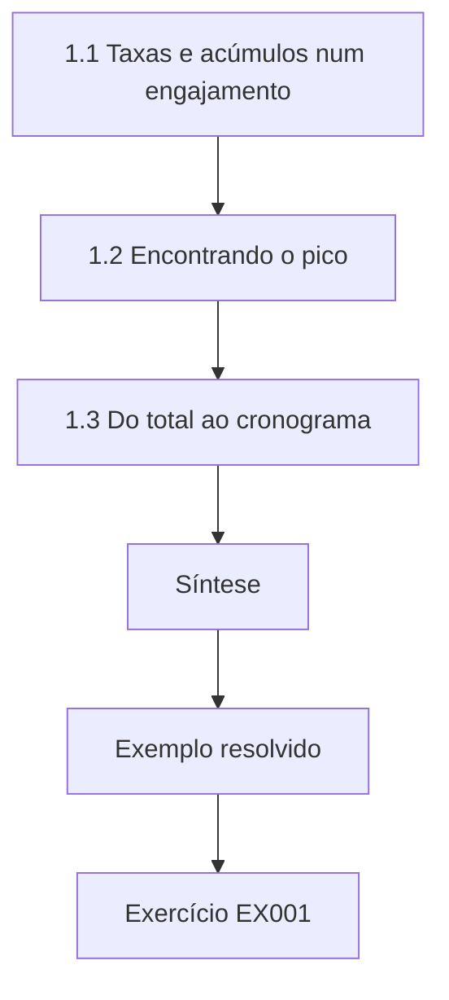

### Desenho lógico

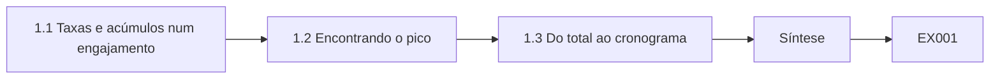

```text
[1.1 Taxas e acúmulos num engajamento]
    |
    v
[1.2 Encontrando o pico]
    |
    v
[1.3 Do total ao cronograma]
    |
    v
[Síntese]
    |
    v
[Exemplo resolvido] --> [Exercício EX001]
```
<!-- cykin:lesson-figures:end ch-01 -->


### Objetivos de aprendizagem

Você vai (1) modelar uma quantidade acumulada numa avaliação como a integral de uma taxa; (2) usar uma derivada para descobrir quando uma taxa atinge o pico; (3) transformar as duas num limite de taxa que Sam Ito consiga defender nas regras de engajamento (ROE).

### 1.1 Taxas e acúmulos num engajamento

Todo teste autorizado produz tráfego, e o cliente se importa com duas coisas: a velocidade com que ele chega e quanto se acumula. Se uma tarefa de enumeração envia requisições à taxa r(t) requisições por segundo, o total enviado entre os instantes a e b é a integral ∫ r(t) dt de a até b. Uma ROE que diz "no máximo 5 requisições por segundo" limita r(t); uma que diz "no máximo 20.000 requisições por dia contra a API de tickets" limita a integral. São restrições diferentes, e um cronograma pode satisfazer uma enquanto viola a outra.

### 1.2 Encontrando o pico

Suponha que o TrackScope acelere uma varredura e depois a desacelere, com r(t) = 6t − t² requisições por segundo para 0 ≤ t ≤ 6 minutos (t em minutos, sintético). A derivada r′(t) = 6 − 2t se anula em t = 3, onde r(3) = 9 requisições por segundo. Se o teto da ROE é 5 por segundo, esse cronograma o viola entre as duas raízes de 6t − t² = 5, isto é, t = 1 e t = 5 minutos. O cálculo diz não apenas *se* um plano quebra o limite, mas *por quanto tempo*, que é a primeira pergunta da equipe de operações do cliente.

### 1.3 Do total ao cronograma

O total dessa rampa é ∫₀⁶ (6t − t²) dt = [3t² − t³/3]₀⁶ = 108 − 72 = 36 requisição-minutos por segundo, ou seja, 36 × 60 = 2.160 requisições. Um cronograma plano a 5 por segundo precisaria de 2.160 / 5 = 432 segundos, 7,2 minutos, para enviar o mesmo volume sem nenhuma violação. Engenheiros preferem o cronograma plano porque seu pico é igual à sua média e é trivial de verificar a partir dos logs. > **Caso sintético — Riverstone Transit.** A rampa que Sam esboçou para o teste do gateway de tarifas atingia 9 req/s; a ROE permitia 5. Sam a substituiu por um token bucket de 5 req/s (veja o Capítulo 36) e anexou o cálculo da integral à solicitação de mudança.

### 1.4 Erros e limites

O tráfego real é feito de rajadas, não é suave; um modelo contínuo dá uma visão de caso médio, e o limite da ROE precisa ser imposto por um mecanismo, não pelo cálculo. As unidades causam a maior parte dos erros: mantenha segundos e minutos separados. A imposição pertence à configuração do scanner e a um limitador de taxa de rede que o cliente consiga ver, para que um erro no cronograma não ultrapasse silenciosamente o limite acordado. Ao converter entre minutos e segundos, escreva as unidades ao lado de cada número e confira o valor final com uma estimativa grosseira. As rajadas significam que um pico curto pode quebrar um limite por segundo mesmo quando a média horária está boa; por isso, Sam Ito define na ROE um teto de janela curta e outro de janela longa e os testa antes do início do engajamento.

### Exercícios

- **EX001 — Janela de violação.** Para r(t) = 8t − t² req/s (t em minutos, de 0 a 8) e um teto de 7 req/s, encontre o pico e o intervalo durante o qual o teto é violado. Rubrica: 3 = pico 16 em t=4 e violação entre t=1 e t=7 (6 minutos); 2 = um deslize; 1 = apenas o pico; 0 = nada.
- **EX002 — Dois tipos de limite.** Dê uma cláusula de ROE que limite uma taxa e outra que limite um total, para a mesma API, e diga qual delas uma verificação baseada em logs confere com mais facilidade. Rubrica: 3 = as duas cláusulas com unidades e resposta justificada; 2 = cláusulas sem justificativa; 1 = uma cláusula; 0 = nada.
- **EX003 — Equivalente plano.** Quanto tempo um cronograma plano de 4 req/s leva para enviar as 2.160 requisições do §1.3? Rubrica: 3 = 540 s (9 minutos) com o cálculo; 2 = número certo, sem unidades; 1 = apenas o método; 0 = nada.

### Síntese

Um limite de taxa e um limite de volume são a derivada e a integral da mesma curva. Conferir os dois transforma uma promessa vaga de "baixo impacto" em números que o cliente pode auditar.

### Continue estudando — capítulo 01 de 50

[← Página do curso](../../README.md) · [Índice de capítulos do curso](../SUBJECTS.md) · [Capítulo 02 (rascunho) →](#ch-02)

<a id="ch-02"></a>

## Capítulo 2 — Matemática discreta

<!-- cykin:lesson-figures:start ch-02 -->
### Mapa da aula

Aula 02 publicada. Mapa, exemplo, EX004.

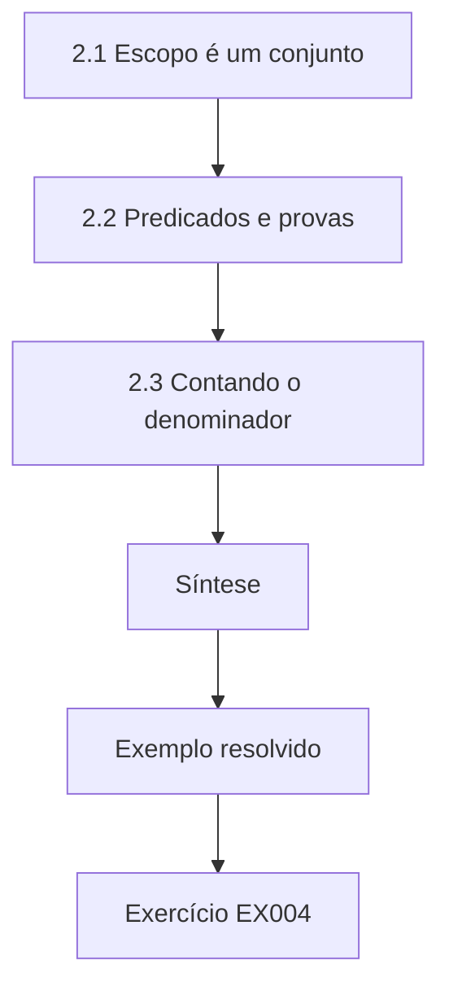

### Desenho lógico

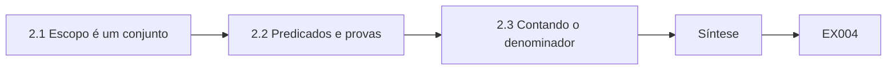

```text
[2.1 Escopo é um conjunto]
    |
    v
[2.2 Predicados e provas]
    |
    v
[2.3 Contando o denominador]
    |
    v
[Síntese]
    |
    v
[Exemplo resolvido] --> [Exercício EX004]
```
<!-- cykin:lesson-figures:end ch-02 -->


### Objetivos de aprendizagem

Você vai (1) expressar o escopo como conjuntos e predicados; (2) provar uma propriedade simples de uma regra de escopo; (3) contar o tamanho de um escopo para que as alegações de cobertura tenham um denominador.

### 2.1 Escopo é um conjunto

O escopo escrito lista o que pode ser testado: redes em escopo I, portas em escopo P e uma lista de exclusão D. O conjunto de alvos permitidos é T = {(h, p) : h ∈ I, h ∉ D, p ∈ P}. Escrever o escopo dessa forma expõe ambiguidades que uma ROE em prosa esconde. "A rede 10.20.0.0/16, exceto o gateway" é a diferença de conjuntos I \ D com D = {10.20.0.1}. "Serviços web" não é um conjunto até que alguém liste as portas. Quando os alvos são pares de host e porta, toda ação proposta pode ser conferida contra o mesmo predicado. Frases ambíguas como "serviços web" desaparecem, porque o conjunto contém uma porta ou não contém. A lista de exclusão fica dentro da definição de T, de modo que esquecer de aplicá-la é um erro de código, e não uma decisão de julgamento durante o teste. Sam mantém a ROE escrita e o conjunto legível por máquina na mesma mudança, para que não possam divergir.

### 2.2 Predicados e provas

O TrackScope implementa o predicado allowed(h, p) = inCIDR(h, I) ∧ ¬(h ∈ D) ∧ (p ∈ P). Como toda cláusula é uma conjunção, acrescentar um host a D só pode encolher T: se (h, p) ∈ T depois da mudança, então já estava em T antes. Vale a pena provar e testar essa monotonicidade, porque o oposto (uma mudança que amplia o escopo silenciosamente) é o incidente que os engenheiros mais querem evitar. Um teste unitário confere a propriedade em todos os pares tirados de um pequeno universo sintético.

```python
"""Check proposed engagement targets against a written scope (synthetic)."""
SCOPE_CIDRS = [("10.20.0.0", 16), ("192.168.50.0", 24)]  # inclusive synthetic ranges
SCOPE_PORTS = {22, 80, 443, 8080}
DENY_HOSTS = {"10.20.0.1", "192.168.50.1"}  # out-of-scope infra

def ip_int(s):
    a,b,c,d = map(int, s.split("."))
    return (a<<24)|(b<<16)|(c<<8)|d

def in_cidr(ip, net, bits):
    mask = (0xFFFFFFFF << (32-bits)) & 0xFFFFFFFF
    return (ip_int(ip) & mask) == (ip_int(net) & mask)

def check(host, port):
    reasons = []
    if host in DENY_HOSTS:
        reasons.append("deny-list")
    if not any(in_cidr(host, n, b) for n,b in SCOPE_CIDRS):
        reasons.append("outside-cidr")
    if port not in SCOPE_PORTS:
        reasons.append("port-not-in-scope")
    return ("ALLOW" if not reasons else "DENY"), reasons

tests = [
    ("10.20.1.10", 443),
    ("10.20.0.1", 443),
    ("192.168.50.20", 22),
    ("192.168.50.20", 3389),
    ("8.8.8.8", 80),
    ("192.168.1.10", 80),
]
for h,p in tests:
    v, r = check(h,p)
    print(f"target={h}:{p} decision={v} reasons={','.join(r) or '-'}")
```

Saída esperada:

```text
target=10.20.1.10:443 decision=ALLOW reasons=-
target=10.20.0.1:443 decision=DENY reasons=deny-list
target=192.168.50.20:22 decision=ALLOW reasons=-
target=192.168.50.20:3389 decision=DENY reasons=port-not-in-scope
target=8.8.8.8:80 decision=DENY reasons=outside-cidr
target=192.168.1.10:80 decision=DENY reasons=outside-cidr
```

### 2.3 Contando o denominador

Um /16 contém 2¹⁶ = 65.536 endereços; um /24 contém 256. Com quatro portas permitidas e um host excluído, |T| = (65.536 − 1 + 256) × 4 = 263.164 pares host–porta. Ninguém testa todos os pares, então a cobertura precisa ser declarada como "pares examinados / |T|" ou como uma fração amostrada, nunca como "a rede foi coberta". > **Caso sintético — Riverstone Transit.** O primeiro rascunho da ROE dizia "todos os sistemas das garagens". Sam o reescreveu como dois CIDRs, um conjunto de portas e uma lista de exclusão de um host, e o líder de rede do cliente descobriu que um CIDR de garagem também continha um quiosque de um fornecedor, que foi acrescentado a D antes da assinatura.

### 2.4 Erros e limites

Conjuntos descrevem a intenção, não a realidade: o DHCP pode mover um host para dentro ou para fora de uma faixa durante o teste, então o predicado precisa ser reavaliado a cada ação. CIDRs sobrepostos são contados em dobro se você somar os tamanhos de forma ingênua; use inclusão–exclusão. Reavaliar o predicado antes de cada ação custa pouco e pega um host que mudou de lugar durante o dia. Quando duas faixas se sobrepõem, somar seus tamanhos duas vezes é o erro comum; calcule a união. Um arquivo de escopo correto no kickoff pode estar errado na hora do almoço se o cliente renumerar uma sub-rede, e é por isso que o TrackScope registra a versão do arquivo de escopo em cada decisão.

### Exercícios

- **EX004 — Notação de conjuntos.** Escreva o conjunto de alvos permitidos para as redes 192.168.50.0/24, portas {22, 443} e lista de exclusão {192.168.50.1, 192.168.50.254}. Rubrica: 3 = expressão de conjunto correta e |T| = 508; 2 = expressão sem a contagem; 1 = parcial; 0 = nada.
- **EX005 — Monotonicidade.** Prove que acrescentar uma porta a P só pode ampliar T e diga qual regra de revisão isso implica. Rubrica: 3 = prova mais "acréscimos de porta precisam de um segundo aprovador"; 2 = apenas a prova; 1 = afirmação; 0 = nada.
- **EX006 — Leitura do laboratório.** Na saída do laboratório, por que 192.168.50.20:3389 é negado enquanto 192.168.50.20:22 é permitido? Rubrica: 3 = porta 3389 fora de P, host em I e fora de D; 2 = motivo sem as outras cláusulas; 1 = vago; 0 = errado.

### Síntese

Trate o escopo como um predicado sobre um conjunto contável. Assim ele pode ser testado e contado, e é possível mostrar que uma mudança nele não o amplia.

### Continue estudando — capítulo 02 de 50

[← Capítulo 01 (rascunho)](#ch-01) · [Índice de capítulos do curso](../SUBJECTS.md) · [Capítulo 03 (rascunho) →](#ch-03)

<a id="ch-03"></a>

## Capítulo 3 — Física para computação

<!-- cykin:lesson-figures:start ch-03 -->
### Mapa da aula

Aula 03 publicada. Mapa, exemplo, EX007.

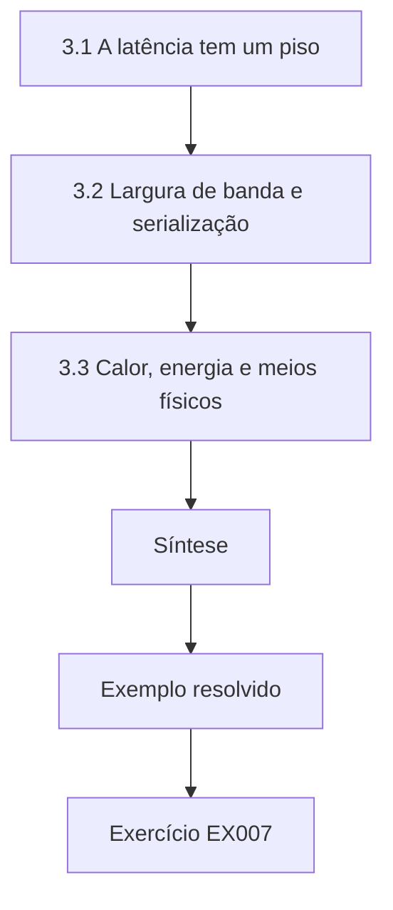

### Desenho lógico

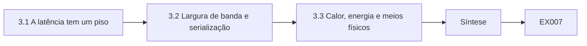

```text
[3.1 A latência tem um piso]
    |
    v
[3.2 Largura de banda e serialização]
    |
    v
[3.3 Calor, energia e meios físicos]
    |
    v
[Síntese]
    |
    v
[Exemplo resolvido] --> [Exercício EX007]
```
<!-- cykin:lesson-figures:end ch-03 -->


### Objetivos de aprendizagem

Você vai (1) relacionar propagação de sinal, largura de banda e latência ao que um teste consegue observar; (2) estimar os efeitos colaterais físicos do tráfego de teste; (3) explicar por que testes de rádio e de acesso físico precisam de autorização separada.

### 3.1 A latência tem um piso

Os sinais na fibra viajam a cerca de dois terços da velocidade da luz, aproximadamente 200.000 km/s, então 1.000 km de fibra acrescentam cerca de 5 ms em cada sentido. Quando o TrackScope relata um tempo de ida e volta de 40 ms até um servidor de garagem a 300 km de distância, cerca de 3 ms são propagação, e o resto é enfileiramento, comutação e processamento. Engenheiros usam esse piso para conferir a plausibilidade de evidências de tempo: um tempo de ida e volta *abaixo* do piso de propagação significa que a medição ou a suposição de localização está errada.

Se um tempo de ida e volta medido é menor do que a luz levaria para percorrer a distância alegada, ou o servidor está mais perto do que se pensava ou o relógio está errado. Sam usa o piso como verificação de evidências, não como localizador: muitos caminhos fazem rotas mais longas, então uma latência alta não prova nada sobre a distância. Em links de garagem de algumas centenas de quilômetros, alguns milissegundos de propagação são normais; dezenas de milissegundos de processamento num sistema de tarifas ocupado também são normais e não devem ser lidos como prova de um host distante.

### 3.2 Largura de banda e serialização

O tempo de serialização é o tamanho dividido pela taxa do link. Um quadro de 1.500 bytes num uplink de garagem de 10 Mb/s leva 1.500 × 8 / 10⁷ = 1,2 ms para ser colocado no meio. Se uma varredura autorizada envia 2.000 sondas pequenas por segundo, com 100 bytes cada, ela consome 1,6 Mb/s, 16% desse uplink, e é por isso que links de OT e de filiais com pouca banda recebem limites de ROE mais rígidos que as redes de data center. O tempo de serialização se soma a cada pacote antes de qualquer atraso de processamento. Num uplink lento, muitas sondas pequenas se acumulam mais depressa do que os engenheiros esperam, porque cada sonda ainda carrega cabeçalhos. Dezesseis por cento de um link de garagem já bastam para incomodar as operações e disparar alarmes de capacidade. Por isso, Sam dimensiona as varreduras pelo menor link em escopo, não pelo núcleo do data center, e escreve na ROE a taxa de link assumida, para que o cliente possa corrigi-la.

### 3.3 Calor, energia e meios físicos

A computação dissipa energia na forma de calor. Um teste de estresse que mantém a CPU de um validador de tarifas embarcado a 100% pode levá-lo além do seu envelope térmico num quiosque vedado; isso é uma questão de segurança operacional (*safety*), não um achado de segurança da informação. O rádio é um meio físico compartilhado com pessoas que nunca assinaram a ROE: avaliações de Wi-Fi e Bluetooth transmitem para o espaço público e são reguladas, então precisam de autorização explícita por escrito que nomeie frequências, locais e horários.

> **Caso sintético — Riverstone Transit.** Um teste de vazão proposto para o uplink da garagem teria usado 70% de um link de 10 Mb/s durante a janela de despacho da manhã. Sam o transferiu para 02:00–04:00 e o limitou a 1 Mb/s depois de calcular a carga de serialização.

### 3.4 Erros e limites

A física de guardanapo dá ordens de grandeza; links reais têm sobrecargas (cabeçalhos, retransmissões) que acrescentam de 5% a 20%. Não deduza a localização geográfica apenas pela latência; os caminhos de roteamento raramente são linhas retas. A sobrecarga de cabeçalhos e retransmissões faz com que um cálculo que a ignora subestime a carga. Usar a latência para adivinhar a localização falha quando o tráfego é roteado por um hub distante ou por uma VPN. Sam declara as suposições ao lado de cada estimativa e trata uma divergência em relação aos valores medidos como sinal para revisar o modelo, não como um achado sobre o alvo.

### Exercícios

- **EX007 — Piso de propagação.** Um relatório alega um tempo de ida e volta de 2 ms entre locais a 800 km de distância, por fibra. É plausível? Rubrica: 3 = piso ≈ 8 ms de ida e volta, portanto implausível, com uma causa provável (cache, local errado, proxy local); 2 = apenas o cálculo; 1 = palpite; 0 = nada.
- **EX008 — Fatia do link.** Que fração de um link de 2 Mb/s 500 sondas por segundo de 120 bytes usam? Rubrica: 3 = 0,48 Mb/s = 24%; 2 = um deslize de unidade; 1 = apenas o método; 0 = nada.
- **EX009 — Autorização de rádio.** Liste quatro campos que uma autorização escrita para uma avaliação de Wi-Fi precisa conter além de uma ROE de rede comum. Rubrica: 3 = frequências/bandas, locais físicos, horários e uma regra para dispositivos/dados de terceiros; 2 = três; 1 = um ou dois; 0 = nada.

### Síntese

A física define pisos e orçamentos. Usá-los pega evidências impossíveis e mantém o tráfego de teste dentro do que links e dispositivos frágeis aguentam.

### Continue estudando — capítulo 03 de 50

[← Capítulo 02 (rascunho)](#ch-02) · [Índice de capítulos do curso](../SUBJECTS.md) · [Capítulo 04 (rascunho) →](#ch-04)

<a id="ch-04"></a>

## Capítulo 4 — Programação I

<!-- cykin:lesson-figures:start ch-04 -->
### Mapa da aula

Aula 04 publicada. Mapa, exemplo, EX010.

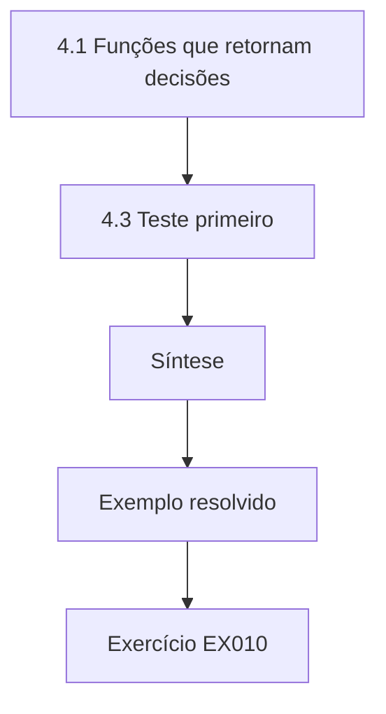

### Desenho lógico

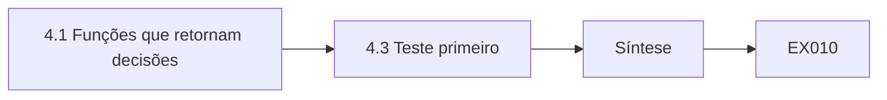

```text
[4.1 Funções que retornam decisões]
    |
    v
[4.3 Teste primeiro]
    |
    v
[Síntese]
    |
    v
[Exemplo resolvido] --> [Exercício EX010]
```
<!-- cykin:lesson-figures:end ch-04 -->


### Objetivos de aprendizagem

Você vai (1) escrever funções pequenas e testáveis para a contabilidade de uma avaliação; (2) escolher estruturas de dados que dificultem representar estados errados; (3) escrever um teste unitário antes de confiar na saída de uma ferramenta.

### 4.1 Funções que retornam decisões

As ferramentas de avaliação são, em grande parte, contabilidade: este alvo é permitido, qual achado é duplicado, qual a idade deste ticket. Cada pergunta deve ser uma função pura, com entradas explícitas e um valor de retorno, como `allowed(host, port, scope) -> (bool, reason)`. Retornar o *motivo* junto com a decisão torna os logs úteis: "DENY outside-cidr" diz ao revisor qual regra disparou. Evite estado global; uma função que lê um arquivo de escopo global escondido não pode ser testada contra um escopo sintético.

Uma função pura pode ser chamada por um teste unitário com um escopo falso e pela ferramenta em produção com o escopo real, e os dois caminhos compartilham a mesma lógica. Retornar uma string de motivo transforma cada negação numa explicação que o log do engajamento pode guardar. O estado global é inimigo desse padrão: se o escopo é lido de um arquivo dentro da função, um teste não consegue injetar um escopo sintético sem mexer no sistema de arquivos. Sam mantém o escopo como argumento em todos os pontos em que o TrackScope decide permitir ou negar.

### 4.2 Estruturas de dados que resistem a erros

Guarde as portas como um `set` de inteiros, não como uma string separada por vírgulas: a pertinência é exata, e "443" não pode casar com "4430". Guarde os CIDRs como objetos de rede já interpretados (o módulo padrão `ipaddress`), e não como strings, porque a comparação por prefixo de string acha que 10.200.0.5 está dentro de "10.20". Guarde os achados como dicionários com um esquema fixo e valide as chaves obrigatórias na criação. Tipos errados criam bugs silenciosos que parecem erros de escopo. Uma string de portas convida a uma comparação de substring; um conjunto de inteiros, não. Verificações de prefixo de string sobre endereços são uma armadilha clássica, e é por isso que existem os objetos de rede da biblioteca padrão. Validar os registros de achados na criação pega uma referência de ticket ausente antes de o relatório ser escrito, quando corrigi-la ainda custa segundos, e não uma correção constrangedora junto ao cliente.

### 4.3 Teste primeiro

Antes de usar um verificador de escopo numa rede de cliente, escreva cinco testes sobre dados sintéticos: um de permissão, um de negação para cada regra e um caso de fronteira (o primeiro e o último endereço de uma faixa). O laboratório do Capítulo 2 é exatamente uma tabela de decisões desse tipo; reproduzi-lo num teste unitário significa que uma refatoração posterior que quebre a lista de exclusão será pega antes de chegar a um engajamento real.

```python
import ipaddress
def in_scope(h, nets):
    a = ipaddress.ip_address(h)
    return any(a in ipaddress.ip_network(n) for n in nets)
assert in_scope("10.20.255.255", ["10.20.0.0/16"])
assert not in_scope("10.2.0.5", ["10.20.0.0/16"])
print("scope tests passed")
```

> **Caso sintético — Riverstone Transit.** Um script de estagiário comparava o escopo com `host.startswith("10.2")`. O teste de fronteira de Sam mostrou que ele aceitava 10.200.0.0/16, uma rede de parceiro. A correção usou `ipaddress`, e o teste agora roda na CI.

### 4.4 Erros e limites

Os testes provam o comportamento nos casos que você escreveu, não em todas as entradas. Mantenha os dados de teste sintéticos; nunca cole a lista real de hosts de um cliente num repositório público. Uma suíte que passa significa que os casos escritos se comportam; uma fronteira não testada ainda pode estar errada. Hosts sintéticos mantêm as redes dos clientes fora do histórico do git e fora das máquinas dos estudantes. Quando uma nova regra é acrescentada ao verificador de escopo, Sam acrescenta um teste para ela na mesma mudança, para que a suíte e as regras fiquem alinhadas.

### Exercícios

- **EX010 — Caça ao bug.** Explique por que `"443" in "8443,22"` é verdadeiro em Python e como corrigir a verificação de porta. Rubrica: 3 = semântica de substring explicada e correção com conjunto de inteiros; 2 = apenas a correção; 1 = vago; 0 = nada.
- **EX011 — Testes de fronteira.** Dê os dois endereços de fronteira a testar para 192.168.50.0/24 e o resultado esperado para 192.168.51.0. Rubrica: 3 = .0 e .255 dentro, 192.168.51.0 fora; 2 = um faltando; 1 = parcial; 0 = nada.
- **EX012 — Códigos de motivo.** Por que uma função de escopo deve retornar uma string de motivo, e não apenas um booleano? Rubrica: 3 = valor para auditoria/log e precisão dos testes, com um exemplo; 2 = um motivo; 1 = vago; 0 = nada.

### Síntese

Funções puras pequenas, tipos de dados exatos e testes escritos sobre dados sintéticos são o mecanismo de segurança de escopo mais barato que um engenheiro tem.

### Continue estudando — capítulo 04 de 50

[← Capítulo 03 (rascunho)](#ch-03) · [Índice de capítulos do curso](../SUBJECTS.md) · [Capítulo 05 (rascunho) →](#ch-05)

<a id="ch-05"></a>

## Capítulo 5 — Comunicação de engenharia

<!-- cykin:lesson-figures:start ch-05 -->
### Mapa da aula

Aula 05 publicada. Mapa, exemplo, EX013.

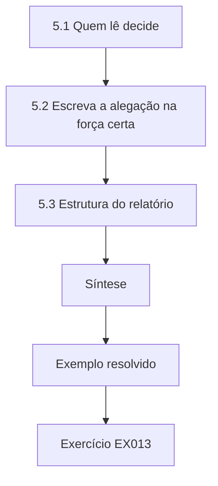

### Desenho lógico

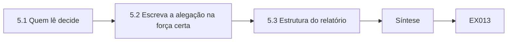

```text
[5.1 Quem lê decide]
    |
    v
[5.2 Escreva a alegação na força certa]
    |
    v
[5.3 Estrutura do relatório]
    |
    v
[Síntese]
    |
    v
[Exemplo resolvido] --> [Exercício EX013]
```
<!-- cykin:lesson-figures:end ch-05 -->


### Objetivos de aprendizagem

Você vai (1) escrever um achado com o qual um não especialista consiga agir, sem detalhes de exploração; (2) estruturar um relatório curto de engenharia; (3) declarar a incerteza com clareza.

### 5.1 Quem lê decide

Um relatório de red team é lido por um engenheiro que precisa corrigir algo e por um gestor que precisa financiar a correção. Nenhum dos dois precisa de uma receita. Um achado precisa de: um título que declare a fraqueza e o ativo; o escopo afetado; a evidência (o que foi observado, com horário e referência de ticket); o impacto em termos de negócio; a correção recomendada; e como a correção será verificada. O NIST SP 800-115 trata o relatório como parte da avaliação, não como um detalhe posterior.

Colocar a correção e sua verificação ao lado da evidência significa que o engenheiro que precisa agir tem tudo numa única página. O impacto de negócio responde à pergunta de financiamento do gestor sem jargão técnico: trens atrasados, dados de passageiros expostos ou um risco de falsificação de bilhetes pesam de maneiras diferentes. Deixar de fora uma receita funcional não é imprecisão; é uma escolha deliberada para que o relatório possa ser repassado dentro do cliente sem virar um manual. O lugar que o NIST SP 800-115 dá ao relatório lembra às equipes que um achado não relatado não ajuda ninguém.

### 5.2 Escreva a alegação na força certa

"Comprometemos o domínio" é uma manchete. "Dentro da janela autorizada, uma conta de serviço no diretório do laboratório tinha direitos de administrador de domínio; confirmamos a participação no grupo apenas com leitura e não a usamos" é um achado. A segunda frase diz o que foi feito, o que não foi feito e em qual escopo, e o leitor pode verificá-la. A alegação mais fraca e cuidadosa é mais forte como engenharia, porque outra equipe pode conferi-la de novo. Declarar o que não foi feito fecha a brecha em que o leitor imagina um cenário pior do que o ocorrido. Nomear o escopo, como o diretório do laboratório e não a produção, impede que um achado seja aplicado ao sistema errado. Sam lê cada rascunho em voz alta e pergunta se cada substantivo aponta para algo no repositório de evidências.

### 5.3 Estrutura do relatório

Um relatório curto de engenharia tem: um sumário executivo (três frases: o que foi testado, o resultado mais importante e a única decisão necessária); escopo e método, com a versão da ROE; achados ordenados por prioridade; limitações (o que ficou fora do escopo ou não foi alcançado); e um apêndice com os hashes das evidências. Use tabelas para os achados e prosa para o raciocínio.

```python
"""Score synthetic findings for report priority (no exploit details)."""
# impact 0-3, exploitability 0-3, exposure 0-3  -> priority
findings = [
    ("SYN-001", "default admin password on staging web UI", 3, 3, 2),
    ("SYN-002", "missing security headers on public site", 1, 1, 3),
    ("SYN-003", "outdated TLS on internal admin port", 2, 2, 1),
    ("SYN-004", "verbose error messages disclose paths", 1, 2, 2),
    ("SYN-005", "service account with domain admin in lab AD", 3, 2, 1),
]

def priority(impact, exploitability, exposure):
    score = impact*4 + exploitability*2 + exposure
    if score >= 16: return "critical", score
    if score >= 11: return "high", score
    if score >= 7: return "medium", score
    return "low", score

for fid, title, i, e, x in findings:
    p, s = priority(i, e, x)
    print(f"{fid} priority={p:8} score={s:2} impact={i} exploitability={e} exposure={x} :: {title}")
```

Saída esperada:

```text
SYN-001 priority=critical score=20 impact=3 exploitability=3 exposure=2 :: default admin password on staging web UI
SYN-002 priority=medium   score= 9 impact=1 exploitability=1 exposure=3 :: missing security headers on public site
SYN-003 priority=high     score=13 impact=2 exploitability=2 exposure=1 :: outdated TLS on internal admin port
SYN-004 priority=medium   score=10 impact=1 exploitability=2 exposure=2 :: verbose error messages disclose paths
SYN-005 priority=critical score=17 impact=3 exploitability=2 exposure=1 :: service account with domain admin in lab AD
```

> **Caso sintético — Riverstone Transit.** O primeiro rascunho de Sam para o SYN-001 dizia "a UI de staging está totalmente dominada". O achado revisado diz: "A UI de administração de staging (10.20.1.10:443) aceita a senha padrão do fornecedor; observado às 10:45, ticket FD-118; um atacante na rede corporativa poderia alterar as tabelas de tarifas em staging; correção: trocar e exigir credenciais únicas; verificar por uma falha de login num reteste."

### 5.4 Erros e limites

Evite adjetivos que não possam ser verificados ("trivial", "catastrófico"). Não inclua payloads funcionais, credenciais ou instruções passo a passo nos relatórios; faça referência ao repositório de evidências. Adjetivos não verificáveis convidam à discussão e escondem a evidência real. Payloads funcionais e credenciais pertencem a um repositório controlado com logs de acesso, não a um PDF que vai circular por e-mail. Quando um leitor precisa de mais detalhes para verificar uma correção, Sam o direciona para o ticket e o hash da evidência, em vez de colar segredos no corpo do relatório.

### Exercícios

- **EX013 — Reescrita.** Reescreva "A VPN está escancarada kkk" como título de achado e uma linha de evidência de uma frase. Rubrica: 3 = ativo, fraqueza, horário/referência da observação, sem detalhes de exploração; 2 = falta um elemento; 1 = ainda vago; 0 = inalterado.
- **EX014 — Sumário executivo.** Escreva um sumário de três frases para os cinco achados do laboratório. Rubrica: 3 = escopo, os dois itens críticos, uma decisão solicitada; 2 = falta a decisão; 1 = só uma lista; 0 = nada.
- **EX015 — Limitações.** Cite duas limitações que um relatório deste engajamento precisa declarar. Rubrica: 3 = dois limites específicos (por exemplo, hosts não alcançados, janela de tempo, sem engenharia social) com efeito nas conclusões; 2 = dois sem efeito; 1 = um; 0 = nenhum.

### Síntese

Um bom achado é específico, verificável e seguro para circular. Escrevê-lo assim faz parte da engenharia, não é decoração.

### Continue estudando — capítulo 05 de 50

[← Capítulo 04 (rascunho)](#ch-04) · [Índice de capítulos do curso](../SUBJECTS.md) · [Capítulo 06 (rascunho) →](#ch-06)

<a id="ch-06"></a>

## Capítulo 6 — Cálculo II

<!-- cykin:lesson-figures:start ch-06 -->
### Mapa da aula

Aula 06 publicada. Mapa, exemplo, EX016.

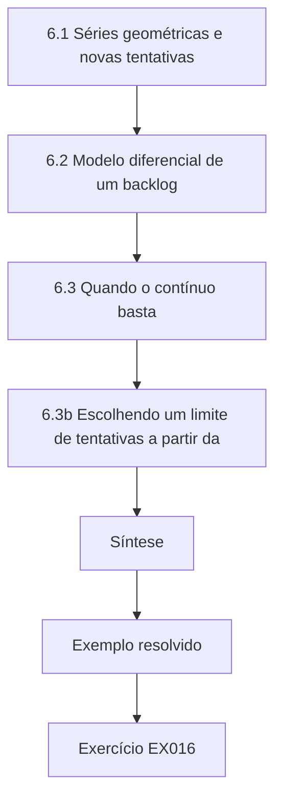

### Desenho lógico

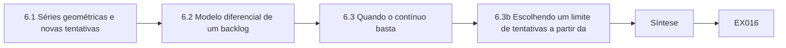

```text
[6.1 Séries geométricas e novas tentativas]
    |
    v
[6.2 Modelo diferencial de um backlog]
    |
    v
[6.3 Quando o contínuo basta]
    |
    v
[6.3b Escolhendo um limite de tentativas a partir da]
    |
    v
[Síntese]
    |
    v
[Exemplo resolvido] --> [Exercício EX016]
```
<!-- cykin:lesson-figures:end ch-06 -->


### Objetivos de aprendizagem

Você vai (1) usar séries e acumulação para raciocinar sobre sondagens repetidas; (2) aplicar um modelo diferencial simples a um backlog de remediação; (3) decidir quando um modelo contínuo basta para um debate sobre a ROE.

### 6.1 Séries geométricas e novas tentativas

Se cada tentativa de enviar evidências tem sucesso com probabilidade p = 0,8, de forma independente, a chance de ter sucesso em até k tentativas é 1 − (1 − p)^k. Isso é uma série geométrica finita. Com k = 3, 1 − 0,2³ = 0,992. As novas tentativas elevam a taxa de sucesso, mas também multiplicam o tráfego: o número esperado de tentativas até o sucesso é 1/p = 1,25, então um lote de 1.000 envios espera 1.250 requisições. A ROE precisa contar as novas tentativas, não só os envios lógicos.

```python
"""Reliability of a synthetic evidence-upload step with retries (deterministic)."""
import random
random.seed(7)
P_FAIL = 0.2
def upload_attempts(max_tries):
    for t in range(1, max_tries + 1):
        if random.random() > P_FAIL:
            return True, t
    return False, max_tries
for tries in (1, 2, 3, 5):
    random.seed(7)
    ok = sum(upload_attempts(tries)[0] for _ in range(1000))
    print(f"max_tries={tries} success={ok}/1000 theory={1-P_FAIL**tries:.4f}")
```

Saída esperada:

```text
max_tries=1 success=784/1000 theory=0.8000
max_tries=2 success=949/1000 theory=0.9600
max_tries=3 success=988/1000 theory=0.9920
max_tries=5 success=1000/1000 theory=0.9997
```

Contar apenas os envios lógicos subestima a carga pelo fator de novas tentativas. Com p igual a 0,8, cada mil envios lógicos significam, em média, cerca de mil duzentas e cinquenta tentativas, e é isso que o limitador de taxa do cliente vai ver. A semente do laboratório mantém a demonstração estável entre máquinas; em produção, usa-se a mesma fórmula com taxas de falha medidas. Sam escreve o número esperado de tentativas no orçamento de volume da ROE antes do engajamento.

### 6.2 Modelo diferencial de um backlog

Seja B(t) o número de achados abertos. Os achados chegam à taxa a e são fechados à taxa c quando há equipe. Então B′(t) ≈ a − c. Se a = 4/dia e c = 6/dia, o backlog cai cerca de 2 por dia; partindo de 30, chega a zero em 15 dias. Se as chegadas saltam para 8/dia (uma semana de campanha) enquanto a equipe continua em 6, o backlog cresce. O modelo é grosseiro — ignora a prioridade —, mas torna quantitativa a decisão sobre a equipe. O sinal de a menos c conta a história num relance: negativo, a pilha encolhe; positivo, ela cresce. A prioridade continua importando nas filas reais, então Sam usa o modelo para pedir equipe, não para prometer uma data no calendário. Quando uma semana de campanha dobra as chegadas, o mesmo modelo mostra quantas pessoas a mais são necessárias para fechar tickets e manter o nível. Plotar B(t) ao longo de um mês torna o efeito visível para gestores que não vão ler a equação.

### 6.3 Quando o contínuo basta

Debates sobre a ROE costumam precisar de uma ordem de grandeza, não de uma forma fechada. "Uma varredura a 5 req/s por 30 minutos vai produzir cerca de 9.000 requisições?" Sim: 5 × 1.800 = 9.000. Reserve o cálculo exato para agendas com picos (§1) e para modelos que o cliente vai auditar. Agendas exatas com picos precisam do tratamento mais completo do primeiro capítulo de cálculo, e são essas que Sam leva a um cliente que vai auditar os números. Para uma varredura plana, multiplicar a taxa pela duração basta, e escrever o produto ao lado do limite de volume mostra a conformidade num relance. Se o produto fica perto do limite, ele passa para a verificação da agenda exata em vez de torcer para que as rajadas fiquem pequenas.

> **Caso sintético — Riverstone Transit.** O FindingsDesk mostrava um backlog de 28 achados médios, com duas remediações por dia. O modelo B′ de Sam previu 14 dias para zerar se não houvesse novas chegadas; o gestor financiou um terceiro engenheiro para aquela quinzena.

### 6.4 Erros e limites

A independência das novas tentativas falha quando a falha é sistemática (um endpoint quebrado). Modelos de backlog ignoram prioridade e SLA; use-os para iniciar uma conversa, não como uma previsão que o conselho vai citar. Um endpoint quebrado falha em todas as tentativas, então multiplicá-las não eleva a taxa de sucesso e só acrescenta carga. Modelos de equipe que ignoram a severidade vão fechar os tickets fáceis enquanto os críticos envelhecem. Sam rotula cada modelo com suas premissas e não deixa que um gráfico de backlog seja citado como data de entrega.

### 6.3b Escolhendo um limite de tentativas a partir da série

A série geométrica dá a chance de todas as tentativas falharem como p elevado a n. Sam a usa de trás para frente: o envio de evidências do TrackScope precisa ter sucesso 99% das vezes, e execuções sintéticas mostram uma taxa de falha de 20% por tentativa; então três tentativas (0,8%) atingem a meta, enquanto duas (4%) não. Ele escreve a derivação na nota de design para que um revisor possa conferir o limite sem repetir os experimentos. Trabalhar de trás para frente a partir de uma meta de confiabilidade transforma uma questão de gosto numa derivação curta. Três tentativas deixam menos de um por cento de falha quando cada tentativa falha uma vez em cinco, o que bate com o laboratório. Pôr a derivação na nota de design significa que um engenheiro, mais tarde, pode mudar a taxa de falha e recalcular o limite sem adivinhar por que três foi o número escolhido. Sam repete a verificação sintética sempre que o caminho de envio muda.

### Exercícios

- **EX016 — Tráfego de novas tentativas.** Com p = 0,7 e um lote de 500 envios, quantas tentativas são esperadas até que cada um tenha sucesso uma vez? Rubrica: 3 = 500/0,7 ≈ 714 com o raciocínio; 2 = um deslize; 1 = só a fórmula; 0 = nada.
- **EX017 — Backlog.** B(0) = 40, a = 3/dia, c = 5/dia. Quando B chega a 0? Rubrica: 3 = 20 dias; 2 = método certo, aritmética errada; 1 = qualitativo; 0 = nada.
- **EX018 — Leitura do laboratório.** Pelo laboratório, em quantos pontos percentuais k = 3 melhora em relação a k = 1 com p = 0,8? Rubrica: 3 = 99,2 − 80,0 = 19,2 pontos (teoria) ou a diferença empírica 98,8 − 78,4 = 20,4 pontos; 2 = um número; 1 = vago; 0 = errado.

### Síntese

Séries e taxas transformam "tente de novo" e "contrate alguém" em números que cabem numa ROE ou num pedido de equipe.

### Continue estudando — capítulo 06 de 50

[← Capítulo 05 (rascunho)](#ch-05) · [Índice de capítulos do curso](../SUBJECTS.md) · [Capítulo 07 (rascunho) →](#ch-07)

<a id="ch-07"></a>

## Capítulo 7 — Probabilidade e estatística

<!-- cykin:lesson-figures:start ch-07 -->
### Mapa da aula

Aula 07 publicada. Mapa, exemplo, EX019.

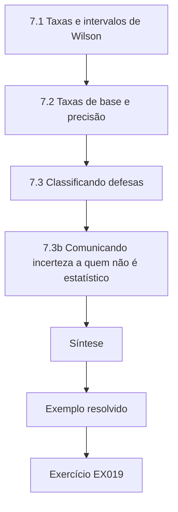

### Desenho lógico

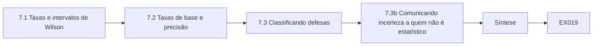

```text
[7.1 Taxas e intervalos de Wilson]
    |
    v
[7.2 Taxas de base e precisão]
    |
    v
[7.3 Classificando defesas]
    |
    v
[7.3b Comunicando incerteza a quem não é estatístico]
    |
    v
[Síntese]
    |
    v
[Exemplo resolvido] --> [Exercício EX019]
```
<!-- cykin:lesson-figures:end ch-07 -->


### Objetivos de aprendizagem

Você vai (1) relatar uma taxa com um intervalo, não como uma porcentagem solta; (2) aplicar a regra de Bayes à precisão de alarmes; (3) recusar uma classificação que a amostra não sustenta.

### 7.1 Taxas e intervalos de Wilson

Três sucessos em vinte tentativas são 15%. Um intervalo de Wilson de 95% para isso vai de cerca de 5% a 36%. Você pode dizer que a taxa provavelmente não é zero e provavelmente fica abaixo de 40%; não pode dizer que ela é melhor que uma defesa que marcou 20/100 (20%). Um n maior estreita o intervalo: 300/2.000 continua sendo 15%, mas fica entre cerca de 13,5% e 16,6%. Albrecht e Jensen alertam contra pontuações únicas vazias; um intervalo é a honestidade mais barata.

```python
"""Lab S: reporting attack-success rates honestly: Wilson intervals,
seed variation and a paired bootstrap. Synthetic trial outcomes only."""
import math, random
def wilson(k, n, z=1.96):
    p = k/n; d = 1 + z*z/n
    c = (p + z*z/(2*n))/d; h = z*math.sqrt(p*(1-p)/n + z*z/(4*n*n))/d
    return c - h, c + h
for k, n in ((3, 20), (30, 200), (300, 2000)):
    lo, hi = wilson(k, n); print(f"successes={k}/{n} rate={k/n:.3f} wilson95=[{lo:.3f}, {hi:.3f}]")
# five seeds of a synthetic defence evaluation: per-seed attack success rate
rates = []
for seed in range(5):
    r = random.Random(seed); rates.append(sum(r.random() < 0.12 for _ in range(200))/200)
m = sum(rates)/5; sd = math.sqrt(sum((x-m)**2 for x in rates)/4)
print("per-seed rates:", " ".join(f"{x:.3f}" for x in rates), f"mean={m:.3f} sd={sd:.3f}")
# paired bootstrap: baseline vs defence on the same 300 synthetic prompts
r = random.Random(42)
base = [r.random() < 0.30 for _ in range(300)]
defn = [b and r.random() < 0.6 for b in base]   # defence blocks ~40% of successes
diffs = []
for _ in range(2000):
    idx = [r.randrange(300) for _ in range(300)]
    diffs.append(sum(base[i] for i in idx)/300 - sum(defn[i] for i in idx)/300)
diffs.sort()
print(f"baseline_asr={sum(base)/300:.3f} defended_asr={sum(defn)/300:.3f} "
      f"reduction_ci95=[{diffs[50]:.3f}, {diffs[1949]:.3f}]")
```

Saída esperada:

```text
successes=3/20 rate=0.150 wilson95=[0.052, 0.360]
successes=30/200 rate=0.150 wilson95=[0.107, 0.206]
successes=300/2000 rate=0.150 wilson95=[0.135, 0.166]
per-seed rates: 0.110 0.130 0.135 0.105 0.145 mean=0.125 sd=0.017
baseline_asr=0.350 defended_asr=0.190 reduction_ci95=[0.120, 0.203]
```

Os mesmos quinze por cento significam coisas muito diferentes com n igual a vinte e com n igual a dois mil. Um intervalo torna isso visível sem uma aula de estatística. Sam relata o intervalo ao lado de cada taxa de sucesso de ataque, para que nenhuma defesa seja coroada com base numa amostra minúscula. A variação de sementes e o bootstrap pareado do laboratório oferecem mais duas verificações: estabilidade entre sementes e uma diferença que pode incluir zero.

### 7.2 Taxas de base e precisão

Um detector com 95% de taxa de verdadeiros positivos e 5% de taxa de falsos positivos parece excelente até que a taxa de base da classe ruim seja 0,1%. Então quase todo alerta é um falso positivo (precisão ≈ 1,9%). Regra de Bayes: precisão = TPR·π / (TPR·π + FPR·(1−π)). O PulseMap precisa mostrar a precisão na taxa de base do cliente, não só a TPR.

```python
"""Lab B: base rates and alarm precision (Bayes' rule).
A detector for malicious prompts with given true- and false-positive rates
is applied to traffic with different shares of malicious prompts."""
for tpr, fpr in ((0.95, 0.05), (0.95, 0.01), (0.80, 0.001)):
    for prev in (0.10, 0.01, 0.001):
        tp = tpr * prev; fp = fpr * (1 - prev)
        prec = tp / (tp + fp)
        per_10k = round(10000 * (tp + fp))
        print(f"tpr={tpr:.2f} fpr={fpr:.3f} prevalence={prev:.3f} precision={prec:.3f} alerts_per_10k={per_10k}")
```

Saída esperada:

```text
tpr=0.95 fpr=0.050 prevalence=0.100 precision=0.679 alerts_per_10k=1400
tpr=0.95 fpr=0.050 prevalence=0.010 precision=0.161 alerts_per_10k=590
tpr=0.95 fpr=0.050 prevalence=0.001 precision=0.019 alerts_per_10k=509
tpr=0.95 fpr=0.010 prevalence=0.100 precision=0.913 alerts_per_10k=1040
tpr=0.95 fpr=0.010 prevalence=0.010 precision=0.490 alerts_per_10k=194
tpr=0.95 fpr=0.010 prevalence=0.001 precision=0.087 alerts_per_10k=109
tpr=0.80 fpr=0.001 prevalence=0.100 precision=0.989 alerts_per_10k=809
tpr=0.80 fpr=0.001 prevalence=0.010 precision=0.890 alerts_per_10k=90
tpr=0.80 fpr=0.001 prevalence=0.001 precision=0.445 alerts_per_10k=18
```

A precisão despenca quando a classe ruim é rara, que é exatamente o cenário do PulseMap. Um painel que mostra só a taxa de verdadeiros positivos parecerá excelente enquanto inunda os analistas de alarmes falsos. Calcular a precisão na prevalência medida do cliente, como faz a tabela do laboratório, é o que Sam coloca no relatório. Se a prevalência é desconhecida, ele mostra uma pequena tabela com uma faixa de valores em vez de escolher um número lisonjeiro.

### 7.3 Classificando defesas

Duas defesas com intervalos sobrepostos não são classificadas. Prefira um desenho pareado, com os mesmos prompts, e um bootstrap da diferença, como mostra o laboratório. Se o intervalo da diferença incluir zero, relate "nenhuma diferença significativa nesta amostra", não um vencedor.

> **Caso sintético — Riverstone Transit.** Um fornecedor afirmou que "nosso filtro é 99% eficaz". Sam pediu a taxa de base e o tamanho da amostra; nenhum dos dois estava no folheto. O piloto usou 200 prompts sintéticos com 1% de ataques e mediu precisão ≈ 16%.

### 7.4 Erros e limites

A independência das tentativas falha quando os prompts compartilham um modelo de texto. Os intervalos pressupõem um processo fixo; trocar o modelo no meio do teste os invalida. Nunca invente um valor-p para uma tabela que você não testou. Modelos de texto compartilhados tornam as tentativas dependentes, então intervalos que pressupõem independência ficam estreitos demais. Trocar o modelo no meio do teste mistura dois processos e invalida a amostra. Sam nunca anexa uma alegação de significância a uma tabela que não foi testada para isso, e reinicia a amostra quando a defesa sob teste muda.

### 7.3b Comunicando incerteza a quem não é estatístico

Uma taxa de detecção de 7 em 10 e uma de 700 em 1.000 imprimem a mesma porcentagem, mas merecem confianças muito diferentes. Quando Sam relata a cobertura do PulseMap ao gestor de segurança da Riverstone Transit, ele informa a contagem, o intervalo e uma frase simples: "vimos sete de dez eventos de teste; a taxa real poderia plausivelmente estar em qualquer ponto entre cerca de 40% e 90%". Os gestores então pedem mais tentativas, em vez de tratar uma amostra pequena como um fato, e a classificação das defesas espera até que os intervalos deixem de se sobrepor.

### Exercícios

- **EX019 — Intervalo.** Diga o que você pode afirmar a partir de 8/40 sucessos com 95%. Rubrica: 3 = Wilson ≈ 10,5%–34,5% (ou Clopper–Pearson), não é possível classificar contra 25%; 2 = só o intervalo; 1 = estimativa pontual; 0 = errado.
- **EX020 — Precisão.** Detector com TPR 0,9, FPR 0,02, π = 0,005. Qual a precisão? Rubrica: 3 ≈ 0,184 com o raciocínio; 2 = um deslize; 1 = fórmula; 0 = nada.
- **EX021 — Recusa de classificação.** Dois filtros marcam 12/100 e 18/100. Escreva a frase que recusa uma classificação. Rubrica: 3 = cita incerteza sobreposta / necessidade de desenho pareado; 2 = cautela vaga; 1 = escolhe um vencedor; 0 = nada.

### Síntese

A estatística é a linguagem para não exagerar nas alegações. Taxas com intervalos e precisão na taxa de base real mantêm o PulseMap honesto.

### Continue estudando — capítulo 07 de 50

[← Capítulo 06 (rascunho)](#ch-06) · [Índice de capítulos do curso](../SUBJECTS.md) · [Capítulo 08 (rascunho) →](#ch-08)

<a id="ch-08"></a>

## Capítulo 8 — Arquitetura de computadores

<!-- cykin:lesson-figures:start ch-08 -->
### Mapa da aula

Aula 08 publicada. Mapa, exemplo, EX022.

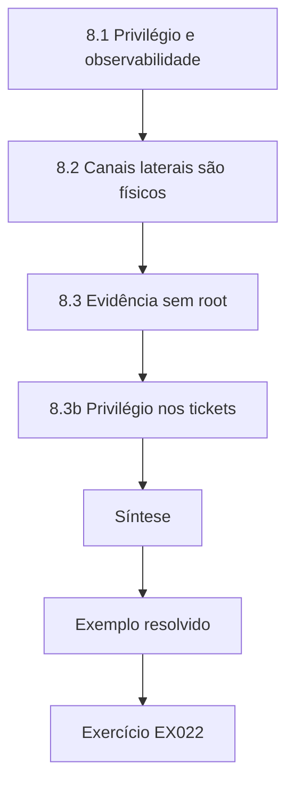

### Desenho lógico

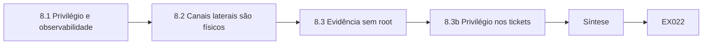

```text
[8.1 Privilégio e observabilidade]
    |
    v
[8.2 Canais laterais são físicos]
    |
    v
[8.3 Evidência sem root]
    |
    v
[8.3b Privilégio nos tickets]
    |
    v
[Síntese]
    |
    v
[Exemplo resolvido] --> [Exercício EX022]
```
<!-- cykin:lesson-figures:end ch-08 -->


### Objetivos de aprendizagem

Você vai (1) mapear os níveis de privilégio para o que um teste autorizado pode observar; (2) explicar por que canais laterais de tempo e de cache precisam de cláusulas especiais na ROE; (3) desenhar um caminho de evidências que não exija privilégios de kernel.

### 8.1 Privilégio e observabilidade

O modo usuário vê a memória do processo e as chamadas de sistema que lhe são permitidas; o modo kernel vê dispositivos e tabelas de páginas; um hipervisor vê os convidados. Um engajamento autorizado que permanece em modo usuário não pode afirmar que "descartamos um rootkit de kernel". Declare o nível de privilégio de cada observação no pacote de evidências. O TrackScope deve registrar a conta e o papel usados em cada ação. Um achado é tão forte quanto o ponto de observação que o produziu. Evidências em modo usuário não conseguem descartar ameaças que vivem abaixo dele, e afirmar o contrário vende o engajamento por mais do que ele é. Registrar a conta e o papel ao lado de cada ação permite que um revisor veja se uma alegação posterior corresponde ao acesso usado. O TrackScope se recusa a guardar uma observação sem esse campo.

### 8.2 Canais laterais são físicos

Canais laterais de cache e de tempo medem o estado microarquitetural. São técnicas de pesquisa, ruidosas e muitas vezes fora do escopo de avaliações comerciais. Se estiverem no escopo, a ROE precisa nomear as plataformas, proibir tráfego de produção e exigir uma condição de parada caso a latência para os usuários suba. Não trate um laboratório de estudante num notebook como evidência sobre um servidor. Essas técnicas medem o estado de hardware compartilhado e podem perturbar a latência de produção, e é por isso que precisam de cláusulas próprias na ROE. Um laboratório num notebook não diz nada sobre o comportamento de cache de um servidor sob carga. Quando os canais laterais estão fora do escopo, Sam declara esse limite no relatório para que os leitores não presumam que foram tentados. As condições de parada protegem usuários que nunca concordaram em fazer parte do experimento.

### 8.3 Evidência sem root

A maior parte das evidências duráveis de uma avaliação autorizada são logs, leituras de configuração e respostas de aplicação — tudo disponível para uma conta de usuário devidamente autorizada. Prefira esse caminho: é mais seguro, mais fácil de revogar depois do engajamento e suficiente para achados sobre autenticação, autorização e exposição.

> **Caso sintético — Riverstone Transit.** Uma proposta de "imagem completa de disco" de um validador de tarifas precisava de root e tiraria o dispositivo do ar. Sam a substituiu por uma exportação de configuração e uma leitura, no nível da aplicação, da lista de contas, ambas autorizadas pela ROE existente.

### 8.4 Erros e limites

Diagramas de arquitetura em apresentações de marketing omitem caches compartilhados e planos de gerenciamento. Verifique a plataforma real antes de prometer um nível de privilégio na ROE. Diagramas de marketing muitas vezes escondem interfaces de gerenciamento e hardware compartilhado. Sam confirma a plataforma real com o cliente antes que a ROE prometa um nível de privilégio. Se a plataforma não puder ser confirmada, o engajamento fica no menor privilégio cuja existência é conhecida, e o relatório declara esse limite para que os leitores não inventem um ponto de observação mais forte.

### 8.3b Privilégio nos tickets

O FindingsDesk deve guardar `privilege_used` como um enum (user, admin-local, admin-domain, hypervisor, out-of-band). A ordenação e a lógica de SLA podem então tratar achados de hipervisor de forma diferente de leituras de configuração em modo usuário. Sem o campo, dois achados com títulos parecidos podem ter sido obtidos sob autorizações radicalmente diferentes, e o plano de reteste estará errado. Um enum impede a deriva do texto livre, como 'admin' significar local num ticket e domínio em outro. Os relógios de SLA podem então dar aos achados de hipervisor um caminho diferente, porque verificá-los exige outro acesso e outras condições de parada. Os planos de reteste leem o campo para que quem faz o reteste leve a autorização certa. O FindingsDesk rejeita um ticket que o omita.

### Exercícios

- **EX022 — Mapa de privilégios.** Liste três observações possíveis como usuário comum e três que exigem privilégios elevados. Rubrica: 3 = seis itens concretos mapeados corretamente; 2 = quatro; 1 = vago; 0 = nada.
- **EX023 — ROE de canal lateral.** Escreva duas cláusulas de ROE para um estudo autorizado de tempo de cache num host de laboratório reserva. Rubrica: 3 = plataforma nomeada, produção excluída, condição de parada; 2 = dois de três; 1 = um; 0 = nada.
- **EX024 — Caminho de evidência.** Proponha um caminho de evidência para "senha de administrador padrão na UI de staging" que não precise de root. Rubrica: 3 = tentativa de login sob a ROE, captura de tela/log, ticket, nenhuma credencial deixada para trás; 2 = falta um; 1 = vago; 0 = exige root.

### Síntese

Diga qual privilégio você usou. Prefira evidências de nível de usuário. Trate canais laterais como algo especial, não como uma ferramenta padrão.

### Continue estudando — capítulo 08 de 50

[← Capítulo 07 (rascunho)](#ch-07) · [Índice de capítulos do curso](../SUBJECTS.md) · [Capítulo 09 (rascunho) →](#ch-09)

<a id="ch-09"></a>

## Capítulo 9 — Programação II

<!-- cykin:lesson-figures:start ch-09 -->
### Mapa da aula

Aula 09 publicada. Mapa, exemplo, EX025.

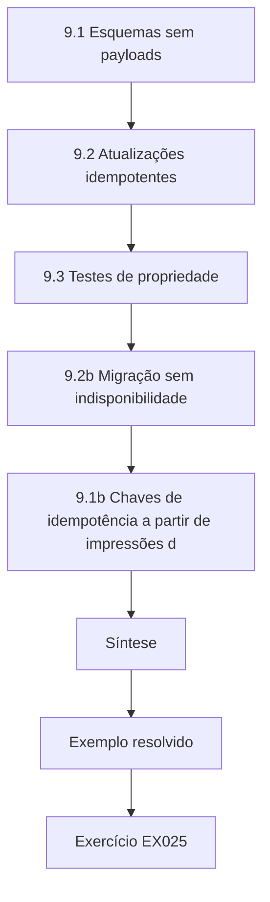

### Desenho lógico

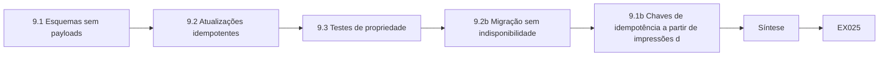

```text
[9.1 Esquemas sem payloads]
    |
    v
[9.2 Atualizações idempotentes]
    |
    v
[9.3 Testes de propriedade]
    |
    v
[9.2b Migração sem indisponibilidade]
    |
    v
[9.1b Chaves de idempotência a partir de impressões d]
    |
    v
[Síntese]
    |
    v
[Exemplo resolvido] --> [Exercício EX025]
```
<!-- cykin:lesson-figures:end ch-09 -->


### Objetivos de aprendizagem

Você vai (1) desenhar um esquema de achados que proíba receitas de exploração; (2) implementar atualizações idempotentes; (3) usar testes de propriedade para regras de escopo.

### 9.1 Esquemas sem payloads

O FindingsDesk guarda título, ativo, classe de fraqueza, referência de evidência, impacto, status e carimbos de tempo. Ele não pode guardar um exploit funcional, uma credencial ativa nem um ataque passo a passo. A validação do esquema rejeita campos chamados `payload`, `password` ou `shell`. As evidências ficam num repositório lacrado, referenciado por hash (Capítulo 48). Rejeitar esses nomes de campo na entrada impede que um engenheiro bem-intencionado cole uma senha num ticket durante um encerramento corrido. Evidência por hash significa que o ticket continua compartilhável enquanto o repositório lacrado continua trancado. Sam avalia cada proposta de nova coluna pela mesma regra: se ela puder conter uma receita ou um segredo, não pertence ao FindingsDesk.

### 9.2 Atualizações idempotentes

Fechar um achado duas vezes precisa deixá-lo fechado; anexar o mesmo hash de evidência duas vezes precisa deixar um único anexo. A idempotência torna seguras as novas tentativas (Capítulo 6). Use um id de achado estável e trate criar-ou-atualizar como uma única operação indexada por esse id.

```python
"""Deduplicate synthetic findings by a stable fingerprint (asset, weakness class, location)."""
import hashlib
raw = [
    ("web-01", "missing-header", "/login"),
    ("web-01", "missing-header", "/login"),
    ("web-01", "missing-header", "/account"),
    ("web-02", "default-credential", "admin-ui"),
    ("web-02", "default-credential", "admin-ui"),
    ("db-01", "weak-tls", "5432"),
]
seen = {}
for asset, cls, loc in raw:
    fp = hashlib.sha256(f"{asset}|{cls}|{loc}".encode()).hexdigest()[:10]
    seen.setdefault(fp, [asset, cls, loc, 0])[3] += 1
print(f"raw={len(raw)} unique={len(seen)}")
for fp, (a, c, l, n) in sorted(seen.items(), key=lambda x: x[1]):
    print(f"{fp} {a:7} {c:19} {l:9} occurrences={n}")
```

Saída esperada:

```text
raw=6 unique=4
f9bb6de442 db-01   weak-tls            5432      occurrences=1
66fb6f1d56 web-01  missing-header      /account  occurrences=1
c4bfba3b72 web-01  missing-header      /login    occurrences=2
296a3331f0 web-02  default-credential  admin-ui  occurrences=2
```

Novas tentativas são normais quando os envios falham e, sem idempotência, cada uma reabriria trabalho ou criaria tickets duplicados. Um id estável transforma criação e atualização no mesmo caminho, de modo que a segunda chamada encontra a linha existente. A impressão digital do laboratório reduz seis linhas brutas a quatro achados únicos, que é o que os responsáveis pela remediação querem ver.

### 9.3 Testes de propriedade

Além dos testes por exemplo, declare uma propriedade: "para todo host na lista de exclusão e toda porta, allowed é False". Gere dezenas de hosts sintéticos e afirme a propriedade. Testes de propriedade pegam o bug em que uma entrada da lista de exclusão é ignorada para portas fora de uma lista fixa no código.

> **Caso sintético — Riverstone Transit.** A deduplicação de seis linhas brutas deixou quatro achados únicos; as duas duplicatas eram o mesmo cabeçalho ausente em /login, relatado por dois scanners. Sam fez da impressão digital (ativo, fraqueza, local) a chave de idempotência.

### 9.4 Erros e limites

Esquemas derivam; versione-os. Testes de propriedade são tão bons quanto o gerador; inclua à mão os casos de borda conhecidos. Um esquema sem campo de versão obriga os clientes a adivinhar quais campos existem. Geradores que nunca emitem o último endereço de uma faixa nunca vão pegar um bug ali. Sam mantém uma pequena tabela, escrita à mão, de casos traiçoeiros ao lado da suíte de propriedades e roda as duas a cada mudança. Um bug no gerador é tratado como um bug de produto: corrija-o antes do próximo engajamento.

### 9.2b Migração sem indisponibilidade

Quando o esquema de achados ganha um campo obrigatório, implante uma mudança em duas fases: primeiro aceite e persista o campo como opcional enquanto preenche os registros antigos; depois mude o validador para obrigatório. Engajamentos no meio da janela não podem quebrar porque um cliente móvel está uma versão atrás. Publique a versão do esquema nas respostas da API para que os clientes possam se recusar a escrever quando forem incompatíveis. Mudanças em duas fases mantêm a escrita segura para clientes no meio de um engajamento. O preenchimento retroativo completa as linhas antigas antes de o campo se tornar obrigatório, para que os validadores não rejeitem tickets históricos. Publicar a versão do esquema permite que um cliente móvel recuse uma escrita incompatível em vez de corromper um achado. Sam ensaia a virada numa cópia de staging, com um fixture de engajamento ativo, antes de tocar a produção.

### 9.1b Chaves de idempotência a partir de impressões digitais

Quando dois scanners relatam a mesma fraqueza, calcule primeiro a impressão digital e use-a para gerar ou localizar o id do achado antes da inserção. Pessoas ainda confirmam as fusões quando as impressões digitais colidem entre causas-raiz diferentes (o mesmo cabeçalho ausente em duas aplicações sem relação). Registre os ids dos scanners como referências de evidência, não como achados separados, para que a remediação acompanhe um único ticket. Os scanners discordam na redação, mas costumam concordar em ativo, classe e local, o que basta para uma impressão digital. Colisões entre aplicações sem relação são raras e exigem uma fusão humana, que sai mais barata que dezenas de tickets duplicados. Guardar os ids dos scanners como evidência preserva a proveniência sem multiplicar o backlog. Sam mostra a impressão digital no ticket para que os responsáveis vejam por que dois alertas viraram um.

### Exercícios

- **EX025 — Rejeição pelo esquema.** Escreva uma regra de validação que rejeite um achado contendo um campo cujo nome case com `(?i)payload|password|passwd|shell`. Rubrica: 3 = regra mais um exemplo que falha; 2 = só a regra; 1 = ideia; 0 = nada.
- **EX026 — Impressão digital.** Pelo laboratório, por que duas linhas de /login se fundem e duas de /account não? Rubrica: 3 = mesma impressão digital vs. local diferente; 2 = "mesmo achado"; 1 = vago; 0 = errado.
- **EX027 — Propriedade.** Declare uma propriedade de `allowed` que precisa valer depois de qualquer acréscimo à lista de exclusão. Rubrica: 3 = encolhimento monotônico / todo host excluído sempre negado; 2 = informal; 1 = propriedade errada; 0 = nada.

### Síntese

Esquemas, idempotência e propriedades tornam o software de avaliação entediante no bom sentido: previsível sob novas tentativas e revisões.

### Continue estudando — capítulo 09 de 50

[← Capítulo 08 (rascunho)](#ch-08) · [Índice de capítulos do curso](../SUBJECTS.md) · [Capítulo 10 (rascunho) →](#ch-10)

<a id="ch-10"></a>

## Capítulo 10 — Ética e segurança na engenharia

<!-- cykin:lesson-figures:start ch-10 -->
### Mapa da aula

Aula 10 publicada. Mapa, exemplo, EX028.

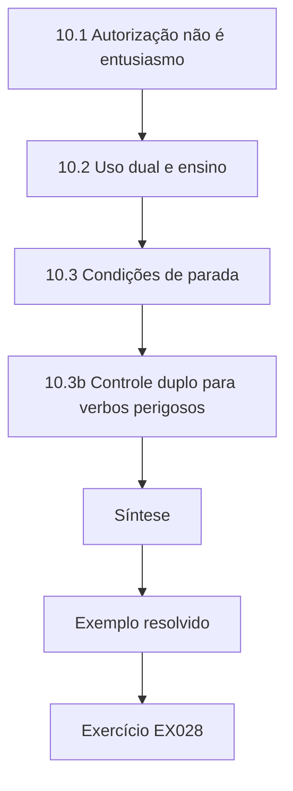

### Desenho lógico

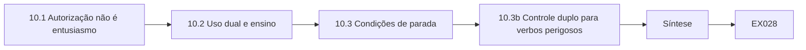

```text
[10.1 Autorização não é entusiasmo]
    |
    v
[10.2 Uso dual e ensino]
    |
    v
[10.3 Condições de parada]
    |
    v
[10.3b Controle duplo para verbos perigosos]
    |
    v
[Síntese]
    |
    v
[Exemplo resolvido] --> [Exercício EX028]
```
<!-- cykin:lesson-figures:end ch-10 -->


### Objetivos de aprendizagem

Você vai (1) recusar pedidos de uso dual e fora do escopo; (2) aplicar condições de parada sem esperar por uma reunião; (3) documentar consentimento e autorização para que uma revisão possa reconstruí-los.

### 10.1 Autorização não é entusiasmo

Um gestor dizendo "pode ir" no chat não é autorização por escrito. O NIST SP 800-115 e o PTES esperam um escopo assinado, com métodos, datas, limites, contatos e condições de parada. Sem esse documento, o engenheiro para. O entusiasmo de uma única parte interessada que não é dona do ativo é um caminho comum para testes não autorizados. Mensagens de chat desaparecem, carecem de detalhes de escopo e raramente nomeiam condições de parada. Um documento assinado pode ser mostrado meses depois, quando alguém perguntar por que um host foi tocado. Parar sem esse documento não é teimosia; é a única atitude que mantém o engenheiro e o cliente dentro da lei. Sam guarda o hash da ROE assinada no TrackScope, ao lado de cada execução.

### 10.2 Uso dual e ensino

Este livro ensina escopo, medição e relatório. Não ensina desenvolvimento de exploits, payloads transformados em armas nem receitas de evasão. Quando um colega pede "só a PoC", a resposta é a descrição do achado e a referência da evidência, não um ataque funcional. Publicar trabalhos de estudantes que contenham técnicas ativas contra produtos reais é uma decisão de divulgação que envolve fornecedores e a lei, não o envio de uma lição de casa. A recusa protege colegas, futuros empregadores e fornecedores que nunca concordaram em ser alvo de lição de casa. Uma descrição do achado com uma referência de evidência permite que um colega aprenda o que estava errado sem receber um ataque pronto. Quando um trabalho do curso pode tocar um produto real, Sam o encaminha pelo mesmo caminho de divulgação que um engajamento profissional usaria. Os laboratórios do curso ficam em sistemas sintéticos por esse motivo.

### 10.3 Condições de parada

Condições de parada são gatilhos combinados de antemão: sondar um host da lista de exclusão, latência acima de um limiar, um alarme de segurança ou um pedido do contato do cliente. Quando um gatilho dispara, primeiro pare, depois notifique. O TrackScope deve impor as negações rígidas em software, para que "eu esqueci" não seja um modo de falha.

```python
"""Evaluate proposed actions against synthetic rules of engagement."""
ROE = {
    "hours": ("09:00", "17:00"),
    "deny_actions": {"denial-of-service", "phishing-staff", "exfiltrate-real-data"},
    "require_approval": {"password-spray-lab", "privilege-escalation-lab"},
    "max_concurrency": 5,
}
proposals = [
    ("service-enum", "10:30", 3, False),
    ("denial-of-service", "10:30", 1, False),
    ("password-spray-lab", "10:30", 2, False),
    ("password-spray-lab", "10:30", 2, True),
    ("service-enum", "18:00", 2, False),
    ("service-enum", "11:00", 20, False),
]

def ok_time(t):
    return ROE["hours"][0] <= t <= ROE["hours"][1]

for action, when, conc, approved in proposals:
    reasons=[]
    if action in ROE["deny_actions"]: reasons.append("deny-action")
    if action in ROE["require_approval"] and not approved: reasons.append("needs-approval")
    if not ok_time(when): reasons.append("outside-hours")
    if conc > ROE["max_concurrency"]: reasons.append("concurrency")
    print(f"action={action:20} when={when} conc={conc:2} approved={approved} -> {'ALLOW' if not reasons else 'DENY'} {','.join(reasons) or '-'}")
```

Saída esperada:

```text
action=service-enum         when=10:30 conc= 3 approved=False -> ALLOW -
action=denial-of-service    when=10:30 conc= 1 approved=False -> DENY deny-action
action=password-spray-lab   when=10:30 conc= 2 approved=False -> DENY needs-approval
action=password-spray-lab   when=10:30 conc= 2 approved=True -> ALLOW -
action=service-enum         when=18:00 conc= 2 approved=False -> DENY outside-hours
action=service-enum         when=11:00 conc=20 approved=False -> DENY concurrency
```

> **Caso sintético — Riverstone Transit.** Às 11:10 a varredura tocou 10.20.0.1 (na lista de exclusão). O TrackScope negou as ações seguintes; Sam escalou; o cliente confirmou. A retomada exigiu uma linha atualizada na ROE, não um "tudo bem" verbal.

O laboratório mostra negações para ações proibidas, aprovação ausente, horário errado e concorrência excessiva. A imposição em software significa que a parada acontece mesmo que a pessoa esteja cansada ou distraída. Notifique depois de parar, não antes, para que a ação danosa não continue enquanto alguém procura um horário para reunião. Sam testa o caminho de negação em staging com uma ação proibida deliberada antes de cada engajamento.

### 10.4 Erros e limites

Ética não é um capítulo que se termina; é uma restrição sobre todos os capítulos seguintes. O texto jurídico aqui é orientação, não aconselhamento — consulte a assessoria jurídica em engajamentos reais. Os capítulos posteriores sobre ferramentas e métodos herdam esses limites; nenhum deles se sobrepõe a uma ROE ausente. Um texto de orientação não substitui a assessoria jurídica quando há um contrato real na mesa. Sam escala as questões jurídicas em vez de inventar respostas a partir de um parágrafo de livro, e revisita o consentimento quando o escopo muda no meio do engajamento, antes de qualquer nova ação rodar.

### 10.3b Controle duplo para verbos perigosos

Ações que mudam a autorização — publicar uma nova ScopeVersion, desativar uma condição de parada, exportar um dossiê lacrado — exigem duas pessoas autenticadas ou um controle individual com atraso e janela de cancelamento. A conveniência de engenharia não é argumento contra o controle duplo quando o raio de impacto é o patrimônio do cliente. Um único engenheiro cansado não deveria conseguir ampliar o escopo de um ambiente inteiro. Uma segunda pessoa, ou um atraso que permita cancelar, transforma um erro num evento recuperável. Publicar uma nova ScopeVersion e exportar um dossiê lacrado mudam quem pode ver o quê, e é por isso que ambos estão na lista de controle duplo. Sam registra os dois aprovadores em cada uma dessas ações.

### Exercícios

- **EX028 — Recuse.** Escreva uma recusa de duas frases a um pedido de exploit funcional contra um produto de fornecedor para um trabalho avaliado. Rubrica: 3 = recusa, oferece alternativa permitida (texto do achado / laboratório sintético), cita segurança; 2 = recusa sem alternativa; 1 = vago; 0 = fornece o exploit.
- **EX029 — Pare.** Pelo laboratório, quais ações são negadas e por quê? Rubrica: 3 = DoS sempre; password spraying sem aprovação; fora do horário; concorrência; 2 = três; 1 = um; 0 = errado.
- **EX030 — Campos de autorização.** Liste seis campos que uma ROE assinada precisa conter. Rubrica: 3 = sistemas, métodos, datas, limites de taxa/dados, contatos, condições de parada (ou seis equivalentes); 2 = quatro; 1 = dois; 0 = nada.

### Síntese

Permissão por escrito, condições de parada e o hábito de recusar são engenharia de segurança, não burocracia.

### Continue estudando — capítulo 10 de 50

[← Capítulo 09 (rascunho)](#ch-09) · [Índice de capítulos do curso](../SUBJECTS.md) · [Capítulo 11 (rascunho) →](#ch-11)

<a id="ch-11"></a>

## Capítulo 11 — Redes e protocolos

<!-- cykin:lesson-figures:start ch-11 -->
### Mapa da aula

Aula 11 publicada. Mapa, exemplo, EX031.

```mermaid
flowchart TD
  N0["11.1 Camadas como pontos de observação"]
  N1["11.2 Portas não são serviços"]
  N2["11.3 Negações são dados"]
  N3["11.3b Famílias de protocolos no escopo"]
  N4["11.4b Capturando só o que a ROE permite"]
  N5["Síntese"]
  N0 --> N1 --> N2 --> N3 --> N4 --> N5
  N5 --> EX["Exemplo resolvido"]
  EX --> Q["Exercício EX031"]
```

### Desenho lógico

```mermaid
flowchart LR
  N0["11.1 Camadas como pontos de observação"]
  N1["11.2 Portas não são serviços"]
  N2["11.3 Negações são dados"]
  N3["11.3b Famílias de protocolos no escopo"]
  N4["11.4b Capturando só o que a ROE permite"]
  N5["Síntese"]
  N0 --> N1 --> N2 --> N3 --> N4 --> N5 --> Q["EX031"]
```

```text
[11.1 Camadas como pontos de observação]
    |
    v
[11.2 Portas não são serviços]
    |
    v
[11.3 Negações são dados]
    |
    v
[11.3b Famílias de protocolos no escopo]
    |
    v
[11.4b Capturando só o que a ROE permite]
    |
    v
[Síntese]
    |
    v
[Exemplo resolvido] --> [Exercício EX031]
```
<!-- cykin:lesson-figures:end ch-11 -->


### Objetivos de aprendizagem

Você vai (1) descrever o que um observador autorizado pode aprender em cada camada OSI sem atacá-la; (2) definir com precisão o escopo de portas e protocolos; (3) interpretar uma negação como um controle bem-sucedido, não como um teste fracassado.

### 11.1 Camadas como pontos de observação

Capturas na camada de enlace exigem acesso a um segmento; dados de roteamento da camada de rede exigem um ponto de observação; evidências da camada de aplicação muitas vezes exigem credenciais. Uma avaliação que só tem credenciais de aplicação não deve alegar visibilidade da camada de enlace. Declare o ponto de observação na seção de método. Credenciais de uma aplicação não dizem nada sobre os quadros que passam no fio. Alegar um ponto de observação mais amplo do que o que você tinha é inventar cobertura. Nomear a camada na descrição do método permite que um revisor associe cada achado ao que de fato podia ser visto. Sam se recusa a registrar alegações sobre a camada de enlace quando o engajamento só tinha uma conta de aplicação.

### 11.2 Portas não são serviços

A porta 443 costuma significar TLS e HTTPS, mas pode transportar outros protocolos. Um escopo que diz "portas web" precisa listar números e, se necessário, os protocolos de aplicação esperados. Um achado de que "o HTTPS estava aberto" fica incompleto sem o titular do certificado, o método de autenticação e a confirmação de que o serviço era o esperado. Listar os números das portas tira da ROE a expressão nebulosa "portas web". Confirmar o titular do certificado e o método de autenticação evita um achado que confunda outro serviço na 443 com o portal esperado. As anotações de Sam sempre incluem qual protocolo foi observado, não só que a porta respondeu.

### 11.3 Negações são dados

Uma porta fechada, um handshake TCP recusado ou um bloqueio de WAF é evidência de que um controle funcionou para aquela sondagem. Relate isso como cobertura de uma verificação planejada, não como uma falha em "entrar". A distinção entre coberto e planejado-mas-não-visto do PulseMap (Capítulo 29) depende disso.

```python
"""Rank synthetic assets for authorized engagement scoping."""
assets = [
    ("public-web-portal", 3, 3, 3),      # exposure, data_sensitivity, blast_radius 1-3
    ("staging-admin-ui", 2, 3, 2),
    ("corp-vpn-edge", 3, 2, 3),
    ("internal-wiki", 1, 2, 1),
    ("printer-fleet", 2, 1, 1),
    ("lab-jump-host", 1, 1, 2),
]
print(f"{'asset':20} score exposure data blast")
for name, e, d, b in sorted(assets, key=lambda x: -(x[1]+x[2]+x[3])):
    print(f"{name:20} {e+d+b:5} {e:8} {d:4} {b:5}")
```

Saída esperada:

```text
asset                score exposure data blast
public-web-portal        9        3    3     3
corp-vpn-edge            8        3    2     3
staging-admin-ui         7        2    3     2
internal-wiki            4        1    2     1
printer-fleet            4        2    1     1
lab-jump-host            4        1    1     2
```

> **Caso sintético — Riverstone Transit.** O inventário classificou public-web-portal no topo (pontuação 9). Sam o agendou primeiro, conforme a ROE, e adiou printer-fleet, que teve pontuação 4 e estava fora da janela da semana.

As métricas de cobertura ficam honestas quando um bloqueio conta como uma verificação concluída. Perseguir só os caminhos abertos enviesa o relatório para a falha e esconde controles que funcionaram. O balde planejado-mas-não-visto do PulseMap existe para que uma negação silenciosa ainda seja registrada. Sam lista as sondagens bloqueadas ao lado das bem-sucedidas no resumo diário.

### 11.4 Erros e limites

Scanners identificam produtos pelos banners; banners mentem. Confirme com uma verificação no nível da aplicação antes de escrever um achado. Não faça varreduras na Internet pública a partir do ambiente do curso. Um banner que declara a versão de um produto pode ter sido copiado de um modelo ou ter ficado desatualizado depois de uma atualização. Uma verificação no nível da aplicação, como ler uma página de saúde mediante autorização, confirma o que de fato está lá. Os ambientes do curso ficam fora da Internet pública para que os estudantes nunca se tornem um scanner indesejado na rede de outra pessoa. As máquinas de laboratório de Sam não têm rota para lá.

### 11.3b Famílias de protocolos no escopo

Documentos de escopo devem nomear explicitamente as famílias de protocolos: "TCP 443 com dados de aplicação HTTPS" é mais claro que "443". Se a interceptação de TLS for proibida, diga isso. Se apenas TLS 1.2+ puder ser testado, diga isso. A ambiguidade aqui vira discussão durante o engajamento, quando alguém quer tentar uma porta legada em texto claro "só para ver". Nomear HTTPS na TCP 443 não deixa espaço para um experimento em texto claro no mesmo número. Proibir de antemão a interceptação de TLS evita uma discussão no meio do teste com as equipes de privacidade e jurídica. Portas legadas em texto claro ficam fechadas, a menos que a ROE as liste. Sam lê o parágrafo de protocolos em voz alta com o contato do cliente antes do kickoff.

### 11.4b Capturando só o que a ROE permite

Capturas de pacotes feitas durante um teste autorizado muitas vezes contêm dados fora do propósito do engajamento, como credenciais de funcionários ou registros de passageiros, no caso da Riverstone Transit. O plano de captura de Sam nomeia as interfaces, um filtro limitado aos hosts em escopo, um período de retenção e quem pode abrir os arquivos, e a captura é apagada no prazo. Filtros e retenção curta reduzem quantos dados de funcionários ou passageiros podem permanecer depois do teste. Nomear quem pode abrir os arquivos impede a navegação casual por uma captura que por acaso incluiu um login. A exclusão no prazo é verificada, não presumida. O encerramento de Sam inclui um ticket mostrando que a captura foi apagada.

### Exercícios

- **EX031 — Ponto de observação.** Associe três tipos de evidência ao ponto de observação mínimo necessário. Rubrica: 3 = associação correta (por exemplo, tabela ARP → acesso ao enlace; certificado TLS → TCP até a porta; campo de API → sessão autenticada); 2 = dois; 1 = um; 0 = nada.
- **EX032 — Portas do escopo.** Reescreva "todas as coisas web" como um conjunto de portas e uma nota de aplicação para a Riverstone. Rubrica: 3 = {80,443,8080} mais "só HTTP(S) para as aplicações de tarifas e de funcionários"; 2 = só as portas; 1 = vago; 0 = nada.
- **EX033 — Inventário.** Quais dois ativos do laboratório você agendaria primeiro, e por quê? Rubrica: 3 = public-web-portal e corp-vpn-edge, com motivos de pontuação/exposição; 2 = corretos sem motivos; 1 = um; 0 = errado.

### Síntese

As redes dão a você um ponto de observação e um conjunto de portas. Delimite-os no escopo; trate os bloqueios como resultados.

### Continue estudando — capítulo 11 de 50

[← Capítulo 10 (rascunho)](#ch-10) · [Índice de capítulos do curso](../SUBJECTS.md) · [Capítulo 12 (rascunho) →](#ch-12)

<a id="ch-12"></a>

## Capítulo 12 — Sistemas operacionais

<!-- cykin:lesson-figures:start ch-12 -->
### Mapa da aula

Aula 12 publicada. Mapa, exemplo, EX034.

```mermaid
flowchart TD
  N0["12.1 Configuração geralmente basta"]
  N1["12.2 Privilégio mínimo para quem testa"]
  N2["12.3 Local vs. domínio"]
  N3["12.3b Imagens e análise offline"]
  N4["12.4b Registrando mudanças nos hosts"]
  N5["Síntese"]
  N0 --> N1 --> N2 --> N3 --> N4 --> N5
  N5 --> EX["Exemplo resolvido"]
  EX --> Q["Exercício EX034"]
```

### Desenho lógico

```mermaid
flowchart LR
  N0["12.1 Configuração geralmente basta"]
  N1["12.2 Privilégio mínimo para quem testa"]
  N2["12.3 Local vs. domínio"]
  N3["12.3b Imagens e análise offline"]
  N4["12.4b Registrando mudanças nos hosts"]
  N5["Síntese"]
  N0 --> N1 --> N2 --> N3 --> N4 --> N5 --> Q["EX034"]
```

```text
[12.1 Configuração geralmente basta]
    |
    v
[12.2 Privilégio mínimo para quem testa]
    |
    v
[12.3 Local vs. domínio]
    |
    v
[12.3b Imagens e análise offline]
    |
    v
[12.4b Registrando mudanças nos hosts]
    |
    v
[Síntese]
    |
    v
[Exemplo resolvido] --> [Exercício EX034]
```
<!-- cykin:lesson-figures:end ch-12 -->


### Objetivos de aprendizagem

Você vai (1) separar a revisão de configuração do abuso em tempo de execução; (2) coletar evidências do sistema operacional com privilégio mínimo; (3) registrar o uso de contas para que a revogação seja possível.

### 12.1 Configuração geralmente basta

Política de senhas, nível de patches, serviços em escuta e participação no grupo de administradores locais respondem à maioria das perguntas sobre o sistema operacional numa avaliação autorizada. Ler esses dados com uma conta de administrador concedida para o engajamento é diferente de explorar um serviço para obter essa conta. Prefira a primeira opção; uma descoberta no estilo do PTES fica dentro dos métodos combinados. Leituras com uma conta de administrador concedida respondem ao nível de patches e à participação em grupos locais sem transformar o engajamento numa caça a um ponto de apoio. Essa distinção importa para a ética e para a clareza da remediação: um achado obtido com uma conta concedida trata de exposição e política, não de um caminho de invasão. Sam registra que a conta foi emitida para o teste, para que os leitores não deduzam um acesso furtivo.

### 12.2 Privilégio mínimo para quem testa

Emita uma conta de avaliação nominal, com um papel limitado no tempo. Registre toda elevação. Ao fim do engajamento, desative a conta e troque quaisquer segredos compartilhados que ela tenha tocado. O FindingsDesk deve guardar o id da conta usada em cada achado, para que a revogação possa ser verificada. Uma conta nominal e limitada no tempo pode ser desativada sem caçar senhas compartilhadas. Registrar as elevações torna direitos incomuns visíveis durante o engajamento, não só depois. Guardar o id da conta em cada achado torna mecânica a lista de verificação da revogação. O encerramento de Sam falha se algum achado ainda apontar para uma conta de teste ativa.

### 12.3 Local vs. domínio

Um administrador local num host não é administrador de domínio. Os achados precisam nomear o repositório de identidades (SAM local, LDAP, IdP de nuvem). Confundi-los infla a severidade e direciona mal a remediação. A remediação para um administrador local é o endurecimento do host; a remediação para um administrador de domínio é trabalho no repositório de identidades. Misturar os rótulos manda a equipe errada, com a urgência errada. Provedores de identidade na nuvem acrescentam um terceiro repositório, que precisa ser nomeado explicitamente. O modelo de achado de Sam exige o campo de repositório de identidades antes que um ticket saia do rascunho.

> **Caso sintético — Riverstone Transit.** O SYN-005 era uma conta de serviço do laboratório com direitos de administrador de domínio — um achado de diretório, não um achado de "o Windows está quebrado". A remediação significou remover a participação no grupo e trocar a senha, verificando depois com uma leitura do grupo.

### 12.4 Erros e limites

Os fornecedores de sistemas operacionais mudam os padrões; cite a versão que você observou. Não desative ferramentas de segurança para "fazer o teste funcionar"; se uma ferramenta bloqueia você, isso é um resultado sob a ROE. Os padrões do guia de endurecimento do ano passado podem não corresponder à build que você viu. Citar a versão observada mantém o achado verificável. Uma ferramenta de segurança que bloqueia uma sondagem fez seu trabalho sob a ROE; desligá-la seria inventar um sistema diferente do que o cliente roda. Sam relata o bloqueio e passa para a próxima verificação planejada.

### 12.3b Imagens e análise offline

Imagens completas de disco têm alto impacto: tiram sistemas do ar, contêm dados pessoais e convidam à navegação fora do escopo. Prefira leituras ao vivo, com privilégio mínimo. Se uma imagem for de fato necessária, a ROE precisa nomear a cadeia de custódia, a criptografia em repouso, quem pode montá-la e uma data de destruição — e os laboratórios do curso continuam sem praticar a geração de imagens de hosts reais. Imagens são o último recurso por causa da indisponibilidade e da privacidade. Leituras ao vivo com privilégio mínimo respondem à maioria das perguntas sem copiar discos inteiros. Quando uma imagem é inevitável, a cadeia de custódia e a data de destruição são exigências da ROE, não gentilezas. Os laboratórios do curso nunca geram imagens de hosts reais, então os estudantes praticam a decisão de evitar a imagem, e não a geração da imagem em si.

### 12.4b Registrando mudanças nos hosts

Qualquer configuração que quem testa muda num host, mesmo um nível de log temporário, é escrita no log do engajamento com horário, motivo e o comando usado para revertê-la. No encerramento, Sam percorre essa lista com o dono do sistema, para que nenhum host da Riverstone Transit fique num estado que ninguém se lembra de ter criado. Um comando de reversão escrito na hora sobrevive à rotatividade da equipe e aos plantões de fim de semana. Percorrer a lista com o dono transforma o encerramento numa lista de verificação compartilhada, em vez de um teste de memória. Sam se recusa a marcar um engajamento como concluído enquanto restar na lista qualquer mudança não revertida.

### Exercícios

- **EX034 — Desenho de conta.** Especifique uma conta de avaliação com privilégio mínimo para ler a participação no grupo de administradores locais em três hosts Windows. Rubrica: 3 = conta nominal, grupo/papel, limite de tempo, registro, revogação; 2 = três de cinco; 1 = "admin"; 0 = nada.
- **EX035 — Redação da severidade.** Reescreva "pegamos SYSTEM em tudo" como uma frase de achado com escopo. Rubrica: 3 = identidade, hosts, método (configuração/autorização), sem exploit; 2 = falta o escopo; 1 = ainda vago; 0 = linguagem de exploit.
- **EX036 — Verificação de revogação.** Liste três verificações pós-engajamento de que a conta de avaliação deixou de existir. Rubrica: 3 = desativada no diretório, resquício local, revisão de ticket/log; 2 = duas; 1 = uma; 0 = nada.

### Síntese

Leia a configuração com uma conta temporária; nomeie o repositório de identidades; revogue ao terminar.

### Continue estudando — capítulo 12 de 50

[← Capítulo 11 (rascunho)](#ch-11) · [Índice de capítulos do curso](../SUBJECTS.md) · [Capítulo 13 (rascunho) →](#ch-13)

<a id="ch-13"></a>

## Capítulo 13 — Sistemas de dados

<!-- cykin:lesson-figures:start ch-13 -->
### Mapa da aula

Aula 13 publicada. Mapa, exemplo, EX037.

```mermaid
flowchart TD
  N0["13.1 Minimização de dados"]
  N1["13.2 Autorização, não receitas de injeção"]
  N2["13.3 Dados sintéticos"]
  N3["13.3b Controles por linha e por coluna"]
  N4["13.1b Armadilhas do mascaramento"]
  N5["Síntese"]
  N0 --> N1 --> N2 --> N3 --> N4 --> N5
  N5 --> EX["Exemplo resolvido"]
  EX --> Q["Exercício EX037"]
```

### Desenho lógico

```mermaid
flowchart LR
  N0["13.1 Minimização de dados"]
  N1["13.2 Autorização, não receitas de injeção"]
  N2["13.3 Dados sintéticos"]
  N3["13.3b Controles por linha e por coluna"]
  N4["13.1b Armadilhas do mascaramento"]
  N5["Síntese"]
  N0 --> N1 --> N2 --> N3 --> N4 --> N5 --> Q["EX037"]
```

```text
[13.1 Minimização de dados]
    |
    v
[13.2 Autorização, não receitas de injeção]
    |
    v
[13.3 Dados sintéticos]
    |
    v
[13.3b Controles por linha e por coluna]
    |
    v
[13.1b Armadilhas do mascaramento]
    |
    v
[Síntese]
    |
    v
[Exemplo resolvido] --> [Exercício EX037]
```
<!-- cykin:lesson-figures:end ch-13 -->


### Objetivos de aprendizagem

Você vai (1) delimitar a avaliação de bancos de dados sem extrair dados pessoais; (2) testar a autorização na camada de consulta; (3) desenhar conjuntos de dados sintéticos para os laboratórios.

### 13.1 Minimização de dados

O trabalho autorizado com bancos de dados usa linhas sintéticas ou cópias mascaradas. Exportar dados pessoais de produção para o notebook de um estudante é um incidente de privacidade, não um achado. A ROE precisa declarar: nenhum SELECT de colunas marcadas como pessoais, nenhum dump de tabela inteira, limites de linhas e uma data de destruição para qualquer extração temporária. Limites de linhas e datas de destruição transformam extrações temporárias em objetos controlados, e não em suvenires. Marcar as colunas pessoais dá à ferramenta de consulta algo para recusar automaticamente. Um notebook de estudante com um dump de produção é um vazamento esperando por uma mochila perdida. A lista de verificação de ROE de Sam reprova o kickoff se qualquer uma dessas cláusulas estiver faltando.

### 13.2 Autorização, não receitas de injeção

A pergunta de engenharia costuma ser "o papel R consegue ler a tabela T?". Teste isso com o papel concedido. Ensinar payloads de injeção de SQL está fora do limite de segurança deste livro; se a injeção estiver no escopo de um engajamento profissional, ela fica numa linha de método separada e num plano de divulgação próprio, não num exercício de casa. Testes de papel respondem à pergunta real do cliente: quem, na equipe dele, consegue ver quais tabelas. Os payloads ficam fora deste curso porque ensinam a causar dano sem ensinar a engenharia do controle de acesso. Quando uma ROE profissional inclui injeção, ela é um método nomeado com seu próprio caminho de divulgação, nunca um exercício de laboratório. Sam registra as lacunas de autorização como achados sobre papéis e concessões.

### 13.3 Dados sintéticos

Gere clientes sintéticos determinísticos com regras no estilo do faker ou com sementes fixas, para que os laboratórios sejam reproduzíveis. Nunca copie um backup de produção para o repositório do curso. Sementes fixas fazem com que dois estudantes e um job de CI vejam os mesmos clientes e as mesmas verificações falhando. Backups de produção trazem o dever de privacidade e uma exposição irreversível se o repositório vazar. Sam gera os dados no script de preparação do laboratório e versiona só o gerador, nunca um dump.

> **Caso sintético — Riverstone Transit.** Sam precisava de linhas de produtos tarifários para um teste de relatório. A equipe de operações forneceu um snapshot sintético apenas com ids de produtos e preços — sem nomes de passageiros — e uma etiqueta de destruição de 48 horas.

### 13.4 Erros e limites

Um mascaramento que deixa valores raros e únicos ainda pode identificar pessoas. Ao ensinar, prefira a geração sintética a um mascaramento imperfeito. Um código de doença rara ou um cargo incomum pode reidentificar alguém mesmo depois de os nomes serem removidos. Linhas sintéticas evitam completamente essa discussão no ensino. Quando um cliente ainda exige extrações mascaradas, Sam espera a aprovação de privacidade, mantém os arquivos em hosts controlados pelo cliente e registra a data de destruição no log do engajamento. Os laboratórios de ensino nunca recebem linhas de produção de cliente algum, nem mesmo mascaradas.

### 13.3b Controles por linha e por coluna

Data warehouses modernos oferecem políticas por linha e por coluna. As perguntas da avaliação passam a ser: o papel R vê a coluna C? O filtro de linhas F se aplica? Teste com o próprio papel. Documente a versão do motor de políticas; "rodamos SELECT *" com um papel de administrador prova pouco sobre a exposição de um analista. Um SELECT * de administrador mostra o que um administrador vê, o que é a pergunta errada para a exposição de um analista. Rodar como o papel R, com a versão do motor de políticas registrada, faz o resultado corresponder ao comportamento de produção. Negações de coluna e filtros de linha falham de maneiras diferentes, então cada um precisa de suas próprias verificações. Sam guarda o nome do papel em cada achado desse tipo.

### 13.1b Armadilhas do mascaramento

Substituir nomes por iniciais ou embaralhar CEPs raros ainda deixa quase-identificadores. Para o ensino e para a maioria das avaliações, a geração sintética com semente fixa é mais simples e mais segura do que discutir máscaras imperfeitas. Se o anfitrião insistir em extrações mascaradas de produção, exija uma revisão de privacidade e mantenha a extração fora dos notebooks dos estudantes. Quase-identificadores se combinam: um ano de nascimento, uma garagem e um cargo raro podem apontar para um único funcionário. A síntese com semente fixa contorna o debate e ainda exercita a lógica de autorização. Extrações mascaradas que precisem ser usadas ficam fora de dispositivos pessoais e sob as regras de retenção da revisão de privacidade. Sam prefere demonstrar o mesmo achado em linhas sintéticas sempre que o cliente permite.

### Exercícios

- **EX037 — Cláusula de dados da ROE.** Escreva uma cláusula de tratamento de dados para uma avaliação de Postgres. Rubrica: 3 = sem colunas de dados pessoais, limite de linhas, sem dumps, data de destruição, preferência por sintéticos; 2 = três; 1 = um; 0 = nada.
- **EX038 — Teste de autorização.** Como você testa se o papel `analyst` consegue ler `passengers` sem usar uma técnica de injeção? Rubrica: 3 = conectar como analyst, tentar o SELECT, registrar concessão/negação; 2 = ideia sem o papel; 1 = vago; 0 = injeção.
- **EX039 — Sintéticos.** Dê três campos seguros para uma tabela sintética de tarifas e dois que nunca podem aparecer no conjunto de dados do curso. Rubrica: 3 = por exemplo, product_id, price, zone vs. nome, card_number; 2 = parcial; 1 = fraco; 0 = nada.

### Síntese

Minimize os dados, teste os papéis, sintetize para ensinar. O banco de dados não é uma sala de troféus.

### Continue estudando — capítulo 13 de 50

[← Capítulo 12 (rascunho)](#ch-12) · [Índice de capítulos do curso](../SUBJECTS.md) · [Capítulo 14 (rascunho) →](#ch-14)

<a id="ch-14"></a>

## Capítulo 14 — Engenharia de software

<!-- cykin:lesson-figures:start ch-14 -->
### Mapa da aula

Aula 14 publicada. Mapa, exemplo, EX040.

```mermaid
flowchart TD
  N0["14.1 Ferramentas são produtos"]
  N1["14.2 Bloqueie a ampliação"]
  N2["14.3 Fixtures de CI"]
  N3["14.3b Trens de release vs. hotfixes"]
  N4["14.1b Modelo de branches"]
  N5["Nota de prática"]
  N6["Síntese"]
  N0 --> N1 --> N2 --> N3 --> N4 --> N5 --> N6
  N6 --> EX["Exemplo resolvido"]
  EX --> Q["Exercício EX040"]
```

### Desenho lógico

```mermaid
flowchart LR
  N0["14.1 Ferramentas são produtos"]
  N1["14.2 Bloqueie a ampliação"]
  N2["14.3 Fixtures de CI"]
  N3["14.3b Trens de release vs. hotfixes"]
  N4["14.1b Modelo de branches"]
  N5["Nota de prática"]
  N6["Síntese"]
  N0 --> N1 --> N2 --> N3 --> N4 --> N5 --> N6 --> Q["EX040"]
```

```text
[14.1 Ferramentas são produtos]
    |
    v
[14.2 Bloqueie a ampliação]
    |
    v
[14.3 Fixtures de CI]
    |
    v
[14.3b Trens de release vs. hotfixes]
    |
    v
[14.1b Modelo de branches]
    |
    v
[Nota de prática]
    |
    v
[Síntese]
    |
    v
[Exemplo resolvido] --> [Exercício EX040]
```
<!-- cykin:lesson-figures:end ch-14 -->


### Objetivos de aprendizagem

Você vai (1) colocar as ferramentas de avaliação sob controle de versão, com revisão; (2) bloquear mudanças que ampliem o escopo; (3) manter a CI só com fixtures sintéticos.

### 14.1 Ferramentas são produtos

O TrackScope e o FindingsDesk são software. Precisam de repositórios, revisão de código, releases com tags e changelogs. Uma ROE que cita "TrackScope" sem versão está incompleta; cite `TrackScope v0.9.2` ou o SHA do git usado. Sem uma versão, dois engenheiros podem rodar builds diferentes e discordar sobre o que a ferramenta negou. Tags e changelogs tornam essa discordância verificável. A revisão de código pega uma verificação de escopo que falha aberta antes que ela chegue a um engajamento. Sam cola o SHA nas anotações do kickoff e se recusa a começar se o binário em execução for diferente.

### 14.2 Bloqueie a ampliação

Merges que acrescentam um CIDR, abrem uma porta ou removem uma entrada da lista de exclusão exigem um segundo revisor e um ticket de autorização vinculado. Merges que só restringem o escopo podem ser mais leves. Codifique isso no CODEOWNERS ou numa verificação obrigatória que compare os arquivos de escopo. Ampliar o escopo é um evento de autorização, então precisa da mesma atenção dupla que uma mudança de ROE. A restrição pode andar mais rápido porque não consegue criar novos alvos. Uma verificação obrigatória sobre as diferenças de escopo impede uma adição silenciosa de CIDR num pull request grande. Sam vincula cada merge de ampliação ao ticket de aprovação por escrito do cliente.

### 14.3 Fixtures de CI

A integração contínua roda os laboratórios e os testes unitários sobre dados sintéticos. Nunca aponte a CI para uma rede de cliente. Os dados de semente ficam no repositório; os segredos de engajamentos reais ficam num cofre e nunca nos logs da CI. Uma CI capaz de alcançar uma rede de cliente transformaria cada teste quebrado numa possível sondagem. Fixtures sintéticos mantêm as falhas locais e reproduzíveis. Segredos em logs viram incidentes; cofres os mantêm fora da saída do build. Os pipelines de Sam não têm rotas para as redes dos engajamentos e falham se alguém acrescentar uma.

> **Caso sintético — Riverstone Transit.** Um PR acrescentou 10.30.0.0/16 ao escopo "para o mês que vem". A verificação de diferenças de escopo da CI bloqueou o merge até que o ticket AUTH-442 fosse vinculado e um segundo dono aprovasse.

### 14.4 Erros e limites

As tags de versão podem se afastar do que os operadores de fato rodam; registre a versão em execução no log do engajamento logo no início. Os operadores instalam hotfixes à mão e esquecem de atualizar a tag na lista de verificação. Registrar a versão em execução no início torna a divergência visível antes de o tráfego começar. Sam compara essa linha de log com a versão fixada na ROE e interrompe a janela em caso de discordância, até que os operadores instalem o build fixado ou a ROE seja revisada. Um post-it num notebook não é uma fixação de versão.

### 14.3b Trens de release vs. hotfixes

As melhorias normais seguem num trem de release com os Laboratórios I/II. Hotfixes de segurança podem pular funcionalidades, mas não a verificação: um pacote mínimo de regressão de falha fechada é obrigatório. Marque os hotfixes com clareza, para que um engajamento possa fixar o build do trem ou o SHA do hotfix de olhos abertos. Correções de segurança ainda precisam provar o comportamento de falha fechada, mesmo quando as funcionalidades esperam. Fixar de olhos abertos significa que o cliente sabe qual binário produziu a evidência. Sam mantém o pacote de regressão pequeno, para que os hotfixes continuem rápidos sem pulá-lo.

### 14.1b Modelo de branches

Use branches de vida curta com CI obrigatória sobre fixtures sintéticos. Branches de funcionalidade de vida longa se afastam das correções de segurança na main e recriam merges que falham abertos. Proteja a main com revisores obrigatórios e verificações de status nomeadas segundo as linhas de segurança do Laboratório I. Branches curtas recebem as correções de segurança da main em vez de reinventá-las semanas depois. Verificações obrigatórias nomeadas segundo as linhas do Laboratório I tornam impossível pular a suíte de segurança com uma aprovação casual. Sam apaga branches abandonadas toda semana, para que a divergência não possa se esconder. Uma branch que fica mais de uma semana atrás da main precisa ser rebaseada e passar de novo nas verificações do Laboratório I antes da revisão.

### Nota de prática

As fixações de versão aparecem na lista de verificação do kickoff do engajamento, ao lado do hash da ROE. Os operadores leem a fixação em voz alta antes de a janela abrir, para que ninguém rode silenciosamente um build de notebook. Se a fixação e o binário em execução discordarem, a janela não começa até que alguém registre uma nota AUTH ou faça o rollback. Esse ritual evitou mais incidentes do que qualquer banner na interface, porque obriga uma pessoa a olhar para o SHA enquanto o cliente ainda está na chamada.

### Exercícios

- **EX040 — Linha de versão.** Escreva a frase de método que fixa o TrackScope para um engajamento. Rubrica: 3 = nome, versão/SHA, data de carga; 2 = nome+versão; 1 = só o nome; 0 = nada.
- **EX041 — Regra de bloqueio.** Escreva uma política de merge de uma frase para os arquivos de escopo. Rubrica: 3 = segundo revisor + ticket de autorização para ampliar; 2 = só o revisor; 1 = vago; 0 = nada.
- **EX042 — Fronteira da CI.** Por que a CI nunca pode usar credenciais de VPN do cliente? Rubrica: 3 = risco de automação não autorizada, vazamento de segredos nos logs, não determinismo; 2 = um motivo sólido; 1 = vago; 0 = errado.

### Síntese

Trate o software de avaliação como software de produção: versões, bloqueios de revisão e CI sintética.

### Continue estudando — capítulo 14 de 50

[← Capítulo 13 (rascunho)](#ch-13) · [Índice de capítulos do curso](../SUBJECTS.md) · [Capítulo 15 (rascunho) →](#ch-15)

<a id="ch-15"></a>

## Capítulo 15 — Fundamentos de segurança

<!-- cykin:lesson-figures:start ch-15 -->
### Mapa da aula

Aula 15 publicada. Mapa, exemplo, EX043.

```mermaid
flowchart TD
  N0["15.1 CIA como perguntas"]
  N1["15.2 Vulnerabilidade, exposição, risco"]
  N2["15.3 Pontuações vazias"]
  N3["15.3b Mapeando para tickets"]
  N4["15.1b Da propriedade ao teste"]
  N5["Síntese"]
  N0 --> N1 --> N2 --> N3 --> N4 --> N5
  N5 --> EX["Exemplo resolvido"]
  EX --> Q["Exercício EX043"]
```

### Desenho lógico

```mermaid
flowchart LR
  N0["15.1 CIA como perguntas"]
  N1["15.2 Vulnerabilidade, exposição, risco"]
  N2["15.3 Pontuações vazias"]
  N3["15.3b Mapeando para tickets"]
  N4["15.1b Da propriedade ao teste"]
  N5["Síntese"]
  N0 --> N1 --> N2 --> N3 --> N4 --> N5 --> Q["EX043"]
```

```text
[15.1 CIA como perguntas]
    |
    v
[15.2 Vulnerabilidade, exposição, risco]
    |
    v
[15.3 Pontuações vazias]
    |
    v
[15.3b Mapeando para tickets]
    |
    v
[15.1b Da propriedade ao teste]
    |
    v
[Síntese]
    |
    v
[Exemplo resolvido] --> [Exercício EX043]
```
<!-- cykin:lesson-figures:end ch-15 -->


### Objetivos de aprendizagem

Você vai (1) mapear a tríade CIA e a autenticação/autorização para perguntas de avaliação; (2) distinguir vulnerabilidade, exposição e risco; (3) recusar pontuações de risco sem um modelo.

### 15.1 CIA como perguntas

Confidencialidade: quem pode ler isto? Integridade: quem pode mudar isto? Disponibilidade: o que impede isto de funcionar? Cada achado deve dizer qual propriedade é afetada e para qual ativo. "Problema de segurança" sem esse mapa não leva a ação. Mapear cada achado para confidencialidade, integridade ou disponibilidade diz a quem corrige que tipo de dano evitar. Um ativo sem propriedade deixa o cliente adivinhando se deve criptografar, validar ou acrescentar capacidade. Sam rejeita rascunhos de tickets que ainda dizem apenas "problema de segurança" e os devolve com as três perguntas listadas.

### 15.2 Vulnerabilidade, exposição, risco

Uma senha padrão é uma vulnerabilidade. Num host de staging alcançável a partir da rede corporativa, ela é uma exposição. O risco acrescenta probabilidade e impacto para a organização — o que exige o contexto dela, não uma história universal baseada só no CVSS. O FindingsDesk guarda os campos de impacto e de exposição separadamente; a aceitação do risco fica com o cliente. Separar os três impede que uma senha padrão num host de laboratório isolado receba a mesma pontuação que uma no portal público. Os campos de exposição capturam a alcançabilidade; os de impacto capturam o dano; a aceitação do risco residual continua sendo uma decisão do cliente. O CVSS sozinho não conhece o número de passageiros da Riverstone Transit nem o arranjo de suas garagens. Sam preenche exposição e impacto e deixa o campo de aceitação para o dono do lado do cliente.

### 15.3 Pontuações vazias

Albrecht e Jensen (arXiv:2010.06377) criticam pontuações de metodologia que não preveem resultados. Prefira medidas concretas: contagem de sondagens fora do escopo, tempo até a correção, precisão na taxa de base do cliente. Se você mostrar uma pontuação, mostre o modelo e as entradas. Uma pontuação de metodologia que não prevê resultados lisonjeia quem avalia e engana quem compra. Contagens de sondagens fora do escopo e o tempo até a parada são feios e úteis. Quando uma pontuação precisa aparecer, o modelo e as entradas ficam ao lado dela, para que outro engenheiro possa recalculá-la. Os painéis de Sam começam por essas medidas concretas.

> **Caso sintético — Riverstone Transit.** Sam parou de colocar um único "risco = 42" nos slides. A apresentação agora mostra dois achados críticos, três violações de SLA e 71% de cobertura de técnicas do conjunto planejado.

### 15.4 Erros e limites

Os fundamentos são vocabulário compartilhado; não são um modelo de ameaças completo. Siga para o Capítulo 23 para a análise estruturada de falhas. O vocabulário compartilhado faz as equipes conversarem; não lista todos os modos de falha. A análise estruturada mais adiante no curso se apoia nesses termos em vez de substituí-los. Sam trata um rótulo CIA como o começo de um achado, não como o fim do modelo de ameaças. Ele espera que os capítulos de análise estruturada acrescentem modos de falha que esses termos sozinhos não conseguem nomear. Até lá, o vocabulário ainda evita tickets vagos.

### 15.3b Mapeando para tickets

Todo achado deve citar qual propriedade (C, I ou A) é afetada principalmente e se a questão é uma vulnerabilidade, uma exposição ou um julgamento de risco deixado ao cliente. O FindingsDesk pode tornar os campos obrigatórios, para que os relatórios fiquem consistentes entre autores e semestres. Campos obrigatórios impedem que os autores inventem abreviações particulares para as mesmas ideias. A consistência entre semestres significa que um engenheiro de reteste consegue ler o ticket do ano passado sem um guia de tradução. Clientes que comparam duas empresas veem alegações com o mesmo formato. O modelo de Sam bloqueia o envio até que a propriedade e o tipo de questão estejam preenchidos.

### 15.1b Da propriedade ao teste

Se um achado alega impacto na confidencialidade, o plano de validação precisa incluir uma verificação de confidencialidade (quem ainda consegue ler). Se alega impacto na disponibilidade, a validação inclui um canário ou uma sondagem sintética — não um novo ataque. Alinhe a propriedade, o achado e o método de reteste num único parágrafo do ticket. Alegações de disponibilidade precisam de um canário suave, não de uma nova inundação. Um parágrafo que amarra propriedade, achado e reteste mantém o ticket coerente depois da passagem de bastão. Sam cola esse parágrafo no campo do plano de validação antes de o achado sair do rascunho.

### Exercícios

- **EX043 — Mapa CIA.** Mapeie o SYN-001 (administrador padrão em staging) para C/I/A, com uma frase para cada. Rubrica: 3 = os três com escopo; 2 = dois; 1 = um; 0 = nada.
- **EX044 — Termos.** Em uma frase cada, distinga vulnerabilidade, exposição e risco para o SYN-005. Rubrica: 3 = divisão clara; 2 = dois claros; 1 = confuso; 0 = nada.
- **EX045 — Recusa de pontuação.** Uma parte interessada quer uma única pontuação de "hackeabilidade" de 0 a 100. Escreva uma recusa com uma alternativa. Rubrica: 3 = recusa a pontuação vazia, oferece medidas concretas; 2 = só recusa; 1 = vago; 0 = inventa uma pontuação.

### Síntese

Nomeie a propriedade, separe exposição de risco e prefira medidas que você consegue recalcular.

### Continue estudando — capítulo 15 de 50

[← Capítulo 14 (rascunho)](#ch-14) · [Índice de capítulos do curso](../SUBJECTS.md) · [Capítulo 16 (rascunho) →](#ch-16)

<a id="ch-16"></a>

## Capítulo 16 — Engenharia de sistemas

<!-- cykin:lesson-figures:start ch-16 -->
### Mapa da aula

Aula 16 publicada. Mapa, exemplo, EX046.

```mermaid
flowchart TD
  N0["16.1 Requisitos testáveis"]
  N1["16.2 Rastreabilidade"]
  N2["16.3 Interfaces"]
  N3["16.3b SLAs de interface"]
  N4["16.1b Glossário para as partes interessadas"]
  N5["Nota de prática"]
  N6["Síntese"]
  N0 --> N1 --> N2 --> N3 --> N4 --> N5 --> N6
  N6 --> EX["Exemplo resolvido"]
  EX --> Q["Exercício EX046"]
```

### Desenho lógico

```mermaid
flowchart LR
  N0["16.1 Requisitos testáveis"]
  N1["16.2 Rastreabilidade"]
  N2["16.3 Interfaces"]
  N3["16.3b SLAs de interface"]
  N4["16.1b Glossário para as partes interessadas"]
  N5["Nota de prática"]
  N6["Síntese"]
  N0 --> N1 --> N2 --> N3 --> N4 --> N5 --> N6 --> Q["EX046"]
```

```text
[16.1 Requisitos testáveis]
    |
    v
[16.2 Rastreabilidade]
    |
    v
[16.3 Interfaces]
    |
    v
[16.3b SLAs de interface]
    |
    v
[16.1b Glossário para as partes interessadas]
    |
    v
[Nota de prática]
    |
    v
[Síntese]
    |
    v
[Exemplo resolvido] --> [Exercício EX046]
```
<!-- cykin:lesson-figures:end ch-16 -->


### Objetivos de aprendizagem

Você vai (1) escrever requisitos testáveis; (2) rastrear um requisito até um artefato; (3) gerenciar as interfaces entre TrackScope, FindingsDesk e PulseMap.

### 16.1 Requisitos testáveis

"O sistema deve ser seguro" não é um requisito. "O TrackScope rejeita qualquer alvo fora do conjunto assinado de CIDRs/portas e registra o código do motivo" é. Cada requisito precisa de um id, uma declaração com "deve", um método de verificação (teste, inspeção, análise) e um dono. Declarações com "deve" e ids transformam discussões em verificações. O método de verificação e o dono impedem requisitos que ninguém consegue provar e ninguém mantém. Sam escreve o comportamento de rejeitar e registrar do TrackScope como o requisito TS-SCOPE-1, com um teste unitário como método. Qualquer coisa mais fraca é reescrita antes de o design começar.

### 16.2 Rastreabilidade

Uma matriz simples: requisito → elemento de design → caso de teste → evidência do engajamento. Quando um achado mostra um contorno de escopo, você sabe qual requisito e qual teste falharam. Sem a matriz, os post-mortems viram caça a culpados. Quando aparece um contorno de escopo, a matriz nomeia o teste quebrado e o requisito que ele deveria impor. Culturas de culpa crescem na lacuna em que esse vínculo falta. Sam atualiza a matriz na mesma mudança que o código, para que o vínculo não apodreça por uma semana. Os post-mortems começam por essa linha.

### 16.3 Interfaces

O TrackScope emite eventos de permissão/negação; o FindingsDesk consome rascunhos de achados; o PulseMap consome etiquetas de técnicas. Combine esquemas JSON e versione-os. Uma mudança de interface é um release, não uma edição silenciosa. Edições silenciosas de esquema quebram as páginas de condição de parada no pior momento. Contratos JSON versionados fazem da quebra um release deliberado, com uma nota de migração. Cada consumidor declara as versões que aceita. Os testes de integração de Sam publicam um evento de exemplo em cada versão suportada.

> **Caso sintético — Riverstone Transit.** O requisito R-17, "os motivos de negação são imutáveis após a inserção", foi rastreado até a tabela de eventos somente-acréscimo do FindingsDesk e até o teste T-17, que tenta um UPDATE e espera uma falha.

### 16.4 Erros e limites

Matrizes de rastreabilidade apodrecem se não forem atualizadas no mesmo PR que o código. Mantenha-as ao lado do código. Uma matriz numa apresentação de slides é a primeira a morrer. Mantê-la ao lado do código significa que a mesma revisão que faz o merge de uma funcionalidade vê a atualização da rastreabilidade. Sam faz a CI falhar se um novo id de requisito não tiver uma linha de teste. Matrizes só em slides são rejeitadas na revisão. Os donos recebem um e-mail semanal se suas linhas estiverem atrasadas em relação ao código do merge, e o engajamento não pode citar um requisito que não tenha um teste atual.

### 16.3b SLAs de interface

SLAs internos entre serviços importam: o TrackScope pode precisar que o FindingsDesk aceite um evento em até N segundos durante uma condição de parada. Escreva isso como um requisito com um teste de carga sintético. Sem ele, as páginas de condição de parada chegam depois que a pessoa já ligou para o cliente. Um evento de condição de parada que chega atrasado é um evento que falhou em seu propósito. Testes de carga sintéticos provam que o FindingsDesk aceita rajadas quando o TrackScope nega muitos alvos de uma vez. Escrever o orçamento de latência como requisito o torna visível no planejamento, não só numa indisponibilidade. Sam aciona alertas para violações de SLA durante os exercícios, para que o caminho seja ensaiado.

### 16.1b Glossário para as partes interessadas

Mantenha um glossário de uma página: ROE, ScopeVersion, lista de exclusão, técnica planejada, evidência lacrada. As partes interessadas usam "cobertura" e "risco" de forma errada o tempo todo; o glossário é um artefato de requisitos, não decoração, e aparece na apresentação do kickoff do engajamento. Cobertura e risco são palavras do dia a dia com significados especiais aqui, e o uso errado leva a más decisões. Um glossário de uma página na apresentação do kickoff dá a todos as mesmas definições antes de a janela abrir. ROE, ScopeVersion e evidência lacrada ganham, cada uma, uma frase simples. Sam lê em voz alta os três termos mais mal usados no kickoff e deixa a página na pasta compartilhada.

### Nota de prática

A rastreabilidade também cobre a aposentadoria: quando um requisito é retirado, marque-o como substituído, com um ponteiro para o substituto, em vez de apagar a linha. Achados históricos ainda citam os ids antigos. Uma matriz viva que esquece a história torna o dossiê do ano passado inverificável e ensina os engenheiros a tratar requisitos como slides descartáveis, em vez de artefatos de engenharia que sobrevivem a um único trem de release.

### Exercícios

- **EX046 — Deve.** Reescreva "tornar a varredura segura" como dois requisitos com "deve". Rubrica: 3 = dois "deve" testáveis, com método de verificação; 2 = um bom; 1 = ainda vago; 0 = nada.
- **EX047 — Rastreio.** Para o R-17 acima, nomeie o artefato e o sinal de teste que falha. Rubrica: 3 = tabela de eventos + o UPDATE falha; 2 = um; 1 = vago; 0 = nada.
- **EX048 — Interface.** Liste três campos de um evento de negação do TrackScope. Rubrica: 3 = carimbo de tempo, alvo, motivo (ou equivalentes); 2 = dois; 1 = um; 0 = nada.

### Síntese

Requisitos que você consegue testar, vínculos que você consegue seguir, esquemas que você versiona.

### Continue estudando — capítulo 16 de 50

[← Capítulo 15 (rascunho)](#ch-15) · [Índice de capítulos do curso](../SUBJECTS.md) · [Capítulo 17 (rascunho) →](#ch-17)

<a id="ch-17"></a>

## Capítulo 17 — Fundamentos de controle e realimentação

<!-- cykin:lesson-figures:start ch-17 -->
### Mapa da aula

Aula 17 publicada. Mapa, exemplo, EX049.

```mermaid
flowchart TD
  N0["17.1 Malha"]
  N1["17.2 Estabilidade"]
  N2["17.3 Manual vs. automático"]
  N3["17.2b Escolhendo o intervalo de amostragem"]
  N4["17.3b Onde colocar a pessoa na malha"]
  N5["17.1b Pontos de ajuste e deriva"]
  N6["Síntese"]
  N0 --> N1 --> N2 --> N3 --> N4 --> N5 --> N6
  N6 --> EX["Exemplo resolvido"]
  EX --> Q["Exercício EX049"]
```

### Desenho lógico

```mermaid
flowchart LR
  N0["17.1 Malha"]
  N1["17.2 Estabilidade"]
  N2["17.3 Manual vs. automático"]
  N3["17.2b Escolhendo o intervalo de amostragem"]
  N4["17.3b Onde colocar a pessoa na malha"]
  N5["17.1b Pontos de ajuste e deriva"]
  N6["Síntese"]
  N0 --> N1 --> N2 --> N3 --> N4 --> N5 --> N6 --> Q["EX049"]
```

```text
[17.1 Malha]
    |
    v
[17.2 Estabilidade]
    |
    v
[17.3 Manual vs. automático]
    |
    v
[17.2b Escolhendo o intervalo de amostragem]
    |
    v
[17.3b Onde colocar a pessoa na malha]
    |
    v
[17.1b Pontos de ajuste e deriva]
    |
    v
[Síntese]
    |
    v
[Exemplo resolvido] --> [Exercício EX049]
```
<!-- cykin:lesson-figures:end ch-17 -->


### Objetivos de aprendizagem

Você vai (1) modelar uma malha de controle em torno das ferramentas de avaliação; (2) escolher sensores e atuadores; (3) evitar a realimentação instável (tempestades de alertas).

### 17.1 Malha

Sensor: contagem de sondagens fora do escopo por hora. Controlador: comparar com o limiar 0. Atuador: negação rígida do TrackScope e acionamento do líder. Planta: o engajamento. Sem o sensor, você só descobre as quebras de escopo no relatório final. O limiar zero significa que qualquer sondagem fora do escopo já é uma quebra da promessa, não um aviso leve. Acionar o líder fecha a malha enquanto a janela ainda está aberta, quando parar e notificar ainda ajudam. Sem uma contagem por hora, o relatório final vira o primeiro sensor, o que é tarde demais para o cliente. Sam plota a contagem ao vivo ao lado do log de negações, para que um pico fique óbvio.

### 17.2 Estabilidade

Se cada achado médio aciona a empresa inteira, as pessoas silenciam o pager (fadiga de alertas). O roteamento por severidade e os limites de taxa das notificações são o amortecimento. O laboratório de taxa de base (Capítulo 7) é a mesma ideia aplicada a detectores. O amortecimento mantém o sinal útil. Achados médios vão para a fila da equipe dona; só condições de parada e eventos críticos de segurança acionam todo mundo. Limites de taxa impedem que um sensor oscilante acorde a empresa a cada minuto. Vale a mesma lição do trabalho com taxas de base: um detector que grita o tempo todo acaba desligado.

### 17.3 Manual vs. automático

Negações rígidas de hosts da lista de exclusão podem ser automáticas. Mudar a ROE no meio do engajamento precisa continuar manual e assinado. Coloque a automação na malha interna; mantenha as pessoas na malha externa. A negação automática é rápida o bastante para parar uma sondagem ruim no mesmo segundo. Uma mudança de ROE no meio da janela altera o que é legal, então precisa de uma assinatura e de duas pessoas. Traçar essa linha na revisão de design evita discussões durante o engajamento. O runbook de Sam diz qual classe de mudança é qual.

> **Caso sintético — Riverstone Transit.** Depois do toque na lista de exclusão às 11:10, Sam acrescentou um sensor: qualquer acerto na lista de exclusão aciona o líder em até um minuto. Acionamentos falsos em uma semana: zero.

### 17.4 Erros e limites

A realimentação pressupõe que o sensor é honesto. Um logger quebrado parece um sistema tranquilo. Monitore os sensores com heartbeats. Um logger silencioso pode esconder uma enxurrada de negações ou fingir que nenhuma ocorreu. Os heartbeats provam que o sensor ainda reporta, mesmo quando a contagem fica em zero. Sam aciona alertas para heartbeats ausentes com a mesma urgência que para um pico real, porque ambos significam que a malha está cega. Ele verifica o caminho do heartbeat em staging antes de cada janela de engajamento abrir e guarda no dossiê uma captura de tela da verificação verde.

### 17.2b Escolhendo o intervalo de amostragem

Um sensor que amostra uma vez por hora pode perder uma rajada de cinco minutos fora do escopo. Amostre pelo menos duas vezes mais rápido que a menor janela de condição de parada que você prometeu ao cliente. Se o kill switch precisa agir em 30 segundos, consulte a cada 10–15 segundos. O custo é baixo comparado com explicar uma parada perdida no relatório. O raciocínio ao estilo de Nyquist se aplica: amostre mais rápido que o evento que você precisa pegar. Dez a quinze segundos deixam margem para discos lentos e líderes ocupados. Sam registra o intervalo escolhido ao lado do texto da condição de parada, para que os auditores vejam que eles batem.

### 17.3b Onde colocar a pessoa na malha

Coloque pessoas onde é preciso julgamento sobre autorização; coloque automação onde o atraso é perigoso. Aprovar uma ampliação de escopo é humano. Negar um host da lista de exclusão é automação. Misturá-los — esperar que uma pessoa aprove uma negação — recria o incidente que o controle deveria evitar. O julgamento sobre permissão não pode ser apressado num script; o atraso numa negação, sim, pode ser eliminado. Esperar que uma pessoa aprove um acerto na lista de exclusão é o caminho pelo qual o tráfego fora do escopo continua. A lista de verificação de revisão de design de Sam pergunta, para cada controle, se o atraso ajuda ou atrapalha, e coloca a pessoa só onde ele ajuda.

### 17.1b Pontos de ajuste e deriva

Escreva o ponto de ajuste ao lado do sensor ("sondagens fora do escopo por hora = 0"). Revise os pontos de ajuste quando o cliente mudar as janelas ou quando os acionamentos falsos passarem de uma taxa combinada. Pontos de ajuste sem revisão derivam para alarmes ignorados. Um ponto de ajuste que ninguém revisita vira folclore. Mudanças de janela do cliente e orçamentos de acionamentos falsos obrigam a um novo olhar. Escrever o número ao lado do sensor impede que os operadores inventem um limiar particular. Sam revisa os pontos de ajuste no kickoff e depois de qualquer semana que tenha estourado o orçamento de acionamentos falsos, e escreve o novo número na configuração do sensor na mesma mudança.

### Exercícios

- **EX049 — Desenho da malha.** Nomeie sensor, limiar e atuador para violações de SLA. Rubrica: 3 = os três coerentes; 2 = dois; 1 = um; 0 = nada.
- **EX050 — Fadiga.** Dê uma regra de amortecimento para as notificações de achados. Rubrica: 3 = regra específica (lote, severidade, taxa); 2 = vago, "não faça spam"; 1 = nada útil; 0 = nada.
- **EX051 — Fronteira manual.** Qual mudança não pode ser automatizada no meio do engajamento? Rubrica: 3 = ampliação de ROE/escopo, com o motivo; 2 = parcial; 1 = errado; 0 = nada.

### Síntese

Medir, comparar, agir — com pessoas na autorização e máquinas na imposição.

### Continue estudando — capítulo 17 de 50

[← Capítulo 16 (rascunho)](#ch-16) · [Índice de capítulos do curso](../SUBJECTS.md) · [Capítulo 18 (rascunho) →](#ch-18)

<a id="ch-18"></a>

## Capítulo 18 — Arquitetura de segurança

<!-- cykin:lesson-figures:start ch-18 -->
### Mapa da aula

Aula 18 publicada. Mapa, exemplo, EX052.

```mermaid
flowchart TD
  N0["18.1 Zonas"]
  N1["18.2 Fronteiras de confiança"]
  N2["18.3 Ambientes isolados"]
  N3["18.3b Controle de saída"]
  N4["18.1b Jump hosts"]
  N5["Nota de prática"]
  N6["Síntese"]
  N0 --> N1 --> N2 --> N3 --> N4 --> N5 --> N6
  N6 --> EX["Exemplo resolvido"]
  EX --> Q["Exercício EX052"]
```

### Desenho lógico

```mermaid
flowchart LR
  N0["18.1 Zonas"]
  N1["18.2 Fronteiras de confiança"]
  N2["18.3 Ambientes isolados"]
  N3["18.3b Controle de saída"]
  N4["18.1b Jump hosts"]
  N5["Nota de prática"]
  N6["Síntese"]
  N0 --> N1 --> N2 --> N3 --> N4 --> N5 --> N6 --> Q["EX052"]
```

```text
[18.1 Zonas]
    |
    v
[18.2 Fronteiras de confiança]
    |
    v
[18.3 Ambientes isolados]
    |
    v
[18.3b Controle de saída]
    |
    v
[18.1b Jump hosts]
    |
    v
[Nota de prática]
    |
    v
[Síntese]
    |
    v
[Exemplo resolvido] --> [Exercício EX052]
```
<!-- cykin:lesson-figures:end ch-18 -->


### Objetivos de aprendizagem

Você vai (1) posicionar as ferramentas de avaliação num modelo de zonas; (2) definir fronteiras de confiança para as evidências; (3) escolher quando isolar um ambiente de teste.

### 18.1 Zonas

Os notebooks de avaliação, o TrackScope, o FindingsDesk e os ativos do cliente ficam em zonas de confiança diferentes. O tráfego da zona de avaliação para os ativos do cliente é apenas o que a ROE permite; o tráfego de volta leva as evidências para um repositório que o cliente pode auditar. Não coloque o repositório de evidências na mesma VLAN dos alvos "por conveniência". Separar o repositório de evidências dos alvos significa que um host de teste comprometido não consegue reescrever a história em silêncio. O tráfego no formato da ROE é o único caminho até os ativos do cliente; todo o resto é descartado e registrado. O kickoff de Sam inclui um traceroute do TrackScope até o repositório e até um alvo de exemplo, para provar as zonas.

### 18.2 Fronteiras de confiança

Cruzar uma fronteira exige autenticação, autorização e registro. Um estudante que exporta achados para um drive pessoal cruza uma fronteira sem controle — proíba isso na ROE e na política da ferramenta. Drives pessoais ficam fora de todos os controles do cliente. Uma política de ferramenta que bloqueia a exportação é mais forte que um parágrafo que ninguém lê sob prazo. Sam trata uma exportação bloqueada como um controle bem-sucedido, não como um atrito a remover. Ele demonstra o bloqueio no kickoff para que ninguém peça uma exceção depois. Exportações para o cliente passam pelo FindingsDesk, que registra quem exportou quais achados e quando.

### 18.3 Ambientes isolados

Quando os métodos são ruidosos ou o cliente é frágil, use um ambiente sintético que espelhe a configuração. Os resultados então sustentam alegações sobre a configuração espelhada, não sobre o comportamento de produção em execução. Diga isso no relatório. Espelhos provam alegações de configuração quando a produção é frágil demais para ruído. Eles não provam o comportamento em execução sob carga real, e o relatório não pode fingir o contrário. Sam rotula cada achado vindo de um espelho com o id do ambiente e a revisão de configuração usada.

> **Caso sintético — Riverstone Transit.** O PulseMap e o FindingsDesk rodam na VPC de ferramentas de segurança; os scanners saem por um proxy controlado que impõe a lista de CIDRs permitidos.

### 18.4 Erros e limites

Diagramas envelhecem. Revalide as zonas no início do engajamento. Um diagrama do trimestre passado pode mostrar uma VLAN que não existe mais. A revalidação é um item da lista de verificação no início do engajamento, com uma captura de tela ou exportação datada no dossiê. Se o caminho real discordar do diagrama, Sam para até que a arquitetura e a ROE sejam atualizadas juntas, para que a equipe não teste contra o mapa de outra rede. A exportação datada recebe hash como qualquer outro arquivo de evidência e é vinculada a partir da lista de verificação do kickoff.

### 18.3b Controle de saída

As zonas de avaliação precisam de listas de saída permitida: apenas os CIDRs em escopo do cliente e o repositório de evidências. Uma saída aberta transforma um notebook comprometido num pivô que a ROE nunca autorizou. Imponha a saída no mesmo pipeline de políticas que a permissão/negação de alvos, quando possível. Listas de saída permitida reduzem o estrago de um notebook roubado ao que o engajamento já permitia. Saídas abertas de DNS e web bastam para muitos caminhos silenciosos de exfiltração. Pôr a saída no mesmo pipeline das verificações de alvo significa uma única linguagem de política e um único log de auditoria. Sam testa um destino de saída negado no primeiro dia e guarda a linha de log.

### 18.1b Jump hosts

Os jump hosts de avaliação são de alto valor: endureça-os, registre o início e o fim das sessões, proíba agentes de sincronização de arquivos pessoais e reconstrua-os a partir de imagens douradas entre engajamentos, quando viável. Um jump host bagunçado mina qualquer diagrama de zonas cuidadoso. Reconstruções a partir de imagens douradas apagam ferramentas esquecidas, agentes de sincronização e credenciais antigas entre um cliente e outro. Os logs de sessão respondem quem estava no host quando uma mudança ocorreu. Agentes de sincronização pessoais são proibidos porque copiam evidências para nuvens não gerenciadas. A verificação pré-voo de Sam falha se um pacote de agente de sincronização estiver presente.

### Nota de prática

Os diagramas de rede da zona de avaliação entram no dossiê com a mesma disciplina de hash dos arquivos de evidência. Quando um auditor pergunta como o tráfego chegou a staging, você mostra a versão do diagrama que estava em vigor, não um esboço mais novo e arrumado. Tratar diagramas como artefatos versionados fecha uma lacuna comum entre a intenção da arquitetura e o que de fato rodou durante a janela.

### Exercícios

- **EX052 — Esboço de zonas.** Posicione o notebook, o TrackScope, o repositório de evidências e a UI de staging em zonas e nomeie dois controles nas setas. Rubrica: 3 = zonas claras + dois controles; 2 = só as zonas; 1 = confuso; 0 = nada.
- **EX053 — Fronteira.** Por que "mande o achado por e-mail para o meu Gmail" é uma violação de fronteira? Rubrica: 3 = os dados saem do repositório controlado/da autorização; 2 = menção vaga à privacidade; 1 = vago; 0 = aprova.
- **EX054 — Alegação sobre o espelho.** Escreva a frase de limitação para um teste feito só num ambiente sintético. Rubrica: 3 = alega configuração, não execução em produção; 2 = limite vago; 1 = exagero; 0 = nada.

### Síntese

Zonas, fronteiras e limites honestos sobre o que um ambiente de teste consegue provar.

### Continue estudando — capítulo 18 de 50

[← Capítulo 17 (rascunho)](#ch-17) · [Índice de capítulos do curso](../SUBJECTS.md) · [Capítulo 19 (rascunho) →](#ch-19)

<a id="ch-19"></a>

## Capítulo 19 — Identidade e criptografia

<!-- cykin:lesson-figures:start ch-19 -->
### Mapa da aula

Aula 19 publicada. Mapa, exemplo, EX055.

```mermaid
flowchart TD
  N0["19.1 Configuração de autenticação"]
  N1["19.2 Hashing de evidências"]
  N2["19.3 Segredos nas ferramentas"]
  N3["19.2b O que um hash não prova"]
  N4["19.3b Escolha de algoritmos"]
  N5["19.1b Inventário de certificados"]
  N6["Síntese"]
  N0 --> N1 --> N2 --> N3 --> N4 --> N5 --> N6
  N6 --> EX["Exemplo resolvido"]
  EX --> Q["Exercício EX055"]
```

### Desenho lógico

```mermaid
flowchart LR
  N0["19.1 Configuração de autenticação"]
  N1["19.2 Hashing de evidências"]
  N2["19.3 Segredos nas ferramentas"]
  N3["19.2b O que um hash não prova"]
  N4["19.3b Escolha de algoritmos"]
  N5["19.1b Inventário de certificados"]
  N6["Síntese"]
  N0 --> N1 --> N2 --> N3 --> N4 --> N5 --> N6 --> Q["EX055"]
```

```text
[19.1 Configuração de autenticação]
    |
    v
[19.2 Hashing de evidências]
    |
    v
[19.3 Segredos nas ferramentas]
    |
    v
[19.2b O que um hash não prova]
    |
    v
[19.3b Escolha de algoritmos]
    |
    v
[19.1b Inventário de certificados]
    |
    v
[Síntese]
    |
    v
[Exemplo resolvido] --> [Exercício EX055]
```
<!-- cykin:lesson-figures:end ch-19 -->


### Objetivos de aprendizagem

Você vai (1) avaliar a configuração de autenticação sem atacar a criptografia; (2) usar hashing para a integridade das evidências; (3) tratar segredos com segurança nas ferramentas.

### 19.1 Configuração de autenticação

Pergunte: qual IdP, quais fatores, quais papéis, quais tempos de vida de token? Leia a configuração e os logs mediante autorização. Quebrar TLS ou quebrar hashes de senha está fora dos laboratórios deste livro e, em geral, fora do escopo dos estudantes. A configuração e os logs lidos com um papel concedido respondem sobre tempo de vida, fatores e mapas de papéis sem transformar o laboratório em quebra de criptografia. Achados sobre tempo de vida de tokens são operacionais e corrigíveis. Sam registra o produto e a versão do IdP ao lado de cada achado de autenticação, para que a remediação mire o console certo. Pedidos de quebra de hashes de senha são recusados com uma referência a esse limite.

### 19.2 Hashing de evidências

Calcule o hash dos arquivos de evidência (SHA-256) e guarde os resumos no ticket. Calcule de novo mais tarde para detectar adulteração. O laboratório mostra uma divergência quando um arquivo mudou.

```python
"""Verify integrity of a synthetic evidence package."""
import hashlib, json
files = {
    "roe.pdf": b"SYNTHETIC-ROE-v1",
    "scope.csv": b"host,port\n10.20.1.10,443\n",
    "findings.json": b'[{"id":"SYN-001"}]',
}
expected = {n: hashlib.sha256(b).hexdigest()[:16] for n,b in files.items()}
# Simulate tampering of findings.json
current = dict(expected)
current["findings.json"] = hashlib.sha256(b'[{"id":"SYN-001"},{"id":"TAMPERED"}]').hexdigest()[:16]
print(json.dumps(expected, indent=1))
for n in sorted(expected):
    status = "OK" if expected[n] == current[n] else "MISMATCH"
    print(f"{n:16} {status}")
```

Saída esperada:

```text
{
 "roe.pdf": "18d74983d403e7db",
 "scope.csv": "01cc4815eddf3de6",
 "findings.json": "7f5f178ab43ef00f"
}
findings.json    MISMATCH
roe.pdf          OK
scope.csv        OK
```

Resumos no ticket tornam visível uma adulteração posterior, mesmo que o repositório de arquivos seja alterado. Recalcular o hash na hora da revisão é uma verificação de uma linha. O caso de divergência do laboratório treina o reflexo de investigar quando os hashes discordam. Sam se recusa a encerrar um achado cujo resumo atual seja diferente do que está no ticket sem uma nota AUTH explicando a mudança.

### 19.3 Segredos nas ferramentas

As credenciais de avaliação ficam num cofre; as ferramentas buscam tokens de vida curta. Nada de segredos no git, em capturas de tela ou no chat. Troque-os ao fim do engajamento. Tokens de vida curta limitam por quanto tempo uma string vazada funciona. O git e o chat são permanentes o bastante para que qualquer segredo colado ali seja tratado como queimado. A troca no encerramento está na mesma lista de verificação que a desativação da conta. A CI de Sam procura strings com formato de token e faz o build falhar quando elas aparecem.

> **Caso sintético — Riverstone Transit.** O laboratório de hash mostrou o findings.json divergente — alguém tinha editado um campo de severidade depois da lacração. Sam restaurou o arquivo a partir do repositório lacrado e abriu um achado de processo sobre edições sem controle.

### 19.4 Erros e limites

Hashes detectam mudança, não distinguem má-fé de acidente. Combine-os com logs de acesso. Um arquivo alterado pode ser uma captura de tela editada ou uma troca maliciosa; o hash sozinho não diz qual. Os logs de acesso mostram quem tocou o objeto e quando. Sam sempre registra o hash e a referência do log juntos antes de declarar uma evidência lacrada, e trata um log ausente como uma lacração incompleta, mesmo quando o resumo ainda bate. Acidente ou má-fé passa então a ser uma pergunta para o log de acesso e para as pessoas que o mantêm.

### 19.2b O que um hash não prova

Um resumo que bate diz que os bytes são os mesmos do momento da lacração; não diz que os bytes foram obtidos legalmente, que a conta estava autorizada nem que a interpretação no texto do achado está correta. Combine os hashes com a versão da ROE, o id de quem agiu e uma breve nota de método, para que um revisor possa reconstruir a alegação, não só o arquivo. Revisores que param numa marca verde deixam passar coletas ilegais e interpretações erradas. A versão da ROE e o id de quem agiu amarram os bytes à permissão e à pessoa. Uma breve nota de método explica o que o arquivo deveria mostrar. A lista de verificação de lacração de Sam tem quatro caixas: resumo, ROE, quem agiu, método.

### 19.3b Escolha de algoritmos

Prefira SHA-256 ou mais forte para os manifestos de evidências; evite MD5/SHA-1 em trabalhos novos. Documente o algoritmo no manifesto para que um leitor futuro não precise adivinhar. A agilidade criptográfica aqui é um campo de versão, não uma troca silenciosa no meio do engajamento. Colisões de MD5 e SHA-1 são história para ensino, não base para novos manifestos. Nomear o algoritmo no manifesto impede que um leitor futuro presuma MD5 só porque uma ferramenta legada o imprimiu. Trocas silenciosas no meio do engajamento dividem o conjunto de evidências em resumos incompatíveis. Sam fixa o algoritmo na configuração do TrackScope e rejeita envios que o omitam.

### 19.1b Inventário de certificados

Para ativos com TLS exposto, registre os certificados apresentados (titular, emissor, notAfter) mediante autorização. Certificados expirados ou divergentes são achados sobre a integridade das operações; não transforme o exercício num ataque a TLS de nível de pesquisa. Titular, emissor e notAfter, lidos mediante autorização, bastam para sinalizar expiração e divergência de nome. Sam guarda a impressão digital do PEM no ticket para que um reteste veja se o certificado mudou. As execuções de inventário são agendadas, não improvisadas durante uma varredura ruidosa. Certificados que vencem dentro da janela do engajamento são comunicados ao contato do cliente no mesmo dia, em vez de esperarem o relatório final.

### Exercícios

- **EX055 — Perguntas de autenticação.** Liste cinco perguntas de configuração para o SSO dos funcionários da Riverstone. Rubrica: 3 = cinco concretas (IdP, MFA, papéis, tempo de vida, caminho de administração); 2 = três; 1 = uma; 0 = nada.
- **EX056 — Laboratório de hash.** Qual arquivo divergiu e o que você faz? Rubrica: 3 = findings.json; restaurar/relacrar; investigar quem escreveu; 2 = só o arquivo; 1 = vago; 0 = errado.
- **EX057 — Regra de segredos.** Escreva uma política de uma linha para senhas de avaliação em tickets. Rubrica: 3 = nunca no corpo do ticket; referenciar o id no cofre; 2 = "não compartilhe"; 1 = fraco; 0 = permite colar.

### Síntese

Leia a configuração de identidade; calcule o hash das evidências; mantenha os segredos num cofre.

### Continue estudando — capítulo 19 de 50

[← Capítulo 18 (rascunho)](#ch-18) · [Índice de capítulos do curso](../SUBJECTS.md) · [Capítulo 20 (rascunho) →](#ch-20)

<a id="ch-20"></a>

## Capítulo 20 — Segurança ofensiva autorizada e red team: contexto de engenharia

<!-- cykin:lesson-figures:start ch-20 -->
### Mapa da aula

Aula 20 publicada. Mapa, exemplo, EX058.

```mermaid
flowchart TD
  N0["20.1 Mapa da disciplina"]
  N1["20.2 O que construímos"]
  N2["20.3 Limite de segurança"]
  N3["20.3b Cursos vizinhos"]
  N4["20.1b Entregáveis de engenharia vs. entregáveis de o"]
  N5["20.4b A quem a equipe de engenharia serve"]
  N6["Síntese"]
  N0 --> N1 --> N2 --> N3 --> N4 --> N5 --> N6
  N6 --> EX["Exemplo resolvido"]
  EX --> Q["Exercício EX058"]
```

### Desenho lógico

```mermaid
flowchart LR
  N0["20.1 Mapa da disciplina"]
  N1["20.2 O que construímos"]
  N2["20.3 Limite de segurança"]
  N3["20.3b Cursos vizinhos"]
  N4["20.1b Entregáveis de engenharia vs. entregáveis de o"]
  N5["20.4b A quem a equipe de engenharia serve"]
  N6["Síntese"]
  N0 --> N1 --> N2 --> N3 --> N4 --> N5 --> N6 --> Q["EX058"]
```

```text
[20.1 Mapa da disciplina]
    |
    v
[20.2 O que construímos]
    |
    v
[20.3 Limite de segurança]
    |
    v
[20.3b Cursos vizinhos]
    |
    v
[20.1b Entregáveis de engenharia vs. entregáveis de o]
    |
    v
[20.4b A quem a equipe de engenharia serve]
    |
    v
[Síntese]
    |
    v
[Exemplo resolvido] --> [Exercício EX058]
```
<!-- cykin:lesson-figures:end ch-20 -->


### Objetivos de aprendizagem

Você vai (1) situar a engenharia de red team entre o PTES, o NIST SP 800-115 e o ATT&CK; (2) definir o que este curso de graduação constrói; (3) declarar o limite de segurança para todos os capítulos seguintes.

### 20.1 Mapa da disciplina

O NIST SP 800-115 enquadra testes e avaliações. O PTES encadeia as etapas, do pré-engajamento ao relatório. O ATT&CK nomeia técnicas para planejamento e cobertura — não como uma pontuação de risco residual. O TIBER-EU e o CBEST acrescentam supervisão guiada por ameaças em certos contextos financeiros. Os engenheiros constroem as plataformas que tornam esses frameworks operáveis: verificadores de escopo, sistemas de achados, relatórios de cobertura, repositórios de evidências. Os frameworks descrevem o ciclo de vida do engajamento; o ATT&CK rotula técnicas para o planejamento. O trabalho de engenharia é transformar verificações de escopo, achados e relatórios de cobertura em sistemas reais que os operadores consigam rodar. Sam cita a versão do framework em cada ADR que implementa um controle exigido por ele.

### 20.2 O que construímos

O TrackScope, o FindingsDesk e o PulseMap da Riverstone são o exemplo corrente dessa camada de plataforma. Os formados devem sair capazes de projetar, verificar e operar esses sistemas mediante autorização — não de inventar exploits. Projeto, verificação e operação mediante autorização são o resultado esperado da formação. Inventar exploits está fora do escopo do curso e da equipe de plataforma da Riverstone. O TrackScope, o FindingsDesk e o PulseMap mostram até onde essa camada de plataforma chega no trabalho diário. Os briefings de ateliê de Sam sempre perguntam qual artefato de plataforma o estudante vai deixar.

### 20.3 Limite de segurança

Nada de payloads de exploração, nada de alvos não autorizados, nada de dados pessoais reais, laboratórios só com dados sintéticos locais. Pedidos de uso dual são recusados (Capítulo 10). Esse limite é um requisito em toda revisão de design dos Capítulos 21–50. O limite é imposto na revisão de design, não só num prefácio. As recusas de uso dual do capítulo de ética valem para todo pedido de funcionalidade posterior. Laboratórios sintéticos locais mantêm o trabalho do curso longe de redes reais e de pessoas reais. Sam rejeita propostas de ateliê que precisem de dados pessoais reais ou de alvos não autorizados, mesmo como demonstração.

> **Caso sintético — Riverstone Transit.** A liderança pediu "um red team que hackeie tudo". Sam reformulou o mandato: "uma plataforma de avaliação autorizada que impõe a ROE e mede a remediação".

### 20.4 Erros e limites

Os frameworks evoluem; confira de novo URLs e versões antes de citá-los numa tese. Este capítulo orienta; não substitui a leitura das fontes primárias. As fontes primárias mudam; uma tese que cita uma URL morta falha numa verificação básica. Este capítulo aponta caminhos; não resume cada cláusula do PTES ou do NIST SP 800-115. Sam guarda as versões que usou e as reabre antes da semana de entrega, e cita os ids das cláusulas em vez de paráfrases quando um requisito depende do texto. A paráfrase sozinha já causou mais de uma defesa reprovada.

### 20.3b Cursos vizinhos

Este livro de engenharia pressupõe familiaridade com cálculo, probabilidade e engenharia de software dos capítulos anteriores. O livro RED do bacharelado é mais amplo e menos focado em design; o livro do tecnólogo enfatiza exercícios de implementação. Escolha artefatos que correspondam ao nível — uma pontuação vazia do tamanho de uma tese continua vazia. Escolher artefatos que correspondam ao nível evita pontuações vazias de tese num livro que exige evidências de design. Exercícios de implementação pertencem à trilha do tecnólogo; este livro quer esquemas, testes e ADRs. Sam orienta os estudantes que chegam da trilha do bacharelado para uma verificação mais profunda das mesmas ferramentas.

### 20.1b Entregáveis de engenharia vs. entregáveis de operação

Os operadores precisam de runbooks e tickets; os engenheiros precisam de esquemas, testes e ADRs. A avaliação do projeto final procura os dois. Uma ferramenta bonita sem runbook falha na operação; um runbook sem testes de falha fechada falha na engenharia. Os avaliadores procuram os dois porque qualquer uma das lacunas falha em campo. Testes de falha fechada sem runbook deixam a equipe da madrugada adivinhando; runbooks sem testes deixam caminhos de falha aberta latentes. A rubrica do projeto final de Sam pontua o par junto em cada funcionalidade. Estudantes que entregam só um dos dois revisam o trabalho antes da defesa.

### 20.4b A quem a equipe de engenharia serve

Os usuários da equipe de plataforma são os testadores e os líderes de engajamento; suas partes interessadas incluem também os donos de sistemas do cliente, que nunca veem o código, mas carregam o risco se o TrackScope falhar aberto. As notas de requisitos de Sam listam os dois grupos, para que uma funcionalidade que ajude os testadores a andar mais rápido, mas enfraqueça uma salvaguarda do cliente, fique visível como um trade-off antes de ser construída. Quando uma proposta dispensou a aprovação dupla nas ampliações de escopo "para economizar cliques", foi a linha dos donos de sistemas naquela nota que a derrubou — os hosts de sinalização da Riverstone ficam atrás desse controle, e não da conveniência dos testadores.

### Exercícios

- **EX058 — Encaixe de frameworks.** Associe cada necessidade ao PTES / SP 800-115 / ATT&CK / TIBER-EU. Rubrica: 3 = quatro pares sensatos; 2 = três; 1 = dois; 0 = nada.
- **EX059 — Reescrita do mandato.** Reescreva "hackear tudo" como uma frase de mandato de engenharia. Rubrica: 3 = autorização + plataforma + medição; 2 = parcial; 1 = ainda centrado no ataque; 0 = nada.
- **EX060 — Limite.** Dê três itens concretos "fora do escopo deste programa". Rubrica: 3 = três claros (payloads, alvos reais, dumps de dados pessoais…); 2 = dois; 1 = um; 0 = nada.

### Síntese

Os engenheiros viabilizam a avaliação autorizada; não substituem a autorização por esperteza.

### Continue estudando — capítulo 20 de 50

[← Capítulo 19 (rascunho)](#ch-19) · [Índice de capítulos do curso](../SUBJECTS.md) · [Capítulo 21 (rascunho) →](#ch-21)

<a id="ch-21"></a>

## Capítulo 21 — Segurança ofensiva autorizada e red team: requisitos

<!-- cykin:lesson-figures:start ch-21 -->
### Mapa da aula

Aula 21 publicada. Mapa, exemplo, EX061.

```mermaid
flowchart TD
  N0["21.1 Fontes de requisitos"]
  N1["21.2 Três famílias"]
  N2["21.3 Critérios de aceitação"]
  N3["21.3b Ids de requisitos no código"]
  N4["21.1b MoSCoW sob a segurança"]
  N5["Nota de prática"]
  N6["Síntese"]
  N0 --> N1 --> N2 --> N3 --> N4 --> N5 --> N6
  N6 --> EX["Exemplo resolvido"]
  EX --> Q["Exercício EX061"]
```

### Desenho lógico

```mermaid
flowchart LR
  N0["21.1 Fontes de requisitos"]
  N1["21.2 Três famílias"]
  N2["21.3 Critérios de aceitação"]
  N3["21.3b Ids de requisitos no código"]
  N4["21.1b MoSCoW sob a segurança"]
  N5["Nota de prática"]
  N6["Síntese"]
  N0 --> N1 --> N2 --> N3 --> N4 --> N5 --> N6 --> Q["EX061"]
```

```text
[21.1 Fontes de requisitos]
    |
    v
[21.2 Três famílias]
    |
    v
[21.3 Critérios de aceitação]
    |
    v
[21.3b Ids de requisitos no código]
    |
    v
[21.1b MoSCoW sob a segurança]
    |
    v
[Nota de prática]
    |
    v
[Síntese]
    |
    v
[Exemplo resolvido] --> [Exercício EX061]
```
<!-- cykin:lesson-figures:end ch-21 -->


### Objetivos de aprendizagem

Você vai (1) levantar requisitos a partir da ROE e dos operadores; (2) separar requisitos funcionais, de segurança e de medição; (3) escrever critérios de aceitação que um testador consiga executar.

### 21.1 Fontes de requisitos

Os operadores querem menos bloqueios falsos; a assessoria jurídica quer uma trilha de auditoria; o cliente quer achados claros. As entrevistas de levantamento produzem declarações com "deve" marcadas pela fonte. Os conflitos (velocidade vs. etapas de aprovação) são registrados, não escondidos. Fontes marcadas tornam os conflitos discutíveis: velocidade contra etapas de aprovação vira um trade-off registrado, com um dono. Escondê-lo produz uma ferramenta em que ninguém confia. Sam mantém o log de conflitos ao lado do arquivo de requisitos, para que um novo líder veja as discussões antigas sem precisar repeti-las. Cada entrada de conflito registra quem o levantou e qual declaração com "deve" o resolveu.

### 21.2 Três famílias

Funcional: "O TrackScope avalia allowed(host,port) antes de cada ação." Segurança: "O TrackScope falha fechado se o arquivo de política não carregar." Medição: "O PulseMap relata contagens de técnicas planejadas vs. observadas, com denominadores." Os requisitos de segurança vencem os empates. A segurança vencer os empates significa que um caminho rápido que pule a carga da política é rejeitado, mesmo que os testadores aplaudam. Os requisitos de medição obrigam a ter denominadores, para que a cobertura não seja uma contagem solta. Os requisitos funcionais nomeiam o momento da verificação, como antes de cada ação. Sam colore as linhas de segurança nas revisões, para que não possam ser negociadas para baixo em silêncio.

### 21.3 Critérios de aceitação

Cada requisito tem um Dado/Quando/Então sobre dados sintéticos. Exemplo: Dada a lista de exclusão {10.20.0.1}, Quando sondar 10.20.0.1:443, Então DENY deny-list e um evento é armazenado. Critérios que precisam de uma rede real de cliente são rejeitados na revisão. Dado/Quando/Então sintético mantém a CI honesta e mantém as redes dos clientes fora da bancada de testes. Critérios que precisam da produção são reprojetos, não metas ambiciosas. O exemplo da lista de exclusão é copiado para a suíte do TrackScope como um teste nomeado. Sam reprova a revisão quando um requisito Must não tem um critério assim.

> **Caso sintético — Riverstone Transit.** O requisito de segurança S-3, "falhar fechado se a política estiver ausente", falhou no teste de aceitação quando um caminho com erro de digitação retornou ALLOW. A correção foi lançada antes de qualquer uso num engajamento.

### 21.4 Erros e limites

As partes interessadas inventam requisitos no meio do engajamento; estacione-os num backlog com um ticket de autorização, não aplique patches a quente no TrackScope de produção durante uma janela de teste ativa. Aplicar patches a quente no TrackScope no meio da janela arrisca um erro de falha aberta enquanto o tráfego está fluindo. Backlog mais ticket de autorização é o único caminho para ideias novas durante um teste. O script de plantão de Sam diz: nenhuma mudança de configuração em produção, exceto parar e revogar. Ideias de funcionalidade levantadas na sala de crise vão para a fila de tickets na mesma hora e continuam intocadas em produção até que uma mudança assinada entre depois da janela.

### 21.3b Ids de requisitos no código

Coloque os ids de requisitos nos nomes dos testes e nos campos de log (`req=S-3`). Quando acontece um incidente, poder buscar vale mais que um slide que um dia mapeou requisitos para módulos. Requisitos mortos sem testes devem fazer a CI falhar. Ids buscáveis transformam um canal de incidente num índice. Testes nomeados por requisitos mortos fazem a CI falhar até que alguém os apague ou substitua. Os campos de log carregam os mesmos ids, para que um evento de negação aponte para o S-3 sem uma apresentação de slides. Sam procura por req= nas revisões de incidente antes de atribuir culpa.

### 21.1b MoSCoW sob a segurança

A priorização Must/Should/Could continua colocando todos os requisitos de segurança em Must. Um Could que enfraquece um Must (lista de exclusão opcional) é reclassificado ou rejeitado. Gerentes de produto não vencem a falha fechada no voto. Listas de exclusão opcionais não são itens Could; elas quebram um Must. Gerentes de produto que querem um modo de demonstração que carregue sem política recebem uma recusa registrada. O quadro de priorização de Sam tem uma raia fixa para os Musts de segurança, que não pode ser arrastada para Should. Modos de demonstração que pulam a carga da política são fechados como wontfix, com um link para esta regra.

### Nota de prática

Os testes de aceitação são nomeados pelos ids dos requisitos e fazem a CI falhar quando são pulados. Um painel de requisitos sem testes é revisado toda semana no ateliê. Requisitos Must órfãos são testados ou formalmente adiados com um dono executivo — silêncio não é adiamento. Esse hábito é o que transforma uma planilha de requisitos em algo que ainda importa na sexta-feira antes de um engajamento.

### Exercícios

- **EX061 — Levantamento.** Escreva um "deve" funcional e um de segurança a partir de "nunca podemos atingir o gateway". Rubrica: 3 = ambos testáveis; 2 = um; 1 = vago; 0 = nada.
- **EX062 — Aceitação.** Dê um Dado/Quando/Então para falhar fechado com a política ausente. Rubrica: 3 = completo, com DENY/erro esperado; 2 = parcial; 1 = ideia; 0 = nada.
- **EX063 — Conflito.** Velocidade vs. aprovação dupla para ampliar o escopo — registre o conflito e a regra escolhida. Rubrica: 3 = conflito nomeado + regra de segurança em primeiro lugar; 2 = só a regra; 1 = escolhe a velocidade; 0 = nada.

### Síntese

Os requisitos vêm das pessoas, se dividem em famílias e são entregues com testes de aceitação sobre fixtures sintéticos.

### Continue estudando — capítulo 21 de 50

[← Capítulo 20 (rascunho)](#ch-20) · [Índice de capítulos do curso](../SUBJECTS.md) · [Capítulo 22 (rascunho) →](#ch-22)

<a id="ch-22"></a>

## Capítulo 22 — Segurança ofensiva autorizada e red team: modelos de sistema e de dados

<!-- cykin:lesson-figures:start ch-22 -->
### Mapa da aula

Aula 22 publicada. Mapa, exemplo, EX064.

```mermaid
flowchart TD
  N0["22.1 Entidades"]
  N1["22.2 Chaves"]
  N2["22.3 Atributos proibidos"]
  N3["22.2b Tempo e autores"]
  N4["22.3b Exclusão lógica vs. expurgo"]
  N5["Síntese"]
  N0 --> N1 --> N2 --> N3 --> N4 --> N5
  N5 --> EX["Exemplo resolvido"]
  EX --> Q["Exercício EX064"]
```

### Desenho lógico

```mermaid
flowchart LR
  N0["22.1 Entidades"]
  N1["22.2 Chaves"]
  N2["22.3 Atributos proibidos"]
  N3["22.2b Tempo e autores"]
  N4["22.3b Exclusão lógica vs. expurgo"]
  N5["Síntese"]
  N0 --> N1 --> N2 --> N3 --> N4 --> N5 --> Q["EX064"]
```

```text
[22.1 Entidades]
    |
    v
[22.2 Chaves]
    |
    v
[22.3 Atributos proibidos]
    |
    v
[22.2b Tempo e autores]
    |
    v
[22.3b Exclusão lógica vs. expurgo]
    |
    v
[Síntese]
    |
    v
[Exemplo resolvido] --> [Exercício EX064]
```
<!-- cykin:lesson-figures:end ch-22 -->


### Objetivos de aprendizagem

Você vai (1) desenhar um modelo de entidades para engajamentos, escopos e achados; (2) escolher chaves e cardinalidade; (3) manter o conteúdo de exploração fora do modelo.

### 22.1 Entidades

Engagement 1—* ScopeVersion; Engagement 1—* Finding; Finding *—* EvidenceObject (por hash); TechniqueTag *—* Finding. Erros de cardinalidade (vários escopos ativos sem um ponteiro de versão) levam os auditores a perguntar "qual ROE estava em vigor?". Um ponteiro de versão em cada achado responde qual ROE estava em vigor sem uma caça ao tesouro pelos e-mails. Ligações muitos-para-muitos com as evidências permitem que um hash sustente vários tickets quando os scanners se sobrepõem. Sam rejeita esquemas que permitam duas ScopeVersions ativas sem dizer qual delas o TrackScope carrega. Numa revisão de dossiê de ensaio, um auditor perguntou qual ROE regia um achado registrado na terça-feira, depois de uma ampliação na segunda; o ponteiro de versão respondeu numa única consulta, em vez de numa troca de e-mails.

### 22.2 Chaves

Os ids de achados são ULID/UUID. As evidências são endereçadas pelo conteúdo, por SHA-256. A ScopeVersion tem (engagement_id, version_int). Nunca use o título como chave de um achado — títulos mudam. ULIDs se ordenam pelo tempo e continuam únicos entre serviços. Evidências endereçadas pelo conteúdo significam que renomear um arquivo não consegue bifurcar a história. Títulos são rótulos para pessoas, nunca junções. O guia de migração de Sam proíbe chaves estrangeiras baseadas em títulos mesmo em scripts temporários, porque renomear um título durante a edição não pode deixar órfãs as ligações com as evidências. Uma importação do ateliê que juntava pelo título já duplicou o achado de credencial padrão no web-02 depois que alguém editou o título para deixá-lo mais claro; a junção por ULID teria mantido um único ticket.

### 22.3 Atributos proibidos

Nenhum atributo para payload, senha ou comando de shell. O EvidenceObject guarda os bytes num bucket lacrado; o modelo guarda só o hash, o tipo de mídia e a classe de retenção. A validação do esquema é a última linha de defesa quando um engenheiro cansado inventa um campo personalizado. Bytes lacrados mais hash mantêm as receitas fora do corpo do ticket que circula por e-mail. A classe de retenção comanda o expurgo sem exclusões improvisadas. A CI de Sam falha se uma migração acrescentar um nome de coluna proibido.

> **Caso sintético — Riverstone Transit.** Um esquema inicial tinha `notes` como texto livre; as pessoas colavam senhas ali. Sam o substituiu por campos estruturados mais um hash de evidência, e um linter rejeita strings parecidas com senhas nos títulos.

### 22.4 Erros e limites

Modelos que tentam codificar todo o ATT&CK como campos obrigatórios forçam etiquetas inúteis. Mantenha as etiquetas de técnicas opcionais e revisadas. Essas etiquetas inúteis poluem os gráficos de cobertura e fazem técnicas parecerem testadas quando foram apenas rotuladas. A revisão semanal de etiquetas de Sam funde sinônimos e descarta etiquetas que ninguém consegue definir, e uma etiqueta sem uma definição de uma linha não pode ser aplicada a um novo achado. As definições das etiquetas ficam no mesmo repositório que as consultas do PulseMap, para que um significado apagado não continue nos gráficos.

### 22.2b Tempo e autores

Toda entidade mutável precisa de `created_at`, `created_by` e, para mudanças de estado, `updated_at`/`updated_by` ou um evento somente-acréscimo. O horário do relógio sozinho não é uma trilha de auditoria. Prefira UTC com o deslocamento explícito nas exportações, para que passagens de turno entre fusos horários não reordenem a história. Eventos somente-acréscimo sobrevivem a disputas sobre quem mudou a severidade. UTC com deslocamentos explícitos impede que uma passagem de turno entre Londres e Nova York pareça invertida. Capturas de tela do relógio sem ids de autores não bastam para uma auditoria. O job de exportação de Sam recusa linhas sem created_by.

### 22.3b Exclusão lógica vs. expurgo

Os achados raramente são apagados fisicamente durante a retenção; eles recebem exclusão lógica, com autor e motivo. Os jobs de expurgo respeitam a classe de retenção e emitem um evento de auditoria. Um DELETE FROM findings silencioso é um presente de repúdio para quem quiser contestar o dossiê mais tarde. A exclusão lógica preserva a história durante a janela de retenção; o expurgo é um ato deliberado e registrado. Exclusões silenciosas em SQL são o modo como dossiês perdem achados de que a assessoria jurídica vai precisar depois. Autor e motivo na exclusão lógica respondem quem escondeu um ticket e por quê. Sam dispara um alerta quando um job de expurgo roda fora do horário programado.

### 22.1b Limites de tamanho de anexos

Os objetos de evidência precisam de limites de tamanho e de listas de tipos de mídia permitidos. Envios sem limite viram ataques de disponibilidade contra o repositório e convidam ao despejo em massa de dados pessoais. Artefatos grandes ficam no bucket lacrado, com cálculo do hash em streaming. Os limites impedem um despejo em massa de dados pessoais disfarçado de evidência. As listas de tipos de mídia permitidos barram executáveis surpresa no bucket. Hashes em streaming lidam com artefatos grandes sem carregá-los na memória do FindingsDesk. Sam publica o limite de tamanho no guia do testador para que as pessoas não o descubram na hora do envio.

### Exercícios

- **EX064 — Cardinalidade.** Por que a ScopeVersion é exigida, em vez de editar o Scope no lugar? Rubrica: 3 = auditoria/histórico do que estava autorizado e quando; 2 = versionamento vago; 1 = "boa prática"; 0 = nada.
- **EX065 — Escolha de chave.** Por que endereçar as evidências pelo conteúdo? Rubrica: 3 = integridade + deduplicação + evidência de adulteração; 2 = um motivo; 1 = vago; 0 = nada.
- **EX066 — Proibido.** Proponha uma validação que impeça senhas no `title`. Rubrica: 3 = heurística/linter + processo; 2 = um; 1 = vago; 0 = nada.

### Síntese

Modele engajamentos, versões, achados e hashes — não ataques.

### Continue estudando — capítulo 22 de 50

[← Capítulo 21 (rascunho)](#ch-21) · [Índice de capítulos do curso](../SUBJECTS.md) · [Capítulo 23 (rascunho) →](#ch-23)

<a id="ch-23"></a>

## Capítulo 23 — Segurança ofensiva autorizada e red team: análise de ameaças e falhas

<!-- cykin:lesson-figures:start ch-23 -->
### Mapa da aula

Aula 23 publicada. Mapa, exemplo, EX067.

```mermaid
flowchart TD
  N0["23.1 A ferramenta pode falhar de forma perigosa"]
  N1["23.2 STRIDE na plataforma"]
  N2["23.3 As ameaças do engajamento ficam nos documentos"]
  N3["23.2b Casos de abuso vs. casos de mau uso"]
  N4["23.3b Alimentando o backlog"]
  N5["23.1b Presumindo o comprometimento do jumphost"]
  N6["23.4b Classificando as ameaças à plataforma"]
  N7["Síntese"]
  N0 --> N1 --> N2 --> N3 --> N4 --> N5 --> N6 --> N7
  N7 --> EX["Exemplo resolvido"]
  EX --> Q["Exercício EX067"]
```

### Desenho lógico

```mermaid
flowchart LR
  N0["23.1 A ferramenta pode falhar de forma perigosa"]
  N1["23.2 STRIDE na plataforma"]
  N2["23.3 As ameaças do engajamento ficam nos documentos"]
  N3["23.2b Casos de abuso vs. casos de mau uso"]
  N4["23.3b Alimentando o backlog"]
  N5["23.1b Presumindo o comprometimento do jumphost"]
  N6["23.4b Classificando as ameaças à plataforma"]
  N7["Síntese"]
  N0 --> N1 --> N2 --> N3 --> N4 --> N5 --> N6 --> N7 --> Q["EX067"]
```

```text
[23.1 A ferramenta pode falhar de forma perigosa]
    |
    v
[23.2 STRIDE na plataforma]
    |
    v
[23.3 As ameaças do engajamento ficam nos documentos]
    |
    v
[23.2b Casos de abuso vs. casos de mau uso]
    |
    v
[23.3b Alimentando o backlog]
    |
    v
[23.1b Presumindo o comprometimento do jumphost]
    |
    v
[23.4b Classificando as ameaças à plataforma]
    |
    v
[Síntese]
    |
    v
[Exemplo resolvido] --> [Exercício EX067]
```
<!-- cykin:lesson-figures:end ch-23 -->


### Objetivos de aprendizagem

Você vai (1) enumerar as falhas da própria plataforma de avaliação; (2) usar uma passada leve de STRIDE sobre as ferramentas; (3) levar os resultados para os requisitos.

### 23.1 A ferramenta pode falhar de forma perigosa

O TrackScope falhando aberto, o FindingsDesk perdendo eventos de negação, o PulseMap contando cobertura sem denominador — essas são ameaças à *segurança e à honestidade*, não só à confidencialidade da ferramenta. Uma verificação de escopo que falha aberta prejudica mais o cliente do que uma interface lenta. Eventos de negação perdidos escondem quebras da ROE até o relatório. Cobertura sem denominador é um gráfico de marketing. Sam classifica essas falhas ao lado das ameaças à confidencialidade em toda revisão de design, com um dono separado para as falhas de honestidade e para as de vazamento de dados. Um bug de escopo que falha aberto é tratado como P1 mesmo quando nenhum dado saiu do ambiente, porque a próxima sondagem poderia ter sido o host de sinalização excluído do exemplo de classificação.

### 23.2 STRIDE na plataforma

Falsificação (spoofing): conta de avaliação falsa. Adulteração (tampering): editar a severidade de um achado depois da lacração. Repúdio: nenhum autor nos eventos de negação. Divulgação de informação: bucket de evidências legível por qualquer um. Negação de serviço: scanner inundando o cliente. Elevação: o papel de operador consegue ampliar o escopo sozinho. Cada linha recebe um requisito de mitigação. Cada linha vira uma mitigação com um dono, não um slide. Contas falsificadas exigem um vínculo forte com o IdP; edições de severidade depois da lacração exigem imutabilidade ou controle duplo; autores ausentes exigem campos obrigatórios. Inundações de scanner são problemas de ROE e de limite de taxa tanto quanto de disponibilidade. Sam acompanha as seis linhas no backlog até que cada uma tenha um teste.

### 23.3 As ameaças do engajamento ficam nos documentos de escopo

As ameaças *ao cliente* pertencem ao cenário guiado por ameaças do engajamento (se houver), não a funcionalidades do TrackScope. Não construa uma "exploração automatizada" para satisfazer uma linha do STRIDE. Manter as ameaças do cenário do cliente fora do backlog do produto impede que o TrackScope desenvolva um motor de exploração. Exercícios guiados por ameaças pertencem ao pacote do engajamento, com sua própria autorização. Sam fecha pedidos de funcionalidade que tentam infiltrar táticas de engajamento em épicos da plataforma.

> **Caso sintético — Riverstone Transit.** A linha STRIDE "falha aberta" virou o requisito de segurança S-3 (Capítulo 21). A linha "ampliação de escopo por uma só pessoa" virou a etapa de aprovação dupla (Capítulo 14).

### 23.4 Erros e limites

O STRIDE é um estímulo, não uma prova. Revisite-o depois de mudanças na arquitetura. Uma passada de STRIDE do ano passado não enxerga a fronteira de confiança de um novo adaptador SaaS. A revisita é disparada por mudanças na arquitetura, não só pelo calendário. Sam agenda uma passada de ameaças quando qualquer nova saída ou provedor de identidade é acrescentado, e o log de mudanças da lista de ameaças cita o pull request que acrescentou cada adaptador, para que as linhas desatualizadas fiquem óbvias. A linha do adaptador de logs SaaS foi acrescentada na mesma semana de seu pull request; sem essa citação, a revisão do semestre seguinte teria presumido que o antigo modelo, só com o jumphost, ainda valia.

### 23.2b Casos de abuso vs. casos de mau uso

Casos de abuso são ações intencionais de um adversário contra a plataforma (forjar uma assinatura de política). Casos de mau uso são operadores honestos cometendo erros perigosos (colar um CIDR que inclui um parceiro). Desenhe controles para os dois; treinamento sozinho não impede o mau uso quando a interface faz da ampliação de escopo um único clique. Um botão de ampliação de escopo com um único clique atrai o mau uso mesmo entre funcionários honestos. Forjar uma assinatura de política é abuso e exige verificações criptográficas. Treinamento sem atrito na interface falha na primeira sexta-feira corrida. Sam exige uma segunda pessoa ou um atraso em toda ação de ampliação.

### 23.3b Alimentando o backlog

As linhas do STRIDE viram issues com links para os requisitos. Linhas sem dono são teatro. Revise a lista de ameaças ao acrescentar uma nova fronteira de confiança (por exemplo, um novo adaptador SaaS) — não só no início do programa. Linhas do STRIDE sem dono são decoração. Links para ids de requisitos tornam as mitigações entregáveis. Novas fronteiras de confiança reabrem a lista mesmo no meio do programa. A definição de pronto de Sam para uma linha de ameaça inclui um teste com merge ou um risco aceito com o nome de um executivo, e o quadro do sprint mostra essas linhas ao lado das funcionalidades, para que o trabalho de segurança não se esconda numa planilha paralela.

### 23.1b Presumindo o comprometimento do jumphost

Inclua "jumphost comprometido" no modelo de ameaças da plataforma: credenciais de vida curta, listas de saída permitida e revogação rápida. Se a sua resposta for só "confie no jumphost", a análise está incompleta. Credenciais de vida curta e listas de saída permitida pressupõem que o host será roubado algum dia. A revogação rápida é praticada, não esperada. Confiança sem esses controles é esperança. O exercício de mesa de Sam sempre inclui uma hora de jumphost roubado. Os exercícios de revogação usam uma imagem reserva de jumphost, reconstruída depois a partir da branch dourada, para que os engajamentos de produção não sejam interrompidos e não se acumulem resquícios.

### 23.4b Classificando as ameaças à plataforma

Sam classifica os achados do STRIDE pela consequência para o cliente: um arquivo de escopo adulterado que deixa o teste alcançar um host de sinalização ferroviária excluído vem primeiro; um login de painel falsificado que vaza gráficos de cobertura fica mais abaixo. A classificação decide quais mitigações entram antes do próximo engajamento. A consequência para o cliente vale mais que a esperteza do ataque. Hosts de sinalização vêm antes de métricas de vaidade do painel. A classificação define a ordem das mitigações antes da próxima janela. Sam publica as cinco primeiras no quadro da equipe durante o planejamento.

### Exercícios

- **EX067 — Falha aberta.** Descreva um teste que prove a falha fechada. Rubrica: 3 = remover a política, esperar negação+alerta; 2 = ideia; 1 = vago; 0 = nada.
- **EX068 — Linha do STRIDE.** Escreva a mitigação para o repúdio nos eventos de negação. Rubrica: 3 = autor autenticado + log imutável; 2 = só registro; 1 = vago; 0 = nada.
- **EX069 — Fronteira.** Por que o STRIDE da plataforma não justifica um módulo de exploração? Rubrica: 3 = objetivo/limite de segurança diferente; 2 = parcial; 1 = justifica; 0 = nada.

### Síntese

Analise como sua plataforma pode prejudicar o cliente ou mentir; mitigue isso primeiro.

### Continue estudando — capítulo 23 de 50

[← Capítulo 22 (rascunho)](#ch-22) · [Índice de capítulos do curso](../SUBJECTS.md) · [Capítulo 24 (rascunho) →](#ch-24)

<a id="ch-24"></a>

## Capítulo 24 — Segurança ofensiva autorizada e red team: métodos I

<!-- cykin:lesson-figures:start ch-24 -->
### Mapa da aula

Aula 24 publicada. Mapa, exemplo, EX070.

```mermaid
flowchart TD
  N0["24.1 Sequência"]
  N1["24.2 Cartões de método"]
  N2["24.3 Pronto significa artefatos"]
  N3["24.2b Métodos silenciosos vs. ruidosos"]
  N4["24.3b Congelamento de métodos"]
  N5["24.1b Dependências entre métodos"]
  N6["24.4b Revisando um cartão de método"]
  N7["Síntese"]
  N0 --> N1 --> N2 --> N3 --> N4 --> N5 --> N6 --> N7
  N7 --> EX["Exemplo resolvido"]
  EX --> Q["Exercício EX070"]
```

### Desenho lógico

```mermaid
flowchart LR
  N0["24.1 Sequência"]
  N1["24.2 Cartões de método"]
  N2["24.3 Pronto significa artefatos"]
  N3["24.2b Métodos silenciosos vs. ruidosos"]
  N4["24.3b Congelamento de métodos"]
  N5["24.1b Dependências entre métodos"]
  N6["24.4b Revisando um cartão de método"]
  N7["Síntese"]
  N0 --> N1 --> N2 --> N3 --> N4 --> N5 --> N6 --> N7 --> Q["EX070"]
```

```text
[24.1 Sequência]
    |
    v
[24.2 Cartões de método]
    |
    v
[24.3 Pronto significa artefatos]
    |
    v
[24.2b Métodos silenciosos vs. ruidosos]
    |
    v
[24.3b Congelamento de métodos]
    |
    v
[24.1b Dependências entre métodos]
    |
    v
[24.4b Revisando um cartão de método]
    |
    v
[Síntese]
    |
    v
[Exemplo resolvido] --> [Exercício EX070]
```
<!-- cykin:lesson-figures:end ch-24 -->


### Objetivos de aprendizagem

Você vai (1) encadear pré-engajamento → descoberta → validação → relatório segundo o PTES/SP 800-115; (2) escolher métodos que correspondam à autorização; (3) definir o que é "pronto" para um método sem shell.

### 24.1 Sequência

O pré-engajamento produz a ROE assinada. A descoberta enumera os ativos em escopo pelos métodos combinados. A validação confirma problemas de configuração com privilégio mínimo. O relatório entrega os achados e os hashes das evidências. Pular o pré-engajamento é o modo como os testes não autorizados acontecem. ROE assinada antes da descoberta é toda a história da segurança numa frase. A validação com privilégio mínimo mantém o engajamento dentro dos papéis concedidos. O relatório com hashes torna os achados verificáveis. A etapa de controle de Sam no TrackScope recusa ações de descoberta até que um hash de ROE seja registrado, e um teste de CI tenta uma descoberta com o hash ausente e espera a negação.

### 24.2 Cartões de método

Cada cartão de método traz: nome, propósito, privilégio exigido, ruidoso?, condições de parada, artefatos esperados. "Revisão de configuração autenticada" é um cartão; "exploit transformado em arma" não está no baralho deste programa. Privilégio, ruído e condições de parada num só cartão impedem a improvisação sob pressão. Os artefatos dizem aos revisores como é o pronto. Exploits transformados em armas ficam fora do catálogo por política. Sam rejeita um cartão que não consiga nomear sua condição de parada em termos observáveis. Os cartões que sobrevivem à revisão são numerados e congelados durante a janela; os rascunhos ficam numa branch separada do catálogo.

### 24.3 Pronto significa artefatos

Um método está pronto quando seus artefatos existem: CSV de inventário, trechos de configuração, rascunhos de achados, atualização de cobertura — não quando alguém "sente que terminou".

```python
"""Rebuild a synthetic engagement timeline from event records."""
events = [
    ("09:00", "ROE brief signed", "auth"),
    ("09:15", "scoped host inventory loaded (12 hosts)", "prep"),
    ("10:02", "service enumeration on 10.20.1.0/28", "enum"),
    ("10:45", "finding SYN-001 noted on staging UI", "find"),
    ("11:10", "stop: host 10.20.0.1 probed — out of scope", "stop"),
    ("11:12", "escalated to client contact; confirmed deny-list", "comm"),
    ("13:00", "resume on in-scope hosts only", "auth"),
    ("15:30", "debrief draft shared with client", "report"),
]
# print chronological with phase tags; compute stop latency
print("phase timeline:")
for t, msg, phase in events:
    print(f"  {t} [{phase:6}] {msg}")
t0 = 10*60+45; t1 = 11*60+10
print(f"minutes from SYN-001 note to stop: {t1-t0}")
print(f"stop reason present: yes")
print(f"events={len(events)} phases={len(set(p for _,_,p in events))}")
```

Saída esperada:

```text
phase timeline:
  09:00 [auth  ] ROE brief signed
  09:15 [prep  ] scoped host inventory loaded (12 hosts)
  10:02 [enum  ] service enumeration on 10.20.1.0/28
  10:45 [find  ] finding SYN-001 noted on staging UI
  11:10 [stop  ] stop: host 10.20.0.1 probed — out of scope
  11:12 [comm  ] escalated to client contact; confirmed deny-list
  13:00 [auth  ] resume on in-scope hosts only
  15:30 [report] debrief draft shared with client
minutes from SYN-001 note to stop: 25
stop reason present: yes
events=8 phases=7
```

> **Caso sintético — Riverstone Transit.** O laboratório de linha do tempo mostra uma parada às 11:10 e a retomada depois da confirmação — o cartão de método exigia esse caminho.

Sentimentos não sobrevivem a uma passagem de bastão; arquivos, sim. Inventário, trechos, rascunhos e atualizações de cobertura são a lista de verificação. O executor de métodos de Sam marca pronto só quando cada caminho existe e os hashes estão guardados. Conjuntos parciais de artefatos deixam o método em andamento e bloqueiam o próximo método dependente no planejador.

### 24.4 Erros e limites

Copiar a lista de métodos de outra pessoa sem a autorização correspondente é PTES de culto à carga. Listas de métodos emprestadas ignoram a autorização local e a fragilidade local. Fazer o cartão corresponder à ROE assinada é o verdadeiro trabalho de planejamento. Sam começa pelos verbos da ROE e só então abre o catálogo. Um cartão cuja linha de privilégio excede a ROE é removido antes de a agenda ser publicada, e um cartão ruidoso que consumiria mais de 16% do uplink de uma garagem — o orçamento do exemplo resolvido de física — é vetado na interface da agenda, com essa porcentagem mostrada ao lado do nome do método.

### 24.2b Métodos silenciosos vs. ruidosos

Métodos silenciosos (leituras autenticadas, exportação de configuração) cabem em janelas diurnas em sistemas compartilhados. Métodos ruidosos (enumeração ampla de serviços) precisam de limites de taxa mais apertados e, muitas vezes, de horários fora de pico. O campo "ruidoso?" do cartão de método comanda a agenda; deixá-lo em branco é o modo como as janelas de despacho da manhã ficam congestionadas. O indicador de ruído comanda o calendário automaticamente quando preenchido. Indicadores em branco são o modo como as janelas de despacho entopem. Sam bloqueia a publicação da agenda enquanto qualquer cartão ainda tiver o campo de ruído em branco. Os cartões são revisados com o contato do cliente antes de a janela ser publicada, porque o cliente sabe quais sistemas compartilhados ficam ocupados de manhã.

### 24.3b Congelamento de métodos

Durante uma janela de engajamento, acrescentar um novo método em pleno voo exige o mesmo caminho de autorização que uma ampliação de escopo. "Já que estávamos aqui, também tentamos…" é o modo como a ROE deriva. Estacione as ideias no backlog de planejamento do próximo engajamento. Acréscimos em pleno voo são deriva de escopo com uma marca melhor. O caminho de ampliação existe por um motivo e vale também para os métodos. Estacionar as ideias mantém a janela atual auditável. Sam registra as quebras de congelamento como incidentes, mesmo quando o cliente aprova o método depois. Os tickets de incidente de quebras de congelamento incluem o horário, o nome do método e se o tráfego já tinha saído da zona de avaliação.

### 24.1b Dependências entre métodos

Alguns métodos exigem as saídas de outros (inventário antes da revisão autenticada). Codifique as dependências no plano para que a linha do tempo não agende a revisão no primeiro dia contra uma lista de ativos vazia. O PulseMap pode mostrar ligações de bloqueado-por para as técnicas planejadas. Uma revisão no primeiro dia contra um inventário vazio desperdiça a janela e convida a atalhos. Dependências codificadas fazem o planejador recusar ordens impossíveis. Sam exibe o grafo de dependências no kickoff para que o cliente veja o caminho crítico. Se uma dependência atrasa, o planejador move o método dependente em vez de deixá-lo rodar antes da hora sobre dados parciais.

### 24.4b Revisando um cartão de método

Antes de um cartão de método entrar no catálogo, um segundo engenheiro o lê como se nunca tivesse visto o método: o propósito está claro, as condições de parada são observáveis, o cartão nomeia a evidência que produz? O primeiro cartão de Sam para o inventário passivo de serviços voltou com uma mudança: a condição de parada "se a rede parecer lenta" virou "se o monitoramento do cliente relatar latência acima do limiar combinado". Um leitor sem contexto encontra condições de parada nebulosas antes que a produção as encontre. Limiares observáveis substituem impressões sobre lentidão. Sam guarda o comentário da revisão ao lado da versão do cartão que o corrigiu.

### Exercícios

- **EX070 — Cartão.** Escreva um cartão de método para a revisão autenticada de configuração web. Rubrica: 3 = todos os campos preenchidos com segurança; 2 = falta um; 1 = inclui exploit; 0 = nada.
- **EX071 — Erro de sequência.** O que há de errado em fazer a descoberta antes da ROE assinada? Rubrica: 3 = teste não autorizado; 2 = processo vago; 1 = "ordem ruim"; 0 = nada.
- **EX072 — Linha do tempo.** Pelo laboratório, o que deve aparecer no relatório sobre 11:10–11:12? Rubrica: 3 = sondagem fora do escopo, parada, escalonamento, confirmação; 2 = só a parada; 1 = omite; 0 = errado.

### Síntese

Os métodos são autorizados, descritos em cartões e ficam prontos quando os artefatos existem.

### Continue estudando — capítulo 24 de 50

[← Capítulo 23 (rascunho)](#ch-23) · [Índice de capítulos do curso](../SUBJECTS.md) · [Capítulo 25 (rascunho) →](#ch-25)

<a id="ch-25"></a>

## Capítulo 25 — Ateliê de design I

<!-- cykin:lesson-figures:start ch-25 -->
### Mapa da aula

Aula 25 publicada. Mapa, exemplo, EX073.

```mermaid
flowchart TD
  N0["25.1 Problema do ateliê"]
  N1["25.2 Trade-offs"]
  N2["25.3 Registro de decisão"]
  N3["25.2b Padrão de qualidade do esboço"]
  N4["25.3b Papel do facilitador"]
  N5["25.1b Cartões de restrição"]
  N6["Nota de prática"]
  N7["Síntese"]
  N0 --> N1 --> N2 --> N3 --> N4 --> N5 --> N6 --> N7
  N7 --> EX["Exemplo resolvido"]
  EX --> Q["Exercício EX073"]
```

### Desenho lógico

```mermaid
flowchart LR
  N0["25.1 Problema do ateliê"]
  N1["25.2 Trade-offs"]
  N2["25.3 Registro de decisão"]
  N3["25.2b Padrão de qualidade do esboço"]
  N4["25.3b Papel do facilitador"]
  N5["25.1b Cartões de restrição"]
  N6["Nota de prática"]
  N7["Síntese"]
  N0 --> N1 --> N2 --> N3 --> N4 --> N5 --> N6 --> N7 --> Q["EX073"]
```

```text
[25.1 Problema do ateliê]
    |
    v
[25.2 Trade-offs]
    |
    v
[25.3 Registro de decisão]
    |
    v
[25.2b Padrão de qualidade do esboço]
    |
    v
[25.3b Papel do facilitador]
    |
    v
[25.1b Cartões de restrição]
    |
    v
[Nota de prática]
    |
    v
[Síntese]
    |
    v
[Exemplo resolvido] --> [Exercício EX073]
```
<!-- cykin:lesson-figures:end ch-25 -->


### Objetivos de aprendizagem

Você vai (1) esboçar o pipeline de permissão/negação do TrackScope; (2) justificar trade-offs numa breve revisão de design; (3) produzir um registro de decisão de uma página.

### 25.1 Problema do ateliê

Desenhe o pipeline: ação de entrada → carregar a ScopeVersion → avaliar o predicado → emitir o evento → retornar a decisão. Concorrentes: política embutida no código vs. arquivo de dados; eventos síncronos vs. assíncronos. O esboço do pipeline obriga os estudantes a nomear onde a política é carregada e para onde os eventos vão. Embutir ou usar arquivo, síncrono ou assíncrono, são debates reais na Riverstone. Sam fornece um modelo de ADR em branco, para que o ateliê termine com escrita, não só com a foto de um quadro branco. As equipes entregam o ADR antes da caminhada pela galeria; fotos sozinhas são arquivadas como notas informais e nunca substituem a decisão escrita, nem na avaliação nem na operação.

### 25.2 Trade-offs

A política como dados permite que as atualizações da ROE sejam entregues sem reimplantar binários, mas exige verificação de assinatura. Eventos assíncronos escalam, mas podem chegar fora de ordem; para acertos na lista de exclusão, prefira o alerta síncrono. Política como dados sem assinatura é um presente para a adulteração; as assinaturas custam gestão de chaves. Alertas de negação assíncronos que chegam fora de ordem podem acionar tarde; o síncrono custa latência. A rubrica de Sam pontua se a equipe nomeou os dois lados antes de escolher, incluindo uma frase que declare, com as palavras de quem escreve, o argumento mais forte da opção rejeitada — um passo que muitas vezes expõe uma escolha feita só por familiaridade.

### 25.3 Registro de decisão

Uma página: contexto, opções, decisão, consequências, data, donos. Guarde-a ao lado do código. Uma página vence uma apresentação de slides que ninguém compara entre versões. Guardá-la ao lado do código significa que os revisores a veem no mesmo pull request. Sam vincula o ADR a partir do README do serviço que ele afeta. Os links do README usam o nome do arquivo do ADR, então uma renomeação sem atualização quebra o build da documentação e é notada.

> **Caso sintético — Riverstone Transit.** O ateliê escolheu a política como JSON assinado, caminho síncrono para as negações e lote assíncrono para as permissões. O ADR-004 registra isso.

### 25.4 Erros e limites

Ateliês que pulam os requisitos de segurança produzem diagramas bonitos que falham abertos. Caixas bonitas que omitem os caminhos de falha fechada reprovam no ateliê, mesmo que as setas estejam caprichadas. Os requisitos de segurança são verificados antes da estética. Os facilitadores de Sam são orientados a fazer cedo a pergunta da política ausente, e um esboço que não consiga respondê-la volta para revisão em vez de ser polido. Mais de duas devoluções num mesmo ateliê disparam uma breve aula sobre caminhos de falha fechada antes da tentativa do próximo esboço. A aula percorre no quadro branco o caminho DENY da política ausente até que cada equipe consiga apontar onde o TrackScope retorna a negação quando o arquivo da ScopeVersion não carrega.

### 25.2b Padrão de qualidade do esboço

Um esboço de ateliê precisa nomear por escrito as fronteiras de confiança, os repositórios de dados e o caminho de falha fechada — não só caixas e setas. Se um revisor não conseguir apontar onde acontece o DENY quando a política está ausente, o esboço está incompleto. Dez minutos de rótulos valem mais que uma hora de layout estético. Caminhos de falha fechada escritos sobrevivem quando as setas são redesenhadas. Fronteiras de confiança e repositórios precisam estar rotulados para que um revisor consiga atacar o design. Dez minutos de rótulos evitam discussões de uma hora sobre detalhes de layout. Sam rejeita esboços sem rótulos na porta da galeria.

### 25.3b Papel do facilitador

Os ateliês precisam de um facilitador que vigie omissões de segurança e pontuações vazias enquanto as equipes debatem latência. O facilitador pode pausar a sala com uma única pergunta: "Onde fazemos o DENY se a política estiver ausente?" Se ninguém souber responder, a arquitetura não está pronta. Alguém precisa defender a segurança enquanto a sala otimiza a latência. A pergunta de pausa redireciona o debate para os caminhos de DENY. Sam faz um rodízio de facilitadores para que todo estudante pratique o papel. Depois de cada ateliê, o facilitador escreve três frases sobre o que a sala quase deixou passar, arquivadas com os ADRs.

### 25.1b Cartões de restrição

Entregue a cada equipe do ateliê cartões de restrição físicos ou digitais: residência de dados, operação por dois engenheiros, falha fechada, nada de pontuações vazias. Designs que violam um cartão são rejeitados antes de começar o debate estético. Os cartões circulam entre os ateliês para que as equipes pratiquem restrições diferentes. Cartões físicos tornam a residência de dados e a falha fechada difíceis de esquecer sob pressão de tempo. Rejeitar os violadores antes da estética salva a tarde. O rodízio de cartões constrói fluência em diferentes conjuntos de restrições. Sam imprime os cartões em cores diferentes para uma leitura rápida da sala. Os baralhos digitais são embaralhados automaticamente, para que equipes vizinhas raramente compartilhem a mesma ordem de restrições.

### Nota de prática

Cada ateliê termina com uma galeria: as equipes expõem os rascunhos de ADR e as outras equipes tentam encontrar um caminho de falha aberta em cinco minutos. Encontrar um é sucesso para os revisores, não fracasso para os autores — desde que o caminho seja corrigido antes do próximo marco. A energia competitiva vai para a caça a falhas de segurança em vez do polimento de slides, que é o objetivo dos Ateliês de Design I e II neste programa.

### Exercícios

- **EX073 — Opções.** Nomeie duas opções para a entrega da política e um risco de cada. Rubrica: 3 = duas opções + riscos; 2 = só as opções; 1 = uma; 0 = nada.
- **EX074 — ADR.** Escreva a linha de Decisão para os alertas síncronos de negação. Rubrica: 3 = decisão clara + porquê; 2 = só a decisão; 1 = vago; 0 = nada.
- **EX075 — Perguntas da revisão.** Liste três perguntas que um revisor precisa fazer. Rubrica: 3 = falha fechada, autenticação da política, desempenho sob inundação; 2 = duas; 1 = uma; 0 = nada.

### Síntese

O trabalho de ateliê termina numa decisão registrada, não numa impressão.

### Continue estudando — capítulo 25 de 50

[← Capítulo 24 (rascunho)](#ch-24) · [Índice de capítulos do curso](../SUBJECTS.md) · [Capítulo 26 (rascunho) →](#ch-26)

<a id="ch-26"></a>

## Capítulo 26 — Segurança ofensiva autorizada e red team: alternativas de arquitetura

<!-- cykin:lesson-figures:start ch-26 -->
### Mapa da aula

Aula 26 publicada. Mapa, exemplo, EX076.

```mermaid
flowchart TD
  N0["26.1 Alternativas"]
  N1["26.2 Critérios"]
  N2["26.3 Decisão"]
  N3["26.2b Custos de mudança"]
  N4["26.3b Critérios de saída das alternativas"]
  N5["26.1b Modelos de custo"]
  N6["Nota de prática"]
  N7["Síntese"]
  N0 --> N1 --> N2 --> N3 --> N4 --> N5 --> N6 --> N7
  N7 --> EX["Exemplo resolvido"]
  EX --> Q["Exercício EX076"]
```

### Desenho lógico

```mermaid
flowchart LR
  N0["26.1 Alternativas"]
  N1["26.2 Critérios"]
  N2["26.3 Decisão"]
  N3["26.2b Custos de mudança"]
  N4["26.3b Critérios de saída das alternativas"]
  N5["26.1b Modelos de custo"]
  N6["Nota de prática"]
  N7["Síntese"]
  N0 --> N1 --> N2 --> N3 --> N4 --> N5 --> N6 --> N7 --> Q["EX076"]
```

```text
[26.1 Alternativas]
    |
    v
[26.2 Critérios]
    |
    v
[26.3 Decisão]
    |
    v
[26.2b Custos de mudança]
    |
    v
[26.3b Critérios de saída das alternativas]
    |
    v
[26.1b Modelos de custo]
    |
    v
[Nota de prática]
    |
    v
[Síntese]
    |
    v
[Exemplo resolvido] --> [Exercício EX076]
```
<!-- cykin:lesson-figures:end ch-26 -->


### Objetivos de aprendizagem

Você vai (1) comparar monólito vs. divisão em serviços para as ferramentas de avaliação; (2) avaliar uma opção de "scanner na nuvem" frente às regras de residência de dados; (3) escolher uma alternativa com a rejeição explícita das demais.

### 26.1 Alternativas

A: monólito num jump host endurecido. B: TrackScope / FindingsDesk / PulseMap como serviços separados. C: scanner SaaS, com os dados do cliente saindo das instalações. Cada uma atende a restrições diferentes. Três opções mantêm a análise honesta: monólito local, serviços separados e SaaS saindo das instalações. As restrições variam conforme a residência de dados e a competência de operação. Sam proíbe uma quarta opção misteriosa introduzida nos últimos cinco minutos do debate. Uma lista de estacionamento guarda as ideias tardias para a próxima rodada de alternativas, em vez de distorcer as pontuações atuais.

### 26.2 Critérios

Clareza da autorização, residência de dados, comportamento de falha fechada, operabilidade por dois engenheiros, custo. Dê à segurança e à residência um peso maior que à novidade. Dar à segurança e à residência um peso maior que à novidade impede que uma demonstração SaaS reluzente vença por impressão. A operabilidade por dois engenheiros corresponde ao quadro real da Riverstone. Sam publica os pesos antes da pontuação, para que ninguém mude as regras depois de ver os totais, e cada avaliador escreve uma frase sobre o critério decisivo. As notas de falha de processo são lidas em voz alta no ateliê seguinte, para que manipular os pesos não vire hábito. Ler essas notas em voz alta é constrangedor de propósito; o custo social faz parte do controle.

### 26.3 Decisão

A Riverstone rejeitou C porque os logs de tarifas e de identidade dos funcionários não podem sair da região. Escolheu B, pela escalabilidade independente dos relatórios, com A como alternativa de desastre (exportar os arquivos de política e rodar localmente). Rejeitar C protege os logs de tarifas e de funcionários sob as regras de residência. B escala os relatórios sem obrigar todas as ferramentas a compartilhar o mesmo destino; A continua sendo a saída de emergência offline. O ADR de Sam cita a cláusula de residência que derrubou C.

> **Caso sintético — Riverstone Transit.** Uma demonstração de C, feita por um fornecedor, parecia elegante; a assessoria jurídica a bloqueou por causa da residência. O ADR-011 registra a rejeição para que a pergunta não seja reaberta todo mês.

### 26.4 Erros e limites

Uma análise de alternativas que ignora as cláusulas de dados da ROE é teatro. Ignorar as cláusulas de dados da ROE produz uma arquitetura que o cliente não pode rodar legalmente. Sam verifica essas cláusulas antes de pontuar novidade, custo ou o prazer dos desenvolvedores, e qualquer alternativa que precise de uma dispensa de residência é marcada como bloqueada até que a assessoria jurídica responda por escrito. Os pedidos de dispensa abrem um ticket para a assessoria jurídica com prazo; a engenharia não especula sobre a resposta no ADR. Prazos que escorregam são escalados da mesma forma que achados críticos em aberto.

### 26.2b Custos de mudança

As alternativas de arquitetura incluem o custo de mudar de ideia mais tarde. Um monólito que já exporta arquivos de política assinados pode crescer para serviços; um contrato SaaS com exceções de residência é mais difícil de desfazer no meio de um incidente. Prefira opções que mantenham uma saída de emergência offline para negação/permissão.

Saídas de emergência offline mantêm a negação/permissão viva quando o SaaS ou as redes caem. Contratos com exceções de residência grudam num incidente. Prefira caminhos de crescimento que preservem a exportação de políticas assinadas. Sam pergunta, para cada opção, como uma indisponibilidade numa sexta-feira ainda imporia o DENY.

### 26.3b Critérios de saída das alternativas

Uma análise de alternativas termina com uma decisão, as opções rejeitadas com seus motivos e um gatilho de revisita ("reabrir se a lei de residência mudar"). Sem um gatilho de revisita, as pessoas rediscutem C a cada sprint. Gatilhos de revisita impedem a rediscussão sem fim do SaaS. Os motivos da rejeição precisam ser específicos o bastante para serem refutados depois. Sam coloca a frase do gatilho no cabeçalho do ADR. Gatilhos mensuráveis incluem uma mudança de lei nomeada, um achado de auditoria de residência ou uma queda sustentada da equipe de operação para menos de duas pessoas. Os gatilhos de equipe usam uma média de quatro semanas, para que uma única semana de licença médica não reabra os debates sobre SaaS.

### 26.1b Modelos de custo

Inclua o custo anual aproximado (computação, licenças por usuário, tempo da equipe para a aprovação dupla). Uma alternativa que precisa de seis pessoas em tempo integral para operar com falha fechada não é gratuita só porque a licença era barata. O custo pertence ao registro de decisão, ao lado da segurança. Licenças baratas que exigem seis pessoas em tempo integral reprovam no critério de operabilidade. A planilha de Sam fica ao lado do ADR, não numa pasta particular. Quando os custos disparam, o próximo líder abre a mesma planilha e vê qual premissa quebrou, sem uma caça ao tesouro. Cada linha de custo traz a data e a fonte da estimativa, para que números desatualizados sejam fáceis de identificar.

### Nota de prática

Documente as competências que a alternativa escolhida exige. A divisão em serviços da opção B precisa de engenheiros de plantão que entendam a ordenação de eventos; se a equipe não tiver essa competência, reserve orçamento para treinamento ou prefira uma opção mais simples até que as contratações alcancem. Uma arquitetura que pressupõe competências indisponíveis falha fechada na teoria e falha aberta na prática, quando ninguém consegue operar o caminho de negação sob estresse.

### Exercícios

- **EX076 — Critério.** Acrescente um critério para avaliações de rádio e pontue A/B/C. Rubrica: 3 = critério sensato + pontuações; 2 = só o critério; 1 = vago; 0 = nada.
- **EX077 — Rejeitar C.** Escreva a frase de rejeição com o motivo de residência. Rubrica: 3 = clara; 2 = parcial; 1 = só o custo; 0 = aceita C.
- **EX078 — Alternativa de reserva.** Quando o monólito A é o runtime certo? Rubrica: 3 = indisponibilidade/exercício de isolamento com política exportada; 2 = vago; 1 = sempre; 0 = nunca.

### Síntese

Escolha a arquitetura frente a restrições ponderadas; registre as opções rejeitadas.

### Continue estudando — capítulo 26 de 50

[← Capítulo 25 (rascunho)](#ch-25) · [Índice de capítulos do curso](../SUBJECTS.md) · [Capítulo 27 (rascunho) →](#ch-27)

<a id="ch-27"></a>

## Capítulo 27 — Segurança ofensiva autorizada e red team: desenho de controles

<!-- cykin:lesson-figures:start ch-27 -->
### Mapa da aula

Aula 27 publicada. Mapa, exemplo, EX079.

```mermaid
flowchart TD
  N0["27.1 Três tipos"]
  N1["27.2 Competência do operador"]
  N2["27.3 Compensação"]
  N3["27.2b Dono do controle"]
  N4["27.3b Testando controles"]
  N5["27.1b Detectando o contorno de controles"]
  N6["Nota de prática"]
  N7["Síntese"]
  N0 --> N1 --> N2 --> N3 --> N4 --> N5 --> N6 --> N7
  N7 --> EX["Exemplo resolvido"]
  EX --> Q["Exercício EX079"]
```

### Desenho lógico

```mermaid
flowchart LR
  N0["27.1 Três tipos"]
  N1["27.2 Competência do operador"]
  N2["27.3 Compensação"]
  N3["27.2b Dono do controle"]
  N4["27.3b Testando controles"]
  N5["27.1b Detectando o contorno de controles"]
  N6["Nota de prática"]
  N7["Síntese"]
  N0 --> N1 --> N2 --> N3 --> N4 --> N5 --> N6 --> N7 --> Q["EX079"]
```

```text
[27.1 Três tipos]
    |
    v
[27.2 Competência do operador]
    |
    v
[27.3 Compensação]
    |
    v
[27.2b Dono do controle]
    |
    v
[27.3b Testando controles]
    |
    v
[27.1b Detectando o contorno de controles]
    |
    v
[Nota de prática]
    |
    v
[Síntese]
    |
    v
[Exemplo resolvido] --> [Exercício EX079]
```
<!-- cykin:lesson-figures:end ch-27 -->


### Objetivos de aprendizagem

Você vai (1) desenhar controles preventivos, detectivos e corretivos para a plataforma; (2) amarrar os controles aos requisitos; (3) evitar controles que exijam habilidades de exploração para serem operados.

### 27.1 Três tipos

Preventivo: o predicado de escopo antes da ação. Detectivo: alerta num acerto da lista de exclusão. Corretivo: desativação automática da conta de avaliação no fim da janela. Cada um corresponde a um id de requisito. Associar cada tipo a um id de requisito torna as lacunas visíveis. Preventivo sem detectivo deixa falhas silenciosas; detectivo sem corretivo deixa contas abertas depois da janela. A tabela de controles de Sam tem três colunas e recusa células vazias nas linhas Must. A desativação de contas no fim da janela é testada deixando uma conta canário ativa em staging e observando o controle corretivo disparar. Os canários de staging têm nomes claros, para que ninguém os confunda com contas de avaliação de produção.

### 27.2 Competência do operador

Os controles precisam ser operáveis por engenheiros que seguem runbooks — não só por especialistas em exploração. Um controle que precisa de um shellcode personalizado para ser verificado é o controle errado para este programa. Controles operáveis por runbook sobrevivem aos plantões noturnos e às novas contratações. Uma verificação que só funciona com exploração exclui os engenheiros que este programa forma. Sam reescreve qualquer controle cujo passo de verificação precise de ferramentas ofensivas personalizadas. Os passos de verificação são reescritos até que um recém-contratado consiga executá-los pelo runbook em menos de quinze minutos. Cronometrar a execução do recém-contratado faz parte da aceitação do controle e é registrado ao lado do campo de dono.

### 27.3 Compensação

Se o controle preventivo é fraco (um sistema legado não consegue impor o escopo de portas), acrescente monitoramento detectivo e uma aprovação humana mais rígida. Documente a compensação na ROE.

```python
"""Evaluate proposed actions against synthetic rules of engagement."""
ROE = {
    "hours": ("09:00", "17:00"),
    "deny_actions": {"denial-of-service", "phishing-staff", "exfiltrate-real-data"},
    "require_approval": {"password-spray-lab", "privilege-escalation-lab"},
    "max_concurrency": 5,
}
proposals = [
    ("service-enum", "10:30", 3, False),
    ("denial-of-service", "10:30", 1, False),
    ("password-spray-lab", "10:30", 2, False),
    ("password-spray-lab", "10:30", 2, True),
    ("service-enum", "18:00", 2, False),
    ("service-enum", "11:00", 20, False),
]

def ok_time(t):
    return ROE["hours"][0] <= t <= ROE["hours"][1]

for action, when, conc, approved in proposals:
    reasons=[]
    if action in ROE["deny_actions"]: reasons.append("deny-action")
    if action in ROE["require_approval"] and not approved: reasons.append("needs-approval")
    if not ok_time(when): reasons.append("outside-hours")
    if conc > ROE["max_concurrency"]: reasons.append("concurrency")
    print(f"action={action:20} when={when} conc={conc:2} approved={approved} -> {'ALLOW' if not reasons else 'DENY'} {','.join(reasons) or '-'}")
```

Saída esperada:

```text
action=service-enum         when=10:30 conc= 3 approved=False -> ALLOW -
action=denial-of-service    when=10:30 conc= 1 approved=False -> DENY deny-action
action=password-spray-lab   when=10:30 conc= 2 approved=False -> DENY needs-approval
action=password-spray-lab   when=10:30 conc= 2 approved=True -> ALLOW -
action=service-enum         when=18:00 conc= 2 approved=False -> DENY outside-hours
action=service-enum         when=11:00 conc=20 approved=False -> DENY concurrency
```

> **Caso sintético — Riverstone Transit.** O password-spray-lab é negado a menos que aprovado — uma etapa preventiva, com um evento detectivo quando alguém tenta sem aprovação.

Lacunas legadas são honestas quando nomeadas na ROE, com monitoramento e aprovação anexados. Lacunas escondidas viram incidentes. Sam lista as compensações na apresentação do kickoff para que o cliente as aceite explicitamente. Slides de kickoff que omitam uma compensação listada são corrigidos antes das assinaturas, não depois da primeira tempestade de negações.

### 27.4 Erros e limites

Pilhas de controles compensatórios sem dono viram alertas ignorados. Pilhas de alertas sem dono ensinam as pessoas a ignorar os acionamentos. Todo controle compensatório precisa de um nome e de uma data de revisão. Sam apaga ou realoca os órfãos todo mês, e um alerta que disparou sem dono por uma semana é levado ao pacote da liderança como defeito de controle. Os pacotes da liderança incluem uma linha com a contagem de alertas órfãos, para que o silêncio não seja confundido com saúde. Uma contagem de órfãos em alta é discutida antes da velocidade de funcionalidades, na mesma reunião da liderança.

### 27.2b Dono do controle

Todo controle tem um dono, que recebe seus alertas, e uma data de revisão. Controles detectivos órfãos viram ruído; controles preventivos órfãos viram folclore que ninguém ousa mudar. Coloque o dono e a data de revisão no mesmo repositório que o código do controle. Dono mais data de revisão no repositório vencem um wiki que ninguém atualiza. O CODEOWNERS de Sam mapeia os caminhos dos controles para as pessoas que recebem os acionamentos. Remapear donos é uma mudança de configuração revisada, com uma semana de acionamentos acompanhados antes de o dono antigo sair.

### 27.3b Testando controles

Cada controle precisa de um teste negativo: remova-o ou quebre-o num laboratório e mostre que o mau resultado é pego por um controle superior ou pelos padrões de falha fechada. Controles não testados são desejos. Testes negativos provam que a camada superior pega um controle preventivo quebrado. Controles não testados são desejos com painéis. Sam agenda o laboratório de quebra a cada trimestre e registra as lacunas como P1. Os P1 abertos do laboratório aparecem no painel de prontidão do engajamento, ao lado da ROE e das versões fixadas. Os painéis de prontidão ficam vermelhos com P1 abertos e continuam vermelhos até que a correção entre e o laboratório seja executado de novo.

### 27.1b Detectando o contorno de controles

Registre quando um operador usa o acesso de emergência (break-glass) para pular a aprovação dupla. Break-glass sem detecção é só um controle individual escondido. A revisão semanal dos eventos de break-glass faz parte do desenho do controle. A revisão semanal mantém os caminhos de emergência excepcionais. Sam plota a contagem de break-glass ao lado do volume de engajamentos. As revisões de design dos caminhos de controle duplo convidam um representante do cliente quando as contagens sobem por duas semanas seguidas. Duas semanas é tempo suficiente para ver um padrão e curto o bastante para agir antes da próxima janela. Cada registro de break-glass anota quem o usou, qual aprovação foi pulada e por quê.

### Nota de prática

Os controles se degradam. Agende um dia trimestral de saúde dos controles: quebre cada controle preventivo num laboratório sintético e confirme que os controles detectivos disparam. Registre a data ao lado do dono do controle. Um controle que nunca foi quebrado de propósito é um controle que você só espera que funcione, e esperança não é um controle de engenharia numa plataforma de avaliação autorizada.

### Exercícios

- **EX079 — Mapa.** Dê um controle preventivo e um detectivo contra a adulteração de evidências. Rubrica: 3 = os dois (por exemplo, repositório lacrado + alerta de divergência de hash); 2 = um; 1 = vago; 0 = nada.
- **EX080 — Operável.** Por que "verificar explorando de novo" é um controle ruim? Rubrica: 3 = uso dual + instável + competência errada; 2 = um motivo; 1 = vago; 0 = defende.
- **EX081 — Laboratório.** Qual regra da ROE bloqueia a concorrência 20? Rubrica: 3 = limite de concorrência; 2 = negação vaga; 1 = errado; 0 = nada.

### Síntese

Os controles são preventivos/detectivos/corretivos, têm dono e são operáveis sem exploits.

### Continue estudando — capítulo 27 de 50

[← Capítulo 26 (rascunho)](#ch-26) · [Índice de capítulos do curso](../SUBJECTS.md) · [Capítulo 28 (rascunho) →](#ch-28)

<a id="ch-28"></a>

## Capítulo 28 — Segurança ofensiva autorizada e red team: implementação I

<!-- cykin:lesson-figures:start ch-28 -->
### Mapa da aula

Aula 28 publicada. Mapa, exemplo, EX082.

```mermaid
flowchart TD
  N0["28.1 Forma da implementação"]
  N1["28.2 Testes por cláusula"]
  N2["28.3 Registro em log"]
  N3["28.2b Catálogo de códigos de motivo"]
  N4["28.3b Fuzzing das entradas"]
  N5["28.1b Horários baseados em propriedades"]
  N6["Nota de prática"]
  N7["Síntese"]
  N0 --> N1 --> N2 --> N3 --> N4 --> N5 --> N6 --> N7
  N7 --> EX["Exemplo resolvido"]
  EX --> Q["Exercício EX082"]
```

### Desenho lógico

```mermaid
flowchart LR
  N0["28.1 Forma da implementação"]
  N1["28.2 Testes por cláusula"]
  N2["28.3 Registro em log"]
  N3["28.2b Catálogo de códigos de motivo"]
  N4["28.3b Fuzzing das entradas"]
  N5["28.1b Horários baseados em propriedades"]
  N6["Nota de prática"]
  N7["Síntese"]
  N0 --> N1 --> N2 --> N3 --> N4 --> N5 --> N6 --> N7 --> Q["EX082"]
```

```text
[28.1 Forma da implementação]
    |
    v
[28.2 Testes por cláusula]
    |
    v
[28.3 Registro em log]
    |
    v
[28.2b Catálogo de códigos de motivo]
    |
    v
[28.3b Fuzzing das entradas]
    |
    v
[28.1b Horários baseados em propriedades]
    |
    v
[Nota de prática]
    |
    v
[Síntese]
    |
    v
[Exemplo resolvido] --> [Exercício EX082]
```
<!-- cykin:lesson-figures:end ch-28 -->


### Objetivos de aprendizagem

Você vai (1) implementar allowed() com códigos de motivo explícitos; (2) acrescentar testes para cada cláusula; (3) registrar logs sem guardar segredos.

### 28.1 Forma da implementação

Função pura: entradas host, porta, ScopeVersion → (allow: bool, reason: str). Nenhuma E/S de rede dentro do predicado; a E/S pertence a quem chama. Isso mantém os testes rápidos e livres de contato com o cliente. Manter a E/S fora do predicado torna os testes sintéticos completos. Quem chama cuida da rede e dos arquivos; a função continua sendo uma decisão pura. Sam mede o desempenho do predicado para mantê-lo abaixo de um milissegundo em rajadas de negações. Os testes de rajada enviam dez mil negações sintéticas e falham se a latência p95 ultrapassar o orçamento de um milissegundo.

### 28.2 Testes por cláusula

Um arquivo de teste por cláusula: cidr, lista de exclusão, porta, horário, concorrência, indicador de aprovação. Só fixtures sintéticos. Mutação: quebre uma cláusula e veja o teste falhar.

```python
"""Check proposed engagement targets against a written scope (synthetic)."""
SCOPE_CIDRS = [("10.20.0.0", 16), ("192.168.50.0", 24)] # inclusive synthetic ranges
SCOPE_PORTS = {22, 80, 443, 8080}
DENY_HOSTS = {"10.20.0.1", "192.168.50.1"} # out-of-scope infra

def ip_int(s):
a,b,c,d = map(int, s.split("."))
return (a<<24)|(b<<16)|(c<<8)|d

def in_cidr(ip, net, bits):
mask = (0xFFFFFFFF << (32-bits)) & 0xFFFFFFFF
return (ip_int(ip) & mask) == (ip_int(net) & mask)

def check(host, port):
reasons = []
if host in DENY_HOSTS:
reasons.append("deny-list")
if not any(in_cidr(host, n, b) for n,b in SCOPE_CIDRS):
reasons.append("outside-cidr")
if port not in SCOPE_PORTS:
reasons.append("port-not-in-scope")
return ("ALLOW" if not reasons else "DENY"), reasons

tests = [
("10.20.1.10", 443),
("10.20.0.1", 443),
("192.168.50.20", 22),
("192.168.50.20", 3389),
("8.8.8.8", 80),
("192.168.1.10", 80),
]
for h,p in tests:
v, r = check(h,p)
print(f"target={h}:{p} decision={v} reasons={','.join(r) or '-'}")
```

Saída esperada:

```text
target=10.20.1.10:443 decision=ALLOW reasons=-
target=10.20.0.1:443 decision=DENY reasons=deny-list
target=192.168.50.20:22 decision=ALLOW reasons=-
target=192.168.50.20:3389 decision=DENY reasons=port-not-in-scope
target=8.8.8.8:80 decision=DENY reasons=outside-cidr
target=192.168.1.10:80 decision=DENY reasons=outside-cidr
```

Arquivos por cláusula mostram qual regra regrediu. Fixtures sintéticos mantêm as redes dos clientes de fora. A revisão de Sam verifica se cada cláusula da ROE tem um arquivo. Cláusulas não implementadas bloqueiam os trens de release mesmo quando uma demonstração manual passou num build de notebook. Demonstrações em notebook podem ser anexadas como extras, mas nunca liberam um trem sozinhas. Cada arquivo de cláusula nomeia o id da cláusula da ROE que testa, para que um teste que falha aponte direto para o texto assinado.

### 28.3 Registro em log

Registre a decisão, o motivo, a versão da política e quem agiu. Não registre tokens nem senhas. Oculte os parâmetros de consulta que possam conter segredos. A versão da política e quem agiu tornam um DENY explicável meses depois. Tokens em logs são incidentes. A ocultação dos parâmetros de consulta é testada com um fixture que tenta passar uma senha às escondidas. Sam faz os builds falharem quando imprimem cabeçalhos Authorization. Os fixtures de segredo às escondidas rodam a cada commit, não só nos candidatos a release, para que regressões de ocultação falhem rápido.

> **Caso sintético — Riverstone Transit.** A Implementação I entregou códigos de motivo que a interface de linha do tempo mostra — os operadores finalmente viram *por que* uma sondagem parou.

### 28.4 Erros e limites

Motivos tipados como strings derivam; use um enum compartilhado com o PulseMap. Códigos de motivo que inventam strings novas toda semana quebram painéis e treinamentos. Um catálogo com ids estáveis mantém os operadores fluentes. Sam rejeita pull requests que acrescentem um motivo sem uma linha no catálogo e um teste unitário, e arquiva os códigos aposentados em vez de reciclar seus ids, para que os logs antigos continuem legíveis. Os códigos arquivados permanecem numa tabela somente-leitura consultada pela interface de logs quando os analistas abrem engajamentos antigos. O acesso somente-leitura ao arquivo é concedido aos analistas apenas pelo período de retenção do engajamento.

### 28.2b Catálogo de códigos de motivo

Publique o enum de códigos de motivo como um documento versionado, compartilhado pelo PulseMap e pelos operadores: `outside-cidr`, `deny-list`, `port-not-in-scope`, `outside-hours`, `concurrency`, `needs-approval`, `policy-unavailable`. Códigos desconhecidos precisam falhar fechados nos consumidores, não aparecer como "OK". Códigos estáveis permitem que o PulseMap e os documentos de treinamento falem uma só língua. O texto para pessoas pode mudar; os ids, não. Sam versiona o catálogo e exige uma nota de migração quando os significados mudam. Os notebooks anuais de métricas fixam a versão do catálogo, para que uma mudança de significado não remodele as tendências em silêncio. Notebooks que omitem a fixação reprovam na revisão de métricas, da mesma forma que versões de ferramentas não fixadas reprovam no kickoff.

### 28.3b Fuzzing das entradas

Alimente o predicado com hosts, portas e UTF-8 quebrado aleatórios. Ele precisa negar (DENY) ou dar erro fechado, nunca lançar uma exceção não tratada e nunca permitir (ALLOW) numa falha de interpretação. Um harness de fuzzing de cinco minutos na CI pega falhas constrangedoras antes que um engajamento as pegue. Hosts e portas sem sentido precisam ser negados de forma fechada, não derrubar o sistema aberto. Fazer fuzzing do predicado pega pânicos que falhariam abertos num wrapper. Sam roda um job noturno de fuzzing em allowed(), com uma etapa que trata falhas como reprovação. As notas de release listam as horas de fuzzing e a contagem de falhas ao lado dos destaques de funcionalidades, para dar visibilidade.

### 28.1b Horários baseados em propriedades

Para a etapa de horário, gere carimbos de tempo aleatórios ao longo de uma semana e afirme DENY fora da janela da ROE e ALLOW dentro dela (com as outras cláusulas satisfeitas). Testes por exemplo deixam passar bordas de fuso horário que os testes de propriedade pegam. As cláusulas de horário falham nas fronteiras: 08:59 contra 09:00. Testes de propriedade em vários fusos horários pegam lacunas que os testes por exemplo deixam passar. Sam inclui um caso logo dentro e um logo fora da janela em todo arquivo de horário. Os tickets de mudança de horário colam a tabela de fronteiras da suíte, para que os revisores vejam o que será afirmado.

### Nota de prática

As listas de verificação de revisão de código para mudanças no predicado incluem: cláusula nova? testes novos? documentação dos códigos de motivo? caso de fuzzing? falha fechada em erro de interpretação? Revisores que pulam a lista estão fazendo revisão social, não revisão de segurança. O caminho de negação do TrackScope é o lugar errado para uma cultura informal de LGTM; a lista é curta de propósito, para que de fato seja usada sob pressão de tempo.

### Exercícios

- **EX082 — Assinatura.** Escreva a assinatura de tipos de allowed e explique por que a ScopeVersion é um argumento. Rubrica: 3 = assinatura + motivo da fixação da versão; 2 = assinatura; 1 = vago; 0 = nada.
- **EX083 — Mutação.** Qual teste falha se a participação na lista de exclusão for ignorada? Rubrica: 3 = o fixture da lista de exclusão espera DENY; 2 = vago; 1 = errado; 0 = nada.
- **EX084 — Ocultar.** Dê dois campos de log a ocultar. Rubrica: 3 = por exemplo, cabeçalho Authorization, parâmetro de consulta de senha; 2 = um; 1 = vago; 0 = nada.

### Síntese

Predicado puro, testes por cláusula, logs seguros.

### Continue estudando — capítulo 28 de 50

[← Capítulo 27 (rascunho)](#ch-27) · [Índice de capítulos do curso](../SUBJECTS.md) · [Capítulo 29 (rascunho) →](#ch-29)

<a id="ch-29"></a>

## Capítulo 29 — Segurança ofensiva autorizada e red team: medição

<!-- cykin:lesson-figures:start ch-29 -->
### Mapa da aula

Aula 29 publicada. Mapa, exemplo, EX085.

```mermaid
flowchart TD
  N0["29.1 Cobertura precisa de um plano"]
  N1["29.2 Atividade vs. resultado"]
  N2["29.3 Erro de um lado só"]
  N3["29.2b Amostrar sem mentir"]
  N4["29.3b Painéis como argumentos"]
  N5["29.1b Comparações entre coortes"]
  N6["Nota de prática"]
  N7["Síntese"]
  N0 --> N1 --> N2 --> N3 --> N4 --> N5 --> N6 --> N7
  N7 --> EX["Exemplo resolvido"]
  EX --> Q["Exercício EX085"]
```

### Desenho lógico

```mermaid
flowchart LR
  N0["29.1 Cobertura precisa de um plano"]
  N1["29.2 Atividade vs. resultado"]
  N2["29.3 Erro de um lado só"]
  N3["29.2b Amostrar sem mentir"]
  N4["29.3b Painéis como argumentos"]
  N5["29.1b Comparações entre coortes"]
  N6["Nota de prática"]
  N7["Síntese"]
  N0 --> N1 --> N2 --> N3 --> N4 --> N5 --> N6 --> N7 --> Q["EX085"]
```

```text
[29.1 Cobertura precisa de um plano]
    |
    v
[29.2 Atividade vs. resultado]
    |
    v
[29.3 Erro de um lado só]
    |
    v
[29.2b Amostrar sem mentir]
    |
    v
[29.3b Painéis como argumentos]
    |
    v
[29.1b Comparações entre coortes]
    |
    v
[Nota de prática]
    |
    v
[Síntese]
    |
    v
[Exemplo resolvido] --> [Exercício EX085]
```
<!-- cykin:lesson-figures:end ch-29 -->


### Objetivos de aprendizagem

Você vai (1) definir cobertura com um denominador; (2) separar métricas de atividade de métricas de resultado; (3) publicar uma medição que só possa errar numa direção.

### 29.1 Cobertura precisa de um plano

A cobertura ATT&CK é observado ∩ planejado / |planejado|, não observado / |todo o ATT&CK|. Sem um plano, "cobertura" é vaidade. O PulseMap exige um conjunto planejado por engajamento.

```python
"""ATT&CK-style coverage matrix over synthetic authorized techniques (names only)."""
# Synthetic engagement log: technique_id -> observed (True/False)
PLAN = ["T1046", "T1595", "T1082", "T1083", "T1059", "T1078", "T1021"]
OBSERVED = {"T1046", "T1595", "T1082", "T1083", "T1078"}
LABELS = {
    "T1046": "Network Service Discovery",
    "T1595": "Active Scanning",
    "T1082": "System Information Discovery",
    "T1083": "File and Directory Discovery",
    "T1059": "Command and Scripting Interpreter",
    "T1078": "Valid Accounts",
    "T1021": "Remote Services",
}
covered = 0
for tid in PLAN:
    hit = tid in OBSERVED
    covered += hit
    print(f"{tid} {LABELS[tid]:34} {'COVERED' if hit else 'PLANNED-NOT-SEEN'}")
print(f"coverage={covered}/{len(PLAN)} ({100*covered/len(PLAN):.0f}%)")
```

Saída esperada:

```text
T1046 Network Service Discovery          COVERED
T1595 Active Scanning                    COVERED
T1082 System Information Discovery       COVERED
T1083 File and Directory Discovery       COVERED
T1059 Command and Scripting Interpreter  PLANNED-NOT-SEEN
T1078 Valid Accounts                     COVERED
T1021 Remote Services                    PLANNED-NOT-SEEN
coverage=5/7 (71%)
```

Conjuntos planejados fazem do denominador uma promessa, não uma caça ao tesouro por todo o ATT&CK. Porcentagens de vaidade que dividem pela matriz inteira escondem técnicas puladas. O PulseMap se recusa a renderizar a cobertura até que o conjunto planejado seja salvo com o id do engajamento. Sam revisa o conjunto planejado com o contato do cliente, para que os dois lados concordem sobre o que significa incompleto.

### 29.2 Atividade vs. resultado

Atividade: ferramentas iniciadas, pacotes enviados. Resultado: remediações verificadas, violações de SLA encerradas, sondagens fora de escopo. Conduza pelos resultados; use a atividade só para o planejamento de capacidade. Pacotes e ferramentas iniciadas enchem gráficos de capacidade; não provam que os passageiros estão mais seguros. Sam mantém as métricas de atividade num painel separado, rotulado como só capacidade, para que ninguém confunda estar ocupado com progredir. Quando a liderança da Riverstone pergunta o quanto a equipe trabalhou no mês passado, Sam mostra as horas de ferramenta no painel de capacidade e as remediações verificadas no painel de resultados, nunca um único gráfico que misture os dois.

### 29.3 Erro de um lado só

Prefira métricas que, se erradas, subestimem o sucesso (por exemplo, contar uma correção só depois do novo teste). Superestimar a segurança é o modo de falha que Albrecht e Jensen atacam. Contar uma correção só depois do novo teste puxa para a subestimação, que é a mentira mais segura se for preciso haver uma mentira. Na Riverstone, um achado passa a fechado no PulseMap só depois que o novo teste de Sam mostra que ele sumiu do mesmo host sintético, então as duas técnicas planejadas e não vistas continuaram abertas em vez de contadas como seguras. A redação do relatório sintético, cobertura planejada incompleta, é o modelo do hábito que Sam quer em toda exportação do PulseMap.

> **Caso sintético — Riverstone Transit.** Cobertura de 5/7 (71%) com duas técnicas planejadas e não vistas — o relatório disse "cobertura planejada incompleta", não "71% seguro".

### 29.4 Erros e limites

Denominadores tomados de outro engajamento invalidam a métrica. Pegar emprestado o denominador do trimestre passado inventa cobertura em silêncio. Cada engajamento carrega seu próprio arquivo de conjunto planejado, com hash no dossiê. A CI de Sam reprova a construção de um painel que referencie um conjunto planejado de outro id de engajamento, e os revisores tratam um id de engajamento ausente num widget como um defeito igual a uma fórmula errada. Um notebook que junta os conjuntos planejados de março e setembro para um artigo precisa dizer isso no cabeçalho e não pode alimentar o caminho do PulseMap ao vivo que os operadores usam durante uma janela.

### 29.2b Amostrar sem mentir

Se você amostrar 50 de 500 hosts, diga isso e não escale a contagem de achados como se tivesse visitado os 500. Estratifique pela exposição quando possível (inventário do Capítulo 11). Uma amostra honesta com uma nota de confiança vence um falso censo. Escalar achados amostrados para o parque inteiro é como laboratórios pequenos viram falsos censos. Estratificar pela exposição impede que hosts raros de alto impacto sumam nas médias. Uma nota de confiança ao lado do tamanho da amostra é obrigatória no modelo de relatório de Sam antes que a contagem de achados apareça.

### 29.3b Painéis como argumentos

Todo widget de painel é uma afirmação. Ponha nos widgets uma legenda com a fórmula e o id do engajamento. Um widget sem fórmula é decoração e deve ser removido na revisão. Fórmulas e ids de engajamento transformam widgets em afirmações verificáveis. Decoração sem fórmula desperdiça tempo de revisão e sugere uma precisão que não tem. Sam apaga widgets sem legenda no mesmo pull request que os teria acrescentado, e liga cada legenda restante à célula do notebook que a calcula. Quando um designer propôs um selo verde de "saúde da cobertura" sem conjunto planejado, Sam o recusou no mesmo pull request e deixou a nota de recusa no changelog para a próxima revisão.

### 29.1b Comparações entre coortes

Comparar a cobertura entre engajamentos exige as mesmas regras de planejamento. Publique o guia de planejamento ao lado do PulseMap, para que "71%" em março signifique o mesmo tipo de denominador que "71%" em setembro. As mesmas regras de planejamento tornam comparáveis as porcentagens de março e setembro. Um guia de planejamento publicado ao lado do PulseMap é o contrato dessa igualdade. Sam versiona o guia e registra qual versão cada engajamento usou, para que uma mudança de regra não reescreva a história por acidente quando alguém recarregar um painel antigo. A lista de verificação do kickoff exige a fixação de um guia publicado; uma fixação em branco ou apontando para um branch de rascunho bloqueia o botão de início, da mesma forma que um hash de ROE ausente.

### Nota de prática

Quando a liderança pedir uma linha de tendência, dê a mesma fórmula entre engajamentos e marque as mudanças de metodologia com linhas verticais no gráfico. Uma curva de cobertura suave e ascendente que esconde uma mudança de denominador é uma falha de relato. As exportações do PulseMap incluem um campo methodology_id, para que junções desonestas entre planos incompatíveis sejam mais difíceis de automatizar.

### Exercícios

- **EX085 — Fórmula.** Escreva a fórmula de cobertura do PulseMap e substitua os números do laboratório. Rubrica: 3 = 5/7; 2 = só a fórmula; 1 = 5/todo o ATT&CK; 0 = nada.
- **EX086 — Escolha de métrica.** Escolha uma métrica de resultado para a qualidade da remediação. Rubrica: 3 = por exemplo, % de críticos corrigidos dentro do SLA com novo teste; 2 = métrica de atividade; 1 = vago; 0 = nada.
- **EX087 — Subestimar.** Dê um desenho que subestime o sucesso. Rubrica: 3 = exigir novo teste antes de fechar; 2 = parcial; 1 = vago; 0 = nada.

### Síntese

Planeje o denominador; meça resultados; prefira subestimar.

### Continue estudando — capítulo 29 de 50

[← Capítulo 28 (rascunho)](#ch-28) · [Índice de capítulos do curso](../SUBJECTS.md) · [Capítulo 30 (rascunho) →](#ch-30)

<a id="ch-30"></a>

## Capítulo 30 — Laboratório de verificação I

<!-- cykin:lesson-figures:start ch-30 -->
### Mapa da aula

Aula 30 publicada. Mapa, exemplo, EX088.

```mermaid
flowchart TD
  N0["30.1 Plano"]
  N1["30.2 Execução"]
  N2["30.3 Relatório"]
  N3["30.2b Fixtures de referência"]
  N4["30.3b Executor independente"]
  N5["30.1b Retenção dos dados do laboratório"]
  N6["Nota de prática"]
  N7["30.4b O que a primeira execução do laboratório provo"]
  N0 --> N1 --> N2 --> N3 --> N4 --> N5 --> N6 --> N7
  N7 --> EX["Exemplo resolvido"]
  EX --> Q["Exercício EX088"]
```

### Desenho lógico

```mermaid
flowchart LR
  N0["30.1 Plano"]
  N1["30.2 Execução"]
  N2["30.3 Relatório"]
  N3["30.2b Fixtures de referência"]
  N4["30.3b Executor independente"]
  N5["30.1b Retenção dos dados do laboratório"]
  N6["Nota de prática"]
  N7["30.4b O que a primeira execução do laboratório provo"]
  N0 --> N1 --> N2 --> N3 --> N4 --> N5 --> N6 --> N7 --> Q["EX088"]
```

```text
[30.1 Plano]
    |
    v
[30.2 Execução]
    |
    v
[30.3 Relatório]
    |
    v
[30.2b Fixtures de referência]
    |
    v
[30.3b Executor independente]
    |
    v
[30.1b Retenção dos dados do laboratório]
    |
    v
[Nota de prática]
    |
    v
[30.4b O que a primeira execução do laboratório provo]
    |
    v
[Exemplo resolvido] --> [Exercício EX088]
```
<!-- cykin:lesson-figures:end ch-30 -->


### Objetivos de aprendizagem

Você vai (1) executar um plano de verificação contra o TrackScope; (2) registrar aprovado/reprovado com hashes de evidência; (3) parar o laboratório se um teste de segurança falhar.

### 30.1 Plano

Testes: permitir dentro do escopo; negar a lista de exclusão; negar porta inválida; falhar fechado com política ausente; etapa de horário; etapa de concorrência. Cada linha: id, preparação, ação, esperado, caminho da evidência. Linhas com ids e caminhos de evidência esperados tornam o laboratório executável por alguém que não escreveu a funcionalidade. A falha fechada com política ausente fica ao lado dos casos de permissão mais felizes, para que não possa ser pulada. Sam imprime o plano como uma lista de verificação que o executor independente rubrica com um carimbo de tempo UTC. Numa release, um hotfix entrou às 14:02 UTC enquanto o relatório do laboratório mostrava as rubricas às 14:10 UTC; o carimbo provou que a execução verde foi contra o hotfix, não contra a construção quebrada.

### 30.2 Execução

Use só hosts sintéticos. Capture a stdout e os hashes de configuração. Qualquer falha de segurança (falha aberta) para o laboratório e abre um ticket bloqueador — nada de "continuar para coletar dados".

```python
"""Evaluate proposed actions against synthetic rules of engagement."""
ROE = {
    "hours": ("09:00", "17:00"),
    "deny_actions": {"denial-of-service", "phishing-staff", "exfiltrate-real-data"},
    "require_approval": {"password-spray-lab", "privilege-escalation-lab"},
    "max_concurrency": 5,
}
proposals = [
    ("service-enum", "10:30", 3, False),
    ("denial-of-service", "10:30", 1, False),
    ("password-spray-lab", "10:30", 2, False),
    ("password-spray-lab", "10:30", 2, True),
    ("service-enum", "18:00", 2, False),
    ("service-enum", "11:00", 20, False),
]

def ok_time(t):
    return ROE["hours"][0] <= t <= ROE["hours"][1]

for action, when, conc, approved in proposals:
    reasons=[]
    if action in ROE["deny_actions"]: reasons.append("deny-action")
    if action in ROE["require_approval"] and not approved: reasons.append("needs-approval")
    if not ok_time(when): reasons.append("outside-hours")
    if conc > ROE["max_concurrency"]: reasons.append("concurrency")
    print(f"action={action:20} when={when} conc={conc:2} approved={approved} -> {'ALLOW' if not reasons else 'DENY'} {','.join(reasons) or '-'}")
```

Saída esperada:

```text
action=service-enum         when=10:30 conc= 3 approved=False -> ALLOW -
action=denial-of-service    when=10:30 conc= 1 approved=False -> DENY deny-action
action=password-spray-lab   when=10:30 conc= 2 approved=False -> DENY needs-approval
action=password-spray-lab   when=10:30 conc= 2 approved=True -> ALLOW -
action=service-enum         when=18:00 conc= 2 approved=False -> DENY outside-hours
action=service-enum         when=11:00 conc=20 approved=False -> DENY concurrency
```

Hosts sintéticos mantêm o laboratório dentro da fronteira de segurança do curso. Um resultado de falha aberta é um bloqueador, não um dado para terminar depois. Capturar hashes de configuração amarra a execução a uma construção conhecida. O script de laboratório de Sam aborta as linhas restantes quando qualquer linha de segurança falha, e essas linhas bloqueadas mantêm caminhos de evidência vazios até uma nova execução completa, para que ninguém consiga colar um log parcial num dossiê de release.

### 30.3 Relatório

Um relatório de laboratório de uma página: versão do ambiente, tabela de resultados, bloqueadores abertos, aprovação. Anexe os hashes. Hashes vencem capturas de tela que não podem ser reverificadas. A falha de política ausente que parou uma release mostra por que a lista de bloqueadores do relatório importa. Sam anexa o relatório sob a mesma tag do binário. Quando o Laboratório I reprovou na linha de política ausente, o relatório devolvido voltou pela mesma fila de revisão de um pacote novo, com o id do ticket bloqueador impresso no topo, para que os gerentes de release não deixassem de ver por que o trem parou.

> **Caso sintético — Riverstone Transit.** O Laboratório I reprovou uma vez na linha de política ausente; a release ficou parada até que o S-3 fosse corrigido (Capítulo 21).

### 30.4 Erros e limites

Laboratórios em clientes compartilhados colidem; reserve o ambiente sintético. Ambientes sintéticos compartilhados precisam de reserva, da mesma forma que janelas de produção. Colisões produzem falhas instáveis que ensinam as pessoas a ignorar o vermelho do laboratório. O calendário de Sam bloqueia o ambiente e publica o link da reserva no ticket do laboratório, e uma execução sem reserva é descartada mesmo que todas as linhas pareçam verdes. Execuções descartadas guardam os logs sob uma tag de falha; no último período, três tags de falha tinham a mesma causa raiz — duas equipes reservando o ambiente sintético para a mesma sexta-feira —, e é por isso que o calendário agora rejeita sobreposições.

### 30.2b Fixtures de referência

Mantenha um diretório selado de fixtures sintéticos com decisões esperadas conhecidas. As execuções de laboratório precisam bater por hash com o conjunto de fixtures antes de contar como evidência de release. Fixtures derivam quando alguém os "corrige" para combinar com uma construção com bug — proteja-os com CODEOWNERS. CODEOWNERS nos fixtures impede edições silenciosas que escondem bugs. O processo de mudança de fixtures de Sam exige uma atualização pareada das decisões esperadas e um segundo revisor que não seja autor da construção sob teste, para que um binário com bug não possa ser escondido editando discretamente as respostas de referência.

### 30.3b Executor independente

O Laboratório I é executado por alguém que não implementou a mudança sob teste. Trabalhar em par é bom para depurar depois; o aprovado registrado precisa de uma lista de verificação verde independente. Independência é questão de incentivos, não de desconfiança da competência. Sam designa executores a partir de uma escala rotativa publicada toda sexta-feira para a semana seguinte, e o líder do laboratório resolve conflitos para que o autor de uma mudança nunca seja o executor registrado dessa mudança. O nome de quem executou fica registrado no relatório do laboratório, ao lado do hash do binário.

### 30.1b Retenção dos dados do laboratório

Logs de resultados do laboratório são evidência; retenha-os com a tag da release. Apagar logs verdes do laboratório para economizar espaço destrói a capacidade de investigar uma regressão posterior. Logs verdes explicam regressões posteriores quando um hotfix alega que nada mudou. A retenção amarrada à tag da release torna o vínculo mecânico. Os scripts de exclusão de Sam recusam caminhos de laboratório ainda referenciados por uma tag viva e imprimem a tag que os referencia, para que os operadores saibam o que quebraria. Um quase-incidente no último trimestre gerou um alerta quando um operador tentou `rm` num caminho de laboratório ainda referenciado por `TrackScope-v0.9.2`; o alerta incluía o comando recusado e o id do usuário, e a tag ficou intacta.

### Nota de prática

Fotografe ou exporte o inventário do ambiente do laboratório (versões de pacotes, kernel, ids das chaves de política) para o relatório do laboratório. Um "passou na minha máquina" sem inventário não é evidência transferível. O Laboratório I existe para criar confiança transferível para pessoas que não estavam na sala, inclusive você mesmo numa revisão de incidente seis meses depois.


### 30.4b O que a primeira execução do laboratório provou

A primeira execução de verificação provou que o TrackScope nega todo endereço fora do escopo no conjunto de fixtures de referência e registra cada negação com a regra que disparou. Não provou o comportamento sob requisições concorrentes nem com arquivos de escopo malformados; Sam lista esses pontos como itens abertos para o Laboratório II. Nomear os itens abertos, concorrência e arquivos malformados, impede que o Laboratório I prometa demais. Negar tudo nos fixtures de referência é necessário e não suficiente. Sam copia esses itens abertos para o plano do Laboratório II no primeiro dia do sprint seguinte.

### Exercícios

- **EX088 — Linha.** Escreva a linha de laboratório de falha fechada. Rubrica: 3 = linha completa; 2 = parcial; 1 = vago; 0 = nada.
- **EX089 — Regra de parada.** O que acontece numa falha aberta? Rubrica: 3 = parar, bloqueador, nenhum uso em engajamento; 2 = só uma nota; 1 = continuar; 0 = nada.
- **EX090 — Evidência.** Cite três hashes a anexar. Rubrica: 3 = política, binário/versão, log de resultados; 2 = dois; 1 = um; 0 = nada.

### Síntese

Verifique a segurança primeiro; pare na falha aberta; faça hash de tudo.

### Continue estudando — capítulo 30 de 50

[← Capítulo 29 (rascunho)](#ch-29) · [Índice de capítulos do curso](../SUBJECTS.md) · [Capítulo 31 (rascunho) →](#ch-31)

<a id="ch-31"></a>

## Capítulo 31 — Segurança ofensiva autorizada e red team: implementação II

<!-- cykin:lesson-figures:start ch-31 -->
### Mapa da aula

Aula 31 publicada. Mapa, exemplo, EX091.

```mermaid
flowchart TD
  N0["31.1 Upsert"]
  N1["31.2 Validar na escrita"]
  N2["31.3 Versionamento da API"]
  N3["31.2b Atualizações parciais"]
  N4["31.3b Importação em lote"]
  N5["31.1b Concorrência otimista"]
  N6["Nota de prática"]
  N7["31.4b Migração dos achados armazenados"]
  N0 --> N1 --> N2 --> N3 --> N4 --> N5 --> N6 --> N7
  N7 --> EX["Exemplo resolvido"]
  EX --> Q["Exercício EX091"]
```

### Desenho lógico

```mermaid
flowchart LR
  N0["31.1 Upsert"]
  N1["31.2 Validar na escrita"]
  N2["31.3 Versionamento da API"]
  N3["31.2b Atualizações parciais"]
  N4["31.3b Importação em lote"]
  N5["31.1b Concorrência otimista"]
  N6["Nota de prática"]
  N7["31.4b Migração dos achados armazenados"]
  N0 --> N1 --> N2 --> N3 --> N4 --> N5 --> N6 --> N7 --> Q["EX091"]
```

```text
[31.1 Upsert]
    |
    v
[31.2 Validar na escrita]
    |
    v
[31.3 Versionamento da API]
    |
    v
[31.2b Atualizações parciais]
    |
    v
[31.3b Importação em lote]
    |
    v
[31.1b Concorrência otimista]
    |
    v
[Nota de prática]
    |
    v
[31.4b Migração dos achados armazenados]
    |
    v
[Exemplo resolvido] --> [Exercício EX091]
```
<!-- cykin:lesson-figures:end ch-31 -->


### Objetivos de aprendizagem

Você vai (1) acrescentar upserts idempotentes de achados; (2) impor validação de esquema na escrita; (3) versionar as respostas da API.

### 31.1 Upsert

PUT /findings/{id} com o corpo completo; o mesmo id duas vezes gera uma única linha. As impressões digitais de deduplicação (Capítulo 9) propõem ids, as pessoas confirmam.

```python
"""Deduplicate synthetic findings by a stable fingerprint (asset, weakness class, location)."""
import hashlib
raw = [
    ("web-01", "missing-header", "/login"),
    ("web-01", "missing-header", "/login"),
    ("web-01", "missing-header", "/account"),
    ("web-02", "default-credential", "admin-ui"),
    ("web-02", "default-credential", "admin-ui"),
    ("db-01", "weak-tls", "5432"),
]
seen = {}
for asset, cls, loc in raw:
    fp = hashlib.sha256(f"{asset}|{cls}|{loc}".encode()).hexdigest()[:10]
    seen.setdefault(fp, [asset, cls, loc, 0])[3] += 1
print(f"raw={len(raw)} unique={len(seen)}")
for fp, (a, c, l, n) in sorted(seen.items(), key=lambda x: x[1]):
    print(f"{fp} {a:7} {c:19} {l:9} occurrences={n}")
```

Saída esperada:

```text
raw=6 unique=4
f9bb6de442 db-01   weak-tls            5432      occurrences=1
66fb6f1d56 web-01  missing-header      /account  occurrences=1
c4bfba3b72 web-01  missing-header      /login    occurrences=2
296a3331f0 web-02  default-credential  admin-ui  occurrences=2
```

PUT com corpo completo e ids estáveis torna as novas tentativas seguras e as duplicatas raras. As impressões digitais propõem; as pessoas confirmam quando colisões podem esconder causas raiz diferentes. A documentação da API de Sam mostra o exemplo do PUT duplo do laboratório de impressões digitais — seis linhas brutas reduzidas a quatro achados únicos — como o padrão normativo para clientes, e um teste de contrato reprova a construção da documentação se esse exemplo se afastar da API em execução.

### 31.2 Validar na escrita

Rejeite campos desconhecidos e nomes proibidos; force a severidade por um enum. Erros de validação retornam códigos legíveis por máquina para a interface. Enums e nomes proibidos mantêm pontuações vazias e payloads fora, já na borda. Códigos legíveis por máquina deixam a interface explicar sem interpretar inglês. Sam acrescenta um fixture de interface para cada novo código de validação na mesma mudança. Os fixtures de interface mostram a string do código e a explicação para pessoas lado a lado. Cada código novo também aparece no catálogo público de erros usado pelos clientes móveis.

### 31.3 Versionamento da API

Prefixo /v1/; só mudanças aditivas dentro da v1. Mudanças incompatíveis exigem /v2/ e uma nota de migração para o PulseMap. Regras aditivas na v1 protegem os clientes móveis de quebras surpresa. Rejeitar risk_score impõe a proibição de pontuações vazias vinda dos fundamentos. As notas de migração da v2 são revisadas pelos donos do PulseMap antes do merge. Os testes de compatibilidade de Sam rodam clientes antigos contra servidores novos toda noite. Quando uma quebra dispara, o ticket cita o cliente mais antigo ainda na matriz de suporte — no mês passado foi a versão móvel que ainda enviava `risk_score` —, para que os donos saibam qual binário precisa mudar antes da janela.

> **Caso sintético — Riverstone Transit.** Um cliente móvel enviou `risk_score`; o validador o rejeitou — pontuações vazias ficam de fora (Capítulo 15).

### 31.4 Erros e limites

Chaves de idempotência não podem derivar só do relógio de parede. Chaves de idempotência baseadas no relógio colidem em novas tentativas no mesmo segundo. As chaves precisam incluir o id do achado ou um nonce gerado pelo cliente. Sam rejeita bibliotecas de cliente que fazem hash só de carimbos de tempo, e a mensagem de rejeição cita um formato de chave exigido, para que os autores não inventem outro esquema fraco. Os formatos de chave exigidos são ilustrados com exemplos válidos e inválidos no corpo do erro. Os exemplos inválidos no corpo do erro são gerados a partir do mesmo fixture que os testes usam.

### 31.2b Atualizações parciais

Um PATCH que permite mudar a severidade sem referências de evidência convida a rebaixamentos silenciosos. Prefira o PUT completo do corpo validado, ou um PATCH restrito que não consiga apagar hashes de evidência nem mudar o status para fechado sem um ponteiro de novo teste. Rebaixamentos silenciosos de severidade sem evidência são como a aceitação de risco se esconde. Superfícies de PATCH restritas tornam impossível fechar sem novo teste. Sam prefere o PUT no SDK oficial e deixa o PATCH para ferramentas administrativas com campos de auditoria extras. Os campos de auditoria do PATCH administrativo incluem a severidade anterior e quem a mudou.

### 31.3b Importação em lote

A importação em lote de achados vindos de scanners precisa passar pela mesma validação de esquema da criação interativa, incluindo as verificações de campos proibidos e a idempotência por impressão digital. Um caminho separado de "importação confiável" é por onde os payloads entram escondidos no repositório. O job de importação de Sam registra o id do scanner como evidência, nunca como motivo para pular verificações. Pular verificações por causa da marca de um scanner é registrado como wontfix, com um link para esta regra. Importações que falham na validação vão para quarentena com o arquivo do scanner guardado como recebido, para que o fornecedor veja exatamente qual campo foi rejeitado. A mesma impressão digital chegando duas vezes atualiza o achado existente em vez de criar um duplicado.

### 31.1b Concorrência otimista

Use ETags ou números de versão nos achados, para que dois responsáveis pela remediação não sobrescrevam um ao outro. Uma atualização perdida que apaga um ponteiro de novo teste parece, mais tarde, uma reabertura misteriosa. ETags tornam as atualizações perdidas visíveis como conflitos, em vez de reaberturas misteriosas. Apagar um ponteiro de novo teste numa sobrescrita é um bug de segurança. A interface de Sam força recarregar e mesclar quando chega um 412. As ferramentas de mesclagem nunca apagam automaticamente ponteiros de novo teste ao resolver conflitos. Por isso os robôs de mesclagem automática ficam desativados nos caminhos de achados, e um conflito que mexe num ponteiro de novo teste exige um segundo clique humano, que mostra o valor anterior do ponteiro antes que ele possa ser apagado.

### Nota de prática

Exclusões em lote são proibidas sem controle duplo. A exclusão lógica com motivo é o caminho padrão; o expurgo definitivo segue apenas a retenção. Clientes da API que emitem DELETE em laço durante uma nova tentativa com bug têm suas credenciais revogadas automaticamente depois de um limite — outro lugar onde confiabilidade e segurança se encontram.


Documente a semântica do upsert na descrição OpenAPI, para que os clientes móveis não inventem seus próprios ids de nova tentativa.


### 31.4b Migração dos achados armazenados

Quando o esquema de achados ganha um campo, os registros existentes do FindingsDesk precisam de um valor padrão ou de um preenchimento retroativo. Sam escreve a migração para rodar primeiro numa cópia, compara contagens de registros e checksums antes e depois, e mantém o esquema antigo legível por uma release. Migrações feitas primeiro na cópia, com comparação de checksums, pegam linhas perdidas antes da produção. Manter o esquema antigo legível por uma release amortece clientes lentos. Sam guarda os checksums de antes e depois no ticket da migração, e a lista de verificação da migração recusa o status de concluído até que os dois campos estejam preenchidos e iguais em contagem de registros à pré-cópia.

### Exercícios

- **EX091 — Upsert.** Por que um POST sem id é arriscado em novas tentativas? Rubrica: 3 = duplicatas na nova tentativa; 2 = vago; 1 = errado; 0 = nada.
- **EX092 — Rejeitar.** Dê um corpo JSON que precise retornar 400. Rubrica: 3 = contém payload/password/risk_score etc.; 2 = fraco; 1 = corpo válido; 0 = nada.
- **EX093 — Versão.** Renomear reason_code → reason é uma mudança segura na v1? Rubrica: 3 = não, é incompatível → v2; 2 = hesitante; 1 = sim; 0 = nada.

### Síntese

Escritas idempotentes, esquema estrito, versões explícitas.

### Continue estudando — capítulo 31 de 50

[← Capítulo 30 (rascunho)](#ch-30) · [Índice de capítulos do curso](../SUBJECTS.md) · [Capítulo 32 (rascunho) →](#ch-32)

<a id="ch-32"></a>

## Capítulo 32 — Segurança ofensiva autorizada e red team: confiabilidade

<!-- cykin:lesson-figures:start ch-32 -->
### Mapa da aula

Aula 32 publicada. Mapa, exemplo, EX094.

```mermaid
flowchart TD
  N0["32.1 Metas"]
  N1["32.2 Novas tentativas"]
  N2["32.3 Degradação segura"]
  N3["32.2b Contrapressão"]
  N4["32.3b Caos só no ambiente sintético"]
  N5["32.1b Verificações de saúde das dependências"]
  N6["Nota de prática"]
  N7["32.4b Medir se as metas foram cumpridas"]
  N0 --> N1 --> N2 --> N3 --> N4 --> N5 --> N6 --> N7
  N7 --> EX["Exemplo resolvido"]
  EX --> Q["Exercício EX094"]
```

### Desenho lógico

```mermaid
flowchart LR
  N0["32.1 Metas"]
  N1["32.2 Novas tentativas"]
  N2["32.3 Degradação segura"]
  N3["32.2b Contrapressão"]
  N4["32.3b Caos só no ambiente sintético"]
  N5["32.1b Verificações de saúde das dependências"]
  N6["Nota de prática"]
  N7["32.4b Medir se as metas foram cumpridas"]
  N0 --> N1 --> N2 --> N3 --> N4 --> N5 --> N6 --> N7 --> Q["EX094"]
```

```text
[32.1 Metas]
    |
    v
[32.2 Novas tentativas]
    |
    v
[32.3 Degradação segura]
    |
    v
[32.2b Contrapressão]
    |
    v
[32.3b Caos só no ambiente sintético]
    |
    v
[32.1b Verificações de saúde das dependências]
    |
    v
[Nota de prática]
    |
    v
[32.4b Medir se as metas foram cumpridas]
    |
    v
[Exemplo resolvido] --> [Exercício EX094]
```
<!-- cykin:lesson-figures:end ch-32 -->


### Objetivos de aprendizagem

Você vai (1) definir metas de disponibilidade para ferramentas de avaliação; (2) usar novas tentativas com orçamentos; (3) degradar com segurança quando uma dependência falha.

### 32.1 Metas

Caminho de negação do TrackScope: alta disponibilidade durante as janelas de engajamento. Painéis do PulseMap: melhor esforço. Declare a meta; não insinue cinco noves sem um orçamento. Declarar melhor esforço para os painéis acaba com o folclore dos cinco noves. A disponibilidade do caminho de negação durante as janelas é a promessa que protege o cliente. Sam publica a meta ao lado do valor medido todo mês. Valores mensais com mais de cinco semanas aparecem como desatualizados na página de status. O marcador de desatualizado aponta para o job de medição que produziu o último número de 99,6% contra a meta de 99,5% do caminho de negação, com o id do job já preenchido, para que os operadores rodem de novo a mesma consulta em vez de inventar outra.

### 32.2 Novas tentativas

Novas tentativas ajudam em uploads instáveis (Capítulo 6), mas precisam de prazo e jitter. Limite o total de tentativas para que o limite de taxa da ROE continue valendo.

```python
"""Reliability of a synthetic evidence-upload step with retries (deterministic)."""
import random
random.seed(7)
P_FAIL = 0.2
def upload_attempts(max_tries):
    for t in range(1, max_tries + 1):
        if random.random() > P_FAIL:
            return True, t
    return False, max_tries
for tries in (1, 2, 3, 5):
    random.seed(7)
    ok = sum(upload_attempts(tries)[0] for _ in range(1000))
    print(f"max_tries={tries} success={ok}/1000 theory={1-P_FAIL**tries:.4f}")
```

Saída esperada:

```text
max_tries=1 success=784/1000 theory=0.8000
max_tries=2 success=949/1000 theory=0.9600
max_tries=3 success=988/1000 theory=0.9920
max_tries=5 success=1000/1000 theory=0.9997
```

Prazos e jitter impedem que as novas tentativas virem estouros de manada. Os limites protegem o orçamento de taxa da ROE derivado antes. Sam configura as novas tentativas de upload a partir do mesmo arquivo de configuração do limite de volume da ROE, para que não possam se afastar, e um teste unitário falha se o produto dos limites pelo tamanho do lote ultrapassar o orçamento. Os comentários da configuração de upload precisam citar um id real de cláusula da ROE para o limite de volume — o mesmo id que Sam usou quando escreveu as tentativas esperadas na ROE antes do engajamento —, ou o lint reprova a construção.

### 32.3 Degradação segura

Se o FindingsDesk cair, continue negando/permitindo localmente e enfileire os rascunhos de achados em disco — nunca falhe aberto nas verificações de escopo. Negar/permitir localmente com filas de rascunhos em disco preserva a segurança quando o FindingsDesk morre. Falhar aberto no escopo nunca é um modo de degradação. Os catorze rascunhos enfileirados na história da queda mostram o padrão funcionando. Sam treina o caminho de reprodução da fila depois de cada release do FindingsDesk. O treino semeia catorze rascunhos sintéticos, como na história da queda, reproduz e depois os apaga; uma contagem restante diferente de zero reprova o treino antes que a release seja marcada como operável.

> **Caso sintético — Riverstone Transit.** Durante uma queda do FindingsDesk, a fila no laptop de Sam guardou 14 rascunhos; o TrackScope continua negando o que está fora do escopo.

### 32.4 Erros e limites

Novas tentativas contra uma API com limite de taxa podem parecer abuso; coordene os orçamentos com a ROE. Rajadas de novas tentativas contra uma API limitada parecem abuso para os defensores que observam a mesma rede. Os orçamentos acordados na ROE precisam incluir as novas tentativas das ferramentas, não só as ações lógicas. Sam mostra a contagem esperada de tentativas no kickoff e reduz a concorrência dos scanners quando o canal de monitoramento do cliente relata alarmes de limite de taxa. Slides de kickoff que omitem as contagens de tentativas são corrigidos antes das assinaturas. A caixa de revisão da assessoria jurídica rejeita um pacote de assinatura sem a contagem esperada de tentativas, porque é esse número que torna auditável a cláusula de volume da ROE.

### 32.2b Contrapressão

Quando a fila de rascunhos passa de um limite, pare de iniciar novos métodos de descoberta e acione o líder. Continuar varrendo enquanto os achados não podem ser registrados cria risco não rastreado. A contrapressão é uma funcionalidade de segurança, não só de desempenho. Achados não rastreados enquanto a varredura continua são risco de escopo silencioso. Parar novos métodos de descoberta leva o líder a uma escolha consciente. O limite de Sam é baixo o bastante para que uma fila no disco do laptop não cresça durante a noite sem ser notada. Os alarmes de profundidade disparam quando a fila passa de cinquenta rascunhos — antes dos alarmes de idade —, porque um disco cheio durante uma queda do FindingsDesk descartaria novos rascunhos em silêncio.

### 32.3b Caos só no ambiente sintético

Experimentos de confiabilidade (matar pods, particionar redes) rodam no ambiente sintético. Nunca faça teste de caos durante uma janela assinada de um cliente. Registre os ids de experimento separados dos ids de engajamento, para que as métricas não se misturem. Janelas assinadas são para avaliação autorizada, não para experimentos. Os scripts de caos de Sam se recusam a rodar se houver um id de engajamento definido no ambiente. A CI define de propósito um id de engajamento falso e espera uma saída diferente de zero, provando que a proteção não pode ser pulada por um export esquecido num perfil de shell.

### 32.1b Verificações de saúde das dependências

O TrackScope deve verificar a saúde do armazenamento de políticas e do destino de eventos no início da janela. Começar um engajamento às cegas e descobrir um destino quebrado no meio da varredura é uma falha de operações que o capítulo de confiabilidade quer evitar. Inícios às cegas que descobrem um destino quebrado no meio da varredura gastam a paciência do cliente e criam evidência parcial. Verificações de saúde no início da janela custam menos que pedidos de desculpa. Sam bloqueia o botão de início até que o armazenamento de políticas e o destino de eventos respondam. Quando o destino falhou na verificação sintética de início do mês passado, a linha em texto puro `event-sink: connection refused` foi colada no chat de início, para que o contato do cliente visse por que a janela não tinha aberto.

### Nota de prática

Defina orçamentos de erro para o caminho de negação separados dos orçamentos de melhor esforço da interface. Gastar o orçamento da interface num painel sofisticado é aceitável; gastar o orçamento de negação no mesmo trabalho, não. Publique os dois orçamentos, para que a pressão do produto tenha um número com que discutir, em vez de um apelo vago por mais confiabilidade.


### 32.4b Medir se as metas foram cumpridas

Uma meta de disponibilidade só tem sentido se for medida. O TrackScope registra cada decisão de negar ou permitir com um carimbo de tempo, para que a equipe possa calcular a fração dos minutos da janela de engajamento em que o serviço respondeu dentro do orçamento de latência. O relatório sintético do mês passado mostrou 99,6% contra uma meta de 99,5%. Carimbos de tempo em cada decisão tornam a disponibilidade calculável em vez de anedótica. Os 99,6% contra 99,5% do mês passado são o tipo de número feio que Sam prefere. Ele põe num gráfico os minutos dentro do orçamento ao lado dos minutos da janela, para que uma queda curta não se esconda nas médias, e o gráfico leva como legenda a mesma fórmula que a meta de confiabilidade usa.

### Exercícios

- **EX094 — Meta.** Escreva uma frase de disponibilidade para o caminho de negação do TrackScope. Rubrica: 3 = meta por janela + medição; 2 = alta e vaga; 1 = piada dos cinco noves; 0 = nada.
- **EX095 — Orçamento.** Com p=0,8 e no máximo 3 tentativas, qual o número esperado de tentativas? Rubrica: 3 = 1,24 com o raciocínio; 2 = 1/p; 1 = 3; 0 = nada.
- **EX096 — Degradar.** O que nunca pode degradar para ALLOW? Rubrica: 3 = decisões de escopo/política; 2 = parcial; 1 = interface de achados; 0 = errado.

### Síntese

Negações confiáveis, novas tentativas com orçamento, degradação fechada.

### Continue estudando — capítulo 32 de 50

[← Capítulo 31 (rascunho)](#ch-31) · [Índice de capítulos do curso](../SUBJECTS.md) · [Capítulo 33 (rascunho) →](#ch-33)

<a id="ch-33"></a>

## Capítulo 33 — Segurança ofensiva autorizada e red team: segurança e resiliência

<!-- cykin:lesson-figures:start ch-33 -->
### Mapa da aula

Aula 33 publicada. Mapa, exemplo, EX097.

```mermaid
flowchart TD
  N0["33.1 Paradas executáveis"]
  N1["33.2 Rollback"]
  N2["33.3 Exercício de mesa"]
  N3["33.2b Modelos de comunicação"]
  N4["33.3b Autoridade de retomada"]
  N5["33.1b Contatos secundários"]
  N6["Nota de prática"]
  N7["33.4b Provar que o botão de parada funciona"]
  N0 --> N1 --> N2 --> N3 --> N4 --> N5 --> N6 --> N7
  N7 --> EX["Exemplo resolvido"]
  EX --> Q["Exercício EX097"]
```

### Desenho lógico

```mermaid
flowchart LR
  N0["33.1 Paradas executáveis"]
  N1["33.2 Rollback"]
  N2["33.3 Exercício de mesa"]
  N3["33.2b Modelos de comunicação"]
  N4["33.3b Autoridade de retomada"]
  N5["33.1b Contatos secundários"]
  N6["Nota de prática"]
  N7["33.4b Provar que o botão de parada funciona"]
  N0 --> N1 --> N2 --> N3 --> N4 --> N5 --> N6 --> N7 --> Q["EX097"]
```

```text
[33.1 Paradas executáveis]
    |
    v
[33.2 Rollback]
    |
    v
[33.3 Exercício de mesa]
    |
    v
[33.2b Modelos de comunicação]
    |
    v
[33.3b Autoridade de retomada]
    |
    v
[33.1b Contatos secundários]
    |
    v
[Nota de prática]
    |
    v
[33.4b Provar que o botão de parada funciona]
    |
    v
[Exemplo resolvido] --> [Exercício EX097]
```
<!-- cykin:lesson-figures:end ch-33 -->


### Objetivos de aprendizagem

Você vai (1) escrever condições de parada como verificações executáveis; (2) planejar o rollback de mudanças de ferramentas no meio do engajamento; (3) conduzir um exercício de mesa sobre uma falha na lista de exclusão.

### 33.1 Paradas executáveis

Condições de parada são código: lista de exclusão, canário de latência, arquivo de interruptor de emergência do cliente. Pessoas também mandam parar; o software não pode discordar de uma parada humana. Arquivos de interruptor de emergência, listas de exclusão e canários precisam respeitar a mesma interrupção. A API de parada de Sam muda uma única flag que todo método consulta dentro do limite de tempo da ROE. Os intervalos de consulta são afirmados num teste unitário amarrado ao limite de tempo da ROE. Alongar a consulta além desse limite sem uma edição correspondente da ROE reprova a CI, e foi isso que barrou um pull request que tentava "economizar CPU" consultando a cada dois minutos diante de uma promessa de interruptor de emergência de trinta segundos.

### 33.2 Rollback

Fixe as releases; mantenha assinado o binário anterior do TrackScope. Se uma nova construção avaliar mal o escopo, faça o rollback em minutos, não "depois do sprint". Binários anteriores assinados tornam real o rollback na escala de minutos. Esperar um sprint depois de uma avaliação de escopo errada é inaceitável. Sam mantém a última versão sabidamente boa no jumphost, com a assinatura verificada no início. Uma falha de verificação de assinatura no início aciona o alerta antes que qualquer método comece. Os métodos se recusam a iniciar enquanto a verificação de assinatura estiver vermelha, e o FindingsDesk rejeita escritas vindas desse jumphost até que a assinatura seja aprovada, para que um binário revertido não deixe achados que aleguem vir de uma construção em que a equipe já não confia.

### 33.3 Exercício de mesa

Percorra a linha do tempo das 11:10: quem é chamado, o que é dito, o que é registrado, quando a retomada é permitida. Atualize o runbook onde o exercício de mesa travou. Percorrer quem chama quem encontra caminhos ausentes a baixo custo. Locais de interruptor de emergência não documentados são típicos post-its. Atualizar o runbook antes da próxima janela é o teste de aceitação do exercício de mesa. Sam agenda um exercício de mesa por período e registra a presença. Quem monta a escala não nomeia um líder para uma janela de cliente a menos que essa pessoa conste da lista de presença do período atual, e foi assim que o caminho não documentado do interruptor de emergência, encontrado no exercício de mesa, virou leitura obrigatória antes da janela seguinte da Riverstone.

> **Caso sintético — Riverstone Transit.** O exercício de mesa descobriu que o caminho do arquivo de interruptor de emergência não estava documentado; o runbook v1.4 corrigiu isso antes da janela seguinte.

### 33.4 Erros e limites

Teatro de resiliência é um fichário que ninguém abre. Treine uma vez por período. Fichários que ninguém abre são piores que nenhum fichário, porque criam uma falsa garantia. Sam marca o período como incompleto no registro de treinamento até que a medição do treino seja arquivada, e se recusa a escalar como líder alguém que não participou de um treino no período atual. Quem monta a escala lê esses registros de treinamento diretamente, para que um substituto possa provar que está pronto sem perguntar pela sala na manhã de uma janela. Um exercício planejado mas não realizado conta como perdido.

### 33.2b Modelos de comunicação

Escreva de antemão o SMS/e-mail de parada, de retomada e de rollback. Sob estresse, as pessoas improvisam e omitem a versão da ROE ou o horário do próximo ponto de controle. Os modelos ficam no runbook e são testados no exercício de mesa. Testá-los no exercício de mesa encontra campos ausentes. Sam guarda os modelos ao lado do runbook, com o mesmo caminho de revisão do código. A revisão dos modelos usa o mesmo caminho de CODEOWNERS do código de segurança do TrackScope. Cada modelo deixa em branco só o horário, o motivo e o remetente, para que todo o resto já esteja correto quando a parada for acionada. As mensagens de retomada também nomeiam o papel que autorizou a retomada.

### 33.3b Autoridade de retomada

Quem pode retomar depois de uma parada? Nomeie o papel na ROE. O TrackScope deve exigir um token de retomada amarrado a esse papel e à ScopeVersion, não um Booleano que qualquer pessoa no jumphost possa alternar. Um Booleano no jumphost não é autorização. O token de Sam expira rápido, para que uma retomada esquecida não sobreviva à decisão. Tokens de retomada expirados registram uma negação com o motivo `resume-expired`. O PulseMap os mostra num gráfico ao lado dos acertos comuns da lista de exclusão toda semana; um pico depois de um exercício de mesa costuma significar que alguém tentou reutilizar um token esquecido em vez de pedir uma retomada nova.

### 33.1b Contatos secundários

Condições de parada que acionam uma só pessoa falham quando essa pessoa está offline. Mantenha contatos primário e secundário com passagem de bastão confirmada, testada no exercício de mesa. Pontos únicos de falha humana quebram as condições de parada com a mesma certeza que pontos únicos de falha de código. A passagem de bastão confirmada é testada, não presumida. O exercício de mesa de Sam sempre aciona o secundário uma vez, de propósito. Um acionamento do secundário sem resposta reprova o exercício de mesa mesmo que o primário tenha agido, e abre um ticket de escala antes que o exercício possa ser encerrado — a Riverstone já teve uma semana em que o secundário estava de licença e ninguém tinha sido nomeado.

### Nota de prática

Depois de toda parada real, faça uma conversa rápida de cinco minutos: o que disparou, o que atrasou, o que confundiu o cliente. Registre pelo menos uma edição no runbook quando possível. Paradas que não produzem atualizações de documentação vão se repetir com a mesma confusão, e a linha do tempo vai ficar idêntica ao exemplo das 11:10 do capítulo pelos motivos errados.


### 33.4b Provar que o botão de parada funciona

Antes de cada engajamento, o líder aciona o controle de parada no ambiente sintético e verifica se todo método em execução para dentro do tempo escrito na ROE. O resultado, com o tempo medido, é anexado ao registro do engajamento; uma parada não testada é tratada como parada nenhuma. Tempos de interrupção medidos e anexados ao registro do engajamento tornam verificável a promessa da ROE. Paradas não testadas equivalem a parada nenhuma na revisão de prontidão de Sam. Ele reprova o kickoff se a última medição sintética de parada tiver mais de sete dias ou for mais lenta que o limite escrito.

### Exercícios

- **EX097 — Interruptor de emergência.** Desenhe um interruptor de emergência humano que o TrackScope respeite em ≤30 s. Rubrica: 3 = mecanismo + intervalo de verificação + falha fechada; 2 = ideia; 1 = vago; 0 = nada.
- **EX098 — Rollback.** Liste três pré-condições para fazer rollback no meio do engajamento. Rubrica: 3 = binário anterior, fixação da política, avisar o cliente; 2 = duas; 1 = uma; 0 = nada.
- **EX099 — Pedido do exercício de mesa.** Escreva um evento injetado para o exercício de mesa. Rubrica: 3 = evento específico; 2 = vago; 1 = nenhum; 0 = evento inseguro.

### Síntese

Paradas que você consegue executar, rollbacks que você consegue fazer, exercícios de mesa que atualizam runbooks.

### Continue estudando — capítulo 33 de 50

[← Capítulo 32 (rascunho)](#ch-32) · [Índice de capítulos do curso](../SUBJECTS.md) · [Capítulo 34 (rascunho) →](#ch-34)

<a id="ch-34"></a>

## Capítulo 34 — Segurança ofensiva autorizada e red team: integração

<!-- cykin:lesson-figures:start ch-34 -->
### Mapa da aula

Aula 34 publicada. Mapa, exemplo, EX100.

```mermaid
flowchart TD
  N0["34.1 Contrato de eventos"]
  N1["34.2 Consumidores idempotentes"]
  N2["34.3 Testes de contrato"]
  N3["34.2b Eventos envenenados"]
  N4["34.3b Treino de evolução de esquema"]
  N5["34.1b Filas de mensagens mortas"]
  N6["Nota de prática"]
  N7["34.4b Propriedade do contrato de eventos"]
  N0 --> N1 --> N2 --> N3 --> N4 --> N5 --> N6 --> N7
  N7 --> EX["Exemplo resolvido"]
  EX --> Q["Exercício EX100"]
```

### Desenho lógico

```mermaid
flowchart LR
  N0["34.1 Contrato de eventos"]
  N1["34.2 Consumidores idempotentes"]
  N2["34.3 Testes de contrato"]
  N3["34.2b Eventos envenenados"]
  N4["34.3b Treino de evolução de esquema"]
  N5["34.1b Filas de mensagens mortas"]
  N6["Nota de prática"]
  N7["34.4b Propriedade do contrato de eventos"]
  N0 --> N1 --> N2 --> N3 --> N4 --> N5 --> N6 --> N7 --> Q["EX100"]
```

```text
[34.1 Contrato de eventos]
    |
    v
[34.2 Consumidores idempotentes]
    |
    v
[34.3 Testes de contrato]
    |
    v
[34.2b Eventos envenenados]
    |
    v
[34.3b Treino de evolução de esquema]
    |
    v
[34.1b Filas de mensagens mortas]
    |
    v
[Nota de prática]
    |
    v
[34.4b Propriedade do contrato de eventos]
    |
    v
[Exemplo resolvido] --> [Exercício EX100]
```
<!-- cykin:lesson-figures:end ch-34 -->


### Objetivos de aprendizagem

Você vai (1) integrar os eventos do TrackScope ao FindingsDesk; (2) definir consumidores idempotentes; (3) testar contratos com fixtures.

### 34.1 Contrato de eventos

Eventos de negação/permissão: versão do esquema, ids, carimbos de tempo (UTC), alvos, motivos. Os consumidores ignoram campos desconhecidos; os produtores permanecem aditivos. Carimbos de tempo em UTC e esquemas aditivos mantêm os consumidores compatíveis. Ignorar campos desconhecidos é obrigatório para que os produtores possam evoluir. Sam publica o contrato num repositório de que as duas equipes são donas, com exemplos para cada código de motivo. Os exemplos são fixtures de referência; mudá-los exige a revisão do dono do contrato. Quando um produtor e um exemplo discordam, as implantações param até que o pacote bata — a mesma disciplina que impediu a tempestade de reprodução de gerar tickets duplicados depois que a idempotência por `event_id` entrou.

### 34.2 Consumidores idempotentes

O FindingsDesk indexa os eventos processados pelo event_id. Reproduzir o log não pode criar achados duplicados. Chaves por event_id transformam a reprodução de um bug de duplicação numa ferramenta de recuperação. Os três tickets duplicados na história da tempestade são o conto de advertência. A suíte de consumidores de Sam inclui um fixture de entrega dupla para cada tipo de evento. Os fixtures de entrega dupla afirmam que a contagem de tickets fica em um depois da reprodução, contando pela API de achados em vez de usar grep nos logs, porque a rotação de logs durante a tempestade de reprodução teria escondido as três duplicatas que primeiro expuseram o bug.

### 34.3 Testes de contrato

JSON de fixture para cada código de motivo; os testes do consumidor afirmam os campos resultantes do ticket. Rode na CI sobre fixtures sintéticos. Fixtures por código de motivo prendem os campos do ticket ao contrato. A CI sobre JSON sintético pega quebras antes dos engajamentos. Sam exige que o PulseMap e o FindingsDesk consumam o mesmo pacote de fixtures. Os pacotes de fixtures compartilhados ficam no repositório do contrato, não copiados para cada serviço. A CI faz hash do pacote e reprova qualquer árvore de serviço que contenha uma cópia divergente, e foi assim que o PulseMap e o FindingsDesk continuaram nos mesmos fixtures de códigos de motivo depois que o catálogo ganhou `resume-expired`.

> **Caso sintético — Riverstone Transit.** Uma tempestade de reprodução duplicou três tickets até que a idempotência por event_id entrou.

### 34.4 Erros e limites

A diferença de relógio entre hosts embaralha as linhas do tempo; prefira hora do evento + hora de recebimento. Hora do evento mais hora de recebimento explica a diferença sem culpar o relógio de um host. A interface de linha do tempo de Sam sempre mostra as duas, e os analistas são treinados a ordenar pela hora do evento enquanto observam a hora de recebimento para atrasos de transporte ao reconstruir uma parada. A orientação de ordenação está impressa no manual do analista ao lado de uma captura de tela sintética de diferença de relógio, rotulada como material didático. Quando a interface de linha do tempo mudou no último período, a captura foi atualizada no mesmo pull request, para que os analistas não aprendessem um layout que já não existia.

### 34.2b Eventos envenenados

Os consumidores precisam validar o esquema e rejeitar eventos com carimbos de tempo no futuro, versões de política desconhecidas ou alvos que reprovam nas verificações de formato. Um fluxo de eventos envenenado deve ir para quarentena, não criar achados contra hosts aleatórios. A quarentena vence criar achados contra hosts sem sentido. Sam aciona alertas quando a quarentena cresce, da mesma forma que aciona em picos de negação. Os alertas de quarentena incluem o nome do serviço produtor. O runbook de rollback abre nesse nome a partir do conteúdo do alerta, para que um operador diante de um fluxo envenenado de eventos com carimbo no futuro possa parar o produtor sem adivinhar qual serviço derrubar.

### 34.3b Treino de evolução de esquema

Pratique acrescentar um campo opcional de ponta a ponta num ensaio: produtor, consumidor, fixture, documentação. Equipes que só evoluem esquemas em emergências inventam atalhos incompatíveis. Campos opcionais de ponta a ponta mantêm honesta a memória muscular. Sam agenda um treino a cada período, com um nome de campo descartável. Os campos descartáveis são apagados no fim do período com uma nota de migração que cita a equipe dona. Essa equipe precisa confirmar a nota no repositório do contrato antes que o campo desapareça, para que um campo de ensaio não suma enquanto um consumidor ainda o lê.

### 34.1b Filas de mensagens mortas

Eventos que reprovam na validação vão para uma fila de mensagens mortas com um alerta — não para `/dev/null` e não para os achados. Os operadores reproduzem depois de corrigir o produtor. Descartes invisíveis recriam o repúdio. O runbook de Sam proíbe filtrar alertas dessa fila sem uma nota AUTH. Notas AUTH para filtros de alerta expiram depois de sete dias, a menos que sejam renovadas com a mesma aprovação dupla da nota original. Filtros expirados se rearmam automaticamente; essa regra pegou um filtro esquecido que tinha silenciado os alertas de mensagens mortas por nove dias durante um período tranquilo de provas.

### Nota de prática

Os testes de contrato rodam num agendamento contra os fixtures de homologação mesmo quando não há PR aberto, pegando derivas silenciosas do produtor. Uma CI verde na segunda-feira e um consumidor quebrado na quinta costumam significar que alguém editou um fixture à mão num ambiente que a CI não vê. Testes de contrato agendados fecham essa lacuna.


Inclua um canário de consumidor que reprove a implantação se eventos envenenados não forem para quarentena em até um minuto na homologação.


A idade das mensagens mortas é um gráfico de SLO ao lado da latência do caminho de negação.


### 34.4b Propriedade do contrato de eventos

Cada tipo de evento no barramento tem uma equipe dona que aprova as mudanças. O PulseMap consome eventos do FindingsDesk, mas não pode alterar seu esquema; em vez disso, abre uma solicitação, o que mantém o contrato estável para todos os outros consumidores. As aprovações ficam registradas no repositório do contrato. Sam bloqueia merges que mexem num tipo sem a revisão da equipe dona. Os aliases das equipes donas são endereços de grupo, como `trackscope-contract@riverstone.example`, para que a propriedade sobreviva quando pessoas saem do esquadrão da plataforma e toda mudança de esquema ainda chegue a alguém de plantão.

### Exercícios

- **EX100 — Campo.** Por que incluir policy_version em todo evento? Rubrica: 3 = auditar qual ROE se aplicou; 2 = vago; 1 = errado; 0 = nada.
- **EX101 — Reprodução.** Como o event_id impede achados duplicados? Rubrica: 3 = upsert/ignorar duplicatas; 2 = vago; 1 = errado; 0 = nada.
- **EX102 — Fixture.** Cite dois fixtures exigidos antes de integrar um novo código de motivo. Rubrica: 3 = exemplo do produtor + ticket esperado do consumidor; 2 = um; 1 = vago; 0 = nada.

### Síntese

Contratos, consumidores idempotentes, testes com fixtures.

### Continue estudando — capítulo 34 de 50

[← Capítulo 33 (rascunho)](#ch-33) · [Índice de capítulos do curso](../SUBJECTS.md) · [Capítulo 35 (rascunho) →](#ch-35)

<a id="ch-35"></a>

## Capítulo 35 — Ateliê de projeto II

<!-- cykin:lesson-figures:start ch-35 -->
### Mapa da aula

Aula 35 publicada. Mapa, exemplo, EX103.

```mermaid
flowchart TD
  N0["35.1 Problema"]
  N1["35.2 Texto"]
  N2["35.3 Revisão"]
  N3["35.2b Acessibilidade da honestidade"]
  N4["35.3b A exportação como fonte da verdade"]
  N5["35.1b Exportações narrativas"]
  N6["Nota de prática"]
  N7["35.4b Testar o texto com leitores reais"]
  N0 --> N1 --> N2 --> N3 --> N4 --> N5 --> N6 --> N7
  N7 --> EX["Exemplo resolvido"]
  EX --> Q["Exercício EX103"]
```

### Desenho lógico

```mermaid
flowchart LR
  N0["35.1 Problema"]
  N1["35.2 Texto"]
  N2["35.3 Revisão"]
  N3["35.2b Acessibilidade da honestidade"]
  N4["35.3b A exportação como fonte da verdade"]
  N5["35.1b Exportações narrativas"]
  N6["Nota de prática"]
  N7["35.4b Testar o texto com leitores reais"]
  N0 --> N1 --> N2 --> N3 --> N4 --> N5 --> N6 --> N7 --> Q["EX103"]
```

```text
[35.1 Problema]
    |
    v
[35.2 Texto]
    |
    v
[35.3 Revisão]
    |
    v
[35.2b Acessibilidade da honestidade]
    |
    v
[35.3b A exportação como fonte da verdade]
    |
    v
[35.1b Exportações narrativas]
    |
    v
[Nota de prática]
    |
    v
[35.4b Testar o texto com leitores reais]
    |
    v
[Exemplo resolvido] --> [Exercício EX103]
```
<!-- cykin:lesson-figures:end ch-35 -->


### Objetivos de aprendizagem

Você vai (1) redesenhar a interface de cobertura do PulseMap segundo os princípios de subestimação; (2) defender o desenho numa revisão; (3) produzir textos de interface que recusem pontuações vazias.

### 35.1 Problema

As partes interessadas querem uma grande porcentagem verde. Desenhe uma interface que mostre planejado/observado/não visto e recuse uma "pontuação de segurança" única. O Ateliê II pede textos honestos sobre cobertura que as pessoas consigam de fato ler sob pressão de tempo. Pontuações vazias e selos de vaidade são o inimigo. Sam entrega de propósito um primeiro rascunho ruim, para que as equipes pratiquem apagar afirmações. Apagar afirmações conta como progresso quando a afirmação não tinha evidência. O progresso na exclusão é mostrado na galeria ao lado das equipes que só reescreveram adjetivos.

### 35.2 Texto

"71% das técnicas planejadas observadas — não é uma pontuação de risco residual." Aponte para Albrecht & Jensen no texto de ajuda. Botão: exportar denominador. Palavras como seguro e totalmente coberto são proibidas, a menos que haja uma fórmula ao lado. Linguagem simples vence o jargão quando os gestores leem na diagonal. A rubrica de Sam põe a honestidade acima de metáforas espertas. Palavras proibidas como "seguro" e "totalmente coberto" disparam um lint da CI nas strings de texto da interface. O lint imprime o termo e o caminho; no ateliê, as equipes precisam substituí-los por uma fração e uma ressalva no estilo de "71% das técnicas planejadas observadas — não é uma pontuação de risco residual" antes que a interface possa entrar.

### 35.3 Revisão

Os revisores tentam impor um selo de risco vermelho/amarelo/verde; o ateliê precisa segurar a linha com as regras do capítulo de medição. Leitores de fora do esquadrão marcam toda frase que não conseguem verificar. Frases inverificáveis são cortadas ou ganham fórmulas. Sam trata as marcas dos leitores como bloqueadores de merge iguais a testes reprovados, e guarda o texto marcado no dossiê, para que a passada de honestidade deixe um rastro.

> **Caso sintético — Riverstone Transit.** O Ateliê II matou o selo; o painel agora lista pelo id as duas técnicas planejadas e não vistas.

### 35.4 Erros e limites

Padrões enganosos ("só para os executivos") reintroduzem pontuações vazias — rejeite-os no CODEOWNERS da interface. Prosa bonita que esconde um denominador ausente reprova no ateliê. A honestidade é uma propriedade de segurança da interface. Os facilitadores de Sam podem congelar uma equipe que defenda um selo sem conjunto planejado, e o congelamento dura até que o selo seja removido ou a fórmula seja escrita ao lado. Equipes congeladas podem continuar redigindo fórmulas, mas não podem apresentar até que um facilitador assine que a fração planejado/observado/não visto aparece sem passar o mouse, que é a mesma regra que bloqueia ressalvas só em tooltip na lista de verificação de acessibilidade.

### 35.2b Acessibilidade da honestidade

Métricas que subestimam ainda precisam ser legíveis: letra grande para a fração, linguagem simples para a ressalva, acesso por teclado à exportação do denominador. Esconder a ressalva num tooltip reintroduz o problema da pontuação vazia para quem não passa o mouse. Leitores de tela precisam ouvir a fórmula, não só ver uma cor. Sinais de perigo só por cor reprovam em acessibilidade e em honestidade ao mesmo tempo. Sam testa as exportações com um navegador só de texto na lista de verificação do ateliê. Os resultados do navegador só de texto são colados nas notas do ateliê ao lado da captura de tela da interface. Se o leitor de tela ouvir só "verde" enquanto a captura mostra 5/7, o texto reprova até que a fração esteja no texto acessível.

### 35.3b A exportação como fonte da verdade

Se a interface e a exportação em CSV discordarem, a exportação vence para o relatório. Construa as exportações primeiro; trate a interface como uma visão. Isso acaba com discussões sobre o que "71%" queria dizer numa captura de tela. Os revisores conferem os números a partir do arquivo. A lista de verificação de release de Sam compara as legendas da interface com os cabeçalhos da exportação. Não se pode criar tags enquanto essas diferenças estiverem vermelhas, o que mantém a exportação em CSV — a fonte da verdade para o número de 71% — alinhada com o que a interface afirma. Uma captura de tela num relatório precisa trazer o nome e o hash do arquivo de exportação de onde foi tirada.

### 35.1b Exportações narrativas

Ao lado do CSV, exporte uma breve narrativa em Markdown gerada pela mesma consulta da interface ("planejadas 7, observadas 5, não vistas: T1059, T1021"). As narrativas entram nos relatórios sem a ambiguidade das capturas de tela. Narrativas curtas que repetem a fórmula ajudam quem não é engenheiro sem substituir os números. Sam limita as narrativas a cinco linhas, para que não contrabandeiem afirmações novas. O limite de linhas é imposto por um linter no modelo de exportação narrativa. Quando uma narrativa passa de cinco linhas, o job de exportação grava um esboço dizendo quais linhas precisam encolher — em geral, um adjetivo de severidade contrabandeado — em vez de emitir um arquivo Markdown pronto para o relatório.

### Nota de prática

A pesquisa com usuários do PulseMap inclui uma tarefa: explicar este número a um diretor financeiro sem dizer que estamos seguros. Se os usuários não conseguem, o texto da interface falhou, seja qual for o design visual. Grave essas sessões (com consentimento) como evidência qualitativa ao lado da fórmula quantitativa de cobertura.


### 35.4b Testar o texto com leitores reais

Sam pede a dois gestores e um operador da Riverstone Transit, nenhum dos quais participou do desenho, que leiam em voz alta o resumo do relatório e expliquem o que ele significa. Onde eles hesitam ou interpretam mal uma severidade, a redação muda; testes de leitura pegam ambiguidades que os revisores que escreveram o texto não conseguem ver. Leitores reais encontram jargão e denominadores ausentes mais rápido que os autores. Sam reserva dois gestores e um operador para o teste de texto de cada ateliê e arquiva as notas deles com o ADR. As notas podem omitir nomes a pedido de um gestor, mas cada problema ainda leva um id como COPY-12, para que a correção que esclareceu "não é uma pontuação de risco residual" possa ser rastreada sem uma trilha de culpa.

### Exercícios

- **EX103 — Texto.** Escreva o subtítulo sob o número de cobertura. Rubrica: 3 = nega a leitura como risco residual; 2 = ressalva fraca; 1 = nenhuma; 0 = sugere segurança.
- **EX104 — Recusa do selo.** Uma frase recusando um selo RAG. Rubrica: 3 = clara + alternativa; 2 = só recusa; 1 = aceita; 0 = nada.
- **EX105 — Exportação.** Que colunas a exportação do denominador inclui? Rubrica: 3 = id da técnica, planejada, observada, notas; 2 = parcial; 1 = só %; 0 = nada.

### Síntese

Uma interface que ensina a métrica, não um semáforo de impressões.

### Continue estudando — capítulo 35 de 50

[← Capítulo 34 (rascunho)](#ch-34) · [Índice de capítulos do curso](../SUBJECTS.md) · [Capítulo 36 (rascunho) →](#ch-36)

<a id="ch-36"></a>

## Capítulo 36 — Segurança ofensiva autorizada e red team: desempenho e escala

<!-- cykin:lesson-figures:start ch-36 -->
### Mapa da aula

Aula 36 publicada. Mapa, exemplo, EX106.

```mermaid
flowchart TD
  N0["36.2 Token buckets"]
  N1["36.3 Canários"]
  N2["36.2b Justiça entre métodos"]
  N3["36.3b Orçamentos de latência"]
  N4["36.1b Aquecimento e resfriamento"]
  N5["Nota de prática"]
  N6["36.4b Testes de carga que respeitam o cliente"]
  N7["Síntese"]
  N0 --> N1 --> N2 --> N3 --> N4 --> N5 --> N6 --> N7
  N7 --> EX["Exemplo resolvido"]
  EX --> Q["Exercício EX106"]
```

### Desenho lógico

```mermaid
flowchart LR
  N0["36.2 Token buckets"]
  N1["36.3 Canários"]
  N2["36.2b Justiça entre métodos"]
  N3["36.3b Orçamentos de latência"]
  N4["36.1b Aquecimento e resfriamento"]
  N5["Nota de prática"]
  N6["36.4b Testes de carga que respeitam o cliente"]
  N7["Síntese"]
  N0 --> N1 --> N2 --> N3 --> N4 --> N5 --> N6 --> N7 --> Q["EX106"]
```

```text
[36.2 Token buckets]
    |
    v
[36.3 Canários]
    |
    v
[36.2b Justiça entre métodos]
    |
    v
[36.3b Orçamentos de latência]
    |
    v
[36.1b Aquecimento e resfriamento]
    |
    v
[Nota de prática]
    |
    v
[36.4b Testes de carga que respeitam o cliente]
    |
    v
[Síntese]
    |
    v
[Exemplo resolvido] --> [Exercício EX106]
```
<!-- cykin:lesson-figures:end ch-36 -->


### Objetivos de aprendizagem

Você vai (1) dimensionar scanners sob os limites de taxa da ROE; (2) aplicar token buckets; (3) medir o impacto no cliente com um canário.

### 36.1 Limites de taxa são de primeira classe

Metas de vazão que ignoram a ROE são bugs. Dimensione os pools de workers para que o token bucket seja o gargalo, não uma tempestade surpresa de 429.

```python
"""Lab R: token-bucket limits against unbounded consumption (synthetic).
Simulates 60 seconds of requests from a normal client and a flooding client
against a model endpoint with a per-client token bucket."""
import random
rng = random.Random(4)
def simulate(rate_per_s, burst, reqs):
    tokens, last, ok = burst, 0.0, 0
    for t in reqs:
        tokens = min(burst, tokens + (t - last) * rate_per_s); last = t
        if tokens >= 1: tokens -= 1; ok += 1
    return ok
normal = sorted(rng.uniform(0, 60) for _ in range(90))
flood = sorted(rng.uniform(0, 60) for _ in range(3000))
for rate, burst in ((5, 20), (2, 10), (1, 5)):
    print(f"limit={rate}/s burst={burst:2d} normal_served={simulate(rate, burst, normal):3d}/90 "
          f"flood_served={simulate(rate, burst, flood):4d}/3000")
```

Saída esperada:

```text
limit=5/s burst=20 normal_served= 90/90 flood_served= 319/3000
limit=2/s burst=10 normal_served= 90/90 flood_served= 129/3000
limit=1/s burst= 5 normal_served= 62/90 flood_served=  64/3000
```

Se o pool de workers puder enviar mais rápido do que a ROE permite, a primeira manhã movimentada vai derrubar a API de tarifas do cliente. Fazer do token bucket o gargalo significa que um bug que crie workers extras ainda não consegue ultrapassar a taxa assinada. Sam dimensiona os pools a partir do bucket e depois prova isso com uma inundação sintética que continua cortada enquanto um cliente normal segue em frente. O tamanho do pool fica guardado ao lado das taxas do bucket, para que um engenheiro depois não possa aumentar os workers sem ver os números da ROE.

### 36.2 Token buckets

Capacidade = rajada; reposição = taxa sustentada. O laboratório mostra que clientes que inundam são cortados enquanto clientes normais seguem. A capacidade de rajada cobre picos legítimos curtos; a taxa de reposição é a promessa sustentada na ROE. O cliente de inundação do laboratório batendo no corte enquanto um cliente normal segue é o comportamento que Sam quer no enlace da garagem. Ele imprime os dois números no slide do kickoff, ao lado dos valores de 5/s e rajada de 20 do caso Riverstone. Mudar qualquer um dos números exige o mesmo caminho de autorização de uma edição da ROE, não um envio silencioso de configuração.

### 36.3 Canários

Uma requisição canário sintética a cada minuto acompanha a latência/taxa de erros; as condições de parada disparam no limite (Capítulo 33). Um canário a cada minuto é um sensor para o laço de parada, não um troféu de desempenho. Quando a latência ou os erros cruzam o limite, a parada dispara antes que os passageiros percebam uma compra de passagem lenta. Sam amarra o limite do canário às mesmas condições de parada já codificadas para listas de exclusão e arquivos de interruptor de emergência.

> **Caso sintético — Riverstone Transit.** O bucket de 5/s com rajada de 20 manteve a API de tarifas abaixo de 5% da capacidade durante a janela.

### 36.4 Erros e limites

Scanners distribuídos precisam de um bucket global coordenado, ou multiplicam o limite por N. Cinco scanners, cada um obedecendo a um limite local de 5/s, são um ataque de 25/s do ponto de vista do cliente. Um bucket global, ou um único agendador que distribui os tokens, é obrigatório quando os métodos rodam em mais de um host. Sam reprova uma revisão de desenho que não saiba dizer onde fica o contador global. O desenho do ano passado, que confiava em arquivos por host, foi rejeitado quando cinco jump hosts entraram no pool.

### 36.2b Justiça entre métodos

Quando vários métodos compartilham um bucket, um enumerador barulhento pode deixar sem recursos uma revisão de configuração silenciosa. Dê pesos aos buckets ou separe-os por classe de método, para que o trabalho silencioso autorizado ainda termine dentro da janela. Um enumerador barulhento que esvazia um bucket compartilhado deixa a revisão de configuração autenticada sem recursos até o fim da janela. Buckets separados por classe de método, ou pesos que reservam um mínimo para o trabalho silencioso, impedem que as verificações silenciosas autorizadas pela ROE sejam vítimas da varredura de outra pessoa. O agendador de Sam mostra os tokens restantes por classe no painel do líder.

### 36.3b Orçamentos de latência

Distribua os milissegundos entre DNS, TCP, TLS, predicado e escrita do evento. Quando o orçamento estoura, descarte trabalho; não pule o predicado. Publique o orçamento no runbook, para que as otimizações tenham uma régua. Pular o predicado para "caber no orçamento" é como a falha aberta volta sob um ticket de desempenho. Descartar trabalho de descoberta é permitido; descartar a decisão de permitir/negar, não. Sam publica a divisão em milissegundos no runbook, para que uma mudança guiada por profiler tenha uma régua e um veto. Um pull request que tirou do orçamento o tempo de escrita do evento para "parecer mais rápido" foi fechado com um link para esta regra.

### 36.1b Aquecimento e resfriamento

Aumente o tráfego aos poucos no início da janela e drene antes da parada definitiva. Inícios instantâneos em taxa máxima parecem inundações para os defensores e disparam alertas não relacionados. Codifique a rampa no agendador, não como conhecimento tribal. Taxa máxima instantânea no minuto zero dispara detectores de inundação que o engajamento nunca pretendeu testar. Fazer a rampa no agendador, e drenar antes da parada definitiva, impede que os defensores da Riverstone acionem alertas numa janela assinada. Sam codifica a rampa como configuração ao lado das taxas do bucket, não como uma nota no chat.

### Nota de prática

Publique uma nota sobre a economia dos limites de taxa: custo de esperar versus custo de uma queda no cliente. A maioria dos argumentos para aumentar os limites da ROE se dissolve quando o custo da queda é escrito. Mantenha a nota ao lado da configuração do token bucket, para que o próximo debate de otimização comece com números.


Buckets separados para métodos silenciosos e barulhentos, para que um enumerador faminto não deixe sem recursos o trabalho de revisão de configuração.


### 36.4b Testes de carga que respeitam o cliente

Os testes de desempenho do TrackScope e dos executores de métodos usam só alvos sintéticos. As taxas medidas ali viram o teto permitido nos engajamentos, sempre abaixo do limite acordado com o cliente, para que ganhos de velocidade nunca se traduzam em mais tráfego nos sistemas do cliente do que foi assinado. Uma construção do TrackScope que ficou mais rápida não pode, em silêncio, mandar mais pacotes contra a API de tarifas do que a ROE de segunda-feira permitia. O relatório de teste de carga de Sam lista os dois números lado a lado antes de qualquer aumento do tamanho do pool. Se os dois números chegarem a se cruzar, o teto fica no limite do cliente e a velocidade extra fica sem uso.

### Exercícios

- **EX106 — Tamanho.** ROE de 2 req/s; cada worker faz 1 req/s. Máximo de workers? Rubrica: 3 = 2 (+ nota sobre o coordenador); 2 = 2; 1 = muitos; 0 = nada.
- **EX107 — Laboratório.** Com 1/s e rajada de 5, quantas das 3000 requisições de inundação foram atendidas? Rubrica: 3 = 64 pelo laboratório; 2 = aproximado; 1 = todas; 0 = nada.
- **EX108 — Global.** Por que três scanners não coordenados quebram uma ROE de 5/s? Rubrica: 3 = 3× a taxa; 2 = vago; 1 = negar; 0 = nada.

### Síntese

Bucket primeiro, escala depois, canário sempre.

### Continue estudando — capítulo 36 de 50

[← Capítulo 35 (rascunho)](#ch-35) · [Índice de capítulos do curso](../SUBJECTS.md) · [Capítulo 37 (rascunho) →](#ch-37)

<a id="ch-37"></a>

## Capítulo 37 — Segurança ofensiva autorizada e red team: operações

<!-- cykin:lesson-figures:start ch-37 -->
### Mapa da aula

Aula 37 publicada. Mapa, exemplo, EX109.

```mermaid
flowchart TD
  N0["37.1 Conteúdo do runbook"]
  N1["37.2 Passagem de turno"]
  N2["37.3 Encerramento"]
  N3["37.2b Higiene do plantão"]
  N4["37.3b Integração com o calendário"]
  N5["37.1b Itens de reserva"]
  N6["Nota de prática"]
  N7["37.4b Medir o runbook"]
  N0 --> N1 --> N2 --> N3 --> N4 --> N5 --> N6 --> N7
  N7 --> EX["Exemplo resolvido"]
  EX --> Q["Exercício EX109"]
```

### Desenho lógico

```mermaid
flowchart LR
  N0["37.1 Conteúdo do runbook"]
  N1["37.2 Passagem de turno"]
  N2["37.3 Encerramento"]
  N3["37.2b Higiene do plantão"]
  N4["37.3b Integração com o calendário"]
  N5["37.1b Itens de reserva"]
  N6["Nota de prática"]
  N7["37.4b Medir o runbook"]
  N0 --> N1 --> N2 --> N3 --> N4 --> N5 --> N6 --> N7 --> Q["EX109"]
```

```text
[37.1 Conteúdo do runbook]
    |
    v
[37.2 Passagem de turno]
    |
    v
[37.3 Encerramento]
    |
    v
[37.2b Higiene do plantão]
    |
    v
[37.3b Integração com o calendário]
    |
    v
[37.1b Itens de reserva]
    |
    v
[Nota de prática]
    |
    v
[37.4b Medir o runbook]
    |
    v
[Exemplo resolvido] --> [Exercício EX109]
```
<!-- cykin:lesson-figures:end ch-37 -->


### Objetivos de aprendizagem

Você vai (1) escrever um runbook de engajamento; (2) fazer a passagem de turno; (3) gerenciar a rotação de segredos no encerramento.

### 37.1 Conteúdo do runbook

Contatos, ponteiro para a ROE, versões das ferramentas, condições de parada, árvore de escalonamento, caminhos das evidências. Mantenha-o curto o bastante para usar sob estresse. Sob estresse, as pessoas abrem uma página curta ou nenhuma. Contatos, ponteiro para a ROE, versões das ferramentas, paradas, escalonamento e caminhos das evidências são o mínimo que ainda funciona quando o SSO está lento. Sam imprime essa página para o fichário do jump host e a compara com o wiki sempre que um dos dois muda. A página do fichário traz o hash da revisão do wiki, para que uma impressão desatualizada fique óbvia no kickoff.

### 37.2 Passagem de turno

Registro do turno: achados abertos, últimos ids de eventos, aprovações pendentes, estado do interruptor de emergência. Passagem verbal mais o registro. A passagem verbal sem o registro perde ids de eventos e o estado do interruptor de emergência na troca de turno. A linha de aprovações pendentes do registro é o que impede um engenheiro cansado de ampliar um escopo que já foi recusado. Sam exige o resumo falado e o registro colado antes que o líder que sai deixe o canal. Um turno que uma vez pulou o registro colado deixou uma aprovação de ampliação pendente invisível até que o cliente perguntasse por que os testes tinham parado.

### 37.3 Encerramento

Desative contas, faça a rotação de segredos, sele as evidências, exporte as métricas, agende a retrospectiva. Uma lista de verificação vence a memória.

```python
"""Age synthetic findings against remediation SLAs by priority."""
SLA = {"critical": 7, "high": 30, "medium": 90, "low": 180}
findings = [
    ("SYN-001", "critical", 3, False),
    ("SYN-005", "critical", 12, False),
    ("SYN-003", "high", 25, False),
    ("SYN-004", "medium", 95, False),
    ("SYN-002", "medium", 40, True),
    ("SYN-006", "low", 200, False),
]
breaches = 0
for fid, pr, age, closed in findings:
    status = "closed" if closed else ("BREACH" if age > SLA[pr] else "open")
    breaches += status == "BREACH"
    print(f"{fid} priority={pr:8} age_days={age:3} sla={SLA[pr]:3} status={status}")
open_n = sum(1 for f in findings if not f[3])
print(f"open={open_n} sla_breaches={breaches}")
```

Saída esperada:

```text
SYN-001 priority=critical age_days=  3 sla=  7 status=open
SYN-005 priority=critical age_days= 12 sla=  7 status=BREACH
SYN-003 priority=high     age_days= 25 sla= 30 status=open
SYN-004 priority=medium   age_days= 95 sla= 90 status=BREACH
SYN-002 priority=medium   age_days= 40 sla= 90 status=closed
SYN-006 priority=low      age_days=200 sla=180 status=BREACH
open=5 sla_breaches=3
```

> **Caso sintético — Riverstone Transit.** O encerramento pegou o SYN-005 ainda em BREACH depois do SLA — escalonado antes da retrospectiva.

A memória deixa passar contas abertas e segredos sem rotação. A lista de verificação que pegou o SYN-005 ainda em BREACH depois do SLA é o argumento para nunca pular o encerramento para "chegar à retrospectiva". Sam não marca o engajamento como selado até que cada caixa tenha um horário UTC e um responsável. O escalonamento do SYN-005 antes da retrospectiva fica arquivado sob o id da lista de verificação de encerramento, não sob uma conversa de corredor.

### 37.4 Erros e limites

Runbooks em wikis que ninguém consegue acessar a partir do jump host falham; mantenha uma cópia offline. Um wiki que o jump host não alcança é um runbook que não existe durante uma parada. A cópia offline no kit de operações é exercitada no exercício de mesa quando o SSO é simulado como fora do ar. O encerramento de Sam inclui verificar se a página do fichário bate com a revisão do wiki com hash. Uma divergência reprova o kickoff da mesma forma que um SHA errado do TrackScope. Sam uma vez encontrou uma página do fichário duas revisões atrás, depois de uma edição do wiki num fim de semana; o kickoff parou até que a impressão fosse substituída.

### 37.2b Higiene do plantão

O plantão das ferramentas de avaliação não é licença para ampliar o escopo. Os alertas tratam da segurança das ferramentas e da imposição da ROE; incidentes nos ativos do cliente seguem o caminho de resposta a incidentes do cliente. Mantenha os escalonamentos separados no runbook, para que engenheiros cansados não os misturem. Misturar alertas das ferramentas com alertas de resposta a incidentes do cliente é como uma dúvida de escopo vira uma ponte de incidente não planejada. O plantão de avaliação corrige o TrackScope e a imposição da ROE; incidentes em ativos vão para o caminho próprio da Riverstone. O runbook de Sam põe as duas árvores em páginas separadas, com números de telefone diferentes.

### 37.3b Integração com o calendário

As janelas de engajamento ficam num calendário compartilhado, com a versão da ROE na descrição. A sobreposição acidental de dois métodos barulhentos no mesmo CIDR é uma falha de operações, não uma paralelização esperta. Dois métodos barulhentos num mesmo CIDR sem uma entrada no calendário parecem espertos até que o enlace da garagem sature. O calendário compartilhado traz a versão da ROE na descrição, para que a revisão de sobreposição seja mecânica. O agendador de Sam se recusa a iniciar um método barulhento que não tenha um bloco no calendário para a sua janela. A revisão de sobreposição roda automaticamente quando dois blocos compartilham um CIDR e um deles está marcado como barulhento.

### 37.1b Itens de reserva

Os kits de operações incluem imagens reserva do jump host, cartões de contato impressos e cópias offline da ROE. Quando o SSO morre, o engajamento ainda precisa de um caminho de parada que não dependa do provedor de identidade. Sam confere o kit na manhã da janela, não depois do primeiro login que falhou. A lista de verificação do kit também é um item de encerramento, para que as imagens emprestadas sejam restauradas antes do próximo cliente. Os cartões de contato impressos listam o contato de parada do cliente e o líder do engajamento, com telefones que não dependem do diretório corporativo. As cópias offline da ROE trazem o mesmo número de versão do PDF assinado, para que ninguém trabalhe com um escopo antigo. As imagens reserva são reconstruídas a partir da imagem de referência no início de cada período.

### Nota de prática

As métricas de operações incluem alertas por janela, tempo médio para confirmar paradas e conclusão da lista de verificação de encerramento. Métricas de vaidade, como hosts tocados, ficam fora do painel de operações. O que você mede toda semana é o que engenheiros cansados vão otimizar quando o cliente estiver olhando.


Guarde o hash do resultado da lista de verificação de encerramento no FindingsDesk, para que encerramentos incompletos não possam ser marcados como concluídos em silêncio.


A passagem de turno inclui ler em voz alta para o líder que entra as últimas dez negações do TrackScope.


### 37.4b Medir o runbook

Depois de cada engajamento, o líder anota quais passos do runbook foram pulados, ficaram confusos ou estavam desatualizados. Sam soma essas anotações ao longo de um trimestre; os passos pulados com mais frequência são reescritos ou removidos, e o histórico de revisões do runbook mostra cada mudança com o seu motivo. Os passos pulados com mais frequência estão errados ou são difíceis demais sob estresse. A última reescrita de Sam removeu um passo que pedia uma captura de tela de uma página que o jump host não conseguia abrir, e que tinha sido pulado em quatro engajamentos seguidos.

### Exercícios

- **EX109 — Lista de verificação.** Liste seis passos de encerramento. Rubrica: 3 = seis sensatos; 2 = quatro; 1 = dois; 0 = nada.
- **EX110 — Passagem de turno.** Que três campos o registro do turno precisa incluir? Rubrica: 3 = achados/eventos/aprovações (ou equivalentes); 2 = dois; 1 = um; 0 = nada.
- **EX111 — Laboratório de SLA.** Quantas violações de SLA há no laboratório? Rubrica: 3 = 3; 2 = lista sem contagem; 1 = errado; 0 = nada.

### Síntese

Opere com runbooks, passagens de turno e um encerramento implacável.

### Continue estudando — capítulo 37 de 50

[← Capítulo 36 (rascunho)](#ch-36) · [Índice de capítulos do curso](../SUBJECTS.md) · [Capítulo 38 (rascunho) →](#ch-38)

<a id="ch-38"></a>

## Capítulo 38 — Segurança ofensiva autorizada e red team: validação

<!-- cykin:lesson-figures:start ch-38 -->
### Mapa da aula

Aula 38 publicada. Mapa, exemplo, EX112.

```mermaid
flowchart TD
  N0["38.1 Desenho do novo teste"]
  N1["38.2 Resultados negativos"]
  N2["38.3 Nada de métodos novos"]
  N3["38.2b Novos testes por amostragem"]
  N4["38.3b Automatizar o novo teste com segurança"]
  N5["38.1b Evidência da validação"]
  N6["Nota de prática"]
  N7["38.4b Comunicar um novo teste reprovado"]
  N0 --> N1 --> N2 --> N3 --> N4 --> N5 --> N6 --> N7
  N7 --> EX["Exemplo resolvido"]
  EX --> Q["Exercício EX112"]
```

### Desenho lógico

```mermaid
flowchart LR
  N0["38.1 Desenho do novo teste"]
  N1["38.2 Resultados negativos"]
  N2["38.3 Nada de métodos novos"]
  N3["38.2b Novos testes por amostragem"]
  N4["38.3b Automatizar o novo teste com segurança"]
  N5["38.1b Evidência da validação"]
  N6["Nota de prática"]
  N7["38.4b Comunicar um novo teste reprovado"]
  N0 --> N1 --> N2 --> N3 --> N4 --> N5 --> N6 --> N7 --> Q["EX112"]
```

```text
[38.1 Desenho do novo teste]
    |
    v
[38.2 Resultados negativos]
    |
    v
[38.3 Nada de métodos novos]
    |
    v
[38.2b Novos testes por amostragem]
    |
    v
[38.3b Automatizar o novo teste com segurança]
    |
    v
[38.1b Evidência da validação]
    |
    v
[Nota de prática]
    |
    v
[38.4b Comunicar um novo teste reprovado]
    |
    v
[Exemplo resolvido] --> [Exercício EX112]
```
<!-- cykin:lesson-figures:end ch-38 -->


### Objetivos de aprendizagem

Você vai (1) validar correções com novos testes; (2) evitar uma validação que reintroduza risco; (3) registrar resultados negativos.

### 38.1 Desenho do novo teste

Mesmo ponto de observação, privilégio mínimo, mesmo padrão de evidência. Para senha padrão: confirme que o login falha; não faça spray de variantes. Fazer spray de variantes de senha transforma a validação num novo ataque. Confirmar que o login padrão falha, do mesmo ponto de observação e com o mesmo privilégio, basta para fechar o SYN-001. O cartão de novo teste de Sam cita a requisição exata e o 401 esperado, nada mais. Um pedido para tentar senhas alternativas no mesmo formulário é registrado como método recusado, não como minúcia. A recusa fica visível no ticket, para que um auditor depois veja que a fronteira foi mantida.

### 38.2 Resultados negativos

"Ainda aberto" é um resultado de validação válido. O PulseMap e o FindingsDesk precisam aceitá-lo sem forçar o fechamento. Forçar o fechamento de todo ticket ensina as pessoas a mentir quando uma correção falhou. "Ainda aberto" com evidência nova foi como o SYN-005 continuou honesto até que a participação no grupo de fato mudasse. O FindingsDesk aceita esse status sem motivo de fechamento, e o PulseMap o conta como validação incompleta, não como sucesso. Fechar o SYN-005 exigiu um segundo novo teste depois que a participação no grupo finalmente desapareceu, com um novo hash de evidência. O relógio do SLA não foi zerado no primeiro novo teste reprovado; continuou correndo até o segundo verde.

### 38.3 Nada de métodos novos

A validação usa o método que encontrou o problema, ou uma verificação mais fraca e só de leitura — não é uma chance de tentar novos ataques. A validação não é um segundo engajamento. Usar uma verificação mais fraca e só de leitura, ou o mesmo método que encontrou o problema, mantém a ROE estável. Sam rejeitou uma proposta de "só verificar mais uma porta" durante o novo teste do SYN-001; essa porta pertencia ao plano do próximo engajamento, se o cliente a quisesse.

> **Caso sintético — Riverstone Transit.** Novo teste do SYN-001: o login padrão retornou 401; ticket fechado com hash de evidência. O SYN-005 ainda tinha a participação no grupo — ficou aberto.

### 38.4 Erros e limites

Ambiente diferente (homologação vs. produção) significa que você validou a homologação. Fechar um achado de produção porque a homologação parece corrigida é como as violações voltam depois da entrada em produção. O registro do novo teste precisa citar o ambiente. O modelo de ticket de Sam recusa um fechamento quando o campo de ambiente ainda diz homologação e o ativo do achado é de produção. Verdes da homologação podem ser anexados como notas de apoio, mas nunca como a única evidência de fechamento. Uma janela de novo teste em produção é reservada no mesmo calendário da descoberta, para que não possa ser esquecida.

### 38.2b Novos testes por amostragem

Quando muitos achados parecidos compartilham uma causa raiz (cabeçalho ausente em toda a frota), faça o novo teste numa amostra mais os hosts originalmente relatados, e diga isso. Alegar "todos os 200 fechados" depois de verificar cinco é uma mentira de medição. Refazer o teste de cada achado baixo pode consumir a janela; dizer que você amostrou, e como, mantém a afirmação honesta. Estratifique pela severidade, para que os críticos nunca fiquem no restante não amostrado. O relatório de validação de Sam para um engajamento de cinquenta achados listou os dez baixos amostrados e a regra que os escolheu. Os achados críticos e altos passaram por novo teste em 100% naquele engajamento; a amostra se aplicou só aos baixos.

### 38.3b Automatizar o novo teste com segurança

Novos testes automatizados são verificações de uma lista de permissão (status HTTP, leitura de participação em grupo) com tempos limite rígidos. Nunca incluem credential stuffing nem novas tentativas de exploração. Se a automação não consegue validar com segurança, agende uma verificação humana só de leitura. Uma automação que repete o caminho de exploração original está fora dos limites deste programa. Automação segura significa leituras autorizadas e códigos de status esperados, como a verificação do 401 no SYN-001. A biblioteca de automação de Sam não carrega para validação um cartão de método marcado como barulhento. Cartões marcados como silenciosos podem ser automatizados; qualquer coisa que precise de uma exceção ao limite de taxa continua manual.

### 38.1b Evidência da validação

Os tickets de validação apontam para o achado original, o método usado, o carimbo de tempo e o hash da nova evidência. "Para mim está bom" sem esses campos não fecha um crítico. Um comentário dizendo "parece corrigido" não é evidência. Os hashes da nova resposta, o horário, o ponto de observação e a conta pertencem ao ticket, da mesma forma que a evidência da descoberta. Sam só fecha quando esses campos estão presentes e o hash bate com o repositório selado. Um comentário de fechamento sem hash é rejeitado pelo FindingsDesk da mesma forma que uma severidade vazia.

### Nota de prática

Disputas sobre a validação sobem para um papel de árbitro nomeado, com acesso aos dois hashes de evidência. O árbitro não ataca de novo; compara a evidência com a nota de aceitação. Documente a decisão no ticket, para que a discussão não recomece a cada reunião de status.


Exija o id do método de novo teste em toda transição para fechado nas severidades crítica e alta.


### 38.4b Comunicar um novo teste reprovado

Quando um novo teste mostra que uma correção não funcionou, o relatório diz isso com clareza, inclui a evidência e a data e evita sugerir culpa. O dono na Riverstone Transit recebe primeiro em particular, para que a equipe possa planejar uma nova correção antes que o resultado chegue a reuniões de governança mais amplas. Os donos merecem um "ainda aberto" claro com a nova evidência, não silêncio até a retrospectiva. A mensagem reutiliza o id do achado e evita novos detalhes de ataque. O modelo de Sam para o SYN-005 citou a participação no grupo ainda presente e o relógio do SLA ainda correndo, e depois ofereceu um horário de novo teste após a próxima mudança.

### Exercícios

- **EX112 — Novo teste.** Passos para validar com segurança a correção da senha padrão. Rubrica: 3 = tentativa única, esperar falha, evidência, sem spray; 2 = parcial; 1 = spray; 0 = exploração.
- **EX113 — Negativo.** Por que "ainda aberto" precisa poder ser armazenado? Rubrica: 3 = honestidade/SLA; 2 = vago; 1 = sempre fechar; 0 = nada.
- **EX114 — Ambiente.** Uma frase de limitação quando o novo teste foi só na homologação. Rubrica: 3 = clara; 2 = vaga; 1 = alega produção; 0 = nada.

### Síntese

Valide de forma estreita; guarde os negativos; não amplie os métodos.

### Continue estudando — capítulo 38 de 50

[← Capítulo 37 (rascunho)](#ch-37) · [Índice de capítulos do curso](../SUBJECTS.md) · [Capítulo 39 (rascunho) →](#ch-39)

<a id="ch-39"></a>

## Capítulo 39 — Segurança ofensiva autorizada e red team: manutenibilidade

<!-- cykin:lesson-figures:start ch-39 -->
### Mapa da aula

Aula 39 publicada. Mapa, exemplo, EX115.

```mermaid
flowchart TD
  N0["39.1 Rotatividade"]
  N1["39.2 Adaptadores finos"]
  N2["39.3 Propriedade"]
  N3["39.2b Risco das dependências"]
  N4["39.3b Plano de exclusão"]
  N5["39.1b Janelas de descontinuação de API"]
  N6["Nota de prática"]
  N7["39.4b Documentação como manutenção"]
  N0 --> N1 --> N2 --> N3 --> N4 --> N5 --> N6 --> N7
  N7 --> EX["Exemplo resolvido"]
  EX --> Q["Exercício EX115"]
```

### Desenho lógico

```mermaid
flowchart LR
  N0["39.1 Rotatividade"]
  N1["39.2 Adaptadores finos"]
  N2["39.3 Propriedade"]
  N3["39.2b Risco das dependências"]
  N4["39.3b Plano de exclusão"]
  N5["39.1b Janelas de descontinuação de API"]
  N6["Nota de prática"]
  N7["39.4b Documentação como manutenção"]
  N0 --> N1 --> N2 --> N3 --> N4 --> N5 --> N6 --> N7 --> Q["EX115"]
```

```text
[39.1 Rotatividade]
    |
    v
[39.2 Adaptadores finos]
    |
    v
[39.3 Propriedade]
    |
    v
[39.2b Risco das dependências]
    |
    v
[39.3b Plano de exclusão]
    |
    v
[39.1b Janelas de descontinuação de API]
    |
    v
[Nota de prática]
    |
    v
[39.4b Documentação como manutenção]
    |
    v
[Exemplo resolvido] --> [Exercício EX115]
```
<!-- cykin:lesson-figures:end ch-39 -->


### Objetivos de aprendizagem

Você vai (1) reservar orçamento para atualizações de políticas e dependências; (2) manter os adaptadores finos; (3) documentar a propriedade.

### 39.1 Rotatividade

Técnicas do ATT&CK, APIs de provedores de identidade e modelos de ROE mudam. Reserve tempo no calendário para as atualizações; fixe versões e acompanhe os avisos de segurança. Dependências que mudam toda semana jogam o TrackScope num combate permanente a incêndios. Fixar versões e revisar atualizações como mudanças, não como ruído de fundo, mantém testável o comportamento de falha fechada. As regras do dependabot de Sam exigem um verde do Laboratório I nas linhas de segurança antes que uma fixação mude. Fixações que ficam atrás das linhas de segurança não podem usar o trem comum de dependências sem esse verde. Atualizações comuns de bibliotecas que não tocam as linhas de segurança ainda podem usar o trem semanal.

### 39.2 Adaptadores finos

Isole os SDKs de terceiros atrás de interfaces, para que as atualizações não reescrevam o núcleo do FindingsDesk. Um invólucro grosso em volta de um scanner convida a comportamentos não revisados quando o scanner se atualiza. Adaptadores finos, que só traduzem resultados para o esquema do FindingsDesk, mantêm a lógica perigosa fora da fronteira de confiança que você mantém. O adaptador de Sam para a verificação de similaridade de nomes tem menos de duzentas linhas e nenhuma chamada ao shell. Quando o scanner de origem acrescentou uma flag de "exploração automática", o adaptador fino a ignorou e nunca expôs uma chave no TrackScope. Os testes do adaptador incluem um fixture em que a flag de origem é verdadeira e afirmam que o FindingsDesk nunca a vê.

### 39.3 Propriedade

Todo serviço tem um esquadrão dono nomeado e um reserva. O CODEOWNERS impõe a revisão. CODEOWNERS nos caminhos de segurança significa que um merge não entra sem alguém que entenda a semântica das negações. Módulos órfãos são como a falha aberta volta depois de uma refatoração. A revisão de Sam de um PR de "limpeza" que mexia em allowed() exigiu dois donos de segurança, não uma aprovação casual. O autor da limpeza teve de trabalhar em par com um dono de segurança antes que o botão de merge fosse liberado.

> **Caso sintético — Riverstone Transit.** O mapeador ATT&CK do PulseMap é um adaptador; atualizar a lista de técnicas é um PR de dados, não uma reescrita.

### 39.4 Erros e limites

Ferramentas órfãs apodrecem e viram museus de falha aberta. Ferramentas abandonadas ainda aparecem no texto da ROE e enganam o próximo líder. Uma poda anual do catálogo, com os modelos de ROE atualizados na mesma mudança, é manutenção, não faxina. Sam removeu no ano passado três cartões de método cujos binários já não estavam na imagem do jump host. Os modelos de ROE que ainda os citavam reprovaram num lint até que as strings fossem removidas na mesma mudança. A poda do catálogo e o lint da ROE compartilham um único pull request, para que não possam se afastar uma semana um do outro.

### 39.2b Risco das dependências

Acompanhe as bibliotecas que interpretam CIDRs, políticas em YAML ou criptografia. Uma execução remota de código num interpretador de políticas é um incidente de falha aberta esperando para acontecer — fixe as versões, monitore os CVEs e prefira interpretadores pequenos, sob os seus testes. Uma biblioteca que interpreta strings de host fica no caminho da falha fechada; seus CVEs são bloqueadores de engajamento, não trivialidades do backlog. Sam acompanha essas bibliotecas numa lista curta ao lado do predicado e aciona alertas no mesmo dia para novos avisos. Um aviso sobre a biblioteca de interpretação de hosts no último trimestre bloqueou dois engajamentos até que a fixação mudasse e o Laboratório I fosse executado de novo.

### 39.3b Plano de exclusão

A manutenibilidade inclui saber aposentar uma ferramenta: exportar os dossiês, revogar credenciais, arquivar o código, marcar as fontes do PulseMap como obsoletas. Serviços órfãos atraem risco sem dono. Apagar um serviço sem data deixa tipos de evento fantasmas no barramento. O plano de exclusão cita os consumidores, o último engajamento que pode usá-lo e o expurgo dos seus segredos. A data de aposentadoria do PulseMap-v1 ficou no calendário ao lado da ROE que ainda o citava, até que os dois mudassem juntos. Os segredos do serviço aposentado passaram por rotação na data do expurgo, não ficaram guardados "caso a gente faça rollback".

### 39.1b Janelas de descontinuação de API

Anuncie as descontinuações com datas; mantenha períodos de execução dupla para os consumidores do PulseMap. Remoções súbitas de códigos de motivo quebram as linhas do tempo no meio do engajamento. Os clientes precisam de tempo de calendário antes que a /v1/ apague. Uma janela de descontinuação com execução dupla e uma data final nomeada vence um 404 surpresa durante um engajamento de cliente. Sam anunciou a aposentadoria de campos do FindingsDesk com noventa dias de antecedência e fez a CI reprovar novos chamadores dos nomes antigos a partir do trigésimo dia. Clientes móveis que ainda chamavam o campo antigo receberam um código de erro dedicado apontando para o guia de migração.

### Nota de prática

Escreva uma nota de fator ônibus para cada serviço: quem pode lançar, quem entende o predicado, quem consegue restaurar o repositório selado. Se a resposta for uma só pessoa, agende treinamento cruzado antes da próxima temporada de engajamentos. A manutenibilidade é, sobretudo, sobre pessoas que podem tirar férias.


Reserve no calendário um mês de atualização de dependências por ano, para que as fixações por CVE não esperem uma emergência.


As páginas de propriedade listam a cobertura de férias por nome, não pelo alias do esquadrão.


Trate a falta de cobertura de férias como um bloqueador de release igual a um teste reprovado.


As sessões de treinamento cruzado usam os mesmos fixtures sintéticos do Laboratório I, para que o tempo de ensino também renove a prática de verificação.


### 39.4b Documentação como manutenção

Cada módulo da plataforma tem um README curto declarando propósito, dono, entradas, saídas e os testes que o protegem. Sam os atualiza no mesmo pull request das mudanças de código; os revisores rejeitam mudanças que deixam o README descrevendo um comportamento que já não existe. Um runbook que descreve botões que a interface já não tem é pior que nenhum. Mudanças na documentação vão no mesmo pull request da mudança de interface, revisadas por um operador que não foi o autor. A última renomeação na interface feita por Sam ficou bloqueada até que a página do fichário offline fosse atualizada e recebesse um novo hash.

### Exercícios

- **EX115 — Fixação.** Como fixar o TrackScope para um engajamento e ainda permitir correções de segurança? Rubrica: 3 = faixa de versões/política + reverificação; 2 = parcial; 1 = sempre a mais recente; 0 = nada.
- **EX116 — Adaptador.** Dê um método de uma interface StoragePort. Rubrica: 3 = por exemplo, put_evidence(hash,bytes); 2 = vago; 1 = chamada concreta de SDK; 0 = nada.
- **EX117 — Dono.** Escreva a linha de propriedade do FindingsDesk. Rubrica: 3 = esquadrão + reserva + contato; 2 = esquadrão; 1 = "equipe"; 0 = nada.

### Síntese

Fixações, adaptadores e donos nomeados mantêm as ferramentas vivas com segurança.

### Continue estudando — capítulo 39 de 50

[← Capítulo 38 (rascunho)](#ch-38) · [Índice de capítulos do curso](../SUBJECTS.md) · [Capítulo 40 (rascunho) →](#ch-40)

<a id="ch-40"></a>

## Capítulo 40 — Laboratório de verificação II

<!-- cykin:lesson-figures:start ch-40 -->
### Mapa da aula

Aula 40 publicada. Mapa, exemplo, EX118.

```mermaid
flowchart TD
  N0["40.1 Ponta a ponta"]
  N1["40.2 Falhas"]
  N2["40.3 Aprovação"]
  N3["40.2b Observabilidade no laboratório"]
  N4["40.3b Testes instáveis"]
  N5["40.1b Paridade de ambiente"]
  N6["Nota de prática"]
  N7["40.4b Evidência da aprovação"]
  N0 --> N1 --> N2 --> N3 --> N4 --> N5 --> N6 --> N7
  N7 --> EX["Exemplo resolvido"]
  EX --> Q["Exercício EX118"]
```

### Desenho lógico

```mermaid
flowchart LR
  N0["40.1 Ponta a ponta"]
  N1["40.2 Falhas"]
  N2["40.3 Aprovação"]
  N3["40.2b Observabilidade no laboratório"]
  N4["40.3b Testes instáveis"]
  N5["40.1b Paridade de ambiente"]
  N6["Nota de prática"]
  N7["40.4b Evidência da aprovação"]
  N0 --> N1 --> N2 --> N3 --> N4 --> N5 --> N6 --> N7 --> Q["EX118"]
```

```text
[40.1 Ponta a ponta]
    |
    v
[40.2 Falhas]
    |
    v
[40.3 Aprovação]
    |
    v
[40.2b Observabilidade no laboratório]
    |
    v
[40.3b Testes instáveis]
    |
    v
[40.1b Paridade de ambiente]
    |
    v
[Nota de prática]
    |
    v
[40.4b Evidência da aprovação]
    |
    v
[Exemplo resolvido] --> [Exercício EX118]
```
<!-- cykin:lesson-figures:end ch-40 -->


### Objetivos de aprendizagem

Você vai (1) verificar o fluxo de ponta a ponta, da ação ao ticket e à cobertura; (2) injetar falhas; (3) assinar uma candidata a release.

### 40.1 Ponta a ponta

Ação sintética → decisão do TrackScope → evento → ticket no FindingsDesk → atualização da cobertura no PulseMap. Registre hashes em cada salto. Verdes em testes unitários ainda podem esconder um caminho de eventos quebrado até o FindingsDesk. O ponta a ponta sobre fixtures sintéticos exercita permitir, negar, falha fechada e um upsert completo de achado antes que uma candidata a release seja criada. O script do Laboratório II de Sam é a etapa citada no Capstone II. O Capstone II não pode citar um verde só de testes unitários como evidência do Laboratório II; o script precisa imprimir o id do achado no FindingsDesk, para que a lista de verificação possa apontar para ele.

### 40.2 Falhas

Derrube o FindingsDesk no meio do fluxo; confirme que o TrackScope continua negando e que os rascunhos entram na fila. Corrompa um arquivo de evidência; confirme o alerta de hash divergente.

```python
"""Verify integrity of a synthetic evidence package."""
import hashlib, json
files = {
    "roe.pdf": b"SYNTHETIC-ROE-v1",
    "scope.csv": b"host,port\n10.20.1.10,443\n",
    "findings.json": b'[{"id":"SYN-001"}]',
}
expected = {n: hashlib.sha256(b).hexdigest()[:16] for n,b in files.items()}
# Simulate tampering of findings.json
current = dict(expected)
current["findings.json"] = hashlib.sha256(b'[{"id":"SYN-001"},{"id":"TAMPERED"}]').hexdigest()[:16]
print(json.dumps(expected, indent=1))
for n in sorted(expected):
    status = "OK" if expected[n] == current[n] else "MISMATCH"
    print(f"{n:16} {status}")
```

Saída esperada:

```text
{
 "roe.pdf": "18d74983d403e7db",
 "scope.csv": "01cc4815eddf3de6",
 "findings.json": "7f5f178ab43ef00f"
}
findings.json    MISMATCH
roe.pdf          OK
scope.csv        OK
```

Injetar um arquivo de política ausente e um FindingsDesk morto no laboratório é como a degradação segura continua provada. O resultado esperado é negar tudo e enfileirar rascunhos, nunca um allow. Sam reprova o Laboratório II se qualquer uma das injeções produzir um allow ou uma contagem de rascunhos perdida. A história da queda com catorze rascunhos é o tamanho de fixture usado na injeção do FindingsDesk morto. Os operadores observam a profundidade da fila subir até catorze e cair a zero durante a reprodução, como parte da execução pontuada.

### 40.3 Aprovação

Lista de verificação da candidata a release assinada por quem implementou e por um revisor; as linhas de segurança precisam estar verdes. A aprovação independente segue a mesma regra de incentivos do Laboratório I: quem implementa não dá verde na própria release. A lista de verificação cita os SHAs das ferramentas, os hashes dos fixtures e os resultados das injeções de falha. As notas de release de Sam apontam para a lista de verificação assinada, não para uma captura de tela de uma demonstração local. Quem implementou e assina a própria lista de verificação é rejeitado pelo script de release antes que a tag seja criada.

> **Caso sintético — Riverstone Transit.** O Laboratório II descobriu que a cobertura era atualizada antes da criação do ticket numa nova tentativa — a ordem foi corrigida com um outbox.

### 40.4 Erros e limites

Ponta a ponta sem injeção de falhas só prova o caminho feliz. Execuções de ponta a ponta instáveis ensinam as pessoas a clicar de novo até ficar verde. Ponha as instabilidades em quarentena, corrija-as ou apague o teste — não pule o Laboratório II. A última instabilidade de Sam foi uma diferença de relógio na etapa de horário; bloqueou duas releases até que o fixture passasse a usar horários UTC fixos. Uma instabilidade numa linha de falha fechada agora abre um P1 com a mesma severidade de um bug de negação em produção. Clicar de novo até ficar verde é registrado como incidente de processo quando envolve essas linhas.

### 40.2b Observabilidade no laboratório

O Laboratório II ativa logs de depuração temporariamente, mas sela uma cópia com dados ocultados. Deixar a depuração ligada em construções de engajamento pode vazar tokens para os agregados de logs. A chave faz parte da lista de verificação de aprovação. Se o laboratório não consegue mostrar os códigos de motivo das negações e a profundidade da fila, os operadores ficarão cegos numa queda real. O Laboratório II afirma que esses painéis se atualizam durante as injeções de falha. Sam observa no ambiente sintético os mesmos painéis que o plantão vai observar numa sexta-feira à noite. Se o painel de códigos de motivo ficar vazio durante uma injeção de negação, o Laboratório II reprova mesmo que o status HTTP pareça certo.

### 40.3b Testes instáveis

Um Laboratório II instável é um bloqueador, não um ritual de tentar de novo até ficar verde. Ponha o teste em quarentena, corrija a condição de corrida (relógios, ordenação) e execute de novo. Lançar com "às vezes falha fechada" é lançar com falha aberta. Uma instabilidade que toca linhas de falha fechada é um P1, não uma curiosidade estatística. A quarentena só a tira da etapa de merge com um dono e uma data de entrega. O quadro de Sam mostra os testes de segurança em quarentena em vermelho até que voltem estáveis por uma semana de execuções. Uma quarentena sem data de entrega é rejeitada pela automação do quadro.

### 40.1b Paridade de ambiente

O ambiente do Laboratório II espelha as versões das ferramentas de produção e as chaves de assinatura de políticas (chaves de teste). Lacunas de paridade explicam as surpresas de "verde no laboratório, vermelho no engajamento". Um Laboratório II num laptop com layout diferente do jump host prova o laptop, não o caminho do engajamento. Paridade significa o mesmo carregador de políticas, a mesma configuração de bucket e o mesmo tipo de destino de eventos. A imagem de laboratório de Sam é reconstruída toda segunda-feira a partir do mesmo branch de referência do jump host. Uma aprovação só no laptop recebe o rótulo de demonstração e não satisfaz o Capstone II.

### Nota de prática

O Laboratório II inclui um pacote de fixtures maliciosos: hashes errados, eventos reordenados, carimbos de tempo no futuro. Passar só nos fixtures felizes é um laboratório incompleto. O pacote malicioso é versionado ao lado dos fixtures de referência e coberto pelo CODEOWNERS, para que não possa ser enfraquecido discretamente para deixar uma release verde.


Sele os logs do Laboratório II com a mesma ferramenta de manifesto que o dossiê usa, para que os estudantes pratiquem um único fluxo de hashing.


Os scripts de injeção de falhas ficam versionados na pasta do laboratório e fixados por SHA no relatório.


Caminho feliz verde com o pacote malicioso vermelho ainda reprova a aprovação do Laboratório II.


### 40.4b Evidência da aprovação

O pacote de aprovação do Laboratório II guarda o plano de testes, os logs das execuções, a lista de falhas injetadas com o comportamento observado e as pendências com seus donos. Um engenheiro independente só assina depois de reproduzir dois resultados escolhidos ao acaso no pacote. A lista de verificação assinada, os hashes dos fixtures e os logs das injeções de falha são selados ao lado da tag do binário. Sem eles, "Laboratório II verde" é um boato. O repositório de artefatos de Sam rejeita uma tag de release sem o hash da lista de verificação nos metadados. Metadados ausentes foram como um verde de corredor quase foi lançado; a verificação do repositório o barrou.

### Exercícios

- **EX118 — Ordem.** Por que criar o ticket antes que a contagem de cobertura aumente? Rubrica: 3 = a cobertura precisa refletir achados registrados; 2 = vago; 1 = qualquer ordem; 0 = nada.
- **EX119 — Falha.** Comportamento esperado do TrackScope quando o FindingsDesk está fora do ar. Rubrica: 3 = continuar avaliando/negando; enfileirar rascunhos; 2 = parcial; 1 = falhar aberto; 0 = nada.
- **EX120 — Aprovação.** Duas assinaturas exigidas — de quem? Rubrica: 3 = quem implementou + revisor independente; 2 = uma; 1 = só o gestor; 0 = nada.

### Síntese

Ponta a ponta com falhas; segurança verde; duas assinaturas.

### Continue estudando — capítulo 40 de 50

[← Capítulo 39 (rascunho)](#ch-39) · [Índice de capítulos do curso](../SUBJECTS.md) · [Capítulo 41 (rascunho) →](#ch-41)

<a id="ch-41"></a>

## Capítulo 41 — Segurança ofensiva autorizada e red team: otimização do sistema

<!-- cykin:lesson-figures:start ch-41 -->
### Mapa da aula

Aula 41 publicada. Mapa, exemplo, EX121.

```mermaid
flowchart TD
  N0["41.1 Perfilar primeiro"]
  N1["41.2 Preservar as restrições"]
  N2["41.3 Veto de segurança"]
  N3["41.2b Descarte de carga"]
  N4["41.3b Folga de capacidade"]
  N5["41.1b Consultas N+1"]
  N6["Nota de prática"]
  N7["41.4b Registrar decisões de otimização"]
  N0 --> N1 --> N2 --> N3 --> N4 --> N5 --> N6 --> N7
  N7 --> EX["Exemplo resolvido"]
  EX --> Q["Exercício EX121"]
```

### Desenho lógico

```mermaid
flowchart LR
  N0["41.1 Perfilar primeiro"]
  N1["41.2 Preservar as restrições"]
  N2["41.3 Veto de segurança"]
  N3["41.2b Descarte de carga"]
  N4["41.3b Folga de capacidade"]
  N5["41.1b Consultas N+1"]
  N6["Nota de prática"]
  N7["41.4b Registrar decisões de otimização"]
  N0 --> N1 --> N2 --> N3 --> N4 --> N5 --> N6 --> N7 --> Q["EX121"]
```

```text
[41.1 Perfilar primeiro]
    |
    v
[41.2 Preservar as restrições]
    |
    v
[41.3 Veto de segurança]
    |
    v
[41.2b Descarte de carga]
    |
    v
[41.3b Folga de capacidade]
    |
    v
[41.1b Consultas N+1]
    |
    v
[Nota de prática]
    |
    v
[41.4b Registrar decisões de otimização]
    |
    v
[Exemplo resolvido] --> [Exercício EX121]
```
<!-- cykin:lesson-figures:end ch-41 -->


### Objetivos de aprendizagem

Você vai (1) fazer o perfilamento de pipelines de avaliação de forma ética; (2) otimizar sob as restrições das ROE; (3) rejeitar otimizações que enfraquecem a segurança.

### 41.1 Perfilar primeiro

Meça para onde vai o tempo: DNS, handshake TLS, avaliação de predicados, escrita de tickets. Otimize o termo dominante. Apenas carga sintética. Otimizar a escrita de tickets quando o handshake TLS domina desperdiça a semana e pode tentar a equipe a atalhos inseguros. Um perfil sobre carga sintética que nomeia o termo dominante mantém a equipe honesta. Sam publica o flame graph ao lado da proposta de mudança, para que os revisores vejam por que um cache foi escolhido em vez de uma biblioteca JSON mais rápida. Sem esse gráfico, debates sobre caches viram concursos de gosto. Sam rejeita PRs de otimização que não citam o termo dominante de um perfil recente.

### 41.2 Preservar as restrições

Fazer cache da ScopeVersion é aceitável se a invalidação na publicação estiver correta. Fazer cache de decisões de allow entre hosts não é — os hosts diferem. Uma ScopeVersion em cache que sobrevive a uma publicação é um bug de falha aberta com uma desculpa de desempenho. A invalidação precisa fazer parte do caminho de publicação e ser testada. Fazer cache de decisões de allow entre hosts é pior, porque listas de negação e horários diferem. Os testes de cache de Sam incluem uma publicação no meio da carga que precisa virar um alvo antes permitido para negado dentro do limite de parada. Um cache que não passa nesse teste de publicação no meio da carga nunca é lançado.

### 41.3 Veto de segurança

Qualquer otimização que pule verificações da lista de negação, encurte campos de auditoria ou falhe aberta é rejeitada, seja qual for o ganho de velocidade.

```python
"""Rank synthetic assets for authorized engagement scoping."""
assets = [
    ("public-web-portal", 3, 3, 3),      # exposure, data_sensitivity, blast_radius 1-3
    ("staging-admin-ui", 2, 3, 2),
    ("corp-vpn-edge", 3, 2, 3),
    ("internal-wiki", 1, 2, 1),
    ("printer-fleet", 2, 1, 1),
    ("lab-jump-host", 1, 1, 2),
]
print(f"{'asset':20} score exposure data blast")
for name, e, d, b in sorted(assets, key=lambda x: -(x[1]+x[2]+x[3])):
    print(f"{name:20} {e+d+b:5} {e:8} {d:4} {b:5}")
```

Saída esperada:

```text
asset                score exposure data blast
public-web-portal        9        3    3     3
corp-vpn-edge            8        3    2     3
staging-admin-ui         7        2    3     2
internal-wiki            4        1    2     1
printer-fleet            4        2    1     1
lab-jump-host            4        1    1     2
```

> **Caso sintético — Riverstone Transit.** Fazer cache da política assinada em memória cortou a latência em 40%; a invalidação na publicação manteve a segurança. Uma proposta de pular a lista de negação para hosts "sabidamente bons" foi vetada.

O corte de quarenta por cento na latência com o cache da política assinada só foi aceito porque a invalidação na publicação foi provada. Uma proposta de pular verificações da lista de negação para scanners "sabidamente bons" foi rejeitada com esse veto, independentemente do slide de ganho de velocidade. O ADR de Sam para o cache cita tanto o ganho quanto o id do teste de invalidação.

### 41.4 Erros e limites

Benchmarks em laptops não preveem os links dos pátios (Capítulo 3). Um link gigabit de laptop esconde custos de serialização que um uplink de 10 Mb/s de pátio torna óbvios. Benchmarks usados para a folga das ROE precisam usar as premissas de link do capítulo de física ou taxas medidas no cliente. Sam recusa um aumento do tamanho do pool justificado só por números de laptop. A mesma regra barrou um aumento de rajada que teria saturado o uplink de um pátio no exemplo resolvido de física. Contas de folga que ignoram o exemplo de serialização de 1,2 ms do uplink do pátio são devolvidas.

### 41.2b Descarte de carga

Sob sobrecarga, descarte trabalho de descoberta antes de descartar a avaliação de negação. Usuários podem esperar por uma varredura; não podem esperar por uma negação que nunca chega. Implemente as filas de prioridade de acordo. Filas de prioridade que descartam a avaliação de negação sob carga invertem o modelo de segurança. Os testes de descarte de Sam empurram carga sintética até as filas de descoberta crescerem e então verificam que todo predicado ainda roda e retorna dentro do orçamento de latência. Descartar descoberta aparece como um aumento de planejado-mas-não-visto no PulseMap, o que é preferível a um allow silencioso. A ordem de descarte fica escrita no ADR, para que um ajuste posterior não possa invertê-la em silêncio.

### 41.3b Folga de capacidade

Mantenha folga abaixo do limite das ROE para que uma tempestade de novas tentativas (Capítulo 32) não o ultrapasse. Se as ROE permitem 5 req/s, projete para 3–4 sustentados. Documente a premissa de folga. Projetar para 3–4 req/s sob ROE de 5 req/s deixa espaço para as tempestades de novas tentativas medidas no trabalho de confiabilidade. Documentar essa premissa impede que um engenheiro depois "use os 20 por cento não usados" num projeto de velocidade. A planilha de capacidade de Sam mostra o limite das ROE, a taxa sustentada projetada e o orçamento de novas tentativas numa só linha. Usar os vinte por cento não usados exige uma edição das ROE, não um ticket de desempenho.

### 41.1b Consultas N+1

Atualizações de tickets tagarelas durante uma importação em massa esmagam o FindingsDesk. Agrupe as escritas e meça. O trabalho de desempenho muitas vezes começa como um bug de integração, não como a necessidade de caches exóticos. Uma importação em massa que atualiza tickets com uma chamada HTTP por vez vai parecer uma necessidade de caches exóticos quando a correção real é agrupar. Meça os padrões de escrita no FindingsDesk antes de adicionar Redis. O caminho de importação de Sam envia lotes de cinquenta e reprovou numa revisão que reintroduzia upserts linha a linha em nome de "código mais simples". O argumento do código mais simples perdeu para um perfil que mostrou noventa por cento do tempo em HTTP linha a linha.

### Nota de prática

Propostas de otimização exigem um parágrafo de segurança: quais verificações continuam rodando, quais são puladas, como a falha fechada é preservada. Propostas sem esse parágrafo são devolvidas sem leitura. Revisões de velocidade que ignoram parágrafos de segurança causaram mais violações das ROE do que scanners lentos jamais causaram.


Rejeite PRs de otimização que removam códigos de motivo dos logs, mesmo que a latência melhore.


Benchmarks citam o limite das ROE ao lado da taxa alcançada, para que benchmarks sem restrição fiquem óbvios.


### 41.4b Registrar decisões de otimização

Cada otimização é registrada com o perfil que a justificou, o ganho medido e qualquer verificação de segurança que ela tocou. Quando uma mudança posterior deixa um caminho mais lento, o registro mostra se o ganho anterior dependia de uma premissa que já não vale. Sem o perfil e as verificações de segurança ao lado do ganho, uma regressão parece azar em vez de uma premissa quebrada. O log de otimizações de Sam para o cache de política anota o corte de 40%, o teste de invalidação e o pulo da lista de negação vetado, para que uma lentidão futura seja diagnosticada com base em fatos.

### Exercícios

- **EX121 — Veto.** Dê uma otimização que precisa ser rejeitada. Rubrica: 3 = exemplo que enfraquece a segurança; 2 = vago; 1 = aprova; 0 = nada.
- **EX122 — Cache.** Quando fazer cache de decisões é seguro? Rubrica: 3 = mesma ScopeVersion+alvo+contexto, TTL curto, invalidar na publicação; 2 = parcial; 1 = sempre; 0 = nada.
- **EX123 — Inventário.** Por que otimizar o agendamento com pontuações? Rubrica: 3 = janela limitada → maior exposição primeiro; 2 = vago; 1 = aleatório; 0 = nada.

### Síntese

Velocidade sob restrições; a segurança tem poder de veto.

### Continue estudando — capítulo 41 de 50

[← Capítulo 40 (rascunho)](#ch-40) · [Índice de capítulos do curso](../SUBJECTS.md) · [Capítulo 42 (rascunho) →](#ch-42)

<a id="ch-42"></a>

## Capítulo 42 — Segurança ofensiva autorizada e red team: pesquisa aplicada

<!-- cykin:lesson-figures:start ch-42 -->
### Mapa da aula

Aula 42 publicada. Mapa, exemplo, EX124.

```mermaid
flowchart TD
  N0["42.1 Perguntas que cabem"]
  N1["42.2 Desenho"]
  N2["42.3 Divulgação"]
  N3["42.2b Pré-registro"]
  N4["42.3b Publicabilidade de resultados negativos"]
  N5["42.1b Acordos de compartilhamento de dados"]
  N6["Nota de prática"]
  N7["42.4b Revisão ética para pesquisa sobre a plataforma"]
  N0 --> N1 --> N2 --> N3 --> N4 --> N5 --> N6 --> N7
  N7 --> EX["Exemplo resolvido"]
  EX --> Q["Exercício EX124"]
```

### Desenho lógico

```mermaid
flowchart LR
  N0["42.1 Perguntas que cabem"]
  N1["42.2 Desenho"]
  N2["42.3 Divulgação"]
  N3["42.2b Pré-registro"]
  N4["42.3b Publicabilidade de resultados negativos"]
  N5["42.1b Acordos de compartilhamento de dados"]
  N6["Nota de prática"]
  N7["42.4b Revisão ética para pesquisa sobre a plataforma"]
  N0 --> N1 --> N2 --> N3 --> N4 --> N5 --> N6 --> N7 --> Q["EX124"]
```

```text
[42.1 Perguntas que cabem]
    |
    v
[42.2 Desenho]
    |
    v
[42.3 Divulgação]
    |
    v
[42.2b Pré-registro]
    |
    v
[42.3b Publicabilidade de resultados negativos]
    |
    v
[42.1b Acordos de compartilhamento de dados]
    |
    v
[Nota de prática]
    |
    v
[42.4b Revisão ética para pesquisa sobre a plataforma]
    |
    v
[Exemplo resolvido] --> [Exercício EX124]
```
<!-- cykin:lesson-figures:end ch-42 -->


### Objetivos de aprendizagem

Você vai (1) formular uma pergunta de pesquisa sobre plataformas de avaliação; (2) escolher medidas e linhas de base; (3) manter o uso dual fora da pesquisa dos estudantes.

### 42.1 Perguntas que cabem

"A aprovação dupla reduz incidentes de ampliação de escopo?" "Mostrar os denominadores muda a interpretação da cobertura pelas partes interessadas?" Não "novo bypass contra o produto X". Perguntas sobre aprovação dupla e apresentação de denominadores melhoram a plataforma; perguntas sobre bypasses contra o produto de um fornecedor não pertencem a esta graduação. Sam devolve propostas que precisam de exploração ao vivo e pede uma pergunta de medição no lugar. As duas perguntas de exemplo do enunciado são o modelo do que avança. Perguntas de medição ainda podem ser ambiciosas; só ficam dentro da autorização.

### 42.2 Desenho

Pré-registre as medidas; use dados sintéticos ou operacionais consentidos; reporte intervalos. Replicação vale mais que teatro de novidade. Pré-registro e intervalos são o que mantém o trabalho aplicado distinguível de narrativa de dashboard. Dados sintéticos ou consentidos mantêm a ética intacta. Sam registra as medidas no repositório antes de abrir qualquer CSV de resultados, e o carimbo de tempo do commit faz parte do apêndice da tese. Abrir o CSV primeiro é tratado como defeito de processo na avaliação do ateliê. O commit de pré-registro é referenciado no capítulo de métodos da tese, para que os examinadores vejam a data.

### 42.3 Divulgação

Se a pesquisa encontrar por acidente um problema real, siga a divulgação responsável — não um blog da turma. Um blog da turma não é um canal de divulgação. Problemas reais encontrados ao estudar taxas de reabertura seguem o caminho responsável do anfitrião e ficam fora do trabalho do curso até serem liberados. O estudo de taxa de reabertura de Sam usou apenas tickets sintéticos e anonimizados; qualquer coisa que parecesse um caminho real de credencial foi escalada para Ingrid, não descrita para a turma.

> **Caso sintético — Riverstone Transit.** O estudo aplicado de Sam comparou as taxas de reabertura de tickets antes/depois de exigir evidência de novo teste; pré-registrado, sintético+anonimizado.

### 42.4 Erros e limites

Projetos de curso não são trabalho com seres humanos blindado por comitê de ética; evite coletar dados pessoais. Coletar identificadores de passageiros ou funcionários para uma tese "mais rica" está fora dos limites, mesmo com boas intenções. Fique com agregados sintéticos e acordados. O parágrafo de ética de Sam declara esse limite explicitamente, para que os examinadores não precisem adivinhar. Agregados capazes de reidentificar um único funcionário são recusados da mesma forma que dumps brutos. Trabalho de curso que precisaria de consentimento no estilo de comitê de ética é redesenhado até não precisar mais. O parágrafo de ética de Sam nomeia esse dever de redesenho explicitamente.

### 42.2b Pré-registro

Escreva a hipótese, a medida primária e as regras de exclusão antes de olhar os dados de resultado. Registre-os no repositório. Mudar a medida depois de ver os resultados é como pontuações vazias voltam pela porta da pesquisa. Registrar hipótese, medida e exclusões primeiro torna essa jogada visível como um desvio. O estudo de aprovação dupla de Sam manteve a taxa de reabertura como primária mesmo quando uma métrica secundária parecia mais lisonjeira. Desvios exigem uma nota datada no apêndice, não uma edição discreta no notebook. O commit do registro é datado antes de qualquer dado de resultado ser extraído, o que os revisores podem conferir no histórico.

### 42.3b Publicabilidade de resultados negativos

Pesquisa aplicada publicável inclui resultados negativos ("a aprovação dupla não mudou as taxas de reabertura nesta amostra"). Esconder os negativos enviesa os desenhos da próxima turma rumo a uma confiança vazia. Um resultado negativo sobre aprovação dupla ainda ensina à próxima turma a não supor que o controle funciona sem evidência. O relato de Sam abre com o negativo e discute o tamanho da amostra antes de sugerir uma continuação. Turmas que só veem relatos positivos continuam lançando controles não medidos. Os enunciados do ateliê agora incluem um exemplo de resultado negativo tirado do relato de Sam. Resultados negativos são relatados com os mesmos intervalos que os positivos.

### 42.1b Acordos de compartilhamento de dados

Mesmo métricas operacionais sintéticas mais anonimizadas precisam de um acordo escrito com o anfitrião para teses de estudantes. "Meu mentor disse que tudo bem" não é um acordo de compartilhamento. A bênção verbal de um mentor não satisfaz regras de residência nem de tese. Um acordo escrito nomeia o que pode sair do anfitrião e em que forma. O anfitrião do estágio de Sam assinou um acordo de métricas de uma página antes que qualquer contagem anonimizada entrasse num rascunho de tese. Sem essa página, o capítulo de resultados da tese fica vazio em vez de informal.

### Nota de prática

O código de análise pré-registrado fica no repositório com um commit de congelamento antes da coleta de dados. Emendar o analisador depois de espiar os resultados exige uma emenda registrada com motivo. Isso é leve comparado com ensaios clínicos e ainda bloqueia a forma mais comum de p-hacking acidental em estudos de graduação.


Declare a fronteira do uso dual na seção de ética da tese com um exemplo concreto de recusa.


Resultados negativos recebem a mesma qualidade de figura que os positivos no modelo de tese.


### 42.4b Revisão ética para pesquisa sobre a plataforma

Um estudo que compara a cobertura de detecção entre engajamentos usa dados de clientes, mesmo que resumidos. A proposta de Sam passa pela revisão ética e jurídica da organização, usa apenas contagens agregadas e anonimizadas e tem o consentimento escrito de cada cliente antes que qualquer resultado seja compartilhado fora da equipe. Contagens agregadas de cobertura continuam sendo dados de clientes até que o consentimento e a revisão digam o contrário. A proposta de Sam listou cada cliente, a regra de agregação e a proibição de linhas por host fora da equipe. O compartilhamento fora da equipe esperou o consentimento escrito de todos os clientes da amostra.

### Exercícios

- **EX124 — Pergunta.** Escreva uma pergunta de pesquisa aceitável. Rubrica: 3 = focada em plataforma/processo; 2 = limítrofe; 1 = focada em exploit; 0 = nada.
- **EX125 — Medida.** Nomeie a medida primária do estudo de aprovação dupla. Rubrica: 3 = p. ex., tentativas de ampliação não autorizadas/mês; 2 = vago; 1 = "segurança"; 0 = nada.
- **EX126 — Uso dual.** Recuse um projeto que pede um novo exploit. Rubrica: 3 = recusa + alternativa permitida; 2 = recusa; 1 = aceita; 0 = nada.

### Síntese

Pesquise a plataforma e o processo; deixe a transformação em arma de lado.

### Continue estudando — capítulo 42 de 50

[← Capítulo 41 (rascunho)](#ch-41) · [Índice de capítulos do curso](../SUBJECTS.md) · [Capítulo 43 (rascunho) →](#ch-43)

<a id="ch-43"></a>

## Capítulo 43 — Prática na indústria ou no serviço público

<!-- cykin:lesson-figures:start ch-43 -->
### Mapa da aula

Aula 43 publicada. Mapa, exemplo, EX127.

```mermaid
flowchart TD
  N0["43.1 Estágio"]
  N1["43.2 Relato sanitizado"]
  N2["43.3 Tradução"]
  N3["43.2b Atrito de compras"]
  N4["43.3b Conflito de interesses"]
  N5["43.1b Credenciamento e necessidade de saber"]
  N6["Nota de prática"]
  N7["43.4b Aprender com o estágio"]
  N0 --> N1 --> N2 --> N3 --> N4 --> N5 --> N6 --> N7
  N7 --> EX["Exemplo resolvido"]
  EX --> Q["Exercício EX127"]
```

### Desenho lógico

```mermaid
flowchart LR
  N0["43.1 Estágio"]
  N1["43.2 Relato sanitizado"]
  N2["43.3 Tradução"]
  N3["43.2b Atrito de compras"]
  N4["43.3b Conflito de interesses"]
  N5["43.1b Credenciamento e necessidade de saber"]
  N6["Nota de prática"]
  N7["43.4b Aprender com o estágio"]
  N0 --> N1 --> N2 --> N3 --> N4 --> N5 --> N6 --> N7 --> Q["EX127"]
```

```text
[43.1 Estágio]
    |
    v
[43.2 Relato sanitizado]
    |
    v
[43.3 Tradução]
    |
    v
[43.2b Atrito de compras]
    |
    v
[43.3b Conflito de interesses]
    |
    v
[43.1b Credenciamento e necessidade de saber]
    |
    v
[Nota de prática]
    |
    v
[43.4b Aprender com o estágio]
    |
    v
[Exemplo resolvido] --> [Exercício EX127]
```
<!-- cykin:lesson-figures:end ch-43 -->


### Objetivos de aprendizagem

Você vai (1) adaptar a engenharia de plataforma às restrições de uma organização anfitriã; (2) escrever um relatório de prática sem detalhes confidenciais do cliente; (3) traduzir entre o jurídico, as operações e a engenharia.

### 43.1 Estágio

Na indústria ou no serviço público, os modelos de ROE, a residência de dados e as compras diferem. Seu trabalho continua sendo ferramentas que falham fechadas e medição honesta — não testes não autorizados engenhosos. Compras e residência mudam as opções de arquitetura, não o dever de falhar fechado e medir com honestidade. A esperteza não autorizada continua fora. As metas de estágio de Sam nomearam uma entrega com falha fechada e um relatório com denominadores, não um teste surpresa na rede de um parceiro. Redes de parceiros ficam fora do laptop do estudante mesmo quando um mentor oferece "uma olhada rápida". O acordo de estágio reafirma essa fronteira nas palavras do próprio anfitrião.

### 43.2 Relato sanitizado

Os entregáveis do curso usam nomes sintéticos e agregados. Identificadores reais de clientes ficam dentro dos sistemas do anfitrião. Os avaliadores do curso não podem receber nomes reais de parceiros nem ids de tickets. A reconstrução sintética acordada com o anfitrião é o formato do relatório de prática. O memorando de Sam substituiu todo hostname real pelo padrão do laboratório da Riverstone antes de sair do laptop do anfitrião. A revisão do rascunho sanitizado pelo anfitrião é um ponto de controle antes do envio ao portal do curso. Diffs contra a nota interna não sanitizada são revisados apenas nos sistemas do anfitrião.

### 43.3 Tradução

O jurídico ouve autorização e retenção; as operações ouvem janelas de mudança e canários; a engenharia ouve esquemas e testes. Os mesmos fatos, três dialetos. Um fato dito de três maneiras impede que o jurídico, as operações e a engenharia falem sem se entender. No encerramento de Sam, a coluna do jurídico informava quem autorizou a varredura e por quanto tempo seus logs são guardados, a coluna das operações nomeava a janela de mudança e o canário de negar tudo, e a coluna da engenharia citava o esquema da ScopeVersion e o id do seu teste. O memorando de estágio de Sam abria com uma tabela de três colunas com os mesmos fatos do encerramento em cada dialeto.

> **Caso sintético — Riverstone Transit.** O memorando de estágio de Sam usou apenas números sintéticos da Riverstone; nomes reais de parceiros foram omitidos.

### 43.4 Erros e limites

"Não posso contar o que fiz" não é um relatório de prática — use uma reconstrução sintética acordada com o anfitrião. Um relatório que só diz que o trabalho era confidencial não ensina nada e reprova no curso. Acorde com o anfitrião uma reconstrução sintética que preserve os mecanismos sem identificadores. O supervisor de Sam assinou o roteiro da reconstrução antes de a escrita começar. Mecanismos como tempos de negar tudo e hashes de listas de verificação sobrevivem à sanitização; nomes não. Uma reconstrução sem assinatura do supervisor reprova no portão do curso de prática. Roteiros não assinados são apagados automaticamente do portal do curso.

### 43.2b Atrito de compras

Anfitriões do serviço público podem levar meses para aprovar um novo SaaS. Desenhe o projeto final para rodar em infraestrutura que o anfitrião já autoriza. Uma arquitetura perfeita que não pode ser comprada reprova no curso de prática. Um projeto final que precisa de um novo SaaS que o anfitrião não consegue comprar a tempo é uma falha de planejamento. Prefira a infraestrutura já autorizada. Sam delimitou a distribuição de política assinada nos jump hosts existentes depois que o setor de compras disse que um scanner em nuvem levaria nove meses. Nove meses é mais que um projeto final; desenhe para o kit que já está no fichário.

### 43.3b Conflito de interesses

Se o seu anfitrião de estágio vende scanners, o seu relatório de prática precisa declarar isso e ainda assim recusar pontuações vazias. Apresentações de marketing não são medição. O parágrafo de declaração de Sam ficava acima das métricas, para que os leitores vissem a relação antes dos números. Pontuações vazias numa apresentação do anfitrião são citadas como alegações a testar, não como resultados a copiar. Os avaliadores leem a declaração antes de pontuar a parte de medição. A declaração também informa quem pagou por qualquer licença usada no trabalho, para que os leitores saibam quais ferramentas vieram do anfitrião. Comparações entre o produto do anfitrião e outros scanners rodam nos mesmos alvos sintéticos e são relatadas com os mesmos denominadores.

### 43.1b Credenciamento e necessidade de saber

Estágios no serviço público podem envolver credenciamentos de segurança. Os artefatos do curso ficam na menor sensibilidade: reconstruções sintéticas. Nunca cole texto classificado ou restrito no GitHub. O hook de pre-commit do repositório de Sam procura os codinomes internos de projetos do anfitrião e bloqueia o commit. Hooks que só avisam não bastam; o commit precisa falhar fechado. Commits barrados são registrados para o supervisor do estágio no mesmo dia. Antes de o estágio começar, Sam e o mentor do anfitrião combinam por escrito quais detalhes podem aparecer nos artefatos do curso. O que não está nessa lista fica fora do repositório, mesmo em forma sintética. A lista de codinomes do hook vem desse acordo e é atualizada quando o anfitrião inicia novos projetos.

### Nota de prática

Relatórios de prática incluem um apêndice de restrições: residência, compras, credenciamento, comitês de mudança. Os avaliadores pontuam o apêndice com o mesmo peso do trabalho técnico, porque o resultado do curso é julgamento sob restrição, não elegância sem restrições num laptop pessoal.


Acorde por escrito a reconstrução sanitizada com o mentor do anfitrião antes de escrever o relatório de prática.


Se o anfitrião proibir até métricas sanitizadas, o relatório de prática usa um cenário gêmeo totalmente sintético, rotulado como tal.


### 43.4b Aprender com o estágio

Sam mantém um diário semanal do estágio: uma coisa aprendida sobre como um operador de transporte público realmente conduz a segurança, uma premissa do curso que não se sustentou e uma pergunta para o supervisor. O diário vira a seção reflexiva do seu relatório de estágio. O diário semanal força uma premissa quebrada a vir à tona enquanto a memória está fresca. Essas entradas viram a parte reflexiva do relatório de estágio sem despejar detalhes confidenciais. A nota de Sam de que "sobreposição no calendário vale mais que promessas no chat" veio de uma semana em que dois métodos ruidosos colidiram apesar de um acordo verbal.

### Exercícios

- **EX127 — Dialeto.** Traduza "falhar fechado quando falta a política" para o jurídico. Rubrica: 3 = redação jurídica/de risco; 2 = parcial; 1 = despejo de jargão; 0 = nada.
- **EX128 — Sanitizar.** Reescreva uma frase que vaza um hostname real. Rubrica: 3 = substituto sintético; 2 = redação parcial; 1 = ainda vaza; 0 = nada.
- **EX129 — Restrição.** Nomeie duas restrições do serviço público que mudam a arquitetura. Rubrica: 3 = p. ex., residência, compras, logs de pedidos de acesso à informação (FOIA); 2 = uma; 1 = vago; 0 = nada.

### Síntese

Prática é restrições reais mais artefatos de aprendizagem sanitizados.

### Continue estudando — capítulo 43 de 50

[← Capítulo 42 (rascunho)](#ch-42) · [Índice de capítulos do curso](../SUBJECTS.md) · [Capítulo 44 (rascunho) →](#ch-44)

<a id="ch-44"></a>

## Capítulo 44 — Projeto final de engenharia I

<!-- cykin:lesson-figures:start ch-44 -->
### Mapa da aula

Aula 44 publicada. Mapa, exemplo, EX130.

```mermaid
flowchart TD
  N0["44.1 Proposta"]
  N1["44.3 Marco 1"]
  N2["44.2b Registro de riscos do projeto final"]
  N3["44.3b Pontos de controle com o orientador"]
  N4["44.1b Métricas de sucesso do projeto final"]
  N5["Nota de prática"]
  N6["44.4b Delimitar o projeto final com honestidade"]
  N7["Síntese"]
  N0 --> N1 --> N2 --> N3 --> N4 --> N5 --> N6 --> N7
  N7 --> EX["Exemplo resolvido"]
  EX --> Q["Exercício EX130"]
```

### Desenho lógico

```mermaid
flowchart LR
  N0["44.1 Proposta"]
  N1["44.3 Marco 1"]
  N2["44.2b Registro de riscos do projeto final"]
  N3["44.3b Pontos de controle com o orientador"]
  N4["44.1b Métricas de sucesso do projeto final"]
  N5["Nota de prática"]
  N6["44.4b Delimitar o projeto final com honestidade"]
  N7["Síntese"]
  N0 --> N1 --> N2 --> N3 --> N4 --> N5 --> N6 --> N7 --> Q["EX130"]
```

```text
[44.1 Proposta]
    |
    v
[44.3 Marco 1]
    |
    v
[44.2b Registro de riscos do projeto final]
    |
    v
[44.3b Pontos de controle com o orientador]
    |
    v
[44.1b Métricas de sucesso do projeto final]
    |
    v
[Nota de prática]
    |
    v
[44.4b Delimitar o projeto final com honestidade]
    |
    v
[Síntese]
    |
    v
[Exemplo resolvido] --> [Exercício EX130]
```
<!-- cykin:lesson-figures:end ch-44 -->


### Objetivos de aprendizagem

Você vai (1) propor um projeto final que entregue uma melhoria mensurável na plataforma; (2) definir escopo e não objetivos; (3) estabelecer um plano de verificação.

### 44.1 Proposta

Problema, usuários, requisitos (segurança primeiro), esboço de arquitetura, marcos, plano do laboratório de verificação, parágrafo de ética. Projetos finais que precisam de trabalho de exploit são rejeitados. Requisitos de segurança em primeiro lugar e um parágrafo de ética são portões, não enfeites. Propostas centradas em exploits voltam sem leitura. O modelo de Sam abre com os usuários e os requisitos de falha fechada antes de qualquer esboço de arquitetura, e é por isso que rascunhos de "auto-pwn" nunca passaram do primeiro ponto de controle. Os requisitos de segurança são numerados e rastreados até linhas do Laboratório II no mesmo documento. Propostas que falham nessa verificação voltam com a seção ausente indicada.

### 44.2 Não objetivos

Liste explicitamente o que você não vai construir (módulos de exploit, varredura de clientes ao vivo, oráculos de risco por ML). Escrever os não objetivos cedo é o que torna o congelamento possível depois. Módulos de exploit, varredura de clientes ao vivo e oráculos de risco por ML são nomeados para que uma demo de meio de período não possa contrabandeá-los. A proposta de Sam listou esses três explicitamente, e os orientadores avaliaram o escopo contra essa lista. As demos de meio de período são avaliadas contra essa lista antes que alguém assista ao vídeo. Acrescentar um não objetivo no meio do período exige aprovação do orientador registrada no registro de riscos.

### 44.3 Marco 1

Algo demonstrável com dados sintéticos na semana 3: p. ex., kill switch respeitado em ≤30 s, com um teste. "Spikes de pesquisa" vagos não são. O vídeo do marco 1 de Sam mostra o controle de parada, o tempo de parada medido e a cláusula das ROE que ele satisfaz, que é o padrão que avançou enquanto o "auto-pwn" era devolvido. Vídeos sem um tempo de parada medido reprovam no ponto de controle, mesmo que a interface pareça polida.

> **Caso sintético — Riverstone Transit.** Propostas do Projeto Final I que mencionavam "auto-pwn" foram devolvidas; "distribuição de política assinada com falha fechada" avançou.

### 44.4 Erros e limites

O aumento de escopo é o principal assassino de projetos finais — congele os não objetivos. O aumento de escopo mata mais projetos finais do que bugs difíceis. Congelar os não objetivos e estacionar ideias de continuação é o controle. A revisão de meio de período de Sam rejeitou uma integração com sistema de tickets que não estava na proposta, mesmo que um mentor tenha gostado da demo. Ideias de continuação ganham um documento de estacionamento de uma página, datado no dia do congelamento. O dia do congelamento está no calendário compartilhado com a mesma seriedade de uma janela de engajamento. Os convites de calendário do congelamento incluem o orientador e o responsável de operações.

### 44.2b Registro de riscos do projeto final

Liste os riscos do projeto: aumento de escopo, atraso de dependências, indisponibilidade de revisores, confusão sobre a fronteira ética. Cada risco tem um alerta antecipado e uma mitigação. Revise o registro toda semana no ateliê. Alertas antecipados valem mais que heroísmo na semana onze. O registro de Sam sinalizou uma viagem do orientador na semana seis e antecipou o ponto de controle; a mitigação foi uma demo gravada, não um atraso silencioso. Riscos sem alertas antecipados são reescritos antes do fim da reunião. Cada mitigação nomeia quem age e até qual semana. Riscos encerrados ficam no registro com a data de encerramento, para que o relatório final mostre quais alertas dispararam e o que foi feito.

### 44.3b Pontos de controle com o orientador

O Projeto Final I tem pontos de controle obrigatórios: proposta aceita, demo do marco 1, verificação ética intermediária. Perder um ponto de controle congela a codificação até a recuperação — a deriva silenciosa produz pilhas impossíveis de revisar. A verificação ética no meio do projeto final de Sam pegou um plano de usar hostnames anonimizados, mas ainda internos do anfitrião; a codificação ficou congelada até que o conjunto sintético fosse substituído. A codificação congelada fica visível no quadro, para que colegas não façam merge de trabalho dependente. PRs dependentes de colegas ficam em rascunho enquanto o congelamento vale. Recuperar um ponto de controle perdido significa reunir-se com o orientador e obter a assinatura do portão, não apenas mandar um pedido de desculpas.

### 44.1b Métricas de sucesso do projeto final

Defina duas métricas que você vai mostrar na defesa (p. ex., tempo até negar tudo, percentual de merges com tickets AUTH). Se você não consegue nomeá-las no Projeto Final I, a proposta não está pronta. Sam escreveu "negar tudo ≤30 s após perda da política" e "100% das ampliações de escopo têm tickets AUTH" na primeira página da sua proposta. Cada métrica precisa de um método de medição e de uma meta que possa ser verificada com dados sintéticos antes da defesa. Metas vagas como "mais segurança" são devolvidas no ponto de controle da proposta. Sam também indicou como mediria cada uma: uma execução cronometrada do Laboratório II para o negar tudo e uma consulta ao histórico de merges para os tickets AUTH. As duas foram medidas uma vez com dados sintéticos antes de a proposta ser entregue, para que se soubesse que as metas eram alcançáveis.

### Nota de prática

Propostas do Projeto Final I que não conseguem nomear uma linha do laboratório de verificação para cada requisito Must voltam para rascunho. Mapear requisitos para linhas do laboratório cedo evita desenhos bonitos que não conseguem mostrar falha fechada no Laboratório I.


Anexe o parágrafo de ética à proposta, para que os orientadores possam rejeitar escopo de uso dual antes de a codificação começar.


Demos de marco que pulam a falha fechada recebem zero naquele ponto de controle, seja qual for o polimento da interface.


Propostas sem o mapeamento para linhas do laboratório são devolvidas antes que o horário do ateliê seja reservado.


### 44.4b Delimitar o projeto final com honestidade

A proposta do projeto final declara o que será construído no tempo disponível — uma ferramenta de diff de escopo para o TrackScope, com testes e uma avaliação curta — e o que não será, como a integração com o sistema de tickets de cada cliente. Os orientadores julgam o projeto contra o escopo declarado, não contra um escopo maior imaginado. Os não objetivos de Sam incluíam "o sistema de tickets de cada cliente", o que impediu uma correria tardia para adicionar o Jira durante o congelamento. Os não objetivos ficam listados na proposta ao lado dos objetivos, para que as revisões de congelamento confiram novos pedidos contra eles. Uma funcionalidade que não aparece em nenhuma das listas volta ao orientador antes de qualquer código ser escrito. O orientador assina a lista no ponto de controle da proposta.

### Exercícios

- **EX130 — Não objetivo.** Escreva três não objetivos para um projeto final sobre o PulseMap. Rubrica: 3 = três claros; 2 = dois; 1 = um; 0 = nada.
- **EX131 — Marco.** Um marco da semana 3 com teste de aceitação. Rubrica: 3 = demo + teste; 2 = só demo; 1 = vago; 0 = nada.
- **EX132 — Ética.** Parágrafo de ética de quatro frases. Rubrica: 3 = autorização, sintético, uso dual, divulgação; 2 = parcial; 1 = fraco; 0 = nada.

### Síntese

Entregue valor de plataforma relevante para a segurança; congele os não objetivos cedo.

### Continue estudando — capítulo 44 de 50

[← Capítulo 43 (rascunho)](#ch-43) · [Índice de capítulos do curso](../SUBJECTS.md) · [Capítulo 45 (rascunho) →](#ch-45)

<a id="ch-45"></a>

## Capítulo 45 — Revisão independente de projeto

<!-- cykin:lesson-figures:start ch-45 -->
### Mapa da aula

Aula 45 publicada. Mapa, exemplo, EX133.

```mermaid
flowchart TD
  N0["45.1 Direitos de revisão"]
  N1["45.2 Lista de verificação"]
  N2["45.3 Divergência"]
  N3["45.2b Preparação do revisor"]
  N4["45.3b SLOs de revisão"]
  N5["45.1b Revisores externos"]
  N6["Nota de prática"]
  N7["45.4b Encerrar comentários de revisão"]
  N0 --> N1 --> N2 --> N3 --> N4 --> N5 --> N6 --> N7
  N7 --> EX["Exemplo resolvido"]
  EX --> Q["Exercício EX133"]
```

### Desenho lógico

```mermaid
flowchart LR
  N0["45.1 Direitos de revisão"]
  N1["45.2 Lista de verificação"]
  N2["45.3 Divergência"]
  N3["45.2b Preparação do revisor"]
  N4["45.3b SLOs de revisão"]
  N5["45.1b Revisores externos"]
  N6["Nota de prática"]
  N7["45.4b Encerrar comentários de revisão"]
  N0 --> N1 --> N2 --> N3 --> N4 --> N5 --> N6 --> N7 --> Q["EX133"]
```

```text
[45.1 Direitos de revisão]
    |
    v
[45.2 Lista de verificação]
    |
    v
[45.3 Divergência]
    |
    v
[45.2b Preparação do revisor]
    |
    v
[45.3b SLOs de revisão]
    |
    v
[45.1b Revisores externos]
    |
    v
[Nota de prática]
    |
    v
[45.4b Encerrar comentários de revisão]
    |
    v
[Exemplo resolvido] --> [Exercício EX133]
```
<!-- cykin:lesson-figures:end ch-45 -->


### Objetivos de aprendizagem

Você vai (1) conduzir uma revisão que pode rejeitar; (2) usar uma lista de verificação ligada aos requisitos de segurança; (3) registrar opiniões divergentes.

### 45.1 Direitos de revisão

Os revisores podem bloquear o merge por caminhos de falha aberta, testes ausentes ou pontuações vazias na interface. "LGTM" sem rodar a lista de verificação é inválido. O LGTM sem lista de verificação é como a falha aberta volta sob prazo. O PR do selo de cobertura de Sam recebeu dois bloqueios sob essa regra antes que a interface honesta fosse lançada. Um terceiro bloqueio teria sido aceitável; velocidade não é motivo para pular a lista de verificação. Os autores não podem marcar as caixas da própria lista de verificação; os revisores precisam marcá-las. Um bloqueio precisa nomear o item da lista de verificação que falhou, para que o autor saiba o que corrigir.

### 45.2 Lista de verificação

Falha fechada; autenticação da política; o esquema proíbe payloads; a cobertura tem denominador; redação de segredos; caminho de rollback documentado. As seis linhas são portões de merge, não sugestões. As regras de falha fechada e de denominador remetem a capítulos anteriores; a redação de segredos e o rollback fecham o ciclo de operações. O bot de revisão de Sam publica a lista de verificação e recusa a aprovação até que cada caixa tenha um link para evidência no PR. Links para testes valem mais que marcações digitadas à mão sem URL. Uma caixa sem link é tratada como desmarcada pelo bot.

### 45.3 Divergência

Se um revisor discordar, registre a divergência no ADR mesmo que ela seja vencida — incidentes futuros precisam dessa trilha. Uma divergência que foi vencida ainda pertence ao ADR, por causa do incidente que pode vir depois. Os bloqueios do selo de cobertura estão registrados com a visão minoritária de que um selo poderia voltar por meio de uma flag. A terceira revisão de Sam removeu inteiramente o caminho da flag, de modo que a divergência foi resolvida por exclusão, não por decisão contrária.

> **Caso sintético — Riverstone Transit.** Um PR de selo de cobertura foi bloqueado duas vezes sob essa lista de verificação; a terceira revisão lançou a interface honesta (Capítulo 35).

### 45.4 Erros e limites

Revisões depois do merge são arqueologia, não controle. Comentar depois do merge não consegue parar um binário ruim que já saiu do galpão. A revisão só é um controle enquanto o botão ainda está vermelho. A equipe de Sam trata comentários pós-merge como novos tickets, nunca como revisão de faz de conta da tag lançada. Tags lançadas são imutáveis; correções chegam como novas versões com novas revisões. Hotfixes recebem a mesma lista de verificação com um SLO comprimido, não uma dispensa. O SLO comprimido ainda exige que todos os links da lista de verificação estejam presentes.

### 45.2b Preparação do revisor

Os revisores rodam os testes críticos localmente, sobre fixtures sintéticos, antes da reunião — não apenas leem o diff. Uma revisão que nunca executou a falha fechada está incompleta, seja qual for o volume de comentários. Testes de falha fechada não executados são teatro com comentários. Rodá-los sobre fixtures sintéticos antes da reunião é o padrão de preparação. O relógio do SLO de revisão de Sam só começa quando o revisor cola no PR a saída do teste local. A saída colada inclui os nomes das linhas de falha fechada, para que uma leitura por cima fique óbvia. O tempo de reunião é para decisões de julgamento, não para a primeira execução dos testes.

### 45.3b SLOs de revisão

As revisões terminam dentro de um número acordado de dias úteis, ou a mudança expira automaticamente da fila de merge (sem merge automático). Pressão para carimbar sem olhar é um cheiro de problema de segurança. Expirar automaticamente sem merge automático remove a pressão para carimbar. Uma mudança que expira precisa ser atualizada e revisada de novo. A fila de Sam expirou um PR que tocava o escopo no quinto dia; o autor corrigiu as lacunas da lista de verificação antes que ele voltasse. Atualizar um PR expirado reinicia o relógio do SLO do zero. PRs expirados não podem ser forçados a verde com push sem a designação de um novo revisor.

### 45.1b Revisores externos

Uma vez por período, convide um engenheiro de fora do esquadrão para revisar um PR crítico para a segurança. Olhos novos pegam o desvio normalizado ("sempre pulamos esse teste"). O desvio normalizado, como "sempre pulamos esse teste", precisa de um estranho para ser ouvido. Uma revisão externa por período num PR crítico para a segurança é o mínimo. O revisor externo de Sam pegou um teste de invalidação ausente no cache de política que a revisão interna tinha deixado passar. A lacuna de invalidação virou um caso do Laboratório II na semana seguinte.

### Nota de prática

A cultura de revisão proíbe merges na sexta à noite antes de fins de semana de engajamento, a menos que a mudança seja um hotfix de segurança com evidência do Laboratório I anexada. O calendário faz parte do desenho do controle; merges heroicos tardios são um cheiro de problema, não uma medalha.


Faça rodízio dos donos da lista de verificação todo mês, para que a qualidade da revisão não dependa de um único engenheiro consciencioso.


Comentários bloqueantes precisam citar um id de requisito ou o número de um item da lista de verificação.


Os números dos itens da lista de verificação aparecem no modelo de PR como uma lista de preenchimento obrigatório.


Pulos repetidos da lista de verificação pelo mesmo revisor disparam uma conversa de orientação, não uma redesignação silenciosa para sempre.


### 45.4b Encerrar comentários de revisão

Todo comentário de revisão termina em um de três estados: corrigido, com link para a mudança; recusado, com um motivo que o revisor aceita; ou carregado como risco conhecido, com um dono. O desenho de Sam só é aprovado quando nenhum comentário permanece aberto sem um desses estados. Riscos carregados precisam de donos. A aprovação de Sam para a interface honesta de cobertura esperou até que todo comentário relacionado ao selo estivesse corrigido ou recusado com um motivo que o revisor aceitou. Comentários mantidos como riscos conhecidos são copiados para o registro de riscos com seu dono e uma data de revisão.

### Exercícios

- **EX133 — Bloqueio.** Escreva um comentário bloqueante para uma nova tentativa que falha aberta. Rubrica: 3 = cita o requisito de segurança + pedido de correção; 2 = bloqueio vago; 1 = detalhe menor; 0 = aprova.
- **EX134 — Lista de verificação.** Acrescente um item para engajamentos de rádio. Rubrica: 3 = específico; 2 = vago; 1 = tentativa mínima; 0 = nada.
- **EX135 — Divergência.** Uma frase de divergência registrada. Rubrica: 3 = clara; 2 = evasiva; 1 = vago; 0 = nada.

### Síntese

Revisões que podem dizer não, com uma lista de verificação e uma memória.

### Continue estudando — capítulo 45 de 50

[← Capítulo 44 (rascunho)](#ch-44) · [Índice de capítulos do curso](../SUBJECTS.md) · [Capítulo 46 (rascunho) →](#ch-46)

<a id="ch-46"></a>

## Capítulo 46 — Projeto final de engenharia II

<!-- cykin:lesson-figures:start ch-46 -->
### Mapa da aula

Aula 46 publicada. Mapa, exemplo, EX136.

```mermaid
flowchart TD
  N0["46.1 Congelamento"]
  N1["46.2 Verificar"]
  N2["46.3 Documentação"]
  N3["46.2b Acompanhamento do operador"]
  N4["46.3b Roteiro da demo"]
  N5["46.1b Passagem para operações"]
  N6["Nota de prática"]
  N7["46.4b Teste final de aceitação"]
  N0 --> N1 --> N2 --> N3 --> N4 --> N5 --> N6 --> N7
  N7 --> EX["Exemplo resolvido"]
  EX --> Q["Exercício EX136"]
```

### Desenho lógico

```mermaid
flowchart LR
  N0["46.1 Congelamento"]
  N1["46.2 Verificar"]
  N2["46.3 Documentação"]
  N3["46.2b Acompanhamento do operador"]
  N4["46.3b Roteiro da demo"]
  N5["46.1b Passagem para operações"]
  N6["Nota de prática"]
  N7["46.4b Teste final de aceitação"]
  N0 --> N1 --> N2 --> N3 --> N4 --> N5 --> N6 --> N7 --> Q["EX136"]
```

```text
[46.1 Congelamento]
    |
    v
[46.2 Verificar]
    |
    v
[46.3 Documentação]
    |
    v
[46.2b Acompanhamento do operador]
    |
    v
[46.3b Roteiro da demo]
    |
    v
[46.1b Passagem para operações]
    |
    v
[Nota de prática]
    |
    v
[46.4b Teste final de aceitação]
    |
    v
[Exemplo resolvido] --> [Exercício EX136]
```
<!-- cykin:lesson-figures:end ch-46 -->


### Objetivos de aprendizagem

Você vai (1) concluir a implementação contra a proposta congelada; (2) executar o Laboratório de verificação II; (3) entregar a documentação para operadores.

### 46.1 Congelamento

A data de congelamento de funcionalidades é real: depois dela, só correções de segurança. Ideias novas vão para uma proposta de continuação. Depois do congelamento, ideias de funcionalidades vão para uma proposta de continuação, não para commits "pequenos" que contornam o Laboratório II. As correções de segurança continuam fluindo. Sam registrou um documento de continuação para um formato de exportação desejável no dia do congelamento, em vez de enfiá-lo escondido no branch da política assinada. As correções de segurança ainda precisam de linhas do Laboratório II que toquem o caminho alterado. Propostas de continuação não podem reabrir o branch congelado sem um novo Projeto Final I.

### 46.2 Verificar

O projeto final precisa passar no Laboratório II (Capítulo 40) sobre fixtures sintéticos, com a lista de verificação assinada. O Laboratório II sobre fixtures sintéticos com uma lista de verificação assinada é o portão do Projeto Final II citado antes. Verdes de testes unitários não são um substituto. A tag do Projeto Final II de Sam aponta para o hash da lista de verificação da execução do Laboratório II do mesmo dia em que o runbook foi atualizado. O hash da lista de verificação é impresso no README do Projeto Final II ao lado da tag. O README e a tag precisam concordar, ou o script de release aborta. Uma divergência imprime os dois hashes, para que o autor saiba qual arquivo se desviou.

### 46.3 Documentação

Seção do runbook, ADR, tutorial para operadores com capturas de tela da interface sintética — sem dados de clientes.

```python
"""Rebuild a synthetic engagement timeline from event records."""
events = [
    ("09:00", "ROE brief signed", "auth"),
    ("09:15", "scoped host inventory loaded (12 hosts)", "prep"),
    ("10:02", "service enumeration on 10.20.1.0/28", "enum"),
    ("10:45", "finding SYN-001 noted on staging UI", "find"),
    ("11:10", "stop: host 10.20.0.1 probed — out of scope", "stop"),
    ("11:12", "escalated to client contact; confirmed deny-list", "comm"),
    ("13:00", "resume on in-scope hosts only", "auth"),
    ("15:30", "debrief draft shared with client", "report"),
]
# print chronological with phase tags; compute stop latency
print("phase timeline:")
for t, msg, phase in events:
    print(f"  {t} [{phase:6}] {msg}")
t0 = 10*60+45; t1 = 11*60+10
print(f"minutes from SYN-001 note to stop: {t1-t0}")
print(f"stop reason present: yes")
print(f"events={len(events)} phases={len(set(p for _,_,p in events))}")
```

Saída esperada:

```text
phase timeline:
  09:00 [auth  ] ROE brief signed
  09:15 [prep  ] scoped host inventory loaded (12 hosts)
  10:02 [enum  ] service enumeration on 10.20.1.0/28
  10:45 [find  ] finding SYN-001 noted on staging UI
  11:10 [stop  ] stop: host 10.20.0.1 probed — out of scope
  11:12 [comm  ] escalated to client contact; confirmed deny-list
  13:00 [auth  ] resume on in-scope hosts only
  15:30 [report] debrief draft shared with client
minutes from SYN-001 note to stop: 25
stop reason present: yes
events=8 phases=7
```

> **Caso sintético — Riverstone Transit.** O Projeto Final II entregou a distribuição de política assinada; Laboratório II verde; runbook atualizado no mesmo dia.

Runbook, ADR e tutorial para operadores com capturas de tela sintéticas fazem parte do pronto. Dados de clientes na documentação são uma reprovação. O tutorial de Sam usa apenas a interface do laboratório da Riverstone e foi atualizado no mesmo dia em que o Laboratório II ficou verde para a distribuição de política assinada. As capturas de tela são recortadas para remover qualquer papel de parede do host que possa identificar um local real.

### 46.4 Erros e limites

Mágica de demo num laptop com a falha fechada explicada no gogó não passa. No Projeto Final II, a execução silenciosa do operador e a lista de verificação do Laboratório II são a prova. A primeira tentativa de aceitação de Sam falhou em duas etapas da documentação; mágica não foi oferecida como substituto. A rubrica publicada, que os estudantes veem na primeira semana, dá zero para uma demo em laptop sem a lista de verificação, para que ninguém a trate como estratégia surpresa. Os avaliadores executam eles mesmos a lista de verificação na versão entregue, em vez de aceitar o relato do estudante sobre uma execução bem-sucedida.

### 46.2b Acompanhamento do operador

Antes de declarar pronto, um segundo engenheiro segue o runbook a frio, com dados sintéticos, enquanto o autor fica em silêncio. Os pontos onde ele empaca viram correções na documentação. O Projeto Final II não está pronto até que a execução silenciosa tenha sucesso. O silêncio do autor durante a execução a frio é o que revela passos ausentes. A sessão de acompanhamento de Sam empacou no caminho do kill switch até que a página do fichário nomeasse a localização do arquivo que o exercício de mesa tinha encontrado antes. As notas de empaque são registradas como tickets de documentação antes que o script de aceitação seja tentado. O engenheiro que acompanha assina o log da execução quando a execução silenciosa finalmente passa.

### 46.3b Roteiro da demo

A demo do Projeto Final II segue um roteiro sobre dados sintéticos: mostrar a falha fechada, mostrar o denominador da cobertura, mostrar uma ação interrompida. Demos improvisadas pulam a segurança. Registre o roteiro ao lado do relatório do laboratório. Um roteiro que mostra a negação com a política ausente, uma exportação de cobertura 5/7 e uma ação interrompida mantém a defesa honesta. Sam registrou o roteiro ao lado do relatório do Laboratório II, para que os examinadores pudessem pedir o mesmo caminho. Os examinadores podem pedir para pausar o roteiro e inspecionar ao vivo o código de motivo da negação.

### 46.1b Passagem para operações

Código de projeto final sem um dono em operações no merge está inacabado. Nomeie o esquadrão dono no README e no CODEOWNERS antes da aprovação do Laboratório II. Propriedade no CODEOWNERS e no README antes da aprovação do Laboratório II impede projetos finais órfãos. Um esquadrão de operações que nunca concordou não pode ser surpreendido no plantão. O README de Sam nomeou o esquadrão de plataforma e a escala de plantão antes que o script de aceitação rodasse. A ciência de operações é uma caixa de seleção no formulário de aprovação do Laboratório II. A aprovação vermelha fica visível no quadro do Projeto Final II ao lado do Laboratório II.

### Nota de prática

O teste silencioso do runbook é gravado em vídeo para o orientador (apenas dados sintéticos). Ver um colega empacar é desconfortável e singularmente eficaz para revelar pré-requisitos ausentes — por exemplo, nunca ter documentado que a chave de política de teste é obrigatória.


Referencie o hash do vídeo da execução silenciosa no relatório do Laboratório II para auditoria do orientador.


A aceitação de operações é uma assinatura obrigatória ao lado do Laboratório II na lista de verificação de release.


Sem a assinatura de operações, a tag de release não é criada, mesmo que o Laboratório II esteja verde.


A revisão do orientador assiste à gravação da execução silenciosa a 1,5x e registra problemas de documentação antes da aprovação.


### 46.4b Teste final de aceitação

Antes que o projeto final seja entregue, um operador que não o construiu roda sozinho o script de aceitação, usando apenas a documentação. Duas etapas falharam na primeira tentativa de Sam porque a documentação supunha um conhecimento que ele tinha; ambas foram reescritas, e a segunda execução do operador passou. Conhecimento suposto na documentação é um defeito que o operador a frio vai encontrar. Essa reescrita faz parte da evidência do projeto final, não é um constrangimento a esconder. As etapas reescritas e a segunda execução verde são ambas seladas no dossiê.

### Exercícios

- **EX136 — Congelamento.** O que é permitido depois do congelamento de funcionalidades? Rubrica: 3 = só correções de segurança; 2 = "bugs"; 1 = funcionalidades; 0 = nada.
- **EX137 — Artefatos.** Liste cinco artefatos de entrega. Rubrica: 3 = cinco (código, testes, relatório do laboratório, ADR, runbook…); 2 = três; 1 = só código; 0 = nada.
- **EX138 — Linha do tempo.** Onde fica a verificação do projeto final em relação ao uso em engajamentos? Rubrica: 3 = antes de qualquer janela de cliente; 2 = vago; 1 = durante; 0 = nada.

### Síntese

Congele, verifique, documente — então, e só então, opere.

### Continue estudando — capítulo 46 de 50

[← Capítulo 45 (rascunho)](#ch-45) · [Índice de capítulos do curso](../SUBJECTS.md) · [Capítulo 47 (rascunho) →](#ch-47)

<a id="ch-47"></a>

## Capítulo 47 — Ensaio de falha e recuperação

<!-- cykin:lesson-figures:start ch-47 -->
### Mapa da aula

Aula 47 publicada. Mapa, exemplo, EX139.

```mermaid
flowchart TD
  N0["47.1 Roteiro"]
  N1["47.2 Medidas"]
  N2["47.3 Ações corretivas"]
  N3["47.2b Correção sem culpa"]
  N4["47.3b Testes de recorrência"]
  N5["47.1b Papéis de observador"]
  N6["Nota de prática"]
  N7["47.4b Escolher a falha a ensaiar"]
  N0 --> N1 --> N2 --> N3 --> N4 --> N5 --> N6 --> N7
  N7 --> EX["Exemplo resolvido"]
  EX --> Q["Exercício EX139"]
```

### Desenho lógico

```mermaid
flowchart LR
  N0["47.1 Roteiro"]
  N1["47.2 Medidas"]
  N2["47.3 Ações corretivas"]
  N3["47.2b Correção sem culpa"]
  N4["47.3b Testes de recorrência"]
  N5["47.1b Papéis de observador"]
  N6["Nota de prática"]
  N7["47.4b Escolher a falha a ensaiar"]
  N0 --> N1 --> N2 --> N3 --> N4 --> N5 --> N6 --> N7 --> Q["EX139"]
```

```text
[47.1 Roteiro]
    |
    v
[47.2 Medidas]
    |
    v
[47.3 Ações corretivas]
    |
    v
[47.2b Correção sem culpa]
    |
    v
[47.3b Testes de recorrência]
    |
    v
[47.1b Papéis de observador]
    |
    v
[Nota de prática]
    |
    v
[47.4b Escolher a falha a ensaiar]
    |
    v
[Exemplo resolvido] --> [Exercício EX139]
```
<!-- cykin:lesson-figures:end ch-47 -->


### Objetivos de aprendizagem

Você vai (1) conduzir um ensaio de falha roteirizado; (2) medir o tempo de recuperação; (3) registrar ações corretivas.

### 47.1 Roteiro

Injete: arquivo de política apagado; FindingsDesk derrubado; desvio de relógio; replay de evento duplicado. Observe negações, filas, alertas. As quatro injeções cobrem perda de política, perda de dependência, tempo e replay — as classes de falha que mordem os engajamentos. Observar negações, filas e alertas é o comportamento pontuado. O script de ensaio de Sam as executa numa ordem fixa, para que as medidas continuem comparáveis de um período para outro. Pular uma injeção para economizar tempo reprova o ensaio da mesma forma que uma parada perdida. Injeções de aquecimento são rotuladas à parte, para que nunca substituam as pontuadas.

### 47.2 Medidas

Tempo até negar tudo após a perda da política; tempo até o alerta; tempo até a restauração; achados perdidos (deveria ser 0 com fila). Tempo até negar tudo, tempo até o alerta, tempo até a restauração e zero achados perdidos são as entradas do SLO. O ensaio que mostrou 45 s contra uma meta de 30 s tornou obrigatória a correção do intervalo de polling. Sam registra cada medida na mesma planilha que o capítulo de confiabilidade usa para a disponibilidade. As linhas da planilha levam o id do ensaio, para que os períodos não se sobrescrevam. As sobrescritas são bloqueadas tornando o id do ensaio parte da chave primária.

### 47.3 Ações corretivas

Cada falha vira um ticket com dono e prazo — não só um slide de lições aprendidas.

```python
"""Verify integrity of a synthetic evidence package."""
import hashlib, json
files = {
    "roe.pdf": b"SYNTHETIC-ROE-v1",
    "scope.csv": b"host,port\n10.20.1.10,443\n",
    "findings.json": b'[{"id":"SYN-001"}]',
}
expected = {n: hashlib.sha256(b).hexdigest()[:16] for n,b in files.items()}
# Simulate tampering of findings.json
current = dict(expected)
current["findings.json"] = hashlib.sha256(b'[{"id":"SYN-001"},{"id":"TAMPERED"}]').hexdigest()[:16]
print(json.dumps(expected, indent=1))
for n in sorted(expected):
    status = "OK" if expected[n] == current[n] else "MISMATCH"
    print(f"{n:16} {status}")
```

Saída esperada:

```text
{
 "roe.pdf": "18d74983d403e7db",
 "scope.csv": "01cc4815eddf3de6",
 "findings.json": "7f5f178ab43ef00f"
}
findings.json    MISMATCH
roe.pdf          OK
scope.csv        OK
```

> **Caso sintético — Riverstone Transit.** O ensaio mostrou 45 s até negar tudo; meta de 30 s — o intervalo de polling foi reduzido.

Slides de lições aprendidas sem tickets não mudam intervalos de polling. Cada falha precisa de um dono e de um prazo. O resultado de 45 s de Sam abriu um ticket que só foi fechado depois de duas execuções de recorrência bem-sucedidas em ≤30 s. Apresentações podem resumir os tickets, mas não podem substituí-los nos critérios de fechamento. Os critérios de fechamento listam ids de tickets, não títulos de slides.

### 47.4 Erros e limites

Ensaios em engajamentos de produção são proibidos; use faixas sintéticas. Janelas de produção são para avaliação autorizada, não para caos. Faixas sintéticas mantêm os passageiros fora do raio de impacto. O calendário de ensaios de Sam reserva a faixa sintética e recusa o início do script se houver um id de engajamento definido. Um id de engajamento esquecido no ambiente é testado da mesma forma que as proteções de caos. O início do script verifica o ambiente antes que qualquer injeção rode. A mensagem da verificação nomeia a variável, para que os operadores saibam o que remover.

### 47.2b Correção sem culpa

Ensaios de falha existem para encontrar lacunas do sistema. Escreva tickets corretivos contra componentes e runbooks, não contra pessoas que seguiram um procedimento ruim. A busca por culpados impede que as pessoas relatem a próxima falha. Abrir o ticket contra o runbook ou o componente mantém as pessoas dispostas a relatar a próxima falha. Culpar quem seguiu um passo ruim encerra o aprendizado. O relato de Sam sobre a falha de 45 s nomeou o intervalo de polling, não o engenheiro que iniciou o ensaio. Nomes aparecem apenas na lista de presença, nunca na linha de causa raiz.

### 47.3b Testes de recorrência

Depois de uma correção, rode de novo a injeção que encontrou a lacuna. Feche o ticket só quando a medida cumprir o SLO duas vezes. Caso contrário, a mesma falha volta no próximo período. Um verde de sorte não é um SLO. Dois cumprimentos sucessivos depois da correção são a regra de fechamento. O ticket do intervalo de polling de Sam ficou aberto durante uma primeira recorrência instável e foi fechado depois da segunda execução limpa em ≤30 s. A primeira execução instável ficou no histórico do ticket, para que os padrões continuem visíveis. Os padrões entre períodos alimentam a revisão do script de ensaio do ano seguinte.

### 47.1b Papéis de observador

Ensaios de falha incluem um observador que só anota tempos e desvios — não um participante que conserta coisas ao vivo. As correções vêm depois, por meio de tickets. Um participante que conserta ao vivo destrói os dados de tempo e esconde lacunas. Observadores só anotam; as correções passam por tickets depois. A folha do observador de Sam para a injeção de perda de política mostra negar tudo em 45 s e o alerta em 50 s, sem nenhum remendo no meio do ensaio. Remendos no meio do ensaio anulam as medidas e forçam uma nova execução completa. Execuções anuladas ficam no arquivo com um motivo de anulação, para o aprendizado.

### Nota de prática

Ensaios de falha publicam um placar curto: injeção, esperado, observado, diferença, ticket. Comemore os tickets registrados — eles são o produto. Um ensaio com zero tickets geralmente pulou injeções difíceis ou ignorou falhas.


Agende a data do próximo ensaio antes de sair da sala, para que os testes de recorrência realmente aconteçam.


Os observadores se revezam, para que ninguém fique permanentemente isento de ser a pessoa sob ensaio.


Fotos do placar vão para o dossiê, na classe de evidência dos ensaios de falha.


Se uma injeção não puder ser executada com segurança nem em faixas sintéticas, reescreva-a — não a pule marcando verde.


### 47.4b Escolher a falha a ensaiar

O ensaio repete a falha com a pior consequência para os clientes, não a mais fácil de encenar: o TrackScope perdendo seu arquivo de escopo no meio de um engajamento. O script verifica que os métodos param, que o líder é acionado e que os testes só são retomados depois que o arquivo é restaurado e verificado. Perder o arquivo de escopo no meio de um engajamento é a pior consequência para o cliente na lista de ameaças da plataforma, por isso é o ensaio. O script exige parada, acionamento e retomada verificada. Sam rejeita planos de ensaio que só derrubam um pod de dashboard porque são mais fáceis de encenar. Injeções fáceis podem ser usadas para aquecimento, mas nunca como o ensaio pontuado.

### Exercícios

- **EX139 — Injeção.** Escreva uma injeção e o comportamento seguro esperado. Rubrica: 3 = ambos; 2 = só a injeção; 1 = vago; 0 = inseguro.
- **EX140 — Medida.** Medida primária para a injeção de perda de política. Rubrica: 3 = tempo até negar tudo; 2 = disponibilidade vaga; 1 = vago; 0 = nada.
- **EX141 — Ação.** Transforme um resultado de 45 s num título de ticket corretivo. Rubrica: 3 = específico; 2 = vago; 1 = tentativa mínima; 0 = nada.

### Síntese

Quebre de propósito; meça; abra tickets para as lacunas.

### Continue estudando — capítulo 47 de 50

[← Capítulo 46 (rascunho)](#ch-46) · [Índice de capítulos do curso](../SUBJECTS.md) · [Capítulo 48 (rascunho) →](#ch-48)

<a id="ch-48"></a>

## Capítulo 48 — Dossiê de evidências

<!-- cykin:lesson-figures:start ch-48 -->
### Mapa da aula

Aula 48 publicada. Mapa, exemplo, EX142.

```mermaid
flowchart TD
  N0["48.1 Conteúdo"]
  N1["48.2 Retenção"]
  N2["48.3 Exclusões"]
  N3["48.2b Legibilidade para terceiros"]
  N4["48.3b Log de redação"]
  N5["48.1b Lista de verificação do leitor"]
  N6["Nota de prática"]
  N7["48.4b Integridade do dossiê"]
  N0 --> N1 --> N2 --> N3 --> N4 --> N5 --> N6 --> N7
  N7 --> EX["Exemplo resolvido"]
  EX --> Q["Exercício EX142"]
```

### Desenho lógico

```mermaid
flowchart LR
  N0["48.1 Conteúdo"]
  N1["48.2 Retenção"]
  N2["48.3 Exclusões"]
  N3["48.2b Legibilidade para terceiros"]
  N4["48.3b Log de redação"]
  N5["48.1b Lista de verificação do leitor"]
  N6["Nota de prática"]
  N7["48.4b Integridade do dossiê"]
  N0 --> N1 --> N2 --> N3 --> N4 --> N5 --> N6 --> N7 --> Q["EX142"]
```

```text
[48.1 Conteúdo]
    |
    v
[48.2 Retenção]
    |
    v
[48.3 Exclusões]
    |
    v
[48.2b Legibilidade para terceiros]
    |
    v
[48.3b Log de redação]
    |
    v
[48.1b Lista de verificação do leitor]
    |
    v
[Nota de prática]
    |
    v
[48.4b Integridade do dossiê]
    |
    v
[Exemplo resolvido] --> [Exercício EX142]
```
<!-- cykin:lesson-figures:end ch-48 -->


### Objetivos de aprendizagem

Você vai (1) montar um dossiê cujos hashes um terceiro consiga recalcular; (2) estruturar classes de retenção; (3) excluir material de uso dual.

### 48.1 Conteúdo

PDF das ROE, JSON da ScopeVersion, exportações de achados, objetos de evidência, manifesto de hashes, versões das ferramentas, relatórios de laboratório. O leitor consegue verificar sem confiar no seu laptop.

```python
"""Verify integrity of a synthetic evidence package."""
import hashlib, json
files = {
    "roe.pdf": b"SYNTHETIC-ROE-v1",
    "scope.csv": b"host,port\n10.20.1.10,443\n",
    "findings.json": b'[{"id":"SYN-001"}]',
}
expected = {n: hashlib.sha256(b).hexdigest()[:16] for n,b in files.items()}
# Simulate tampering of findings.json
current = dict(expected)
current["findings.json"] = hashlib.sha256(b'[{"id":"SYN-001"},{"id":"TAMPERED"}]').hexdigest()[:16]
print(json.dumps(expected, indent=1))
for n in sorted(expected):
    status = "OK" if expected[n] == current[n] else "MISMATCH"
    print(f"{n:16} {status}")
```

Saída esperada:

```text
{
 "roe.pdf": "18d74983d403e7db",
 "scope.csv": "01cc4815eddf3de6",
 "findings.json": "7f5f178ab43ef00f"
}
findings.json    MISMATCH
roe.pdf          OK
scope.csv        OK
```

Um leitor com o manifesto e as versões das ferramentas deve conseguir recalcular os hashes sem ligar para você. ROE, ScopeVersion, achados, evidências, laboratórios e versões são o conjunto mínimo. O modelo de dossiê de Sam reprova numa lista de verificação do pacote se qualquer uma dessas pastas estiver vazia. Pastas vazias reprovam mesmo quando o README alega que os dados estão em outro lugar. "Outro lugar" não é um nome de pasta que a lista de verificação aceite.

### 48.2 Retenção

Classes: trabalho do engajamento (90 dias), evidência selada (anos acordados), métricas agregadas (mais tempo). Os jobs de exclusão são testados. As classes de trabalho, selada e agregada precisam de relógios diferentes e de exclusão testada. Jobs de exclusão não testados são como cópias em nuvens pessoais viram o verdadeiro arquivo. O exercício trimestral de exclusão de Sam restaura do armazenamento selado depois de um expurgo dos arquivos de trabalho e verifica que o manifesto ainda confere. Exercícios de exclusão que pulam a restauração selada estão incompletos. Exercícios incompletos reabrem automaticamente o ticket de retenção. A reabertura automática impede que a retenção vire uma surpresa anual.

### 48.3 Exclusões

Sem payloads, sem credenciais reais, sem dados pessoais. Se não pode ser compartilhado com o jurídico com segurança, não pertence ao dossiê. Depois do incidente do findings.json, o dossiê v3 teve os hashes recalculados sem divergências, e a nota de processo explicou a verificação de exclusão que agora roda antes da selagem. A verificação de exclusão é um script, não um item de memória no dia da selagem. Tudo o que o script sinaliza é removido e registrado antes da selagem do dossiê, e a entrada do registro nomeia quem aprovou a remoção.

> **Caso sintético — Riverstone Transit.** O dossiê v3 teve os hashes recalculados sem divergências depois do incidente do findings.json; nota de processo incluída.

### 48.4 Erros e limites

Dossiês em contas pessoais de nuvem violam a residência e a retenção. Contas pessoais de nuvem quebram a residência e os prazos de retenção que o anfitrião acordou. Armazenamento selado sob a política do anfitrião é obrigatório. O encerramento de Sam procura caminhos de agentes de sincronização no jump host e reprova se qualquer caminho do dossiê estiver numa pasta pessoal. Pastas pessoais descobertas no encerramento abrem um incidente, não uma movimentação discreta. Movimentações discretas ainda acionam alerta, porque a busca roda num temporizador, não na base da honra. O intervalo do temporizador é de uma hora durante a semana de encerramento e diário no restante do tempo.

### 48.2b Legibilidade para terceiros

Entregue o dossiê a alguém de fora do projeto para um exercício de recálculo de hashes. Se essa pessoa não encontrar o manifesto ou a versão das ROE, o dossiê reprova, por mais arrumado que pareça aos seus autores. Os autores sabem onde esconderam o manifesto; quem é de fora não sabe. O último exercício de Sam falhou quando o PDF das ROE estava aninhado três pastas abaixo sem um ponteiro na página da lista de verificação; o layout mudou antes da selagem. As revisões de layout usam o orçamento de dez minutos como um portão rígido. A pessoa de fora registra quanto tempo a busca levou e onde ela travou.

### 48.3b Log de redação

Ao redigir trechos, mantenha um log de redação (o quê, por quê, quem) dentro do armazenamento selado. Leitores futuros precisam saber que um espaço em branco foi intencional, não evidência truncada. Um espaço em branco sem log parece truncamento ou adulteração. O log de redação de Sam para uma captura de tela que mostrava o nome de exibição de um funcionário registra os limites em pixels, o motivo de privacidade e o seu id de usuário. Os scripts de selagem tratam um espaço em branco sem log como o equivalente a um hash divergente. O registro é escrito no momento da redação, não reconstruído depois.

### 48.1b Lista de verificação do leitor

Inclua no topo uma página de "como verificar este dossiê": instalar as versões das ferramentas, rodar `sha256sum -c manifest`, abrir as ROE, conferir por amostragem um achado. Se os leitores precisam de um guia turístico, o dossiê está incompleto. O avaliador de Sam completou esse caminho em menos de dez minutos no dossiê v3, o que virou o orçamento de tempo das revisões de layout. Layouts que estouram o orçamento são redesenhados antes que o líder assine o manifesto. A página nomeia as versões exatas das ferramentas, para que um leitor meses depois possa instalar as mesmas. Se um passo precisa de uma ferramenta que não está mais disponível, a página diz qual versão foi usada e onde fica uma cópia arquivada.

### Nota de prática

Os builds do dossiê são automatizados a partir de tags: um alvo do make produz o zip e o manifesto. Arrastar arquivos manualmente para pastas é como o findings.json acaba editado depois da selagem. A automação faz do caminho feliz o caminho seguro.


Teste a restauração a partir do dossiê numa máquina limpa uma vez por período, como exercício avaliado.


A geração do manifesto reprova o build se algum caminho casar com uma regex de nomes proibidos.


Falhas por nome proibido imprimem o caminho ofensor, para que os autores corrijam rapidamente.


### 48.4b Integridade do dossiê

Cada arquivo do dossiê de evidências é listado com seu hash SHA-256 num manifesto, e o próprio manifesto é assinado pelo líder. Um leitor consegue confirmar que nada foi acrescentado ou alterado depois da aprovação sem confiar no local de armazenamento. Um manifesto assinado é o que torna o local de armazenamento irrelevante para a integridade. Os leitores confirmam bytes, não confiança numa pasta de fornecedor. A assinatura do líder no manifesto de Sam é verificada na mesma etapa da lista de verificação que os hashes dos arquivos. Uma falha na verificação da assinatura bloqueia a aprovação do avaliador da mesma forma que um hash de arquivo errado.

### Exercícios

- **EX142 — Manifesto.** Esboce um formato de manifesto de hashes (3 linhas). Rubrica: 3 = caminho+algoritmo+digest; 2 = só digests; 1 = vago; 0 = nada.
- **EX143 — Classe.** Atribua a classe de retenção ao PDF das ROE e às notas de rascunho. Rubrica: 3 = selada vs. trabalho/excluir; 2 = parcial; 1 = iguais para sempre; 0 = nada.
- **EX144 — Excluir.** O que você faz se um estudante colar uma senha num achado? Rubrica: 3 = limpar, rotacionar, achado de processo; 2 = só limpar; 1 = ignorar; 0 = publicar.

### Síntese

Dossiês são verificáveis, classificados e enfadonhamente seguros.

### Continue estudando — capítulo 48 de 50

[← Capítulo 47 (rascunho)](#ch-47) · [Índice de capítulos do curso](../SUBJECTS.md) · [Capítulo 49 (rascunho) →](#ch-49)

<a id="ch-49"></a>

## Capítulo 49 — Tese de engenharia

<!-- cykin:lesson-figures:start ch-49 -->
### Mapa da aula

Aula 49 publicada. Mapa, exemplo, EX145.

```mermaid
flowchart TD
  N0["49.1 Afirmação"]
  N1["49.2 Corpo"]
  N2["49.3 Citações"]
  N3["49.2b Ameaças à validade"]
  N4["49.3b Apêndice de reprodutibilidade"]
  N5["49.1b Honestidade nos trabalhos relacionados"]
  N6["Nota de prática"]
  N7["49.4b Estrutura do argumento"]
  N0 --> N1 --> N2 --> N3 --> N4 --> N5 --> N6 --> N7
  N7 --> EX["Exemplo resolvido"]
  EX --> Q["Exercício EX145"]
```

### Desenho lógico

```mermaid
flowchart LR
  N0["49.1 Afirmação"]
  N1["49.2 Corpo"]
  N2["49.3 Citações"]
  N3["49.2b Ameaças à validade"]
  N4["49.3b Apêndice de reprodutibilidade"]
  N5["49.1b Honestidade nos trabalhos relacionados"]
  N6["Nota de prática"]
  N7["49.4b Estrutura do argumento"]
  N0 --> N1 --> N2 --> N3 --> N4 --> N5 --> N6 --> N7 --> Q["EX145"]
```

```text
[49.1 Afirmação]
    |
    v
[49.2 Corpo]
    |
    v
[49.3 Citações]
    |
    v
[49.2b Ameaças à validade]
    |
    v
[49.3b Apêndice de reprodutibilidade]
    |
    v
[49.1b Honestidade nos trabalhos relacionados]
    |
    v
[Nota de prática]
    |
    v
[49.4b Estrutura do argumento]
    |
    v
[Exemplo resolvido] --> [Exercício EX145]
```
<!-- cykin:lesson-figures:end ch-49 -->


### Objetivos de aprendizagem

Você vai (1) estruturar uma tese em torno de uma afirmação sobre a plataforma; (2) defender medidas e limites; (3) citar corretamente os frameworks primários.

### 49.1 Afirmação

Uma frase: o que você construiu/mediu e para quem. Exemplo: "A distribuição de política assinada com semântica de falha fechada reduz allows não autorizados em ensaios sintéticos." Uma frase que nomeia o que foi construído ou medido, e para quem, impede que a tese se perca em marketing de ferramentas. O exemplo da política assinada é o formato que Sam usou. Os examinadores leem essa frase primeiro e julgam cada capítulo contra ela. Capítulos que não servem a essa frase são cortados na revisão do orientador. Os capítulos cortados são listados nas notas do orientador, para que o estudante veja o porquê.

### 49.2 Corpo

Trabalhos relacionados (SP 800-115, PTES, ATT&CK, Albrecht & Jensen), desenho, verificação, resultados com intervalos, limitações, ética. Os intervalos ficam junto dos resultados, para que pontuações únicas vazias não dominem. O capítulo de resultados de Sam abre com os tempos até negar tudo e notas de confiança antes de qualquer elogio qualitativo. Elogios qualitativos sem números vão para um apêndice ou são apagados. Apêndices que só elogiam ferramentas sem dados são removidos antes da entrega. Elogios sem dados são um hábito comum em rascunhos e são pegos na revisão do orientador. Cada tabela de resultados informa o número de ensaios e as datas em que rodaram.

### 49.3 Citações

Use as URLs/DOIs verificados da política de fontes; não invente artigos. Frameworks mudam — anote as datas de acesso. Artigos inventados reprovam rapidamente numa defesa oral. URLs/DOIs verificados com datas de acesso mantêm verificáveis as afirmações sobre frameworks quando as edições mudam. A citação do CBEST 2024 de Sam inclui a data de acesso e o título exato do guia da lista da política de fontes. Datas de acesso com mais de um ano disparam uma nova verificação antes da entrega. As novas verificações atualizam a data de acesso no mesmo commit que a bibliografia.

> **Caso sintético — Riverstone Transit.** O rascunho da tese usou apenas dados de ensaios sintéticos e citou corretamente o CBEST 2024 Implementation Guide.

### 49.4 Erros e limites

Uma tese que avalia habilidade de exploração está fora do escopo do programa. A habilidade de exploração como resultado de tese está fora do programa e da fronteira de segurança. Medição de plataforma e desenho com falha fechada estão dentro. O orientador de Sam devolve propostas que avaliam a esperteza de red team em vez de evidência de engenharia autorizada. Métricas de esperteza são listadas como não objetivos na proposta e cobradas na defesa. Slides da defesa que mostram demos de habilidade de exploração são interrompidos pelo presidente da banca. A interrupção do presidente é praticada no ensaio com um slide de exploit plantado.

### 49.2b Ameaças à validade

Discuta a validade de construto (a cobertura mede o que você afirma?), a validade interna (fatores de confusão no ensaio) e a validade externa (outras organizações). Uma tese que pula esta seção afirma demais por omissão. A cobertura precisa ser defendida como cobertura de técnicas planejadas, não como risco residual. A parte de ameaças à validade de Sam declara que um único anfitrião de transporte e injeções sintéticas limitam a generalização para outros setores. Os limites de setor são declarados no resumo, não apenas enterrados no capítulo nove. O resumo e o capítulo nove passam por um lint que exige a mesma frase de limite. Cada ameaça vem acompanhada do que foi feito para reduzi-la ou do motivo de não ter sido possível reduzi-la.

### 49.3b Apêndice de reprodutibilidade

Entregue o suficiente para repetir os ensaios sintéticos: hashes dos fixtures, SHAs das ferramentas, scripts. "Disponível mediante solicitação" não é um apêndice de reprodutibilidade para uma tese de engenharia neste programa. Hashes dos fixtures, SHAs das ferramentas e scripts no apêndice valem mais que "disponível mediante solicitação". Um leitor cético deve conseguir repetir o ensaio sintético. O apêndice de Sam lista o SHA do TrackScope, o hash do pacote de fixtures e os comandos de uma linha que reproduziram a medida de negar tudo em ≤30 s. Os comandos são copiados do CI, não redigitados de memória, para que continuem exatos. A cópia do CI inclui o digest da imagem que os comandos esperam.

### 49.1b Honestidade nos trabalhos relacionados

Cite os frameworks que você realmente usou. Encher os trabalhos relacionados com artigos não lidos é descoberto rapidamente nas perguntas da defesa. Fino e exato vale mais que grosso e falso. Citações não lidas desmoronam diante das perguntas da defesa. Sam cita SP 800-115, PTES, ATT&CK e Albrecht e Jensen porque cada um aparece numa escolha de desenho ou de medição que ele consegue apontar. Um framework citado nos trabalhos relacionados, mas não usado no desenho, é removido. A remoção é preferível a uma vaga alegação de "inspirado em". Cada citação nomeia a edição ou versão que foi usada.

### Nota de prática

Os examinadores recebem um resumo de uma página das ameaças à validade. Se você não consegue caber a honestidade numa página, a tese afirma demais em outro lugar. Extensão não é rigor; limites estruturados são.


Coloque a frase da afirmação em negrito na primeira página, para que os examinadores e você compartilhem o mesmo alvo.


Afirmações nos trabalhos relacionados exigem uma nota de uma linha sobre como foram usados, não só uma citação.


Notas de como foi usado acabam de vez com o inchaço de citações na revisão do orientador.


A página de ameaças à validade é avaliada; deixá-la em branco reprova no portão da tese, seja qual for a qualidade da implementação.


Os examinadores leem essa página primeiro.


### 49.4b Estrutura do argumento

A tese de Sam declara sua afirmação no primeiro parágrafo, apresenta a evidência na ordem em que um leitor cético a exigiria e termina cada capítulo declarando o que aquele capítulo estabeleceu e o que continua incerto. O teste do orientador é se o resumo sozinho diz a um leitor exatamente o que foi mostrado. Terminar cada capítulo com o que foi estabelecido e o que continua incerto treina o resumo a ser preciso. Sam reescreveu o resumo três vezes até que ele nomeasse a medida de negar tudo e o limite de um único anfitrião sem adjetivos. Adjetivos como robusto e transparente são banidos do resumo pelo mesmo lint usado no texto da interface. O lint do resumo roda no CI sobre o Markdown da tese.

### Exercícios

- **EX145 — Afirmação.** Escreva uma afirmação de tese de uma frase para a aprovação dupla. Rubrica: 3 = mensurável+delimitada; 2 = vaga; 1 = afirmação de exploit; 0 = nada.
- **EX146 — Limite.** Um parágrafo de limitação (3 frases). Rubrica: 3 = validade externa clara; 2 = parcial; 1 = nada; 0 = afirma demais.
- **EX147 — Citação.** Dê o DOI do NIST SP 800-115. Rubrica: 3 = 10.6028/NIST.SP.800-115; 2 = só o título; 1 = errado; 0 = nada.

### Síntese

Uma afirmação, limites honestos, citações reais.

### Continue estudando — capítulo 49 de 50

[← Capítulo 48 (rascunho)](#ch-48) · [Índice de capítulos do curso](../SUBJECTS.md) · [Capítulo 50 (rascunho) →](#ch-50)

<a id="ch-50"></a>

## Capítulo 50 — Defesa final

<!-- cykin:lesson-figures:start ch-50 -->
### Mapa da aula

Aula 50 publicada. Mapa, exemplo, EX148.

```mermaid
flowchart TD
  N0["50.1 Estrutura da apresentação"]
  N1["50.2 Perguntas prováveis"]
  N2["50.3 Reflexão"]
  N3["50.2b Depois da defesa"]
  N4["50.3b Pacote dos examinadores"]
  N5["50.1b Disciplina de tempo"]
  N6["Nota de prática"]
  N7["50.4b Ensaiar a defesa"]
  N0 --> N1 --> N2 --> N3 --> N4 --> N5 --> N6 --> N7
  N7 --> EX["Exemplo resolvido"]
  EX --> Q["Exercício EX148"]
```

### Desenho lógico

```mermaid
flowchart LR
  N0["50.1 Estrutura da apresentação"]
  N1["50.2 Perguntas prováveis"]
  N2["50.3 Reflexão"]
  N3["50.2b Depois da defesa"]
  N4["50.3b Pacote dos examinadores"]
  N5["50.1b Disciplina de tempo"]
  N6["Nota de prática"]
  N7["50.4b Ensaiar a defesa"]
  N0 --> N1 --> N2 --> N3 --> N4 --> N5 --> N6 --> N7 --> Q["EX148"]
```

```text
[50.1 Estrutura da apresentação]
    |
    v
[50.2 Perguntas prováveis]
    |
    v
[50.3 Reflexão]
    |
    v
[50.2b Depois da defesa]
    |
    v
[50.3b Pacote dos examinadores]
    |
    v
[50.1b Disciplina de tempo]
    |
    v
[Nota de prática]
    |
    v
[50.4b Ensaiar a defesa]
    |
    v
[Exemplo resolvido] --> [Exercício EX148]
```
<!-- cykin:lesson-figures:end ch-50 -->


### Objetivos de aprendizagem

Você vai (1) apresentar a afirmação e a evidência em 20 minutos; (2) responder a perguntas de segurança e de medição; (3) declarar o que você não faria de novo.

### 50.1 Estrutura da apresentação

Afirmação; demo sobre dados sintéticos; resultados da verificação; uma lição do ensaio de falha; limites; perguntas. Nenhuma demo de invasão ao vivo. A demo sintética e os resultados da verificação sustentam a afirmação; logotipos não. Limites antes das perguntas definem a honestidade como moldura. A ordem da apresentação de Sam segue o enunciado, para que os examinadores ouçam a lição do ensaio de falha antes das perguntas e respostas. Slides de logotipos são apagados no ensaio se alguém os tiver trazido de um modelo. Apresentações-modelo de fornecedores são proibidas na lista de verificação do ensaio. O item um da lista de verificação do ensaio é "nenhum logotipo de fornecedor".

### 50.2 Perguntas prováveis

Prova de falha fechada? Escolha do denominador? Fronteira do uso dual? O que quebrou no Laboratório II? Pratique responder com ponteiros para artefatos. Ponteiros para artefatos valem mais que confiança improvisada. Prova de falha fechada, escolha do denominador, fronteira do uso dual e quebras no Laboratório II são previsíveis. Os cartões de resposta de Sam citam hashes de listas de verificação e linhas de exportações do PulseMap, em vez de repetir slogans. Slogans sem hashes são praticados como respostas reprovadas no ensaio. A prática de respostas reprovadas é registrada, para que o mesmo slogan não seja reutilizado. Slogans reutilizados de uma resposta reprovada anterior custam um ponto na pontuação do ensaio.

### 50.3 Reflexão

Termine com um erro de desenho e a sua correção — os examinadores confiam em engenheiros que viram as próprias falhas.

```python
"""Lab S: reporting attack-success rates honestly: Wilson intervals,
seed variation and a paired bootstrap. Synthetic trial outcomes only."""
import math, random
def wilson(k, n, z=1.96):
    p = k/n; d = 1 + z*z/n
    c = (p + z*z/(2*n))/d; h = z*math.sqrt(p*(1-p)/n + z*z/(4*n*n))/d
    return c - h, c + h
for k, n in ((3, 20), (30, 200), (300, 2000)):
    lo, hi = wilson(k, n); print(f"successes={k}/{n} rate={k/n:.3f} wilson95=[{lo:.3f}, {hi:.3f}]")
# five seeds of a synthetic defence evaluation: per-seed attack success rate
rates = []
for seed in range(5):
    r = random.Random(seed); rates.append(sum(r.random() < 0.12 for _ in range(200))/200)
m = sum(rates)/5; sd = math.sqrt(sum((x-m)**2 for x in rates)/4)
print("per-seed rates:", " ".join(f"{x:.3f}" for x in rates), f"mean={m:.3f} sd={sd:.3f}")
# paired bootstrap: baseline vs defence on the same 300 synthetic prompts
r = random.Random(42)
base = [r.random() < 0.30 for _ in range(300)]
defn = [b and r.random() < 0.6 for b in base]   # defence blocks ~40% of successes
diffs = []
for _ in range(2000):
    idx = [r.randrange(300) for _ in range(300)]
    diffs.append(sum(base[i] for i in idx)/300 - sum(defn[i] for i in idx)/300)
diffs.sort()
print(f"baseline_asr={sum(base)/300:.3f} defended_asr={sum(defn)/300:.3f} "
      f"reduction_ci95=[{diffs[50]:.3f}, {diffs[1949]:.3f}]")
```

Saída esperada:

```text
successes=3/20 rate=0.150 wilson95=[0.052, 0.360]
successes=30/200 rate=0.150 wilson95=[0.107, 0.206]
successes=300/2000 rate=0.150 wilson95=[0.135, 0.166]
per-seed rates: 0.110 0.130 0.135 0.105 0.145 mean=0.125 sd=0.017
baseline_asr=0.350 defended_asr=0.190 reduction_ci95=[0.120, 0.203]
```

> **Caso sintético — Riverstone Transit.** A defesa de Sam abriu com o laboratório de falha fechada, não com um slide de logotipos. Quando lhe pediram uma pontuação de risco, Sam recusou e mostrou os denominadores de SLA e de cobertura.

Um erro de desenho real e sua correção constroem mais confiança do que uma narrativa perfeita. Recusar uma pontuação de risco em favor dos denominadores de SLA e de cobertura é o momento da defesa da Riverstone a imitar. O slide de erro de Sam nomeia o intervalo de polling atrasado e o ensaio que o pegou. O slide de erro é obrigatório; uma narrativa perfeita sem ele perde pontos. Os pontos do slide de erro estão publicados na rubrica ao lado do Laboratório II.

### 50.4 Erros e limites

A defesa não é um discurso de vendas para um fornecedor de scanners. Discursos de vendas de fornecedores desperdiçam o tempo dos examinadores e violam o capítulo de medição. A defesa argumenta a partir de artefatos. Os slides de Sam não contêm logotipos de scanners; os únicos nomes de produtos são TrackScope, FindingsDesk e PulseMap, como sistemas do curso. Comparações com fornecedores, se houver, usam denominadores medidos do PulseMap, não alegações de folheto. Citações de folhetos exigem uma nota de rodapé com o hash de uma exportação do PulseMap. Notas de rodapé sem hashes são tratadas como alegações de folheto e removidas. A lista de slides de Sam é conferida contra essa regra na manhã da defesa.

### 50.2b Depois da defesa

Arquive a apresentação ao lado do dossiê, com hashes correspondentes. Anote os pedidos dos examinadores como issues. A defesa é um portão, não o fim da manutenção — a propriedade continua (Capítulo 39). Arquivar a apresentação com hashes correspondentes ao lado do dossiê mantém acionáveis os pedidos dos examinadores. A propriedade continua depois do portão. Sam abriu três issues a partir das perguntas dos examinadores na mesma tarde, ainda atribuídas ao esquadrão de plataforma. Issues sem donos na tarde da defesa são levantadas na reunião diária seguinte. As notas da reunião diária referenciam as três issues para quem perdeu a defesa.

### 50.3b Pacote dos examinadores

Entregue aos examinadores, com um dia de antecedência, a frase da afirmação, o resumo do Laboratório II, a medida do ensaio de falha e o parágrafo de ética. Apresentações surpresa desperdiçam o tempo da defesa que deveria testar o seu julgamento. Apresentações surpresa queimam tempo. O pacote de Sam tinha cinco páginas e seguia a ordem da apresentação, para que os examinadores pudessem fazer anotações antes que ele falasse. As páginas do pacote são numeradas de acordo com os números dos slides, para agilizar as anotações. A agilidade nas anotações importa quando a banca tem só cinco minutos para se preparar. O pacote traz a mesma tag de versão do dossiê, para que os examinadores saibam que estão lendo o texto final.

### 50.1b Disciplina de tempo

Vinte minutos significam ensaiar com um cronômetro. Cortar o slide de limites para ganhar tempo é o corte errado — os examinadores precisam mais da sua honestidade do que de um quarto clique na demo. O ensaio de Sam cortou dois slides de arquitetura e manteve os limites e a história do ensaio de 45 s para 30 s. A história do ensaio é cronometrada em noventa segundos, para que as perguntas ainda caibam. Os noventa segundos são ensaiados com um cronômetro visível no laptop do apresentador. Cada ensaio registra o tempo real de cada seção, e qualquer seção que passa do tempo é cortada no ensaio seguinte, nunca o slide de limites.

### Nota de prática

Depois da defesa, agende uma revisão de manutenção em noventa dias: o esquadrão dono ainda é o certo, as fixações de versão estão atuais, algum ticket corretivo foi reaberto? O último capítulo da graduação é o primeiro capítulo da responsabilidade contínua.


Agradeça aos operadores que conduziram os ensaios sintéticos; uma defesa sem os logs deles é contação de histórias.


Mantenha um estacionamento para as ideias dos examinadores e processe-o em uma semana, enquanto o contexto está fresco.


### 50.4b Ensaiar a defesa

Duas semanas antes da defesa, Sam apresenta a palestra a colegas que fazem o papel de examinadores e fazem as perguntas mais difíceis da lista de perguntas prováveis. Ele cronometra cada seção, corta os slides que estouram e escreve respostas curtas para as três perguntas com que teve dificuldade. Colegas no papel de examinadores revelam respostas fracas enquanto ainda há tempo de escrever respostas curtas. Cronometrar cada parte evita uma correria que derruba os limites. As três perguntas mais difíceis de Sam foram uso dual, denominador e o que o Laboratório II quebrou; ele registrou respostas de um parágrafo antes da defesa real. As respostas escritas são limitadas a oito linhas, para que possam ser faladas, não lidas como um ensaio. Ensaios são cortados até caberem no formato de cartão de oito linhas.

### Exercícios

- **EX148 — Roteiro.** Roteiro da apresentação em seis tópicos. Rubrica: 3 = afirmação→demo→verificação→falha→limites→perguntas; 2 = parcial; 1 = discurso de fornecedor; 0 = nada.
- **EX149 — Resposta.** 3–4 frases respondendo a "qual é a sua pontuação de risco?" Rubrica: 3 = recusa a pontuação vazia + alternativas; 2 = parcial; 1 = inventa uma pontuação; 0 = nada.
- **EX150 — Erro.** Um erro real (da história sintética) e a correção. Rubrica: 3 = específico; 2 = vago; 1 = "nenhum"; 0 = nada.

### Síntese

Defenda a engenharia, as medidas e as recusas.

### Continue estudando — capítulo 50 de 50

[← Capítulo 49 (rascunho)](#ch-49) · [Índice de capítulos do curso](../SUBJECTS.md) · [Resultados resolvidos ↓](#worked-results) · [Próximo curso pelo índice de capítulos →](../SUBJECTS.md)

<a id="worked-results"></a>

## Resoluções

Respostas-modelo para EX001–EX150. A Riverstone Transit, Sam Ito e todos os números são sintéticos. Qualquer resposta que atenda à rubrica recebe a mesma pontuação.

**EX001.** r′(t) = 8 − 2t = 0 em t = 4, então o pico é r(4) = 32 − 16 = 16 req/s. Resolver 8t − t² = 7 dá t² − 8t + 7 = 0, t = 1 ou t = 7. O teto é violado do minuto 1 ao minuto 7, seis minutos. A nota 3 exige o pico e a janela.

**EX002.** Taxa: "No máximo 5 requisições por segundo para /api/tickets a partir do endereço de origem da avaliação." Total: "No máximo 20.000 requisições por dia corrido para /api/tickets." O total é mais fácil de verificar pelos logs (uma única contagem por dia); a taxa exige agrupamento por segundo e uma tolerância para a defasagem de relógio.

**EX003.** 2.160 / 4 = 540 segundos = 9 minutos. O cronograma plano é mais longo que a rampa de 6 minutos, mas nunca ultrapassa o teto.

**EX004.** T = {(h, p) : h ∈ 192.168.50.0/24, h ∉ {192.168.50.1, 192.168.50.254}, p ∈ {22, 443}}. |T| = (256 − 2) × 2 = 508. (Contar apenas os hosts utilizáveis, 254 − 2 = 252 hosts e 504 pares, também é aceito se for declarado.)

**EX005.** Seja P′ = P ∪ {q}. Qualquer (h, p) ∈ T tem p ∈ P ⊆ P′, e as outras cláusulas não mudam, então (h, p) ∈ T′. Logo, T ⊆ T′. Como acréscimos de porta só podem ampliar o escopo, eles precisam de aprovação escrita do cliente e de um segundo revisor, ao contrário dos acréscimos à lista de exclusão.

**EX006.** Os dois usam o host 192.168.50.20, que está na faixa 192.168.50.0/24 e fora da lista de exclusão. A porta 22 está em P = {22, 80, 443, 8080}; a porta 3389 não está, então essa cláusula falha e a decisão é DENY com o motivo port-not-in-scope.

**EX007.** 800 km em cada sentido a ~200.000 km/s dão ~4 ms, então ~8 ms de ida e volta é o piso. 2 ms não é plausível; provavelmente a resposta veio de um cache local, de um proxy ou de um local diferente do suposto. Peça o método de medição e o caminho.

**EX008.** 500 × 120 × 8 = 480.000 b/s = 0,48 Mb/s, ou seja, 24% de 2 Mb/s. Acrescente a sobrecarga de cabeçalhos para um valor realista.

**EX009.** Bandas e canais permitidos; locais físicos exatos (prédios/andares); datas e horários; limites de potência de transmissão ou de teste ativo; e uma regra de que dispositivos de terceiros e seu tráfego estão fora do escopo, não são registrados ou são descartados imediatamente. Quaisquer quatro, com um signatário autorizador nomeado.

**EX010.** `in` sobre strings testa uma substring, e "8443,22" contém "443". Interprete o campo como um conjunto de inteiros, `ports = {int(x) for x in s.split(",")}`, e teste `443 in ports`, que aqui é False.

**EX011.** Teste 192.168.50.0 e 192.168.50.255 (ambos dentro do objeto de rede /24) e 192.168.51.0, que precisa ficar fora. Uma implementação por prefixo de string costuma falhar no último caso.

**EX012.** O motivo identifica qual regra disparou, então os logs mostram por que uma ação foi bloqueada ("deny-list" ou "outside-cidr"), e os revisores podem conferir a regra certa. Os testes podem então afirmar o motivo específico, pegando um caso em que a resposta certa é alcançada pelo motivo errado.

**EX013.** Título: "O edge da VPN corporativa permite uma versão legada de protocolo sem autenticação multifator." Evidência: "Em 14 de março, às 10:20 (sintético), a revisão de configuração autorizada de corp-vpn-edge mostrou o perfil legado ativo, com login só por senha; ref. FD-131." Sem comandos, sem credenciais.

**EX014.** "Entre 09:00 e 17:00 do dia autorizado, avaliamos 12 hosts da Riverstone em escopo, sob a ROE v1.3. Dois achados são críticos: uma senha de administrador padrão na UI web de staging e uma conta de serviço do laboratório com direitos de administrador de domínio. Pedimos ao dono da plataforma que aprove a troca de credenciais dentro do SLA crítico de 7 dias."

**EX015.** Por exemplo: (1) o gateway da lista de exclusão e dois hosts que estavam fora do ar não foram avaliados, então seu estado é desconhecido; (2) engenharia social e acesso físico estavam fora do escopo, então o relatório não diz nada sobre a resiliência a phishing. Cada limite estreita o que as conclusões cobrem.

**EX016.** Tentativas esperadas por envio = 1/0,7 ≈ 1,429; para 500 envios, cerca de 714 tentativas. A ROE e o limite de taxa precisam cobrir 714, não 500.

**EX017.** B′ = 3 − 5 = −2/dia, então B(t) = 40 − 2t = 0 em t = 20 dias, supondo taxas constantes e sem prioridade.

**EX018.** Teoria: 1 − 0,2³ = 0,992 contra 0,8, um ganho de 0,192 (19,2 pontos). O empírico do laboratório, 988/1000 contra 784/1000, dá cerca de 20,4 pontos; qualquer um dos números, com a comparação, vale 3.

**EX019.** Estimativa pontual de 20%. Um intervalo de Wilson de 95% vai de aproximadamente 10,5% a 34,5%. Você pode dizer que a taxa provavelmente fica entre a casa dos dez e o início dos trinta por cento; não pode alegar superioridade sobre outro método com 25% sem uma amostra maior ou pareada.

**EX020.** Precisão = (0,9·0,005) / (0,9·0,005 + 0,02·0,995) = 0,0045 / (0,0045 + 0,0199) ≈ 0,184 (18,4%).

**EX021.** "Com 12/100 e 18/100, os intervalos se sobrepõem bastante; esta amostra não justifica classificar os filtros. Precisamos de um n maior ou de um teste pareado com os mesmos prompts antes de escolher um."

**EX022.** Usuário: respostas HTTP, leituras autenticadas de API, a própria lista de processos, logs de aplicação que a conta pode ver, o certificado TLS apresentado. Elevado: disco bruto, memória de outros usuários, módulos de kernel, tabelas de firewall, console do hipervisor. Quaisquer seis corretos, com a divisão clara.

**EX023.** "Somente o host lab-cache-01 (nenhum tráfego de produção roteado para ele)." "Pare e notifique o contato se a latência mediana da requisição canário passar de 50 ms por cinco minutos." Mais: "nenhum resultado publicado com chaves de produção ou dados de clientes."

**EX024.** Sob a ROE, tente um login com a senha padrão do fornecedor na URL de staging; capture o status HTTP e uma captura de tela com dados ocultados; abra um ticket no FindingsDesk com horário e URL; faça logout; não guarde a senha no corpo do ticket (referencie o repositório de evidências lacrado). Nenhum acesso ao sistema operacional é necessário.

**EX025.** Na ingestão, se alguma chave casar com a regex, rejeite com 400 e o motivo "forbidden field". Exemplo de corpo que falha: `{"title":"x","payload":"..."}`. Os testes afirmam a rejeição.

**EX026.** A impressão digital é (ativo, fraqueza, local). As duas linhas de /login compartilham (web-01, missing-header, /login); /account é outro local, então tem outra impressão digital e é um achado separado.

**EX027.** Depois de acrescentar o host h à lista de exclusão, para toda porta p, allowed(h, p) é False. De forma equivalente, o conjunto permitido depois da mudança é um subconjunto do conjunto de antes.

**EX028.** "Não posso fornecer um exploit funcional nem uma PoC contra um produto real — isso é uso dual e fica fora das regras de segurança deste curso. Posso ajudar você a escrever a descrição de um achado a partir de evidências sintéticas ou indicar o processo público de comunicados do fornecedor."

**EX029.** denial-of-service → deny-action; password-spray-lab sem aprovação → needs-approval; service-enum às 18:00 → outside-hours; service-enum com concorrência 20 → concurrency. O password spraying aprovado e a enumeração dentro do horário com concorrência 3 são ALLOW.

**EX030.** Sistemas e endpoints em escopo; métodos permitidos; datas e horários; limites de taxa, de dados e de privacidade; contatos nomeados e escalonamento; condições de parada e regras de retomada. Assinada por alguém com autoridade sobre os ativos.

**EX031.** Exemplo: a observação de MAC/ARP exige acesso ao segmento de enlace; o certificado TLS apresentado exige uma conexão TCP até a porta; um campo privado de API exige uma sessão autenticada. As triplas exatas podem variar, se justificadas.

**EX032.** P = {80, 443, 8080}; nota: "Só HTTP e HTTPS para o portal de tarifas e as aplicações de funcionários listados no Apêndice A; sem MITM de TLS, sem outros protocolos nessas portas."

**EX033.** public-web-portal (9) e corp-vpn-edge (8): maior exposição e raio de impacto, ambos voltados para a Internet. staging-admin-ui (7) vem em seguida, se sobrar tempo.

**EX034.** Conta `svc-assess-sam` num papel personalizado "Local group readers" nos três hosts (ou uma gMSA com esse direito); válida das 09:00 às 17:00 nas datas da ROE; todos os logons auditados; desativada automaticamente ao fim do dia, mais uma verificação manual.

**EX035.** "Nos hosts de laboratório HV-01 e HV-02, a conta de avaliação recebeu participação no grupo local Administrators pela GPO Lab-Admins; confirmado por leitura do grupo em 14 de março; nenhum exploit usado; remova o vínculo da GPO e verifique de novo."

**EX036.** (1) O IdP/diretório mostra a conta desativada ou excluída; (2) não há administradores locais remanescentes com esse nome nos hosts amostrados; (3) o último logon e a trilha de tickets foram revisados, sem atividade depois do horário de término.

**EX037.** "Use somente a réplica sintética. Nenhum SELECT em colunas marcadas como pessoais/dados pessoais. LIMIT 100 por consulta. Nenhum pg_dump nem exportação de tabela inteira. Arquivos temporários destruídos em até 24 horas, com confirmação no ticket."

**EX038.** Obtenha as credenciais de `analyst` emitidas para o teste; conecte-se com esse papel; rode `SELECT 1 FROM passengers LIMIT 1` (ou equivalente); registre o sucesso ou o permission-denied. Nenhum payload elaborado.

**EX039.** Seguros: product_id, price_cents, zone_code. Proibidos no conjunto do curso: passenger_name, payment_card_number (e identificadores semelhantes).

**EX040.** "A descoberta e as verificações de escopo usaram o TrackScope v0.9.2 (SHA do git a1b2c3d), carregado em 14 de março às 09:00 a partir do bucket interno de releases."

**EX041.** "Qualquer PR que amplie o escopo (CIDR/porta acrescentados ou exclusão removida) exige um ticket de autorização vinculado e a aprovação de um segundo code owner; mudanças que restringem precisam de um dono."

**EX042.** Uma CI com credenciais de VPN do cliente testaria sistemas sem uma janela autorizada por uma pessoa, poderia vazar segredos em logs/artefatos e faria os builds dependerem de redes externas. Fixtures sintéticos mantêm a CI segura e reproduzível.

**EX043.** Confidencialidade: uma parte não autorizada que conheça a senha padrão pode ler as tabelas de tarifas de staging. Integridade: pode alterar essas tabelas. Disponibilidade: poderia bloquear os administradores ou quebrar os deploys de staging. Tudo limitado ao ativo UI de staging.

**EX044.** Vulnerabilidade: conta de serviço elegível a administrador de domínio. Exposição: a conta existe no diretório do laboratório, alcançável pelo papel de avaliação. Risco: o julgamento da Riverstone sobre probabilidade e impacto caso essa participação fosse abusada — aceito ou remediado por ela.

**EX045.** "Não publicamos uma pontuação única de hackeabilidade — ela não é reproduzível e esconde trade-offs (Albrecht & Jensen). Aqui estão as sondagens fora do escopo (1), os críticos em aberto (2) e a cobertura das técnicas planejadas (71%); podemos acompanhar isso ao longo do tempo."

**EX046.** "O TrackScope deve negar alvos fora do escopo assinado e persistir os códigos de motivo." Verificação: testes unitários sobre escopo sintético. "O FindingsDesk deve rejeitar corpos de achado que contenham nomes de campo proibidos." Verificação: testes de esquema.

**EX047.** Artefato: repositório de eventos de negação/permissão somente-acréscimo. Sinal: o teste T-17 tenta um UPDATE num motivo de negação e espera rejeição/erro.

**EX048.** event_id/timestamp, target (host:porta), reason_code, policy_version, actor_account — quaisquer três desses, com significado claro.

**EX049.** Sensor: contagem de achados abertos além do SLA, por prioridade. Limiar: crítico > 0 ou qualquer BREACH. Atuador: escalonamento do ticket + resumo diário para o dono.

**EX050.** "Acione imediatamente para críticos; agrupe médios/baixos num resumo diário; suprima duplicatas com a mesma impressão digital por 24 h."

**EX051.** Ampliar o escopo ou afrouxar uma condição de parada — exige uma atualização assinada da ROE, não um envio automático de configuração.

**EX052.** Notebook+TrackScope na zona de avaliação; repositório de evidências na zona de ferramentas; UI de staging no staging do cliente. Controles: proxy com lista de permissões, mTLS até o repositório (ou VPN+SSO). Qualquer esboço coerente.

**EX053.** O texto do achado e as referências de evidência saem do repositório autorizado para uma conta pessoal não habilitada, quebrando os controles de confidencialidade e de retenção.

**EX054.** "Os testes usaram um ambiente sintético que espelha a configuração de staging; os resultados sustentam alegações sobre essa configuração sob a ROE, não sobre o comportamento ou os dados de produção em execução."

**EX055.** Qual IdP? MFA exigido para administradores? Quais grupos mapeiam para fare-admin? Tempo de vida do token de acesso? Caminho de administrador de emergência (break-glass) e seu registro?

**EX056.** findings.json MISMATCH. Restaure a cópia lacrada, verifique de novo os hashes, confira nos logs de auditoria as escritas posteriores ao horário da lacração e trate as edições sem controle como um achado de processo.

**EX057.** "Segredos de avaliação nunca são colados em tickets, chat ou git; os tickets guardam só um id de referência do cofre e um carimbo de tempo da última troca."

**EX058.** Exemplo: sequenciamento do engajamento → PTES; orientação de testes técnicos → SP 800-115; vocabulário/cobertura de técnicas → ATT&CK; cenário de inteligência de ameaças conduzido pelo regulador → TIBER-EU/CBEST.

**EX059.** "Projetar e operar uma plataforma de avaliação autorizada que imponha a ROE escrita, registre evidências e meça a remediação — sem jamais testar fora do escopo assinado."

**EX060.** Código de exploit funcional; varredura de sistemas sem ROE escrita; exportação de dados pessoais de produção para os laboratórios; testes de rádio sem autorização de espectro.

**EX061.** Funcional: "O TrackScope deve negar qualquer alvo igual ao endereço de gateway configurado." Segurança: "Se o arquivo da lista de exclusão estiver ausente ou ilegível, o TrackScope deve negar todas as ações e emitir um alerta."

**EX062.** Dado que o caminho da política está configurado, mas o arquivo está ausente; Quando houver qualquer chamada a allowed(); Então o resultado é DENY com o motivo policy-unavailable, nenhuma ação prossegue e um alerta é disparado.

**EX063.** Conflito: os operadores querem acréscimos de CIDR no mesmo dia; a segurança quer aprovação dupla. Regra escolhida: a ampliação sempre exige aprovação dupla e um ticket AUTH; acréscimos de emergência usam um papel de break-glass que ainda registra tudo e expira em 4 horas.

**EX064.** Edições no lugar apagam o que estava autorizado no momento t; a ScopeVersion permite que um achado aponte para a ROE que estava em vigor quando a ação rodou.

**EX065.** Recalcular o hash detecta mudanças; arquivos idênticos se fundem; os tickets referenciam bytes imutáveis.

**EX066.** Rejeite títulos que casem com padrões de atribuição de senha ou com heurísticas de entropia; os revisores continuam conferindo; referências ao cofre só nos metadados das evidências.

**EX067.** Implante com o caminho da política apontando para uma montagem vazia; chame allowed(); espere DENY policy-unavailable e um acionamento de alerta; nenhum pacote sai.

**EX068.** Todo evento de negação guarda o id autenticado de quem agiu e a versão da política; o armazenamento é somente-acréscimo; exclusões exigem break-glass com controle duplo.

**EX069.** O STRIDE da plataforma protege a integridade da avaliação e a segurança do cliente; módulos de exploração aumentam o dano de uso dual e violam o limite do programa — não são mitigações.

**EX070.** Nome: revisão autenticada de configuração web. Propósito: ler as configurações relevantes para a segurança. Privilégio: papel de aplicação `assess-read`. Ruído: baixo. Parada: qualquer tentativa de escrita ou host da lista de exclusão. Artefatos: hash da exportação das configurações, rascunhos de achados.

**EX071.** Ações sem ROE assinada não são autorizadas; é uma falha legal/ética, independentemente da intenção.

**EX072.** Relatório: o host 10.20.0.1 foi sondado (lista de exclusão), as ações foram paradas, o contato do cliente confirmou, a retomada só ocorreu em hosts em escopo — com os carimbos de tempo.

**EX073.** Arquivo JSON assinado: risco = os operadores esquecerem de assinar. Política fixa no código: risco = reimplantações a cada mudança de ROE e deriva entre os nós.

**EX074.** "As decisões de negação disparam o alerta de forma síncrona antes de retornar a quem chamou, para que as condições de parada cumpram a meta de um minuto do sensor; as permissões podem entrar numa fila assíncrona."

**EX075.** Ele falha fechado? Quem pode publicar a política? O que acontece com 10× a taxa de ações?

**EX076.** Critério: "mantém as capturas de RF dentro das instalações autorizadas." A alto, B alto se os coletores forem locais, C baixo se enviar os dados a um SaaS estrangeiro.

**EX077.** "Opção C rejeitada: os logs e as evidências da avaliação sairiam da região de residência exigida pela política da Riverstone e pela cláusula de dados da ROE."

**EX078.** Quando os serviços estão fora do ar ou a rede até eles está fora da ROE — rode a política assinada localmente no jump host, só para negação/permissão, com registro manual dos achados.

**EX079.** Preventivo: bucket lacrado somente-acréscimo, com IAM de escrita única. Detectivo: um job agendado de recálculo de hash alerta em caso de divergência.

**EX080.** Ele exige competência de uso dual, não é determinístico e pode prejudicar o ativo; prefira uma nova leitura da configuração ou um teste de autorização.

**EX081.** A cláusula de concorrência — service-enum com conc=20 é DENY concurrency.

**EX082.** `allowed(host: str, port: int, scope: ScopeVersion, ctx: ActionContext) -> tuple[bool, Reason]`. A ScopeVersion fixa qual ROE foi avaliada, para fins de auditoria.

**EX083.** O teste que afirma DENY deny-list para 10.20.0.1:443 (ou um fixture equivalente).

**EX084.** Cabeçalhos Authorization/cookie; parâmetros de consulta de senha, token ou segredo; bytes brutos das evidências.

**EX085.** cobertura = |observado ∩ planejado| / |planejado| = 5/7 ≈ 71%; liste as duas técnicas planejadas e não vistas.

**EX086.** Fração dos achados críticos fechados dentro do SLA com um novo teste registrado — não "tickets fechados".

**EX087.** O status fica aberto até que um ticket de novo teste seja aprovado; o fechamento automático por promessa do fornecedor é proibido.

**EX088.** ID V-04; preparação: montagem de política vazia; ação: allowed(qualquer); esperado: DENY policy-unavailable + alerta; evidência: hash do log.

**EX089.** Parar o laboratório, abrir um bloqueador, revogar a aprovação do engajamento até a correção e um novo laboratório aprovado.

**EX090.** Hash do arquivo de escopo/política, hash da construção/versão do TrackScope, hash do log de resultados do laboratório.

**EX091.** Uma nova tentativa de rede pode criar dois achados com ids diferentes no servidor; os clientes devem fazer PUT com ids conhecidos.

**EX092.** `{"title":"x","payload":"..."}` ou `{"password":"..."}` ou `{"risk_score":42}` — qualquer campo proibido/desconhecido pela política.

**EX093.** Não — renomear quebra os clientes; mantenha reason_code na v1 ou lance a /v2/.

**EX094.** "Durante o horário assinado do engajamento, sucesso do caminho de negação ≥ 99,5%, medido por sondas sintéticas a cada minuto; quedas acionam o líder."

**EX095.** Tentativas esperadas = 1 + (1-p) + (1-p)^2 = 1 + 0,2 + 0,04 = 1,24 (geométrica truncada: a terceira tentativa é a última, então não há quarto termo).

**EX096.** A avaliação de escopo e política — precisa falhar fechada, nunca ALLOW na dúvida.

**EX097.** Criar o arquivo `/var/lib/trackscope/STOP` via SSH/SSO; o TrackScope consulta a cada 10 s; se presente ou ilegível, nega tudo e alerta.

**EX098.** Binário anterior assinado disponível; ScopeVersion inalterada ou reverificada; contato do cliente avisado do rollback.

**EX099.** "Às 11:10 o monitoramento mostra uma sondagem ao 10.20.0.1, que está na lista de exclusão; o líder está num túnel com sinal instável."

**EX100.** Para que os revisores saibam qual ScopeVersion autorizou a decisão quando o evento disparou.

**EX101.** O consumidor guarda os event_ids processados; duplicatas são ignoradas ou recebem upsert sem novos tickets.

**EX102.** Um JSON de evento de exemplo para o novo motivo e os campos esperados do ticket do FindingsDesk depois do consumo.

**EX103.** "Fração das técnicas *planejadas* observadas neste engajamento — não é uma pontuação de risco residual nem de conformidade."

**EX104.** "Não entregamos selos de risco vermelho/âmbar/verde; use a lista de achados e a contagem de violações de SLA."

**EX105.** technique_id, name, planned (Y/N), observed (Y/N), first_seen_utc, notes.

**EX106.** Dois workers se cada um satura 1/s; melhor um worker atrás de um bucket de 2/s. Observe a coordenação se for distribuído.

**EX107.** flood_served=64/3000 com limit=1/s burst=5.

**EX108.** Cada um pode enviar 5/s → ~15/s no agregado, o triplo da ROE — é preciso um limitador compartilhado.

**EX109.** Desativar as contas de avaliação; fazer a rotação dos segredos do cofre; selar os hashes das evidências; exportar as métricas de cobertura/SLA; confirmar que o interruptor de emergência está livre; agendar a retrospectiva; avisar o cliente do carimbo de tempo de encerramento.

**EX110.** Ids dos achados abertos + status; último event_id processado; pedidos de aprovação pendentes; estado do interruptor de emergência — quaisquer três ou mais.

**EX111.** Três violações (SYN-005, SYN-004, SYN-006); open=5.

**EX112.** Uma única tentativa de login autorizada com a senha padrão antiga; esperar falha; capturar o status; guardar o hash; parar; nenhuma lista de senhas.

**EX113.** Caso contrário, as métricas mentem e os SLAs parecem verdes enquanto o risco continua.

**EX114.** "O novo teste confirmou apenas a homologação; a produção estava fora do escopo da validação."

**EX115.** Fixar a versão exata para a janela; correções de emergência precisam de um mini laboratório de verificação (Capítulo 30) antes da troca.

**EX116.** `put_evidence(key: Hash, body: bytes) -> None` / `get_evidence(key) -> bytes`.

**EX117.** "Dono: esquadrão Platform Assessment (principal Sam Ito); reserva: engenheiro de segurança de plantão; contato: #findingsdesk."

**EX118.** Caso contrário, o PulseMap alega técnicas observadas sem um registro durável de achado — a métrica mente sob falha parcial.

**EX119.** Continua permitindo/negando pela política local; enfileira rascunhos; alerta quando a fila cresce; nunca ALLOW em erros de política.

**EX120.** Quem implementou a mudança e um segundo engenheiro que não escreveu o código (revisor).

**EX121.** Pular a lista de negação para hosts permitidos antes, ou falhar aberto quando o serviço de política está lento.

**EX122.** A chave do cache inclui versão da política, host, porta e flags de contexto; TTL curto; invalidação forçada na publicação da política.

**EX123.** As horas de engajamento são escassas; agende primeiro os ativos de alta exposição×raio de impacto (ranking do laboratório).

**EX124.** "Exigir um denominador nos relatórios de cobertura reduz as alegações exageradas de 'percentual seguro' feitas por executivos em pesquisas pós-engajamento?"

**EX125.** Contagem de merges de ampliação de escopo sem ticket AUTH por trimestre (ou de tentativas bloqueadas).

**EX126.** "Esse projeto cruza a linha de uso dual do curso; considere estudar taxas de falha fechada ou políticas de novo teste no lugar."

**EX127.** "Se o arquivo de regras de autorização não puder ser carregado, o sistema recusa todas as ações de teste e alerta a equipe — ele não continua sob incerteza."

**EX128.** "Host depot-sql-prod-03" → "host sintético db-01 na faixa do laboratório da Riverstone".

**EX129.** Residência de dados; proibições de compra de SaaS estrangeiro; requisitos de retenção/registro para pedidos de acesso à informação (FOIA); comitês consultivos de mudança — quaisquer dois concretos.

**EX130.** Sem selo de risco residual; sem descoberta automática de ATT&CK ao vivo em redes de clientes; sem armazenamento de payloads.

**EX131.** "O arquivo de kill switch interrompe todos os allows em até 30 s — aceitação: unitário+laboratório V-KS verdes com dados sintéticos."

**EX132.** O trabalho usa dados sintéticos sob as ROE do curso. Nenhum alvo não autorizado. Nenhum desenvolvimento de exploit. Problemas reais encontrados por acidente vão para a divulgação responsável, não para o apêndice do relatório.

**EX133.** "Bloqueante: num timeout do serviço de política isto tenta de novo e então dá ALLOW — viola a falha fechada S-3. Mude para DENY+alerta antes do merge."

**EX134.** "Rádio: confirma que a autorização lista as bandas/os locais e que as capturas ficam nas instalações."

**EX135.** "Divergência: ainda prefiro alertas síncronos para allows durante a primeira semana de uma nova política; vencida no ADR-019."

**EX136.** Correções de segurança/bloqueadores e correções de documentação; nenhum trabalho de funcionalidade.

**EX137.** Código+testes, relatório do Laboratório II com hashes, ADR, atualização do runbook, tutorial para operadores, declaração de ética — quaisquer cinco.

**EX138.** Depois da aprovação do Laboratório II e antes que qualquer engajamento autorizado use o build.

**EX139.** Injeção: apagar o arquivo de política. Esperado: DENY em tudo em até 30 s, alerta, nenhum ALLOW.

**EX140.** Segundos desde a injeção até a primeira decisão de negar tudo (e o alerta disparado).

**EX141.** "Reduzir o polling de política do TrackScope de 15 s para 5 s — negar tudo no ensaio levou 45 s > SLO de 30 s"

**EX142.** `roe.pdf sha256 18d7…`; `scope.json sha256 01cc…`; `findings.json sha256 7f5f…`.

**EX143.** PDF das ROE → evidência selada; notas de rascunho → trabalho, excluir em 90 dias ou antes.

**EX144.** Remover do armazenamento, rotacionar o segredo exposto, abrir um achado de processo, selar de novo o manifesto, avisar o dono.

**EX145.** "Exigir aprovação dupla e um ticket AUTH para merges que ampliam o escopo reduziu a zero as tentativas de ampliação não aprovadas em 12 semanas de dados sintéticos de CI da Riverstone."

**EX146.** "Os ensaios usaram fixtures sintéticos, não tráfego real de clientes. Os resultados podem não se transferir para organizações sem CODEOWNERS. Não medimos a fadiga dos revisores."

**EX147.** https://doi.org/10.6028/NIST.SP.800-115

**EX148.** Afirmação; demo sintética; resultados do Laboratório II; lição do ensaio de falha; limites/ética; perguntas.

**EX149.** "Não produzo uma pontuação única de risco residual — ela não é reprodutível (Albrecht & Jensen). Aqui estão os críticos abertos, as violações de SLA e a cobertura de técnicas planejadas com denominadores; é isso que acompanhamos."

**EX150.** Exemplo: "Fizemos cache de decisões de allow sem a versão da política na chave; uma publicação deixou ALLOWs obsoletos. Correção: incluir a ScopeVersion na chave do cache e invalidar à força na publicação."

<a id="references"></a>
## Referências

Todos os DOIs foram resolvidos em doi.org em 12 de outubro de 2026, e as normas foram conferidas nas páginas de seus editores. A lista é idêntica à da edição em inglês e cobre o livro inteiro; nenhuma das normas técnicas citadas foi verificada aqui como adotada pela ABNT, por isso são citadas em sua edição internacional. Organizações, pessoas, sistemas e números dos casos são sintéticos; somente as obras abaixo são reais.

- Albrecht, M. R., Jensen, R. B. (2020). The Vacuity of the Open Source Security Testing Methodology Manual. arXiv:2010.06377.
- Bank of England / PRA. CBEST Threat Intelligence-Led Assessments — Implementation Guide (2024 update). <https://www.bankofengland.co.uk/financial-stability/operational-resilience-of-the-financial-sector/cbest-threat-intelligence-led-assessments-implementation-guide>
- European Central Bank. TIBER-EU Framework. <https://www.ecb.europa.eu/paym/cyber-resilience/tiber-eu/html/index.en.html>
- MITRE ATT&CK. <https://attack.mitre.org/>
- NIST SP 800-115 (2008). Technical Guide to Information Security Testing and Assessment. <https://doi.org/10.6028/NIST.SP.800-115>
- OWASP Web Security Testing Guide (WSTG). <https://owasp.org/www-project-web-security-testing-guide/>
- Penetration Testing Execution Standard (PTES). <https://pentest-standard.readthedocs.io/en/latest/>
