# Privacidade e Proteção de Dados: Curso de Engenharia

- Idioma: português do Brasil (`pt`); curso 119, curso de engenharia (5 anos). Edição de referência: [inglês](../../en/book/MANUSCRIPT.md).
- Estado editorial: **publicado**. Os capítulos 1–50 de 50 têm texto didático escrito à mão; os exercícios EX001–EX150 têm resoluções correspondentes com rubricas de 0 a 3; os nove laboratórios offline usam apenas a biblioteca padrão do Python 3 sobre dados sintéticos, e suas saídas foram incorporadas de execuções reais, idênticas às da edição em inglês. Revisão independente, revisão linguística e a verificação de 300 páginas A4 continuam em aberto.
- Público: estudantes de engenharia que projetam, verificam e operam a privacidade e a proteção de dados como propriedades de um sistema real.
- Autor: [hiagokinlevi](https://github.com/hiagokinlevi). Texto original sob [CC0 1.0](../../../../../LICENSE); as obras citadas mantêm seus direitos.
- Limites: os laboratórios executam resposta aleatorizada, consultas de retenção, verificações de fluxos de dados, pontuação de DPIA, contagens de minimização, confiabilidade da eliminação, orçamentos de privacidade, um relógio de incidente e resumos criptográficos de evidências, sempre sobre dados sintéticos. A análise jurídica é didática e não constitui aconselhamento jurídico; a LGPD e os atos da ANPD são citados pelo texto oficial e parafraseados. Pessoas, organizações, sistemas e dados são **sintéticos**, salvo quando uma frase cita uma fonte pública.

[Página do curso](../../README.md) · [Índice de capítulos](../SUBJECTS.md) · [Plano do livro](PLAN.md) · [Skill do curso](../../skill/SKILL.md) · [Resoluções](#worked-results)

## Como usar este rascunho

Leia na ordem. Os capítulos acompanham uma estudante de engenharia ao longo de um curso de cinco anos centrado em uma prestadora de telemedicina: fundamentos lidos pela ótica da privacidade, sistemas e segurança, requisitos e modelos, ameaças e DPIA, controles e implementação, medição e verificação, confiabilidade, resiliência e escala, operação e validação, o serviço de dados de pesquisa do projeto final, o ensaio de incidente, o dossiê de evidências, o trabalho de conclusão e a defesa. Execute cada laboratório onde ele aparece, tente os exercícios antes de consultar as resoluções e avalie-se com as rubricas.

### Caso sintético

| Elemento | Papel | Natureza |
|---|---|---|
| **Zara Mbeki** | Estudante de engenharia | Inventada |
| **Prof. Anders Holm** | Orientador | Inventado |
| **Corwen Polytechnic** | Universidade fictícia | Inventada |
| **Pellmore Telehealth** | Prestadora fictícia de telemedicina, com 300 funcionários e pacientes na União Europeia e no Brasil | Inventada |

### Fontes principais

Regulamento (UE) 2016/679 (GDPR); Lei nº 13.709/2018 (LGPD); Diretrizes 4/2019, 05/2020, 07/2020, 01/2022 e 9/2022 do EDPB; WP248 rev.01 sobre DPIA; NIST [Privacy Framework 1.0](https://doi.org/10.6028/NIST.CSWP.10), NISTIR 8053 e SP 800-188; ISO/IEC 29100:2011 e ISO/IEC 27701:2025; Sweeney (2002); Dwork et al. (2006) e Dwork e Roth (2014); Solove (2006); Nissenbaum (2004); Acquisti et al. (2015). Lista completa em [Referências](#references).

## Sumário

| Capítulos em português |
|---|
| [1](#ch-01) · [2](#ch-02) · [3](#ch-03) · [4](#ch-04) · [5](#ch-05) · [6](#ch-06) · [7](#ch-07) · [8](#ch-08) · [9](#ch-09) · [10](#ch-10) · [11](#ch-11) · [12](#ch-12) · [13](#ch-13) · [14](#ch-14) · [15](#ch-15) · [16](#ch-16) · [17](#ch-17) · [18](#ch-18) · [19](#ch-19) · [20](#ch-20) · [21](#ch-21) · [22](#ch-22) · [23](#ch-23) · [24](#ch-24) · [25](#ch-25) · [26](#ch-26) · [27](#ch-27) · [28](#ch-28) · [29](#ch-29) · [30](#ch-30) · [31](#ch-31) · [32](#ch-32) · [33](#ch-33) · [34](#ch-34) · [35](#ch-35) · [36](#ch-36) · [37](#ch-37) · [38](#ch-38) · [39](#ch-39) · [40](#ch-40) · [41](#ch-41) · [42](#ch-42) · [43](#ch-43) · [44](#ch-44) · [45](#ch-45) · [46](#ch-46) · [47](#ch-47) · [48](#ch-48) · [49](#ch-49) · [50](#ch-50) |

[Resoluções](#worked-results) · [Referências](#references)

<a id="ch-01"></a>

## Capítulo 1 — Cálculo I

<!-- cyberabc:lesson-figures:start ch-01 -->
### Mapa da aula

Aula 01 publicada. Mapa, exemplo, EX001.

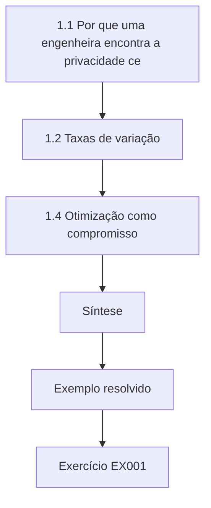

### Desenho lógico

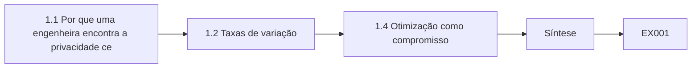

```text
[1.1 Por que uma engenheira encontra a privacidade ce]
    |
    v
[1.2 Taxas de variação]
    |
    v
[1.4 Otimização como compromisso]
    |
    v
[Síntese]
    |
    v
[Exemplo resolvido] --> [Exercício EX001]
```
<!-- cyberabc:lesson-figures:end ch-01 -->


### Objetivos de aprendizagem

Você vai (1) interpretar taxas de variação no crescimento dos dados; (2) usar limites para raciocinar sobre o anonimato quando os grupos encolhem; (3) ligar o cálculo à engenharia de privacidade.

### 1.1 Por que uma engenheira encontra a privacidade cedo

Zara Mbeki começa um curso de engenharia de cinco anos na fictícia Corwen Polytechnic, sob orientação do Prof. Anders Holm. A parceira de seu estágio é a fictícia Pellmore Telehealth, uma prestadora de telemedicina com 300 funcionários e pacientes na União Europeia e no Brasil. O aplicativo da Pellmore agenda consultas, conduz teleconsultas por vídeo e guarda prontuários. O Prof. Holm explica que a privacidade e a proteção de dados serão o principal domínio de engenharia de Zara, e que cada disciplina de fundamentos será lida por essa ótica, a começar pelo cálculo, porque os problemas de privacidade costumam envolver quantidades que crescem ou diminuem com o tempo.

### 1.2 Taxas de variação

O volume de vídeo armazenado pela Pellmore cresce cerca de quarenta gigabytes por dia. A derivada do armazenamento em relação ao tempo é essa taxa diária, e integrá-la ao longo de um ano dá o total. Zara vê de imediato uma consequência para a privacidade: se as gravações nunca forem apagadas, a quantidade de dados de saúde sensíveis em risco cresce linearmente para sempre. Uma regra de retenção transforma a curva de crescimento em um patamar, porque os dados entram e saem na mesma taxa. Ela esboça as duas curvas e rotula a diferença entre elas como exposição evitável, que um vazamento poderia revelar.

### 1.3 Limites e grupos pequenos

Um limite descreve o que acontece quando uma quantidade se aproxima de um valor. Zara aplica a ideia às estatísticas publicadas. Se a Pellmore divulga o tempo médio de espera de uma clínica, a média descreve muitos pacientes; quando o tamanho do grupo se aproxima de um, a média passa a ser o tempo exato de espera de uma única pessoa. A proteção de privacidade que funciona para grupos grandes falha, portanto, no limite dos grupos muito pequenos. Essa intuição, ela aprende, está por trás das regras que suprimem células pequenas em tabelas publicadas e das garantias formais que ela encontrará mais tarde na privacidade diferencial.

### 1.4 Otimização como compromisso

O cálculo também encontra máximos e mínimos. O Prof. Holm propõe um exercício: a utilidade de um conjunto de dados cresce com o detalhe, mas o risco à privacidade também cresce. Se os dois forem modelados como curvas suaves, o melhor nível de detalhe é aquele em que o ganho marginal de utilidade iguala o aumento marginal de risco. Zara percebe que o modelo é simplista, porque o risco para as pessoas não se troca livremente por utilidade e a lei fixa limites rígidos, mas o hábito de perguntar pelos efeitos marginais vai ajudá-la a defender projetos proporcionais ao longo de todo o curso.

### Exemplo resolvido

Zara modela o crescimento do armazenamento com e sem retenção, raciocina sobre médias quando o tamanho do grupo diminui e enquadra o detalhe contra o risco como um compromisso marginal limitado pela lei.

> **Caso sintético.** A Corwen, a Pellmore e os números são sintéticos.

### Erros e limites

Curvas suaves simplificam riscos discretos; os limites legais são restrições, não termos de um compromisso.

### Exercícios

- **EX001 — Patamar de retenção.** Por que uma regra de retenção transforma o crescimento do armazenamento em um patamar? *Rubrica:* 3 = os dados entram e saem em taxas iguais, então o total para de subir;; 2 = menciona a eliminação;; 1 = diz que o armazenamento para;; 0 = nenhuma.
- **EX002 — Limite do grupo pequeno.** O que acontece com uma média quando o tamanho do grupo se aproxima de um? *Rubrica:* 3 = ela vira o valor exato de uma pessoa, revelando-o;; 2 = diz que fica menos precisa;; 1 = errado;; 0 = nenhuma.
- **EX003 — Limites do compromisso marginal.** Por que o modelo de compromisso marginal é simplista para a privacidade? *Rubrica:* 3 = o dano às pessoas não é livremente trocável e a lei fixa limites rígidos;; 2 = menciona a lei;; 1 = aceita o modelo;; 0 = nenhuma.

### Síntese

O capítulo 1 lê o cálculo pela ótica da privacidade. O capítulo 2 usa matemática discreta para contar identidades.

<!-- cyberabc:chapter-navigation:start ch-01 -->
### Continue estudando — aula 01 (capítulo 01 de 50)

[← Início do curso](../../README.md) · [Índice das aulas](../SUBJECTS.md) · [Capítulo 02 →](#ch-02)

Continue para a próxima aula já escrita.
<!-- cyberabc:chapter-navigation:end -->

<a id="ch-02"></a>

## Capítulo 2 — Matemática discreta

<!-- cyberabc:lesson-figures:start ch-02 -->
### Mapa da aula

Aula 02 publicada. Mapa, exemplo, EX004.

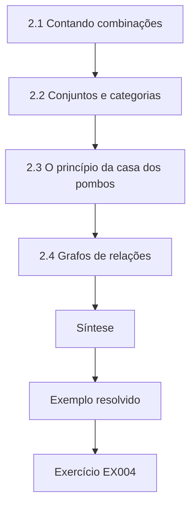

### Desenho lógico

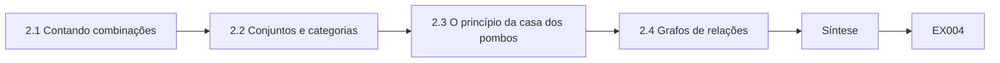

```text
[2.1 Contando combinações]
    |
    v
[2.2 Conjuntos e categorias]
    |
    v
[2.3 O princípio da casa dos pombos]
    |
    v
[2.4 Grafos de relações]
    |
    v
[Síntese]
    |
    v
[Exemplo resolvido] --> [Exercício EX004]
```
<!-- cyberabc:lesson-figures:end ch-02 -->


### Objetivos de aprendizagem

Você vai (1) contar combinações de atributos; (2) usar conjuntos para descrever categorias de dados; (3) raciocinar sobre a unicidade com o princípio da casa dos pombos.

### 2.1 Contando combinações

Zara conta quantos perfis distintos o formulário de agendamento da Pellmore pode produzir. A data de nascimento tem cerca de 36.500 valores ao longo de um século, o sexo tem dois valores comuns e a Pellmore atende cerca de 3.000 áreas postais. O produto passa de duzentos milhões de combinações possíveis, muito mais do que os 150.000 pacientes da Pellmore. A maioria das combinações fica vazia, e muitos pacientes ficam sozinhos em sua combinação. Esse argumento simples de contagem explica a constatação de Sweeney (2002) de que poucos atributos comuns bastam para singularizar a maioria das pessoas, que Zara estudará em detalhe mais adiante no curso.

### 2.2 Conjuntos e categorias

A legislação de proteção de dados usa categorias que se comportam como conjuntos. O GDPR distingue os dados pessoais das categorias especiais do artigo 9, que incluem os dados relativos à saúde; a LGPD faz a mesma distinção entre dado pessoal (art. 5º, I) e dado pessoal sensível, que inclui o dado referente à saúde (art. 5º, II), com hipóteses de tratamento próprias no art. 11. Zara desenha um diagrama de Venn: todos os dados que a Pellmore guarda, o subconjunto que é dado pessoal e, dentro dele, o subconjunto que é dado de saúde. Ela percebe que quase tudo o que a Pellmore guarda cai no conjunto mais interno, porque até o horário de uma consulta em uma clínica de telemedicina revela que alguém procurou atendimento. Pensar em conjuntos a ajuda a ver por que as decisões de classificação precisam ser tomadas com cuidado.

### 2.3 O princípio da casa dos pombos

Se houver mais pombos do que casas, alguma casa terá pelo menos dois pombos. Zara usa a recíproca: quando há muito mais casas do que pombos, a maioria das casas tem no máximo um. Com duzentos milhões de combinações e 150.000 pacientes, a unicidade é quase garantida, a menos que os atributos sejam tornados mais grosseiros. O Prof. Holm pede que ela calcule quão grosseiros os atributos precisam ser para que cada combinação tenha, em média, pelo menos cinco pacientes. Reduzir a data de nascimento ao ano de nascimento e a área postal à região aproxima o número de combinações da escala necessária.

### 2.4 Grafos de relações

A matemática discreta também trata de grafos. Zara modela os sistemas da Pellmore como nós e os fluxos de dados como arestas. Um prontuário vai do aplicativo para o banco de agendamentos, depois para o fornecedor de vídeo, o sistema de prontuários e o laboratório parceiro. O grafo mostra por onde os dados pessoais circulam e quais nós se ligam a organizações externas. Ela aprende que esse grafo é o ponto de partida de um registro das atividades de tratamento, exigido pelo artigo 30 do GDPR e, no Brasil, pelo art. 37 da LGPD, e que arestas ausentes no diagrama costumam significar fluxos não documentados e, portanto, não gerenciados.

### Exemplo resolvido

Zara conta mais de duzentos milhões de combinações de atributos para 150.000 pacientes, classifica os dados da Pellmore com conjuntos, aplica o princípio da casa dos pombos à unicidade e desenha um grafo de fluxos de dados.

> **Caso sintético.** Os números de pacientes são sintéticos; os artigos 9 e 30 do GDPR, os arts. 5º, 11 e 37 da LGPD e Sweeney (2002) são reais.

### Erros e limites

A contagem uniforme presume valores igualmente prováveis; os atributos reais se concentram.

### Exercícios

- **EX004 — Contagem de combinações.** Por que muitos pacientes ficam sozinhos em sua combinação? *Rubrica:* 3 = as combinações superam em muito o número de pacientes;; 2 = menciona números;; 1 = errado;; 0 = nenhuma.
- **EX005 — Conjunto mais interno.** Por que a maior parte dos dados da Pellmore cai no subconjunto dos dados de saúde? *Rubrica:* 3 = até as consultas agendadas revelam que alguém procurou atendimento médico;; 2 = menciona saúde;; 1 = diz que só os prontuários;; 0 = nenhuma.
- **EX006 — Arestas ausentes.** O que costuma significar uma aresta ausente no grafo de fluxos de dados? *Rubrica:* 3 = um fluxo não documentado que não é gerenciado;; 2 = menciona erro;; 1 = vago;; 0 = nenhuma.

### Síntese

O capítulo 2 conta, classifica e mapeia. O capítulo 3 examina o lado físico dos dados.

<!-- cyberabc:chapter-navigation:start ch-02 -->
### Continue estudando — aula 02 (capítulo 02 de 50)

[← Capítulo 01](#ch-01) · [Índice das aulas](../SUBJECTS.md) · [Capítulo 03 →](#ch-03)

Continue para a próxima aula já escrita.
<!-- cyberabc:chapter-navigation:end -->

<a id="ch-03"></a>

## Capítulo 3 — Física para computação

<!-- cyberabc:lesson-figures:start ch-03 -->
### Mapa da aula

Aula 03 publicada. Mapa, exemplo, EX007.

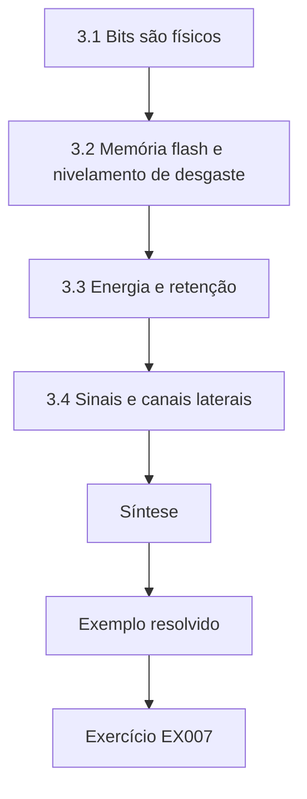

### Desenho lógico

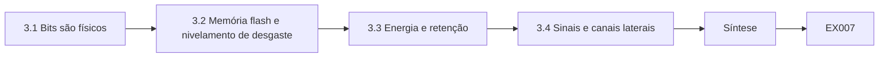

```text
[3.1 Bits são físicos]
    |
    v
[3.2 Memória flash e nivelamento de desgaste]
    |
    v
[3.3 Energia e retenção]
    |
    v
[3.4 Sinais e canais laterais]
    |
    v
[Síntese]
    |
    v
[Exemplo resolvido] --> [Exercício EX007]
```
<!-- cyberabc:lesson-figures:end ch-03 -->


### Objetivos de aprendizagem

Você vai (1) explicar como os dados persistem nos meios físicos; (2) raciocinar sobre a eliminação no nível do hardware; (3) ligar fatos físicos às obrigações de eliminação.

### 3.1 Bits são físicos

Na disciplina de física para computação, Zara aprende que os bits armazenados são estados físicos: carga em células de memória flash, regiões magnetizadas em discos. Apagar um arquivo costuma remover apenas um ponteiro, deixando os estados intactos até serem sobrescritos. Para a Pellmore, isso importa porque o direito ao apagamento do artigo 17 do GDPR exige que os dados sejam apagados sem demora injustificada em certos casos, e a LGPD dá ao titular o direito à eliminação (art. 18, IV e VI), definida como a exclusão de dado armazenado em banco de dados, independentemente do procedimento empregado (art. 5º, XIV). Se os engenheiros igualarem apagar uma linha do banco de dados a eliminar os dados, cópias podem persistir em discos, logs e backups, o que cria uma distância entre o que o sistema informa e o que é fisicamente verdadeiro.

### 3.2 Memória flash e nivelamento de desgaste

As unidades de estado sólido distribuem as gravações entre as células para não desgastar nenhuma área isolada. Uma consequência é que sobrescrever um arquivo pode gravar em células novas e deixar as antigas intactas. Zara lê que a eliminação segura nesses meios depende de comandos de sanitização embutidos ou de criptografia. Com a criptografia, os dados são guardados apenas em forma cifrada, e destruir a chave torna ilegíveis todas as cópias. Essa abordagem, muitas vezes chamada de apagamento criptográfico, é atraente para o arquivo de vídeo da Pellmore, em que sobrescrever fisicamente cada cópia seria impraticável em tantas unidades.

### 3.3 Energia e retenção

A física também ensina que o armazenamento consome energia e espaço. Guardar anos de teleconsultas em vídeo tem um custo em eletricidade e refrigeração, além do custo em risco. Zara escreve uma nota curta para a equipe de instalações da Pellmore ligando a retenção ao consumo de energia. Uma retenção mais curta reduz tanto a pegada ambiental quanto a quantidade de dados de saúde expostos em um vazamento. O argumento não é decisivo sozinho, mas mostra que a engenharia de privacidade costuma se alinhar a outros objetivos de engenharia, o que pode tornar as propostas mais fáceis de aceitar pelos gestores.

### 3.4 Sinais e canais laterais

Por fim, Zara estuda como os sinais físicos vazam informação. As chamadas de vídeo enviam pacotes cujos tamanhos e tempos podem revelar atividade mesmo quando o conteúdo está cifrado, e as telas emitem sinais fracos. Para a Pellmore, a lição prática é modesta: cifrar o vídeo protege o conteúdo, mas metadados como a duração e o horário da chamada ainda revelam que um paciente consultou um médico. Ela anota isso como um tema a retomar quando estudar redes e modelos de ameaça, porque proteger os metadados costuma exigir escolhas de projeto, e não apenas criptografia.

### Exemplo resolvido

Zara explica que apagar uma linha deixa vestígios físicos, propõe o apagamento criptográfico para o arquivo de vídeo, liga a retenção ao consumo de energia e registra o vazamento de metadados das chamadas cifradas.

> **Caso sintético.** O arquivo da Pellmore é sintético; o artigo 17 do GDPR e os arts. 5º e 18 da LGPD são reais.

### Erros e limites

O apagamento criptográfico depende de as chaves nunca serem copiadas em texto claro; a gestão de chaves passa a ser o controle crítico.

### Exercícios

- **EX007 — Eliminação do ponteiro.** Por que apagar um arquivo muitas vezes não elimina os dados? *Rubrica:* 3 = só o ponteiro é removido; os estados físicos permanecem até serem sobrescritos;; 2 = menciona sobrescrita;; 1 = diz que elimina;; 0 = nenhuma.
- **EX008 — Apagamento criptográfico.** Como funciona o apagamento criptográfico? *Rubrica:* 3 = os dados são guardados cifrados; destruir a chave torna ilegível cada cópia;; 2 = menciona chaves;; 1 = descreve sobrescrita;; 0 = nenhuma.
- **EX009 — Vazamento de metadados.** O que ainda vaza de uma chamada de vídeo cifrada? *Rubrica:* 3 = metadados como horário e duração revelam que a consulta ocorreu;; 2 = menciona metadados;; 1 = vago;; 0 = nenhuma.

### Síntese

O capítulo 3 fundamenta a eliminação na física. O capítulo 4 começa a programação para a privacidade.

<!-- cyberabc:chapter-navigation:start ch-03 -->
### Continue estudando — aula 03 (capítulo 03 de 50)

[← Capítulo 02](#ch-02) · [Índice das aulas](../SUBJECTS.md) · [Capítulo 04 →](#ch-04)

Continue para a próxima aula já escrita.
<!-- cyberabc:chapter-navigation:end -->

<a id="ch-04"></a>

## Capítulo 4 — Programação I

<!-- cyberabc:lesson-figures:start ch-04 -->
### Mapa da aula

Aula 04 publicada. Mapa, exemplo, EX010.

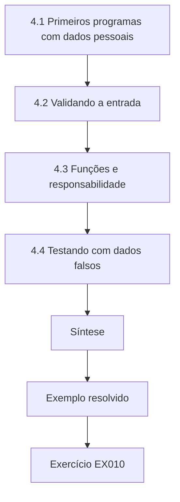

### Desenho lógico

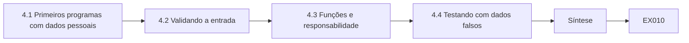

```text
[4.1 Primeiros programas com dados pessoais]
    |
    v
[4.2 Validando a entrada]
    |
    v
[4.3 Funções e responsabilidade]
    |
    v
[4.4 Testando com dados falsos]
    |
    v
[Síntese]
    |
    v
[Exemplo resolvido] --> [Exercício EX010]
```
<!-- cyberabc:lesson-figures:end ch-04 -->


### Objetivos de aprendizagem

Você vai (1) escrever programas simples que tratem dados pessoais com segurança; (2) evitar registrar identificadores em logs; (3) validar entradas para reduzir erros de coleta.

### 4.1 Primeiros programas com dados pessoais

A primeira disciplina de programação de Zara usa Python. Seu primeiro trabalho, um script de agendamento, pede o nome e a data de nascimento do paciente e imprime uma confirmação. O Prof. Holm aponta que as mensagens de depuração dela incluem a data de nascimento completa, que acabaria nos logs se o script rodasse em um servidor. Os logs costumam ser guardados por mais tempo e protegidos com menos cuidado do que os bancos de dados. Zara troca a mensagem por outra que contém apenas um código de agendamento, um hábito que as orientações do EDPB sobre proteção de dados desde a concepção descreveriam como proteger os dados por padrão.

### 4.2 Validando a entrada

O formulário de agendamento aceita texto livre para o motivo da consulta. Zara percebe que os pacientes digitam muito mais do que o necessário, incluindo medicamentos e histórico familiar. Ela muda o formulário para oferecer uma lista curta de tipos de consulta e um campo de texto livre limitado, com uma nota clara sobre o que incluir. Validar e limitar a entrada é uma técnica de programação, mas também aplica o princípio da minimização de dados do artigo 5(1)(c) do GDPR, que exige dados adequados, pertinentes e limitados ao necessário, e o princípio da necessidade da LGPD (art. 6º, III).

### 4.3 Funções e responsabilidade

À medida que o script cresce, Zara o divide em funções: uma para coletar a entrada, uma para validar e uma para armazenar. Ela acrescenta uma função que pseudonimiza o identificador do paciente com um hash com chave antes de passá-lo à área de análise. A chave fica guardada separadamente, o que corresponde à definição de pseudonimização do artigo 4(5) do GDPR e à do art. 13, § 4º, da LGPD. Ela aprende que concentrar a lógica de privacidade em uma única função a torna mais fácil de testar e mais difícil de esquecer, e que um nome de função como pseudonymise também documenta a intenção para outros desenvolvedores.

### 4.4 Testando com dados falsos

Os testes de Zara usam pacientes inventados, gerados pelo próprio script, e nunca dados reais copiados da Pellmore. Ela escreve um teste que verifica que nenhuma linha de log contém um padrão de data de nascimento. O Prof. Holm chama isso de teste unitário de privacidade e pede à turma que acrescente um a cada trabalho. O hábito de testar automaticamente as propriedades de privacidade vai se tornar importante mais tarde, nos laboratórios de verificação, em que Zara testará sistemas inteiros, mas começa com poucas linhas em um exercício de programação do primeiro ano e com o compromisso de nunca usar prontuários reais no desenvolvimento.

### Exemplo resolvido

Zara retira as datas de nascimento das mensagens de depuração, limita o texto livre, isola a pseudonimização em uma função e acrescenta um teste unitário de privacidade que procura datas de nascimento nos logs.

> **Caso sintético.** O script e os pacientes são sintéticos; os artigos 4(5) e 5(1)(c) do GDPR, os arts. 6º e 13 da LGPD e as Diretrizes 4/2019 do EDPB são reais.

### Erros e limites

Um hash com chave é pseudonimização, não anonimização; quem tem a chave pode refazer a vinculação.

### Exercícios

- **EX010 — Logs de depuração.** Por que imprimir datas de nascimento nas mensagens de depuração é arriscado? *Rubrica:* 3 = os logs são guardados por mais tempo e protegidos com menos cuidado do que os bancos de dados;; 2 = menciona logs;; 1 = inofensivo;; 0 = nenhuma.
- **EX011 — Limites do texto livre.** Que princípio do GDPR limitar o texto livre aplica? *Rubrica:* 3 = a minimização de dados do artigo 5(1)(c);; 2 = menciona minimização;; 1 = cita outro;; 0 = nenhuma.
- **EX012 — Teste unitário de privacidade.** O que o teste unitário de privacidade de Zara verifica? *Rubrica:* 3 = que nenhuma linha de log contém um padrão de data de nascimento;; 2 = menciona logs;; 1 = omite;; 0 = nenhuma.

### Síntese

O capítulo 4 constrói hábitos de programação segura. O capítulo 5 treina a comunicação.

<!-- cyberabc:chapter-navigation:start ch-04 -->
### Continue estudando — aula 04 (capítulo 04 de 50)

[← Capítulo 03](#ch-03) · [Índice das aulas](../SUBJECTS.md) · [Capítulo 05 →](#ch-05)

Continue para a próxima aula já escrita.
<!-- cyberabc:chapter-navigation:end -->

<a id="ch-05"></a>

## Capítulo 5 — Comunicação em engenharia

<!-- cyberabc:lesson-figures:start ch-05 -->
### Mapa da aula

Aula 05 publicada. Mapa, exemplo, EX013.

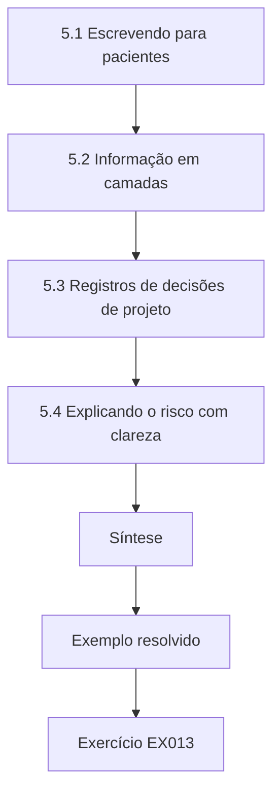

### Desenho lógico

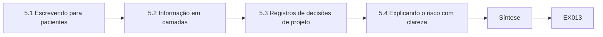

```text
[5.1 Escrevendo para pacientes]
    |
    v
[5.2 Informação em camadas]
    |
    v
[5.3 Registros de decisões de projeto]
    |
    v
[5.4 Explicando o risco com clareza]
    |
    v
[Síntese]
    |
    v
[Exemplo resolvido] --> [Exercício EX013]
```
<!-- cyberabc:lesson-figures:end ch-05 -->


### Objetivos de aprendizagem

Você vai (1) escrever avisos de privacidade que engenheiros e pacientes entendam; (2) documentar decisões de projeto; (3) explicar o risco sem jargão.

### 5.1 Escrevendo para pacientes

Na disciplina de comunicação em engenharia, Zara reescreve o aviso de privacidade da Pellmore. O original é longo e cheio de linguagem jurídica. Os artigos 12 a 14 do GDPR exigem que a informação seja prestada de forma concisa, transparente, inteligível e de fácil acesso, em linguagem clara e simples; a LGPD exige informações claras, precisas e facilmente acessíveis (art. 6º, VI), disponibilizadas de forma clara, adequada e ostensiva (art. 9º). Zara reorganiza o aviso em torno das perguntas dos pacientes: o que é coletado, por quê, quem vê, por quanto tempo é guardado e como exercer os direitos. Ela testa o rascunho com cinco colegas que não são engenheiros e reescreve cada frase que eles entendem errado. O aviso final é mais curto e mais preciso.

### 5.2 Informação em camadas

Zara aprende que um único documento não serve a todos. Ela desenha um aviso em camadas: um resumo curto no momento do agendamento, um aviso completo acessível a partir dele e explicações específicas no momento em que um recurso usa dados, como quando o aplicativo pede acesso à câmera. Acquisti, Brandimarte e Loewenstein (2015) descrevem como as decisões de privacidade das pessoas dependem do contexto e da forma de apresentação, o que sustenta dar a informação no momento da decisão, e não só em um documento longo lido uma vez, se tanto, quando a conta é criada.

### 5.3 Registros de decisões de projeto

Os engenheiros também precisam se comunicar entre si. Zara começa um registro de decisões para seu trabalho na Pellmore. Cada entrada informa a decisão, as alternativas consideradas, o raciocínio de privacidade e quem a aprovou. Por exemplo, ela registra a escolha de guardar códigos de agendamento, e não nomes, na área de análise. O Prof. Holm explica que esses registros sustentam o princípio da responsabilidade do artigo 5(2) do GDPR, que exige que o controlador consiga demonstrar a conformidade, equivalente ao princípio de responsabilização e prestação de contas da LGPD (art. 6º, X), e que eles ajudam futuros engenheiros a entender por que um sistema tem a forma que tem.

### 5.4 Explicando o risco com clareza

Zara pratica explicar o risco a gestores. Em vez de dizer que um conjunto de dados tem alto risco de reidentificação, ela diz que alguém que conheça o código postal e a data de nascimento de um paciente poderia encontrar nele o histórico de consultas desse paciente. Explicações concretas levam a decisões melhores, porque os gestores conseguem imaginar o dano. Ela também aprende a declarar a incerteza com honestidade, por exemplo que uma estimativa de risco depende do que o atacante sabe, sem se esconder atrás dela. A comunicação, conclui, é uma competência de engenharia que determina se bons projetos chegam a ser adotados.

### Exemplo resolvido

Zara reescreve o aviso de privacidade em torno das perguntas dos pacientes, distribui-o em camadas nos pontos de decisão, começa um registro de decisões para a responsabilização e pratica explicações concretas do risco.

> **Caso sintético.** O aviso e o registro de decisões são sintéticos; os artigos 5(2) e 12–14 do GDPR, os arts. 6º e 9º da LGPD e Acquisti et al. (2015) são reais.

### Erros e limites

A linguagem simples precisa continuar precisa; uma simplificação que descreve mal o tratamento viola a transparência.

### Exercícios

- **EX013 — Padrão de transparência.** Que forma a informação deve ter segundo o GDPR? *Rubrica:* 3 = concisa, transparente, inteligível, de fácil acesso, em linguagem clara e simples;; 2 = lista algumas;; 1 = diz detalhada;; 0 = nenhuma.
- **EX014 — Aviso no momento certo.** Por que informar quando um recurso usa dados? *Rubrica:* 3 = as decisões dependem do contexto, então a informação naquele momento é mais útil;; 2 = menciona o momento;; 1 = diz que uma vez basta;; 0 = nenhuma.
- **EX015 — Papel do registro de decisões.** Que princípio o registro de decisões sustenta? *Rubrica:* 3 = a responsabilidade do artigo 5(2);; 2 = menciona responsabilização;; 1 = cita outro;; 0 = nenhuma.

### Síntese

O capítulo 5 torna a comunicação parte do desenho. O capítulo 6 volta à matemática com a acumulação.

<!-- cyberabc:chapter-navigation:start ch-05 -->
### Continue estudando — aula 05 (capítulo 05 de 50)

[← Capítulo 04](#ch-04) · [Índice das aulas](../SUBJECTS.md) · [Capítulo 06 →](#ch-06)

Continue para a próxima aula já escrita.
<!-- cyberabc:chapter-navigation:end -->

<a id="ch-06"></a>

## Capítulo 6 — Cálculo II

<!-- cyberabc:lesson-figures:start ch-06 -->
### Mapa da aula

Aula 06 publicada. Mapa, exemplo, EX016.

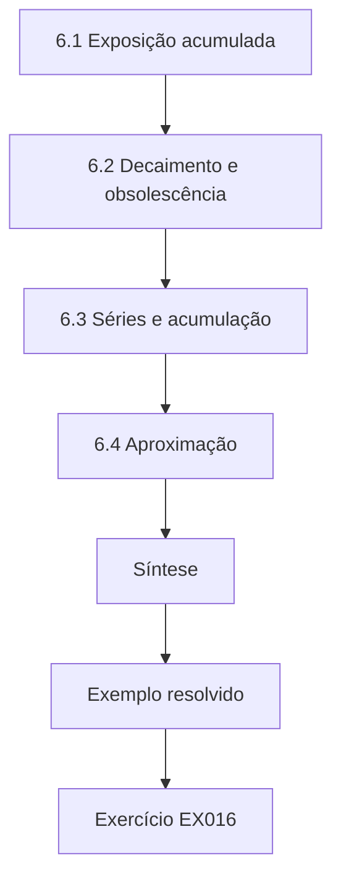

### Desenho lógico

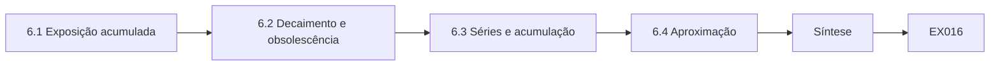

```text
[6.1 Exposição acumulada]
    |
    v
[6.2 Decaimento e obsolescência]
    |
    v
[6.3 Séries e acumulação]
    |
    v
[6.4 Aproximação]
    |
    v
[Síntese]
    |
    v
[Exemplo resolvido] --> [Exercício EX016]
```
<!-- cyberabc:lesson-figures:end ch-06 -->


### Objetivos de aprendizagem

Você vai (1) integrar a exposição ao longo do tempo; (2) modelar o decaimento exponencial do risco; (3) usar séries para acumular a perda de privacidade.

### 6.1 Exposição acumulada

Zara modela a exposição da Pellmore como o número de prontuários armazenados multiplicado pelo tempo em que ficam armazenados. Integrar o armazenamento ao longo de um ano dá a exposição em pacientes-dia. Um prazo de retenção de trinta dias para as gravações de vídeo, em vez do armazenamento indefinido, reduz drasticamente a integral, mesmo que a entrada diária não mude. Ela mostra o cálculo ao líder de engenharia da Pellmore como a área sob duas curvas. O gráfico torna imediato o efeito da retenção e fornece um único número que pode ser acompanhado como indicador-chave. Na LGPD, a mesma ideia aparece no término do tratamento quando a finalidade é alcançada (art. 15, I) e na eliminação que se segue (art. 16).

### 6.2 Decaimento e obsolescência

Alguns riscos decaem. Um endereço antigo é menos útil para um atacante do que o atual, e a utilidade dos dados de contato poderia ser modelada como um decaimento exponencial no tempo. Zara adverte contra o uso excessivo do modelo: a informação de saúde não perde sensibilidade com a idade, e um diagnóstico de dez anos atrás ainda pode prejudicar alguém. Ela conclui que os modelos de decaimento podem orientar a retenção de dados de baixa sensibilidade, mas as categorias especiais precisam de regras explícitas, e não da suposição de que o risco desaparece naturalmente com o tempo.

### 6.3 Séries e acumulação

Em trabalhos posteriores, Zara vai publicar estatísticas repetidas. O Cálculo II apresenta as séries, somas de muitos termos. Se cada publicação vazar uma pequena quantidade de informação, o total depois de muitas publicações é a soma. Zara escreve a soma para publicações diárias e vê que ela cresce sem limite. Isso antecipa a propriedade de composição da privacidade diferencial descrita por Dwork e Roth (2014), em que a perda de privacidade se soma entre as consultas, e a deixa cética diante de qualquer afirmação de que publicações frequentes são seguras porque cada uma, isoladamente, é inofensiva.

### 6.4 Aproximação

As aproximações de Taylor permitem aos engenheiros trocar uma função complexa por uma simples perto de um ponto. Zara usa a ideia para estimar como uma pequena mudança na retenção afeta a exposição: perto da política atual, a exposição varia aproximadamente em proporção ao prazo de retenção. Ela usa isso para explicar que reduzir a retenção à metade reduz aproximadamente à metade a exposição daquela categoria. O Prof. Holm lembra que as aproximações só valem perto do ponto em que foram feitas, uma cautela útil sempre que os engenheiros extrapolam de pequenas mudanças para grandes reformulações.

### Exemplo resolvido

Zara integra o armazenamento para obter a exposição em pacientes-dia, limita os modelos de decaimento aos dados de baixa sensibilidade, soma as publicações repetidas para antecipar a composição e usa uma aproximação linear para mudanças de retenção.

> **Caso sintético.** Os números de exposição são sintéticos; Dwork e Roth (2014) e os arts. 15 e 16 da LGPD são reais.

### Erros e limites

A medida em pacientes-dia ignora diferenças de sensibilidade entre registros; pondere as categorias quando necessário.

### Exercícios

- **EX016 — Pacientes-dia.** O que mede a integral do armazenamento ao longo do tempo? *Rubrica:* 3 = a exposição acumulada em pacientes-dia;; 2 = menciona área;; 1 = tamanho do armazenamento;; 0 = nenhuma.
- **EX017 — Cautela com o decaimento.** Por que os modelos de decaimento não servem para dados de saúde? *Rubrica:* 3 = a informação de saúde mantém sua sensibilidade com o tempo;; 2 = menciona sensibilidade;; 1 = aceita o decaimento;; 0 = nenhuma.
- **EX018 — Publicações somadas.** O que mostra a soma dos vazamentos diários? *Rubrica:* 3 = a perda total de privacidade cresce sem limite à medida que as publicações continuam;; 2 = menciona crescimento;; 1 = diz que fica pequena;; 0 = nenhuma.

### Síntese

O capítulo 6 acumula exposição e perda. O capítulo 7 usa probabilidade para coletar dados sensíveis com segurança.

<!-- cyberabc:chapter-navigation:start ch-06 -->
### Continue estudando — aula 06 (capítulo 06 de 50)

[← Capítulo 05](#ch-05) · [Índice das aulas](../SUBJECTS.md) · [Capítulo 07 →](#ch-07)

Continue para a próxima aula já escrita.
<!-- cyberabc:chapter-navigation:end -->

<a id="ch-07"></a>

## Capítulo 7 — Probabilidade e estatística

<!-- cyberabc:lesson-figures:start ch-07 -->
### Mapa da aula

Aula 07 publicada. Mapa, exemplo, EX019.

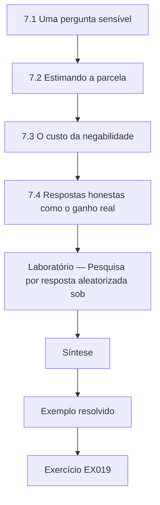

### Desenho lógico

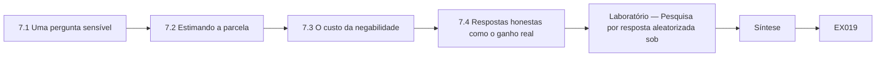

```text
[7.1 Uma pergunta sensível]
    |
    v
[7.2 Estimando a parcela]
    |
    v
[7.3 O custo da negabilidade]
    |
    v
[7.4 Respostas honestas como o ganho real]
    |
    v
[Laboratório — Pesquisa por resposta aleatorizada sob]
    |
    v
[Síntese]
    |
    v
[Exemplo resolvido] --> [Exercício EX019]
```
<!-- cyberabc:lesson-figures:end ch-07 -->


### Objetivos de aprendizagem

Você vai (1) aplicar a resposta aleatorizada a uma pesquisa sensível; (2) estimar uma proporção e sua incerteza; (3) explicar o compromisso entre privacidade e precisão.

### 7.1 Uma pergunta sensível

A Pellmore quer saber quantos pacientes deixam de tomar a medicação prescrita, mas os pacientes podem não responder com honestidade se temerem que o médico veja. Zara propõe a resposta aleatorizada, uma técnica clássica de pesquisa. Cada paciente joga uma moeda em segredo: se der cara, responde a verdade; se der coroa, joga de novo e responde sim se der cara e não se der coroa. Qualquer sim isolado pode ter vindo da moeda, então nenhuma resposta revela a verdade sobre um indivíduo, mas a proporção geral ainda pode ser estimada a partir de muitas respostas, porque o comportamento da moeda é conhecido.

### 7.2 Estimando a parcela

O laboratório simula 2.000 pacientes, dos quais 17,9% de fato deixam de tomar a medicação. Com o desenho da moeda, um quarto de todas as respostas são sins aleatórios, então a parcela observada de sins é 0,344. A estimativa subtrai a parte aleatória e dobra o restante, dando 0,189, com intervalo de 95% de 0,147 a 0,231. O intervalo contém o valor verdadeiro. Zara explica cada passo à líder clínica da Pellmore, enfatizando que a estimativa descreve o grupo e que as respostas individuais continuam negáveis até para a equipe da pesquisa. A líder clínica aceita o método para a pesquisa piloto.

### 7.3 O custo da negabilidade

A privacidade tem um preço em precisão. Uma pesquisa direta com 2.000 respondentes honestos teria erro padrão de 0,009, mas a resposta aleatorizada tem 0,021, mais que o dobro. Zara explica que o ruído que protege os indivíduos também borra a estimativa, então é preciso uma amostra maior para obter a mesma precisão. É o mesmo compromisso que ela encontrará na privacidade diferencial, em que a resposta aleatorizada costuma ser apresentada como um exemplo pioneiro de mecanismo que dá a cada respondente uma negabilidade plausível. O ruído amplia o erro da estimativa.

### 7.4 Respostas honestas como o ganho real

Zara também observa que a comparação com uma pesquisa direta presume que os pacientes responderiam com honestidade, que é exatamente o que a Pellmore duvida. Se o medo fizer muitos pacientes negarem que deixam de tomar a medicação, uma pesquisa direta seria precisa, mas errada. A resposta aleatorizada troca precisão por honestidade. Ela a recomenda para essa pergunta e escreve uma breve explicação para o consentimento, para que os pacientes entendam o mecanismo da moeda. O Prof. Holm acrescenta que a estatística não consiste apenas em calcular intervalos, mas em entender como os dados foram gerados e o que poderia enviesá-los.

### Laboratório — Pesquisa por resposta aleatorizada sobre adesão à medicação

```python
# Randomised response: estimate how many of 2,000 synthetic patients skipped medication, without learning anyone's answer.
import random
r = random.Random(4)
true_p, n = 0.18, 2000
truth = [r.random() < true_p for _ in range(n)]
# each respondent flips a coin: heads answer truthfully, tails answer "yes" with probability 1/2
ans = [t if r.random() < 0.5 else (r.random() < 0.5) for t in truth]
y = sum(ans) / n
est = (y - 0.25) / 0.5
se = (y * (1 - y) / n) ** 0.5 / 0.5
print(f"true share {sum(truth)/n:.3f}; observed yes {y:.3f}; estimate {est:.3f} (95% CI {est-1.96*se:.3f} to {est+1.96*se:.3f})")
print(f"direct-survey standard error would be {(est*(1-est)/n)**0.5:.3f}; randomised response {se:.3f}")
```

Execute com `python3 lab_rr.py`. Saída verificada:

```text
true share 0.179; observed yes 0.344; estimate 0.189 (95% CI 0.147 to 0.231)
direct-survey standard error would be 0.009; randomised response 0.021
```

### Exemplo resolvido

Zara estima a parcela que deixa de tomar a medicação em 0,189 (intervalo de 95% de 0,147 a 0,231) contra um valor verdadeiro de 0,179, e mostra o erro padrão subindo de 0,009 para 0,021 como o preço da negabilidade.

> **Caso sintético.** Os pacientes e as respostas são sintéticos e gerados com semente fixa.

### Erros e limites

O método só protege diante de quem conduz a pesquisa se os pacientes confiarem na moeda; uma explicação ruim o enfraquece.

### Exercícios

- **EX019 — Negabilidade.** Por que um sim isolado não revela o comportamento de um paciente? *Rubrica:* 3 = ele pode vir da moeda, e não da verdade;; 2 = menciona aleatoriedade;; 1 = diz que revela;; 0 = nenhuma.
- **EX020 — Cálculo da estimativa.** Como a estimativa 0,189 é obtida a partir de 0,344? *Rubrica:* 3 = subtrair os 0,25 de sins aleatórios e dividir por 0,5;; 2 = descreve em parte;; 1 = errado;; 0 = nenhuma.
- **EX021 — Razão entre erros.** Quanto maior é o erro padrão da resposta aleatorizada? *Rubrica:* 3 = 0,021 contra 0,009, mais que o dobro;; 2 = menciona que é maior;; 1 = errado;; 0 = nenhuma.

### Síntese

O capítulo 7 mostra trade-offs entre privacidade e precisão em uma pesquisa por questionário. O capítulo 8 examina o hardware onde os dados residem.

<!-- cyberabc:chapter-navigation:start ch-07 -->
### Continue estudando — aula 07 (capítulo 07 de 50)

[← Capítulo 06](#ch-06) · [Índice das aulas](../SUBJECTS.md) · [Capítulo 08 →](#ch-08)

Continue para a próxima aula já escrita.
<!-- cyberabc:chapter-navigation:end -->

<a id="ch-08"></a>

## Capítulo 8 — Arquitetura de computadores

<!-- cyberabc:lesson-figures:start ch-08 -->
### Mapa da aula

Aula 08 publicada. Mapa, exemplo, EX022.

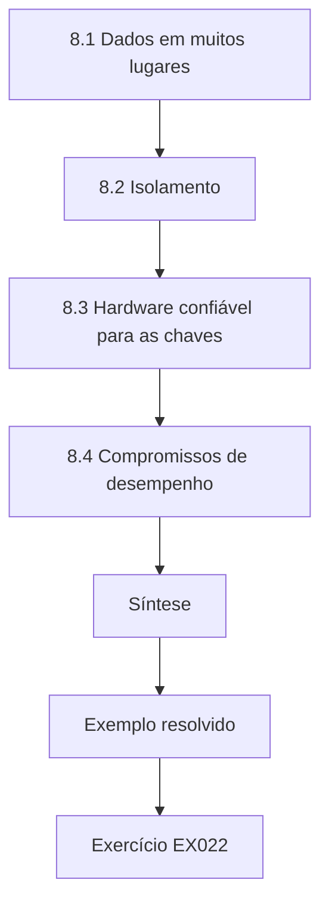

### Desenho lógico

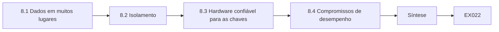

```text
[8.1 Dados em muitos lugares]
    |
    v
[8.2 Isolamento]
    |
    v
[8.3 Hardware confiável para as chaves]
    |
    v
[8.4 Compromissos de desempenho]
    |
    v
[Síntese]
    |
    v
[Exemplo resolvido] --> [Exercício EX022]
```
<!-- cyberabc:lesson-figures:end ch-08 -->


### Objetivos de aprendizagem

Você vai (1) rastrear onde os dados ficam na memória e nos caches; (2) entender o isolamento por hardware; (3) avaliar recursos de hardware para proteger dados de saúde.

### 8.1 Dados em muitos lugares

Em arquitetura de computadores, Zara acompanha um prontuário dentro de um servidor. Ele fica no disco, é copiado para a memória, passa pelos caches do processador e pode ser gravado na área de troca (swap). Cada cópia é um lugar onde os dados podem persistir ou vazar. Ela percebe que uma aplicação que elimina os registros com cuidado ainda pode deixar fragmentos em despejos de memória ou em arquivos de troca. Para a Pellmore, ela recomenda swap cifrado e a desativação, nos servidores de produção, dos despejos de falha que incluem a memória, a menos que um despejo seja pedido explicitamente e tratado por um procedimento definido.

### 8.2 Isolamento

A arquitetura oferece isolamento: os processos normalmente não leem a memória uns dos outros, e as máquinas virtuais são separadas por um hipervisor. Zara aprende que falhas de hardware às vezes romperam essas fronteiras, de modo que os clientes de uma nuvem compartilham risco com os vizinhos. Para o sistema de prontuários da Pellmore, ela lê a documentação do provedor de nuvem sobre hosts dedicados e computação confidencial, que cifra a memória em uso. Ela observa que esses recursos reduzem o risco, mas acrescentam custo e complexidade, e que a escolha deve seguir uma avaliação de risco, e não um folheto de fornecedor.

### 8.3 Hardware confiável para as chaves

Os módulos de segurança de hardware (HSM) e os enclaves seguros mantêm as chaves criptográficas longe da memória comum. Zara liga isso ao Capítulo 3: se a Pellmore usar apagamento criptográfico para os vídeos, as chaves são o ativo mais valioso, e guardá-las em um módulo de hardware torna a cópia acidental muito mais difícil. Ela esboça um projeto em que cada mês de gravações tem sua própria chave, guardada no módulo, e apagar a chave de um mês elimina aquele mês. O projeto transforma o cumprimento da retenção em uma operação de chave simples e auditável. Os auditores podem conferir os logs de exclusão de chaves.

### 8.4 Compromissos de desempenho

A criptografia e o isolamento custam tempo de processador. Zara mede que cifrar o vídeo em repouso acrescenta pouca carga em processadores modernos com aceleração por hardware. Ela registra a medição em seu registro de decisões, porque a alegação de que as medidas de privacidade são lentas demais muitas vezes bloqueia bons projetos sem evidência. O Prof. Holm lembra que as medições devem ser repetidas com a carga real da Pellmore, mas seus primeiros números bastam para levar a conversa da opinião para os dados, um objetivo recorrente em sua formação de engenharia. A criptografia acrescenta uma latência mensurável.

### Exemplo resolvido

Zara mapeia as cópias de um prontuário do disco ao cache, recomenda swap cifrado, considera a computação confidencial e projeta chaves mensais em um módulo de hardware para o apagamento criptográfico.

> **Caso sintético.** Os servidores da Pellmore são sintéticos.

### Erros e limites

Os recursos de hardware têm suas próprias falhas; a defesa em profundidade continua importando.

### Exercícios

- **EX022 — Cópias ocultas.** Cite dois lugares onde um registro apagado pode persistir em um servidor. *Rubrica:* 3 = despejos de memória e swap (também caches);; 2 = cita um;; 1 = vago;; 0 = nenhuma.
- **EX023 — Chaves mensais.** Como as chaves mensais tornam a retenção auditável? *Rubrica:* 3 = apagar a chave de um mês elimina as gravações daquele mês em uma operação;; 2 = menciona chaves;; 1 = omite;; 0 = nenhuma.
- **EX024 — Evidência acima da opinião.** Por que medir a sobrecarga da criptografia? *Rubrica:* 3 = para substituir por dados as alegações de que a privacidade é lenta demais;; 2 = menciona velocidade;; 1 = pula a medição;; 0 = nenhuma.

### Síntese

O capítulo 8 situa os dados no hardware. O capítulo 9 aprofunda a programação.

<!-- cyberabc:chapter-navigation:start ch-08 -->
### Continue estudando — aula 08 (capítulo 08 de 50)

[← Capítulo 07](#ch-07) · [Índice das aulas](../SUBJECTS.md) · [Capítulo 09 →](#ch-09)

Continue para a próxima aula já escrita.
<!-- cyberabc:chapter-navigation:end -->

<a id="ch-09"></a>

## Capítulo 9 — Programação II

<!-- cyberabc:lesson-figures:start ch-09 -->
### Mapa da aula

Aula 09 publicada. Mapa, exemplo, EX025.

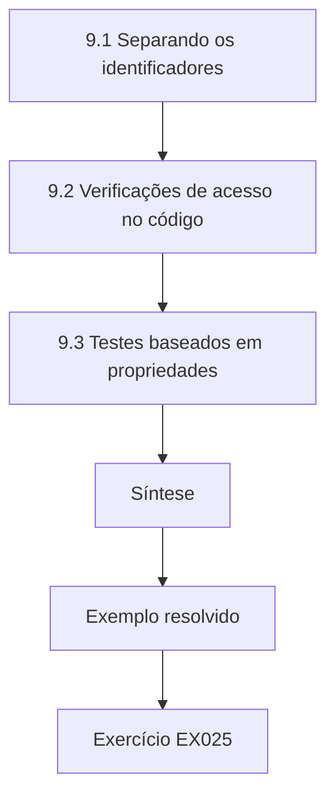

### Desenho lógico

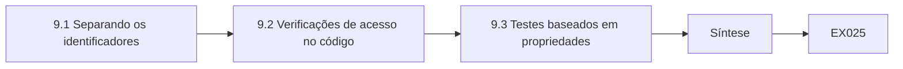

```text
[9.1 Separando os identificadores]
    |
    v
[9.2 Verificações de acesso no código]
    |
    v
[9.3 Testes baseados em propriedades]
    |
    v
[Síntese]
    |
    v
[Exemplo resolvido] --> [Exercício EX025]
```
<!-- cyberabc:lesson-figures:end ch-09 -->


### Objetivos de aprendizagem

Você vai (1) projetar estruturas de dados que separem os identificadores; (2) aplicar verificações de acesso no código; (3) escrever testes para propriedades de privacidade.

### 9.1 Separando os identificadores

Em Programação II, Zara projeta o prontuário da Pellmore como duas estruturas ligadas: uma tabela de identidade, com nome e dados de contato, e uma tabela clínica indexada por um identificador interno. A maioria dos serviços precisa só da parte clínica ou só da parte de identidade, raramente das duas. Separá-las no código facilita dar a cada serviço apenas o que ele precisa. Ela reconhece nisso uma implementação da proteção de dados desde a concepção, em que a própria estrutura do software limita a exposição, em vez de depender de que cada desenvolvedor se lembre de uma regra; a LGPD pede o mesmo ao exigir que as medidas de segurança sejam observadas desde a fase de concepção do produto ou serviço (art. 46, § 2º).

### 9.2 Verificações de acesso no código

Zara escreve uma função que todo serviço precisa chamar antes de ler um prontuário. Ela confere o papel de quem chama e a finalidade do pedido contra uma tabela de política. Uma recepcionista pode ler os horários das consultas, mas não as anotações clínicas; um médico só pode ler as anotações dos pacientes agendados com ele. A função registra cada acesso com a finalidade. Ela testa que uma chamada sem finalidade falha. O Prof. Holm observa que concentrar as verificações em um só lugar evita regras inconsistentes, que são uma fonte comum de acesso amplo demais em sistemas reais.

### 9.3 Testes baseados em propriedades

Zara aprende os testes baseados em propriedades, em que uma ferramenta gera muitas entradas aleatórias para testar regras gerais. Ela escreve propriedades como nenhuma função devolver um prontuário clínico ao papel de recepcionista, e nenhuma função de exportação incluir a tabela de identidade. A ferramenta encontra um defeito: uma exportação escrita por um colega junta as duas tabelas por conveniência. Corrigi-lo elimina um caminho pelo qual prontuários completos poderiam sair do sistema. Ela percebe que testar propriedades de privacidade de forma geral é mais poderoso do que conferir alguns exemplos escolhidos à mão.

### 9.4 Tratamento de erros

Mensagens de erro podem vazar dados. Zara descobre que um agendamento que falha devolve um erro com o prontuário completo do paciente, para fins de depuração. Ela muda os erros para devolverem um código de referência e registra os detalhes internamente, sob controle de acesso. Também garante que as exceções não mostrem aos usuários pilhas de chamadas com valores de variáveis. Essas pequenas mudanças reduzem a divulgação acidental, que muitas vezes acontece por caminhos comuns do software, como os erros, e não por ataques dramáticos, e deixam o sistema mais profissional aos olhos dos pacientes e dos auditores.

### Exemplo resolvido

Zara separa a identidade dos dados clínicos, centraliza as verificações de acesso por finalidade, encontra um defeito de exportação com testes baseados em propriedades e retira dados das mensagens de erro.

> **Caso sintético.** O código e os pacientes são sintéticos; o art. 46 da LGPD é real.

### Erros e limites

Verificações centrais viram um ponto único de falha; precisam de seus próprios testes e monitoramento.

### Exercícios

- **EX025 — Prontuário dividido.** Por que dividir os dados de identidade e os clínicos em duas estruturas? *Rubrica:* 3 = a maioria dos serviços precisa de uma parte só, então cada um recebe apenas o que precisa;; 2 = menciona separação;; 1 = sem motivo;; 0 = nenhuma.
- **EX026 — Finalidade no acesso.** Por que quem chama precisa declarar uma finalidade para ler um prontuário? *Rubrica:* 3 = o acesso é conferido e registrado contra a finalidade, evitando uso amplo demais;; 2 = menciona registro;; 1 = diz que é opcional;; 0 = nenhuma.
- **EX027 — Achado do teste de propriedades.** Que defeito o teste baseado em propriedades encontrou? *Rubrica:* 3 = uma exportação que juntava as tabelas de identidade e clínica;; 2 = menciona exportação;; 1 = vago;; 0 = nenhuma.

### Síntese

O capítulo 9 codifica a privacidade em programas. O capítulo 10 considera ética e segurança física.

<!-- cyberabc:chapter-navigation:start ch-09 -->
### Continue estudando — aula 09 (capítulo 09 de 50)

[← Capítulo 08](#ch-08) · [Índice das aulas](../SUBJECTS.md) · [Capítulo 10 →](#ch-10)

Continue para a próxima aula já escrita.
<!-- cyberabc:chapter-navigation:end -->

<a id="ch-10"></a>

## Capítulo 10 — Ética e segurança na engenharia

<!-- cyberabc:lesson-figures:start ch-10 -->
### Mapa da aula

Aula 10 publicada. Mapa, exemplo, EX028.

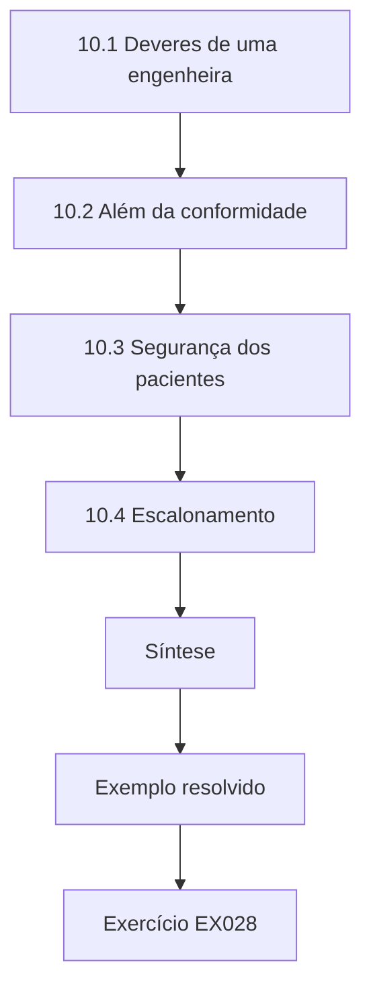

### Desenho lógico

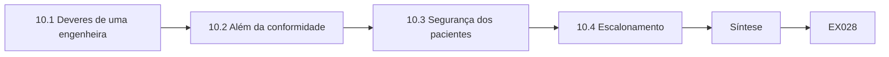

```text
[10.1 Deveres de uma engenheira]
    |
    v
[10.2 Além da conformidade]
    |
    v
[10.3 Segurança dos pacientes]
    |
    v
[10.4 Escalonamento]
    |
    v
[Síntese]
    |
    v
[Exemplo resolvido] --> [Exercício EX028]
```
<!-- cyberabc:lesson-figures:end ch-10 -->


### Objetivos de aprendizagem

Você vai (1) aplicar a ética da engenharia às decisões de privacidade; (2) reconhecer danos que vão além da conformidade legal; (3) decidir quando escalar preocupações.

### 10.1 Deveres de uma engenheira

A ética da engenharia pede aos profissionais que coloquem acima de tudo a segurança e o bem-estar do público. Zara aplica isso à Pellmore. A exposição de dados de saúde pode causar discriminação, constrangimento, perda do emprego e sofrimento. Warren e Brandeis (1890) escreveram sobre o dano aos sentimentos; Solove (2006) lista danos como a divulgação, a exposição e o aumento da acessibilidade. Zara escreve que seu dever não é só cumprir a lei, mas prevenir danos previsíveis aos pacientes, mesmo quando nenhum regulador perceberia, porque os pacientes não conseguem ver nem controlar como o sistema é construído.

### 10.2 Além da conformidade

Zara encontra um caso em que a lei e a ética divergem. A equipe de análise da Pellmore quer inferir gravidez a partir dos padrões de consultas para enviar dicas de saúde direcionadas. O tratamento poderia ser enquadrado como lícito com consentimento, mas muitas pacientes o achariam invasivo, e algumas poderiam ser prejudicadas se um familiar visse as mensagens. A integridade contextual de Nissenbaum a ajuda a formular o problema: uma informação compartilhada para o cuidado está fluindo para o marketing, um contexto diferente, com normas diferentes. Ela recomenda não criar o recurso e registra seu raciocínio no registro de decisões.

### 10.3 Segurança dos pacientes

A telemedicina acrescenta preocupações de segurança. Se uma teleconsulta falhar em silêncio, um paciente pode perder um atendimento urgente. Zara aprende que as medidas de privacidade não podem criar riscos à segurança do paciente: um tempo limite de sessão rígido demais poderia interromper uma consulta. Ela trabalha com os médicos para definir tempos limite que protejam aparelhos deixados sem supervisão sem encerrar chamadas ativas. O exercício lhe ensina que segurança e privacidade são deveres para com os mesmos pacientes, e que os engenheiros precisam equilibrá-las abertamente, em vez de maximizar uma em silêncio à custa da outra.

### 10.4 Escalonamento

Zara pergunta o que deveria fazer se um gestor ignorasse uma preocupação séria de privacidade. O Prof. Holm explica que ela deveria primeiro documentar a preocupação e levá-la ao orientador e ao encarregado de proteção de dados, cujo papel nos artigos 38 e 39 do GDPR inclui aconselhar a organização e monitorar a conformidade com independência. Na LGPD, cabe ao encarregado orientar os funcionários e contratados sobre as práticas de proteção de dados (art. 41, § 2º, III), e sua atuação é regulamentada pela Resolução CD/ANPD nº 18/2024. Se a preocupação continuar sem resposta e os pacientes estiverem em risco, códigos profissionais e proteções a denunciantes podem se aplicar. Zara escreve um plano pessoal de escalonamento, esperando nunca usá-lo, mas mais segura de conhecer o caminho.

### Exemplo resolvido

Zara enquadra seu dever em torno do dano previsível, recomenda não inferir gravidez com base na integridade contextual, equilibra os tempos limite com a segurança clínica e escreve um caminho de escalonamento que passa pelo encarregado de proteção de dados.

> **Caso sintético.** A proposta da equipe de análise é sintética; Warren e Brandeis (1890), Solove (2006), Nissenbaum (2004), os artigos 38–39 do GDPR, o art. 41 da LGPD e a Resolução CD/ANPD nº 18/2024 são reais.

### Erros e limites

O julgamento ético varia; registrar o raciocínio permite que outros o contestem.

### Exercícios

- **EX028 — Dever ético.** Que dever vai além da conformidade legal para Zara? *Rubrica:* 3 = prevenir danos previsíveis aos pacientes mesmo quando ninguém perceberia;; 2 = menciona dano;; 1 = só a lei;; 0 = nenhuma.
- **EX029 — Inferência de gravidez.** Por que Zara desaconselha o recurso de inferência de gravidez? *Rubrica:* 3 = a informação de cuidado flui para o marketing, rompendo as normas do contexto e arriscando dano;; 2 = menciona invasão;; 1 = apoia o recurso;; 0 = nenhuma.
- **EX030 — Papel do encarregado.** Por que escalar ao encarregado de proteção de dados? *Rubrica:* 3 = o encarregado aconselha e monitora a conformidade com independência, pelos artigos 38–39;; 2 = menciona o encarregado;; 1 = vai primeiro à imprensa;; 0 = nenhuma.

### Síntese

O capítulo 10 fundamenta as bases na ética. O capítulo 11 inicia o bloco de sistemas com as redes.

<!-- cyberabc:chapter-navigation:start ch-10 -->
### Continue estudando — aula 10 (capítulo 10 de 50)

[← Capítulo 09](#ch-09) · [Índice das aulas](../SUBJECTS.md) · [Capítulo 11 →](#ch-11)

Continue para a próxima aula já escrita.
<!-- cyberabc:chapter-navigation:end -->

<a id="ch-11"></a>

## Capítulo 11 — Redes e protocolos

<!-- cyberabc:lesson-figures:start ch-11 -->
### Mapa da aula

Aula 11 publicada. Mapa, exemplo, EX031.

```mermaid
flowchart TD
  N0["11.1 Dados pessoais na rede"]
  N1["11.2 Criptografia de transporte"]
  N2["11.3 Minimização de metadados"]
  N3["11.4 Chamadas a terceiros"]
  N4["Síntese"]
  N0 --> N1 --> N2 --> N3 --> N4
  N4 --> EX["Exemplo resolvido"]
  EX --> Q["Exercício EX031"]
```

### Desenho lógico

```mermaid
flowchart LR
  N0["11.1 Dados pessoais na rede"]
  N1["11.2 Criptografia de transporte"]
  N2["11.3 Minimização de metadados"]
  N3["11.4 Chamadas a terceiros"]
  N4["Síntese"]
  N0 --> N1 --> N2 --> N3 --> N4 --> Q["EX031"]
```

```text
[11.1 Dados pessoais na rede]
    |
    v
[11.2 Criptografia de transporte]
    |
    v
[11.3 Minimização de metadados]
    |
    v
[11.4 Chamadas a terceiros]
    |
    v
[Síntese]
    |
    v
[Exemplo resolvido] --> [Exercício EX031]
```
<!-- cyberabc:lesson-figures:end ch-11 -->


### Objetivos de aprendizagem

Você vai (1) identificar dados pessoais no tráfego de rede; (2) aplicar criptografia em trânsito; (3) limitar a coleta de metadados.

### 11.1 Dados pessoais na rede

Na disciplina de redes, Zara captura o tráfego de uma cópia de teste do aplicativo da Pellmore, em uma rede de laboratório com contas sintéticas. Ela vê que o aplicativo envia o endereço de e-mail do paciente a um servidor de análise como parâmetro de URL. As URLs acabam em logs de servidores, em proxies e no histórico do navegador. Mesmo com criptografia de transporte, o servidor de destino registra o endereço completo. Zara abre um defeito: identificadores nunca devem trafegar em URLs. Ela explica à equipe do aplicativo que a criptografia protege os dados no caminho, mas não o que o destinatário faz com eles depois que chegam.

### 11.2 Criptografia de transporte

Zara confere que todos os pontos de acesso da Pellmore usam uma versão atual do TLS e recusam versões antigas do protocolo. Ela explica à turma que o artigo 32 do GDPR exige segurança adequada ao risco, incluindo a cifragem quando adequado, e que a LGPD exige medidas técnicas e administrativas aptas a proteger os dados de acessos não autorizados (art. 46); dados de saúde em trânsito são um caso claro. Ela também verifica que o tráfego interno entre os serviços é cifrado, porque atacantes que chegam à rede interna costumam encontrar ali tráfego sem criptografia. O achado leva a Pellmore a ativar a autenticação mútua entre seus serviços de agendamento e de prontuários.

### 11.3 Minimização de metadados

Os dispositivos de rede registram endereços IP, que o Tribunal de Justiça da União Europeia tratou como dados pessoais em algumas circunstâncias e que, de qualquer forma, podem localizar um paciente. Zara revisa os logs do firewall e do balanceador de carga da Pellmore e encontra endereços IP completos guardados por dois anos. Ela recomenda truncar a última parte dos endereços depois de sete dias, mantendo os endereços completos apenas em um log de segurança de curta duração. A mudança preserva o suficiente para investigar ataques e reduz um registro duradouro de onde os pacientes se conectaram.

### 11.4 Chamadas a terceiros

A captura também mostra chamadas a seis domínios de terceiros: fontes, análise, relatórios de falhas e medição de publicidade. Zara lista cada um, o que recebe e se a Pellmore tem contrato com ele. Dois não têm acordo de tratamento de dados. O artigo 28 do GDPR exige um contrato vinculante com os operadores; na LGPD, o operador deve tratar os dados segundo as instruções do controlador (art. 39). Ela recomenda remover totalmente o script de publicidade, hospedar as fontes localmente e assinar acordos com os operadores restantes. O exercício lhe mostra que uma captura de rede também é uma ferramenta de auditoria de conformidade, que revela fluxos que a documentação deixou passar.

### Exemplo resolvido

Zara encontra um e-mail em uma URL de análise, confirma a criptografia de transporte e interna, trunca os endereços IP guardados depois de sete dias e remove ou formaliza por contrato seis chamadas a terceiros.

> **Caso sintético.** O aplicativo e as capturas são sintéticos; os artigos 28 e 32 do GDPR e os arts. 39 e 46 da LGPD são reais.

### Erros e limites

Capturas em versões de teste podem não mostrar o comportamento em produção; repita-as nas versões de lançamento.

### Exercícios

- **EX031 — Identificadores em URLs.** Por que identificadores não devem trafegar em URLs? *Rubrica:* 3 = as URLs são registradas por servidores, proxies e navegadores apesar da criptografia;; 2 = menciona logs;; 1 = tudo bem se cifrado;; 0 = nenhuma.
- **EX032 — Truncamento de IP.** O que o truncamento dos endereços IP guardados alcança? *Rubrica:* 3 = mantém a capacidade de investigar ataques e reduz dados de localização duradouros;; 2 = menciona privacidade;; 1 = apaga todos os logs;; 0 = nenhuma.
- **EX033 — Contratos com operadores.** O que o artigo 28 exige para operadores terceiros? *Rubrica:* 3 = um contrato vinculante que rege o tratamento;; 2 = menciona contrato;; 1 = vago;; 0 = nenhuma.

### Síntese

O capítulo 11 audita a rede. O capítulo 12 estuda sistemas operacionais.

<!-- cyberabc:chapter-navigation:start ch-11 -->
### Continue estudando — aula 11 (capítulo 11 de 50)

[← Capítulo 10](#ch-10) · [Índice das aulas](../SUBJECTS.md) · [Capítulo 12 →](#ch-12)

Continue para a próxima aula já escrita.
<!-- cyberabc:chapter-navigation:end -->

<a id="ch-12"></a>

## Capítulo 12 — Sistemas operacionais

<!-- cyberabc:lesson-figures:start ch-12 -->
### Mapa da aula

Aula 12 publicada. Mapa, exemplo, EX034.

```mermaid
flowchart TD
  N0["12.1 Permissões"]
  N1["12.2 Logs do sistema"]
  N2["12.3 Arquivos temporários"]
  N3["12.4 Atualizações e correções"]
  N4["Síntese"]
  N0 --> N1 --> N2 --> N3 --> N4
  N4 --> EX["Exemplo resolvido"]
  EX --> Q["Exercício EX034"]
```

### Desenho lógico

```mermaid
flowchart LR
  N0["12.1 Permissões"]
  N1["12.2 Logs do sistema"]
  N2["12.3 Arquivos temporários"]
  N3["12.4 Atualizações e correções"]
  N4["Síntese"]
  N0 --> N1 --> N2 --> N3 --> N4 --> Q["EX034"]
```

```text
[12.1 Permissões]
    |
    v
[12.2 Logs do sistema]
    |
    v
[12.3 Arquivos temporários]
    |
    v
[12.4 Atualizações e correções]
    |
    v
[Síntese]
    |
    v
[Exemplo resolvido] --> [Exercício EX034]
```
<!-- cyberabc:lesson-figures:end ch-12 -->


### Objetivos de aprendizagem

Você vai (1) aplicar permissões de arquivo para proteger prontuários; (2) controlar os logs no nível do sistema operacional; (3) gerenciar arquivos temporários.

### 12.1 Permissões

Zara estuda como os sistemas operacionais aplicam as permissões. No servidor de prontuários da Pellmore, ela descobre que os arquivos de exportação são gravados em um diretório compartilhado que todos os usuários podem ler. Qualquer conta do servidor, incluindo as ferramentas de monitoramento, poderia lê-los. Ela muda o processo de exportação para gravar em um diretório pertencente a uma conta de serviço dedicada, sem acesso para as demais. O privilégio mínimo no nível do sistema operacional é um controle básico, observa, mas costuma ser esquecido porque as aplicações são testadas em máquinas de desenvolvedores em que todos são administradores.

### 12.2 Logs do sistema

Os sistemas operacionais registram eventos, e as aplicações às vezes gravam dados sensíveis nos logs do sistema. Zara procura nos logs dos servidores da Pellmore padrões parecidos com datas de nascimento e endereços de e-mail e encontra vários. Ela configura a rotação dos logs com retenção definida e acrescenta um filtro que mascara os identificadores antes que sejam gravados. Também restringe quem pode ler os logs. Os logs são necessários para a segurança, escreve, mas precisam ser projetados com o mesmo cuidado que os bancos de dados, porque muitas vezes contêm o registro mais completo do que aconteceu com quem.

### 12.3 Arquivos temporários

A geração de relatórios cria arquivos temporários no disco, que nem sempre são removidos depois de falhas. Zara encontra centenas de relatórios temporários esquecidos com nomes de pacientes. Ela muda o processo para usar as funções seguras de arquivos temporários do sistema operacional, com permissões restritivas e limpeza na inicialização, e acrescenta uma tarefa agendada que apaga qualquer relatório temporário com mais de um dia. O achado lhe mostra que a proteção de dados exige atenção às partes pouco glamorosas dos sistemas, e não apenas aos seus bancos de dados principais.

### 12.4 Atualizações e correções

Por fim, Zara confere o nível de correções. Sistemas operacionais desatualizados são uma causa frequente de vazamentos. Ela descobre que a Pellmore aplica correções mensalmente, mas não registra quando as correções críticas foram aplicadas. Ela propõe acompanhar o atraso na aplicação de correções como métrica e combinar um atraso máximo para as atualizações críticas de segurança. O Prof. Holm lembra que o artigo 32 pede um processo para testar e avaliar regularmente a eficácia das medidas de segurança, e que as métricas de correção são uma forma de mostrar que esse processo de fato existe. Sua métrica: dias até a correção.

### Exemplo resolvido

Zara transfere as exportações para um diretório da conta de serviço, mascara identificadores nos logs do sistema, limpa relatórios temporários esquecidos e propõe acompanhar o atraso das correções.

> **Caso sintético.** Os achados no servidor são sintéticos; o artigo 32 do GDPR é real.

### Erros e limites

Filtros de mascaramento deixam passar formatos incomuns; buscas periódicas continuam necessárias.

### Exercícios

- **EX034 — Diretório de exportação compartilhado.** O que havia de errado com o diretório de exportação? *Rubrica:* 3 = podia ser lido por qualquer conta do servidor;; 2 = menciona permissões;; 1 = vago;; 0 = nenhuma.
- **EX035 — Relatórios temporários.** Como Zara trata os relatórios temporários esquecidos? *Rubrica:* 3 = funções temporárias seguras, limpeza na inicialização e uma tarefa diária de exclusão;; 2 = uma medida;; 1 = ignora;; 0 = nenhuma.
- **EX036 — Métrica de correções.** Por que acompanhar o atraso das correções? *Rubrica:* 3 = para mostrar um processo regular de teste e manutenção da segurança, como espera o artigo 32;; 2 = menciona correções;; 1 = nenhum motivo;; 0 = nenhuma.

### Síntese

O capítulo 12 reforça o sistema operacional. O capítulo 13 aplica a retenção nos bancos de dados.

<!-- cyberabc:chapter-navigation:start ch-12 -->
### Continue estudando — aula 12 (capítulo 12 de 50)

[← Capítulo 11](#ch-11) · [Índice das aulas](../SUBJECTS.md) · [Capítulo 13 →](#ch-13)

Continue para a próxima aula já escrita.
<!-- cyberabc:chapter-navigation:end -->

<a id="ch-13"></a>

## Capítulo 13 — Sistemas de dados

<!-- cyberabc:lesson-figures:start ch-13 -->
### Mapa da aula

Aula 13 publicada. Mapa, exemplo, EX037.

```mermaid
flowchart TD
  N0["13.1 A retenção como dado"]
  N1["13.2 A consulta"]
  N2["13.3 Eliminação segura"]
  N3["13.4 Backups e réplicas"]
  N4["Laboratório — Registros que passaram do prazo de ret"]
  N5["Síntese"]
  N0 --> N1 --> N2 --> N3 --> N4 --> N5
  N5 --> EX["Exemplo resolvido"]
  EX --> Q["Exercício EX037"]
```

### Desenho lógico

```mermaid
flowchart LR
  N0["13.1 A retenção como dado"]
  N1["13.2 A consulta"]
  N2["13.3 Eliminação segura"]
  N3["13.4 Backups e réplicas"]
  N4["Laboratório — Registros que passaram do prazo de ret"]
  N5["Síntese"]
  N0 --> N1 --> N2 --> N3 --> N4 --> N5 --> Q["EX037"]
```

```text
[13.1 A retenção como dado]
    |
    v
[13.2 A consulta]
    |
    v
[13.3 Eliminação segura]
    |
    v
[13.4 Backups e réplicas]
    |
    v
[Laboratório — Registros que passaram do prazo de ret]
    |
    v
[Síntese]
    |
    v
[Exemplo resolvido] --> [Exercício EX037]
```
<!-- cyberabc:lesson-figures:end ch-13 -->


### Objetivos de aprendizagem

Você vai (1) expressar regras de retenção em um banco de dados; (2) consultar registros que passaram do prazo de retenção; (3) projetar uma eliminação segura e verificável.

### 13.1 A retenção como dado

O artigo 5(1)(e) do GDPR exige a limitação da conservação: os dados pessoais devem ser mantidos de forma identificável apenas pelo tempo necessário. Na LGPD, o tratamento termina quando a finalidade é alcançada ou o período de tratamento acaba (art. 15), e os dados são então eliminados, salvo as conservações autorizadas (art. 16). A Pellmore tem uma política de retenção no papel, mas nada em seus bancos de dados a aplica. Zara propõe guardar a política como uma tabela, com uma linha por categoria de dado e seu prazo de retenção. Cada registro carrega sua categoria e data de criação. Com a política como dado, uma consulta simples encontra os registros que já deveriam ter sido eliminados, e as mudanças na política ficam versionadas como qualquer outro dado.

### 13.2 A consulta

O laboratório cria 400 registros sintéticos no SQLite, em quatro categorias com prazos de retenção de trinta dias para gravações de vídeo, 180 dias para contatos de marketing, 365 dias para registros de chat e 730 dias para consultas agendadas. Em 1º de outubro de 2026, 96 de 101 gravações de vídeo, 82 de 100 contatos de marketing, 72 de 101 registros de chat e 12 de 98 consultas passaram do prazo: 262 de 400 registros no total. Zara apresenta o resultado como evidência de que a política no papel nunca foi aplicada, com a categoria de vídeo como a lacuna mais evidente. A consulta usa apenas o sqlite3 da biblioteca padrão, então qualquer colega pode executá-la de novo.

### 13.3 Eliminação segura

Eliminar 262 registros de uma vez é arriscado. Alguns podem ser necessários para ações judiciais ou para a segurança clínica. Zara projeta um processo em duas etapas: os registros vencidos são primeiro marcados e ocultados do uso normal, um relatório semanal os lista para revisão por um responsável designado e, depois de catorze dias, os registros não sinalizados são eliminados. Os registros sujeitos a preservação legal são excluídos automaticamente do processo. O projeto equilibra a limitação da conservação com a necessidade de não destruir provas, e cada etapa é registrada, para que as eliminações possam ser demonstradas depois.

### 13.4 Backups e réplicas

Eliminar do banco de dados principal não elimina dos backups e das réplicas. Zara documenta como os backups expiram em seu próprio calendário e garante que backups restaurados sejam conferidos de novo contra a tabela de retenção antes do uso. Também verifica que as réplicas de leitura aplicam as eliminações prontamente. O Prof. Holm observa que os reguladores costumam aceitar que os backups não possam ser editados registro a registro, desde que estejam protegidos, expirem em um prazo definido e não sejam restaurados sem reaplicar as eliminações. Zara registra esse raciocínio no documento de projeto da retenção.

### Laboratório — Registros que passaram do prazo de retenção

```python
# SQLite: which synthetic records are past their retention period on 2026-10-01?
import sqlite3
db = sqlite3.connect(":memory:")
db.executescript("""
CREATE TABLE policy(category TEXT PRIMARY KEY, keep_days INTEGER);
INSERT INTO policy VALUES ('video_recording',30),('chat_log',365),('appointment',730),('marketing_lead',180);
CREATE TABLE rec(id INTEGER, category TEXT, created TEXT);
""")
import random; r = random.Random(2)
cats = ['video_recording', 'chat_log', 'appointment', 'marketing_lead']
for i in range(400):
    db.execute("INSERT INTO rec VALUES (?,?,date('2026-10-01', ?))", (i, r.choice(cats), f"-{r.randint(0, 900)} days"))
q = """SELECT r.category, COUNT(*), SUM(julianday('2026-10-01') - julianday(r.created) > p.keep_days)
       FROM rec r JOIN policy p USING(category) GROUP BY r.category ORDER BY 3 DESC"""
tot = 0
for c, n, over in db.execute(q):
    tot += over; print(f"{c:16s} records {n:3d}  past retention {over:3d}")
print(f"total past retention: {tot} of 400")
```

Execute com `python3 lab_retention.py`. Saída verificada:

```text
video_recording  records 101  past retention  96
marketing_lead   records 100  past retention  82
chat_log         records 101  past retention  72
appointment      records  98  past retention  12
total past retention: 262 of 400
```

### Exemplo resolvido

Zara guarda a política de retenção como tabela, encontra 262 de 400 registros sintéticos vencidos (96 de 101 gravações de vídeo) e projeta um processo de marcação, revisão e eliminação com preservação legal e tratamento dos backups.

> **Caso sintético.** Os registros são sintéticos e gerados com semente fixa; o artigo 5(1)(e) do GDPR e os arts. 15 e 16 da LGPD são reais.

### Erros e limites

A data de criação pode não ser o início certo da retenção; alguns prazos começam no fim de um relacionamento.

### Exercícios

- **EX037 — Limitação da conservação.** O que o artigo 5(1)(e) exige? *Rubrica:* 3 = dados mantidos identificáveis apenas pelo tempo necessário;; 2 = menciona retenção;; 1 = errado;; 0 = nenhuma.
- **EX038 — Pior categoria.** Que categoria tem a maior parcela vencida no laboratório? *Rubrica:* 3 = gravações de vídeo: 96 de 101;; 2 = cita o vídeo;; 1 = cita as consultas;; 0 = nenhuma.
- **EX039 — Regra dos backups.** Como os backups são tratados no projeto de retenção? *Rubrica:* 3 = protegidos, expiram no prazo, eliminações reaplicadas na restauração;; 2 = dois pontos;; 1 = ignora os backups;; 0 = nenhuma.

### Síntese

O capítulo 13 transforma a política em consultas. O capítulo 14 leva a privacidade à engenharia de software.

<!-- cyberabc:chapter-navigation:start ch-13 -->
### Continue estudando — aula 13 (capítulo 13 de 50)

[← Capítulo 12](#ch-12) · [Índice das aulas](../SUBJECTS.md) · [Capítulo 14 →](#ch-14)

Continue para a próxima aula já escrita.
<!-- cyberabc:chapter-navigation:end -->

<a id="ch-14"></a>

## Capítulo 14 — Engenharia de software

<!-- cyberabc:lesson-figures:start ch-14 -->
### Mapa da aula

Aula 14 publicada. Mapa, exemplo, EX040.

```mermaid
flowchart TD
  N0["14.1 Histórias de privacidade"]
  N1["14.2 Revisão de código"]
  N2["14.3 Dados de teste"]
  N3["14.4 Definição de pronto"]
  N4["Síntese"]
  N0 --> N1 --> N2 --> N3 --> N4
  N4 --> EX["Exemplo resolvido"]
  EX --> Q["Exercício EX040"]
```

### Desenho lógico

```mermaid
flowchart LR
  N0["14.1 Histórias de privacidade"]
  N1["14.2 Revisão de código"]
  N2["14.3 Dados de teste"]
  N3["14.4 Definição de pronto"]
  N4["Síntese"]
  N0 --> N1 --> N2 --> N3 --> N4 --> Q["EX040"]
```

```text
[14.1 Histórias de privacidade]
    |
    v
[14.2 Revisão de código]
    |
    v
[14.3 Dados de teste]
    |
    v
[14.4 Definição de pronto]
    |
    v
[Síntese]
    |
    v
[Exemplo resolvido] --> [Exercício EX040]
```
<!-- cyberabc:lesson-figures:end ch-14 -->


### Objetivos de aprendizagem

Você vai (1) escrever requisitos de privacidade como histórias de usuário; (2) incluir a privacidade na revisão de código; (3) gerenciar dados pessoais nos ambientes de teste.

### 14.1 Histórias de privacidade

Em engenharia de software, Zara aprende a escrever requisitos como histórias de usuário. Ela acrescenta histórias de privacidade ao backlog da Pellmore: como paciente, quero baixar meus prontuários para conferir o que está guardado; como paciente, quero que minhas gravações de vídeo sejam eliminadas depois de trinta dias, a menos que eu peça o contrário. Cada história tem critérios de aceitação que podem ser testados. Escrever a privacidade como histórias a coloca no mesmo processo de planejamento das funcionalidades, em vez de deixá-la em um documento separado que os desenvolvedores raramente leem.

### 14.2 Revisão de código

A lista de verificação de revisão de código da Pellmore cobre estilo e testes, mas não a privacidade. Zara acrescenta cinco perguntas: esta mudança coleta novos dados pessoais; algum dado novo vai para os logs; ela envia dados a um novo destinatário; ela muda a retenção; e ela afeta as verificações de acesso. Os revisores precisam responder a cada pergunta. No primeiro mês, a lista detecta uma mudança que teria enviado nomes completos de pacientes a um serviço de relatórios de falhas. O exemplo convence a equipe de que algumas perguntas bem dirigidas valem o minuto a mais por revisão.

### 14.3 Dados de teste

Os desenvolvedores da Pellmore às vezes copiavam dados de produção para os ambientes de teste a fim de reproduzir defeitos. Zara explica que os ambientes de teste costumam ser menos protegidos e que copiar dados de saúde para lá é um risco sério. Ela constrói um gerador que produz pacientes sintéticos realistas, com a mesma estrutura e os mesmos casos-limite, como nomes longos e caracteres incomuns. Quando dados de produção forem de fato necessários para um defeito, um pedido documentado, com aprovação e expiração automática, substitui a cópia informal. A NIST SP 800-188 discute os dados sintéticos como uma das abordagens de desidentificação.

### 14.4 Definição de pronto

Por fim, Zara propõe mudanças na definição de pronto da equipe. Uma funcionalidade só está pronta quando suas histórias de privacidade passam, a lista de revisão foi preenchida, o registro das operações de tratamento foi atualizado caso os fluxos de dados mudem e o aviso de privacidade foi atualizado caso os pacientes fossem se surpreender. A equipe discute se isso atrasa as entregas. Zara argumenta que corrigir a privacidade depois do lançamento é mais lento e mais caro, e o líder de engenharia da Pellmore aceita testar a definição por um trimestre e avaliar o efeito sobre os prazos de entrega.

### Exemplo resolvido

Zara escreve histórias de usuário de privacidade, acrescenta cinco perguntas de privacidade à revisão de código, troca as cópias de produção por um gerador de dados sintéticos e amplia a definição de pronto.

> **Caso sintético.** O backlog e a revisão são sintéticos; a NIST SP 800-188 é real.

### Erros e limites

Listas de verificação viram rotina; alterne os exemplos e audite amostras das revisões.

### Exercícios

- **EX040 — História de privacidade.** Escreva uma história de usuário de privacidade do capítulo. *Rubrica:* 3 = p. ex., como paciente, quero minhas gravações eliminadas depois de trinta dias, salvo pedido em contrário;; 2 = história semelhante;; 1 = vago;; 0 = nenhuma.
- **EX041 — Achado da revisão.** O que a lista de revisão detectou no primeiro mês? *Rubrica:* 3 = uma mudança que enviaria nomes completos a um relatório de falhas;; 2 = menciona relatório de falhas;; 1 = vago;; 0 = nenhuma.
- **EX042 — Dados de teste sintéticos.** Por que trocar as cópias de produção por pacientes gerados? *Rubrica:* 3 = os ambientes de teste são menos protegidos; dados sintéticos evitam expor dados de saúde;; 2 = menciona segurança;; 1 = só usa mascaramento;; 0 = nenhuma.

### Síntese

O capítulo 14 incorpora a privacidade à entrega. O capítulo 15 trata dos fundamentos de segurança.

<!-- cyberabc:chapter-navigation:start ch-14 -->
### Continue estudando — aula 14 (capítulo 14 de 50)

[← Capítulo 13](#ch-13) · [Índice das aulas](../SUBJECTS.md) · [Capítulo 15 →](#ch-15)

Continue para a próxima aula já escrita.
<!-- cyberabc:chapter-navigation:end -->

<a id="ch-15"></a>

## Capítulo 15 — Fundamentos de segurança

<!-- cyberabc:lesson-figures:start ch-15 -->
### Mapa da aula

Aula 15 publicada. Mapa, exemplo, EX043.

```mermaid
flowchart TD
  N0["15.1 A segurança serve à privacidade"]
  N1["15.2 Autenticação"]
  N2["15.3 As medidas do artigo 32"]
  N3["15.4 Integridade para os pacientes"]
  N4["Síntese"]
  N0 --> N1 --> N2 --> N3 --> N4
  N4 --> EX["Exemplo resolvido"]
  EX --> Q["Exercício EX043"]
```

### Desenho lógico

```mermaid
flowchart LR
  N0["15.1 A segurança serve à privacidade"]
  N1["15.2 Autenticação"]
  N2["15.3 As medidas do artigo 32"]
  N3["15.4 Integridade para os pacientes"]
  N4["Síntese"]
  N0 --> N1 --> N2 --> N3 --> N4 --> Q["EX043"]
```

```text
[15.1 A segurança serve à privacidade]
    |
    v
[15.2 Autenticação]
    |
    v
[15.3 As medidas do artigo 32]
    |
    v
[15.4 Integridade para os pacientes]
    |
    v
[Síntese]
    |
    v
[Exemplo resolvido] --> [Exercício EX043]
```
<!-- cyberabc:lesson-figures:end ch-15 -->


### Objetivos de aprendizagem

Você vai (1) relacionar confidencialidade, integridade e disponibilidade à proteção de dados; (2) aplicar uma autenticação adequada a dados de saúde; (3) entender o papel da segurança no artigo 32 do GDPR.

### 15.1 A segurança serve à privacidade

Zara aprende os objetivos clássicos da segurança: confidencialidade, integridade e disponibilidade. Ela os relaciona à proteção de dados. A confidencialidade impede a divulgação não autorizada de prontuários; a integridade impede que resultados errados cheguem a um paciente; a disponibilidade garante que os médicos vejam os prontuários durante a consulta. O GDPR inclui a integridade e a confidencialidade entre os princípios do artigo 5(1)(f), e a LGPD tem o princípio da segurança (art. 6º, VII). Mas Zara observa que a privacidade é mais ampla que a segurança: um sistema perfeitamente seguro ainda pode coletar demais ou usar dados para finalidades inesperadas, então a segurança é necessária, mas não suficiente.

### 15.2 Autenticação

Os pacientes da Pellmore entram com senha. Zara analisa as opções e recomenda acrescentar um segundo fator para ver os prontuários e para mudar os dados de contato, as ações mais atraentes para os atacantes. Ela evita os códigos por SMS como única opção, oferecendo também um aplicativo autenticador, e garante que a recuperação de conta não dependa de perguntas de conhecimento cujas respostas costumam ser públicas. Os médicos recebem uma autenticação mais forte, porque podem ver os prontuários de muitos pacientes. Ela explica que a força da autenticação deve acompanhar o dano que uma conta poderia causar.

### 15.3 As medidas do artigo 32

O artigo 32 lista exemplos de medidas de segurança: pseudonimização e cifragem, a capacidade de assegurar continuamente a confidencialidade, a integridade, a disponibilidade e a resiliência, a capacidade de restabelecer o acesso depois de um incidente e testes regulares. Zara mapeia os controles da Pellmore para cada exemplo e encontra lacunas no restabelecimento do acesso e nos testes. Ela explica que o artigo exige medidas adequadas ao risco, considerando o estado da técnica e os custos, o que faz da avaliação de risco o ponto de partida, e não uma lista fixa de controles. A cifragem é citada explicitamente.

### 15.4 Integridade para os pacientes

Zara estuda uma falha de integridade: um resultado de exame anexado ao paciente errado. É ao mesmo tempo um problema de segurança do paciente e de proteção de dados, porque divulga os dados de um paciente a outro e pode prejudicar os dois. Ela propõe verificações: conferir dois identificadores antes de anexar resultados e alertar quando os nomes diferirem. Observa que erros como esse são violações de dados pessoais pela definição do artigo 4(12) do GDPR, que inclui a divulgação acidental, e não só ataques, e que precisam passar pelo processo de incidentes; na LGPD, as situações acidentais também estão no dever de segurança do art. 46.

### Exemplo resolvido

Zara liga os objetivos de segurança à proteção de dados, acrescenta autenticação reforçada nas ações sensíveis, mapeia os controles para o artigo 32 e trata resultados anexados ao paciente errado como problema de segurança do paciente e como violação de dados pessoais.

> **Caso sintético.** Os controles da Pellmore são sintéticos; os artigos 4(12), 5(1)(f) e 32 do GDPR e os arts. 6º e 46 da LGPD são reais.

### Erros e limites

Uma autenticação forte pode excluir pacientes com acesso limitado a aparelhos; ofereça alternativas.

### Exercícios

- **EX043 — Não suficiente.** Por que a segurança é necessária, mas não suficiente, para a privacidade? *Rubrica:* 3 = um sistema seguro ainda pode coletar demais ou usar mal os dados;; 2 = menciona finalidades;; 1 = iguala as duas;; 0 = nenhuma.
- **EX044 — Ações com reforço.** Que ações do paciente recebem um segundo fator, e por quê? *Rubrica:* 3 = ver prontuários e mudar contatos, as mais atraentes para atacantes;; 2 = cita uma;; 1 = só todos os logins;; 0 = nenhuma.
- **EX045 — Violação acidental.** Um resultado anexado ao paciente errado é uma violação de dados pessoais? *Rubrica:* 3 = sim; o artigo 4(12) inclui a divulgação acidental;; 2 = sim, sem motivo;; 1 = não;; 0 = nenhuma.

### Síntese

O capítulo 15 relaciona a segurança à proteção de dados. O capítulo 16 adota uma visão sistêmica.

<!-- cyberabc:chapter-navigation:start ch-15 -->
### Continue estudando — aula 15 (capítulo 15 de 50)

[← Capítulo 14](#ch-14) · [Índice das aulas](../SUBJECTS.md) · [Capítulo 16 →](#ch-16)

Continue para a próxima aula já escrita.
<!-- cyberabc:chapter-navigation:end -->

<a id="ch-16"></a>

## Capítulo 16 — Engenharia de sistemas

<!-- cyberabc:lesson-figures:start ch-16 -->
### Mapa da aula

Aula 16 publicada. Mapa, exemplo, EX046.

```mermaid
flowchart TD
  N0["16.1 Sistema de sistemas"]
  N1["16.2 Rastreabilidade dos requisitos"]
  N2["16.3 Ciclo de vida"]
  N3["16.4 Interfaces com fornecedores"]
  N4["Síntese"]
  N0 --> N1 --> N2 --> N3 --> N4
  N4 --> EX["Exemplo resolvido"]
  EX --> Q["Exercício EX046"]
```

### Desenho lógico

```mermaid
flowchart LR
  N0["16.1 Sistema de sistemas"]
  N1["16.2 Rastreabilidade dos requisitos"]
  N2["16.3 Ciclo de vida"]
  N3["16.4 Interfaces com fornecedores"]
  N4["Síntese"]
  N0 --> N1 --> N2 --> N3 --> N4 --> Q["EX046"]
```

```text
[16.1 Sistema de sistemas]
    |
    v
[16.2 Rastreabilidade dos requisitos]
    |
    v
[16.3 Ciclo de vida]
    |
    v
[16.4 Interfaces com fornecedores]
    |
    v
[Síntese]
    |
    v
[Exemplo resolvido] --> [Exercício EX046]
```
<!-- cyberabc:lesson-figures:end ch-16 -->


### Objetivos de aprendizagem

Você vai (1) descrever a plataforma da Pellmore como um sistema de sistemas; (2) rastrear os requisitos de privacidade através das interfaces; (3) gerenciar a privacidade ao longo do ciclo de vida.

### 16.1 Sistema de sistemas

A engenharia de sistemas trata um produto como partes que interagem. Zara desenha a plataforma da Pellmore: aplicativo móvel, serviço de agendamento, serviço de vídeo operado por um fornecedor, sistema de prontuários, interface com o laboratório, área de análise e central de suporte. Cada parte tem seu próprio responsável, seus dados e seus modos de falha. Propriedades de privacidade como a retenção ou o controle de acesso precisam valer em todas elas. Uma propriedade aplicada em uma parte e ignorada em outra, na prática, não existe. Ela chama isso de problema da interface mais fraca e o usa para justificar requisitos de ponta a ponta, em vez de promessas componente por componente.

### 16.2 Rastreabilidade dos requisitos

Zara cria uma matriz de rastreabilidade que liga cada requisito de privacidade aos componentes que o implementam e aos testes que o verificam. Por exemplo, o requisito de retenção de vídeo por trinta dias se liga ao contrato com o fornecedor, ao calendário de chaves do arquivo e a um teste mensal de eliminação. As lacunas aparecem de imediato: o sistema de análise não tem nenhum requisito de retenção. A ISO/IEC 27701:2025, norma de sistema de gestão da informação de privacidade, enfatiza controles documentados e evidências, e a matriz de Zara fornece exatamente esse tipo de documentação no nível da engenharia. Cada linha cita sua fonte.

### 16.3 Ciclo de vida

Os sistemas passam por concepção, desenvolvimento, operação e desativação. As preocupações de privacidade mudam em cada fase: na concepção, se os dados devem ser coletados; no desenvolvimento, como protegê-los; na operação, como monitorar; na desativação, como eliminar ou migrar. Zara percebe que a Pellmore não tem plano para desativar seu antigo sistema de agendamento, que ainda guarda dados. Ela acrescenta uma lista de verificação de desativação com inventário dos dados, migração ou eliminação e certificado de destruição. A desativação, escreve, é o momento em que os dados esquecidos mais escapam.

### 16.4 Interfaces com fornecedores

Muitos componentes da Pellmore são operados por fornecedores. Zara aprende que a engenharia de sistemas precisa incluir os contratos como interfaces. O contrato do fornecedor de vídeo especifica a retenção, os suboperadores e os prazos de notificação de incidentes. Ela confere se esses termos correspondem aos requisitos da própria Pellmore e descobre que o fornecedor pode guardar as gravações por noventa dias, mais do que a regra de trinta dias da Pellmore. Ela sinaliza a divergência para renegociação do contrato. O exemplo mostra que os documentos jurídicos fazem parte do sistema técnico e precisam ser projetados com o mesmo cuidado. Contratos carregam promessas técnicas.

### Exemplo resolvido

Zara modela a Pellmore como um sistema de sistemas, constrói uma matriz de rastreabilidade de requisitos, acrescenta uma lista de desativação e encontra uma cláusula de retenção de noventa dias do fornecedor que conflita com a regra de trinta dias.

> **Caso sintético.** A plataforma e o fornecedor são sintéticos; a ISO/IEC 27701:2025 é real.

### Erros e limites

Matrizes de rastreabilidade ficam desatualizadas se não forem revistas a cada mudança.

### Exercícios

- **EX046 — Interface mais fraca.** O que é o problema da interface mais fraca? *Rubrica:* 3 = uma propriedade de privacidade ignorada em um componente, na prática, não existe;; 2 = menciona componentes;; 1 = nenhuma ideia;; 0 = nenhuma.
- **EX047 — Lacuna da análise.** Que lacuna a matriz de rastreabilidade revelou? *Rubrica:* 3 = a área de análise não tinha requisito de retenção;; 2 = menciona a análise;; 1 = vago;; 0 = nenhuma.
- **EX048 — Divergência contratual.** Que divergência Zara encontrou no fornecedor? *Rubrica:* 3 = o fornecedor pode guardar gravações por 90 dias contra os 30 da Pellmore;; 2 = menciona retenção;; 1 = vago;; 0 = nenhuma.

### Síntese

O capítulo 16 faz a engenharia do sistema como um todo. O capítulo 17 aplica o controle por realimentação.

<!-- cyberabc:chapter-navigation:start ch-16 -->
### Continue estudando — aula 16 (capítulo 16 de 50)

[← Capítulo 15](#ch-15) · [Índice das aulas](../SUBJECTS.md) · [Capítulo 17 →](#ch-17)

Continue para a próxima aula já escrita.
<!-- cyberabc:chapter-navigation:end -->

<a id="ch-17"></a>

## Capítulo 17 — Fundamentos de controle e realimentação

<!-- cyberabc:lesson-figures:start ch-17 -->
### Mapa da aula

Aula 17 publicada. Mapa, exemplo, EX049.

```mermaid
flowchart TD
  N0["17.1 Laços de realimentação"]
  N1["17.2 Escolhendo os sinais"]
  N2["17.3 Estabilidade"]
  N3["17.4 Manipulação"]
  N4["Síntese"]
  N0 --> N1 --> N2 --> N3 --> N4
  N4 --> EX["Exemplo resolvido"]
  EX --> Q["Exercício EX049"]
```

### Desenho lógico

```mermaid
flowchart LR
  N0["17.1 Laços de realimentação"]
  N1["17.2 Escolhendo os sinais"]
  N2["17.3 Estabilidade"]
  N3["17.4 Manipulação"]
  N4["Síntese"]
  N0 --> N1 --> N2 --> N3 --> N4 --> Q["EX049"]
```

```text
[17.1 Laços de realimentação]
    |
    v
[17.2 Escolhendo os sinais]
    |
    v
[17.3 Estabilidade]
    |
    v
[17.4 Manipulação]
    |
    v
[Síntese]
    |
    v
[Exemplo resolvido] --> [Exercício EX049]
```
<!-- cyberabc:lesson-figures:end ch-17 -->


### Objetivos de aprendizagem

Você vai (1) modelar controles de privacidade como laços de realimentação; (2) escolher sinais mensuráveis; (3) evitar controles instáveis ou manipuláveis.

### 17.1 Laços de realimentação

A engenharia de controle usa a realimentação: medir uma saída, comparar com uma meta e ajustar. Zara modela assim o processo de retenção da Pellmore. A saída é o número de registros vencidos; a meta é zero; o controlador é a tarefa de eliminação. Se a contagem subir, a tarefa roda com mais frequência ou uma pessoa investiga. Sem medição não há realimentação, o que explica por que a política no papel da Pellmore falhou. Ela desenha o laço e rotula cada elemento, o que ajuda os gestores a ver que o monitoramento faz parte do controle, e não é um acréscimo.

### 17.2 Escolhendo os sinais

Um laço de realimentação precisa de um sinal que reflita o objetivo. Para o controle de acesso, Zara considera o número de visualizações de prontuários sem consulta agendada. Uma contagem em alta pode indicar bisbilhotice por parte da equipe. Para o consentimento, a parcela de pacientes cujo registro de consentimento está ausente. Ela escolhe sinais baratos de calcular, difíceis de falsificar e diretamente ligados ao dano. Ela aprende com o Capítulo 29 de seu plano, que lê adiantado, que o desenho de medições virá a ser um tema completo mais tarde, mas mesmo sinais simples mudam comportamentos.

### 17.3 Estabilidade

Laços mal ajustados oscilam. Se a tarefa de eliminação apagar agressivamente sempre que a contagem subir, poderá remover registros sob preservação legal ou sobrecarregar o banco de dados. Zara acrescenta limites: um teto de eliminações por execução, uma lista de exclusões e um alerta se a contagem subir de repente, o que costuma indicar uma falha, e não um crescimento normal. Ela explica que, na privacidade como no controle físico, a estabilidade importa mais do que a velocidade: um processo lento e previsível é melhor do que um rápido que, de vez em quando, destrói registros que deveria guardar.

### 17.4 Manipulação

Qualquer meta medida pode ser manipulada. Se os gestores forem avaliados pelo número de registros vencidos, alguém poderia mudar a categoria dos registros para uma com prazo mais longo. Zara acrescenta um segundo sinal, que acompanha as mudanças de categoria e exige aprovação para elas. O Prof. Holm lembra à turma o aviso geral de que, quando uma medida vira meta, pode deixar de ser uma boa medida. Combinar sinais e manter uma revisão humana das anomalias reduz, embora nunca elimine, o risco de manipulação.

### Exemplo resolvido

Zara modela a retenção como um laço de realimentação, escolhe sinais para bisbilhotice e consentimento ausente, acrescenta limites para a estabilidade e um segundo sinal para detectar manipulação.

> **Caso sintético.** Os sinais e os limiares são sintéticos.

### Erros e limites

Os sinais podem gerar alarmes falsos; revise os limiares depois dos primeiros meses de dados.

### Exercícios

- **EX049 — Realimentação ausente.** Por que, em termos de controle, a política de retenção no papel falhou? *Rubrica:* 3 = não havia medição, então nenhuma realimentação ajustava o processo;; 2 = menciona monitoramento;; 1 = outra causa;; 0 = nenhuma.
- **EX050 — Sinal de bisbilhotice.** Que sinal pode revelar bisbilhotice por parte da equipe? *Rubrica:* 3 = visualizações de prontuários sem consulta agendada;; 2 = menciona visualizações;; 1 = vago;; 0 = nenhuma.
- **EX051 — Defesa contra manipulação.** Como Zara se protege da manipulação das categorias? *Rubrica:* 3 = acompanha as mudanças de categoria e exige aprovação;; 2 = menciona monitoramento;; 1 = vago;; 0 = nenhuma.

### Síntese

O capítulo 17 enquadra a privacidade como controle. O capítulo 18 projeta a arquitetura.

<!-- cyberabc:chapter-navigation:start ch-17 -->
### Continue estudando — aula 17 (capítulo 17 de 50)

[← Capítulo 16](#ch-16) · [Índice das aulas](../SUBJECTS.md) · [Capítulo 18 →](#ch-18)

Continue para a próxima aula já escrita.
<!-- cyberabc:chapter-navigation:end -->

<a id="ch-18"></a>

## Capítulo 18 — Arquitetura de segurança

<!-- cyberabc:lesson-figures:start ch-18 -->
### Mapa da aula

Aula 18 publicada. Mapa, exemplo, EX052.

```mermaid
flowchart TD
  N0["18.1 Zonas"]
  N1["18.2 Privilégio mínimo em escala"]
  N2["18.3 Padrões de privacidade"]
  N3["18.4 Avaliando o projeto"]
  N4["Síntese"]
  N0 --> N1 --> N2 --> N3 --> N4
  N4 --> EX["Exemplo resolvido"]
  EX --> Q["Exercício EX052"]
```

### Desenho lógico

```mermaid
flowchart LR
  N0["18.1 Zonas"]
  N1["18.2 Privilégio mínimo em escala"]
  N2["18.3 Padrões de privacidade"]
  N3["18.4 Avaliando o projeto"]
  N4["Síntese"]
  N0 --> N1 --> N2 --> N3 --> N4 --> Q["EX052"]
```

```text
[18.1 Zonas]
    |
    v
[18.2 Privilégio mínimo em escala]
    |
    v
[18.3 Padrões de privacidade]
    |
    v
[18.4 Avaliando o projeto]
    |
    v
[Síntese]
    |
    v
[Exemplo resolvido] --> [Exercício EX052]
```
<!-- cyberabc:lesson-figures:end ch-18 -->


### Objetivos de aprendizagem

Você vai (1) aplicar zonas e segmentação aos dados de saúde; (2) projetar o privilégio mínimo em escala; (3) avaliar a arquitetura à luz da proteção de dados desde a concepção.

### 18.1 Zonas

Zara divide a arquitetura da Pellmore em zonas: uma zona pública para a interface do aplicativo, uma zona de aplicação para agendamento e vídeo, uma zona restrita para os prontuários clínicos e uma zona de gestão para os administradores. O tráfego entre as zonas passa por interfaces controladas. Os prontuários só podem ser alcançados pelos serviços que precisam deles. A segmentação limita até onde um atacante pode avançar depois de comprometer um serviço, e também limita o acesso acidental, já que uma tarefa de análise mal configurada na zona de aplicação não consegue ler diretamente a zona de prontuários.

### 18.2 Privilégio mínimo em escala

Com dezenas de serviços, permissões manuais ficam impossíveis de gerenciar. Zara projeta modelos de papéis para serviços e pessoas, com permissões ligadas a finalidades. Uma conta de serviço de lembretes de consulta pode ler nomes e horários, mas não anotações clínicas. As permissões são declaradas em configuração e revisadas automaticamente a cada mudança. Ela explica que o privilégio mínimo não diz respeito só aos atacantes: também implementa o princípio da limitação da finalidade do artigo 5(1)(b), e o princípio da finalidade da LGPD (art. 6º, I), já que cada componente só pode usar os dados para as finalidades que seu papel permite. Os papéis codificam finalidades.

### 18.3 Padrões de privacidade

Zara estuda padrões de arquitetura que favorecem a privacidade: agregação antes que os dados saiam de uma zona, pseudonimização nas fronteiras entre zonas e armazenamentos separados para identidade e dados clínicos. Ela os aplica à área de análise: os eventos que saem da zona de aplicação levam um identificador pseudônimo e marcas de tempo grosseiras, e a agregação ocorre antes que os dados cheguem ao fornecedor de análise. As diretrizes do EDPB sobre proteção de dados desde a concepção descrevem essas medidas como formas de implementar os princípios com eficácia, e Zara as cita ao apresentar seu projeto ao comitê de arquitetura da Pellmore. O comitê aprova a lista de padrões.

### 18.4 Avaliando o projeto

Zara avalia a arquitetura com três perguntas: que dados pessoais chegam a cada zona, quem pode acessá-los e como uma falha em uma zona afetaria as outras. Ela descobre que a equipe de suporte, na zona de aplicação, consegue ver anotações clínicas completas por meio de uma ferramenta de suporte. Ela reprojeta a ferramenta para mostrar as anotações apenas quando o paciente concede acesso temporário durante o atendimento. A avaliação mostra que as revisões de arquitetura precisam olhar para ferramentas e pessoas, e não só para servidores, porque muitas divulgações acontecem por interfaces legítimas usadas de forma ampla demais.

### Exemplo resolvido

Zara segmenta a Pellmore em quatro zonas, cria modelos de permissões por finalidade, pseudonimiza e agrega nas fronteiras entre zonas e reprojeta uma ferramenta de suporte para exigir acesso concedido pelo paciente.

> **Caso sintético.** A arquitetura é sintética; o artigo 5(1)(b) do GDPR, o art. 6º da LGPD e as Diretrizes 4/2019 do EDPB são reais.

### Erros e limites

As zonas dos diagramas podem diferir da realidade implantada; verifique com testes de rede.

### Exercícios

- **EX052 — Benefício da segmentação.** Cite dois benefícios da segmentação em zonas. *Rubrica:* 3 = limita o movimento do atacante e o acesso acidental;; 2 = cita um;; 1 = vago;; 0 = nenhuma.
- **EX053 — Finalidade pelos papéis.** Como o privilégio mínimo implementa a limitação da finalidade? *Rubrica:* 3 = cada componente só pode usar os dados que a finalidade de seu papel permite;; 2 = menciona finalidade;; 1 = sem relação;; 0 = nenhuma.
- **EX054 — Ferramenta de suporte.** Como a ferramenta de suporte foi reprojetada? *Rubrica:* 3 = anotações visíveis só com acesso temporário concedido pelo paciente;; 2 = menciona consentimento;; 1 = remove a ferramenta;; 0 = nenhuma.

### Síntese

O capítulo 18 projeta zonas e padrões. O capítulo 19 trata de identidade e criptografia.

<!-- cyberabc:chapter-navigation:start ch-18 -->
### Continue estudando — aula 18 (capítulo 18 de 50)

[← Capítulo 17](#ch-17) · [Índice das aulas](../SUBJECTS.md) · [Capítulo 19 →](#ch-19)

Continue para a próxima aula já escrita.
<!-- cyberabc:chapter-navigation:end -->

<a id="ch-19"></a>

## Capítulo 19 — Identidade e criptografia

<!-- cyberabc:lesson-figures:start ch-19 -->
### Mapa da aula

Aula 19 publicada. Mapa, exemplo, EX055.

```mermaid
flowchart TD
  N0["19.1 Identificadores e vinculação"]
  N1["19.2 Hash com chave"]
  N2["19.3 Escolhas de criptografia"]
  N3["Síntese"]
  N0 --> N1 --> N2 --> N3
  N3 --> EX["Exemplo resolvido"]
  EX --> Q["Exercício EX055"]
```

### Desenho lógico

```mermaid
flowchart LR
  N0["19.1 Identificadores e vinculação"]
  N1["19.2 Hash com chave"]
  N2["19.3 Escolhas de criptografia"]
  N3["Síntese"]
  N0 --> N1 --> N2 --> N3 --> Q["EX055"]
```

```text
[19.1 Identificadores e vinculação]
    |
    v
[19.2 Hash com chave]
    |
    v
[19.3 Escolhas de criptografia]
    |
    v
[Síntese]
    |
    v
[Exemplo resolvido] --> [Exercício EX055]
```
<!-- cyberabc:lesson-figures:end ch-19 -->


### Objetivos de aprendizagem

Você vai (1) escolher identificadores que limitem a vinculação; (2) aplicar corretamente a criptografia e o hash com chave; (3) entender os limites da pseudonimização.

### 19.1 Identificadores e vinculação

Zara percebe que a Pellmore usa o mesmo número de paciente em todos os sistemas, incluindo a área de análise e o laboratório parceiro. Um identificador único permite a qualquer pessoa com acesso a dois conjuntos de dados juntá-los. Ela propõe pseudônimos por domínio: cada destinatário externo recebe um identificador diferente, derivado do interno com uma chave separada. Vincular os conjuntos passa então a exigir as chaves, que ficam com a Pellmore. Essa abordagem reduz a vinculação entre destinatários e se ajusta ao conceito de pseudonimização do GDPR e da LGPD (art. 13, § 4º), em que a informação adicional é mantida separadamente. Cada destinatário recebe um pseudônimo diferente.

### 19.2 Hash com chave

Um hash simples do número do paciente não é um pseudônimo, porque qualquer pessoa pode calcular o hash de todos os números possíveis e comparar. Zara usa um hash com chave, com uma chave secreta guardada no módulo de hardware da Pellmore. Ela explica que, sem a chave, reverter o pseudônimo é inviável, mas, com ela, refazer a vinculação é trivial. Por isso a chave precisa ser protegida como os próprios dados. Ela documenta a rotação de chaves: quando uma chave muda, todos os pseudônimos daquele destinatário mudam, o que pode ser usado de propósito para romper a vinculação de longo prazo depois que um projeto termina.

### 19.3 Escolhas de criptografia

Zara revisa a criptografia em repouso. A cifragem do banco de dados protege contra discos roubados, mas não contra um atacante que usa a aplicação. A cifragem por campo dos campos especialmente sensíveis, como as anotações de saúde mental, acrescenta proteção, porque só os serviços que têm a chave do campo conseguem decifrá-lo. Ela pondera a complexidade adicional e decide aplicar a cifragem por campo apenas a um pequeno conjunto de campos definidos pelos médicos. A decisão ilustra a proporcionalidade do artigo 32, em que as medidas seguem o risco, em vez de serem aplicadas em toda parte. Os campos de baixo risco ficam sem cifragem para permitir buscas.

### 19.4 Limites da pseudonimização

Zara se lembra de que os dados pseudonimizados continuam sendo dados pessoais pelo GDPR. Um registro pseudônimo com data de nascimento e código postal pode ser reidentificado pelos atributos, como mostrou Sweeney (2002), por melhor que o identificador esteja protegido. Garfinkel (NISTIR 8053, 2015) faz a mesma observação: remover os identificadores diretos é só um primeiro passo. A pseudonimização reduz o risco e é incentivada pelo GDPR, mas não torna os dados anônimos, e os contratos da Pellmore precisam refletir isso. Quem tiver a tabela de chaves pode reverter os pseudônimos, então a tabela fica guardada longe dos dados.

### Exemplo resolvido

Zara troca um número de paciente universal por pseudônimos com chave específicos de cada destinatário, protege as chaves em hardware, aplica cifragem por campo aos campos definidos pelos médicos e documenta por que os dados pseudonimizados continuam sendo dados pessoais.

> **Caso sintético.** Os identificadores e as chaves são sintéticos; Sweeney (2002), o NISTIR 8053 e o art. 13 da LGPD são reais.

### Erros e limites

A rotação de chaves rompe análises longitudinais legítimas; planeje-a com os usuários.

### Exercícios

- **EX055 — Fraqueza do hash simples.** Por que um hash simples do número do paciente não é um pseudônimo? *Rubrica:* 3 = qualquer pessoa pode calcular o hash de todos os números possíveis e comparar;; 2 = menciona reversão;; 1 = diz que é seguro;; 0 = nenhuma.
- **EX056 — Pseudônimos por destinatário.** O que os pseudônimos específicos por destinatário impedem? *Rubrica:* 3 = juntar conjuntos de dados de destinatários diferentes sem as chaves da Pellmore;; 2 = menciona vinculação;; 1 = vago;; 0 = nenhuma.
- **EX057 — Ainda pessoais.** Por que os registros pseudonimizados continuam sendo dados pessoais? *Rubrica:* 3 = atributos e chaves permitem a reidentificação;; 2 = menciona chaves;; 1 = diz que são anônimos;; 0 = nenhuma.

### Síntese

O capítulo 19 conclui os fundamentos de segurança. O capítulo 20 define o contexto de engenharia da proteção de dados.

<!-- cyberabc:chapter-navigation:start ch-19 -->
### Continue estudando — aula 19 (capítulo 19 de 50)

[← Capítulo 18](#ch-18) · [Índice das aulas](../SUBJECTS.md) · [Capítulo 20 →](#ch-20)

Continue para a próxima aula já escrita.
<!-- cyberabc:chapter-navigation:end -->

<a id="ch-20"></a>

## Capítulo 20 — Privacidade e proteção de dados: contexto de engenharia

<!-- cyberabc:lesson-figures:start ch-20 -->
### Mapa da aula

Aula 20 publicada. Mapa, exemplo, EX058.

```mermaid
flowchart TD
  N0["20.1 As leis aplicáveis"]
  N1["20.2 Controladores e operadores"]
  N2["20.3 Frameworks e normas"]
  N3["20.4 O papel da engenheira"]
  N4["Síntese"]
  N0 --> N1 --> N2 --> N3 --> N4
  N4 --> EX["Exemplo resolvido"]
  EX --> Q["Exercício EX058"]
```

### Desenho lógico

```mermaid
flowchart LR
  N0["20.1 As leis aplicáveis"]
  N1["20.2 Controladores e operadores"]
  N2["20.3 Frameworks e normas"]
  N3["20.4 O papel da engenheira"]
  N4["Síntese"]
  N0 --> N1 --> N2 --> N3 --> N4 --> Q["EX058"]
```

```text
[20.1 As leis aplicáveis]
    |
    v
[20.2 Controladores e operadores]
    |
    v
[20.3 Frameworks e normas]
    |
    v
[20.4 O papel da engenheira]
    |
    v
[Síntese]
    |
    v
[Exemplo resolvido] --> [Exercício EX058]
```
<!-- cyberabc:lesson-figures:end ch-20 -->


### Objetivos de aprendizagem

Você vai (1) mapear o arcabouço jurídico que molda a engenharia da Pellmore; (2) identificar os papéis de controlador e operador; (3) relacionar normas e frameworks ao trabalho de engenharia.

### 20.1 As leis aplicáveis

A Pellmore atende pacientes na UE e no Brasil, então tanto o GDPR quanto a LGPD, Lei nº 13.709/2018, se aplicam. As duas definem princípios como a limitação da finalidade e a necessidade, direitos para as pessoas e deveres para as organizações. As duas tratam os dados de saúde como especialmente sensíveis: o artigo 9 do GDPR e o art. 11 da LGPD restringem o tratamento a hipóteses específicas. Zara monta uma tabela comparando as duas leis quanto às bases legais, aos direitos, à comunicação de incidentes, em que a LGPD remete ao art. 48 e à Resolução CD/ANPD nº 15/2024, cujo prazo é de três dias úteis, e não das 72 horas do GDPR, e ao papel do encarregado, para que os requisitos de engenharia possam ser enunciados uma vez e atender às duas.

### 20.2 Controladores e operadores

Zara aprende a diferença entre o controlador, que decide por que e como os dados são tratados, e o operador, que age em nome do controlador; a LGPD usa os mesmos papéis (art. 5º, VI e VII). A Pellmore é a controladora dos prontuários; o fornecedor de vídeo é um operador. Os laboratórios parceiros podem ser controladores independentes para seus próprios exames. Os papéis determinam quem responde por quê, incluindo os pedidos de direitos e a comunicação de incidentes. As Diretrizes 07/2020 do EDPB explicam os conceitos em detalhe, e Zara as usa para rotular cada nó de seu grafo de fluxos de dados do Capítulo 2.

### 20.3 Frameworks e normas

Além da lei, Zara estuda frameworks. O NIST Privacy Framework 1.0 organiza a gestão de risco de privacidade em funções como Identify-P, Govern-P, Control-P, Communicate-P e Protect-P. A ISO/IEC 29100 define princípios e termos de privacidade, e a ISO/IEC 27701:2025 especifica um sistema de gestão da informação de privacidade. Ela usa as funções do NIST para agrupar seu trabalho de engenharia: inventários em Identify-P, controles de acesso em Protect-P e avisos em Communicate-P. Os frameworks, observa, ajudam a organizar o trabalho, mas não substituem a análise jurídica. Perguntas jurídicas, como qual base legal se aplica a um novo uso em pesquisa, ainda exigem assessoria.

### 20.4 O papel da engenheira

O Prof. Holm encerra os dois primeiros anos perguntando o que uma engenheira contribui para a proteção de dados. Zara responde que os advogados interpretam as obrigações, mas os engenheiros decidem como os sistemas de fato se comportam. Uma regra de retenção só existe se o código eliminar os dados; um direito de acesso só existe se os sistemas conseguirem encontrar os dados de uma pessoa. A proteção de dados desde a concepção, exigida pelo artigo 25 do GDPR e refletida no art. 46, § 2º, da LGPD, atribui ao controlador a responsabilidade de incorporar essas capacidades aos sistemas. Os engenheiros são, portanto, centrais para que a proteção de dados seja real, e não só escrita.

### Exemplo resolvido

Zara compara o GDPR e a LGPD, rotula controladores e operadores em seu grafo de fluxos, organiza o trabalho com as funções do NIST Privacy Framework e define o papel da engenheira por meio do artigo 25.

> **Caso sintético.** Os papéis da Pellmore são sintéticos; o GDPR, a LGPD, a Resolução CD/ANPD nº 15/2024, as Diretrizes 07/2020 do EDPB, o NIST Privacy Framework 1.0, a ISO/IEC 29100 e a ISO/IEC 27701:2025 são reais.

### Erros e limites

A tabela comparativa simplifica; as leis nacionais e os reguladores acrescentam detalhes.

### Exercícios

- **EX058 — Hipóteses para dados de saúde.** Que artigos restringem o tratamento de dados de saúde no GDPR e na LGPD? *Rubrica:* 3 = artigo 9 do GDPR e art. 11 da LGPD;; 2 = cita um;; 1 = errado;; 0 = nenhuma.
- **EX059 — Controlador ou operador.** O fornecedor de vídeo é controlador ou operador, e por quê? *Rubrica:* 3 = operador; age em nome da Pellmore;; 2 = diz operador;; 1 = diz controlador;; 0 = nenhuma.
- **EX060 — Centralidade da engenharia.** Por que os engenheiros são centrais para a proteção de dados? *Rubrica:* 3 = o comportamento dos sistemas decide se os direitos e a retenção são reais;; 2 = menciona implementação;; 1 = diz que os advogados decidem;; 0 = nenhuma.

### Síntese

O capítulo 20 enquadra o contexto jurídico e normativo. O capítulo 21 redige requisitos de privacidade.

<!-- cyberabc:chapter-navigation:start ch-20 -->
### Continue estudando — aula 20 (capítulo 20 de 50)

[← Capítulo 19](#ch-19) · [Índice das aulas](../SUBJECTS.md) · [Capítulo 21 →](#ch-21)

Continue para a próxima aula já escrita.
<!-- cyberabc:chapter-navigation:end -->

<a id="ch-21"></a>

## Capítulo 21 — Privacidade e proteção de dados: requisitos

<!-- cyberabc:lesson-figures:start ch-21 -->
### Mapa da aula

Aula 21 publicada. Mapa, exemplo, EX061.

```mermaid
flowchart TD
  N0["21.1 Dos princípios aos requisitos"]
  N1["21.2 Redação testável"]
  N2["21.3 Direitos como requisitos"]
  N3["21.4 Priorização pelo risco"]
  N4["Síntese"]
  N0 --> N1 --> N2 --> N3 --> N4
  N4 --> EX["Exemplo resolvido"]
  EX --> Q["Exercício EX061"]
```

### Desenho lógico

```mermaid
flowchart LR
  N0["21.1 Dos princípios aos requisitos"]
  N1["21.2 Redação testável"]
  N2["21.3 Direitos como requisitos"]
  N3["21.4 Priorização pelo risco"]
  N4["Síntese"]
  N0 --> N1 --> N2 --> N3 --> N4 --> Q["EX061"]
```

```text
[21.1 Dos princípios aos requisitos]
    |
    v
[21.2 Redação testável]
    |
    v
[21.3 Direitos como requisitos]
    |
    v
[21.4 Priorização pelo risco]
    |
    v
[Síntese]
    |
    v
[Exemplo resolvido] --> [Exercício EX061]
```
<!-- cyberabc:lesson-figures:end ch-21 -->


### Objetivos de aprendizagem

Você vai (1) derivar requisitos a partir dos princípios jurídicos; (2) tornar os requisitos testáveis; (3) priorizar os requisitos pelo risco.

### 21.1 Dos princípios aos requisitos

Zara começa o terceiro ano derivando requisitos dos princípios do artigo 5 do GDPR: licitude, lealdade e transparência; limitação da finalidade; minimização dos dados; exatidão; limitação da conservação; integridade e confidencialidade; e responsabilização. Para cada um ela escreve pelo menos um requisito de engenharia para a Pellmore. A limitação da finalidade vira: todo campo de dados deve ser marcado com as finalidades para as quais pode ser usado, e os serviços devem ler apenas os campos marcados para a sua finalidade. A LGPD traz princípios equivalentes no art. 6º. Transformar princípios em requisitos força uma precisão que o texto legal, escrito para valer em qualquer lugar, não consegue oferecer.

### 21.2 Redação testável

Um requisito que não pode ser testado não pode ser verificado. Zara reescreve as frases vagas. "Os dados devem ser mantidos seguros" vira "as anotações clínicas devem ser cifradas em repouso com chaves guardadas no módulo de hardware, com verificação trimestral". "Os pacientes devem poder acessar seus dados" vira "o paciente deve poder baixar todos os dados pessoais mantidos sobre ele em até um minuto após o pedido, em formato legível por máquina". Cada requisito passa a ter um método de verificação. A ISO/IEC 29100 fornece termos consistentes, como titular de PII e controlador de PII, que Zara usa na seção de definições do documento.

### 21.3 Direitos como requisitos

Zara escreve requisitos para cada direito do titular aplicável à Pellmore: acesso, retificação, eliminação, restrição, portabilidade e oposição. Para a eliminação, ela especifica quais armazenamentos precisam ser cobertos e quais exceções se aplicam, como os prontuários que devem ser mantidos por força da legislação de saúde. O art. 18 da LGPD lista direitos semelhantes para os pacientes brasileiros, incluindo a informação sobre o compartilhamento com terceiros (inciso VII). Escrever os direitos como requisitos de sistema revela que a portabilidade precisa de um formato estruturado de exportação que a Pellmore ainda não tem. Ela abre um chamado para uma exportação em JSON.

### 21.4 Priorização pelo risco

Nem todos os requisitos podem ser construídos de uma vez. Zara os ordena pelo dano que a ausência de cada um causaria e pela probabilidade de que ocorresse. A eliminação das gravações de vídeo e o controle de acesso às anotações clínicas vêm primeiro; a portabilidade do histórico de consultas vem depois. Ela registra a ordenação e seu raciocínio no registro de decisões. O Prof. Holm lembra que a priorização baseada em risco tem apoio no GDPR, que pede repetidamente medidas adequadas ao risco, mas que os deveres legais continuam valendo mesmo quando ficam mais abaixo na lista de prioridades.

### Exemplo resolvido

Zara deriva requisitos de cada princípio do artigo 5, reescreve-os como enunciados testáveis, especifica requisitos de direitos para o GDPR e a LGPD e os ordena pelo risco.

> **Caso sintético.** Os requisitos são sintéticos; o artigo 5 do GDPR, os arts. 6º e 18 da LGPD e a ISO/IEC 29100 são reais.

### Erros e limites

A ordenação não pode adiar indefinidamente um dever legal; os itens mais abaixo também precisam de datas.

### Exercícios

- **EX061 — Marcação de finalidades.** Como Zara transforma a limitação da finalidade em requisito? *Rubrica:* 3 = marca os campos com as finalidades permitidas; os serviços leem só os campos marcados para sua finalidade;; 2 = menciona marcações;; 1 = repete o princípio;; 0 = nenhuma.
- **EX062 — Acesso testável.** Reescreva de forma testável "os pacientes devem poder acessar seus dados". *Rubrica:* 3 = baixar todos os dados em até um minuto, em formato legível por máquina;; 2 = parcialmente mensurável;; 1 = vago;; 0 = nenhuma.
- **EX063 — Lacuna de portabilidade.** Que lacuna os requisitos de direitos revelaram? *Rubrica:* 3 = não há formato estruturado de exportação para a portabilidade;; 2 = menciona exportação;; 1 = vago;; 0 = nenhuma.

### Síntese

O capítulo 21 redige requisitos. O capítulo 22 modela sistemas e fluxos de dados.

<!-- cyberabc:chapter-navigation:start ch-21 -->
### Continue estudando — aula 21 (capítulo 21 de 50)

[← Capítulo 20](#ch-20) · [Índice das aulas](../SUBJECTS.md) · [Capítulo 22 →](#ch-22)

Continue para a próxima aula já escrita.
<!-- cyberabc:chapter-navigation:end -->

<a id="ch-22"></a>

## Capítulo 22 — Privacidade e proteção de dados: modelos de sistema e de dados

<!-- cyberabc:lesson-figures:start ch-22 -->
### Mapa da aula

Aula 22 publicada. Mapa, exemplo, EX064.

```mermaid
flowchart TD
  N0["22.1 O inventário"]
  N1["22.2 Verificações automatizadas"]
  N2["22.3 Transferências"]
  N3["22.4 Base para pesquisa"]
  N4["Laboratório — Verificação de finalidade, base legal"]
  N5["Síntese"]
  N0 --> N1 --> N2 --> N3 --> N4 --> N5
  N5 --> EX["Exemplo resolvido"]
  EX --> Q["Exercício EX064"]
```

### Desenho lógico

```mermaid
flowchart LR
  N0["22.1 O inventário"]
  N1["22.2 Verificações automatizadas"]
  N2["22.3 Transferências"]
  N3["22.4 Base para pesquisa"]
  N4["Laboratório — Verificação de finalidade, base legal"]
  N5["Síntese"]
  N0 --> N1 --> N2 --> N3 --> N4 --> N5 --> Q["EX064"]
```

```text
[22.1 O inventário]
    |
    v
[22.2 Verificações automatizadas]
    |
    v
[22.3 Transferências]
    |
    v
[22.4 Base para pesquisa]
    |
    v
[Laboratório — Verificação de finalidade, base legal]
    |
    v
[Síntese]
    |
    v
[Exemplo resolvido] --> [Exercício EX064]
```
<!-- cyberabc:lesson-figures:end ch-22 -->


### Objetivos de aprendizagem

Você vai (1) montar um inventário de fluxos de dados; (2) verificar em cada fluxo a finalidade, a base legal e as transferências; (3) ligar o inventário ao registro das operações de tratamento.

### 22.1 O inventário

Zara converte seu grafo de fluxos de dados em um inventário com uma linha por fluxo: origem, destino, finalidade, base legal, região e mecanismo de transferência. O artigo 30 do GDPR exige que os controladores mantenham um registro das atividades de tratamento, incluindo finalidades, categorias de destinatários e transferências para países terceiros; a LGPD prevê o registro das operações no art. 37. Um inventário no nível do fluxo é mais detalhado que o mínimo legal, mas é o que os engenheiros precisam para encontrar problemas. Ela verifica sete fluxos da plataforma da Pellmore, escolhidos para cobrir sistemas internos, fornecedores e parceiros. Cada fluxo tem um responsável.

### 22.2 Verificações automatizadas

O laboratório aplica três regras a cada fluxo: ele precisa ter uma finalidade, precisa ter uma base legal e, se os dados saírem do Espaço Econômico Europeu, precisa indicar um mecanismo de transferência. Quatro fluxos passam. O SDK de análise não tem finalidade, nem base legal, nem mecanismo de transferência para seu destino nos Estados Unidos. A equipe de suporte no exterior não tem mecanismo de transferência. A extração para pesquisa não tem base legal. Três dos sete fluxos exigem ação. Zara observa que o fluxo de análise, acrescentado pela equipe do aplicativo sem revisão, falha em todas as regras.

### 22.3 Transferências

O capítulo V do GDPR restringe as transferências de dados pessoais para países fora do EEE. As transferências precisam de uma decisão de adequação ou de garantias apropriadas, como as cláusulas contratuais padrão; a LGPD trata do tema nos arts. 33 a 36. A plataforma de e-mail de marketing tem cláusulas registradas e passa. A equipe de suporte no exterior não tem nenhuma. Zara não decide qual mecanismo usar, o que é uma questão jurídica, mas aponta a lacuna com os fatos de que os advogados precisam: quais dados, quanto, com que frequência e por quê. Ela aprende que os engenheiros tornam as transferências visíveis, enquanto a assessoria jurídica decide como torná-las lícitas.

### 22.4 Base para pesquisa

A extração para pesquisa envia registros a uma equipe interna de pesquisa sem base registrada. A pesquisa em saúde pode se apoiar em fundamentos específicos, como o artigo 9(2)(j) do GDPR, com as garantias do artigo 89, ou no consentimento; na LGPD, a realização de estudos por órgão de pesquisa aparece no art. 11, II, c. Zara pede ao encarregado que determine a base e recomenda pseudonimizar a extração enquanto isso. Ela acrescenta uma regra ao processo de inventário: novos fluxos não podem ser implantados até que os três campos estejam preenchidos e revisados, o que transforma o inventário, de documento, em portão de implantação.

### Laboratório — Verificação de finalidade, base legal e transferências nos fluxos de dados

```python
# Check a synthetic data-flow inventory: every flow needs a purpose, a lawful basis and, if leaving the EEA, a transfer mechanism.
flows = [
 ("app -> booking DB", "appointments", "contract", "EEA", ""),
 ("booking DB -> video vendor", "consultation", "contract", "EEA", ""),
 ("app -> analytics SDK", "", "", "US", ""),
 ("records -> lab partner", "test orders", "health care (Art 9(2)(h))", "EEA", ""),
 ("support desk -> offshore team", "support", "contract", "non-EEA", ""),
 ("records -> research extract", "research", "", "EEA", ""),
 ("marketing list -> email platform", "newsletter", "consent", "US", "SCCs"),
]
bad = 0
for name, purpose, basis, region, mech in flows:
    issues = []
    if not purpose: issues.append("no purpose")
    if not basis: issues.append("no lawful basis")
    if region != "EEA" and not mech: issues.append("no transfer mechanism")
    bad += bool(issues)
    print(f"{name:34s} {'OK' if not issues else '; '.join(issues)}")
print(f"{bad} of {len(flows)} flows need action")
```

Execute com `python3 lab_flow.py`. Saída verificada:

```text
app -> booking DB                  OK
booking DB -> video vendor         OK
app -> analytics SDK               no purpose; no lawful basis; no transfer mechanism
records -> lab partner             OK
support desk -> offshore team      no transfer mechanism
records -> research extract        no lawful basis
marketing list -> email platform   OK
3 of 7 flows need action
```

### Exemplo resolvido

Zara monta um inventário de sete fluxos e encontra três que exigem ação: o SDK de análise (sem finalidade, base ou mecanismo de transferência), o suporte no exterior (sem mecanismo de transferência) e a extração para pesquisa (sem base).

> **Caso sintético.** Os fluxos são sintéticos; os artigos 9(2)(j), 30 e 89 e o capítulo V do GDPR, assim como os arts. 11, 33 a 36 e 37 da LGPD, são reais.

### Erros e limites

Um inventário reflete o que as pessoas informam; capturas de rede e varreduras de código encontram os fluxos não informados.

### Exercícios

- **EX064 — Fluxos reprovados.** Quantos fluxos exigem ação, e qual falha em todas as regras? *Rubrica:* 3 = três de sete; o SDK de análise;; 2 = só a contagem;; 1 = errado;; 0 = nenhuma.
- **EX065 — Papéis na transferência.** Quem decide o mecanismo de transferência, e o que a engenheira fornece? *Rubrica:* 3 = a assessoria jurídica decide; os engenheiros fornecem os fatos sobre dados, volume, frequência e finalidade;; 2 = parcial;; 1 = a engenheira decide;; 0 = nenhuma.
- **EX066 — Portão de implantação.** Como o inventário se torna um portão de implantação? *Rubrica:* 3 = novos fluxos não são implantados até que finalidade, base e transferência sejam revisadas;; 2 = menciona revisão;; 1 = continua sendo um documento;; 0 = nenhuma.

### Síntese

O capítulo 22 modela e verifica fluxos. O capítulo 23 analisa ameaças e falhas.

<!-- cyberabc:chapter-navigation:start ch-22 -->
### Continue estudando — aula 22 (capítulo 22 de 50)

[← Capítulo 21](#ch-21) · [Índice das aulas](../SUBJECTS.md) · [Capítulo 23 →](#ch-23)

Continue para a próxima aula já escrita.
<!-- cyberabc:chapter-navigation:end -->

<a id="ch-23"></a>

## Capítulo 23 — Privacidade e proteção de dados: análise de ameaças e falhas

<!-- cyberabc:lesson-figures:start ch-23 -->
### Mapa da aula

Aula 23 publicada. Mapa, exemplo, EX067.

```mermaid
flowchart TD
  N0["23.1 Ameaças à privacidade"]
  N1["23.2 Modos de falha"]
  N2["23.4 Ordenação das ameaças"]
  N3["Síntese"]
  N0 --> N1 --> N2 --> N3
  N3 --> EX["Exemplo resolvido"]
  EX --> Q["Exercício EX067"]
```

### Desenho lógico

```mermaid
flowchart LR
  N0["23.1 Ameaças à privacidade"]
  N1["23.2 Modos de falha"]
  N2["23.4 Ordenação das ameaças"]
  N3["Síntese"]
  N0 --> N1 --> N2 --> N3 --> Q["EX067"]
```

```text
[23.1 Ameaças à privacidade]
    |
    v
[23.2 Modos de falha]
    |
    v
[23.4 Ordenação das ameaças]
    |
    v
[Síntese]
    |
    v
[Exemplo resolvido] --> [Exercício EX067]
```
<!-- cyberabc:lesson-figures:end ch-23 -->


### Objetivos de aprendizagem

Você vai (1) aplicar um modelo de ameaças à privacidade à plataforma; (2) analisar os modos de falha que prejudicam a privacidade; (3) incluir ameaças não maliciosas.

### 23.1 Ameaças à privacidade

Os modelos de ameaças de segurança se concentram nos atacantes. Zara acrescenta ameaças à privacidade que podem ocorrer sem nenhum atacante: vinculabilidade, identificabilidade, não repúdio, detectabilidade, divulgação, desconhecimento e não conformidade. Ela as aplica ao fluxo de teleconsulta. A vinculabilidade surge porque o mesmo identificador aparece nos logs de vídeo e na análise; o desconhecimento, porque os pacientes não são informados de que o fornecedor grava as sessões. A taxonomia de Solove apoia a mesma análise do ponto de vista jurídico, nomeando danos como a agregação e o uso secundário, que um modelo centrado só em segurança deixaria escapar. As duas visões ficam registradas.

### 23.2 Modos de falha

Zara faz uma análise de modos de falha do processo de eliminação. As falhas possíveis incluem uma tarefa de exclusão que estoura o tempo limite, um armazenamento que não foi incluído na tarefa, um backup restaurado sem reaplicar as eliminações e um fornecedor que ignora o pedido. Para cada uma ela estima o efeito sobre os pacientes e como a falha seria detectada. A falha do fornecedor é a mais difícil de detectar, porque a Pellmore não enxerga os sistemas dele. Ela propõe a confirmação contratual da exclusão e direitos periódicos de auditoria, que o artigo 28 do GDPR permite aos controladores exigir dos operadores.

### 23.3 Pessoas internas e erros

Muitos incidentes de privacidade envolvem erro ou curiosidade de funcionários, e não atacantes externos. Zara modela uma recepcionista que envia resultados para o endereço de e-mail errado e um médico que consulta o prontuário de um vizinho. Os controles incluem a confirmação do endereço, o registro de acessos com os sinais de anomalia do Capítulo 17 e o treinamento. Ela observa que monitorar funcionários também é tratamento de dados pessoais e precisa ser proporcional e transparente para os empregados. A análise mostra que os modelos de ameaças à privacidade devem incluir as próprias pessoas da organização, tanto como fontes potenciais de dano quanto como pessoas cuja privacidade merece respeito.

### 23.4 Ordenação das ameaças

Zara ordena as ameaças por uma combinação simples de probabilidade e dano e seleciona as cinco principais para tratamento detalhado no relatório de impacto à proteção de dados. Lideram a lista a vinculabilidade por identificadores compartilhados, a retenção pelo fornecedor, os resultados enviados ao destinatário errado, a bisbilhotice de funcionários e a coleta excessiva pela análise. Ela escreve cada ameaça como um cenário curto que pessoas sem formação técnica conseguem acompanhar. O Prof. Holm observa que os cenários tornam as ameaças concretas para quem decide, como ela aprendeu em comunicação, e que também viram casos de teste para o laboratório de verificação mais adiante no ano.

### Exemplo resolvido

Zara aplica as categorias de ameaças à privacidade às teleconsultas, analisa os modos de falha da eliminação, modela erros de pessoas internas e ordena cinco ameaças para o relatório de impacto.

> **Caso sintético.** Os cenários são sintéticos; Solove (2006) e o artigo 28 do GDPR são reais.

### Erros e limites

Listas de ameaças nunca estão completas; revise-as depois de incidentes e de mudanças de projeto.

### Exercícios

- **EX067 — Ameaças sem atacante.** Cite duas ameaças à privacidade que dispensam atacante. *Rubrica:* 3 = por exemplo, desconhecimento e não conformidade (e também vinculabilidade);; 2 = cita uma;; 1 = cita invasão;; 0 = nenhuma.
- **EX068 — Falha do fornecedor.** Por que a não exclusão pelo fornecedor é difícil de detectar, e o que ajuda? *Rubrica:* 3 = a Pellmore não enxerga os sistemas do fornecedor; confirmação contratual e direitos de auditoria;; 2 = uma parte;; 1 = ignora;; 0 = nenhuma.
- **EX069 — Monitoramento de funcionários.** Que restrição se aplica ao monitoramento dos acessos dos funcionários? *Rubrica:* 3 = precisa ser proporcional e transparente, porque trata dados dos empregados;; 2 = menciona privacidade;; 1 = ilimitado;; 0 = nenhuma.

### Síntese

O capítulo 23 encontra ameaças. O capítulo 24 as avalia em um RIPD.

<!-- cyberabc:chapter-navigation:start ch-23 -->
### Continue estudando — aula 23 (capítulo 23 de 50)

[← Capítulo 22](#ch-22) · [Índice das aulas](../SUBJECTS.md) · [Capítulo 24 →](#ch-24)

Continue para a próxima aula já escrita.
<!-- cyberabc:chapter-navigation:end -->

<a id="ch-24"></a>

## Capítulo 24 — Privacidade e proteção de dados: métodos I

<!-- cyberabc:lesson-figures:start ch-24 -->
### Mapa da aula

Aula 24 publicada. Mapa, exemplo, EX070.

```mermaid
flowchart TD
  N0["24.1 Quando a DPIA é necessária"]
  N1["24.2 Pontuação dos riscos"]
  N2["24.3 Medidas e risco residual"]
  N3["24.4 Consulta prévia"]
  N4["Laboratório — Pontuações de risco da DPIA antes e de"]
  N5["Síntese"]
  N0 --> N1 --> N2 --> N3 --> N4 --> N5
  N5 --> EX["Exemplo resolvido"]
  EX --> Q["Exercício EX070"]
```

### Desenho lógico

```mermaid
flowchart LR
  N0["24.1 Quando a DPIA é necessária"]
  N1["24.2 Pontuação dos riscos"]
  N2["24.3 Medidas e risco residual"]
  N3["24.4 Consulta prévia"]
  N4["Laboratório — Pontuações de risco da DPIA antes e de"]
  N5["Síntese"]
  N0 --> N1 --> N2 --> N3 --> N4 --> N5 --> Q["EX070"]
```

```text
[24.1 Quando a DPIA é necessária]
    |
    v
[24.2 Pontuação dos riscos]
    |
    v
[24.3 Medidas e risco residual]
    |
    v
[24.4 Consulta prévia]
    |
    v
[Laboratório — Pontuações de risco da DPIA antes e de]
    |
    v
[Síntese]
    |
    v
[Exemplo resolvido] --> [Exercício EX070]
```
<!-- cyberabc:lesson-figures:end ch-24 -->


### Objetivos de aprendizagem

Você vai (1) conduzir uma avaliação de impacto sobre a proteção de dados; (2) pontuar os riscos antes e depois das medidas; (3) decidir se a consulta prévia é necessária.

### 24.1 Quando a DPIA é necessária

O artigo 35 do GDPR exige uma avaliação de impacto sobre a proteção de dados (DPIA) quando o tratamento for suscetível de resultar em alto risco para os direitos e liberdades das pessoas, em especial no tratamento em grande escala de categorias especiais; a LGPD prevê o relatório de impacto no art. 5º, XVII, e no art. 38. As diretrizes do Grupo de Trabalho do Artigo 29 (WP248 rev.01), endossadas pelo EDPB, listam critérios como dados sensíveis, grande escala e titulares vulneráveis; atender a dois critérios costuma indicar que a DPIA é necessária. O tratamento de telemedicina da Pellmore atende a vários. Zara prepara a DPIA com o encarregado, cujo parecer o artigo 35(2) obriga o controlador a buscar.

### 24.2 Pontuação dos riscos

Zara pega as cinco ameaças do Capítulo 23 e pontua cada uma quanto à probabilidade e à gravidade em uma escala de um a quatro, multiplicando depois os valores. Antes das medidas, a retenção indefinida dos vídeos marca 9, o SDK de análise enviando eventos de saúde marca 12, os resultados enviados ao paciente errado marcam 8, a bisbilhotice de funcionários marca 9 e um vazamento de logs de chat no fornecedor marca 6. Quatro riscos são altos ou médio-altos. Ela tem o cuidado de explicar que as pontuações servem para ordenar, não são medições, e que as descrições do dano importam mais que os números quando as pessoas decidem o que fazer.

### 24.3 Medidas e risco residual

Para cada risco Zara lista medidas: retenção de trinta dias com chaves mensais, remoção do SDK de análise, conferência por dois identificadores para os resultados, registro de acessos com revisão de anomalias e limites contratuais para o fornecedor. Depois das medidas, as pontuações caem para 3, 4, 4 e 4 nos quatro primeiros riscos, mas o vazamento no fornecedor continua em 6, porque a Pellmore não controla diretamente a segurança do fornecedor. Nenhum risco continua alto. O risco médio residual é aceito pela direção da Pellmore com um plano de reavaliar o fornecedor na renovação do contrato. A renovação acontece em dezoito meses.

### 24.4 Consulta prévia

O artigo 36 exige que o controlador consulte a autoridade de controle antes do tratamento quando a DPIA indicar um alto risco que o controlador não mitigou. O registro de Zara não mostra alto risco residual, então esta avaliação não aciona a consulta prévia. Ela redige essa conclusão com cuidado, observando que depende de as medidas serem de fato implementadas. Se o SDK de análise não fosse removido, o risco continuaria alto. Por isso, a DPIA lista a implementação das medidas como condições, com responsáveis e datas, e fica agendada para revisão depois do primeiro trimestre. A revisão confirma se cada condição foi cumprida.

### Laboratório — Pontuações de risco da DPIA antes e depois das medidas

```python
# DPIA risk scoring: likelihood x severity (1-4 each), before and after planned measures.
risks = [("video recordings kept indefinitely", 3, 3, 1, 3), ("analytics SDK sends health events", 3, 4, 1, 4),
         ("wrong patient receives results", 2, 4, 1, 4), ("staff browse records without need", 3, 3, 2, 2),
         ("vendor breach exposes chat logs", 2, 3, 2, 3)]
def band(s): return "high" if s >= 9 else "medium" if s >= 5 else "low"
for name, l, s, l2, s2 in risks:
    print(f"{name:38s} before {l*s:2d} ({band(l*s):6s}) after {l2*s2:2d} ({band(l2*s2)})")
hi = [n for n, l, s, l2, s2 in risks if l2 * s2 >= 9]
print("residual high risks:", hi if hi else "none; prior consultation under Art 36 not triggered by this register")
```

Execute com `python3 lab_dpia.py`. Saída verificada:

```text
video recordings kept indefinitely     before  9 (high  ) after  3 (low)
analytics SDK sends health events      before 12 (high  ) after  4 (low)
wrong patient receives results         before  8 (medium) after  4 (low)
staff browse records without need      before  9 (high  ) after  4 (low)
vendor breach exposes chat logs        before  6 (medium) after  6 (medium)
residual high risks: none; prior consultation under Art 36 not triggered by this register
```

### Exemplo resolvido

Zara pontua cinco riscos, reduz quatro deles de alto ou médio para baixo com medidas, mantém o vazamento no fornecedor em médio (6) e conclui que a consulta prévia não é acionada se as medidas forem implementadas.

> **Caso sintético.** Os riscos e as pontuações são sintéticos; os artigos 35 e 36 do GDPR, o WP248 rev.01 e os arts. 5º, XVII, e 38 da LGPD são reais.

### Erros e limites

Multiplicar pontuações ordinais é uma convenção, não aritmética sobre grandezas reais.

### Exercícios

- **EX070 — Gatilho da DPIA.** Por que a Pellmore precisa de uma DPIA? *Rubrica:* 3 = o tratamento em grande escala de categorias especiais atende a vários critérios do WP248, indicando alto risco;; 2 = menciona dados de saúde;; 1 = não é necessária;; 0 = nenhuma.
- **EX071 — Risco inalterado.** Que risco continua médio depois das medidas, e por quê? *Rubrica:* 3 = o vazamento de logs de chat no fornecedor, porque a Pellmore não controla diretamente a segurança dele;; 2 = cita o risco;; 1 = vago;; 0 = nenhuma.
- **EX072 — Conclusão condicional.** Por que a conclusão de "sem consulta prévia" é condicional? *Rubrica:* 3 = depende de as medidas serem implementadas, por exemplo a remoção do SDK;; 2 = menciona medidas;; 1 = incondicional;; 0 = nenhuma.

### Síntese

O capítulo 24 avalia o risco. O capítulo 25 é o primeiro ateliê de projeto.

<!-- cyberabc:chapter-navigation:start ch-24 -->
### Continue estudando — aula 24 (capítulo 24 de 50)

[← Capítulo 23](#ch-23) · [Índice das aulas](../SUBJECTS.md) · [Capítulo 25 →](#ch-25)

Continue para a próxima aula já escrita.
<!-- cyberabc:chapter-navigation:end -->

<a id="ch-25"></a>

## Capítulo 25 — Ateliê de projeto I

<!-- cyberabc:lesson-figures:start ch-25 -->
### Mapa da aula

Aula 25 publicada. Mapa, exemplo, EX073.

```mermaid
flowchart TD
  N0["25.1 O enunciado"]
  N1["25.2 Alternativas"]
  N2["25.3 Decisões automatizadas"]
  N3["25.4 Crítica"]
  N4["Síntese"]
  N0 --> N1 --> N2 --> N3 --> N4
  N4 --> EX["Exemplo resolvido"]
  EX --> Q["Exercício EX073"]
```

### Desenho lógico

```mermaid
flowchart LR
  N0["25.1 O enunciado"]
  N1["25.2 Alternativas"]
  N2["25.3 Decisões automatizadas"]
  N3["25.4 Crítica"]
  N4["Síntese"]
  N0 --> N1 --> N2 --> N3 --> N4 --> Q["EX073"]
```

```text
[25.1 O enunciado]
    |
    v
[25.2 Alternativas]
    |
    v
[25.3 Decisões automatizadas]
    |
    v
[25.4 Crítica]
    |
    v
[Síntese]
    |
    v
[Exemplo resolvido] --> [Exercício EX073]
```
<!-- cyberabc:lesson-figures:end ch-25 -->


### Objetivos de aprendizagem

Você vai (1) projetar de ponta a ponta uma funcionalidade que preserve a privacidade; (2) apresentar alternativas de projeto; (3) responder às críticas em um ateliê.

### 25.1 O enunciado

No primeiro ateliê de projeto a equipe de Zara recebe um enunciado: projetar uma triagem de sintomas para o aplicativo da Pellmore que sugira se o paciente precisa de uma teleconsulta, de um farmacêutico ou de atendimento de emergência. A funcionalidade precisa dos sintomas, que são dados de saúde. A equipe tem de minimizar os dados, explicar a lógica aos pacientes e não guardar mais do que o necessário. O Prof. Holm acrescenta uma restrição: o projeto precisa funcionar se o paciente recusar a análise de uso. O enunciado obriga a equipe a tratar a privacidade como insumo de projeto desde o primeiro esboço, e não como revisão no fim.

### 25.2 Alternativas

A equipe esboça três alternativas. Na primeira, os sintomas são enviados a um servidor que executa o modelo de triagem e guarda as respostas para aprimoramento. Na segunda, o modelo roda no celular e nada sai do aparelho, a menos que o paciente agende. Na terceira, as respostas são enviadas, mas excluídas depois que o resultado é exibido. Zara avalia cada uma quanto aos dados coletados, à transparência, à acurácia e ao custo. A triagem no aparelho é a que menos coleta, mas atualizar o modelo é mais difícil e alguns celulares mais antigos podem não conseguir executá-lo de forma confiável.

### 25.3 Decisões automatizadas

A triagem sugere uma conduta, o que levanta a questão da decisão automatizada. O artigo 22 do GDPR dá às pessoas o direito de não ficar sujeitas a uma decisão tomada exclusivamente com base em tratamento automatizado que as afete significativamente, com exceções; a LGPD garante, no art. 20, o direito de solicitar a revisão dessas decisões. A equipe de Zara projeta a triagem como orientação, com uma opção clara de falar com um profissional de saúde, para que nenhum paciente tenha o atendimento negado apenas pelo algoritmo. A equipe também explica os principais fatores em linguagem simples, o que favorece a transparência mesmo onde o artigo 22 talvez não se aplique estritamente.

### 25.4 Crítica

Os críticos do ateliê, entre eles uma médica, contestam o projeto no aparelho: se as respostas nunca são guardadas, como a equipe vai descobrir que a triagem é insegura? Zara propõe um canal de retorno opcional, mediante adesão, e uma revisão clínica periódica com casos de teste sintéticos. Os críticos aceitam a abordagem, mas pedem um plano de monitoramento de segurança do paciente. Zara aprende que a privacidade e a segurança clínica precisam ser projetadas juntas, e que a crítica em ateliê é mais útil quando os projetistas explicam abertamente os trade-offs, em vez de defender uma opção como perfeita.

### Exemplo resolvido

A equipe de Zara projeta a triagem de sintomas com três alternativas, prefere o processamento no aparelho, apresenta o resultado como orientação com a opção de falar com um profissional e acrescenta retorno opcional e testes de segurança sintéticos.

> **Caso sintético.** O ateliê e a funcionalidade são sintéticos; o artigo 22 do GDPR e o art. 20 da LGPD são reais.

### Erros e limites

O processamento no aparelho ainda precisa de um canal de atualização seguro e pode vazar dados por relatórios de falha.

### Exercícios

- **EX073 — Opção que menos coleta.** Que alternativa coleta menos dados, e qual é sua desvantagem? *Rubrica:* 3 = a triagem no aparelho; atualizar o modelo é mais difícil e celulares antigos podem não dar conta;; 2 = uma parte;; 1 = a opção do servidor;; 0 = nenhuma.
- **EX074 — Projeto à luz do artigo 22.** Como a equipe evita uma decisão exclusivamente automatizada? *Rubrica:* 3 = a triagem é orientação, com opção clara de falar com um profissional;; 2 = menciona pessoa;; 1 = ignora;; 0 = nenhuma.
- **EX075 — Aprender sem guardar.** Como a equipe pode descobrir uma triagem insegura sem guardar as respostas? *Rubrica:* 3 = retorno opcional e revisão clínica com casos sintéticos;; 2 = uma parte;; 1 = guardar tudo;; 0 = nenhuma.

### Síntese

O capítulo 25 projeta uma funcionalidade. O capítulo 26 compara alternativas de arquitetura.

<!-- cyberabc:chapter-navigation:start ch-25 -->
### Continue estudando — aula 25 (capítulo 25 de 50)

[← Capítulo 24](#ch-24) · [Índice das aulas](../SUBJECTS.md) · [Capítulo 26 →](#ch-26)

Continue para a próxima aula já escrita.
<!-- cyberabc:chapter-navigation:end -->

<a id="ch-26"></a>

## Capítulo 26 — Privacidade e proteção de dados: alternativas de arquitetura

<!-- cyberabc:lesson-figures:start ch-26 -->
### Mapa da aula

Aula 26 publicada. Mapa, exemplo, EX076.

```mermaid
flowchart TD
  N0["26.1 Três arquiteturas"]
  N1["26.2 Tecnologias de aprimoramento da privacidade"]
  N2["26.3 Pontuação"]
  N3["26.4 Decisão"]
  N4["Síntese"]
  N0 --> N1 --> N2 --> N3 --> N4
  N4 --> EX["Exemplo resolvido"]
  EX --> Q["Exercício EX076"]
```

### Desenho lógico

```mermaid
flowchart LR
  N0["26.1 Três arquiteturas"]
  N1["26.2 Tecnologias de aprimoramento da privacidade"]
  N2["26.3 Pontuação"]
  N3["26.4 Decisão"]
  N4["Síntese"]
  N0 --> N1 --> N2 --> N3 --> N4 --> Q["EX076"]
```

```text
[26.1 Três arquiteturas]
    |
    v
[26.2 Tecnologias de aprimoramento da privacidade]
    |
    v
[26.3 Pontuação]
    |
    v
[26.4 Decisão]
    |
    v
[Síntese]
    |
    v
[Exemplo resolvido] --> [Exercício EX076]
```
<!-- cyberabc:lesson-figures:end ch-26 -->


### Objetivos de aprendizagem

Você vai (1) comparar arquiteturas centralizadas, federadas e no próprio dispositivo; (2) avaliar tecnologias de aprimoramento da privacidade; (3) escolher com critérios documentados.

### 26.1 Três arquiteturas

A Pellmore quer analisar os desfechos das consultas entre as clínicas para melhorar o atendimento. Zara compara três arquiteturas. Centralizada: copiar todos os registros para um único armazenamento de análise. Federada: executar as análises dentro do sistema de cada clínica e compartilhar só os resultados. No dispositivo ou na borda: calcular as estatísticas no ponto de atendimento. A centralização é a mais simples, mas concentra o risco. A federação mantém os dados brutos no local, mas complica a análise. Antes de comparar, ela escreve os critérios: exposição dos dados, capacidade de análise, custo, complexidade operacional e capacidade de atender aos pedidos de eliminação em todo o sistema. Cada critério recebe nota de um a três antes de qualquer discussão de projeto.

### 26.2 Tecnologias de aprimoramento da privacidade

Zara levanta as tecnologias de aprimoramento da privacidade (PETs). A privacidade diferencial acrescenta ruído calibrado às saídas, seguindo Dwork e colegas (2006). A computação segura multipartes permite que as partes calculem resultados conjuntos sem revelar suas entradas. Os dados sintéticos podem substituir registros reais no desenvolvimento. Cada uma tem limites: a privacidade diferencial reduz a acurácia, sobretudo para grupos pequenos; a computação multipartes é complexa e lenta; os dados sintéticos podem vazar informação se forem gerados sem cuidado a partir de registros reais. A NIST SP 800-188 discute várias dessas abordagens para publicações de dados governamentais, e Zara as considera transferíveis para estatísticas de saúde. Os dados sintéticos servem bem para testes.

### 26.3 Pontuação

Zara pontua cada arquitetura segundo seus critérios, junto com a equipe. A federação com saídas agregadas protegidas por privacidade diferencial tem a melhor nota em exposição e em eliminação, nota adequada em análise e nota pior em complexidade. A centralização tem a melhor nota em análise e a pior em exposição. Ela apresenta as notas com o raciocínio, ressaltando que os pesos refletem as prioridades da Pellmore, que a direção precisa confirmar. As diretrizes do EDPB sobre proteção de dados desde a concepção listam o estado da técnica e o custo de implementação como fatores, o que respalda tornar esses trade-offs explícitos para quem decide.

### 26.4 Decisão

O comitê de arquitetura da Pellmore escolhe a federação com saídas agregadas para as comparações entre clínicas e um pequeno conjunto de dados centralizado e pseudonimizado para as auditorias de segurança clínica que precisam de dados no nível do registro, com acesso estrito. Zara registra a decisão, as alternativas rejeitadas e as condições para revisitá-la. Ela observa que a resposta híbrida é comum na prática: nenhuma arquitetura serve a todas as finalidades, e documentar qual finalidade usa qual arquitetura ajuda auditores e futuros engenheiros a entender o sistema e a resistir à pressão de centralizar tudo por conveniência. O registro da decisão nomeia os responsáveis.

### Exemplo resolvido

Zara compara as arquiteturas centralizada, federada e de borda com critérios definidos antes, levanta as tecnologias de aprimoramento da privacidade e registra uma decisão híbrida: federação para as comparações e um conjunto restrito e pseudonimizado para as auditorias de segurança.

> **Caso sintético.** As arquiteturas e as notas são sintéticas; Dwork et al. (2006), a NIST SP 800-188 e as Diretrizes 4/2019 do EDPB são reais.

### Erros e limites

As notas dependem dos pesos; mostre a sensibilidade a pesos diferentes.

### Exercícios

- **EX076 — Trade-off da centralização.** Qual é o principal trade-off da centralização? *Rubrica:* 3 = análise mais fácil, mas exposição concentrada;; 2 = menciona risco;; 1 = diz que é a melhor em tudo;; 0 = nenhuma.
- **EX077 — Limites das PETs.** Cite um limite de cada uma de duas tecnologias de aprimoramento da privacidade. *Rubrica:* 3 = por exemplo, a privacidade diferencial perde acurácia em grupos pequenos; a computação multipartes é complexa e lenta;; 2 = uma;; 1 = vago;; 0 = nenhuma.
- **EX078 — Decisão híbrida.** O que o comitê de arquitetura decidiu? *Rubrica:* 3 = federação para as comparações, mais um conjunto restrito e pseudonimizado para as auditorias de segurança;; 2 = uma parte;; 1 = centralizar;; 0 = nenhuma.

### Síntese

O capítulo 26 escolhe arquiteturas. O capítulo 27 projeta controles.

<!-- cyberabc:chapter-navigation:start ch-26 -->
### Continue estudando — aula 26 (capítulo 26 de 50)

[← Capítulo 25](#ch-25) · [Índice das aulas](../SUBJECTS.md) · [Capítulo 27 →](#ch-27)

Continue para a próxima aula já escrita.
<!-- cyberabc:chapter-navigation:end -->

<a id="ch-27"></a>

## Capítulo 27 — Privacidade e proteção de dados: projeto de controles

<!-- cyberabc:lesson-figures:start ch-27 -->
### Mapa da aula

Aula 27 publicada. Mapa, exemplo, EX079.

```mermaid
flowchart TD
  N0["27.1 Tipos de controle"]
  N1["27.2 Gestão do consentimento"]
  N2["27.3 Controles ligados aos requisitos"]
  N3["27.4 Responsáveis pelos controles"]
  N4["Síntese"]
  N0 --> N1 --> N2 --> N3 --> N4
  N4 --> EX["Exemplo resolvido"]
  EX --> Q["Exercício EX079"]
```

### Desenho lógico

```mermaid
flowchart LR
  N0["27.1 Tipos de controle"]
  N1["27.2 Gestão do consentimento"]
  N2["27.3 Controles ligados aos requisitos"]
  N3["27.4 Responsáveis pelos controles"]
  N4["Síntese"]
  N0 --> N1 --> N2 --> N3 --> N4 --> Q["EX079"]
```

```text
[27.1 Tipos de controle]
    |
    v
[27.2 Gestão do consentimento]
    |
    v
[27.3 Controles ligados aos requisitos]
    |
    v
[27.4 Responsáveis pelos controles]
    |
    v
[Síntese]
    |
    v
[Exemplo resolvido] --> [Exercício EX079]
```
<!-- cyberabc:lesson-figures:end ch-27 -->


### Objetivos de aprendizagem

Você vai (1) projetar controles de privacidade preventivos, detectivos e corretivos; (2) projetar a gestão do consentimento; (3) ligar os controles aos requisitos e aos riscos.

### 27.1 Tipos de controle

Zara classifica os controles em preventivos, detectivos e corretivos. Os preventivos impedem problemas: verificações de acesso baseadas na finalidade, minimização de campos nos formulários. Os detectivos percebem problemas: sinais de anomalia no acesso a prontuários, monitoramento da retenção. Os corretivos corrigem problemas: tarefas de exclusão, resposta a incidentes. Ela garante que cada risco de alta prioridade tenha pelo menos um controle de cada tipo. Para a bisbilhotice de funcionários, as verificações de acesso previnem, os sinais de anomalia detectam e os procedimentos disciplinares e de comunicação corrigem. Um risco com apenas controles preventivos é frágil, porque as falhas passam despercebidas até o dano aparecer. Bons projetos combinam os três tipos.

### 27.2 Gestão do consentimento

Parte do tratamento da Pellmore se apoia no consentimento, como o boletim informativo e a participação opcional em pesquisas. As Diretrizes 05/2020 do EDPB exigem que o consentimento seja livre, específico, informado e inequívoco, e tão fácil de revogar quanto de dar; a LGPD traz exigências semelhantes no art. 5º, XII, e no art. 8º, § 5º. Zara projeta um serviço de consentimento que guarda com o que cada paciente concordou, quando e por meio de qual versão do texto. A revogação exige um toque e se propaga a todos os sistemas em até um dia. Ela garante que o atendimento nunca dependa do consentimento para marketing, o que tornaria o consentimento não livre.

### 27.3 Controles ligados aos requisitos

Zara amplia sua matriz de rastreabilidade: cada controle passa a apontar para os requisitos que atende e para os riscos que reduz. As lacunas aparecem como riscos sem controles ou como controles sem finalidade. Ela encontra um controle legado, uma cópia noturna do banco de prontuários para um antigo servidor de relatórios, que nenhum requisito justifica. Removê-lo reduz a exposição sem custo algum. O exercício mostra que o projeto de controles inclui a poda, porque controles e processos antigos podem eles próprios virar riscos à privacidade quando ninguém mais lembra por que existem. A matriz passa a ser revista a cada semestre.

### 27.4 Responsáveis pelos controles

Todo controle precisa de um responsável que o mantenha e preste contas sobre ele. Zara define os responsáveis: o líder de engenharia para as verificações de acesso, o encarregado para os textos de consentimento, o gerente de operações para as tarefas de retenção. Ela escreve uma descrição de uma página para cada controle, cobrindo finalidade, funcionamento, evidências e resposta a falhas. O Prof. Holm lembra que a ISO/IEC 27701:2025 espera controles documentados com evidências de funcionamento, e que são os responsáveis que mantêm os controles vivos depois que os engenheiros que os projetaram passam para outros projetos.

### Exemplo resolvido

Zara dá a cada risco alto controles preventivos, detectivos e corretivos, projeta um serviço de consentimento que atende aos critérios do EDPB, remove uma cópia noturna injustificada e define os responsáveis pelos controles.

> **Caso sintético.** Os controles são sintéticos; as Diretrizes 05/2020 do EDPB, os arts. 5º e 8º da LGPD e a ISO/IEC 27701:2025 são reais.

### Erros e limites

Controles demais geram sobrecarga e confusão; faça podas regularmente.

### Exercícios

- **EX079 — Tipos de controle contra bisbilhotice.** Dê um controle preventivo, um detectivo e um corretivo contra a bisbilhotice de funcionários. *Rubrica:* 3 = verificações de acesso; sinais de anomalia; procedimentos disciplinares e de comunicação;; 2 = dois;; 1 = um;; 0 = nenhuma.
- **EX080 — Consentimento válido.** O que torna o consentimento válido segundo as Diretrizes 05/2020 do EDPB? *Rubrica:* 3 = livre, específico, informado, inequívoco e fácil de revogar;; 2 = lista alguns;; 1 = errado;; 0 = nenhuma.
- **EX081 — Controle podado.** Que controle Zara removeu, e por quê? *Rubrica:* 3 = uma cópia noturna do banco para um antigo servidor de relatórios, sem nenhum requisito que a justificasse;; 2 = menciona a cópia;; 1 = vago;; 0 = nenhuma.

### Síntese

O capítulo 27 projeta controles. O capítulo 28 os implementa.

<!-- cyberabc:chapter-navigation:start ch-27 -->
### Continue estudando — aula 27 (capítulo 27 de 50)

[← Capítulo 26](#ch-26) · [Índice das aulas](../SUBJECTS.md) · [Capítulo 28 →](#ch-28)

Continue para a próxima aula já escrita.
<!-- cyberabc:chapter-navigation:end -->

<a id="ch-28"></a>

## Capítulo 28 — Privacidade e proteção de dados: implementação I

<!-- cyberabc:lesson-figures:start ch-28 -->
### Mapa da aula

Aula 28 publicada. Mapa, exemplo, EX082.

```mermaid
flowchart TD
  N0["28.1 Marcações de finalidade no esquema"]
  N1["28.2 Propagação do consentimento"]
  N2["28.3 Implantação segura"]
  N3["28.4 Documentação como código"]
  N4["Síntese"]
  N0 --> N1 --> N2 --> N3 --> N4
  N4 --> EX["Exemplo resolvido"]
  EX --> Q["Exercício EX082"]
```

### Desenho lógico

```mermaid
flowchart LR
  N0["28.1 Marcações de finalidade no esquema"]
  N1["28.2 Propagação do consentimento"]
  N2["28.3 Implantação segura"]
  N3["28.4 Documentação como código"]
  N4["Síntese"]
  N0 --> N1 --> N2 --> N3 --> N4 --> Q["EX082"]
```

```text
[28.1 Marcações de finalidade no esquema]
    |
    v
[28.2 Propagação do consentimento]
    |
    v
[28.3 Implantação segura]
    |
    v
[28.4 Documentação como código]
    |
    v
[Síntese]
    |
    v
[Exemplo resolvido] --> [Exercício EX082]
```
<!-- cyberabc:lesson-figures:end ch-28 -->


### Objetivos de aprendizagem

Você vai (1) implementar marcações de finalidade e verificações de acesso; (2) implementar a propagação do consentimento; (3) implantar mudanças com segurança.

### 28.1 Marcações de finalidade no esquema

Zara implementa marcações de finalidade no esquema do banco de dados da Pellmore. Cada coluna carrega metadados que listam as finalidades autorizadas a lê-la. A biblioteca de acesso do Capítulo 9 confere a finalidade declarada por quem chama com as marcações antes de devolver os dados. Ela migra as marcações aos poucos, começando pelas tabelas clínicas. Durante a migração, qualquer leitura de uma coluna sem marcação é registrada como aviso, em vez de bloqueada, para que a equipe encontre as marcações que faltam sem derrubar o serviço. Depois de duas semanas os avisos param, e a verificação passa para o modo de bloqueio.

### 28.2 Propagação do consentimento

O serviço de consentimento publica eventos quando um paciente dá ou revoga o consentimento. Os sistemas a jusante, como a plataforma de e-mail e a extração para pesquisa, assinam esses eventos e atualizam seus registros. Zara implementa tratadores idempotentes, para que eventos repetidos não causem dano, e uma conciliação diária que compara o estado de consentimento de cada sistema com o registro central. A conciliação descobre que a plataforma de e-mail perdeu revogações durante uma queda de rede. Ela corrige o tratador para tentar de novo e acrescenta um alerta, mostrando por que sistemas de eventos precisam de uma verificação que não dependa dos próprios eventos.

### 28.3 Implantação segura

Mudanças de privacidade podem quebrar serviços. Zara implanta atrás de feature flags, ativando as novas verificações primeiro para um pequeno grupo de contas internas de teste, depois para uma clínica e, por fim, para todas. Ela monitora os erros e as negativas de acesso em cada etapa. A ferramenta de relatórios de uma clínica falha porque lia uma coluna sem finalidade. A equipe acrescenta a finalidade e segue adiante. Ela registra o incidente e a correção. A implantação gradual, observa, permite que os controles de privacidade sejam rigorosos sem se tornarem o motivo de uma clínica não conseguir trabalhar numa manhã movimentada.

### 28.4 Documentação como código

Zara mantém as marcações de finalidade, os prazos de retenção e as finalidades de consentimento em arquivos de configuração sob controle de versão. As mudanças passam por revisão de código com as perguntas de privacidade do Capítulo 14. O registro das operações de tratamento é gerado em parte a partir desses arquivos, de modo que continua alinhado ao sistema. Ela explica que a documentação gerada a partir da configuração é mais confiável que documentos escritos à parte, porque muda quando o sistema muda. O encarregado da Pellmore aprova a abordagem, porque ela dá uma visão atualizada do tratamento sem pedir que os engenheiros escrevam relatórios à mão.

### Exemplo resolvido

Zara implementa as marcações de finalidade com uma migração que primeiro avisa e depois bloqueia, eventos de consentimento com uma conciliação que pega revogações perdidas, implantação gradual com flags e registros de tratamento gerados a partir da configuração.

> **Caso sintético.** Os detalhes de implementação são sintéticos.

### Erros e limites

A documentação gerada cobre só o que está configurado; os processos manuais ainda precisam ser descritos.

### Exercícios

- **EX082 — Avisar e depois bloquear.** Por que registrar avisos antes de bloquear leituras sem marcação? *Rubrica:* 3 = para encontrar as marcações que faltam sem derrubar o serviço;; 2 = menciona segurança;; 1 = bloquear de imediato;; 0 = nenhuma.
- **EX083 — O que a conciliação pegou.** O que a conciliação de consentimento descobriu? *Rubrica:* 3 = a plataforma de e-mail perdeu revogações durante uma queda;; 2 = menciona e-mail;; 1 = vago;; 0 = nenhuma.
- **EX084 — Registros gerados.** Por que gerar o registro das operações a partir da configuração? *Rubrica:* 3 = ele continua alinhado ao sistema à medida que este muda;; 2 = menciona exatidão;; 1 = o manual é melhor;; 0 = nenhuma.

### Síntese

O capítulo 28 implementa controles. O capítulo 29 os mede.

<!-- cyberabc:chapter-navigation:start ch-28 -->
### Continue estudando — aula 28 (capítulo 28 de 50)

[← Capítulo 27](#ch-27) · [Índice das aulas](../SUBJECTS.md) · [Capítulo 29 →](#ch-29)

Continue para a próxima aula já escrita.
<!-- cyberabc:chapter-navigation:end -->

<a id="ch-29"></a>

## Capítulo 29 — Privacidade e proteção de dados: medição

<!-- cyberabc:lesson-figures:start ch-29 -->
### Mapa da aula

Aula 29 publicada. Mapa, exemplo, EX085.

```mermaid
flowchart TD
  N0["29.1 Medir a minimização"]
  N1["29.2 Agir a partir da medida"]
  N2["29.3 Um conjunto de métricas"]
  N3["29.4 Métricas sem novo risco"]
  N4["Laboratório — Campos coletados versus necessários po"]
  N5["Síntese"]
  N0 --> N1 --> N2 --> N3 --> N4 --> N5
  N5 --> EX["Exemplo resolvido"]
  EX --> Q["Exercício EX085"]
```

### Desenho lógico

```mermaid
flowchart LR
  N0["29.1 Medir a minimização"]
  N1["29.2 Agir a partir da medida"]
  N2["29.3 Um conjunto de métricas"]
  N3["29.4 Métricas sem novo risco"]
  N4["Laboratório — Campos coletados versus necessários po"]
  N5["Síntese"]
  N0 --> N1 --> N2 --> N3 --> N4 --> N5 --> Q["EX085"]
```

```text
[29.1 Medir a minimização]
    |
    v
[29.2 Agir a partir da medida]
    |
    v
[29.3 Um conjunto de métricas]
    |
    v
[29.4 Métricas sem novo risco]
    |
    v
[Laboratório — Campos coletados versus necessários po]
    |
    v
[Síntese]
    |
    v
[Exemplo resolvido] --> [Exercício EX085]
```
<!-- cyberabc:lesson-figures:end ch-29 -->


### Objetivos de aprendizagem

Você vai (1) medir a minimização de dados; (2) definir métricas de privacidade; (3) relatar as métricas sem criar novos riscos.

### 29.1 Medir a minimização

Zara quer medir se a Pellmore coleta só o que precisa. Ela lista, para cada finalidade, os campos coletados e os campos de fato necessários, combinados com os responsáveis por cada processo. O formulário de agendamento coleta oito campos, mas precisa de cinco; endereço, gênero e ocupação não são necessários. As teleconsultas coletam seis campos, mas precisam de quatro; contatos e localização não são necessários. O boletim informativo coleta quatro campos, mas só precisa do e-mail. No total, 8 dos 18 campos coletados, 44%, não são necessários para sua finalidade, contrariando o princípio da necessidade do art. 6º, III, da LGPD. Removê-los reduz a exposição diretamente.

### 29.2 Agir a partir da medida

O número da minimização leva a mudanças. Zara remove os campos desnecessários do agendamento, deixa de coletar contatos telefônicos e localização no aplicativo de vídeo e reduz a inscrição no boletim a um endereço de e-mail. Ela planeja medir de novo depois de um ciclo de versões. Também observa que a medida depende do julgamento honesto dos responsáveis sobre a necessidade: um responsável que alegasse que tudo é necessário faria o número parecer bom. Um segundo revisor, o encarregado, confere cada alegação de necessidade com a descrição da finalidade antes que o número seja relatado.

### 29.3 Um conjunto de métricas

Além da minimização, Zara define um pequeno conjunto de métricas de privacidade: registros que passaram do prazo de retenção, fluxos sem os campos do inventário completos, pedidos de direitos respondidos no prazo, divergências na conciliação do consentimento e anomalias de acesso revisadas em até uma semana. Cada métrica tem definição, fonte de dados, responsável e meta. O NIST Privacy Framework incentiva as organizações a monitorar e revisar o risco de privacidade, e o conjunto de métricas dá à Pellmore um jeito de fazer isso com regularidade. Ela mantém o conjunto pequeno para que as pessoas de fato leiam o relatório mensal.

### 29.4 Métricas sem novo risco

A medição pode criar novos riscos à privacidade. Um relatório que lista os funcionários com anomalias de acesso poderia estigmatizar pessoas inocentes se fosse amplamente compartilhado. Zara agrega o relatório para a direção e entrega os detalhes nominais só ao investigador. Da mesma forma, as métricas de pedidos de direitos mostram contagens e tempos, não quem fez os pedidos. Ela escreve uma regra curta: as próprias métricas de privacidade devem seguir a minimização de dados. O Prof. Holm chama isso de princípio recursivo da engenharia de privacidade, que aplica aos dados de monitoramento o mesmo cuidado dado aos dados monitorados. Os logs de monitoramento expiram rápido.

### Laboratório — Campos coletados versus necessários por finalidade

```python
# Data minimisation: fields collected per purpose versus fields the purpose actually needs.
collected = {"booking": {"name", "dob", "phone", "email", "address", "insurer", "gender", "occupation"},
             "video consultation": {"name", "dob", "symptoms", "camera", "location", "contacts"},
             "newsletter": {"email", "name", "dob", "postcode"}}
needed = {"booking": {"name", "dob", "phone", "email", "insurer"},
          "video consultation": {"name", "dob", "symptoms", "camera"},
          "newsletter": {"email"}}
tc = tn = 0
for p in collected:
    extra = sorted(collected[p] - needed[p]); tc += len(collected[p]); tn += len(needed[p])
    print(f"{p:19s} collected {len(collected[p])} needed {len(needed[p])} excess {extra}")
print(f"overall: {tc - tn} of {tc} collected fields ({(tc - tn)/tc:.0%}) are not needed")
```

Execute com `python3 lab_minimise.py`. Saída verificada:

```text
booking             collected 8 needed 5 excess ['address', 'gender', 'occupation']
video consultation  collected 6 needed 4 excess ['contacts', 'location']
newsletter          collected 4 needed 1 excess ['dob', 'name', 'postcode']
overall: 8 of 18 collected fields (44%) are not needed
```

### Exemplo resolvido

Zara descobre que 8 dos 18 campos coletados (44%) não são necessários, remove-os, define cinco métricas de privacidade com responsáveis e metas e agrega os relatórios das métricas para não criar novos riscos.

> **Caso sintético.** Os campos e as finalidades são sintéticos; o NIST Privacy Framework 1.0 e o art. 6º da LGPD são reais.

### Erros e limites

A contagem de campos ignora a sensibilidade; um único campo de saúde desnecessário pode pesar mais que três campos de contato.

### Exercícios

- **EX085 — Resultado da minimização.** Que parcela dos campos coletados é desnecessária? *Rubrica:* 3 = 8 de 18, 44%;; 2 = cerca de quatro em dez;; 1 = errado;; 0 = nenhuma.
- **EX086 — Alegações de necessidade.** Por que um segundo revisor confere as alegações de necessidade? *Rubrica:* 3 = os responsáveis podem exagerar a necessidade, fazendo a medida parecer boa;; 2 = menciona viés;; 1 = confia nos responsáveis;; 0 = nenhuma.
- **EX087 — Princípio recursivo.** O que é o princípio recursivo da engenharia de privacidade? *Rubrica:* 3 = os dados de monitoramento também devem seguir princípios de privacidade, como a minimização;; 2 = menciona métricas;; 1 = vago;; 0 = nenhuma.

### Síntese

O capítulo 29 mede a privacidade. O capítulo 30 verifica controles no primeiro laboratório.

<!-- cyberabc:chapter-navigation:start ch-29 -->
### Continue estudando — aula 29 (capítulo 29 de 50)

[← Capítulo 28](#ch-28) · [Índice das aulas](../SUBJECTS.md) · [Capítulo 30 →](#ch-30)

Continue para a próxima aula já escrita.
<!-- cyberabc:chapter-navigation:end -->

<a id="ch-30"></a>

## Capítulo 30 — Laboratório de verificação I

<!-- cyberabc:lesson-figures:start ch-30 -->
### Mapa da aula

Aula 30 publicada. Mapa, exemplo, EX088.

```mermaid
flowchart TD
  N0["30.1 Testes a partir das ameaças"]
  N1["30.2 Testes de direitos"]
  N2["30.3 Evidências"]
  N3["30.4 Novos testes"]
  N4["Síntese"]
  N0 --> N1 --> N2 --> N3 --> N4
  N4 --> EX["Exemplo resolvido"]
  EX --> Q["Exercício EX088"]
```

### Desenho lógico

```mermaid
flowchart LR
  N0["30.1 Testes a partir das ameaças"]
  N1["30.2 Testes de direitos"]
  N2["30.3 Evidências"]
  N3["30.4 Novos testes"]
  N4["Síntese"]
  N0 --> N1 --> N2 --> N3 --> N4 --> Q["EX088"]
```

```text
[30.1 Testes a partir das ameaças]
    |
    v
[30.2 Testes de direitos]
    |
    v
[30.3 Evidências]
    |
    v
[30.4 Novos testes]
    |
    v
[Síntese]
    |
    v
[Exemplo resolvido] --> [Exercício EX088]
```
<!-- cyberabc:lesson-figures:end ch-30 -->


### Objetivos de aprendizagem

Você vai (1) verificar controles de privacidade com testes; (2) projetar testes a partir das ameaças; (3) registrar evidências para a responsabilização.

### 30.1 Testes a partir das ameaças

No primeiro laboratório de verificação, Zara transforma os cenários de ameaça do Capítulo 23 em testes. Para a vinculabilidade, ela verifica se os eventos de análise carregam pseudônimos específicos de cada destinatário e se dois destinatários nunca recebem o mesmo identificador. Para os resultados enviados ao destinatário errado, ela envia resultados sintéticos com nomes divergentes e verifica se o sistema os bloqueia. Para a bisbilhotice de funcionários, ela simula visualizações de prontuários sem consulta agendada e verifica se o sinal de anomalia dispara em até um dia. Cada teste tem um resultado esperado definido antes da execução, o que impede interpretar os resultados com generosidade depois.

### 30.2 Testes de direitos

Zara testa os direitos dos titulares de ponta a ponta. Ela cria um paciente sintético, usa o aplicativo durante uma semana de consultas e mensagens fictícias e depois pede acesso, retificação e eliminação. A exportação de acesso inclui todos os dados, exceto os logs de chat, guardados por um fornecedor e ainda não integrados. O pedido de eliminação remove os dados de quatro dos cinco armazenamentos, mas o armazenamento de análise mantém os eventos sob o pseudônimo. As duas falhas viram defeitos com responsáveis. Ela registra que testes de ponta a ponta com pacientes sintéticos realistas encontram lacunas que os testes unitários não enxergam.

### 30.3 Evidências

Cada teste produz evidências: entradas, saídas, data e responsável pelo teste. Zara guarda as evidências em uma pasta versionada e resume os resultados em uma tabela. O princípio da responsabilização exige que a Pellmore consiga demonstrar a conformidade, como também prevê o art. 6º, X, da LGPD, e as evidências de teste estão entre as formas mais fortes de demonstração. Ela explica que dizer que a eliminação funciona é uma alegação, enquanto um log de teste datado mostrando a eliminação em todos os armazenamentos é uma evidência. O Prof. Holm pede que ela inclua os testes reprovados nas evidências, porque esconder as falhas tornaria a pasta enganosa.

### 30.4 Novos testes

Depois que os defeitos são corrigidos, Zara repete os testes. A exportação de acesso agora inclui os logs de chat, e a eliminação alcança o armazenamento de análise. Ela registra as duas execuções, mostrando a falha e a correção. Também acrescenta os testes ao pipeline de integração contínua, para que rodem a cada versão. A verificação, conclui ela, não é um certificado pontual, mas um hábito: as propriedades de privacidade podem quebrar sempre que o sistema muda, e só testes executados com regularidade pegam as regressões antes que cheguem aos pacientes. Os testes rodam a cada versão.

### Exemplo resolvido

Zara transforma ameaças em testes, encontra lacunas no acesso (faltavam os logs de chat) e na eliminação (a análise mantinha os dados), registra as evidências, inclusive as falhas, e acrescenta os novos testes à integração contínua.

> **Caso sintético.** Os testes e o paciente são sintéticos.

### Erros e limites

Os testes verificam o que conferem; caminhos não testados ainda podem falhar.

### Exercícios

- **EX088 — Resultados esperados.** Por que definir os resultados esperados antes de executar os testes? *Rubrica:* 3 = para impedir uma interpretação generosa depois de ver os resultados;; 2 = menciona viés;; 1 = não é necessário;; 0 = nenhuma.
- **EX089 — Lacuna na eliminação.** Que armazenamento manteve dados depois da eliminação na primeira execução? *Rubrica:* 3 = o armazenamento de análise, sob o pseudônimo;; 2 = cita a análise;; 1 = vago;; 0 = nenhuma.
- **EX090 — Alegação versus evidência.** Diferencie alegação de evidência sobre a eliminação. *Rubrica:* 3 = a alegação diz que funciona; a evidência é um log de teste datado cobrindo todos os armazenamentos;; 2 = menciona logs;; 1 = equipara as duas;; 0 = nenhuma.

### Síntese

O capítulo 30 verifica controles. O capítulo 31 implementa a próxima geração de funcionalidades.

<!-- cyberabc:chapter-navigation:start ch-30 -->
### Continue estudando — aula 30 (capítulo 30 de 50)

[← Capítulo 29](#ch-29) · [Índice das aulas](../SUBJECTS.md) · [Capítulo 31 →](#ch-31)

Continue para a próxima aula já escrita.
<!-- cyberabc:chapter-navigation:end -->

<a id="ch-31"></a>

## Capítulo 31 — Privacidade e proteção de dados: implementação II

<!-- cyberabc:lesson-figures:start ch-31 -->
### Mapa da aula

Aula 31 publicada. Mapa, exemplo, EX091.

```mermaid
flowchart TD
  N0["31.1 Portabilidade"]
  N1["31.2 Integração com o fornecedor"]
  N2["31.3 Novo projeto da análise de uso"]
  N3["31.4 Qualidade do código"]
  N4["Síntese"]
  N0 --> N1 --> N2 --> N3 --> N4
  N4 --> EX["Exemplo resolvido"]
  EX --> Q["Exercício EX091"]
```

### Desenho lógico

```mermaid
flowchart LR
  N0["31.1 Portabilidade"]
  N1["31.2 Integração com o fornecedor"]
  N2["31.3 Novo projeto da análise de uso"]
  N3["31.4 Qualidade do código"]
  N4["Síntese"]
  N0 --> N1 --> N2 --> N3 --> N4 --> Q["EX091"]
```

```text
[31.1 Portabilidade]
    |
    v
[31.2 Integração com o fornecedor]
    |
    v
[31.3 Novo projeto da análise de uso]
    |
    v
[31.4 Qualidade do código]
    |
    v
[Síntese]
    |
    v
[Exemplo resolvido] --> [Exercício EX091]
```
<!-- cyberabc:lesson-figures:end ch-31 -->


### Objetivos de aprendizagem

Você vai (1) implementar a portabilidade de dados; (2) integrar os sistemas de um fornecedor ao atendimento dos direitos; (3) implementar uma análise de uso que preserve a privacidade.

### 31.1 Portabilidade

O artigo 20 do GDPR dá aos pacientes o direito de receber os dados que forneceram, em formato estruturado, de uso corrente e legível por máquina, quando o tratamento se baseia no consentimento ou em contrato e é feito por meios automatizados; a LGPD prevê a portabilidade no art. 18, V. Zara implementa uma exportação em um formato JSON documentado, acompanhada de um resumo legível por pessoas. Ela inclui o histórico de consultas e os sintomas informados pelo paciente, e exclui as anotações dos médicos, que são cobertas pelo direito de acesso, mas não pela portabilidade. Ela documenta o raciocínio, porque a fronteira entre portabilidade e acesso costuma confundir os pacientes.

### 31.2 Integração com o fornecedor

A lacuna dos logs de chat encontrada no laboratório de verificação exige integração com o fornecedor. Zara projeta uma interface pela qual a Pellmore pode pedir os logs de chat de um paciente e a exclusão deles, recebendo de volta confirmações assinadas. O fornecedor aceita a interface como parte de suas obrigações de operador pelo artigo 28, que exige que ele auxilie o controlador no atendimento aos direitos dos titulares. Ela testa a interface com pacientes sintéticos e confirma que as exclusões são confirmadas dentro dos dois dias combinados e que a confirmação fica guardada como evidência para futuras auditorias.

### 31.3 Novo projeto da análise de uso

Com o SDK de análise removido, a Pellmore ainda precisa saber como o aplicativo é usado. Zara implementa um pipeline de análise no servidor que recebe eventos genéricos com pseudônimos específicos por destinatário, agrega-os diariamente e descarta os eventos brutos depois de sete dias. Os painéis mostram contagens por funcionalidade e por dia, com as contagens abaixo de dez suprimidas. Ela decide não coletar nenhum identificador de dispositivo. O projeto dá aos gerentes de produto a informação de que precisam e elimina o rastreamento que tinha feito do SDK original um risco alto na DPIA.

### 31.4 Qualidade do código

O trabalho de implementação aumenta o tamanho do código, e Zara revisa a qualidade. Ela encontra lógica de pseudonimização duplicada em três serviços e a consolida na biblioteca compartilhada. Acrescenta testes para casos extremos, como pacientes sem nenhuma consulta e históricos de chat muito longos. Também escreve a documentação do formato de exportação, para que pacientes e outros prestadores possam usá-lo. O Prof. Holm lembra que a manutenibilidade afeta a privacidade: lógicas duplicadas se distanciam com o tempo, e uma cópia esquecida pode quebrar em silêncio uma garantia que todos supõem continuar valendo.

### Exemplo resolvido

Zara implementa uma exportação de portabilidade em JSON, uma interface com o fornecedor com confirmações de exclusão assinadas e uma análise de uso no servidor com supressão de contagens pequenas, e consolida o código de pseudonimização.

> **Caso sintético.** As interfaces e os dados são sintéticos; os artigos 20 e 28 do GDPR e o art. 18 da LGPD são reais.

### Erros e limites

Os formatos de portabilidade evoluem; versione o esquema e mantenha os leitores antigos funcionando.

### Exercícios

- **EX091 — Alcance da portabilidade.** O que a portabilidade inclui e exclui no projeto de Zara? *Rubrica:* 3 = inclui dados fornecidos pelo paciente, como consultas e sintomas; exclui as anotações dos médicos;; 2 = uma parte;; 1 = tudo;; 0 = nenhuma.
- **EX092 — Auxílio do operador.** Que artigo obriga o fornecedor a ajudar com os pedidos de direitos? *Rubrica:* 3 = o artigo 28;; 2 = menciona contrato;; 1 = errado;; 0 = nenhuma.
- **EX093 — Supressão de contagens pequenas.** Por que suprimir as contagens abaixo de dez nos painéis? *Rubrica:* 3 = contagens pequenas podem apontar para pessoas;; 2 = menciona privacidade;; 1 = sem motivo;; 0 = nenhuma.

### Síntese

O capítulo 31 implementa mais direitos e análises. O capítulo 32 estuda a confiabilidade da eliminação.

<!-- cyberabc:chapter-navigation:start ch-31 -->
### Continue estudando — aula 31 (capítulo 31 de 50)

[← Capítulo 30](#ch-30) · [Índice das aulas](../SUBJECTS.md) · [Capítulo 32 →](#ch-32)

Continue para a próxima aula já escrita.
<!-- cyberabc:chapter-navigation:end -->

<a id="ch-32"></a>

## Capítulo 32 — Privacidade e proteção de dados: confiabilidade

<!-- cyberabc:lesson-figures:start ch-32 -->
### Mapa da aula

Aula 32 publicada. Mapa, exemplo, EX094.

```mermaid
flowchart TD
  N0["32.1 A eliminação como sistema em série"]
  N1["32.2 Novas tentativas"]
  N2["32.3 Falhas persistentes"]
  N3["32.4 A hipótese de independência"]
  N4["Laboratório — Confiabilidade da eliminação em cinco"]
  N5["Síntese"]
  N0 --> N1 --> N2 --> N3 --> N4 --> N5
  N5 --> EX["Exemplo resolvido"]
  EX --> Q["Exercício EX094"]
```

### Desenho lógico

```mermaid
flowchart LR
  N0["32.1 A eliminação como sistema em série"]
  N1["32.2 Novas tentativas"]
  N2["32.3 Falhas persistentes"]
  N3["32.4 A hipótese de independência"]
  N4["Laboratório — Confiabilidade da eliminação em cinco"]
  N5["Síntese"]
  N0 --> N1 --> N2 --> N3 --> N4 --> N5 --> Q["EX094"]
```

```text
[32.1 A eliminação como sistema em série]
    |
    v
[32.2 Novas tentativas]
    |
    v
[32.3 Falhas persistentes]
    |
    v
[32.4 A hipótese de independência]
    |
    v
[Laboratório — Confiabilidade da eliminação em cinco]
    |
    v
[Síntese]
    |
    v
[Exemplo resolvido] --> [Exercício EX094]
```
<!-- cyberabc:lesson-figures:end ch-32 -->


### Objetivos de aprendizagem

Você vai (1) calcular a confiabilidade de uma eliminação em vários armazenamentos; (2) melhorar a confiabilidade com novas tentativas; (3) relacionar a confiabilidade ao cumprimento dos direitos.

### 32.1 A eliminação como sistema em série

A eliminação só é bem-sucedida se todos os armazenamentos excluírem os dados. Em termos de confiabilidade, os armazenamentos formam um sistema em série: a probabilidade de eliminação completa é o produto das probabilidades de sucesso de cada armazenamento. Zara estima pelos logs as taxas de sucesso na primeira tentativa: banco de agendamentos 0,995, prontuários 0,99, arquivo de vídeo 0,95, análise 0,90 e a marcação de exclusão nos backups 0,98. A multiplicação dá 0,825, então cerca de um pedido em seis deixaria dados em algum lugar na primeira tentativa. Ela apresenta isso como um problema de confiabilidade, e não como uma tecnicalidade jurídica. Cada sistema a mais multiplica a chance de falha, então reduzir as cópias melhora a confiabilidade tanto quanto corrigir qualquer exclusão isolada.

### 32.2 Novas tentativas

Muitas falhas são transitórias: tempos limite estourados, bloqueios, erros temporários de rede. Zara acrescenta uma nova tentativa automática por armazenamento. Se as falhas forem independentes, a probabilidade de um armazenamento falhar duas vezes é o quadrado de sua probabilidade de falha. Com uma nova tentativa, a probabilidade geral de eliminação completa sobe para 0,987. As eliminações incompletas esperadas por mil pedidos caem de 175 para 13. O laboratório confirma o cálculo. Ela observa que as falhas restantes tendem a ser problemas persistentes, que novas tentativas não resolvem e que exigem alertas. As falhas persistentes precisam de acompanhamento humano.

### 32.3 Falhas persistentes

Para as falhas restantes, Zara acrescenta uma fila de mensagens mortas: os pedidos que falham depois da nova tentativa são encaminhados a um operador com os detalhes do armazenamento que falhou. O operador investiga e conclui a exclusão manualmente, registrando o resultado. Ela fixa a meta de resolver todos esses casos em até sete dias, bem dentro do prazo de resposta de um mês do artigo 12(3). O projeto transforma uma falha silenciosa em uma tarefa visível, o que importa porque uma eliminação que falha em silêncio é pior que uma eliminação lenta: o paciente acredita que os dados sumiram.

### 32.4 A hipótese de independência

O cálculo das novas tentativas supõe falhas independentes, mas as falhas podem ser correlacionadas: se o armazenamento de análise estiver fora do ar, todos os pedidos falham ali ao mesmo tempo. Zara acrescenta monitoramento da disponibilidade dos armazenamentos e pausa a eliminação em um armazenamento durante uma queda, retomando depois. Ela também testa o sistema sob quedas simuladas. O Prof. Holm explica que a engenharia de confiabilidade aplicada à privacidade usa as mesmas ferramentas da segurança operacional: modelos em série e em paralelo, verificação da independência e injeção de falhas, e que os direitos garantidos em lei dependem desses detalhes técnicos. Ela testa as dependências compartilhadas.

### Laboratório — Confiabilidade da eliminação em cinco armazenamentos

```python
# Erasure must reach five stores; each deletion job succeeds with its own probability. Effect of one retry.
stores = {"booking DB": 0.995, "records": 0.99, "video archive": 0.95, "analytics": 0.90, "backups (flag)": 0.98}
p1 = p2 = 1.0
for s, p in stores.items():
    p1 *= p; p2 *= 1 - (1 - p) ** 2
print(f"all five complete on first attempt: {p1:.3f}")
print(f"with one automatic retry per store:  {p2:.3f}")
print(f"expected incomplete erasures per 1,000 requests: {1000*(1-p1):.0f} -> {1000*(1-p2):.0f}")
```

Execute com `python3 lab_erasure.py`. Saída verificada:

```text
all five complete on first attempt: 0.825
with one automatic retry per store:  0.987
expected incomplete erasures per 1,000 requests: 175 -> 13
```

### Exemplo resolvido

Zara modela a eliminação como um sistema em série com 0,825 de sucesso na primeira tentativa, eleva esse valor para 0,987 com uma nova tentativa (de 175 para 13 incompletas por 1.000), encaminha as falhas persistentes a operadores e se protege contra quedas correlacionadas.

> **Caso sintético.** As taxas de sucesso são sintéticas; o artigo 12(3) do GDPR é real.

### Erros e limites

Os logs podem superestimar o sucesso se as confirmações não forem conferidas; verifique a exclusão lendo os dados de volta.

### Exercícios

- **EX094 — Confiabilidade em série.** Por que a eliminação completa é um sistema em série? *Rubrica:* 3 = só tem sucesso se todos os armazenamentos excluírem, então as probabilidades se multiplicam;; 2 = menciona todos os armazenamentos;; 1 = em paralelo;; 0 = nenhuma.
- **EX095 — Efeito da nova tentativa.** Como mudam as eliminações incompletas esperadas com uma nova tentativa? *Rubrica:* 3 = de 175 para 13 por 1.000;; 2 = só a direção;; 1 = errado;; 0 = nenhuma.
- **EX096 — Falha silenciosa.** Por que uma falha silenciosa de eliminação é pior que uma lenta? *Rubrica:* 3 = o paciente acredita que os dados sumiram quando não sumiram;; 2 = menciona confiança;; 1 = são iguais;; 0 = nenhuma.

### Síntese

O capítulo 32 faz a engenharia de uma eliminação confiável. O capítulo 33 trata de segurança física e resiliência.

<!-- cyberabc:chapter-navigation:start ch-32 -->
### Continue estudando — aula 32 (capítulo 32 de 50)

[← Capítulo 31](#ch-31) · [Índice das aulas](../SUBJECTS.md) · [Capítulo 33 →](#ch-33)

Continue para a próxima aula já escrita.
<!-- cyberabc:chapter-navigation:end -->

<a id="ch-33"></a>

## Capítulo 33 — Privacidade e proteção de dados: segurança operacional e resiliência

<!-- cyberabc:lesson-figures:start ch-33 -->
### Mapa da aula

Aula 33 publicada. Mapa, exemplo, EX097.

```mermaid
flowchart TD
  N0["33.1 Requisitos de resiliência"]
  N1["33.2 Violações como incidentes"]
  N2["33.3 Privacidade durante a recuperação"]
  N3["33.4 Degradação controlada"]
  N4["Síntese"]
  N0 --> N1 --> N2 --> N3 --> N4
  N4 --> EX["Exemplo resolvido"]
  EX --> Q["Exercício EX097"]
```

### Desenho lógico

```mermaid
flowchart LR
  N0["33.1 Requisitos de resiliência"]
  N1["33.2 Violações como incidentes"]
  N2["33.3 Privacidade durante a recuperação"]
  N3["33.4 Degradação controlada"]
  N4["Síntese"]
  N0 --> N1 --> N2 --> N3 --> N4 --> Q["EX097"]
```

```text
[33.1 Requisitos de resiliência]
    |
    v
[33.2 Violações como incidentes]
    |
    v
[33.3 Privacidade durante a recuperação]
    |
    v
[33.4 Degradação controlada]
    |
    v
[Síntese]
    |
    v
[Exemplo resolvido] --> [Exercício EX097]
```
<!-- cyberabc:lesson-figures:end ch-33 -->


### Objetivos de aprendizagem

Você vai (1) planejar para incidentes que afetem dados pessoais; (2) projetar uma resiliência que preserve a privacidade; (3) equilibrar disponibilidade e confidencialidade.

### 33.1 Requisitos de resiliência

O artigo 32 exige a capacidade de restabelecer a disponibilidade e o acesso aos dados pessoais em tempo hábil depois de um incidente. Na telemedicina, a indisponibilidade dos prontuários durante as consultas pode prejudicar os pacientes. Zara define objetivos de recuperação com os médicos: prontuários clínicos restabelecidos em até quatro horas, serviço de vídeo em até uma hora. Ela projeta backups e failover para cumpri-los e garante que as cópias de backup sejam cifradas e tenham acesso controlado. A resiliência, explica, é um requisito de privacidade além de operacional, porque perder o acesso aos dados prejudica os pacientes tanto quanto a divulgação indevida.

### 33.2 Violações como incidentes

O GDPR define a violação de dados pessoais de forma ampla, incluindo a perda de disponibilidade. Se um ransomware cifrar os prontuários e eles não puderem ser restabelecidos rapidamente, isso é uma violação mesmo que nenhum dado saia da Pellmore; a Resolução CD/ANPD nº 15/2024 também trata a disponibilidade entre os aspectos de um incidente de segurança. Zara trabalha com a equipe de segurança para alinhar a resposta a incidentes aos procedimentos de violação: todo incidente de segurança é avaliado quanto ao impacto sobre dados pessoais, e o encarregado é envolvido cedo. As Diretrizes 9/2022 do EDPB descrevem as violações de disponibilidade e a avaliação do risco, e ela as usa para treinar a equipe de incidentes.

### 33.3 Privacidade durante a recuperação

A recuperação pode criar riscos à privacidade. Restaurar um backup antigo poderia reintroduzir dados que os pacientes tinham pedido para eliminar ou que já tinham passado do prazo de retenção. Por isso, o runbook de recuperação de Zara reaplica o log de eliminações e a tabela de retenção depois de qualquer restauração, antes que o sistema volte ao serviço. Ela também limita quem pode acessar os backups durante a recuperação, já que as emergências tentam as equipes a compartilhar acessos amplamente. Ela testa o runbook em um exercício simulado e descobre que reaplicar as eliminações leva quarenta minutos, tempo que inclui no objetivo de tempo de recuperação.

### 33.4 Degradação controlada

Quando partes da plataforma falham, Zara quer que o sistema se degrade com segurança. Se o serviço de consentimento estiver fora do ar, os sistemas devem tratar o consentimento como ausente, em vez de supor que existe. Se o serviço de verificação de acesso estiver fora do ar, os médicos em consulta recebem acesso de emergência com registro reforçado e revisão posterior, em vez de ficarem sem acesso. Ela documenta essas regras de falha segura e de acesso de emergência (break-glass) e as combina com os médicos e com o encarregado. Projetar o comportamento em falha com antecedência evita decisões improvisadas durante uma queda.

### Exemplo resolvido

Zara define objetivos de recuperação com os médicos, trata a perda de disponibilidade como possível violação, reaplica as eliminações depois das restaurações (quarenta minutos) e define o consentimento com falha segura e o acesso de emergência.

> **Caso sintético.** Os objetivos e os exercícios são sintéticos; o artigo 32 do GDPR, as Diretrizes 9/2022 do EDPB e a Resolução CD/ANPD nº 15/2024 são reais.

### Erros e limites

O acesso de emergência pode ser abusado; revise prontamente cada uso.

### Exercícios

- **EX097 — Violação de disponibilidade.** Um ransomware sem exfiltração pode ser uma violação de dados pessoais? *Rubrica:* 3 = sim; a perda de disponibilidade é uma violação;; 2 = sim, sem justificativa;; 1 = não;; 0 = nenhuma.
- **EX098 — Risco da restauração.** Que risco à privacidade a restauração de um backup cria, e como é tratado? *Rubrica:* 3 = dados eliminados ou vencidos voltam; reaplicar o log de eliminações e a retenção antes do serviço;; 2 = uma parte;; 1 = vago;; 0 = nenhuma.
- **EX099 — Consentimento com falha segura.** Como os sistemas devem se comportar se o serviço de consentimento cair? *Rubrica:* 3 = tratar o consentimento como ausente;; 2 = menciona cautela;; 1 = supor que existe;; 0 = nenhuma.

### Síntese

O capítulo 33 constrói resiliência. O capítulo 34 integra a plataforma.

<!-- cyberabc:chapter-navigation:start ch-33 -->
### Continue estudando — aula 33 (capítulo 33 de 50)

[← Capítulo 32](#ch-32) · [Índice das aulas](../SUBJECTS.md) · [Capítulo 34 →](#ch-34)

Continue para a próxima aula já escrita.
<!-- cyberabc:chapter-navigation:end -->

<a id="ch-34"></a>

## Capítulo 34 — Privacidade e proteção de dados: integração

<!-- cyberabc:lesson-figures:start ch-34 -->
### Mapa da aula

Aula 34 publicada. Mapa, exemplo, EX100.

```mermaid
flowchart TD
  N0["34.1 Serviços compartilhados"]
  N1["34.2 Laboratório parceiro"]
  N2["34.3 Testes de ponta a ponta"]
  N3["34.4 Controle de mudanças"]
  N4["Síntese"]
  N0 --> N1 --> N2 --> N3 --> N4
  N4 --> EX["Exemplo resolvido"]
  EX --> Q["Exercício EX100"]
```

### Desenho lógico

```mermaid
flowchart LR
  N0["34.1 Serviços compartilhados"]
  N1["34.2 Laboratório parceiro"]
  N2["34.3 Testes de ponta a ponta"]
  N3["34.4 Controle de mudanças"]
  N4["Síntese"]
  N0 --> N1 --> N2 --> N3 --> N4 --> Q["EX100"]
```

```text
[34.1 Serviços compartilhados]
    |
    v
[34.2 Laboratório parceiro]
    |
    v
[34.3 Testes de ponta a ponta]
    |
    v
[34.4 Controle de mudanças]
    |
    v
[Síntese]
    |
    v
[Exemplo resolvido] --> [Exercício EX100]
```
<!-- cyberabc:lesson-figures:end ch-34 -->


### Objetivos de aprendizagem

Você vai (1) integrar os controles de privacidade entre os serviços; (2) lidar com integrações de parceiros; (3) testar o comportamento integrado.

### 34.1 Serviços compartilhados

No quarto ano, as capacidades de privacidade da Pellmore estão espalhadas por vários serviços: verificações de acesso, consentimento, retenção, eliminação e análise de uso. Zara as integra por meio de uma plataforma de privacidade compartilhada com interfaces claras. Cada serviço de produto chama a plataforma, em vez de implementar sua própria lógica. A integração reduz a duplicação e a inconsistência, mas cria dependência: se a plataforma falhar, muitos serviços são afetados. Ela usa as regras de falha segura do Capítulo 33 e opera a plataforma com alta disponibilidade, tratando-a como infraestrutura crítica, e não como um projeto paralelo.

### 34.2 Laboratório parceiro

O laboratório parceiro da Pellmore recebe pedidos de exames e devolve os resultados. O parceiro é um controlador independente para seus próprios exames, como Zara concluiu usando as Diretrizes 07/2020 do EDPB. A integração precisa respeitar as obrigações das duas organizações. Zara projeta a interface para enviar só os dados necessários ao exame: um pseudônimo específico do destinatário, o tipo de exame, o identificador da amostra e os detalhes clinicamente necessários. Os resultados voltam sob o mesmo pseudônimo e são associados internamente. Ela documenta as responsabilidades em um acordo de compartilhamento de dados, incluindo quem responde a quais pedidos de direitos. O acordo é revisto todo ano.

### 34.3 Testes de ponta a ponta

Zara monta testes de ponta a ponta que atravessam serviços e parceiros usando pacientes sintéticos. Um paciente de teste agenda, faz a consulta, recebe um pedido de exame, obtém os resultados, pede acesso e depois a eliminação. O teste verifica se cada etapa produz os dados esperados e se a eliminação alcança todos os armazenamentos da Pellmore e dispara avisos ao parceiro para que ele trate o pedido do seu lado. A primeira execução revela que a mensagem de resultados do parceiro inclui o nome completo do paciente em um comentário de texto livre. A Pellmore e o parceiro combinam retirar os nomes dos comentários.

### 34.4 Controle de mudanças

Os sistemas integrados mudam o tempo todo. Zara estabelece a regra de que qualquer mudança em uma interface que transporte dados pessoais precisa de uma breve revisão de privacidade e de uma atualização do inventário. Ela automatiza a detecção: uma comparação de esquemas aponta campos novos nas mensagens das interfaces, e a revisão é disparada automaticamente. O Prof. Holm observa que é na integração que aparecem muitas falhas de privacidade, porque cada equipe supõe que outra cuida de determinada propriedade, e que a detecção automática de mudanças nas interfaces reduz a dependência de as pessoas lembrarem de perguntar.

### Exemplo resolvido

Zara centraliza as capacidades de privacidade em uma plataforma compartilhada, projeta uma interface mínima e pseudonimizada com o laboratório, encontra nomes nos comentários do parceiro por meio de testes de ponta a ponta e automatiza a revisão de privacidade das mudanças nas interfaces.

> **Caso sintético.** O parceiro e os testes são sintéticos; as Diretrizes 07/2020 do EDPB são reais.

### Erros e limites

Uma plataforma compartilhada concentra as falhas; monitore e teste sua disponibilidade.

### Exercícios

- **EX100 — Trade-off da plataforma compartilhada.** Qual é o trade-off de uma plataforma de privacidade compartilhada? *Rubrica:* 3 = menos duplicação, mas dependência de um único serviço crítico;; 2 = uma parte;; 1 = nenhum trade-off;; 0 = nenhuma.
- **EX101 — Papel do parceiro.** Por que o laboratório parceiro é um controlador independente? *Rubrica:* 3 = ele define as finalidades e os meios de seus próprios exames;; 2 = menciona independência;; 1 = operador;; 0 = nenhuma.
- **EX102 — Detecção nas interfaces.** Como as mudanças nas interfaces são encaminhadas para revisão? *Rubrica:* 3 = uma comparação automática de esquemas aponta campos novos;; 2 = menciona automação;; 1 = só manual;; 0 = nenhuma.

### Síntese

O capítulo 34 integra a plataforma. O capítulo 35 é o segundo ateliê de projeto.

<!-- cyberabc:chapter-navigation:start ch-34 -->
### Continue estudando — aula 34 (capítulo 34 de 50)

[← Capítulo 33](#ch-33) · [Índice das aulas](../SUBJECTS.md) · [Capítulo 35 →](#ch-35)

Continue para a próxima aula já escrita.
<!-- cyberabc:chapter-navigation:end -->

<a id="ch-35"></a>

## Capítulo 35 — Ateliê de projeto II

<!-- cyberabc:lesson-figures:start ch-35 -->
### Mapa da aula

Aula 35 publicada. Mapa, exemplo, EX103.

```mermaid
flowchart TD
  N0["35.1 O enunciado"]
  N1["35.2 Compartilhamento granular"]
  N2["35.3 Pacientes vulneráveis"]
  N3["35.4 Apresentação à banca"]
  N4["Síntese"]
  N0 --> N1 --> N2 --> N3 --> N4
  N4 --> EX["Exemplo resolvido"]
  EX --> Q["Exercício EX103"]
```

### Desenho lógico

```mermaid
flowchart LR
  N0["35.1 O enunciado"]
  N1["35.2 Compartilhamento granular"]
  N2["35.3 Pacientes vulneráveis"]
  N3["35.4 Apresentação à banca"]
  N4["Síntese"]
  N0 --> N1 --> N2 --> N3 --> N4 --> Q["EX103"]
```

```text
[35.1 O enunciado]
    |
    v
[35.2 Compartilhamento granular]
    |
    v
[35.3 Pacientes vulneráveis]
    |
    v
[35.4 Apresentação à banca]
    |
    v
[Síntese]
    |
    v
[Exemplo resolvido] --> [Exercício EX103]
```
<!-- cyberabc:lesson-figures:end ch-35 -->


### Objetivos de aprendizagem

Você vai (1) projetar um novo uso de dados com base na integridade contextual; (2) considerar grupos vulneráveis; (3) apresentar a uma banca diversa.

### 35.1 O enunciado

O enunciado do segundo ateliê pede que a equipe de Zara projete uma funcionalidade que permita a cuidadores da família ajudar pacientes idosos a gerenciar as consultas. Os cuidadores precisam de parte das informações, mas não de todas, e os pacientes podem ter motivos para manter algumas consultas em sigilo diante dos parentes. A equipe precisa projetar um compartilhamento que respeite a vontade do paciente. A integridade contextual de Nissenbaum orienta o trabalho: a informação compartilhada com um médico carrega normas de confidencialidade, e levá-la a um familiar exige uma escolha informada do paciente sobre o que circula e quando. Os pacientes escolhem por categoria.

### 35.2 Compartilhamento granular

A equipe projeta o compartilhamento por categoria: horários de consulta, lembretes de medicação e resultados de exames podem, cada um, ser compartilhados ou não. As anotações das consultas nunca são compartilhadas por padrão. Os pacientes escolhem as categorias na configuração inicial e podem mudá-las a qualquer momento. O cuidador vê um rótulo claro do que foi compartilhado. Zara garante que uma configuração de compartilhamento não possa ser alterada pelo cuidador, apenas pelo paciente ou, quando o paciente não tiver capacidade, por um representante legalmente autorizado, com essa autoridade verificada, e não apenas declarada.

### 35.3 Pacientes vulneráveis

A banca levanta casos de coerção: um parente controlador poderia pressionar o paciente a compartilhar tudo. A equipe acrescenta uma pergunta de revisão reservada: em momentos aleatórios, quando o paciente entra sozinho no aplicativo, ele pergunta se as configurações de compartilhamento ainda refletem a vontade do paciente, com uma opção discreta para alterá-las. A equipe também treina os médicos para perguntar sobre o compartilhamento durante as consultas. Zara observa que o WP248 lista os titulares vulneráveis como fator na avaliação do risco, e que projetar para usuários vulneráveis costuma melhorar a experiência de todos.

### 35.4 Apresentação à banca

A equipe apresenta o projeto a uma banca formada por uma médica, um cuidador, uma representante dos pacientes e um engenheiro. A representante dos pacientes pede textos mais simples; o cuidador pede avisos quando o compartilhamento mudar; a médica pergunta como as emergências são tratadas. A equipe acrescenta rótulos em linguagem simples e avisos, e esclarece que as emergências seguem os procedimentos clínicos, fora da funcionalidade de compartilhamento. Zara reflete que uma banca diversa encontra problemas que os engenheiros sozinhos deixariam passar, e que o projeto de privacidade fica mais forte quando as pessoas afetadas ajudam a moldá-lo.

### Exemplo resolvido

A equipe de Zara projeta um compartilhamento por categoria com os cuidadores, guiado pela integridade contextual, protege o controle do paciente, acrescenta perguntas reservadas contra a coerção e aprimora o projeto com uma banca diversa.

> **Caso sintético.** A funcionalidade e a banca são sintéticas; Nissenbaum (2004) e o WP248 rev.01 são reais.

### Erros e limites

As perguntas reservadas podem alertar um parente controlador se forem vistas; projete a aparência delas com cuidado.

### Exercícios

- **EX103 — Anotações por padrão.** Por que as anotações das consultas nunca são compartilhadas por padrão? *Rubrica:* 3 = carregam normas de confidencialidade; levá-las adiante exige a escolha explícita do paciente;; 2 = menciona confidencialidade;; 1 = compartilhar tudo;; 0 = nenhuma.
- **EX104 — Defesa contra coerção.** Que solução de projeto responde à coerção por parentes? *Rubrica:* 3 = perguntas reservadas quando o paciente está sozinho, mais as perguntas dos médicos;; 2 = uma parte;; 1 = vago;; 0 = nenhuma.
- **EX105 — Quem altera as configurações.** Quem pode alterar as configurações de compartilhamento? *Rubrica:* 3 = o paciente ou, se ele não tiver capacidade, um representante legal verificado;; 2 = só o paciente;; 1 = o cuidador;; 0 = nenhuma.

### Síntese

O capítulo 35 projeta para os relacionamentos. O capítulo 36 considera a escala e os orçamentos de privacidade diferencial.

<!-- cyberabc:chapter-navigation:start ch-35 -->
### Continue estudando — aula 35 (capítulo 35 de 50)

[← Capítulo 34](#ch-34) · [Índice das aulas](../SUBJECTS.md) · [Capítulo 36 →](#ch-36)

Continue para a próxima aula já escrita.
<!-- cyberabc:chapter-navigation:end -->

<a id="ch-36"></a>

## Capítulo 36 — Privacidade e proteção de dados: desempenho e escala

<!-- cyberabc:lesson-figures:start ch-36 -->
### Mapa da aula

Aula 36 publicada. Mapa, exemplo, EX106.

```mermaid
flowchart TD
  N0["36.1 Publicação de estatísticas das clínicas"]
  N1["36.2 O laboratório do orçamento"]
  N2["36.3 Efeitos de escala"]
  N3["36.4 Engenharia do pipeline"]
  N4["Laboratório — Divisão de um orçamento anual de priva"]
  N5["Síntese"]
  N0 --> N1 --> N2 --> N3 --> N4 --> N5
  N5 --> EX["Exemplo resolvido"]
  EX --> Q["Exercício EX106"]
```

### Desenho lógico

```mermaid
flowchart LR
  N0["36.1 Publicação de estatísticas das clínicas"]
  N1["36.2 O laboratório do orçamento"]
  N2["36.3 Efeitos de escala"]
  N3["36.4 Engenharia do pipeline"]
  N4["Laboratório — Divisão de um orçamento anual de priva"]
  N5["Síntese"]
  N0 --> N1 --> N2 --> N3 --> N4 --> N5 --> Q["EX106"]
```

```text
[36.1 Publicação de estatísticas das clínicas]
    |
    v
[36.2 O laboratório do orçamento]
    |
    v
[36.3 Efeitos de escala]
    |
    v
[36.4 Engenharia do pipeline]
    |
    v
[Laboratório — Divisão de um orçamento anual de priva]
    |
    v
[Síntese]
    |
    v
[Exemplo resolvido] --> [Exercício EX106]
```
<!-- cyberabc:lesson-figures:end ch-36 -->


### Objetivos de aprendizagem

Você vai (1) planejar um orçamento de privacidade diferencial para publicações repetidas; (2) entender a acurácia em escala; (3) escolher a frequência das publicações.

### 36.1 Publicação de estatísticas das clínicas

A Pellmore quer publicar estatísticas de tempo de espera e de diagnósticos das clínicas para parceiros de saúde pública. Zara propõe a privacidade diferencial para as contagens publicadas. Dwork e Roth (2014) explicam que a perda de privacidade se acumula entre as publicações pela composição, então um orçamento anual precisa ser dividido entre todas elas. Ela fixa um épsilon anual ilustrativo de três para uma família de contagens e pergunta com que frequência a Pellmore pode publicar mantendo uma acurácia útil. A pergunta liga escala e desempenho à privacidade: mais publicações significam mais ruído em cada uma, e menos utilidade para quem lê.

### 36.2 O laboratório do orçamento

O laboratório divide o orçamento anual igualmente entre as publicações e calcula o erro de Laplace para uma contagem com sensibilidade um. As publicações mensais recebem épsilon 0,25 cada uma e um erro absoluto médio de 4,0 por contagem. As semanais recebem épsilon 0,0577 e erro de 17,3. As diárias recebem épsilon 0,0082 e erro de 121,7, o que encobriria a maioria das contagens das clínicas. Zara recomenda a publicação mensal. Ela explica aos parceiros que números diários pareceriam precisos, mas mostrariam sobretudo ruído, o que mais confundiria do que informaria as decisões de saúde pública. As publicações menos frequentes gastam o orçamento com mais sabedoria.

### 36.3 Efeitos de escala

Contagens maiores toleram melhor o ruído. Um total nacional de milhares quase não é afetado por um erro de quatro, enquanto a contagem de vinte de uma clínica rural muda visivelmente. Zara propõe publicar em nível regional os diagnósticos raros e em nível de clínica os comuns. Ela também explica que o orçamento vale por pessoa: se cada pessoa contribuir para muitas contagens, a sensibilidade aumenta. Ela limita a contribuição de cada paciente a uma contagem por publicação, o que mantém a sensibilidade em um e torna válidos os números de erro do laboratório. Essa regra entra no código do pipeline.

### 36.4 Engenharia do pipeline

Zara implementa um pipeline de publicação que acompanha o orçamento gasto, recusa publicações que ultrapassariam o orçamento anual e registra cada publicação com seu épsilon. O pós-processamento arredonda as contagens com ruído e substitui valores negativos por zero, o que não enfraquece a garantia. Ela escreve uma nota pública curta explicando o método. O Prof. Holm lembra à turma que as implementações de privacidade diferencial podem falhar por bugs sutis, como uma geração ruim de números aleatórios, então o pipeline usa uma biblioteca avaliada e revisão independente. As sementes nunca são fixadas em produção.

### Laboratório — Divisão de um orçamento anual de privacidade entre as publicações

```python
# Differential privacy budget for daily clinic dashboards: per-release epsilon and Laplace error under a yearly budget.
yearly = 3.0
for releases in [12, 52, 365]:
    eps = yearly / releases
    print(f"{releases:3d} releases/year: epsilon per release {eps:.4f}; mean abs error per count {1/eps:7.1f}")
```

Execute com `python3 lab_budget.py`. Saída verificada:

```text
 12 releases/year: epsilon per release 0.2500; mean abs error per count     4.0
 52 releases/year: epsilon per release 0.0577; mean abs error per count    17.3
365 releases/year: epsilon per release 0.0082; mean abs error per count   121.7
```

### Exemplo resolvido

Zara divide um épsilon anual de 3 entre as publicações: a mensal dá erro de 4,0 por contagem, a semanal 17,3 e a diária 121,7, então ela recomenda a publicação mensal, com agregação regional para os diagnósticos raros.

> **Caso sintético.** O orçamento e as contagens são ilustrativos; Dwork e Roth (2014) é real.

### Erros e limites

A composição simples é conservadora; contabilizações avançadas dão limites mais justos, mas exigem especialização.

### Exercícios

- **EX106 — Erro diário.** Que erro teriam as publicações diárias? *Rubrica:* 3 = 121,7 por contagem;; 2 = mais de cem;; 1 = errado;; 0 = nenhuma.
- **EX107 — Limite de contribuição.** Por que limitar cada paciente a uma contagem por publicação? *Rubrica:* 3 = mantém a sensibilidade em um, para que os números de erro valham;; 2 = menciona sensibilidade;; 1 = vago;; 0 = nenhuma.
- **EX108 — Pós-processamento seguro.** Arredondar e limitar as contagens com ruído enfraquece a garantia? *Rubrica:* 3 = não; o pós-processamento não enfraquece a privacidade diferencial;; 2 = não, sem justificativa;; 1 = sim;; 0 = nenhuma.

### Síntese

O capítulo 36 planeja publicações em escala. O capítulo 37 conduz a privacidade nas operações.

<!-- cyberabc:chapter-navigation:start ch-36 -->
### Continue estudando — aula 36 (capítulo 36 de 50)

[← Capítulo 35](#ch-35) · [Índice das aulas](../SUBJECTS.md) · [Capítulo 37 →](#ch-37)

Continue para a próxima aula já escrita.
<!-- cyberabc:chapter-navigation:end -->

<a id="ch-37"></a>

## Capítulo 37 — Privacidade e proteção de dados: operações

<!-- cyberabc:lesson-figures:start ch-37 -->
### Mapa da aula

Aula 37 publicada. Mapa, exemplo, EX109.

```mermaid
flowchart TD
  N0["37.1 Uma função de operações de privacidade"]
  N1["37.2 Direitos em volume"]
  N2["37.3 Monitoramento"]
  N3["37.4 Melhoria contínua"]
  N4["Síntese"]
  N0 --> N1 --> N2 --> N3 --> N4
  N4 --> EX["Exemplo resolvido"]
  EX --> Q["Exercício EX109"]
```

### Desenho lógico

```mermaid
flowchart LR
  N0["37.1 Uma função de operações de privacidade"]
  N1["37.2 Direitos em volume"]
  N2["37.3 Monitoramento"]
  N3["37.4 Melhoria contínua"]
  N4["Síntese"]
  N0 --> N1 --> N2 --> N3 --> N4 --> Q["EX109"]
```

```text
[37.1 Uma função de operações de privacidade]
    |
    v
[37.2 Direitos em volume]
    |
    v
[37.3 Monitoramento]
    |
    v
[37.4 Melhoria contínua]
    |
    v
[Síntese]
    |
    v
[Exemplo resolvido] --> [Exercício EX109]
```
<!-- cyberabc:lesson-figures:end ch-37 -->


### Objetivos de aprendizagem

Você vai (1) conduzir as operações de privacidade no dia a dia; (2) atender pedidos de direitos em volume; (3) operar o monitoramento e a resposta.

### 37.1 Uma função de operações de privacidade

A esta altura, os controles de privacidade da Pellmore precisam de operação diária. Zara ajuda a montar uma pequena função de operações de privacidade na equipe do encarregado. Ela atende pedidos de direitos, revisa anomalias de acesso, monitora a retenção e a conciliação do consentimento e se coordena com a segurança nos incidentes. Zara escreve runbooks para cada tarefa, com etapas, ferramentas e caminhos de escalonamento. A função presta contas mensalmente com o conjunto de métricas do Capítulo 29. É nas operações, observa ela, que os projetos funcionam como previsto ou se deterioram em silêncio com o tempo. A equipe é dona de cada runbook.

### 37.2 Direitos em volume

A Pellmore agora recebe cerca de duzentos pedidos de direitos por mês. Zara automatiza a verificação de identidade pelo login na conta, a coleta dos dados pela plataforma de privacidade e o acompanhamento dos prazos, com alertas aos vinte e aos vinte e cinco dias. Os pedidos complexos, como os que envolvem vários membros de uma família, vão para um especialista. Ela mede o cumprimento no prazo e constata que 97% dos pedidos são respondidos em até trinta dias. As Diretrizes 01/2022 do EDPB sobre o direito de acesso orientam o processo, inclusive o tratamento de pedidos de terceiros que agem em nome de um paciente; no Brasil, o art. 19, II, da LGPD fixa quinze dias para a declaração completa.

### 37.3 Monitoramento

Os sinais de anomalia de acesso são revisados diariamente. No primeiro mês, a equipe revisa trinta alertas; vinte e seis são legítimos, como a cobertura de colegas, e quatro levam a conversas sobre a necessidade de acesso. Um dos casos é o de um médico que consultou o prontuário de um parente, tratado pela política disciplinar da Pellmore e registrado como possível violação para avaliação. Zara ajusta os limiares para reduzir os alarmes falsos sem deixar escapar casos assim. Ela aprende que o monitoramento só funciona quando as revisões são rápidas e justas com os funcionários. As revisões acontecem em poucos dias.

### 37.4 Melhoria contínua

A cada trimestre, a equipe de operações de privacidade revisa incidentes, métricas e reclamações e propõe melhorias. Zara conduz a primeira revisão. A equipe constata que os pedidos de direitos enviados pelo correio ainda são lentos e que um aviso confuso gera muitas perguntas. Propõe um fluxo de digitalização e a reescrita de uma seção do aviso. A ISO/IEC 27701:2025, estruturada como norma de sistema de gestão, espera esses ciclos de monitoramento, análise crítica e melhoria. Ela observa que o ciclo mantém a privacidade viva como disciplina operacional, e não como um projeto que termina. A ISO/IEC 27701 se apoia nesse ciclo.

### Exemplo resolvido

Zara monta as operações de privacidade com runbooks, automatiza os pedidos de direitos até 97% no prazo, revisa trinta alertas de acesso, incluindo um caso de bisbilhotice no prontuário de um parente, e conduz uma revisão trimestral de melhoria.

> **Caso sintético.** Os volumes e os casos são sintéticos; as Diretrizes 01/2022 do EDPB, o art. 19 da LGPD e a ISO/IEC 27701:2025 são reais.

### Erros e limites

A automação pode identificar mal quem faz o pedido; mantenha um caminho manual para os casos extremos.

### Exercícios

- **EX109 — Taxa no prazo.** Que parcela dos pedidos de direitos foi respondida no prazo? *Rubrica:* 3 = 97%;; 2 = quase todos;; 1 = errado;; 0 = nenhuma.
- **EX110 — Prontuário de um parente.** Como é tratado o caso de um médico que consultou o prontuário de um parente? *Rubrica:* 3 = processo disciplinar e avaliação como possível violação;; 2 = uma parte;; 1 = ignorado;; 0 = nenhuma.
- **EX111 — Ciclo de gestão.** O que a revisão trimestral proporciona? *Rubrica:* 3 = um ciclo de monitorar, analisar e melhorar, esperado de um sistema de gestão;; 2 = menciona melhoria;; 1 = vago;; 0 = nenhuma.

### Síntese

O capítulo 37 opera a privacidade. O capítulo 38 valida que o sistema atende a necessidades reais.

<!-- cyberabc:chapter-navigation:start ch-37 -->
### Continue estudando — aula 37 (capítulo 37 de 50)

[← Capítulo 36](#ch-36) · [Índice das aulas](../SUBJECTS.md) · [Capítulo 38 →](#ch-38)

Continue para a próxima aula já escrita.
<!-- cyberabc:chapter-navigation:end -->

<a id="ch-38"></a>

## Capítulo 38 — Privacidade e proteção de dados: validação

<!-- cyberabc:lesson-figures:start ch-38 -->
### Mapa da aula

Aula 38 publicada. Mapa, exemplo, EX112.

```mermaid
flowchart TD
  N0["38.1 Verificação e validação"]
  N1["38.2 Usabilidade da privacidade"]
  N2["38.3 Validação jurídica"]
  N3["38.4 Validação diante das autoridades"]
  N4["Síntese"]
  N0 --> N1 --> N2 --> N3 --> N4
  N4 --> EX["Exemplo resolvido"]
  EX --> Q["Exercício EX112"]
```

### Desenho lógico

```mermaid
flowchart LR
  N0["38.1 Verificação e validação"]
  N1["38.2 Usabilidade da privacidade"]
  N2["38.3 Validação jurídica"]
  N3["38.4 Validação diante das autoridades"]
  N4["Síntese"]
  N0 --> N1 --> N2 --> N3 --> N4 --> Q["EX112"]
```

```text
[38.1 Verificação e validação]
    |
    v
[38.2 Usabilidade da privacidade]
    |
    v
[38.3 Validação jurídica]
    |
    v
[38.4 Validação diante das autoridades]
    |
    v
[Síntese]
    |
    v
[Exemplo resolvido] --> [Exercício EX112]
```
<!-- cyberabc:lesson-figures:end ch-38 -->


### Objetivos de aprendizagem

Você vai (1) distinguir verificação de validação; (2) validar funcionalidades de privacidade com pacientes; (3) validar premissas jurídicas com especialistas.

### 38.1 Verificação e validação

A verificação pergunta se o sistema atende aos requisitos; a validação pergunta se os requisitos atendem às necessidades reais. Os testes de Zara verificaram que a eliminação alcança todos os armazenamentos. A validação pergunta se os pacientes entendem a eliminação e recebem o que esperam. Ela entrevista doze participantes de cenários sintéticos, voluntários que usam contas de teste. Vários esperam que a eliminação apague por completo o prontuário médico, o que a legislação de saúde não permite. A validação revela uma lacuna de explicação, e não de engenharia, e leva a um texto mais claro na tela de eliminação. Os pacientes testaram a nova tela.

### 38.2 Usabilidade da privacidade

Zara faz testes de usabilidade do painel de privacidade. Os participantes tentam descobrir quem viu seu prontuário, mudar as configurações de compartilhamento e baixar seus dados. A maioria consegue, mas encontrar o histórico de acessos leva tempo demais. Ela o move para a primeira tela do painel. Mede o tempo das tarefas antes e depois e relata a melhoria. Controles de privacidade que as pessoas não conseguem encontrar ou usar, explica, oferecem pouca proteção real, e as obrigações de transparência do artigo 12 implicam que as pessoas precisam de fato conseguir usar o que lhes é oferecido.

### 38.3 Validação jurídica

Os projetos de Zara se apoiam em premissas jurídicas: que a portabilidade exclui as anotações dos médicos, que o laboratório parceiro é um controlador independente, que a guarda obrigatória dos prontuários prevalece sobre a eliminação. Ela pede à assessoria jurídica da Pellmore que valide cada premissa e registre o raciocínio. A assessoria confirma a maioria, mas refina uma: algumas anotações de sintomas feitas pelo paciente fazem parte do prontuário e precisam ser guardadas, então a eliminação deve excluí-las. Zara atualiza os requisitos de eliminação. Ela aprende que as premissas jurídicas devem ser validadas de forma explícita, e não herdadas de projetos anteriores.

### 38.4 Validação diante das autoridades

Zara também revisa decisões e orientações publicadas pelas autoridades de controle sobre telemedicina, para conferir se a abordagem da Pellmore é coerente com a forma como os reguladores interpretam a lei. Ela registra as orientações relevantes em um resumo curto para o encarregado. Não trata nenhuma decisão isolada como vinculante para a Pellmore, mas as usa para identificar riscos que a equipe não tinha considerado, como o tratamento das gravações de vídeo. A validação, conclui, olha para fora, para as pessoas, os advogados e os reguladores, enquanto a verificação olha para dentro, para os requisitos.

### Exemplo resolvido

Zara valida com os participantes o que esperam da eliminação, melhora a usabilidade do histórico de acessos, pede à assessoria que valide as premissas jurídicas (refinando a guarda das anotações de sintomas) e prepara um resumo das orientações regulatórias para o encarregado.

> **Caso sintético.** Os participantes e a assessoria são sintéticos; o artigo 12 do GDPR é real.

### Erros e limites

Grupos pequenos de validação podem não representar todos os pacientes; recrute participantes diversos.

### Exercícios

- **EX112 — Verificação e validação.** Diferencie verificação de validação. *Rubrica:* 3 = a verificação confere se os requisitos são atendidos; a validação confere se os requisitos atendem às necessidades reais;; 2 = uma;; 1 = confunde;; 0 = nenhuma.
- **EX113 — Expectativa sobre a eliminação.** O que a validação revelou sobre a eliminação? *Rubrica:* 3 = os pacientes esperavam a remoção total do prontuário, que a lei impede; faltava explicação;; 2 = menciona a expectativa;; 1 = vago;; 0 = nenhuma.
- **EX114 — Premissa refinada.** Que premissa jurídica a assessoria refinou? *Rubrica:* 3 = algumas anotações de sintomas feitas pelo paciente fazem parte do prontuário e precisam ser guardadas;; 2 = menciona anotações;; 1 = vago;; 0 = nenhuma.

### Síntese

O capítulo 38 valida para fora. O capítulo 39 mantém o sistema sustentável.

<!-- cyberabc:chapter-navigation:start ch-38 -->
### Continue estudando — aula 38 (capítulo 38 de 50)

[← Capítulo 37](#ch-37) · [Índice das aulas](../SUBJECTS.md) · [Capítulo 39 →](#ch-39)

Continue para a próxima aula já escrita.
<!-- cyberabc:chapter-navigation:end -->

<a id="ch-39"></a>

## Capítulo 39 — Privacidade e proteção de dados: manutenibilidade

<!-- cyberabc:lesson-figures:start ch-39 -->
### Mapa da aula

Aula 39 publicada. Mapa, exemplo, EX115.

```mermaid
flowchart TD
  N0["39.1 Dívida de privacidade"]
  N1["39.2 Controles legíveis"]
  N2["39.3 Atualização de dependências"]
  N3["39.4 Passagem de bastão"]
  N4["Síntese"]
  N0 --> N1 --> N2 --> N3 --> N4
  N4 --> EX["Exemplo resolvido"]
  EX --> Q["Exercício EX115"]
```

### Desenho lógico

```mermaid
flowchart LR
  N0["39.1 Dívida de privacidade"]
  N1["39.2 Controles legíveis"]
  N2["39.3 Atualização de dependências"]
  N3["39.4 Passagem de bastão"]
  N4["Síntese"]
  N0 --> N1 --> N2 --> N3 --> N4 --> Q["EX115"]
```

```text
[39.1 Dívida de privacidade]
    |
    v
[39.2 Controles legíveis]
    |
    v
[39.3 Atualização de dependências]
    |
    v
[39.4 Passagem de bastão]
    |
    v
[Síntese]
    |
    v
[Exemplo resolvido] --> [Exercício EX115]
```
<!-- cyberabc:lesson-figures:end ch-39 -->


### Objetivos de aprendizagem

Você vai (1) manter os controles de privacidade sustentáveis; (2) gerir a dívida técnica com impacto na privacidade; (3) documentar para futuros engenheiros.

### 39.1 Dívida de privacidade

A dívida técnica se acumula quando se tomam atalhos. Zara define dívida de privacidade como os atalhos que enfraquecem a privacidade: cópias temporárias de dados, verificações desativadas, fluxos não documentados. Ela cria um registro dos itens de dívida de privacidade, com responsáveis e datas de quitação. O registro revela uma exportação temporária criada dois anos antes para responder a uma pergunta de um regulador e que nunca foi removida. Ela a apaga. Explica que a dívida de privacidade é especialmente perigosa porque, ao contrário da dívida de desempenho, seus custos só aparecem quando o dano acontece ou quando uma auditoria faz perguntas. Ela acompanha a dívida no backlog.

### 39.2 Controles legíveis

Os controles precisam ser compreensíveis para futuros engenheiros. Zara reescreve a configuração da política de acesso com comentários que explicam cada regra e seu motivo jurídico ou clínico. Ela acrescenta diagramas à documentação da plataforma de privacidade. Também escreve registros de decisão de arquitetura para as grandes escolhas dos últimos dois anos, para que novos engenheiros não desfaçam proteções por mal-entendido. O Prof. Holm observa que a manutenibilidade é pré-condição da responsabilização, porque uma organização que não consegue explicar os próprios controles não consegue demonstrar conformidade. Os comentários no código citam o requisito que cada controle atende.

### 39.3 Atualização de dependências

A plataforma de privacidade depende de bibliotecas de criptografia, de privacidade diferencial e de mensageria. Zara configura verificações automáticas de dependências e uma política para atualizá-las. Ela testa as atualizações com a suíte de testes de privacidade antes da implantação. Certa vez, uma atualização da biblioteca de mensageria mudou o comportamento das novas tentativas, o que teria afetado a confiabilidade da eliminação. A suíte de testes pegou o problema. Ela registra o episódio como evidência de que os testes protegem contra regressões introduzidas por código de terceiros, e não só pelos engenheiros da Pellmore. Uma atualização de biblioteca tinha mudado em silêncio o nível padrão de log, e o teste unitário de privacidade falhou no primeiro build.

### 39.4 Passagem de bastão

Com o fim do estágio de Zara se aproximando, ela prepara a passagem de bastão. Cada controle tem responsável, documentação, testes e métricas. Ela conduz apresentações guiadas com os engenheiros que vão manter a plataforma. Também lista os riscos em aberto e o registro de dívida de privacidade. O líder de engenharia da Pellmore aprova a passagem. Zara reflete que uma boa manutenibilidade é invisível quando funciona: ninguém percebe que um controle ainda funciona depois de dois anos, mas todos perceberiam depressa, e de forma dolorosa, se ele tivesse se deteriorado em silêncio. Por isso, a responsabilidade precisa ser explícita.

### Exemplo resolvido

Zara cria um registro de dívida de privacidade (apagando uma exportação temporária de dois anos), documenta os controles com seus motivos, pega com testes uma regressão da biblioteca de mensageria e faz a passagem de bastão com responsáveis e riscos em aberto.

> **Caso sintético.** Os itens de dívida e a mudança na biblioteca são sintéticos.

### Erros e limites

Os registros de dívida precisam de revisão regular, ou viram listas que ninguém lê.

### Exercícios

- **EX115 — Dívida de privacidade.** Defina dívida de privacidade. *Rubrica:* 3 = atalhos que enfraquecem a privacidade, como cópias temporárias ou verificações desativadas;; 2 = só um exemplo;; 1 = dívida técnica em geral;; 0 = nenhuma.
- **EX116 — Regressão da biblioteca.** O que a suíte de testes pegou depois de uma atualização de biblioteca? *Rubrica:* 3 = uma mudança nas novas tentativas que afetava a confiabilidade da eliminação;; 2 = menciona eliminação;; 1 = vago;; 0 = nenhuma.
- **EX117 — Manutenibilidade e responsabilização.** Por que a manutenibilidade é pré-condição da responsabilização? *Rubrica:* 3 = uma organização que não consegue explicar seus controles não consegue demonstrar conformidade;; 2 = menciona explicação;; 1 = não têm relação;; 0 = nenhuma.

### Síntese

O capítulo 39 mantém os controles saudáveis. O capítulo 40 é o segundo laboratório de verificação.

<!-- cyberabc:chapter-navigation:start ch-39 -->
### Continue estudando — aula 39 (capítulo 39 de 50)

[← Capítulo 38](#ch-38) · [Índice das aulas](../SUBJECTS.md) · [Capítulo 40 →](#ch-40)

Continue para a próxima aula já escrita.
<!-- cyberabc:chapter-navigation:end -->

<a id="ch-40"></a>

## Capítulo 40 — Laboratório de verificação II

<!-- cyberabc:lesson-figures:start ch-40 -->
### Mapa da aula

Aula 40 publicada. Mapa, exemplo, EX118.

```mermaid
flowchart TD
  N0["40.1 Testes adversariais"]
  N1["40.2 Correção do vazamento estatístico"]
  N2["40.3 Testes independentes"]
  N3["40.4 Relato à direção"]
  N4["Síntese"]
  N0 --> N1 --> N2 --> N3 --> N4
  N4 --> EX["Exemplo resolvido"]
  EX --> Q["Exercício EX118"]
```

### Desenho lógico

```mermaid
flowchart LR
  N0["40.1 Testes adversariais"]
  N1["40.2 Correção do vazamento estatístico"]
  N2["40.3 Testes independentes"]
  N3["40.4 Relato à direção"]
  N4["Síntese"]
  N0 --> N1 --> N2 --> N3 --> N4 --> Q["EX118"]
```

```text
[40.1 Testes adversariais]
    |
    v
[40.2 Correção do vazamento estatístico]
    |
    v
[40.3 Testes independentes]
    |
    v
[40.4 Relato à direção]
    |
    v
[Síntese]
    |
    v
[Exemplo resolvido] --> [Exercício EX118]
```
<!-- cyberabc:lesson-figures:end ch-40 -->


### Objetivos de aprendizagem

Você vai (1) verificar propriedades de privacidade com testes adversariais; (2) contratar testes independentes; (3) relatar os resultados da verificação à direção.

### 40.1 Testes adversariais

No segundo laboratório de verificação, a turma de Zara atua como adversária de uma cópia de teste da plataforma da Pellmore com dados sintéticos. Os alunos tentam vincular os dados de análise aos pacientes, obter os prontuários de outro paciente pela funcionalidade de cuidadores e inferir diagnósticos a partir das estatísticas publicadas. A vinculação falha porque os pseudônimos dos destinatários são diferentes. O ataque pelos cuidadores falha porque as configurações exigem a autenticação do paciente. O ataque às estatísticas tem sucesso parcial para uma clínica rural, cujas contagens pequenas foram publicadas antes da adoção do pipeline de privacidade diferencial. As publicações antigas nunca tinham sido revisadas.

### 40.2 Correção do vazamento estatístico

O vazamento da clínica rural vem de relatórios antigos que continuam em uma página pública. Zara os remove e verifica se o novo pipeline cobre todas as estatísticas publicadas. Ela também procura outras publicações legadas e encontra mais duas. A constatação mostra que novas proteções não corrigem automaticamente as saídas antigas. Ela acrescenta uma regra: quando uma nova proteção for introduzida, a equipe deve procurar as saídas produzidas pela abordagem anterior e decidir se as remove, substitui ou mantém com justificativa. Neste caso, a tabela antiga é retirada do ar.

### 40.3 Testes independentes

A Pellmore contrata uma empresa independente para testar a plataforma. A empresa recebe o mesmo ambiente sintético e o mesmo escopo. Ela encontra um problema que a turma deixou passar: uma ferramenta de suporte vaza endereços de e-mail de pacientes em um campo de preenchimento automático. A Pellmore o corrige. Zara observa que testadores independentes trazem outros hábitos e premissas, e por isso a avaliação independente tem valor mesmo depois de testes internos rigorosos. Ela registra a constatação e a correção na pasta de evidências, ao lado dos resultados da turma. A ferramenta de suporte passa a mostrar só endereços mascarados, e um teste de regressão é acrescentado para que o vazamento não volte em silêncio.

### 40.4 Relato à direção

Zara escreve um relatório de verificação para a direção da Pellmore: o que foi testado, o que passou, o que falhou e o que foi corrigido, com os riscos remanescentes. Ela evita detalhes técnicos no resumo e anexa as evidências para os especialistas. A direção pergunta se a plataforma é segura; ela responde que a plataforma passou nos testes descritos, que dois problemas foram corrigidos e que os testes continuarão todo ano. Explica que a verificação reduz a incerteza, mas não prova a ausência de todos os problemas, e a direção aceita esse enquadramento. Os testes ficam agendados anualmente.

### Exemplo resolvido

A turma de Zara ataca a plataforma: os ataques de vinculação e pelos cuidadores falham, um ataque às estatísticas expõe relatórios legados de uma clínica rural; uma empresa independente encontra um vazamento de e-mails no preenchimento automático; Zara relata os resultados com os riscos remanescentes.

> **Caso sintético.** Os ataques rodam apenas em cópias de teste sintéticas.

### Erros e limites

Passar nos testes não prova a ausência de vulnerabilidades.

### Exercícios

- **EX118 — Sucesso parcial.** Que ataque adversarial teve sucesso parcial, e por quê? *Rubrica:* 3 = a inferência sobre as estatísticas de uma clínica rural, por meio de relatórios legados com contagens pequenas;; 2 = menciona a clínica rural;; 1 = vago;; 0 = nenhuma.
- **EX119 — Regra das saídas legadas.** Que regra Zara acrescentou depois do vazamento estatístico? *Rubrica:* 3 = procurar as saídas da abordagem anterior sempre que uma nova proteção for introduzida;; 2 = menciona legado;; 1 = vago;; 0 = nenhuma.
- **EX120 — Valor da independência.** Por que contratar testes independentes depois de testes internos rigorosos? *Rubrica:* 3 = hábitos diferentes encontram problemas diferentes, como o vazamento no preenchimento automático;; 2 = menciona independência;; 1 = desnecessário;; 0 = nenhuma.

### Síntese

O capítulo 40 fecha o ciclo de verificação. O capítulo 41 otimiza o sistema.

<!-- cyberabc:chapter-navigation:start ch-40 -->
### Continue estudando — aula 40 (capítulo 40 de 50)

[← Capítulo 39](#ch-39) · [Índice das aulas](../SUBJECTS.md) · [Capítulo 41 →](#ch-41)

Continue para a próxima aula já escrita.
<!-- cyberabc:chapter-navigation:end -->

<a id="ch-41"></a>

## Capítulo 41 — Privacidade e proteção de dados: otimização do sistema

<!-- cyberabc:lesson-figures:start ch-41 -->
### Mapa da aula

Aula 41 publicada. Mapa, exemplo, EX121.

```mermaid
flowchart TD
  N0["41.2 Eliminação de redundâncias"]
  N1["41.3 Trade-offs"]
  N2["41.4 Medição do efeito"]
  N3["Síntese"]
  N0 --> N1 --> N2 --> N3
  N3 --> EX["Exemplo resolvido"]
  EX --> Q["Exercício EX121"]
```

### Desenho lógico

```mermaid
flowchart LR
  N0["41.2 Eliminação de redundâncias"]
  N1["41.3 Trade-offs"]
  N2["41.4 Medição do efeito"]
  N3["Síntese"]
  N0 --> N1 --> N2 --> N3 --> Q["EX121"]
```

```text
[41.2 Eliminação de redundâncias]
    |
    v
[41.3 Trade-offs]
    |
    v
[41.4 Medição do efeito]
    |
    v
[Síntese]
    |
    v
[Exemplo resolvido] --> [Exercício EX121]
```
<!-- cyberabc:lesson-figures:end ch-41 -->


### Objetivos de aprendizagem

Você vai (1) otimizar a privacidade e a utilidade em conjunto; (2) eliminar tratamentos redundantes; (3) medir o efeito da otimização.

### 41.1 Objetivos da otimização

No último ano, Zara procura maneiras de melhorar a plataforma da Pellmore como um todo. Ela define os objetivos: reduzir os dados pessoais mantidos, reduzir as etapas de tratamento que lidam com dados identificáveis e manter ou melhorar a qualidade do serviço. Ela mede a situação atual: total de registros identificáveis, número de serviços com acesso a dados clínicos e tempo mediano de resposta aos pedidos de direitos. Definir primeiro objetivos mensuráveis impede que a otimização vire uma faxina vaga, e permite que ela relate o progresso em números que os gestores e o encarregado consigam conferir.

### 41.2 Eliminação de redundâncias

Zara rastreia os caminhos de tratamento e encontra redundâncias: três serviços mantêm, cada um, um cache de nomes de pacientes para exibição. Ela substitui os caches por um único serviço de nomes, que só devolve nomes a chamadores autorizados. Também descobre que as gravações de vídeo são convertidas para dois formatos, e os dois são armazenados. Só um é usado. Remover o segundo formato reduz pela metade o armazenamento de vídeo. Cada mudança reduz a exposição sem prejudicar o serviço, o que ela apresenta como o tipo mais fácil de melhoria de privacidade, muitas vezes escondido em sistemas que cresceram sem planejamento.

### 41.3 Trade-offs

Algumas otimizações envolvem trade-offs. Encurtar a retenção dos logs de chat de um ano para seis meses reduz a exposição, mas pode atrapalhar o acompanhamento clínico. Zara consulta os médicos, que concordam que seis meses bastam para a maioria dos casos, com a opção de guardar logs específicos no prontuário quando forem clinicamente relevantes. Ela documenta a decisão com o raciocínio. Ela observa que a otimização em privacidade raramente é um exercício puramente técnico, porque o ajuste certo muitas vezes depende de um julgamento clínico e jurídico que os engenheiros precisam buscar, em vez de presumir.

### 41.4 Medição do efeito

Depois de três meses, Zara mede de novo. Os registros identificáveis caíram cerca de um terço, os serviços com acesso clínico caíram de onze para seis e os pedidos de direitos são respondidos mais depressa, porque os dados estão em menos lugares. Ela relata os resultados com sua incerteza e indica quais mudanças mais contribuíram. O Prof. Holm observa que as melhorias de privacidade muitas vezes melhoram também outras qualidades, como o custo e o desempenho, o que ajuda os engenheiros de privacidade a conquistar apoio para novos trabalhos em toda a organização. Os custos de armazenamento também caíram de forma visível.

### Exemplo resolvido

Zara define objetivos mensuráveis de otimização, remove os caches de nomes duplicados e um formato de vídeo sem uso, encurta a retenção do chat com o acordo dos médicos e mede uma queda de um terço nos registros identificáveis.

> **Caso sintético.** Os números são sintéticos.

### Erros e limites

Comparações de antes e depois podem incluir mudanças não relacionadas; anote os outros eventos do período.

### Exercícios

- **EX121 — Caches de nomes.** Como Zara eliminou os caches de nomes redundantes? *Rubrica:* 3 = substituiu os três caches por um serviço de nomes para chamadores autorizados;; 2 = menciona caches;; 1 = vago;; 0 = nenhuma.
- **EX122 — Trade-off clínico.** Como a retenção dos logs de chat foi encurtada com segurança? *Rubrica:* 3 = os médicos concordaram com seis meses, com a opção de guardar os logs no prontuário quando relevantes;; 2 = menciona os médicos;; 1 = vago;; 0 = nenhuma.
- **EX123 — Serviços com acesso.** Como mudou o número de serviços com acesso clínico? *Rubrica:* 3 = de onze para seis;; 2 = só a direção;; 1 = errado;; 0 = nenhuma.

### Síntese

O capítulo 41 otimiza o sistema. O capítulo 42 passa à pesquisa aplicada.

<!-- cyberabc:chapter-navigation:start ch-41 -->
### Continue estudando — aula 41 (capítulo 41 de 50)

[← Capítulo 40](#ch-40) · [Índice das aulas](../SUBJECTS.md) · [Capítulo 42 →](#ch-42)

Continue para a próxima aula já escrita.
<!-- cyberabc:chapter-navigation:end -->

<a id="ch-42"></a>

## Capítulo 42 — Privacidade e proteção de dados: pesquisa aplicada

<!-- cyberabc:lesson-figures:start ch-42 -->
### Mapa da aula

Aula 42 publicada. Mapa, exemplo, EX124.

```mermaid
flowchart TD
  N0["42.1 A questão"]
  N1["42.2 Evidências"]
  N2["42.3 Desenho do estudo"]
  N3["42.4 Resultados e uso"]
  N4["Síntese"]
  N0 --> N1 --> N2 --> N3 --> N4
  N4 --> EX["Exemplo resolvido"]
  EX --> Q["Exercício EX124"]
```

### Desenho lógico

```mermaid
flowchart LR
  N0["42.1 A questão"]
  N1["42.2 Evidências"]
  N2["42.3 Desenho do estudo"]
  N3["42.4 Resultados e uso"]
  N4["Síntese"]
  N0 --> N1 --> N2 --> N3 --> N4 --> Q["EX124"]
```

```text
[42.1 A questão]
    |
    v
[42.2 Evidências]
    |
    v
[42.3 Desenho do estudo]
    |
    v
[42.4 Resultados e uso]
    |
    v
[Síntese]
    |
    v
[Exemplo resolvido] --> [Exercício EX124]
```
<!-- cyberabc:lesson-figures:end ch-42 -->


### Objetivos de aprendizagem

Você vai (1) formular uma questão de pesquisa aplicada a partir da prática de engenharia; (2) revisar as evidências; (3) desenhar um estudo pequeno.

### 42.1 A questão

O módulo de pesquisa aplicada pede que Zara investigue uma questão vinda da prática. Ela escolhe: os pacientes entendem a funcionalidade de compartilhamento com cuidadores bem o bastante para fazer escolhas informadas? A questão importa porque o consentimento e o controle dependem da compreensão. Ela a formula como um estudo de compreensão: depois de configurar o compartilhamento, os participantes conseguem dizer corretamente o que o cuidador pode ver? Ela define como sucesso pelo menos oitenta por cento de respostas corretas, critério fixado antes da coleta dos dados, e explica no plano do estudo por que escolheu esse limiar.

### 42.2 Evidências

Zara revisa pesquisas sobre tomada de decisão em privacidade. Acquisti, Brandimarte e Loewenstein (2015) descrevem a incerteza, a dependência do contexto e a maleabilidade das preferências de privacidade. Pesquisas sobre avisos de privacidade mostram que as pessoas raramente leem políticas longas. Ela observa que as evidências favorecem explicações curtas e contextuais e testar a compreensão diretamente, em vez de presumi-la. Também busca orientações sobre o consentimento informado, usando as Diretrizes 05/2020 do EDPB para entender o que informado significa na lei, e compara isso com a medida prática de compreensão que pretende usar. A lei e a compreensão são comparadas lado a lado.

### 42.3 Desenho do estudo

O estudo usa trinta voluntários com contas de teste sintéticas. Cada um configura o compartilhamento para um cenário e depois responde a cinco perguntas sobre o que o cuidador pode ver. Zara compara duas versões da tela de configuração: a atual e uma com uma pré-visualização que mostra exatamente o que o cuidador verá. Os participantes são distribuídos aleatoriamente. Ela mantém o estudo pequeno e de baixo risco, com aprovação ética da Corwen, sem dados de saúde reais e com direito de desistência. Ela registra previamente a análise que compara a compreensão entre as versões.

### 42.4 Resultados e uso

A compreensão com a tela atual é de 71% de acertos; com a pré-visualização, de 90%. A diferença favorece a adoção da pré-visualização. Zara relata o resultado com ressalvas: amostra pequena, voluntários que podem ter mais segurança com aplicativos que o paciente médio e cenários em vez de relações reais. A Pellmore adota a pré-visualização e planeja monitorar as mudanças de compartilhamento feitas depois da configuração como sinal do mundo real. Ela reflete que a pesquisa aplicada pode ser pequena e ainda assim útil quando responde a uma questão de projeto específica com um critério declarado antes. O critério foi fixado com antecedência.

### Exemplo resolvido

Zara pergunta se os pacientes entendem o compartilhamento com cuidadores, distribui aleatoriamente trinta voluntários entre duas telas e encontra 71% contra 90% de compreensão, o que leva a Pellmore a adotar uma pré-visualização.

> **Caso sintético.** O estudo é sintético; Acquisti et al. (2015) e as Diretrizes 05/2020 do EDPB são reais.

### Erros e limites

Os voluntários podem não representar os pacientes com pouca familiaridade digital.

### Exercícios

- **EX124 — Critério de sucesso.** Que critério Zara fixou antes do estudo? *Rubrica:* 3 = pelo menos 80% de compreensão correta;; 2 = menciona limiar;; 1 = vago;; 0 = nenhuma.
- **EX125 — Efeito da pré-visualização.** Que compreensão as duas telas alcançaram? *Rubrica:* 3 = 71% na atual, 90% na pré-visualização;; 2 = um número;; 1 = errado;; 0 = nenhuma.
- **EX126 — Ressalva do estudo.** Cite uma ressalva ao resultado de compreensão. *Rubrica:* 3 = amostra pequena, voluntários confiantes ou cenários em vez de relações reais;; 2 = ressalva vaga;; 1 = vago;; 0 = nenhuma.

### Síntese

O capítulo 42 estuda a compreensão. O capítulo 43 reflete sobre a prática.

<!-- cyberabc:chapter-navigation:start ch-42 -->
### Continue estudando — aula 42 (capítulo 42 de 50)

[← Capítulo 41](#ch-41) · [Índice das aulas](../SUBJECTS.md) · [Capítulo 43 →](#ch-43)

Continue para a próxima aula já escrita.
<!-- cyberabc:chapter-navigation:end -->

<a id="ch-43"></a>

## Capítulo 43 — Prática na indústria ou no serviço público

<!-- cyberabc:lesson-figures:start ch-43 -->
### Mapa da aula

Aula 43 publicada. Mapa, exemplo, EX127.

```mermaid
flowchart TD
  N0["43.1 Trabalho na governança"]
  N1["43.2 Demandas conflitantes"]
  N2["43.3 Conduta profissional"]
  N3["43.4 Reflexão"]
  N4["Síntese"]
  N0 --> N1 --> N2 --> N3 --> N4
  N4 --> EX["Exemplo resolvido"]
  EX --> Q["Exercício EX127"]
```

### Desenho lógico

```mermaid
flowchart LR
  N0["43.1 Trabalho na governança"]
  N1["43.2 Demandas conflitantes"]
  N2["43.3 Conduta profissional"]
  N3["43.4 Reflexão"]
  N4["Síntese"]
  N0 --> N1 --> N2 --> N3 --> N4 --> Q["EX127"]
```

```text
[43.1 Trabalho na governança]
    |
    v
[43.2 Demandas conflitantes]
    |
    v
[43.3 Conduta profissional]
    |
    v
[43.4 Reflexão]
    |
    v
[Síntese]
    |
    v
[Exemplo resolvido] --> [Exercício EX127]
```
<!-- cyberabc:lesson-figures:end ch-43 -->


### Objetivos de aprendizagem

Você vai (1) trabalhar dentro da governança de privacidade de uma organização; (2) lidar com demandas conflitantes das partes interessadas; (3) refletir sobre a prática profissional.

### 43.1 Trabalho na governança

Zara passa um período na equipe de privacidade da Pellmore como engenheira júnior. Ela participa do comitê diretor de privacidade, onde se reúnem o encarregado e os líderes de engenharia, da área clínica e da área comercial. Ela aprende que as decisões equilibram deveres legais, confiança dos pacientes, necessidades clínicas e metas de negócio. Seu papel é explicar com clareza as opções técnicas e suas consequências. Ela percebe que os engenheiros que apresentam opções com evidências e trade-offs são mais ouvidos que os que só dizem o que não pode ser feito, e ajusta seu próprio estilo de acordo.

### 43.2 Demandas conflitantes

A equipe comercial propõe compartilhar dados agregados de uso com uma seguradora parceira. O encarregado se preocupa com a reidentificação e com a compatibilidade de finalidades. Zara analisa o pedido: a seguradora quer o uso por clínica e por condição. Ela mostra que condições pouco frequentes em clínicas pequenas poderiam identificar pacientes e propõe publicar apenas agregados regionais com privacidade diferencial, dentro do orçamento de publicação já existente. A seguradora aceita os dados regionais. O comitê registra a decisão. Ela aprende que alternativas técnicas muitas vezes resolvem conflitos aparentes. A seguradora queria dados no nível do registro.

### 43.3 Conduta profissional

Durante o período, um gestor pede a Zara que extraia depressa o histórico completo de um paciente para responder a uma reclamação. Ela confere a finalidade e confirma que o processo de reclamações só permite acessar os registros pertinentes. Ela recupera apenas o necessário e registra o acesso. O gestor fica impaciente no início, mas aceita o processo. Ela reflete que a conduta profissional em privacidade muitas vezes consiste em pequenos atos de disciplina sob pressão de tempo, que juntos constroem a cultura de uma organização mais do que as políticas escritas conseguem construir.

### 43.4 Reflexão

No fim do período, Zara escreve um relatório reflexivo. Ela anota que subestimou o quanto o trabalho de privacidade é comunicação e negociação, e superestimou a frequência de problemas puramente técnicos. Também anota que a independência do encarregado, protegida pelo artigo 38 do GDPR, deu ao comitê uma voz que a pressão comercial não conseguia derrubar com facilidade. O Prof. Holm a incentiva a continuar refletindo ao longo da carreira, porque a prática muda mais depressa do que qualquer curso consegue prever. Ela mantém um diário reflexivo.

### Exemplo resolvido

Zara atua na governança de privacidade da Pellmore, resolve um pedido de dados de uma seguradora com agregados regionais com privacidade diferencial, recupera só os registros necessários para uma reclamação e reflete sobre a comunicação e a independência do encarregado.

> **Caso sintético.** O comitê e os pedidos são sintéticos; o artigo 38 do GDPR é real.

### Erros e limites

Um único estágio mostra a cultura de uma única organização; outras são diferentes.

### Exercícios

- **EX127 — Pedido da seguradora.** Como o pedido da seguradora foi resolvido? *Rubrica:* 3 = agregados regionais com privacidade diferencial, dentro do orçamento de publicação;; 2 = menciona agregados;; 1 = compartilhamento total;; 0 = nenhuma.
- **EX128 — Acesso para a reclamação.** Como Zara tratou o pedido do histórico completo de um paciente? *Rubrica:* 3 = conferiu a finalidade, recuperou só os registros pertinentes e registrou o acesso;; 2 = menciona finalidade;; 1 = entregou tudo;; 0 = nenhuma.
- **EX129 — Independência do encarregado.** Por que a independência do encarregado importou no comitê? *Rubrica:* 3 = deu uma voz que a pressão comercial não conseguia derrubar com facilidade;; 2 = menciona independência;; 1 = irrelevante;; 0 = nenhuma.

### Síntese

O capítulo 43 situa Zara na prática. O capítulo 44 inicia o projeto final.

<!-- cyberabc:chapter-navigation:start ch-43 -->
### Continue estudando — aula 43 (capítulo 43 de 50)

[← Capítulo 42](#ch-42) · [Índice das aulas](../SUBJECTS.md) · [Capítulo 44 →](#ch-44)

Continue para a próxima aula já escrita.
<!-- cyberabc:chapter-navigation:end -->

<a id="ch-44"></a>

## Capítulo 44 — Projeto final de engenharia I

<!-- cyberabc:lesson-figures:start ch-44 -->
### Mapa da aula

Aula 44 publicada. Mapa, exemplo, EX130.

```mermaid
flowchart TD
  N0["44.1 Escopo do projeto final"]
  N1["44.2 Requisitos"]
  N2["44.3 Riscos"]
  N3["44.4 Plano de verificação"]
  N4["Síntese"]
  N0 --> N1 --> N2 --> N3 --> N4
  N4 --> EX["Exemplo resolvido"]
  EX --> Q["Exercício EX130"]
```

### Desenho lógico

```mermaid
flowchart LR
  N0["44.1 Escopo do projeto final"]
  N1["44.2 Requisitos"]
  N2["44.3 Riscos"]
  N3["44.4 Plano de verificação"]
  N4["Síntese"]
  N0 --> N1 --> N2 --> N3 --> N4 --> Q["EX130"]
```

```text
[44.1 Escopo do projeto final]
    |
    v
[44.2 Requisitos]
    |
    v
[44.3 Riscos]
    |
    v
[44.4 Plano de verificação]
    |
    v
[Síntese]
    |
    v
[Exemplo resolvido] --> [Exercício EX130]
```
<!-- cyberabc:lesson-figures:end ch-44 -->


### Objetivos de aprendizagem

Você vai (1) delimitar um projeto final de engenharia em privacidade; (2) definir requisitos e critérios de aceitação; (3) planejar os riscos e a verificação.

### 44.1 Escopo do projeto final

O projeto final de Zara é projetar e construir para a Pellmore um serviço de dados de pesquisa que preserve a privacidade. Os pesquisadores devem conseguir analisar os desfechos das consultas sem receber registros identificáveis. O serviço precisa apoiar estudos aprovados, impor limites de finalidade e de prazo e publicar apenas saídas seguras. Ela limita o escopo a um único tipo de análise, contagens e taxas de desfechos por condição e por região, para que o projeto possa ser concluído e verificado de forma adequada dentro do ano, em vez de se espalhar de forma rasa por muitas funcionalidades. O escopo estreito permite uma verificação profunda.

### 44.2 Requisitos

Zara escreve os requisitos: as análises rodam dentro do serviço, nunca sobre registros exportados; cada estudo tem um protocolo aprovado com data de expiração; as saídas passam por verificações automáticas de contagens pequenas e são liberadas com privacidade diferencial quando forem publicadas; toda consulta é registrada; e os pacientes que recusaram a pesquisa são excluídos. Ela rastreia cada requisito até as disposições do GDPR sobre as garantias para pesquisa no artigo 89 e até as disposições da LGPD sobre os órgãos de pesquisa, como o art. 13, registrando quais requisitos são deveres legais e quais são escolhas de projeto.

### 44.3 Riscos

Zara lista os riscos do projeto final: pesquisadores combinando saídas para reconstruir pessoas, bugs de implementação na geração de ruído, listas de recusa não sincronizadas e crescimento do escopo por pesquisadores que querem acesso no nível do registro. Para cada um ela define controles e testes. Para a reconstrução, usa por estudo o orçamento de publicação do Capítulo 36. Para as recusas, reutiliza o serviço de consentimento. Também lista os riscos do projeto, como atrasos na aprovação, e reserva tempo de folga, porque um projeto final atrasado tende a cortar primeiro a verificação. O risco de aprovação é mitigado reservando cedo o comitê de ética.

### 44.4 Plano de verificação

Zara planeja a verificação antes de construir. Os testes vão conferir que nenhuma consulta devolve registros, que as contagens pequenas são bloqueadas, que os limites de orçamento barram consultas em excesso, que as recusas são excluídas e que estudos expirados não podem rodar. Um colega independente vai tentar ataques de reconstrução. Ela fixa critérios de aceitação: todos os testes passam e o ataque não recupera os dados de nenhuma pessoa. O Prof. Holm aprova o plano, observando que definir a verificação primeiro é a melhor proteção contra um projeto final que funciona em demonstrações, mas falha no uso real. Os casos de teste vêm antes do código.

### Exemplo resolvido

Zara delimita um serviço de dados de pesquisa para contagens de desfechos, escreve requisitos rastreados até o artigo 89 do GDPR e a LGPD, lista os riscos técnicos e de projeto e planeja a verificação com critérios de aceitação.

> **Caso sintético.** O serviço é sintético; o artigo 89 do GDPR e a LGPD são reais.

### Erros e limites

O escopo estreito limita a utilidade; planeje extensões depois da verificação.

### Exercícios

- **EX130 — Limite do projeto final.** Por que limitar o projeto final a contagens e taxas de desfechos? *Rubrica:* 3 = para concluir e verificar adequadamente dentro do ano;; 2 = menciona tempo;; 1 = escopo amplo;; 0 = nenhuma.
- **EX131 — Controle da reconstrução.** Como o projeto limita os ataques de reconstrução? *Rubrica:* 3 = um orçamento de privacidade diferencial por estudo;; 2 = menciona ruído;; 1 = vago;; 0 = nenhuma.
- **EX132 — Verificação primeiro.** Por que planejar a verificação antes de construir? *Rubrica:* 3 = evita um sistema que só funciona em demonstrações;; 2 = menciona qualidade;; 1 = depois;; 0 = nenhuma.

### Síntese

O capítulo 44 planeja o projeto final. O capítulo 45 realiza uma revisão de desenho independente.

<!-- cyberabc:chapter-navigation:start ch-44 -->
### Continue estudando — aula 44 (capítulo 44 de 50)

[← Capítulo 43](#ch-43) · [Índice das aulas](../SUBJECTS.md) · [Capítulo 45 →](#ch-45)

Continue para a próxima aula já escrita.
<!-- cyberabc:chapter-navigation:end -->

<a id="ch-45"></a>

## Capítulo 45 — Revisão independente de projeto

<!-- cyberabc:lesson-figures:start ch-45 -->
### Mapa da aula

Aula 45 publicada. Mapa, exemplo, EX133.

```mermaid
flowchart TD
  N0["45.1 Preparação da revisão"]
  N1["45.2 Constatações"]
  N2["45.3 Respostas"]
  N3["45.4 Depois da revisão"]
  N4["Síntese"]
  N0 --> N1 --> N2 --> N3 --> N4
  N4 --> EX["Exemplo resolvido"]
  EX --> Q["Exercício EX133"]
```

### Desenho lógico

```mermaid
flowchart LR
  N0["45.1 Preparação da revisão"]
  N1["45.2 Constatações"]
  N2["45.3 Respostas"]
  N3["45.4 Depois da revisão"]
  N4["Síntese"]
  N0 --> N1 --> N2 --> N3 --> N4 --> Q["EX133"]
```

```text
[45.1 Preparação da revisão]
    |
    v
[45.2 Constatações]
    |
    v
[45.3 Respostas]
    |
    v
[45.4 Depois da revisão]
    |
    v
[Síntese]
    |
    v
[Exemplo resolvido] --> [Exercício EX133]
```
<!-- cyberabc:lesson-figures:end ch-45 -->


### Objetivos de aprendizagem

Você vai (1) preparar um projeto para revisão independente; (2) responder às constatações; (3) registrar as decisões depois da revisão.

### 45.1 Preparação da revisão

Antes de construir, Zara submete o projeto final a uma banca de revisão independente: um engenheiro de privacidade de outra empresa, uma pesquisadora e o encarregado. Ela entrega diagramas de arquitetura, requisitos, análise de riscos e o plano de verificação. Também lista as próprias dúvidas, como se a agregação regional basta para as condições raras. O Prof. Holm explica que admitir as dúvidas ajuda os revisores a se concentrarem nas fraquezas reais, em vez de caçar erros básicos, e torna a revisão mais útil para todos os envolvidos. Os revisores recebem o código com antecedência.

### 45.2 Constatações

A banca levanta quatro constatações. A pesquisadora diz que as taxas de desfechos das condições raras terão ruído demais para serem úteis em nível regional. O engenheiro de privacidade diz que o log de consultas contém as consultas dos pesquisadores, que podem revelar interesses de pesquisa sensíveis e precisam ser protegidas. O encarregado pergunta como os pacientes serão informados sobre o uso em pesquisa. O engenheiro também observa que a verificação de recusa roda no momento da consulta, de modo que um paciente que recuse no meio do estudo ainda pode aparecer em resultados intermediários guardados em cache.

### 45.3 Respostas

Zara responde a cada constatação. Para as condições raras, ela permite a agregação nacional e um período de acumulação mais longo, trocando atualidade por acurácia. Restringe o acesso ao log de consultas aos auditores. Acrescenta uma seção ao aviso de privacidade e um registro público dos estudos aprovados. Para as recusas, elimina o cache dos resultados intermediários e reexecuta os estudos do zero a cada publicação. Ela registra quais constatações mudaram o projeto e quais aceitou como riscos residuais, com os motivos, para que futuros revisores possam ver a lógica de cada decisão tomada.

### 45.4 Depois da revisão

A banca aceita o projeto revisado. Zara observa que a constatação sobre as recusas foi a mais importante, porque dizia respeito ao direito do paciente de se opor, que seu projeto teria minado em silêncio. Ela também aprende que revisores com formações diferentes encontram problemas diferentes: a pesquisadora se concentrou na utilidade, o engenheiro nos vazamentos técnicos e o encarregado na transparência. Ela acrescenta a revisão independente como etapa padrão para qualquer novo serviço de dados da Pellmore e se oferece para participar de bancas futuras. As bancas se reúnem a cada trimestre.

### Exemplo resolvido

A revisão do projeto de Zara aponta o ruído nas condições raras, os logs de consulta sensíveis, a transparência e as recusas em cache; ela responde com agregação nacional, logs restritos, um registro público de estudos e a eliminação do cache.

> **Caso sintético.** A banca é sintética.

### Erros e limites

As bancas de revisão podem deixar passar problemas fora de sua especialidade; combine-as com testes.

### Exercícios

- **EX133 — Recusa em cache.** Qual era o problema das recusas em cache? *Rubrica:* 3 = pacientes que recusassem no meio do estudo poderiam continuar em resultados intermediários em cache;; 2 = menciona cache;; 1 = vago;; 0 = nenhuma.
- **EX134 — Sensibilidade do log de consultas.** Por que proteger o log de consultas? *Rubrica:* 3 = as consultas revelam interesses sensíveis dos pesquisadores;; 2 = menciona privacidade;; 1 = desnecessário;; 0 = nenhuma.
- **EX135 — Condições raras.** Como Zara tratou o ruído nas condições raras? *Rubrica:* 3 = agregação nacional e períodos de acumulação mais longos;; 2 = uma parte;; 1 = ignorou;; 0 = nenhuma.

### Síntese

O capítulo 45 fortalece o desenho. O capítulo 46 o constrói e testa.

<!-- cyberabc:chapter-navigation:start ch-45 -->
### Continue estudando — aula 45 (capítulo 45 de 50)

[← Capítulo 44](#ch-44) · [Índice das aulas](../SUBJECTS.md) · [Capítulo 46 →](#ch-46)

Continue para a próxima aula já escrita.
<!-- cyberabc:chapter-navigation:end -->

<a id="ch-46"></a>

## Capítulo 46 — Projeto final de engenharia II

<!-- cyberabc:lesson-figures:start ch-46 -->
### Mapa da aula

Aula 46 publicada. Mapa, exemplo, EX136.

```mermaid
flowchart TD
  N0["46.1 Construção"]
  N1["46.2 Verificação"]
  N2["46.3 Avaliação com pesquisadores"]
  N3["46.4 Reflexão"]
  N4["Síntese"]
  N0 --> N1 --> N2 --> N3 --> N4
  N4 --> EX["Exemplo resolvido"]
  EX --> Q["Exercício EX136"]
```

### Desenho lógico

```mermaid
flowchart LR
  N0["46.1 Construção"]
  N1["46.2 Verificação"]
  N2["46.3 Avaliação com pesquisadores"]
  N3["46.4 Reflexão"]
  N4["Síntese"]
  N0 --> N1 --> N2 --> N3 --> N4 --> Q["EX136"]
```

```text
[46.1 Construção]
    |
    v
[46.2 Verificação]
    |
    v
[46.3 Avaliação com pesquisadores]
    |
    v
[46.4 Reflexão]
    |
    v
[Síntese]
    |
    v
[Exemplo resolvido] --> [Exercício EX136]
```
<!-- cyberabc:lesson-figures:end ch-46 -->


### Objetivos de aprendizagem

Você vai (1) construir o serviço de dados de pesquisa; (2) verificá-lo diante dos critérios de aceitação; (3) avaliá-lo com pesquisadores.

### 46.1 Construção

Zara constrói o serviço em três meses. As análises rodam como modelos de consulta aprovados dentro de um ambiente isolado. O verificador de saídas bloqueia contagens abaixo de dez e aplica a privacidade diferencial às saídas publicadas usando o orçamento do estudo. O serviço de consentimento fornece as recusas a cada execução. As aprovações dos estudos carregam datas de expiração conferidas no momento da consulta. Ela implementa o sistema com componentes pequenos e testados e reutiliza a plataforma de privacidade sempre que possível, o que encurta o desenvolvimento e faz com que as melhorias nos componentes compartilhados também beneficiem o serviço de pesquisa.

### 46.2 Verificação

Zara executa os testes planejados. Todos passam, menos um: um estudo expirado ainda consegue rodar se sua data de expiração tiver sido registrada em um formato de fuso horário diferente. Ela corrige o tratamento das datas e executa de novo. O colega independente tenta a reconstrução emitindo consultas sobrepostas dentro do orçamento. O ataque não recupera os dados de nenhuma pessoa, porque cada saída tem ruído e o orçamento barra novas consultas. Ela registra todos os resultados na pasta de evidências, incluindo a falha inicial, para que o registro mostre exatamente como os critérios de aceitação foram cumpridos.

### 46.3 Avaliação com pesquisadores

Três pesquisadores usam o serviço em um estudo-piloto sobre consultas de retorno. Eles consideram a abordagem por modelos restritiva, mas viável. Pedem mais um tipo de modelo, que Zara acrescenta depois de revisão. Os números nacionais das condições raras são úteis, embora menos atuais do que eles queriam. Ela registra o retorno. A avaliação confirma que o serviço sustenta análises reais sem acesso no nível do registro, que é a afirmação central do projeto final, e mostra também os limites que permanecem para a pesquisa exploratória. O retorno dos pesquisadores é registrado literalmente.

### 46.4 Reflexão

Zara reflete sobre o projeto final. Os problemas mais difíceis não foram os algoritmos, mas os casos extremos: fusos horários, cache e o momento das recusas. A revisão e os testes independentes os encontraram antes que prejudicassem alguém. Ela observa que o serviço precisará de monitoramento do uso do orçamento, da sincronização das recusas e das mudanças nos modelos. O Prof. Holm comenta que o projeto final dela mostra uma engenharia madura, porque ela escolheu um escopo estreito, verificou-o a fundo e foi honesta sobre os limites que permanecem para os pesquisadores que querem mais flexibilidade. Ela documenta o que o escopo excluiu de propósito.

### Exemplo resolvido

Zara constrói o serviço com modelos de consulta, verificação de saídas e orçamentos, corrige um bug de fuso horário na expiração, resiste a uma tentativa de reconstrução e avalia o serviço com três pesquisadores.

> **Caso sintético.** O serviço, os testes e os pesquisadores são sintéticos.

### Erros e limites

Sistemas de modelos podem ser estendidos de forma insegura; revise cada novo modelo.

### Exercícios

- **EX136 — Bug de expiração.** Que teste falhou na verificação? *Rubrica:* 3 = um estudo expirado podia rodar por causa de um formato de data com fuso horário;; 2 = menciona expiração;; 1 = vago;; 0 = nenhuma.
- **EX137 — Resultado do ataque.** O que o ataque de reconstrução recuperou? *Rubrica:* 3 = nada sobre nenhuma pessoa, porque o ruído e o orçamento o impediram;; 2 = nada, sem o motivo;; 1 = parcial;; 0 = sem resposta.
- **EX138 — Visão dos pesquisadores.** Como os pesquisadores avaliaram a abordagem por modelos? *Rubrica:* 3 = restritiva, mas viável; pediram mais um modelo;; 2 = menciona restrição;; 1 = ideal;; 0 = nenhuma.

### Síntese

O capítulo 46 entrega o projeto final. O capítulo 47 testa falhas e recuperação.

<!-- cyberabc:chapter-navigation:start ch-46 -->
### Continue estudando — aula 46 (capítulo 46 de 50)

[← Capítulo 45](#ch-45) · [Índice das aulas](../SUBJECTS.md) · [Capítulo 47 →](#ch-47)

Continue para a próxima aula já escrita.
<!-- cyberabc:chapter-navigation:end -->

<a id="ch-47"></a>

## Capítulo 47 — Ensaio de falha e recuperação

<!-- cyberabc:lesson-figures:start ch-47 -->
### Mapa da aula

Aula 47 publicada. Mapa, exemplo, EX139.

```mermaid
flowchart TD
  N0["47.1 O cenário"]
  N1["47.2 O relógio"]
  N2["47.3 Comunicação com os pacientes"]
  N3["47.4 Melhorias"]
  N4["Laboratório — Linha do tempo da violação diante do p"]
  N5["Síntese"]
  N0 --> N1 --> N2 --> N3 --> N4 --> N5
  N5 --> EX["Exemplo resolvido"]
  EX --> Q["Exercício EX139"]
```

### Desenho lógico

```mermaid
flowchart LR
  N0["47.1 O cenário"]
  N1["47.2 O relógio"]
  N2["47.3 Comunicação com os pacientes"]
  N3["47.4 Melhorias"]
  N4["Laboratório — Linha do tempo da violação diante do p"]
  N5["Síntese"]
  N0 --> N1 --> N2 --> N3 --> N4 --> N5 --> Q["EX139"]
```

```text
[47.1 O cenário]
    |
    v
[47.2 O relógio]
    |
    v
[47.3 Comunicação com os pacientes]
    |
    v
[47.4 Melhorias]
    |
    v
[Laboratório — Linha do tempo da violação diante do p]
    |
    v
[Síntese]
    |
    v
[Exemplo resolvido] --> [Exercício EX139]
```
<!-- cyberabc:lesson-figures:end ch-47 -->


### Objetivos de aprendizagem

Você vai (1) conduzir um exercício de violação contra um prazo legal; (2) avaliar os atrasos de comunicação de um fornecedor; (3) melhorar a resposta a partir do ensaio.

### 47.1 O cenário

A Pellmore conduz um exercício de violação com Zara como observadora. No cenário sintético, o fornecedor de chat detecta uma exportação incomum às 22h de 2 de março. O fornecedor avisa a Pellmore às 9h30 de 4 de março. A Pellmore confirma que há dados pessoais envolvidos às 15h do mesmo dia. O artigo 33 do GDPR exige a notificação à autoridade de controle sem demora injustificada e, sempre que possível, em até 72 horas depois de tomar conhecimento, e o artigo 33(2) exige que o operador avise o controlador sem demora injustificada depois de tomar conhecimento. No Brasil, o art. 48 da LGPD e a Resolução CD/ANPD nº 15/2024 regulam a comunicação de incidentes; o art. 6º da resolução fixa um prazo próprio, de três dias úteis contados do conhecimento de que o incidente afetou dados pessoais, que não se confunde com as 72 horas corridas do GDPR. O exercício usa apenas registros sintéticos.

### 47.2 O relógio

O laboratório calcula a linha do tempo. A Pellmore tomou conhecimento às 15h de 4 de março, então o prazo de 72 horas vence às 15h de 7 de março. A Pellmore notificou a autoridade às 11h de 6 de março, 44 horas depois de tomar conhecimento, dentro do prazo. Os pacientes foram informados em 8 de março. Mas o fornecedor levou 35,5 horas para avisar a Pellmore depois de detectar a exportação. As Diretrizes 9/2022 do EDPB explicam quando o controlador toma conhecimento e enfatizam a ação rápida. Zara observa que o atraso do fornecedor, e não o processo da própria Pellmore, é o elo mais fraco da linha do tempo.

### 47.3 Comunicação com os pacientes

O artigo 34 exige informar os pacientes sem demora injustificada quando a violação for suscetível de resultar em alto risco para seus direitos e liberdades. A equipe do exercício debate se os logs de chat sobre sintomas atingem esse limiar e conclui que sim. A comunicação precisa descrever em linguagem clara a natureza da violação, as consequências prováveis, as medidas tomadas e um ponto de contato. Zara ajuda a redigir a mensagem, evitando jargão e dando orientações práticas, como ficar atento a mensagens de phishing que mencionem as consultas. A mensagem é testada com dois pacientes voluntários antes do envio simulado.

### 47.4 Melhorias

Depois do exercício, a equipe lista as melhorias: uma exigência contratual para que o fornecedor avise em até doze horas depois da detecção, um modelo de mensagem aos pacientes aprovado de antemão e uma árvore de decisão para avaliar o alto risco. Também registra que o processo interno cumpriu o prazo com folga. Zara acrescenta os resultados do exercício ao dossiê de evidências. Ela reflete que os exercícios revelam dependências de terceiros, como os fornecedores, que os testes internos não pegam, e que a recuperação depende tanto de contratos e de comunicação quanto de tecnologia. Os contratos passam a trazer a cláusula de doze horas.

### Laboratório — Linha do tempo da violação diante do prazo de 72 horas

```python
# Breach timeline against the GDPR Article 33 72-hour clock, which starts when the controller becomes aware.
from datetime import datetime as D, timedelta
ev = [("vendor detects unusual export", D(2026, 3, 2, 22, 0)), ("vendor tells Pellmore", D(2026, 3, 4, 9, 30)),
      ("Pellmore confirms personal data involved (aware)", D(2026, 3, 4, 15, 0)),
      ("initial notification to supervisory authority", D(2026, 3, 6, 11, 0)),
      ("affected patients informed", D(2026, 3, 8, 10, 0))]
aware = ev[2][1]; deadline = aware + timedelta(hours=72)
for name, t in ev:
    print(f"{t:%d %b %H:%M}  {name}")
h = (ev[3][1] - aware).total_seconds() / 3600
print(f"deadline {deadline:%d %b %H:%M}; notified after {h:.0f} h -> {'on time' if h <= 72 else 'LATE'}")
print(f"vendor-to-controller delay {(ev[1][1]-ev[0][1]).total_seconds()/3600:.1f} h (Art 33(2): without undue delay)")
```

Execute com `python3 lab_breach.py`. Saída verificada:

```text
02 Mar 22:00  vendor detects unusual export
04 Mar 09:30  vendor tells Pellmore
04 Mar 15:00  Pellmore confirms personal data involved (aware)
06 Mar 11:00  initial notification to supervisory authority
08 Mar 10:00  affected patients informed
deadline 07 Mar 15:00; notified after 44 h -> on time
vendor-to-controller delay 35.5 h (Art 33(2): without undue delay)
```

### Exemplo resolvido

O exercício de Zara mostra a Pellmore notificando 44 horas depois de tomar conhecimento, dentro do prazo das 15h de 7 de março, mas o fornecedor levando 35,5 horas para avisar a Pellmore, o que leva a uma meta contratual de doze horas.

> **Caso sintético.** A violação é um exercício sintético; os artigos 33 e 34 do GDPR, as Diretrizes 9/2022 do EDPB, o art. 48 da LGPD e a Resolução CD/ANPD nº 15/2024 são reais.

### Erros e limites

Os exercícios usam cenários conhecidos; incidentes reais são mais confusos e mais lentos de entender.

### Exercícios

- **EX139 — Prazo.** Quando vencia o prazo de 72 horas no exercício? *Rubrica:* 3 = às 15h de 7 de março;; 2 = o dia certo;; 1 = errado;; 0 = nenhuma.
- **EX140 — Elo fraco.** Qual foi o elo mais fraco da linha do tempo? *Rubrica:* 3 = o atraso de 35,5 horas do fornecedor para avisar a Pellmore;; 2 = menciona o fornecedor;; 1 = o processo interno;; 0 = nenhuma.
- **EX141 — Mensagem aos pacientes.** O que a comunicação aos pacientes precisa conter? *Rubrica:* 3 = natureza da violação, consequências prováveis, medidas e ponto de contato, em linguagem clara;; 2 = lista alguns;; 1 = vago;; 0 = nenhuma.

### Síntese

O capítulo 47 testa a recuperação. O capítulo 48 monta o dossiê de evidências.

<!-- cyberabc:chapter-navigation:start ch-47 -->
### Continue estudando — aula 47 (capítulo 47 de 50)

[← Capítulo 46](#ch-46) · [Índice das aulas](../SUBJECTS.md) · [Capítulo 48 →](#ch-48)

Continue para a próxima aula já escrita.
<!-- cyberabc:chapter-navigation:end -->

<a id="ch-48"></a>

## Capítulo 48 — Dossiê de evidências

<!-- cyberabc:lesson-figures:start ch-48 -->
### Mapa da aula

Aula 48 publicada. Mapa, exemplo, EX142.

```mermaid
flowchart TD
  N0["48.1 O que entra no dossiê"]
  N1["48.2 Integridade"]
  N2["48.3 Investigação da divergência"]
  N3["48.4 Lições"]
  N4["Laboratório — Conferência das evidências do dossiê c"]
  N5["Síntese"]
  N0 --> N1 --> N2 --> N3 --> N4 --> N5
  N5 --> EX["Exemplo resolvido"]
  EX --> Q["Exercício EX142"]
```

### Desenho lógico

```mermaid
flowchart LR
  N0["48.1 O que entra no dossiê"]
  N1["48.2 Integridade"]
  N2["48.3 Investigação da divergência"]
  N3["48.4 Lições"]
  N4["Laboratório — Conferência das evidências do dossiê c"]
  N5["Síntese"]
  N0 --> N1 --> N2 --> N3 --> N4 --> N5 --> Q["EX142"]
```

```text
[48.1 O que entra no dossiê]
    |
    v
[48.2 Integridade]
    |
    v
[48.3 Investigação da divergência]
    |
    v
[48.4 Lições]
    |
    v
[Laboratório — Conferência das evidências do dossiê c]
    |
    v
[Síntese]
    |
    v
[Exemplo resolvido] --> [Exercício EX142]
```
<!-- cyberabc:lesson-figures:end ch-48 -->


### Objetivos de aprendizagem

Você vai (1) reunir evidências para a responsabilização; (2) proteger a integridade das evidências; (3) lidar com divergências de forma honesta.

### 48.1 O que entra no dossiê

Zara monta um dossiê de evidências para a avaliação final e para a responsabilização da Pellmore. Ele contém a DPIA, o registro das operações de tratamento gerado a partir da configuração, os logs dos testes de eliminação, o relatório do exercício de violação e o relatório de monitoramento da retenção. Cada item mostra que um controle existe e funciona. Ela organiza o dossiê por princípio e requisito do GDPR, para que um auditor consiga ir de um dever legal até a evidência de que a Pellmore o cumpre. A responsabilização do artigo 5(2), e também a do art. 6º, X, da LGPD, depende de evidências completas e confiáveis.

### 48.2 Integridade

Para mostrar que as evidências não foram alteradas, Zara registra em um manifesto o resumo SHA-256 de cada arquivo quando o dossiê é aprovado. Mais tarde, o laboratório recalcula os resumos. Quatro arquivos conferem. O log do teste de eliminação não confere: agora ele diz que quatro de cinco armazenamentos excluíram os dados, enquanto a versão aprovada dizia cinco de cinco. Alguém editou o log depois que o manifesto foi assinado. A divergência não diz a Zara quem alterou o arquivo nem por quê, mas prova que o arquivo difere da evidência aprovada. Ela registra a divergência antes de qualquer outra providência.

### 48.3 Investigação da divergência

Zara investiga. O engenheiro responsável explica que uma nova execução, depois de uma mudança de fornecedor, mostrou um armazenamento falhando, e que ele atualizou o log para refletir a realidade, sem criar uma nova versão. O novo resultado é importante: a eliminação está incompleta neste momento. Zara registra as duas versões, abre um defeito para o armazenamento que falha e atualiza o manifesto pelo processo de aprovação adequado. Ela observa que a verificação de integridade cumpriu seu papel: trouxe à tona uma mudança silenciosa, que acabou revelando um problema real, e não uma má conduta.

### 48.4 Lições

Zara escreve as lições. As evidências precisam ser versionadas, e não sobrescritas; as mudanças devem criar novas entradas com datas e motivos; e as verificações de integridade devem rodar com regularidade, e não só nas auditorias. Ela também observa que a honestidade sobre evidências desfavoráveis é essencial: um dossiê que escondesse o armazenamento com falha enganaria a Pellmore e seus pacientes. O Prof. Holm acrescenta que um dossiê não é uma vitrine, mas um registro, e que seu valor vem de ser confiável, inclusive quando mostra problemas. Os problemas encontrados tornam o dossiê crível.

### Laboratório — Conferência das evidências do dossiê com seu manifesto

```python
# Evidence dossier: recompute SHA-256 digests and compare with the recorded manifest.
import hashlib
files = {"dpia_v3.md": b"DPIA v3 approved", "ropa.csv": b"flow,purpose,basis\n", "erasure_test.log": b"5/5 stores deleted",
         "breach_drill.md": b"drill 2026-03", "retention_report.txt": b"total past retention: 0"}
manifest = {n: hashlib.sha256(b).hexdigest() for n, b in files.items()}
files["erasure_test.log"] = b"4/5 stores deleted"  # edited after the manifest was signed
for n, b in files.items():
    ok = hashlib.sha256(b).hexdigest() == manifest[n]
    print(f"{n:22s} {'OK' if ok else 'MISMATCH'}")
```

Execute com `python3 lab_dossier.py`. Saída verificada:

```text
dpia_v3.md             OK
ropa.csv               OK
erasure_test.log       MISMATCH
breach_drill.md        OK
retention_report.txt   OK
```

### Exemplo resolvido

A conferência do manifesto feita por Zara descobre que erasure_test.log mudou de cinco para quatro armazenamentos com exclusão; ela investiga, registra as duas versões, abre um defeito e corrige o processo de evidências.

> **Caso sintético.** Os arquivos e a edição são sintéticos; o artigo 5(2) do GDPR e o art. 6º da LGPD são reais.

### Erros e limites

Os resumos detectam mudança, não verdade; um arquivo de aparência correta ainda pode descrever um teste errado.

### Exercícios

- **EX142 — Arquivo divergente.** Que arquivo falhou na verificação de integridade? *Rubrica:* 3 = erasure_test.log;; 2 = cita o log de eliminação;; 1 = vago;; 0 = nenhuma.
- **EX143 — O que a divergência mostra.** O que uma divergência de resumo prova e o que não prova? *Rubrica:* 3 = o arquivo mudou desde a aprovação; não diz quem o mudou nem por quê;; 2 = uma parte;; 1 = prova fraude;; 0 = nenhuma.
- **EX144 — Lição sobre evidências.** Que lição de processo decorre da divergência? *Rubrica:* 3 = versionar as evidências em vez de sobrescrevê-las, com datas e motivos;; 2 = menciona versões;; 1 = vago;; 0 = nenhuma.

### Síntese

O capítulo 48 monta evidências confiáveis. O capítulo 49 redige a tese.

<!-- cyberabc:chapter-navigation:start ch-48 -->
### Continue estudando — aula 48 (capítulo 48 de 50)

[← Capítulo 47](#ch-47) · [Índice das aulas](../SUBJECTS.md) · [Capítulo 49 →](#ch-49)

Continue para a próxima aula já escrita.
<!-- cyberabc:chapter-navigation:end -->

<a id="ch-49"></a>

## Capítulo 49 — Tese de engenharia

<!-- cyberabc:lesson-figures:start ch-49 -->
### Mapa da aula

Aula 49 publicada. Mapa, exemplo, EX145.

```mermaid
flowchart TD
  N0["49.1 A afirmação"]
  N1["49.2 Capítulos de evidências"]
  N2["49.4 Generalização"]
  N3["Síntese"]
  N0 --> N1 --> N2 --> N3
  N3 --> EX["Exemplo resolvido"]
  EX --> Q["Exercício EX145"]
```

### Desenho lógico

```mermaid
flowchart LR
  N0["49.1 A afirmação"]
  N1["49.2 Capítulos de evidências"]
  N2["49.4 Generalização"]
  N3["Síntese"]
  N0 --> N1 --> N2 --> N3 --> Q["EX145"]
```

```text
[49.1 A afirmação]
    |
    v
[49.2 Capítulos de evidências]
    |
    v
[49.4 Generalização]
    |
    v
[Síntese]
    |
    v
[Exemplo resolvido] --> [Exercício EX145]
```
<!-- cyberabc:lesson-figures:end ch-49 -->


### Objetivos de aprendizagem

Você vai (1) escrever uma tese de engenharia em torno de uma afirmação de projeto; (2) apresentar evidências e limites; (3) generalizar as lições com cuidado.

### 49.1 A afirmação

A tese de Zara afirma que um serviço de dados de pesquisa que preserva a privacidade, construído com modelos de consulta, verificação de saídas e orçamentos de privacidade diferencial, pode sustentar análises úteis de desfechos para um prestador de telemedicina sem acesso no nível do registro, com proteção verificada contra os ataques de reconstrução testados. A afirmação é delimitada: uma organização, um tipo de análise, dados de verificação sintéticos e uma pequena avaliação com pesquisadores. Ela declara esses limites no resumo e na introdução, para que nenhum leitor confunda a afirmação com uma solução geral. Afirmações delimitadas são mais fáceis de defender diante da banca.

### 49.2 Capítulos de evidências

A tese apresenta os requisitos rastreados até a lei, o projeto e sua revisão, a implementação, os resultados da verificação, incluindo falhas e correções, o ataque de reconstrução, a avaliação com os pesquisadores e o dossiê de evidências. Cada capítulo responde a uma parte da afirmação. Zara inclui o bug de expiração e o armazenamento com falha na eliminação vindos do dossiê, explicando como cada um foi encontrado e corrigido. Os examinadores, argumenta ela, devem ver que o processo de verificação funciona porque encontrou problemas reais, e não porque tudo passou na primeira vez. Cada falha cita sua correção e o novo teste.

### 49.3 Limites

Zara escreve os limites com clareza. Os sistemas de modelos restringem a pesquisa exploratória. A agregação nacional reduz a atualidade dos dados das condições raras. Os orçamentos de privacidade diferencial exigem gestão cuidadosa e implementação especializada. A análise jurídica se apoia nos textos do GDPR e da LGPD e nas orientações do EDPB, e não na jurisprudência. O serviço depende do serviço de consentimento e da plataforma de privacidade, que precisam continuar confiáveis. Ela também observa que dados reais de pacientes podem se comportar de forma diferente dos dados sintéticos de teste, e que uma implantação real precisaria de sua própria DPIA. Também lista abertamente as ameaças não testadas.

### 49.4 Generalização

Zara discute o que outras organizações poderiam aprender. O padrão de modelos aprovados, verificação de saídas e orçamentos por estudo poderia ser transferido para outros prestadores de saúde, mas os parâmetros dependem do tamanho da população, dos tipos de consulta e do apetite a risco. Ela cita a NIST SP 800-188 e Dwork e Roth (2014) para os métodos gerais e os resultados da Pellmore para uma configuração. Evita recomendar valores específicos de épsilon para os outros. O Prof. Holm elogia a contenção, observando que a generalização excessiva é uma fraqueza comum nas teses de engenharia. Em vez de recomendar valores, ela descreve um método para escolher o épsilon.

### Exemplo resolvido

Zara escreve uma afirmação de tese delimitada, apresenta evidências que incluem falhas, lista limites que vão da rigidez dos modelos aos dados sintéticos e generaliza o padrão sem prescrever parâmetros.

> **Caso sintético.** A tese é sintética; a NIST SP 800-188 e Dwork e Roth (2014) são reais.

### Erros e limites

Uma afirmação delimitada ainda pode ser citada de forma errada; repita os limites nos resumos.

### Exercícios

- **EX145 — Limites da tese.** Liste os limites da afirmação de Zara. *Rubrica:* 3 = uma organização, um tipo de análise, verificação sintética, avaliação pequena;; 2 = três;; 1 = um;; 0 = nenhuma.
- **EX146 — Falhas na tese.** Por que incluir o bug de expiração e o armazenamento com falha? *Rubrica:* 3 = mostram que a verificação encontrou e corrigiu problemas reais;; 2 = menciona honestidade;; 1 = escondê-los;; 0 = nenhuma.
- **EX147 — Sem recomendação de épsilon.** Por que Zara evita recomendar valores de épsilon aos outros? *Rubrica:* 3 = os parâmetros dependem da população, das consultas e do apetite a risco de cada organização;; 2 = menciona contexto;; 1 = dá valores;; 0 = nenhuma.

### Síntese

O capítulo 49 redige a tese. O capítulo 50 é a defesa final.

<!-- cyberabc:chapter-navigation:start ch-49 -->
### Continue estudando — aula 49 (capítulo 49 de 50)

[← Capítulo 48](#ch-48) · [Índice das aulas](../SUBJECTS.md) · [Capítulo 50 →](#ch-50)

Continue para a próxima aula já escrita.
<!-- cyberabc:chapter-navigation:end -->

<a id="ch-50"></a>

## Capítulo 50 — Defesa final

<!-- cyberabc:lesson-figures:start ch-50 -->
### Mapa da aula

Aula 50 publicada. Mapa, exemplo, EX148.

```mermaid
flowchart TD
  N0["50.1 Preparação"]
  N1["50.2 A defesa"]
  N2["50.3 Desenvolvimento profissional"]
  N3["50.4 Olhar para trás"]
  N4["Síntese"]
  N0 --> N1 --> N2 --> N3 --> N4
  N4 --> EX["Exemplo resolvido"]
  EX --> Q["Exercício EX148"]
```

### Desenho lógico

```mermaid
flowchart LR
  N0["50.1 Preparação"]
  N1["50.2 A defesa"]
  N2["50.3 Desenvolvimento profissional"]
  N3["50.4 Olhar para trás"]
  N4["Síntese"]
  N0 --> N1 --> N2 --> N3 --> N4 --> Q["EX148"]
```

```text
[50.1 Preparação]
    |
    v
[50.2 A defesa]
    |
    v
[50.3 Desenvolvimento profissional]
    |
    v
[50.4 Olhar para trás]
    |
    v
[Síntese]
    |
    v
[Exemplo resolvido] --> [Exercício EX148]
```
<!-- cyberabc:lesson-figures:end ch-50 -->


### Objetivos de aprendizagem

Você vai (1) defender uma tese de engenharia; (2) responder a perguntas sobre lei, projeto e verificação; (3) planejar o desenvolvimento profissional.

### 50.1 Preparação

Zara se prepara para a defesa final listando as perguntas prováveis em três grupos: jurídicas (por que a base legal para a pesquisa é adequada?), de projeto (por que modelos de consulta em vez de uma linguagem de consulta?) e de verificação (como você sabe que o gerador de ruído está correto?). Ela ensaia respostas concisas com referências às evidências. O Prof. Holm conduz uma defesa simulada e a pressiona sobre os limites dos testes sintéticos. Ela pratica dizer o que faria em seguida para tratar cada limite, em vez de defender o próprio limite. Os ensaios são gravados para revisão posterior.

### 50.2 A defesa

Na defesa, os examinadores perguntam sobre a constatação do momento das recusas feita na revisão de projeto. Zara explica o problema do cache e a decisão de reexecutar os estudos sem cache. Eles perguntam se as garantias de privacidade diferencial se mantêm quando os modelos mudam. Ela explica que cada novo modelo exige análise de sensibilidade e revisão, como determina o processo de governança. Eles perguntam sobre a dependência do fornecedor, e ela cita o exercício de violação e a nova cláusula de aviso em doze horas. Os examinadores aprovam a tese e elogiam o dossiê de evidências. Os examinadores não pedem nenhuma alteração.

### 50.3 Desenvolvimento profissional

Depois da defesa, Zara escreve um plano de desenvolvimento. Ela quer aprofundar o conhecimento em contabilização formal da privacidade, ganhar experiência nas interações com autoridades de controle e aprender mais sobre o direito da saúde além do GDPR e da LGPD. Ela observa que as auditorias de certificação na ISO/IEC 27701:2025 lhe dariam experiência prática com sistemas de gestão. Também planeja orientar alunos do primeiro ano em testes unitários de privacidade, fechando o ciclo que começou com o seu próprio primeiro trabalho de programação, cinco anos antes. A Pellmore lhe oferece um cargo em engenharia de privacidade, que ela aceita depois da defesa.

### 50.4 Olhar para trás

Zara olha para os cinco anos. Os fundamentos, do cálculo à criptografia, deram a ela, cada um, ferramentas para os problemas de privacidade. Os anos intermediários lhe ensinaram a transformar a lei em requisitos e os requisitos em sistemas testados. Os anos finais lhe ensinaram a trabalhar com pessoas, evidências e limites. Ela conclui que a engenharia de privacidade não é uma especialidade acrescentada no fim, mas um jeito de construir sistemas com responsabilidade desde o início. A Pellmore lhe oferece um cargo em sua equipe de engenharia de privacidade, que ela aceita com entusiasmo.

### Exemplo resolvido

Zara defende o momento das recusas, a sensibilidade dos modelos e a dependência do fornecedor, é aprovada com elogio ao dossiê e planeja seu desenvolvimento em contabilização formal, trabalho regulatório e mentoria.

> **Caso sintético.** A defesa e a oferta de emprego são sintéticas; a ISO/IEC 27701:2025 é real.

### Erros e limites

Uma defesa aprovada não é o fim do aprendizado; a prática vai expor novas lacunas.

### Exercícios

- **EX148 — Garantia dos modelos.** Como as garantias se mantêm quando os modelos mudam? *Rubrica:* 3 = cada novo modelo exige análise de sensibilidade e revisão;; 2 = menciona revisão;; 1 = automático;; 0 = nenhuma.
- **EX149 — Resposta sobre o fornecedor.** Que evidência Zara citou sobre a dependência do fornecedor? *Rubrica:* 3 = o exercício de violação e a cláusula de aviso em doze horas;; 2 = uma;; 1 = vago;; 0 = nenhuma.
- **EX150 — Conclusão do curso.** O que Zara conclui sobre a engenharia de privacidade? *Rubrica:* 3 = é um jeito de construir sistemas com responsabilidade desde o início, e não um complemento;; 2 = menciona projeto;; 1 = especialidade;; 0 = nenhuma.

### Síntese

O capítulo 50 conclui o percurso de engenharia. Seguem-se as resoluções e, depois, as referências.

<!-- cyberabc:chapter-navigation:start ch-50 -->
### Continue estudando — aula 50 (capítulo 50 de 50)

[← Capítulo 49](#ch-49) · [Índice das aulas](../SUBJECTS.md) · [Próximo curso pelo índice →](../SUBJECTS.md)

O índice aponta para o próximo curso do percurso de estudos.
<!-- cyberabc:chapter-navigation:end -->

<a id="worked-results"></a>

## Resoluções

Respostas-modelo para EX001–EX150. Zara Mbeki, o Prof. Anders Holm, a Corwen Polytechnic, a Pellmore Telehealth e todos os números são sintéticos. As respostas dos laboratórios citam as saídas verificadas. Qualquer resposta que atenda à rubrica recebe a mesma pontuação.

**EX001.** Com a eliminação após um prazo fixo, a entrada iguala a saída, e os dados armazenados se estabilizam.

**EX002.** Ela se transforma no valor de uma única pessoa, então publicá-la divulga os dados dessa pessoa.

**EX003.** O risco para os indivíduos não pode ser trocado livremente por utilidade, e as exigências legais funcionam como restrições.

**EX004.** Há muito mais combinações possíveis do que pacientes, então a maioria das combinações abriga no máximo uma pessoa.

**EX005.** Em uma prestadora de telemedicina, quase qualquer dado pessoal, até os horários de agendamento, indica atendimento de saúde; na LGPD, é dado pessoal sensível (art. 5º, II).

**EX006.** Um fluxo de dados não documentado que ninguém está gerenciando.

**EX007.** O sistema de arquivos descarta sua referência, mas os estados armazenados persistem até serem sobrescritos.

**EX008.** Todas as cópias são cifradas sob uma única chave; destruir a chave as torna ilegíveis.

**EX009.** O horário e a duração revelam que um paciente consultou um profissional de saúde, mesmo que o conteúdo esteja protegido.

**EX010.** Os logs costumam persistir e ser menos protegidos, então identificadores neles criam exposição evitável.

**EX011.** Minimização de dados: os dados devem ser adequados, pertinentes e limitados ao necessário; na LGPD, o princípio da necessidade (art. 6º, III).

**EX012.** Ele varre a saída dos logs e falha se alguma linha contiver uma data de nascimento.

**EX013.** Concisa, transparente, inteligível e de fácil acesso, em linguagem clara e simples.

**EX014.** As pessoas decidem dentro de um contexto, então explicações no momento do uso são mais eficazes do que um único aviso longo.

**EX015.** Responsabilidade: conseguir demonstrar a conformidade; na LGPD, responsabilização e prestação de contas (art. 6º, X).

**EX016.** Mede a exposição acumulada: os dados de quantos pacientes foram guardados e por quanto tempo.

**EX017.** Um diagnóstico antigo ainda pode causar dano, então a sensibilidade não decai com a idade.

**EX018.** Pequenas perdas por publicação se somam, então publicações repetidas acumulam uma perda sem limite.

**EX019.** Qualquer sim pode ter sido produzido pela segunda moeda, então é plausivelmente negável.

**EX020.** (0,344 − 0,25) / 0,5 ≈ 0,189.

**EX021.** Cerca de 0,021 contra 0,009, mais que o dobro.

**EX022.** A área de troca (swap) e os despejos de falha; caches e memória também podem guardar fragmentos.

**EX023.** Os vídeos de cada mês compartilham uma chave; destruí-la elimina aquele mês, e a operação de chave é fácil de verificar.

**EX024.** As medições rebatem alegações sem fundamento de que a proteção custa caro demais.

**EX025.** Permite que cada serviço acesse apenas a parte de que precisa, limitando a exposição desde a concepção.

**EX026.** Verificações por finalidade limitam a leitura a usos legítimos e criam um registro que permite a prestação de contas.

**EX027.** Uma exportação de conveniência que juntava as duas tabelas, permitindo que prontuários completos saíssem.

**EX028.** Prevenir danos previsíveis aos pacientes, quer um regulador perceba ou não.

**EX029.** Leva a informação de cuidado para um contexto de marketing, violando as expectativas das pacientes e arriscando dano.

**EX030.** O papel independente do encarregado inclui aconselhar e monitorar a conformidade, o que o torna o canal adequado; no Brasil, sua atuação é regulamentada pela Resolução CD/ANPD nº 18/2024.

**EX031.** As URLs são registradas em muitos logs, então identificadores nelas vazam mesmo em conexões cifradas.

**EX032.** Preserva o uso de segurança de curto prazo e limita o rastreamento duradouro de onde os pacientes se conectaram.

**EX033.** Um acordo vinculante de tratamento de dados com cada operador; na LGPD, o operador segue as instruções do controlador (art. 39).

**EX034.** As exportações iam para um diretório que qualquer conta podia ler.

**EX035.** Usar arquivos temporários seguros com permissões restritivas, limpar na inicialização e apagar tudo o que tiver mais de um dia.

**EX036.** Fornece evidência de que as medidas de segurança são mantidas e avaliadas.

**EX037.** Os dados pessoais não devem ser mantidos de forma identificável por mais tempo do que o necessário para as finalidades.

**EX038.** As gravações de vídeo, com 96 de 101 além do limite de trinta dias.

**EX039.** Os backups são protegidos, expiram em prazo definido, e toda restauração reaplica a tabela de retenção antes do uso.

**EX040.** Como paciente, quero que minhas gravações de vídeo sejam eliminadas depois de trinta dias, a menos que eu peça o contrário.

**EX041.** Uma mudança que teria enviado nomes de pacientes a um serviço de relatórios de falhas.

**EX042.** Os sistemas de teste são mais frágeis, então dados sintéticos realistas evitam colocar ali dados de saúde reais.

**EX043.** A segurança protege os dados, mas a privacidade também trata de quanto se coleta e para quais finalidades.

**EX044.** Ver prontuários e mudar dados de contato, porque são alvos de alto valor.

**EX045.** Sim; a definição abrange a divulgação acidental, e não só a ilícita.

**EX046.** Se algum componente ignorar uma propriedade como a retenção, o sistema como um todo não a tem.

**EX047.** O sistema de análise não tinha requisito de retenção.

**EX048.** O contrato do fornecedor de vídeo permitia retenção de noventa dias, contra a regra de trinta dias da Pellmore.

**EX049.** Sem medir os registros vencidos, nada disparava a correção.

**EX050.** Visualizações de prontuários por membros da equipe sem consulta agendada com aquele paciente.

**EX051.** Um segundo sinal acompanha as mudanças de categoria, que exigem aprovação.

**EX052.** Restringe o movimento lateral dos atacantes e impede que tarefas mal configuradas alcancem os dados clínicos.

**EX053.** Permissões ligadas a finalidades garantem que os dados sejam usados só para essas finalidades.

**EX054.** As anotações clínicas só aparecem quando o paciente concede acesso temporário durante o atendimento.

**EX055.** O espaço de números é pequeno, então calcular o hash de cada valor o reverte; é preciso uma chave secreta.

**EX056.** Impedem que destinatários diferentes vinculem seus conjuntos de dados.

**EX057.** Informações adicionais ou os atributos restantes podem reidentificar pessoas, então o GDPR os trata como dados pessoais.

**EX058.** O artigo 9 do GDPR e o art. 11 da LGPD.

**EX059.** Um operador, porque trata as gravações seguindo as instruções da Pellmore.

**EX060.** As obrigações só se tornam reais quando os sistemas as implementam, e são os engenheiros que constroem esses sistemas.

**EX061.** Cada campo é marcado com as finalidades permitidas, e os serviços só podem ler os campos marcados para a sua própria finalidade.

**EX062.** O paciente consegue baixar todos os dados pessoais mantidos em até um minuto, em formato legível por máquina.

**EX063.** Faltava à Pellmore uma exportação estruturada e legível por máquina, necessária para a portabilidade.

**EX064.** Três de sete; o SDK de análise falha nas três regras.

**EX065.** Os advogados escolhem o mecanismo; os engenheiros informam que dados circulam, quanto, com que frequência e por quê.

**EX066.** A implantação fica bloqueada até que o novo fluxo tenha finalidade, base e mecanismo de transferência revisados.

**EX067.** O desconhecimento e a não conformidade podem surgir só do projeto, assim como a vinculabilidade.

**EX068.** Os sistemas do fornecedor são invisíveis para a Pellmore, então são necessárias confirmações e direitos de auditoria.

**EX069.** O monitoramento é ele próprio tratamento de dados dos empregados e precisa ser proporcional e transparente.

**EX070.** A telemedicina trata dados de saúde em grande escala de pacientes potencialmente vulneráveis, atendendo a vários critérios.

**EX071.** O vazamento no fornecedor (6), pois a Pellmore só pode influenciar, e não controlar, a segurança do fornecedor.

**EX072.** Sem as medidas planejadas, como a remoção do SDK de análise, o risco alto continuaria.

**EX073.** A triagem no aparelho é a que menos coleta, mas as atualizações e o suporte aos aparelhos são mais difíceis.

**EX074.** O resultado é uma orientação, e os pacientes sempre podem falar com um profissional de saúde.

**EX075.** Por meio de retorno opcional e de testes clínicos periódicos com casos sintéticos.

**EX076.** Simplifica a análise, mas concentra o risco em um único armazenamento.

**EX077.** A privacidade diferencial reduz a acurácia para grupos pequenos; a computação multipartes é complexa e lenta.

**EX078.** Análise federada com saídas agregadas, mais um pequeno conjunto pseudonimizado e restrito para as auditorias de segurança.

**EX079.** As verificações de acesso previnem, os sinais de anomalia detectam, e os procedimentos disciplinares e de comunicação corrigem.

**EX080.** Livre, específico, informado e inequívoco, com revogação tão fácil quanto a concessão.

**EX081.** Uma cópia noturna para um servidor de relatórios legado que nenhum requisito justificava.

**EX082.** Os avisos revelam lacunas sem causar quedas; o bloqueio vem depois que as lacunas são corrigidas.

**EX083.** Revogações perdidas pela plataforma de e-mail durante uma queda de rede.

**EX084.** Os registros gerados mudam quando a configuração muda, mantendo a documentação exata.

**EX085.** 8 de 18 campos, 44%.

**EX086.** Os responsáveis poderiam alegar que todo campo é necessário, então uma verificação independente mantém a medida honesta.

**EX087.** Os dados coletados para monitorar a privacidade devem ser minimizados e protegidos como quaisquer outros dados pessoais.

**EX088.** Fixar as expectativas antes impede que os resultados sejam interpretados conforme o que se espera.

**EX089.** O armazenamento de análise manteve os eventos sob o pseudônimo.

**EX090.** "A eliminação funciona" é uma alegação; um log datado de um teste que exclui de todos os armazenamentos é uma evidência.

**EX091.** Inclui os dados fornecidos pelos pacientes, como o histórico de consultas e os sintomas, mas não as anotações dos médicos.

**EX092.** O artigo 28, que exige que os operadores auxiliem o controlador no atendimento aos direitos dos titulares.

**EX093.** Contagens muito pequenas podem revelar o comportamento de pacientes individuais.

**EX094.** Todos os armazenamentos precisam ter sucesso, então a probabilidade geral é o produto das de cada um.

**EX095.** De cerca de 175 para 13 por 1.000 pedidos.

**EX096.** Porque o paciente acredita, equivocadamente, que seus dados foram eliminados.

**EX097.** Sim, a violação de dados pessoais inclui a perda de disponibilidade dos dados pessoais.

**EX098.** Backups antigos podem reintroduzir dados eliminados, então as eliminações e a retenção são reaplicadas antes de voltar ao ar.

**EX099.** Devem se comportar como se o consentimento estivesse ausente.

**EX100.** Elimina a inconsistência, mas faz muitos serviços dependerem dela.

**EX101.** Ele decide por que e como trata os dados em seus próprios exames.

**EX102.** Uma comparação de esquemas aponta campos novos e dispara uma revisão de privacidade.

**EX103.** As anotações foram compartilhadas em um contexto confidencial, então só circulam por escolha explícita do paciente.

**EX104.** Perguntas reservadas e discretas no login e médicos perguntando sobre o compartilhamento.

**EX105.** Apenas o paciente ou um representante autorizado e verificado.

**EX106.** Um erro absoluto médio de cerca de 121,7 por contagem.

**EX107.** Limita a sensibilidade a um, de acordo com a calibração do ruído.

**EX108.** Não; o pós-processamento de uma saída com privacidade diferencial mantém a garantia.

**EX109.** 97% em até trinta dias.

**EX110.** Pela política disciplinar, com registro e avaliação como possível violação de dados pessoais.

**EX111.** Um ciclo de monitoramento, análise crítica e melhoria, como esperam as normas de sistema de gestão.

**EX112.** Verificação: o sistema atende aos requisitos? Validação: os requisitos atendem às necessidades reais?

**EX113.** Os pacientes esperavam que os prontuários fossem eliminados; a tela precisava explicar melhor os limites legais.

**EX114.** As anotações de sintomas feitas pelo paciente que integram o prontuário precisam ser guardadas.

**EX115.** Atalhos que enfraquecem a privacidade, como cópias temporárias, verificações desativadas ou fluxos não documentados.

**EX116.** Uma mudança da biblioteca de mensageria nas novas tentativas que teria prejudicado a confiabilidade da eliminação.

**EX117.** Sem controles compreensíveis, a organização não consegue demonstrar que está em conformidade.

**EX118.** A inferência de diagnósticos de uma clínica rural, a partir de relatórios antigos publicados antes da privacidade diferencial.

**EX119.** Quando uma proteção for introduzida, encontrar e revisar as saídas produzidas pela abordagem anterior.

**EX120.** Testadores independentes trazem outras premissas e encontraram o vazamento no preenchimento automático que a turma deixou passar.

**EX121.** Ela substituiu os três caches por um único serviço de nomes que só responde a chamadores autorizados.

**EX122.** Depois do acordo dos médicos, a retenção passou a seis meses, com os logs relevantes guardados no prontuário.

**EX123.** Caiu de onze para seis.

**EX124.** Pelo menos oitenta por cento de respostas corretas sobre o que o cuidador pode ver.

**EX125.** 71% com a tela atual e 90% com a pré-visualização.

**EX126.** A amostra era pequena, e os voluntários podem ter mais segurança com aplicativos que os pacientes típicos.

**EX127.** Com o fornecimento de agregados regionais com privacidade diferencial, em vez de dados por clínica.

**EX128.** Ela confirmou a finalidade da reclamação, recuperou só os registros pertinentes e registrou o acesso.

**EX129.** O artigo 38 protege o encarregado, então as preocupações de privacidade não podiam simplesmente ser derrubadas por interesses comerciais.

**EX130.** Um escopo estreito permite concluir e verificar adequadamente.

**EX131.** Cada estudo recebe um orçamento de privacidade fixo, o que limita o quanto se aprende combinando saídas.

**EX132.** Definir os testes primeiro protege contra um sistema que parece bom, mas falha no uso real.

**EX133.** Resultados intermediários guardados em cache antes de uma recusa ainda poderiam incluir aquele paciente.

**EX134.** As consultas podem revelar o que os pesquisadores estão investigando, o que é sensível.

**EX135.** Agregando em nível nacional e por períodos mais longos.

**EX136.** Estudos expirados ainda podiam rodar por causa de um erro de formato de data com fuso horário.

**EX137.** Nada sobre nenhuma pessoa; o ruído e o orçamento o impediram.

**EX138.** Restritiva, mas viável, com o pedido de um modelo adicional.

**EX139.** Às 15h de 7 de março, 72 horas depois de tomar conhecimento, às 15h de 4 de março.

**EX140.** O fornecedor levou 35,5 horas para avisar a Pellmore depois da detecção.

**EX141.** Descrição clara da violação, consequências prováveis, medidas tomadas e um ponto de contato.

**EX142.** erasure_test.log.

**EX143.** Prova que o arquivo difere da versão aprovada, mas não quem o mudou nem por quê.

**EX144.** As evidências precisam ser versionadas com novas entradas datadas, em vez de sobrescritas.

**EX145.** Uma organização, um tipo de análise, dados de teste sintéticos e uma pequena avaliação com pesquisadores.

**EX146.** Elas demonstram que a verificação funciona, porque pega problemas reais.

**EX147.** Os valores adequados dependem de fatores locais, então prescrevê-los seria generalizar demais.

**EX148.** Cada novo modelo exige análise de sensibilidade e revisão de governança.

**EX149.** O exercício de violação e a nova exigência de aviso do fornecedor em doze horas.

**EX150.** É um jeito de construir sistemas com responsabilidade desde o início, e não um complemento.

<a id="references"></a>
## Referências

Todos os DOIs foram resolvidos em doi.org em 12 de outubro de 2026, e as normas foram conferidas nas páginas de seus editores. A lista é idêntica à da edição em inglês e cobre o livro inteiro, acrescida apenas da Resolução CD/ANPD nº 18, de 16 de julho de 2024 e da Resolução CD/ANPD nº 15, de 24 de abril de 2024, citadas nesta edição como referências brasileiras e conferidas em suas fontes oficiais; nenhuma das normas técnicas citadas foi verificada aqui como adotada pela ABNT, por isso são citadas em sua edição internacional. Organizações, pessoas, sistemas e números dos casos são sintéticos; somente as obras abaixo são reais.

- Acquisti, A., Brandimarte, L., & Loewenstein, G. (2015). Privacy and human behavior in the age of information. *Science, 347*(6221), 509–514. <https://doi.org/10.1126/science.aaa1465>
- Article 29 Data Protection Working Party. (2017). *Guidelines on Data Protection Impact Assessment (DPIA) and determining whether processing is "likely to result in a high risk" for the purposes of Regulation 2016/679* (WP248 rev.01, as last revised 4 October 2017; endorsed by the EDPB). <https://ec.europa.eu/newsroom/article29/items/611236>
- Brasil. (2018). *Lei nº 13.709, de 14 de agosto de 2018 — Lei Geral de Proteção de Dados Pessoais (LGPD)*. <https://www.planalto.gov.br/ccivil_03/_ato2015-2018/2018/lei/l13709.htm>
- Brasil. Agência Nacional de Proteção de Dados. (2024). *Resolução CD/ANPD nº 15, de 24 de abril de 2024 — Aprova o Regulamento de Comunicação de Incidente de Segurança*. Diário Oficial da União. <https://www.gov.br/anpd/pt-br/acesso-a-informacao/institucional/atos-normativos/regulamentacoes_anpd>
- Brasil. Agência Nacional de Proteção de Dados. (2024). *Resolução CD/ANPD nº 18, de 16 de julho de 2024 — Aprova o Regulamento sobre a atuação do encarregado pelo tratamento de dados pessoais*. Diário Oficial da União. <https://www.gov.br/anpd/pt-br/acesso-a-informacao/institucional/atos-normativos/regulamentacoes_anpd>
- Dwork, C., & Roth, A. (2014). The algorithmic foundations of differential privacy. *Foundations and Trends in Theoretical Computer Science, 9*(3–4), 211–407. <https://doi.org/10.1561/0400000042>
- Dwork, C., McSherry, F., Nissim, K., & Smith, A. (2006). Calibrating noise to sensitivity in private data analysis. *Theory of Cryptography (TCC 2006)*, 265–284. <https://doi.org/10.1007/11681878_14>
- European Data Protection Board. (2020). *Guidelines 05/2020 on consent under Regulation 2016/679* (Version 1.1, adopted 4 May 2020). <https://www.edpb.europa.eu/documents/guideline/guidelines-052020-on-consent-under-regulation-2016679_en>
- European Data Protection Board. (2020). *Guidelines 4/2019 on Article 25 Data Protection by Design and by Default* (Version 2.0, adopted 20 October 2020). <https://www.edpb.europa.eu/documents/guideline/guidelines-42019-on-article-25-data-protection-by-design-and-by-default_en>
- European Data Protection Board. (2021). *Guidelines 07/2020 on the concepts of controller and processor in the GDPR* (Version 2.0 adopted 7 July 2021; Version 2.1, 20 September 2022). <https://www.edpb.europa.eu/documents/guideline/guidelines-072020-on-the-concepts-of-controller-and-processor-in-the-gdpr_en>
- European Data Protection Board. (2023). *Guidelines 01/2022 on data subject rights — Right of access* (Version 2.0 adopted 28 March 2023; Version 2.1 with minor corrections, 30 May 2024). <https://www.edpb.europa.eu/documents/guideline/guidelines-012022-on-data-subject-rights-right-of-access_en>
- European Data Protection Board. (2023). *Guidelines 9/2022 on personal data breach notification under GDPR* (Version 2.0, adopted 28 March 2023). <https://www.edpb.europa.eu/documents/guideline/guidelines-92022-on-personal-data-breach-notification-under-gdpr_en>
- European Union. (2016). Regulation (EU) 2016/679 (General Data Protection Regulation). *Official Journal of the European Union, L 119*, 1–88. <http://data.europa.eu/eli/reg/2016/679/oj>
- Garfinkel, S. L. (2015). *De-identification of personal information* (NISTIR 8053). NIST. <https://doi.org/10.6028/NIST.IR.8053>
- Garfinkel, S., Near, J., Dajani, A., Singer, P., & Guttman, B. (2023). *De-identifying government datasets: Techniques and governance* (NIST SP 800-188). NIST. <https://doi.org/10.6028/NIST.SP.800-188>
- ISO/IEC. (2011). *ISO/IEC 29100:2011 Information technology — Security techniques — Privacy framework*. <https://www.iso.org/standard/45123.html>
- ISO/IEC. (2025). *ISO/IEC 27701:2025 Information security, cybersecurity and privacy protection — Privacy information management systems — Requirements and guidance* (2nd ed., replaces the 2019 edition). <https://www.iso.org/standard/27701>
- National Institute of Standards and Technology. (2020). *NIST Privacy Framework: A tool for improving privacy through enterprise risk management, Version 1.0* (NIST CSWP 10). <https://doi.org/10.6028/NIST.CSWP.10>
- Nissenbaum, H. (2004). Privacy as contextual integrity. *Washington Law Review, 79*(1), 119–157.
- Solove, D. J. (2006). A taxonomy of privacy. *University of Pennsylvania Law Review, 154*(3), 477–564. <https://doi.org/10.2307/40041279>
- Sweeney, L. (2002). k-anonymity: A model for protecting privacy. *International Journal of Uncertainty, Fuzziness and Knowledge-Based Systems, 10*(5), 557–570. <https://doi.org/10.1142/S0218488502001648>
- Warren, S. D., & Brandeis, L. D. (1890). The right to privacy. *Harvard Law Review, 4*(5), 193–220. <https://doi.org/10.2307/1321160>
