# Quantum and Post-Quantum Security: Engineering Quantum-Resistant Systems

- Language: English (`en`); engineering course, five years; approximately 4,000 hours of planned study.
- Editorial state: **published**. Chapters 1–50 of 50 have authored teaching text; exercises EX001–EX100 (two per chapter) have matching worked results; offline labs use the Python 3 standard library with verified outputs. Independent review and the 300-page A4 verification remain open. Draft-chapter coverage is not a completed book.
- Audience: future security systems designers who will design, build and validate systems that remain secure when large quantum computers exist. Entry knowledge: calculus, computing, networks and systems engineering at school-leaving or first-year level.
- Relation to neighbouring books: the [master's](../../../../masters-2-years/quantum-post-quantum-security/en/book/MANUSCRIPT.md) and [doctoral](../../../../doctorate-2-years/quantum-post-quantum-security/en/book/MANUSCRIPT.md) books in this area study PQC deployment empirically. **This book is about engineering the migration**: the mathematics under lattice, hash and code-based schemes, inventory, requirements, hybrid PQ/T architecture, crypto-agility, implementation, verification, operations and a capstone.
- Author: [hiagokinlevi](https://github.com/hiagokinlevi). Original text [CC0 1.0](../../../../../LICENSE); cited works keep their rights.
- Educational boundary: not an accredited degree or licence. No authority to test real systems. All organizations, people and numbers in examples are **synthetic** unless a sentence cites a public source. Toy cryptography in the labs is deliberately insecure; production systems must use vetted implementations of [FIPS 203](https://doi.org/10.6028/NIST.FIPS.203), [FIPS 204](https://doi.org/10.6028/NIST.FIPS.204), [FIPS 205](https://doi.org/10.6028/NIST.FIPS.205) and [SP 800-208](https://doi.org/10.6028/NIST.SP.800-208).

[Course home](../../README.md) · [Chapter index](../SUBJECTS.md) · [Book plan](PLAN.md) · [Course skill](../../skill/SKILL.md) · [Worked results](#worked-results)

## How to use this draft

Fifty chapters run in ten stages over five years: foundations (1–19), the PQC engineering core (20–42) and practice, capstone and defense (43–50). Each chapter has learning outcomes, teaching, a worked example, a practical activity, common errors, two exercises scored 0–3 (0 absent or unsafe; 1 major gap; 2 minor gaps; 3 complete and justified), a synthesis and a **Continue studying** block. Labs run offline with Python 3; the printed output is shown so you can check your run.

### The running case: Brightwater Port Authority

**Brightwater Port Authority (BPA)** is a synthetic container port. It runs a terminal operating system, a customs data exchange whose records must stay confidential for 25 years, site-to-site VPNs with shipping lines, an internal PKI that signs electronic bills of lading (which must remain verifiable for at least 12 years), signed firmware for gate scanners and cranes, and a public web portal. BPA's board has asked engineering to make the port's cryptography quantum-resistant without disrupting operations. Every number about BPA is invented.

### Source policy

Primary sources were checked on 12 October 2026: NIST FIPS 203/204/205 (August 2024), SP 800-208, [SP 800-227](https://doi.org/10.6028/NIST.SP.800-227), [NIST IR 8547 (initial public draft)](https://doi.org/10.6028/NIST.IR.8547.ipd), [NIST IR 8545](https://doi.org/10.6028/NIST.IR.8545), [CSWP 39 upd1](https://doi.org/10.6028/NIST.CSWP.39-upd1), [RFC 9794](https://www.rfc-editor.org/rfc/rfc9794.html) and [RFC 10024](https://www.rfc-editor.org/rfc/rfc10024.html). FN-DSA (FIPS 206) and the HQC standard were still in development. Re-verify status before relying on it.

## Contents

| Stage | Chapters |
|---|---|
| Foundations | [1 Calculus I](#ch-01) · [2 Discrete mathematics](#ch-02) · [3 Physics for computing](#ch-03) · [4 Programming I](#ch-04) · [5 Engineering communication](#ch-05) · [6 Calculus II](#ch-06) · [7 Probability and statistics](#ch-07) · [8 Computer architecture](#ch-08) · [9 Programming II](#ch-09) · [10 Engineering ethics and safety](#ch-10) · [11 Networks and protocols](#ch-11) · [12 Operating systems](#ch-12) · [13 Data systems](#ch-13) · [14 Software engineering](#ch-14) · [15 Security fundamentals](#ch-15) · [16 Systems engineering](#ch-16) · [17 Control and feedback basics](#ch-17) · [18 Security architecture](#ch-18) · [19 Identity and cryptography](#ch-19) |
| PQC core | [20 Engineering context](#ch-20) · [21 Requirements](#ch-21) · [22 System and data models](#ch-22) · [23 Threat and failure analysis](#ch-23) · [24 Methods I](#ch-24) · [25 Design studio I](#ch-25) · [26 Architecture alternatives](#ch-26) · [27 Control design](#ch-27) · [28 Implementation I](#ch-28) · [29 Measurement](#ch-29) · [30 Verification laboratory I](#ch-30) · [31 Implementation II](#ch-31) · [32 Reliability](#ch-32) · [33 Safety and resilience](#ch-33) · [34 Integration](#ch-34) · [35 Design studio II](#ch-35) · [36 Performance and scale](#ch-36) · [37 Operations](#ch-37) · [38 Validation](#ch-38) · [39 Maintainability](#ch-39) · [40 Verification laboratory II](#ch-40) · [41 System optimization](#ch-41) · [42 Applied research](#ch-42) |
| Practice and capstone | [43 Industry or public-service practice](#ch-43) · [44 Capstone I](#ch-44) · [45 Independent design review](#ch-45) · [46 Capstone II](#ch-46) · [47 Failure and recovery trial](#ch-47) · [48 Evidence dossier](#ch-48) · [49 Engineering thesis](#ch-49) · [50 Final defense](#ch-50) |

[Worked results](#worked-results) · [References](#references)

<a id="ch-01"></a>

## Chapter 1 — Calculus I

<!-- cykin:lesson-figures:start ch-01 -->
### Lesson map

Lesson 01 published. Map, example, EX001.

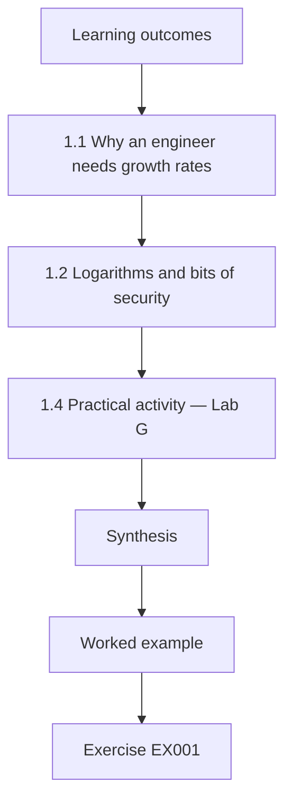

### Logical drawing


```text
[Learning outcomes]
    |
    v
[1.1 Why an engineer needs growth rates]
    |
    v
[1.2 Logarithms and bits of security]
    |
    v
[1.4 Practical activity — Lab G]
    |
    v
[Synthesis]
    |
    v
[Worked example] --> [Exercise EX001]
```
<!-- cykin:lesson-figures:end ch-01 -->


### Learning outcomes

You will (1) compare growth rates — polynomial, sub-exponential and exponential — and explain why they decide what a quantum computer threatens; (2) use logarithms to convert work factors into "bits of security"; and (3) read an asymptotic claim critically. This chapter starts the foundations stage and prepares the discrete mathematics of Chapter 2.

### 1.1 Why an engineer needs growth rates

Every security claim in this book is a claim about how fast some cost grows. Brute-forcing a *k*-bit key takes about 2^*k* trials: the cost doubles with each extra bit, which is **exponential** growth. The best classical factoring algorithm, the general number field sieve, runs in **sub-exponential** time, roughly exp(c·(ln N)^(1/3)·(ln ln N)^(2/3)) for a modulus *N*. Shor's algorithm factors in time **polynomial** in the number of bits — on the order of *n*³ elementary quantum gates for an *n*-bit modulus, ignoring error-correction overhead ([Shor 1997](https://doi.org/10.1137/S0097539795293172)). Grover's search finds a key among 2^*k* candidates in about 2^(*k*/2) sequential iterations ([Grover 1996](https://doi.org/10.1145/237814.237866)). The whole PQC story follows from these four functions: Shor turns a sub-exponential problem into a polynomial one, which is catastrophic for RSA and elliptic curves; Grover only halves the exponent, which is why AES-256 remains acceptable.

### 1.2 Logarithms and bits of security

Taking log₂ of a work factor gives "bits of security". A cost of 2^128 operations is "128-bit security". Logarithms turn products into sums, so doubling the work adds one bit, and multiplying it by a million (≈2^20) adds about twenty bits. This is why engineers say a 2^20 speed-up from better hardware "costs" twenty bits. The derivative helps intuition: the GNFS cost curve flattens in bits as keys grow, so each extra RSA bit buys less security than each extra AES bit — one reason RSA keys are thousands of bits long.

### 1.3 Limits and asymptotic notation

"Big-O" statements describe behaviour as input size tends to infinity and hide constants. Shor's *n*³ hides a large constant and, more importantly, the overhead of quantum error correction, which may multiply physical qubit counts by a thousand or more. Resource estimates such as [Gidney (2025)](https://arxiv.org/abs/2505.15917) — under one million noisy qubits for RSA-2048 under stated hardware assumptions — fill in those constants. An engineer must never read an asymptotic bound as a time.

Two algorithms with the same big-O can differ by factors that decide whether an attack takes an hour or a decade. The jump from twenty million noisy qubits to under a million came from better constants and codes, not from a change in Shor's n³. When a vendor quotes an asymptotic bound, the engineer asks for the hardware assumptions behind the constant.

### 1.4 Practical activity — Lab G

```python
# Lab G (ch 1): growth rates that decide what quantum computers threaten.
import math
print("Symmetric key search: classical 2^k trials vs Grover ~2^(k/2) sequential iterations")
for k in (128, 192, 256):
    print(f"  k={k}: classical 2^{k}, Grover ~2^{k//2}")
def gnfs_bits(n_bits):            # heuristic L_N[1/3, (64/9)^(1/3)] work, expressed in bits
    ln_n = n_bits * math.log(2)
    work = (64/9) ** (1/3) * ln_n ** (1/3) * math.log(ln_n) ** (2/3)
    return work / math.log(2)
print("Factoring an n-bit RSA modulus: classical GNFS (heuristic) vs Shor gate count ~n^3")
for n in (1024, 2048, 3072):
    print(f"  n={n}: GNFS ~2^{gnfs_bits(n):.0f} operations; Shor ~n^3 = 2^{math.log2(n**3):.0f} logical gates")
```

Expected output:

```text
Symmetric key search: classical 2^k trials vs Grover ~2^(k/2) sequential iterations
  k=128: classical 2^128, Grover ~2^64
  k=192: classical 2^192, Grover ~2^96
  k=256: classical 2^256, Grover ~2^128
Factoring an n-bit RSA modulus: classical GNFS (heuristic) vs Shor gate count ~n^3
  n=1024: GNFS ~2^87 operations; Shor ~n^3 = 2^30 logical gates
  n=2048: GNFS ~2^117 operations; Shor ~n^3 = 2^33 logical gates
  n=3072: GNFS ~2^139 operations; Shor ~n^3 = 2^35 logical gates
```

The GNFS formula is heuristic (its *o*(1) term is dropped), so the bit values approximate the commonly quoted 112-bit strength of RSA-2048 rather than match it. The Shor "gate counts" are logical gates before error correction.

The lab's comparison exists to make the shapes visible side by side: brute force doubles per bit, GNFS bends more slowly, and Shor's logical gate count grows only polynomially. Running it for 1024, 2048 and 3072-bit moduli shows why longer RSA keys buy little against a quantum adversary. Students should annotate their table with the warning that the Shor column omits error-correction overhead, so no row should be read as a time to break.

### 1.5 Worked example: BPA's first question

BPA's board asks whether to double AES key sizes "because of quantum". Using 1.1: AES-128 under Grover falls to roughly 2^64 sequential iterations in the idealized model, but Grover parallelizes poorly, so many guidance documents still accept AES-128; moving bulk encryption to AES-256 is cheap and removes the debate. The urgent item is not AES but every RSA and elliptic-curve key exchange, which Shor breaks outright.

The memo to BPA's board therefore separates two decisions. Symmetric keys move to AES-256 during normal refresh, at almost no cost. Key exchange and signatures need a planned migration to ML-KEM and ML-DSA, because no key length rescues RSA or elliptic curves from Shor. Mixing the two questions is how boards spend money on the cheap fix and delay the important one.

### 1.6 Common errors and limits

- Treating Grover as fatal to symmetric cryptography.
- Reading *O*(*n*³) as "fast" without error-correction overhead.
- Comparing bits across exponential and sub-exponential curves as if they grew alike.

Each error leads to a wrong decision. Treating Grover as fatal sends budget to symmetric upgrades that were already adequate. Reading n³ as fast ignores the physical qubits needed for each logical one. Comparing bit numbers across different growth curves makes RSA-3072 look stronger against quantum attack than it is. The models in this chapter compare options; they are not schedules.

### Exercises

- **EX001 — Bits from work.** Convert 10^30 and 2^100 × 10^6 operations into bits of security. Rubric: 3 = both correct with method.
- **EX002 — Explain the asymmetry.** In 150 words, explain to BPA's board why RSA must be replaced but AES-256 need not. Rubric: 3 = growth-rate argument correct and non-technical.

### Synthesis

Growth rates decide everything: Shor makes factoring and discrete logarithms polynomial; Grover merely square-roots search. Bits of security are logarithms of work, and asymptotic bounds need resource estimates before they mean time.

### Continue studying — chapter 01 of 50

[← Course home](../../README.md) · [Course chapter index](../SUBJECTS.md) · [Chapter 02 (draft) →](#ch-02)

<a id="ch-02"></a>

## Chapter 2 — Discrete mathematics

<!-- cykin:lesson-figures:start ch-02 -->
### Lesson map

Lesson 02 published. Map, example, EX003.

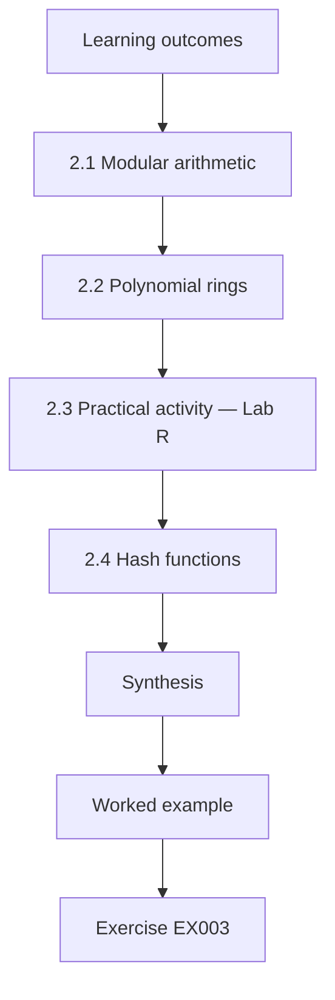

### Logical drawing


```text
[Learning outcomes]
    |
    v
[2.1 Modular arithmetic]
    |
    v
[2.2 Polynomial rings]
    |
    v
[2.3 Practical activity — Lab R]
    |
    v
[2.4 Hash functions]
    |
    v
[Synthesis]
    |
    v
[Worked example] --> [Exercise EX003]
```
<!-- cykin:lesson-figures:end ch-02 -->


### Learning outcomes

You will (1) compute in modular arithmetic and polynomial rings; (2) explain the ring Z_q[x]/(x^n+1) used by ML-KEM and ML-DSA; (3) state what a hash function's security properties are; and (4) connect group structure to why Shor's algorithm works. It builds on Chapter 1 and prepares probability (Chapter 7) and the lattice methods of Chapter 24.

### 2.1 Modular arithmetic

Arithmetic modulo *q* keeps numbers in {0, …, *q*−1}. RSA uses a composite modulus; elliptic-curve cryptography uses groups of points over a prime field. Both rely on the hardness of finding a hidden *period* — the order of an element, or a discrete logarithm. Shor's insight is that a quantum computer can find periods efficiently with the quantum Fourier transform; that is why every scheme whose security reduces to a hidden period in an abelian group falls together.

This shared weakness is why migration cannot be done one algorithm at a time by swapping RSA for elliptic curves: both fall to the same idea. Post-quantum schemes are chosen precisely because their hard problems, such as noisy linear equations or hash inversion, have no known hidden period for a quantum computer to find.

### 2.2 Polynomial rings

ML-KEM ([FIPS 203](https://doi.org/10.6028/NIST.FIPS.203)) computes with polynomials of degree below 256 whose coefficients are integers modulo *q* = 3329, reduced modulo *x*^256 + 1. In this ring, multiplying by *x* shifts coefficients up one place, and the coefficient that falls off the top wraps to the bottom with its sign flipped, because *x*^*n* = −1. Vectors and matrices of such polynomials form a *module*, hence "module-lattice". The structure gives compact keys and fast multiplication (via the number-theoretic transform), while hardness comes from adding small noise — the subject of Chapter 24.

### 2.3 Practical activity — Lab R

```python
# Lab R (ch 2): multiplication in R_q = Z_q[x]/(x^n + 1), the ring behind ML-KEM (there n=256, q=3329).
q, n = 17, 4
def mul(a, b):
    c = [0] * n
    for i in range(n):
        for j in range(n):
            k = i + j
            if k < n:
                c[k] = (c[k] + a[i] * b[j]) % q
            else:                       # x^n = -1, so wrap around with a sign flip
                c[k - n] = (c[k - n] - a[i] * b[j]) % q
    return c
a = [1, 2, 0, 3]      # 1 + 2x + 3x^3
b = [0, 1, 0, 0]      # x
print("a*x  =", mul(a, b), " (coefficients shift; x^3 * x = x^4 = -1 -> 17-3 = 14)")
print("a*a  =", mul(a, a))
```

Expected output:

```text
a*x  = [14, 1, 2, 0]  (coefficients shift; x^3 * x = x^4 = -1 -> 17-3 = 14)
a*a  = [6, 4, 12, 6]
```

Check by hand: (1 + 2*x* + 3*x*³)·*x* = *x* + 2*x*² + 3*x*⁴ = *x* + 2*x*² − 3 ≡ 14 + *x* + 2*x*² (mod 17).

The hand check shows the wrap-around rule at work: the x⁴ term exceeds the degree limit for n equal to four, so it becomes minus three, and minus three modulo seventeen is fourteen. ML-KEM uses the same rule with n equal to 256 and q equal to 3329. Students who get the sign wrong will compute a different polynomial, and in a real implementation that mistake would break every decapsulation, which is why known-answer tests catch it at once.

### 2.4 Hash functions

A cryptographic hash maps any input to a fixed-length digest. Its required properties are *preimage resistance* (given a digest, find no input), *second-preimage resistance* and *collision resistance*. Hash-based signatures (SLH-DSA in [FIPS 205](https://doi.org/10.6028/NIST.FIPS.205); LMS and XMSS in [SP 800-208](https://doi.org/10.6028/NIST.SP.800-208)) need only these properties, which is why they are the most conservative post-quantum signatures: quantum computers are not known to do much better than Grover-style speed-ups against good hash functions.

Grover can search for preimages faster, roughly square-rooting the work, so a 256-bit hash still offers about 128 bits against preimage search. Collision search with quantum algorithms gains less in practice than the idealised bounds suggest. The trade-off for hash-based signatures is size and speed, not security assumptions.

### 2.5 Worked example

A BPA developer asks why the post-quantum library "multiplies polynomials" when RSA "just exponentiates". The answer: RSA's security lives in the multiplicative group modulo *N*, where Shor finds periods. ML-KEM's lives in noisy linear algebra over a polynomial ring, where no period-finding shortcut is known; the ring is for efficiency, the noise is for security.

The developer's follow-up is usually about cost: polynomial multiplication with the number-theoretic transform is fast, and ML-KEM key generation is often quicker than RSA key generation. What changes for the system is size: keys and ciphertexts are larger than elliptic-curve ones. That shifts the engineering problem from CPU time to bytes on the wire.

### 2.6 Common errors and limits

- Forgetting the sign flip when reducing by *x*^*n* + 1.
- Thinking ring structure alone provides security (without noise, the linear system is easy).
- Confusing collision resistance with preimage resistance.

A missed sign flip produces outputs that look plausible but fail interoperability tests against the standard. Assuming the ring alone gives security misses the role of noise: without small errors, Gaussian elimination recovers the secret. Mixing up collision and preimage resistance leads to wrong parameter claims, for example halving a hash length for a use that only needs preimage resistance.

### Exercises

- **EX003 — Ring multiplication.** Compute (2 + *x*)(3 + *x*³) in Z_17[*x*]/(*x*⁴ + 1) by hand and check with Lab R. Rubric: 3 = correct with reduction steps.
- **EX004 — Hash properties.** For each of SLH-DSA, a file-integrity manifest and password storage, state which hash property matters most. Rubric: 3 = correct and justified.

### Synthesis

Traditional public-key cryptography hides a period that Shor's algorithm finds; lattice schemes compute in a polynomial ring and hide secrets under noise; hash-based schemes rely only on hash properties.

### Continue studying — chapter 02 of 50

[← Chapter 01 (draft)](#ch-01) · [Course chapter index](../SUBJECTS.md) · [Chapter 03 (draft) →](#ch-03)

<a id="ch-03"></a>

## Chapter 3 — Physics for computing

<!-- cykin:lesson-figures:start ch-03 -->
### Lesson map

Lesson 03 published. Map, example, EX005.

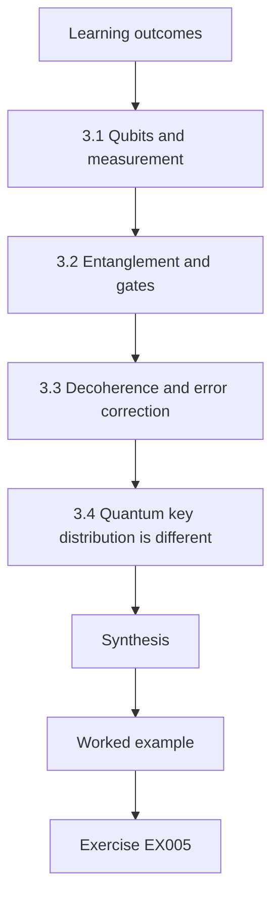

### Logical drawing


```text
[Learning outcomes]
    |
    v
[3.1 Qubits and measurement]
    |
    v
[3.2 Entanglement and gates]
    |
    v
[3.3 Decoherence and error correction]
    |
    v
[3.4 Quantum key distribution is different]
    |
    v
[Synthesis]
    |
    v
[Worked example] --> [Exercise EX005]
```
<!-- cykin:lesson-figures:end ch-03 -->


### Learning outcomes

You will (1) describe a qubit, superposition, measurement and entanglement in engineering terms; (2) explain decoherence and why error correction dominates the cost of a quantum computer; (3) distinguish physical from logical qubits; and (4) separate quantum computing from quantum key distribution. It builds on Chapters 1–2 and frames the threat used throughout the book.

### 3.1 Qubits and measurement

A classical bit is 0 or 1. A qubit's state is a combination α|0⟩ + β|1⟩ with complex amplitudes whose squared magnitudes sum to one; measurement returns 0 with probability |α|² and 1 with probability |β|², and destroys the superposition. *n* qubits are described by 2^*n* amplitudes, but measurement yields only *n* bits, so a quantum algorithm must arrange interference so that wrong answers cancel and right answers reinforce. Shor's algorithm does this for periods; for most problems no such arrangement is known, which is why quantum computers are not general accelerators.

### 3.2 Entanglement and gates

Entangled qubits have correlated measurement outcomes that cannot be explained by independent states. Gates — rotations of single qubits and controlled operations on pairs — build circuits. Algorithms are measured in logical gate counts and circuit *depth*, the number of sequential layers, which matters because errors accumulate with time.

Depth matters because qubits decohere while they wait: a circuit with many sequential layers must finish before errors overwhelm it, or error correction must keep up. That is why resource estimates report both logical qubits and a runtime figure. Entanglement is a resource algorithms use, not a speed-up on its own; most problems gain nothing from it.

### 3.3 Decoherence and error correction

Physical qubits lose their state through interaction with the environment (decoherence) and through imperfect gates. Quantum error correction encodes one *logical* qubit in many *physical* qubits — in surface-code designs, hundreds to thousands — and continuously measures syndromes to correct errors. This overhead is why estimates for breaking RSA-2048 moved from twenty million noisy qubits ([Gidney and Ekerå 2021](https://doi.org/10.22331/q-2021-04-15-433)) to under a million ([Gidney 2025](https://arxiv.org/abs/2505.15917)) as algorithms and codes improved — and why counts of physical qubits in press releases say little about cryptographic relevance without error rates.

### 3.4 Quantum key distribution is different

Quantum key distribution (QKD) uses quantum states of light to agree keys, with security grounded in physics, but it needs special hardware, point-to-point links and authenticated classical channels, and it does not provide signatures. Several agencies, including the [NSA](https://www.nsa.gov/Cybersecurity/Quantum-Key-Distribution-QKD-and-Quantum-Cryptography-QC/), recommend PQC rather than QKD for most uses. This book treats QKD as a niche technology and PQC as the migration path.

QKD also leaves authentication to classical cryptography, so a QKD link still needs signatures or pre-shared keys, which brings PQC back into the design. Its distance limits and trusted-node relays add physical security problems. For BPA's customs exchange over the public internet, QKD is not an option, while hybrid TLS with ML-KEM can be deployed on existing servers.

### 3.5 Worked example

A vendor tells BPA that "a 1,000-qubit machine was announced, so RSA is broken soon". The engineering response: ask for error rates, logical qubit counts and circuit depth; compare with published resource estimates; note that a thousand noisy physical qubits is orders of magnitude short of the estimates; and still migrate, because recorded traffic must stay secret for decades (Chapter 20).

The vendor's number answers none of the questions that matter for RSA-2048. Physical qubits must be turned into logical ones at a ratio of hundreds or thousands, and the circuit must run long enough without failure. Even so, the conclusion is to keep migrating: the case for action rests on how long customs data must stay secret, not on the date of the next announcement.

### 3.6 Common errors and limits

- Saying quantum computers "try all answers at once".
- Equating physical and logical qubits.
- Presenting QKD as a replacement for PQC.

Superposition does not let a quantum computer read out all answers; measurement returns one result, and only interference designed for a specific structure helps. Physical and logical qubits differ by error-correction overhead, so headlines about qubit counts say little about cryptographic risk. QKD needs dedicated links and leaves signatures unsolved, so it cannot replace PQC across ordinary networks such as the internet links BPA's partners use.

### Exercises

- **EX005 — Overhead arithmetic.** If a logical qubit needs 1,000 physical qubits and an algorithm needs 1,400 logical qubits plus 30% ancilla overhead, how many physical qubits are needed? Rubric: 3 = correct (1.82 million) and comment on assumptions.
- **EX006 — Vendor claim.** Write three questions that turn a qubit-count announcement into evidence. Rubric: 3 = error rate, logical count, depth/time.

### Synthesis

Quantum algorithms exploit interference for special problems; error correction makes useful machines enormous; announcements must be translated into logical resources; QKD is not the migration path.

### Continue studying — chapter 03 of 50

[← Chapter 02 (draft)](#ch-02) · [Course chapter index](../SUBJECTS.md) · [Chapter 04 (draft) →](#ch-04)

<a id="ch-04"></a>

## Chapter 4 — Programming I

<!-- cykin:lesson-figures:start ch-04 -->
### Lesson map

Lesson 04 published. Map, example, EX007.

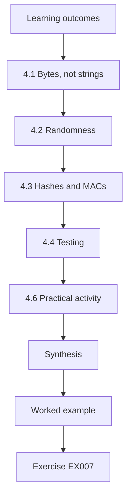

### Logical drawing


```text
[Learning outcomes]
    |
    v
[4.1 Bytes, not strings]
    |
    v
[4.2 Randomness]
    |
    v
[4.3 Hashes and MACs]
    |
    v
[4.4 Testing]
    |
    v
[4.6 Practical activity]
    |
    v
[Synthesis]
    |
    v
[Worked example] --> [Exercise EX007]
```
<!-- cykin:lesson-figures:end ch-04 -->


### Learning outcomes

You will (1) write small, testable Python programs with the standard library; (2) handle bytes, encodings and integers correctly; (3) use `hashlib`, `hmac` and `secrets` safely; and (4) recognize why you must not implement production cryptography yourself. It prepares the labs used throughout the book.

### 4.1 Bytes, not strings

Cryptographic functions operate on bytes. Python's `str` is text; convert with an explicit encoding (`"text".encode("utf-8")`). Mixing them causes subtle bugs, such as hashing the string representation of a byte object (`"b'...'"`) instead of the bytes themselves. Integers convert with `int.from_bytes(b, "big")` and `n.to_bytes(length, "big")`; always state the byte order and length, because protocol specifications such as FIPS 203 define exact encodings.

A common symptom of mixing types is two systems computing different hashes for the same message because one encoded text as UTF-8 and the other as Latin-1. Fixing the encoding at the boundary, and passing bytes everywhere inside, removes that class of bug. Length and byte order matter too: FIPS 203 encodes coefficients in a precise bit layout, and a test against the standard's vectors is the only reliable check.

### 4.2 Randomness

Use `secrets.token_bytes()` for keys and nonces; never `random`, which is a predictable pseudo-random generator designed for simulations. The labs in this book use `random` only to generate synthetic data and toy parameters, and say so.

Python's `random` is seeded from a state that can be recovered after observing enough outputs, so any key it produces can be predicted. `secrets` draws from the operating system's cryptographic generator. Keeping the two visibly separate in code, for example by never importing `random` in production modules, makes reviews easier and stops toy code from slipping into real systems.

### 4.3 Hashes and MACs

`hashlib.sha256`, `hashlib.sha3_256` and `hashlib.shake_256` are available; SHA-3 and SHAKE are used inside ML-KEM and ML-DSA. `hmac.new(key, msg, hashlib.sha256)` computes a message authentication code, and `hmac.compare_digest` compares tags in constant time — a normal `==` can leak timing information about where two values first differ.

SHAKE is an extendable-output function: it can produce as many output bytes as needed, which ML-KEM uses to expand seeds into matrices. A MAC differs from a hash because it needs a secret key; without one, anyone can recompute a hash over a modified message. The constant-time comparison matters most when an attacker can submit many guesses and measure response times.

### 4.4 Testing

Every function gets a test with a known answer. For cryptography, *known-answer tests* (KATs) published with standards let you confirm that an implementation produces exactly the expected bytes. NIST's Cryptographic Algorithm Validation Program publishes test vectors for approved algorithms.

A KAT fixes the inputs, including what would normally be random, so the expected output is a single exact byte string. Passing KATs proves the implementation matches the standard on those inputs; it does not prove resistance to side channels or misuse. Engineers run KATs in continuous integration so that a library upgrade that changes outputs is caught before deployment.

### 4.5 Worked example: a hash-chain audit log

BPA wants tamper-evident logs. Each entry stores `h_i = SHA-256(h_{i-1} || entry_i)`. A short program computes the chain, and a test verifies that changing any entry changes every later hash. The program uses bytes throughout, fixed encodings and `compare_digest`. This is a sound use of standard primitives; designing a new signature scheme would not be.

The chain detects modification, deletion and reordering, because each change alters every later hash. It does not stop someone with write access from rebuilding the whole chain, so BPA publishes the latest hash daily to a separate system. The program is short enough to review completely, and every primitive it uses is already standardised.

### 4.6 Practical activity

Write the hash-chain function with a test, then add a deliberate bug (hashing `str(entry)` instead of `entry`) and see the test catch it.

The deliberate bug shows why tests must compare exact bytes: hashing `str(entry)` hashes the text "b'...'" with quotes and a prefix, so every later hash changes even though the log content looks identical. Write the failing test first, confirm it fails with the bug, then fix the code and confirm it passes. Keep the test in the suite so the mistake cannot return.

### 4.7 Common errors and limits

- Using `random` for keys.
- Comparing secrets with `==`.
- Implementing ML-KEM or ML-DSA yourself for production: implementation security (Chapter 31) is harder than correctness.

Each error has caused real failures. Predictable random numbers have exposed keys, plain comparisons have leaked authentication tags through timing, and home-made implementations of standard algorithms have passed correctness tests while leaking secrets through timing or power use. BPA uses vetted libraries for ML-KEM and ML-DSA and reserves its own code for the glue around them, which it tests with KATs.

### Exercises

- **EX007 — Encoding bug.** Explain why `hashlib.sha256(str(b"abc").encode())` differs from `hashlib.sha256(b"abc")` and what bug class it represents. Rubric: 3 = correct and generalized.
- **EX008 — Hash chain.** Write the hash-chain function and a test that detects tampering. Rubric: 3 = runs, tests pass, uses bytes and `compare_digest`.

### Synthesis

Cryptographic code is byte-exact, uses secure randomness, compares secrets in constant time, and is tested against known answers; engineers compose vetted primitives rather than inventing them.

### Continue studying — chapter 04 of 50

[← Chapter 03 (draft)](#ch-03) · [Course chapter index](../SUBJECTS.md) · [Chapter 05 (draft) →](#ch-05)

<a id="ch-05"></a>

## Chapter 5 — Engineering communication

<!-- cykin:lesson-figures:start ch-05 -->
### Lesson map

Lesson 05 published. Map, example, EX009.

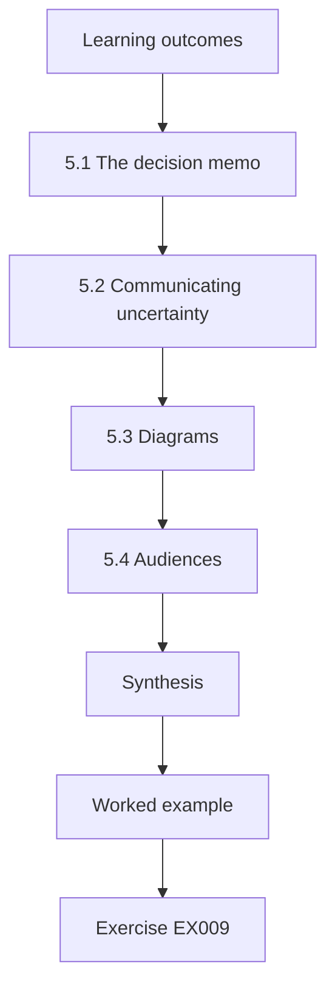

### Logical drawing

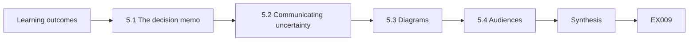

```text
[Learning outcomes]
    |
    v
[5.1 The decision memo]
    |
    v
[5.2 Communicating uncertainty]
    |
    v
[5.3 Diagrams]
    |
    v
[5.4 Audiences]
    |
    v
[Synthesis]
    |
    v
[Worked example] --> [Exercise EX009]
```
<!-- cykin:lesson-figures:end ch-05 -->


### Learning outcomes

You will (1) write a decision memo that separates facts, assumptions and recommendations; (2) present uncertainty about quantum timelines honestly; (3) draw architecture diagrams with text alternatives; and (4) adapt a message for technical and executive audiences. It builds on Chapters 1–4 and is used in every design review later.

### 5.1 The decision memo

A memo opens with the decision requested, then gives context, options, recommendation, risks and what would change the recommendation. In PQC work, label four kinds of statement: **fact** ("FIPS 203 was published in August 2024"), **assumption** ("we plan as if a cryptographically relevant quantum computer could exist within 15 years"), **estimate** ("migration of the VPN will take nine months") and **recommendation**. Mixing them is how timelines become myths.

Labelling each statement lets readers challenge the right thing. A fact can be checked against its source; an assumption can be varied to see whether the recommendation still holds; an estimate can be compared with actual progress later. When a sentence mixes them, such as a migration date presented as certain, nobody can tell which part to question.

### 5.2 Communicating uncertainty

Never give a single "Q-Day". State a range of assumptions and show which decisions are robust across it. Mosca's inequality — if data lifetime plus migration time exceeds time-to-quantum, act now ([Mosca 2018](https://doi.org/10.1109/MSP.2018.3761723)) — is useful precisely because it can be evaluated across a range. A recommendation that holds for all plausible ranges is easy to defend.

In practice, the memo shows a small table: rows for assumed time-to-quantum, columns for data lifetime and migration time, and cells marking where action is needed. If every cell says act, the debate about the exact year becomes irrelevant. If the answer flips within the plausible range, the memo says so and explains what new evidence would settle it.

### 5.3 Diagrams

Architecture diagrams show components, trust boundaries and where each cryptographic function happens: key exchange, signature, data at rest. Every diagram needs a text alternative describing the same content for accessibility and for review; reviewers often find errors when forced to read the text version.

Marking where each cryptographic function happens shows the migration scope at a glance: every key exchange and signature arrow is a candidate for change, while symmetric encryption at rest may only need larger keys. The text version lists each arrow with its algorithm and owner. Reviewers reading that list often spot a hidden dependency, such as a signature used inside a firmware update path that the diagram drew as a single box.

### 5.4 Audiences

For engineers: algorithms, parameter sets, protocols, test evidence. For executives: risk, cost, schedule, what is protected and what is not. For auditors: requirement traceability and evidence. The same facts, differently ordered.

An engineer reading the executive version may think detail is missing, and an executive reading the engineering version may miss the decision. Writing separate versions from one source of facts keeps them consistent. Auditors need a third ordering: each requirement, the evidence that it is met, and where that evidence is stored. BPA keeps all three versions in one repository so a changed fact updates every audience together.

### 5.5 Worked example: BPA's one-page memo

Decision requested: fund a 12-month cryptographic inventory and a hybrid TLS pilot. Facts: standards exist; customs records must remain confidential for 25 years. Assumption: time-to-quantum swept from 10 to 30 years. Finding: for 25-year records, any time-to-quantum below about 26 years (25 years of confidentiality plus roughly 9 months of migration) means today's recorded traffic is at risk — so the decision is robust across the whole 10–30-year sweep except its optimistic tail, and the tail does not change the action. Not claimed: any date. Risks: middlebox incompatibility, vendor delay.

### 5.6 Common errors and limits

- Executive slides with a single date for quantum computers.
- Diagrams without text alternatives.
- Memos that bury the decision on page three.

A single date invites argument about the date instead of the decision, and it becomes wrong as soon as estimates move. A diagram without text excludes readers using screen readers and hides errors that writing would expose. A buried decision means executives leave the meeting without making it. Each of these is easy to fix before the memo is sent.

### Exercises

- **EX009 — Label statements.** Label ten sentences from a vendor brochure as fact, assumption, estimate or recommendation. Rubric: 3 = all correct with justification for borderline cases.
- **EX010 — Executive rewrite.** Rewrite a technical paragraph on ML-KEM parameter choice for BPA's board in 100 words. Rubric: 3 = accurate, no jargon, decision clear.

### Synthesis

Good engineering communication labels facts, assumptions, estimates and recommendations, expresses timelines as ranges, gives diagrams text alternatives and orders the same facts for each audience.

### Continue studying — chapter 05 of 50

[← Chapter 04 (draft)](#ch-04) · [Course chapter index](../SUBJECTS.md) · [Chapter 06 (draft) →](#ch-06)

<a id="ch-06"></a>

## Chapter 6 — Calculus II

<!-- cykin:lesson-figures:start ch-06 -->
### Lesson map

Lesson 06 published. Map, example, EX011.

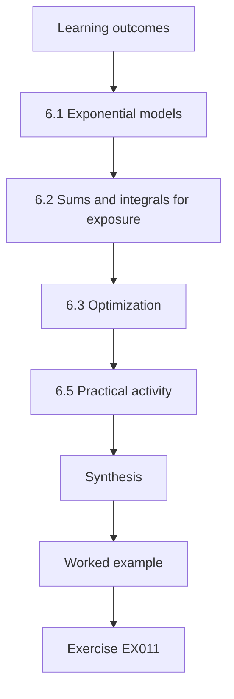

### Logical drawing


```text
[Learning outcomes]
    |
    v
[6.1 Exponential models]
    |
    v
[6.2 Sums and integrals for exposure]
    |
    v
[6.3 Optimization]
    |
    v
[6.5 Practical activity]
    |
    v
[Synthesis]
    |
    v
[Worked example] --> [Exercise EX011]
```
<!-- cykin:lesson-figures:end ch-06 -->


### Learning outcomes

You will (1) use exponential and logarithmic models for growth and decay; (2) compute sums and integrals that appear in cost and risk models; (3) apply optimization to choose parameters under constraints; and (4) model the "harvest-now, decrypt-later" exposure window. It builds on Chapter 1 and supports performance (Chapter 36) and optimization (Chapter 41).

### 6.1 Exponential models

Many quantities in this field are modelled exponentially: the volume of recorded traffic, the decline in cost per qubit, the decay of a certificate's usefulness. A model *f*(*t*) = *f*₀·*e*^(*rt*) has doubling time ln 2 / *r*. Engineers should treat such models as scenarios: an assumed doubling time of qubit quality is an assumption, not a law.

Doubling time is the most intuitive way to state an exponential model: if recorded traffic doubles every 3.8 years, a reader can picture the growth without logarithms. Showing results under a fast and a slow scenario keeps the model honest. If the recommendation changes between scenarios, the memo must say which assumption drives the change.

### 6.2 Sums and integrals for exposure

Suppose BPA records traffic at a rate *v*(*t*) GB per year, and any traffic recorded before migration date *T* is exposed if a CRQC appears at time *Z*. The exposed volume is the integral of *v* from 0 to *T*. If *v* grows exponentially, ∫₀^*T* *v*₀*e*^(*rt*) d*t* = (*v*₀/*r*)(*e*^(*rT*) − 1): delaying migration grows exposure faster than linearly. The engineering lesson is that a one-year delay late in the programme costs more exposure than a one-year delay early.

### 6.3 Optimization

Parameter choice is constrained optimization. Example: choose an ML-KEM parameter set to maximize security subject to a handshake byte budget. ML-KEM-512, -768 and -1024 offer NIST categories 1, 3 and 5 with encapsulation keys of 800, 1,184 and 1,568 bytes ([FIPS 203](https://doi.org/10.6028/NIST.FIPS.203)). If the budget for the client key share is 1,300 bytes, ML-KEM-768 is the largest that fits. Lagrange multipliers formalize such trade-offs for continuous variables; in discrete parameter sets you simply enumerate.

The byte budget comes from real limits: some networks fragment or drop handshake messages above certain sizes, and middleboxes may reject unusual records. Choosing ML-KEM-768 within a 1,300-byte budget gives category 3 security with room left. If the budget were 1,000 bytes, only ML-KEM-512 would fit, and the memo would have to discuss whether category 1 is acceptable.

### 6.4 Worked example

BPA's customs exchange sends 2 TB/year today, growing 20% per year (*r* ≈ 0.182). Exposed volume if migration completes after 3 years: (2/0.182)(*e*^0.547 − 1) ≈ 8.0 TB; after 5 years: ≈ 16.3 TB. Two extra years roughly double the exposed archive.

With r equal to 0.182, the exponential terms are about 1.73 after three years and 2.49 after five. Multiplying the excess over one by about eleven, the factor two divided by r, gives the two figures. The doubling shows why the programme plan front-loads the customs exchange: it has the fastest-growing volume and the longest confidentiality requirement.

### 6.5 Practical activity

Compute the exposed volume for migration after 1–8 years and plot (or tabulate) it. Identify the year where exposure exceeds 10 TB.

Use the formula from the worked example rather than adding up yearly volumes: summing 2, 2.4, 2.88 and so on treats each year's traffic as arriving on the first day and gives slightly lower totals, about 7.3 TB after three years instead of 8.0. Both methods agree on which year first crosses 10 TB, but only the integral matches the figures in the worked example and in the exercise set. Tabulating each year shows the gaps between consecutive years growing, which is the non-linear effect that makes late delays expensive. Students should state their growth assumption beside the table and rerun it at 10% and 30%.

### 6.6 Common errors and limits

- Treating growth assumptions as forecasts.
- Linear thinking about delay under exponential growth.
- Ignoring that exposure also depends on how long data stays sensitive (Chapter 20).

Growth rates are assumptions; a 20% rate may fall if a service is retired or rise if new partners join. Linear thinking underestimates the cost of delay because each later year adds more volume than the one before. Exposure also depends on lifetime: traffic that loses value after a year matters less than customs records that must stay confidential for twenty-five years.

### Exercises

- **EX011 — Exposure integral.** Compute BPA's exposed volume for *T* = 4 years. Rubric: 3 = correct (≈ 11.8 TB) with working.
- **EX012 — Budgeted choice.** With a 900-byte client-share budget, which ML-KEM set fits, and what should the engineer do if category 3 is required? Rubric: 3 = ML-KEM-512 fits; proposes changing the budget or transport rather than downgrading silently.

### Synthesis

Calculus turns migration timing into exposure: under growth, delay costs more than linearly; parameter choice is constrained optimization over published parameter sets.

### Continue studying — chapter 06 of 50

[← Chapter 05 (draft)](#ch-05) · [Course chapter index](../SUBJECTS.md) · [Chapter 07 (draft) →](#ch-07)

<a id="ch-07"></a>

## Chapter 7 — Probability and statistics

<!-- cykin:lesson-figures:start ch-07 -->
### Lesson map

Lesson 07 published. Map, example, EX013.

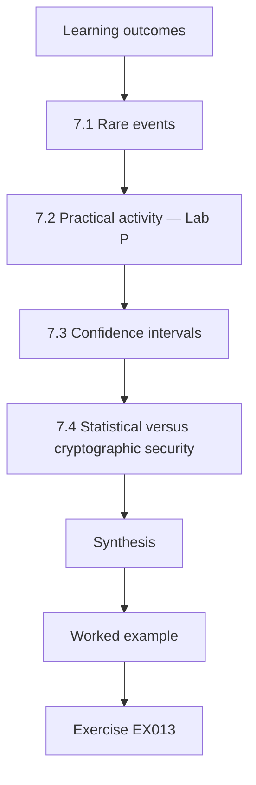

### Logical drawing


```text
[Learning outcomes]
    |
    v
[7.1 Rare events]
    |
    v
[7.2 Practical activity — Lab P]
    |
    v
[7.3 Confidence intervals]
    |
    v
[7.4 Statistical versus cryptographic security]
    |
    v
[Synthesis]
    |
    v
[Worked example] --> [Exercise EX013]
```
<!-- cykin:lesson-figures:end ch-07 -->


### Learning outcomes

You will (1) reason about rare events such as decryption failures; (2) estimate rates with confidence intervals; (3) distinguish statistical from cryptographic security levels; and (4) design a measurement with enough samples. It builds on Chapters 1 and 6 and supports measurement (Chapter 29) and validation (Chapter 38).

### 7.1 Rare events

Lattice KEMs have a tiny probability that decapsulation produces the wrong key. FIPS 203's parameter sets keep it extremely small — around 2^-139 for ML-KEM-512 and smaller for the larger sets — far below any rate an engineer will observe. The expected number of failures in *N* operations is *N*·*p*. Lab P shows why a probability like 2^-20, fine for many engineering purposes, would be unacceptable for a KEM used billions of times, while 2^-139 is negligible at any scale.

The decision rule is simple: multiply by the largest number of operations the system will ever perform and check that the product stays far below one.

### 7.2 Practical activity — Lab P

```python
# Lab P (ch 7): how small must a failure probability be? Binomial reasoning for rare events.
import math
for p_exp in (-20, -40, -139):
    p = 10.0 ** (p_exp * math.log10(2))       # p = 2^p_exp
    for n_ops in (1e9, 1e15):
        exp_fail = n_ops * p
        print(f"p = 2^{p_exp:5d}, {n_ops:.0e} operations -> expected failures {exp_fail:.3e}")
```

Expected output:

```text
p = 2^  -20, 1e+09 operations -> expected failures 9.537e+02
p = 2^  -20, 1e+15 operations -> expected failures 9.537e+08
p = 2^  -40, 1e+09 operations -> expected failures 9.095e-04
p = 2^  -40, 1e+15 operations -> expected failures 9.095e+02
p = 2^ -139, 1e+09 operations -> expected failures 1.435e-33
p = 2^ -139, 1e+15 operations -> expected failures 1.435e-27
```

Read the six lines in pairs. At 2^-20, a billion operations already produce nearly a thousand expected failures, so such a scheme would fail visibly every day at BPA's scale. At 2^-40, a billion operations look safe, but a quadrillion, roughly the global volume of a widely deployed protocol over some years, gives about 900. At 2^-139 even the larger count leaves an expected 1.4 × 10^-27, which is why decryption failure is not a design concern for ML-KEM at all. Extend the loop with 1e18 operations and confirm the conclusion does not change.

### 7.3 Confidence intervals

When measuring handshake failure rates after enabling a hybrid group, report an interval, not just a point. For small proportions use the Wilson interval (Chapter 37's canary lab uses it). The *rule of three* gives a quick bound: if zero failures occur in *n* trials, the 95% upper bound on the rate is about 3/*n*.

The rule follows from requiring that zero failures in n trials has at most a 5% chance: (1 − p)^n = 0.05 gives p ≈ 3/n. It holds only when trials are independent; failures caused by one broken proxy cluster at one site, so a canary spread across several sites gives a more honest bound than the same count from one.

### 7.4 Statistical versus cryptographic security

A statistical test that finds no failures in a million runs says only that the rate is probably below 3 × 10^-6. Cryptographic security levels such as 2^-128 cannot be established by testing; they come from analysis. Engineers test to find bugs, not to prove security.

To show a rate below 2^-128 by testing, one would need around 10^39 trials, far beyond any computer. Tests are still worth running, because an implementation bug usually produces failures at a rate of one in a few hundred or thousand, which a modest test campaign catches quickly. A clean test run therefore rules out gross bugs while leaving the security claim to the published analysis.

### 7.5 Worked example

BPA's pilot sees 0 handshake failures in 12,000 hybrid connections at one site. The rule of three bounds the failure rate below 2.5 × 10^-4 (95%). Is that good enough to roll out to 2 million daily connections? At the bound, up to 500 failures per day could still occur — so the gate needs a larger canary before full rollout.

To bring the bound down to about one failure per day at 2 million connections, the rate must be shown below 5 × 10^-7, which by the rule of three needs about 6 million clean connections. BPA can reach that by widening the canary to several sites for a few days, which also tests different middleboxes.

### 7.6 Common errors and limits

- "No failures observed" interpreted as "rate is zero".
- Confusing a decryption-failure probability with a security level.
- Ignoring that operations multiply: rare per event is not rare per year.

The first error leads teams to declare success after a small pilot, as in the worked example where zero failures in 12,000 still allowed 500 a day. The second confuses two numbers: ML-KEM's 2^-139 failure probability is a reliability figure, while category 3 describes the work an attacker needs. The third is fixed by multiplying per-event rates by annual volume before judging them.

### Exercises

- **EX013 — Rule of three.** How many failure-free trials are needed to bound a rate below 10^-5? Rubric: 3 = 300,000 with reasoning.
- **EX014 — Scale.** If a component fails with probability 2^-30 per operation and BPA runs 10^10 operations a year, how many failures are expected? Rubric: 3 = ≈ 9.3 and interpretation.

### Synthesis

Rare events become common at scale; testing bounds rates but cannot establish cryptographic security; report intervals, and size samples to the decision being made.

### Continue studying — chapter 07 of 50

[← Chapter 06 (draft)](#ch-06) · [Course chapter index](../SUBJECTS.md) · [Chapter 08 (draft) →](#ch-08)

<a id="ch-08"></a>

## Chapter 8 — Computer architecture

<!-- cykin:lesson-figures:start ch-08 -->
### Lesson map

Lesson 08 published. Map, example, EX015.

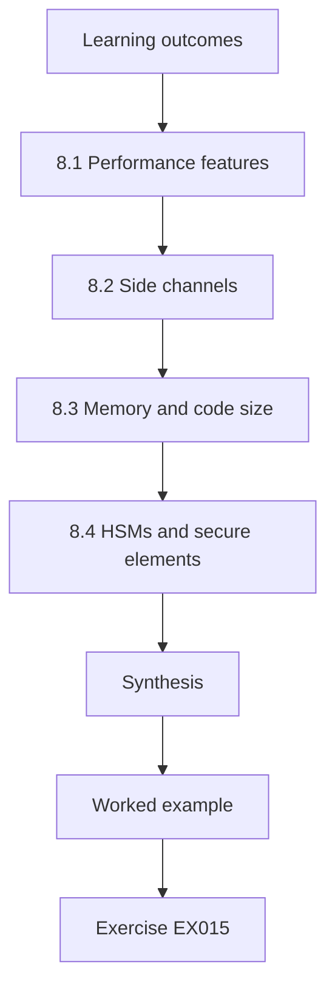

### Logical drawing


```text
[Learning outcomes]
    |
    v
[8.1 Performance features]
    |
    v
[8.2 Side channels]
    |
    v
[8.3 Memory and code size]
    |
    v
[8.4 HSMs and secure elements]
    |
    v
[Synthesis]
    |
    v
[Worked example] --> [Exercise EX015]
```
<!-- cykin:lesson-figures:end ch-08 -->


### Learning outcomes

You will (1) relate algorithm performance to processor features such as vector units and caches; (2) explain timing and power side channels; (3) assess memory and code size on constrained devices; and (4) understand hardware security modules (HSMs) and their migration constraints. It prepares implementation (Chapters 28 and 31) and performance (Chapter 36).

### 8.1 Performance features

Lattice schemes spend most of their time in polynomial multiplication via the number-theoretic transform and in hashing with SHAKE. Vector instructions (AVX2 on x86, NEON on ARM) parallelize coefficient operations, making ML-KEM very fast on servers. Constrained microcontrollers without vector units are slower but often still acceptable; memory, not speed, is usually the limit there.

For BPA this means the TLS servers will spend more time sending bytes than computing; benchmark results that show ML-KEM key generation faster than X25519 on a server do not carry over to a crane controller.

### 8.2 Side channels

Execution time, cache access patterns and power draw can reveal secrets if they depend on secret values. The "KyberSlash" findings showed that a division by a constant whose dividend depended on secret data leaked timing in several Kyber implementations ([Bernstein et al. 2024](https://eprint.iacr.org/2024/1049)). Constant-time coding — no secret-dependent branches, memory indices or variable-time instructions — is a requirement, not an optimization.

The fix in that case was to replace the division with a multiplication and shift that take the same time for every input. Reviews look for the same pattern elsewhere: any branch, table lookup or division whose input depends on a key or a decrypted value. Tools that run code with secret-marked inputs and flag such dependencies help, but they need to be run on the compiled binary, because compilers can reintroduce branches that the source did not have.

### 8.3 Memory and code size

ML-DSA signing needs several kilobytes of working memory; SLH-DSA signatures are large but keys are tiny; stateful hash-based schemes need non-volatile state that must never roll back. On a gate scanner with 64 KB of RAM, the choice of signature verification algorithm is an architecture decision.

An ML-DSA-44 verifier needs the 1,312-byte public key, the 2,420-byte signature and a working area for the matrix expansion, which some implementations keep small by generating rows on demand. A verifier that fits by recomputing data trades speed for memory, which a scanner verifying one update per month can easily afford. The architecture review records which trade-off was chosen and why.

### 8.4 HSMs and secure elements

Private keys at BPA's certificate authority live in an HSM. Migration needs HSM firmware that supports ML-DSA and possibly LMS/XMSS with state protection, validated under the relevant certification program. HSM upgrade cycles are often years long — a classic constraint on migration schedules.

BPA's plan therefore asks its HSM vendor three questions now: which post-quantum algorithms the current firmware supports, when certified firmware will be available, and whether existing hardware can be upgraded or must be replaced. The answers set the earliest date for issuing ML-DSA certificates, which in turn constrains every later migration step for authentication.

### 8.5 Worked example

BPA's crane controllers verify firmware signatures in a bootloader with 32 KB of flash available. ML-DSA-44 verification code and a 1,312-byte public key may fit; an LMS verifier is smaller and needs only hashing, and since only verification happens on the device, LMS's state problem stays at the signing server. The architecture review records both options and their memory budgets.

The decision also depends on how often firmware is signed. LMS keys can sign only a fixed number of messages, for example 2^10 or 2^15, and losing the signer's state can cause key reuse. With a few releases a year, a key with 2^15 signatures will last indefinitely, so the risk sits in the signing server's backup procedure, not in capacity.

### 8.6 Common errors and limits

- Benchmarking only on servers.
- Assuming a correct implementation is constant-time.
- Forgetting HSM procurement lead times.

Server benchmarks hide the memory limits that decide what fits on a gate scanner or crane controller, so each device class needs its own measurement. A correct implementation can still leak timing, as the KyberSlash case showed, which is why constant-time behaviour is tested separately from known answers. HSM upgrades can take years, so the request goes out before the software work starts, as BPA did with its certificate authority.

### Exercises

- **EX015 — Side-channel review.** Identify the timing risk in `if secret_coeff > q//2: x = slow_path()` and propose a fix. Rubric: 3 = identifies branch and gives branch-free alternative.
- **EX016 — Device fit.** Compare ML-DSA-44 and LMS verification for a 32 KB bootloader. Rubric: 3 = memory, state location and standards (FIPS 204, SP 800-208) considered.

### Synthesis

Architecture determines speed, memory fit and leakage: lattice schemes are fast with vector units, constant-time code is mandatory, constrained devices shape algorithm choice and HSM cycles shape schedules.

### Continue studying — chapter 08 of 50

[← Chapter 07 (draft)](#ch-07) · [Course chapter index](../SUBJECTS.md) · [Chapter 09 (draft) →](#ch-09)

<a id="ch-09"></a>

## Chapter 9 — Programming II

<!-- cykin:lesson-figures:start ch-09 -->
### Lesson map

Lesson 09 published. Map, example, EX017.

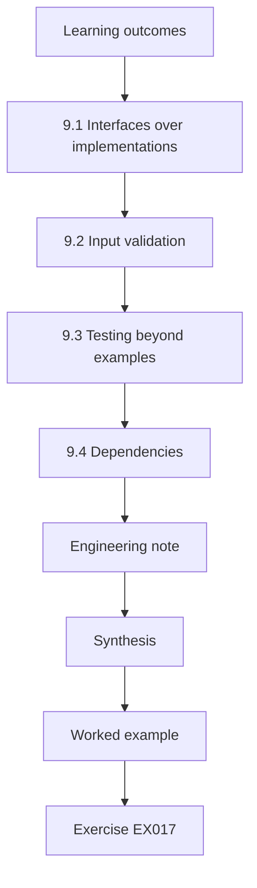

### Logical drawing


```text
[Learning outcomes]
    |
    v
[9.1 Interfaces over implementations]
    |
    v
[9.2 Input validation]
    |
    v
[9.3 Testing beyond examples]
    |
    v
[9.4 Dependencies]
    |
    v
[Engineering note]
    |
    v
[Synthesis]
    |
    v
[Worked example] --> [Exercise EX017]
```
<!-- cykin:lesson-figures:end ch-09 -->


### Learning outcomes

You will (1) structure code so that algorithms are replaceable; (2) parse and validate untrusted inputs such as certificates and key shares; (3) write property-based and known-answer tests; and (4) manage dependencies on cryptographic libraries. It builds on Chapter 4 and prepares agility (Chapter 39).

### 9.1 Interfaces over implementations

Write code against interfaces — `kem.encapsulate(public_key)`, `signer.sign(message)` — not against algorithm-specific functions. An algorithm identifier, chosen by policy, selects the implementation. This is the programming basis of crypto-agility ([CSWP 39](https://doi.org/10.6028/NIST.CSWP.39-upd1)): migration becomes a configuration change plus testing, not a rewrite.

The policy file names an algorithm per use, such as ML-DSA-65 for e-document signatures, and the code never mentions it. When BPA later moves from a hybrid to a pure post-quantum setting, the change is one line in policy plus the test run. Code review checks that no module bypasses the interface by importing an algorithm library directly.

### 9.2 Input validation

Post-quantum keys and ciphertexts have fixed lengths per parameter set. FIPS 203 requires checks on encapsulation keys (a modulus check that encoded coefficients are below *q*) and decapsulation keys before use. Code should reject wrong lengths before calling a library and never "pad" or "truncate" to make inputs fit.

An ML-KEM-768 encapsulation key must be exactly 1,184 bytes and a ciphertext exactly 1,088. Checking these lengths first gives a clear error message and avoids passing malformed data into code that might behave unpredictably. The modulus check catches keys whose coefficients were encoded with values of 3329 or higher, which a malicious peer might send to probe for implementation weaknesses.

### 9.3 Testing beyond examples

Known-answer tests confirm exact outputs. Property-based tests check invariants over many random inputs: decapsulate(encapsulate(pk)) yields the same key; a signature verifies for the signed message and fails for any one-bit change. Negative tests matter as much as positive ones.

A property test for BPA's signer runs a thousand random messages, signs each, verifies each, then flips one random bit in the message and in the signature and expects both checks to fail. A test that only checks successful verification would pass even if `verify` always returned true, which is precisely the bug negative tests exist to catch.

### 9.4 Dependencies

Pin versions of cryptographic libraries, track their advisories and record which algorithms and parameter sets each exposes. Draft-era names (e.g. "Kyber768") and final names (ML-KEM-768) are not interchangeable: the final standard changed details, so draft implementations do not interoperate with FIPS 203.

BPA's dependency file records the library name, the exact version, and the algorithms that version provides under final names. When a library release renames or removes a draft algorithm, the build fails at upgrade time rather than at a partner's handshake. Advisory tracking matters because post-quantum libraries are newer and have had more security fixes per year than mature RSA code.

### 9.5 Worked example

BPA's e-document service calls `rsa_sign()` in 41 places. Refactoring introduces `Signer` with implementations `RSA-PSS-3072` and `ML-DSA-65`, selected by a policy file. A test suite runs every call path with both. The diff is large once; the next migration will be small.

The 41 call sites are first found by searching for `rsa_sign`, then each is checked for assumptions such as a fixed 384-byte signature length in a database column. ML-DSA-65 signatures are 3,309 bytes, so the schema change is part of the same work item. The policy file starts with RSA-PSS-3072 so nothing changes for users until the switch.

### 9.6 Common errors and limits

- Hard-coding algorithm names and key lengths.
- Treating draft and final algorithm versions as the same.
- Testing only success paths.

Hard-coded names turn each future migration into a code change at every call site, which is exactly what the `Signer` refactoring removed. Draft and final versions differ in details, so a library still offering Kyber768 will not interoperate with ML-KEM-768. Testing only success paths leaves validation and error handling unchecked, and attackers target precisely those paths with malformed keys and ciphertexts.

### Engineering note

Interfaces also need versioned algorithm identifiers that travel with data. A signature stored today must carry an identifier naming its algorithm and parameter set, so that a verifier in ten years selects the right implementation and can refuse retired ones. Without identifiers, systems guess from lengths, which breaks as soon as two algorithms share a size. Treat the identifier as part of the signed or authenticated content wherever the format allows, so an attacker cannot relabel a weak signature as a strong one. This small design habit is what later makes policy-driven migration in Chapter 39 safe rather than merely convenient.

### Exercises

- **EX017 — Interface design.** Write a `KEM` interface (method names and types) suitable for ML-KEM and a future HQC. Rubric: 3 = no algorithm-specific assumptions such as sizes.
- **EX018 — Length checks.** Write a validator that rejects an ML-KEM-768 encapsulation key of the wrong length (correct: 1,184 bytes). Rubric: 3 = rejects, never pads.

### Synthesis

Replaceable algorithms start in code: interfaces, policy-chosen identifiers, strict validation, property and negative tests, and dependency tracking that knows draft from final.

### Continue studying — chapter 09 of 50

[← Chapter 08 (draft)](#ch-08) · [Course chapter index](../SUBJECTS.md) · [Chapter 10 (draft) →](#ch-10)

<a id="ch-10"></a>

## Chapter 10 — Engineering ethics and safety

<!-- cykin:lesson-figures:start ch-10 -->
### Lesson map

Lesson 10 published. Map, example, EX019.

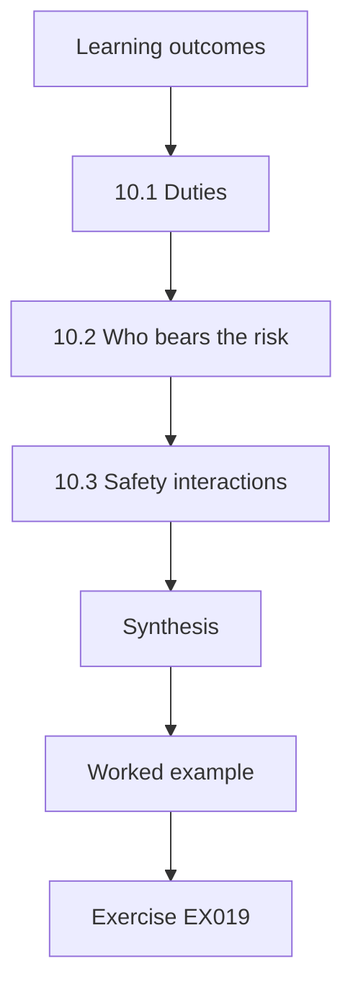

### Logical drawing


```text
[Learning outcomes]
    |
    v
[10.1 Duties]
    |
    v
[10.2 Who bears the risk]
    |
    v
[10.3 Safety interactions]
    |
    v
[Synthesis]
    |
    v
[Worked example] --> [Exercise EX019]
```
<!-- cykin:lesson-figures:end ch-10 -->


### Learning outcomes

You will (1) apply professional ethics to cryptographic migration decisions; (2) identify who bears the risk of "harvest-now, decrypt-later"; (3) handle vulnerability findings responsibly; and (4) avoid overstating quantum risk to sell products. It closes the first foundations block and informs every design decision later.

### 10.1 Duties

Engineering codes of ethics place public welfare first. In PQC work this means protecting people whose data will remain sensitive for decades — medical, legal, customs and personal records — even though harm, if it comes, comes years after the engineer's decision. It also means honesty: neither minimizing the risk ("quantum is science fiction") nor inflating it to sell ("RSA will be broken next year").

For a BPA engineer, honesty means stating the range of expert estimates and the 25-year record lifetime side by side, without picking the date that suits the budget.

### 10.2 Who bears the risk

Data subjects bear harvest-now-decrypt-later risk, but they rarely decide migration budgets. An ethical engineer makes this asymmetry visible in decision memos: "If we postpone, customs declarants' commercial data recorded from now until migration may become readable by a future adversary."

The memo then names who decides and who would be harmed, so the board sees that postponing transfers risk to people outside the room. Quantifying exposure, as in the 8.0 versus 16.3 TB comparison, makes the transfer concrete. It also gives declarants' representatives something to ask about when BPA reports on data protection.

### 10.3 Safety interactions

Cryptographic changes can break availability: an oversized handshake that a middlebox drops, a firmware signature that a bootloader cannot verify, a certificate that a medical device rejects. In safety-related systems — cranes, port traffic control — a failed update can stop operations or create hazards. Change management with rollback plans, testing in isolated environments and staged rollouts is an ethical duty, not bureaucracy.

In practice, BPA's crane firmware change is tested on a spare controller, rolled out to one crane, and held for a week before the rest.

### 10.4 Responsible disclosure and testing limits

If testing reveals a vulnerability in a product, report it to the vendor and give time to fix before publishing. Never test systems you are not authorized to test, and never run downgrade experiments on production traffic.

For BPA's teams, authorization means a written scope that names systems, dates and allowed techniques. A downgrade test that strips the hybrid group from a ClientHello belongs in a lab copy of the portal, not on the live service where it could break partners' sessions. Findings in vendor products go to the vendor first, with a disclosure date agreed in advance.

### 10.5 Worked example

A vendor offers BPA a "quantum-proof" appliance using an unpublished algorithm. Ethical evaluation: an unvetted algorithm offers no assurance (Rainbow and SIKE were broken despite years of public scrutiny — [Beullens 2022](https://eprint.iacr.org/2022/214), [Castryck and Decru 2022](https://eprint.iacr.org/2022/975)); the marketing overstates; the engineer's duty is to recommend standardized algorithms and to say why, even if the vendor is a friend of management.

The written evaluation goes to the board, not only to the vendor, so the reasons survive any later pressure to reverse it.

### 10.6 Common errors and limits

- Deferring migration because the harm is far away.
- Accepting marketing terms like "quantum-proof".
- Rolling out cryptographic changes to safety systems without rollback.

Deferral feels safe because nobody is harmed this year, but recorded customs traffic accumulates exposure every month the decision waits. "Quantum-proof" claims should prompt a request for the algorithm, its standard and its review history. Safety systems such as crane controllers need tested rollback before any firmware signature change, since a device that rejects its own update can halt operations.

### Exercises

- **EX019 — Risk bearers.** For BPA, list three groups who bear quantum risk and how each is represented in decisions. Rubric: 3 = groups distinct, representation gap identified.
- **EX020 — Vendor letter.** Write a polite letter declining an unvetted "quantum-proof" algorithm. Rubric: 3 = cites standards and the breaks, offers a path forward.

### Synthesis

Ethical PQC engineering protects long-lived data on behalf of people who cannot see the risk, communicates honestly, treats availability and safety as part of security and rejects unvetted cryptography.

### Continue studying — chapter 10 of 50

[← Chapter 09 (draft)](#ch-09) · [Course chapter index](../SUBJECTS.md) · [Chapter 11 (draft) →](#ch-11)

<a id="ch-11"></a>

## Chapter 11 — Networks and protocols

<!-- cykin:lesson-figures:start ch-11 -->
### Lesson map

Lesson 11 published. Map, example, EX021.

```mermaid
flowchart TD
  N0["Learning outcomes"]
  N1["11.1 TLS 1.3"]
  N2["11.2 Size and the network"]
  N3["11.3 Other protocols"]
  N4["11.4 Ossification"]
  N5["Synthesis"]
  N0 --> N1 --> N2 --> N3 --> N4 --> N5
  N5 --> EX["Worked example"]
  EX --> Q["Exercise EX021"]
```

### Logical drawing

```mermaid
flowchart LR
  N0["Learning outcomes"]
  N1["11.1 TLS 1.3"]
  N2["11.2 Size and the network"]
  N3["11.3 Other protocols"]
  N4["11.4 Ossification"]
  N5["Synthesis"]
  N0 --> N1 --> N2 --> N3 --> N4 --> N5 --> Q["EX021"]
```

```text
[Learning outcomes]
    |
    v
[11.1 TLS 1.3]
    |
    v
[11.2 Size and the network]
    |
    v
[11.3 Other protocols]
    |
    v
[11.4 Ossification]
    |
    v
[Synthesis]
    |
    v
[Worked example] --> [Exercise EX021]
```
<!-- cykin:lesson-figures:end ch-11 -->


### Learning outcomes

You will (1) trace a TLS 1.3 handshake and identify where key exchange and authentication happen; (2) explain how packet size, MTU and fragmentation interact with larger post-quantum messages; (3) describe IKEv2, SSH and DNSSEC from a migration viewpoint; and (4) recognize middlebox ossification. It prepares integration (Chapter 34) and performance (Chapter 36).

### 11.1 TLS 1.3

In TLS 1.3 ([RFC 8446](https://www.rfc-editor.org/rfc/rfc8446.html)) the client sends a ClientHello with key shares for one or more groups; the server replies with its share, and both derive keys from the shared secret. The server then sends its certificate chain and a CertificateVerify signature, encrypted. Key exchange protects confidentiality against recording; certificates and signatures provide authentication at the time of connection. Hybrid groups such as X25519MLKEM768 ([RFC 10024](https://www.rfc-editor.org/rfc/rfc10024.html)) change only the key-share part: the client share grows from 32 to 1,216 bytes, the server's to 1,120 bytes.

### 11.2 Size and the network

An Ethernet path typically carries 1,500-byte IP packets, about 1,460 bytes of TCP payload. A ClientHello with a hybrid share often exceeds that and needs two TCP segments. TCP handles this transparently, but some middleboxes and servers inspect only the first packet. Google reported such incompatibilities when Chrome began offering hybrid Kyber ([Chromium Blog 2023](https://blog.chromium.org/2023/08/protecting-chrome-traffic-with-hybrid.html)). Over UDP (QUIC, DTLS, IKEv2) larger messages raise fragmentation and amplification-limit issues that protocol designers handle explicitly.

Testing therefore covers the whole path, including proxies and load balancers.

### 11.3 Other protocols

IKEv2 VPNs add post-quantum key exchange through additional exchanges ([RFC 9370](https://www.rfc-editor.org/rfc/rfc9370.html) defines multiple key exchanges in IKEv2). SSH implementations have deployed hybrid key exchange methods combining a lattice KEM with X25519. DNSSEC is mostly a signature problem: post-quantum signatures are much larger than today's ECDSA signatures, which strains UDP responses.

Each protocol needs its own plan. BPA's site-to-site VPN can add an ML-KEM exchange through RFC 9370 once both gateways support it; SSH administration can switch to a hybrid method with a configuration change on servers and clients; DNSSEC must wait for standards that fit large signatures into DNS responses, so it stays in the inventory as a tracked dependency.

### 11.4 Ossification

When middleboxes assume protocol fields never change, new values break connections. TLS 1.3 introduced GREASE ([RFC 8701](https://www.rfc-editor.org/rfc/rfc8701.html)) — random reserved values — to keep implementations tolerant. Post-quantum migration is a test of ossification: the protocol allows it, but deployed equipment may not.

BPA's test plan sends hybrid ClientHellos through every inspection device on the path to partner portals before enabling them. A device that resets the connection is logged with its firmware version, and the vendor is asked for a fix. This turns ossification from a surprise outage into a list of known items with owners and dates.

### 11.5 Worked example

BPA's terminal staff report that the shipping-line portal fails through the old inspection proxy after enabling a hybrid group. Packet traces show the proxy resetting connections whose ClientHello spans two segments. Options: update proxy firmware, bypass inspection for that destination, or temporarily disable the hybrid group only on that path while the vendor fixes it — keeping it everywhere else.

The targeted exception is the right choice because the proxy fault affects only one path, while the harvest risk applies to all traffic. The exception is recorded with an expiry date and an owner, so it cannot become permanent. Once the vendor's firmware is installed, the test from the lab is rerun before the hybrid group is enabled again on that path.

### 11.6 Common errors and limits

- Assuming hybrid key exchange also migrates certificates.
- Forgetting UDP protocols' size limits.
- Rolling back PQC globally for a local middlebox fault.

Hybrid key exchange protects recorded traffic but leaves authentication on RSA or ECDSA certificates, which need their own migration. UDP protocols such as QUIC and IKEv2 must handle size explicitly because they lack TCP's segmentation. A global rollback for one proxy throws away protection for every other path, as the shipping-line portal case showed; a time-limited exception for that one path keeps everything else protected.

### Exercises

- **EX021 — Segment count.** A ClientHello is 540 bytes without key shares. How many 1,460-byte segments with an X25519-only share (32 B) and with X25519MLKEM768 (1,216 B), counting ~4 B overhead per share? Rubric: 3 = 1 and 2 segments with arithmetic.
- **EX022 — Protocol map.** For TLS, IKEv2, SSH and DNSSEC, state whether migration is mainly key exchange, signatures or both. Rubric: 3 = correct with one-line reasons.

### Synthesis

Hybrid key exchange changes message sizes, which networks and middleboxes may mishandle; each protocol has its own migration shape, and ossification, not cryptography, is often the obstacle.

### Continue studying — chapter 11 of 50

[← Chapter 10 (draft)](#ch-10) · [Course chapter index](../SUBJECTS.md) · [Chapter 12 (draft) →](#ch-12)

<a id="ch-12"></a>

## Chapter 12 — Operating systems

<!-- cykin:lesson-figures:start ch-12 -->
### Lesson map

Lesson 12 published. Map, example, EX023.

```mermaid
flowchart TD
  N0["Learning outcomes"]
  N1["12.1 Where cryptography lives"]
  N2["12.2 System-wide policies"]
  N3["12.3 Secure boot and updates"]
  N4["12.4 Entropy and key storage"]
  N5["Synthesis"]
  N0 --> N1 --> N2 --> N3 --> N4 --> N5
  N5 --> EX["Worked example"]
  EX --> Q["Exercise EX023"]
```

### Logical drawing

```mermaid
flowchart LR
  N0["Learning outcomes"]
  N1["12.1 Where cryptography lives"]
  N2["12.2 System-wide policies"]
  N3["12.3 Secure boot and updates"]
  N4["12.4 Entropy and key storage"]
  N5["Synthesis"]
  N0 --> N1 --> N2 --> N3 --> N4 --> N5 --> Q["EX023"]
```

```text
[Learning outcomes]
    |
    v
[12.1 Where cryptography lives]
    |
    v
[12.2 System-wide policies]
    |
    v
[12.3 Secure boot and updates]
    |
    v
[12.4 Entropy and key storage]
    |
    v
[Synthesis]
    |
    v
[Worked example] --> [Exercise EX023]
```
<!-- cykin:lesson-figures:end ch-12 -->


### Learning outcomes

You will (1) locate cryptographic libraries and configuration in an operating system; (2) explain system-wide crypto policies; (3) understand secure boot and update signing; and (4) manage entropy and key storage. It builds on Chapters 8–9 and prepares inventory (Chapter 22) and maintainability (Chapter 39).

### 12.1 Where cryptography lives

On a Linux server, TLS usually comes from a shared library (OpenSSL, GnuTLS, NSS, BoringSSL in some applications), SSH from OpenSSH, VPNs from kernel IPsec plus a user-space IKE daemon. Applications may also bundle their own libraries — Java, Go and Rust programs often do. An inventory that checks only the system library misses statically linked or bundled cryptography.

Finding bundled code requires checking binaries and application packages, not just the package manager. For a Go binary, the build information lists the cryptographic modules compiled in; for Java, the configured security providers show which library handles TLS. These checks belong in the inventory script so every host is assessed the same way.

### 12.2 System-wide policies

Some distributions provide system-wide cryptographic policies that set default algorithms for all libraries that honour them. Policies are a powerful agility lever: changing one profile can enable hybrid groups or disable weak algorithms across many services. Their limit is coverage — applications with bundled libraries ignore them.

BPA uses the policy to enable the hybrid group on all services that use the system library in a single change, then checks each service's handshake to confirm it took effect. Services that do not show the hybrid group after the change are exactly those with bundled libraries, so the policy rollout doubles as a test of inventory coverage.

### 12.3 Secure boot and updates

Firmware verifies the bootloader's signature, which verifies the kernel's, and so on. These signatures must remain verifiable for the device's lifetime, which may exceed a decade. That makes boot chains early candidates for hash-based signatures (LMS, XMSS per [SP 800-208](https://doi.org/10.6028/NIST.SP.800-208)), which CNSA 2.0 also prioritizes for software and firmware signing.

A device shipped in 2026 with a fifteen-year life will still verify updates in 2041, so the boot key chosen now must remain secure for that whole period. Changing the root of trust later may need physical access or may be impossible, which is why boot chains get first priority rather than last.

### 12.4 Entropy and key storage

Keys need good randomness from the OS (`getrandom`), especially at early boot and in virtual machines. Private keys belong in protected storage — HSMs, TPMs or OS keystores — never in world-readable files.

Virtual machines cloned from one image can start with identical random state, so keys generated at first boot may repeat across hosts. Waiting for `getrandom` to report that the pool is ready, and generating keys after boot completes, avoids that. On BPA's terminal servers, TLS private keys are stored in the TPM-backed keystore and audited monthly for file-permission drift.

### 12.5 Worked example

BPA's inventory of a terminal server finds OpenSSL 3.x as the system library, a Java application with its own provider, a Go binary statically linked, and an IPsec daemon. Enabling hybrid TLS through the system policy affects only the first; the other two need application changes. The migration plan records one work item per cryptographic provider, not per server.

Counting by provider gives four work items for this server, with different owners: the platform team for OpenSSL and IPsec, the application team for Java, and the developers of the Go service, who must rebuild with a newer toolchain. A plan counted per server would have marked this host done after the policy change while two of its four providers were untouched.

### 12.6 Common errors and limits

- Assuming one policy change migrates the whole host.
- Ignoring boot-chain signatures because they are "not network".
- Storing keys in configuration directories.

The worked example showed a policy change reaching only one of four providers on a single host. Boot-chain signatures matter because they must stay valid for the device's life and are hard to replace, so they come first in signing migrations. Keys kept in configuration directories are copied into backups and images, where they may outlive the systems they were meant to protect.

### Exercises

- **EX023 — Provider inventory.** List four places cryptography may live on a server and how you would detect each. Rubric: 3 = includes bundled/static libraries.
- **EX024 — Boot chain.** Explain why firmware signing is an early PQC priority. Rubric: 3 = device lifetime and verification-only constraints.

### Synthesis

Cryptography lives in many providers on one host; system policies help but do not cover bundled code; long-lived boot chains need early migration; keys need protected storage and good entropy.

### Continue studying — chapter 12 of 50

[← Chapter 11 (draft)](#ch-11) · [Course chapter index](../SUBJECTS.md) · [Chapter 13 (draft) →](#ch-13)

<a id="ch-13"></a>

## Chapter 13 — Data systems

<!-- cykin:lesson-figures:start ch-13 -->
### Lesson map

Lesson 13 published. Map, example, EX025.

```mermaid
flowchart TD
  N0["Learning outcomes"]
  N1["13.1 Confidentiality lifetime"]
  N2["13.2 At rest, in transit, in backups"]
  N3["13.3 Envelope encryption"]
  N4["13.4 Database and replication links"]
  N5["Synthesis"]
  N0 --> N1 --> N2 --> N3 --> N4 --> N5
  N5 --> EX["Worked example"]
  EX --> Q["Exercise EX025"]
```

### Logical drawing

```mermaid
flowchart LR
  N0["Learning outcomes"]
  N1["13.1 Confidentiality lifetime"]
  N2["13.2 At rest, in transit, in backups"]
  N3["13.3 Envelope encryption"]
  N4["13.4 Database and replication links"]
  N5["Synthesis"]
  N0 --> N1 --> N2 --> N3 --> N4 --> N5 --> Q["EX025"]
```

```text
[Learning outcomes]
    |
    v
[13.1 Confidentiality lifetime]
    |
    v
[13.2 At rest, in transit, in backups]
    |
    v
[13.3 Envelope encryption]
    |
    v
[13.4 Database and replication links]
    |
    v
[Synthesis]
    |
    v
[Worked example] --> [Exercise EX025]
```
<!-- cykin:lesson-figures:end ch-13 -->


### Learning outcomes

You will (1) classify data by confidentiality lifetime; (2) distinguish encryption at rest, in transit and in backups; (3) understand envelope encryption and key wrapping; and (4) identify where quantum-vulnerable algorithms protect stored data. It prepares system and data models (Chapter 22).

### 13.1 Confidentiality lifetime

The key input to quantum risk is how long data must stay secret. BPA's container manifests matter for weeks; customs declarations for 25 years; employee records for decades. Classify data by lifetime first; the migration order follows.

Lifetime is set by the business and the law, not by IT. For customs declarations, the 25 years comes from retention and commercial sensitivity rules, so the data owner signs off the figure. Manifests that lose value after the ship sails can stay on current cryptography until the normal refresh, freeing effort for the long-lived classes. Recording the source of each lifetime makes later challenges easy to answer.

### 13.2 At rest, in transit, in backups

Bulk data at rest is usually encrypted with symmetric algorithms (AES-GCM), which are not seriously threatened by quantum computers at 256-bit keys. The danger is in **how symmetric keys are protected**: if a data key is wrapped with RSA or transmitted over an ECDH-protected channel that an adversary recorded, the data inherits that vulnerability. Backups and archives copied to third parties extend exposure.

Tracing each data key from creation to every place it is wrapped or sent is the way to find these hidden dependencies.

### 13.3 Envelope encryption

Cloud key-management services encrypt data with a data key and wrap the data key with a master key. If the master key is symmetric and stays inside the service, quantum risk is low; if keys are exchanged between parties using RSA-OAEP or ECDH (as in many document-encryption formats), the wrap is the weak point. Post-quantum KEMs can replace those wraps — the CMS standard now has a [KEM-based mechanism](https://www.rfc-editor.org/rfc/rfc9629.html) (RFC 9629).

The migration replaces only the wrap, so stored data does not need re-encryption.

### 13.4 Database and replication links

Database replication across sites often runs over TLS. Recorded replication streams of a 25-year customs database are a prime harvest target, making replication links early hybrid-TLS candidates.

Replication volume is large and steady, which makes it attractive to an adversary who can tap a single fibre route. Unlike browser traffic, both ends belong to BPA, so hybrid TLS can be enabled as soon as both database servers' libraries support it, with no partner coordination. The change is tested by checking the negotiated group on the replication session, then watching replication lag for a week to confirm the larger handshake has no operational effect.

### 13.5 Worked example

BPA's customs archive: AES-256-GCM at rest (acceptable), data keys wrapped by an on-premises KMS with an AES master key (acceptable), nightly replication to a disaster-recovery site over TLS 1.2 with ECDHE (vulnerable to harvest), and exports to the national customs agency as RSA-encrypted files (vulnerable). Priorities: replication link and export format.

The two priorities differ in who must act. The replication link is internal, so BPA can switch it to hybrid TLS within one maintenance window. The export format needs the customs agency to accept a new file format, for example CMS with ML-KEM under RFC 9629, which means a joint test plan and an agreed date. Starting that conversation now matters more than any internal change.

### 13.6 Common errors and limits

- Replacing AES "because quantum" while leaving RSA key wraps.
- Ignoring backup and export paths.
- Not classifying data lifetime before prioritizing.

AES-256 already resists Grover in practice, so replacing it spends money where there is no gap, while RSA-wrapped keys leave the actual gap open. BPA's own archive analysis found its two vulnerable paths in replication and exports, not in storage. Classifying data lifetime first avoids migrating month-long manifests ahead of 25-year customs records, and gives the data owners a figure they can defend in audit.

### Exercises

- **EX025 — Classify.** Classify six BPA data sets by confidentiality lifetime and justify. Rubric: 3 = lifetimes plausible and linked to priority.
- **EX026 — Find the weak wrap.** For a document-encryption flow using AES-256 and RSA-OAEP, identify the quantum-vulnerable step and a standards-based replacement. Rubric: 3 = RSA wrap; KEM (e.g. ML-KEM via CMS KEMRecipientInfo).

### Synthesis

Quantum risk to stored data comes through key exchange and key wrapping, not AES; classify data by lifetime, then fix replication links, exports and wraps.

### Continue studying — chapter 13 of 50

[← Chapter 12 (draft)](#ch-12) · [Course chapter index](../SUBJECTS.md) · [Chapter 14 (draft) →](#ch-14)

<a id="ch-14"></a>

## Chapter 14 — Software engineering

<!-- cykin:lesson-figures:start ch-14 -->
### Lesson map

Lesson 14 published. Map, example, EX027.

```mermaid
flowchart TD
  N0["Learning outcomes"]
  N1["14.1 Lifecycle"]
  N2["14.2 Review"]
  N3["14.3 SBOM and CBOM"]
  N4["14.4 Staged releases"]
  N5["Engineering note"]
  N6["Synthesis"]
  N0 --> N1 --> N2 --> N3 --> N4 --> N5 --> N6
  N6 --> EX["Worked example"]
  EX --> Q["Exercise EX027"]
```

### Logical drawing

```mermaid
flowchart LR
  N0["Learning outcomes"]
  N1["14.1 Lifecycle"]
  N2["14.2 Review"]
  N3["14.3 SBOM and CBOM"]
  N4["14.4 Staged releases"]
  N5["Engineering note"]
  N6["Synthesis"]
  N0 --> N1 --> N2 --> N3 --> N4 --> N5 --> N6 --> Q["EX027"]
```

```text
[Learning outcomes]
    |
    v
[14.1 Lifecycle]
    |
    v
[14.2 Review]
    |
    v
[14.3 SBOM and CBOM]
    |
    v
[14.4 Staged releases]
    |
    v
[Engineering note]
    |
    v
[Synthesis]
    |
    v
[Worked example] --> [Exercise EX027]
```
<!-- cykin:lesson-figures:end ch-14 -->


### Learning outcomes

You will (1) manage requirements, design, implementation and testing in a migration project; (2) use version control and code review for cryptographic changes; (3) build a software bill of materials (SBOM) and a cryptographic bill of materials (CBOM); and (4) plan staged releases. It builds on Chapters 4 and 9 and prepares implementation (Chapter 28).

### 14.1 Lifecycle

A migration is a software project: requirements (which functions must become quantum-resistant, by when), design (hybrid or pure PQC, which libraries), implementation, testing, staged release and maintenance. Cryptographic changes are high-impact and low-visibility: if wrong, they fail silently or catastrophically.

Silent failure is the more dangerous of the two: a service that quietly falls back to classical key exchange looks healthy while recording continues to expose its traffic. For that reason BPA's requirements state measurable outcomes, such as the negotiated group logged per session, so testing can show the change actually took effect.

### 14.2 Review

Every cryptographic change gets review by someone with cryptographic knowledge, plus tests for interoperability. Checklists ask: are algorithm identifiers from policy? Are lengths validated? Are comparisons constant-time? Is the library version pinned and supported?

BPA keeps a small pool of reviewers who have completed cryptographic training, and every change touching the `Signer` or KEM interfaces requires one of them. The checklist is stored with the code, and each item maps to an automated test where possible, for example a test that fails when a key length is accepted without validation. Reviewers then spend their time on design questions that tests cannot answer.

### 14.3 SBOM and CBOM

An SBOM lists components and versions. A CBOM extends this to cryptographic assets: algorithms, parameter sets, key lengths, protocols, certificates and where keys live. Formats such as CycloneDX support CBOM fields. A CBOM is the basis for answering "where do we use RSA?" in minutes rather than months.

BPA generates the CBOM in the build pipeline, so every release carries a fresh inventory. A query for RSA across all CBOMs, filtered to keys with lifetimes over ten years, produced the first work items for signature migration.

### 14.4 Staged releases

Use feature flags for algorithm choices, canary deployments with measured failure rates (Chapter 37) and rollback plans. Keep both old and new algorithms available during transition.

A flag lets the team turn the hybrid group off for one path in minutes, as in the shipping-line portal case, without redeploying code. The canary step size starts small, such as 1% of traffic, and grows only after the failure bound from the rule of three falls under the agreed budget. Each step's data is kept, so a later incident can be compared against the baseline from the rollout.

### 14.5 Worked example

BPA's portal team adds hybrid TLS behind a flag, runs interoperability tests against the top 50 partner clients, deploys to 1% of traffic, monitors failures and promotes in steps. The CBOM is updated automatically from build metadata so the inventory stays current.

Choosing the top 50 partner clients covers most of the portal's traffic, so a fault there would show up quickly in the canary. Each promotion step needs a minimum number of connections without failure, which the team computes before rollout. The automated CBOM update meant the security office could report the change to the board the same week it reached full traffic.

### 14.6 Common errors and limits

- Cryptographic changes merged without specialist review.
- CBOMs built once by hand and never updated.
- Big-bang releases without flags.

Merges without review have shipped draft-era Kyber code into production in other organizations; BPA's rule that interface changes need a trained reviewer prevents that. Hand-made CBOMs are out of date within a release cycle, so the build generates them. Big-bang releases remove the chance to catch the middlebox faults that canaries find at 1% of traffic, and they make rollback an all-or-nothing choice.

### Engineering note

Treat the CBOM as a living artefact owned by a named team, generated from build pipelines, configuration management and telemetry rather than spreadsheets. Each release should diff its CBOM against the previous one: a new RSA dependency introduced by a library upgrade is a regression to catch in review, exactly like a failing test. Teams that wire this diff into continuous integration discover quantum-vulnerable additions within days instead of during the next annual audit, and they also gain an accurate list for vendor questionnaires and regulators.

### Exercises

- **EX027 — Review checklist.** Write a ten-item checklist for reviewing a PQC change. Rubric: 3 = covers identifiers, validation, constant time, versions, tests, rollback.
- **EX028 — CBOM fields.** List the minimum fields of a CBOM entry for a TLS endpoint. Rubric: 3 = algorithm, parameter set, protocol, key location, owner, certificate details.

### Synthesis

Treat migration as software engineering: reviewed changes, flags, canaries, rollback and an automatically maintained CBOM.

### Continue studying — chapter 14 of 50

[← Chapter 13 (draft)](#ch-13) · [Course chapter index](../SUBJECTS.md) · [Chapter 15 (draft) →](#ch-15)

<a id="ch-15"></a>

## Chapter 15 — Security fundamentals

<!-- cykin:lesson-figures:start ch-15 -->
### Lesson map

Lesson 15 published. Map, example, EX029.

```mermaid
flowchart TD
  N0["Learning outcomes"]
  N1["15.1 CIA in migration"]
  N2["15.2 Security categories"]
  N3["15.3 Attack models"]
  N4["15.4 Defence in depth"]
  N5["Synthesis"]
  N0 --> N1 --> N2 --> N3 --> N4 --> N5
  N5 --> EX["Worked example"]
  EX --> Q["Exercise EX029"]
```

### Logical drawing

```mermaid
flowchart LR
  N0["Learning outcomes"]
  N1["15.1 CIA in migration"]
  N2["15.2 Security categories"]
  N3["15.3 Attack models"]
  N4["15.4 Defence in depth"]
  N5["Synthesis"]
  N0 --> N1 --> N2 --> N3 --> N4 --> N5 --> Q["EX029"]
```

```text
[Learning outcomes]
    |
    v
[15.1 CIA in migration]
    |
    v
[15.2 Security categories]
    |
    v
[15.3 Attack models]
    |
    v
[15.4 Defence in depth]
    |
    v
[Synthesis]
    |
    v
[Worked example] --> [Exercise EX029]
```
<!-- cykin:lesson-figures:end ch-15 -->


### Learning outcomes

You will (1) apply confidentiality, integrity and availability to cryptographic migration; (2) explain security levels and NIST's five PQC categories; (3) distinguish attack models — passive recording, active man-in-the-middle and forgery; and (4) understand defence in depth. It prepares security architecture (Chapter 18).

### 15.1 CIA in migration

Confidentiality is threatened by recorded key exchanges; integrity and authenticity by future signature forgery on long-lived documents and firmware; availability by migration itself — oversized messages, incompatible clients, expired certificates. A plan that improves confidentiality but causes outages has failed on availability.

BPA's plan therefore lists, for each change, which property it improves and which it puts at risk. Hybrid TLS on the portal improves confidentiality and risks availability through larger handshakes; ML-DSA on bills of lading improves long-term integrity and risks availability for partners whose software cannot yet verify it. Each risk gets a mitigation, such as a canary or a dual-signature period.

### 15.2 Security categories

NIST defined five post-quantum security categories by comparison with the cost of breaking symmetric primitives: category 1 is at least as hard as key search on AES-128, category 3 as AES-192, category 5 as AES-256; categories 2 and 4 compare with SHA-256 and SHA-384 collisions. ML-KEM-512/768/1024 target categories 1/3/5 ([FIPS 203](https://doi.org/10.6028/NIST.FIPS.203)). CNSA 2.0 requires the category-5 sets (ML-KEM-1024, ML-DSA-87) for national-security systems.

BPA does not handle national-security systems, so category 3 is its default, with category 5 only where data lifetimes are longest. The extra bytes of the larger sets are paid only where they buy something.

### 15.3 Attack models

**Passive recording now, decryption later** threatens confidentiality of anything protected by vulnerable key exchange today. **Active attacks with a quantum computer** — impersonating a server by forging signatures — require the CRQC to exist at the time of attack, so signature migration is less urgent for short-lived authentication but urgent for long-lived roots of trust. **Forgery of archived signatures** threatens documents whose signatures must remain meaningful for years.

Matching each BPA system to these models sets priorities: customs replication falls under the first, partner TLS authentication under the second, and bills of lading under the third.

### 15.4 Defence in depth

Hybrid key exchange is defence in depth across assumptions: an attacker must break both the traditional and the post-quantum component ([RFC 9794](https://www.rfc-editor.org/rfc/rfc9794.html)). Agility is defence in depth across time: if one algorithm weakens, replace it quickly.

The two forms work together. Hybrid key exchange protects BPA if a flaw is found in ML-KEM, because X25519 still holds against classical attackers. Agility protects BPA if both weaken over time, since the policy file can switch algorithms without code changes. Neither helps if keys are stored carelessly, so storage controls remain a separate layer.

### 15.5 Worked example

BPA's bills of lading are signed with ECDSA and must be verifiable for 12 years. A CRQC within 12 years would allow forging a bill dated in the past unless the document carries a post-quantum signature or a trusted timestamp chain that is itself migrated. Priority: high — integrity of legal documents over long periods.

A trusted timestamp proves the document existed before a given date, so even a later forgery cannot be backdated past the stamp. BPA's choice is to re-stamp archived bills with a post-quantum timestamp authority and to sign new bills with ML-DSA-65, whose 3,309-byte signatures fit easily within document files.

### 15.6 Common errors and limits

- Treating PQC as confidentiality-only.
- Choosing category 5 everywhere without considering size and performance.
- Forgetting availability.

Treating PQC as a confidentiality problem only leaves bills of lading and firmware open to future forgery. Category 5 everywhere adds bytes and computation, for example ML-KEM-1024's 1,568-byte key against 768's 1,184, without a matching need for most BPA data. Availability failures, such as a middlebox rejecting large handshakes, can undo the whole programme's credibility. A plan that names its availability risks and mitigations up front keeps the support of operations teams when the first incident happens.

### Exercises

- **EX029 — Category choice.** Recommend a category for BPA's portal and for a national-security partner link; justify. Rubric: 3 = category 3 (or 1) for portal with reasoning; category 5 per CNSA 2.0 for the partner.
- **EX030 — Attack models.** For VPN traffic, firmware signatures and bills of lading, state which attack model dominates. Rubric: 3 = recording; forgery of long-lived roots; archived-signature forgery.

### Synthesis

Migration touches all of confidentiality, integrity and availability; categories tie PQC strength to symmetric benchmarks; urgency differs by attack model; hybrids and agility give depth.

### Continue studying — chapter 15 of 50

[← Chapter 14 (draft)](#ch-14) · [Course chapter index](../SUBJECTS.md) · [Chapter 16 (draft) →](#ch-16)

<a id="ch-16"></a>

## Chapter 16 — Systems engineering

<!-- cykin:lesson-figures:start ch-16 -->
### Lesson map

Lesson 16 published. Map, example, EX031.

```mermaid
flowchart TD
  N0["Learning outcomes"]
  N1["16.1 Lifecycle view"]
  N2["16.2 Interfaces and dependencies"]
  N3["16.3 Trade studies"]
  N4["16.4 V&V planning"]
  N5["Engineering note"]
  N6["Synthesis"]
  N0 --> N1 --> N2 --> N3 --> N4 --> N5 --> N6
  N6 --> EX["Worked example"]
  EX --> Q["Exercise EX031"]
```

### Logical drawing

```mermaid
flowchart LR
  N0["Learning outcomes"]
  N1["16.1 Lifecycle view"]
  N2["16.2 Interfaces and dependencies"]
  N3["16.3 Trade studies"]
  N4["16.4 V&V planning"]
  N5["Engineering note"]
  N6["Synthesis"]
  N0 --> N1 --> N2 --> N3 --> N4 --> N5 --> N6 --> Q["EX031"]
```

```text
[Learning outcomes]
    |
    v
[16.1 Lifecycle view]
    |
    v
[16.2 Interfaces and dependencies]
    |
    v
[16.3 Trade studies]
    |
    v
[16.4 V&V planning]
    |
    v
[Engineering note]
    |
    v
[Synthesis]
    |
    v
[Worked example] --> [Exercise EX031]
```
<!-- cykin:lesson-figures:end ch-16 -->


### Learning outcomes

You will (1) apply a systems lifecycle to a multi-year migration; (2) manage interfaces and dependencies across organizations; (3) use trade studies; and (4) plan verification and validation from the start. It builds on Chapter 14 and prepares requirements (Chapter 21).

### 16.1 Lifecycle view

A port-wide migration spans concept (why and what), requirements, architecture, implementation, integration, verification, validation, operation and retirement. Lifecycle standards such as ISO/IEC/IEEE 15288 describe these processes. Cryptographic migration differs from most system changes because it touches every interface at once and because partners outside the organization must change in step.

For BPA, retirement is a real phase: RSA keys and certificates must be withdrawn and old algorithms disabled once every partner has moved, otherwise downgrade paths remain open indefinitely. Planning retirement from the start, with a target date per interface, keeps the programme from ending with both old and new algorithms permanently enabled.

### 16.2 Interfaces and dependencies

BPA depends on shipping lines (VPN peers), the customs agency (export formats), vendors (appliances, HSMs, crane firmware) and browser makers (TLS clients). An interface control document lists, per interface, the current algorithms, the target, who must change and by when. Dependencies explain schedules better than effort estimates.

For the customs export, the control document records RSA-OAEP today, CMS with ML-KEM-768 as target, the customs agency as the party that must change first, and a date agreed in a joint letter. A dependency like this sets the schedule regardless of how quickly BPA's own developers finish their part.

### 16.3 Trade studies

A trade study compares options against weighted criteria. For BPA's VPN: (a) hybrid IKEv2 with ML-KEM now, (b) wait for vendor native support, (c) add a pre-shared-key layer as an interim mitigation. Criteria: security gain, availability risk, cost, partner readiness, standards conformance. Weights come from requirements, not preference.

Fixing weights before scoring stops a team from adjusting them to favour the option it already prefers. BPA's team publishes the weights in the requirements review, scores each option independently, and then checks whether a modest change in any weight would change the winner. If it would, the result is recorded as close, and the decision cites the deciding factor explicitly.

### 16.4 V&V planning

Verification asks "did we build it right?" (requirements met); validation asks "did we build the right thing?" (stakeholder needs met). Plan both before implementation: for example, verify that the VPN negotiates ML-KEM-768 or stronger in every tunnel, and validate that shipping-line operations continue without delay.

Verification here is a log query: every tunnel's negotiated algorithm is recorded and any tunnel without ML-KEM-768 or stronger fails the check. Validation needs the shipping lines' operations staff, who confirm that document exchange times and connection setup are unchanged after cut-over. Writing both checks before implementation ensures the logging needed for verification is built in.

### 16.5 Worked example

The trade study scores option (a) highest on security and standards, (b) highest on availability, (c) as a cheap interim. Decision: (c) immediately for the two highest-value partners, (a) in a pilot with one partner, (b) for others when vendors deliver — documented with review dates.

Each option has a review date so the decision does not freeze: the pilot is reviewed after three months to decide whether (a) can extend to more partners, and the interim pre-shared keys are rotated and checked at the same time. Writing these dates down turns a compromise into a plan that moves forward.

### 16.6 Common errors and limits

- Planning migration as an internal project when partners must change too.
- Trade studies with weights chosen after scoring.
- V&V invented after deployment.

Partners own half of every external interface, so a plan with only internal tasks will stall at the first VPN or export format. Weights chosen after scoring make the trade study an argument for a decision already taken. V&V invented after deployment usually lacks the logs needed to verify anything, as the tunnel algorithm check showed.

### Engineering note

Systems engineering also asks when to stop. A migration has an exit criterion per interface — for example, "classical-only negotiation below 0.5% of tunnels for 90 days and partner confirmation received" — after which the old path is removed rather than left as permanent fallback. Without exit criteria, transitional configurations become permanent, and the organization carries both the old risk and the new complexity. Record exit criteria in the interface control document so that progress reviews can close work packages objectively.

### Exercises

- **EX031 — Interface list.** Draft five rows of BPA's interface control document. Rubric: 3 = current, target, owner, date for each.
- **EX032 — Trade study.** Score the three VPN options with explicit weights. Rubric: 3 = weights justified before scoring; sensitivity noted.

### Synthesis

Migration is a systems problem dominated by interfaces and partners; trade studies with prior weights and early V&V planning keep decisions defensible.

### Continue studying — chapter 16 of 50

[← Chapter 15 (draft)](#ch-15) · [Course chapter index](../SUBJECTS.md) · [Chapter 17 (draft) →](#ch-17)

<a id="ch-17"></a>

## Chapter 17 — Control and feedback basics

<!-- cykin:lesson-figures:start ch-17 -->
### Lesson map

Lesson 17 published. Map, example, EX033.

```mermaid
flowchart TD
  N0["Learning outcomes"]
  N1["17.1 Programmes as loops"]
  N2["17.2 Indicators"]
  N3["17.3 Stability"]
  N4["17.4 Rollout gates as controllers"]
  N5["Engineering note"]
  N6["Synthesis"]
  N0 --> N1 --> N2 --> N3 --> N4 --> N5 --> N6
  N6 --> EX["Worked example"]
  EX --> Q["Exercise EX033"]
```

### Logical drawing

```mermaid
flowchart LR
  N0["Learning outcomes"]
  N1["17.1 Programmes as loops"]
  N2["17.2 Indicators"]
  N3["17.3 Stability"]
  N4["17.4 Rollout gates as controllers"]
  N5["Engineering note"]
  N6["Synthesis"]
  N0 --> N1 --> N2 --> N3 --> N4 --> N5 --> N6 --> Q["EX033"]
```

```text
[Learning outcomes]
    |
    v
[17.1 Programmes as loops]
    |
    v
[17.2 Indicators]
    |
    v
[17.3 Stability]
    |
    v
[17.4 Rollout gates as controllers]
    |
    v
[Engineering note]
    |
    v
[Synthesis]
    |
    v
[Worked example] --> [Exercise EX033]
```
<!-- cykin:lesson-figures:end ch-17 -->


### Learning outcomes

You will (1) model a migration programme as a feedback loop; (2) choose leading and lagging indicators; (3) recognize instability from over-correction; and (4) apply control ideas to rollout gates. It prepares operations (Chapter 37) and optimization (Chapter 41).

### 17.1 Programmes as loops

A feedback loop measures output, compares it with a set point and adjusts input. In migration, the "output" is protected share of traffic and assets; the set point is the target trajectory; the input is engineering effort and rollout pace. Without measurement there is no control — only hope.

BPA's set point is a trajectory, for example 50% of external key exchanges hybrid by the end of the first year and 90% by the end of the second. The monthly comparison of measured against planned share drives the next month's allocation of effort.

### 17.2 Indicators

**Lagging** indicators show results: percentage of key exchanges negotiated with hybrid groups, share of certificates with post-quantum signatures, unknown-asset share. **Leading** indicators predict results: vendors with committed PQC roadmaps, CBOM coverage, test-environment readiness. A dashboard needs both.

Lagging indicators confirm progress but arrive too late to change course; leading indicators warn early. If CBOM coverage stalls at 71%, the protected-share figure will look fine while unknown assets remain unmeasured. Pairing each lagging indicator with the leading one that drives it lets managers act before the result shows up. Every indicator has a definition and a data source written down, so two teams cannot report it differently.

### 17.3 Stability

Over-correction causes oscillation: enabling hybrid groups everywhere after a good week, rolling back everywhere after a bad day. Control theory suggests damping — smaller steps, delays for measurement and hysteresis (different thresholds for promoting and rolling back).

In practice, BPA promotes a rollout step only after a week of clean data and rolls back only if the failure bound exceeds twice the budget. The gap between those thresholds is the hysteresis: a single bad day inside the band triggers investigation, not a reversal. Faults are also scoped, so a problem on one path is handled on that path alone.

### 17.4 Rollout gates as controllers

A canary gate is a simple controller: increase exposure when the failure rate's upper confidence bound is below budget, hold otherwise, roll back only when a higher threshold is crossed. Chapter 37 implements one.

The thresholds come from the failure budget. With a budget of 10^-5 and the rule of three, a step needs about 300,000 clean connections before promotion. A rollback threshold set higher than the promotion threshold prevents the gate from switching back and forth when the measured rate hovers near the budget. Logging each decision with its data lets reviewers check the controller behaved as designed.

### 17.5 Worked example

BPA's dashboard shows hybrid negotiation at 62% of portal traffic (lagging) and CBOM coverage at 71% of assets (leading). Unknown assets are 18%. The control action: raise inventory effort on unknown assets rather than push portal traffic higher, because the larger risk sits where nothing is measured.

The 18% unknown assets could hold systems with 25-year data that no rollout touches, so finding them reduces more risk than pushing portal traffic from 62% to 80%. The next month's plan assigns two engineers to inventory and sets a target of halving the unknown share.

### 17.6 Common errors and limits

- Dashboards with only lagging indicators.
- Rolling back globally for local faults (over-correction).
- Measuring configured rather than negotiated algorithms.

A dashboard with only negotiation percentages cannot warn that inventory has stalled. Global rollbacks discard progress made on every healthy path. Measuring configured algorithms counts servers where hybrid is enabled but never negotiated, for example because clients do not offer it; BPA reads the negotiated group from session logs, which is the only figure that reflects real protection of traffic, and compares it each month with the configured share.

### Engineering note

Measurement delay matters in this loop. Passive telemetry may lag configuration changes by a day; partner-side changes may lag by weeks. A controller that reacts faster than its sensors oscillates, so the rollout cadence must be slower than the slowest relevant measurement. In practice BPA sets weekly promotion decisions for internal services and monthly reviews for partner interfaces, and it records the measurement lag next to each indicator so that no one mistakes yesterday's picture for today's state.

### Exercises

- **EX033 — Indicators.** Propose three leading and three lagging indicators for BPA. Rubric: 3 = measurable, owner named.
- **EX034 — Hysteresis.** Design promote/hold/rollback thresholds for a hybrid-group rollout. Rubric: 3 = distinct thresholds with rationale.

### Synthesis

A migration is a controlled process: measure negotiated outcomes, combine leading and lagging indicators, damp corrections and use gates with hysteresis.

### Continue studying — chapter 17 of 50

[← Chapter 16 (draft)](#ch-16) · [Course chapter index](../SUBJECTS.md) · [Chapter 18 (draft) →](#ch-18)

<a id="ch-18"></a>

## Chapter 18 — Security architecture

<!-- cykin:lesson-figures:start ch-18 -->
### Lesson map

Lesson 18 published. Map, example, EX035.

```mermaid
flowchart TD
  N0["Learning outcomes"]
  N1["18.1 Trust boundaries"]
  N2["18.2 Cryptographic services"]
  N3["18.3 Crypto-agility as architecture"]
  N4["18.4 Hybrid placement"]
  N5["Engineering note"]
  N6["Synthesis"]
  N0 --> N1 --> N2 --> N3 --> N4 --> N5 --> N6
  N6 --> EX["Worked example"]
  EX --> Q["Exercise EX035"]
```

### Logical drawing

```mermaid
flowchart LR
  N0["Learning outcomes"]
  N1["18.1 Trust boundaries"]
  N2["18.2 Cryptographic services"]
  N3["18.3 Crypto-agility as architecture"]
  N4["18.4 Hybrid placement"]
  N5["Engineering note"]
  N6["Synthesis"]
  N0 --> N1 --> N2 --> N3 --> N4 --> N5 --> N6 --> Q["EX035"]
```

```text
[Learning outcomes]
    |
    v
[18.1 Trust boundaries]
    |
    v
[18.2 Cryptographic services]
    |
    v
[18.3 Crypto-agility as architecture]
    |
    v
[18.4 Hybrid placement]
    |
    v
[Engineering note]
    |
    v
[Synthesis]
    |
    v
[Worked example] --> [Exercise EX035]
```
<!-- cykin:lesson-figures:end ch-18 -->


### Learning outcomes

You will (1) identify trust boundaries and where cryptography enforces them; (2) design a cryptographic architecture with zones and services; (3) place key management centrally; and (4) document crypto-agility as an architectural property. It builds on Chapters 15–17 and prepares the PQC core.

### 18.1 Trust boundaries

Draw every boundary where data crosses between trust domains: internet to portal, BPA to shipping line, terminal network to crane network, BPA to customs agency. At each boundary, list the cryptographic functions: key establishment, authentication, integrity, confidentiality at rest. That list is the architecture's skeleton.

At the crane-network boundary, for instance, the list contains firmware signature verification and the VPN to the vendor's maintenance service. Writing it down revealed that the vendor link used a pre-shared key and RSA authentication, which the original inventory had missed because the link was managed by the vendor. Each boundary's list becomes a set of rows in the interface control document.

### 18.2 Cryptographic services

Centralize where possible: a TLS termination layer, a PKI with an HSM-backed CA, a key-management service, a signing service for firmware and documents. Centralization turns migration of one service into migration for many consumers. Decentralized cryptography — each application with its own library and keys — multiplies the work.

BPA's edge proxy terminates TLS for all its public services, so enabling the hybrid group there protected every one of them in one change. By contrast, internal services that each embed a library require a separate project apiece. The architecture direction is therefore to route new services through shared components and to record any exception with its reason and an expiry date.

### 18.3 Crypto-agility as architecture

NIST's crypto-agility white paper ([CSWP 39](https://doi.org/10.6028/NIST.CSWP.39-upd1)) describes agility as the capability to replace algorithms in protocols, applications, software, hardware and infrastructure while preserving security and operations. Architecturally this means: algorithm choices in policy, not code; protocols that negotiate algorithms securely; certificate and key lifecycles short enough to rotate; and inventory that shows where everything is.

Each element can be tested: a policy change should switch algorithms in a test environment without a code change; certificate lifetimes should be short enough to replace all of them within a planned window.

### 18.4 Hybrid placement

Decide where hybrids apply: key exchange at every external TLS and VPN boundary first; signatures for long-lived roots and firmware next; internal service-to-service traffic by data lifetime. Record the decision and its review date.

The order follows Mosca's inequality: external key exchange first because recorded traffic is exposed now, then long-lived signatures because roots and firmware must outlast a CRQC, and internal traffic last if it carries short-lived data. A service carrying customs records moves up the list even if it is internal. The review date forces a fresh look as libraries and partners become ready.

### 18.5 Worked example

BPA's target architecture: hybrid TLS at the edge proxy and partner VPNs; a new PQC-capable HSM for the CA; LMS-signed crane firmware via a central signing service with state management; ML-DSA for bills of lading with timestamping; policy-driven algorithm selection in internal services.

Each element maps to an earlier decision: hybrid TLS from the portal rollout, the HSM from the CA plan, LMS from the crane controller's 32 KB constraint and timestamped ML-DSA from the bills-of-lading analysis. Writing the architecture this way shows reviewers where each choice came from, and which earlier decision to revisit if a constraint changes.

### 18.6 Common errors and limits

- Architecture diagrams with no cryptographic functions marked.
- Each team choosing algorithms independently.
- Agility claimed but key lifetimes of 20 years.

Without cryptographic functions on the diagrams, the vendor VPN and the export format stay invisible until an incident. Independent choices produce several post-quantum libraries and parameter sets that must each be maintained. A 20-year key lifetime means agility exists only on paper, because rotation would take longer than the threat timeline allows. BPA caps new key lifetimes so that every key can be replaced within two years.

### Engineering note

Trust boundaries also exist in time. A document signed today crosses a boundary into the future when a court or partner verifies it years later, so the architecture should show long-term validation services — timestamping, archive re-signing, evidence records — as components with their own cryptography to migrate. Drawing them explicitly prevents the common oversight in which every online path is migrated while archived evidence stays protected by algorithms that a future adversary could forge.

### Exercises

- **EX035 — Boundary table.** Create a boundary table for four BPA boundaries with functions and current algorithms. Rubric: 3 = complete and accurate.
- **EX036 — Centralize.** Argue for or against centralizing TLS termination for migration purposes. Rubric: 3 = agility benefit and single-point-of-failure risk both weighed.

### Synthesis

Architecture maps trust boundaries to cryptographic functions, centralizes services to make migration tractable and encodes agility in policy, protocols, lifecycles and inventory.

### Continue studying — chapter 18 of 50

[← Chapter 17 (draft)](#ch-17) · [Course chapter index](../SUBJECTS.md) · [Chapter 19 (draft) →](#ch-19)

<a id="ch-19"></a>

## Chapter 19 — Identity and cryptography

<!-- cykin:lesson-figures:start ch-19 -->
### Lesson map

Lesson 19 published. Map, example, EX037.

```mermaid
flowchart TD
  N0["Learning outcomes"]
  N1["19.1 Signatures and PKI"]
  N2["19.2 Hash-based signatures from first principles"]
  N3["19.3 Practical activity — Lab L"]
  N4["19.4 The standardized options"]
  N5["Synthesis"]
  N0 --> N1 --> N2 --> N3 --> N4 --> N5
  N5 --> EX["Worked example"]
  EX --> Q["Exercise EX037"]
```

### Logical drawing

```mermaid
flowchart LR
  N0["Learning outcomes"]
  N1["19.1 Signatures and PKI"]
  N2["19.2 Hash-based signatures from first principles"]
  N3["19.3 Practical activity — Lab L"]
  N4["19.4 The standardized options"]
  N5["Synthesis"]
  N0 --> N1 --> N2 --> N3 --> N4 --> N5 --> Q["EX037"]
```

```text
[Learning outcomes]
    |
    v
[19.1 Signatures and PKI]
    |
    v
[19.2 Hash-based signatures from first principles]
    |
    v
[19.3 Practical activity — Lab L]
    |
    v
[19.4 The standardized options]
    |
    v
[Synthesis]
    |
    v
[Worked example] --> [Exercise EX037]
```
<!-- cykin:lesson-figures:end ch-19 -->


### Learning outcomes

You will (1) explain digital signatures, certificates and PKI hierarchies; (2) understand one-time and many-time hash-based signatures; (3) compare ML-DSA, SLH-DSA, LMS/XMSS and the forthcoming FN-DSA; and (4) plan PKI migration including roots and long-lived signatures. It closes the foundations stage.

### 19.1 Signatures and PKI

A signature binds a message to a key; a certificate binds a key to an identity, signed by a certificate authority (CA); a chain leads to a root trusted by relying parties. Roots often live 20+ years, so a root key that a future CRQC could forge undermines every certificate beneath it.

Leaf certificates last about a year and are replaced routinely, so their algorithm can change at the next renewal. The root is different: relying parties must receive and trust a new root before any certificate it issues is accepted, which takes years for partners and devices. That is why BPA creates its post-quantum root first.

### 19.2 Hash-based signatures from first principles

A Lamport one-time signature publishes hashes of two random secrets per message-digest bit and reveals one secret per bit when signing. Security needs only a one-way hash. Using a key twice reveals both secrets at many positions, cutting the forger's work sharply; a few more uses make forgery practical. Merkle trees combine many one-time keys under one public key; LMS and XMSS ([RFC 8554](https://www.rfc-editor.org/rfc/rfc8554.html), [RFC 8391](https://www.rfc-editor.org/rfc/rfc8391.html), [SP 800-208](https://doi.org/10.6028/NIST.SP.800-208)) do this statefully; SLH-DSA ([FIPS 205](https://doi.org/10.6028/NIST.FIPS.205)) avoids state by using a hypertree with few-time signatures at the leaves, at the cost of larger signatures.

### 19.3 Practical activity — Lab L

```python
# Lab L (ch 19): Lamport one-time signatures from SHA-256 - the idea under SLH-DSA, LMS and XMSS.
import hashlib, secrets
H = lambda b: hashlib.sha256(b).digest()
def keygen(bits=256):
    sk = [(secrets.token_bytes(32), secrets.token_bytes(32)) for _ in range(bits)]
    pk = [(H(a), H(b)) for a, b in sk]
    return sk, pk
def bits_of(msg):
    d = int.from_bytes(H(msg), "big"); return [(d >> (255 - i)) & 1 for i in range(256)]
def sign(sk, msg): return [sk[i][b] for i, b in enumerate(bits_of(msg))]
def verify(pk, msg, sig): return all(H(s) == pk[i][b] for i, (s, b) in enumerate(zip(sig, bits_of(msg))))
sk, pk = keygen()
s1 = sign(sk, b"firmware v1.0")
print("valid signature verifies:", verify(pk, b"firmware v1.0", s1))
print("tampered message rejected:", not verify(pk, b"firmware v1.1", s1))
s2 = sign(sk, b"firmware v1.1")          # KEY REUSE: never do this
revealed = sum(1 for i in range(256) if bits_of(b"firmware v1.0")[i] != bits_of(b"firmware v1.1")[i])
print(f"after one reuse, both secrets revealed at {revealed}/256 positions -> forging needs ~2^{256 - revealed} hashes, not 2^256")
print("signature size:", 256 * 32, "bytes; public key:", 2 * 256 * 32, "bytes")
```

Expected output:

```text
valid signature verifies: True
tampered message rejected: True
after one reuse, both secrets revealed at 118/256 positions -> forging needs ~2^138 hashes, not 2^256
signature size: 8192 bytes; public key: 16384 bytes
```

The output shows both the scheme's strength and its fragility. A valid signature verifies and a changed message fails, using nothing but SHA-256. After one reuse, the two digests differ at 118 positions, where both secrets are now public; a forger needs a message whose digest matches the 138 remaining positions, about 2^138 hashes. Each further reuse halves the unknown positions on average, so after three signatures roughly 64 remain, within reach of large computations. The sizes, 8 KB per signature, explain why practical schemes compress Lamport keys with Winternitz chains and Merkle trees.

### 19.4 The standardized options

| Scheme | Basis | Public key / signature (bytes) | Notes |
|---|---|---|---|
| ML-DSA-44/65/87 ([FIPS 204](https://doi.org/10.6028/NIST.FIPS.204)) | Module lattices | 1,312/2,420 · 1,952/3,309 · 2,592/4,627 | General purpose |
| SLH-DSA (FIPS 205) | Hashes, stateless | 32–64 / 7,856–49,856 | Conservative, large |
| LMS, XMSS (SP 800-208) | Hashes, stateful | Small / ~1–3 kB typical | State must never repeat; firmware |
| FN-DSA (Falcon) | NTRU lattices | ~900 / ~666 at level 1 | Standard (FIPS 206) in development |

For BPA the table points to ML-DSA for general signing, LMS for firmware where state can be managed, and SLH-DSA where the signature size matters less than conservative assumptions. FN-DSA is noted for future use once FIPS 206 is final, since its small signatures suit constrained links. The choice for each use is recorded with the size figures from the table so later reviewers can check them.

### 19.5 Worked example

BPA's PKI plan: a new ML-DSA-87 root (or a composite traditional+PQC root, depending on relying-party support) created now and distributed; intermediates migrated over the next certificate cycle; LMS for firmware signing with HSM-protected state; SLH-DSA considered for a rarely used offline root because of its conservative assumption.

Distributing the new root takes time, so it is created before the intermediates need it; a root created in the first year can be in partners' trust stores by the time leaf certificates migrate. The offline root signs rarely, so SLH-DSA's large signatures matter little, while its reliance on hashes alone gives assurance if lattice schemes are weakened.

### 19.6 Common errors and limits

- Reusing one-time or stateful keys (state rollback after a backup restore is a classic failure).
- Migrating leaf certificates while leaving a vulnerable long-lived root.
- Quoting FN-DSA as a final standard.

Restoring a signing server from backup can reset the LMS counter, so the same one-time key signs two messages, exactly the reuse Lab L shows; BPA's HSM keeps the state and refuses to roll back. A post-quantum leaf under an RSA root still fails if the root can be forged. FN-DSA should be planned for, not deployed, until its standard is final.

### Exercises

- **EX037 — Lamport reuse.** Explain from Lab L why signing two messages with one key enables forgery. Rubric: 3 = revealed-secret argument correct.
- **EX038 — Scheme selection.** Choose a signature scheme for (a) TLS server certificates, (b) crane firmware, (c) an offline root used twice a year. Rubric: 3 = ML-DSA; LMS/XMSS or ML-DSA with reasons; SLH-DSA or ML-DSA with reasons.

### Synthesis

Signatures and PKI carry long-lived trust; hash-based schemes are conservative and either stateful or large; ML-DSA is the general-purpose choice; roots must migrate first.

### Continue studying — chapter 19 of 50

[← Chapter 18 (draft)](#ch-18) · [Course chapter index](../SUBJECTS.md) · [Chapter 20 (draft) →](#ch-20)

<a id="ch-20"></a>

## Chapter 20 — Quantum and post-quantum security: engineering context

<!-- cykin:lesson-figures:start ch-20 -->
### Lesson map

Lesson 20 published. Map, example, EX039.

```mermaid
flowchart TD
  N0["Learning outcomes"]
  N1["20.1 What breaks and what does not"]
  N2["20.2 Prioritizing with Mosca"]
  N3["20.3 Standards and policy, with status"]
  N4["20.4 Migration as a programme"]
  N5["Synthesis"]
  N0 --> N1 --> N2 --> N3 --> N4 --> N5
  N5 --> EX["Worked example"]
  EX --> Q["Exercise EX039"]
```

### Logical drawing

```mermaid
flowchart LR
  N0["Learning outcomes"]
  N1["20.1 What breaks and what does not"]
  N2["20.2 Prioritizing with Mosca"]
  N3["20.3 Standards and policy, with status"]
  N4["20.4 Migration as a programme"]
  N5["Synthesis"]
  N0 --> N1 --> N2 --> N3 --> N4 --> N5 --> Q["EX039"]
```

```text
[Learning outcomes]
    |
    v
[20.1 What breaks and what does not]
    |
    v
[20.2 Prioritizing with Mosca]
    |
    v
[20.3 Standards and policy, with status]
    |
    v
[20.4 Migration as a programme]
    |
    v
[Synthesis]
    |
    v
[Worked example] --> [Exercise EX039]
```
<!-- cykin:lesson-figures:end ch-20 -->


### Learning outcomes

You will (1) explain the quantum threat to deployed cryptography precisely; (2) apply Mosca's inequality to prioritize systems; (3) summarize the standards and policy landscape with status; and (4) frame BPA's migration as an engineering programme. This chapter opens the PQC core and builds on all foundations.

### 20.1 What breaks and what does not

Shor's algorithm breaks RSA, finite-field Diffie–Hellman, DSA, ECDSA, EdDSA, ECDH and X25519 — every widely deployed public-key algorithm. Grover's algorithm weakens symmetric ciphers and hashes only modestly; AES-256 and SHA-384/SHA-512 remain conservative choices. So migration is about *public-key* cryptography: key establishment and digital signatures.

This divides BPA's inventory into two lists. Every RSA, ECDSA, ECDH and X25519 use needs replacement or a hybrid. AES-256 and SHA-384 uses need no change, and AES-128 can move to AES-256 during routine refresh. Keeping the lists separate stops the programme spending its first year on symmetric changes that reduce little risk.

### 20.2 Prioritizing with Mosca

For each system, estimate *x* (how long its data or signatures must remain secure), *y* (how long migration will take) and treat *z* (time until a CRQC) as a range. If *x* + *y* > *z* for plausible *z*, the system is already late ([Mosca 2018](https://doi.org/10.1109/MSP.2018.3761723)). BPA's customs data (*x* = 25) is late under any plausible range; the container-tracking feed (*x* ≈ 0.1) can follow the normal technology cycle.

For customs data, x = 25 and migration may take y = 5 years, so any CRQC arriving before thirty years from now exposes some of today's records.

### 20.3 Standards and policy, with status

NIST published ML-KEM ([FIPS 203](https://doi.org/10.6028/NIST.FIPS.203)), ML-DSA ([FIPS 204](https://doi.org/10.6028/NIST.FIPS.204)) and SLH-DSA ([FIPS 205](https://doi.org/10.6028/NIST.FIPS.205)) in August 2024; stateful hash-based signatures are in [SP 800-208](https://doi.org/10.6028/NIST.SP.800-208); KEM usage guidance is [SP 800-227](https://doi.org/10.6028/NIST.SP.800-227) (September 2025). HQC was selected in March 2025 as a backup KEM ([IR 8545](https://doi.org/10.6028/NIST.IR.8545)); FN-DSA is being standardized. The draft [NIST IR 8547](https://doi.org/10.6028/NIST.IR.8547.ipd) proposes deprecating 112-bit quantum-vulnerable algorithms after 2030 and disallowing them after 2035. The IETF has standardized hybrid TLS groups ([RFC 10024](https://www.rfc-editor.org/rfc/rfc10024.html)) and hybrid terminology ([RFC 9794](https://www.rfc-editor.org/rfc/rfc9794.html)). Statuses change — re-verify.

### 20.4 Migration as a programme

The NCCoE's [Migration to Post-Quantum Cryptography project](https://www.nccoe.nist.gov/crypto-agility-considerations-migrating-post-quantum-cryptographic-algorithms) runs two workstreams with industry collaborators — cryptographic discovery (inventory tools that support risk-based prioritization) and interoperability testing of the standardized algorithms in common protocols. Engineering work packages for BPA: inventory (CBOM), requirements, architecture, vendor engagement, pilots, rollout, verification and agility.

The work packages run partly in parallel: inventory and vendor engagement start immediately because they set the pace for everything else. Pilots begin as soon as one library and one partner are ready, while verification is planned from the start.

### 20.5 Worked example

BPA's initial priority list: (1) customs replication and exports — confidentiality, *x* = 25; (2) partner VPNs — recorded traffic includes commercial terms, *x* = 10; (3) PKI root and firmware signing — long-lived trust; (4) public portal — hybrid TLS available cheaply; (5) internal short-lived telemetry — later.

The order follows x: the 25-year customs data first, then the 10-year commercial terms on the VPNs. The PKI root ranks third despite less sensitive data because it must be distributed long before use. The portal ranks fourth only because hybrid TLS there is cheap and quick. Telemetry with short lifetimes waits for normal library updates.

### 20.6 Common errors and limits

- Migrating symmetric cryptography first.
- Treating policy dates as quantum forecasts.
- Using vendor names ("Kyber") for final standards ("ML-KEM").

Symmetric-first migration spends effort where Grover has little effect while Shor-vulnerable key exchange keeps leaking recorded traffic. Policy dates such as CNSA 2.0 deadlines reflect planning, not predictions of a CRQC, and should not be read as forecasts. Draft names cause interoperability errors because draft Kyber and final ML-KEM differ, so inventories record final names and the standard each refers to, such as FIPS 203 for ML-KEM.

### Exercises

- **EX039 — Mosca table.** Build a Mosca table (*x*, *y*, verdict across *z* = 10–30) for five BPA systems. Rubric: 3 = values justified, verdicts consistent.
- **EX040 — Status brief.** Write a 150-word status brief of PQC standards with citations. Rubric: 3 = correct statuses and dates.

### Synthesis

Quantum computers threaten public-key cryptography; Mosca's inequality orders the work; standards exist for KEMs and signatures with more coming; migration is a multi-year programme.

### Continue studying — chapter 20 of 50

[← Chapter 19 (draft)](#ch-19) · [Course chapter index](../SUBJECTS.md) · [Chapter 21 (draft) →](#ch-21)

<a id="ch-21"></a>

## Chapter 21 — Quantum and post-quantum security: requirements

<!-- cykin:lesson-figures:start ch-21 -->
### Lesson map

Lesson 21 published. Map, example, EX041.

```mermaid
flowchart TD
  N0["Learning outcomes"]
  N1["21.1 Good requirements"]
  N2["21.2 Sources"]
  N3["21.3 Requirement categories"]
  N4["21.4 Traceability"]
  N5["Synthesis"]
  N0 --> N1 --> N2 --> N3 --> N4 --> N5
  N5 --> EX["Worked example"]
  EX --> Q["Exercise EX041"]
```

### Logical drawing

```mermaid
flowchart LR
  N0["Learning outcomes"]
  N1["21.1 Good requirements"]
  N2["21.2 Sources"]
  N3["21.3 Requirement categories"]
  N4["21.4 Traceability"]
  N5["Synthesis"]
  N0 --> N1 --> N2 --> N3 --> N4 --> N5 --> Q["EX041"]
```

```text
[Learning outcomes]
    |
    v
[21.1 Good requirements]
    |
    v
[21.2 Sources]
    |
    v
[21.3 Requirement categories]
    |
    v
[21.4 Traceability]
    |
    v
[Synthesis]
    |
    v
[Worked example] --> [Exercise EX041]
```
<!-- cykin:lesson-figures:end ch-21 -->


### Learning outcomes

You will (1) write verifiable PQC requirements; (2) derive requirements from data lifetimes, policy and partner constraints; (3) include availability and agility requirements; and (4) trace requirements to verification methods. It builds on Chapter 20 and prepares models and threat analysis.

### 21.1 Good requirements

A requirement is necessary, unambiguous, verifiable and traceable. "The system shall be quantum-safe" fails all four. Better: "REQ-KE-01: All TLS connections at the external edge shall negotiate X25519MLKEM768 or a stronger PQ/T hybrid group when the client offers one. Verification: passive telemetry shows ≥ 99% of offering clients negotiate it."

The rewritten requirement names a property, a place and a threshold, and the verification line says what evidence counts. The condition "when the client offers one" matters: BPA cannot force old handheld scanners to support the hybrid group, so a requirement that ignored them could never be met.

### 21.2 Sources

Derive requirements from: data confidentiality lifetimes (Chapter 13), signature validity periods (bills of lading: 12 years), policy (NIST transition plans, sector regulators, CNSA 2.0 for national-security partners), partner capabilities and operational constraints (handshake size budgets, device memory).

Each source produces numbers that end up in requirement text. The 25-year customs lifetime makes REQ-EXP-03 urgent; the 12-year validity of bills of lading sets the deadline for ML-DSA signing; the 1,300-byte handshake budget limits the parameter set; the 32 KB flash in crane controllers constrains the firmware signature choice. Recording which source each requirement came from lets reviewers check it when that source changes.

### 21.3 Requirement categories

- **Key establishment**: which protocols use hybrid or PQC KEMs, which parameter sets.
- **Signatures**: which artefacts need post-quantum signatures, by when.
- **Agility**: "REQ-AG-02: Replacing the KEM algorithm in edge TLS shall require only a policy change and shall be completable within 30 days including testing."
- **Inventory**: "REQ-INV-01: The CBOM shall cover ≥ 95% of assets, with unknown share reported monthly."
- **Availability**: "REQ-AV-01: Enabling hybrid groups shall not raise handshake failures above baseline + 0.04 percentage points (95% upper bound)."

Every requirement here carries a number so testing can say pass or fail.

### 21.4 Traceability

Each requirement links to a source and to a verification method (test, analysis, inspection, demonstration). A traceability matrix shows coverage and helps reviewers find orphaned requirements.

In BPA's matrix, REQ-KE-01 traces back to the customs data lifetime and forward to the passive telemetry query; REQ-AG-02 traces to the agility policy and forward to a timed drill in which the team swaps the KEM in a test environment. A requirement with no forward link has no evidence it was met, and one with no backward link may have no reason to exist. Both kinds are flagged in the monthly review.

### 21.5 Worked example

BPA's customs export requirement: "REQ-EXP-03: Files exported to the customs agency shall be encrypted to the agency's ML-KEM-1024 key using CMS KEMRecipientInfo ([RFC 9629](https://www.rfc-editor.org/rfc/rfc9629.html)), with an RSA-OAEP recipient retained in parallel until the agency confirms support (target date recorded). Verification: inspection of exported file structure; interoperability test with agency test system."

Keeping the RSA-OAEP recipient in parallel means the agency can read files during transition, but it also means the files remain exposed to harvest until that recipient is removed, so the target date matters.

### 21.6 Common errors and limits

- Requirements that name products instead of properties.
- No availability or agility requirements.
- Requirements without verification methods.

Naming a product locks BPA to a vendor and says nothing about the property needed, so a replacement product cannot be checked against it. Without availability and agility requirements, a rollout that breaks partners or cannot be changed later still passes review. A requirement with no verification method cannot be closed, as REQ-KE-01's telemetry line shows by contrast. Each requirement is reviewed for all three faults before it is baselined.

### Exercises

- **EX041 — Rewrite.** Rewrite "Use PQC for VPN" as a verifiable requirement. Rubric: 3 = protocol, parameter, condition and verification stated.
- **EX042 — Trace.** Build a five-row traceability matrix for BPA. Rubric: 3 = sources and verification methods for each.

### Synthesis

PQC requirements are specific, verifiable and traced to data lifetimes, policy and constraints, and they include agility, inventory and availability, not only algorithms.

### Continue studying — chapter 21 of 50

[← Chapter 20 (draft)](#ch-20) · [Course chapter index](../SUBJECTS.md) · [Chapter 22 (draft) →](#ch-22)

<a id="ch-22"></a>

## Chapter 22 — Quantum and post-quantum security: system and data models

<!-- cykin:lesson-figures:start ch-22 -->
### Lesson map

Lesson 22 published. Map, example, EX043.

```mermaid
flowchart TD
  N0["Learning outcomes"]
  N1["22.1 Asset and flow models"]
  N2["22.2 CBOM data model"]
  N3["22.3 Exposure computation"]
  N4["22.5 Practical activity"]
  N5["Engineering note"]
  N6["Synthesis"]
  N0 --> N1 --> N2 --> N3 --> N4 --> N5 --> N6
  N6 --> EX["Worked example"]
  EX --> Q["Exercise EX043"]
```

### Logical drawing

```mermaid
flowchart LR
  N0["Learning outcomes"]
  N1["22.1 Asset and flow models"]
  N2["22.2 CBOM data model"]
  N3["22.3 Exposure computation"]
  N4["22.5 Practical activity"]
  N5["Engineering note"]
  N6["Synthesis"]
  N0 --> N1 --> N2 --> N3 --> N4 --> N5 --> N6 --> Q["EX043"]
```

```text
[Learning outcomes]
    |
    v
[22.1 Asset and flow models]
    |
    v
[22.2 CBOM data model]
    |
    v
[22.3 Exposure computation]
    |
    v
[22.5 Practical activity]
    |
    v
[Engineering note]
    |
    v
[Synthesis]
    |
    v
[Worked example] --> [Exercise EX043]
```
<!-- cykin:lesson-figures:end ch-22 -->


### Learning outcomes

You will (1) model systems as assets, flows and cryptographic functions; (2) build a data model for a CBOM; (3) link data flows to confidentiality lifetimes; and (4) use models to compute exposure. It builds on Chapters 13, 14 and 21.

### 22.1 Asset and flow models

Model each asset (service, device, data store) and each flow between assets. Annotate flows with protocol, key-establishment algorithm, authentication algorithm and data classes carried. Annotate stores with encryption, key-wrapping method and retention. The model becomes the backbone of inventory, threat analysis and planning.

The flow annotation is where most value lies, because harvest risk attaches to flows, not to assets. A server may host both a short-lived telemetry feed and a customs replication stream, and only the second is urgent. Recording the data classes per flow lets the model separate them, which an asset list alone cannot.

### 22.2 CBOM data model

A minimal CBOM entity set: *Asset* (id, owner, type, location); *CryptoUse* (asset, function: key-exchange/signature/encryption/hash, algorithm, parameter set, protocol, library, source of evidence, last observed); *Key/Certificate* (algorithm, size, issuer, expiry, storage); *DataClass* (lifetime). The *source of evidence* field — code, configuration, passive observation, vendor declaration — matters because sources differ in reliability.

Code and configuration show intent, passive observation shows what was negotiated, and a vendor declaration is a claim until tested. BPA's planning reports show the share of each source, so a picture built mostly on declarations is visibly weaker.

### 22.3 Exposure computation

Exposure of a flow = (data lifetime > time until assumed CRQC) × (vulnerable key exchange) × (recordable by adversary). A query over the model lists exposed flows; joining with traffic volume ranks them. Uncertain fields are *unknown*, never assumed safe.

The first factor uses the assumed CRQC date as a range, so a flow can be exposed under the pessimistic case only; the query reports both cases. The third factor captures whether an adversary can record the flow, which is high for internet links and lower for traffic inside a locked equipment room. Treating unknown fields as unknown keeps gaps visible, and the count of unknowns becomes a leading indicator for the inventory team.

### 22.4 Worked example

BPA's model has 412 assets and 1,930 flows. Querying for flows carrying lifetime ≥ 10-year data over ECDHE-only key exchange returns 37 flows, 29 of which pass through four gateways — making the gateways the highest-leverage migration targets.

Four gateways handling 29 of 37 exposed flows means a configuration change on four devices removes most of the exposure, far more efficiently than visiting each application. The remaining eight flows are handled one by one. This is the leverage a model gives: without it, the team would likely start with whichever application owner volunteered first.

### 22.5 Practical activity

Sketch the CBOM entities in a table or as Python dataclasses, then populate ten records from the BPA description and write a query for exposed flows. Chapter 29's Lab I extends this.

Choose records that include at least one unknown field and one flow with long-lived data over ECDHE, so the query returns something to discuss. Check that your query lists unknowns separately instead of silently dropping them. Then add a traffic-volume column and sort the exposed flows by volume to see which would be the first work items. Keep the dataclasses for the later lab.

### 22.6 Common errors and limits

- Models that record algorithms but not evidence source.
- Treating unknown as safe.
- Models built once and never updated.

Without the evidence source, a vendor's claim of PQC support looks the same as a measured handshake, and planning relies on unverified data. Treating unknown as safe makes the exposure query look better as inventory gets worse. A model built once becomes wrong at the next release; BPA refreshes it from the CBOM in each build and from passive observation every week.

### Engineering note

Models must also record time. A flow observed once eighteen months ago may no longer exist, and a library upgraded last week may have changed defaults. Store first-seen and last-seen timestamps with every observation and age out stale records into an "unverified" state rather than deleting them silently. This keeps the exposure query honest: it distinguishes flows known to be vulnerable now from flows that were vulnerable when last seen and need re-observation before anyone spends migration budget on them.

### Exercises

- **EX043 — Entity design.** Define the CryptoUse entity with field types and allowed values. Rubric: 3 = includes evidence source and last-observed timestamp.
- **EX044 — Exposure query.** Write pseudocode for the exposed-flows query. Rubric: 3 = handles unknown values explicitly.

### Synthesis

Asset-flow models annotated with cryptographic functions and data lifetimes turn migration questions into queries; the CBOM model must record evidence sources and unknowns.

### Continue studying — chapter 22 of 50

[← Chapter 21 (draft)](#ch-21) · [Course chapter index](../SUBJECTS.md) · [Chapter 23 (draft) →](#ch-23)

<a id="ch-23"></a>

## Chapter 23 — Quantum and post-quantum security: threat and failure analysis

<!-- cykin:lesson-figures:start ch-23 -->
### Lesson map

Lesson 23 published. Map, example, EX045.

```mermaid
flowchart TD
  N0["Learning outcomes"]
  N1["23.1 Quantum-era threats"]
  N2["23.2 Migration failure modes"]
  N3["23.3 Risk scoring"]
  N4["Engineering note"]
  N5["Synthesis"]
  N0 --> N1 --> N2 --> N3 --> N4 --> N5
  N5 --> EX["Worked example"]
  EX --> Q["Exercise EX045"]
```

### Logical drawing

```mermaid
flowchart LR
  N0["Learning outcomes"]
  N1["23.1 Quantum-era threats"]
  N2["23.2 Migration failure modes"]
  N3["23.3 Risk scoring"]
  N4["Engineering note"]
  N5["Synthesis"]
  N0 --> N1 --> N2 --> N3 --> N4 --> N5 --> Q["EX045"]
```

```text
[Learning outcomes]
    |
    v
[23.1 Quantum-era threats]
    |
    v
[23.2 Migration failure modes]
    |
    v
[23.3 Risk scoring]
    |
    v
[Engineering note]
    |
    v
[Synthesis]
    |
    v
[Worked example] --> [Exercise EX045]
```
<!-- cykin:lesson-figures:end ch-23 -->


### Learning outcomes

You will (1) model quantum-era threats with STRIDE-style analysis; (2) analyse failure modes introduced by migration itself; (3) include downgrade and implementation attacks; and (4) prioritize with risk scoring. It builds on Chapters 15 and 22.

### 23.1 Quantum-era threats

- **Harvest-now, decrypt-later**: recording traffic protected by vulnerable key exchange.
- **Future forgery**: forging signatures on long-lived artefacts once a CRQC exists.
- **Downgrade**: an active attacker strips post-quantum options so peers fall back to classical-only exchange. TLS 1.3 protects the negotiation transcript, so downgrade requires breaking authentication — but misconfigured fallback logic in applications can reintroduce it.
- **Implementation attacks**: side channels and fault injection against new code (Chapter 31).
- **Cryptanalytic surprise**: a weakness found in a new scheme, as happened to Rainbow and SIKE ([Beullens 2022](https://eprint.iacr.org/2022/214); [Castryck and Decru 2022](https://eprint.iacr.org/2022/975)).

### 23.2 Migration failure modes

Failure-mode and effects analysis (FMEA) applies: oversized handshakes dropped by middleboxes; clients that cannot parse new certificates; HSMs that cannot hold new keys; stateful signature keys reused after backup restore; interoperability failures between draft and final implementations; expired transition certificates. Each has a cause, effect, detection method and mitigation.

Several of these were seen earlier in BPA's case: the proxy that reset split ClientHellos, the key-import failure between HSMs, and the risk of LMS state reuse after a restore. Listing them in one table forces a detection method for each, which is often the missing part.

### 23.3 Risk scoring

Score likelihood and impact; for harvest threats, impact scales with data lifetime and volume. Avoid false precision: three or five levels with clear definitions are enough.

BPA uses three levels with written definitions: high impact means data with a lifetime over ten years or a safety function; medium means commercial data under ten years; low means short-lived operational data. Two assessors scoring the same item should reach the same level, and when they do not, the definitions are tightened rather than averaged. A score like three point seven on a five-point scale suggests a precision that the inputs cannot support.

### 23.4 Worked example

FMEA for BPA's crane firmware signing with LMS: failure "state counter reset after HSM restore" → effect "one-time key reuse enabling forgery" → detection "monotonic counter audit against log" → mitigation "HSM with state reservation, restore procedures that forbid rollback, separate key per signing site". Severity high, likelihood medium → priority action.

The detection step works because each signature carries its index: comparing the highest index seen in published firmware with the HSM's counter shows a rollback at once. Separate keys per site limit the damage of a mistake to one site's signatures.

### 23.5 Common errors and limits

- Analysing only cryptanalytic threats, not migration failures.
- Assuming hybrids remove the need to analyse downgrade.
- Numeric risk scores presented as measurements.

Most incidents in early migrations come from failure modes like the proxy reset, not from cryptanalysis, so an analysis limited to attacks misses the likely problems. Hybrids protect against breaking one component, but misconfigured fallback can still remove the post-quantum part entirely, so downgrade paths are analysed per application. Risk scores rank items; they are not measurements and should not be added up.

### Engineering note

Finally, rank threats by when they can be realized. Harvest-now-decrypt-later is happening today for any recorded traffic, even though decryption needs a future machine; active forgery requires the machine to exist at attack time. This temporal split explains why the same organization can rationally migrate key exchange this year while scheduling signature migration for later, and it gives decision-makers a clear reason for the order of work rather than an undifferentiated list of quantum risks.

### Exercises

- **EX045 — Threat table.** Produce a threat table for BPA's partner VPN covering the five threat classes. Rubric: 3 = each with mitigation.
- **EX046 — FMEA row.** Write an FMEA row for "middlebox drops two-segment ClientHello". Rubric: 3 = cause, effect, detection, mitigation, priority.

### Synthesis

Threat analysis in the quantum era includes recording, future forgery, downgrade, implementation attacks and cryptanalytic surprise; migration itself has failure modes that FMEA makes visible.

### Continue studying — chapter 23 of 50

[← Chapter 22 (draft)](#ch-22) · [Course chapter index](../SUBJECTS.md) · [Chapter 24 (draft) →](#ch-24)

<a id="ch-24"></a>

## Chapter 24 — Quantum and post-quantum security: methods I

<!-- cykin:lesson-figures:start ch-24 -->
### Lesson map

Lesson 24 published. Map, example, EX047.

```mermaid
flowchart TD
  N0["Learning outcomes"]
  N1["24.1 Learning with errors"]
  N2["24.2 Encrypting one bit"]
  N3["24.3 Practical activity — Lab W toy, insecure"]
  N4["24.4 From toy to ML-KEM"]
  N5["Synthesis"]
  N0 --> N1 --> N2 --> N3 --> N4 --> N5
  N5 --> EX["Worked example"]
  EX --> Q["Exercise EX047"]
```

### Logical drawing

```mermaid
flowchart LR
  N0["Learning outcomes"]
  N1["24.1 Learning with errors"]
  N2["24.2 Encrypting one bit"]
  N3["24.3 Practical activity — Lab W toy, insecure"]
  N4["24.4 From toy to ML-KEM"]
  N5["Synthesis"]
  N0 --> N1 --> N2 --> N3 --> N4 --> N5 --> Q["EX047"]
```

```text
[Learning outcomes]
    |
    v
[24.1 Learning with errors]
    |
    v
[24.2 Encrypting one bit]
    |
    v
[24.3 Practical activity — Lab W toy, insecure]
    |
    v
[24.4 From toy to ML-KEM]
    |
    v
[Synthesis]
    |
    v
[Worked example] --> [Exercise EX047]
```
<!-- cykin:lesson-figures:end ch-24 -->


### Learning outcomes

You will (1) explain learning with errors (LWE) and why noise makes linear algebra hard; (2) follow a toy LWE encryption; (3) relate it to ML-KEM's structure; and (4) understand the role of the Fujisaki–Okamoto transform. It builds on Chapter 2 and grounds design choices in Chapters 25–28.

### 24.1 Learning with errors

Given a random matrix *A* and *b* = *A*·*s* + *e* mod *q*, where *s* is secret and *e* is a vector of small random errors, find *s*. Without *e* this is Gaussian elimination. With *e*, no efficient classical or quantum algorithm is known for suitable parameters; [Regev (2009)](https://doi.org/10.1145/1568318.1568324) related LWE to worst-case lattice problems. Best attacks use lattice reduction, whose cost grows exponentially in dimension.

The role of the noise can be seen in the dimension: in Lab W, sixteen unknowns with small errors are easy to solve by brute force on the errors, while ML-KEM-768 works with dimension 768, where the best lattice reduction attacks need far more work than any computer can perform.

### 24.2 Encrypting one bit

To encrypt a bit, sum a random subset of rows of (*A*, *b*): *u* = Σ*r*ᵢ*A*ᵢ, *v* = Σ*r*ᵢ*b*ᵢ + bit·⌊*q*/2⌋. The key holder computes *v* − ⟨*u*, *s*⟩ = bit·⌊*q*/2⌋ + small noise and rounds. Decryption works while the accumulated noise stays below *q*/4.

In Lab W the errors are at most 2 in absolute value and the subset has at most 64 rows, so the accumulated noise is at most 128. That is far below q/4, which is about 832, so every bit decrypts correctly. Larger errors or more rows would push the noise toward q/4 and cause failures, which is the trade-off ML-KEM's parameters balance against security.

### 24.3 Practical activity — Lab W (toy, insecure)

```python
# Lab W (ch 24): a TOY Regev-style LWE encryption of one bit. Deliberately insecure parameters.
import random
rng = random.Random(5)
n, q, m = 16, 3329, 64
def small(): return rng.choice([-2, -1, 0, 1, 2])
s = [rng.randrange(q) for _ in range(n)]
A = [[rng.randrange(q) for _ in range(n)] for _ in range(m)]
b = [(sum(A[i][j] * s[j] for j in range(n)) + small()) % q for i in range(m)]   # b = A s + e
def enc(bit):
    r = [rng.randrange(2) for _ in range(m)]                                        # random subset
    u = [sum(r[i] * A[i][j] for i in range(m)) % q for j in range(n)]
    v = (sum(r[i] * b[i] for i in range(m)) + bit * (q // 2)) % q
    return u, v
def dec(u, v):
    d = (v - sum(u[j] * s[j] for j in range(n))) % q                                 # = bit*q/2 + small noise
    return 1 if q // 4 < d < 3 * q // 4 else 0
ok = sum(dec(*enc(bit)) == bit for bit in [rng.randrange(2) for _ in range(2000)])
print(f"toy LWE: {ok}/2000 bits decrypted correctly (noise stays below q/4)")
```

Expected output:

```text
toy LWE: 2000/2000 bits decrypted correctly (noise stays below q/4)
```

These parameters are far too small for security and leak through many routes; the lab exists only to make the algebra concrete.

The result of 2000 out of 2000 follows from the bound: noise at most 128 can never cross the 832 threshold. Change `small()` to draw from −20 to 20 and rerun; the worst-case noise rises to 1,280, above the threshold, yet all 2000 bits still decrypt, because a sum of about 32 random errors rarely approaches its worst case; failures appear only with much larger errors, as Exercise EX047 shows. Then change it to always return 0 and solve for s from sixteen rows of A and b by Gaussian elimination, which shows that the errors carry the security.

### 24.4 From toy to ML-KEM

ML-KEM replaces integers with polynomials in Z₃₃₂₉[*x*]/(*x*²⁵⁶+1) and uses module structure (*k* = 2, 3 or 4 polynomial vectors) for compact keys, compresses ciphertexts, samples noise from a centred binomial distribution and derives randomness with SHAKE. The underlying public-key encryption is only secure against passive attackers; ML-KEM applies a Fujisaki–Okamoto-style transform — re-encrypting during decapsulation and returning a pseudo-random "implicit rejection" key on mismatch — to resist chosen-ciphertext attacks ([FIPS 203](https://doi.org/10.6028/NIST.FIPS.203)).

Each change has a purpose: polynomials and modules shrink keys, compression saves bytes, and the transform resists active attacks.

### 24.5 Worked example

A BPA engineer asks why ML-KEM decapsulation re-encrypts. Answer: to detect manipulated ciphertexts. Without that check, an attacker could submit crafted ciphertexts and learn about the secret key from whether decryption succeeds. Implementations must perform the comparison in constant time, or the timing of the check leaks the same information.

The implicit rejection key also matters: returning an error on mismatch would itself tell the attacker the ciphertext was invalid. By returning a pseudo-random key derived from a secret value, ML-KEM makes the invalid case look like a normal success to the attacker, and the protocol fails later in a way that reveals nothing about the key.

### 24.6 Common errors and limits

- Thinking LWE security comes from the matrix rather than the noise.
- Using the passive-secure encryption without the FO transform.
- Treating the toy as a usable scheme.

Lab W shows the first point directly: remove the errors and the secret falls to Gaussian elimination. The passive-secure scheme without the transform is open to the chosen-ciphertext attacks the worked example described. The toy uses dimension sixteen and no compression, so it offers no security at all, and its only use is teaching.

### Exercises

- **EX047 — Noise budget.** In Lab W, change the error choices to `rng.randint(-150, 150)` and then `rng.randint(-300, 300)` and observe decryption. Explain. Rubric: 3 = failures appear; explains accumulated noise vs *q*/4.
- **EX048 — FO purpose.** Explain implicit rejection to a developer in 120 words. Rubric: 3 = chosen-ciphertext reasoning and constant-time requirement.

### Synthesis

LWE hides secrets under noise; a toy shows decryption as rounding; ML-KEM adds ring/module structure, compression and the FO transform for chosen-ciphertext security.

### Continue studying — chapter 24 of 50

[← Chapter 23 (draft)](#ch-23) · [Course chapter index](../SUBJECTS.md) · [Chapter 25 (draft) →](#ch-25)

<a id="ch-25"></a>

## Chapter 25 — Design studio I

<!-- cykin:lesson-figures:start ch-25 -->
### Lesson map

Lesson 25 published. Map, example, EX049.

```mermaid
flowchart TD
  N0["Learning outcomes"]
  N1["25.1 Brief"]
  N2["25.2 Studio method"]
  N3["25.3 Reference solution outline"]
  N4["25.4 Critique examples"]
  N5["Engineering note"]
  N6["Synthesis"]
  N0 --> N1 --> N2 --> N3 --> N4 --> N5 --> N6
  N6 --> EX["Worked example"]
  EX --> Q["Exercise EX049"]
```

### Logical drawing

```mermaid
flowchart LR
  N0["Learning outcomes"]
  N1["25.1 Brief"]
  N2["25.2 Studio method"]
  N3["25.3 Reference solution outline"]
  N4["25.4 Critique examples"]
  N5["Engineering note"]
  N6["Synthesis"]
  N0 --> N1 --> N2 --> N3 --> N4 --> N5 --> N6 --> Q["EX049"]
```

```text
[Learning outcomes]
    |
    v
[25.1 Brief]
    |
    v
[25.2 Studio method]
    |
    v
[25.3 Reference solution outline]
    |
    v
[25.4 Critique examples]
    |
    v
[Engineering note]
    |
    v
[Synthesis]
    |
    v
[Worked example] --> [Exercise EX049]
```
<!-- cykin:lesson-figures:end ch-25 -->


### Learning outcomes

You will (1) run a structured design studio on a real-shaped problem; (2) produce a design for hybrid key exchange at BPA's edge; (3) present and defend it with evidence; and (4) incorporate critique. It integrates Chapters 20–24.

### 25.1 Brief

Design quantum-resistant key establishment for BPA's public portal and partner API edge: 2 million connections per day, mixed client population (browsers, partner software, old handheld scanners), an inspection proxy on one path and a CDN in front of the portal. Constraints: no availability regression beyond the requirement in Chapter 21, budget for one appliance upgrade, six-month timeline.

The constraints pull in different directions. Two million daily connections mean even small failure rates produce many incidents; the old scanners may never support hybrid groups; one appliance budget cannot replace every device. Good designs say explicitly which constraint they relax and why.

### 25.2 Studio method

Teams produce: context diagram; requirements subset; two alternatives; trade study; chosen design with configuration sketch; test plan; risks. Each team presents for ten minutes and receives critique from a panel playing operations, security, partners and finance.

Presenting two alternatives forces teams to justify their choice instead of defending the first idea. The panel roles reflect real reviewers BPA would face: operations asks about monitoring, finance about cost, partners about compatibility. Teams that prepare evidence for each role, such as a test plan showing the proxy firmware has been checked, usually handle critique better than those relying on general arguments. The critique is recorded so teams can revise their design afterwards.

### 25.3 Reference solution outline

Terminate TLS at the CDN and edge proxy with X25519MLKEM768 offered first and X25519 as fallback for clients that do not support the hybrid group ([RFC 10024](https://www.rfc-editor.org/rfc/rfc10024.html)); upgrade the inspection proxy firmware or bypass inspection for TLS 1.3 to partner APIs; leave handheld scanners on classical groups behind a short-term exception with a replacement date; measure negotiated groups via logs; staged rollout with canary gates. Note: hybrid key exchange protects against recording; certificates remain classical for now — documented as a known gap with a later work package.

### 25.4 Critique examples

Operations asks how fallback is monitored; security asks whether fallback could be forced (in TLS 1.3, only by breaking authentication or exploiting application-level retry logic, which must be checked); partners ask about their clients' library versions; finance asks about appliance costs. Good teams answer with evidence or add work items.

The security question is the subtlest: if an application retries every failed handshake without the hybrid group, an attacker can force failures and obtain classical connections. A good answer checks the portal's retry logic and logs any fallback.

### 25.5 Common errors and limits

- Designs that ignore the old client population.
- No measurement plan for negotiated groups.
- Claiming the portal is "quantum-safe" while certificates are classical.

The handheld scanners cannot be ignored: they need an exception with a replacement date, as the reference outline shows. Without measuring negotiated groups, nobody knows whether the rollout worked. Calling the portal "quantum-safe" while certificates remain classical misleads stakeholders, since active attacks with a future CRQC would still be possible; the outline documents this gap instead, with a later work package.

### Engineering note

Studios also train the habit of writing down what the design does not do. The reference solution protects recorded key exchanges but not authentication, does not cover handheld scanners until replacement, and relies on vendor firmware for the inspection proxy. Listing these explicitly in the design record turns them into tracked work packages with owners, instead of discoveries made by an auditor. A design that states its gaps is easier to approve than one that appears complete but is not.

### Exercises

- **EX049 — Studio deliverable.** Produce the context diagram (with text alternative) and the trade study for the brief. Rubric: 3 = two real alternatives, weights before scores.
- **EX050 — Critique response.** Answer the security panel's fallback question in 150 words. Rubric: 3 = TLS 1.3 transcript protection and application retry risk both addressed.

### Synthesis

A design studio turns standards into a configured, measured and staged design whose gaps are stated and whose critics have been answered.

### Continue studying — chapter 25 of 50

[← Chapter 24 (draft)](#ch-24) · [Course chapter index](../SUBJECTS.md) · [Chapter 26 (draft) →](#ch-26)

<a id="ch-26"></a>

## Chapter 26 — Quantum and post-quantum security: architecture alternatives

<!-- cykin:lesson-figures:start ch-26 -->
### Lesson map

Lesson 26 published. Map, example, EX051.

```mermaid
flowchart TD
  N0["Learning outcomes"]
  N1["26.1 Pure versus hybrid"]
  N2["26.2 Certificates"]
  N3["26.3 Interim mitigations"]
  N4["26.4 Decision table"]
  N5["Synthesis"]
  N0 --> N1 --> N2 --> N3 --> N4 --> N5
  N5 --> EX["Worked example"]
  EX --> Q["Exercise EX051"]
```

### Logical drawing

```mermaid
flowchart LR
  N0["Learning outcomes"]
  N1["26.1 Pure versus hybrid"]
  N2["26.2 Certificates"]
  N3["26.3 Interim mitigations"]
  N4["26.4 Decision table"]
  N5["Synthesis"]
  N0 --> N1 --> N2 --> N3 --> N4 --> N5 --> Q["EX051"]
```

```text
[Learning outcomes]
    |
    v
[26.1 Pure versus hybrid]
    |
    v
[26.2 Certificates]
    |
    v
[26.3 Interim mitigations]
    |
    v
[26.4 Decision table]
    |
    v
[Synthesis]
    |
    v
[Worked example] --> [Exercise EX051]
```
<!-- cykin:lesson-figures:end ch-26 -->


### Learning outcomes

You will (1) compare pure PQC, PQ/T hybrid and interim mitigations; (2) evaluate composite versus parallel certificates; (3) consider symmetric-key alternatives such as pre-shared keys; and (4) choose architecture per context. It builds on Chapters 18 and 25.

### 26.1 Pure versus hybrid

**Pure PQC** uses only post-quantum algorithms: simpler, smaller than hybrid, but stakes everything on newer assumptions. **PQ/T hybrid** combines both ([RFC 9794](https://www.rfc-editor.org/rfc/rfc9794.html)): secure if either holds, at extra cost in bytes and complexity. During transition, many protocols and guidance documents favour hybrids for key exchange; some government guidance, such as CNSA 2.0, accepts pure PQC with the category-5 parameter sets. The choice depends on the risk appetite for cryptanalytic surprise versus complexity.

BPA chooses hybrids for external key exchange.

### 26.2 Certificates

Options for post-quantum authentication: (a) **pure PQC certificates** (ML-DSA keys and signatures); (b) **composite certificates** in which one certificate carries a traditional and a post-quantum key and both signatures must verify; (c) **parallel chains** — two certificates, one per algorithm, with negotiation choosing; (d) **delayed migration** with short-lived classical certificates, acceptable where active quantum attacks are not yet feasible. Each trades compatibility, size and complexity.

For BPA, option (d) is acceptable for public web certificates for now, because they last about a year and an active quantum attack needs a CRQC at the moment of connection.

### 26.3 Interim mitigations

Where PQC is not yet available — old VPN appliances, for example — mixing a pre-shared symmetric key into key derivation can protect recorded traffic, since PSKs are not vulnerable to Shor. [RFC 8784](https://www.rfc-editor.org/rfc/rfc8784.html) defines such a mechanism for IKEv2. PSKs bring key-distribution and rotation burdens, so they are a bridge, not a destination.

For BPA's two highest-value partners, the PSK is exchanged by an out-of-band channel and rotated every three months, with an owner and expiry recorded per partner. The tunnel's recorded traffic is then protected even while the appliance offers only classical key exchange.

### 26.4 Decision table

| Context | Key exchange | Authentication |
|---|---|---|
| Public web portal | Hybrid X25519MLKEM768 | Classical now, ML-DSA when clients support it |
| Partner VPN, old appliance | IKEv2 + PSK mixing (interim) | Classical, short-lived |
| Partner VPN, modern | IKEv2 with ML-KEM additional exchange (RFC 9370) | Per partner capability |
| Crane firmware | — | LMS/XMSS or ML-DSA |
| National-security partner | ML-KEM-1024 per CNSA 2.0 | ML-DSA-87 |

The table makes the variation explicit: the same organization uses five different combinations depending on context. Each row traces to an earlier decision, for example the crane firmware row to the 32 KB constraint and the old-appliance row to the trade study that chose PSK mixing as an interim. When a partner upgrades, its row changes and the table shows the new target. Rows have review dates so interim choices do not become permanent.

### 26.5 Worked example

BPA debates composite certificates for its internal PKI. Pros: one chain, both algorithms verified. Cons: limited library support, larger certificates, complex policy. Decision: parallel chains internally where clients can be updated, delay public certificate migration until browser ecosystem support exists; review annually.

Parallel chains internally let BPA test ML-DSA certificates with clients it controls without waiting for wider support. The annual review checks browser and library releases; when the ecosystem supports ML-DSA certificates, the public portal moves, using the experience from internal deployment.

### 26.6 Common errors and limits

- One architecture for all contexts.
- PSKs without rotation plans.
- Assuming composite certificates are universally supported.

A single architecture fails because contexts differ: a crane controller with 32 KB of flash and a public portal with millions of browsers cannot use the same design. PSKs without rotation eventually leak or expire unnoticed, leaving tunnels unprotected; each one needs an owner and a three-month rotation date. Composite certificates are still limited in library support, so parallel chains are often the practical choice for now, as BPA's internal PKI decision showed.

### Exercises

- **EX051 — Hybrid argument.** Argue for hybrid key exchange in BPA's portal in 150 words, citing the scheme breaks. Rubric: 3 = either-holds reasoning and cost acknowledged.
- **EX052 — PSK bridge.** Design an interim PSK approach for one old VPN, including rotation. Rubric: 3 = distribution, rotation, retirement date.

### Synthesis

Architecture alternatives differ by context: hybrids hedge surprise, pure PQC simplifies, PSKs bridge, and certificate strategies trade compatibility against assurance.

### Continue studying — chapter 26 of 50

[← Chapter 25 (draft)](#ch-25) · [Course chapter index](../SUBJECTS.md) · [Chapter 27 (draft) →](#ch-27)

<a id="ch-27"></a>

## Chapter 27 — Quantum and post-quantum security: control design

<!-- cykin:lesson-figures:start ch-27 -->
### Lesson map

Lesson 27 published. Map, example, EX053.

```mermaid
flowchart TD
  N0["Learning outcomes"]
  N1["27.1 Combiner controls"]
  N2["27.2 Practical activity — Lab C"]
  N3["27.3 Negotiation controls"]
  N4["27.4 Key-management controls"]
  N5["27.5 Policy controls"]
  N6["Synthesis"]
  N0 --> N1 --> N2 --> N3 --> N4 --> N5 --> N6
  N6 --> EX["Worked example"]
  EX --> Q["Exercise EX053"]
```

### Logical drawing

```mermaid
flowchart LR
  N0["Learning outcomes"]
  N1["27.1 Combiner controls"]
  N2["27.2 Practical activity — Lab C"]
  N3["27.3 Negotiation controls"]
  N4["27.4 Key-management controls"]
  N5["27.5 Policy controls"]
  N6["Synthesis"]
  N0 --> N1 --> N2 --> N3 --> N4 --> N5 --> N6 --> Q["EX053"]
```

```text
[Learning outcomes]
    |
    v
[27.1 Combiner controls]
    |
    v
[27.2 Practical activity — Lab C]
    |
    v
[27.3 Negotiation controls]
    |
    v
[27.4 Key-management controls]
    |
    v
[27.5 Policy controls]
    |
    v
[Synthesis]
    |
    v
[Worked example] --> [Exercise EX053]
```
<!-- cykin:lesson-figures:end ch-27 -->


### Learning outcomes

You will (1) design the controls that make hybrid key exchange secure — combiners, transcript binding and negotiation; (2) design key-management controls for new key types; (3) specify policy controls for allowed algorithms; and (4) test a combiner. It builds on Chapters 24–26.

### 27.1 Combiner controls

A hybrid key exchange must derive the session key from both shared secrets so that compromise of one does not reveal the key. In X25519MLKEM768 the secrets are concatenated (ML-KEM first) and fed into the TLS 1.3 key schedule, which binds them to the handshake transcript ([RFC 10024](https://www.rfc-editor.org/rfc/rfc10024.html)). Custom combiners outside standard protocols should follow [SP 800-56C](https://doi.org/10.6028/NIST.SP.800-56Cr2) key-derivation methods, which FIPS 203 permits for ML-KEM shared secrets, and bind context (identities, ciphertexts, transcript).

### 27.2 Practical activity — Lab C

```python
# Lab C (ch 27): a hybrid key combiner. The session key depends on BOTH shared secrets.
import hashlib, hmac
def hkdf_extract(salt, ikm): return hmac.new(salt, ikm, hashlib.sha256).digest()
def combine(ss_pq, ss_trad, context):
    # Concatenate secrets (PQ first, as in X25519MLKEM768), bind the transcript/context, then extract.
    return hkdf_extract(b"\x00" * 32, ss_pq + ss_trad + context).hex()[:16]
pq, trad, ctx = b"P" * 32, b"T" * 32, b"handshake-transcript-hash"
print("baseline              ", combine(pq, trad, ctx))
print("PQ secret changed     ", combine(b"Q" * 32, trad, ctx))
print("traditional changed   ", combine(pq, b"U" * 32, ctx))
print("context changed       ", combine(pq, trad, b"other-transcript"))
```

Expected output:

```text
baseline               d48e982e8c06ca60
PQ secret changed      d4c36ea2d90b2e9c
traditional changed    8dcefa12ded3d99c
context changed        af06eca8abcd45a9
```

Changing either secret or the context changes the output: the derived key depends on both components and on what was negotiated.

Note that only the first characters of the hex output are shown for readability; a real derivation would use the full output and a proper HKDF expand step. Try passing an empty context and compare: the result still depends on both secrets but no longer on the transcript, which is exactly the weakness the context binding prevents.

### 27.3 Negotiation controls

Algorithm negotiation must be authenticated. TLS 1.3 signs the transcript, so an attacker who strips hybrid groups is detected unless they can forge the server's signature. Application logic that retries without hybrid groups after any failure re-opens downgrade; controls: log and alert on fallback, and disable fallback where all peers support hybrids.

BPA's portal logs every handshake that ends without a hybrid group when the client offered one. A rise in such events triggers an alert, since it could mean an attack or a misbehaving middlebox, and both need investigation.

### 27.4 Key-management controls

New key types need lifecycle controls: generation in approved modules, storage, rotation, backup and destruction. ML-KEM decapsulation keys can be stored as a 64-byte seed per FIPS 203; stateful hash-based signature keys require state protection against rollback; ML-DSA keys need HSM support.

The 64-byte seed form is compact and avoids format mismatches, as the HSM import problem in the next chapter's example shows. Destruction also needs care: a key must be removed from every backup and HSM partition, and the CBOM entry closed with the date.

### 27.5 Policy controls

An allow-list of algorithms and parameter sets per context — e.g. "edge TLS: X25519MLKEM768, SecP256r1MLKEM768; fallback X25519 until 2027-12-31" — implemented in configuration and verified by telemetry.

The fallback entry has an end date so it cannot stay forever; after that date, X25519 alone is removed for edge TLS. Telemetry confirms what the configuration claims by counting negotiated groups per day. When the count of classical-only connections approaches zero, the team has evidence that the removal will not break partners, and the change can go through without a long debate.

### 27.6 Worked example

A BPA team proposes XOR-ing the two shared secrets to save a KDF call. Review rejects it: XOR offers no context binding and is fragile in some security proofs; use the protocol's standard combiner or SP 800-56C derivation with both secrets and context.

Saving one KDF call gains nothing measurable: hashing a few dozen bytes costs microseconds, while a weak combiner could undermine the reason for using a hybrid. The review records the decision in the team's design notes so the idea is not proposed again.

### 27.7 Common errors and limits

- Ad-hoc combiners (XOR, truncation).
- Silent fallback without logging.
- Treating stateful keys like ordinary keys in backup.

XOR and truncation look harmless but drop the context binding and can weaken security proofs, as the worked example explained. Silent fallback hides downgrade, which is why BPA logs any handshake without the hybrid group. Backing up a stateful signing key like an ordinary key invites state rollback and one-time key reuse after a restore; BPA excludes such keys from routine backups and keeps their state in the HSM.

### Exercises

- **EX053 — Combiner review.** Review a proposal that hashes only the PQC secret "because it is stronger". Rubric: 3 = explains loss of hedge and recommends standard combiner.
- **EX054 — Policy file.** Write a policy allow-list for BPA's edge and internal services with expiry dates for fallbacks. Rubric: 3 = parameter sets explicit, expiry dated.

### Synthesis

Hybrid security depends on controls: standard combiners with context binding, authenticated negotiation without silent fallback, lifecycle management for new key types and dated allow-lists.

### Continue studying — chapter 27 of 50

[← Chapter 26 (draft)](#ch-26) · [Course chapter index](../SUBJECTS.md) · [Chapter 28 (draft) →](#ch-28)

<a id="ch-28"></a>

## Chapter 28 — Quantum and post-quantum security: implementation I

<!-- cykin:lesson-figures:start ch-28 -->
### Lesson map

Lesson 28 published. Map, example, EX055.

```mermaid
flowchart TD
  N0["Learning outcomes"]
  N1["28.1 Library selection"]
  N2["28.2 Integration through providers"]
  N3["28.3 Identifiers and encodings"]
  N4["28.4 Stateful signatures"]
  N5["Engineering note"]
  N6["Synthesis"]
  N0 --> N1 --> N2 --> N3 --> N4 --> N5 --> N6
  N6 --> EX["Worked example"]
  EX --> Q["Exercise EX055"]
```

### Logical drawing

```mermaid
flowchart LR
  N0["Learning outcomes"]
  N1["28.1 Library selection"]
  N2["28.2 Integration through providers"]
  N3["28.3 Identifiers and encodings"]
  N4["28.4 Stateful signatures"]
  N5["Engineering note"]
  N6["Synthesis"]
  N0 --> N1 --> N2 --> N3 --> N4 --> N5 --> N6 --> Q["EX055"]
```

```text
[Learning outcomes]
    |
    v
[28.1 Library selection]
    |
    v
[28.2 Integration through providers]
    |
    v
[28.3 Identifiers and encodings]
    |
    v
[28.4 Stateful signatures]
    |
    v
[Engineering note]
    |
    v
[Synthesis]
    |
    v
[Worked example] --> [Exercise EX055]
```
<!-- cykin:lesson-figures:end ch-28 -->


### Learning outcomes

You will (1) select vetted libraries and validated modules; (2) integrate ML-KEM and ML-DSA through provider interfaces; (3) handle encodings, identifiers and interoperability; and (4) implement stateful signature management safely. It builds on Chapters 9, 14 and 27.

### 28.1 Library selection

Use maintained, reviewed implementations with constant-time code, test vectors and, where required, validation under NIST's Cryptographic Module Validation Program (CMVP). Prefer libraries that implement the final FIPS versions, not draft Kyber/Dilithium. Record the library, version and algorithm identifiers in the CBOM.

CMVP validation takes time, so a library may support ML-KEM well before its validated version is available. BPA's policy accepts unvalidated libraries for pilots and requires validated modules for production on regulated systems, with the dates tracked in the plan.

### 28.2 Integration through providers

Most platforms expose cryptography through providers (OpenSSL providers, Java security providers, PKCS#11 for HSMs). Integrate PQC by adding or upgrading providers and configuring algorithm names through policy. Applications calling generic interfaces (Chapter 9) need no code changes; those calling algorithm-specific functions do.

This is where the `Signer` refactoring pays off: BPA's e-document service needs only a new provider and a policy entry, while services that still call algorithm-specific functions each need code changes. The CBOM records which pattern each application uses, which turns a vague estimate of effort into a count of work items.

### 28.3 Identifiers and encodings

Interoperability depends on exact identifiers: TLS codepoints (0x11EC for X25519MLKEM768 in the [IANA registry](https://www.iana.org/assignments/tls-parameters/tls-parameters.xhtml)), X.509 object identifiers for ML-DSA and ML-KEM keys, and key encodings (seed versus expanded key). Mismatches cause failures that look like network faults.

A wrong codepoint makes the server ignore the client's share, so the connection falls back or fails, which an engineer may wrongly diagnose as a firewall problem. Interoperability tests therefore compare identifiers and encodings with the registry and the standards before checking anything else.

### 28.4 Stateful signatures

LMS/XMSS signing must never reuse a one-time key index. Controls: perform signing in an HSM that enforces monotonic state; reserve index ranges per signer; forbid restoring state from backups; monitor remaining signature capacity ([SP 800-208](https://doi.org/10.6028/NIST.SP.800-208) requires hardware-module key generation and signing for these schemes). If these controls are infeasible, prefer stateless SLH-DSA or ML-DSA.

For BPA's crane firmware, a key with 2^15 signatures and a few releases per year never runs out, so capacity monitoring is a formality; the real control is the HSM's refusal to roll state back.

### 28.5 Worked example

BPA integrates ML-DSA-65 for bills of lading. The signing service uses an HSM via PKCS#11; verifiers in partner systems use a different library. Interoperability testing reveals that one library expected an expanded private-key format — irrelevant to verifiers but blocking key import in a backup HSM. Resolution: standardize on seed-based key storage and test import/export in both HSMs before production.

The issue would have appeared only during a disaster recovery, when the backup HSM was needed, which is the worst time to find it. Testing import and export before production turned a future outage into a configuration decision.

### 28.6 Common errors and limits

- Mixing draft and final algorithm implementations.
- Software signing for stateful schemes.
- Assuming identifiers match across vendors.

Draft Kyber or Dilithium code will not interoperate with final ML-KEM or ML-DSA, so mixing them causes failures that look random. Software-only signing for LMS or XMSS cannot guarantee that state is never reused, and SP 800-208 requires a hardware module. Vendors' identifiers and encodings must be checked in tests, as the expanded-key problem showed; a test that imports each key into both HSMs catches this early.

### Engineering note

Plan key and certificate formats with migration in mind. Store ML-KEM and ML-DSA private keys as seeds where the standard and module allow it, because seeds are compact and expand deterministically, which simplifies backup and HSM migration. Record which encoding each system uses in the CBOM, test export and import between every pair of modules before production, and keep a written procedure for key ceremonies that names the parameter set, encoding, module firmware version and witnesses.

### Exercises

- **EX055 — Library checklist.** Write a selection checklist for a PQC library. Rubric: 3 = final FIPS versions, constant-time, KATs, maintenance, validation.
- **EX056 — State plan.** Design LMS state management for two signing sites. Rubric: 3 = index partitioning, no rollback, capacity monitoring.

### Synthesis

Implement PQC through vetted, validated providers, exact identifiers and encodings, and rigorous state management for stateful signatures.

### Continue studying — chapter 28 of 50

[← Chapter 27 (draft)](#ch-27) · [Course chapter index](../SUBJECTS.md) · [Chapter 29 (draft) →](#ch-29)

<a id="ch-29"></a>

## Chapter 29 — Quantum and post-quantum security: measurement

<!-- cykin:lesson-figures:start ch-29 -->
### Lesson map

Lesson 29 published. Map, example, EX057.

```mermaid
flowchart TD
  N0["Learning outcomes"]
  N1["29.1 Sources of evidence"]
  N2["29.2 Practical activity — Lab I"]
  N3["29.3 Metrics"]
  N4["29.4 Gaming"]
  N5["Engineering note"]
  N6["Synthesis"]
  N0 --> N1 --> N2 --> N3 --> N4 --> N5 --> N6
  N6 --> EX["Worked example"]
  EX --> Q["Exercise EX057"]
```

### Logical drawing

```mermaid
flowchart LR
  N0["Learning outcomes"]
  N1["29.1 Sources of evidence"]
  N2["29.2 Practical activity — Lab I"]
  N3["29.3 Metrics"]
  N4["29.4 Gaming"]
  N5["Engineering note"]
  N6["Synthesis"]
  N0 --> N1 --> N2 --> N3 --> N4 --> N5 --> N6 --> Q["EX057"]
```

```text
[Learning outcomes]
    |
    v
[29.1 Sources of evidence]
    |
    v
[29.2 Practical activity — Lab I]
    |
    v
[29.3 Metrics]
    |
    v
[29.4 Gaming]
    |
    v
[Engineering note]
    |
    v
[Synthesis]
    |
    v
[Worked example] --> [Exercise EX057]
```
<!-- cykin:lesson-figures:end ch-29 -->


### Learning outcomes

You will (1) build and query a CBOM; (2) measure negotiated versus configured algorithms; (3) report coverage and unknown share; and (4) design metrics resistant to gaming. It builds on Chapters 17 and 22.

### 29.1 Sources of evidence

Inventory evidence comes from code scanning, configuration analysis, passive network observation of handshakes, endpoint logs and vendor declarations. Each sees different things: code shows intent, configuration shows what is offered, passive observation shows what is negotiated, vendors declare what closed products do. Combine them and record the source per finding.

Where sources disagree, the disagreement is itself a finding: if configuration offers the hybrid group but passive observation never sees it negotiated, something in the path is stripping it or clients do not offer it.

### 29.2 Practical activity — Lab I

```python
# Lab I (ch 29): aggregate a synthetic cryptographic bill of materials (CBOM) and measure coverage.
records = [  # (asset, function, algorithm, source)
    ("gateway-1", "key-exchange", "X25519MLKEM768", "passive"), ("gateway-1", "signature", "RSA-2048", "config"),
    ("scada-hmi", "key-exchange", "ECDHE-P256", "passive"), ("scada-hmi", "signature", "ECDSA-P256", "code"),
    ("billing", "key-exchange", "RSA-kex", "config"), ("billing", "data-at-rest", "AES-256-GCM", "code"),
    ("crane-plc", "unknown", "unknown", "none"), ("vpn", "key-exchange", "ECDHE-P384", "config")]
VULN = {"RSA-2048", "ECDHE-P256", "ECDSA-P256", "RSA-kex", "ECDHE-P384"}
assets = {r[0] for r in records}
unknown = {r[0] for r in records if r[2] == "unknown"}
vuln = [r for r in records if r[2] in VULN]
print(f"assets {len(assets)}, unknown {len(unknown)} ({100*len(unknown)/len(assets):.0f}%)")
print(f"quantum-vulnerable uses {len(vuln)}:", ", ".join(f"{a}/{f}" for a, f, _, _ in vuln))
print("hybrid key exchange present on:", [r[0] for r in records if "MLKEM" in r[2]])
```

Expected output:

```text
assets 5, unknown 1 (20%)
quantum-vulnerable uses 5: gateway-1/signature, scada-hmi/key-exchange, scada-hmi/signature, billing/key-exchange, vpn/key-exchange
hybrid key exchange present on: ['gateway-1']
```

The crane PLC's unknown status is a finding, not a gap to hide: it is 20% of this tiny inventory and must be resolved by vendor declaration or testbed analysis.

Note how the script counts uses rather than assets: gateway-1 has hybrid key exchange yet still appears as vulnerable because its signature is RSA-2048, which matches the earlier point that hybrid key exchange leaves authentication untouched. The billing system's AES-256-GCM is correctly absent from the vulnerable list. Extend the records with a source column filter and print how many findings rest only on configuration, then add a sixth asset whose source is a vendor declaration and decide how to report it.

### 29.3 Metrics

- **Coverage**: assets with at least one cryptographic determination ÷ all assets.
- **Unknown share**: reported separately.
- **Negotiated hybrid share**: connections negotiating PQ/T groups ÷ connections, weighted by data class.
- **Vulnerable-use count** by function and data lifetime.
- **Time-to-replace**: elapsed days from policy change to full negotiation of a new algorithm in a service (an agility metric).

Weighting the hybrid share by data class stops a large volume of short-lived telemetry from making progress look better than it is for customs data. Time-to-replace is the only metric that measures agility directly, and the algorithm-break tabletop later in the book uses it. Each metric has a written definition and data source.

### 29.4 Gaming

"Percentage migrated" can be inflated by redefining assets or counting configuration instead of negotiation. Use auditable denominators and publish definitions.

A common inflation is to drop hard-to-inventory devices from the asset list, which raises coverage without any new knowledge. BPA fixes the denominator to the asset register maintained by operations, which the security team cannot edit, and counts only negotiated groups seen in session logs. Definitions are published alongside each monthly figure, so any change in definition appears as a visible note rather than an unexplained jump in the trend line.

### 29.5 Worked example

BPA's first CBOM report: 412 assets, coverage 82%, unknown 18%, 311 vulnerable uses, hybrid negotiation 0% (before rollout). After six months: coverage 94%, unknown 6%, hybrid negotiation 64% of edge connections, vulnerable uses on long-lived data reduced from 37 flows to 8.

The figures tell a consistent story: coverage rose as unknowns fell, and the reduction from 37 exposed flows to 8 reflects the four-gateway change found by the model, which removed 29 of them. Hybrid negotiation at 64% of edge connections rather than 100% is expected, because old scanners and some partner clients do not offer the hybrid group; the report lists them as known exceptions with replacement dates.

### 29.6 Common errors and limits

- Hiding unknowns.
- Counting configured algorithms as protection.
- One-source inventories.

Hiding unknowns makes the inventory look complete while systems like the crane PLC remain unassessed; Lab I reports them as 20% so they cannot be overlooked. Counting configured algorithms overstates protection whenever clients or middleboxes prevent negotiation. An inventory built from one source misses what that source cannot see, such as statically linked libraries invisible to package scans or vendor appliances invisible to code scanning. BPA requires at least two sources for any asset holding long-lived data.

### Engineering note

Present measurements with their blind spots. Passive sensors in TLS 1.3 see the negotiated key-exchange group in the ServerHello but not the certificate, which is encrypted; endpoint logs fill that gap but only where logging is enabled. A good dashboard therefore shows, next to every metric, which source produced it and what share of assets that source can observe. Decision-makers then understand why certificate-migration figures come from configuration evidence while key-exchange figures come from the wire.

### Exercises

- **EX057 — Extend Lab I.** Add a record for a VPN with "IKEv2 ML-KEM-768 + ECDH" and update the hybrid list logic. Rubric: 3 = code works, VPN recognized as hybrid.
- **EX058 — Metric definitions.** Write precise definitions for coverage and negotiated hybrid share. Rubric: 3 = numerator, denominator, time window, data source.

### Synthesis

Measurement means a multi-source CBOM, negotiated rather than configured metrics, explicit unknowns and definitions that resist gaming.

### Continue studying — chapter 29 of 50

[← Chapter 28 (draft)](#ch-28) · [Course chapter index](../SUBJECTS.md) · [Chapter 30 (draft) →](#ch-30)

<a id="ch-30"></a>

## Chapter 30 — Verification laboratory I

<!-- cykin:lesson-figures:start ch-30 -->
### Lesson map

Lesson 30 published. Map, example, EX059.

```mermaid
flowchart TD
  N0["Learning outcomes"]
  N1["30.1 Known-answer tests"]
  N2["30.2 Practical activity — Lab V"]
  N3["30.3 Interoperability"]
  N4["30.4 Evidence"]
  N5["Engineering note"]
  N6["Synthesis"]
  N0 --> N1 --> N2 --> N3 --> N4 --> N5 --> N6
  N6 --> EX["Worked example"]
  EX --> Q["Exercise EX059"]
```

### Logical drawing

```mermaid
flowchart LR
  N0["Learning outcomes"]
  N1["30.1 Known-answer tests"]
  N2["30.2 Practical activity — Lab V"]
  N3["30.3 Interoperability"]
  N4["30.4 Evidence"]
  N5["Engineering note"]
  N6["Synthesis"]
  N0 --> N1 --> N2 --> N3 --> N4 --> N5 --> N6 --> Q["EX059"]
```

```text
[Learning outcomes]
    |
    v
[30.1 Known-answer tests]
    |
    v
[30.2 Practical activity — Lab V]
    |
    v
[30.3 Interoperability]
    |
    v
[30.4 Evidence]
    |
    v
[Engineering note]
    |
    v
[Synthesis]
    |
    v
[Worked example] --> [Exercise EX059]
```
<!-- cykin:lesson-figures:end ch-30 -->


### Learning outcomes

You will (1) verify implementations with known-answer tests; (2) write negative tests for malformed inputs; (3) test interoperability across libraries; and (4) record verification evidence. It builds on Chapters 9, 28 and 29.

### 30.1 Known-answer tests

Known-answer tests (KATs) feed fixed inputs and compare outputs with published values. Standards bodies and the NIST Cryptographic Algorithm Validation Program publish vectors; for ML-KEM, deterministic test modes allow fixed randomness so outputs can be compared byte for byte.

Deterministic modes exist only for testing; production code must use fresh randomness, and a build check ensures the test hooks are not reachable in release builds. BPA runs the vector suite on every library update and blocks the upgrade if any vector fails, which catches regressions such as the draft-to-final changes in ML-KEM's encoding.

### 30.2 Practical activity — Lab V

```python
# Lab V (ch 30): known-answer and negative tests - the habit behind validating PQC libraries.
import hashlib
KATS = [  # (function, input, expected hex prefix) - published test values for SHA-3 / SHAKE on empty input
    ("sha3_256", b"", "a7ffc6f8bf1ed76651c14756a061d662f580ff4de43b49fa82d80a4b80f8434a"),
    ("shake_128/32", b"", "7f9c2ba4e88f827d616045507605853ed73b8093f6efbc88eb1a6eacfa66ef26"),
]
def run(name, data):
    if name == "sha3_256": return hashlib.sha3_256(data).hexdigest()
    return hashlib.shake_128(data).hexdigest(32)
for name, data, want in KATS:
    print(f"KAT {name:13s}", "PASS" if run(name, data) == want else "FAIL")
SIZES = {"ML-KEM-512": 800, "ML-KEM-768": 1184, "ML-KEM-1024": 1568}   # encapsulation-key bytes, FIPS 203
def validate_ek(param, ek):
    if len(ek) != SIZES[param]: raise ValueError(f"{param}: expected {SIZES[param]} bytes, got {len(ek)}")
    return True
for param, n in [("ML-KEM-768", 1184), ("ML-KEM-768", 1183), ("ML-KEM-512", 1184)]:
    try: validate_ek(param, bytes(n)); print(f"negative/positive test {param} len {n}: accepted")
    except ValueError as e: print(f"negative/positive test {param} len {n}: rejected ({e})")
```

Expected output:

```text
KAT sha3_256      PASS
KAT shake_128/32  PASS
negative/positive test ML-KEM-768 len 1184: accepted
negative/positive test ML-KEM-768 len 1183: rejected (ML-KEM-768: expected 1184 bytes, got 1183)
negative/positive test ML-KEM-512 len 1184: rejected (ML-KEM-512: expected 800 bytes, got 1184)
```

The length validator is only the first check: FIPS 203 also requires checking that encoded coefficients of an encapsulation key are below *q* (the modulus check) and a hash check on decapsulation keys. Real libraries implement these; your tests should confirm they reject bad keys.

The third test case is the important one: a correctly sized ML-KEM-768 key presented as ML-KEM-512 must be rejected, because a parser that trusts the key's length to choose the parameter set can be steered by an attacker.

### 30.3 Interoperability

Run handshakes between every pair of client and server implementations in scope; encapsulate with one library and decapsulate with another; sign with the HSM and verify in partner software. Record the matrix. Interoperability failures early in the programme are cheap; in production they are outages.

Testing a library only against itself proves little, since an encoding bug on one side is mirrored on the other and cancels out. Pairs of different implementations expose such mismatches. The matrix also records versions, so when a library is upgraded, only the affected rows are rerun.

### 30.4 Evidence

Each test run records: implementation and version, test vectors used, result, date, operator. Evidence feeds the verification column of the traceability matrix (Chapter 21).

Evidence must be reproducible: another engineer should be able to rerun the same test with the same versions and vectors and get the same result. BPA stores the test configuration with the result, so an auditor asking how REQ-KE-01 was verified receives the query, its output and the date rather than a statement that testing was done. Results older than the current library version are marked stale and rerun before release.

### 30.5 Worked example

BPA's interoperability matrix for edge TLS: three server stacks × five client families. Two failures: an old partner library offered the obsolete pre-standard codepoint and could not complete hybrid handshakes; a load balancer stripped unknown groups. Both get work items; neither blocks rollout, because fallback to X25519 works and is logged.

The obsolete codepoint belongs to a draft Kyber implementation, which is why final ML-KEM peers cannot complete the handshake; the partner must update the library. The load balancer problem is more serious because it affects all traffic through it, so its fix is scheduled before the rollout passes that path.

### 30.6 Common errors and limits

- Only positive tests.
- Testing a library against itself.
- Unrecorded results.

Positive tests alone would pass a validator that accepts every key, while Lab V's rejection cases show the validator actually discriminates. Testing a library against itself hides encoding mismatches, which appear only when a different implementation is on the other side, as the obsolete-codepoint failure showed. Unrecorded results cannot support the traceability matrix, so a passed test that nobody wrote down counts for nothing in review. BPA's pipeline stores each run with versions and vectors.

### Engineering note

Verification evidence should be reproducible by someone else. Store the exact test vectors, tool versions and command lines alongside results, and rerun the suite automatically whenever a library, provider or HSM firmware changes. When a vendor publishes an advisory, the team can then answer within hours whether the affected version is deployed and whether its tests still pass, instead of reconstructing the original verification from memory and screenshots.

### Exercises

- **EX059 — Negative tests.** List five negative tests for an ML-KEM decapsulation function. Rubric: 3 = wrong length, modified ciphertext, wrong key, malformed key, repeated calls consistency.
- **EX060 — Interop matrix.** Design the interoperability matrix for BPA's bills-of-lading signatures. Rubric: 3 = signers, verifiers, formats, expected results.

### Synthesis

Verification combines known-answer tests, negative tests and cross-implementation interoperability, all recorded as evidence traced to requirements.

### Continue studying — chapter 30 of 50

[← Chapter 29 (draft)](#ch-29) · [Course chapter index](../SUBJECTS.md) · [Chapter 31 (draft) →](#ch-31)

<a id="ch-31"></a>

## Chapter 31 — Quantum and post-quantum security: implementation II

<!-- cykin:lesson-figures:start ch-31 -->
### Lesson map

Lesson 31 published. Map, example, EX061.

```mermaid
flowchart TD
  N0["Learning outcomes"]
  N1["31.1 Constant time"]
  N2["31.2 Decapsulation comparison"]
  N3["31.3 Fault attacks"]
  N4["31.4 Randomness and seeds"]
  N5["Synthesis"]
  N0 --> N1 --> N2 --> N3 --> N4 --> N5
  N5 --> EX["Worked example"]
  EX --> Q["Exercise EX061"]
```

### Logical drawing

```mermaid
flowchart LR
  N0["Learning outcomes"]
  N1["31.1 Constant time"]
  N2["31.2 Decapsulation comparison"]
  N3["31.3 Fault attacks"]
  N4["31.4 Randomness and seeds"]
  N5["Synthesis"]
  N0 --> N1 --> N2 --> N3 --> N4 --> N5 --> Q["EX061"]
```

```text
[Learning outcomes]
    |
    v
[31.1 Constant time]
    |
    v
[31.2 Decapsulation comparison]
    |
    v
[31.3 Fault attacks]
    |
    v
[31.4 Randomness and seeds]
    |
    v
[Synthesis]
    |
    v
[Worked example] --> [Exercise EX061]
```
<!-- cykin:lesson-figures:end ch-31 -->


### Learning outcomes

You will (1) apply constant-time techniques to lattice code; (2) understand fault attacks and countermeasures; (3) handle randomness and seeds safely; and (4) assess embedded implementations. It deepens Chapter 28 with implementation security.

### 31.1 Constant time

Lattice implementations must avoid secret-dependent branches, memory accesses and variable-time instructions. Division is a known trap: compilers and processors may implement division by a constant with variable timing, and KyberSlash showed real leaks from secret-dependent divisions ([Bernstein et al. 2024](https://eprint.iacr.org/2024/1049)). The fix is arithmetic that avoids division (multiplication by precomputed constants and shifts) and verification with timing-analysis tools.

Source code that looks constant-time may not stay so after compilation, so checks run on the binary for each target platform.

### 31.2 Decapsulation comparison

ML-KEM's implicit rejection compares a re-encrypted ciphertext with the received one. The comparison and the selection between the real key and the rejection key must be constant-time; otherwise timing reveals whether a manipulated ciphertext decrypted "correctly", re-opening chosen-ciphertext attacks.

A naive comparison that stops at the first differing byte finishes sooner for some inputs than for others, and an attacker who submits many crafted ciphertexts can measure the difference. The fix compares every byte and combines the differences with bitwise operations, then selects the key with a mask rather than a branch. Libraries implement this; BPA's review checks that application code never reimplements the comparison or adds an early exit around it.

### 31.3 Fault attacks

Injecting faults (voltage glitches, clock glitches, lasers) can skip checks or corrupt computations. In signatures, a fault during ML-DSA signing can leak information about the secret key; in deterministic schemes, faults can be especially dangerous. Countermeasures include redundant computation, verifying a signature before releasing it and hardened hardware. These matter for devices an attacker can physically access — gate scanners, smart cards.

Verifying a signature before releasing it costs one extra verification, which for ML-DSA is fast, and it catches faults that corrupted signing. For BPA's central signing service in a secured room, fault risk is low; for devices in the field, an attacker with physical access has time to experiment, so the countermeasures matter more there.

### 31.4 Randomness and seeds

ML-KEM key generation and encapsulation consume fresh randomness; ML-DSA offers a "hedged" mode mixing fresh randomness with deterministic derivation, which helps against fault and randomness failures ([FIPS 204](https://doi.org/10.6028/NIST.FIPS.204)). Seeds that generate keys are as sensitive as the keys themselves.

A failed random number generator in a hedged scheme degrades to deterministic signing instead of leaking the key, which is why BPA enables hedged ML-DSA in its signing service. ML-KEM's 64-byte seeds must be protected like private keys: anyone who obtains a seed can regenerate the decapsulation key. Storage and backup rules apply to seeds in the same way, including destruction when the key is retired.

### 31.5 Worked example

BPA's gate-scanner vendor provides an ML-DSA verifier for firmware. Since the device only verifies, secret-key leakage is not at stake on the device; the main risks are faults that skip the verification result. Countermeasure: verify twice with different code paths and check a hash of the image after boot.

Using two different code paths means a single glitch is unlikely to skip both checks in the same way. The post-boot hash check adds a further layer: if a fault let an unsigned image start, the mismatch is detected and the device reports it. These steps cost milliseconds at boot, which the scanner can afford.

### 31.6 Common errors and limits

- Assuming compilers preserve constant-time intent.
- Ignoring physical attacks for field devices.
- Treating seeds as non-sensitive.

Compilers optimise for speed and may introduce branches or table lookups that leak timing, so constant-time claims need checking on compiled code. Field devices such as gate scanners face attackers who can glitch them at leisure, unlike servers in a guarded room. Seeds regenerate keys, so treating them as harmless configuration exposes every key derived from them. BPA's reviews check all three points on each new device class before procurement.

### Exercises

- **EX061 — Division audit.** Explain why `coeff // 1665` on a secret value can leak and propose an alternative. Rubric: 3 = variable-time division risk and multiplication/shift alternative.
- **EX062 — Fault threat.** For a verify-only bootloader, identify the fault threat and two countermeasures. Rubric: 3 = skipped check; redundant verification and post-boot hash.

### Synthesis

Implementation security for PQC means constant-time arithmetic and comparisons, fault resistance where attackers have physical access, and careful randomness and seed handling.

### Continue studying — chapter 31 of 50

[← Chapter 30 (draft)](#ch-30) · [Course chapter index](../SUBJECTS.md) · [Chapter 32 (draft) →](#ch-32)

<a id="ch-32"></a>

## Chapter 32 — Quantum and post-quantum security: reliability

<!-- cykin:lesson-figures:start ch-32 -->
### Lesson map

Lesson 32 published. Map, example, EX063.

```mermaid
flowchart TD
  N0["Learning outcomes"]
  N1["32.1 Reliability risks"]
  N2["32.2 Secure fallback"]
  N3["32.3 Capacity of stateful schemes"]
  N4["32.4 Silent failures"]
  N5["Engineering note"]
  N6["Synthesis"]
  N0 --> N1 --> N2 --> N3 --> N4 --> N5 --> N6
  N6 --> EX["Worked example"]
  EX --> Q["Exercise EX063"]
```

### Logical drawing

```mermaid
flowchart LR
  N0["Learning outcomes"]
  N1["32.1 Reliability risks"]
  N2["32.2 Secure fallback"]
  N3["32.3 Capacity of stateful schemes"]
  N4["32.4 Silent failures"]
  N5["Engineering note"]
  N6["Synthesis"]
  N0 --> N1 --> N2 --> N3 --> N4 --> N5 --> N6 --> Q["EX063"]
```

```text
[Learning outcomes]
    |
    v
[32.1 Reliability risks]
    |
    v
[32.2 Secure fallback]
    |
    v
[32.3 Capacity of stateful schemes]
    |
    v
[32.4 Silent failures]
    |
    v
[Engineering note]
    |
    v
[Synthesis]
    |
    v
[Worked example] --> [Exercise EX063]
```
<!-- cykin:lesson-figures:end ch-32 -->


### Learning outcomes

You will (1) identify reliability risks from larger messages and new code paths; (2) design fallback and retry behaviour that preserves security; (3) plan capacity for stateful signature schemes; and (4) monitor for silent failures. It builds on Chapters 23 and 30.

### 32.1 Reliability risks

New risks: fragmentation and middlebox drops; timeouts on slow constrained devices; certificate parsing failures; library bugs in new code; exhausted stateful signature keys; HSM performance limits. Each needs detection and response.

Each risk has a matching signal: drops show up as handshake failures by path, timeouts as latency tails on device classes, parsing failures as certificate errors in client logs, and exhausted stateful keys as a counter approaching its limit. BPA's monitoring plan lists the signal, threshold and responder for each risk, so an alert reaches someone who knows what to do rather than a general queue.

### 32.2 Secure fallback

Fallback can preserve availability but must not create silent downgrade. Design rules: fallback only to approved algorithms; log every fallback with reason; alert when fallback rates rise; set an expiry date on fallback permission; never fall back on authentication failures, only on demonstrable incompatibility.

The last rule is critical: an authentication failure may signal an attack, so retrying with weaker settings would hand the attacker what they want. BPA's portal therefore falls back only after a connection reset on a path listed as incompatible, never after a certificate or signature error.

### 32.3 Capacity of stateful schemes

An LMS key with tree height 20 supports about one million signatures; a height-10 tree about one thousand. Capacity must exceed expected signing volume over the key's life with margin; monitoring alerts at thresholds (e.g. 70% used) trigger planned rollover.

Tree height trades capacity against key generation time and signature size: each extra level doubles capacity and adds a little to every signature. Because rollover requires distributing a new public key to devices in advance, the alert threshold must leave enough remaining signatures to cover that distribution period.

### 32.4 Silent failures

The worst reliability failure is security silently disabled: a configuration that falls back to classical-only everywhere because of a typo. Monitoring negotiated groups (Chapter 29) detects this.

BPA guards against this with a daily check that compares the negotiated hybrid share with the previous week; a sudden drop to near zero raises an alert even if no connection failed. Configuration changes to cryptographic policy also require a second reviewer, which catches typos before deployment. A silent failure cannot be seen in error logs because nothing errors; it can only be detected by measuring what is negotiated.

### 32.5 Worked example

BPA signs about 2,000 firmware images a year across all device families. A height-15 LMS tree (32,768 signatures) per signing site lasts more than a decade at current volume; the team still sets alerts at 50% and 80% and documents rollover to a new key with distribution of its public key in advance.

At 2,000 signatures a year, a 32,768-signature tree lasts about sixteen years per site, which is why capacity is not the constraint. The alerts still matter because volume can change, for example if a new device family is added. Distributing the next public key early means rollover needs no emergency firmware update.

### 32.6 Common errors and limits

- Fallback without logging or expiry.
- Under-sized stateful keys.
- Monitoring configuration instead of negotiation.

Fallback without logging and expiry turns a transition tool into a permanent downgrade path. An LMS key sized too small runs out before devices can receive a new public key, leaving no way to sign updates. Monitoring configuration rather than negotiation misses the silent failures described above, where everything looks enabled but nothing is protected. Each of these was seen in other organizations' early rollouts, which is why BPA's plan names a control for each.

### Engineering note

Reliability reviews should also cover clocks and expiry. Transitional certificates, PSKs with rotation dates and fallback permissions all expire by design; if renewal automation fails, the result is an outage that looks like a cryptographic fault. Calendar the expiries in the monitoring system with alerts at 30, 14 and 3 days, and test renewal paths in the replica environment, because the first renewal of a new algorithm's certificate is a classic place for parsing or policy mismatches to appear.

### Exercises

- **EX063 — Fallback policy.** Write a fallback policy for edge TLS satisfying the rules in 32.2. Rubric: 3 = all five rules embodied.
- **EX064 — Capacity.** A site signs 15 documents per minute continuously with LMS. Is a height-20 tree enough for one year? Rubric: 3 = 7.9 million signatures/year > 1,048,576 — not enough; proposes HSS/multiple trees or ML-DSA.

### Synthesis

Reliability engineering for PQC anticipates size and code-path failures, designs logged, expiring, authentication-safe fallback, sizes stateful keys with margin and monitors negotiated outcomes.

### Continue studying — chapter 32 of 50

[← Chapter 31 (draft)](#ch-31) · [Course chapter index](../SUBJECTS.md) · [Chapter 33 (draft) →](#ch-33)

<a id="ch-33"></a>

## Chapter 33 — Quantum and post-quantum security: safety and resilience

<!-- cykin:lesson-figures:start ch-33 -->
### Lesson map

Lesson 33 published. Map, example, EX065.

```mermaid
flowchart TD
  N0["Learning outcomes"]
  N1["33.1 Safety interactions"]
  N2["33.2 Resilient rollout"]
  N3["33.3 Cryptographic incident response"]
  N4["33.4 Tabletop: algorithm break"]
  N5["Synthesis"]
  N0 --> N1 --> N2 --> N3 --> N4 --> N5
  N5 --> EX["Worked example"]
  EX --> Q["Exercise EX065"]
```

### Logical drawing

```mermaid
flowchart LR
  N0["Learning outcomes"]
  N1["33.1 Safety interactions"]
  N2["33.2 Resilient rollout"]
  N3["33.3 Cryptographic incident response"]
  N4["33.4 Tabletop: algorithm break"]
  N5["Synthesis"]
  N0 --> N1 --> N2 --> N3 --> N4 --> N5 --> Q["EX065"]
```

```text
[Learning outcomes]
    |
    v
[33.1 Safety interactions]
    |
    v
[33.2 Resilient rollout]
    |
    v
[33.3 Cryptographic incident response]
    |
    v
[33.4 Tabletop: algorithm break]
    |
    v
[Synthesis]
    |
    v
[Worked example] --> [Exercise EX065]
```
<!-- cykin:lesson-figures:end ch-33 -->


### Learning outcomes

You will (1) analyse how cryptographic migration interacts with safety-related operations; (2) design resilient rollouts for operational technology at the port; (3) plan cryptographic incident response, including algorithm compromise; and (4) prepare for a "crypto-break" scenario. It builds on Chapters 10, 23 and 32.

### 33.1 Safety interactions

At BPA, cranes, gate systems and vessel-traffic services must keep operating. A failed firmware signature verification can brick a crane controller; a certificate rejected by a gate scanner can stop trucks. Migration steps on such systems require testing on spare units, maintenance windows, verified rollback images and operator sign-off.

Operator sign-off matters because operators know the consequences of a stopped crane or gate during a peak period better than security staff. BPA schedules firmware signature changes outside vessel arrival peaks and keeps a technician on site during the first unit's update. If verification fails on the spare unit, the rollout stops there, before any operational crane is touched.

### 33.2 Resilient rollout

Use rings: lab → spare unit → one low-impact unit → one site → all. Each ring has a hold period and explicit success criteria. Keep the previous verification key trusted until the new chain is proven, so rollback remains possible.

For crane controllers the hold period is a week of normal operation per ring, and success means no verification failures and no unexplained restarts. Keeping the old key trusted costs little and preserves a path back if the new chain has a fault. It is removed only after every device has run the new chain successfully.

### 33.3 Cryptographic incident response

Plan for: a vulnerability in a PQC library (patch and re-key), a key compromise (revoke and replace), a stateful key index reuse (treat as compromise), and a cryptanalytic break of an algorithm (switch to the alternative). Hybrids give time in the last case: if ML-KEM were weakened, X25519 still protects against classical attackers while agility replaces the post-quantum component — for example with HQC once standardized ([IR 8545](https://doi.org/10.6028/NIST.IR.8545)).

Each scenario has an owner, a first action and a target time in BPA's plan.

### 33.4 Tabletop: algorithm break

Scenario: a credible paper reports a practical attack on one post-quantum signature parameter set. Questions: where is it used (CBOM)? What depends on it (roots, firmware)? What is the alternative (SLH-DSA, a different ML-DSA level)? How long does replacement take (time-to-replace metric)? Who decides? The tabletop measures agility directly.

Running the exercise with the CBOM open turns each question into a query, and the time taken to answer shows where the inventory is weak. If no one can say within an hour which devices depend on the affected parameter set, that gap is the main finding.

### 33.5 Worked example

BPA's tabletop finds that crane firmware trusts only one signature algorithm, with no provision for a second key in the bootloader. Action: the next bootloader release accepts two verification keys of different algorithms (e.g. LMS and ML-DSA), so a break of one does not strand devices.

Without the second key, a break of LMS would leave devices that cannot be updated with no trusted path to receive a fix, since any new firmware would need a signature the bootloader cannot check securely. Adding the second key now, while the bootloader can still be updated, preserves options for the device's remaining lifetime.

### 33.6 Common errors and limits

- Rolling cryptographic changes to safety systems without spares and rollback.
- No plan for algorithm compromise.
- Single-algorithm trust anchors in long-lived devices.

Rolling a firmware signature change to cranes without a tested spare and rollback image risks bricked controllers and stopped operations. Without a plan for algorithm compromise, a break forces improvisation under pressure. Single-algorithm trust anchors in devices with ten-to-twenty-year lifetimes leave no fallback if that algorithm fails, as BPA's tabletop found for crane firmware before the next bootloader release.

### Exercises

- **EX065 — Rings.** Define rollout rings and criteria for crane firmware signed with a new algorithm. Rubric: 3 = spares, hold periods, rollback.
- **EX066 — Tabletop.** Run the algorithm-break tabletop for BPA's bills of lading and record actions. Rubric: 3 = uses CBOM, alternative scheme, time-to-replace.

### Synthesis

Safety and resilience demand ringed rollouts with rollback, incident plans that include algorithm breaks, and trust anchors that can accept more than one algorithm.

### Continue studying — chapter 33 of 50

[← Chapter 32 (draft)](#ch-32) · [Course chapter index](../SUBJECTS.md) · [Chapter 34 (draft) →](#ch-34)

<a id="ch-34"></a>

## Chapter 34 — Quantum and post-quantum security: integration

<!-- cykin:lesson-figures:start ch-34 -->
### Lesson map

Lesson 34 published. Map, example, EX067.

```mermaid
flowchart TD
  N0["Learning outcomes"]
  N1["34.1 Integration map"]
  N2["34.2 Partner integration"]
  N3["34.3 Sequencing"]
  N4["34.4 End-to-end tests"]
  N5["34.7 Integration readiness checklist"]
  N6["Synthesis"]
  N0 --> N1 --> N2 --> N3 --> N4 --> N5 --> N6
  N6 --> EX["Worked example"]
  EX --> Q["Exercise EX067"]
```

### Logical drawing

```mermaid
flowchart LR
  N0["Learning outcomes"]
  N1["34.1 Integration map"]
  N2["34.2 Partner integration"]
  N3["34.3 Sequencing"]
  N4["34.4 End-to-end tests"]
  N5["34.7 Integration readiness checklist"]
  N6["Synthesis"]
  N0 --> N1 --> N2 --> N3 --> N4 --> N5 --> N6 --> Q["EX067"]
```

```text
[Learning outcomes]
    |
    v
[34.1 Integration map]
    |
    v
[34.2 Partner integration]
    |
    v
[34.3 Sequencing]
    |
    v
[34.4 End-to-end tests]
    |
    v
[34.7 Integration readiness checklist]
    |
    v
[Synthesis]
    |
    v
[Worked example] --> [Exercise EX067]
```
<!-- cykin:lesson-figures:end ch-34 -->


### Learning outcomes

You will (1) integrate PQC across TLS, VPN, PKI, code signing and data formats; (2) manage partner and vendor integration; (3) sequence integration to manage dependencies; and (4) run integration tests end to end. It builds on Chapters 16, 28 and 30.

### 34.1 Integration map

| Domain | Integration point | Dependency |
|---|---|---|
| Web/TLS | CDN, edge proxy, internal load balancers | Client support, middleboxes |
| VPN | IKEv2 gateways | Peer vendors, RFC 9370 support |
| PKI | CA software, HSM, certificate profiles | Relying-party support |
| Code signing | Signing service, device bootloaders | Device firmware updates |
| Documents | Bill-of-lading signatures, CMS exports | Partner and customs software |

The dependency column explains most of the schedule: BPA controls its CDN and edge proxy, so web TLS moves first, while documents depend on partner and customs software that BPA cannot change. Reading the map row by row also shows which integration points share a dependency, such as the HSM serving both PKI and code signing, so one delay affects two domains.

### 34.2 Partner integration

Partners move at their own pace. Publish a migration notice with timelines, supported algorithms and test endpoints; offer an interoperability test environment; keep classical paths available with dated sunset. The customs agency, for example, may accept ML-KEM-wrapped exports only after its own upgrade; parallel recipients in CMS (classical and PQC) bridge the gap.

The test environment is the most useful item, because partners can try their software against BPA's new configuration without risk to production. Dated sunsets give partners a deadline to plan against, and BPA reminds them at fixed intervals before each date.

### 34.3 Sequencing

Sequence by dependency and value: edge TLS first (independent, high value); PKI root and HSM next (long lead time, enabler for signatures); firmware signing as devices are refreshed; documents with partners; internal services by data lifetime.

The PKI root and HSM come early despite low immediate risk because their lead times are long: procurement, certification and distribution of a new root can take years. Edge TLS goes first because BPA controls both the configuration and the measurement, and its value is immediate against harvest. Firmware signing follows device refresh cycles rather than a calendar date. This order follows dependency, not the order in which teams asked for work.

### 34.4 End-to-end tests

Integration tests exercise whole flows: a partner client connecting through the edge to an API that signs a document with ML-DSA, stored and replicated over hybrid TLS, verified by a customs test system. Failures in such tests reveal interface mismatches no unit test finds.

For example, a partner client might negotiate the hybrid group correctly while the API rejects the larger signed document because of a size limit in a database field. Only a test that follows the full flow finds this kind of mismatch between components that each passed their own tests.

### 34.5 Worked example

BPA's integration plan has 14 work packages. A dependency graph shows that the HSM upgrade gates five of them; procurement is therefore started in month one even though signatures are not urgent until month nine.

The HSM gates five work packages because PKI, code signing and document signing all need its new key types. Starting procurement in month one gives about eight months of lead time before signatures become urgent, which matches typical procurement and certification delays. Without the dependency graph, the HSM would likely have been ordered when the signature work began, delaying five packages at once.

### 34.6 Common errors and limits

- Integrating domains in isolation.
- Forgetting partner sunset dates.
- No end-to-end tests.

Integrating domains in isolation misses flows that cross them, such as a signed document travelling from the API through replication to customs. Forgotten sunset dates leave classical paths open indefinitely, undoing the migration's protection. Without end-to-end tests, interface mismatches surface in production as outages that each team blames on another. BPA's plan therefore names an owner for each cross-domain flow, keeps a sunset register reviewed monthly, and runs the full partner-to-customs test before each major change.

### 34.7 Integration readiness checklist

Before BPA switches a partner link to hybrid key exchange, the integration owner confirms four items: the partner's stack advertises the same hybrid group, both sides log the negotiated group, a classical fallback is still allowed only where the agreed exception list permits it, and a joint test window is booked with a rollback contact on each side. A link that fails any item stays on its current configuration and is rescheduled rather than forced.

Rescheduling costs a few days; forcing a failed link costs partner trust.

### Exercises

- **EX067 — Dependency graph.** Draw (or list) the dependency graph for BPA's 5 domains. Rubric: 3 = HSM and partner dependencies visible.
- **EX068 — Partner notice.** Write a migration notice for shipping-line partners. Rubric: 3 = algorithms, test endpoints, timeline, sunset, contact.

### Synthesis

Integration spans protocols, PKI, signing and documents; partners need notices and test environments; sequencing follows dependencies; end-to-end tests catch interface mismatches.

### Continue studying — chapter 34 of 50

[← Chapter 33 (draft)](#ch-33) · [Course chapter index](../SUBJECTS.md) · [Chapter 35 (draft) →](#ch-35)

<a id="ch-35"></a>

## Chapter 35 — Design studio II

<!-- cykin:lesson-figures:start ch-35 -->
### Lesson map

Lesson 35 published. Map, example, EX069.

```mermaid
flowchart TD
  N0["Learning outcomes"]
  N1["35.1 Brief"]
  N2["35.2 Reference solution outline"]
  N3["35.3 Panel critique"]
  N4["Engineering note"]
  N5["Synthesis"]
  N0 --> N1 --> N2 --> N3 --> N4 --> N5
  N5 --> EX["Worked example"]
  EX --> Q["Exercise EX069"]
```

### Logical drawing

```mermaid
flowchart LR
  N0["Learning outcomes"]
  N1["35.1 Brief"]
  N2["35.2 Reference solution outline"]
  N3["35.3 Panel critique"]
  N4["Engineering note"]
  N5["Synthesis"]
  N0 --> N1 --> N2 --> N3 --> N4 --> N5 --> Q["EX069"]
```

```text
[Learning outcomes]
    |
    v
[35.1 Brief]
    |
    v
[35.2 Reference solution outline]
    |
    v
[35.3 Panel critique]
    |
    v
[Engineering note]
    |
    v
[Synthesis]
    |
    v
[Worked example] --> [Exercise EX069]
```
<!-- cykin:lesson-figures:end ch-35 -->


### Learning outcomes

You will (1) design post-quantum authentication for a document and firmware ecosystem; (2) choose among ML-DSA, SLH-DSA and stateful hash signatures; (3) design long-term validation with timestamps; and (4) defend the design to a panel. It integrates Chapters 26–34.

### 35.1 Brief

Design post-quantum signatures for BPA's (a) electronic bills of lading verifiable for 12 years by partners and courts, and (b) firmware for 3,000 field devices with 10–20 year lifetimes and constrained bootloaders. Constraints: partner verification software varies; some devices cannot be updated beyond one more bootloader version.

The two parts differ in their main constraint. Bills of lading must be verifiable by courts and partners using software BPA does not control, so compatibility and long-term evidence matter most. Firmware devices may receive only one more bootloader update, so whatever is chosen now must last the device's remaining life. Teams that treat both as one problem usually pick a single algorithm that suits neither well.

### 35.2 Reference solution outline

(a) Bills of lading: sign with ML-DSA-65 alongside the existing ECDSA signature during transition (dual signatures in the document format), add trusted timestamps, and plan re-timestamping (archive timestamp renewal) so that evidence remains valid if an algorithm weakens. (b) Firmware: final bootloader version accepts two verification keys — LMS (SP 800-208, verify-only on device, signing in HSM with state control) and ML-DSA-44 — so that compromise or breakage of one leaves the other; sign every image with both.

Both parts use two algorithms for the same reason: long life with no second chance.

### 35.3 Panel critique

Legal asks whether dual signatures confuse courts — answer: document policy states either valid signature suffices during transition, both required after a date. Operations asks about signing throughput — LMS capacity sized per Chapter 32. Security asks why not SLH-DSA for firmware — its larger signatures (7.8 kB+ for the small variant) may exceed boot-time and storage budgets on the smallest devices, but it remains a candidate for others.

Each answer refers back to a decision already made, which is what the panel wants to see: evidence, not new opinions.

### 35.4 Common errors and limits

- Single-algorithm trust anchors for devices that cannot be updated again.
- Ignoring long-term validation and timestamp renewal.
- Choosing stateful signatures without state management capability.

Devices that cannot receive another bootloader update need two trust anchors now, since there is no later chance to add one. Legal evidence must remain valid for twelve years, which requires timestamp renewal if an algorithm weakens. Stateful signatures without HSM-enforced state risk index reuse after a restore, so teams lacking that capability should prefer ML-DSA or SLH-DSA.

### Engineering note

Long-term validation deserves its own test. Simulate verifying a bill of lading in a future year by setting the verifier's policy to reject ECDSA and accept only ML-DSA and renewed timestamps; documents signed early in the transition must still validate through their archive timestamp chain. Running this test now reveals whether the document format, timestamp authority and verifier software actually support the transition rules that the legal team approved on paper.

### Exercises

- **EX069 — Document design.** Specify the signature fields and validation policy for dual-signed bills of lading. Rubric: 3 = transition rules and timestamp renewal.
- **EX070 — Bootloader keys.** Justify the two-algorithm bootloader design and its cost. Rubric: 3 = diversity benefit vs code size and signing cost.

### Synthesis

Long-lived authentication needs algorithm diversity, timestamping with renewal and signature choices fitted to device constraints and state-management capability.

### Continue studying — chapter 35 of 50

[← Chapter 34 (draft)](#ch-34) · [Course chapter index](../SUBJECTS.md) · [Chapter 36 (draft) →](#ch-36)

<a id="ch-36"></a>

## Chapter 36 — Quantum and post-quantum security: performance and scale

<!-- cykin:lesson-figures:start ch-36 -->
### Lesson map

Lesson 36 published. Map, example, EX071.

```mermaid
flowchart TD
  N0["Learning outcomes"]
  N1["36.1 Byte budgets"]
  N2["36.2 Practical activity — Lab B"]
  N3["36.3 Computation"]
  N4["36.4 Measurement"]
  N5["Engineering note"]
  N6["Synthesis"]
  N0 --> N1 --> N2 --> N3 --> N4 --> N5 --> N6
  N6 --> EX["Worked example"]
  EX --> Q["Exercise EX071"]
```

### Logical drawing

```mermaid
flowchart LR
  N0["Learning outcomes"]
  N1["36.1 Byte budgets"]
  N2["36.2 Practical activity — Lab B"]
  N3["36.3 Computation"]
  N4["36.4 Measurement"]
  N5["Engineering note"]
  N6["Synthesis"]
  N0 --> N1 --> N2 --> N3 --> N4 --> N5 --> N6 --> Q["EX071"]
```

```text
[Learning outcomes]
    |
    v
[36.1 Byte budgets]
    |
    v
[36.2 Practical activity — Lab B]
    |
    v
[36.3 Computation]
    |
    v
[36.4 Measurement]
    |
    v
[Engineering note]
    |
    v
[Synthesis]
    |
    v
[Worked example] --> [Exercise EX071]
```
<!-- cykin:lesson-figures:end ch-36 -->


### Learning outcomes

You will (1) budget bytes and computation for post-quantum handshakes; (2) measure latency and throughput; (3) assess certificate-chain size effects; and (4) scale signing and verification services. It builds on Chapters 8, 11 and 29.

### 36.1 Byte budgets

ML-KEM adds about 2.3 kB to a hybrid TLS handshake (1,216-byte client share plus 1,120-byte server share). Post-quantum certificates add far more: each ML-DSA-44 certificate carries a 1,312-byte key and a 2,420-byte signature; a chain plus CertificateVerify and Certificate Transparency signatures can exceed 15 kB — beyond TCP's initial congestion window in many configurations, costing an extra round trip.

Key exchange fits in two TCP segments, while a post-quantum certificate chain may need an extra round trip on its own. That is why BPA migrates key exchange first and treats certificates as a separate project.

### 36.2 Practical activity — Lab B

```python
# Lab B (ch 36): bytes of authentication in a TLS handshake for different signature choices.
# Sizes in bytes: (public key, signature). ML-DSA from FIPS 204; SLH-DSA-128s from FIPS 205.
algs = {"ECDSA P-256": (65, 72), "RSA-2048": (270, 256), "ML-DSA-44": (1312, 2420),
        "ML-DSA-65": (1952, 3309), "SLH-DSA-SHA2-128s": (32, 7856)}
def chain_bytes(alg, depth=2, scts=2):
    pk, sig = algs[alg]
    certs = depth * (pk + sig + 400)          # leaf + intermediate: key + CA signature + ~400 B fields
    return certs + sig + scts * sig           # + CertificateVerify + embedded SCT signatures
for a in algs:
    print(f"{a:20s} ~{chain_bytes(a):6d} bytes of certificates and signatures")
```

Expected output:

```text
ECDSA P-256          ~  1290 bytes of certificates and signatures
RSA-2048             ~  2620 bytes of certificates and signatures
ML-DSA-44            ~ 15524 bytes of certificates and signatures
ML-DSA-65            ~ 21249 bytes of certificates and signatures
SLH-DSA-SHA2-128s    ~ 40144 bytes of certificates and signatures
```

The ~400-byte per-certificate overhead and the two embedded SCT signatures are simplifying assumptions; real sizes vary. The result explains why authentication migration on the public web is harder than key exchange and why proposals to reduce chain size (such as abridged or merkle-tree certificates) are active research topics.

Reading the output, an ML-DSA-44 chain is about twelve times the size of the ECDSA one, and the SLH-DSA small variant is about thirty times larger. Rerun with `scts=0` to see how much the transparency signatures contribute.

### 36.3 Computation

ML-KEM operations are fast — often faster than X25519 on servers with vector instructions. ML-DSA signing and verification are fast; SLH-DSA signing is slow (milliseconds to seconds depending on variant). Server capacity planning therefore focuses on bandwidth and signing services rather than KEM CPU.

For BPA, this shifts planning toward bandwidth on vessel satellite links and toward the throughput of the central signing service. SLH-DSA's slow signing is acceptable for an offline root that signs rarely, but not for signing thousands of documents an hour.

### 36.4 Measurement

Measure handshake latency percentiles (p50, p95, p99) by client type and network path before and after; throughput of signing services; HSM operations per second for new algorithms. Report distributions, not averages.

Averages hide the tail, where the users with poor links sit; a p99 increase of a few milliseconds may hide a few connections that time out entirely. BPA records latency by client type and path because vessels on satellite links behave very differently from office browsers. Measurements are taken for a week before and after each change so that normal daily variation does not mislead the comparison.

### 36.5 Worked example

BPA measures edge handshakes: p50 latency +0.4 ms, p99 +3 ms after enabling X25519MLKEM768 (synthetic); within budget. A test of an ML-DSA-65 chain on a satellite link to a vessel shows an extra round trip (+600 ms) — so vessel connections keep classical certificates longer and get session resumption tuned.

The edge result shows ML-KEM's cost is small on terrestrial links. The vessel result shows that the large chain, not the key exchange, causes the extra round trip, as Lab B predicted: over 15 kB of authentication data exceeds the initial congestion window. Session resumption avoids sending the chain again on repeat connections.

### 36.6 Common errors and limits

- Benchmarking only CPU.
- Averages instead of tail latency.
- Ignoring congestion-window effects of large chains.

CPU benchmarks show ML-KEM as faster than X25519 yet miss the bandwidth costs that dominate on slow links. Averages hide the vessels' slow connections in the p99 tail. Large chains that exceed the congestion window add a full round trip, which on a 600-millisecond satellite link costs more than all the computation combined. BPA's plan measures each device class and network path separately for exactly this reason.

### Engineering note

Capacity planning should include the people who will read the numbers. Express results as changes in user-visible latency at the 99th percentile per path and as bytes per connection for the network team, not only as operations per second. A two-millisecond median change is usually invisible, while a whole extra round trip on a high-latency vessel link is not; presenting both side by side lets stakeholders accept the cheap change and plan around the expensive one.

### Exercises

- **EX071 — Chain budget.** Using Lab B, find the depth-1 (leaf only) size for ML-DSA-44 with no SCTs. Rubric: 3 = correct value and method.
- **EX072 — Measurement plan.** Write a latency measurement plan for the vessel link. Rubric: 3 = percentiles, paths, before/after, sample size.

### Synthesis

PQC performance is mostly about bytes: key exchange adds kilobytes, certificates add many more; measure tails and paths, and plan signing capacity.

### Continue studying — chapter 36 of 50

[← Chapter 35 (draft)](#ch-35) · [Course chapter index](../SUBJECTS.md) · [Chapter 37 (draft) →](#ch-37)

<a id="ch-37"></a>

## Chapter 37 — Quantum and post-quantum security: operations

<!-- cykin:lesson-figures:start ch-37 -->
### Lesson map

Lesson 37 published. Map, example, EX073.

```mermaid
flowchart TD
  N0["Learning outcomes"]
  N1["37.1 Canary gates"]
  N2["37.2 Practical activity — Lab K"]
  N3["37.3 Monitoring"]
  N4["37.4 Certificate and key operations"]
  N5["Engineering note"]
  N6["Synthesis"]
  N0 --> N1 --> N2 --> N3 --> N4 --> N5 --> N6
  N6 --> EX["Worked example"]
  EX --> Q["Exercise EX073"]
```

### Logical drawing

```mermaid
flowchart LR
  N0["Learning outcomes"]
  N1["37.1 Canary gates"]
  N2["37.2 Practical activity — Lab K"]
  N3["37.3 Monitoring"]
  N4["37.4 Certificate and key operations"]
  N5["Engineering note"]
  N6["Synthesis"]
  N0 --> N1 --> N2 --> N3 --> N4 --> N5 --> N6 --> Q["EX073"]
```

```text
[Learning outcomes]
    |
    v
[37.1 Canary gates]
    |
    v
[37.2 Practical activity — Lab K]
    |
    v
[37.3 Monitoring]
    |
    v
[37.4 Certificate and key operations]
    |
    v
[Engineering note]
    |
    v
[Synthesis]
    |
    v
[Worked example] --> [Exercise EX073]
```
<!-- cykin:lesson-figures:end ch-37 -->


### Learning outcomes

You will (1) operate staged rollouts with statistical gates; (2) monitor negotiated algorithms and fallback; (3) manage certificates and keys for new algorithms; and (4) run change and incident processes. It builds on Chapters 17, 32 and 36.

### 37.1 Canary gates

Promote a rollout stage only when the upper confidence bound of the failure rate is within the budget. Small canaries cannot demonstrate small effects — the bound is wide — so the gate holds until enough traffic has been observed.

The gate compares the upper bound with the baseline plus the allowed increase, not with zero, because some handshakes fail for ordinary reasons such as clients dropping off mobile networks. Measuring the baseline for a week before the change is therefore part of the gate. Without it, a team cannot tell whether a failure rate of one in two thousand is new or has always been there.

### 37.2 Practical activity — Lab K

```python
# Lab K (ch 37): canary gate for enabling a hybrid group - promote only if failures stay within budget.
import math
def upper95(k, n):                      # Wilson upper bound
    z = 1.96; p = k / n; d = 1 + z*z/n
    return ((p + z*z/(2*n)) + z*math.sqrt(p*(1-p)/n + z*z/(4*n*n))) / d
baseline, budget = 5e-4, 4e-4            # baseline failure rate, allowed increase
for stage, k, n in [("1% canary", 3, 5000), ("10% canary", 28, 50000), ("10% canary (proxy site)", 96, 50000)]:
    ub = upper95(k, n); ok = ub <= baseline + budget
    print(f"{stage:24s} {k}/{n}  upper95={ub:.5f}  {'PROMOTE' if ok else 'HOLD'}")
```

Expected output:

```text
1% canary                3/5000  upper95=0.00176  HOLD
10% canary               28/50000  upper95=0.00081  PROMOTE
10% canary (proxy site)  96/50000  upper95=0.00234  HOLD
```

The 1% canary holds not because failures are high but because 5,000 connections cannot bound the rate tightly. The proxy site holds because its rate is genuinely higher — a local problem to fix, not a reason to roll back globally.

The gate passes when the bound is at most 0.0009, the baseline of 0.0005 plus the budget of 0.0004. At 3 failures in 5,000 the point estimate is 0.0006, already within budget, but the Wilson bound of 0.00176 is not. Try 0 and 1 failures in 5,000: zero gives a bound of about 0.00077 and promotes, while a single failure gives 0.00113 and holds. At the baseline rate alone, 5,000 connections would see about 2.5 failures, so a canary this small almost always holds and the gate simply waits for more traffic.

### 37.3 Monitoring

Dashboards: negotiated groups by service, fallback rate and reasons, handshake failures by path, certificate algorithms in use, stateful key capacity, library versions. Alerts on fallback spikes and on any unexpected classical-only negotiation where hybrids are required.

Each dashboard item answers an operational question: is the hybrid group being negotiated, where are failures concentrated, which libraries need updates, and how many signatures remain on stateful keys. Alerts focus on changes, so the on-call engineer looks at what moved since yesterday instead of reading every panel. BPA reviews whether each alert led to useful action and removes alerts that never do.

### 37.4 Certificate and key operations

Certificate lifecycle automation (for example ACME, [RFC 8555](https://www.rfc-editor.org/rfc/rfc8555.html)) makes algorithm changes routine: short-lived certificates can switch algorithms at renewal. Key ceremonies for new PQC roots are planned like any root ceremony, with witnesses and recorded procedures.

With ninety-day certificates issued through ACME, BPA can move a service to a new signature algorithm within one renewal cycle once clients support it. A root ceremony takes far longer to arrange, so the post-quantum root ceremony is scheduled early, with the HSM and witnesses booked months ahead.

### 37.5 Worked example

BPA's operations runbook for hybrid TLS: daily dashboard review during rollout; promote via gates; on gate hold, investigate by path; on fallback spike, check recent changes; on proxy-site failures, apply path-specific exception with expiry and open vendor ticket.

Each step of the runbook maps to a lesson from the case: gates come from Lab K, investigation by path from the proxy-site result, and path-specific exceptions from the shipping-line portal fault. Writing these steps down means the night shift handles a gate hold the same way the rollout team would. The runbook is reviewed after each incident and updated when a step proved unclear.

### 37.6 Common errors and limits

- Promoting on point estimates from small canaries.
- Global rollback for local faults.
- Manual certificate processes that make algorithm change slow.

A small canary still has a wide confidence bound, as Lab K showed for 5,000 connections, where 3 failures gave a point estimate of 0.0006, inside the budget, but an upper bound of 0.00176, so promoting on the point estimate is guesswork. A global rollback for the proxy site's problem would remove protection from every healthy path. Manual certificate processes make each algorithm change a project, while automated renewal turns it into a routine step that happens every ninety days.

### Engineering note

Operations also own communication during rollout. Publish a short status note each promotion stage listing the stage, measured failure bound, known exceptions and next decision date, so that help-desk staff can recognize related tickets and partners can plan. A help desk that knows a hybrid rollout reached the shipping-line portal's inspection proxy yesterday will route a cluster of connection complaints correctly in minutes instead of treating them as unrelated faults for days.

### Exercises

- **EX073 — Gate arithmetic.** With baseline 5e-4 and budget 4e-4, is 30 failures in 50,000 connections promotable? Use Lab K's function. Rubric: 3 = correct decision with upper bound shown.
- **EX074 — Runbook.** Write the runbook section for "fallback rate doubled overnight". Rubric: 3 = triage steps, owners, escalation.

### Synthesis

Operations turns rollout into controlled steps with statistical gates, monitoring of negotiated outcomes, automated certificate lifecycles and path-specific responses.

### Continue studying — chapter 37 of 50

[← Chapter 36 (draft)](#ch-36) · [Course chapter index](../SUBJECTS.md) · [Chapter 38 (draft) →](#ch-38)

<a id="ch-38"></a>

## Chapter 38 — Quantum and post-quantum security: validation

<!-- cykin:lesson-figures:start ch-38 -->
### Lesson map

Lesson 38 published. Map, example, EX075.

```mermaid
flowchart TD
  N0["Learning outcomes"]
  N1["38.1 Verification versus validation"]
  N2["38.2 Acceptance tests"]
  N3["38.3 Validating risk reduction"]
  N4["38.4 Independent validation"]
  N5["Engineering note"]
  N6["Synthesis"]
  N0 --> N1 --> N2 --> N3 --> N4 --> N5 --> N6
  N6 --> EX["Worked example"]
  EX --> Q["Exercise EX075"]
```

### Logical drawing

```mermaid
flowchart LR
  N0["Learning outcomes"]
  N1["38.1 Verification versus validation"]
  N2["38.2 Acceptance tests"]
  N3["38.3 Validating risk reduction"]
  N4["38.4 Independent validation"]
  N5["Engineering note"]
  N6["Synthesis"]
  N0 --> N1 --> N2 --> N3 --> N4 --> N5 --> N6 --> Q["EX075"]
```

```text
[Learning outcomes]
    |
    v
[38.1 Verification versus validation]
    |
    v
[38.2 Acceptance tests]
    |
    v
[38.3 Validating risk reduction]
    |
    v
[38.4 Independent validation]
    |
    v
[Engineering note]
    |
    v
[Synthesis]
    |
    v
[Worked example] --> [Exercise EX075]
```
<!-- cykin:lesson-figures:end ch-38 -->


### Learning outcomes

You will (1) validate that the migrated system meets stakeholder needs; (2) distinguish verification evidence from validation evidence; (3) run user-facing and partner acceptance tests; and (4) validate risk reduction claims carefully. It builds on Chapters 16, 30 and 37.

### 38.1 Verification versus validation

Verification shows requirements are met ("edge TLS negotiates X25519MLKEM768 with 99.2% of offering clients"). Validation shows the system serves its purpose ("shipping lines, customs and staff operate normally, and long-lived data flows are protected against recording"). Both are needed; one does not imply the other.

A system can pass verification and still fail validation: the edge may negotiate the hybrid group with 99.2% of offering clients while a partner's batch job quietly fails because its old client times out. Validation would catch that through the partner's own acceptance testing. Conversely, partners may be satisfied while a requirement is unmet, for example if replication still uses classical key exchange.

### 38.2 Acceptance tests

Partners run acceptance tests on their workflows; operations staff confirm no new incidents; legal confirms dual-signed documents are acceptable; device teams confirm firmware updates succeed across models. Record acceptance with dates and signatories.

Acceptance is recorded per stakeholder because each checks a different property: partners their workflows, legal the evidential value of signatures, device teams the update path. A dated signature from each makes later disputes simple to resolve. When a stakeholder cannot accept, the reason becomes a work item rather than being noted and forgotten.

### 38.3 Validating risk reduction

Claim carefully: "Recorded edge traffic negotiated with hybrid groups is protected against future quantum decryption if either X25519 or ML-KEM-768 remains secure" is defensible. "BPA is quantum-safe" is not — certificates, some VPNs, devices and unknown assets remain. Validation reports what is protected and what is not.

The defensible statement names exactly what is protected, under which assumption, and implicitly what is not. Listing the remaining classical paths with dates turns the gap into a plan instead of a hidden weakness. Boards can make decisions with such statements; a slogan like "quantum-safe" gives them nothing to act on and becomes embarrassing when an exception is discovered.

### 38.4 Independent validation

An independent team (internal audit or external assessor) samples flows, checks negotiated algorithms from their own vantage point and reviews the CBOM's unknowns. Independence catches optimistic self-assessment.

An independent team capturing traffic from its own vantage point may find, for example, that a service reported as hybrid actually negotiates classical groups for a particular client family. Sampling flows rather than relying on the team's dashboard is what makes the check independent. Reviewing unknowns matters because a self-assessment tends to treat them as minor. The assessor's findings go into the dossier with the team's responses.

### 38.5 Worked example

BPA's validation report: 64% of edge connections hybrid (verification); partner acceptance complete for 11 of 14 lines (validation); customs exports dual-recipient (validation pending agency test); firmware dual-key bootloader on 40% of devices; unknown assets 6%. Statement of residual risk lists the remaining classical paths with dates.

The report separates verification from validation on each line, so readers can see which claims rest on telemetry and which on stakeholder confirmation. The pending customs test is reported as pending, not as complete, and the 40% firmware figure states device coverage, not image signing. That precision is what lets the board trust the rest of the report.

### 38.6 Common errors and limits

- Treating verification metrics as validation.
- Overclaiming "quantum-safe".
- Self-validation only.

A high hybrid share is a verification result; it says nothing about whether partners can still work, which only validation confirms. Overclaiming "quantum-safe" ignores the classical certificates, VPNs and unknown assets the report lists. Self-validation alone tends to miss what the team did not think to check, which is why an independent sample is part of BPA's process. Each of these errors appears in early migration reports from many organizations, usually discovered by an auditor rather than the team.

### Engineering note

Validation should revisit the original stakeholder needs from Chapter 21 one by one. For each, state whether it is met, partly met or not met, with evidence, and record any need that changed during the programme — for example, a partner whose data retention requirement grew from five to ten years after a contract renewal. Needs drift; validation that checks against the original list alone can declare success on a target that no longer reflects what stakeholders actually require.

### Exercises

- **EX075 — Residual risk.** Write the residual-risk statement for BPA after year one. Rubric: 3 = lists unprotected paths with dates and owners.
- **EX076 — Independence.** Design an independent validation sample for edge TLS. Rubric: 3 = vantage point, sample size, comparison with internal metrics.

### Synthesis

Validation confirms the migrated system serves its stakeholders and states residual risk honestly, ideally checked by an independent team.

### Continue studying — chapter 38 of 50

[← Chapter 37 (draft)](#ch-37) · [Course chapter index](../SUBJECTS.md) · [Chapter 39 (draft) →](#ch-39)

<a id="ch-39"></a>

## Chapter 39 — Quantum and post-quantum security: maintainability

<!-- cykin:lesson-figures:start ch-39 -->
### Lesson map

Lesson 39 published. Map, example, EX077.

```mermaid
flowchart TD
  N0["Learning outcomes"]
  N1["39.1 Agility as maintainability"]
  N2["39.2 Practical activity — Lab A"]
  N3["39.3 Retirement"]
  N4["39.4 Documentation and inventory"]
  N5["Engineering note"]
  N6["Synthesis"]
  N0 --> N1 --> N2 --> N3 --> N4 --> N5 --> N6
  N6 --> EX["Worked example"]
  EX --> Q["Exercise EX077"]
```

### Logical drawing

```mermaid
flowchart LR
  N0["Learning outcomes"]
  N1["39.1 Agility as maintainability"]
  N2["39.2 Practical activity — Lab A"]
  N3["39.3 Retirement"]
  N4["39.4 Documentation and inventory"]
  N5["Engineering note"]
  N6["Synthesis"]
  N0 --> N1 --> N2 --> N3 --> N4 --> N5 --> N6 --> Q["EX077"]
```

```text
[Learning outcomes]
    |
    v
[39.1 Agility as maintainability]
    |
    v
[39.2 Practical activity — Lab A]
    |
    v
[39.3 Retirement]
    |
    v
[39.4 Documentation and inventory]
    |
    v
[Engineering note]
    |
    v
[Synthesis]
    |
    v
[Worked example] --> [Exercise EX077]
```
<!-- cykin:lesson-figures:end ch-39 -->


### Learning outcomes

You will (1) design for crypto-agility so future changes are cheap; (2) implement policy-driven algorithm selection; (3) manage algorithm retirement; and (4) keep inventory and documentation current. It builds on Chapters 9, 18 and 27.

### 39.1 Agility as maintainability

The post-quantum transition will not be the last: parameter sets may change, HQC and FN-DSA will arrive, and some algorithm may weaken. [CSWP 39](https://doi.org/10.6028/NIST.CSWP.39-upd1) describes agility across protocols, applications, hardware and infrastructure. Maintainable systems make algorithm change a routine operation measured in days.

BPA's target is that switching an algorithm on any service in scope takes days, not months. Lab A shows the pattern in a few lines: a registry of implementations, a policy that selects one, and an accept-list that controls what is still trusted. The time-to-replace metric tests whether that design holds in real systems, where hard-coded assumptions often hide.

### 39.2 Practical activity — Lab A

```python
# Lab A (ch 39): crypto-agility through a policy-driven registry instead of hard-coded algorithms.
import hashlib, hmac
REGISTRY = {"hmac-sha256": lambda k, m: hmac.new(k, m, hashlib.sha256).digest(),
            "hmac-sha3-256": lambda k, m: hmac.new(k, m, hashlib.sha3_256).digest()}
POLICY = {"tag-algorithm": "hmac-sha256", "accept": ["hmac-sha256", "hmac-sha3-256"]}
def protect(key, msg):
    alg = POLICY["tag-algorithm"]; return alg, REGISTRY[alg](key, msg)
def check(key, msg, alg, tag):
    if alg not in POLICY["accept"]: return False            # algorithm identifier is authenticated by policy
    return hmac.compare_digest(REGISTRY[alg](key, msg), tag)
k, m = b"k" * 32, b"meter reading 42"
a1, t1 = protect(k, m)
POLICY["tag-algorithm"] = "hmac-sha3-256"                   # migration = one policy change
a2, t2 = protect(k, m)
print("old tag still verifies during transition:", check(k, m, a1, t1))
print("new tag verifies:", check(k, m, a2, t2), "| algorithms:", a1, "->", a2)
POLICY["accept"] = ["hmac-sha3-256"]                        # retire the old algorithm
print("old tag after retirement:", check(k, m, a1, t1))
```

Expected output:

```text
old tag still verifies during transition: True
new tag verifies: True | algorithms: hmac-sha256 -> hmac-sha3-256
old tag after retirement: False
```

The lab uses symmetric MACs to keep the code short; the pattern — registry, policy, accept-list, retirement — is identical for KEMs and signatures.

Notice the order of steps: the new algorithm is introduced while the old one stays on the accept-list, so existing tags still verify; only then is the old algorithm removed. Reversing the order would break every stored tag at once. The algorithm identifier travels with the tag but is checked against policy, so an attacker cannot choose a weak algorithm by changing the label. Add a third, deliberately weak algorithm to the registry and confirm it is rejected because policy does not accept it.

### 39.3 Retirement

Retiring an algorithm has phases: stop generating new uses; accept old uses during a transition window; reject after a date; remove code. Each phase is a policy change plus monitoring of residual use.

Monitoring residual use tells BPA when it is safe to move to the next phase: if classical-only handshakes have fallen to a handful of known clients, the reject date can be set and those clients contacted. Removing the code last prevents accidental reactivation by a configuration mistake. Each phase has a date published in advance so partners can plan.

### 39.4 Documentation and inventory

Keep the CBOM, interface control documents, policies and runbooks current through automation where possible (build-time CBOM generation, telemetry-fed dashboards). Stale documentation makes the next migration as hard as the first.

BPA treats documentation as part of the system: a build that changes cryptographic dependencies regenerates the CBOM, and a policy change updates the interface control document through the same pipeline. When documentation must be written by hand, such as runbooks, it has an owner and a review date. The goal is that the next migration starts from an accurate picture rather than another discovery project.

### 39.5 Worked example

BPA measures time-to-replace by switching the internal MAC algorithm on a test service through policy: 2 days including tests. The same exercise on a legacy service with hard-coded algorithms takes 6 weeks — a quantified case for refactoring.

Two days against six weeks gives a factor of about twenty, which makes the refactoring argument concrete for the budget holder. The six weeks come mostly from finding every hard-coded call site and testing each, the same work BPA's e-document service needed for its 41 `rsa_sign()` calls. Refactoring once removes that cost from every future change.

### 39.6 Common errors and limits

- Treating PQC migration as a one-time project.
- Accepting algorithm identifiers from untrusted input without policy checks.
- Retiring algorithms without monitoring residual use.

Treating PQC migration as a one-time project leaves systems as rigid as before, ready to repeat the effort when HQC or FN-DSA arrives. Accepting algorithm identifiers from untrusted input lets an attacker pick the weakest option, which Lab A prevents with its accept-list. Retiring without monitoring risks breaking clients that still depend on the old algorithm, which BPA avoids by publishing reject dates only after residual use is near zero.

### Engineering note

Agility is also contractual. Procurement language should require vendors to support algorithm replacement through configuration, publish cryptographic inventories for their products, provide security updates for new algorithms within stated periods and disclose the libraries they embed. BPA adds these clauses to every new contract for appliances and software; over a hardware refresh cycle, the share of assets that can change algorithms without replacement rises, and the next migration becomes cheaper by design.

### Exercises

- **EX077 — Extend Lab A.** Add a third algorithm and a retirement date check. Rubric: 3 = works and fails closed after the date.
- **EX078 — Time-to-replace.** Design a time-to-replace measurement for BPA's edge KEM. Rubric: 3 = start/end events and evidence defined.

### Synthesis

Maintainability means agility: policy-driven algorithms, phased retirement, current inventory and a measured time-to-replace.

### Continue studying — chapter 39 of 50

[← Chapter 38 (draft)](#ch-38) · [Course chapter index](../SUBJECTS.md) · [Chapter 40 (draft) →](#ch-40)

<a id="ch-40"></a>

## Chapter 40 — Verification laboratory II

<!-- cykin:lesson-figures:start ch-40 -->
### Lesson map

Lesson 40 published. Map, example, EX079.

```mermaid
flowchart TD
  N0["Learning outcomes"]
  N1["40.1 Attacker's-vantage verification"]
  N2["40.2 Downgrade tests"]
  N3["40.3 State-handling tests"]
  N4["40.4 Verification report"]
  N5["Engineering note"]
  N6["Synthesis"]
  N0 --> N1 --> N2 --> N3 --> N4 --> N5 --> N6
  N6 --> EX["Worked example"]
  EX --> Q["Exercise EX079"]
```

### Logical drawing

```mermaid
flowchart LR
  N0["Learning outcomes"]
  N1["40.1 Attacker's-vantage verification"]
  N2["40.2 Downgrade tests"]
  N3["40.3 State-handling tests"]
  N4["40.4 Verification report"]
  N5["Engineering note"]
  N6["Synthesis"]
  N0 --> N1 --> N2 --> N3 --> N4 --> N5 --> N6 --> Q["EX079"]
```

```text
[Learning outcomes]
    |
    v
[40.1 Attacker's-vantage verification]
    |
    v
[40.2 Downgrade tests]
    |
    v
[40.3 State-handling tests]
    |
    v
[40.4 Verification report]
    |
    v
[Engineering note]
    |
    v
[Synthesis]
    |
    v
[Worked example] --> [Exercise EX079]
```
<!-- cykin:lesson-figures:end ch-40 -->


### Learning outcomes

You will (1) verify end-to-end protections from an attacker's vantage point in a lab; (2) test downgrade resistance; (3) verify stateful signature state handling; and (4) produce a verification report. It builds on Chapters 30–39.

### 40.1 Attacker's-vantage verification

In an isolated lab replicating BPA's edge, capture handshakes and confirm the negotiated group from the wire, not from server logs. Verify that recorded sessions with hybrid groups would require breaking both X25519 and ML-KEM — by checking that the session key derivation includes both shares (Lab C's principle).

Server logs can be wrong: a TLS library may log the first offered group rather than the negotiated one, as the placement student in Chapter 43 discovers. Reading the ServerHello on the wire gives the actual group, and comparing it with the logs checks both at once.

### 40.2 Downgrade tests

A lab man-in-the-middle strips hybrid groups from ClientHello. Expected: TLS 1.3's transcript signature causes failure, or the client retries without hybrid only if application logic permits — which the test should catch and the policy should forbid where possible. Run only in the lab.

The expected result for a correct client is a failed handshake with no retry, since the transcript check detects the stripped group. If the client retries without the hybrid group and succeeds, the test has found an application-level downgrade path. Repeat the test for each client library in scope, because retry behaviour differs between them.

### 40.3 State-handling tests

For LMS/XMSS: simulate HSM restore from backup and confirm the HSM refuses to reuse indices; simulate concurrent signing requests and confirm no duplicate index; exhaust a small test tree and confirm signing stops cleanly.

The concurrent-signing test matters because a signing service under load might hand the same index to two requests if the counter update is not atomic. Exhausting a small test tree, for example one with height five and 32 signatures, lets the team check the end-of-key behaviour in minutes instead of waiting years. Each test result goes into the dossier with the HSM firmware version used, since a later firmware update could change the behaviour.

### 40.4 Verification report

Report: scope, environment, tests, results, deviations, residual issues, evidence links. A good report lets a reviewer re-run tests.

Deviations are the most important part: a test run under a different library version or a simplified network must say so, or a reviewer may assume the results apply to production. Evidence links connect each result to its raw capture or log. BPA's reports use the same headings every time, so reviewers know where to look and missing parts stand out at a glance. A report that cannot be rerun is treated as a draft.

### 40.5 Worked example

BPA's lab finds that one internal client library retries with classical-only groups after any handshake error, including those caused by an attacker. Fix: restrict retry to specific incompatibility errors, log retries and plan removal of fallback for that client by a set date.

Restricting retry to listed incompatibility errors keeps availability for genuinely old peers while denying an attacker the ability to trigger fallback with a forged error. Logging every retry gives the data needed to see when fallback can be removed. The dated removal makes the exception temporary by design, and the downgrade test is rerun after the fix to confirm it.

### 40.6 Common errors and limits

- Verifying from server logs only.
- Downgrade testing on production.
- Not testing state restore for stateful signatures.

Server logs reflect what the software believes, which may differ from the wire, so verification from logs alone can miss real downgrades. Downgrade tests on production can break partners' sessions, so they stay in the isolated lab. Not testing state restore leaves the most dangerous LMS failure, index reuse after a backup restore, unexamined until it happens for real. Each of these tests takes hours in the lab and prevents failures that would take weeks to repair in production.

### Engineering note

Include negative controls in every lab run. Before testing downgrade resistance, confirm that the test harness can detect a successful downgrade by deliberately configuring a client that permits it; if the harness reports no downgrade even then, it is broken. Negative controls are cheap and prevent the most embarrassing verification failure — a green report produced by a test that could never have failed.

### Exercises

- **EX079 — Downgrade test plan.** Write the lab plan for the downgrade test. Rubric: 3 = isolation, expected results, pass/fail criteria.
- **EX080 — State test.** Write three state-handling test cases for an LMS HSM. Rubric: 3 = restore, concurrency, exhaustion.

### Synthesis

Second-stage verification checks protections from the attacker's vantage point, tests downgrade and state handling in isolation and produces re-runnable reports.

### Continue studying — chapter 40 of 50

[← Chapter 39 (draft)](#ch-39) · [Course chapter index](../SUBJECTS.md) · [Chapter 41 (draft) →](#ch-41)

<a id="ch-41"></a>

## Chapter 41 — Quantum and post-quantum security: system optimization

<!-- cykin:lesson-figures:start ch-41 -->
### Lesson map

Lesson 41 published. Map, example, EX081.

```mermaid
flowchart TD
  N0["Learning outcomes"]
  N1["41.1 Parameter choices"]
  N2["41.2 Overhead reduction"]
  N3["41.3 Risk-reduction prioritization"]
  N4["Engineering note"]
  N5["41.6 Optimisation that must not weaken security"]
  N6["Synthesis"]
  N0 --> N1 --> N2 --> N3 --> N4 --> N5 --> N6
  N6 --> EX["Worked example"]
  EX --> Q["Exercise EX081"]
```

### Logical drawing

```mermaid
flowchart LR
  N0["Learning outcomes"]
  N1["41.1 Parameter choices"]
  N2["41.2 Overhead reduction"]
  N3["41.3 Risk-reduction prioritization"]
  N4["Engineering note"]
  N5["41.6 Optimisation that must not weaken security"]
  N6["Synthesis"]
  N0 --> N1 --> N2 --> N3 --> N4 --> N5 --> N6 --> Q["EX081"]
```

```text
[Learning outcomes]
    |
    v
[41.1 Parameter choices]
    |
    v
[41.2 Overhead reduction]
    |
    v
[41.3 Risk-reduction prioritization]
    |
    v
[Engineering note]
    |
    v
[41.6 Optimisation that must not weaken security]
    |
    v
[Synthesis]
    |
    v
[Worked example] --> [Exercise EX081]
```
<!-- cykin:lesson-figures:end ch-41 -->


### Learning outcomes

You will (1) optimize parameter and algorithm choices across a system; (2) reduce handshake overhead with resumption and caching; (3) balance security categories against cost; and (4) prioritize remaining migration work for maximum risk reduction. It builds on Chapters 6, 36 and 39.

### 41.1 Parameter choices

ML-KEM-768 (category 3) is the common default for hybrid TLS; ML-KEM-1024 where policy requires category 5 (CNSA 2.0). ML-DSA-44 versus -65 trades size against margin. Choose per context with documented rationale, not "maximum everywhere".

For BPA, ML-KEM-768 fits the 1,300-byte budget and gives category 3, which suits its data. ML-DSA-65 is used for bills of lading where a few extra kilobytes per document are irrelevant, while ML-DSA-44 suits the crane bootloader with its tight memory. Each choice and its reason are recorded in the decision log.

### 41.2 Overhead reduction

Session resumption avoids repeated full handshakes; connection reuse amortizes certificate cost; certificate compression ([RFC 8879](https://www.rfc-editor.org/rfc/rfc8879.html)) helps classical chains but compresses random-looking post-quantum keys and signatures poorly; trimming intermediate certificates where clients cache them reduces bytes.

Compression works on classical certificates because they contain repeated structures; ML-DSA keys and signatures are close to random, so there is little to remove. For BPA's vessels, resumption is the most effective measure because each ship reconnects many times a day and needs the full chain only on the first connection.

### 41.3 Risk-reduction prioritization

With limited budget, rank remaining work by exposure reduced per unit effort: flows carrying long-lived data × volume ÷ effort. A greedy ordering is usually good enough and transparent.

For example, a flow carrying 25-year customs data at high volume that needs a single configuration change scores far higher than a low-volume flow that needs an appliance replacement. Publishing the scores lets stakeholders see why their system is not first. Rerunning the ranking after each completed item keeps the list current as effort estimates change and new flows appear.

### 41.4 Worked example

BPA's remaining items: vessel links (high latency cost of large chains; moderate data lifetime), legacy VPN (high lifetime, appliance replacement cost), internal telemetry (low lifetime). Optimization: vessel links get hybrid key exchange only (cheap) with classical certificates and tuned resumption; legacy VPN gets PSK mixing now and appliance replacement next budget cycle; telemetry waits.

The vessel decision follows from the latency measurements: hybrid key exchange adds little, while a post-quantum chain adds a 600-millisecond round trip. Splitting the change gets protection against harvest now without that cost.

### 41.5 Common errors and limits

- Category 5 everywhere without need.
- Expecting compression to shrink PQC signatures.
- Prioritizing by ease rather than exposure.

Category 5 everywhere adds bytes and computation for data that does not need it, as with ML-KEM-1024's larger 1,568-byte key against the 1,300-byte budget. Compression helps classical chains but cannot shrink random-looking post-quantum material much. Choosing work by ease rather than exposure leaves the 25-year customs flows waiting while simpler, low-value items are completed. BPA's ranking uses exposure divided by effort for every item and publishes the list so that each choice can be questioned.

### Engineering note

Optimization decisions should be revisited when inputs change. A new browser release that supports post-quantum certificates, a firmware update that fixes a middlebox, or a revised policy date can reorder the remaining work. Keep the ranking as a small, version-controlled table with the assumptions written beside each score, and recompute it at every quarterly review rather than treating the first ranking as a permanent plan.


### 41.6 Optimisation that must not weaken security

Shrinking handshake size by dropping intermediate certificates or caching keys for longer can save milliseconds, but each such change is reviewed against BPA's confidentiality horizon. An optimisation that shortens latency but reintroduces a classical-only path for the 25-year customs data is rejected, however large the gain.

Each optimisation proposal therefore states which flows it affects and their data lifetimes. Reviewers check whether the change could remove the post-quantum share from any of those flows, for example by enabling a fallback path. Proposals that only touch certificates on short-lived sessions, such as resumption tuning for vessels, usually pass quickly.

### Exercises

- **EX081 — Rank.** Rank five remaining BPA items by exposure ÷ effort with stated numbers. Rubric: 3 = method transparent and sensitivity noted.
- **EX082 — Resumption.** Explain how resumption changes the cost of large PQC chains for repeat clients. Rubric: 3 = correct with caveat about resumption and forward secrecy settings.

### Synthesis

System optimization chooses parameters per context, reduces repeated overhead and orders remaining work by exposure reduced per unit effort.

### Continue studying — chapter 41 of 50

[← Chapter 40 (draft)](#ch-40) · [Course chapter index](../SUBJECTS.md) · [Chapter 42 (draft) →](#ch-42)

<a id="ch-42"></a>

## Chapter 42 — Quantum and post-quantum security: applied research

<!-- cykin:lesson-figures:start ch-42 -->
### Lesson map

Lesson 42 published. Map, example, EX083.

```mermaid
flowchart TD
  N0["Learning outcomes"]
  N1["42.1 Questions from practice"]
  N2["42.2 Small studies"]
  N3["42.3 Reading research"]
  N4["42.4 Contributing back"]
  N5["Engineering note"]
  N6["Synthesis"]
  N0 --> N1 --> N2 --> N3 --> N4 --> N5 --> N6
  N6 --> EX["Worked example"]
  EX --> Q["Exercise EX083"]
```

### Logical drawing

```mermaid
flowchart LR
  N0["Learning outcomes"]
  N1["42.1 Questions from practice"]
  N2["42.2 Small studies"]
  N3["42.3 Reading research"]
  N4["42.4 Contributing back"]
  N5["Engineering note"]
  N6["Synthesis"]
  N0 --> N1 --> N2 --> N3 --> N4 --> N5 --> N6 --> Q["EX083"]
```

```text
[Learning outcomes]
    |
    v
[42.1 Questions from practice]
    |
    v
[42.2 Small studies]
    |
    v
[42.3 Reading research]
    |
    v
[42.4 Contributing back]
    |
    v
[Engineering note]
    |
    v
[Synthesis]
    |
    v
[Worked example] --> [Exercise EX083]
```
<!-- cykin:lesson-figures:end ch-42 -->


### Learning outcomes

You will (1) formulate an applied research question from engineering work; (2) design a small study with measurable outcomes; (3) read and assess PQC research critically; and (4) contribute findings back to the community responsibly. It builds on Chapters 29, 36 and 38.

### 42.1 Questions from practice

Engineering raises research-worthy questions: how often do middleboxes mishandle large ClientHellos in a given sector? What is the real time-to-replace for different architectures? How accurate are inventory tools against adjudicated ground truth? The [master's](../../../../masters-2-years/quantum-post-quantum-security/en/book/MANUSCRIPT.md) and [doctoral](../../../../doctorate-2-years/quantum-post-quantum-security/en/book/MANUSCRIPT.md) books in this area develop such studies in depth.

Questions like these come from operations data that most organizations already have, such as handshake failure logs and change records, so a study can often start without new data collection.

### 42.2 Small studies

Define question, population, measurements, comparison and analysis before collecting data; use synthetic or authorized data; report intervals and limits. An engineering thesis (Chapter 49) can include one such study.

Fixing the analysis beforehand prevents choosing the comparison that gives the most interesting result after seeing the data. A study at BPA might ask whether hybrid handshakes fail more often on one proxy model than another, with the population being one month of synthetic replay traffic and the result reported as a difference in failure rates with its confidence interval. The written limits state what the replay cannot represent, such as real client diversity.

### 42.3 Reading research

Check what a paper's numbers measure (configured or negotiated? lab or field?), whether baselines are fair, whether code and data are available, and how old the results are — the field moves quickly, and results about draft algorithms may not apply to final standards.

A paper reporting hybrid adoption based on configured settings may overstate real protection, as BPA's own experience with configured and negotiated figures showed. Results measured on draft Kyber may differ in performance or interoperability from final ML-KEM. Checking whether code and data are published tells a reader whether the result can be reproduced or must be taken on trust. BPA's engineers note these points when citing a paper in a decision record.

### 42.4 Contributing back

Report interoperability bugs to implementers, publish anonymized aggregate findings, contribute test vectors, and participate in standards discussions. Coordinate disclosure of vulnerabilities.

BPA's report of the obsolete-codepoint issue to the partner's library maintainers helped other users of that library, not just BPA. Contributions of test vectors improve every implementation that runs them. Before publishing aggregate figures, the team checks that no partner or system can be identified from them. Participation in standards discussions lets operators raise practical problems, such as handshake size limits, while designs can still change.

### 42.5 Worked example

BPA's engineers ask whether their passive telemetry under-counts hybrid negotiation because of TLS 1.3 encrypted extensions. A small study compares server-log and wire-capture determinations on 1,000 synthetic sessions in the lab and finds agreement on the key-exchange group (visible in clear in ServerHello) but not on certificate algorithms (encrypted) — an applied finding that changes the measurement design.

The finding explains why the dashboard can report hybrid key exchange from passive data but must use configuration for certificate algorithms, a limit stated later in the thesis guidance.

### 42.6 Common errors and limits

- Studies designed after data collection.
- Applying draft-algorithm results to final standards.
- Publishing identifiable organizational data.

A study designed after seeing data tends to find what the team hoped to find, which is why the question and analysis are fixed first. Results on draft algorithms can mislead when applied to final standards, since details changed. Publishing identifiable data can expose partners or weaknesses; BPA aggregates and checks every figure before release, and a second engineer confirms that no partner can be recognized from the published tables.

### Engineering note

Applied studies must respect the same authorization and minimization rules as operations. Use synthetic data or data from systems you are authorized to study, minimize identifiers at collection, get approval from the data owner before publishing aggregates, and route any product weakness through coordinated disclosure. These constraints rarely weaken an engineering study; they usually sharpen its question to what the organization actually needs to know.

### Exercises

- **EX083 — Question.** Write an applied research question from your own engineering context with measurement plan. Rubric: 3 = measurable and bounded.
- **EX084 — Paper check.** Apply the 42.3 checklist to a PQC performance paper of your choice. Rubric: 3 = each check answered with evidence.

### Synthesis

Applied research grows from engineering questions, uses small pre-planned studies, reads literature critically and contributes back responsibly.

### Continue studying — chapter 42 of 50

[← Chapter 41 (draft)](#ch-41) · [Course chapter index](../SUBJECTS.md) · [Chapter 43 (draft) →](#ch-43)

<a id="ch-43"></a>

## Chapter 43 — Industry or public-service practice

<!-- cykin:lesson-figures:start ch-43 -->
### Lesson map

Lesson 43 published. Map, example, EX085.

```mermaid
flowchart TD
  N0["Learning outcomes"]
  N1["43.1 The placement"]
  N2["43.2 Professional practice"]
  N3["43.3 Theory versus practice"]
  N4["43.4 Confidentiality"]
  N5["Engineering note"]
  N6["Synthesis"]
  N0 --> N1 --> N2 --> N3 --> N4 --> N5 --> N6
  N6 --> EX["Worked example"]
  EX --> Q["Exercise EX085"]
```

### Logical drawing

```mermaid
flowchart LR
  N0["Learning outcomes"]
  N1["43.1 The placement"]
  N2["43.2 Professional practice"]
  N3["43.3 Theory versus practice"]
  N4["43.4 Confidentiality"]
  N5["Engineering note"]
  N6["Synthesis"]
  N0 --> N1 --> N2 --> N3 --> N4 --> N5 --> N6 --> Q["EX085"]
```

```text
[Learning outcomes]
    |
    v
[43.1 The placement]
    |
    v
[43.2 Professional practice]
    |
    v
[43.3 Theory versus practice]
    |
    v
[43.4 Confidentiality]
    |
    v
[Engineering note]
    |
    v
[Synthesis]
    |
    v
[Worked example] --> [Exercise EX085]
```
<!-- cykin:lesson-figures:end ch-43 -->


### Learning outcomes

You will (1) work within a real-shaped migration team under supervision; (2) apply professional practices — change control, documentation, stakeholder communication; (3) reflect on gaps between theory and practice; and (4) produce a placement report without disclosing confidential information. It begins the practice and capstone stage.

### 43.1 The placement

A placement in a security team, a vendor, a public agency or a standards organization exposes the realities of migration: procurement cycles, legacy systems, partner politics, change freezes. In this book the placement is simulated at BPA; in a real programme, the host's confidentiality rules apply.

The placement teaches what the classroom cannot: a change freeze can delay a ready migration by a month, and a vendor's answer can take eight weeks. Students learn to plan around such delays rather than treat them as exceptions.

### 43.2 Professional practice

Follow change control: every cryptographic change has a ticket, risk assessment, test evidence, approval and rollback plan. Document decisions with rationale. Communicate progress in the host's language — risk and service impact rather than algorithm names.

In practice, a ticket for enabling the hybrid group on the partner API names the service, the change, the test evidence from the lab, the canary plan and the rollback command. Reporting progress as "customs replication now protected against recording" means more to managers than "X25519MLKEM768 enabled". The placement student writes both versions for each change.

### 43.3 Theory versus practice

Common surprises: inventory is harder than algorithm selection; vendors' "PQC-ready" claims vary from roadmaps to shipping features; partners set the pace; the hardest problems are organizational. Record these as reflective notes.

BPA's placement notes show this pattern: the algorithm decisions took days, while finding all uses of RSA took months. Vendor claims needed checking against shipping releases. Reflective notes record each surprise and what the student would plan differently next time, which is the main learning outcome of the placement. Students compare their notes with the plan they wrote at the start to see where their expectations were wrong.

### 43.4 Confidentiality

The placement report describes methods and lessons without identifying systems, vulnerabilities or partners. Use synthetic examples where needed and get host approval before submission.

A placement report can describe the dashboard method and the lesson about first-offered groups without naming the library or the host's systems. Where a concrete example is needed, the student uses BPA's synthetic case instead. Host approval is a step in the submission process with its own date, so the report is not delayed at the last moment by an unexpected request for changes.

### 43.5 Worked example

A placement student at BPA (synthetic) builds the passive-telemetry dashboard. Lessons recorded: one TLS library logged only the "first offered" group, not the negotiated one — the dashboard was wrong until fixed; vendor declarations for appliances took eight weeks to obtain; the change board required a rollback rehearsal before approving hybrid TLS on the partner API.

The logging error is a typical placement finding: the dashboard looked plausible until the student compared it with wire captures, the method later formalized in attacker's-vantage verification. The rollback rehearsal requirement shows that change boards care about recovery as much as about the change itself.

### 43.6 Common errors and limits

- Bypassing change control "because it's only configuration".
- Reports that disclose host vulnerabilities.
- Treating vendor roadmaps as shipped capability.

Configuration changes can break production as badly as code changes, as the proxy reset showed, so they follow change control. Reports that disclose host vulnerabilities can harm the host and breach the placement agreement. Vendor roadmaps describe intentions; only shipped and tested features count in a migration plan, and the placement student records which is which in the CBOM with the date checked.

### Engineering note

Placements also teach how decisions are actually made. Observe who approves cryptographic changes, what evidence they ask for, which risks they accept and which they escalate. Record these observations without names. Students who understand the decision path write better designs in Capstone I, because they anticipate the questions of the change board, the procurement office and partner managers instead of discovering them at the end.

### Exercises

- **EX085 — Change ticket.** Write a change ticket for enabling hybrid TLS on one internal service. Rubric: 3 = risk, tests, approval, rollback.
- **EX086 — Reflection.** Write a 300-word reflection on one theory-practice gap. Rubric: 3 = specific, analytic, confidential.

### Synthesis

Practice teaches that migration is organizational as much as technical; change control, documentation and confidentiality are professional obligations.

### Continue studying — chapter 43 of 50

[← Chapter 42 (draft)](#ch-42) · [Course chapter index](../SUBJECTS.md) · [Chapter 44 (draft) →](#ch-44)

<a id="ch-44"></a>

## Chapter 44 — Engineering capstone I

<!-- cykin:lesson-figures:start ch-44 -->
### Lesson map

Lesson 44 published. Map, example, EX087.

```mermaid
flowchart TD
  N0["Learning outcomes"]
  N1["44.1 Capstone brief"]
  N2["44.2 Deliverables for Capstone I"]
  N3["44.3 Assessment"]
  N4["Engineering note"]
  N5["44.6 Agreeing the capstone baseline"]
  N6["Synthesis"]
  N0 --> N1 --> N2 --> N3 --> N4 --> N5 --> N6
  N6 --> EX["Worked example"]
  EX --> Q["Exercise EX087"]
```

### Logical drawing

```mermaid
flowchart LR
  N0["Learning outcomes"]
  N1["44.1 Capstone brief"]
  N2["44.2 Deliverables for Capstone I"]
  N3["44.3 Assessment"]
  N4["Engineering note"]
  N5["44.6 Agreeing the capstone baseline"]
  N6["Synthesis"]
  N0 --> N1 --> N2 --> N3 --> N4 --> N5 --> N6 --> Q["EX087"]
```

```text
[Learning outcomes]
    |
    v
[44.1 Capstone brief]
    |
    v
[44.2 Deliverables for Capstone I]
    |
    v
[44.3 Assessment]
    |
    v
[Engineering note]
    |
    v
[44.6 Agreeing the capstone baseline]
    |
    v
[Synthesis]
    |
    v
[Worked example] --> [Exercise EX087]
```
<!-- cykin:lesson-figures:end ch-44 -->


### Learning outcomes

You will (1) scope a capstone migration project; (2) produce requirements, architecture and plan; (3) build a first increment; and (4) present progress with evidence. It integrates Chapters 20–43.

### 44.1 Capstone brief

Migrate BPA's partner-facing ecosystem — edge TLS, partner VPNs, bills-of-lading signatures and customs exports — to quantum-resistant key establishment and a defined path for signatures, with crypto-agility and measurement, within an 18-month programme. Capstone I covers scoping through a first increment; Capstone II (Chapter 46) completes and validates.

The 18-month window is deliberately shorter than a full migration, so students must choose a meaningful first increment and show how the rest follows. Partner-facing systems are chosen because they combine the longest-lived data with the dependencies that set the pace.

### 44.2 Deliverables for Capstone I

1. Scope statement and stakeholder map.
2. Requirements with traceability (Chapter 21).
3. Asset-flow model and CBOM baseline (Chapters 22, 29).
4. Threat and FMEA analysis (Chapter 23).
5. Architecture with alternatives and decisions (Chapters 25–27).
6. First increment: hybrid TLS on the partner API in a test environment with measurement.
7. Plan for Capstone II with risks.

The deliverables follow the order of the book's earlier chapters, so each draws on a practised method. The first increment matters most because it turns plans into evidence: a hybrid TLS test environment with measurement shows that the team can deliver, and its results feed the canary design for production. The plan for Capstone II lists dependencies such as HSM procurement explicitly.

### 44.3 Assessment

Assessors look for traceability from requirements to design to tests, honest unknowns in the CBOM, a working increment with evidence, and a plan whose dependencies are visible.

Assessors trace at least one requirement end to end, from source through design decision to test result, and check that the CBOM's unknown share is reported, not hidden. A plan whose critical path is visible earns more credit than one with more features but no dependencies shown. Submissions that state limits clearly are rated higher than those that claim more than their evidence supports.

### 44.4 Worked example

A model Capstone I submission identifies 37 exposed long-lived flows, chooses hybrid key exchange everywhere external, defers public certificate migration with rationale, demonstrates the partner-API increment with 0 failures in 20,000 lab connections (95% upper bound 1.5 × 10^-4) and lists HSM procurement as the critical path.

The upper bound comes from the rule of three: three divided by 20,000 connections gives one and a half in ten thousand, which is within the availability budget in REQ-AV-01. Naming HSM procurement as the critical path shows the team understood the dependency graph from the integration chapter, where the HSM gated five work packages. Deferring public certificates is accepted because the rationale cites browser support and the active-attack argument.

### 44.5 Common errors and limits

- Scope too broad to deliver an increment.
- No baseline measurement.
- Plans without dependencies.

A scope covering the whole port cannot deliver a working increment in the time available, so the submission becomes a plan with no evidence. Without a baseline measurement, Capstone II cannot show improvement, as the baseline agreed at the start makes clear. Plans without dependencies miss long-lead items such as HSMs, which then delay several work packages at once. Assessors check for all three in the first week so teams can still correct them.

### Engineering note

Keep a decision log from the first day of the capstone. Each entry records the date, decision, alternatives considered, evidence and who agreed. The log feeds the architecture chapter of the thesis, answers reviewers' "why" questions quickly and protects the team when a later discovery makes an earlier decision look wrong — it shows what was known at the time. Examiners consistently rate capstones with clear decision logs higher than those with polished but unexplained designs.


### 44.6 Agreeing the capstone baseline

Capstone I begins by recording BPA's starting state: which links use hybrid key exchange, which certificates chain to classical roots, and which inventory entries are still unverified. Progress in Capstone II is measured against this baseline, so later claims of improvement can be checked by the assessor.

The baseline is signed by the assessor and stored in the dossier before any change is made. It uses the same measurement methods that Capstone II will use, such as passive telemetry for negotiated groups, so differences reflect real change rather than a new method. Unknown entries are counted explicitly, since reducing them is one of the capstone's goals.

### Exercises

- **EX087 — Scope.** Write the capstone scope statement with in/out of scope. Rubric: 3 = deliverable increment, explicit exclusions.
- **EX088 — Increment evidence.** Define the evidence package for the first increment. Rubric: 3 = configuration, tests, measurements, traceability.

### Synthesis

Capstone I proves that the student can scope, model, design and deliver a first measured increment of a real-shaped migration.

### Continue studying — chapter 44 of 50

[← Chapter 43 (draft)](#ch-43) · [Course chapter index](../SUBJECTS.md) · [Chapter 45 (draft) →](#ch-45)

<a id="ch-45"></a>

## Chapter 45 — Independent design review

<!-- cykin:lesson-figures:start ch-45 -->
### Lesson map

Lesson 45 published. Map, example, EX089.

```mermaid
flowchart TD
  N0["Learning outcomes"]
  N1["45.1 Review method"]
  N2["45.2 PQC review checklist"]
  N3["45.3 Severity"]
  N4["Engineering note"]
  N5["Synthesis"]
  N0 --> N1 --> N2 --> N3 --> N4 --> N5
  N5 --> EX["Worked example"]
  EX --> Q["Exercise EX089"]
```

### Logical drawing

```mermaid
flowchart LR
  N0["Learning outcomes"]
  N1["45.1 Review method"]
  N2["45.2 PQC review checklist"]
  N3["45.3 Severity"]
  N4["Engineering note"]
  N5["Synthesis"]
  N0 --> N1 --> N2 --> N3 --> N4 --> N5 --> Q["EX089"]
```

```text
[Learning outcomes]
    |
    v
[45.1 Review method]
    |
    v
[45.2 PQC review checklist]
    |
    v
[45.3 Severity]
    |
    v
[Engineering note]
    |
    v
[Synthesis]
    |
    v
[Worked example] --> [Exercise EX089]
```
<!-- cykin:lesson-figures:end ch-45 -->


### Learning outcomes

You will (1) conduct and receive an independent design review; (2) use a structured review checklist for PQC designs; (3) classify findings by severity; and (4) respond with changes or justified acceptance. It examines Capstone I before Capstone II.

### 45.1 Review method

Reviewers independent of the design team read the requirements, architecture, threat analysis and evidence, then interview the team. Findings are written, classified (critical, major, minor, observation) and answered.

Independence means the reviewers did not take part in the design and do not report to its leader. Interviews test whether the team understands its own documents; a design that only one member can explain is a risk in itself. Each finding receives a written response: a change, or a reasoned acceptance of the risk with an owner. Findings and responses together form part of the evidence dossier.

### 45.2 PQC review checklist

- Are all public-key uses inventoried, with unknowns reported?
- Are algorithms and parameter sets from current standards (FIPS 203/204/205, SP 800-208) and are draft-era implementations excluded?
- Are hybrid combiners standard and context-bound?
- Is negotiation authenticated and fallback logged and dated?
- Are stateful signature keys protected against reuse?
- Are long-lived trust anchors algorithm-diverse?
- Is agility demonstrated (time-to-replace), not just claimed?
- Are availability risks (size, middleboxes, devices) tested?
- Are residual risks stated honestly?

Each question maps to an earlier chapter, so a finding can point to the method that was skipped.

### 45.3 Severity

Critical: a design flaw that defeats the security goal (e.g. XOR combiner without binding, stateful keys in software with backups). Major: significant gap (no fallback monitoring). Minor: documentation or clarity. Observations: suggestions.

Severity guides what must be fixed before proceeding: critical findings block the next stage, major findings need a plan with dates, minor ones are fixed in the normal course. Clear definitions keep reviewers consistent, so two reviewers rating the same issue reach the same level. A finding rated critical must explain how it defeats the goal, which keeps the label from being used for emphasis alone.

### 45.4 Worked example

Review of the model Capstone I: one major finding — customs exports would use ML-KEM only, with no traditional component and no interoperability evidence from the agency; response: add parallel RSA-OAEP recipient during transition and schedule agency test. One minor — CBOM evidence source missing for 40 records; fixed.

The export finding is major rather than critical because ML-KEM alone is not insecure, but relying on it without a traditional component and without agency testing risks both cryptanalytic surprise and an unreadable export. The response restores the hybrid approach used elsewhere and adds a dated test.

### 45.5 Common errors and limits

- Reviews by the design team itself.
- Findings without severity or response.
- Defensive responses instead of changes or reasoned acceptance.

A design team reviewing itself shares its own blind spots, so independent reviewers are required. Findings without severity cannot be prioritized, and findings without responses tend to be forgotten. Defensive responses waste the review: either change the design or accept the risk with stated reasons and an owner, as the export finding showed with its dated agency test and named owner.

### Engineering note

Reviewers should also check what the design team measured against what it claimed. Sample three metrics from the team's dashboard and recompute them from raw evidence; disagreements reveal definition drift or pipeline bugs. A review that only reads documents can miss that the "negotiated" metric is in fact computed from offered groups — exactly the kind of error that makes a programme look further ahead than it is.

### Exercises

- **EX089 — Review.** Review a peer's (or the model) design with the checklist and write three findings with severity. Rubric: 3 = specific, actionable, correctly classified.
- **EX090 — Response.** Write a response to a major finding accepting risk with justification. Rubric: 3 = risk owner, rationale, review date.

### Synthesis

Independent review with a PQC-specific checklist and severity classification catches design flaws before they become deployments.

### Continue studying — chapter 45 of 50

[← Chapter 44 (draft)](#ch-44) · [Course chapter index](../SUBJECTS.md) · [Chapter 46 (draft) →](#ch-46)

<a id="ch-46"></a>

## Chapter 46 — Engineering capstone II

<!-- cykin:lesson-figures:start ch-46 -->
### Lesson map

Lesson 46 published. Map, example, EX091.

```mermaid
flowchart TD
  N0["Learning outcomes"]
  N1["46.1 Scope of Capstone II"]
  N2["46.2 Verification and validation"]
  N3["46.3 Agility demonstration"]
  N4["Engineering note"]
  N5["46.6 Handing the capstone to operations"]
  N6["Synthesis"]
  N0 --> N1 --> N2 --> N3 --> N4 --> N5 --> N6
  N6 --> EX["Worked example"]
  EX --> Q["Exercise EX091"]
```

### Logical drawing

```mermaid
flowchart LR
  N0["Learning outcomes"]
  N1["46.1 Scope of Capstone II"]
  N2["46.2 Verification and validation"]
  N3["46.3 Agility demonstration"]
  N4["Engineering note"]
  N5["46.6 Handing the capstone to operations"]
  N6["Synthesis"]
  N0 --> N1 --> N2 --> N3 --> N4 --> N5 --> N6 --> Q["EX091"]
```

```text
[Learning outcomes]
    |
    v
[46.1 Scope of Capstone II]
    |
    v
[46.2 Verification and validation]
    |
    v
[46.3 Agility demonstration]
    |
    v
[Engineering note]
    |
    v
[46.6 Handing the capstone to operations]
    |
    v
[Synthesis]
    |
    v
[Worked example] --> [Exercise EX091]
```
<!-- cykin:lesson-figures:end ch-46 -->


### Learning outcomes

You will (1) complete the capstone implementation across domains; (2) execute verification and validation; (3) demonstrate agility; and (4) prepare evidence for the dossier. It follows the review of Chapter 45.

### 46.1 Scope of Capstone II

Complete hybrid key exchange on edge and partner VPNs (or interim PSK where appliances lack support), dual-signed bills of lading with timestamps, dual-recipient customs exports, CBOM coverage ≥ 95% with unknowns reported, and an agility demonstration.

Each item continues work begun in Capstone I and is measured against its baseline. The 95% CBOM coverage target matches REQ-INV-01, so the capstone tests the same requirement as production. The agility demonstration is included because it is the one item that shows the system can change again after the capstone ends.

### 46.2 Verification and validation

Run Verification Laboratories I and II test suites against the completed system; collect partner acceptance; produce the residual-risk statement. Address every review finding with evidence.

The suites from both verification laboratories are run unchanged, so results can be compared with the earlier runs. Partner acceptance is collected per partner with dates. The residual-risk statement lists what remains classical and when it will change. Every review finding from Capstone I needs evidence of its resolution; an open finding prevents completion unless the risk is explicitly accepted by the programme owner.

### 46.3 Agility demonstration

Demonstrate replacing one algorithm through policy within the target time — for example, switching the edge's preferred hybrid group from X25519MLKEM768 to SecP256r1MLKEM768 for a compliance scenario, then back, measuring time-to-replace and confirming telemetry follows.

Switching and then switching back proves that the change is reversible and that telemetry tracks it in both directions. The timer starts at the policy change request and stops when telemetry shows the new group negotiated by all clients that support it. Any manual step needed along the way is recorded, because each one is a place where a real emergency change could stall.

### 46.4 Worked example

Model results: edge hybrid share 71%; VPNs — 9 of 14 partners with ML-KEM additional key exchange, 5 with PSK mixing; bills of lading dual-signed since month 14; exports dual-recipient, agency acceptance pending; CBOM coverage 96%, unknown 4%; agility demonstration: policy change to full negotiation in 3 days.

The figures are consistent with earlier stages: edge hybrid share rose from 64% to 71%, CBOM coverage from 94% to 96%, and the VPN split matches the decision table's interim PSK option for older appliances. The agency acceptance remains pending and is reported as such.

### 46.5 Common errors and limits

- Claiming completion with unresolved review findings.
- Agility demonstrated only on a test bench.
- Residual risk omitted.

Claiming completion with open review findings hides known problems from the people who will operate the system. An agility demonstration only on a test bench does not prove the production pipeline can change algorithms, so it runs in the replica environment with production configuration. Omitting residual risk leaves operations unaware of what still needs attention after handover. The handover to operations later in the capstone depends on all three being right.

### Engineering note

Capstone II is also the moment to rehearse handover. Write the operations runbook, the CBOM maintenance procedure and the agility procedure as if a different team will run the system tomorrow, then ask a peer who did not work on the project to perform one routine task — rotating a fallback expiry, adding a partner, changing the preferred group — using only the documents. Every question they ask marks a gap to close before the dossier is assembled.


### 46.6 Handing the capstone to operations

The Capstone II package goes to BPA's operations team with the configuration changes, the test evidence, the rollback steps and a list of what remains classical and why. An operations engineer replays the agility demonstration without the student present; only when that replay succeeds does the capstone count as transferable rather than a one-person result, and any step that needed the student's help is rewritten.

The replay also tests the runbook's assumptions, such as access rights the student had but operations staff lack.

### Exercises

- **EX091 — Agility demo plan.** Write the agility demonstration plan with success criteria. Rubric: 3 = start/end events, telemetry evidence, rollback.
- **EX092 — Findings closure.** Produce a findings-closure table for Chapter 45's review. Rubric: 3 = each finding with evidence of closure or accepted risk.

### Synthesis

Capstone II completes the migration increment by increment, verifies and validates it, demonstrates agility and closes review findings with evidence.

### Continue studying — chapter 46 of 50

[← Chapter 45 (draft)](#ch-45) · [Course chapter index](../SUBJECTS.md) · [Chapter 47 (draft) →](#ch-47)

<a id="ch-47"></a>

## Chapter 47 — Failure and recovery trial

<!-- cykin:lesson-figures:start ch-47 -->
### Lesson map

Lesson 47 published. Map, example, EX093.

```mermaid
flowchart TD
  N0["Learning outcomes"]
  N1["47.1 Trial scenarios"]
  N2["47.2 Objectives"]
  N3["47.3 Running the trial"]
  N4["Engineering note"]
  N5["47.6 Following up the trial findings"]
  N6["Synthesis"]
  N0 --> N1 --> N2 --> N3 --> N4 --> N5 --> N6
  N6 --> EX["Worked example"]
  EX --> Q["Exercise EX093"]
```

### Logical drawing

```mermaid
flowchart LR
  N0["Learning outcomes"]
  N1["47.1 Trial scenarios"]
  N2["47.2 Objectives"]
  N3["47.3 Running the trial"]
  N4["Engineering note"]
  N5["47.6 Following up the trial findings"]
  N6["Synthesis"]
  N0 --> N1 --> N2 --> N3 --> N4 --> N5 --> N6 --> Q["EX093"]
```

```text
[Learning outcomes]
    |
    v
[47.1 Trial scenarios]
    |
    v
[47.2 Objectives]
    |
    v
[47.3 Running the trial]
    |
    v
[Engineering note]
    |
    v
[47.6 Following up the trial findings]
    |
    v
[Synthesis]
    |
    v
[Worked example] --> [Exercise EX093]
```
<!-- cykin:lesson-figures:end ch-47 -->


### Learning outcomes

You will (1) design and run a controlled failure trial; (2) recover from cryptographic failures within objectives; (3) measure recovery time; and (4) improve plans from results. It tests the resilience designed in Chapter 33.

### 47.1 Trial scenarios

In an isolated replica environment: (a) PQC library vulnerability requiring emergency patch and re-key; (b) LMS signing HSM restored from backup — confirm refusal to sign until state is reconciled; (c) simulated algorithm break: disable ML-DSA in policy and switch bills-of-lading signing to the alternative; (d) middlebox update that drops large ClientHellos at one site.

The four scenarios cover different capabilities: patching and re-keying test operations; the HSM restore tests state controls; the algorithm break tests agility; the middlebox change tests path-specific response.

### 47.2 Objectives

Define recovery time objectives: e.g. patch and re-key edge within 72 hours; switch signature algorithm within 14 days; path-specific exception for middlebox within 2 hours. Measure actual times.

The objectives come from requirements and risk: 72 hours for an edge re-key reflects the exposure of a public service, while 14 days for a signature switch reflects the need for partner verifiers to update. Setting them before the trial makes the results meaningful; objectives chosen afterwards tend to match whatever happened and teach nothing about readiness.

### 47.3 Running the trial

Brief participants; inject faults; observe without helping; record times, decisions and problems; stop if safety or production is at risk (it should not be — replica only).

Observers do not help because the point is to see what the runbooks and team can do alone. Recording decisions as well as times shows where people hesitated or improvised, which often reveals a missing runbook step. The stop rule is stated in advance even though the environment is a replica, so participants know it exists and practise using it.

### 47.4 Worked example

Model trial results: (a) 41 hours; (b) HSM refused, but the runbook lacked reconciliation steps — added; (c) 19 days, exceeding objective because partner verifiers needed updates — partner test endpoints added to the plan; (d) 35 minutes.

Three of the four scenarios met their objectives: 41 hours against 72, 35 minutes against 2 hours, and the HSM correctly refusing to sign. The signature switch took 19 days against 14 because partner verifiers had to update, a dependency that agility within BPA cannot remove. Adding partner test endpoints shortens that path for the next exercise.

### 47.5 Common errors and limits

- Trials on production.
- Objectives set after the trial.
- No follow-up actions.

Trials on production risk causing the very incidents they are meant to rehearse. Objectives set afterwards cannot show whether performance was good enough. Without follow-up actions, the trial produces a report and no improvement; at BPA each gap, such as the missing reconciliation steps, became a tracked action that was retested. A trial counts as complete only when every action has an owner, a date and a planned retest.

### Engineering note

Trials should vary who is on duty. A recovery that works only when the system's designer is present is not a recovery capability; run at least one scenario with the on-call team alone and the designers observing silently. Measure not only elapsed time but also decision quality: whether the team consulted the CBOM, followed the runbook and communicated with partners at the right moments. Those observations drive the most valuable improvements.


### 47.6 Following up the trial findings

Each gap found in the trial becomes a tracked action: the missing reconciliation steps in the runbook, the partner test endpoints and the slower-than-planned 19-day partner rollout. The trial is repeated for the scenarios that failed their objective, and the repeat results are added to the evidence dossier beside the originals, so readers can see both the failure and the correction.

Keeping both results also shows assessors that the team corrected what failed. The repeat uses the same scenario and objective as the original, so the improvement is measured on equal terms. If the repeat still misses the objective, the gap is reported in the residual-risk statement rather than hidden.

### Exercises

- **EX093 — Scenario design.** Design scenario (c) in detail with injects and observers. Rubric: 3 = realistic, measurable, isolated.
- **EX094 — After-action.** Write the after-action report for scenario (c). Rubric: 3 = root cause, actions, owners, dates.

### Synthesis

Failure trials measure real recovery capability against objectives and turn surprises into plan improvements.

### Continue studying — chapter 47 of 50

[← Chapter 46 (draft)](#ch-46) · [Course chapter index](../SUBJECTS.md) · [Chapter 48 (draft) →](#ch-48)

<a id="ch-48"></a>

## Chapter 48 — Evidence dossier

<!-- cykin:lesson-figures:start ch-48 -->
### Lesson map

Lesson 48 published. Map, example, EX095.

```mermaid
flowchart TD
  N0["Learning outcomes"]
  N1["48.1 Contents"]
  N2["48.2 Linking claims to evidence"]
  N3["48.3 Protecting evidence"]
  N4["48.4 Reviewability"]
  N5["Engineering note"]
  N6["48.7 Keeping the dossier current"]
  N7["Synthesis"]
  N0 --> N1 --> N2 --> N3 --> N4 --> N5 --> N6 --> N7
  N7 --> EX["Worked example"]
  EX --> Q["Exercise EX095"]
```

### Logical drawing

```mermaid
flowchart LR
  N0["Learning outcomes"]
  N1["48.1 Contents"]
  N2["48.2 Linking claims to evidence"]
  N3["48.3 Protecting evidence"]
  N4["48.4 Reviewability"]
  N5["Engineering note"]
  N6["48.7 Keeping the dossier current"]
  N7["Synthesis"]
  N0 --> N1 --> N2 --> N3 --> N4 --> N5 --> N6 --> N7 --> Q["EX095"]
```

```text
[Learning outcomes]
    |
    v
[48.1 Contents]
    |
    v
[48.2 Linking claims to evidence]
    |
    v
[48.3 Protecting evidence]
    |
    v
[48.4 Reviewability]
    |
    v
[Engineering note]
    |
    v
[48.7 Keeping the dossier current]
    |
    v
[Synthesis]
    |
    v
[Worked example] --> [Exercise EX095]
```
<!-- cykin:lesson-figures:end ch-48 -->


### Learning outcomes

You will (1) assemble an evidence dossier for the migrated system; (2) link evidence to requirements and claims; (3) protect sensitive evidence; and (4) make the dossier reviewable by auditors and successors. It prepares the thesis and defense.

### 48.1 Contents

Requirements and traceability matrix; architecture and decision records; CBOM snapshots with method; threat and FMEA analyses; test reports (KATs, interoperability, downgrade, state); measurement data (negotiated groups, failures, latency); validation and acceptance records; failure-trial reports; residual-risk statement; agility demonstration results.

Each item type answers a different reviewer question: the matrix shows what was required, test reports show what was checked, measurement data shows what happened in operation, and the residual-risk statement shows what remains. A reviewer should be able to start from any claim in the summary and reach its evidence through the index.

### 48.2 Linking claims to evidence

Every claim in summaries has an evidence identifier. "Edge connections negotiating hybrid groups: 71% (EV-MEAS-14, 30-day window, passive telemetry)". Unlinked claims are removed.

The identifier tells the reader where the evidence is, the window tells them when it was measured, and the source tells them how. Removing unlinked claims may make a summary shorter, but every remaining sentence can be checked. The auditor's sample of ten claims in the dossier example shows how this works in practice, with each claim traced in minutes.

### 48.3 Protecting evidence

Evidence can reveal weaknesses. Classify dossier parts; share sensitive parts (vulnerability details, network maps) only with authorized reviewers; publish only sanitized summaries.

A network map showing which flows still use classical key exchange is useful to an attacker planning to record traffic, so it is classified. Sanitized summaries replace system names with categories and give totals rather than lists. Access to classified parts is logged, and the dossier index shows which parts exist without exposing their contents. BPA reviews classifications when the dossier is updated, since a gap that is closed may no longer need protection.

### 48.4 Reviewability

Use a consistent structure, index and version control. A successor should find in minutes where ML-DSA keys live and how to replace them.

BPA's dossier follows the same order as this book's verification chapters, with an index linking each evidence identifier to its file. Version control shows when each item changed and who changed it. A new engineer's first task is to answer three questions from the dossier, such as where the ML-DSA keys live, which tests whether the structure works.

### 48.5 Worked example

BPA's dossier index lists 126 evidence items. An auditor samples ten claims and traces each to evidence in under an hour; one claim — "all firmware dual-signed" — is found to apply only to devices with the new bootloader; the claim is corrected to "all images dual-signed; 40% of devices verify both".

The corrected claim is more useful than the original: it tells operations that 60% of devices still verify only one signature, which is a real residual risk. Sampling ten claims in under an hour also shows the dossier is reviewable, the property the previous part asked for.

### 48.6 Common errors and limits

- Claims without evidence identifiers.
- Dossiers with sensitive details shared broadly.
- Evidence scattered across personal folders.

Claims without identifiers cannot be checked and invite overstatement, as the firmware claim showed. Sharing sensitive parts broadly hands attackers a map of remaining weaknesses. Evidence in personal folders disappears when people leave, so the next migration starts without it. BPA keeps all evidence in the versioned repository with access controls, and the index is checked for broken links and missing items before each audit.

### Engineering note

Dossiers also need a maintenance owner. Evidence ages: measurements become stale, standards statuses change, partners upgrade. Assign an owner, a review frequency and an expiry date to each evidence item, so that the dossier remains a truthful description of the system rather than a snapshot of the week it was submitted. Auditors trust dossiers that show their own update history.


### 48.7 Keeping the dossier current

BPA's dossier is versioned: each update states what changed, why and who approved it. When a standard is revised or a vendor ships a new post-quantum option, the affected claims are re-checked and their evidence refreshed, and stale items are marked rather than silently removed.

A stale item stays visible with its date and the reason it lapsed, so a reviewer can tell an old success from a current one. When FIPS 206 for FN-DSA is final, for example, the claim that FN-DSA is excluded pending standardization is reviewed, and the decision log records whether BPA now adopts it for constrained links.

### Exercises

- **EX095 — Index.** Draft the dossier index structure. Rubric: 3 = categories, identifiers, classification.
- **EX096 — Claim audit.** Audit five claims from Chapter 46's results against evidence needs. Rubric: 3 = each linked or corrected.

### Synthesis

An evidence dossier links every claim to protected, indexed evidence that auditors and successors can navigate.

### Continue studying — chapter 48 of 50

[← Chapter 47 (draft)](#ch-47) · [Course chapter index](../SUBJECTS.md) · [Chapter 49 (draft) →](#ch-49)

<a id="ch-49"></a>

## Chapter 49 — Engineering thesis

<!-- cykin:lesson-figures:start ch-49 -->
### Lesson map

Lesson 49 published. Map, example, EX097.

```mermaid
flowchart TD
  N0["Learning outcomes"]
  N1["49.1 Structure"]
  N2["49.3 Generalization"]
  N3["49.4 Integrity"]
  N4["Engineering note"]
  N5["Synthesis"]
  N0 --> N1 --> N2 --> N3 --> N4 --> N5
  N5 --> EX["Worked example"]
  EX --> Q["Exercise EX097"]
```

### Logical drawing

```mermaid
flowchart LR
  N0["Learning outcomes"]
  N1["49.1 Structure"]
  N2["49.3 Generalization"]
  N3["49.4 Integrity"]
  N4["Engineering note"]
  N5["Synthesis"]
  N0 --> N1 --> N2 --> N3 --> N4 --> N5 --> Q["EX097"]
```

```text
[Learning outcomes]
    |
    v
[49.1 Structure]
    |
    v
[49.3 Generalization]
    |
    v
[49.4 Integrity]
    |
    v
[Engineering note]
    |
    v
[Synthesis]
    |
    v
[Worked example] --> [Exercise EX097]
```
<!-- cykin:lesson-figures:end ch-49 -->


### Learning outcomes

You will (1) write an engineering thesis that documents the design, implementation and validation; (2) present results with uncertainty and limits; (3) generalize lessons responsibly; and (4) meet academic integrity standards. It synthesizes the capstone.

### 49.1 Structure

Introduction (problem, stakeholders, contribution); background (quantum threat, standards, hybrids, agility); requirements; design and alternatives; implementation; verification and validation; operations and failure trial; discussion (lessons, generalization, limits); conclusion and future work. Optionally include an applied study (Chapter 42).

The structure mirrors the engineering lifecycle so readers can find each part where they expect it. Examiners often read the discussion of limits first, so it must state what the work did not show, such as certificate migration on the public portal. The optional study fits naturally where it informs a design or measurement choice, like the telemetry comparison that changed BPA's dashboard.

### 49.2 Results and limits

Report measured results with windows and intervals; state residual risks; describe limits with direction (e.g. "passive telemetry cannot see certificate algorithms in TLS 1.3, so certificate migration status is from configuration only").

Stating the direction of a limit tells readers which way the error goes: certificate status from configuration may overstate migration, because a configured certificate might not be served to all clients. Intervals show how much the measured figures could vary. A thesis that reports both is easier to trust than one with only point values.

### 49.3 Generalization

Lessons that generalize: inventory first; hybrid key exchange early; authentication by trust-anchor lifetime; agility measured; partners set pace. Lessons that may not: specific failure rates, vendor behaviours, BPA's dependency structure.

Separating the two lists helps readers in other organizations decide what to borrow. A hospital or utility can apply inventory-first planning and measured agility directly, but its failure rates and vendor problems will differ from BPA's. The thesis says which lessons depend on context and what would need checking elsewhere.

### 49.4 Integrity

Cite standards and research accurately; distinguish your work from team work; label synthetic data; do not disclose host confidential information.

Labelling synthetic data protects readers from treating BPA's figures as measurements of a real port. Distinguishing individual from team work matters in a programme where many people contributed. Accurate citation means quoting the standard's numbers, such as the 1,184-byte ML-KEM-768 key, rather than a secondary source's rounding. Confidential host information, such as partner names or unpatched weaknesses, stays out of the thesis even when it would make an example more vivid.

### 49.5 Worked example

A model thesis abstract: "This thesis designs and validates a quantum-resistant migration for a synthetic port authority's partner ecosystem. Hybrid X25519MLKEM768 key exchange reached 71% of edge connections without exceeding the failure budget; partner VPNs used ML-KEM additional exchanges or interim pre-shared-key mixing; bills of lading were dual-signed with ML-DSA-65 and ECDSA with timestamp renewal; a policy-driven design switched the preferred hybrid group in three days. Certificates on the public portal remain classical; residual risks and generalizable lessons are discussed."

The abstract states one result per area.

### 49.6 Common errors and limits

- Overgeneralizing from one organization.
- Omitting residual risks.
- Unlabelled synthetic data.

One port's experience cannot establish failure rates for all organizations, so claims must be scoped to the case. Omitting residual risks, such as the classical portal certificates, overstates the outcome. Unlabelled synthetic data may be mistaken for field measurements and quoted elsewhere as fact. Each of these is checked by the thesis supervisor before submission, using the residual-risk statement and the data labels in the evidence dossier as the references.

### Engineering note

Write the thesis so that a practitioner at another organization can reuse it. Include the requirement templates, the CBOM schema, the policy allow-list format and the test plans as appendices, with synthetic examples. Reusable artefacts multiply the value of the work and are often what examiners and employers remember. Keep confidential details out, and label every number that comes from the synthetic BPA case.

### Exercises

- **EX097 — Abstract.** Write your thesis abstract (200 words). Rubric: 3 = problem, method, results with numbers, limits.
- **EX098 — Generalization table.** Separate ten lessons into "likely general" and "context-specific". Rubric: 3 = justified classification.

### Synthesis

The thesis records a validated design with honest results and limits and separates general lessons from local ones.

### Continue studying — chapter 49 of 50

[← Chapter 48 (draft)](#ch-48) · [Course chapter index](../SUBJECTS.md) · [Chapter 50 (draft) →](#ch-50)

<a id="ch-50"></a>

## Chapter 50 — Final defense

<!-- cykin:lesson-figures:start ch-50 -->
### Lesson map

Lesson 50 published. Map, example, EX099.

```mermaid
flowchart TD
  N0["Learning outcomes"]
  N1["50.1 Presentation"]
  N2["50.2 Likely questions"]
  N3["50.3 Demonstration"]
  N4["50.4 Forward plan"]
  N5["Engineering note"]
  N6["Synthesis"]
  N0 --> N1 --> N2 --> N3 --> N4 --> N5 --> N6
  N6 --> EX["Worked example"]
  EX --> Q["Exercise EX099"]
```

### Logical drawing

```mermaid
flowchart LR
  N0["Learning outcomes"]
  N1["50.1 Presentation"]
  N2["50.2 Likely questions"]
  N3["50.3 Demonstration"]
  N4["50.4 Forward plan"]
  N5["Engineering note"]
  N6["Synthesis"]
  N0 --> N1 --> N2 --> N3 --> N4 --> N5 --> N6 --> Q["EX099"]
```

```text
[Learning outcomes]
    |
    v
[50.1 Presentation]
    |
    v
[50.2 Likely questions]
    |
    v
[50.3 Demonstration]
    |
    v
[50.4 Forward plan]
    |
    v
[Engineering note]
    |
    v
[Synthesis]
    |
    v
[Worked example] --> [Exercise EX099]
```
<!-- cykin:lesson-figures:end ch-50 -->


### Learning outcomes

You will (1) present and defend the engineering thesis; (2) answer technical, ethical and management questions; (3) demonstrate the system or its evidence; and (4) set a forward plan for the system's next cryptographic change. It completes the course.

### 50.1 Presentation

Twenty minutes: problem and stakes; requirements; architecture and key decisions; results with evidence; failures and recovery; residual risk; what you would do differently. Use diagrams with text alternatives.

Twenty minutes is short, so each part gets roughly three minutes, with results and residual risk given the most care. The final question, what you would do differently, shows reflection and often draws the panel's most useful follow-up. Text alternatives for diagrams help panel members using screen readers and force the presenter to state each diagram's point in words.

### 50.2 Likely questions

- Why hybrid rather than pure PQC? (Hedge against cryptanalytic surprise; cite Rainbow/SIKE; cost accepted.)
- Why are portal certificates still classical? (Active quantum attacks need a CRQC at connection time; ecosystem support and size; plan and trigger for change.)
- How do you know fallback is not a downgrade path? (Transcript authentication; logged, dated fallback; lab downgrade test.)
- What happens if ML-KEM is broken? (X25519 still protects against classical attackers; agility path to an alternative such as HQC once standardized; measured time-to-replace.)
- What would you do with twice the budget? (Prioritize by exposure ÷ effort.)

### 50.3 Demonstration

Show the dashboard, a policy-driven algorithm change in the replica environment and the dossier tracing for one claim.

Each part of the demonstration supports a different claim: the dashboard shows measurement in operation, the policy change shows agility, and the dossier trace shows that results are backed by evidence. Running it in the replica environment avoids any risk to BPA's services. The presenter rehearses each step with a timer and has screenshots ready in case the environment fails during the defence.

### 50.4 Forward plan

Agility is the legacy: schedule re-verification of standards (FN-DSA, HQC, revised IR 8547), annual algorithm-break tabletops, CBOM refresh automation and partner reviews.

Each item has an owner and a date, so the plan survives the end of the programme. Re-verifying standards catches changes such as a final FN-DSA standard or HQC's publication, which would add options for BPA. Annual tabletops keep the time-to-replace figure current, while partner reviews track the remaining classical paths toward their sunset dates and flag any slipping.

### 50.5 Common errors and limits

- Claiming the organization is "quantum-safe".
- No answer for algorithm compromise.
- Demonstrations that depend on production systems.

Claiming "quantum-safe" invites the panel to list the classical certificates and unknown assets that remain. Without an answer for algorithm compromise, the agility work has no visible purpose. A demonstration that needs production systems risks an outage during the defence and cannot be repeated by reviewers afterwards; the replica environment avoids both problems. Candidates who prepare honest answers on these points usually find the panel's questions easier.

### Engineering note

After the defense, hand the system to its owners with a short letter that states what was achieved, what remains, the dates of upcoming expiries and reviews, and how to reach the people who know the design. Quantum readiness depends on continuity more than on any single engineer, so the final act of the course is to make sure the capability survives the end of the project and the next algorithm change finds a prepared team.

### Exercises

- **EX099 — Defense answers.** Write answers to the five questions in 50.2 for your own capstone. Rubric: 3 = evidence-based, bounded.
- **EX100 — Forward plan.** Write the two-year forward plan for BPA's cryptography after the capstone. Rubric: 3 = re-verification, tabletops, inventory, partner milestones.

### Synthesis

The defense shows a validated, measured and agile migration, answers hard questions with evidence and leaves a plan for the next change — because quantum readiness is a capability, not a finish line.

### Continue studying — chapter 50 of 50

[← Chapter 49 (draft)](#ch-49) · [Course chapter index](../SUBJECTS.md) · [Worked results ↓](#worked-results) · [Next course via chapter index →](../SUBJECTS.md)

<a id="worked-results"></a>

## Worked results

Model answers; any answer meeting the rubric scores equally. Numbers about BPA are synthetic.

**EX001.** log₂(10^30) = 30 × 3.32 ≈ 99.7 → about 100 bits. log₂(2^100 × 10^6) = 100 + 19.9 ≈ 120 bits.

**EX002.** Shor's algorithm would reduce breaking RSA from an infeasible sub-exponential effort to a polynomial one — a qualitative collapse — so RSA must be replaced. Grover only square-roots the search for an AES key: AES-256 would still need about 2^128 sequential steps, which remains far out of reach. Replace RSA and elliptic curves; keep AES-256.

**EX003.** (2 + *x*)(3 + *x*³) = 6 + 3*x* + 2*x*³ + *x*⁴ = 6 + 3*x* + 2*x*³ − 1 = 5 + 3*x* + 2*x*³ → [5, 3, 0, 2], matching Lab R's `mul`.

**EX004.** SLH-DSA: second-preimage/collision-type resistance of its internal hashes (the standard relies on specific tweakable-hash properties); file manifest: second-preimage resistance (an attacker substitutes a file); password storage: preimage resistance plus deliberate slowness (use a password-hashing function, not a bare hash).

**EX005.** 1,400 × 1.3 = 1,820 logical qubits × 1,000 = 1.82 million physical qubits — under assumed error rates and code distance; different assumptions change the overhead by large factors.

**EX006.** What are the two-qubit gate error rates? How many logical (error-corrected) qubits can run, and for how long? What circuit depth or runtime is achievable for a target algorithm?

**EX007.** `str(b"abc")` is the text "b'abc'", so its UTF-8 encoding is six bytes different from the three bytes `abc`; the bug class is type confusion between text and bytes, which silently produces wrong digests and interoperability failures.

**EX008.** A function iterating `h = sha256(h + entry).digest()` from a fixed 32-byte zero start; the test modifies one entry and asserts with `hmac.compare_digest` that the final hash differs.

**EX009.** "FIPS 203 was published in 2024" = fact; "quantum computers will break RSA by 2030" = assumption presented as fact; "our appliance migrates in a day" = estimate; "buy now" = recommendation. Borderline cases need source checks.

**EX010.** "We will use the middle-strength version of the new standard encryption method. It gives a strong safety margin for decades, keeps messages small enough for our network, and is what browsers already use. The strongest version is reserved for links where national-security rules require it."

**EX011.** (2/0.1823)(*e*^(0.1823×4) − 1) = 10.97 × (2.074 − 1) ≈ 11.8 TB.

**EX012.** ML-KEM-512 (800 B) fits 900 B; if category 3 is required, change the budget (e.g. accept two segments, adjust the transport) rather than silently downgrade to category 1.

**EX013.** 3/*n* ≤ 10^-5 → *n* ≥ 300,000 failure-free trials.

**EX014.** 10^10 × 2^-30 ≈ 9.3 expected failures per year — rare per operation, routine per year; design for detection and recovery.

**EX015.** The branch timing reveals whether the secret coefficient exceeds *q*/2; replace with a constant-time mask computation (e.g. compute a mask from the sign of `q//2 - x` via arithmetic shift and select with bitwise operations).

**EX016.** ML-DSA-44 verify: larger code, 1,312-byte key, no state; LMS verify: hash-only, very small code, small key; signing state stays at the signing HSM (SP 800-208). Both can fit; LMS is smaller, ML-DSA avoids state management at the signer.

**EX017.** `generate_keypair() -> (public, secret)`, `encapsulate(public) -> (ciphertext, shared_secret)`, `decapsulate(secret, ciphertext) -> shared_secret`, plus `algorithm_id` and `sizes()` queried from the implementation, never hard-coded by callers.

**EX018.** `if len(ek) != 1184: raise ValueError(...)`; never pad or truncate; then call the library, which also performs FIPS 203's modulus check.

**EX019.** Customs declarants (commercial secrets; represented indirectly by the customs agency), employees (HR data; represented by works council/HR), shipping partners (commercial terms; represented by contracts). Gap: data subjects are rarely in the room when budgets are set.

**EX020.** The letter thanks the vendor, explains that BPA uses only algorithms standardized after public review (FIPS 203/204/205, SP 800-208), cites the Rainbow and SIKE breaks as reasons unvetted designs cannot be accepted, and invites a quote for a standards-based product.

**EX021.** 540 + 32 + 4 = 576 B → one segment; 540 + 1,216 + 4 = 1,760 B → two segments.

**EX022.** TLS: both (key exchange first). IKEv2: mainly key exchange (authentication later). SSH: both (key exchange deployed first). DNSSEC: signatures.

**EX023.** System library (package queries), bundled/statically linked libraries (binary scanning), runtime provider configuration (config analysis), HSM/TPM-held keys (PKCS#11/device inventory).

**EX024.** Devices live 10–20 years and verify firmware offline; a signature scheme forgeable within the lifetime lets an attacker install malicious firmware; bootloaders are hard to update, so the trust anchor must be chosen early.

**EX025.** Container status feed (days), terminal operational logs (1 year), bills of lading (12 years integrity), customs declarations (25 years confidentiality), HR records (decades), security camera footage (weeks–months). Longer lifetimes first.

**EX026.** The RSA-OAEP key wrap; replace with a KEM recipient (ML-KEM via CMS KEMRecipientInfo, RFC 9629), optionally alongside RSA during transition.

**EX027.** Algorithm from policy; parameter set approved; lengths validated; constant-time comparisons; library pinned and final-standard; KATs pass; interoperability tests; fallback logged; rollback plan; CBOM updated.

**EX028.** Asset id, endpoint, protocol/version, key-exchange groups offered and negotiated, signature algorithm, certificate issuer/expiry/key algorithm, library and version, key storage location, owner, evidence source, last observed.

**EX029.** Portal: category 3 (ML-KEM-768 in X25519MLKEM768), balancing margin and size; national-security partner: category 5 (ML-KEM-1024, ML-DSA-87) as CNSA 2.0 requires.

**EX030.** VPN traffic: harvest-now-decrypt-later; firmware signatures: future forgery against long-lived roots; bills of lading: forgery of archived signatures.

**EX031.** E.g. "Shipping-line VPN — IKEv2 ECDH P-384 → IKEv2 + ML-KEM-768 (RFC 9370) — owner BPA network + partner — target Q3 next year"; similar rows for customs export, edge TLS, firmware signing, HSM.

**EX032.** Weights set first (security 0.35, availability 0.25, standards 0.15, partner readiness 0.15, cost 0.10); scores per option; sensitivity check shows whether the winner changes when availability weight rises.

**EX033.** Leading: CBOM coverage, vendor PQC commitments, test-environment readiness. Lagging: negotiated hybrid share, dual-signed document share, unknown-asset share trend. Each with an owner.

**EX034.** Promote when upper bound ≤ baseline + budget; hold when between budget and 2× budget; roll back the affected path only when the lower bound exceeds 2× budget — different thresholds prevent oscillation.

**EX035.** Internet→portal: TLS key exchange X25519, cert RSA; BPA→shipping line: IKEv2 ECDH, cert ECDSA; terminal→cranes: firmware RSA signatures; BPA→customs: RSA-OAEP file encryption.

**EX036.** For: one place to enable hybrids and monitor negotiation, fast agility. Against: single point of failure and concentration of keys; mitigate with redundancy and HSM-backed keys.

**EX037.** Each signature reveals one of two secrets per digest bit; two messages whose digests differ at position *i* reveal both secrets there; with both secrets known at many positions, an attacker can assemble signatures for other digests that use only revealed values.

**EX038.** (a) ML-DSA (general purpose, ecosystem support); (b) LMS/XMSS if the signing HSM manages state (small verifier) or ML-DSA otherwise; (c) SLH-DSA for maximum conservatism given low signing frequency, or ML-DSA-87 if size matters.

**EX039.** Customs (x=25, y=5 as in 20.2 → late for all z < 30); partner VPN (x=10, y=1.5 → late if z ≤ 11.5); firmware (x=15, y=3 → late if z ≤ 18); portal (x=1, y=0.5 → not late); telemetry (x≈0.1 → not late).

**EX040.** Must state FIPS 203/204/205 final (August 2024), SP 800-208, SP 800-227 final (September 2025), HQC selected (IR 8545, March 2025) with standard pending, FN-DSA pending, IR 8547 draft.

**EX041.** "REQ-VPN-01: All IKEv2 tunnels to partners shall perform an additional ML-KEM-768 (or stronger) key exchange per RFC 9370 when the peer supports it, otherwise PSK mixing per RFC 8784 until a dated sunset. Verification: gateway logs show negotiated exchanges for 100% of tunnels."

**EX042.** Five requirements each with source (data lifetime, policy, partner contract) and method (test, inspection, demonstration, analysis).

**EX043.** CryptoUse{asset_id: str, function: enum[key-exchange, signature, encryption, hash, unknown], algorithm: str, parameter_set: str|None, protocol: str|None, library: str|None, evidence_source: enum[code, config, passive, vendor, endpoint-log], last_observed: datetime}.

**EX044.** `for flow in flows: if flow.lifetime is None or flow.kex is None: report(flow, "unknown"); elif flow.lifetime >= T and flow.kex in VULNERABLE and flow.recordable: report(flow, "exposed")`.

**EX045.** Harvest (mitigate: PQ key exchange/PSK), future forgery (short-lived auth, migrate later), downgrade (authenticated negotiation, no silent fallback), implementation attacks (vetted constant-time libraries, patching), cryptanalytic surprise (hybrid, agility).

**EX046.** Cause: middlebox reads only the first segment; effect: connection resets, outages on one path; detection: path-level failure telemetry and packet traces; mitigation: firmware update, path exception with expiry; priority: high.

**EX047.** With ±150 about 1,880/2,000 bits decrypt correctly; with ±300 only about 1,272/2,000: the sum of ~32 errors grows with error size until it often exceeds *q*/4 ≈ 832, so rounding fails. Real schemes choose noise so the failure probability is negligible.

**EX048.** "When a ciphertext arrives, ML-KEM decrypts it, re-encrypts the result and compares. If they differ, it returns a pseudo-random key derived from a secret, rather than an error. An attacker sending crafted ciphertexts learns nothing from success or failure — provided the comparison and selection take the same time either way."

**EX049.** Diagram of clients, CDN, edge proxy, inspection proxy, APIs with text alternative; alternatives (hybrid now vs wait for native vendor support); weights fixed before scoring.

**EX050.** TLS 1.3 signs the handshake transcript, so stripping hybrid groups is detected unless authentication is broken; the residual risk is application-level retry logic that falls back after any error — logged, restricted to known incompatibility errors and dated for removal.

**EX051.** Hybrid requires breaking both X25519 and ML-KEM-768; Rainbow and SIKE show new schemes can fall unexpectedly; the cost is ~2.3 kB per handshake and some middlebox risk, acceptable for the portal.

**EX052.** Generate per-peer 256-bit PSKs, distribute out of band, mix via RFC 8784, rotate every 90 days with overlap, retire when the appliance is replaced (dated).

**EX053.** Hashing only the PQ secret discards the classical hedge: if ML-KEM were broken, the session would fall too. Use the standard concatenation combiner with transcript binding.

**EX054.** Edge: X25519MLKEM768, SecP256r1MLKEM768; fallback X25519 until a stated date. Internal: hybrid where libraries support it; classical allowed for telemetry until a stated date. National-security link: ML-KEM-1024 only.

**EX055.** Implements final FIPS 203/204/205 (not drafts); constant-time with evidence; passes KATs; active maintenance and advisories; CMVP validation where required; clear licence; interoperability record.

**EX056.** Separate LMS keys per site (or partitioned HSS subtrees), HSM-enforced monotonic counters, no state restore from backup, alerts at 50%/80%, documented rollover.

**EX057.** Add `("vpn-2", "key-exchange", "IKEv2 ML-KEM-768 + ECDH", "config")`; change the hybrid test to `"ML-KEM" in alg or "MLKEM" in alg`.

**EX058.** Coverage = assets with ≥ 1 determination ÷ assets in register, monthly, all sources. Negotiated hybrid share = connections negotiating PQ/T groups ÷ connections, 30-day window, passive telemetry, by service and data class.

**EX059.** Wrong-length ciphertext; ciphertext with one flipped bit (expect implicit-rejection key, no error leak); decapsulation key that fails hash check; encapsulation key failing modulus check; repeated decapsulation of the same input returns the same key.

**EX060.** Signers (HSM A, HSM B) × verifiers (BPA, three partner systems, customs) × formats (dual-signed document) with expected verify results including negative cases.

**EX061.** Division of a secret by a constant may compile to variable-time instructions on some platforms; use Barrett-style multiplication by a precomputed reciprocal and shifts.

**EX062.** A glitch that skips the verification check; countermeasures: verify twice via different code paths and check a hash of the loaded image after boot.

**EX063.** Fallback only to X25519; log reason; alert above threshold; permission expires on a date; never fall back on authentication failure.

**EX064.** 15 × 60 × 24 × 365 ≈ 7.9 million signatures per year > 1,048,576 — insufficient; use multi-level HSS with more capacity, several keys, or ML-DSA for this volume.

**EX065.** Lab → spare unit (1 week) → one low-impact crane (1 week) → one terminal (1 week) → all; rollback image verified with the old key at each ring.

**EX066.** CBOM identifies ML-DSA-65 in bills of lading; alternative: ECDSA remains valid short-term plus switch to SLH-DSA or another ML-DSA level; timestamp renewal; target 14 days; partner verifier updates as dependency.

**EX067.** HSM → PKI → document signing and firmware signing; partner readiness → VPN and documents; customs readiness → exports; edge TLS largely independent.

**EX068.** Notice lists supported groups (X25519MLKEM768), test endpoint, timeline, sunset of classical-only VPN proposals, contact.

**EX069.** Two signature fields (ECDSA, ML-DSA-65), timestamp tokens, policy: either valid until a date, both required after; archive timestamp renewal schedule.

**EX070.** Diversity means compromise of one algorithm does not strand devices; costs: bootloader code size and dual signing per image.

**EX071.** 1 × (1,312 + 2,420 + 400) + 2,420 = 6,552 bytes.

**EX072.** Measure p50/p95/p99 handshake latency for classical vs hybrid vs PQ certificates over the satellite path, ≥ 1,000 handshakes per condition, same time windows.

**EX073.** Upper bound for 30/50,000 ≈ 0.00086 ≤ 0.0009 → PROMOTE (barely); a cautious team might extend observation.

**EX074.** Check recent changes, break down fallback by client and path, compare with vendor advisories, apply path exception if local, escalate to security if fallback has no incompatibility reason.

**EX075.** Lists classical certificates on portal (review annually), 5 PSK-mixed VPNs (replacement next budget), devices with single-key bootloaders (refresh dates), unknown assets 6% (owners named).

**EX076.** External vantage point capturing a random sample of 2,000 handshakes per week; compare negotiated share with internal telemetry; investigate differences > 2 points.

**EX077.** Add `"hmac-sha512"` to the registry and a `RETIRE = {"hmac-sha256": date(...)}` check in `check` that rejects after the date.

**EX078.** Start: policy change merged; end: ≥ 99% of offering clients negotiate the new group; evidence: telemetry time series and change ticket.

**EX079.** Isolated lab with MITM proxy; strip hybrid groups; expect handshake failure or logged, policy-permitted retry; fail if silent classical-only connection occurs where policy forbids.

**EX080.** Restore HSM backup → signing refused until reconciliation; 100 concurrent requests → all indices unique; exhaust test tree → clean refusal and alert.

**EX081.** E.g. legacy VPN (exposure 9, effort 3 → 3.0), customs exports (8, 2 → 4.0), vessel links (4, 2 → 2.0), internal DB replication (6, 1 → 6.0), telemetry (1, 1 → 1.0): order replication, exports, VPN, vessel, telemetry.

**EX082.** Resumption skips certificate transmission for repeat clients, removing most PQ chain bytes; keep resumption with (EC)DHE/hybrid key exchange to retain forward secrecy.

**EX083.** E.g. "In our 300 services, what share of hybrid-capable clients fall back to classical groups, and why?" with telemetry window and categories.

**EX084.** Answers each check: measured quantity, baseline, availability of code/data, date and algorithm versions.

**EX085.** Ticket: service, change (enable X25519MLKEM768), risk (middlebox), tests (interop matrix), approval, rollback (policy revert), monitoring.

**EX086.** A 300-word analytic reflection on, e.g., the gap between "PQC-ready" marketing and shipped features.

**EX087.** In scope: partner API hybrid TLS increment, CBOM baseline, requirements, architecture; out: public certificates, internal telemetry, device refresh.

**EX088.** Configuration files, interop results, 20,000-connection lab measurement with bound, traceability links, rollback test.

**EX089.** Findings such as "fallback not dated (major)", "CBOM evidence source missing (minor)", "single-key bootloader (critical for long-lived devices)".

**EX090.** Accept classical portal certificates: risk owner CISO, rationale (no active quantum attack possible today; ecosystem), review annually or on trigger.

**EX091.** Switch preferred group by policy, measure until 99% negotiation, confirm telemetry and rollback; success if within 7 days with no failure-budget breach.

**EX092.** Table of findings with closure evidence (exports dual-recipient, CBOM sources added) or accepted risks with owners.

**EX093.** Inject: "practical attack on ML-DSA-65 published"; observers time CBOM query, decision, policy change, partner notices; isolated replica only.

**EX094.** Root cause of 19-day switch: partner verifiers; actions: partner test endpoints, pre-agreed alternative algorithm, owners and dates.

**EX095.** Sections: requirements, design, inventory, tests, measurements, validation, trials, risk; IDs EV-REQ-nn etc.; classification per item.

**EX096.** "71% hybrid" → EV-MEAS; "9 of 14 partners" → EV-VAL; "3-day agility" → EV-AGIL; "all firmware dual-signed" → corrected to images vs devices; "CBOM 96%" → EV-INV.

**EX097.** A 200-word abstract with problem, method, numeric results and limits, e.g. as in 49.5.

**EX098.** General: inventory first, hybrids early, trust-anchor diversity, measured agility, partner pacing. Specific: failure rates, vendor timelines, BPA dependency graph, latency numbers, PSK choices.

**EX099.** Evidence-based answers to the 50.2 questions citing the dossier.

**EX100.** Year 1: re-verify FN-DSA/HQC/IR 8547 status, CBOM automation, tabletop; year 2: portal certificate decision, remaining VPN replacements, partner milestones, second tabletop.

<a id="references"></a>

## References

Links checked 12 October 2026; standards status changes, so re-verify.

- Beullens, W. (2022). Breaking Rainbow takes a weekend on a laptop. IACR ePrint 2022/214. <https://eprint.iacr.org/2022/214>
- Bernstein, D. J., et al. (2024). KyberSlash. IACR ePrint 2024/1049. <https://eprint.iacr.org/2024/1049>
- Castryck, W., and Decru, T. (2022). An efficient key recovery attack on SIDH. IACR ePrint 2022/975. <https://eprint.iacr.org/2022/975>
- Chromium Blog (2023). Protecting Chrome Traffic with Hybrid Kyber KEM. <https://blog.chromium.org/2023/08/protecting-chrome-traffic-with-hybrid.html>
- Gidney, C. (2025). How to factor 2048 bit RSA integers with less than a million noisy qubits. arXiv:2505.15917. <https://arxiv.org/abs/2505.15917>
- Gidney, C., and Ekerå, M. (2021). *Quantum* 5, 433. <https://doi.org/10.22331/q-2021-04-15-433>
- Grover, L. K. (1996). A fast quantum mechanical algorithm for database search. *STOC '96*. <https://doi.org/10.1145/237814.237866>
- IANA. TLS Supported Groups registry. <https://www.iana.org/assignments/tls-parameters/tls-parameters.xhtml>
- IETF RFCs: 8446 (TLS 1.3), 8554 (LMS), 8391 (XMSS), 8555 (ACME), 8701 (GREASE), 8784 (IKEv2 PSK mixing), 8879 (certificate compression), 9370 (multiple key exchanges in IKEv2), 9629 (KEMs in CMS), 9794 (PQ/T hybrid terminology), 10024 (hybrid TLS 1.3 groups). <https://www.rfc-editor.org/>
- Mosca, M. (2018). Cybersecurity in an era with quantum computers: will we be ready? *IEEE Security & Privacy* 16(5). <https://doi.org/10.1109/MSP.2018.3761723>
- NCCoE. Migration to Post-Quantum Cryptography project. <https://www.nccoe.nist.gov/crypto-agility-considerations-migrating-post-quantum-cryptographic-algorithms>
- NIST FIPS 203, 204, 205 (2024). <https://doi.org/10.6028/NIST.FIPS.203> · <https://doi.org/10.6028/NIST.FIPS.204> · <https://doi.org/10.6028/NIST.FIPS.205>
- NIST SP 800-208 (2020); SP 800-227 (2025); SP 800-56C Rev. 2. <https://doi.org/10.6028/NIST.SP.800-208> · <https://doi.org/10.6028/NIST.SP.800-227> · <https://doi.org/10.6028/NIST.SP.800-56Cr2>
- NIST IR 8545 (2025); IR 8547 initial public draft (2024); CSWP 39 upd1 (2026). <https://doi.org/10.6028/NIST.IR.8545> · <https://doi.org/10.6028/NIST.IR.8547.ipd> · <https://doi.org/10.6028/NIST.CSWP.39-upd1>
- NSA. Quantum Key Distribution (QKD) and Quantum Cryptography (QC). <https://www.nsa.gov/Cybersecurity/Quantum-Key-Distribution-QKD-and-Quantum-Cryptography-QC/>
- Regev, O. (2009). *J. ACM* 56(6). <https://doi.org/10.1145/1568318.1568324>
- Shor, P. W. (1997). *SIAM J. Computing* 26(5), 1484–1509. <https://doi.org/10.1137/S0097539795293172>
