# Governança, Riscos e Compliance de Segurança: Curso de Engenharia

- Idioma: português do Brasil (`pt`); curso 120, curso de engenharia (5 anos). Edição de referência: [inglês](../../en/book/MANUSCRIPT.md).
- Estado editorial: **publicado**. Os capítulos 1–50 de 50 têm texto didático escrito à mão; os exercícios EX001–EX150 têm resoluções correspondentes com rubricas de 0 a 3; os oito laboratórios offline usam apenas a biblioteca padrão do Python 3 sobre dados sintéticos, e suas saídas foram incorporadas de execuções reais, idênticas às da edição em inglês. Revisão independente, revisão linguística e a verificação de 300 páginas A4 continuam em aberto.
- Público: estudantes de engenharia que projetam, verificam e operam um programa de governança, riscos e compliance de segurança como um sistema de engenharia.
- Autor: [hiagokinlevi](https://github.com/hiagokinlevi). Texto original sob [CC0 1.0](../../../../../LICENSE); as obras citadas mantêm seus direitos.
- Limites: os laboratórios calculam perda esperada, validação de registros, risco residual, taxas de aprovação de controles, falha em camadas, limites de amostragem por atributos, otimização de orçamento e digests de evidências, sempre sobre dados sintéticos. Os números de risco são ilustrações, as normas são citadas pela edição e parafraseadas, e nada aqui é auditoria, atestação ou aconselhamento jurídico reais. Pessoas, organizações, sistemas e dados são **sintéticos**, salvo quando uma frase cita uma fonte pública.

[Página do curso](../../README.md) · [Índice de capítulos](../SUBJECTS.md) · [Plano do livro](PLAN.md) · [Skill do curso](../../skill/SKILL.md) · [Resoluções](#worked-results)

## Como usar este rascunho

Leia na ordem. Os capítulos acompanham uma estudante de engenharia num curso de cinco anos centrado no programa de GRC de uma cooperativa de energia elétrica: fundamentos, grandezas e dados de risco, requisitos e modelos, projeto e implementação de controles, medição, verificação e validação, operações e otimização, o projeto final, o dossiê de evidências, a tese e a defesa. Execute cada laboratório onde ele aparece, tente os exercícios antes de consultar as resoluções e avalie-se com as rubricas.

### Caso sintético

| Elemento | Papel | Natureza |
|---|---|---|
| **Nadia Okafor** | Estudante de engenharia | Inventada |
| **Prof. Tomas Brenner** | Orientador | Inventado |
| **Kestrel Polytechnic** | Universidade fictícia | Inventada |
| **Ardwell Power Cooperative** | Distribuidora de energia elétrica fictícia, 900 funcionários | Inventada |

### Fontes principais

ISO 31000:2018 (no Brasil, ABNT NBR ISO 31000:2018); ISO/IEC 27001:2022 (no Brasil, ABNT NBR ISO/IEC 27001:2022), 27002:2022 e 27005:2022; NIST [SP 800-30 Rev. 1](https://doi.org/10.6028/NIST.SP.800-30r1), [SP 800-37 Rev. 2](https://doi.org/10.6028/NIST.SP.800-37r2), [SP 800-53 Rev. 5](https://doi.org/10.6028/NIST.SP.800-53r5) e [CSF 2.0](https://doi.org/10.6028/NIST.CSWP.29); COBIT 2019; PCI DSS v4.0; Cox (2008), [doi:10.1111/j.1539-6924.2008.01030.x](https://doi.org/10.1111/j.1539-6924.2008.01030.x); Gordon e Loeb (2002), [doi:10.1145/581271.581274](https://doi.org/10.1145/581271.581274). Lista completa em [Referências](#references).

## Sumário

| Capítulos em português |
|---|
| [1](#ch-01) · [2](#ch-02) · [3](#ch-03) · [4](#ch-04) · [5](#ch-05) · [6](#ch-06) · [7](#ch-07) · [8](#ch-08) · [9](#ch-09) · [10](#ch-10) · [11](#ch-11) · [12](#ch-12) · [13](#ch-13) · [14](#ch-14) · [15](#ch-15) · [16](#ch-16) · [17](#ch-17) · [18](#ch-18) · [19](#ch-19) · [20](#ch-20) · [21](#ch-21) · [22](#ch-22) · [23](#ch-23) · [24](#ch-24) · [25](#ch-25) · [26](#ch-26) · [27](#ch-27) · [28](#ch-28) · [29](#ch-29) · [30](#ch-30) · [31](#ch-31) · [32](#ch-32) · [33](#ch-33) · [34](#ch-34) · [35](#ch-35) · [36](#ch-36) · [37](#ch-37) · [38](#ch-38) · [39](#ch-39) · [40](#ch-40) · [41](#ch-41) · [42](#ch-42) · [43](#ch-43) · [44](#ch-44) · [45](#ch-45) · [46](#ch-46) · [47](#ch-47) · [48](#ch-48) · [49](#ch-49) · [50](#ch-50) |

[Resoluções](#worked-results) · [Referências](#references)

<a id="ch-01"></a>

## Capítulo 1 — Cálculo I

<!-- cyberabc:lesson-figures:start ch-01 -->
### Mapa da aula

Aula 01 publicada. Mapa, exemplo, EX001.

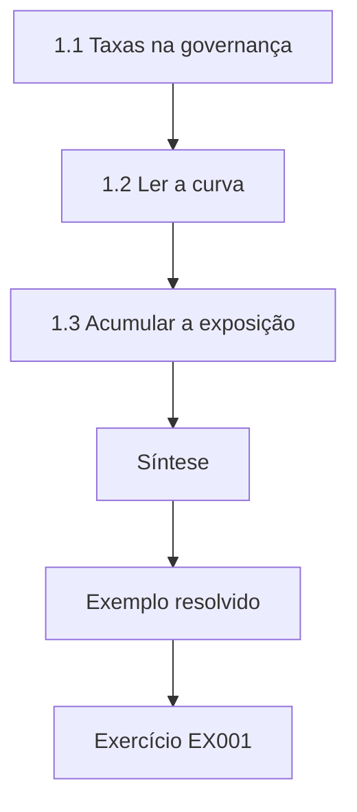

### Desenho lógico

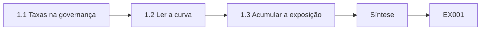

```text
[1.1 Taxas na governança]
    |
    v
[1.2 Ler a curva]
    |
    v
[1.3 Acumular a exposição]
    |
    v
[Síntese]
    |
    v
[Exemplo resolvido] --> [Exercício EX001]
```
<!-- cyberabc:lesson-figures:end ch-01 -->


### Objetivos de aprendizagem

Você vai (1) descrever com taxas um risco que muda ao longo do tempo; (2) identificar quando a exposição cresce ou diminui; (3) usar a acumulação para totalizar a exposição num período.

### 1.1 Taxas na governança

Nadia Okafor é estudante de engenharia na fictícia Kestrel Polytechnic. Seu orientador, o Prof. Tomas Brenner, liga cada disciplina básica a um único caso: a fictícia Ardwell Power Cooperative, uma distribuidora de energia elétrica com novecentos funcionários, um portal de pagamento para clientes e acesso remoto para os fornecedores que mantêm seus sistemas de controle. Em cálculo, Nadia aprende que a derivada mede a rapidez com que algo muda. Na Ardwell, o número de achados de auditoria em aberto muda a cada mês. Sua taxa de variação mostra se o backlog está diminuindo, estável ou crescendo, o que interessa mais ao conselho do que uma contagem mensal isolada.

### 1.2 Ler a curva

Nadia traça os achados em aberto depois da última auditoria externa. A contagem salta quando o relatório chega e depois cai à medida que as equipes fecham os itens, rápido no início e devagar depois, porque restam os achados mais difíceis. A derivada é fortemente negativa no começo e se achata mais tarde. Onde a curva se achata, a atenção da gestão costuma diminuir, e os achados antigos ficam parados. Nadia aprende que uma previsão em linha reta prometeria, de forma equivocada, que todo achado se fecha numa data fixa. Escolher uma forma realista para a resposta das organizações é a primeira decisão de modelagem na análise de governança.

### 1.3 Acumular a exposição

A integração soma uma taxa ao longo do tempo. Nadia a usa para definir a exposição a partir de uma fraqueza conhecida: cada dia em que um servidor exposto à internet continua sem patch aumenta a janela em que um atacante poderia explorá-lo. A área sob a curva das fraquezas em aberto ao longo do tempo é a exposição acumulada. Fechar os achados mais depressa reduz essa área mesmo que a contagem final seja a mesma. Isso dá à Ardwell uma medida de governança melhor do que o número de achados fechados, porque premia a rapidez nas fraquezas que importam.

### Exemplo resolvido

Nadia descreve o backlog de achados de auditoria como uma curva, lê sua taxa de variação e define a exposição acumulada como uma área.

> **Caso sintético.** A Kestrel, a Ardwell e todos os números são sintéticos.

### Erros e limites

Curvas suaves escondem dados mensais irregulares. As áreas de exposição ignoram a gravidade de cada fraqueza.

### Exercícios

- **EX001 — Tendência do backlog.** O que a taxa de variação dos achados em aberto diz ao conselho? *Rubrica:* 3 = se o backlog está diminuindo, estável ou crescendo;; 2 = tendência;; 1 = vago;; 0 = nenhuma.
- **EX002 — Sentido do achatamento.** Por que o achatamento da curva importa? *Rubrica:* 3 = a atenção diminui e os achados difíceis ficam parados;; 2 = achados parados;; 1 = vago;; 0 = nenhuma.
- **EX003 — Integral da exposição.** Como Nadia define a exposição acumulada? *Rubrica:* 3 = a área sob as fraquezas em aberto ao longo do tempo;; 2 = área;; 1 = contagem;; 0 = nenhuma.

### Síntese

Taxas e acumulação descrevem como os acúmulos de pendências de governança e a exposição mudam ao longo do tempo.

<!-- cyberabc:chapter-navigation:start ch-01 -->
### Continue estudando — aula 01 (capítulo 01 de 50)

[← Início do curso](../../README.md) · [Índice das aulas](../SUBJECTS.md) · [Capítulo 02 →](#ch-02)

Continue para a próxima aula já escrita.
<!-- cyberabc:chapter-navigation:end -->

<a id="ch-02"></a>

## Capítulo 2 — Matemática discreta

<!-- cyberabc:lesson-figures:start ch-02 -->
### Mapa da aula

Aula 02 publicada. Mapa, exemplo, EX004.

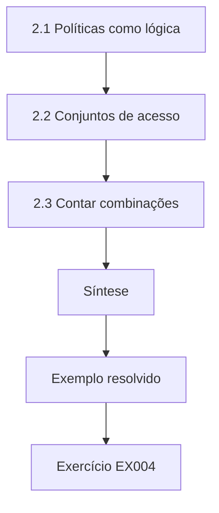

### Desenho lógico

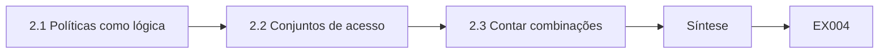

```text
[2.1 Políticas como lógica]
    |
    v
[2.2 Conjuntos de acesso]
    |
    v
[2.3 Contar combinações]
    |
    v
[Síntese]
    |
    v
[Exemplo resolvido] --> [Exercício EX004]
```
<!-- cyberabc:lesson-figures:end ch-02 -->


### Objetivos de aprendizagem

Você vai (1) escrever regras de política em lógica; (2) encontrar conflitos entre regras; (3) usar conjuntos para comparar quem tem acesso com quem deveria ter.

### 2.1 Políticas como lógica

Nadia traduz duas políticas da Ardwell para a lógica. Uma diz que toda sessão remota ao sistema de controle deve usar autenticação multifator. Outra diz que os fornecedores podem se conectar em emergências sem demora. Escritas como proposições, as duas entram em choque quando o token de um fornecedor falha durante uma interrupção do fornecimento. A lógica precisa expõe o conflito antes que um engenheiro tenha de decidir sob pressão qual regra quebrar. Nadia propõe uma regra de emergência explícita, com um mecanismo alternativo pré-aprovado e revisão posterior, para que a exceção faça parte da política, e não seja um contorno sem documentação.

### 2.2 Conjuntos de acesso

Com conjuntos, Nadia compara as pessoas com acesso ao sistema de controle com as pessoas cujo papel o exige. A diferença entre os conjuntos revela sete contas de funcionários que mudaram de função. A interseção entre fornecedores e contas sem autenticação multifator mostra duas contas de fornecedores em risco. Os conjuntos transformam preocupações vagas em listas exatas sobre as quais os responsáveis podem agir. Também facilitam testar se uma mudança proposta amplia ou restringe os acessos, que é a pergunta básica de toda decisão de governança de acessos que a Ardwell toma.

### 2.3 Contar combinações

Nadia conta os conflitos de segregação de funções no sistema financeiro da Ardwell. Existem cinco permissões sensíveis, e a política proíbe que uma mesma pessoa tenha ao mesmo tempo cadastrar fornecedor e aprovar pagamento, ou aprovar pagamento e conciliar banco. Ela conta os pares de permissões, lista os proibidos e depois confere os conjuntos de permissões dos funcionários contra a lista. A contagem torna a regra testável por um script simples. Também mostra com que rapidez as verificações crescem quando se acrescentam permissões, um motivo para manter simples o desenho dos papéis e automatizar a detecção de conflitos.

### Exemplo resolvido

Nadia expõe em lógica um conflito entre políticas, encontra sete contas obsoletas por diferença de conjuntos e conta os pares de permissões proibidos.

> **Caso sintético.** As políticas, as contas e as contagens são sintéticas.

### Erros e limites

A lógica captura as regras escritas, não a prática real. As listas de conjuntos ficam desatualizadas depressa.

### Exercícios

- **EX004 — Choque na emergência.** Que duas políticas entram em choque durante uma interrupção? *Rubrica:* 3 = MFA obrigatória e acesso imediato de fornecedores em emergências;; 2 = conflito;; 1 = vago;; 0 = nenhuma.
- **EX005 — Contas obsoletas.** Quantas contas obsoletas do sistema de controle a diferença de conjuntos revelou? *Rubrica:* 3 = sete;; 2 = 7;; 1 = vago;; 0 = nenhuma.
- **EX006 — Pares proibidos.** Cite um par de permissões proibido. *Rubrica:* 3 = cadastrar fornecedor com aprovar pagamento;; 2 = par de SoD;; 1 = vago;; 0 = nenhuma.

### Síntese

Lógica, conjuntos e contagem transformam regras de governança em enunciados precisos e testáveis.

<!-- cyberabc:chapter-navigation:start ch-02 -->
### Continue estudando — aula 02 (capítulo 02 de 50)

[← Capítulo 01](#ch-01) · [Índice das aulas](../SUBJECTS.md) · [Capítulo 03 →](#ch-03)

Continue para a próxima aula já escrita.
<!-- cyberabc:chapter-navigation:end -->

<a id="ch-03"></a>

## Capítulo 3 — Física para computação

<!-- cyberabc:lesson-figures:start ch-03 -->
### Mapa da aula

Aula 03 publicada. Mapa, exemplo, EX007.

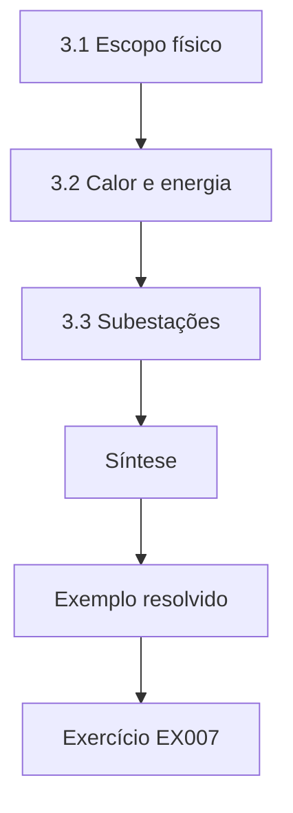

### Desenho lógico

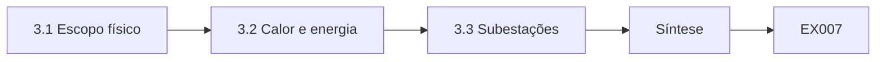

```text
[3.1 Escopo físico]
    |
    v
[3.2 Calor e energia]
    |
    v
[3.3 Subestações]
    |
    v
[Síntese]
    |
    v
[Exemplo resolvido] --> [Exercício EX007]
```
<!-- cyberabc:lesson-figures:end ch-03 -->


### Objetivos de aprendizagem

Você vai (1) relacionar a infraestrutura física ao escopo da governança; (2) raciocinar sobre energia, calor e falhas em salas de dados; (3) incluir os controles físicos na análise de riscos.

### 3.1 Escopo físico

Os sistemas de informação da Ardwell funcionam em lugares físicos: uma sala de dados na sede, subestações com equipamentos de controle e um site de contingência. Nadia aprende que o escopo da governança precisa incluir esses lugares, porque a ISO/IEC 27002:2022 agrupa controles físicos, como áreas seguras, proteção de equipamentos e utilidades de suporte, ao lado dos organizacionais e tecnológicos. A física a ajuda a entender por quê. Energia elétrica, calor e vibração afetam o funcionamento dos equipamentos, e um programa de segurança que os ignora deixa riscos de disponibilidade sem gestão. Nadia acrescenta cada site à declaração de escopo, com um responsável nomeado.

### 3.2 Calor e energia

Cada watt consumido pelos servidores vira calor que a refrigeração precisa remover. Nadia calcula que, se a refrigeração falhar na sala de dados, a temperatura sobe continuamente até os equipamentos se desligarem sozinhos. O tempo até o desligamento depende da carga térmica e da massa térmica da sala. Ela mostra que o monitoramento da Ardwell deveria alertar bem antes desse tempo, e que um registro de risco para falha de refrigeração precisa de um responsável na área de facilities, e não só em TI. A física liga assim um cálculo de engenharia a uma decisão de governança sobre responsabilidade e resposta.

### 3.3 Subestações

Nas subestações, os equipamentos ficam em ambientes hostis e com segurança física limitada. Nadia observa que um armário trancado resiste a uma adulteração casual, mas não a um atacante determinado e com ferramentas. Os controles físicos precisam, portanto, de detecção, como sensores de porta, além de retardo. Ela registra o acesso às subestações como um risco separado, porque combina caminhos físicos e digitais até o sistema de controle. O professor dela ressalta que o risco físico é fácil de esquecer em avaliações feitas de escritório, por isso as visitas aos locais continuam fazendo parte da boa prática de governança.

### Exemplo resolvido

Nadia inclui as salas de dados e as subestações no escopo, liga a física da refrigeração a um responsável pelo risco e combina o retardo físico com a detecção.

> **Caso sintético.** Os sites da Ardwell são sintéticos; a ISO/IEC 27002:2022 é real.

### Erros e limites

Modelos simples de calor ignoram o fluxo de ar. Os controles físicos se degradam sem inspeção.

### Exercícios

- **EX007 — Grupos de controles.** Que grupo de controles da ISO/IEC 27002:2022 cobre as áreas seguras? *Rubrica:* 3 = controles físicos;; 2 = físicos;; 1 = vago;; 0 = nenhuma.
- **EX008 — Responsável pela refrigeração.** Quem deve ser o responsável pelo registro de risco de falha de refrigeração? *Rubrica:* 3 = facilities, não só TI;; 2 = facilities;; 1 = vago;; 0 = nenhuma.
- **EX009 — Retardo e detecção.** Por que as subestações precisam de sensores de porta além das fechaduras? *Rubrica:* 3 = as fechaduras retardam, mas não detectam um atacante determinado;; 2 = detecção;; 1 = vago;; 0 = nenhuma.

### Síntese

A infraestrutura física faz parte do escopo da governança, e os seus riscos precisam de donos e de controles.

<!-- cyberabc:chapter-navigation:start ch-03 -->
### Continue estudando — aula 03 (capítulo 03 de 50)

[← Capítulo 02](#ch-02) · [Índice das aulas](../SUBJECTS.md) · [Capítulo 04 →](#ch-04)

Continue para a próxima aula já escrita.
<!-- cyberabc:chapter-navigation:end -->

<a id="ch-04"></a>

## Capítulo 4 — Programação I

<!-- cyberabc:lesson-figures:start ch-04 -->
### Mapa da aula

Aula 04 publicada. Mapa, exemplo, EX010.

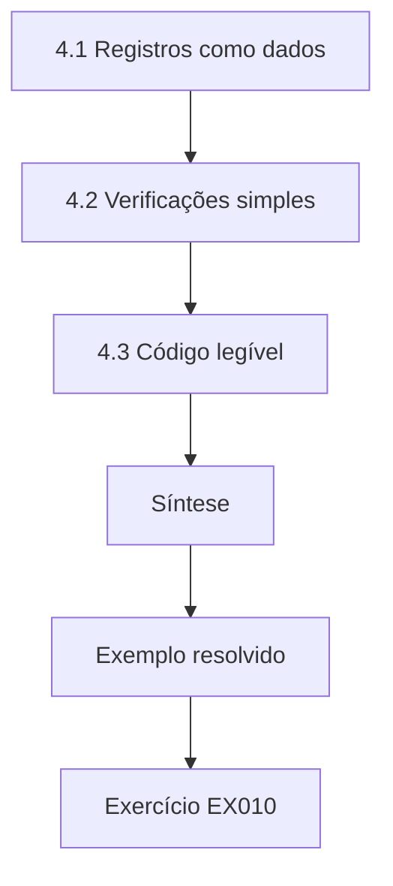

### Desenho lógico

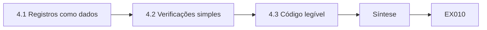

```text
[4.1 Registros como dados]
    |
    v
[4.2 Verificações simples]
    |
    v
[4.3 Código legível]
    |
    v
[Síntese]
    |
    v
[Exemplo resolvido] --> [Exercício EX010]
```
<!-- cyberabc:lesson-figures:end ch-04 -->


### Objetivos de aprendizagem

Você vai (1) representar registros de governança em código; (2) escrever verificações simples sobre eles; (3) manter os scripts legíveis para os auditores.

### 4.1 Registros como dados

O primeiro programa de Nadia lê a lista de políticas da Ardwell como registros estruturados: título, responsável, data de aprovação e data da próxima revisão. Representar as políticas como dados, e não como prosa, permite que um programa as confira. Ela guarda a lista num arquivo CSV e a lê com a biblioteca padrão do Python. O professor insiste em nomes de campos claros e num registro por linha, porque os dados de governança serão lidos por pessoas que não são programadoras, incluindo os auditores internos, que precisam entender o que o script verifica e por quê.

### 4.2 Verificações simples

Nadia escreve funções que sinalizam políticas sem responsável e políticas com revisão vencida. Testa cada função numa pequena lista feita à mão, em que conhece a resposta certa, incluindo casos-limite como uma revisão que vence hoje. Quando uma verificação falha, o programa imprime o título da política e o motivo, e não só uma contagem. Ela aprende que o valor de um script de governança está numa saída acionável: um responsável consegue corrigir uma política específica, mas não consegue fazer nada com um número sem explicação.

### 4.3 Código legível

O Prof. Brenner revisa o código de Nadia com olhar de auditor. Cada função tem uma docstring curta que explica a regra aplicada e de onde ela vem, como a política da Ardwell sobre políticas. Constantes como o intervalo de revisão têm nome, em vez de ficarem escondidas como números soltos. Ele explica que, quando os scripts produzem evidências de compliance, o próprio script passa a fazer parte da evidência, então precisa ser compreensível e estar sob controle de versão. Nadia faz commit do código num repositório, com um histórico curto de cada mudança.

### Exemplo resolvido

Nadia lê as políticas de um CSV, sinaliza responsáveis ausentes e revisões vencidas com os motivos e documenta as regras para os auditores.

> **Caso sintético.** Os registros de políticas são sintéticos.

### Erros e limites

Os scripts conferem só o que está registrado. Dados errados produzem saídas erradas e confiantes.

### Exercícios

- **EX010 — Campos da política.** Que campos cada registro de política contém? *Rubrica:* 3 = título, responsável, data de aprovação, data da próxima revisão;; 2 = quatro campos;; 1 = vago;; 0 = nenhuma.
- **EX011 — Saída acionável.** Por que imprimir o título da política e o motivo, e não só uma contagem? *Rubrica:* 3 = os responsáveis podem agir sobre itens específicos;; 2 = acionável;; 1 = vago;; 0 = nenhuma.
- **EX012 — Script como evidência.** Por que os scripts de compliance precisam ser legíveis e versionados? *Rubrica:* 3 = o script passa a fazer parte da evidência;; 2 = evidência;; 1 = vago;; 0 = nenhuma.

### Síntese

Scripts simples e legíveis tornam os registros de governança verificáveis e a sua saída acionável.

<!-- cyberabc:chapter-navigation:start ch-04 -->
### Continue estudando — aula 04 (capítulo 04 de 50)

[← Capítulo 03](#ch-03) · [Índice das aulas](../SUBJECTS.md) · [Capítulo 05 →](#ch-05)

Continue para a próxima aula já escrita.
<!-- cyberabc:chapter-navigation:end -->

<a id="ch-05"></a>

## Capítulo 5 — Comunicação em engenharia

<!-- cyberabc:lesson-figures:start ch-05 -->
### Mapa da aula

Aula 05 publicada. Mapa, exemplo, EX013.

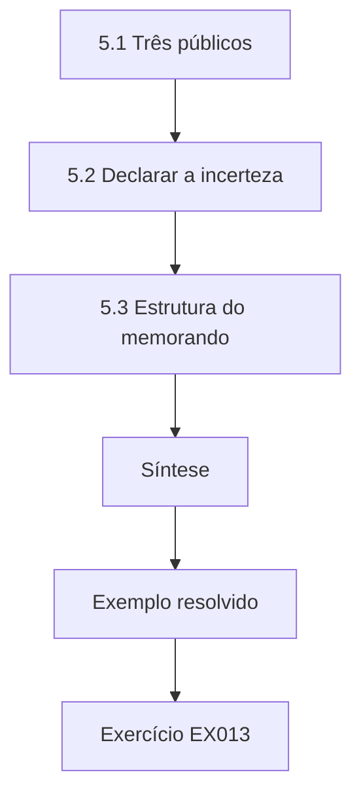

### Desenho lógico

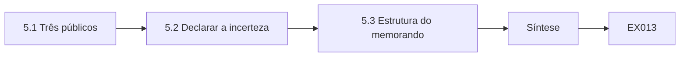

```text
[5.1 Três públicos]
    |
    v
[5.2 Declarar a incerteza]
    |
    v
[5.3 Estrutura do memorando]
    |
    v
[Síntese]
    |
    v
[Exemplo resolvido] --> [Exercício EX013]
```
<!-- cyberabc:lesson-figures:end ch-05 -->


### Objetivos de aprendizagem

Você vai (1) escrever para conselhos, auditores e engenheiros; (2) apresentar o risco com sua incerteza; (3) estruturar um memorando curto de governança.

### 5.1 Três públicos

Nadia aprende que as mensagens de governança chegam a três públicos com necessidades diferentes. Os conselhos precisam de decisões, opções e consequências em linguagem simples. Os auditores precisam de afirmações precisas ligadas a evidências. Os engenheiros precisam de ações específicas e prazos. Um único documento raramente serve aos três, então ela pratica escrever, a partir da mesma análise, um resumo de uma página para o conselho, uma tabela de evidências para os auditores e uma lista de tarefas para os engenheiros. Cada versão é exata, mas destaca detalhes diferentes, e ela confere que as três nunca se contradizem.

### 5.2 Declarar a incerteza

Seu primeiro resumo para o conselho diz que o ransomware vai custar à Ardwell noventa mil por ano. O Prof. Brenner pergunta como ela sabe. Ela reescreve: sob premissas declaradas, a perda anual esperada é de cerca de noventa mil, com uma faixa ampla, porque a estimativa de frequência é incerta. Ele explica que os conselhos decidem melhor quando veem a incerteza com honestidade, e que a falsa precisão corrói a confiança quando a realidade é diferente. Hubbard e Seiersen (2016) desenvolvem esse argumento em detalhe para o risco de cibersegurança. Ela mantém a faixa em todas as versões seguintes.

### 5.3 Estrutura do memorando

Nadia adota uma estrutura de memorando para decisões de governança: a decisão necessária, a recomendação, as opções consideradas, o risco e o custo de cada uma, as premissas e as evidências. Ela o limita a duas páginas e leva os detalhes para apêndices. Também acrescenta uma linha dizendo quem foi consultado, porque as decisões de governança afetam muitas equipes. O professor observa que memorandos claros criam um registro do motivo de cada decisão, o que depois apoia as auditorias e ajuda os sucessores a entender escolhas passadas. Ela arquiva cada memorando com suas evidências.

### Exemplo resolvido

Nadia escreve uma única análise para três públicos, declara a incerteza em torno da perda esperada e usa uma estrutura de memorando de decisão.

> **Caso sintético.** Os números são sintéticos; Hubbard e Seiersen (2016) é real.

### Erros e limites

A linguagem simples pode perder nuances. Apêndices longos ficam sem leitura.

### Exercícios

- **EX013 — O que o conselho precisa.** De que os conselhos precisam nas mensagens de governança? *Rubrica:* 3 = decisões, opções e consequências em linguagem simples;; 2 = decisões;; 1 = vago;; 0 = nenhuma.
- **EX014 — Afirmação revista.** Como Nadia reescreveu sua afirmação sobre o ransomware? *Rubrica:* 3 = perda esperada sob premissas declaradas, com uma faixa ampla;; 2 = incerteza;; 1 = certeza;; 0 = nenhuma.
- **EX015 — Linha de consultados.** Por que acrescentar ao memorando quem foi consultado? *Rubrica:* 3 = as decisões de governança afetam muitas equipes;; 2 = registro;; 1 = vago;; 0 = nenhuma.

### Síntese

Uma escrita clara, adequada a cada público e honesta quanto à incerteza torna as decisões de governança sólidas e rastreáveis.

<!-- cyberabc:chapter-navigation:start ch-05 -->
### Continue estudando — aula 05 (capítulo 05 de 50)

[← Capítulo 04](#ch-04) · [Índice das aulas](../SUBJECTS.md) · [Capítulo 06 →](#ch-06)

Continue para a próxima aula já escrita.
<!-- cyberabc:chapter-navigation:end -->

<a id="ch-06"></a>

## Capítulo 6 — Cálculo II

<!-- cyberabc:lesson-figures:start ch-06 -->
### Mapa da aula

Aula 06 publicada. Mapa, exemplo, EX016.

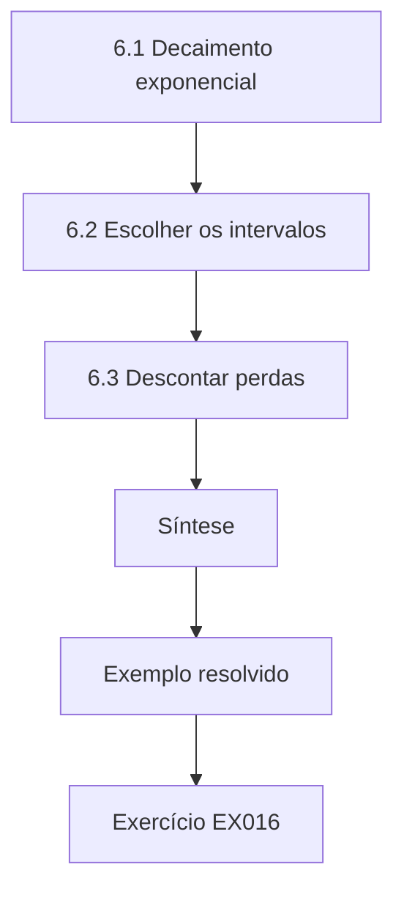

### Desenho lógico

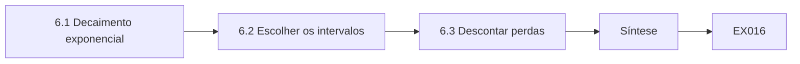

```text
[6.1 Decaimento exponencial]
    |
    v
[6.2 Escolher os intervalos]
    |
    v
[6.3 Descontar perdas]
    |
    v
[Síntese]
    |
    v
[Exemplo resolvido] --> [Exercício EX016]
```
<!-- cyberabc:lesson-figures:end ch-06 -->


### Objetivos de aprendizagem

Você vai (1) usar modelos exponenciais de crescimento e decaimento; (2) modelar como a eficácia de um controle decai sem manutenção; (3) comparar o desconto de perdas futuras.

### 6.1 Decaimento exponencial

Em Cálculo II, Nadia estuda funções exponenciais. Ela modela como a proporção de contas com acesso correto decai depois de uma revisão: a cada mês, alguns funcionários mudam de função sem que seus acessos sejam atualizados, então a correção cai numa fração aproximadamente constante. O modelo prevê que a correção cai à metade num período fixo se nada for feito. As revisões periódicas reiniciam a curva. Isso dá uma razão matemática para a frequência de revisão importar e liga o cálculo a uma pergunta que os auditores da Ardwell já fazem. Nadia traça as duas curvas para compará-las.

### 6.2 Escolher os intervalos

Com o modelo de decaimento, Nadia pergunta com que frequência as revisões precisam acontecer para manter a correção acima de uma meta. Se a correção cai alguns pontos percentuais por mês, uma revisão trimestral a mantém acima da meta, enquanto uma revisão anual a deixa cair muito abaixo até o fim do ano. Ela observa que a taxa de decaimento depende da movimentação de pessoal, então departamentos com alta rotatividade precisam de revisões mais frequentes. O modelo apoia um calendário baseado em risco, e não um intervalo único para todos, o que a ISO/IEC 27002:2022 permite. Ela compartilha esse resultado.

### 6.3 Descontar perdas

Nadia também aprende a descontar valores futuros. Um controle que evita perdas em anos futuros vale menos, em termos de hoje, do que a mesma perda evitada agora, porque o dinheiro tem valor no tempo. Ela aplica um fator de desconto simples a um investimento de três anos em backups. O ajuste é modesto, mas muda qual de duas opções parece melhor. Ela observa que o desconto é padrão na análise de investimentos e que os investimentos em segurança devem ser comparados na mesma base que os demais. Ela declara a taxa usada.

### Exemplo resolvido

Nadia modela a correção dos acessos como decaimento exponencial, deriva intervalos de revisão baseados em risco e desconta as perdas futuras evitadas.

> **Caso sintético.** As taxas de decaimento e os números do investimento são sintéticos.

### Erros e limites

O decaimento real é irregular. As taxas de desconto são escolhas de política.

### Exercícios

- **EX016 — Causa do decaimento.** O que faz a correção dos acessos decair depois de uma revisão? *Rubrica:* 3 = funcionários que mudam de função sem atualização dos acessos;; 2 = mudanças de função;; 1 = vago;; 0 = nenhuma.
- **EX017 — Alta rotatividade.** Que departamentos precisam de revisões mais frequentes? *Rubrica:* 3 = os de alta rotatividade de pessoal;; 2 = rotatividade;; 1 = vago;; 0 = nenhuma.
- **EX018 — Valor no tempo.** Por que uma perda futura evitada vale menos hoje? *Rubrica:* 3 = o dinheiro tem valor no tempo;; 2 = desconto;; 1 = vago;; 0 = nenhuma.

### Síntese

Modelos exponenciais explicam por que os controles se degradam e como devem ser definidos os intervalos de revisão e os investimentos.

<!-- cyberabc:chapter-navigation:start ch-06 -->
### Continue estudando — aula 06 (capítulo 06 de 50)

[← Capítulo 05](#ch-05) · [Índice das aulas](../SUBJECTS.md) · [Capítulo 07 →](#ch-07)

Continue para a próxima aula já escrita.
<!-- cyberabc:chapter-navigation:end -->

<a id="ch-07"></a>

## Capítulo 7 — Probabilidade e estatística

<!-- cyberabc:lesson-figures:start ch-07 -->
### Mapa da aula

Aula 07 publicada. Mapa, exemplo, EX019.

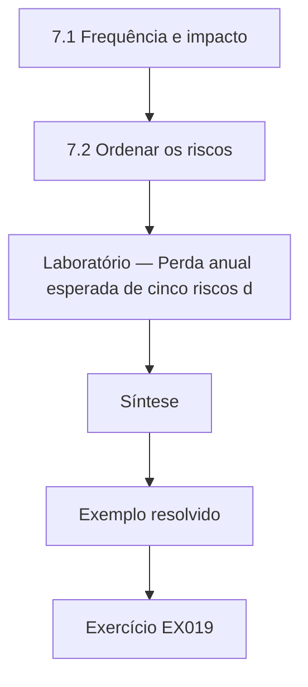

### Desenho lógico

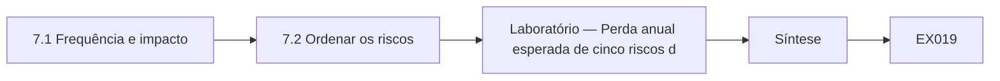

```text
[7.1 Frequência e impacto]
    |
    v
[7.2 Ordenar os riscos]
    |
    v
[Laboratório — Perda anual esperada de cinco riscos d]
    |
    v
[Síntese]
    |
    v
[Exemplo resolvido] --> [Exercício EX019]
```
<!-- cyberabc:lesson-figures:end ch-07 -->


### Objetivos de aprendizagem

Você vai (1) calcular a perda anual esperada a partir da frequência e do impacto; (2) ordenar os riscos pela perda esperada; (3) reconhecer os limites das estimativas de número único.

### 7.1 Frequência e impacto

Nadia aprende a clássica expectativa de perda anualizada (ALE): a taxa anual de ocorrência (ARO) vezes a expectativa de perda única (SLE). Para a Ardwell, ela estima cinco riscos com dados de uma oficina: uma interrupção do faturamento esperada a cada dois anos, custando cento e vinte mil; ransomware uma vez por década, a novecentos mil; quatro notebooks perdidos por ano, a seis mil cada; um vazamento de dados de cartão uma vez em vinte anos, a um milhão e meio; e o mau uso do acesso de fornecedores ao sistema de controle uma vez em cinco anos, a quatrocentos mil.

### 7.2 Ordenar os riscos

O laboratório multiplica cada par e ordena os resultados. O ransomware fica em primeiro, com noventa mil por ano, seguido do mau uso do acesso de fornecedores, com oitenta mil, do vazamento de cartões, com setenta e cinco mil, da interrupção do faturamento, com sessenta mil, e dos notebooks perdidos, com vinte e quatro mil. O total é de trezentos e vinte e nove mil. Nadia percebe que os quatro primeiros estão próximos, então pequenas mudanças nas estimativas poderiam reordená-los. Ela conclui que a ordenação justifica atenção aos quatro, e não a uma única prioridade máxima.

### Laboratório — Perda anual esperada de cinco riscos da Ardwell

```python
"""Annualised loss expectancy (ALE = ARO x SLE) for synthetic Ardwell risks."""
risks = [("billing outage", 0.5, 120_000), ("ransomware", 0.1, 900_000),
         ("lost laptop", 4.0, 6_000), ("payment card breach", 0.05, 1_500_000),
         ("SCADA vendor access misuse", 0.2, 400_000)]
tot = 0
for name, aro, sle in sorted(risks, key=lambda r: -r[1]*r[2]):
    ale = aro*sle; tot += ale
    print(f"{name}: ARO {aro} x SLE {sle:,} = ALE {ale:,.0f}")
print(f"total ALE {tot:,.0f}")
```

Execute com `python3 lab_ale.py`. Saída verificada:

```text
ransomware: ARO 0.1 x SLE 900,000 = ALE 90,000
SCADA vendor access misuse: ARO 0.2 x SLE 400,000 = ALE 80,000
payment card breach: ARO 0.05 x SLE 1,500,000 = ALE 75,000
billing outage: ARO 0.5 x SLE 120,000 = ALE 60,000
lost laptop: ARO 4.0 x SLE 6,000 = ALE 24,000
total ALE 329,000
```

### 7.3 Limites das médias

O Prof. Brenner adverte que a perda esperada esconde a forma dos resultados. O vazamento de cartões tem valor esperado baixo, mas um desfecho único catastrófico que poderia ameaçar a cooperativa, enquanto os notebooks perdidos são frequentes, mas pequenos. Um conselho que vê só médias pode subestimar eventos raros e graves. Nadia aprende a relatar faixas e os piores casos plausíveis ao lado das médias, e lê como Freund e Jones (2015) decompõem frequência e magnitude no modelo FAIR para tornar essas estimativas mais estruturadas e defensáveis.

### Exemplo resolvido

Nadia calcula a ALE de cinco riscos, coloca o ransomware em primeiro com noventa mil, chega a um total de trezentos e vinte e nove mil e observa que as posições estão próximas.

> **Caso sintético.** Todas as estimativas são sintéticas; Freund e Jones (2015) é real.

### Erros e limites

Estimativas únicas escondem a incerteza. As médias subestimam catástrofes raras.

### Exercícios

- **EX019 — Fórmula da ALE.** Como se calcula a expectativa de perda anualizada? *Rubrica:* 3 = taxa de ocorrência vezes expectativa de perda única;; 2 = ARO x SLE;; 1 = vago;; 0 = nenhuma.
- **EX020 — Os dois primeiros.** Que dois riscos ficaram mais altos pela ALE no laboratório? *Rubrica:* 3 = ransomware 90 mil e mau uso por fornecedores 80 mil;; 2 = ransomware primeiro;; 1 = notebooks;; 0 = nenhuma.
- **EX021 — Forma oculta.** Por que o vazamento de cartões pode merecer mais atenção do que sua ALE sugere? *Rubrica:* 3 = é raro, mas tem um desfecho único catastrófico;; 2 = cauda;; 1 = vago;; 0 = nenhuma.

### Síntese

A perda esperada oferece uma primeira classificação útil, mas precisa vir acompanhada de faixas e caudas.

<!-- cyberabc:chapter-navigation:start ch-07 -->
### Continue estudando — aula 07 (capítulo 07 de 50)

[← Capítulo 06](#ch-06) · [Índice das aulas](../SUBJECTS.md) · [Capítulo 08 →](#ch-08)

Continue para a próxima aula já escrita.
<!-- cyberabc:chapter-navigation:end -->

<a id="ch-08"></a>

## Capítulo 8 — Arquitetura de computadores

<!-- cyberabc:lesson-figures:start ch-08 -->
### Mapa da aula

Aula 08 publicada. Mapa, exemplo, EX022.

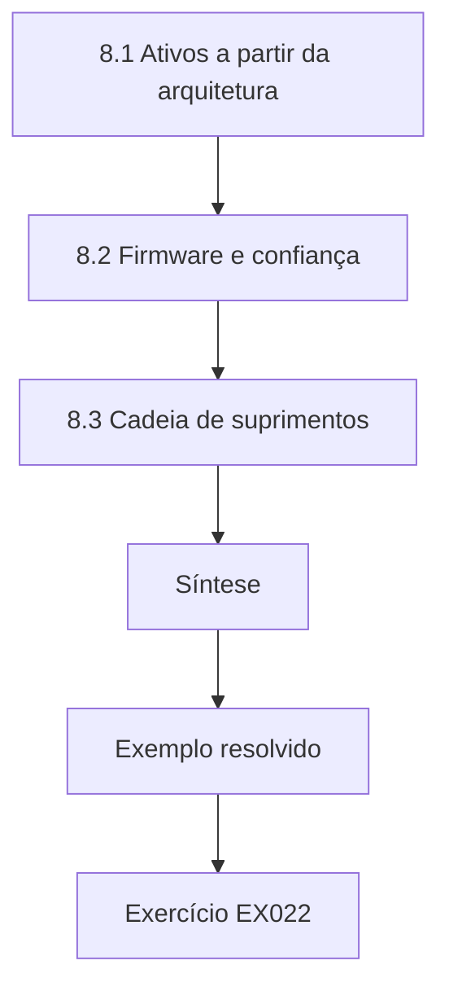

### Desenho lógico

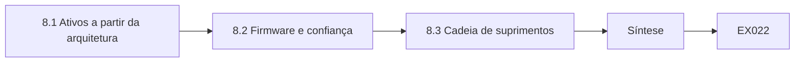

```text
[8.1 Ativos a partir da arquitetura]
    |
    v
[8.2 Firmware e confiança]
    |
    v
[8.3 Cadeia de suprimentos]
    |
    v
[Síntese]
    |
    v
[Exemplo resolvido] --> [Exercício EX022]
```
<!-- cyberabc:lesson-figures:end ch-08 -->


### Objetivos de aprendizagem

Você vai (1) mapear componentes de sistemas como ativos de governança; (2) entender onde os controles atuam no hardware e no firmware; (3) incluir a cadeia de suprimentos no escopo de risco.

### 8.1 Ativos a partir da arquitetura

Nadia estuda como os computadores são feitos de processadores, memória, armazenamento e dispositivos de entrada e saída, todos controlados por firmware e sistemas operacionais. Para a governança, aprende a tratar essas camadas como ativos com responsáveis. Um inventário de ativos, exigido pela ISO/IEC 27001:2022 por meio dos controles do Anexo A, precisa listar não só servidores e notebooks, mas também os dispositivos do sistema de controle nas subestações. Sem saber o que existe, a Ardwell não consegue avaliar riscos nem demonstrar que os controles se aplicam a tudo o que está no escopo. Ela lista cada camada com seu responsável e a equipe que atualiza o registro.

### 8.2 Firmware e confiança

O firmware roda antes do sistema operacional e raramente é atualizado. Nadia aprende que, se o firmware for comprometido, os controles do sistema operacional podem ser contornados. Ela acrescenta o controle das versões de firmware aos registros de ativos da Ardwell e propõe que as compras exijam dos fornecedores atualizações assinadas, redigindo a cláusula. O Prof. Brenner observa que a governança muitas vezes para no sistema operacional porque o firmware é invisível, mas o NIST SP 800-53 Rev. 5 inclui controles de integridade de sistema e de firmware, que dão base para fazer aos fornecedores as perguntas certas.

### 8.3 Cadeia de suprimentos

Todo componente de hardware chega por uma cadeia de suprimentos. Nadia lista os fornecedores da Ardwell para dispositivos do sistema de controle e anota quais oferecem atualizações de segurança e por quanto tempo. Dois dispositivos mais antigos já passaram do período de suporte do fabricante, então novas vulnerabilidades não serão corrigidas. Ela registra isso como risco, com opções: substituir, isolar ou aceitar com monitoramento compensatório, e o acrescenta ao registro de riscos. Aprende que a gestão de riscos da cadeia de suprimentos faz parte da função Govern do NIST CSF 2.0, o que liga o conhecimento de arquitetura à supervisão do conselho.

### Exemplo resolvido

Nadia acrescenta ao inventário os dispositivos do sistema de controle e seu firmware, exige atualizações assinadas e registra os dispositivos sem suporte como risco.

> **Caso sintético.** Os dispositivos e os fornecedores são sintéticos; as normas citadas são reais.

### Erros e limites

Os inventários ficam desatualizados. As datas de suporte dos fornecedores mudam.

### Exercícios

- **EX022 — Escopo do inventário.** O que o inventário de ativos da Ardwell precisa incluir além de servidores e notebooks? *Rubrica:* 3 = os dispositivos do sistema de controle nas subestações;; 2 = dispositivos de OT;; 1 = vago;; 0 = nenhuma.
- **EX023 — Risco do firmware.** Por que um firmware comprometido importa? *Rubrica:* 3 = pode contornar os controles do sistema operacional;; 2 = contornar;; 1 = vago;; 0 = nenhuma.
- **EX024 — Opções sem suporte.** Que opções existem para os dois dispositivos sem suporte? *Rubrica:* 3 = substituir, isolar ou aceitar com monitoramento;; 2 = três opções;; 1 = vago;; 0 = nenhuma.

### Síntese

O conhecimento de arquitetura estende a governança ao firmware, aos dispositivos e à cadeia de suprimentos.

<!-- cyberabc:chapter-navigation:start ch-08 -->
### Continue estudando — aula 08 (capítulo 08 de 50)

[← Capítulo 07](#ch-07) · [Índice das aulas](../SUBJECTS.md) · [Capítulo 09 →](#ch-09)

Continue para a próxima aula já escrita.
<!-- cyberabc:chapter-navigation:end -->

<a id="ch-09"></a>

## Capítulo 9 — Programação II

<!-- cyberabc:lesson-figures:start ch-09 -->
### Mapa da aula

Aula 09 publicada. Mapa, exemplo, EX025.

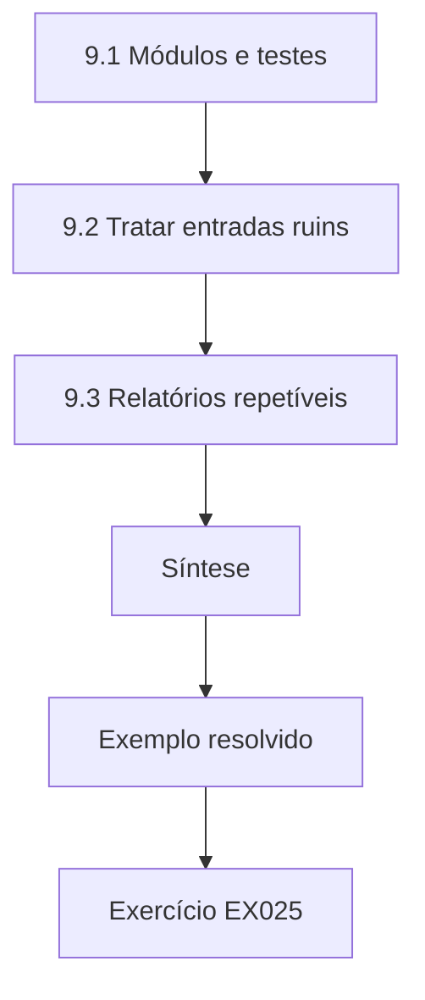

### Desenho lógico

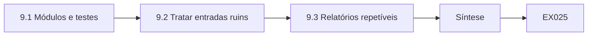

```text
[9.1 Módulos e testes]
    |
    v
[9.2 Tratar entradas ruins]
    |
    v
[9.3 Relatórios repetíveis]
    |
    v
[Síntese]
    |
    v
[Exemplo resolvido] --> [Exercício EX025]
```
<!-- cyberabc:lesson-figures:end ch-09 -->


### Objetivos de aprendizagem

Você vai (1) estruturar ferramentas de governança como módulos testados; (2) tratar entradas ruins com segurança; (3) produzir relatórios repetíveis a partir do código.

### 9.1 Módulos e testes

Em Programação II, Nadia reestrutura seu verificador de políticas em módulos: um lê os dados, outro aplica as regras e um terceiro escreve os relatórios. Cada módulo tem testes unitários feitos com o framework de testes da biblioteca padrão. Ela escreve um teste para cada regra, incluindo casos difíceis, como uma política com dois responsáveis ou uma data de revisão no formato errado. Separar a leitura da verificação permite reutilizar as mesmas regras depois em outros registros, como a lista de fornecedores, que também precisa de responsáveis e datas de revisão na Ardwell.

### 9.2 Tratar entradas ruins

Os dados reais de governança são bagunçados. As datas chegam em vários formatos, os responsáveis aparecem como nomes em algumas linhas e como endereços de e-mail em outras, e algumas linhas estão em branco. Nadia aprende a validar a entrada explicitamente e a relatar os problemas, em vez de pular linhas em silêncio. Uma linha pulada poderia esconder um risco sem responsável. Seu programa agora lista cada linha que não conseguiu ler, com o número da linha e o motivo, para que os donos dos dados corrijam a fonte. O Prof. Brenner chama isso de falhar ruidosamente, um hábito vital nas ferramentas de compliance.

### 9.3 Relatórios repetíveis

Nadia torna seus relatórios repetíveis: a mesma entrada sempre produz a mesma saída, com a data da execução, a versão do script e um resumo do arquivo de entrada impressos no topo. Se um auditor perguntar como um número foi produzido, ela pode executar de novo a versão exata sobre a entrada arquivada. Ela aprende que a repetibilidade transforma um script de conveniência pessoal em evidência organizacional, e que um relatório sem suas entradas e sua versão não pode ser conferido por mais ninguém depois.

### Exemplo resolvido

Nadia divide o verificador em módulos testados, relata ruidosamente as linhas ilegíveis e carimba os relatórios com a data da execução, a versão e o resumo da entrada.

> **Caso sintético.** Os registros e os dados são sintéticos.

### Erros e limites

Os testes cobrem só os casos que alguém imaginou. As entradas arquivadas precisam de regras de retenção.

### Exercícios

- **EX025 — Divisão em módulos.** Em que três módulos Nadia dividiu sua ferramenta? *Rubrica:* 3 = leitura, verificação de regras e relatório;; 2 = três;; 1 = vago;; 0 = nenhuma.
- **EX026 — Linhas puladas.** Por que pular linhas ilegíveis em silêncio é perigoso? *Rubrica:* 3 = pode esconder um risco sem responsável;; 2 = risco oculto;; 1 = vago;; 0 = nenhuma.
- **EX027 — Cabeçalho do relatório.** O que cada relatório imprime no topo? *Rubrica:* 3 = data da execução, versão do script e resumo da entrada;; 2 = cabeçalho;; 1 = vago;; 0 = nenhuma.

### Síntese

Módulos testados, falhas ruidosas e relatórios repetíveis tornam as ferramentas de governança confiáveis.

<!-- cyberabc:chapter-navigation:start ch-09 -->
### Continue estudando — aula 09 (capítulo 09 de 50)

[← Capítulo 08](#ch-08) · [Índice das aulas](../SUBJECTS.md) · [Capítulo 10 →](#ch-10)

Continue para a próxima aula já escrita.
<!-- cyberabc:chapter-navigation:end -->

<a id="ch-10"></a>

## Capítulo 10 — Ética e segurança na engenharia

<!-- cyberabc:lesson-figures:start ch-10 -->
### Mapa da aula

Aula 10 publicada. Mapa, exemplo, EX028.

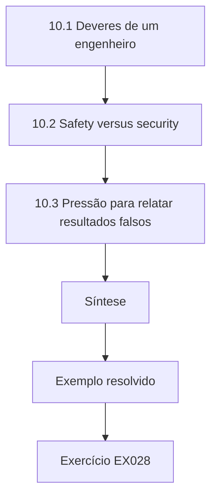

### Desenho lógico

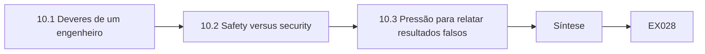

```text
[10.1 Deveres de um engenheiro]
    |
    v
[10.2 Safety versus security]
    |
    v
[10.3 Pressão para relatar resultados falsos]
    |
    v
[Síntese]
    |
    v
[Exemplo resolvido] --> [Exercício EX028]
```
<!-- cyberabc:lesson-figures:end ch-10 -->


### Objetivos de aprendizagem

Você vai (1) aplicar a ética da engenharia a decisões de governança; (2) pesar a segurança física das pessoas contra a segurança da informação e o compliance; (3) lidar com pressões para relatar resultados falsos.

### 10.1 Deveres de um engenheiro

Nadia estuda códigos profissionais que colocam a segurança do público em primeiro lugar. Na Ardwell, as decisões de governança afetam o fornecimento de energia a casas, hospitais e empresas, então têm consequências de segurança para as pessoas. Ela aprende que o engenheiro que aprova um controle ou uma avaliação de riscos assume a responsabilidade por sua exatidão. Ética também significa competência: não alegar conhecimento numa área em que não se tem, e pedir ajuda quando um julgamento excede o que se sabe. Esses deveres valem igualmente para o trabalho de compliance, que pode parecer administrativo, mas molda decisões reais sobre infraestrutura pública.

### 10.2 Safety versus security

Alguns controles de segurança da informação podem prejudicar a segurança das pessoas. Bloquear um operador depois de logins malsucedidos poderia impedi-lo de responder a uma emergência na rede elétrica. Nadia aprende que, em ambientes industriais, a disponibilidade e a segurança das pessoas costumam ter prioridade, então os controles precisam ser desenhados com os operadores. Ela propõe monitoramento e alertas para falhas repetidas nos consoles de controle, em vez do bloqueio, com restrição do acesso físico à sala de controle. A decisão é documentada com seu raciocínio, para que os auditores entendam por que um controle padrão foi adaptado em vez de aplicado sem mudanças.

### 10.3 Pressão para relatar resultados falsos

Num estudo de caso, um gestor pede a um analista que marque como aprovado um teste de controle que falhou, para que a auditoria de certificação corra bem. Nadia discute as opções: recusar, registrar o resultado verdadeiro, escalar pelo canal apropriado e proteger a evidência. Ela aprende que falsear resultados de controles mina todo o sistema de gestão e pode violar leis ou contratos. O Prof. Brenner acrescenta que as organizações devem tornar seguro o relato honesto, porque uma cultura que pune más notícias empurra os problemas para fora da vista até que causem danos.

### Exemplo resolvido

Nadia aplica uma ética que põe a segurança das pessoas em primeiro lugar, troca o bloqueio por monitoramento nos consoles de controle e planeja uma resposta honesta à pressão para falsear resultados.

> **Caso sintético.** O estudo de caso e as decisões são sintéticos.

### Erros e limites

Os códigos dão princípios, não respostas. Escalar pode trazer risco pessoal.

### Exercícios

- **EX028 — Dever de aprovação.** O que significa, para um engenheiro, aprovar uma avaliação de riscos? *Rubrica:* 3 = assumir a responsabilidade por sua exatidão;; 2 = responsabilidade;; 1 = vago;; 0 = nenhuma.
- **EX029 — Alternativa nos consoles.** O que Nadia propôs em vez do bloqueio nos consoles de controle? *Rubrica:* 3 = monitoramento e alertas com restrição do acesso físico;; 2 = monitoramento;; 1 = bloqueio;; 0 = nenhuma.
- **EX030 — Cultura honesta.** Por que as organizações devem tornar seguro o relato honesto? *Rubrica:* 3 = punir más notícias esconde os problemas até que causem danos;; 2 = cultura;; 1 = vago;; 0 = nenhuma.

### Síntese

A ética de engenharia coloca a segurança física e o reporte honesto no centro do trabalho de governança.

<!-- cyberabc:chapter-navigation:start ch-10 -->
### Continue estudando — aula 10 (capítulo 10 de 50)

[← Capítulo 09](#ch-09) · [Índice das aulas](../SUBJECTS.md) · [Capítulo 11 →](#ch-11)

Continue para a próxima aula já escrita.
<!-- cyberabc:chapter-navigation:end -->

<a id="ch-11"></a>

## Capítulo 11 — Redes e protocolos

<!-- cyberabc:lesson-figures:start ch-11 -->
### Mapa da aula

Aula 11 publicada. Mapa, exemplo, EX031.

```mermaid
flowchart TD
  N0["11.1 Zonas e fronteiras"]
  N1["11.2 Caminhos de acesso remoto"]
  N2["11.3 Evidência de segmentação"]
  N3["Síntese"]
  N0 --> N1 --> N2 --> N3
  N3 --> EX["Exemplo resolvido"]
  EX --> Q["Exercício EX031"]
```

### Desenho lógico

```mermaid
flowchart LR
  N0["11.1 Zonas e fronteiras"]
  N1["11.2 Caminhos de acesso remoto"]
  N2["11.3 Evidência de segmentação"]
  N3["Síntese"]
  N0 --> N1 --> N2 --> N3 --> Q["EX031"]
```

```text
[11.1 Zonas e fronteiras]
    |
    v
[11.2 Caminhos de acesso remoto]
    |
    v
[11.3 Evidência de segmentação]
    |
    v
[Síntese]
    |
    v
[Exemplo resolvido] --> [Exercício EX031]
```
<!-- cyberabc:lesson-figures:end ch-11 -->


### Objetivos de aprendizagem

Você vai (1) mapear as zonas da rede no escopo da governança; (2) avaliar os caminhos de acesso remoto; (3) relacionar a segmentação aos requisitos de compliance.

### 11.1 Zonas e fronteiras

Nadia mapeia a rede da Ardwell em zonas: a rede corporativa do escritório, o ambiente de pagamento dos clientes, a rede do sistema de controle e uma zona para o acesso remoto de fornecedores. Cada fronteira entre zonas é um ponto onde o tráfego pode ser controlado e registrado. A governança precisa desse mapa porque as decisões de escopo dependem dele. Por exemplo, o PCI DSS v4.0 se aplica ao ambiente de dados do titular do cartão e aos sistemas conectados, então uma boa segmentação mantém pequena a zona de pagamento e reduz o número de sistemas sujeitos a seus requisitos. Uma zona própria para o acesso de fornecedores também permite registrar cada sessão num único ponto.

### 11.2 Caminhos de acesso remoto

Os fornecedores mantêm os equipamentos do sistema de controle por conexões remotas. Nadia rastreia cada caminho: do site do fornecedor, pela internet, até o gateway de acesso remoto da Ardwell, depois até um jump host e, por fim, até o equipamento. Ela anota quais saltos exigem autenticação multifator, quais são registrados e quem aprova cada sessão. Um fornecedor usa uma conexão direta que contorna o jump host. Ela a registra como achado, porque um caminho sem registro nem aprovação quebra as premissas de governança por trás do desenho dos controles. O Prof. Brenner pergunta que evidência a conexão direta deixa, e Nadia não encontra nenhuma: por isso ela não pode ser auditada.

### 11.3 Evidência de segmentação

Afirmar que há segmentação não basta; é preciso demonstrá-la. Nadia aprende que os avaliadores esperam evidências como revisões das regras de firewall e testes que mostrem que o tráfego não atravessa fronteiras que não deveria. Ela escreve um plano de testes para verificar que a rede corporativa não alcança diretamente a rede do sistema de controle. Também observa que a segmentação precisa ser testada de novo depois de mudanças, porque uma única regra nova de firewall pode ligar zonas discretamente. Executar o teste depois de cada mudança de firewall liga a evidência de segmentação à gestão de mudanças, e não a um calendário anual.

### Exemplo resolvido

Nadia mapeia quatro zonas de rede, rastreia os caminhos dos fornecedores, encontra um desvio e planeja testes de segmentação como evidência.

> **Caso sintético.** A rede da Ardwell é sintética; o PCI DSS v4.0 é real.

### Erros e limites

Os diagramas de rede se afastam da realidade. Os testes mostram só o que foi testado.

### Exercícios

- **EX031 — Quatro zonas.** Que quatro zonas Nadia mapeou? *Rubrica:* 3 = corporativa, pagamento, sistema de controle e acesso de fornecedores;; 2 = quatro;; 1 = vago;; 0 = nenhuma.
- **EX032 — Achado do desvio.** Por que a conexão direta do fornecedor foi um achado? *Rubrica:* 3 = contornava o registro e a aprovação;; 2 = desvio;; 1 = vago;; 0 = nenhuma.
- **EX033 — Novo teste.** Quando a segmentação precisa ser testada de novo? *Rubrica:* 3 = depois de mudanças, como novas regras de firewall;; 2 = depois de mudança;; 1 = nunca;; 0 = nenhuma.

### Síntese

Mapas de rede definem o escopo, e a segmentação precisa ser demonstrada com evidências.

<!-- cyberabc:chapter-navigation:start ch-11 -->
### Continue estudando — aula 11 (capítulo 11 de 50)

[← Capítulo 10](#ch-10) · [Índice das aulas](../SUBJECTS.md) · [Capítulo 12 →](#ch-12)

Continue para a próxima aula já escrita.
<!-- cyberabc:chapter-navigation:end -->

<a id="ch-12"></a>

## Capítulo 12 — Sistemas operacionais

<!-- cyberabc:lesson-figures:start ch-12 -->
### Mapa da aula

Aula 12 publicada. Mapa, exemplo, EX034.

```mermaid
flowchart TD
  N0["12.2 Baselines de configuração"]
  N1["12.3 Medir o desvio"]
  N2["Síntese"]
  N0 --> N1 --> N2
  N2 --> EX["Exemplo resolvido"]
  EX --> Q["Exercício EX034"]
```

### Desenho lógico

```mermaid
flowchart LR
  N0["12.2 Baselines de configuração"]
  N1["12.3 Medir o desvio"]
  N2["Síntese"]
  N0 --> N1 --> N2 --> Q["EX034"]
```

```text
[12.2 Baselines de configuração]
    |
    v
[12.3 Medir o desvio]
    |
    v
[Síntese]
    |
    v
[Exemplo resolvido] --> [Exercício EX034]
```
<!-- cyberabc:lesson-figures:end ch-12 -->


### Objetivos de aprendizagem

Você vai (1) relacionar os mecanismos do sistema operacional aos objetivos de controle; (2) definir baselines de configuração segura; (3) medir o desvio de configuração.

### 12.1 Mecanismos e objetivos

Nadia estuda como os sistemas operacionais gerenciam usuários, permissões, processos e logs, e liga cada mecanismo a um objetivo de controle. Contas e permissões apoiam o menor privilégio. Os logs de auditoria apoiam a responsabilização e a investigação. Os mecanismos de atualização apoiam a gestão de vulnerabilidades. Entender o mecanismo a ajuda a julgar se uma alegação de controle é crível. Uma política dizendo que os administradores são restritos significa pouco se o sistema operacional não impõe contas de administrador separadas e não registra seu uso em logs que usuários comuns não conseguem alterar. O Prof. Brenner sugere conferir se um usuário comum consegue apagar o log de segurança, porque essa única configuração decide se a alegação se sustenta.

### 12.2 Baselines de configuração

A Ardwell precisa de um baseline de configuração segura para os computadores do escritório e os servidores: que serviços ficam desativados, que configurações são impostas e como as atualizações são aplicadas. Nadia redige um baseline com base nas orientações dos fabricantes e o adapta às necessidades da Ardwell, registrando cada desvio com seu motivo. Um baseline transforma um requisito vago de configuração segura em configurações específicas e testáveis. Ela aprende que os baselines precisam de responsáveis e datas de revisão, como as políticas, porque as versões dos sistemas mudam. Registrar o motivo de cada desvio permite a um revisor futuro ver se ele ainda vale depois de uma atualização do sistema.

### 12.3 Medir o desvio

Os sistemas se afastam do baseline à medida que os administradores fazem mudanças. Nadia escreve um script que compara as configurações reais com o baseline e relata as diferenças. Num teste sintético com quarenta servidores, um quarto mostra pelo menos um desvio, quase sempre um serviço desnecessário ativado para diagnóstico e nunca desligado. Ela aprende que o desvio é normal e que a pergunta de governança é com que rapidez ele é detectado e corrigido. A medição regular transforma o baseline de documento em controle vivo, com resultado observável. Dez servidores em quarenta com desvio, a maioria por serviços de diagnóstico esquecidos, sugerem acrescentar uma etapa de remoção ao procedimento de diagnóstico.

### Exemplo resolvido

Nadia liga os mecanismos do sistema operacional aos objetivos, redige um baseline com desvios registrados e mede o desvio de configuração nos servidores.

> **Caso sintético.** O baseline e os números de desvio são sintéticos.

### Erros e limites

Os baselines ficam atrás das novas versões. Os scripts de desvio não veem as configurações que não verificam.

### Exercícios

- **EX034 — Alegação sobre administradores.** O que torna crível uma política que restringe os administradores? *Rubrica:* 3 = contas de administrador separadas impostas e registradas;; 2 = imposição;; 1 = vago;; 0 = nenhuma.
- **EX035 — Desvios do baseline.** Como os desvios do baseline devem ser tratados? *Rubrica:* 3 = registrados com os motivos;; 2 = documentados;; 1 = ignorados;; 0 = nenhuma.
- **EX036 — Pergunta sobre o desvio.** Qual é a verdadeira pergunta de governança sobre o desvio? *Rubrica:* 3 = com que rapidez é detectado e corrigido;; 2 = rapidez;; 1 = vago;; 0 = nenhuma.

### Síntese

O conhecimento de sistemas operacionais torna as afirmações sobre controles testáveis por meio de linhas de base e da medição de desvios.

<!-- cyberabc:chapter-navigation:start ch-12 -->
### Continue estudando — aula 12 (capítulo 12 de 50)

[← Capítulo 11](#ch-11) · [Índice das aulas](../SUBJECTS.md) · [Capítulo 13 →](#ch-13)

Continue para a próxima aula já escrita.
<!-- cyberabc:chapter-navigation:end -->

<a id="ch-13"></a>

## Capítulo 13 — Sistemas de dados

<!-- cyberabc:lesson-figures:start ch-13 -->
### Mapa da aula

Aula 13 publicada. Mapa, exemplo, EX037.

```mermaid
flowchart TD
  N0["13.1 O registro como dados"]
  N1["13.2 Validar a qualidade"]
  N2["Laboratório — Validação de um registro de riscos sin"]
  N3["13.3 Integridade dos dados de governança"]
  N4["Síntese"]
  N0 --> N1 --> N2 --> N3 --> N4
  N4 --> EX["Exemplo resolvido"]
  EX --> Q["Exercício EX037"]
```

### Desenho lógico

```mermaid
flowchart LR
  N0["13.1 O registro como dados"]
  N1["13.2 Validar a qualidade"]
  N2["Laboratório — Validação de um registro de riscos sin"]
  N3["13.3 Integridade dos dados de governança"]
  N4["Síntese"]
  N0 --> N1 --> N2 --> N3 --> N4 --> Q["EX037"]
```

```text
[13.1 O registro como dados]
    |
    v
[13.2 Validar a qualidade]
    |
    v
[Laboratório — Validação de um registro de riscos sin]
    |
    v
[13.3 Integridade dos dados de governança]
    |
    v
[Síntese]
    |
    v
[Exemplo resolvido] --> [Exercício EX037]
```
<!-- cyberabc:lesson-figures:end ch-13 -->


### Objetivos de aprendizagem

Você vai (1) modelar um registro de riscos como dados estruturados; (2) validar automaticamente a qualidade do registro; (3) proteger a integridade dos dados de governança.

### 13.1 O registro como dados

O registro de riscos da Ardwell vive numa planilha editada por muitas pessoas. Nadia o modela como uma tabela com campos definidos: identificador, responsável, data da última revisão e uma nota de um a vinte e cinco na escala cinco por cinco da cooperativa. Campos definidos permitem verificações automáticas. Ela aprende com o projeto de bancos de dados que cada campo deve ter um tipo e valores permitidos, para que uma nota trinta ou um responsável em branco possam ser apanhados. Tratar o registro como dados, e não como documento, é o primeiro passo para relatórios de risco confiáveis, e ela documenta cada campo num dicionário de dados.

### 13.2 Validar a qualidade

O laboratório de Nadia confere seis linhas sintéticas do registro contra três regras: todo risco precisa ter responsável, as revisões não podem ter mais de cento e oitenta dias e as notas precisam ficar entre um e vinte e cinco. O laboratório encontra seis problemas em quatro linhas. Dois riscos não têm responsável. Três revisões estão vencidas, uma delas há mais de um ano. Uma nota vinte e seis está fora da escala. Só duas linhas estão limpas. Nadia envia a cada responsável uma lista específica de correções, em vez de um lembrete genérico, para que cada um saiba exatamente o que mudar.

### Laboratório — Validação de um registro de riscos sintético

```python
"""Validate a synthetic risk register: missing owners, overdue reviews, scores out of range."""
from datetime import date
today = date(2026, 10, 1)
reg = [("R01", "IT ops", date(2026, 6, 1), 12), ("R02", "", date(2026, 9, 1), 8),
       ("R03", "Finance", date(2025, 8, 15), 20), ("R04", "OT eng", date(2026, 3, 20), 26),
       ("R05", "HR", date(2026, 8, 30), 6), ("R06", "", date(2025, 11, 2), 15)]
issues = []
for rid, owner, last, score in reg:
    if not owner: issues.append((rid, "no owner"))
    if (today - last).days > 180: issues.append((rid, f"review overdue {(today-last).days} days"))
    if not 1 <= score <= 25: issues.append((rid, f"score {score} outside 1-25"))
for i in issues: print(*i)
print(f"rows {len(reg)}; issues {len(issues)}; clean rows {len(reg) - len({r for r, _ in issues})}")
```

Execute com `python3 lab_register.py`. Saída verificada:

```text
R02 no owner
R03 review overdue 412 days
R04 review overdue 195 days
R04 score 26 outside 1-25
R06 no owner
R06 review overdue 333 days
rows 6; issues 6; clean rows 2
```

### 13.3 Integridade dos dados de governança

Um registro que qualquer pessoa edita sem deixar rastro não serve como evidência. Nadia recomenda levá-lo para um sistema que registre quem mudou cada entrada e quando, com aprovação para mudanças de nota. Ela observa que edições falsificadas ou descuidadas poderiam fazer riscos parecerem menores antes de uma reunião do conselho. O histórico de versões torna essas mudanças visíveis. O Prof. Brenner acrescenta que os mesmos princípios de integridade, controle de acesso e trilha de auditoria que protegem os dados do negócio valem para os dados de governança que descrevem o risco. A aprovação de mudanças de nota também significa que um risco só pode ser rebaixado com uma pessoa identificada assumindo a decisão.

### Exemplo resolvido

Nadia define campos tipados no registro, encontra seis problemas em quatro de seis linhas e recomenda um sistema de registro auditado.

> **Caso sintético.** As linhas do registro são sintéticas.

### Erros e limites

A validação confere a forma, não se os riscos estão certos. As trilhas de auditoria precisam ser revisadas.

### Exercícios

- **EX037 — Regras de validação.** Que três regras o laboratório aplicou? *Rubrica:* 3 = responsável presente, revisão em até 180 dias, nota de 1 a 25;; 2 = três regras;; 1 = vago;; 0 = nenhuma.
- **EX038 — Linhas limpas.** Quantas das seis linhas estavam limpas? *Rubrica:* 3 = duas;; 2 = 2;; 1 = seis;; 0 = nenhuma.
- **EX039 — Risco à integridade.** O que poderia acontecer sem histórico de mudanças? *Rubrica:* 3 = riscos rebaixados para parecer menores antes das reuniões do conselho;; 2 = manipulação;; 1 = vago;; 0 = nenhuma.

### Síntese

Tratar os registros de governança como dados validados e auditados torna o reporte de risco confiável.

<!-- cyberabc:chapter-navigation:start ch-13 -->
### Continue estudando — aula 13 (capítulo 13 de 50)

[← Capítulo 12](#ch-12) · [Índice das aulas](../SUBJECTS.md) · [Capítulo 14 →](#ch-14)

Continue para a próxima aula já escrita.
<!-- cyberabc:chapter-navigation:end -->

<a id="ch-14"></a>

## Capítulo 14 — Engenharia de software

<!-- cyberabc:lesson-figures:start ch-14 -->
### Mapa da aula

Aula 14 publicada. Mapa, exemplo, EX040.

```mermaid
flowchart TD
  N0["14.1 Desenvolvimento como controle"]
  N1["14.2 Gestão de mudanças"]
  N2["14.3 Código de terceiros"]
  N3["Síntese"]
  N0 --> N1 --> N2 --> N3
  N3 --> EX["Exemplo resolvido"]
  EX --> Q["Exercício EX040"]
```

### Desenho lógico

```mermaid
flowchart LR
  N0["14.1 Desenvolvimento como controle"]
  N1["14.2 Gestão de mudanças"]
  N2["14.3 Código de terceiros"]
  N3["Síntese"]
  N0 --> N1 --> N2 --> N3 --> Q["EX040"]
```

```text
[14.1 Desenvolvimento como controle]
    |
    v
[14.2 Gestão de mudanças]
    |
    v
[14.3 Código de terceiros]
    |
    v
[Síntese]
    |
    v
[Exemplo resolvido] --> [Exercício EX040]
```
<!-- cyberabc:lesson-figures:end ch-14 -->


### Objetivos de aprendizagem

Você vai (1) aplicar práticas de desenvolvimento seguro como controles de governança; (2) gerenciar mudanças com aprovação e rastreabilidade; (3) incluir o código de terceiros no risco.

### 14.1 Desenvolvimento como controle

A Ardwell desenvolve e mantém seu portal de pagamento para clientes. Nadia aprende que as práticas de desenvolvimento seguro, como revisão de código, testes de segurança e gestão de dependências, são controles de governança, além de hábitos de engenharia. A ISO/IEC 27002:2022 inclui controles para ciclos de vida de desenvolvimento seguro e codificação segura, e o PCI DSS v4.0 exige que o software sob medida dos sistemas de pagamento seja desenvolvido com segurança. Ela mapeia cada prática do fluxo de trabalho da equipe do portal a esses requisitos e anota onde já existe evidência nas ferramentas da equipe, como os registros de revisão no repositório, que podem ser reaproveitados nas auditorias.

### 14.2 Gestão de mudanças

Toda mudança no portal passa por um ticket, uma revisão de código e uma aprovação antes da implantação. Nadia confere um mês sintético de mudanças e descobre que a maioria é rastreável do ticket até a implantação, mas algumas correções emergenciais pularam a revisão. Ela recomenda um caminho emergencial documentado, com revisão posterior em até dois dias úteis. A gestão de mudanças rastreável permite que os auditores confirmem que o que roda em produção foi aprovado, e que os engenheiros encontrem a mudança que introduziu um problema quando algo quebra. A revisão em dois dias úteis mantém o caminho emergencial rápido sem perder a rastreabilidade.

### 14.3 Código de terceiros

O portal depende de dezenas de bibliotecas de código aberto. Nadia aprende que cada uma é um fornecedor cujas vulnerabilidades se tornam risco da Ardwell. Ela propõe uma lista de materiais de software (SBOM) com cada componente e sua versão, com alertas automáticos quando uma vulnerabilidade conhecida for publicada. Também anota as obrigações de licenciamento, que são uma questão de compliance por si só. O Prof. Brenner observa que as aplicações modernas são, em sua maior parte, código de outras pessoas, então a governança precisa alcançar os componentes que a equipe nunca escreveu. A SBOM também diz à Ardwell, em poucas horas, que versões do portal são afetadas quando uma vulnerabilidade de biblioteca é anunciada.

### Exemplo resolvido

Nadia mapeia as práticas de desenvolvimento às normas, encontra correções emergenciais sem rastreabilidade e propõe uma lista de materiais de software.

> **Caso sintético.** Os registros de mudanças são sintéticos; as normas citadas são reais.

### Erros e limites

As revisões variam em profundidade. As listas de componentes deixam escapar as dependências transitivas.

### Exercícios

- **EX040 — Normas para o desenvolvimento.** A que duas normas Nadia mapeou o desenvolvimento seguro? *Rubrica:* 3 = ISO/IEC 27002:2022 e PCI DSS v4.0;; 2 = duas;; 1 = vago;; 0 = nenhuma.
- **EX041 — Caminho emergencial.** O que Nadia recomendou para as correções emergenciais? *Rubrica:* 3 = um caminho documentado com revisão em até dois dias úteis;; 2 = revisão posterior;; 1 = vago;; 0 = nenhuma.
- **EX042 — Risco das bibliotecas.** Por que as bibliotecas de código aberto são uma preocupação de governança? *Rubrica:* 3 = suas vulnerabilidades e licenças se tornam risco da Ardwell;; 2 = fornecedor;; 1 = vago;; 0 = nenhuma.

### Síntese

Desenvolvimento seguro, mudanças rastreáveis e inventários de componentes são controles de governança no software.

<!-- cyberabc:chapter-navigation:start ch-14 -->
### Continue estudando — aula 14 (capítulo 14 de 50)

[← Capítulo 13](#ch-13) · [Índice das aulas](../SUBJECTS.md) · [Capítulo 15 →](#ch-15)

Continue para a próxima aula já escrita.
<!-- cyberabc:chapter-navigation:end -->

<a id="ch-15"></a>

## Capítulo 15 — Fundamentos de segurança

<!-- cyberabc:lesson-figures:start ch-15 -->
### Mapa da aula

Aula 15 publicada. Mapa, exemplo, EX043.

```mermaid
flowchart TD
  N0["15.2 Os blocos do risco"]
  N1["15.3 Tipos de controle"]
  N2["Síntese"]
  N0 --> N1 --> N2
  N2 --> EX["Exemplo resolvido"]
  EX --> Q["Exercício EX043"]
```

### Desenho lógico

```mermaid
flowchart LR
  N0["15.2 Os blocos do risco"]
  N1["15.3 Tipos de controle"]
  N2["Síntese"]
  N0 --> N1 --> N2 --> Q["EX043"]
```

```text
[15.2 Os blocos do risco]
    |
    v
[15.3 Tipos de controle]
    |
    v
[Síntese]
    |
    v
[Exemplo resolvido] --> [Exercício EX043]
```
<!-- cyberabc:lesson-figures:end ch-15 -->


### Objetivos de aprendizagem

Você vai (1) definir confidencialidade, integridade e disponibilidade para os ativos da Ardwell; (2) ligar ameaças, vulnerabilidades e impacto ao risco; (3) distinguir os tipos de controle.

### 15.1 Objetivos de segurança

Nadia define o que segurança significa para os principais ativos da Ardwell. Para os dados de pagamento dos clientes, a confidencialidade é o que mais importa. Para as leituras de medidores que geram as contas, a integridade. Para os sistemas de controle que mantêm a energia fluindo, a disponibilidade e a segurança das pessoas. Ela aprende que ordenar os objetivos por ativo orienta a escolha dos controles, porque um controle que reforça a confidencialidade, como um bloqueio rígido, pode enfraquecer a disponibilidade. Um bloqueio rígido nos consoles do sistema de controle, por exemplo, poderia impedir um operador de restabelecer a energia durante um incidente. Explicitar essas prioridades ajuda o conselho a entender por que os controles variam.

### 15.2 Os blocos do risco

Nadia aprende os blocos usados no NIST SP 800-30 Rev. 1: fontes e eventos de ameaça, vulnerabilidades e condições predisponentes, probabilidade e impacto. O risco surge quando uma ameaça pode explorar uma vulnerabilidade para causar um impacto. Ela aplica isso ao acesso remoto dos fornecedores: a ameaça é o mau uso de uma conta de fornecedor, a vulnerabilidade é uma senha compartilhada e o impacto é uma interrupção não planejada. Separar as partes mostra onde um controle pode agir, como trocar a senha compartilhada por contas nominais. As contas nominais tratam a vulnerabilidade, enquanto o registro das sessões ajudaria a detectar o evento de ameaça se a vulnerabilidade voltasse.

### 15.3 Tipos de controle

Os controles podem prevenir, detectar ou corrigir, e podem ser administrativos, técnicos ou físicos. Nadia classifica os controles da Ardwell para o acesso de fornecedores: as contas nominais e a aprovação são preventivas; o registro das sessões é detectivo; um procedimento testado para revogar o acesso durante um incidente é corretivo. Ela aprende que depender de um só tipo é frágil, porque a prevenção acaba falhando. Um conjunto equilibrado permite à Ardwell barrar a maioria dos problemas, perceber o restante e se recuperar, que é a base da defesa em profundidade. O procedimento de revogação só conta se tiver sido testado, porque um procedimento não testado pode falhar justamente no incidente para o qual foi escrito.

### Exemplo resolvido

Nadia ordena os objetivos de segurança por ativo, decompõe o risco do acesso de fornecedores com os termos do SP 800-30 e equilibra controles preventivos, detectivos e corretivos.

> **Caso sintético.** Os ativos e os controles são sintéticos; o SP 800-30 Rev. 1 é real.

### Erros e limites

A ordem dos objetivos pode ser contestada. Na prática, as classificações se confundem.

### Exercícios

- **EX043 — Prioridade dos medidores.** Que objetivo importa mais para as leituras dos medidores? *Rubrica:* 3 = integridade, porque as leituras geram as contas;; 2 = integridade, sem justificativa;; 1 = confidencialidade;; 0 = nenhuma.
- **EX044 — Partes do risco.** Que vulnerabilidade Nadia identificou no acesso de fornecedores? *Rubrica:* 3 = uma senha compartilhada;; 2 = senha compartilhada;; 1 = vago;; 0 = nenhuma.
- **EX045 — Exemplo corretivo.** Dê o controle corretivo do acesso de fornecedores. *Rubrica:* 3 = procedimento testado para revogar o acesso durante incidentes;; 2 = revogar;; 1 = vago;; 0 = nenhuma.

### Síntese

Objetivos claros, componentes de risco e tipos de controle equilibrados formam a base da governança de segurança.

<!-- cyberabc:chapter-navigation:start ch-15 -->
### Continue estudando — aula 15 (capítulo 15 de 50)

[← Capítulo 14](#ch-14) · [Índice das aulas](../SUBJECTS.md) · [Capítulo 16 →](#ch-16)

Continue para a próxima aula já escrita.
<!-- cyberabc:chapter-navigation:end -->

<a id="ch-16"></a>

## Capítulo 16 — Engenharia de sistemas

<!-- cyberabc:lesson-figures:start ch-16 -->
### Mapa da aula

Aula 16 publicada. Mapa, exemplo, EX046.

```mermaid
flowchart TD
  N0["16.1 O programa como sistema"]
  N1["16.2 Rastreabilidade"]
  N2["16.3 Ciclo de vida"]
  N3["Síntese"]
  N0 --> N1 --> N2 --> N3
  N3 --> EX["Exemplo resolvido"]
  EX --> Q["Exercício EX046"]
```

### Desenho lógico

```mermaid
flowchart LR
  N0["16.1 O programa como sistema"]
  N1["16.2 Rastreabilidade"]
  N2["16.3 Ciclo de vida"]
  N3["Síntese"]
  N0 --> N1 --> N2 --> N3 --> Q["EX046"]
```

```text
[16.1 O programa como sistema]
    |
    v
[16.2 Rastreabilidade]
    |
    v
[16.3 Ciclo de vida]
    |
    v
[Síntese]
    |
    v
[Exemplo resolvido] --> [Exercício EX046]
```
<!-- cyberabc:lesson-figures:end ch-16 -->


### Objetivos de aprendizagem

Você vai (1) tratar o programa de governança como um sistema com requisitos e interfaces; (2) rastrear os requisitos até controles e testes; (3) gerenciar o ciclo de vida do sistema.

### 16.1 O programa como sistema

A engenharia de sistemas trata esforços complexos como sistemas com finalidades, componentes, interfaces e ciclos de vida. Nadia aplica essa visão ao programa de governança da Ardwell. Sua finalidade é manter o risco dentro do apetite do conselho e demonstrar compliance. Seus componentes incluem políticas, o registro de riscos, os responsáveis pelos controles, o monitoramento e as auditorias. As interfaces o ligam a finanças, operações e reguladores. Ver a governança como sistema a ajuda a fazer perguntas de engenharia, como o que acontece quando um componente falha ou uma interface muda. Se o conselho muda o apetite, a interface com o monitoramento também precisa mudar, ou os relatórios medirão contra uma meta antiga.

### 16.2 Rastreabilidade

Uma ferramenta central da engenharia de sistemas é a matriz de rastreabilidade. Nadia liga cada requisito de governança, vindo de lei, contrato ou norma, aos controles que o atendem e aos testes que mostram que funcionam. As lacunas aparecem como requisitos sem controle ou controles sem teste. Ela reconhece aí o mesmo problema de cobertura estudado no mapeamento de compliance. A rastreabilidade permite à Ardwell responder depressa à pergunta de um auditor sobre qualquer requisito e mostra aos gestores que controles existem só para atender obrigações que podem ter caducado; um requisito cuja fonte legal caducou aparece na matriz como um controle mantido por hábito.

### 16.3 Ciclo de vida

Os sistemas têm ciclos de vida: concepção, desenvolvimento, operação, manutenção e desativação. Os componentes de governança também. As políticas são redigidas, aprovadas, usadas, revisadas e retiradas. Os controles são desenhados, implementados, testados e, um dia, substituídos. Nadia observa que a desativação costuma ser esquecida; controles e políticas antigos continuam no papel muito depois de deixarem de funcionar. O NIST SP 800-37 Rev. 2 enquadra a gestão de riscos como contínua ao longo do ciclo de vida, e ela adota sua ênfase no monitoramento como a etapa que mantém o sistema honesto. Uma revisão de acessos que ainda lista um sistema de faturamento desativado é um controle além do seu ponto de desativação.

### Exemplo resolvido

Nadia modela a governança como sistema, monta um rastreio de requisito a controle e a teste e planeja a gestão do ciclo de vida, incluindo a desativação.

> **Caso sintético.** O programa da Ardwell é sintético; o SP 800-37 Rev. 2 é real.

### Erros e limites

As visões sistêmicas podem virar burocracia. A rastreabilidade exige manutenção.

### Exercícios

- **EX046 — Finalidade do programa.** Qual é a finalidade do programa de governança da Ardwell visto como sistema? *Rubrica:* 3 = manter o risco dentro do apetite e demonstrar compliance;; 2 = finalidade;; 1 = vago;; 0 = nenhuma.
- **EX047 — Lacunas do rastreio.** Que lacunas uma matriz de rastreabilidade revela? *Rubrica:* 3 = requisitos sem controles e controles sem testes;; 2 = lacunas;; 1 = vago;; 0 = nenhuma.
- **EX048 — Etapa esquecida.** Que etapa do ciclo de vida costuma ser esquecida em controles e políticas? *Rubrica:* 3 = a desativação;; 2 = desativação, hesitando com outra etapa;; 1 = desenho;; 0 = nenhuma.

### Síntese

A engenharia de sistemas leva rastreabilidade e pensamento de ciclo de vida aos programas de governança.

<!-- cyberabc:chapter-navigation:start ch-16 -->
### Continue estudando — aula 16 (capítulo 16 de 50)

[← Capítulo 15](#ch-15) · [Índice das aulas](../SUBJECTS.md) · [Capítulo 17 →](#ch-17)

Continue para a próxima aula já escrita.
<!-- cyberabc:chapter-navigation:end -->

<a id="ch-17"></a>

## Capítulo 17 — Fundamentos de controle e realimentação

<!-- cyberabc:lesson-figures:start ch-17 -->
### Mapa da aula

Aula 17 publicada. Mapa, exemplo, EX049.

```mermaid
flowchart TD
  N0["17.1 Governança como realimentação"]
  N1["17.2 Atrasos"]
  N2["17.3 Reação exagerada"]
  N3["Síntese"]
  N0 --> N1 --> N2 --> N3
  N3 --> EX["Exemplo resolvido"]
  EX --> Q["Exercício EX049"]
```

### Desenho lógico

```mermaid
flowchart LR
  N0["17.1 Governança como realimentação"]
  N1["17.2 Atrasos"]
  N2["17.3 Reação exagerada"]
  N3["Síntese"]
  N0 --> N1 --> N2 --> N3 --> Q["EX049"]
```

```text
[17.1 Governança como realimentação]
    |
    v
[17.2 Atrasos]
    |
    v
[17.3 Reação exagerada]
    |
    v
[Síntese]
    |
    v
[Exemplo resolvido] --> [Exercício EX049]
```
<!-- cyberabc:lesson-figures:end ch-17 -->


### Objetivos de aprendizagem

Você vai (1) descrever a governança como uma malha de realimentação; (2) identificar sensores, setpoints e atuadores num sistema de gestão; (3) reconhecer atrasos e oscilações nas respostas de governança.

### 17.1 Governança como realimentação

Na engenharia de controle, um sistema mede sua saída, compara-a com um setpoint e ajusta a entrada para reduzir a diferença. Nadia vê a mesma malha na governança. O conselho da Ardwell fixa o apetite a riscos como setpoint. O monitoramento e os indicadores-chave de risco atuam como sensores. As decisões sobre orçamentos, controles e prioridades atuam como atuadores. A ISO/IEC 27001:2022 incorpora essa malha em seus requisitos de monitoramento, auditoria interna, análise crítica pela direção e melhoria contínua, para que o sistema de gestão se corrija com o tempo. Nessa malha, a auditoria interna e a análise crítica são as etapas que comparam o risco medido com o setpoint do conselho.

### 17.2 Atrasos

Malhas de realimentação com atrasos longos se comportam mal. Se a Ardwell mede o desempenho dos controles uma vez por ano, os problemas crescem por meses antes de alguém reagir, e as ações corretivas chegam tarde. Nadia modela uma malha simples em que um backlog de achados é revisado trimestral ou anualmente e vê que a malha anual deixa o backlog oscilar muito mais longe da meta. Ela aprende que medir mais depressa não garante um controle melhor, mas medir devagar quase garante um controle ruim, sobretudo quando os riscos mudam rápido. O Prof. Brenner acrescenta que a revisão trimestral só ajuda se as decisões também forem trimestrais; um sensor rápido com um atuador lento continua atrasado.

### 17.3 Reação exagerada

Uma resposta forte demais também causa problemas. Depois de uma auditoria ruim, a gestão pode impor controles rígidos em toda parte, provocando contornos e queixas, depois afrouxá-los e depois apertá-los de novo. Os engenheiros chamam isso de oscilação. Nadia sugere respostas proporcionais ao tamanho da lacuna e à importância do ativo. O Prof. Brenner observa que a boa governança busca uma melhoria constante, e não oscilações dramáticas, e que regras de decisão documentadas ajudam os gestores a responder de forma consistente, em vez de reagir à última manchete ou ao último relatório de auditoria. Uma regra como apertar os controles só para ativos acima de uma criticidade definida amorteceria as oscilações.

### Exemplo resolvido

Nadia mapeia o apetite, os indicadores e as decisões numa malha de realimentação e mostra como atrasos e reações exageradas degradam a governança.

> **Caso sintético.** Os modelos são ilustrativos; a ISO/IEC 27001:2022 é real.

### Erros e limites

As organizações não são sistemas lineares. Os indicadores podem ser manipulados.

### Exercícios

- **EX049 — Setpoint.** O que atua como setpoint na malha de governança da Ardwell? *Rubrica:* 3 = o apetite a riscos do conselho;; 2 = apetite;; 1 = vago;; 0 = nenhuma.
- **EX050 — Malha anual.** O que aconteceu com o backlog quando revisado anualmente em vez de trimestralmente? *Rubrica:* 3 = oscilou para mais longe da meta;; 2 = oscilações maiores;; 1 = vago;; 0 = nenhuma.
- **EX051 — Remédio para a oscilação.** O que ajuda os gestores a evitar respostas oscilantes? *Rubrica:* 3 = regras de decisão proporcionais e documentadas;; 2 = regras;; 1 = vago;; 0 = nenhuma.

### Síntese

A governança funciona como um ciclo de realimentação que precisa de percepção oportuna e de correção proporcional.

<!-- cyberabc:chapter-navigation:start ch-17 -->
### Continue estudando — aula 17 (capítulo 17 de 50)

[← Capítulo 16](#ch-16) · [Índice das aulas](../SUBJECTS.md) · [Capítulo 18 →](#ch-18)

Continue para a próxima aula já escrita.
<!-- cyberabc:chapter-navigation:end -->

<a id="ch-18"></a>

## Capítulo 18 — Arquitetura de segurança

<!-- cyberabc:lesson-figures:start ch-18 -->
### Mapa da aula

Aula 18 publicada. Mapa, exemplo, EX052.

```mermaid
flowchart TD
  N0["18.1 Princípios a partir dos requisitos"]
  N1["18.2 Revisão de arquitetura"]
  N2["18.3 Registros de decisão"]
  N3["Síntese"]
  N0 --> N1 --> N2 --> N3
  N3 --> EX["Exemplo resolvido"]
  EX --> Q["Exercício EX052"]
```

### Desenho lógico

```mermaid
flowchart LR
  N0["18.1 Princípios a partir dos requisitos"]
  N1["18.2 Revisão de arquitetura"]
  N2["18.3 Registros de decisão"]
  N3["Síntese"]
  N0 --> N1 --> N2 --> N3 --> Q["EX052"]
```

```text
[18.1 Princípios a partir dos requisitos]
    |
    v
[18.2 Revisão de arquitetura]
    |
    v
[18.3 Registros de decisão]
    |
    v
[Síntese]
    |
    v
[Exemplo resolvido] --> [Exercício EX052]
```
<!-- cyberabc:lesson-figures:end ch-18 -->


### Objetivos de aprendizagem

Você vai (1) traduzir requisitos de governança em princípios de arquitetura; (2) revisar uma arquitetura contra eles; (3) registrar as decisões de arquitetura para auditoria.

### 18.1 Princípios a partir dos requisitos

Nadia aprende que a arquitetura transforma requisitos em estrutura. Os requisitos de governança da Ardwell incluem manter os dados de pagamento num segmento pequeno, separar os sistemas de controle dos sistemas do escritório e controlar o acesso dos fornecedores. Ela escreve princípios de arquitetura a partir deles: minimizar o escopo dos dados sensíveis, separar as zonas por nível de confiança, intermediar todo acesso externo por pontos monitorados e projetar para a recuperação. Os princípios dão aos arquitetos uma base para as escolhas e aos auditores um modo de conferir se os projetos seguem a política. O princípio de intermediar o acesso externo, por exemplo, exclui diretamente a conexão direta de fornecedor encontrada antes.

### 18.2 Revisão de arquitetura

Nadia participa da revisão de uma nova plataforma proposta para os dados de medição e a confere contra cada princípio. O projeto guarda os nomes dos clientes junto com as leituras dos medidores num serviço em nuvem acessível pelos notebooks do escritório, o que amplia o escopo dos dados pessoais e cria um novo caminho até um repositório sensível. Ela recomenda pseudonimizar as leituras e restringir o acesso a uma zona de análise, o que preserva o valor analítico e tira os nomes do repositório alcançável pelos notebooks. A revisão registra cada preocupação, a resposta do arquiteto e a decisão final, para que o resultado possa ser rastreado depois.

### 18.3 Registros de decisão

A Ardwell adota registros curtos de decisões de arquitetura: o contexto, a decisão, as alternativas consideradas e as consequências, incluindo os riscos aceitos. Nadia escreve um para a plataforma de medição, que lista manter os nomes com as leituras como alternativa rejeitada e a pseudonimização como a escolhida. Ela aprende que os registros de decisão ajudam os auditores a ver que os riscos foram considerados, e não ignorados, e ajudam futuros engenheiros a entender por que algo é como é. Sem eles, as organizações repetem debates antigos ou desfazem boas decisões porque ninguém lembra os motivos por trás delas.

### Exemplo resolvido

Nadia deriva quatro princípios de arquitetura, revisa contra eles o projeto de uma plataforma de medição e registra a decisão com as alternativas.

> **Caso sintético.** A plataforma e as decisões são sintéticas.

### Erros e limites

Os princípios podem entrar em conflito. Registros de decisão longos demais ficam sem leitura.

### Exercícios

- **EX052 — Lista de princípios.** Cite dois princípios de arquitetura de Nadia. *Rubrica:* 3 = minimizar o escopo dos dados sensíveis; intermediar o acesso externo;; 2 = princípios;; 1 = vago;; 0 = nenhuma.
- **EX053 — Problema da plataforma.** O que havia de errado no projeto da plataforma de medição? *Rubrica:* 3 = nomes guardados com as leituras, acessíveis pelos notebooks do escritório;; 2 = escopo;; 1 = vago;; 0 = nenhuma.
- **EX054 — Conteúdo do registro.** O que contém um registro de decisão de arquitetura? *Rubrica:* 3 = contexto, decisão, alternativas e consequências;; 2 = quatro partes;; 1 = vago;; 0 = nenhuma.

### Síntese

Princípios de arquitetura e registros de decisão conectam os requisitos de governança ao desenho dos sistemas.

<!-- cyberabc:chapter-navigation:start ch-18 -->
### Continue estudando — aula 18 (capítulo 18 de 50)

[← Capítulo 17](#ch-17) · [Índice das aulas](../SUBJECTS.md) · [Capítulo 19 →](#ch-19)

Continue para a próxima aula já escrita.
<!-- cyberabc:chapter-navigation:end -->

<a id="ch-19"></a>

## Capítulo 19 — Identidade e criptografia

<!-- cyberabc:lesson-figures:start ch-19 -->
### Mapa da aula

Aula 19 publicada. Mapa, exemplo, EX055.

```mermaid
flowchart TD
  N0["19.1 Ciclo de vida das identidades"]
  N1["19.2 Criptografia e política"]
  N2["19.3 Chaves como ativos"]
  N3["Síntese"]
  N0 --> N1 --> N2 --> N3
  N3 --> EX["Exemplo resolvido"]
  EX --> Q["Exercício EX055"]
```

### Desenho lógico

```mermaid
flowchart LR
  N0["19.1 Ciclo de vida das identidades"]
  N1["19.2 Criptografia e política"]
  N2["19.3 Chaves como ativos"]
  N3["Síntese"]
  N0 --> N1 --> N2 --> N3 --> Q["EX055"]
```

```text
[19.1 Ciclo de vida das identidades]
    |
    v
[19.2 Criptografia e política]
    |
    v
[19.3 Chaves como ativos]
    |
    v
[Síntese]
    |
    v
[Exemplo resolvido] --> [Exercício EX055]
```
<!-- cyberabc:lesson-figures:end ch-19 -->


### Objetivos de aprendizagem

Você vai (1) governar as identidades ao longo do ciclo de vida; (2) relacionar os controles criptográficos à política; (3) gerenciar as chaves como ativos governados.

### 19.1 Ciclo de vida das identidades

Na Ardwell, as identidades são criadas quando os funcionários entram, mudam quando eles trocam de função e precisam terminar quando eles saem. Nadia mapeia esse processo de admissão, movimentação e desligamento e descobre que a movimentação é o ponto fraco: os novos acessos são concedidos depressa, mas os antigos raramente são removidos. Ela propõe que o sistema de recursos humanos dispare automaticamente as mudanças de acesso e que os gestores confirmem os acessos de quem mudou de função em até duas semanas. Governar identidades é, sobretudo, governar essas transições, onde nasce a maior parte do acesso excessivo; quem muda de função e mantém o acesso antigo ao faturamento acumula direitos que nenhum papel concederia.

### 19.2 Criptografia e política

Nadia estuda como a criptografia protege dados em repouso e em trânsito e como as assinaturas digitais protegem a integridade. Ela as liga à política: a classificação de dados da Ardwell exige criptografia para os dados de pagamento dos clientes e para os dados pessoais em notebooks. A ISO/IEC 27002:2022 inclui um controle sobre o uso de criptografia que espera regras para esse uso e para a gestão de chaves. Ela aprende que a criptografia só é tão forte quanto as decisões de política sobre onde usá-la e como gerenciá-la. Para os notebooks, a política decide que a criptografia é obrigatória, e as regras de gestão de chaves decidem quem pode recuperar um aparelho bloqueado.

### 19.3 Chaves como ativos

As chaves precisam ser geradas, guardadas, trocadas e destruídas sob controle. Nadia lista as chaves importantes da Ardwell, incluindo os certificados do portal de pagamento, e encontra um certificado administrado por um único engenheiro, sem backup nem controle de vencimento. Se ele vencesse sem ninguém notar, o portal pararia. Ela registra num inventário o responsável, a data de vencimento e o arranjo de backup de cada chave. Aprende que as falhas de gestão de chaves costumam ser falhas de governança, como a falta de um responsável, e não fraquezas da própria criptografia. Com as datas de vencimento no inventário, o certificado do portal pode ser renovado antes que os clientes vejam uma falha.

### Exemplo resolvido

Nadia fecha a lacuna da movimentação com gatilhos automáticos, liga a criptografia à classificação e inventaria as chaves com responsáveis e datas de vencimento.

> **Caso sintético.** As identidades, as chaves e os processos são sintéticos; a ISO/IEC 27002:2022 é real.

### Erros e limites

A automação falha quando os dados de RH estão errados. Os inventários de chaves ficam desatualizados.

### Exercícios

- **EX055 — Transição frágil.** Que transição de identidade é o ponto fraco da Ardwell? *Rubrica:* 3 = a movimentação, porque os acessos antigos raramente são removidos;; 2 = movimentação, sem justificativa;; 1 = desligamento;; 0 = nenhuma.
- **EX056 — Regra de criptografia.** Que dados a classificação da Ardwell exige criptografar? *Rubrica:* 3 = dados de pagamento e dados pessoais em notebooks;; 2 = classificação;; 1 = vago;; 0 = nenhuma.
- **EX057 — Risco do certificado.** Por que o certificado de um único engenheiro era um risco? *Rubrica:* 3 = sem backup nem controle de vencimento, poderia vencer sem ninguém notar;; 2 = responsável;; 1 = vago;; 0 = nenhuma.

### Síntese

Os controles de identidade e criptográficos têm sucesso ou fracassam conforme a governança das transições e das chaves.

<!-- cyberabc:chapter-navigation:start ch-19 -->
### Continue estudando — aula 19 (capítulo 19 de 50)

[← Capítulo 18](#ch-18) · [Índice das aulas](../SUBJECTS.md) · [Capítulo 20 →](#ch-20)

Continue para a próxima aula já escrita.
<!-- cyberabc:chapter-navigation:end -->

<a id="ch-20"></a>

## Capítulo 20 — Governança, riscos e compliance de segurança: contexto de engenharia

<!-- cyberabc:lesson-figures:start ch-20 -->
### Mapa da aula

Aula 20 publicada. Mapa, exemplo, EX058.

```mermaid
flowchart TD
  N0["20.1 Três disciplinas relacionadas"]
  N1["20.2 Lugar na organização"]
  N2["20.3 Obrigações"]
  N3["Síntese"]
  N0 --> N1 --> N2 --> N3
  N3 --> EX["Exemplo resolvido"]
  EX --> Q["Exercício EX058"]
```

### Desenho lógico

```mermaid
flowchart LR
  N0["20.1 Três disciplinas relacionadas"]
  N1["20.2 Lugar na organização"]
  N2["20.3 Obrigações"]
  N3["Síntese"]
  N0 --> N1 --> N2 --> N3 --> Q["EX058"]
```

```text
[20.1 Três disciplinas relacionadas]
    |
    v
[20.2 Lugar na organização]
    |
    v
[20.3 Obrigações]
    |
    v
[Síntese]
    |
    v
[Exemplo resolvido] --> [Exercício EX058]
```
<!-- cyberabc:lesson-figures:end ch-20 -->


### Objetivos de aprendizagem

Você vai (1) definir governança, gestão de riscos e compliance e como se relacionam; (2) situá-las na organização da Ardwell; (3) identificar as obrigações que moldam o programa.

### 20.1 Três disciplinas relacionadas

Nadia começa agora as disciplinas centrais de GRC. A governança define direção, responsabilização e supervisão: quem decide, qual é o apetite a riscos e como o desempenho é monitorado. A gestão de riscos identifica, analisa, avalia e trata os riscos, seguindo um processo como o descrito na ISO 31000:2018, adotada no Brasil como ABNT NBR ISO 31000:2018. O compliance garante que a organização cumpra as obrigações vindas de leis, regulamentos, contratos e normas adotadas. As três se sobrepõem, mas diferem. O COBIT 2019 separa a governança, que avalia, direciona e monitora, da gestão, que planeja, constrói, executa e monitora. Na Ardwell, a revisão trimestral dos relatórios pelo conselho é governança no sentido do COBIT; a gestora de segurança que conduz o processo de riscos faz gestão.

### 20.2 Lugar na organização

Na Ardwell, o conselho aprova o apetite a riscos e recebe relatórios trimestrais. Uma gestora de segurança da informação conduz o processo de riscos e se reporta ao diretor de operações. As obrigações de compliance ficam com uma responsável jurídica e de compliance, enquanto a auditoria interna dá garantia independente ao comitê de auditoria do conselho. Nadia desenha essas relações e observa que linhas de reporte claras evitam conflitos de interesse, como a pessoa que opera os controles também julgar se eles funcionam, o que enfraqueceria a garantia. É o reporte da auditoria interna ao comitê de auditoria, e não ao diretor de operações, que mantém sua garantia independente.

### 20.3 Obrigações

Nadia lista as obrigações da Ardwell. Os pagamentos com cartão trazem o PCI DSS v4.0, por meio dos contratos com o banco. Os dados pessoais dos clientes trazem a legislação de proteção de dados. Como distribuidora de energia, a Ardwell enfrenta regras setoriais de resiliência e de comunicação de incidentes. O conselho também escolheu se alinhar à ISO/IEC 27001:2022 e usar o NIST CSF 2.0 nos relatórios. Ela separa as obrigações compulsórias das escolhas voluntárias, porque as penalidades e a flexibilidade diferem, e registra a fonte e o responsável de cada uma num registro de obrigações. Como o PCI DSS v4.0 chega pelo contrato com o banco, seu responsável precisa ser alguém que administre essa relação contratual.

### Exemplo resolvido

Nadia define governança, gestão de riscos e compliance, mapeia as linhas de reporte da Ardwell e monta um registro de obrigações.

> **Caso sintético.** A estrutura da Ardwell é sintética; a ISO 31000:2018 (ABNT NBR ISO 31000:2018), o COBIT 2019, o PCI DSS v4.0 e o CSF 2.0 são reais.

### Erros e limites

As obrigações legais precisam de revisão jurídica. Os papéis variam entre organizações.

### Exercícios

- **EX058 — Papel da governança.** O que a governança define? *Rubrica:* 3 = direção, responsabilização e supervisão;; 2 = direção;; 1 = vago;; 0 = nenhuma.
- **EX059 — Independência.** Por que quem opera os controles não deve julgar se eles funcionam? *Rubrica:* 3 = cria um conflito de interesses que enfraquece a garantia;; 2 = independência;; 1 = vago;; 0 = nenhuma.
- **EX060 — Compulsório ou voluntário.** O alinhamento da Ardwell à ISO/IEC 27001:2022 é compulsório? *Rubrica:* 3 = não, é uma escolha do conselho;; 2 = voluntário;; 1 = compulsório;; 0 = nenhuma.

### Síntese

Governança, gestão de riscos e compliance são disciplinas distintas, unidas por papéis e obrigações claros.

<!-- cyberabc:chapter-navigation:start ch-20 -->
### Continue estudando — aula 20 (capítulo 20 de 50)

[← Capítulo 19](#ch-19) · [Índice das aulas](../SUBJECTS.md) · [Capítulo 21 →](#ch-21)

Continue para a próxima aula já escrita.
<!-- cyberabc:chapter-navigation:end -->

<a id="ch-21"></a>

## Capítulo 21 — Governança, riscos e compliance de segurança: requisitos

<!-- cyberabc:lesson-figures:start ch-21 -->
### Mapa da aula

Aula 21 publicada. Mapa, exemplo, EX061.

```mermaid
flowchart TD
  N0["21.1 Das obrigações aos requisitos"]
  N1["21.2 Requisitos testáveis"]
  N2["21.3 Priorizar"]
  N3["Síntese"]
  N0 --> N1 --> N2 --> N3
  N3 --> EX["Exemplo resolvido"]
  EX --> Q["Exercício EX061"]
```

### Desenho lógico

```mermaid
flowchart LR
  N0["21.1 Das obrigações aos requisitos"]
  N1["21.2 Requisitos testáveis"]
  N2["21.3 Priorizar"]
  N3["Síntese"]
  N0 --> N1 --> N2 --> N3 --> Q["EX061"]
```

```text
[21.1 Das obrigações aos requisitos]
    |
    v
[21.2 Requisitos testáveis]
    |
    v
[21.3 Priorizar]
    |
    v
[Síntese]
    |
    v
[Exemplo resolvido] --> [Exercício EX061]
```
<!-- cyberabc:lesson-figures:end ch-21 -->


### Objetivos de aprendizagem

Você vai (1) derivar os requisitos do programa a partir das obrigações e do apetite a riscos; (2) escrever requisitos que possam ser testados; (3) priorizá-los.

### 21.1 Das obrigações aos requisitos

As obrigações costumam ser amplas. Nadia as transforma em requisitos específicos para o programa da Ardwell. Por exemplo, uma obrigação contratual de proteger os dados de cartão vira os requisitos de manter um inventário atual dos sistemas com dados do titular do cartão, restringir o acesso a eles conforme a necessidade do negócio e revisar esse acesso regularmente. A declaração de apetite do conselho de que nenhum incidente isolado deve interromper o fornecimento por mais de quatro horas vira um requisito de recuperação para os backups do sistema de controle e os equipamentos sobressalentes. O limite de quatro horas passa então a ser a régua contra a qual os testes de recuperação dos capítulos seguintes serão julgados.

### 21.2 Requisitos testáveis

Nadia aprende a escrever requisitos que possam ser testados. Um requisito vago, como "o acesso deve ser apropriado", não pode ser conferido. Uma versão testável diz que o acesso aos sistemas com dados do titular do cartão é revisado a cada trimestre e que o acesso excessivo encontrado é removido em até dez dias úteis. Cada requisito testável nomeia um responsável, uma frequência, uma condição mensurável e a evidência. Ela reescreve assim doze requisitos da Ardwell e descobre que três não tinham nenhum responsável claro. Esses três entram no registro como lacunas a atribuir antes que qualquer teste possa ser executado.

### 21.3 Priorizar

Nem todo requisito é igualmente urgente. Nadia os ordena pela consequência de uma falha e por serem ou não compulsórios. Os requisitos ligados à segurança do fornecimento de energia e às obrigações contratuais de cartão ficam no topo. Os que apoiam a certificação voluntária vêm em seguida. As melhorias de eficiência ficam por último. Ela apresenta a ordem à gestora de segurança da informação com os motivos, para que o tempo limitado da equipe vá primeiro aos requisitos cuja falha prejudicaria clientes ou violaria obrigações. Ordenar com motivos também permite à gestora contestar a ordem se um item voluntário tiver passado a ser contratual.

### Exemplo resolvido

Nadia deriva requisitos das obrigações e do apetite, reescreve doze deles como afirmações testáveis e os ordena pela consequência.

> **Caso sintético.** Os requisitos são sintéticos.

### Erros e limites

A redação testável pode perder a intenção. As prioridades mudam com os incidentes.

### Exercícios

- **EX061 — Do apetite ao requisito.** Que requisito decorreu da declaração de apetite de quatro horas? *Rubrica:* 3 = um requisito de recuperação para backups e sobressalentes do sistema de controle;; 2 = recuperação;; 1 = vago;; 0 = nenhuma.
- **EX062 — Partes testáveis.** O que cada requisito testável nomeia? *Rubrica:* 3 = responsável, frequência, condição mensurável e evidência;; 2 = quatro partes;; 1 = vago;; 0 = nenhuma.
- **EX063 — Prioridade máxima.** Que requisitos ficaram no topo? *Rubrica:* 3 = segurança do fornecimento e obrigações contratuais de cartão;; 2 = segurança;; 1 = eficiência;; 0 = nenhuma.

### Síntese

Requisitos específicos, testáveis e priorizados transformam as obrigações em um programa executável.

<!-- cyberabc:chapter-navigation:start ch-21 -->
### Continue estudando — aula 21 (capítulo 21 de 50)

[← Capítulo 20](#ch-20) · [Índice das aulas](../SUBJECTS.md) · [Capítulo 22 →](#ch-22)

Continue para a próxima aula já escrita.
<!-- cyberabc:chapter-navigation:end -->

<a id="ch-22"></a>

## Capítulo 22 — Governança, riscos e compliance de segurança: modelos de sistema e de dados

<!-- cyberabc:lesson-figures:start ch-22 -->
### Mapa da aula

Aula 22 publicada. Mapa, exemplo, EX064.

```mermaid
flowchart TD
  N0["22.1 Entidades centrais"]
  N1["22.2 Relações"]
  N2["22.3 Responder a perguntas"]
  N3["Síntese"]
  N0 --> N1 --> N2 --> N3
  N3 --> EX["Exemplo resolvido"]
  EX --> Q["Exercício EX064"]
```

### Desenho lógico

```mermaid
flowchart LR
  N0["22.1 Entidades centrais"]
  N1["22.2 Relações"]
  N2["22.3 Responder a perguntas"]
  N3["Síntese"]
  N0 --> N1 --> N2 --> N3 --> Q["EX064"]
```

```text
[22.1 Entidades centrais]
    |
    v
[22.2 Relações]
    |
    v
[22.3 Responder a perguntas]
    |
    v
[Síntese]
    |
    v
[Exemplo resolvido] --> [Exercício EX064]
```
<!-- cyberabc:lesson-figures:end ch-22 -->


### Objetivos de aprendizagem

Você vai (1) modelar as entidades de um programa de GRC; (2) definir as relações entre riscos, controles, obrigações e evidências; (3) usar o modelo para responder a perguntas de governança.

### 22.1 Entidades centrais

Nadia projeta um modelo de dados para o programa da Ardwell. Suas entidades centrais são ativos, riscos, controles, obrigações, testes, achados e responsáveis. Cada entidade tem atributos definidos, como o tipo, a frequência e o responsável de um controle, ou a gravidade e o prazo de um achado. Definir as entidades com clareza evita a confusão comum nas planilhas, em que uma coluna pode conter um risco numa linha e um controle em outra. Um modelo claro é a base de qualquer ferramenta de governança, comprada ou construída. O Prof. Brenner observa que uma entidade de achado com prazo definido é o que permite contar automaticamente os itens vencidos.

### 22.2 Relações

O valor está nas relações. Um risco afeta ativos e é tratado por controles. Um controle atende obrigações e é conferido por testes. Um teste produz evidências e pode gerar achados, cada um com um responsável. Nadia desenha isso num diagrama e observa que as ligações muitos-para-muitos são comuns: um controle pode tratar vários riscos e atender várias obrigações. Isso explica por que um único controle que falha pode gerar achados em várias auditorias, um padrão que os gestores da Ardwell tinham notado sem entender. O controle de backup pode atender ao mesmo tempo obrigações de cartão, de resiliência e de certificação, então uma falha aparece em três auditorias.

### 22.3 Responder a perguntas

Com o modelo, Nadia mostra como responder a perguntas que antes levavam dias. Que obrigações dependem do controle de backup? Que riscos são tratados só por controles que falharam no último teste? Que responsáveis têm achados vencidos? Ela escreve consultas de exemplo em linguagem simples e em pseudocódigo. O Prof. Brenner observa que bons modelos tornam baratas as perguntas de governança, o que incentiva os gestores a fazê-las com mais frequência e fortalece a supervisão em toda a organização. A pergunta sobre controles que falharam no último teste é justamente do tipo que as planilhas antigas não conseguiam responder.

### Exemplo resolvido

Nadia define sete entidades centrais, mapeia as relações muitos-para-muitos e mostra consultas que respondem a perguntas de governança.

> **Caso sintético.** O modelo é um projeto didático; os dados da Ardwell são sintéticos.

### Erros e limites

Os modelos simplificam uma realidade bagunçada. A qualidade dos dados limita o valor das consultas.

### Exercícios

- **EX064 — Lista de entidades.** Cite quatro entidades centrais do modelo. *Rubrica:* 3 = ativos, riscos, controles, obrigações;; 2 = entidades;; 1 = vago;; 0 = nenhuma.
- **EX065 — Achados em cascata.** Por que um controle que falha pode gerar achados em várias auditorias? *Rubrica:* 3 = ele atende várias obrigações;; 2 = muitos-para-muitos;; 1 = vago;; 0 = nenhuma.
- **EX066 — Consulta de exemplo.** Dê uma pergunta de governança que o modelo responde depressa. *Rubrica:* 3 = que riscos dependem só de controles que falharam nos testes;; 2 = consulta;; 1 = vago;; 0 = nenhuma.

### Síntese

Um modelo de dados claro de riscos, controles, obrigações e evidências torna as perguntas de governança respondíveis.

<!-- cyberabc:chapter-navigation:start ch-22 -->
### Continue estudando — aula 22 (capítulo 22 de 50)

[← Capítulo 21](#ch-21) · [Índice das aulas](../SUBJECTS.md) · [Capítulo 23 →](#ch-23)

Continue para a próxima aula já escrita.
<!-- cyberabc:chapter-navigation:end -->

<a id="ch-23"></a>

## Capítulo 23 — Governança, riscos e compliance de segurança: análise de ameaças e falhas

<!-- cyberabc:lesson-figures:start ch-23 -->
### Mapa da aula

Aula 23 publicada. Mapa, exemplo, EX067.

```mermaid
flowchart TD
  N0["23.1 Cenários de ameaça"]
  N1["23.2 Modos de falha"]
  N2["23.3 Combinar as visões"]
  N3["Síntese"]
  N0 --> N1 --> N2 --> N3
  N3 --> EX["Exemplo resolvido"]
  EX --> Q["Exercício EX067"]
```

### Desenho lógico

```mermaid
flowchart LR
  N0["23.1 Cenários de ameaça"]
  N1["23.2 Modos de falha"]
  N2["23.3 Combinar as visões"]
  N3["Síntese"]
  N0 --> N1 --> N2 --> N3 --> Q["EX067"]
```

```text
[23.1 Cenários de ameaça]
    |
    v
[23.2 Modos de falha]
    |
    v
[23.3 Combinar as visões]
    |
    v
[Síntese]
    |
    v
[Exemplo resolvido] --> [Exercício EX067]
```
<!-- cyberabc:lesson-figures:end ch-23 -->


### Objetivos de aprendizagem

Você vai (1) identificar cenários de ameaça para a Ardwell; (2) analisar os modos de falha dos controles de governança; (3) combinar as visões de ameaça e de falha na identificação de riscos.

### 23.1 Cenários de ameaça

Nadia monta cenários de ameaça seguindo a estrutura do NIST SP 800-30 Rev. 1. Um grupo criminoso criptografa os sistemas do escritório e exige pagamento. Um insider do faturamento altera contas de clientes. O notebook comprometido de um fornecedor se conecta aos sistemas de controle. Um script de skimming de cartões é injetado no portal de pagamento. Cada cenário nomeia uma fonte de ameaça, um evento, as vulnerabilidades exploradas e o impacto. Os cenários tornam o risco concreto para os responsáveis, que julgam mais facilmente a probabilidade e o impacto de uma história do que de uma categoria abstrata. O cenário do notebook do fornecedor se liga diretamente às lacunas de acesso remoto encontradas no capítulo 11.

### 23.2 Modos de falha

Os próprios controles podem falhar. Nadia aplica o raciocínio de modos de falha à revisão de acessos da Ardwell: os revisores podem aprovar tudo sem conferir, a lista de contas pode estar incompleta, ou as remoções podem ser aprovadas e nunca executadas. Para cada modo de falha, ela pergunta como ele seria detectado e qual seria o efeito. A análise revela que ninguém confere se as remoções aprovadas acontecem. Ela propõe um teste de acompanhamento que compare as remoções aprovadas com as mudanças reais nas contas depois de cada revisão, o que apanharia o mais silencioso dos três modos de falha.

### 23.3 Combinar as visões

A análise de ameaças pergunta o que poderia atacar a Ardwell; a análise de falhas pergunta como suas defesas poderiam parar de funcionar em silêncio. Nadia as combina no registro de riscos, ligando os cenários aos controles de que dependem e aos modos de falha desses controles. Um cenário que depende de um controle com um modo de falha não detectado é mais arriscado do que parece. O Prof. Brenner observa que muitos incidentes reais combinam uma ameaça externa com uma falha de controle interno que ninguém notou, então as duas visões são necessárias. Um cenário de ransomware que depende de backups cuja restauração nunca foi testada é um exemplo claro desse risco oculto.

### Exemplo resolvido

Nadia escreve quatro cenários de ameaça, analisa os modos de falha da revisão de acessos e liga as duas visões no registro.

> **Caso sintético.** Os cenários são sintéticos; o SP 800-30 Rev. 1 é real.

### Erros e limites

As listas de cenários nunca estão completas. A análise de falhas leva tempo.

### Exercícios

- **EX067 — Partes do cenário.** Que partes cada cenário nomeia? *Rubrica:* 3 = fonte de ameaça, evento, vulnerabilidades e impacto;; 2 = quatro;; 1 = vago;; 0 = nenhuma.
- **EX068 — Falha oculta.** Que modo de falha da revisão de acessos ficava sem verificação? *Rubrica:* 3 = remoções aprovadas e nunca executadas;; 2 = acompanhamento;; 1 = vago;; 0 = nenhuma.
- **EX069 — Risco combinado.** Por que um cenário que depende de um controle com modo de falha não detectado é mais arriscado? *Rubrica:* 3 = a defesa pode ter parado de funcionar em silêncio;; 2 = falha oculta;; 1 = vago;; 0 = nenhuma.

### Síntese

Combinar cenários de ameaça com modos de falha dos controles revela riscos que nenhuma das duas visões, sozinha, perceberia.

<!-- cyberabc:chapter-navigation:start ch-23 -->
### Continue estudando — aula 23 (capítulo 23 de 50)

[← Capítulo 22](#ch-22) · [Índice das aulas](../SUBJECTS.md) · [Capítulo 24 →](#ch-24)

Continue para a próxima aula já escrita.
<!-- cyberabc:chapter-navigation:end -->

<a id="ch-24"></a>

## Capítulo 24 — Governança, riscos e compliance de segurança: métodos I

<!-- cyberabc:lesson-figures:start ch-24 -->
### Mapa da aula

Aula 24 publicada. Mapa, exemplo, EX070.

```mermaid
flowchart TD
  N0["24.1 Inerente e residual"]
  N1["24.2 Calcular o residual"]
  N2["Laboratório — Risco inerente e residual com a eficác"]
  N3["24.3 Interpretar os residuais"]
  N4["Síntese"]
  N0 --> N1 --> N2 --> N3 --> N4
  N4 --> EX["Exemplo resolvido"]
  EX --> Q["Exercício EX070"]
```

### Desenho lógico

```mermaid
flowchart LR
  N0["24.1 Inerente e residual"]
  N1["24.2 Calcular o residual"]
  N2["Laboratório — Risco inerente e residual com a eficác"]
  N3["24.3 Interpretar os residuais"]
  N4["Síntese"]
  N0 --> N1 --> N2 --> N3 --> N4 --> Q["EX070"]
```

```text
[24.1 Inerente e residual]
    |
    v
[24.2 Calcular o residual]
    |
    v
[Laboratório — Risco inerente e residual com a eficác]
    |
    v
[24.3 Interpretar os residuais]
    |
    v
[Síntese]
    |
    v
[Exemplo resolvido] --> [Exercício EX070]
```
<!-- cyberabc:lesson-figures:end ch-24 -->


### Objetivos de aprendizagem

Você vai (1) distinguir risco inerente de risco residual; (2) estimar o risco residual a partir da eficácia dos controles; (3) reconhecer riscos sem tratamento.

### 24.1 Inerente e residual

O risco inerente é o risco antes de considerar os controles; o risco residual é o que resta depois deles. Nadia aprende que essa distinção ajuda os conselhos a ver o que os controles alcançam e onde o risco continua acima do apetite. A ISO/IEC 27005:2022 descreve a análise e a avaliação de riscos dentro do sistema de gestão e espera que as organizações decidam o tratamento e aceitem formalmente os riscos residuais. Para a Ardwell, ela estima a perda esperada inerente de quatro riscos, em milhares, e a eficácia de cada controle como a fração da perda que ele remove. Expressar a eficácia como fração da perda removida é o que torna possível o cálculo residual da seção seguinte.

### 24.2 Calcular o residual

O laboratório multiplica a perda inerente por um menos a eficácia de cada controle, supondo que os controles atuem de forma independente. O ransomware cai de noventa mil para cerca de vinte e dois mil, uma redução de setenta e seis por cento, graças aos backups e à detecção nos endpoints. A interrupção do faturamento cai à metade, de sessenta para trinta mil, graças ao failover. O vazamento de cartões cai de setenta e cinco para cerca de onze mil, uma redução de oitenta e seis por cento, graças à tokenização e à segmentação. O mau uso por fornecedores fica em oitenta mil, porque nenhum controle o trata, e passa a ser o maior risco residual, embora sua perda inerente fosse menor que a do ransomware.

### Laboratório — Risco inerente e residual com a eficácia dos controles

```python
"""Inherent vs residual risk with control effectiveness (synthetic, ALE in thousands)."""
risks = {"ransomware": (90, [("offline backups", 0.6), ("EDR", 0.4)]),
         "billing outage": (60, [("failover", 0.5)]),
         "card breach": (75, [("tokenisation", 0.8), ("segmentation", 0.3)]),
         "vendor misuse": (80, [])}
for r, (inh, ctl) in risks.items():
    res = inh
    for _, e in ctl: res *= (1 - e)
    print(f"{r}: inherent {inh}k residual {res:.1f}k reduction {1-res/inh:.0%}")
```

Execute com `python3 lab_residual.py`. Saída verificada:

```text
ransomware: inherent 90k residual 21.6k reduction 76%
billing outage: inherent 60k residual 30.0k reduction 50%
card breach: inherent 75k residual 10.5k reduction 86%
vendor misuse: inherent 80k residual 80.0k reduction 0%
```

### 24.3 Interpretar os residuais

O laboratório muda a ordem dos riscos. O ransomware era o primeiro em termos inerentes, mas o mau uso do acesso de fornecedores é o primeiro em termos residuais, porque não tem tratamento. Nadia recomenda que o tratamento do acesso de fornecedores vire prioridade. Também observa que a premissa de independência pode exagerar a eficácia combinada, já que backups e detecção podem falhar juntos num ataque bem planejado. Os números de eficácia são estimativas de oficinas e devem ser conferidos com evidências de testes ao longo do tempo, como mostrarão os capítulos sobre medição. A redução de setenta e seis por cento do ransomware deve ser revista quando os testes de restauração e de detecção produzirem dados.

### Exemplo resolvido

Nadia calcula as perdas residuais, encontra o mau uso por fornecedores sem tratamento em oitenta mil e recomenda tratá-lo primeiro.

> **Caso sintético.** As perdas e os valores de eficácia são sintéticos; a ISO/IEC 27005:2022 é real.

### Erros e limites

A independência exagera o efeito combinado. As estimativas de eficácia são subjetivas.

### Exercícios

- **EX070 — Definição de residual.** Como o risco residual difere do inerente? *Rubrica:* 3 = é o que resta depois dos controles;; 2 = depois dos controles;; 1 = antes;; 0 = nenhuma.
- **EX071 — Residual do ransomware.** Quanto os controles reduziram a perda do ransomware no laboratório? *Rubrica:* 3 = 76%, para 21,6 mil;; 2 = 76%;; 1 = vago;; 0 = nenhuma.
- **EX072 — Maior residual.** Que risco teve a maior perda residual, e por quê? *Rubrica:* 3 = mau uso por fornecedores, 80 mil, sem tratamento;; 2 = fornecedores;; 1 = ransomware;; 0 = nenhuma.

### Síntese

O risco residual mostra o que os controles alcançam e expõe os riscos não tratados para ação prioritária.

<!-- cyberabc:chapter-navigation:start ch-24 -->
### Continue estudando — aula 24 (capítulo 24 de 50)

[← Capítulo 23](#ch-23) · [Índice das aulas](../SUBJECTS.md) · [Capítulo 25 →](#ch-25)

Continue para a próxima aula já escrita.
<!-- cyberabc:chapter-navigation:end -->

<a id="ch-25"></a>

## Capítulo 25 — Ateliê de projeto I

<!-- cyberabc:lesson-figures:start ch-25 -->
### Mapa da aula

Aula 25 publicada. Mapa, exemplo, EX073.

```mermaid
flowchart TD
  N0["25.1 O briefing"]
  N1["25.2 O projeto"]
  N2["25.3 Crítica e revisão"]
  N3["Síntese"]
  N0 --> N1 --> N2 --> N3
  N3 --> EX["Exemplo resolvido"]
  EX --> Q["Exercício EX073"]
```

### Desenho lógico

```mermaid
flowchart LR
  N0["25.1 O briefing"]
  N1["25.2 O projeto"]
  N2["25.3 Crítica e revisão"]
  N3["Síntese"]
  N0 --> N1 --> N2 --> N3 --> Q["EX073"]
```

```text
[25.1 O briefing]
    |
    v
[25.2 O projeto]
    |
    v
[25.3 Crítica e revisão]
    |
    v
[Síntese]
    |
    v
[Exemplo resolvido] --> [Exercício EX073]
```
<!-- cyberabc:lesson-figures:end ch-25 -->


### Objetivos de aprendizagem

Você vai (1) projetar uma solução de governança para um problema definido; (2) apresentá-la para crítica; (3) revisá-la com base no retorno dos usuários.

### 25.1 O briefing

No primeiro ateliê de projeto, a equipe de Nadia recebe um briefing da Ardwell: projetar uma forma de gerenciar o acesso remoto de fornecedores que atenda à segurança, mantenha rápida a resposta a interrupções e produza evidências para auditorias. A equipe entrevista um engenheiro de controle, um técnico de fornecedor e a gestora de segurança da informação. Cada um quer algo diferente. O engenheiro quer fornecedores conectados em minutos durante as interrupções. O técnico quer um único login, e não cinco. A gestora quer cada sessão aprovada, registrada e revisada. Essas três posições viram as restrições do projeto: rapidez, login único e responsabilização completa.

### 25.2 O projeto

A equipe propõe um broker de acesso: os fornecedores entram com contas nominais e autenticação multifator, pedem uma sessão para um dispositivo específico, recebem a aprovação de um engenheiro de plantão por um aplicativo no celular e trabalham por um jump host gravado. Sessões emergenciais pré-aprovadas são permitidas durante interrupções declaradas, com revisão no dia seguinte. As sessões terminam automaticamente depois de quatro horas. O projeto atende à principal preocupação de cada parte e elimina a senha compartilhada e a conexão direta encontradas antes. O Prof. Brenner aponta que o caminho emergencial pré-aprovado é a via mais provável de mau uso, então sua revisão no dia seguinte precisa acontecer de fato.

### 25.3 Crítica e revisão

Na revisão do ateliê, um professor pergunta o que acontece se o aplicativo falhar durante uma tempestade. Outro pergunta quem revisa as gravações e com que frequência. A equipe acrescenta uma aprovação alternativa por telefonema, com uma referência registrada, e propõe amostrar dez por cento das gravações por mês, com foco nas sessões emergenciais, o que põe o esforço de revisão onde as aprovações eram mais fracas. Nadia aprende que a crítica é mais útil quando testa o projeto contra falhas realistas, e que um projeto não está pronto enquanto sua operação, incluindo a revisão, não estiver planejada.

### Exemplo resolvido

A equipe de Nadia projeta um broker de acesso de fornecedores que equilibra rapidez, usabilidade e evidência, e depois da crítica acrescenta a aprovação alternativa e a revisão das gravações.

> **Caso sintético.** O briefing e o projeto são sintéticos.

### Erros e limites

Os projetos de ateliê pulam o detalhamento de custos. As entrevistas com as partes são amostras pequenas.

### Exercícios

- **EX073 — O que as partes querem.** O que o engenheiro de controle queria? *Rubrica:* 3 = fornecedores conectados em minutos durante as interrupções;; 2 = rapidez;; 1 = vago;; 0 = nenhuma.
- **EX074 — Limite da sessão.** Quanto tempo uma sessão de fornecedor pode durar antes de terminar automaticamente? *Rubrica:* 3 = quatro horas;; 2 = 4 h;; 1 = vago;; 0 = nenhuma.
- **EX075 — Revisão das gravações.** Como as gravações serão revisadas? *Rubrica:* 3 = amostra mensal de dez por cento, com foco nas emergências;; 2 = amostragem;; 1 = vago;; 0 = nenhuma.

### Síntese

Bons desenhos de governança equilibram as necessidades das partes interessadas e planejam a falha e a revisão.

<!-- cyberabc:chapter-navigation:start ch-25 -->
### Continue estudando — aula 25 (capítulo 25 de 50)

[← Capítulo 24](#ch-24) · [Índice das aulas](../SUBJECTS.md) · [Capítulo 26 →](#ch-26)

Continue para a próxima aula já escrita.
<!-- cyberabc:chapter-navigation:end -->

<a id="ch-26"></a>

## Capítulo 26 — Governança, riscos e compliance de segurança: alternativas de arquitetura

<!-- cyberabc:lesson-figures:start ch-26 -->
### Mapa da aula

Aula 26 publicada. Mapa, exemplo, EX076.

```mermaid
flowchart TD
  N0["26.1 Alternativas"]
  N1["26.2 Critérios e pesos"]
  N2["26.3 A escolha"]
  N3["Síntese"]
  N0 --> N1 --> N2 --> N3
  N3 --> EX["Exemplo resolvido"]
  EX --> Q["Exercício EX076"]
```

### Desenho lógico

```mermaid
flowchart LR
  N0["26.1 Alternativas"]
  N1["26.2 Critérios e pesos"]
  N2["26.3 A escolha"]
  N3["Síntese"]
  N0 --> N1 --> N2 --> N3 --> Q["EX076"]
```

```text
[26.1 Alternativas]
    |
    v
[26.2 Critérios e pesos]
    |
    v
[26.3 A escolha]
    |
    v
[Síntese]
    |
    v
[Exemplo resolvido] --> [Exercício EX076]
```
<!-- cyberabc:lesson-figures:end ch-26 -->


### Objetivos de aprendizagem

Você vai (1) comparar arquiteturas alternativas para uma capacidade de GRC; (2) ponderar critérios com transparência; (3) documentar a escolha e seus riscos.

### 26.1 Alternativas

A Ardwell precisa decidir como operar seu programa de GRC no dia a dia. Nadia compara três alternativas. A primeira mantém planilhas e pastas compartilhadas, melhoradas com scripts de validação. A segunda compra uma plataforma comercial de governança que reúne riscos, controles e evidências num só lugar. A terceira constrói ferramentas leves sobre o sistema de tickets que a Ardwell já usa, em que os controles viram tarefas recorrentes e as evidências se anexam aos tickets. Cada uma tem custos, necessidades de competências e riscos de falha diferentes. As planilhas custam menos para começar, mas dependem de scripts de validação que alguém precisa manter.

### 26.2 Critérios e pesos

Nadia combina os critérios com a gestora de segurança: integridade dos dados e trilha de auditoria, esforço para os responsáveis pelos controles, relatórios ao conselho, custo em três anos e dependência de competências escassas. Ela dá os maiores pesos à integridade e ao esforço dos responsáveis, refletindo a constatação anterior de que os controles falham quando os responsáveis não têm tempo. As planilhas pontuam mal em integridade. A plataforma comercial pontua bem em relatórios, mas exige um administrador especializado. A opção dos tickets pontua bem no esforço dos responsáveis, porque a equipe já usa o sistema. Ela publica as notas e os pesos para que os revisores possam contestá-los.

### 26.3 A escolha

A opção dos tickets vence por pouco a plataforma. Nadia documenta a decisão com as alternativas e os riscos aceitos: os relatórios vão exigir trabalho extra, e o roadmap do fornecedor do sistema de tickets pode mudar. Ela recomenda rever a escolha depois de um ano, com medidas como as tarefas de controle vencidas e o tempo para preparar evidências de auditoria. Observa que o resultado apertado significa que os pesos importam, e registra que uma ponderação que favorecesse os relatórios ao conselho teria escolhido a plataforma. Esse registro permite ao conselho ver que a escolha foi apertada e revisitá-la se os relatórios virarem a prioridade.

### Exemplo resolvido

Nadia compara três opções de ferramentas de GRC com critérios ponderados, escolhe por pouco a abordagem baseada em tickets e registra a sensibilidade aos pesos.

> **Caso sintético.** As opções, as notas e os custos são sintéticos.

### Erros e limites

Os pesos refletem opiniões. As alegações dos fornecedores precisam ser verificadas.

### Exercícios

- **EX076 — Três opções.** Quais são as três alternativas? *Rubrica:* 3 = planilhas com scripts, plataforma comercial, ferramentas baseadas em tickets;; 2 = três;; 1 = vago;; 0 = nenhuma.
- **EX077 — Critérios mais pesados.** Que critérios receberam os maiores pesos? *Rubrica:* 3 = integridade dos dados e esforço dos responsáveis;; 2 = integridade;; 1 = custo;; 0 = nenhuma.
- **EX078 — Nota de sensibilidade.** O que uma ponderação que favorecesse os relatórios ao conselho teria escolhido? *Rubrica:* 3 = a plataforma comercial;; 2 = plataforma;; 1 = planilhas;; 0 = nenhuma.

### Síntese

Critérios transparentes e notas de sensibilidade tornam as escolhas de arquitetura defensáveis.

<!-- cyberabc:chapter-navigation:start ch-26 -->
### Continue estudando — aula 26 (capítulo 26 de 50)

[← Capítulo 25](#ch-25) · [Índice das aulas](../SUBJECTS.md) · [Capítulo 27 →](#ch-27)

Continue para a próxima aula já escrita.
<!-- cyberabc:chapter-navigation:end -->

<a id="ch-27"></a>

## Capítulo 27 — Governança, riscos e compliance de segurança: projeto de controles

<!-- cyberabc:lesson-figures:start ch-27 -->
### Mapa da aula

Aula 27 publicada. Mapa, exemplo, EX079.

```mermaid
flowchart TD
  N0["27.2 Usar um catálogo"]
  N1["27.3 Documentar para testar"]
  N2["Síntese"]
  N0 --> N1 --> N2
  N2 --> EX["Exemplo resolvido"]
  EX --> Q["Exercício EX079"]
```

### Desenho lógico

```mermaid
flowchart LR
  N0["27.2 Usar um catálogo"]
  N1["27.3 Documentar para testar"]
  N2["Síntese"]
  N0 --> N1 --> N2 --> Q["EX079"]
```

```text
[27.2 Usar um catálogo]
    |
    v
[27.3 Documentar para testar]
    |
    v
[Síntese]
    |
    v
[Exemplo resolvido] --> [Exercício EX079]
```
<!-- cyberabc:lesson-figures:end ch-27 -->


### Objetivos de aprendizagem

Você vai (1) projetar controles com objetivos e atributos claros; (2) selecionar controles de um catálogo de referência; (3) documentar os controles para que possam ser testados.

### 27.1 Objetivos de controle

Nadia aprende que um controle bem projetado começa por um objetivo: que risco ele reduz e como. Para o acesso de fornecedores, o objetivo é que só fornecedores aprovados e identificados cheguem aos sistemas de controle, só para tarefas aprovadas e com um registro do que fizeram. Do objetivo ela deriva os atributos: tipo, frequência, responsável, nível de automação e evidência produzida. Sem um objetivo claro, os controles derivam para rituais executados, mas já desligados do risco que deveriam reduzir. O objetivo do acesso de fornecedores deixa claro, por exemplo, que a gravação das sessões existe para mostrar o que os fornecedores fizeram, e não só quem se conectou.

### 27.2 Usar um catálogo

Em vez de inventar controles, Nadia consulta a ISO/IEC 27002:2022 e o NIST SP 800-53 Rev. 5. Os catálogos oferecem ideias testadas: gestão de contas, acesso remoto, auditoria de sessões e controles de relacionamento com fornecedores. Ela os seleciona e adapta à Ardwell, registrando quais controles do catálogo são aplicados, adaptados ou excluídos, e por quê. Esse registro se parece com a declaração de aplicabilidade que a ISO/IEC 27001:2022 exige e mostra aos auditores que a seleção decorreu do risco, e não do hábito ou da conveniência. Excluir um controle exige um motivo ligado aos riscos da Ardwell, como um controle escrito para um tipo de sistema que ela não opera.

### 27.3 Documentar para testar

Cada descrição de controle responde a quem faz o quê, quando, com o quê, e que evidência resulta. Para a revisão mensal das gravações, a descrição nomeia o analista de segurança, a amostra de dez por cento, os critérios de preocupação e o relatório arquivado no sistema de tickets. Nadia confere se um testador independente conseguiria verificar o controle só com a descrição. O Prof. Brenner observa que descrições ambíguas são um problema comum de auditoria, porque testadores e responsáveis passam a discordar sobre o que o controle deveria fazer. A amostra nomeada de dez por cento dá ao testador um número fixo a conferir, em vez de uma instrução vaga de revisar gravações.

### Exemplo resolvido

Nadia declara um objetivo de controle, seleciona e adapta controles do catálogo com os motivos registrados e escreve descrições de controle testáveis.

> **Caso sintético.** Os projetos de controle são sintéticos; a ISO/IEC 27002:2022, a 27001:2022 e o SP 800-53 Rev. 5 são reais.

### Erros e limites

Os catálogos são genéricos. As descrições podem retratar a intenção, e não a prática.

### Exercícios

- **EX079 — Papel do objetivo.** Por que todo controle deve começar por um objetivo? *Rubrica:* 3 = para continuar ligado ao risco que reduz;; 2 = objetivo;; 1 = vago;; 0 = nenhuma.
- **EX080 — Registro da seleção.** Com que documento da ISO/IEC 27001:2022 o registro da seleção se parece? *Rubrica:* 3 = a declaração de aplicabilidade;; 2 = SoA;; 1 = vago;; 0 = nenhuma.
- **EX081 — Teste da descrição.** Como Nadia confere uma descrição de controle? *Rubrica:* 3 = um testador independente conseguiria verificá-lo só com a descrição;; 2 = testabilidade;; 1 = vago;; 0 = nenhuma.

### Síntese

Objetivos, catálogos e descrições testáveis produzem controles que podem ser operados e verificados.

<!-- cyberabc:chapter-navigation:start ch-27 -->
### Continue estudando — aula 27 (capítulo 27 de 50)

[← Capítulo 26](#ch-26) · [Índice das aulas](../SUBJECTS.md) · [Capítulo 28 →](#ch-28)

Continue para a próxima aula já escrita.
<!-- cyberabc:chapter-navigation:end -->

<a id="ch-28"></a>

## Capítulo 28 — Governança, riscos e compliance de segurança: implementação I

<!-- cyberabc:lesson-figures:start ch-28 -->
### Mapa da aula

Aula 28 publicada. Mapa, exemplo, EX082.

```mermaid
flowchart TD
  N0["28.1 Planejamento"]
  N1["28.2 Pessoas e mudança"]
  N2["28.3 Situação honesta"]
  N3["Síntese"]
  N0 --> N1 --> N2 --> N3
  N3 --> EX["Exemplo resolvido"]
  EX --> Q["Exercício EX082"]
```

### Desenho lógico

```mermaid
flowchart LR
  N0["28.1 Planejamento"]
  N1["28.2 Pessoas e mudança"]
  N2["28.3 Situação honesta"]
  N3["Síntese"]
  N0 --> N1 --> N2 --> N3 --> Q["EX082"]
```

```text
[28.1 Planejamento]
    |
    v
[28.2 Pessoas e mudança]
    |
    v
[28.3 Situação honesta]
    |
    v
[Síntese]
    |
    v
[Exemplo resolvido] --> [Exercício EX082]
```
<!-- cyberabc:lesson-figures:end ch-28 -->


### Objetivos de aprendizagem

Você vai (1) planejar a implementação de controles com responsáveis e marcos; (2) gerir a mudança para as pessoas afetadas; (3) acompanhar com honestidade a situação da implementação.

### 28.1 Planejamento

A Ardwell aprova o broker de acesso de fornecedores e as ferramentas de GRC baseadas em tickets. Nadia ajuda a escrever o plano de implementação: fases, responsáveis, marcos, dependências e critérios de aceitação. A fase um leva ao broker os dois fornecedores de maior risco, de modo que as conexões mais arriscadas sejam intermediadas primeiro. A fase dois leva os demais. A fase três desativa a conexão direta e as senhas compartilhadas. Cada fase tem um teste que precisa passar antes de a seguinte começar. Ela aprende que os planos em fases reduzem o risco, porque os problemas aparecem enquanto o escopo ainda é pequeno.

### 28.2 Pessoas e mudança

Os novos controles mudam o trabalho das pessoas. Os técnicos dos fornecedores precisam aprender novos logins, e os engenheiros de plantão precisam aprovar sessões à noite. Nadia ajuda a preparar guias curtos, uma sessão de teste para cada fornecedor e um contato para problemas. Ela registra as preocupações, como a fadiga de aprovações à noite, e as respostas, como permitir janelas de manutenção pré-aprovadas, que reduzem as aprovações noturnas sem eliminar o registro de cada sessão. Ela aprende que os problemas de adoção costumam ser tratados como resistência dos usuários quando, na verdade, são questões de projeto que a equipe de implementação pode corrigir.

### 28.3 Situação honesta

Nadia monta um relatório de situação que mostra cada marco como concluído, no prazo, em risco ou atrasado, com os motivos. Quando o equipamento de um fornecedor não consegue usar o broker, ela marca o marco como atrasado e registra um controle compensatório temporário: sessões supervisionadas, com um engenheiro da Ardwell presente, que mantêm o trabalho desse fornecedor rastreável até o equipamento ser trocado ou atualizado. O Prof. Brenner elogia a honestidade. Ele observa que relatar tudo em verde até o prazo é uma falha comum, e que os conselhos só podem ajudar com problemas de que são informados a tempo.

### Exemplo resolvido

Nadia planeja uma implementação em fases, trata a fadiga de aprovações com janelas de manutenção e relata com honestidade um marco atrasado, com um controle compensatório.

> **Caso sintético.** Os planos e os fornecedores são sintéticos.

### Erros e limites

Os planos encontram surpresas. Os controles compensatórios podem se tornar permanentes.

### Exercícios

- **EX082 — Fase um.** O que a fase um cobre? *Rubrica:* 3 = levar ao broker os dois fornecedores de maior risco;; 2 = dois fornecedores;; 1 = vago;; 0 = nenhuma.
- **EX083 — Aprovações noturnas.** Como a fadiga de aprovações à noite foi tratada? *Rubrica:* 3 = janelas de manutenção pré-aprovadas;; 2 = janelas;; 1 = vago;; 0 = nenhuma.
- **EX084 — Controle compensatório.** Que controle compensatório cobriu o fornecedor cujo equipamento não podia usar o broker? *Rubrica:* 3 = sessões supervisionadas com um engenheiro da Ardwell;; 2 = supervisão;; 1 = vago;; 0 = nenhuma.

### Síntese

Planos em fases, atenção às pessoas e um reporte de status honesto fazem a implementação dar certo.

<!-- cyberabc:chapter-navigation:start ch-28 -->
### Continue estudando — aula 28 (capítulo 28 de 50)

[← Capítulo 27](#ch-27) · [Índice das aulas](../SUBJECTS.md) · [Capítulo 29 →](#ch-29)

Continue para a próxima aula já escrita.
<!-- cyberabc:chapter-navigation:end -->

<a id="ch-29"></a>

## Capítulo 29 — Governança, riscos e compliance de segurança: medição

<!-- cyberabc:lesson-figures:start ch-29 -->
### Mapa da aula

Aula 29 publicada. Mapa, exemplo, EX085.

```mermaid
flowchart TD
  N0["29.1 O que medir"]
  N1["29.2 Taxas de aprovação e limiares"]
  N2["Laboratório — Taxas de aprovação dos controles contr"]
  N3["29.3 Não esconder as áreas fracas"]
  N4["Síntese"]
  N0 --> N1 --> N2 --> N3 --> N4
  N4 --> EX["Exemplo resolvido"]
  EX --> Q["Exercício EX085"]
```

### Desenho lógico

```mermaid
flowchart LR
  N0["29.1 O que medir"]
  N1["29.2 Taxas de aprovação e limiares"]
  N2["Laboratório — Taxas de aprovação dos controles contr"]
  N3["29.3 Não esconder as áreas fracas"]
  N4["Síntese"]
  N0 --> N1 --> N2 --> N3 --> N4 --> Q["EX085"]
```

```text
[29.1 O que medir]
    |
    v
[29.2 Taxas de aprovação e limiares]
    |
    v
[Laboratório — Taxas de aprovação dos controles contr]
    |
    v
[29.3 Não esconder as áreas fracas]
    |
    v
[Síntese]
    |
    v
[Exemplo resolvido] --> [Exercício EX085]
```
<!-- cyberabc:lesson-figures:end ch-29 -->


### Objetivos de aprendizagem

Você vai (1) medir o desempenho dos controles pelos resultados dos testes; (2) fixar limiares para indicadores-chave de risco; (3) relatar as medidas sem esconder as áreas fracas.

### 29.1 O que medir

Nadia aprende a separar medidas de atividade, como o número de revisões feitas, de medidas de desempenho, como a parcela de testes de controle aprovados, e de medidas de resultado, como o acesso excessivo encontrado. O NIST CSF 2.0 incentiva as organizações a monitorar e melhorar seus resultados de cibersegurança, e a ISO/IEC 27001:2022 exige que a organização determine o que é medido e como os resultados são avaliados. Ela propõe que a Ardwell relate ao conselho sobretudo medidas de desempenho e de resultado. O acesso excessivo encontrado diz ao conselho se o risco está diminuindo, enquanto contar revisões feitas só mostra esforço.

### 29.2 Taxas de aprovação e limiares

Num trimestre, a Ardwell testa cinco famílias de controles. O laboratório calcula as taxas de aprovação e aplica os limiares combinados com a gestão: verde a partir de noventa e cinco por cento, âmbar a partir de oitenta, vermelho abaixo disso. Acessos passam em quarenta e cinco de quarenta e oito testes, noventa e quatro por cento, âmbar por pouco. Patching passa em trinta e um de quarenta, setenta e oito por cento, vermelho. Backup passa nos doze. Logs ficam em âmbar com oitenta e sete por cento, e gestão de mudanças, em vermelho com setenta e dois. No total, cento e trinta e dois de cento e cinquenta e cinco passam, oitenta e cinco por cento.

### Laboratório — Taxas de aprovação dos controles contra os limiares

```python
"""Control test pass rates and key risk indicator thresholds (synthetic quarter)."""
tests = {"access": (48, 45), "patching": (40, 31), "backup": (12, 12), "logging": (30, 26), "change": (25, 18)}
for fam, (n, ok) in tests.items():
    r = ok/n
    status = "green" if r >= 0.95 else "amber" if r >= 0.80 else "red"
    print(f"{fam}: {ok}/{n} = {r:.0%} {status}")
n = sum(v[0] for v in tests.values()); ok = sum(v[1] for v in tests.values())
print(f"overall {ok}/{n} = {ok/n:.0%}")
```

Execute com `python3 lab_kri.py`. Saída verificada:

```text
access: 45/48 = 94% amber
patching: 31/40 = 78% red
backup: 12/12 = 100% green
logging: 26/30 = 87% amber
change: 18/25 = 72% red
overall 132/155 = 85%
```

### 29.3 Não esconder as áreas fracas

O número geral de oitenta e cinco por cento parece razoável, mas esconde duas famílias vermelhas. Nadia relata cada família separadamente, começando pelas vermelhas e suas causas: atrasos de patching nos equipamentos das subestações e mudanças emergenciais sem revisão. Ela adverte que os limiares influenciam o comportamento; se as equipes forem julgadas só pelas taxas de aprovação, podem testar os casos fáceis. Recomenda alternar as amostras de teste e revisar como os testes são escolhidos, para que a medida continue honesta. Alternar as amostras impede que os testes de patching caiam sempre nas máquinas do escritório e deixem de fora os equipamentos das subestações.

### Exemplo resolvido

Nadia distingue medidas de atividade, desempenho e resultado, calcula cinco taxas de aprovação com limiares e relata primeiro as famílias vermelhas.

> **Caso sintético.** Os resultados dos testes e os limiares são sintéticos; o CSF 2.0 e a ISO/IEC 27001:2022 são reais.

### Erros e limites

Os agregados escondem as áreas fracas. As medidas convidam à manipulação.

### Exercícios

- **EX085 — Tipos de medida.** Que três tipos de medida Nadia separou? *Rubrica:* 3 = atividade, desempenho e resultado;; 2 = três;; 1 = vago;; 0 = nenhuma.
- **EX086 — Famílias vermelhas.** Que duas famílias de controles ficaram em vermelho? *Rubrica:* 3 = patching 78% e mudanças 72%;; 2 = duas vermelhas;; 1 = backup;; 0 = nenhuma.
- **EX087 — Risco do agregado.** Por que os 85% gerais enganam? *Rubrica:* 3 = escondem duas famílias vermelhas;; 2 = escondem;; 1 = vago;; 0 = nenhuma.

### Síntese

As medidas devem mostrar o desempenho por família, começar pelas fraquezas e resistir à manipulação.

<!-- cyberabc:chapter-navigation:start ch-29 -->
### Continue estudando — aula 29 (capítulo 29 de 50)

[← Capítulo 28](#ch-28) · [Índice das aulas](../SUBJECTS.md) · [Capítulo 30 →](#ch-30)

Continue para a próxima aula já escrita.
<!-- cyberabc:chapter-navigation:end -->

<a id="ch-30"></a>

## Capítulo 30 — Laboratório de verificação I

<!-- cyberabc:lesson-figures:start ch-30 -->
### Mapa da aula

Aula 30 publicada. Mapa, exemplo, EX088.

```mermaid
flowchart TD
  N0["30.1 Planejar a verificação"]
  N1["30.2 Evidências"]
  N2["30.3 Achados"]
  N3["Síntese"]
  N0 --> N1 --> N2 --> N3
  N3 --> EX["Exemplo resolvido"]
  EX --> Q["Exercício EX088"]
```

### Desenho lógico

```mermaid
flowchart LR
  N0["30.1 Planejar a verificação"]
  N1["30.2 Evidências"]
  N2["30.3 Achados"]
  N3["Síntese"]
  N0 --> N1 --> N2 --> N3 --> Q["EX088"]
```

```text
[30.1 Planejar a verificação]
    |
    v
[30.2 Evidências]
    |
    v
[30.3 Achados]
    |
    v
[Síntese]
    |
    v
[Exemplo resolvido] --> [Exercício EX088]
```
<!-- cyberabc:lesson-figures:end ch-30 -->


### Objetivos de aprendizagem

Você vai (1) verificar que os controles operam como descritos; (2) coletar e registrar evidências corretamente; (3) relatar os achados da verificação.

### 30.1 Planejar a verificação

No laboratório de verificação, Nadia testa o broker de acesso de fornecedores contra as descrições dos controles. Para cada controle, escreve um passo de teste, o resultado esperado e a evidência a guardar. Confere que um fornecedor sem autenticação multifator não consegue entrar, que uma sessão sem aprovação não começa, que as sessões terminam depois de quatro horas e que as gravações aparecem no arquivo. Ela usa uma conta de fornecedor de teste numa cópia de laboratório do broker, para não perturbar a produção. Cada resultado esperado é escrito antes de o teste rodar, para que a aprovação não seja decidida depois de ver o resultado.

### 30.2 Evidências

Para cada teste, Nadia registra a data, o testador, os passos, o resultado e os artefatos de apoio, como capturas de tela e trechos de log. Nomeia os arquivos de forma consistente e os guarda onde não podem ser editados depois de arquivados. Ela aprende que a evidência precisa permitir que outra pessoa entenda e repita o teste. Um auditor não aceita a afirmação de que um teste passou sem ver o que foi feito e o que foi observado, e um futuro engenheiro vai precisar do mesmo detalhe. O Prof. Brenner pergunta se uma captura de tela bastaria, e Nadia acrescenta trechos de log, porque uma captura não mostra o que aconteceu antes ou depois dela.

### 30.3 Achados

A maioria dos testes passa, mas um falha: uma sessão aprovada para um dispositivo consegue alcançar um segundo dispositivo no mesmo segmento de rede. Nadia registra o achado com sua gravidade, a evidência e uma correção recomendada: restringir as rotas do jump host por sessão, o que fecha o caminho até o segundo dispositivo sem atrasar o trabalho aprovado. Ela o relata à equipe de implementação, que corrige o problema e pede um novo teste. O novo teste passa e é registrado. Ela aprende que a verificação é valiosa justamente porque encontra o que os projetistas supunham que não aconteceria.

### Exemplo resolvido

Nadia verifica quatro controles do broker numa cópia de laboratório, registra evidências repetíveis e encontra e testa de novo uma falha de restrição de rotas.

> **Caso sintético.** O broker e os testes são sintéticos.

### Erros e limites

As cópias de laboratório diferem da produção. Os testes cobrem só os casos planejados.

### Exercícios

- **EX088 — Cópia de laboratório.** Por que testar numa cópia de laboratório? *Rubrica:* 3 = para não perturbar a produção;; 2 = segurança;; 1 = vago;; 0 = nenhuma.
- **EX089 — Campos da evidência.** O que Nadia registra para cada teste? *Rubrica:* 3 = data, testador, passos, resultado e artefatos;; 2 = evidência;; 1 = vago;; 0 = nenhuma.
- **EX090 — Teste que falhou.** Que teste falhou? *Rubrica:* 3 = uma sessão aprovada conseguia alcançar um segundo dispositivo;; 2 = roteamento;; 1 = vago;; 0 = nenhuma.

### Síntese

A verificação com evidências repetíveis encontra falhas que os projetistas tinham descartado por premissa.

<!-- cyberabc:chapter-navigation:start ch-30 -->
### Continue estudando — aula 30 (capítulo 30 de 50)

[← Capítulo 29](#ch-29) · [Índice das aulas](../SUBJECTS.md) · [Capítulo 31 →](#ch-31)

Continue para a próxima aula já escrita.
<!-- cyberabc:chapter-navigation:end -->

<a id="ch-31"></a>

## Capítulo 31 — Governança, riscos e compliance de segurança: implementação II

<!-- cyberabc:lesson-figures:start ch-31 -->
### Mapa da aula

Aula 31 publicada. Mapa, exemplo, EX091.

```mermaid
flowchart TD
  N0["31.1 Implantar as ferramentas"]
  N1["31.2 Integração à rotina"]
  N2["31.3 Exceções"]
  N3["Síntese"]
  N0 --> N1 --> N2 --> N3
  N3 --> EX["Exemplo resolvido"]
  EX --> Q["Exercício EX091"]
```

### Desenho lógico

```mermaid
flowchart LR
  N0["31.1 Implantar as ferramentas"]
  N1["31.2 Integração à rotina"]
  N2["31.3 Exceções"]
  N3["Síntese"]
  N0 --> N1 --> N2 --> N3 --> Q["EX091"]
```

```text
[31.1 Implantar as ferramentas]
    |
    v
[31.2 Integração à rotina]
    |
    v
[31.3 Exceções]
    |
    v
[Síntese]
    |
    v
[Exemplo resolvido] --> [Exercício EX091]
```
<!-- cyberabc:lesson-figures:end ch-31 -->


### Objetivos de aprendizagem

Você vai (1) implantar uma capacidade de GRC em toda a organização; (2) integrar os controles ao trabalho de rotina; (3) gerenciar as exceções formalmente.

### 31.1 Implantar as ferramentas

Com o broker funcionando, a Ardwell implanta suas ferramentas de GRC baseadas em tickets. Cada controle vira uma tarefa recorrente atribuída ao responsável, com a descrição do controle, os passos de teste e um campo para a evidência. Nadia ajuda a migrar oitenta controles das planilhas, conferindo em cada um o responsável e a frequência. Doze controles não têm responsável claro, e três descrevem práticas que já não existem. A migração vira assim um exercício de limpeza, que remove os controles obsoletos e atribui responsáveis antes do primeiro ciclo. Remover os três obsoletos também evita que o primeiro ciclo produza aprovações enganosas para práticas que ninguém executa mais.

### 31.2 Integração à rotina

Os controles funcionam melhor quando se encaixam nas rotinas existentes. Nadia liga a revisão trimestral de acessos ao ciclo de relatórios de recursos humanos, para que os revisores recebam listas de papéis atualizadas. Programa a coleta das evidências de patch para logo depois da janela mensal de manutenção, quando elas estão frescas. Os responsáveis recebem lembretes uma semana antes do vencimento das tarefas, e as tarefas vencidas sobem para os gestores depois de cinco dias. Ela aprende que a integração à rotina reduz o esforço de compliance e faz da evidência um subproduto das operações, e não um fardo à parte.

### 31.3 Exceções

Alguns controles não podem ser aplicados em toda parte. Um dispositivo antigo de subestação não suporta a autenticação atual. Nadia ajuda a desenhar um processo de exceções: o responsável pede a exceção, declara o risco e os controles compensatórios, um gestor a aprova por tempo limitado e a exceção aparece no registro de riscos. As exceções vencem e precisam ser renovadas com um novo raciocínio. Ela aprende que as exceções sem gestão viram lacunas permanentes ocultas, enquanto as geridas mantêm o risco visível e as decisões responsabilizáveis. O dispositivo antigo pode continuar em operação com acesso supervisionado enquanto sua exceção e o vencimento permanecem visíveis.

### Exemplo resolvido

Nadia migra oitenta controles, encontra doze sem responsável e três obsoletos, integra as tarefas às rotinas e desenha exceções com prazo limitado.

> **Caso sintético.** As contagens de controles e os processos são sintéticos.

### Erros e limites

Os lembretes causam fadiga. As exceções costumam ser renovadas por hábito.

### Exercícios

- **EX091 — Achados da migração.** O que a migração revelou? *Rubrica:* 3 = doze controles sem responsável e três obsoletos;; 2 = limpeza;; 1 = vago;; 0 = nenhuma.
- **EX092 — Regra de escalonamento.** Quando as tarefas vencidas sobem para os gestores? *Rubrica:* 3 = depois de cinco dias;; 2 = cinco dias;; 1 = vago;; 0 = nenhuma.
- **EX093 — Vencimento das exceções.** Por que as exceções precisam vencer? *Rubrica:* 3 = para forçar um novo raciocínio e manter o risco visível;; 2 = renovação;; 1 = vago;; 0 = nenhuma.

### Síntese

A implantação dá certo quando os controles se ajustam às rotinas e as exceções continuam visíveis e com prazo limitado.

<!-- cyberabc:chapter-navigation:start ch-31 -->
### Continue estudando — aula 31 (capítulo 31 de 50)

[← Capítulo 30](#ch-30) · [Índice das aulas](../SUBJECTS.md) · [Capítulo 32 →](#ch-32)

Continue para a próxima aula já escrita.
<!-- cyberabc:chapter-navigation:end -->

<a id="ch-32"></a>

## Capítulo 32 — Governança, riscos e compliance de segurança: confiabilidade

<!-- cyberabc:lesson-figures:start ch-32 -->
### Mapa da aula

Aula 32 publicada. Mapa, exemplo, EX094.

```mermaid
flowchart TD
  N0["32.1 Controles em camadas"]
  N1["32.2 Causa comum"]
  N2["Laboratório — Falha conjunta de dois controles com e"]
  N3["32.3 Projetar para a independência"]
  N4["Síntese"]
  N0 --> N1 --> N2 --> N3 --> N4
  N4 --> EX["Exemplo resolvido"]
  EX --> Q["Exercício EX094"]
```

### Desenho lógico

```mermaid
flowchart LR
  N0["32.1 Controles em camadas"]
  N1["32.2 Causa comum"]
  N2["Laboratório — Falha conjunta de dois controles com e"]
  N3["32.3 Projetar para a independência"]
  N4["Síntese"]
  N0 --> N1 --> N2 --> N3 --> N4 --> Q["EX094"]
```

```text
[32.1 Controles em camadas]
    |
    v
[32.2 Causa comum]
    |
    v
[Laboratório — Falha conjunta de dois controles com e]
    |
    v
[32.3 Projetar para a independência]
    |
    v
[Síntese]
    |
    v
[Exemplo resolvido] --> [Exercício EX094]
```
<!-- cyberabc:lesson-figures:end ch-32 -->


### Objetivos de aprendizagem

Você vai (1) calcular a probabilidade de dois controles em camadas falharem juntos; (2) levar em conta a falha de causa comum; (3) projetar para a independência.

### 32.1 Controles em camadas

A Ardwell protege o acesso de fornecedores com duas camadas: a verificação de aprovação do broker e as regras de rede que bloqueiam rotas não aprovadas. Nadia pergunta qual a probabilidade de as duas falharem ao mesmo tempo. Se a verificação de aprovação falha em cinco por cento das vezes e as regras de rede em dez, e as falhas são independentes, as duas falham juntas só em meio por cento das vezes. As camadas parecem dar uma proteção forte. A engenharia de confiabilidade, porém, adverte que a independência é uma premissa que precisa ser justificada antes de se confiar nela; um único administrador capaz de mudar as duas camadas seria uma dependência comum, como mostra a seção seguinte.

### 32.2 Causa comum

O laboratório acrescenta uma chance de dois por cento de uma causa comum que derrota as duas camadas de uma vez, como uma conta de administrador capaz de alterar tanto o broker quanto as regras de rede. A probabilidade de falha conjunta sobe de meio por cento para cerca de dois e meio por cento, cinco vezes mais. Nadia vê que a causa comum domina o resultado. Melhorar uma das camadas sozinha quase não ajuda; remover a dependência compartilhada importa muito mais. Isso explica por que seu trabalho de projeto agora se concentra em separar a administração, e não em melhorar a taxa de falha de cada camada.

### Laboratório — Falha conjunta de dois controles com e sem causa comum

```python
"""Failure probability of two controls: independent vs with a common cause (synthetic)."""
p1, p2, beta = 0.05, 0.10, 0.02
ind = p1*p2
cc = beta + (1-beta)*p1*p2
print(f"single control A fails {p1:.2%}; B fails {p2:.2%}")
print(f"both fail if independent {ind:.2%}")
print(f"both fail with 2% common cause {cc:.2%}")
```

Execute com `python3 lab_layers.py`. Saída verificada:

```text
single control A fails 5.00%; B fails 10.00%
both fail if independent 0.50%
both fail with 2% common cause 2.49%
```

### 32.3 Projetar para a independência

Nadia recomenda separar a administração do broker e das regras de rede entre equipes diferentes, com contas diferentes, registrar as mudanças nas duas num sistema que nenhuma das equipes controla e testá-las separadamente. Equipes e contas separadas eliminariam a causa comum de dois por cento modelada no laboratório. Ela observa que as causas comuns também incluem treinamento compartilhado, fornecedores compartilhados e premissas compartilhadas. O Prof. Brenner acrescenta que os relatórios de governança muitas vezes contam as camadas como se cada uma fosse independente, então declarar as dependências explicitamente é sinal de uma análise de riscos madura e uma lacuna frequente nas evidências de auditoria.

### Exemplo resolvido

Nadia calcula falha conjunta de 0,50% para camadas independentes e de 2,49% com uma causa comum de 2%, e então separa a administração para reduzi-la.

> **Caso sintético.** As taxas de falha são sintéticas.

### Erros e limites

As taxas de causa comum são difíceis de estimar. A separação acrescenta custo.

### Exercícios

- **EX094 — Conjunta independente.** Qual é a probabilidade de falha conjunta para camadas independentes? *Rubrica:* 3 = 0,50%;; 2 = 0,005;; 1 = vago;; 0 = nenhuma.
- **EX095 — Conjunta com causa comum.** Qual é a probabilidade de falha conjunta com uma causa comum de 2%? *Rubrica:* 3 = 2,49%;; 2 = cerca de cinco vezes;; 1 = vago;; 0 = nenhuma.
- **EX096 — Melhor correção.** O que mais reduz a falha conjunta? *Rubrica:* 3 = remover a dependência compartilhada;; 2 = independência;; 1 = uma camada mais forte;; 0 = nenhuma.

### Síntese

Controles em camadas são tão fortes quanto a sua independência; as causas comuns dominam a falha conjunta.

<!-- cyberabc:chapter-navigation:start ch-32 -->
### Continue estudando — aula 32 (capítulo 32 de 50)

[← Capítulo 31](#ch-31) · [Índice das aulas](../SUBJECTS.md) · [Capítulo 33 →](#ch-33)

Continue para a próxima aula já escrita.
<!-- cyberabc:chapter-navigation:end -->

<a id="ch-33"></a>

## Capítulo 33 — Governança, riscos e compliance de segurança: segurança e resiliência

<!-- cyberabc:lesson-figures:start ch-33 -->
### Mapa da aula

Aula 33 publicada. Mapa, exemplo, EX097.

```mermaid
flowchart TD
  N0["33.1 Resiliência como meta de governança"]
  N1["33.2 Operar sob ataque"]
  N2["33.3 Testar a recuperação"]
  N3["Síntese"]
  N0 --> N1 --> N2 --> N3
  N3 --> EX["Exemplo resolvido"]
  EX --> Q["Exercício EX097"]
```

### Desenho lógico

```mermaid
flowchart LR
  N0["33.1 Resiliência como meta de governança"]
  N1["33.2 Operar sob ataque"]
  N2["33.3 Testar a recuperação"]
  N3["Síntese"]
  N0 --> N1 --> N2 --> N3 --> Q["EX097"]
```

```text
[33.1 Resiliência como meta de governança]
    |
    v
[33.2 Operar sob ataque]
    |
    v
[33.3 Testar a recuperação]
    |
    v
[Síntese]
    |
    v
[Exemplo resolvido] --> [Exercício EX097]
```
<!-- cyberabc:lesson-figures:end ch-33 -->


### Objetivos de aprendizagem

Você vai (1) integrar a segurança das pessoas e a resiliência à governança; (2) planejar a continuidade da operação sob ataque; (3) testar os objetivos de recuperação.

### 33.1 Resiliência como meta de governança

Para uma distribuidora de energia, evitar todo incidente é impossível, então a meta real do conselho é a resiliência: manter a energia fluindo e restabelecer os serviços depressa quando algo dá errado. Nadia aprende que o NIST CSF 2.0 inclui as funções Respond e Recover ao lado da proteção e da detecção, e que a ISO/IEC 27002:2022 cobre a segurança da informação durante disrupções e a prontidão de TIC para a continuidade do negócio. Ela ajuda a Ardwell a definir objetivos de tempo de recuperação para o faturamento, o portal de pagamento e os sistemas de controle, acordados com o conselho, que ganha assim um teste mensurável de resiliência.

### 33.2 Operar sob ataque

Nadia participa de uma oficina sobre como operar enquanto os sistemas do escritório estão criptografados por ransomware. As salas de controle precisam continuar funcionando em sistemas isolados, com procedimentos em papel para as manobras. O faturamento pode parar por dias sem prejudicar os clientes se a comunicação for clara. O portal de pagamento pode redirecionar os clientes para pagar depois. Cada decisão é registrada num plano de continuidade. Ela aprende que planejar a resiliência obriga a governança a decidir de antemão que serviços importam mais, em vez de improvisar prioridades na crise. O Prof. Brenner observa que parar o faturamento por dias só é aceitável porque a comunicação aos clientes foi planejada antes.

### 33.3 Testar a recuperação

Os planos precisam ser testados. A Ardwell restaura o faturamento a partir do backup num ambiente de teste e mede o tempo: nove horas contra uma meta de oito. Nadia registra a lacuna, suas causas e as correções, como deixar os scripts de restauração preparados de antemão, o que basta para fechar uma lacuna dessa dimensão. Um exercício na sala de controle mostra que os procedimentos em papel estão desatualizados. Ela aprende que os testes de recuperação costumam falhar da primeira vez, e que esse é justamente seu propósito: registrar e fechar as lacunas é o que transforma um plano no papel numa resiliência real em que o conselho pode confiar.

### Exemplo resolvido

Nadia ajuda a fixar objetivos de recuperação, planeja a operação sob ransomware e registra uma restauração de nove horas contra uma meta de oito.

> **Caso sintético.** Os objetivos e os resultados dos testes são sintéticos; o CSF 2.0 e a ISO/IEC 27002:2022 são reais.

### Erros e limites

Os testes são cenários ensaiados. As crises reais trazem surpresas.

### Exercícios

- **EX097 — Meta do conselho.** Qual é a meta real de resiliência da Ardwell? *Rubrica:* 3 = manter a energia fluindo e restabelecer os serviços depressa;; 2 = resiliência;; 1 = vago;; 0 = nenhuma.
- **EX098 — Lacuna da restauração.** Como o teste de restauração do faturamento se comparou à meta? *Rubrica:* 3 = nove horas contra oito;; 2 = uma hora acima;; 1 = vago;; 0 = nenhuma.
- **EX099 — Propósito do teste.** Por que os primeiros testes de recuperação que falham são valiosos? *Rubrica:* 3 = revelam lacunas a fechar;; 2 = aprendizado;; 1 = vago;; 0 = nenhuma.

### Síntese

A governança de resiliência define prioridades de antemão e comprova a recuperação por meio de testes.

<!-- cyberabc:chapter-navigation:start ch-33 -->
### Continue estudando — aula 33 (capítulo 33 de 50)

[← Capítulo 32](#ch-32) · [Índice das aulas](../SUBJECTS.md) · [Capítulo 34 →](#ch-34)

Continue para a próxima aula já escrita.
<!-- cyberabc:chapter-navigation:end -->

<a id="ch-34"></a>

## Capítulo 34 — Governança, riscos e compliance de segurança: integração

<!-- cyberabc:lesson-figures:start ch-34 -->
### Mapa da aula

Aula 34 publicada. Mapa, exemplo, EX100.

```mermaid
flowchart TD
  N0["34.1 Risco corporativo"]
  N1["34.2 Linguagem comum"]
  N2["34.3 Processos alinhados"]
  N3["Síntese"]
  N0 --> N1 --> N2 --> N3
  N3 --> EX["Exemplo resolvido"]
  EX --> Q["Exercício EX100"]
```

### Desenho lógico

```mermaid
flowchart LR
  N0["34.1 Risco corporativo"]
  N1["34.2 Linguagem comum"]
  N2["34.3 Processos alinhados"]
  N3["Síntese"]
  N0 --> N1 --> N2 --> N3 --> Q["EX100"]
```

```text
[34.1 Risco corporativo]
    |
    v
[34.2 Linguagem comum]
    |
    v
[34.3 Processos alinhados]
    |
    v
[Síntese]
    |
    v
[Exemplo resolvido] --> [Exercício EX100]
```
<!-- cyberabc:lesson-figures:end ch-34 -->


### Objetivos de aprendizagem

Você vai (1) integrar a GRC à gestão de riscos corporativos; (2) ligar o risco de segurança aos relatórios financeiros e operacionais; (3) alinhar os processos entre os departamentos.

### 34.1 Risco corporativo

A Ardwell já tem um registro de riscos corporativos que cobre riscos financeiros, operacionais, regulatórios e de segurança das pessoas. Os riscos de segurança da informação viviam num registro separado, então o conselho os via isoladamente. Nadia ajuda a integrá-los, mapeando os riscos de segurança nas categorias corporativas e usando escalas comuns de probabilidade e impacto. A ISO 31000:2018 promove a integração da gestão de riscos em todas as atividades da organização, e o COBIT 2019 liga as metas de TI às metas corporativas. A integração permite ao conselho comparar o risco cibernético com os demais em pé de igualdade, num único registro.

### 34.2 Linguagem comum

A integração exige uma linguagem compartilhada. As equipes de segurança falavam de vulnerabilidades e ameaças; finanças falava de perdas e provisões. Nadia redige um glossário e uma tabela de tradução. Um cenário de ransomware vira um risco de disrupção operacional com uma faixa de impacto financeiro e uma obrigação de comunicação regulatória, o que dá a finanças uma faixa de perda comparável à cobertura do seguro. Ela aprende que traduzir não é simplificar, mas conectar: cada público mantém sua precisão enquanto vê como o risco se relaciona com coisas que já administra, como a cobertura de seguros e as reservas.

### 34.3 Processos alinhados

Nadia alinha os calendários para que as revisões de riscos de segurança alimentem o relatório trimestral de riscos corporativos, os planos da auditoria interna considerem os achados de segurança e as compras confiram a segurança dos fornecedores antes dos contratos. Cada departamento mantém seu processo, mas as passagens de bastão são definidas. Ela aprende que a integração fracassa quando significa uma equipe tomar o trabalho de outra, e dá certo quando as interfaces são claras. O Prof. Brenner observa que isso aplica a ênfase da engenharia de sistemas nas interfaces, estudada antes. A conferência dos fornecedores pelas compras é uma dessas passagens: de responsabilidade das compras, mas informada pela segurança.

### Exemplo resolvido

Nadia mapeia os riscos de segurança nas categorias corporativas, monta um glossário de tradução e alinha os calendários de revisão entre os departamentos.

> **Caso sintético.** Os registros e os processos são sintéticos; a ISO 31000:2018 e o COBIT 2019 são reais.

### Erros e limites

As escalas comuns podem apagar distinções. A integração exige esforço político.

### Exercícios

- **EX100 — Benefício da integração.** O que a integração dos registros permite ao conselho? *Rubrica:* 3 = comparar o risco cibernético com os demais em pé de igualdade;; 2 = comparação;; 1 = vago;; 0 = nenhuma.
- **EX101 — Exemplo de tradução.** Como um cenário de ransomware foi traduzido para finanças? *Rubrica:* 3 = disrupção operacional com faixa de impacto financeiro e obrigação de comunicação;; 2 = tradução;; 1 = vago;; 0 = nenhuma.
- **EX102 — Fracasso da integração.** Quando a integração fracassa? *Rubrica:* 3 = quando uma equipe toma o trabalho de outra;; 2 = tomada;; 1 = vago;; 0 = nenhuma.

### Síntese

Integrar GRC ao risco corporativo exige escalas comuns, tradução e repasses claros.

<!-- cyberabc:chapter-navigation:start ch-34 -->
### Continue estudando — aula 34 (capítulo 34 de 50)

[← Capítulo 33](#ch-33) · [Índice das aulas](../SUBJECTS.md) · [Capítulo 35 →](#ch-35)

Continue para a próxima aula já escrita.
<!-- cyberabc:chapter-navigation:end -->

<a id="ch-35"></a>

## Capítulo 35 — Ateliê de projeto II

<!-- cyberabc:lesson-figures:start ch-35 -->
### Mapa da aula

Aula 35 publicada. Mapa, exemplo, EX103.

```mermaid
flowchart TD
  N0["35.1 O briefing"]
  N1["35.2 O projeto"]
  N2["35.3 Teste e revisão"]
  N3["Síntese"]
  N0 --> N1 --> N2 --> N3
  N3 --> EX["Exemplo resolvido"]
  EX --> Q["Exercício EX103"]
```

### Desenho lógico

```mermaid
flowchart LR
  N0["35.1 O briefing"]
  N1["35.2 O projeto"]
  N2["35.3 Teste e revisão"]
  N3["Síntese"]
  N0 --> N1 --> N2 --> N3 --> Q["EX103"]
```

```text
[35.1 O briefing]
    |
    v
[35.2 O projeto]
    |
    v
[35.3 Teste e revisão]
    |
    v
[Síntese]
    |
    v
[Exemplo resolvido] --> [Exercício EX103]
```
<!-- cyberabc:lesson-figures:end ch-35 -->


### Objetivos de aprendizagem

Você vai (1) projetar um pacote de relatório ao conselho sobre o risco de segurança; (2) testá-lo com leitores reais; (3) revisá-lo para ganhar clareza e valor para a decisão.

### 35.1 O briefing

No segundo ateliê, a equipe de Nadia projeta um pacote trimestral para o conselho da Ardwell sobre o risco de segurança. O briefing pede no máximo quatro páginas, foco nas decisões e incerteza honesta. A equipe entrevista dois conselheiros. Um quer saber se o risco está subindo ou caindo. O outro quer saber o que o conselho está sendo chamado a decidir. Nenhum dos dois quer detalhes técnicos, mas ambos querem confiar nos números e saber de onde vieram. As perguntas dos dois conselheiros viram as duas primeiras páginas do projeto: as tendências e as decisões solicitadas, nessa ordem de leitura.

### 35.2 O projeto

O pacote abre com as decisões solicitadas. A página dois mostra os cinco maiores riscos residuais, com faixas de perda esperada e setas de tendência. A página três mostra o desempenho dos controles por família, com os itens vermelhos primeiro. A página quatro lista os principais achados, exceções e incidentes, com responsáveis e datas. Um apêndice explica os métodos e as premissas. Depois de ler Cox (2008) sobre como as matrizes de risco podem enganar, a equipe evita mapas de calor sem números e usa faixas e frases simples, que também permitem aos conselheiros ver quão incerta é cada estimativa de perda esperada.

### 35.3 Teste e revisão

A equipe testa o pacote com três voluntários no papel de conselheiros. Um lê uma seta de tendência como boa notícia quando o risco estava subindo. Outro não encontra quem é o responsável por um controle vermelho. A equipe acrescenta setas com rótulos escritos e põe o nome do responsável ao lado de cada item vermelho. Um voluntário pergunta por que o risco residual do ransomware caiu; a equipe acrescenta uma frase que liga a queda aos backups testados. Nadia aprende que os leitores revelam confusões que os projetistas não conseguem ver: as setas rotuladas corrigem um erro de leitura que a própria equipe nunca tinha notado.

### Exemplo resolvido

A equipe de Nadia projeta um pacote de quatro páginas para o conselho, com as decisões primeiro, testa-o com voluntários e esclarece as tendências e os responsáveis.

> **Caso sintético.** O pacote e os testadores são sintéticos; Cox (2008) é real.

### Erros e limites

Voluntários não são conselheiros reais. Pacotes curtos omitem detalhes.

### Exercícios

- **EX103 — O que os conselheiros querem.** O que os dois conselheiros entrevistados queriam? *Rubrica:* 3 = a direção da tendência e as decisões solicitadas;; 2 = tendência e decisões;; 1 = vago;; 0 = nenhuma.
- **EX104 — Evitar a matriz.** Por que a equipe evitou mapas de calor sem números? *Rubrica:* 3 = Cox (2008) mostra que as matrizes de risco podem enganar;; 2 = Cox;; 1 = vago;; 0 = nenhuma.
- **EX105 — Correção da seta.** Como a seta de tendência mal interpretada foi corrigida? *Rubrica:* 3 = setas com rótulos escritos;; 2 = rótulos;; 1 = vago;; 0 = nenhuma.

### Síntese

Relatórios ao conselho funcionam quando começam pelas decisões, mostram faixas honestas e são testados com os leitores.

<!-- cyberabc:chapter-navigation:start ch-35 -->
### Continue estudando — aula 35 (capítulo 35 de 50)

[← Capítulo 34](#ch-34) · [Índice das aulas](../SUBJECTS.md) · [Capítulo 36 →](#ch-36)

Continue para a próxima aula já escrita.
<!-- cyberabc:chapter-navigation:end -->

<a id="ch-36"></a>

## Capítulo 36 — Governança, riscos e compliance de segurança: desempenho e escala

<!-- cyberabc:lesson-figures:start ch-36 -->
### Mapa da aula

Aula 36 publicada. Mapa, exemplo, EX106.

```mermaid
flowchart TD
  N0["36.1 Carga de trabalho"]
  N1["36.2 Gargalos"]
  N2["36.3 Automação e amostragem"]
  N3["Síntese"]
  N0 --> N1 --> N2 --> N3
  N3 --> EX["Exemplo resolvido"]
  EX --> Q["Exercício EX106"]
```

### Desenho lógico

```mermaid
flowchart LR
  N0["36.1 Carga de trabalho"]
  N1["36.2 Gargalos"]
  N2["36.3 Automação e amostragem"]
  N3["Síntese"]
  N0 --> N1 --> N2 --> N3 --> Q["EX106"]
```

```text
[36.1 Carga de trabalho]
    |
    v
[36.2 Gargalos]
    |
    v
[36.3 Automação e amostragem]
    |
    v
[Síntese]
    |
    v
[Exemplo resolvido] --> [Exercício EX106]
```
<!-- cyberabc:lesson-figures:end ch-36 -->


### Objetivos de aprendizagem

Você vai (1) estimar a carga de trabalho de um programa de GRC; (2) encontrar os gargalos à medida que ele cresce; (3) reduzir o esforço com automação e amostragem.

### 36.1 Carga de trabalho

Nadia estima a carga anual do programa da Ardwell: oitenta controles com testes em várias frequências, revisões trimestrais de acessos em dez sistemas, amostragem mensal de gravações e auditorias anuais. Ela soma as horas por atividade com as estimativas dos responsáveis e chega a um total próximo de dois funcionários em tempo integral, espalhados de forma rala entre muitas pessoas. Ela aprende que os programas de GRC muitas vezes fracassam não por mau projeto, mas por esforço subestimado, o que leva a testes pulados e evidências velhas. Espalhados por muitas pessoas, dois equivalentes em tempo integral podem sumir em outras tarefas, e é assim que os testes deixam de acontecer.

### 36.2 Gargalos

Como a Ardwell planeja acrescentar um segundo centro de controle e mais fornecedores, Nadia modela o crescimento. As revisões de acesso e a coleta de evidências crescem com os sistemas e os fornecedores, mas a analista de segurança que confere as evidências é uma única pessoa. No ritmo atual, a fila dela dobraria em um ano. Nadia a identifica como o gargalo e recomenda distribuir a revisão entre responsáveis pelos controles treinados, com a analista amostrando o trabalho deles, como amostradora e não como única conferente. Encontrar o ponto mais estreito permite à Ardwell investir onde mais importa.

### 36.3 Automação e amostragem

Nadia lista as tarefas que poderiam ser automatizadas: coletar os níveis de patch, exportar as listas de contas e conferir os baselines de configuração. A automação reduz o esforço e melhora a consistência, embora os scripts precisem de seus próprios testes e responsáveis. A coleta automática dos níveis de patch, por exemplo, elimina uma tarefa manual e deixa a evidência mensal consistente. Para tarefas que exigem julgamento, como revisar gravações, a amostragem reduz o esforço mantendo a garantia. Ela aprende que a escala na governança vem de projetar as evidências para fluírem automaticamente dos sistemas, reservando a atenção humana para decisões, exceções e o que a automação não sabe julgar.

### Exemplo resolvido

Nadia estima um esforço de cerca de dois funcionários em tempo integral, identifica a analista de evidências como gargalo e propõe automação e amostragem.

> **Caso sintético.** As estimativas de carga de trabalho são sintéticas.

### Erros e limites

As estimativas de horas são aproximadas. A automação pode falhar em silêncio.

### Exercícios

- **EX106 — Esforço total.** Quanto esforço, aproximadamente, o programa exige? *Rubrica:* 3 = cerca de dois funcionários em tempo integral;; 2 = dois FTE;; 1 = vago;; 0 = nenhuma.
- **EX107 — Pessoa-gargalo.** Quem é o gargalo à medida que a Ardwell cresce? *Rubrica:* 3 = a única analista de segurança que confere as evidências;; 2 = analista;; 1 = vago;; 0 = nenhuma.
- **EX108 — Foco humano.** Para onde deve ir a atenção humana depois que as evidências forem automatizadas? *Rubrica:* 3 = decisões, exceções e tarefas de julgamento;; 2 = julgamento;; 1 = vago;; 0 = nenhuma.

### Síntese

Uma governança escalável automatiza as evidências e reserva a atenção humana para o julgamento.

<!-- cyberabc:chapter-navigation:start ch-36 -->
### Continue estudando — aula 36 (capítulo 36 de 50)

[← Capítulo 35](#ch-35) · [Índice das aulas](../SUBJECTS.md) · [Capítulo 37 →](#ch-37)

Continue para a próxima aula já escrita.
<!-- cyberabc:chapter-navigation:end -->

<a id="ch-37"></a>

## Capítulo 37 — Governança, riscos e compliance de segurança: operações

<!-- cyberabc:lesson-figures:start ch-37 -->
### Mapa da aula

Aula 37 publicada. Mapa, exemplo, EX109.

```mermaid
flowchart TD
  N0["37.1 Operar o serviço"]
  N1["37.2 Achados até o encerramento"]
  N2["37.3 Revisão operacional"]
  N3["Síntese"]
  N0 --> N1 --> N2 --> N3
  N3 --> EX["Exemplo resolvido"]
  EX --> Q["Exercício EX109"]
```

### Desenho lógico

```mermaid
flowchart LR
  N0["37.1 Operar o serviço"]
  N1["37.2 Achados até o encerramento"]
  N2["37.3 Revisão operacional"]
  N3["Síntese"]
  N0 --> N1 --> N2 --> N3 --> Q["EX109"]
```

```text
[37.1 Operar o serviço]
    |
    v
[37.2 Achados até o encerramento]
    |
    v
[37.3 Revisão operacional]
    |
    v
[Síntese]
    |
    v
[Exemplo resolvido] --> [Exercício EX109]
```
<!-- cyberabc:lesson-figures:end ch-37 -->


### Objetivos de aprendizagem

Você vai (1) operar o programa de GRC como um serviço; (2) conduzir achados e incidentes até o encerramento; (3) revisar as operações regularmente.

### 37.1 Operar o serviço

Nadia acompanha a gestora de segurança da Ardwell por um mês. Cada semana começa com uma revisão das tarefas de controle vencidas, dos novos achados e das exceções perto do vencimento, o que impede que exceções temporárias virem lacunas permanentes. No meio da semana há reuniões com os responsáveis cujos controles falharam. O fim do mês traz a conferência de evidências e a preparação dos indicadores. Ela aprende que a governança não é um projeto anual, mas um serviço contínuo com um ritmo, e que o próprio ritmo é um controle: quando as revisões semanais deixam de acontecer, os problemas se acumulam sem ninguém ver.

### 37.2 Achados até o encerramento

Todo achado segue um caminho: registro com gravidade e responsável, plano de correção acordado, prazo, evidência da correção e verificação por alguém que não seja o responsável. Nadia acompanha vinte achados em aberto e nota que vários foram marcados como corrigidos sem evidência. Ela introduz a regra de que só a analista de segurança pode encerrar achados, depois de conferir a evidência. As taxas de encerramento caem por um tempo, mostrando quantos encerramentos anteriores não tinham evidência, e depois se recuperam com correções reais. Ela aprende que encerrar sem verificar produz números reconfortantes, mas não reduz o risco.

### 37.3 Revisão operacional

A cada trimestre, a gestora de segurança revisa o próprio programa: as tarefas estão em dia? Os achados estão envelhecendo? As exceções estão crescendo? Que controles falham repetidamente? Nadia ajuda a preparar a revisão e nota que as falhas de patch se repetem há três trimestres nos dispositivos das subestações. A revisão escala isso como problema de projeto, e não de responsável, o que leva a um projeto de substituição dos dispositivos, eliminando uma causa que nenhum esforço dos responsáveis resolveria. Ela aprende que os dados de operação revelam onde o problema real é o projeto, e não o esforço.

### Exemplo resolvido

Nadia observa o ritmo semanal, exige encerramento verificado dos achados e ajuda uma revisão trimestral a escalar falhas repetidas de patch como problema de projeto.

> **Caso sintético.** Os achados e as revisões são sintéticos.

### Erros e limites

O encerramento verificado atrasa os relatórios. As revisões podem virar rotina.

### Exercícios

- **EX109 — Ritmo como controle.** Por que o ritmo semanal é, ele mesmo, um controle? *Rubrica:* 3 = quando ele falha, os problemas se acumulam sem ninguém ver;; 2 = ritmo;; 1 = vago;; 0 = nenhuma.
- **EX110 — Regra de encerramento.** Quem pode encerrar achados pela regra de Nadia? *Rubrica:* 3 = só a analista de segurança, depois de conferir a evidência;; 2 = analista;; 1 = responsável;; 0 = nenhuma.
- **EX111 — Falhas repetidas.** O que as falhas repetidas de patch nas subestações acabaram sendo? *Rubrica:* 3 = um problema de projeto que levou à substituição dos dispositivos;; 2 = projeto;; 1 = responsável;; 0 = nenhuma.

### Síntese

As operações de GRC precisam de ritmo, de encerramento verificado e de revisões que encontrem problemas de desenho.

<!-- cyberabc:chapter-navigation:start ch-37 -->
### Continue estudando — aula 37 (capítulo 37 de 50)

[← Capítulo 36](#ch-36) · [Índice das aulas](../SUBJECTS.md) · [Capítulo 38 →](#ch-38)

Continue para a próxima aula já escrita.
<!-- cyberabc:chapter-navigation:end -->

<a id="ch-38"></a>

## Capítulo 38 — Governança, riscos e compliance de segurança: validação

<!-- cyberabc:lesson-figures:start ch-38 -->
### Mapa da aula

Aula 38 publicada. Mapa, exemplo, EX112.

```mermaid
flowchart TD
  N0["38.1 Verificação e validação"]
  N1["38.2 Tamanhos de amostra"]
  N2["38.3 Conclusões"]
  N3["Síntese"]
  N0 --> N1 --> N2 --> N3
  N3 --> EX["Exemplo resolvido"]
  EX --> Q["Exercício EX112"]
```

### Desenho lógico

```mermaid
flowchart LR
  N0["38.1 Verificação e validação"]
  N1["38.2 Tamanhos de amostra"]
  N2["38.3 Conclusões"]
  N3["Síntese"]
  N0 --> N1 --> N2 --> N3 --> Q["EX112"]
```

```text
[38.1 Verificação e validação]
    |
    v
[38.2 Tamanhos de amostra]
    |
    v
[38.3 Conclusões]
    |
    v
[Síntese]
    |
    v
[Exemplo resolvido] --> [Exercício EX112]
```
<!-- cyberabc:lesson-figures:end ch-38 -->


### Objetivos de aprendizagem

Você vai (1) distinguir verificação de validação; (2) usar a amostragem por atributos para validar a operação dos controles; (3) escolher tamanhos de amostra que sustentem as conclusões.

### 38.1 Verificação e validação

A verificação pergunta se um controle foi construído conforme especificado; a validação pergunta se ele atinge seu propósito na operação real ao longo do tempo. Nadia verificou o broker no laboratório. Agora precisa validar que o controle operou com eficácia ao longo de um ano, como auditores internos e auditores de serviços examinam a eficácia operacional. Os trust services criteria da AICPA, usados nos relatórios SOC 2, distinguem a eficácia do desenho da eficácia operacional no mesmo espírito, embora o trabalho dela seja interno e não uma atestação. Os testes de laboratório verificaram o desenho; um ano de operação mostra se a aprovação e a gravação aconteceram na prática.

### 38.2 Tamanhos de amostra

Conferir todas as sessões de fornecedores é inviável, então Nadia amostra os registros de sessão e conta os desvios, como uma sessão sem aprovação. O laboratório calcula limites superiores exatos de noventa e cinco por cento. Vinte e cinco registros limpos dão um limite de cerca de onze por cento. Quarenta registros limpos dão cerca de sete por cento. Quarenta registros com um desvio dão cerca de onze por cento. Cinquenta e nove registros limpos dão exatamente cinco por cento. Se a taxa tolerável de desvio da Ardwell é de cinco por cento, ela precisa de pelo menos cinquenta e nove registros sem desvios. Um único desvio em quarenta muda bruscamente a conclusão.

### Laboratório — Limites superiores exatos para amostras de registros de sessão

```python
"""Exact upper 95% bound on deviation rate for attribute samples (stdlib)."""
from math import comb
def cdf(k, n, p): return sum(comb(n, i)*p**i*(1-p)**(n-i) for i in range(k+1))
def upper(k, n):
    lo, hi = 0.0, 1.0
    for _ in range(60):
        m = (lo+hi)/2
        lo, hi = (m, hi) if cdf(k, n, m) > 0.05 else (lo, m)
    return hi
for n, k in [(25, 0), (40, 0), (40, 1), (59, 0)]:
    print(f"n={n} deviations={k}: upper bound {upper(k, n):.3f}")
```

Execute com `python3 lab_sample.py`. Saída verificada:

```text
n=25 deviations=0: upper bound 0.113
n=40 deviations=0: upper bound 0.072
n=40 deviations=1: upper bound 0.113
n=59 deviations=0: upper bound 0.050
```

### 38.3 Conclusões

Nadia sorteia cinquenta e nove sessões ao longo do ano e não encontra desvios, então conclui, com noventa e cinco por cento de confiança, que a taxa de desvio é de no máximo cinco por cento. Ela observa que a conclusão cobre só a aprovação, e não se os fornecedores fizeram o trabalho certo. Também confere as sessões emergenciais separadamente, porque elas seguem outro caminho de aprovação e seus problemas poderiam se diluir numa amostra geral. O Prof. Brenner lembra à turma que a amostragem sustenta afirmações com limites, nunca certezas, e que cada estrato com caminho próprio merece sua própria amostra.

### Exemplo resolvido

Nadia separa verificação de validação, constata que são precisos cinquenta e nove registros limpos para um limite de cinco por cento e valida as aprovações.

> **Caso sintético.** Os dados das sessões são sintéticos; os TSC da AICPA são reais; isto não é uma atestação.

### Erros e limites

Amostras aleatórias deixam escapar padrões raros. A validação cobre só os atributos testados.

### Exercícios

- **EX112 — Sentido da validação.** O que a validação pergunta que a verificação não pergunta? *Rubrica:* 3 = se o controle atinge seu propósito na operação ao longo do tempo;; 2 = operação;; 1 = vago;; 0 = nenhuma.
- **EX113 — Amostra mínima.** Quantos registros limpos dão um limite superior de 5%? *Rubrica:* 3 = cinquenta e nove;; 2 = 59;; 1 = 25;; 0 = nenhuma.
- **EX114 — Estrato separado.** Por que conferir separadamente as sessões emergenciais? *Rubrica:* 3 = seguem outro caminho e poderiam esconder problemas;; 2 = estratos;; 1 = vago;; 0 = nenhuma.

### Síntese

A validação usa amostras dimensionadas para fazer afirmações delimitadas sobre os controles na operação real.

<!-- cyberabc:chapter-navigation:start ch-38 -->
### Continue estudando — aula 38 (capítulo 38 de 50)

[← Capítulo 37](#ch-37) · [Índice das aulas](../SUBJECTS.md) · [Capítulo 39 →](#ch-39)

Continue para a próxima aula já escrita.
<!-- cyberabc:chapter-navigation:end -->

<a id="ch-39"></a>

## Capítulo 39 — Governança, riscos e compliance de segurança: manutenibilidade

<!-- cyberabc:lesson-figures:start ch-39 -->
### Mapa da aula

Aula 39 publicada. Mapa, exemplo, EX115.

```mermaid
flowchart TD
  N0["39.1 Manter as coisas atuais"]
  N1["39.2 Mudanças nos frameworks"]
  N2["39.3 Perda de conhecimento"]
  N3["Síntese"]
  N0 --> N1 --> N2 --> N3
  N3 --> EX["Exemplo resolvido"]
  EX --> Q["Exercício EX115"]
```

### Desenho lógico

```mermaid
flowchart LR
  N0["39.1 Manter as coisas atuais"]
  N1["39.2 Mudanças nos frameworks"]
  N2["39.3 Perda de conhecimento"]
  N3["Síntese"]
  N0 --> N1 --> N2 --> N3 --> Q["EX115"]
```

```text
[39.1 Manter as coisas atuais]
    |
    v
[39.2 Mudanças nos frameworks]
    |
    v
[39.3 Perda de conhecimento]
    |
    v
[Síntese]
    |
    v
[Exemplo resolvido] --> [Exercício EX115]
```
<!-- cyberabc:lesson-figures:end ch-39 -->


### Objetivos de aprendizagem

Você vai (1) manter atualizados políticas, controles e registros; (2) gerir as mudanças de edição dos frameworks; (3) evitar a perda de conhecimento.

### 39.1 Manter as coisas atuais

Um programa de GRC decai se não for mantido. As políticas citam sistemas desativados, os controles descrevem práticas abandonadas e as entradas do registro descrevem riscos que mudaram. Nadia fixa datas de revisão para cada documento e controle e as liga a gatilhos, como uma grande mudança de sistema ou um incidente, que forçam uma revisão antecipada; um incidente de mau uso, por exemplo, forçaria a revisão da política de acesso de fornecedores antes da data anual. Ela aprende que manutenibilidade significa projetar os artefatos de governança para serem fáceis de atualizar: curtos, com responsável, versionados e ligados às coisas que descrevem.

### 39.2 Mudanças nos frameworks

As normas mudam de edição. A ISO/IEC 27001 foi revisada em 2022, reorganizando seus controles de referência em quatro temas, e o NIST CSF passou à versão 2.0 em 2024, acrescentando a função Govern. Nadia aprende que cada mudança exige um plano de transição: comparar os requisitos antigos e novos, atualizar os mapeamentos, ajustar os controles e treinar a equipe. Manter os mapeamentos em dados estruturados, e não em prosa, facilita muito as transições, porque as mudanças podem ser rastreadas item por item em vez de reescritas do zero. O mapeamento da Ardwell aos temas da ISO/IEC 27001:2022, guardado como dados, pode ser conferido linha a linha.

### 39.3 Perda de conhecimento

Quando a gestora de segurança anuncia a aposentadoria, Nadia percebe que boa parte do programa vive na cabeça dela. Juntas, elas escrevem notas curtas sobre por que as decisões-chave foram tomadas, que responsáveis precisam de apoio e onde ficam as evidências. A gestora trabalha dois meses em dupla com sua sucessora. Nadia aprende que o conhecimento de governança, sobretudo os motivos das decisões, se perde com facilidade, e que registros de decisão, runbooks e passagens de bastão com sobreposição são controles de manutenibilidade por si só. O registro de decisão do broker, por exemplo, explica escolhas que a sucessora poderia, de outro modo, desfazer.

### Exemplo resolvido

Nadia liga as revisões a gatilhos, planeja as transições de edição dos frameworks e registra o conhecimento antes de uma aposentadoria-chave.

> **Caso sintético.** Os documentos da Ardwell são sintéticos; os fatos sobre as edições da ISO/IEC 27001 e do CSF são reais.

### Erros e limites

Os gatilhos são esquecidos. As notas de passagem ficam incompletas.

### Exercícios

- **EX115 — Gatilhos de revisão.** O que dispara a revisão antecipada dos documentos de governança? *Rubrica:* 3 = grandes mudanças de sistema ou incidentes;; 2 = gatilhos;; 1 = vago;; 0 = nenhuma.
- **EX116 — Mudança do CSF.** O que o NIST CSF 2.0 acrescentou? *Rubrica:* 3 = a função Govern;; 2 = Govern;; 1 = vago;; 0 = nenhuma.
- **EX117 — Medida de passagem.** Que medida protege contra a perda do conhecimento da gestora que se aposenta? *Rubrica:* 3 = notas sobre as decisões e uma passagem em dupla de dois meses;; 2 = passagem;; 1 = vago;; 0 = nenhuma.

### Síntese

Uma governança sustentável é curta, tem donos, é versionada e resiste a mudanças de edição e à rotatividade da equipe.

<!-- cyberabc:chapter-navigation:start ch-39 -->
### Continue estudando — aula 39 (capítulo 39 de 50)

[← Capítulo 38](#ch-38) · [Índice das aulas](../SUBJECTS.md) · [Capítulo 40 →](#ch-40)

Continue para a próxima aula já escrita.
<!-- cyberabc:chapter-navigation:end -->

<a id="ch-40"></a>

## Capítulo 40 — Laboratório de verificação II

<!-- cyberabc:lesson-figures:start ch-40 -->
### Mapa da aula

Aula 40 publicada. Mapa, exemplo, EX118.

```mermaid
flowchart TD
  N0["40.1 Testes de regressão"]
  N1["40.2 Testar as ferramentas"]
  N2["40.3 Relatar as regressões"]
  N3["Síntese"]
  N0 --> N1 --> N2 --> N3
  N3 --> EX["Exemplo resolvido"]
  EX --> Q["Exercício EX118"]
```

### Desenho lógico

```mermaid
flowchart LR
  N0["40.1 Testes de regressão"]
  N1["40.2 Testar as ferramentas"]
  N2["40.3 Relatar as regressões"]
  N3["Síntese"]
  N0 --> N1 --> N2 --> N3 --> Q["EX118"]
```

```text
[40.1 Testes de regressão]
    |
    v
[40.2 Testar as ferramentas]
    |
    v
[40.3 Relatar as regressões]
    |
    v
[Síntese]
    |
    v
[Exemplo resolvido] --> [Exercício EX118]
```
<!-- cyberabc:lesson-figures:end ch-40 -->


### Objetivos de aprendizagem

Você vai (1) verificar de novo os controles depois de mudanças; (2) testar as próprias ferramentas de GRC; (3) relatar os achados de regressão.

### 40.1 Testes de regressão

Depois que a Ardwell atualiza seu sistema de tickets, Nadia executa de novo os testes de verificação das ferramentas de GRC e do broker. Ela aprende que as mudanças podem quebrar controles de formas inesperadas. A atualização muda o modo como as tarefas recorrentes são agendadas, e várias tarefas de controle trimestrais passam a vencer anualmente, o que também enfraqueceria as evidências da revisão de acessos em que os auditores confiam. Sem testes de regressão, a mudança teria reduzido em silêncio a frequência dos controles por um ano. Ela acrescenta uma verificação que compara as frequências agendadas com o registro de controles depois de cada atualização.

### 40.2 Testar as ferramentas

As próprias ferramentas de GRC precisam ser verificadas. Nadia testa que os anexos de evidência não podem ser alterados depois do encerramento, que só pessoas autorizadas podem encerrar achados e que os relatórios contam as tarefas corretamente. Um relatório conta duas vezes os achados reabertos, inflando o número de achados em aberto que chegaria ao conselho. Ela corrige a consulta e acrescenta um caso de teste. Ela aprende que as ferramentas que produzem evidências de governança merecem o mesmo rigor que os controles que acompanham, porque os erros da ferramenta viram erros na visão que o conselho tem do risco.

### 40.3 Relatar as regressões

Nadia relata as duas regressões com gravidade, causa e correção, e recomenda que as atualizações dos sistemas de GRC sigam a gestão de mudanças, com verificação antes da liberação. Também propõe manter uma pequena biblioteca de casos de teste executados depois de qualquer mudança, o que torna barato repetir a verificação e aumenta a chance de ela de fato acontecer. O Prof. Brenner observa que o trabalho de laboratório mostra um princípio-chave: a verificação não é um evento único, mas precisa ser repetida sempre que o sistema muda, porque as condições que faziam um controle funcionar podem desaparecer em silêncio.

### Exemplo resolvido

Nadia encontra, depois de uma atualização, uma regressão de agendamento e um erro de contagem dupla num relatório, e cria testes de regressão para os dois.

> **Caso sintético.** As ferramentas e os defeitos são sintéticos.

### Erros e limites

As suítes de regressão envelhecem. Nem toda mudança dispara os testes.

### Exercícios

- **EX118 — Regressão de agendamento.** O que a atualização quebrou? *Rubrica:* 3 = tarefas trimestrais viraram anuais;; 2 = frequência;; 1 = vago;; 0 = nenhuma.
- **EX119 — Defeito do relatório.** Que erro de relatório Nadia encontrou? *Rubrica:* 3 = achados reabertos contados duas vezes;; 2 = contagem dupla;; 1 = vago;; 0 = nenhuma.
- **EX120 — Princípio da verificação.** Que princípio o laboratório ilustra? *Rubrica:* 3 = a verificação precisa ser repetida sempre que o sistema muda;; 2 = repetir;; 1 = evento único;; 0 = nenhuma.

### Síntese

A reverificação após mudanças protege os controles e as ferramentas que reportam sobre eles.

<!-- cyberabc:chapter-navigation:start ch-40 -->
### Continue estudando — aula 40 (capítulo 40 de 50)

[← Capítulo 39](#ch-39) · [Índice das aulas](../SUBJECTS.md) · [Capítulo 41 →](#ch-41)

Continue para a próxima aula já escrita.
<!-- cyberabc:chapter-navigation:end -->

<a id="ch-41"></a>

## Capítulo 41 — Governança, riscos e compliance de segurança: otimização do sistema

<!-- cyberabc:lesson-figures:start ch-41 -->
### Mapa da aula

Aula 41 publicada. Mapa, exemplo, EX121.

```mermaid
flowchart TD
  N0["41.1 O problema do orçamento"]
  N1["41.2 Encontrar o melhor conjunto"]
  N2["Laboratório — Melhor conjunto de controles dentro de"]
  N3["Síntese"]
  N0 --> N1 --> N2 --> N3
  N3 --> EX["Exemplo resolvido"]
  EX --> Q["Exercício EX121"]
```

### Desenho lógico

```mermaid
flowchart LR
  N0["41.1 O problema do orçamento"]
  N1["41.2 Encontrar o melhor conjunto"]
  N2["Laboratório — Melhor conjunto de controles dentro de"]
  N3["Síntese"]
  N0 --> N1 --> N2 --> N3 --> Q["EX121"]
```

```text
[41.1 O problema do orçamento]
    |
    v
[41.2 Encontrar o melhor conjunto]
    |
    v
[Laboratório — Melhor conjunto de controles dentro de]
    |
    v
[Síntese]
    |
    v
[Exemplo resolvido] --> [Exercício EX121]
```
<!-- cyberabc:lesson-figures:end ch-41 -->


### Objetivos de aprendizagem

Você vai (1) escolher investimentos em controles sob um orçamento; (2) comparar a escolha ótima com a intuitiva; (3) reconhecer os limites da otimização.

### 41.1 O problema do orçamento

O conselho da Ardwell aprova duzentos mil para novos controles de segurança no próximo ano. Nadia lista seis opções, com custos e reduções estimadas da perda anual esperada: autenticação multifator para o acesso remoto, backups offline, uma extensão do broker de acesso de fornecedores, tokenização de cartões, uma reciclagem de conscientização e monitoramento de logs. O custo total passa do orçamento, então é preciso escolher. Ela enquadra isso como um problema de otimização: maximizar a redução total estimada da perda mantendo o custo dentro do orçamento. Esse enquadramento também deixa explícito que o valor de cada opção depende de uma estimativa de oficina.

### 41.2 Encontrar o melhor conjunto

Com só seis opções, o laboratório confere todas as combinações. O melhor conjunto dentro do orçamento custa cento e noventa mil e reduz a perda estimada em seiscentos e trinta mil: autenticação multifator, backups offline e tokenização de cartões. Nadia compara isso com uma escolha intuitiva sugerida pela gestão, a extensão do broker e o monitoramento de logs, que consome a maior parte do orçamento para uma redução muito menor. A busca exaustiva mostra com clareza quanto valor a intuição pode deixar para trás. A escolha intuitiva mira o acesso de fornecedores e os logs, que importam, mas compra muito menos redução por mil gastos.

### Laboratório — Melhor conjunto de controles dentro de um orçamento

```python
"""Choose controls under a budget to maximise expected loss reduction (exhaustive search)."""
from itertools import combinations
opts = [("MFA for remote access", 40, 150), ("offline backups", 60, 220), ("vendor access broker", 80, 190),
        ("card tokenisation", 90, 260), ("awareness refresh", 20, 40), ("log monitoring", 70, 120)]
B = 200; best = (0, 0, ())
for r in range(len(opts)+1):
    for s in combinations(opts, r):
        c = sum(o[1] for o in s); g = sum(o[2] for o in s)
        if c <= B and g > best[0]: best = (g, c, s)
print(f"budget {B}k; best reduction {best[0]}k at cost {best[1]}k")
for o in best[2]: print(" -", o[0])
```

Execute com `python3 lab_budget.py`. Saída verificada:

```text
budget 200k; best reduction 630k at cost 190k
 - MFA for remote access
 - offline backups
 - card tokenisation
```

### 41.3 Limites

Nadia relata o resultado com ressalvas. As estimativas de redução vêm de oficinas e são incertas. As opções podem interagir; backups e tokenização tratam riscos diferentes, mas outros pares poderiam se sobrepor. Alguns benefícios, como evidências melhores para auditorias, não são capturados. Gordon e Loeb (2002) a lembram de que o valor do investimento depende da vulnerabilidade e da perda potencial, e não só do custo. Ela recomenda usar o conjunto ótimo como ponto de partida da discussão, com verificações de sensibilidade nas estimativas mais incertas, como ver se reduzir à metade a estimativa da tokenização mudaria o conjunto escolhido.

### Exemplo resolvido

Nadia encontra o melhor conjunto dentro de duzentos mil, que reduz a perda em seiscentos e trinta mil a um custo de cento e noventa mil, e declara seus limites.

> **Caso sintético.** Os custos e as reduções são sintéticos; Gordon e Loeb (2002) é real.

### Erros e limites

As estimativas são incertas. As interações entre os controles são ignoradas.

### Exercícios

- **EX121 — Melhor conjunto.** Que controles formam o melhor conjunto? *Rubrica:* 3 = MFA, backups offline e tokenização de cartões;; 2 = três;; 1 = broker;; 0 = nenhuma.
- **EX122 — Custo do melhor.** A que custo o melhor conjunto entrega sua redução de 630 mil? *Rubrica:* 3 = 190 mil;; 2 = 190;; 1 = 200;; 0 = nenhuma.
- **EX123 — Valor do investimento.** Segundo Gordon e Loeb, o que determina o valor do investimento em segurança? *Rubrica:* 3 = vulnerabilidade e perda potencial;; 2 = não só o custo;; 1 = vago;; 0 = nenhuma.

### Síntese

A otimização revela escolhas melhores do que a intuição, mas precisa ser lida com as suas incertezas.

<!-- cyberabc:chapter-navigation:start ch-41 -->
### Continue estudando — aula 41 (capítulo 41 de 50)

[← Capítulo 40](#ch-40) · [Índice das aulas](../SUBJECTS.md) · [Capítulo 42 →](#ch-42)

Continue para a próxima aula já escrita.
<!-- cyberabc:chapter-navigation:end -->

<a id="ch-42"></a>

## Capítulo 42 — Governança, riscos e compliance de segurança: pesquisa aplicada

<!-- cyberabc:lesson-figures:start ch-42 -->
### Mapa da aula

Aula 42 publicada. Mapa, exemplo, EX124.

```mermaid
flowchart TD
  N0["42.1 Uma pergunta aplicada"]
  N1["42.2 Método"]
  N2["42.3 Leitura crítica"]
  N3["Síntese"]
  N0 --> N1 --> N2 --> N3
  N3 --> EX["Exemplo resolvido"]
  EX --> Q["Exercício EX124"]
```

### Desenho lógico

```mermaid
flowchart LR
  N0["42.1 Uma pergunta aplicada"]
  N1["42.2 Método"]
  N2["42.3 Leitura crítica"]
  N3["Síntese"]
  N0 --> N1 --> N2 --> N3 --> Q["EX124"]
```

```text
[42.1 Uma pergunta aplicada]
    |
    v
[42.2 Método]
    |
    v
[42.3 Leitura crítica]
    |
    v
[Síntese]
    |
    v
[Exemplo resolvido] --> [Exercício EX124]
```
<!-- cyberabc:lesson-figures:end ch-42 -->


### Objetivos de aprendizagem

Você vai (1) formular uma pergunta de pesquisa aplicada em GRC; (2) escolher um método adequado a uma organização em operação; (3) revisar as evidências criticamente.

### 42.1 Uma pergunta aplicada

Nadia escolhe uma pergunta de pesquisa aplicada para o último ano: a nova prática da Ardwell de relatar faixas de perda esperada ao conselho muda as decisões que ele toma, em comparação com o antigo mapa de calor? Ela a reduz a termos mensuráveis: o número de decisões de tratamento de riscos por trimestre, o tempo entre a proposta e a decisão e se as decisões seguem os maiores riscos residuais. As três medidas podem ser contadas nas atas do conselho, o que torna a comparação repetível. Ela registra que o estudo pode descrever mudanças, mas não consegue separar totalmente o efeito dos relatórios de outras mudanças.

### 42.2 Método

Ela usa uma comparação antes e depois das atas do conselho, quatro trimestres antes e quatro depois da mudança, codificando cada decisão com um livro de códigos que pilota com um colega, o que também reduz o risco de seu próprio viés decidir a codificação. Também entrevista dois conselheiros. Wohlin e colegas (2012) descrevem ameaças à validade que ela adapta: mudanças na composição do conselho, um incidente grave que poderia provocar ação e o viés dela própria, que ajudou a projetar o novo pacote. Ela registra como cada uma poderia afetar os resultados, para que os examinadores possam pesá-las ao ler as conclusões.

### 42.3 Leitura crítica

Nadia revisa as evidências publicadas. Hubbard e Seiersen (2016) defendem métodos quantitativos, enquanto Cox (2008) analisa as fraquezas das matrizes de risco. Spears e Barki (2010) mostram que envolver os usuários de negócio melhora a gestão de riscos de segurança. Ela observa que a maioria das fontes é analítica ou vem de outros contextos, e poucas medem diretamente as decisões dos conselhos. Seu estudo pode acrescentar uma pequena e honesta evidência de uma cooperativa, desde que relate seus limites e não a trate como prova geral. Sua contribuição é descrita, portanto, como evidência local de uma organização, e não como teste das afirmações publicadas.

### Exemplo resolvido

Nadia formula um estudo antes e depois sobre as decisões do conselho, lista as ameaças à validade, incluindo o próprio viés, e o posiciona diante das evidências publicadas.

> **Caso sintético.** O estudo é sintético; as obras citadas são reais.

### Erros e limites

Desenhos antes e depois confundem efeitos de época. As atas são registros incompletos.

### Exercícios

- **EX124 — Desfechos medidos.** Que desfechos Nadia mede? *Rubrica:* 3 = decisões por trimestre, tempo até a decisão e alinhamento com os maiores riscos;; 2 = três;; 1 = vago;; 0 = nenhuma.
- **EX125 — Viés próprio.** Por que o papel da própria Nadia é uma ameaça à validade? *Rubrica:* 3 = ela ajudou a projetar o novo pacote;; 2 = viés;; 1 = vago;; 0 = nenhuma.
- **EX126 — Lacuna de evidência.** O que falta nas evidências publicadas? *Rubrica:* 3 = medição direta das decisões dos conselhos;; 2 = lacuna;; 1 = vago;; 0 = nenhuma.

### Síntese

A pesquisa aplicada em GRC precisa de perguntas mensuráveis, ameaças à validade explícitas e afirmações modestas.

<!-- cyberabc:chapter-navigation:start ch-42 -->
### Continue estudando — aula 42 (capítulo 42 de 50)

[← Capítulo 41](#ch-41) · [Índice das aulas](../SUBJECTS.md) · [Capítulo 43 →](#ch-43)

Continue para a próxima aula já escrita.
<!-- cyberabc:chapter-navigation:end -->

<a id="ch-43"></a>

## Capítulo 43 — Prática na indústria ou no serviço público

<!-- cyberabc:lesson-figures:start ch-43 -->
### Mapa da aula

Aula 43 publicada. Mapa, exemplo, EX127.

```mermaid
flowchart TD
  N0["43.1 Estágio"]
  N1["43.2 Auditoria e regulador"]
  N2["43.3 Reflexão"]
  N3["Síntese"]
  N0 --> N1 --> N2 --> N3
  N3 --> EX["Exemplo resolvido"]
  EX --> Q["Exercício EX127"]
```

### Desenho lógico

```mermaid
flowchart LR
  N0["43.1 Estágio"]
  N1["43.2 Auditoria e regulador"]
  N2["43.3 Reflexão"]
  N3["Síntese"]
  N0 --> N1 --> N2 --> N3 --> Q["EX127"]
```

```text
[43.1 Estágio]
    |
    v
[43.2 Auditoria e regulador]
    |
    v
[43.3 Reflexão]
    |
    v
[Síntese]
    |
    v
[Exemplo resolvido] --> [Exercício EX127]
```
<!-- cyberabc:lesson-figures:end ch-43 -->


### Objetivos de aprendizagem

Você vai (1) trabalhar dentro de uma função real de governança; (2) observar auditorias e interações com o regulador; (3) refletir sobre a prática em comparação com a teoria.

### 43.1 Estágio

Nadia passa um semestre em estágio na equipe de governança da Ardwell. Ela apoia a preparação da primeira auditoria de certificação da cooperativa na ISO/IEC 27001:2022 (no Brasil, ABNT NBR ISO/IEC 27001:2022), ajudando os responsáveis a reunir evidências e conferindo a declaração de aplicabilidade contra a prática real. Descobre que alguns controles funcionam bem, mas estão mal documentados, enquanto outros estão bem documentados, mas raramente são executados. Os primeiros só precisam ser escritos; os segundos exigem trabalho de verdade. Ela aprende que as auditorias testam o vínculo entre os documentos e a prática, e que esse vínculo costuma ser mais fraco do que os gestores pensam.

### 43.2 Auditoria e regulador

Ela observa a auditoria de estágio um, em que o organismo de certificação revisa a documentação e a prontidão. Os auditores perguntam como as decisões de aceitação de riscos são tomadas e quem as aprova. A resposta da Ardwell é clara graças ao trabalho anterior com os registros de decisão do capítulo 18, que agora rendem frutos diretos. Mais tarde, ela participa de uma reunião com o regulador de energia sobre as expectativas de comunicação de incidentes. Ela nota como os reguladores se concentram em resultados, como os tempos de restabelecimento e a comunicação, enquanto a certificação se concentra nos processos do sistema de gestão.

### 43.3 Reflexão

Nadia escreve uma reflexão que compara a prática com as disciplinas do curso. A teoria apresentava os controles como bem desenhados e testados; a prática envolvia negociação, prazos concorrentes e dados incompletos. Ainda assim, a teoria ajudou: modelos de dados, requisitos testáveis e amostragem lhe deram ferramentas para pôr ordem em situações bagunçadas. Ela também aprende o valor dos relacionamentos: os responsáveis cooperavam mais depressa quando entendiam os motivos dos pedidos, como quando ela explicava a que requisito cada evidência servia. O Prof. Brenner observa que a prática reflexiva transforma experiência em conhecimento transferível.

### Exemplo resolvido

Nadia apoia a prontidão para a certificação, observa a auditoria de estágio um e as reuniões com o regulador e reflete sobre a teoria em comparação com a prática.

> **Caso sintético.** O estágio, a auditoria e as reuniões são sintéticos; a ISO/IEC 27001:2022 (ABNT NBR ISO/IEC 27001:2022) é real.

### Erros e limites

Um estágio é um único contexto. As observações podem ser seletivas.

### Exercícios

- **EX127 — Lacuna documental.** Que lacuna Nadia encontrou entre os documentos e a prática? *Rubrica:* 3 = alguns controles funcionam sem documentação, outros estão documentados mas raramente são feitos;; 2 = descompasso;; 1 = vago;; 0 = nenhuma.
- **EX128 — Foco do estágio um.** Sobre o que os auditores perguntaram no estágio um? *Rubrica:* 3 = como as decisões de aceitação de riscos são tomadas e aprovadas;; 2 = aceitação;; 1 = vago;; 0 = nenhuma.
- **EX129 — Foco do regulador.** Como o foco do regulador diferia do da certificação? *Rubrica:* 3 = resultados como restabelecimento e comunicação, contra processos;; 2 = resultados;; 1 = vago;; 0 = nenhuma.

### Síntese

O estágio mostra como a teoria ajuda a pôr ordem em uma prática desorganizada e como os relacionamentos viabilizam a governança.

<!-- cyberabc:chapter-navigation:start ch-43 -->
### Continue estudando — aula 43 (capítulo 43 de 50)

[← Capítulo 42](#ch-42) · [Índice das aulas](../SUBJECTS.md) · [Capítulo 44 →](#ch-44)

Continue para a próxima aula já escrita.
<!-- cyberabc:chapter-navigation:end -->

<a id="ch-44"></a>

## Capítulo 44 — Projeto final de engenharia I

<!-- cyberabc:lesson-figures:start ch-44 -->
### Mapa da aula

Aula 44 publicada. Mapa, exemplo, EX130.

```mermaid
flowchart TD
  N0["44.1 Escopo"]
  N1["44.2 Critérios de sucesso"]
  N2["44.3 Risco do projeto"]
  N3["Síntese"]
  N0 --> N1 --> N2 --> N3
  N3 --> EX["Exemplo resolvido"]
  EX --> Q["Exercício EX130"]
```

### Desenho lógico

```mermaid
flowchart LR
  N0["44.1 Escopo"]
  N1["44.2 Critérios de sucesso"]
  N2["44.3 Risco do projeto"]
  N3["Síntese"]
  N0 --> N1 --> N2 --> N3 --> Q["EX130"]
```

```text
[44.1 Escopo]
    |
    v
[44.2 Critérios de sucesso]
    |
    v
[44.3 Risco do projeto]
    |
    v
[Síntese]
    |
    v
[Exemplo resolvido] --> [Exercício EX130]
```
<!-- cyberabc:lesson-figures:end ch-44 -->


### Objetivos de aprendizagem

Você vai (1) definir o escopo de um projeto final de engenharia de governança; (2) definir critérios de sucesso com um cliente; (3) planejar o risco e a qualidade do próprio projeto.

### 44.1 Escopo

No projeto final, Nadia trabalha com a nova gestora de segurança da Ardwell num serviço de monitoramento contínuo de controles: coleta automática de evidências de vinte controles de alto valor, com alertas quando um controle falha e um painel para os responsáveis. O escopo exclui os controles que exigem julgamento humano, o que mantém a meta de vinte controles alcançável. Ela escreve uma declaração de escopo, lista as partes interessadas e combina as restrições: só a biblioteca padrão e os sistemas existentes, nenhum acesso a dados de produção além do que os responsáveis já compartilham e entrega em dois períodos letivos.

### 44.2 Critérios de sucesso

Com a cliente, Nadia define os critérios de sucesso: evidências de pelo menos dezoito dos vinte controles coletadas automaticamente; alertas em até um dia depois de uma falha de controle nos testes; responsáveis gastando menos tempo com evidências do que antes, medido por uma pesquisa curta; e nenhum encerramento falso de achados, o que retoma sua regra anterior de que só a analista encerra achados. Cada critério tem um método de medição. Ela aprende que combinar os critérios cedo evita disputas depois e mantém o projeto focado nos resultados que a cliente valoriza, e não em funcionalidades apenas interessantes.

### 44.3 Risco do projeto

Nadia aplica a gestão de riscos ao próprio projeto. Os riscos incluem atrasos no acesso aos dados, mudanças nos sistemas durante o projeto, seu próprio tempo limitado e a chance de os responsáveis ignorarem os alertas. Para cada um, ela registra uma resposta: pedidos de acesso antecipados, verificações de interface, uma folga no cronograma e o envolvimento dos responsáveis no desenho dos alertas, que também reduz a chance de serem ignorados. Ela aprende que uma engenheira de GRC que não gerencia os riscos do próprio projeto mina sua credibilidade, e que os hábitos que ensina aos outros valem também para o seu trabalho.

### Exemplo resolvido

Nadia define o escopo de um serviço de monitoramento contínuo para vinte controles, combina quatro critérios de sucesso mensuráveis e gerencia os riscos do próprio projeto.

> **Caso sintético.** O projeto final é sintético.

### Erros e limites

Os escopos crescem. As pesquisas medem percepção, não tempo.

### Exercícios

- **EX130 — Controles excluídos.** Que controles ficam fora do escopo? *Rubrica:* 3 = os que exigem julgamento humano;; 2 = julgamento;; 1 = vago;; 0 = nenhuma.
- **EX131 — Critério de cobertura.** Qual é o critério de sucesso de cobertura de evidências? *Rubrica:* 3 = pelo menos dezoito de vinte controles automatizados;; 2 = 18/20;; 1 = vago;; 0 = nenhuma.
- **EX132 — Risco dos alertas.** Como Nadia responde ao risco de os responsáveis ignorarem os alertas? *Rubrica:* 3 = envolvendo os responsáveis no desenho dos alertas;; 2 = envolvimento;; 1 = vago;; 0 = nenhuma.

### Síntese

Um projeto final começa com escopo claro, critérios de sucesso mensuráveis e risco de projeto gerenciado.

<!-- cyberabc:chapter-navigation:start ch-44 -->
### Continue estudando — aula 44 (capítulo 44 de 50)

[← Capítulo 43](#ch-43) · [Índice das aulas](../SUBJECTS.md) · [Capítulo 45 →](#ch-45)

Continue para a próxima aula já escrita.
<!-- cyberabc:chapter-navigation:end -->

<a id="ch-45"></a>

## Capítulo 45 — Revisão independente de projeto

<!-- cyberabc:lesson-figures:start ch-45 -->
### Mapa da aula

Aula 45 publicada. Mapa, exemplo, EX133.

```mermaid
flowchart TD
  N0["45.1 Preparar"]
  N1["45.2 Preocupações levantadas"]
  N2["45.3 Registrar os resultados"]
  N3["Síntese"]
  N0 --> N1 --> N2 --> N3
  N3 --> EX["Exemplo resolvido"]
  EX --> Q["Exercício EX133"]
```

### Desenho lógico

```mermaid
flowchart LR
  N0["45.1 Preparar"]
  N1["45.2 Preocupações levantadas"]
  N2["45.3 Registrar os resultados"]
  N3["Síntese"]
  N0 --> N1 --> N2 --> N3 --> Q["EX133"]
```

```text
[45.1 Preparar]
    |
    v
[45.2 Preocupações levantadas]
    |
    v
[45.3 Registrar os resultados]
    |
    v
[Síntese]
    |
    v
[Exemplo resolvido] --> [Exercício EX133]
```
<!-- cyberabc:lesson-figures:end ch-45 -->


### Objetivos de aprendizagem

Você vai (1) preparar um projeto para revisão independente; (2) responder às preocupações dos revisores; (3) registrar os resultados da revisão.

### 45.1 Preparar

Antes de construir, Nadia submete o projeto de monitoramento à revisão independente de um engenheiro de outra concessionária e do auditor interno da Ardwell. Ela prepara um documento de projeto curto: finalidade, escopo, arquitetura, fluxos de dados, controles cobertos, modos de falha e como a integridade das evidências é protegida. Inclui explicitamente suas premissas, como a de que os sistemas de origem informam timestamps corretos. A revisão independente funciona melhor quando os revisores veem o que a projetista supôs, porque as premissas ocultas são onde eles agregam mais valor; declarar a premissa dos timestamps convida a perguntar o que acontece se um relógio de origem estiver errado.

### 45.2 Preocupações levantadas

O auditor pergunta se as evidências automáticas poderiam ser manipuladas pelas pessoas cujos controles elas monitoram. O engenheiro pergunta o que acontece quando um sistema de origem está indisponível: um relatório ausente conta como aprovação ou como falha? Nadia percebe que seu projeto tratava o silêncio como sucesso. Ela o muda para que a evidência ausente dispare um alerta e conte como coleta falha, fechando a lacuna em que uma origem indisponível pareceria um controle aprovado. Também acrescenta o hash dos arquivos de evidência e o armazenamento num local que as equipes monitoradas não conseguem alterar.

### 45.3 Registrar os resultados

Nadia registra cada preocupação, sua resposta e se os revisores a aceitaram. Duas preocupações menores sobre a redação do painel são adiadas para uma versão posterior, com os motivos registrados para que os examinadores vejam que foram pesadas, e não ignoradas. O registro vai para o arquivo do projeto e depois para seu dossiê de evidências. Ela aprende que os registros de revisão mostram aos auditores e examinadores não só o projeto final, mas como ele melhorou, e que um projeto capaz de absorver críticas é mais forte do que um que nunca as enfrentou.

### Exemplo resolvido

Nadia prepara um pacote de revisão com as premissas, corrige o silêncio tratado como sucesso e os problemas de integridade das evidências e registra os resultados.

> **Caso sintético.** Os revisores e o projeto são sintéticos.

### Erros e limites

Os revisores têm tempo limitado. Os itens adiados podem ser esquecidos.

### Exercícios

- **EX133 — Exemplo de premissa.** Que premissa Nadia declarou explicitamente? *Rubrica:* 3 = os sistemas de origem informam timestamps corretos;; 2 = timestamps;; 1 = vago;; 0 = nenhuma.
- **EX134 — Correção do silêncio.** Como foi corrigida a falha do silêncio tratado como sucesso? *Rubrica:* 3 = a evidência ausente dispara um alerta e conta como coleta falha;; 2 = falhar fechado;; 1 = aprovação;; 0 = nenhuma.
- **EX135 — Medidas de integridade.** O que protege as evidências contra manipulação? *Rubrica:* 3 = hash e armazenamento que as equipes monitoradas não conseguem alterar;; 2 = hash;; 1 = vago;; 0 = nenhuma.

### Síntese

A revisão independente expõe premissas ocultas e fortalece os desenhos quando os resultados são registrados.

<!-- cyberabc:chapter-navigation:start ch-45 -->
### Continue estudando — aula 45 (capítulo 45 de 50)

[← Capítulo 44](#ch-44) · [Índice das aulas](../SUBJECTS.md) · [Capítulo 46 →](#ch-46)

Continue para a próxima aula já escrita.
<!-- cyberabc:chapter-navigation:end -->

<a id="ch-46"></a>

## Capítulo 46 — Projeto final de engenharia II

<!-- cyberabc:lesson-figures:start ch-46 -->
### Mapa da aula

Aula 46 publicada. Mapa, exemplo, EX136.

```mermaid
flowchart TD
  N0["46.1 Construir"]
  N1["46.2 Medir"]
  N2["46.3 Entrega"]
  N3["Síntese"]
  N0 --> N1 --> N2 --> N3
  N3 --> EX["Exemplo resolvido"]
  EX --> Q["Exercício EX136"]
```

### Desenho lógico

```mermaid
flowchart LR
  N0["46.1 Construir"]
  N1["46.2 Medir"]
  N2["46.3 Entrega"]
  N3["Síntese"]
  N0 --> N1 --> N2 --> N3 --> Q["EX136"]
```

```text
[46.1 Construir]
    |
    v
[46.2 Medir]
    |
    v
[46.3 Entrega]
    |
    v
[Síntese]
    |
    v
[Exemplo resolvido] --> [Exercício EX136]
```
<!-- cyberabc:lesson-figures:end ch-46 -->


### Objetivos de aprendizagem

Você vai (1) construir e implantar o serviço de monitoramento; (2) medi-lo contra os critérios de sucesso; (3) entregá-lo para operação.

### 46.1 Construir

Nadia constrói o serviço em etapas, começando pelos cinco controles cujas evidências são mais fáceis de coletar, o que lhe permite testar o agendador e o hash antes das fontes mais difíceis. Cada coletor é um pequeno script com testes, logs e um responsável claro. O agendador executa os coletores diariamente, guarda as evidências com hash e dispara alertas para falhas ou dados ausentes. Ela implanta primeiro num ambiente de teste e depois em produção, com a aprovação da gestora de segurança pela gestão de mudanças. Mantém um diário de cada decisão e problema para a tese.

### 46.2 Medir

Depois de dois meses, Nadia mede contra os critérios. Dezenove de vinte controles têm evidência automatizada; um depende de um sistema de fornecedor sem exportação, então continua manual e é registrado como limite conhecido. Nos testes, os alertas chegam poucas horas depois de uma falha simulada. A pesquisa com os responsáveis mostra que a maioria gasta menos tempo com evidências, embora dois achem os alertas frequentes demais. Nenhum achado foi encerrado falsamente. Ela relata os resultados com honestidade, incluindo o controle manual e as queixas sobre os alertas. Dezenove de vinte atende ao critério de pelo menos dezoito.

### 46.3 Entrega

Nadia entrega o serviço à equipe de operações da Ardwell com um runbook, um responsável para cada coletor, casos de teste e uma lista de problemas conhecidos. Ela treina duas pessoas para acrescentar novos coletores. Antes de sair, ajusta os limiares dos alertas com os dois responsáveis insatisfeitos, respondendo às queixas registradas nas medições. Ela aprende que um projeto final só tem sucesso se o cliente conseguir operá-lo sem ela, e que a documentação de entrega é um produto tão importante quanto o próprio código, porque é ela que permite à equipe manter e ampliar o serviço.

### Exemplo resolvido

Nadia constrói o serviço em etapas, atende plenamente a três critérios e parcialmente a um, com dezenove de vinte controles automatizados, e o entrega com um runbook.

> **Caso sintético.** O serviço e as medições são sintéticos.

### Erros e limites

Dois meses é pouco tempo. As respostas da pesquisa são autodeclaradas.

### Exercícios

- **EX136 — Resultado de cobertura.** Quantos controles tinham evidência automatizada? *Rubrica:* 3 = dezenove de vinte;; 2 = 19;; 1 = 20;; 0 = nenhuma.
- **EX137 — Controle manual.** Por que um controle continuou manual? *Rubrica:* 3 = seu sistema de fornecedor não tem exportação;; 2 = sem exportação;; 1 = vago;; 0 = nenhuma.
- **EX138 — Itens da entrega.** Que itens Nadia entregou? *Rubrica:* 3 = runbook, responsáveis pelos coletores, casos de teste e problemas conhecidos;; 2 = entrega;; 1 = vago;; 0 = nenhuma.

### Síntese

Um projeto final dá certo quando é medido com honestidade em relação aos critérios e entregue de modo que outras pessoas possam operá-lo.

<!-- cyberabc:chapter-navigation:start ch-46 -->
### Continue estudando — aula 46 (capítulo 46 de 50)

[← Capítulo 45](#ch-45) · [Índice das aulas](../SUBJECTS.md) · [Capítulo 47 →](#ch-47)

Continue para a próxima aula já escrita.
<!-- cyberabc:chapter-navigation:end -->

<a id="ch-47"></a>

## Capítulo 47 — Ensaio de falha e recuperação

<!-- cyberabc:lesson-figures:start ch-47 -->
### Mapa da aula

Aula 47 publicada. Mapa, exemplo, EX139.

```mermaid
flowchart TD
  N0["47.1 Projetar o ensaio"]
  N1["47.2 Observações"]
  N2["47.3 Melhorias"]
  N3["Síntese"]
  N0 --> N1 --> N2 --> N3
  N3 --> EX["Exemplo resolvido"]
  EX --> Q["Exercício EX139"]
```

### Desenho lógico

```mermaid
flowchart LR
  N0["47.1 Projetar o ensaio"]
  N1["47.2 Observações"]
  N2["47.3 Melhorias"]
  N3["Síntese"]
  N0 --> N1 --> N2 --> N3 --> Q["EX139"]
```

```text
[47.1 Projetar o ensaio]
    |
    v
[47.2 Observações]
    |
    v
[47.3 Melhorias]
    |
    v
[Síntese]
    |
    v
[Exemplo resolvido] --> [Exercício EX139]
```
<!-- cyberabc:lesson-figures:end ch-47 -->


### Objetivos de aprendizagem

Você vai (1) projetar um ensaio de falha para um serviço de GRC; (2) observar a detecção e a recuperação; (3) melhorar o serviço a partir dos resultados.

### 47.1 Projetar o ensaio

Com a gestora de segurança, Nadia planeja um ensaio de como o serviço de monitoramento se comporta sob falha. Três falhas são injetadas numa janela controlada, com os responsáveis avisados de antemão, para que nenhuma falha injetada seja tratada como incidente real: um script coletor trava, um sistema de origem fica indisponível e um arquivo de evidência é alterado depois de guardado. O ensaio testa se cada falha é detectada, com que rapidez e se a recuperação restaura a evidência correta. As regras excluem qualquer ação sobre os sistemas de controle em produção ou sobre dados de clientes.

### 47.2 Observações

O coletor travado é detectado na execução agendada seguinte e alerta o responsável em menos de um dia. A origem indisponível dispara um alerta de evidência ausente, como projetado. O arquivo alterado é detectado por divergência de hash na verificação semanal de integridade, mas não antes. A recuperação do travamento leva duas horas, porque o runbook omite um passo. Nadia registra cada observação com timestamps e a compara com o esperado, notando que a detecção de adulteração é mais lenta do que a equipe supunha. O Prof. Brenner pergunta por quanto tempo um arquivo alterado poderia passar despercebido, e a resposta, até uma semana, motiva a verificação diária.

### 47.3 Melhorias

A equipe acrescenta o passo que faltava no runbook e passa as verificações de integridade de semanais para diárias. Também acrescenta um alerta para quando as próprias verificações de integridade deixam de rodar, fechando a mesma lacuna do silêncio tratado como sucesso corrigida na revisão de projeto. Nadia observa que o ensaio revelou fraquezas que continuariam ocultas na operação normal. Ela aprende que os ensaios de falha planejados são o equivalente de governança aos simulados de incêndio: provam se a detecção e a recuperação funcionam, e só são seguros e úteis quando têm escopo cuidadoso e são anunciados.

### Exemplo resolvido

Nadia executa três injeções de falha anunciadas, encontra a detecção lenta de adulteração e uma lacuna no runbook e corrige as duas.

> **Caso sintético.** O ensaio é sintético e excluiu os sistemas de controle em produção.

### Erros e limites

Ensaios anunciados diferem de falhas reais. As verificações diárias acrescentam carga.

### Exercícios

- **EX139 — Falhas injetadas.** Que três falhas foram injetadas? *Rubrica:* 3 = travamento do coletor, origem indisponível, arquivo de evidência alterado;; 2 = três;; 1 = vago;; 0 = nenhuma.
- **EX140 — Detecção lenta.** Que falha foi detectada lentamente? *Rubrica:* 3 = o arquivo de evidência alterado, na verificação semanal;; 2 = adulteração;; 1 = vago;; 0 = nenhuma.
- **EX141 — Mudança na verificação.** Com que frequência as verificações de integridade rodam depois do ensaio? *Rubrica:* 3 = diariamente;; 2 = diariamente, hesitando com semanal;; 1 = semanal;; 0 = nenhuma.

### Síntese

Testes de falha anunciados comprovam a detecção e a recuperação e revelam fraquezas ocultas.

<!-- cyberabc:chapter-navigation:start ch-47 -->
### Continue estudando — aula 47 (capítulo 47 de 50)

[← Capítulo 46](#ch-46) · [Índice das aulas](../SUBJECTS.md) · [Capítulo 48 →](#ch-48)

Continue para a próxima aula já escrita.
<!-- cyberabc:chapter-navigation:end -->

<a id="ch-48"></a>

## Capítulo 48 — Dossiê de evidências

<!-- cyberabc:lesson-figures:start ch-48 -->
### Mapa da aula

Aula 48 publicada. Mapa, exemplo, EX142.

```mermaid
flowchart TD
  N0["48.1 Montar"]
  N1["48.2 Manifesto e divergência"]
  N2["Laboratório — Detectar um arquivo de evidência alter"]
  N3["48.3 Tratar as mudanças"]
  N4["Síntese"]
  N0 --> N1 --> N2 --> N3 --> N4
  N4 --> EX["Exemplo resolvido"]
  EX --> Q["Exercício EX142"]
```

### Desenho lógico

```mermaid
flowchart LR
  N0["48.1 Montar"]
  N1["48.2 Manifesto e divergência"]
  N2["Laboratório — Detectar um arquivo de evidência alter"]
  N3["48.3 Tratar as mudanças"]
  N4["Síntese"]
  N0 --> N1 --> N2 --> N3 --> N4 --> Q["EX142"]
```

```text
[48.1 Montar]
    |
    v
[48.2 Manifesto e divergência]
    |
    v
[Laboratório — Detectar um arquivo de evidência alter]
    |
    v
[48.3 Tratar as mudanças]
    |
    v
[Síntese]
    |
    v
[Exemplo resolvido] --> [Exercício EX142]
```
<!-- cyberabc:lesson-figures:end ch-48 -->


### Objetivos de aprendizagem

Você vai (1) montar um dossiê de evidências de um programa de governança; (2) protegê-lo com um manifesto de digests; (3) detectar e explicar mudanças.

### 48.1 Montar

Para a tese e para os auditores da Ardwell, Nadia monta um dossiê de evidências: o extrato do registro de riscos, os resultados trimestrais dos testes de controles, a declaração de aplicabilidade e as atas do conselho que aprovam o apetite a riscos. Cada item tem origem, data e responsável. Ela escreve um índice curto que explica o que cada item prova e como se liga aos requisitos; o índice liga, por exemplo, as atas à afirmação de que o apetite foi formalmente aprovado. Ela aprende que um dossiê é um argumento, e não uma pilha de arquivos: deve permitir ao leitor seguir a afirmação de que os controles funcionam até as evidências.

### 48.2 Manifesto e divergência

Nadia calcula um digest de cada arquivo e guarda o manifesto separadamente. Semanas depois, ela confere de novo. Três arquivos batem, mas os resultados dos testes de controles não: o laboratório mostra uma divergência nesse arquivo. A investigação revela que uma responsável por testes editou o arquivo para mudar quarenta e cinco testes aprovados para quarenta e sete, depois de executar de novo dois testes. A mudança pode ser legítima e refletir novos testes reais, mas editar a evidência no próprio arquivo destrói o registro do resultado original, que deixa de estar visível.

### Laboratório — Detectar um arquivo de evidência alterado

```python
"""Evidence dossier manifest: detect a changed file by SHA-256 (synthetic contents)."""
import hashlib
files = {"risk_register.csv": "R01,IT ops,12\nR02,Finance,8\n", "control_tests.csv": "access,48,45\n",
         "soa.md": "Statement of applicability v3\n", "board_minutes.md": "Risk appetite approved\n"}
man = {f: hashlib.sha256(c.encode()).hexdigest()[:12] for f, c in files.items()}
files["control_tests.csv"] = "access,48,47\n"
for f in sorted(files):
    now = hashlib.sha256(files[f].encode()).hexdigest()[:12]
    print(f, man[f], "OK" if now == man[f] else "MISMATCH")
```

Execute com `python3 lab_dossier.py`. Saída verificada:

```text
board_minutes.md a112873ae77e OK
control_tests.csv 33fdcc0a788f MISMATCH
risk_register.csv 5e0ebfd61225 OK
soa.md ac050567962d OK
```

### 48.3 Tratar as mudanças

Nadia restaura o arquivo original a partir do arquivo-morto e pede à responsável que registre o novo teste como evidência nova, com data própria, para que os dois resultados fiquem visíveis e rastreáveis pelos auditores. Ela atualiza o procedimento para proibir a edição de evidências já arquivadas. Observa que os digests detectam a mudança, mas não dizem se ela foi honesta. O Prof. Brenner explica que a integridade das evidências sustenta toda afirmação de garantia, e que os programas maduros tratam as evidências como append-only, registrando as correções como novas entradas em vez de sobrescrever as antigas.

### Exemplo resolvido

Nadia monta um dossiê indexado, detecta pelo digest um arquivo de testes alterado e restabelece o tratamento append-only.

> **Caso sintético.** O conteúdo do dossiê é sintético.

### Erros e limites

Os digests provam a mudança, não a intenção. Os manifestos também precisam ser protegidos.

### Exercícios

- **EX142 — Dossiê como argumento.** Por que um dossiê é um argumento, e não uma pilha de arquivos? *Rubrica:* 3 = permite ao leitor rastrear as afirmações até as evidências;; 2 = rastreabilidade;; 1 = vago;; 0 = nenhuma.
- **EX143 — Arquivo divergente.** Que arquivo mostrou divergência? *Rubrica:* 3 = control_tests.csv;; 2 = resultados dos testes;; 1 = vago;; 0 = nenhuma.
- **EX144 — Tratamento correto.** Como um novo teste deve ser registrado? *Rubrica:* 3 = como evidência nova, com data própria;; 2 = acrescentar;; 1 = editar no arquivo;; 0 = nenhuma.

### Síntese

Dossiês de evidências precisam de índices, manifestos de resumos criptográficos e tratamento somente por acréscimo.

<!-- cyberabc:chapter-navigation:start ch-48 -->
### Continue estudando — aula 48 (capítulo 48 de 50)

[← Capítulo 47](#ch-47) · [Índice das aulas](../SUBJECTS.md) · [Capítulo 49 →](#ch-49)

Continue para a próxima aula já escrita.
<!-- cyberabc:chapter-navigation:end -->

<a id="ch-49"></a>

## Capítulo 49 — Tese de engenharia

<!-- cyberabc:lesson-figures:start ch-49 -->
### Mapa da aula

Aula 49 publicada. Mapa, exemplo, EX145.

```mermaid
flowchart TD
  N0["49.1 Estrutura"]
  N1["49.2 Achados"]
  N2["Síntese"]
  N0 --> N1 --> N2
  N2 --> EX["Exemplo resolvido"]
  EX --> Q["Exercício EX145"]
```

### Desenho lógico

```mermaid
flowchart LR
  N0["49.1 Estrutura"]
  N1["49.2 Achados"]
  N2["Síntese"]
  N0 --> N1 --> N2 --> Q["EX145"]
```

```text
[49.1 Estrutura]
    |
    v
[49.2 Achados]
    |
    v
[Síntese]
    |
    v
[Exemplo resolvido] --> [Exercício EX145]
```
<!-- cyberabc:lesson-figures:end ch-49 -->


### Objetivos de aprendizagem

Você vai (1) escrever uma tese de engenharia sobre um sistema de GRC; (2) combinar projeto, medição e pesquisa; (3) declarar as contribuições e os limites.

### 49.1 Estrutura

A tese de Nadia combina o projeto final e a pesquisa aplicada. Os capítulos cobrem o problema, os fundamentos e as normas, os requisitos, o projeto e as revisões, a implementação, a verificação e os ensaios de falha, a medição contra os critérios, o estudo sobre os relatórios ao conselho e as conclusões. Cada capítulo se liga às evidências do dossiê. Ela mantém o texto principal focado em decisões e resultados, levando o código e os registros detalhados de testes para os apêndices, o que deixa o argumento legível para examinadores que não vão executar os scripts. Escreve para engenheiros que poderiam construir um serviço semelhante e para os examinadores.

### 49.2 Achados

A tese relata que as evidências automatizadas cobriram dezenove de vinte controles, que os alertas chegaram em poucas horas, que os responsáveis relataram menos esforço com evidências e que um ensaio de falha revelou uma detecção lenta de adulteração, depois corrigida. O estudo do conselho encontrou mais decisões de tratamento por trimestre depois que as faixas substituíram o mapa de calor, mas um incidente grave no período também provocou ação, então ela não consegue separar os efeitos. É a mesma ameaça à validade que registrou ao desenhar o estudo no capítulo 42. Ela declara os dois achados com clareza, com a incerteza de cada um.

### 49.3 Contribuições e limites

Nadia reivindica três contribuições: um projeto testado de monitoramento contínuo de controles de baixo custo, evidência de que os ensaios de falha revelam fraquezas ocultas nas ferramentas de GRC e um pequeno estudo observacional sobre os relatórios ao conselho. Os limites incluem uma única organização, um período curto de operação, esforço autodeclarado e uma comparação antes e depois com fator de confusão. O esforço autodeclarado, por exemplo, pode exagerar a economia, porque os responsáveis sabiam que o serviço era projeto dela. Ela recomenda trabalhos futuros em várias concessionárias. O Prof. Brenner observa que declarar os limites com clareza torna as contribuições mais críveis, e não menos.

### Exemplo resolvido

Nadia estrutura a tese em torno de decisões e resultados, relata os achados com sua incerteza e declara três contribuições com seus limites.

> **Caso sintético.** A tese é sintética.

### Erros e limites

Estudos de uma só organização limitam a generalização. O fator de confusão permanece.

### Exercícios

- **EX145 — Achado do conselho.** O que o estudo do conselho encontrou, e por que é incerto? *Rubrica:* 3 = mais decisões, mas um incidente grave também provocou ação;; 2 = confundido;; 1 = vago;; 0 = nenhuma.
- **EX146 — Lista de contribuições.** Cite uma das três contribuições de Nadia. *Rubrica:* 3 = projeto testado de monitoramento contínuo de baixo custo;; 2 = contribuição;; 1 = vago;; 0 = nenhuma.
- **EX147 — Limites da tese.** Liste dois limites da tese. *Rubrica:* 3 = uma única organização e período curto de operação;; 2 = limites;; 1 = vago;; 0 = nenhuma.

### Síntese

Uma tese de engenharia liga desenho, medição e pesquisa com limites claramente declarados.

<!-- cyberabc:chapter-navigation:start ch-49 -->
### Continue estudando — aula 49 (capítulo 49 de 50)

[← Capítulo 48](#ch-48) · [Índice das aulas](../SUBJECTS.md) · [Capítulo 50 →](#ch-50)

Continue para a próxima aula já escrita.
<!-- cyberabc:chapter-navigation:end -->

<a id="ch-50"></a>

## Capítulo 50 — Defesa final

<!-- cyberabc:lesson-figures:start ch-50 -->
### Mapa da aula

Aula 50 publicada. Mapa, exemplo, EX148.

```mermaid
flowchart TD
  N0["50.1 Apresentação"]
  N1["50.2 Perguntas"]
  N2["50.3 Reflexão"]
  N3["Síntese"]
  N0 --> N1 --> N2 --> N3
  N3 --> EX["Exemplo resolvido"]
  EX --> Q["Exercício EX148"]
```

### Desenho lógico

```mermaid
flowchart LR
  N0["50.1 Apresentação"]
  N1["50.2 Perguntas"]
  N2["50.3 Reflexão"]
  N3["Síntese"]
  N0 --> N1 --> N2 --> N3 --> Q["EX148"]
```

```text
[50.1 Apresentação]
    |
    v
[50.2 Perguntas]
    |
    v
[50.3 Reflexão]
    |
    v
[Síntese]
    |
    v
[Exemplo resolvido] --> [Exercício EX148]
```
<!-- cyberabc:lesson-figures:end ch-50 -->


### Objetivos de aprendizagem

Você vai (1) defender uma tese de engenharia em GRC; (2) responder a perguntas sobre projeto, evidências e ética; (3) refletir sobre seu desenvolvimento profissional.

### 50.1 Apresentação

Nadia apresenta a tese em vinte minutos: o problema da Ardwell, o projeto, como as revisões e os ensaios o melhoraram, os resultados contra os critérios e o estudo do conselho com seus limites. Ela faz uma demonstração curta de um alerta para um controle que falhou e da verificação de integridade detectando um arquivo alterado, o que remete diretamente ao arquivo de testes alterado que encontrou no dossiê. Encerra com lições para outras organizações. A banca reúne o Prof. Brenner, um engenheiro externo de uma concessionária e uma auditora interna de outro setor, cobrindo a academia, a engenharia e a garantia.

### 50.2 Perguntas

O engenheiro externo pergunta se a automação poderia deixar os responsáveis acomodados. Nadia responde que o serviço coleta as evidências, mas os responsáveis continuam revisando as exceções, e que a amostragem pela analista continua. A auditora pergunta se as evidências bastariam para uma auditoria externa. Ela responde que as evidências apoiam a auditoria, mas não substituem os testes do próprio auditor, na mesma linha da distinção entre atestação e trabalho interno do capítulo 38. O Prof. Brenner pergunta sobre ética. Ela explica como tratou o acesso aos dados dos funcionários e por que o ensaio de falha foi anunciado e excluiu os sistemas de controle em produção.

### 50.3 Reflexão

A banca aprova a tese e elogia o tratamento honesto do estudo do conselho. Na reflexão, Nadia observa que o curso a ensinou a ver a governança como engenharia: requisitos, projeto, verificação, operação e melhoria. Também aprendeu que a governança depende de pessoas, confiança e comunicação clara. Ela planeja entrar na equipe de governança da Ardwell, o que mantém o serviço de monitoramento ao alcance de sua projetista, e conservar, em todos os papéis que assumir, os hábitos de testar premissas, registrar decisões e relatar a incerteza com honestidade.

### Exemplo resolvido

Nadia apresenta e demonstra seu serviço, responde sobre acomodação, confiança das auditorias e ética, e é aprovada na defesa.

> **Caso sintético.** A defesa é sintética.

### Erros e limites

As defesas amostram o conhecimento. As reflexões podem ser idealizadas.

### Exercícios

- **EX148 — Resposta sobre acomodação.** Como Nadia respondeu à preocupação com a acomodação dos responsáveis? *Rubrica:* 3 = os responsáveis continuam revisando exceções e a analista amostra;; 2 = supervisão;; 1 = vago;; 0 = nenhuma.
- **EX149 — Confiança da auditoria.** O serviço substitui os testes da auditoria externa? *Rubrica:* 3 = não, apoia, mas não substitui;; 2 = não;; 1 = sim;; 0 = nenhuma.
- **EX150 — Plano de carreira.** O que Nadia planeja depois de se formar? *Rubrica:* 3 = entrar na equipe de governança da Ardwell;; 2 = Ardwell;; 1 = vago;; 0 = nenhuma.

### Síntese

A defesa confirma que a engenharia de governança une rigor técnico e comunicação honesta.

<!-- cyberabc:chapter-navigation:start ch-50 -->
### Continue estudando — aula 50 (capítulo 50 de 50)

[← Capítulo 49](#ch-49) · [Índice das aulas](../SUBJECTS.md) · [Próximo curso pelo índice →](../SUBJECTS.md)

O índice aponta para o próximo curso do percurso de estudos.
<!-- cyberabc:chapter-navigation:end -->

<a id="worked-results"></a>

## Resoluções

Respostas-modelo para EX001–EX150. Nadia Okafor, o Prof. Tomas Brenner, a Kestrel Polytechnic, a Ardwell Power Cooperative e todos os números são sintéticos. As respostas dos laboratórios citam saídas verificadas. Qualquer resposta que atenda à rubrica recebe a mesma pontuação.

**EX001.** Se o backlog de achados em aberto está diminuindo, estável ou crescendo.

**EX002.** Porque ali a atenção da gestão diminui e os achados mais difíceis ficam parados.

**EX003.** Como a área sob a curva das fraquezas em aberto ao longo do tempo.

**EX004.** Autenticação multifator obrigatória para sessões remotas e acesso imediato de fornecedores em emergências.

**EX005.** Sete, de funcionários que tinham mudado de função.

**EX006.** Cadastrar fornecedor junto com aprovar pagamento (ou aprovar pagamento com conciliar banco).

**EX007.** Controles físicos, ao lado dos organizacionais, de pessoas e tecnológicos.

**EX008.** Facilities, trabalhando com TI.

**EX009.** Porque as fechaduras só retardam, e é preciso detecção contra um atacante determinado.

**EX010.** Título, responsável, data de aprovação e data da próxima revisão.

**EX011.** Porque um responsável consegue corrigir uma política nomeada, mas não consegue agir sobre um número sem explicação.

**EX012.** Porque, quando os scripts produzem evidências de compliance, o próprio script é evidência que os auditores precisam entender.

**EX013.** Decisões, opções e consequências em linguagem simples.

**EX014.** Para dizer que a perda anual esperada é de cerca de noventa mil sob premissas declaradas, com uma faixa ampla.

**EX015.** Porque as decisões de governança afetam muitas equipes e o memorando registra como a decisão foi tomada.

**EX016.** Funcionários que mudam de função sem que seus acessos sejam atualizados.

**EX017.** Departamentos com alta rotatividade de pessoal, onde o decaimento é mais rápido.

**EX018.** Porque o dinheiro tem valor no tempo, então os valores futuros são descontados.

**EX019.** A taxa anual de ocorrência multiplicada pela expectativa de perda única.

**EX020.** Ransomware, com 90.000, e mau uso do acesso de fornecedores, com 80.000.

**EX021.** Porque é raro, mas uma única ocorrência poderia ser catastrófica, algo que a média esconde.

**EX022.** Os dispositivos do sistema de controle nas subestações, junto com seu firmware.

**EX023.** Porque roda primeiro e pode contornar os controles do sistema operacional.

**EX024.** Substituí-los, isolá-los ou aceitar o risco com monitoramento compensatório.

**EX025.** Um para ler os dados, outro para aplicar as regras e outro para escrever os relatórios.

**EX026.** Porque uma linha pulada poderia esconder um risco sem responsável.

**EX027.** A data da execução, a versão do script e um resumo do arquivo de entrada.

**EX028.** Assumir a responsabilidade por sua exatidão.

**EX029.** Monitoramento e alertas sobre falhas repetidas, com restrição física do acesso à sala de controle.

**EX030.** Porque uma cultura que pune más notícias empurra os problemas para fora da vista até que causem danos.

**EX031.** Zonas do escritório corporativo, de pagamento dos clientes, do sistema de controle e de acesso remoto de fornecedores.

**EX032.** Porque contornava o jump host, então as sessões ficavam sem registro e sem aprovação.

**EX033.** Depois de mudanças, porque uma única regra nova de firewall pode ligar zonas.

**EX034.** Que o sistema operacional imponha contas de administrador separadas e registre seu uso em logs que os usuários não conseguem alterar.

**EX035.** Cada desvio é registrado com seu motivo.

**EX036.** Com que rapidez o desvio é detectado e corrigido.

**EX037.** Todo risco tem responsável, as revisões não têm mais de 180 dias e as notas ficam entre 1 e 25.

**EX038.** Duas.

**EX039.** Edições descuidadas ou falsificadas poderiam fazer riscos parecerem menores sem que ninguém percebesse.

**EX040.** ISO/IEC 27002:2022 e PCI DSS v4.0.

**EX041.** Um caminho emergencial documentado, com revisão posterior em até dois dias úteis.

**EX042.** Porque cada uma é um fornecedor cujas vulnerabilidades e obrigações de licença se tornam risco da Ardwell.

**EX043.** Integridade, porque as leituras geram as contas.

**EX044.** Uma senha compartilhada do fornecedor.

**EX045.** Um procedimento testado para revogar o acesso de fornecedores durante um incidente.

**EX046.** Manter o risco dentro do apetite do conselho e demonstrar compliance.

**EX047.** Requisitos sem controle e controles sem teste.

**EX048.** A desativação.

**EX049.** O apetite a riscos do conselho.

**EX050.** Oscilou muito mais longe da meta, por causa do atraso maior.

**EX051.** Respostas proporcionais, guiadas por regras de decisão documentadas.

**EX052.** Por exemplo, minimizar o escopo dos dados sensíveis e intermediar todo acesso externo por pontos monitorados.

**EX053.** Guardava os nomes dos clientes com as leituras num serviço alcançável pelos notebooks do escritório, ampliando o escopo dos dados sensíveis.

**EX054.** O contexto, a decisão, as alternativas consideradas e as consequências, incluindo os riscos aceitos.

**EX055.** A movimentação, porque os acessos antigos raramente são removidos.

**EX056.** Os dados de pagamento dos clientes e os dados pessoais em notebooks.

**EX057.** Porque não tinha backup nem controle de vencimento e poderia vencer sem ninguém notar, derrubando o portal.

**EX058.** Direção, responsabilização e supervisão, incluindo o apetite a riscos.

**EX059.** Porque isso cria um conflito de interesses e enfraquece a garantia.

**EX060.** Não; é uma escolha voluntária do conselho, ao contrário das obrigações contratuais do PCI DSS.

**EX061.** Um requisito de recuperação para os backups do sistema de controle e os equipamentos sobressalentes.

**EX062.** Um responsável, uma frequência, uma condição mensurável e a evidência.

**EX063.** Os ligados à segurança do fornecimento e às obrigações contratuais de cartão.

**EX064.** Por exemplo, ativos, riscos, controles e obrigações (também testes, achados e responsáveis).

**EX065.** Porque um controle atende várias obrigações e trata vários riscos.

**EX066.** Por exemplo, que riscos são tratados só por controles que falharam no último teste.

**EX067.** Uma fonte de ameaça, um evento, as vulnerabilidades exploradas e o impacto.

**EX068.** Remoções aprovadas que nunca foram executadas de fato.

**EX069.** Porque o controle de que ele depende pode ter parado de funcionar sem ninguém perceber.

**EX070.** O risco residual é o que resta depois dos controles; o inerente é o anterior a eles.

**EX071.** Em 76%, de 90 mil para 21,6 mil.

**EX072.** O mau uso por fornecedores, com 80 mil, porque nenhum controle o trata.

**EX073.** Fornecedores conectados em minutos durante as interrupções.

**EX074.** Quatro horas.

**EX075.** Amostrando dez por cento das gravações por mês, com foco nas sessões emergenciais.

**EX076.** Planilhas melhoradas, uma plataforma comercial e ferramentas construídas sobre o sistema de tickets.

**EX077.** Integridade dos dados com trilha de auditoria e esforço para os responsáveis pelos controles.

**EX078.** A plataforma comercial.

**EX079.** Para que continue ligado ao risco que deve reduzir, em vez de virar um ritual.

**EX080.** A declaração de aplicabilidade.

**EX081.** Confirmando que um testador independente conseguiria verificar o controle só com a descrição.

**EX082.** Levar ao broker os dois fornecedores de maior risco.

**EX083.** Permitindo janelas de manutenção pré-aprovadas.

**EX084.** Sessões supervisionadas, com um engenheiro da Ardwell presente.

**EX085.** Medidas de atividade, de desempenho e de resultado.

**EX086.** Patching, com 78%, e gestão de mudanças, com 72%.

**EX087.** Porque esconde duas famílias de controles abaixo do limiar vermelho.

**EX088.** Para que os sistemas de produção não sejam perturbados pelos testes.

**EX089.** A data, o testador, os passos, o resultado e os artefatos de apoio.

**EX090.** Uma sessão aprovada para um dispositivo conseguia alcançar um segundo dispositivo no mesmo segmento.

**EX091.** Doze controles sem responsável claro e três que descreviam práticas que já não existiam.

**EX092.** Depois de cinco dias de atraso.

**EX093.** Para que sejam renovadas com um novo raciocínio, em vez de virarem lacunas permanentes ocultas.

**EX094.** 0,50%.

**EX095.** 2,49%, cerca de cinco vezes mais.

**EX096.** Remover a dependência compartilhada, como um único administrador que controla as duas camadas.

**EX097.** Manter a energia fluindo e restabelecer os serviços depressa depois de incidentes.

**EX098.** Nove horas contra uma meta de oito.

**EX099.** Porque revelam lacunas que podem ser registradas e fechadas.

**EX100.** Comparar o risco cibernético com os demais riscos corporativos em pé de igualdade.

**EX101.** Como um risco de disrupção operacional, com uma faixa de impacto financeiro e uma obrigação de comunicação regulatória.

**EX102.** Quando significa uma equipe tomar o trabalho de outra, em vez de definir interfaces.

**EX103.** Se o risco está subindo ou caindo, e o que o conselho precisa decidir.

**EX104.** Porque Cox (2008) mostra que as matrizes de risco podem enganar.

**EX105.** Acrescentando setas com rótulos escritos.

**EX106.** Perto de dois funcionários em tempo integral, espalhados entre muitas pessoas.

**EX107.** A única analista de segurança que confere as evidências.

**EX108.** Para decisões, exceções e tarefas que exigem julgamento.

**EX109.** Porque, quando as revisões semanais deixam de acontecer, os problemas se acumulam sem ninguém ver.

**EX110.** Só a analista de segurança, depois de conferir a evidência.

**EX111.** Um problema de projeto, que levou a um projeto de substituição dos dispositivos.

**EX112.** Se o controle atinge seu propósito na operação real ao longo do tempo.

**EX113.** Cinquenta e nove.

**EX114.** Porque seguem outro caminho, e seus problemas poderiam ficar ocultos numa amostra geral.

**EX115.** Grandes mudanças de sistema ou incidentes.

**EX116.** A função Govern.

**EX117.** Notas escritas sobre as decisões e uma passagem de dois meses em dupla com a sucessora.

**EX118.** Várias tarefas de controle trimestrais foram reagendadas como anuais.

**EX119.** Um relatório contava duas vezes os achados reabertos, inflando o número em aberto.

**EX120.** Que a verificação precisa ser repetida sempre que o sistema muda.

**EX121.** Autenticação multifator para o acesso remoto, backups offline e tokenização de cartões.

**EX122.** 190 mil.

**EX123.** A vulnerabilidade e a perda potencial, e não só o custo.

**EX124.** Decisões de tratamento por trimestre, tempo entre a proposta e a decisão e se as decisões seguem os maiores riscos residuais.

**EX125.** Porque ela ajudou a projetar o novo pacote do conselho e pode favorecê-lo.

**EX126.** Medição direta de como os relatórios afetam as decisões do conselho.

**EX127.** Alguns controles funcionavam, mas estavam mal documentados, enquanto outros estavam documentados, mas raramente eram executados.

**EX128.** Como as decisões de aceitação de riscos são tomadas e quem as aprova.

**EX129.** O regulador se concentrou em resultados, como tempos de restabelecimento e comunicação, enquanto a certificação se concentrou nos processos do sistema de gestão.

**EX130.** Os controles que exigem julgamento humano.

**EX131.** Evidências automatizadas para pelo menos dezoito de vinte controles.

**EX132.** Envolvendo os responsáveis no desenho dos alertas.

**EX133.** Que os sistemas de origem informam timestamps corretos.

**EX134.** A evidência ausente agora dispara um alerta e conta como coleta falha.

**EX135.** Hash dos arquivos de evidência e armazenamento onde as equipes monitoradas não conseguem alterá-los.

**EX136.** Dezenove de vinte.

**EX137.** Porque depende de um sistema de fornecedor sem exportação.

**EX138.** Um runbook, um responsável para cada coletor, casos de teste e uma lista de problemas conhecidos.

**EX139.** Travamento de um coletor, sistema de origem indisponível e arquivo de evidência alterado.

**EX140.** O arquivo de evidência alterado, detectado só na verificação semanal de integridade.

**EX141.** Diariamente.

**EX142.** Porque permite ao leitor seguir a afirmação de que os controles funcionam até as evidências.

**EX143.** O arquivo de resultados dos testes de controles, control_tests.csv.

**EX144.** Como evidência nova, com data própria, mantendo o resultado original.

**EX145.** Mais decisões de tratamento por trimestre, mas um incidente grave no período pode explicar a mudança.

**EX146.** Por exemplo, um projeto testado de monitoramento contínuo de controles de baixo custo.

**EX147.** Por exemplo, uma única organização e um período curto de operação (também esforço autodeclarado e fator de confusão).

**EX148.** Os responsáveis continuam revisando as exceções e a analista continua amostrando.

**EX149.** Não; apoia uma auditoria externa, mas não substitui os testes do próprio auditor.

**EX150.** Entrar na equipe de governança da Ardwell.

<a id="references"></a>
## Referências

Todos os DOIs foram resolvidos em doi.org em 12 de outubro de 2026, e as normas foram conferidas nas páginas de seus editores. A lista é idêntica à da edição em inglês e cobre o livro inteiro, acrescida apenas da ABNT NBR ISO 31000:2018 e da ABNT NBR ISO/IEC 27001:2022, citadas nesta edição como referências brasileiras e conferidas em suas fontes oficiais; as adoções brasileiras da ABNT listadas foram conferidas no catálogo oficial da ABNT, e as demais normas técnicas são citadas em sua edição internacional. Organizações, pessoas, sistemas e números dos casos são sintéticos; somente as obras abaixo são reais.

- AICPA. (2017). *2017 Trust services criteria for security, availability, processing integrity, confidentiality, and privacy (with revised points of focus — 2022)*. American Institute of CPAs. <https://www.aicpa-cima.com/resources/download/2017-trust-services-criteria-with-revised-points-of-focus-2022>
- Associação Brasileira de Normas Técnicas. (2018). *ABNT NBR ISO 31000:2018 — Gestão de riscos — Diretrizes*. ABNT. <https://www.abntcatalogo.com.br/>
- Associação Brasileira de Normas Técnicas. (2022). *ABNT NBR ISO/IEC 27001:2022 — Segurança da informação, segurança cibernética e proteção à privacidade — Sistemas de gestão da segurança da informação — Requisitos* (versão corrigida 2023). ABNT. <https://www.abntcatalogo.com.br/>
- Cox, L. A., Jr. (2008). What's wrong with risk matrices? *Risk Analysis*, 28(2), 497–512. <https://doi.org/10.1111/j.1539-6924.2008.01030.x>
- Freund, J., & Jones, J. (2015). *Measuring and managing information risk: A FAIR approach*. Butterworth-Heinemann. <https://doi.org/10.1016/C2013-0-09966-5>
- Gordon, L. A., & Loeb, M. P. (2002). The economics of information security investment. *ACM Transactions on Information and System Security*, 5(4), 438–457. <https://doi.org/10.1145/581271.581274>
- Hubbard, D. W., & Seiersen, R. (2016). *How to measure anything in cybersecurity risk*. Wiley. <https://doi.org/10.1002/9781119162315>
- International Organization for Standardization. (2018). *ISO 31000:2018 Risk management — Guidelines*. <https://www.iso.org/standard/65694.html>
- International Organization for Standardization. (2022a). *ISO/IEC 27001:2022 Information security, cybersecurity and privacy protection — Information security management systems — Requirements*. <https://www.iso.org/standard/27001>
- International Organization for Standardization. (2022b). *ISO/IEC 27002:2022 Information security, cybersecurity and privacy protection — Information security controls*. <https://www.iso.org/standard/75652.html>
- International Organization for Standardization. (2022c). *ISO/IEC 27005:2022 Information security, cybersecurity and privacy protection — Guidance on managing information security risks*. <https://www.iso.org/standard/80585.html>
- ISACA. (2018). *COBIT 2019 framework: Introduction and methodology*. ISACA. <https://www.isaca.org/resources/cobit>
- Joint Task Force Transformation Initiative. (2012). *Guide for conducting risk assessments* (NIST SP 800-30 Rev. 1). NIST. <https://doi.org/10.6028/NIST.SP.800-30r1>
- Joint Task Force. (2018). *Risk management framework for information systems and organizations: A system life cycle approach for security and privacy* (NIST SP 800-37 Rev. 2). NIST. <https://doi.org/10.6028/NIST.SP.800-37r2>
- Joint Task Force. (2020). *Security and privacy controls for information systems and organizations* (NIST SP 800-53 Rev. 5). NIST. <https://doi.org/10.6028/NIST.SP.800-53r5>
- National Institute of Standards and Technology. (2024). *The NIST Cybersecurity Framework (CSF) 2.0* (NIST CSWP 29). <https://doi.org/10.6028/NIST.CSWP.29>
- PCI Security Standards Council. (2022). *Payment Card Industry Data Security Standard: Requirements and testing procedures, v4.0*. <https://www.pcisecuritystandards.org/document_library/>
- Spears, J. L., & Barki, H. (2010). User participation in information systems security risk management. *MIS Quarterly*, 34(3), 503–522. <https://doi.org/10.2307/25750689>
- Wohlin, C., Runeson, P., Höst, M., Ohlsson, M. C., Regnell, B., & Wesslén, A. (2012). *Experimentation in software engineering*. Springer. <https://doi.org/10.1007/978-3-642-29044-2>
