# Seguridad de la IA y del aprendizaje automático: guía de investigación de maestría

- Idioma: español neutro (`es`); programa de maestría, dos años; aproximadamente 1.600 horas de estudio planificado. Edición de referencia: [inglés](../../en/book/MANUSCRIPT.md).
- Estado editorial: **publicado**. Los capítulos 1–8 de 8 tienen texto didáctico de autor; los ejercicios EX001–EX050 tienen sus resultados resueltos correspondientes con rúbricas de 0 a 3; los laboratorios sin conexión usan la biblioteca estándar de Python 3 y sus salidas impresas proceden de ejecuciones reales. Siguen pendientes la revisión independiente y la verificación de 300 páginas A4. Que los capítulos estén en borrador no significa que el libro esté terminado.
- Público: investigadores principiantes que diseñarán, realizarán y defenderán un trabajo de fin de máster supervisado en seguridad de la IA y del aprendizaje automático.
- Relación con los libros vecinos: el [libro de posgrado](../../../../postgraduate-2-years/ai-security/en/book/MANUSCRIPT.md) se centra en la práctica; el [libro de doctorado](../../../../doctorate-2-years/ai-security/es/book/MANUSCRIPT.md) exige una contribución original puesta a prueba de forma independiente. **Este libro enseña el ciclo completo de investigación una vez, bajo supervisión**: pregunta, literatura, diseño, explicaciones alternativas, piloto, análisis, redacción y defensa.
- Autoría: [hiagokinlevi](https://github.com/hiagokinlevi). Texto original bajo [CC0 1.0](../../../../../LICENSE); las obras citadas conservan sus derechos.
- Límite educativo: no es un título y no concede autorización para probar sistemas reales. Todas las organizaciones, personas, conjuntos de datos y números de los ejemplos son **sintéticos**, salvo que una frase cite una fuente pública.

[Página del curso](../../README.md) · [Índice de capítulos](../SUBJECTS.md) · [Plan del libro](PLAN.md) · [Skill del curso](../../skill/SKILL.md) · [Resultados resueltos](#worked-results)

## Cómo usar este borrador

Cada capítulo tiene resultados de aprendizaje, texto didáctico, un ejemplo resuelto, actividades de práctica, errores y límites, ejercicios puntuados de 0 a 3 (0 = ausente o inseguro; 1 = laguna importante; 2 = lagunas menores; 3 = completo y justificado), una síntesis y un bloque **Siga estudiando**. Los laboratorios son deterministas, se ejecutan sin conexión con `python3 file.py` e imprimen los resultados que se muestran bajo *Salida esperada*. Son modelos de juguete elegidos para hacer medible un concepto, no evidencia sobre sistemas en producción.

### El ejemplo de referencia (sintético): un trabajo de fin de máster sobre privacidad en Harbourline

> **Caso sintético — ficción.** *Leo Brandt* es un estudiante de maestría en prácticas en **Harbourline Mutual**, una aseguradora inventada que ajusta finamente un clasificador de texto para clasificar las notas de siniestros. El trabajo de fin de máster de Leo pregunta si *eliminar los registros de entrenamiento duplicados* reduce la fuga por inferencia de pertenencia del modelo ajustado con un coste de exactitud aceptable. Todos los registros son sintéticos; no se usa ningún dato real de reclamantes; los experimentos se ejecutan sobre una copia aislada. Todos los números sobre Harbourline son inventados.

### Política de fuentes

Las fuentes se comprobaron el 12 de octubre de 2026: NIST [AI 100-1](https://doi.org/10.6028/NIST.AI.100-1), [AI 600-1](https://doi.org/10.6028/NIST.AI.600-1) y [AI 100-2 E2025](https://doi.org/10.6028/NIST.AI.100-2e2025); el [OWASP Top 10 for LLM Applications 2025](https://genai.owasp.org/llm-top-10/); [MITRE ATLAS](https://atlas.mitre.org/); el [Reglamento (UE) 2024/1689](https://eur-lex.europa.eu/eli/reg/2024/1689/oj); e [ISO/IEC 42001:2023](https://www.iso.org/standard/81230.html). Los artículos se citan por su identificador de arXiv, y cada uno se abrió y se comprobó su título.

## Contenido

| Etapa | Capítulo |
|---|---|
| 1 | [1 Pregunta de investigación y método de revisión de la literatura](#ch-01) |
| 1 | [2 Seguridad de la IA y del aprendizaje automático: seminario avanzado](#ch-02) |
| 2 | [3 Diseño del estudio, ética y reproducibilidad](#ch-03) |
| 2 | [4 Seguridad de la IA y del aprendizaje automático: explicaciones alternativas](#ch-04) |
| 3 | [5 Propuesta y piloto](#ch-05) |
| 3 | [6 Recogida y análisis de datos](#ch-06) |
| 4 | [7 Redacción del trabajo de fin de máster y limitaciones](#ch-07) |
| 4 | [8 Revisión independiente y defensa](#ch-08) |

[Resultados resueltos](#worked-results) · [Referencias](#references)

<a id="ch-01"></a>

## Capítulo 1 — Pregunta de investigación y método de revisión de la literatura

<!-- cykin:lesson-figures:start ch-01 -->
### Mapa de la lección

Lección 01 publicada. Mapa, ejemplo, EX001.

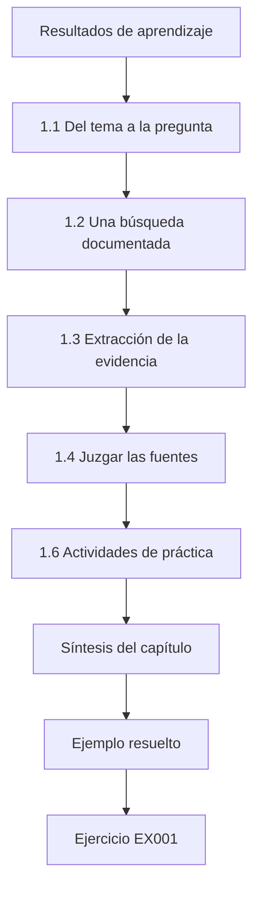

### Dibujo lógico

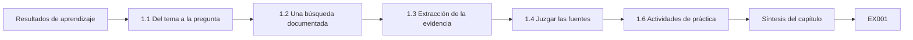

```text
[Resultados de aprendizaje]
    |
    v
[1.1 Del tema a la pregunta]
    |
    v
[1.2 Una búsqueda documentada]
    |
    v
[1.3 Extracción de la evidencia]
    |
    v
[1.4 Juzgar las fuentes]
    |
    v
[1.6 Actividades de práctica]
    |
    v
[Síntesis del capítulo]
    |
    v
[Ejemplo resuelto] --> [Ejercicio EX001]
```
<!-- cykin:lesson-figures:end ch-01 -->


### Resultados de aprendizaje

Usted será capaz de (1) pasar de un tema a una pregunta investigable con una unidad de análisis clara; (2) realizar una búsqueda bibliográfica sistemática y documentada en foros de seguridad y de aprendizaje automático y en servidores de preprints; (3) extraer la evidencia a una matriz de comparación; (4) juzgar la calidad de las fuentes, incluidos los preprints y el material de proveedores; y (5) escribir una sección breve y honesta sobre el estado de la cuestión.

### 1.1 Del tema a la pregunta

«La privacidad de la IA» es un tema. «¿Reduce la eliminación de registros de entrenamiento duplicados la ventaja de la inferencia de pertenencia contra un clasificador de texto ajustado finamente, y con qué coste de exactitud?» es una pregunta. Una pregunta investigable nombra un *sistema* (clasificador ajustado finamente), una *intervención o factor* (deduplicación), un *resultado* (ventaja de la inferencia de pertenencia; exactitud) e implícitamente una *comparación* (con frente a sin). El acrónimo PICO de la medicina basada en la evidencia (población, intervención, comparación y resultado, por sus siglas en inglés) es una plantilla útil. Compruebe pronto la viabilidad: ¿puede obtener o sintetizar datos, dispone de capacidad de cómputo, puede hacerse el trabajo en el plazo, y es ético y está autorizado?

### 1.2 Una búsqueda documentada

La literatura sobre seguridad de la IA está repartida entre congresos de seguridad (IEEE S&P, USENIX Security, ACM CCS, NDSS), congresos de aprendizaje automático (NeurIPS, ICML, ICLR) y preprints de arXiv, además de los marcos de NIST, OWASP y MITRE. Redacte un protocolo de búsqueda: bases de datos (por ejemplo, DBLP, Google Scholar, arXiv, ACM Digital Library), cadenas de búsqueda, intervalo de fechas, criterios de inclusión y exclusión, y la fecha en que buscó. Siga las citas hacia delante y hacia atrás a partir de artículos semilla; para la inferencia de pertenencia, Shokri et al. (arXiv:1610.05820) es la semilla evidente. Registre los recuentos en cada etapa (encontrados, cribados, incluidos) para que un lector pueda repetir la búsqueda. Es una versión ligera de la práctica de la revisión sistemática; le protege de citar solo lo que ya conocía.

### 1.3 Extracción de la evidencia

Construya una matriz con una fila por artículo y columnas para: modelo de amenaza (conocimiento y acceso del atacante), tipo y tamaño del modelo, datos, métrica, resultado principal, defensa probada, evaluación adaptativa, disponibilidad del código y limitaciones. En trabajos sobre privacidad, anote si el artículo informa la tasa de verdaderos positivos con una tasa de falsos positivos baja o solo la exactitud media o el AUC; lo primero importa porque un ataque que identifica con confianza a unas pocas personas es un daño real aunque su rendimiento medio parezca modesto. La matriz revelará desacuerdos y lagunas que se convertirán en su contribución.

### 1.4 Juzgar las fuentes

Ordene la evidencia según lo comprobable que sea. Los artículos revisados por pares con código publicado son los más sólidos; los preprints pueden ser excelentes, pero no están revisados; los blogs de proveedores y el marketing son afirmaciones que hay que verificar, no evidencia. Las normas y los marcos (NIST AI 100-1, AI 100-2 E2025, ISO/IEC 42001) definen vocabulario y expectativas; no son resultados experimentales. Cuando un preprint aparece después en un foro, cite la versión final si difiere. Nunca cite un artículo que no haya abierto y nunca invente un DOI: si no encuentra un identificador, cite el título, los autores, el año y la URL que realmente utilizó.

### 1.5 Ejemplo resuelto (caso sintético de Harbourline)

El protocolo de Leo buscó en DBLP, arXiv y Google Scholar el 2 de febrero con cadenas que combinaban "membership inference", "fine-tuning", "deduplication" y "memorization", entre 2016 y 2026, incluyendo estudios empíricos sobre clasificadores o modelos de lenguaje y excluyendo los artículos sin un modelo de amenaza declarado. De 212 resultados, 61 superaron el cribado por título, 24 el cribado por resumen y 17 la lectura del texto completo. La matriz mostró que la mayoría de los estudios informaban el AUC, pocos informaban la TPR con una FPR del 0,1 %, y solo tres probaban directamente la deduplicación, todos sobre modelos de lenguaje generativos y ninguno sobre clasificadores ajustados finamente. El párrafo de Leo sobre el estado de la cuestión lo dijo con claridad y citó a Carlini et al. (arXiv:2012.07805) sobre la extracción literal como el daño que motiva el estudio.

El laboratorio de inferencia de pertenencia muestra la idea central que Leo estudiará: cuando un modelo memoriza en la práctica sus registros de entrenamiento (k = 1), la pertenencia es detectable; cuando generaliza (k mayor), la señal se desvanece.

```python
"""Lab M: membership inference against an overfit 1-nearest-neighbour 'model'
that returns a confidence score. Synthetic records only; teaching model."""
import random, math
rng = random.Random(5)
def rec(): 
    y = rng.random() < 0.5
    return [rng.gauss(0.6 if y else -0.6, 1.0) for _ in range(4)], int(y)
members = [rec() for _ in range(150)]; nonmembers = [rec() for _ in range(150)]
def confidence(x, y, k):
    # k-NN vote share for the true label, computed over the training set
    d = sorted((sum((a-b)**2 for a, b in zip(x, m)), my) for m, my in members)
    return sum(1 for _, my in d[:k] if my == y)/k
def auc(pos, neg):
    s = sum((p > n) + 0.5*(p == n) for p in pos for n in neg)
    return s/(len(pos)*len(neg))
for k in (1, 5, 25):
    pos = [confidence(x, y, k) for x, y in members]
    neg = [confidence(x, y, k) for x, y in nonmembers]
    best = max(sum(p >= t for p in pos)/len(pos) - sum(n >= t for n in neg)/len(neg)
               for t in sorted(set(pos + neg)))
    print(f"k={k:2d} attack_auc={auc(pos, neg):.3f} best_advantage={best:.3f}")
```

Salida esperada:

```text
k= 1 attack_auc=0.600 best_advantage=0.200
k= 5 attack_auc=0.521 best_advantage=0.073
k=25 attack_auc=0.520 best_advantage=0.060
```

### 1.6 Actividades de práctica

1. Escriba su tema y luego tres preguntas candidatas en forma PICO; elija una y justifique su viabilidad. 2. Redacte un protocolo de búsqueda y aplíquelo, registrando los recuentos. 3. Construya una matriz de evidencia de diez filas. Para las preguntas, nombre el sistema, la intervención o factor, la comparación y el resultado, como hace la pregunta de Leo. Juzgue la viabilidad según los datos, el cómputo, el tiempo y la ética, y descarte cualquier pregunta que no supere alguno de ellos. Para la búsqueda, registre las bases de datos, las cadenas, las fechas y los recuentos en cada etapa, para que otra persona pueda repetirla. En la matriz, incluya si cada artículo informa la TPR con una FPR baja.

### 1.7 Errores y límites

Cinco errores se repiten, y cada uno debilita el trabajo de fin de máster desde el principio:

- Preguntas demasiado amplias para responderlas en un trabajo de fin de máster; una pregunta amplia no puede responderse en el plazo.
- Búsquedas que se detienen en la primera página de un buscador; una búsqueda que se detiene pronto pierde trabajos como los tres estudios sobre deduplicación que encontró Leo.
- Tratar el blog de un proveedor como evidencia; el blog de un proveedor es una afirmación que hay que verificar.
- Citar artículos que no ha leído, o fabricar identificadores; los identificadores no citados o inventados dañan la confianza en todas las demás citas.
- Informar solo de promedios en los ataques contra la privacidad; los promedios ocultan a las pocas personas que un ataque identifica con confianza, que es el daño que estudia Leo.

### Ejercicios — capítulo 1

- **EX001 — PICO.** Escriba una pregunta PICO sobre las defensas contra la inyección de instrucciones (*prompt injection*). Rúbrica: 3 = los cuatro elementos son concretos y viables; 2 = uno es vago; 1 = faltan dos; 0 = solo el tema.
- **EX002 — Protocolo de búsqueda.** Enumere seis elementos de un protocolo de búsqueda documentado. Rúbrica: 3 = fuentes, cadenas, fechas, criterios, fecha de búsqueda, recuentos; 2 = cuatro; 1 = dos; 0 = ninguno.
- **EX003 — Columnas de la matriz.** Nombre seis columnas de la matriz para una revisión de la literatura sobre seguridad de la IA y explique por qué importa una de ellas. Rúbrica: 3 = seis pertinentes más la justificación; 2 = seis; 1 = tres; 0 = ninguna.
- **EX004 — FPR baja.** ¿Por qué informar la TPR con una FPR baja en la inferencia de pertenencia? Rúbrica: 3 = el daño procede de la identificación confiada de algunas personas; los promedios lo ocultan; 2 = parcial; 1 = vago; 0 = incorrecto.
- **EX005 — Orden de las fuentes.** Ordene: blog de un proveedor, preprint de arXiv con código, artículo revisado por pares sin código, marco del NIST, y explique el papel del marco. Rúbrica: 3 = orden razonable más el marco como vocabulario y no como resultados; 2 = solo el orden; 1 = vago; 0 = nada.
- **EX006 — Lectura del laboratorio.** ¿Qué AUC informa el laboratorio de inferencia de pertenencia con k = 1 y con k = 5? Rúbrica: 3 = 0.600 y 0.521 con interpretación; 2 = solo los números; 1 = un número; 0 = incorrecto.
- **EX007 — Identificador ausente.** No encuentra un DOI para un artículo de un taller. ¿Cómo lo cita? Rúbrica: 3 = autores, título, foro/año, URL realmente utilizada, sin DOI inventado; 2 = parcial; 1 = vago; 0 = inventa uno.

### Síntesis del capítulo

Un buen trabajo de fin de máster empieza con una pregunta acotada y viable y con una búsqueda que otra persona podría repetir. La matriz de evidencia convierte la lectura en un mapa de lagunas, y unas fuentes honestas hacen que el mapa sea fiable.

### Siga estudiando — capítulo 01 de 08

[← Página del curso](../../README.md) · [Índice de capítulos del curso](../SUBJECTS.md) · [Capítulo 02 (borrador) →](#ch-02)

<a id="ch-02"></a>

## Capítulo 2 — Seguridad de la IA y del aprendizaje automático: seminario avanzado

<!-- cykin:lesson-figures:start ch-02 -->
### Mapa de la lección

Lección 02 publicada. Mapa, ejemplo, EX008.

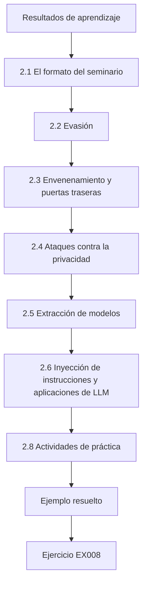

### Dibujo lógico


```text
[Resultados de aprendizaje]
    |
    v
[2.1 El formato del seminario]
    |
    v
[2.2 Evasión]
    |
    v
[2.3 Envenenamiento y puertas traseras]
    |
    v
[2.4 Ataques contra la privacidad]
    |
    v
[2.5 Extracción de modelos]
    |
    v
[2.6 Inyección de instrucciones y aplicaciones de LLM]
    |
    v
[2.8 Actividades de práctica]
    |
    v
[Ejemplo resuelto] --> [Ejercicio EX008]
```
<!-- cykin:lesson-figures:end ch-02 -->


### Resultados de aprendizaje

Usted será capaz de (1) explicar las principales clases de ataque (evasión, envenenamiento y puertas traseras, privacidad —inferencia de pertenencia y extracción de datos—, extracción de modelos e inyección de instrucciones) con sus modelos de amenaza; (2) explicar las defensas y sus límites conocidos; (3) leer y presentar críticamente un artículo en un seminario; (4) relacionar los resultados con NIST AI 100-2 E2025, OWASP LLM 2025 y MITRE ATLAS; y (5) identificar cómo aparece cada clase de ataque en un despliegue real como el de Harbourline.

### 2.1 El formato del seminario

Cada semana un estudiante presenta un artículo en quince minutos: afirmación, modelo de amenaza, método, resultados y tres preguntas críticas. El grupo discute si la evidencia respalda la afirmación. El objetivo no es admirar los artículos, sino entender exactamente lo que muestran. La presentación de Leo sobre Shokri et al. en el ejemplo resuelto de más abajo sigue este formato, y su tercera pregunta pasó a formar parte de su propio diseño. Prepare preguntas que un lector pueda responder a partir del artículo y anote las que el artículo no puede responder, porque ahí suelen estar las lagunas de investigación.

### 2.2 Evasión

Los ejemplos adversariales (Szegedy et al., arXiv:1312.6199) son entradas ligeramente modificadas para provocar errores. FGSM (Goodfellow et al., arXiv:1412.6572) da un paso en la dirección del signo del gradiente de la pérdida; PGD (Madry et al., arXiv:1706.06083) itera y proyecta de nuevo sobre el conjunto de perturbaciones permitidas; el entrenamiento adversarial usa esos ejemplos durante el entrenamiento. En texto, los cambios «pequeños» son más difíciles de definir: sustituir sinónimos o editar caracteres puede cambiar el sentido. En Harbourline, la evasión consistiría en redactar una nota de siniestro de modo que el clasificador la encamine mal. El laboratorio de juguete muestra cómo se desploma la exactitud a medida que crece el presupuesto.

```python
"""Lab E: evasion of a toy linear classifier (synthetic data, stdlib only).
Trains logistic regression on two synthetic clusters, then applies a
fast-gradient-sign (FGSM-style) perturbation of size eps to every test point
and reports clean vs adversarial accuracy. Teaching model only."""
import math, random
rng = random.Random(7)
def point(label):
    cx = 1.0 if label else -1.0
    return [rng.gauss(cx, 0.7), rng.gauss(cx, 0.7)], label
train = [point(i % 2) for i in range(400)]
test = [point(i % 2) for i in range(200)]
w, b = [0.0, 0.0], 0.0
sig = lambda z: 1 / (1 + math.exp(-z))
for epoch in range(200):
    gw, gb = [0.0, 0.0], 0.0
    for x, y in train:
        p = sig(w[0]*x[0] + w[1]*x[1] + b)
        gw[0] += (p - y)*x[0]; gw[1] += (p - y)*x[1]; gb += p - y
    w = [w[i] - 0.1*gw[i]/len(train) for i in range(2)]; b -= 0.1*gb/len(train)
def acc(data, eps):
    ok = 0
    for x, y in data:
        # gradient of the loss w.r.t. x is (p - y) * w; FGSM steps along its sign
        p = sig(w[0]*x[0] + w[1]*x[1] + b)
        xa = [x[i] + eps*math.copysign(1, (p - y)*w[i]) for i in range(2)]
        ok += (sig(w[0]*xa[0] + w[1]*xa[1] + b) >= 0.5) == bool(y)
    return ok / len(data)
print(f"weights w=({w[0]:.3f}, {w[1]:.3f}) b={b:.3f}")
for eps in (0.0, 0.25, 0.5, 0.75, 1.0):
    print(f"eps={eps:.2f} accuracy={acc(test, eps):.3f}")
```

Salida esperada:

```text
weights w=(1.795, 1.756) b=-0.080
eps=0.00 accuracy=0.985
eps=0.25 accuracy=0.950
eps=0.50 accuracy=0.840
eps=0.75 accuracy=0.660
eps=1.00 accuracy=0.505
```

### 2.3 Envenenamiento y puertas traseras

Los ataques de envenenamiento controlan parte de los datos de entrenamiento. El envenenamiento de disponibilidad degrada la exactitud de forma general; el envenenamiento dirigido y el de puerta trasera (Gu et al., arXiv:1708.06733) mantienen la exactitud con datos limpios mientras un disparador provoca el comportamiento elegido. En Harbourline, un tramitador de siniestros malintencionado que pueda insertar notas en el conjunto de entrenamiento podría enseñar al clasificador que una frase encamina los siniestros a la aprobación por vía rápida. Las defensas incluyen la procedencia de los datos, el filtrado de valores atípicos y la limitación de quién puede aportar datos de entrenamiento; ninguna es completa. Pregunte, para cualquier conjunto de datos, quién puede añadir registros y si eso queda registrado.

### 2.4 Ataques contra la privacidad

La inferencia de pertenencia (Shokri et al., arXiv:1610.05820) decide si un registro estuvo en el entrenamiento, usando diferencias en la confianza o en la pérdida del modelo. La extracción de datos de entrenamiento (Carlini et al., arXiv:2012.07805) recupera secuencias literales de los modelos generativos. La privacidad diferencial (Abadi et al., arXiv:1607.00133) acota cuánto puede influir un único registro en el modelo, lo que reduce ambos riesgos a costa de utilidad. Para una aseguradora, la propia pertenencia puede ser sensible («esta persona presentó un siniestro»). El trabajo de fin de máster de Leo estudia el primero de estos riesgos: si la deduplicación reduce la fuga de pertenencia. Según este razonamiento, un reclamante cuya nota aparece muchas veces está más expuesto.

### 2.5 Extracción de modelos

La extracción de modelos (Tramèr et al., arXiv:1609.02943) construye una copia de un modelo a partir de las salidas de su API. Las salidas ricas (vectores de probabilidad completos) la facilitan; redondear y devolver solo etiquetas la dificultan, pero no la hacen imposible. La extracción importa por la propiedad intelectual y porque una copia robada permite ataques de caja blanca. El laboratorio siguiente muestra el efecto de la precisión de la salida: con la puntuación de precisión completa la copia es exacta, con dos decimales es casi exacta y con redondeo a enteros la copia coincide en el 88 % de las etiquetas. En Harbourline, devolver solo la etiqueta de clasificación dificultaría la extracción, no la impediría.

```python
"""Lab X: model extraction of a toy linear scoring API by querying it.
The 'API' returns a real-valued score; d+1 well-chosen queries recover the
weights exactly, and rounding the output limits fidelity. Synthetic model."""
import random
rng = random.Random(9)
d = 5
secret_w = [round(rng.uniform(-2, 2), 3) for _ in range(d)]; secret_b = 0.42
def api(x, decimals=None):
    s = sum(a*b for a, b in zip(secret_w, x)) + secret_b
    return round(s, decimals) if decimals is not None else s
for dec in (None, 2, 0):
    b = api([0]*d, dec)
    w = [api([1 if j == i else 0 for j in range(d)], dec) - b for i in range(d)]
    err = max(abs(a-c) for a, c in zip(w, secret_w))
    test = [[rng.uniform(-1, 1) for _ in range(d)] for _ in range(500)]
    agree = sum((sum(a*c for a, c in zip(w, x))+b > 0) == (api(x) > 0) for x in test)/500
    print(f"output_rounding={str(dec):4s} queries={d+1} max_weight_error={err:.3f} label_agreement={agree:.3f}")
```

Salida esperada:

```text
output_rounding=None queries=6 max_weight_error=0.000 label_agreement=1.000
output_rounding=2    queries=6 max_weight_error=0.004 label_agreement=0.998
output_rounding=0    queries=6 max_weight_error=0.534 label_agreement=0.882
```

### 2.6 Inyección de instrucciones y aplicaciones de LLM

Cuando un LLM procesa texto no fiable, ese texto puede contener instrucciones (Greshake et al., arXiv:2302.12173). OWASP LLM 2025 sitúa la inyección de instrucciones en primer lugar y enumera riesgos relacionados como la divulgación de información sensible, la agencia excesiva y la filtración de la instrucción del sistema. El plan futuro de Harbourline, un asistente que lee los correos de siniestros y redacta respuestas, heredaría estos riesgos. Para un asistente así, el correo de un reclamante es texto no fiable que podría dirigir los borradores o filtrar datos de otros reclamantes. Ese plan queda fuera del trabajo de fin de máster de Leo, pero el seminario debería relacionarlo con las entradas de OWASP para que Harbourline vea qué riesgos añadiría.

### 2.7 Ejemplo resuelto (caso sintético de Harbourline)

Leo presentó a Shokri et al. Sus tres preguntas críticas: (1) el enfoque de modelos sombra supone que el atacante puede muestrear de una distribución de datos similar; ¿es eso realista para notas de seguros? (2) los resultados se informaron sobre todo como precisión/exactitud; ¿cuál es la TPR con una FPR baja? (3) ¿qué parte de la fuga se explica por el sobreajuste? El grupo concluyó que la pregunta (3) era directamente pertinente para su trabajo de fin de máster: si la deduplicación ayuda sobre todo porque reduce el sobreajuste, la «explicación» es la generalización y no la deduplicación en sí, una explicación alternativa para el capítulo 4.

### 2.8 Actividades de práctica

1. Presente un artículo con el formato del seminario. 2. Para cada clase de ataque, escriba un modelo de amenaza de una línea para un sistema que conozca. 3. Relacione el asistente de correo previsto por Harbourline con tres entradas de OWASP LLM 2025. Para la presentación, prepare la afirmación, el modelo de amenaza, el método, los resultados y tres preguntas críticas, como hizo Leo. Para los modelos de amenaza, nombre el conocimiento, el acceso y el objetivo del atacante para cada clase. Para la correspondencia, considere la inyección de instrucciones, la divulgación de información sensible y la agencia excesiva, e indique para cada una qué podría hacer mal el asistente y qué control lo limitaría.

### 2.9 Errores y límites

Cuatro errores se repiten, y cada uno lleva a un resumen engañoso; revise sus notas del seminario en busca de los cuatro:

- Describir ataques sin su modelo de amenaza; un ataque sin su modelo de amenaza no puede compararse con una defensa.
- Suponer que los resultados del dominio de las imágenes se trasladan directamente al texto; puede que no, porque pequeñas ediciones del texto pueden cambiar el sentido.
- Tratar el redondeo o la salida de solo etiquetas como una defensa completa contra la extracción; el redondeo dificultó la extracción en el laboratorio, pero no la detuvo.
- Ignorar que la propia pertenencia puede ser sensible; en Harbourline, el mero hecho de que una persona presentara un siniestro puede ser sensible, de modo que la inferencia de pertenencia es un daño real.

### Ejercicios — capítulo 2

- **EX008 — Modelos de amenaza.** Dé un modelo de amenaza de una línea para la evasión, el envenenamiento con puerta trasera y la inferencia de pertenencia. Rúbrica: 3 = tres con conocimiento, capacidad y objetivo; 2 = dos; 1 = uno; 0 = ninguno.
- **EX009 — FGSM frente a PGD.** Explique la diferencia. Rúbrica: 3 = un único paso frente a pasos iterados y proyectados; PGD es más fuerte; 2 = parcial; 1 = vago; 0 = incorrecto.
- **EX010 — Laboratorio de extracción.** ¿Qué ocurre con el error de los pesos y la coincidencia de etiquetas cuando las salidas se redondean a enteros, y qué implica? Rúbrica: 3 = error 0.534, coincidencia 0.882; la precisión de la salida limita la fidelidad, pero queda una copia útil; 2 = solo los números; 1 = vago; 0 = incorrecto.
- **EX011 — Daño para la aseguradora.** ¿Por qué puede ser sensible la pertenencia en Harbourline? Rúbrica: 3 = revela que una persona presentó un siniestro, posiblemente con detalles de salud o de pérdidas; 2 = parcial; 1 = vago; 0 = nada.
- **EX012 — Escenario de puerta trasera.** Describa (a nivel de diseño) un riesgo de puerta trasera para el clasificador de siniestros y dos controles. Rúbrica: 3 = notas con disparador insertadas por alguien de dentro; control de procedencia/acceso y pruebas de disparadores/valores atípicos; 2 = un control; 1 = vago; 0 = detalle dañino.
- **EX013 — Correspondencia con OWASP.** Relacione el asistente de correo con tres entradas de OWASP LLM 2025. Rúbrica: 3 = p. ej., LLM01, LLM02, LLM06 con sus razones; 2 = solo los identificadores; 1 = una; 0 = ninguna.
- **EX014 — Preguntas para el seminario.** Escriba tres preguntas críticas para un artículo sobre una defensa de su elección. Rúbrica: 3 = tres sobre el modelo de amenaza, el ataque adaptativo y las métricas/costes; 2 = dos; 1 = una; 0 = ninguna.

### Síntesis del capítulo

El seminario aporta soltura en las clases de ataque y en la lectura crítica. Cada clase tiene un modelo de amenaza, un daño típico y defensas con límites conocidos, y las explicaciones alternativas que descubra en la discusión se convierten en preguntas de investigación.

### Siga estudiando — capítulo 02 de 08

[← Capítulo 01 (borrador)](#ch-01) · [Índice de capítulos del curso](../SUBJECTS.md) · [Capítulo 03 (borrador) →](#ch-03)

<a id="ch-03"></a>

## Capítulo 3 — Diseño del estudio, ética y reproducibilidad

<!-- cykin:lesson-figures:start ch-03 -->
### Mapa de la lección

Lección 03 publicada. Mapa, ejemplo, EX015.

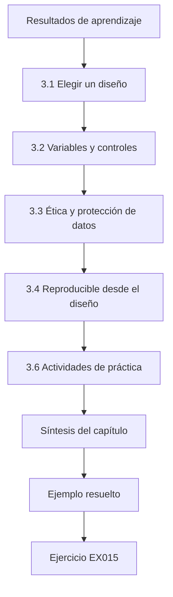

### Dibujo lógico


```text
[Resultados de aprendizaje]
    |
    v
[3.1 Elegir un diseño]
    |
    v
[3.2 Variables y controles]
    |
    v
[3.3 Ética y protección de datos]
    |
    v
[3.4 Reproducible desde el diseño]
    |
    v
[3.6 Actividades de práctica]
    |
    v
[Síntesis del capítulo]
    |
    v
[Ejemplo resuelto] --> [Ejercicio EX015]
```
<!-- cykin:lesson-figures:end ch-03 -->


### Resultados de aprendizaje

Usted será capaz de (1) elegir un diseño (experimento controlado, estudio observacional, estudio de caso) que se ajuste a la pregunta; (2) definir las variables, los controles, la aleatorización y el tamaño muestral; (3) planificar el tratamiento de los datos y la ética para datos personales o sensibles; (4) hacer el estudio reproducible desde el principio; y (5) documentar el plan para que un supervisor pueda aprobarlo.

### 3.1 Elegir un diseño

La mayoría de los proyectos de maestría en seguridad de la IA son **experimentos controlados**: se cambia un factor (deduplicación activada o desactivada), se mantienen fijos los demás y se miden los resultados. Los estudios **observacionales** analizan datos existentes sin intervenir (por ejemplo, los registros de intentos de inyección de instrucciones contra un asistente desplegado) y deben preocuparse por los factores de confusión. Los **estudios de caso** examinan un sistema en profundidad y son útiles cuando los experimentos son imposibles, pero sustentan una generalización más débil. Elija el diseño más sólido que pueda llevar a cabo de forma ética y dentro del plazo. La pregunta de Leo compara condiciones que él puede controlar, así que encaja un experimento controlado.

### 3.2 Variables y controles

En el caso de Leo, la *variable independiente* es el tratamiento del conjunto de entrenamiento (original, con duplicados exactos eliminados, con casi duplicados eliminados). Las *variables dependientes* son la TPR de la inferencia de pertenencia con una FPR del 1 %, el AUC y el F1 macro del clasificador. Las *variables controladas* incluyen la arquitectura del modelo, las épocas, la tasa de aprendizaje, las semillas aleatorias y la partición de evaluación. Aleatorice qué registros van al entrenamiento y cuáles a los conjuntos reservados, para que los miembros y los no miembros procedan de la misma distribución; de lo contrario, un ataque puede detectar un cambio de distribución en lugar de la pertenencia, un error conocido. Use varias semillas e informe de la variabilidad. Estime el tamaño muestral a partir de un piloto (capítulo 5).

### 3.3 Ética y protección de datos

Cuando los datos se refieren a personas, aplique los principios de protección de datos: base jurídica, limitación de la finalidad, minimización, limitación del plazo de conservación y seguridad. El RGPD se aplica en la UE; otras jurisdicciones tienen leyes similares. *Nota para el lector hispanohablante:* en España, el RGPD se complementa con la Ley Orgánica 3/2018, de Protección de Datos Personales y garantía de los derechos digitales; en América Latina rige la ley de cada país, por ejemplo la Ley 25.326 en Argentina o la Ley 1581 de 2012 en Colombia. Prefiera datos sintéticos que conserven las propiedades que necesita; si los datos reales son imprescindibles, obtenga la aprobación del comité de ética de su institución y del responsable del tratamiento, seudonimice, restrinja el acceso y fije fechas de supresión. Los ataques contra la privacidad sobre datos reales crean precisamente el daño que usted estudia; ejecútelos solo sobre copias amparadas por un acuerdo y nunca publique los registros recuperados. Si su proyecto implica a personas (anotadores, participantes en encuestas), necesita su consentimiento informado.

### 3.4 Reproducible desde el diseño

Prepare desde el primer día: un repositorio con control de versiones; un entorno fijado; archivos de configuración en lugar de parámetros escritos en el código; semillas fijas; una sola orden para ejecutar cada experimento; registros escritos como datos legibles por máquina; y una ficha de datos que describa la procedencia y el procesamiento (Gebru et al., arXiv:1803.09010). El programa de reproducibilidad de NeurIPS (Pineau et al., arXiv:2003.12206) ofrece una lista de comprobación que merece la pena adoptar. Incorporar la reproducibilidad desde el principio es mucho más barato que añadirla después. El diseño de Leo enumera desde el principio el repositorio, un archivo de bloqueo y una interfaz `run.py --config`, lo que simplificó sus reejecuciones posteriores.

### 3.5 Ejemplo resuelto (caso sintético de Harbourline)

El documento de diseño de Leo especifica un experimento controlado con tres condiciones × cinco semillas. Datos: 20.000 notas de siniestros sintéticas generadas a partir de plantillas con duplicación controlada (un 8 % de duplicados exactos y un 6 % de casi duplicados), de modo que se conoce la verdad de referencia sobre la duplicación. Los miembros y los no miembros se extraen mediante una partición aleatoria del mismo conjunto. La sección de ética recoge que no se usa ningún dato real de reclamantes, que el delegado de protección de datos de Harbourline revisó el plan y que se publicará el generador sintético. La sección de reproducibilidad enumera el repositorio, el archivo de bloqueo del entorno y una interfaz `run.py --config`.

El laboratorio de estadística muestra por qué se planifican cinco semillas: los resultados por semilla varían aunque no cambie nada más que la semilla.

```python
"""Lab S: reporting attack-success rates honestly: Wilson intervals,
seed variation and a paired bootstrap. Synthetic trial outcomes only."""
import math, random
def wilson(k, n, z=1.96):
    p = k/n; d = 1 + z*z/n
    c = (p + z*z/(2*n))/d; h = z*math.sqrt(p*(1-p)/n + z*z/(4*n*n))/d
    return c - h, c + h
for k, n in ((3, 20), (30, 200), (300, 2000)):
    lo, hi = wilson(k, n); print(f"successes={k}/{n} rate={k/n:.3f} wilson95=[{lo:.3f}, {hi:.3f}]")
# five seeds of a synthetic defence evaluation: per-seed attack success rate
rates = []
for seed in range(5):
    r = random.Random(seed); rates.append(sum(r.random() < 0.12 for _ in range(200))/200)
m = sum(rates)/5; sd = math.sqrt(sum((x-m)**2 for x in rates)/4)
print("per-seed rates:", " ".join(f"{x:.3f}" for x in rates), f"mean={m:.3f} sd={sd:.3f}")
# paired bootstrap: baseline vs defence on the same 300 synthetic prompts
r = random.Random(42)
base = [r.random() < 0.30 for _ in range(300)]
defn = [b and r.random() < 0.6 for b in base]   # defence blocks ~40% of successes
diffs = []
for _ in range(2000):
    idx = [r.randrange(300) for _ in range(300)]
    diffs.append(sum(base[i] for i in idx)/300 - sum(defn[i] for i in idx)/300)
diffs.sort()
print(f"baseline_asr={sum(base)/300:.3f} defended_asr={sum(defn)/300:.3f} "
      f"reduction_ci95=[{diffs[50]:.3f}, {diffs[1949]:.3f}]")
```

Salida esperada:

```text
successes=3/20 rate=0.150 wilson95=[0.052, 0.360]
successes=30/200 rate=0.150 wilson95=[0.107, 0.206]
successes=300/2000 rate=0.150 wilson95=[0.135, 0.166]
per-seed rates: 0.110 0.130 0.135 0.105 0.145 mean=0.125 sd=0.017
baseline_asr=0.350 defended_asr=0.190 reduction_ci95=[0.120, 0.203]
```

### 3.6 Actividades de práctica

1. Redacte su diseño con las variables, los controles y la aleatorización. 2. Redacte un borrador de la sección de ética y protección de datos. 3. Cree el esqueleto del repositorio con archivos de configuración y una política de semillas. Use el diseño de Leo como modelo: nombre las variables independientes, dependientes y controladas, e indique cómo se extraen los miembros y los no miembros del mismo conjunto. En el texto de ética, indique qué datos se usan, quién revisó el plan y qué se publicará. En el repositorio, incluya archivos de configuración, un archivo de bloqueo, una política de semillas y una sola orden por experimento. Pida a su supervisor que revise los tres.

### 3.7 Errores y límites

Cuatro errores se repiten, y cada uno socava el resultado; revise su diseño en busca de los cuatro:

- Miembros y no miembros extraídos de distribuciones diferentes; esto permite que el ataque detecte el cambio de distribución en lugar de la pertenencia.
- Una semilla por condición; una sola semilla no puede mostrar la variabilidad, que el Lab S hace visible.
- Usar datos personales reales cuando bastarían datos sintéticos; los datos personales reales crean el daño que se estudia cuando servirían datos sintéticos, como sirven las notas sintéticas de Leo.
- Rutas y parámetros escritos en el código que hacen imposibles las reejecuciones; hacen que las reejecuciones fallen para cualquier otra persona, incluidos los examinadores.

### Ejercicios — capítulo 3

- **EX015 — Elección del diseño.** Para «¿reciben los asistentes desplegados intentos de inyección, y de qué tipos?», elija un diseño y justifíquelo. Rúbrica: 3 = estudio observacional de registros autorizados con notas sobre factores de confusión/consentimiento; 2 = solo el diseño; 1 = mal ajuste; 0 = nada.
- **EX016 — Variables.** Enumere las variables independiente y dependientes y tres variables controladas para un experimento sobre una defensa contra la evasión. Rúbrica: 3 = todas correctas; 2 = laguna menor; 1 = laguna importante; 0 = nada.
- **EX017 — Error de distribución.** Explique por qué los miembros y los no miembros deben proceder de la misma distribución. Rúbrica: 3 = de lo contrario el ataque detecta el cambio de distribución, lo que infla los resultados; 2 = parcial; 1 = vago; 0 = incorrecto.
- **EX018 — Protección de datos.** Nombre cuatro principios de protección de datos que se aplican a un estudio de ataques contra la privacidad. Rúbrica: 3 = cuatro correctos; 2 = tres; 1 = uno o dos; 0 = ninguno.
- **EX019 — Lectura del laboratorio.** En el laboratorio de estadística, ¿cuál es el intervalo de las tasas por semilla y cuál es la media? Rúbrica: 3 = 0.105–0.145, media 0.125, sd 0.017; 2 = dos de tres; 1 = uno; 0 = incorrecto.
- **EX020 — Preparación para la reproducibilidad.** Enumere cinco cosas que hay que preparar antes del primer experimento. Rúbrica: 3 = cinco entre repositorio, entorno fijado, configuraciones, semillas, orden única, registros, ficha de datos; 2 = cuatro; 1 = dos; 0 = ninguna.

### Síntesis del capítulo

El diseño determina lo que se puede concluir. Las variables controladas, el muestreo emparejado de miembros y no miembros, las múltiples semillas, el tratamiento ético de los datos y la reproducibilidad incorporada desde el principio son lo que permite que un proyecto breve produzca una respuesta creíble.

### Siga estudiando — capítulo 03 de 08

[← Capítulo 02 (borrador)](#ch-02) · [Índice de capítulos del curso](../SUBJECTS.md) · [Capítulo 04 (borrador) →](#ch-04)

<a id="ch-04"></a>

## Capítulo 4 — Seguridad de la IA y del aprendizaje automático: explicaciones alternativas

<!-- cykin:lesson-figures:start ch-04 -->
### Mapa de la lección

Lección 04 publicada. Mapa, ejemplo, EX021.

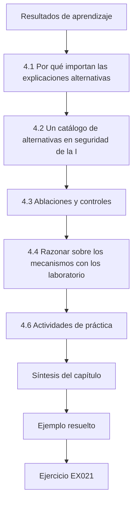

### Dibujo lógico

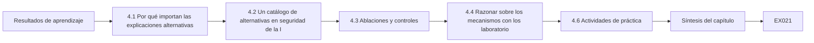

```text
[Resultados de aprendizaje]
    |
    v
[4.1 Por qué importan las explicaciones alternativas]
    |
    v
[4.2 Un catálogo de alternativas en seguridad de la I]
    |
    v
[4.3 Ablaciones y controles]
    |
    v
[4.4 Razonar sobre los mecanismos con los laboratorio]
    |
    v
[4.6 Actividades de práctica]
    |
    v
[Síntesis del capítulo]
    |
    v
[Ejemplo resuelto] --> [Ejercicio EX021]
```
<!-- cykin:lesson-figures:end ch-04 -->


### Resultados de aprendizaje

Usted será capaz de (1) enumerar explicaciones alternativas para un efecto de seguridad observado; (2) diseñar ablaciones y controles que las separen; (3) reconocer los factores de confusión típicos de los experimentos de seguridad de la IA (sobreajuste, fuga de datos, cambio de distribución, artefactos de evaluación, ataques débiles); (4) usar los laboratorios de envenenamiento y de evasión para razonar sobre los mecanismos; y (5) formular las conclusiones al nivel que respalda la evidencia.

### 4.1 Por qué importan las explicaciones alternativas

Un efecto observado («la deduplicación redujo la ventaja de la inferencia de pertenencia») puede tener varias causas. La deduplicación podría reducir específicamente la memorización de los registros repetidos; podría simplemente reducir el tamaño efectivo del conjunto de entrenamiento y, por tanto, cambiar el sobreajuste; podría cambiar el equilibrio entre clases; o el ataque podría ser más débil contra el nuevo modelo por razones ajenas a la privacidad. Un trabajo de fin de máster que nombra y pone a prueba estas alternativas es mucho más sólido que uno que informa solo del efecto. La discusión del seminario de Leo planteó la explicación del sobreajuste antes de que tuviera ningún dato.

### 4.2 Un catálogo de alternativas en seguridad de la IA

Seis alternativas se repiten. *Generalización frente a mecanismo específico*: la fuga de privacidad se correlaciona con la brecha entre entrenamiento y prueba, así que compare los tratamientos con brechas de generalización emparejadas, o incluya un control que cambie el tamaño de los datos sin deduplicar. *Fuga de datos*: los duplicados repartidos entre las particiones de entrenamiento y de prueba inflan la exactitud y confunden las métricas de privacidad (Kapoor y Narayanan, arXiv:2207.07048). *Cambio de distribución*: si los miembros y los no miembros difieren en su distribución, los ataques detectan el cambio y no la pertenencia. *Ataque débil o mal ajustado*: una defensa «funciona» porque el ataque no se adaptó (Athalye et al., arXiv:1802.00420); use como control un ataque más fuerte o calibrado. *Artefactos de evaluación*: elección de la métrica o umbrales ajustados sobre el conjunto de prueba. *Azar*: una sola semilla puede producir un efecto aparente.

### 4.3 Ablaciones y controles

Una *ablación* elimina o varía un componente para ver su contribución. El plan de Leo añade una cuarta condición: la *eliminación aleatoria* del mismo número de registros que eliminaría la deduplicación. Si la eliminación aleatoria da la misma ganancia de privacidad, la explicación es el tamaño del conjunto de datos; si la deduplicación da más, los duplicados importan. También añade un ataque de control calibrado con modelos de referencia, que se sabe que es más fuerte con una FPR baja que un simple umbral de confianza. Escriba el resultado esperado de cada condición antes de ejecutarla.

### 4.4 Razonar sobre los mecanismos con los laboratorios

El laboratorio de envenenamiento ofrece un contraste nítido. Invertir las etiquetas de hasta el 40 % de una clase apenas mueve un modelo de centroide más cercano (0,965 → 0,945), porque los centroides promedian muchos puntos; una puerta trasera que usa una característica disparadora separada alcanza un 98 % de éxito del ataque con 80 puntos, mientras la exactitud con datos limpios se mantiene en 0,968. El *mecanismo* (una dirección de características nueva y que, por lo demás, no se usa) explica por qué las métricas con datos limpios no lo detectan. Una explicación alternativa («el modelo simplemente es inexacto») queda descartada por la exactitud con datos limpios, que no cambia. Para Leo, la analogía es que los registros duplicados pueden dar al modelo una vía específica para memorizarlos.

```python
"""Lab P: label-flip poisoning and a backdoor trigger on a toy nearest-centroid
classifier (synthetic data, stdlib only). Teaching model only."""
import random
rng = random.Random(11)
def point(label, trigger=False):
    cx = 1.0 if label else -1.0
    x = [rng.gauss(cx, 0.8), rng.gauss(cx, 0.8), 0.0]
    if trigger: x[2] = 5.0          # third feature is the 'trigger'
    return x, label
clean = [point(i % 2) for i in range(400)]
test = [point(i % 2) for i in range(400)]
def fit(data):
    c = {}
    for lab in (0, 1):
        pts = [x for x, y in data if y == lab]
        c[lab] = [sum(p[i] for p in pts)/len(pts) for i in range(3)]
    return c
def pred(c, x):
    d = {k: sum((x[i]-v[i])**2 for i in range(3)) for k, v in c.items()}
    return min(d, key=d.get)
def accuracy(c, data): return sum(pred(c, x) == y for x, y in data)/len(data)
print("label-flip poisoning (flip a fraction of class-1 labels to 0):")
for frac in (0.0, 0.1, 0.2, 0.3, 0.4):
    data = [(x, y) for x, y in clean]; ones = [i for i, (x, y) in enumerate(data) if y == 1]
    for i in ones[:int(frac*len(ones))]: data[i] = (data[i][0], 0)
    print(f"  flipped={frac:.1f} clean_test_accuracy={accuracy(fit(data), test):.3f}")
print("backdoor: add n triggered class-1 points labelled 0")
trig_test = [point(1, trigger=True) for _ in range(200)]
for n in (0, 10, 40, 80):
    data = clean + [(point(1, trigger=True)[0], 0) for _ in range(n)]
    c = fit(data)
    asr = sum(pred(c, x) == 0 for x, _ in trig_test)/len(trig_test)
    print(f"  poison_points={n:3d} clean_accuracy={accuracy(c, test):.3f} attack_success={asr:.3f}")
```

Salida esperada:

```text
label-flip poisoning (flip a fraction of class-1 labels to 0):
  flipped=0.0 clean_test_accuracy=0.965
  flipped=0.1 clean_test_accuracy=0.965
  flipped=0.2 clean_test_accuracy=0.953
  flipped=0.3 clean_test_accuracy=0.950
  flipped=0.4 clean_test_accuracy=0.945
backdoor: add n triggered class-1 points labelled 0
  poison_points=  0 clean_accuracy=0.965 attack_success=0.075
  poison_points= 10 clean_accuracy=0.963 attack_success=0.145
  poison_points= 40 clean_accuracy=0.963 attack_success=0.685
  poison_points= 80 clean_accuracy=0.968 attack_success=0.980
```

### 4.5 Ejemplo resuelto (caso sintético de Harbourline)

En los datos del piloto, bajo el ataque calibrado, la deduplicación redujo la TPR con una FPR del 1 % del 6,1 % al 3,4 %. La eliminación aleatoria del mismo número de registros la redujo al 5,6 %. La diferencia entre la deduplicación y la eliminación aleatoria (2,2 puntos) es la parte atribuible de forma plausible a la eliminación de duplicados; los 0,5 puntos restantes se explican por el tamaño. El ataque simple de umbral de confianza se quedó cerca de su suelo en todas las condiciones (el piloto del capítulo 5 lo describe), así que solo el ataque calibrado podía separarlas. La frase de conclusión de Leo pasó de «la deduplicación protege la privacidad» a «la mayor parte de la reducción observada en la fuga de pertenencia es atribuible a la eliminación de registros duplicados más que a un conjunto de entrenamiento más pequeño, bajo el ataque evaluado».

### 4.6 Actividades de práctica

1. Enumere cinco explicaciones alternativas para su resultado esperado. 2. Diseñe una ablación y un control para cada una de las dos más plausibles. 3. Reescriba su conclusión esperada al nivel de evidencia que tendrá. Para la lista, use el catálogo anterior y añada cualquier explicación específica de su sistema. Para las ablaciones, cambie una sola cosa cada vez e indique qué resultado respaldaría cada explicación. Para la conclusión, escriba la frase que podría defender si apareciera el efecto principal y compárela con la frase revisada de Leo, que nombra el ataque y lo que se descartó.

### 4.7 Errores y límites

Cuatro errores se repiten, y cada uno permite que sobreviva una explicación alternativa; revise su plan en busca de los cuatro:

- Informar de un efecto sin poner a prueba las alternativas; un efecto sin alternativas probadas puede deberse al tamaño, al cambio de distribución o al azar.
- Ablaciones que cambian varias cosas a la vez; una ablación así no puede atribuir el efecto.
- Usar solo un ataque débil para evaluar una defensa de la privacidad; un ataque débil puede hacer que cualquier defensa parezca buena, y por eso Leo añadió el ataque calibrado.
- Afirmar un mecanismo solo a partir de una correlación; una correlación, como que la fuga siga a la duplicación, no demuestra por sí sola un mecanismo sin controles como la eliminación aleatoria.

### Ejercicios — capítulo 4

- **EX021 — Alternativas.** Enumere cuatro explicaciones alternativas para «una barrera de protección redujo el éxito del *jailbreak*». Rúbrica: 3 = cuatro plausibles (conjunto de ataques más débil, rechazos que se disparan en exceso, cambio de distribución, artefacto de semilla/evaluador); 2 = tres; 1 = una o dos; 0 = ninguna.
- **EX022 — Ablación.** Diseñe el control de eliminación aleatoria y explique qué significaría cada resultado. Rúbrica: 3 = el mismo número eliminado al azar; ganancia igual → tamaño, ganancia mayor → duplicados; 2 = solo el diseño; 1 = vago; 0 = nada.
- **EX023 — Mecanismo en el laboratorio.** ¿Por qué invertir etiquetas apenas cambia el modelo de centroides mientras la puerta trasera tiene éxito? Rúbrica: 3 = los centroides promedian muchos puntos frente a un disparador que usa una dirección de características nueva no afectada por los datos limpios; 2 = parcial; 1 = vago; 0 = incorrecto.
- **EX024 — Cifras del laboratorio.** Indique la exactitud con datos limpios y el éxito del ataque con 80 puntos envenenados. Rúbrica: 3 = 0.968 y 0.980; 2 = una; 1 = aproximadas; 0 = incorrectas.
- **EX025 — Ataque más fuerte.** ¿Por qué incluir un ataque calibrado como control? Rúbrica: 3 = garantiza que el efecto de la defensa no sea un artefacto de un ataque débil, sobre todo con una FPR baja; 2 = parcial; 1 = vago; 0 = incorrecto.
- **EX026 — Nivel de la conclusión.** Reescriba «la deduplicación arregla la privacidad» al nivel de evidencia de 4.5. Rúbrica: 3 = atribuye una parte, nombra el ataque y las condiciones; 2 = parcial; 1 = sigue exagerando; 0 = sin cambios.

### Síntesis del capítulo

Los efectos necesitan explicaciones, y las explicaciones necesitan pruebas. Las ablaciones, los controles y los ataques más fuertes separan los mecanismos de los artefactos, y las conclusiones resultantes son más acotadas, pero defendibles.

### Siga estudiando — capítulo 04 de 08

[← Capítulo 03 (borrador)](#ch-03) · [Índice de capítulos del curso](../SUBJECTS.md) · [Capítulo 05 (borrador) →](#ch-05)

<a id="ch-05"></a>

## Capítulo 5 — Propuesta y piloto

<!-- cykin:lesson-figures:start ch-05 -->
### Mapa de la lección

Lección 05 publicada. Mapa, ejemplo, EX027.

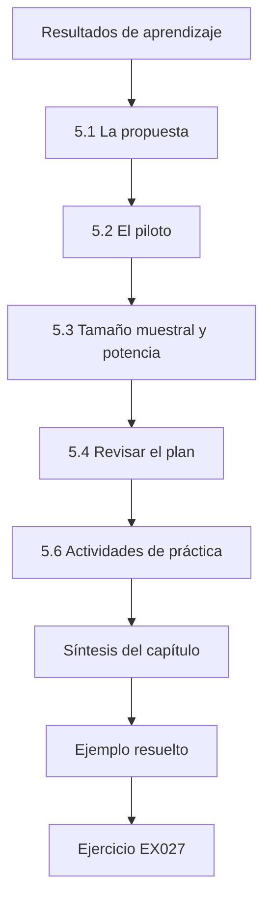

### Dibujo lógico

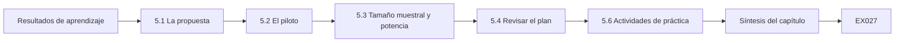

```text
[Resultados de aprendizaje]
    |
    v
[5.1 La propuesta]
    |
    v
[5.2 El piloto]
    |
    v
[5.3 Tamaño muestral y potencia]
    |
    v
[5.4 Revisar el plan]
    |
    v
[5.6 Actividades de práctica]
    |
    v
[Síntesis del capítulo]
    |
    v
[Ejemplo resuelto] --> [Ejercicio EX027]
```
<!-- cykin:lesson-figures:end ch-05 -->


### Resultados de aprendizaje

Usted será capaz de (1) redactar una propuesta de trabajo de fin de máster con la pregunta, los antecedentes, el diseño, el plan de análisis, la ética, los riesgos y el calendario; (2) realizar un piloto para comprobar la viabilidad y estimar la variabilidad; (3) calcular tamaños muestrales; (4) revisar el plan a partir de la evidencia del piloto; y (5) obtener la aprobación con un registro claro de las decisiones.

### 5.1 La propuesta

Una propuesta de maestría suele tener entre 3.000 y 6.000 palabras. Secciones: **pregunta y motivación** (un párrafo cada una); **antecedentes** a partir de su matriz de evidencia; **diseño** (capítulo 3), incluidas las explicaciones alternativas y las ablaciones (capítulo 4); **plan de análisis** con los resultados principales y secundarios y la estadística que usará; **ética y protección de datos**; **riesgos** (técnicos, de datos, de calendario) con sus mitigaciones; **calendario** con hitos; y **contribución esperada**, formulada con modestia. El plan de análisis es la parte más descuidada: escríbalo ahora, antes de tener datos, para que las decisiones posteriores no puedan quedar dirigidas por los resultados. La propuesta de Leo siguió este esquema.

### 5.2 El piloto

Un piloto ejecuta toda la cadena de procesamiento a pequeña escala. Objetivos: confirmar que el código funciona de principio a fin, medir el tiempo de ejecución, medir la variabilidad del resultado principal, comprobar que el ataque y las métricas se comportan de forma razonable (por ejemplo, que el modelo sin defensa es atacable) y descubrir sorpresas. Los resultados del piloto no son pruebas de hipótesis; no los presente como hallazgos y mantenga los datos de prueba finales fuera del piloto. El piloto de Leo encontró un efecto suelo y un defecto en el generador. Anote ambos en el registro de decisiones.

### 5.3 Tamaño muestral y potencia

Para tasas, la aproximación normal n ≈ z² p(1−p)/h² da los ensayos necesarios para una semiamplitud h del intervalo de confianza. Para comparaciones entre condiciones, el análisis de potencia pregunta cuántas repeticiones se necesitan para detectar una diferencia d con una probabilidad (potencia) de 0,8 y un nivel de significación de 0,05; en los diseños emparejados, importa la varianza de las *diferencias*. Con pocas semillas (lo habitual en el aprendizaje automático), informe intervalos entre semillas y entre elementos de evaluación en lugar de confiar en una única prueba de significación. El piloto de Leo mostró una variación de unos 0,8 puntos entre semillas, lo que, junto con el *bootstrap* sobre los registros, hizo suficientes cinco semillas. Use la variación que observe realmente, no una suposición.

### 5.4 Revisar el plan

Los pilotos suelen cambiar algo: un ataque demasiado débil para separar las condiciones, una evaluación que tarda demasiado, una métrica con efecto suelo (todas las condiciones cerca de cero). Anote cada cambio en un registro de decisiones con su motivo. Los supervisores y los examinadores valoran una propuesta que muestra que aprendió de su piloto. El registro de Leo recoge dos cambios derivados de su piloto: sustituir el ataque limitado por el suelo por uno calibrado y corregir las plantillas que producían notas casi idénticas entre clases. Cada uno tiene una fecha y un motivo. Guarde el registro junto con la propuesta para que los examinadores puedan seguir la evolución del plan.

### 5.5 Ejemplo resuelto (caso sintético de Harbourline)

El piloto de Leo usó 2.000 registros y dos semillas. Tardó 40 minutos por ejecución, así que el plan completo (20.000 registros, cuatro condiciones, cinco semillas) supone unas 130 horas de cómputo, algo viable en el clúster del laboratorio. El ataque simple de umbral de confianza produjo una TPR con una FPR del 1 % de entre el 1 % y el 2 % en todas las condiciones: un efecto suelo. Lo sustituyó por un ataque calibrado con modelos de referencia, que separó las condiciones. La variabilidad entre semillas fue de unos 0,8 puntos, así que cinco semillas más el *bootstrap* sobre los registros se consideraron suficientes. También descubrió que dos plantillas generaban notas casi idénticas entre clases, lo que introducía ruido en las etiquetas; corrigió el generador y anotó el cambio.

El laboratorio de evasión ofrece un ejemplo de barrido en un piloto: antes de elegir un único presupuesto de perturbación para un estudio principal, barra varios para encontrar dónde el efecto es medible en lugar de quedar en el suelo o en el techo.

```python
"""Lab E: evasion of a toy linear classifier (synthetic data, stdlib only).
Trains logistic regression on two synthetic clusters, then applies a
fast-gradient-sign (FGSM-style) perturbation of size eps to every test point
and reports clean vs adversarial accuracy. Teaching model only."""
import math, random
rng = random.Random(7)
def point(label):
    cx = 1.0 if label else -1.0
    return [rng.gauss(cx, 0.7), rng.gauss(cx, 0.7)], label
train = [point(i % 2) for i in range(400)]
test = [point(i % 2) for i in range(200)]
w, b = [0.0, 0.0], 0.0
sig = lambda z: 1 / (1 + math.exp(-z))
for epoch in range(200):
    gw, gb = [0.0, 0.0], 0.0
    for x, y in train:
        p = sig(w[0]*x[0] + w[1]*x[1] + b)
        gw[0] += (p - y)*x[0]; gw[1] += (p - y)*x[1]; gb += p - y
    w = [w[i] - 0.1*gw[i]/len(train) for i in range(2)]; b -= 0.1*gb/len(train)
def acc(data, eps):
    ok = 0
    for x, y in data:
        # gradient of the loss w.r.t. x is (p - y) * w; FGSM steps along its sign
        p = sig(w[0]*x[0] + w[1]*x[1] + b)
        xa = [x[i] + eps*math.copysign(1, (p - y)*w[i]) for i in range(2)]
        ok += (sig(w[0]*xa[0] + w[1]*xa[1] + b) >= 0.5) == bool(y)
    return ok / len(data)
print(f"weights w=({w[0]:.3f}, {w[1]:.3f}) b={b:.3f}")
for eps in (0.0, 0.25, 0.5, 0.75, 1.0):
    print(f"eps={eps:.2f} accuracy={acc(test, eps):.3f}")
```

Salida esperada:

```text
weights w=(1.795, 1.756) b=-0.080
eps=0.00 accuracy=0.985
eps=0.25 accuracy=0.950
eps=0.50 accuracy=0.840
eps=0.75 accuracy=0.660
eps=1.00 accuracy=0.505
```

### 5.6 Actividades de práctica

1. Redacte su plan de análisis con los resultados principales y secundarios. 2. Realice un piloto y rellene un registro de decisiones. 3. Calcule el tamaño muestral para su resultado principal. Para el plan de análisis, nombre el resultado principal, como la TPR con una FPR del 1 %, y los secundarios, con la estadística de cada uno. Para el piloto, ejecute toda la cadena a pequeña escala y anote cada cambio con su motivo, como hizo Leo. Para el tamaño muestral, use la fórmula anterior con la variación que observó en su piloto e indique si su presupuesto de cómputo lo permite.

### 5.7 Errores y límites

Cuatro errores se repiten, y cada uno debilita el estudio; revise su propuesta en busca de los cuatro:

- Propuestas sin plan de análisis; sin él, las decisiones posteriores pueden quedar dirigidas por los resultados.
- Presentar los resultados del piloto como hallazgos; no son hallazgos, porque el piloto no se diseñó ni se dimensionó para contrastar hipótesis.
- Usar datos de prueba en el piloto; los datos de prueba usados en un piloto dejan de ser inéditos.
- Ignorar los efectos suelo o techo; un efecto suelo, como el del ataque simple de Leo, entre el 1 % y el 2 % en todas las condiciones, oculta diferencias reales.

### Ejercicios — capítulo 5

- **EX027 — Secciones de la propuesta.** Enumere ocho secciones de la propuesta. Rúbrica: 3 = ocho correctas; 2 = seis; 1 = tres; 0 = ninguna.
- **EX028 — Objetivos del piloto.** Dé cuatro objetivos de un piloto. Rúbrica: 3 = la cadena funciona, tiempos, variabilidad, coherencia de las métricas/sorpresas; 2 = tres; 1 = uno o dos; 0 = ninguno.
- **EX029 — Tamaño muestral.** Calcule los ensayos para una tasa cercana al 5 % con una semiamplitud de 1 punto al 95 %. Rúbrica: 3 = ≈1.825 con la fórmula; 2 = desliz aritmético; 1 = solo la fórmula; 0 = nada.
- **EX030 — Efecto suelo.** ¿Qué es un efecto suelo y cómo lo resolvió Leo? Rúbrica: 3 = todas las condiciones cerca del mínimo, de modo que las diferencias no se ven; ataque calibrado más fuerte; 2 = solo la definición; 1 = vago; 0 = incorrecto.
- **EX031 — Barrido en el laboratorio.** A partir del laboratorio de evasión, ¿qué valores de eps evitan el suelo y el techo para comparar defensas? Rúbrica: 3 = en torno a 0,5–0,75 (0.840, 0.660), con razones; 2 = solo los valores; 1 = vago; 0 = incorrecto.
- **EX032 — Registro de decisiones.** Escriba dos entradas del registro de decisiones a partir del piloto de Leo. Rúbrica: 3 = fecha, cambio, motivo y efecto en ambas; 2 = una; 1 = vago; 0 = nada.

### Síntesis del capítulo

La propuesta fija lo que hará y cómo lo analizará; el piloto muestra si puede hacerlo. Las revisiones anotadas con sus motivos convierten las sorpresas en evidencia de un proceso cuidadoso.

### Siga estudiando — capítulo 05 de 08

[← Capítulo 04 (borrador)](#ch-04) · [Índice de capítulos del curso](../SUBJECTS.md) · [Capítulo 06 (borrador) →](#ch-06)

<a id="ch-06"></a>

## Capítulo 6 — Recogida y análisis de datos

<!-- cykin:lesson-figures:start ch-06 -->
### Mapa de la lección

Lección 06 publicada. Mapa, ejemplo, EX033.

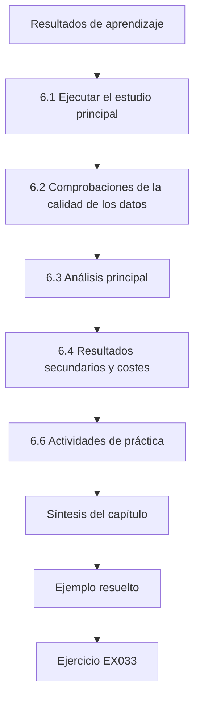

### Dibujo lógico

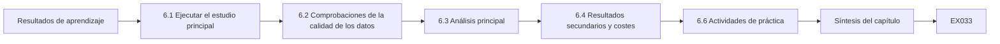

```text
[Resultados de aprendizaje]
    |
    v
[6.1 Ejecutar el estudio principal]
    |
    v
[6.2 Comprobaciones de la calidad de los datos]
    |
    v
[6.3 Análisis principal]
    |
    v
[6.4 Resultados secundarios y costes]
    |
    v
[6.6 Actividades de práctica]
    |
    v
[Síntesis del capítulo]
    |
    v
[Ejemplo resuelto] --> [Ejercicio EX033]
```
<!-- cykin:lesson-figures:end ch-06 -->


### Resultados de aprendizaje

Usted será capaz de (1) ejecutar los experimentos principales exactamente según lo planificado y registrar las desviaciones; (2) comprobar la calidad de los datos antes del análisis; (3) calcular los resultados principales con su incertidumbre (intervalos de Wilson, *bootstrap*, variación entre semillas); (4) analizar comparaciones emparejadas y resultados secundarios; y (5) presentar los resultados en tablas y figuras que respondan a la pregunta de investigación.

### 6.1 Ejecutar el estudio principal

Congele el código en un *commit* etiquetado, bloquee los archivos de configuración y ejecute las condiciones en un orden intercalado o aleatorio, para que los problemas dependientes del tiempo (un nodo que se ralentiza, una actualización de una biblioteca) no coincidan con una sola condición. Cada ejecución escribe un registro: condición, semilla, *hash* de la configuración, hora de inicio y de fin, métricas y rutas a las salidas en bruto. Mantenga un registro de desviaciones como en el piloto. Las ejecuciones de Leo se intercalaron por condición y semilla, y su registro de desviaciones recogió la ejecución ausente de la semilla 4 y su reejecución. Revise el registro antes del análisis, no después.

### 6.2 Comprobaciones de la calidad de los datos

Antes de calcular nada, compruebe: ¿están presentes todas las ejecuciones previstas? ¿Se superan las comprobaciones canario (el modelo sin defensa debe ser atacable; un modelo entrenado con etiquetas barajadas debería rendir al nivel del azar)? ¿Hay duplicados entre particiones? ¿Están los valores de las métricas dentro de intervalos plausibles? Estas comprobaciones detectan errores que, de otro modo, se convertirían en «hallazgos». Las comprobaciones de Leo encontraron una ejecución ausente de la semilla 4, que se reejecutó y se registró antes del análisis. Escriba las comprobaciones como un *script* para que se ejecuten igual cada vez, y guarde su salida junto con los resultados.

### 6.3 Análisis principal

Calcule el resultado principal por condición con intervalos. Para tasas, use intervalos de Wilson; para métricas promediadas sobre elementos, haga *bootstrap* sobre los elementos; informe aparte de la variación entre semillas. Para comparaciones emparejadas (los mismos registros o instrucciones en todas las condiciones), haga *bootstrap* de la *diferencia*. Siga el plan de análisis; etiquete cualquier análisis adicional como exploratorio. Cuando se hacen varias comparaciones, corrija por multiplicidad o preséntelas como exploratorias. El laboratorio siguiente muestra las tres herramientas. Con 3 éxitos de 20, el intervalo de Wilson va del 5 % al 36 %: una muestra tan pequeña no puede sustentar una afirmación precisa. Las tasas por semilla muestran la dispersión de una semilla a otra. El *bootstrap* emparejado estima la reducción que logra una defensa sobre las mismas instrucciones, con un intervalo que excluye el cero.

```python
"""Lab S: reporting attack-success rates honestly: Wilson intervals,
seed variation and a paired bootstrap. Synthetic trial outcomes only."""
import math, random
def wilson(k, n, z=1.96):
    p = k/n; d = 1 + z*z/n
    c = (p + z*z/(2*n))/d; h = z*math.sqrt(p*(1-p)/n + z*z/(4*n*n))/d
    return c - h, c + h
for k, n in ((3, 20), (30, 200), (300, 2000)):
    lo, hi = wilson(k, n); print(f"successes={k}/{n} rate={k/n:.3f} wilson95=[{lo:.3f}, {hi:.3f}]")
# five seeds of a synthetic defence evaluation: per-seed attack success rate
rates = []
for seed in range(5):
    r = random.Random(seed); rates.append(sum(r.random() < 0.12 for _ in range(200))/200)
m = sum(rates)/5; sd = math.sqrt(sum((x-m)**2 for x in rates)/4)
print("per-seed rates:", " ".join(f"{x:.3f}" for x in rates), f"mean={m:.3f} sd={sd:.3f}")
# paired bootstrap: baseline vs defence on the same 300 synthetic prompts
r = random.Random(42)
base = [r.random() < 0.30 for _ in range(300)]
defn = [b and r.random() < 0.6 for b in base]   # defence blocks ~40% of successes
diffs = []
for _ in range(2000):
    idx = [r.randrange(300) for _ in range(300)]
    diffs.append(sum(base[i] for i in idx)/300 - sum(defn[i] for i in idx)/300)
diffs.sort()
print(f"baseline_asr={sum(base)/300:.3f} defended_asr={sum(defn)/300:.3f} "
      f"reduction_ci95=[{diffs[50]:.3f}, {diffs[1949]:.3f}]")
```

Salida esperada:

```text
successes=3/20 rate=0.150 wilson95=[0.052, 0.360]
successes=30/200 rate=0.150 wilson95=[0.107, 0.206]
successes=300/2000 rate=0.150 wilson95=[0.135, 0.166]
per-seed rates: 0.110 0.130 0.135 0.105 0.145 mean=0.125 sd=0.017
baseline_asr=0.350 defended_asr=0.190 reduction_ci95=[0.120, 0.203]
```

### 6.4 Resultados secundarios y costes

Toda mejora de seguridad tiene costes: exactitud, latencia, rechazos de peticiones legítimas, cómputo, mantenibilidad. Infórmelos sobre los mismos elementos. Una defensa de la privacidad que reduce la fuga a la mitad pero hace caer el F1 macro 10 puntos es una propuesta distinta de otra que cuesta 1 punto. Represente el compromiso (por ejemplo, la TPR con una FPR del 1 % frente al F1 macro) para todas las condiciones. El resultado de Leo es del segundo tipo: la eliminación de casi duplicados redujo la TPR con una FPR del 1 % a menos de la mitad, hasta el 4,2 %, mientras el F1 macro caía menos de un punto. Informe de ambos números juntos, con intervalos, para que los lectores puedan sopesar el compromiso por sí mismos.

### 6.5 Ejemplo resuelto (caso sintético de Harbourline)

Resultados principales de Leo (sintéticos, cinco semillas, 20.000 registros): la TPR con una FPR del 1 % bajo el ataque calibrado fue del 9,8 % (original), 7,9 % (eliminación aleatoria), 5,1 % (eliminación de duplicados exactos) y 4,2 % (eliminación de casi duplicados). La diferencia emparejada entre la eliminación de casi duplicados y la eliminación aleatoria fue de 3,7 puntos (IC del 95 % por *bootstrap*: 2,6–4,9). El F1 macro cayó de 0,912 a 0,905 con la eliminación de casi duplicados. Las comprobaciones de calidad de los datos encontraron una ejecución ausente de la semilla 4, que se reejecutó y se registró. Un análisis exploratorio, etiquetado como tal, mostró que la fuga se concentraba en los registros que habían aparecido tres o más veces. El hallazgo exploratorio sobre los registros vistos tres o más veces es una hipótesis para trabajos futuros, no un resultado confirmado.

### 6.6 Actividades de práctica

1. Redacte una lista de comprobación de la calidad de los datos para su estudio y aplíquela. 2. Elabore la tabla principal con intervalos. 3. Represente el compromiso entre seguridad y utilidad. En la lista de comprobación, incluya todas las ejecuciones previstas, las comprobaciones canario, los duplicados entre particiones y los intervalos plausibles, y aplíquela antes de cualquier análisis. En la tabla principal, dé el resultado de cada condición con un intervalo y el número de semillas. En el gráfico, enfrente la métrica de privacidad al F1 macro para cada condición, de modo que el lector vea el compromiso de un vistazo, como hace la figura de Leo.

### 6.7 Errores y límites

Cuatro errores se repiten, y cada uno sesga los resultados u oculta costes; revise su análisis en busca de los cuatro:

- Ejecutar todas las semillas de una condición antes que las de otra; esto permite que los problemas dependientes del tiempo, como un nodo que se ralentiza, coincidan con esa condición.
- Analizar antes de las comprobaciones de calidad; esto convierte los errores, como la ejecución ausente de la semilla 4 que encontraron las comprobaciones de Leo, en hallazgos.
- Mezclar resultados exploratorios y confirmatorios; esto exagera la certeza.
- Informar de las mejoras de seguridad sin sus costes; esto oculta compromisos, como la caída del F1 macro de 0,912 a 0,905 de la que Leo informó.

### Ejercicios — capítulo 6

- **EX033 — Intercalado.** ¿Por qué intercalar las condiciones durante las ejecuciones? Rúbrica: 3 = evita que los problemas dependientes del tiempo se confundan con las condiciones; 2 = parcial; 1 = vago; 0 = incorrecto.
- **EX034 — Comprobaciones de calidad.** Enumere cuatro comprobaciones de la calidad de los datos. Rúbrica: 3 = completitud, canarios, duplicados entre particiones, intervalos plausibles; 2 = tres; 1 = una o dos; 0 = ninguna.
- **EX035 — Lectura del laboratorio.** ¿Cuáles son la ASR de referencia, la ASR con defensa y el intervalo de la reducción en el laboratorio de estadística? Rúbrica: 3 = 0.350, 0.190, [0.120, 0.203]; 2 = dos; 1 = uno; 0 = incorrecto.
- **EX036 — Emparejado frente a no emparejado.** ¿Por qué hacer *bootstrap* de la diferencia sobre elementos compartidos en lugar de comparar dos intervalos separados? Rúbrica: 3 = la dificultad de los elementos se cancela; inferencia más ajustada y correcta; 2 = parcial; 1 = vago; 0 = incorrecto.
- **EX037 — Costes.** Nombre cuatro costes que hay que informar para una defensa de seguridad. Rúbrica: 3 = exactitud/utilidad, latencia, rechazos falsos, cómputo/mantenimiento; 2 = tres; 1 = uno o dos; 0 = ninguno.
- **EX038 — Exploratorio.** ¿Cómo debería informar Leo del hallazgo de las «tres o más apariciones»? Rúbrica: 3 = etiquetado como exploratorio, hipótesis para trabajos futuros, no confirmatorio; 2 = parcial; 1 = presentado como resultado principal; 0 = omitido sin motivo.

### Síntesis del capítulo

El análisis es donde el diseño cuidadoso da fruto: las ejecuciones intercaladas, las comprobaciones de calidad, los intervalos y las comparaciones emparejadas convierten los registros en bruto en una respuesta defendible, y los costes hacen útil la respuesta.

### Siga estudiando — capítulo 06 de 08

[← Capítulo 05 (borrador)](#ch-05) · [Índice de capítulos del curso](../SUBJECTS.md) · [Capítulo 07 (borrador) →](#ch-07)

<a id="ch-07"></a>

## Capítulo 7 — Redacción del trabajo de fin de máster y limitaciones

<!-- cykin:lesson-figures:start ch-07 -->
### Mapa de la lección

Lección 07 publicada. Mapa, ejemplo, EX039.

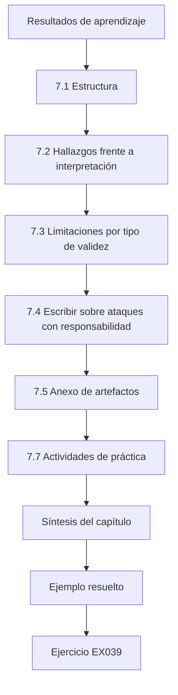

### Dibujo lógico

```mermaid
flowchart LR
  N0["Resultados de aprendizaje"]
  N1["7.1 Estructura"]
  N2["7.2 Hallazgos frente a interpretación"]
  N3["7.3 Limitaciones por tipo de validez"]
  N4["7.4 Escribir sobre ataques con responsabilidad"]
  N5["7.5 Anexo de artefactos"]
  N6["7.7 Actividades de práctica"]
  N7["Síntesis del capítulo"]
  N0 --> N1 --> N2 --> N3 --> N4 --> N5 --> N6 --> N7 --> Q["EX039"]
```

```text
[Resultados de aprendizaje]
    |
    v
[7.1 Estructura]
    |
    v
[7.2 Hallazgos frente a interpretación]
    |
    v
[7.3 Limitaciones por tipo de validez]
    |
    v
[7.4 Escribir sobre ataques con responsabilidad]
    |
    v
[7.5 Anexo de artefactos]
    |
    v
[7.7 Actividades de práctica]
    |
    v
[Síntesis del capítulo]
    |
    v
[Ejemplo resuelto] --> [Ejercicio EX039]
```
<!-- cykin:lesson-figures:end ch-07 -->


### Resultados de aprendizaje

Usted será capaz de (1) estructurar un trabajo de fin de máster de modo que cada capítulo sirva a la pregunta de investigación; (2) redactar los resultados y la discusión separando los hallazgos de la interpretación; (3) redactar una sección de limitaciones organizada por tipo de validez; (4) tratar con responsabilidad por escrito los detalles sensibles para la seguridad; y (5) elaborar un anexo de artefactos que permita la reproducción.

### 7.1 Estructura

Una estructura habitual: introducción (problema, pregunta, resumen de la contribución); antecedentes y trabajos relacionados (a partir de su matriz); método (diseño, datos, ataques, métricas, plan de análisis); resultados (principales, secundarios y exploratorios, claramente etiquetados); discusión (interpretación, explicaciones alternativas, implicaciones); limitaciones; conclusión; referencias; anexos (artefactos, tablas adicionales). Redacte el método de modo que un colega pueda repetirlo; redacte los resultados de modo que un lector encuentre la respuesta a la pregunta de investigación en una sola tabla. El trabajo de Leo responde a su pregunta en una sola tabla de la TPR con una FPR del 1 % y el F1 macro para las cuatro condiciones.

### 7.2 Hallazgos frente a interpretación

Los resultados enuncian lo que se midió: «la eliminación de casi duplicados redujo la TPR con una FPR del 1 % del 9,8 % al 4,2 %». La discusión interpreta: «esto sugiere que los registros duplicados explican gran parte de la fuga, en coherencia con los trabajos sobre memorización en modelos de lenguaje». Manténgalos separados. En la discusión, vuelva a las explicaciones alternativas y diga cuáles descartaron sus ablaciones. Leo trasladó de los resultados a la discusión una recomendación de que las aseguradoras deduplicaran, y la suavizó. Lea cada frase de los resultados y pregúntese si informa de una medición; si explica o recomienda, muévala.

### 7.3 Limitaciones por tipo de validez

Organice las limitaciones según los cuatro tipos de validez. *Interna*: ¿podría algo distinto del tratamiento explicar el efecto? (por ejemplo, artefactos del generador sintético). *De constructo*: ¿miden las métricas la propiedad? (por ejemplo, la TPR con una FPR del 1 % bajo una familia de ataques capta solo parte del riesgo para la privacidad). *Externa*: ¿se traslada el resultado? (por ejemplo, una sola arquitectura de modelo, notas sintéticas, solo en inglés). *De la conclusión*: ¿es adecuada la estadística? (por ejemplo, cinco semillas). Para cada una, diga qué hizo y qué queda pendiente. Las limitaciones escritas así son una fortaleza; los examinadores desconfían de los trabajos que afirman no tener ninguna.

### 7.4 Escribir sobre ataques con responsabilidad

Describa los ataques al nivel necesario para entenderlos y reproducirlos en entornos de investigación, cite los artículos originales y evite publicar detalles operativos dirigidos contra sistemas en producción identificados por su nombre. Nunca incluya datos personales recuperados. Si encontró una vulnerabilidad en un producto real, siga la divulgación coordinada antes de que se publique el trabajo. Etiquete como ficción, en todo el texto, los datos y las organizaciones sintéticos. El trabajo de Leo describe el ataque calibrado citando su fuente y su configuración, sin ningún registro recuperado. Pida a su supervisor que lea la descripción del ataque en busca de detalles operativos antes de la entrega.

### 7.5 Anexo de artefactos

Incluya la URL del repositorio y el *commit*, el entorno, las órdenes para reproducir cada tabla, la ficha de datos del generador sintético, la ficha de modelo de cualquier modelo publicado (Mitchell et al., arXiv:1810.03993) y los *hashes* de los archivos clave. Indique qué no se publica y por qué. El anexo de Leo incluye la ficha de datos del generador sintético, el *commit* del repositorio, las órdenes para cada tabla y los *hashes* de los archivos. Indica que no se publica ningún modelo y por qué. Pida a un colega que reproduzca una tabla solo a partir del anexo antes de la entrega. Manténgalo actualizado.

### 7.6 Ejemplo resuelto (caso sintético de Harbourline)

La sección de limitaciones de Leo tiene cuatro subsecciones breves. Validez externa: «Estudiamos un único clasificador *transformer* ajustado finamente con notas sintéticas en inglés; los resultados pueden diferir para modelos generativos, otros idiomas y datos reales de siniestros». Validez de constructo: «Medimos la inferencia de pertenencia con dos ataques; no se estudiaron la inferencia de atributos ni la extracción». Trasladó de los resultados a la discusión una frase sobre que «las aseguradoras deberían deduplicar» y la suavizó a «la deduplicación es un control candidato de bajo coste que las aseguradoras podrían evaluar». El laboratorio de extracción se cita en su capítulo de antecedentes como una ilustración sencilla de por qué importa la precisión de la salida de la API al describir los modelos de amenaza.

```python
"""Lab X: model extraction of a toy linear scoring API by querying it.
The 'API' returns a real-valued score; d+1 well-chosen queries recover the
weights exactly, and rounding the output limits fidelity. Synthetic model."""
import random
rng = random.Random(9)
d = 5
secret_w = [round(rng.uniform(-2, 2), 3) for _ in range(d)]; secret_b = 0.42
def api(x, decimals=None):
    s = sum(a*b for a, b in zip(secret_w, x)) + secret_b
    return round(s, decimals) if decimals is not None else s
for dec in (None, 2, 0):
    b = api([0]*d, dec)
    w = [api([1 if j == i else 0 for j in range(d)], dec) - b for i in range(d)]
    err = max(abs(a-c) for a, c in zip(w, secret_w))
    test = [[rng.uniform(-1, 1) for _ in range(d)] for _ in range(500)]
    agree = sum((sum(a*c for a, c in zip(w, x))+b > 0) == (api(x) > 0) for x in test)/500
    print(f"output_rounding={str(dec):4s} queries={d+1} max_weight_error={err:.3f} label_agreement={agree:.3f}")
```

Salida esperada:

```text
output_rounding=None queries=6 max_weight_error=0.000 label_agreement=1.000
output_rounding=2    queries=6 max_weight_error=0.004 label_agreement=0.998
output_rounding=0    queries=6 max_weight_error=0.534 label_agreement=0.882
```

### 7.7 Actividades de práctica

1. Redacte su sección de limitaciones por tipo de validez. 2. Marque cada frase de su capítulo de resultados como hallazgo o interpretación y mueva las que estén mal situadas. 3. Redacte un borrador del anexo de artefactos. Para las limitaciones, use los cuatro tipos de validez y diga para cada uno qué hizo y qué queda pendiente, como hizo Leo para un único clasificador y notas sintéticas. Para el capítulo de resultados, marque cada frase y traslade las interpretaciones a la discusión. Para el anexo, enumere el repositorio, el *commit*, el entorno, las órdenes, las fichas y los *hashes*, e indique qué no se publica.

### 7.8 Errores y límites

Cuatro errores se repiten, y cada uno hace que las afirmaciones resulten menos fiables; revise su borrador en busca de los cuatro:

- Resultados y discusión mezclados; esto confunde lo que se midió con cómo se interpreta.
- Limitaciones genéricas («se necesitan más datos»); no dicen nada a los examinadores sobre este estudio.
- Detalles operativos de ataques contra sistemas identificados por su nombre; ayudan a los atacantes sin ayudar a los lectores.
- Recomendaciones enunciadas como hallazgos; una recomendación enunciada como hallazgo afirma más de lo que muestran los datos, y por eso Leo trasladó y suavizó su recomendación a las aseguradoras.

### Ejercicios — capítulo 7

- **EX039 — Hallazgo o interpretación.** Clasifique: (a) «la ASR bajó del 31 % al 6 %»; (b) «la defensa funciona porque elimina el canal del atacante». Rúbrica: 3 = (a) hallazgo, (b) interpretación, con el motivo; 2 = solo las etiquetas; 1 = una; 0 = incorrecto.
- **EX040 — Validez.** Escriba una limitación para cada tipo de validez de su proyecto. Rúbrica: 3 = cuatro concretas; 2 = tres; 1 = una o dos; 0 = ninguna.
- **EX041 — Detalle responsable.** Reescriba de forma responsable una frase que da una carga útil exacta y funcional contra un chatbot identificado por su nombre. Rúbrica: 3 = descripción a nivel de diseño, cita, sin objetivo en producción ni cadena; 2 = parcial; 1 = sigue siendo operativa; 0 = sin cambios.
- **EX042 — Anexo de artefactos.** Enumere seis elementos. Rúbrica: 3 = seis pertinentes; 2 = cuatro; 1 = dos; 0 = ninguno.
- **EX043 — Cita del laboratorio.** ¿Qué muestra el laboratorio de extracción sobre la precisión de la salida, con cifras? Rúbrica: 3 = recuperación exacta con precisión completa (error 0.000), 0.004 con 2 decimales, 0.534 con enteros; la coincidencia baja a 0.882; 2 = cifras parciales; 1 = vago; 0 = incorrecto.
- **EX044 — Recomendación.** Reescriba «las aseguradoras deben deduplicar» al nivel de la evidencia. Rúbrica: 3 = control candidato que evaluar, con condiciones; 2 = parcial; 1 = sigue siendo prescriptiva; 0 = sin cambios.

### Síntesis del capítulo

Un trabajo de fin de máster se juzga por lo claramente que sus afirmaciones se ajustan a su evidencia. Separar los hallazgos de la interpretación, escribir limitaciones concretas y tratar con responsabilidad los detalles de los ataques hacen que el trabajo sea creíble y seguro.

### Siga estudiando — capítulo 07 de 08

[← Capítulo 06 (borrador)](#ch-06) · [Índice de capítulos del curso](../SUBJECTS.md) · [Capítulo 08 (borrador) →](#ch-08)

<a id="ch-08"></a>

## Capítulo 8 — Revisión independiente y defensa

<!-- cykin:lesson-figures:start ch-08 -->
### Mapa de la lección

Lección 08 publicada. Mapa, ejemplo, EX045.

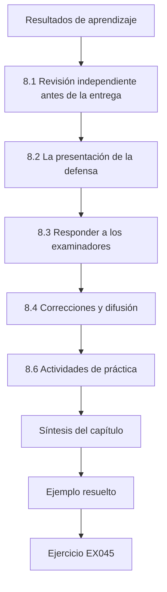

### Dibujo lógico


```text
[Resultados de aprendizaje]
    |
    v
[8.1 Revisión independiente antes de la entrega]
    |
    v
[8.2 La presentación de la defensa]
    |
    v
[8.3 Responder a los examinadores]
    |
    v
[8.4 Correcciones y difusión]
    |
    v
[8.6 Actividades de práctica]
    |
    v
[Síntesis del capítulo]
    |
    v
[Ejemplo resuelto] --> [Ejercicio EX045]
```
<!-- cykin:lesson-figures:end ch-08 -->


### Resultados de aprendizaje

Usted será capaz de (1) encargar y aprovechar una revisión independiente del código y del texto antes de la entrega; (2) preparar una presentación para la defensa; (3) responder a las preguntas de los examinadores con evidencia y límites; (4) responder a las correcciones exigidas; y (5) planificar la difusión, incluido un breve resumen para profesionales.

### 8.1 Revisión independiente antes de la entrega

Pida a un colega que no haya trabajado en el proyecto que (a) reproduzca una tabla principal a partir de su anexo de artefactos, (b) lea el método y diga qué no pudo repetir, y (c) lea el resumen y diga qué cree que usted afirma. Cada una revela un problema distinto: dependencias ocultas, detalles del método que faltan y afirmaciones exageradas. Una breve revisión del código centrada en el cálculo de las métricas y en las particiones de datos merece el tiempo; los errores ahí cambian las conclusiones. El colega de Leo encontró de este modo un descarte silencioso de los registros largos.

### 8.2 La presentación de la defensa

De veinte a treinta minutos: problema y pregunta; diseño y su justificación; resultados con intervalos y costes; explicaciones alternativas y lo que las descartó; limitaciones; contribución y próximos pasos. Una diapositiva debería responder a la pregunta de investigación en una frase con un número y un intervalo. La diapositiva de respuesta de Leo daba la diferencia emparejada con su intervalo. Ponga las explicaciones alternativas antes que las limitaciones, porque los examinadores preguntarán por ellas. Ensaye con un cronómetro y con un colega que haga preguntas difíciles, y prepare diapositivas de reserva sobre la ablación y las comprobaciones de calidad para poder mostrar la evidencia cuando se la pidan.

### 8.3 Responder a los examinadores

Espere preguntas sobre las decisiones de diseño («¿por qué datos sintéticos?»), las amenazas a la validez («¿se mantendría esto con notas reales?»), la estadística («¿son suficientes cinco semillas?»), las explicaciones alternativas («¿no es esto simplemente sobreajuste?») y la práctica («¿qué debería hacer Harbourline?»). Responda en tres partes: respuesta directa, evidencia, límite. Cuando no sepa algo, dígalo y explique cómo lo averiguaría. Las respuestas de Leo en el ejemplo resuelto de más abajo siguen esta forma: la ablación como evidencia, el ataque como límite. Prepare respuestas escritas a cada pregunta esperada y ensáyelas con un colega que haga de examinador crítico.

### 8.4 Correcciones y difusión

Los examinadores suelen exigir correcciones. Haga cada cambio, anótelo en una tabla de correcciones con referencias de página y devuélvala con prontitud. Las opciones de difusión incluyen un artículo para un taller, un repositorio público con el generador sintético y un resumen para profesionales de dos páginas que enuncie el hallazgo, las condiciones y el siguiente paso recomendado, relacionado cuando proceda con los marcos que usa la organización, como las funciones *Measure* y *Manage* del NIST AI RMF o su proceso de tratamiento del riesgo según ISO/IEC 42001. El resumen para profesionales de Leo presenta la deduplicación como un control candidato de bajo coste bajo el ataque evaluado.

### 8.5 Ejemplo resuelto (caso sintético de Harbourline)

Un colega que reproducía la tabla principal de Leo descubrió que el *script* de evaluación descartaba en silencio los registros de más de 512 tokens, alrededor del 3 % de los no miembros. Leo lo corrigió; la TPR con una FPR del 1 % se movió 0,2 puntos y las conclusiones se mantuvieron, y él anotó la corrección. En la defensa, un examinador preguntó: «¿No es esto simplemente sobreajuste?». Leo mostró la ablación de eliminación aleatoria y el análisis con brechas emparejadas: «Parte del efecto está relacionada con el tamaño (1,9 puntos), pero los 3,7 puntos restantes son específicos de los duplicados, bajo este ataque». Otro preguntó si Harbourline debería adoptar en su lugar la privacidad diferencial. Leo respondió que la privacidad diferencial da garantías formales (Abadi et al., arXiv:1607.00133) con un coste de utilidad que él no midió; la deduplicación es complementaria y barata, y una comparación con la privacidad diferencial queda para trabajos futuros.

El laboratorio de inferencia de pertenencia puede usarse en la defensa para mostrar el concepto central en treinta segundos.

```python
"""Lab M: membership inference against an overfit 1-nearest-neighbour 'model'
that returns a confidence score. Synthetic records only; teaching model."""
import random, math
rng = random.Random(5)
def rec(): 
    y = rng.random() < 0.5
    return [rng.gauss(0.6 if y else -0.6, 1.0) for _ in range(4)], int(y)
members = [rec() for _ in range(150)]; nonmembers = [rec() for _ in range(150)]
def confidence(x, y, k):
    # k-NN vote share for the true label, computed over the training set
    d = sorted((sum((a-b)**2 for a, b in zip(x, m)), my) for m, my in members)
    return sum(1 for _, my in d[:k] if my == y)/k
def auc(pos, neg):
    s = sum((p > n) + 0.5*(p == n) for p in pos for n in neg)
    return s/(len(pos)*len(neg))
for k in (1, 5, 25):
    pos = [confidence(x, y, k) for x, y in members]
    neg = [confidence(x, y, k) for x, y in nonmembers]
    best = max(sum(p >= t for p in pos)/len(pos) - sum(n >= t for n in neg)/len(neg)
               for t in sorted(set(pos + neg)))
    print(f"k={k:2d} attack_auc={auc(pos, neg):.3f} best_advantage={best:.3f}")
```

Salida esperada:

```text
k= 1 attack_auc=0.600 best_advantage=0.200
k= 5 attack_auc=0.521 best_advantage=0.073
k=25 attack_auc=0.520 best_advantage=0.060
```

### 8.6 Actividades de práctica

1. Organice una revisión de reproducción y de lectura del resumen. 2. Prepare una presentación para la defensa con una diapositiva de respuesta. 3. Redacte el resumen para profesionales. Para la revisión, pida a un colega que reproduzca una tabla y lea el resumen, y anote lo que encontró. Para la presentación, incluya una diapositiva que responda a la pregunta con un número y un intervalo, como hizo Leo con la diferencia de 3,7 puntos. Para el resumen, enuncie el hallazgo, las condiciones y el siguiente paso, y no pase de dos páginas. Tome nota de lo que cambió.

### 8.7 Errores y límites

Cuatro errores se repiten, y cada uno debilita la etapa final; revise su entrega en busca de los cuatro:

- Entregar sin que nadie haya reproducido un resultado; sin una reproducción, problemas como los registros largos descartados en el trabajo de Leo llegan a los examinadores.
- Responder a las preguntas a la defensiva y sin evidencia; esto hace perder la confianza de los examinadores.
- Resúmenes para profesionales que omiten las condiciones; un resumen así convierte un resultado bajo un único ataque, con notas sintéticas y una sola arquitectura, en una regla general.
- Ignorar las referencias de página de las correcciones exigidas; las correcciones sin referencias de página son difíciles de comprobar y retrasan la concesión del título.

### Ejercicios — capítulo 8

- **EX045 — Revisiones.** Nombre tres revisiones independientes que solicitar y lo que encuentra cada una. Rúbrica: 3 = reproducción/dependencias ocultas, lectura del método/detalles que faltan, lectura del resumen/afirmaciones exageradas; 2 = dos; 1 = una; 0 = ninguna.
- **EX046 — Diapositiva de respuesta.** Escriba la diapositiva de respuesta de una frase de Leo. Rúbrica: 3 = hallazgo con número, intervalo y condiciones; 2 = falta el intervalo o las condiciones; 1 = vago; 0 = nada.
- **EX047 — Pregunta sobre el sobreajuste.** Responda a «¿no es esto simplemente sobreajuste?» para su propio proyecto. Rúbrica: 3 = respuesta directa, evidencia (ablación/control), límite; 2 = dos partes; 1 = una; 0 = nada.
- **EX048 — Impacto del error.** ¿Cómo debería informar Leo del error de los 512 tokens? Rúbrica: 3 = describirlo, corregirlo, cuantificar el cambio, señalar que las conclusiones se mantuvieron, en el registro de desviaciones/correcciones; 2 = parcial; 1 = ocultarlo; 0 = nada.
- **EX049 — Privacidad diferencial frente a deduplicación.** Contraste la privacidad diferencial y la deduplicación en dos frases. Rúbrica: 3 = la privacidad diferencial es una cota formal con coste de utilidad; la deduplicación es heurística, barata y se centra en la repetición; complementarias; 2 = parcial; 1 = vago; 0 = incorrecto.
- **EX050 — Resumen para profesionales.** Escriba las tres primeras frases del resumen para profesionales. Rúbrica: 3 = hallazgo, condiciones, siguiente paso, sin exagerar; 2 = dos; 1 = una; 0 = nada.

### Síntesis del capítulo

La revisión independiente detecta los errores que usted no puede ver; la defensa pone a prueba si puede vincular cada afirmación con su evidencia y sus límites. Un resumen para profesionales cuidadoso lleva el resultado a la práctica sin perder sus condiciones.

### Siga estudiando — capítulo 08 de 08

[← Capítulo 07 (borrador)](#ch-07) · [Índice de capítulos del curso](../SUBJECTS.md) · [Resultados resueltos ↓](#worked-results) · [Siguiente curso a través del índice de capítulos →](../SUBJECTS.md)

<a id="worked-results"></a>

## Resultados resueltos

Respuestas modelo; cualquier respuesta que cumpla la rúbrica obtiene la misma puntuación. Harbourline Mutual y todos sus números son sintéticos.

**EX001.** «En agentes de LLM que usan herramientas y leen correo electrónico no fiable (P), ¿exigir confirmación humana para las acciones salientes (I), frente a no exigir confirmación (C), reduce la exfiltración lograda en un banco de pruebas aislado de 500 tareas sintéticas (O)?»

**EX002.** Fuentes/bases de datos; cadenas de búsqueda; intervalo de fechas; criterios de inclusión y exclusión; fecha de la búsqueda; recuentos en cada etapa de cribado (además: seguimiento de citas).

**EX003.** Modelo de amenaza; tipo/tamaño del modelo; datos; métrica; resultado principal; defensa; evaluación adaptativa; disponibilidad del código; limitaciones. La *evaluación adaptativa* importa porque las defensas probadas solo contra ataques fijos a menudo se rompen después.

**EX004.** El daño a la privacidad procede de identificar con confianza a personas concretas; un ataque con un AUC modesto puede aun así identificar algunos registros casi con certeza, y solo la TPR con una FPR baja lo revela.

**EX005.** El artículo revisado por pares (comprobado por la revisión) y el preprint de arXiv con código (comprobable) arriba, en cualquier orden defendible; el blog del proveedor, el último. El marco del NIST no es una fuente experimental: aporta vocabulario y expectativas que se citan para las definiciones.

**EX006.** k = 1: AUC 0.600; k = 5: AUC 0.521. Memorizar (k = 1) filtra la pertenencia; promediar sobre los vecinos elimina la mayor parte de la señal.

**EX007.** Cite los autores, el título, el nombre del taller y el año, y la URL que utilizó (con la fecha de acceso). Nunca invente un DOI.

**EX008.** Evasión: un atacante con acceso de consulta (o de caja blanca) perturba las entradas de prueba para provocar una clasificación errónea. Puerta trasera: un atacante que controla parte de los datos de entrenamiento inserta ejemplos con disparador para provocar las salidas que elige. Inferencia de pertenencia: un atacante con acceso de consulta a las salidas decide si un registro estuvo en el entrenamiento.

**EX009.** FGSM da un único paso de tamaño eps en la dirección del signo del gradiente; PGD da muchos pasos más pequeños, proyectando de nuevo sobre el conjunto permitido cada vez, y es un ataque más fuerte.

**EX010.** Con salidas enteras, el error máximo de los pesos es 0.534 y la coincidencia de etiquetas 0.882 (frente a 0.000/1.000 con precisión completa). Las salidas gruesas reducen la fidelidad, pero siguen dejando una copia aproximada útil.

**EX011.** La pertenencia revela que una persona presentó un siniestro, lo que puede implicar problemas de salud, accidentes o pérdidas: algo sensible en sí mismo.

**EX012.** Alguien de dentro con acceso de escritura a las notas de entrenamiento podría insertar notas que contengan una frase poco común etiquetadas como "fast-track". Controles: acceso de escritura restringido y registrado, con procedencia de los datos de entrenamiento; auditorías previas al entrenamiento de correlaciones entre tokens poco comunes y etiquetas, y pruebas de disparadores después del entrenamiento.

**EX013.** LLM01 Prompt Injection (instrucciones en los correos); LLM02 Sensitive Information Disclosure (detalles de siniestros en las respuestas); LLM06 Excessive Agency (enviar respuestas sin revisión).

**EX014.** Por ejemplo: ¿qué conocimiento del adversario se supone, y se evalúa la defensa frente a un atacante que la conoce? ¿Se informan los resultados con tasas de falsos positivos bajas y con intervalos entre semillas? ¿Cuál es el coste en utilidad o en latencia en las mismas tareas?

**EX015.** Estudio observacional de los registros de un asistente que el investigador está autorizado a estudiar, con salvaguardas de consentimiento/privacidad; hay que discutir los factores de confusión (población de usuarios, cambios de funcionalidades). Un experimento es imposible porque no se puede controlar a los atacantes reales.

**EX016.** Independiente: defensa (ninguna frente a entrenamiento adversarial). Dependientes: exactitud bajo PGD con eps fijo; exactitud con datos limpios. Controladas: arquitectura, épocas de entrenamiento, partición de datos, pasos/eps del ataque, semillas.

**EX017.** Si los no miembros difieren en su distribución (por ejemplo, registros más recientes), el ataque puede distinguirlos por el cambio de distribución y no por la pertenencia, de modo que la fuga medida queda inflada.

**EX018.** Licitud; limitación de la finalidad; minimización de datos; limitación del plazo de conservación; integridad y confidencialidad (seguridad); responsabilidad proactiva.

**EX019.** Tasas por semilla 0.110, 0.130, 0.135, 0.105, 0.145 —un intervalo de 0.105–0.145— con media 0.125 y sd 0.017.

**EX020.** Repositorio con control de versiones; entorno fijado; archivos de configuración; política de semillas; una orden por experimento; registros estructurados; ficha de datos.

**EX021.** La evaluación usó instrucciones de *jailbreak* más débiles o diferentes; la barrera de protección rechaza en exceso (incluidas instrucciones benignas); la distribución de instrucciones difiere entre condiciones; artefactos del evaluador o de la semilla.

**EX022.** Elimine al azar el mismo número de registros (varias extracciones). Si la ganancia de privacidad es igual a la de la deduplicación, la explica el tamaño del conjunto de datos; si la deduplicación gana más, eliminar duplicados importa.

**EX023.** Los centroides promedian cientos de puntos, así que una minoría de etiquetas invertidas los desplaza poco; la puerta trasera usa una tercera característica que vale cero en los datos limpios, lo que crea una dirección nueva que los datos limpios no pueden contrarrestar.

**EX024.** Exactitud con datos limpios 0.968; éxito del ataque 0.980.

**EX025.** Un ataque débil puede hacer que cualquier defensa parezca eficaz; un ataque calibrado y más fuerte (sobre todo con una FPR baja) muestra si la reducción se mantiene.

**EX026.** «Bajo un ataque de inferencia de pertenencia calibrado, la mayor parte de la reducción observada de la fuga fue atribuible a la eliminación de registros duplicados más que a un conjunto de entrenamiento más pequeño.»

**EX027.** Pregunta/motivación; antecedentes; diseño; explicaciones alternativas/ablaciones; plan de análisis; ética y protección de datos; riesgos y mitigaciones; calendario; contribución esperada.

**EX028.** Confirmar que la cadena funciona de principio a fin; medir el tiempo de ejecución; estimar la variabilidad; comprobar que las métricas y los ataques se comportan de forma razonable; descubrir sorpresas.

**EX029.** n ≈ 1,96² × 0,05 × 0,95 / 0,01² ≈ 1.825.

**EX030.** Todas las condiciones se sitúan cerca del mínimo de la métrica, de modo que no pueden verse las diferencias. Leo sustituyó el ataque de umbral de confianza por un ataque calibrado con modelos de referencia.

**EX031.** eps 0.50 (0.840) y 0.75 (0.660): la exactitud no está cerca del techo con datos limpios (0.985) ni en el nivel del azar (0.505 con 1.00), así que pueden distinguirse las defensas.

**EX032.** «Día 3 del piloto: se sustituyó el ataque de umbral por un ataque calibrado; motivo: efecto suelo (TPR del 1–2 % en todas las condiciones); efecto: condiciones separables.» «Día 4 del piloto: se corrigieron las plantillas 12 y 19 del generador; motivo: notas casi idénticas entre clases; efecto: elimina el ruido en las etiquetas.»

**EX033.** Si las condiciones se ejecutan en bloques, un cambio dependiente del tiempo (hardware, biblioteca, carga) puede hacerse pasar por un efecto del tratamiento; intercalar reparte esos problemas entre las condiciones.

**EX034.** Todas las ejecuciones presentes; se superan los canarios (modelo sin defensa atacable, modelo con etiquetas barajadas al nivel del azar); sin duplicados entre particiones; valores de las métricas plausibles.

**EX035.** ASR de referencia 0.350; con defensa 0.190; IC del 95 % de la reducción [0.120, 0.203].

**EX036.** Los elementos varían en dificultad; emparejar cancela esa variación compartida y da un intervalo más ajustado y correcto para la diferencia. Comparar intervalos separados que se solapan es conservador y puede inducir a error.

**EX037.** Utilidad/exactitud; latencia; rechazos falsos o falsos positivos; coste de cómputo y de mantenimiento.

**EX038.** Como resultado exploratorio en una subsección etiquetada, planteado como hipótesis para un trabajo confirmatorio futuro.

**EX039.** (a) Hallazgo: una cantidad medida. (b) Interpretación: una explicación causal que necesita evidencia de ablación.

**EX040.** Interna: artefactos del generador; de constructo: una sola familia de ataques; externa: una sola arquitectura, notas sintéticas en inglés; de la conclusión: cinco semillas. (Cada una con la medida adoptada.)

**EX041.** «Siguiendo a Greshake et al. (arXiv:2302.12173), construimos inyecciones indirectas incrustadas en documentos recuperados dentro de nuestro entorno aislado; las cadenas de las cargas útiles no se publican y están a disposición de los investigadores que las soliciten.»

**EX042.** Repositorio y *commit*; entorno; órdenes de reproducción por tabla; ficha de datos; ficha de modelo; *hashes* de los archivos clave; declaración de lo que se retiene y por qué.

**EX043.** La precisión completa recupera los pesos exactamente (error 0.000, coincidencia 1.000); dos decimales dan un error de 0.004 (coincidencia 0.998); los enteros dan un error de 0.534 (coincidencia 0.882). La precisión de la salida forma parte del modelo de amenaza.

**EX044.** «La deduplicación es un control de bajo coste que las aseguradoras que ajustan finamente clasificadores podrían evaluar para reducir la fuga de pertenencia.»

**EX045.** La reproducción de una tabla encuentra dependencias ocultas y errores; la lectura del método encuentra detalles que faltan; la lectura del resumen encuentra afirmaciones exageradas.

**EX046.** «La eliminación de casi duplicados redujo la TPR de la inferencia de pertenencia con una FPR del 1 % del 9,8 % al 4,2 %, 3,7 puntos (IC del 95 %: 2,6–4,9) más que la eliminación aleatoria, con un coste de 0,007 en el F1 macro, en notas sintéticas, con una sola arquitectura y un ataque calibrado.»

**EX047.** Las respuestas varían; una respuesta completa da una respuesta directa, la evidencia de la ablación o del control, y un límite.

**EX048.** Describir el error, la corrección, el cambio de 0,2 puntos y que las conclusiones se mantuvieron, y anotarlo en el registro de desviaciones y en los métodos.

**EX049.** La privacidad diferencial acota formalmente la influencia de cada registro, con un coste de utilidad medible. La deduplicación es una heurística barata que se centra en los registros repetidos; son complementarias.

**EX050.** «Eliminar las notas de siniestros duplicadas antes del ajuste fino redujo aproximadamente a la mitad una medida de la fuga de pertenencia en nuestro estudio sintético, casi sin coste de exactitud. Esto se cumplió para un tipo de modelo y con datos sintéticos. Proponemos un piloto sobre una copia gobernada de datos reales antes de adoptarla.»

<a id="references"></a>

## Referencias

Enlaces comprobados el 12 de octubre de 2026; los marcos cambian, así que vuelva a verificarlos. Los identificadores de arXiv se abrieron y se comprobaron sus títulos. La lista es idéntica a la de la edición en inglés; los títulos de las obras se citan en su idioma original.

- Abadi, M. et al. (2016). Deep Learning with Differential Privacy. arXiv:1607.00133.
- Athalye, A., Carlini, N., Wagner, D. (2018). Obfuscated Gradients Give a False Sense of Security. arXiv:1802.00420.
- Carlini, N. et al. (2020). Extracting Training Data from Large Language Models. arXiv:2012.07805.
- European Union. Regulation (EU) 2024/1689 (Artificial Intelligence Act). <https://eur-lex.europa.eu/eli/reg/2024/1689/oj>
- Gebru, T. et al. (2018). Datasheets for Datasets. arXiv:1803.09010.
- Goodfellow, I., Shlens, J., Szegedy, C. (2014). Explaining and Harnessing Adversarial Examples. arXiv:1412.6572.
- Greshake, K. et al. (2023). Compromising Real-World LLM-Integrated Applications with Indirect Prompt Injection. arXiv:2302.12173.
- Gu, T., Dolan-Gavitt, B., Garg, S. (2017). BadNets. arXiv:1708.06733.
- ISO/IEC 42001:2023 Artificial intelligence — Management system. <https://www.iso.org/standard/81230.html>
- Kapoor, S., Narayanan, A. (2022). Leakage and the Reproducibility Crisis in ML-based Science. arXiv:2207.07048.
- Madry, A. et al. (2017). Towards Deep Learning Models Resistant to Adversarial Attacks. arXiv:1706.06083.
- MITRE ATLAS. <https://atlas.mitre.org/>
- Mitchell, M. et al. (2018). Model Cards for Model Reporting. arXiv:1810.03993.
- NIST AI 100-1 (2023), AI RMF 1.0. <https://doi.org/10.6028/NIST.AI.100-1>
- NIST AI 100-2 E2025 (2025), Adversarial Machine Learning taxonomy. <https://doi.org/10.6028/NIST.AI.100-2e2025>
- NIST AI 600-1 (2024), Generative AI Profile. <https://doi.org/10.6028/NIST.AI.600-1>
- OWASP Top 10 for LLM Applications 2025. <https://genai.owasp.org/llm-top-10/>
- Pineau, J. et al. (2020). Improving Reproducibility in Machine Learning Research. arXiv:2003.12206.
- Shokri, R. et al. (2016). Membership Inference Attacks against Machine Learning Models. arXiv:1610.05820.
- Szegedy, C. et al. (2013). Intriguing properties of neural networks. arXiv:1312.6199.
- Tramèr, F. et al. (2016). Stealing Machine Learning Models via Prediction APIs. arXiv:1609.02943.
