# Cloud and Container Security: Master's Course

- Language: English (`en`); course 174, Master's course (2 years).
- Editorial state: **published**. Chapters 1–8 of 8 have hand-written teaching text; exercises EX001–EX050 have matching worked results with 0–3 rubrics; three offline labs use only the Python 3 standard library on synthetic evidence, and their outputs are embedded from real runs. Independent review and the 300-page A4 verification remain open.
- Audience: master's students who must compare competing explanations of cloud security failures with careful observational research.
- Author: [hiagokinlevi](https://github.com/hiagokinlevi). Original text [CC0 1.0](../../../../../LICENSE); cited works keep their rights.
- Ethical and legal boundary: review and test only cloud accounts, clusters and workloads you are authorised to assess; no exploit code, no payloads, no attack procedures and no instructions for bypassing controls. Misconfigurations are taught from the defender's side using synthetic configurations, logs and data. All evidence, people and organisations are **synthetic** unless a sentence cites a public source.

[Course home](../../README.md) · [Chapter index](../SUBJECTS.md) · [Book plan](PLAN.md) · [Course skill](../../skill/SKILL.md) · [Worked results](#worked-results)

## How to use this draft

Read in order: the chapters follow one master's student from a hand-made public storage bucket, through question and literature method, an access-control seminar, study design and ethics, competing explanations, proposal and pilot, analysis and writing, to independent review. Run each lab where it appears, attempt the exercises before the worked results, and score yourself with the rubrics.

### Synthetic running case

| Element | Role | Boundary |
|---|---|---|
| **Lucas Moreau** | Master's student | Invented |
| **Dr Mei Tanaka** | Supervisor | Invented |
| **Ashcombe University** | Fictional university | Invented |
| **Larkspur Retail** | Fictional online retailer | Invented |

### Core sources

NIST [SP 800-145](https://doi.org/10.6028/NIST.SP.800-145), [SP 800-210](https://doi.org/10.6028/NIST.SP.800-210), [SP 800-190](https://doi.org/10.6028/NIST.SP.800-190) and [SP 800-207](https://doi.org/10.6028/NIST.SP.800-207); CSA [Cloud Controls Matrix v4](https://cloudsecurityalliance.org/research/cloud-controls-matrix); [CIS Benchmarks](https://www.cisecurity.org/cis-benchmarks); the [AWS](https://aws.amazon.com/compliance/shared-responsibility-model/), [Azure](https://learn.microsoft.com/en-us/azure/security/fundamentals/shared-responsibility) and [Google Cloud](https://cloud.google.com/architecture/framework/security/shared-responsibility-shared-fate) shared responsibility pages; Kubernetes [Pod Security Standards](https://kubernetes.io/docs/concepts/security/pod-security-standards/) and [RBAC](https://kubernetes.io/docs/reference/access-authn-authz/rbac/) documentation. Full list in [References](#references).

## Contents

| Chapters |
|---|
| [1](#ch-01) · [2](#ch-02) · [3](#ch-03) · [4](#ch-04) · [5](#ch-05) · [6](#ch-06) · [7](#ch-07) · [8](#ch-08) |

[Worked results](#worked-results) · [References](#references)

<a id="ch-01"></a>

## Chapter 1 — Research question and literature method

<!-- cyberabc:lesson-figures:start ch-01 -->
### Lesson map

Lesson 01 published. Map, example, EX001.

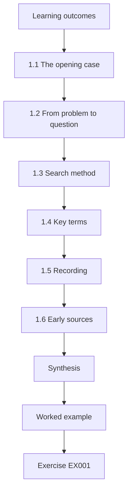

### Logical drawing

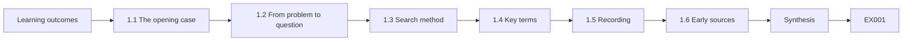

```text
[Learning outcomes]
    |
    v
[1.1 The opening case]
    |
    v
[1.2 From problem to question]
    |
    v
[1.3 Search method]
    |
    v
[1.4 Key terms]
    |
    v
[1.5 Recording]
    |
    v
[1.6 Early sources]
    |
    v
[Synthesis]
    |
    v
[Worked example] --> [Exercise EX001]
```
<!-- cyberabc:lesson-figures:end ch-01 -->


### Learning outcomes

You will (1) turn an operational problem into a master's research question; (2) search and screen literature systematically; (3) record the search so it can be repeated; (4) define key terms.

### 1.1 The opening case

Lucas Moreau is a master's student at the fictional Ashcombe University, supervised by Dr Mei Tanaka. His employer, the fictional online retailer Larkspur Retail, had a storage bucket of order exports left publicly readable for nine days. The bucket, tmp-export-0412, had been created by hand in the cloud console during a late-night data request. The security team believes manual console changes cause most exposures; the platform team believes infrastructure-as-code (IaC) templates with weak defaults are just as much to blame.

### 1.2 From problem to question

Lucas turns the argument into a question he can answer with Larkspur's change records: "Are configuration changes made through the console more likely to expose storage publicly than changes made through reviewed IaC, and what explains any difference?" The question compares two explanations rather than assuming one. The question came out of a real disagreement at Larkspur: the platform team blamed console changes, while the data team pointed to copied IaC templates. Phrasing it as a comparison commits Lucas to reporting whichever way the data fall, and the second clause leaves room for a third explanation neither team had named.

### 1.3 Search method

He searches two digital libraries and the NIST and CSA publication lists with recorded search strings, dates and result counts. Titles and abstracts are screened against written inclusion criteria: empirical or standards sources on cloud configuration error, IaC security or access control. The criteria were written before screening began and shared with Dr Tanaka, so the reasons for including or excluding a paper do not shift as Lucas reads. The search strings combine terms for misconfiguration, storage exposure, infrastructure as code and access control, and each is saved with the date it was run.

### 1.4 Key terms

"Exposure" means a storage resource readable without authentication. "Change origin" is console, IaC pipeline or provider API script. "Reviewed" means a second person approved the change. These definitions decide what the study counts. A bucket readable only by a partner's named account is not an exposure; a change made by a script that called the provider's API directly counts as its own origin. Writing the terms down before the data arrive stops them being stretched later to fit a result, as happened when the pilot showed that intended public access needed its own category.

### 1.5 Recording

The search log, screening decisions and reasons for exclusion are kept so another student could repeat the search and reach the same set. The log also caught Lucas's own bias: when he reviewed his exclusion reasons, two papers arguing that IaC spreads errors widely had been dropped without a valid reason. Dr Tanaka asked him to reinstate them. Without a written record, that pattern would have been invisible to anyone checking the review, including Lucas himself. The search strings and dates are in an appendix, so examiners can rerun the search and check whether other papers were missed.

### 1.6 Early sources

Mell and Grance (2011) define the service models; the shared responsibility pages of AWS, Microsoft and Google place storage access settings on the customer's side; Rahman et al. (2019) found security smells in IaC scripts, which supports the platform team's concern. These sources frame the question from both sides. The shared responsibility pages show that the misconfiguration is Larkspur's to prevent, whichever route caused it; Rahman et al. give the IaC explanation empirical support. Lucas notes that none of the early sources compares console and IaC exposure rates directly, which is the gap his study addresses.

### Worked example

The first search returns 412 records; after screening 31 remain. Lucas notices that he had unconsciously excluded two papers arguing that IaC also spreads errors widely. Dr Tanaka asks him to reinstate them, because a review that only supports one explanation cannot judge between two.

> **Synthetic case.** Larkspur Retail, people and counts are synthetic.

### Errors and limits

Searching only for evidence that supports a favoured explanation is confirmation bias.

### Exercises

- **EX001 — Opening incident.** What happened at Larkspur? *Rubric:* 3 = console-made bucket public 9 days; 2 = partial; 1 = vague; 0 = none.
- **EX002 — Two explanations.** What are the competing explanations? *Rubric:* 3 = console changes vs weak IaC defaults; 2 = partial; 1 = vague; 0 = none.
- **EX003 — The question.** State Lucas's question. *Rubric:* 3 = console more likely to expose than reviewed IaC, and why; 2 = partial; 1 = vague; 0 = none.
- **EX004 — Exposure term.** How is exposure defined? *Rubric:* 3 = readable without authentication; 2 = partial; 1 = vague; 0 = none.
- **EX005 — Search record.** What is recorded about the search? *Rubric:* 3 = strings, dates, counts, decisions; 2 = three; 1 = one; 0 = none.
- **EX006 — Reinstated papers.** Why were two papers reinstated? *Rubric:* 3 = avoid confirmation bias; 2 = partial; 1 = vague; 0 = none.
- **EX007 — Customer side.** Whose responsibility are storage access settings? *Rubric:* 3 = customer; 2 = partial; 1 = vague; 0 = none.

### Synthesis

A fair question compares explanations, supported by a repeatable search.

### Continue studying — chapter 01 of 08

[← Course home](../../README.md) · [Course chapter index](../SUBJECTS.md) · [Chapter 02 (draft) →](#ch-02)

<a id="ch-02"></a>

## Chapter 2 — Cloud and container security: advanced seminar

<!-- cyberabc:lesson-figures:start ch-02 -->
### Lesson map

Lesson 02 published. Map, example, EX008.

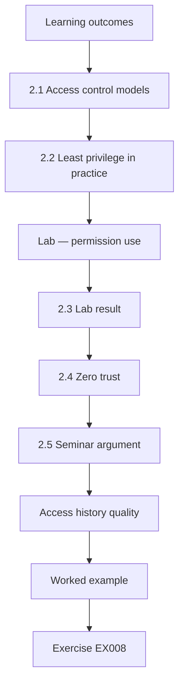

### Logical drawing

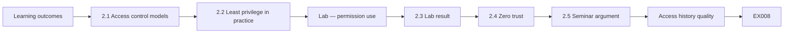

```text
[Learning outcomes]
    |
    v
[2.1 Access control models]
    |
    v
[2.2 Least privilege in practice]
    |
    v
[Lab — permission use]
    |
    v
[2.3 Lab result]
    |
    v
[2.4 Zero trust]
    |
    v
[2.5 Seminar argument]
    |
    v
[Access history quality]
    |
    v
[Worked example] --> [Exercise EX008]
```
<!-- cyberabc:lesson-figures:end ch-02 -->


### Learning outcomes

You will (1) discuss access control, least privilege and configuration in depth; (2) analyse permission use; (3) connect identity to storage exposure; (4) present a seminar argument.

### 2.1 Access control models

Sandhu et al. (1996) formalised role-based access control, where permissions attach to roles rather than individuals. Cloud platforms implement roles and policies at large scale. NIST SP 800-210 gives guidance specific to cloud systems, including managing access across service models. For Lucas, the relevance is that bucket access settings are themselves permissions held by roles. If many roles can change those settings, the number of paths to an exposure grows whatever tool is used. This is the basis of explanation C later in the study, and it is why he measures identities with storage administration rights per account.

### 2.2 Least privilege in practice

A role that holds permissions it never uses widens what an error or stolen credential can do. Cloud providers offer access history that shows which permissions were used, which allows evidence-based trimming. The lab measures this for three synthetic roles at Larkspur. The seminar later adds a caution: a permission unused in 90 days may still be needed for a quarterly task, so unused permissions become candidates for review with the owner rather than automatic removal. Lucas adds that nuance to his framework before the main study.

### Lab — permission use

```python
"""Compare granted and used permissions for synthetic cloud roles over 90 days (stdlib only)."""
roles = {
    "ci-deployer":   ({"storage.write", "storage.read", "compute.deploy", "iam.passRole", "logs.read"}, {"storage.write", "compute.deploy", "iam.passRole"}),
    "analytics-job": ({"storage.read", "storage.write", "db.read", "db.admin"}, {"storage.read", "db.read"}),
    "support-ro":    ({"logs.read", "compute.describe"}, {"logs.read", "compute.describe"}),
}
tg = tu = 0
for r, (granted, used) in roles.items():
    unused = sorted(granted - used)
    tg += len(granted); tu += len(unused)
    print(f"{r:14} granted {len(granted)}, used {len(used)}, unused: {', '.join(unused) or 'none'}")
print(f"unused share {tu}/{tg} = {100*tu/tg:.0f}%")
```

Run with `python3 lab_iam.py`. Verified output:

```text
ci-deployer    granted 5, used 3, unused: logs.read, storage.read
analytics-job  granted 4, used 2, unused: db.admin, storage.write
support-ro     granted 2, used 2, unused: none
unused share 4/11 = 36%
```

### 2.3 Lab result

Over 90 synthetic days, ci-deployer used 3 of 5 granted permissions (unused: logs.read, storage.read), analytics-job used 2 of 4 (unused: db.admin, storage.write) and support-ro used both of its 2. In total 4 of 11 granted permissions, 36%, went unused. The analytics job's unused storage.write matters for Lucas's question: a job that can write storage settings could also change them. Lucas reports the result as a property of three synthetic roles, not as a rate for Larkspur. Its value for the study is the method: access history can show which identities hold storage-changing rights they do not use.

### 2.4 Zero trust

NIST SP 800-207 argues that access should be decided per request using identity and context, not network location. For storage, that means private by default, with access granted to named identities. At Larkspur this principle points to two controls that later appear in Lucas's recommendations: blocking public access by default at account level, and granting bucket access to named identities instead of to everyone. Both work regardless of whether a change comes through the console or a template, which is why they address all three explanations at once.

### 2.5 Seminar argument

Lucas argues that exposure is partly an identity problem: if few identities can change bucket access settings, fewer paths to exposure exist, regardless of console or IaC. His seminar peers accepted the argument but challenged the 90-day usage window as a measure of need. Lucas therefore kept identity breadth as a separate explanation to test, counting identities with storage administration rights per account, instead of folding it into either of the platform team's or data team's explanations. Counting breadth does not depend on usage logs, so it stays testable even if the 90-day window is a poor measure of need.

### Access history quality

Access history can omit some actions, so Lucas checks the provider documentation for gaps before relying on it.

### Worked example

Seminar peers challenge him: unused permissions over 90 days may still be needed for rare tasks such as quarterly reports. Lucas agrees to treat unused permissions as candidates for review with the owner, not automatic removal, and adds this nuance to his framework.

> **Synthetic case.** Roles and usage are synthetic.

### Errors and limits

Absence of use in a window is not proof a permission is unneeded.

### Exercises

- **EX008 — RBAC idea.** What is the core RBAC idea? *Rubric:* 3 = permissions attach to roles; 2 = partial; 1 = vague; 0 = none.
- **EX009 — Lab share.** What share of permissions went unused? *Rubric:* 3 = 4/11, 36%; 2 = partial; 1 = vague; 0 = none.
- **EX010 — analytics-job.** Which permissions did analytics-job not use? *Rubric:* 3 = db.admin, storage.write; 2 = partial; 1 = vague; 0 = none.
- **EX011 — Why storage.write.** Why does analytics-job's unused storage.write matter? *Rubric:* 3 = could change bucket settings; 2 = partial; 1 = vague; 0 = none.
- **EX012 — ZTA for storage.** What does zero trust mean for storage? *Rubric:* 3 = private by default, named identities; 2 = partial; 1 = vague; 0 = none.
- **EX013 — Peer challenge.** What did peers challenge? *Rubric:* 3 = rare tasks need unused permissions; 2 = partial; 1 = vague; 0 = none.
- **EX014 — Response.** How did Lucas respond? *Rubric:* 3 = review with owner, not auto-remove; 2 = partial; 1 = vague; 0 = none.

### Synthesis

Identity and least privilege shape how exposures can happen.

### Continue studying — chapter 02 of 08

[← Chapter 01 (draft)](#ch-01) · [Course chapter index](../SUBJECTS.md) · [Chapter 03 (draft) →](#ch-03)

<a id="ch-03"></a>

## Chapter 3 — Study design, ethics and reproducibility

<!-- cyberabc:lesson-figures:start ch-03 -->
### Lesson map

Lesson 03 published. Map, example, EX015.

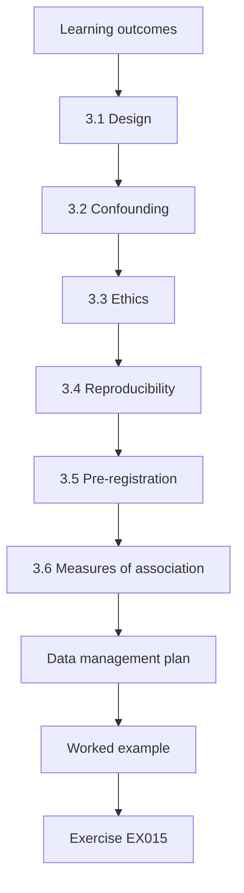

### Logical drawing

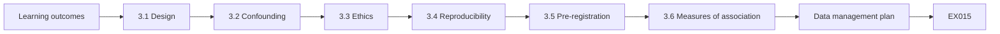

```text
[Learning outcomes]
    |
    v
[3.1 Design]
    |
    v
[3.2 Confounding]
    |
    v
[3.3 Ethics]
    |
    v
[3.4 Reproducibility]
    |
    v
[3.5 Pre-registration]
    |
    v
[3.6 Measures of association]
    |
    v
[Data management plan]
    |
    v
[Worked example] --> [Exercise EX015]
```
<!-- cyberabc:lesson-figures:end ch-03 -->


### Learning outcomes

You will (1) design an observational study of change records; (2) address confounding; (3) obtain ethics approval and data agreements; (4) plan reproducible analysis.

### 3.1 Design

The study uses one year of Larkspur's change records for storage resources. Each change has an origin (console or IaC), a time, a resource and whether it produced public exposure. An observational design is appropriate because Larkspur cannot randomly assign how teams make changes. One year covers seasonal peaks such as sales periods, when urgent changes are more likely. Each record comes from Larkspur's change log, with exposure taken from the provider's configuration history, so neither the team nor Lucas decides after the fact which change caused an exposure. The unit of analysis is the change, not the bucket.

### 3.2 Confounding

Console changes may happen more often under time pressure, in data-science teams or at night. Lucas records team, hour and resource type so he can check whether the difference holds within these groups. If the console rate is higher only at night or only in one team, explanation A would be weaker than it looks. Recording these variables before analysis lets him check within groups rather than explaining away differences after seeing them. Dr Tanaka later adds identity breadth to the list, because console users might also hold broad rights.

### 3.3 Ethics

Change records name engineers. The ethics application commits to pseudonymising engineer identities before analysis, reporting only by team and origin, and never using the study to assess individuals. Larkspur's data protection officer signs the data agreement. The ethics board added a condition: teams with fewer than five engineers are merged into an "other" group, so nobody can be identified by elimination. The pseudonymisation key stays at Larkspur, and Lucas never sees real names. The merging rule applies to every table and figure in the thesis, including the appendix breakdowns by account.

### 3.4 Reproducibility

Analysis scripts are written before the full data arrive, tested on synthetic records with the same structure and kept under version control. The synthetic generator is released with the thesis. Writing the scripts first means the analysis cannot be quietly shaped to the data. Testing them on synthetic records with Larkspur's structure also caught format problems before the real export arrived. Releasing the generator lets examiners and other students run the full analysis without access to Larkspur's records, which stay inside the data agreement.

### 3.5 Pre-registration

Lucas writes his hypotheses, primary comparison and planned subgroup checks in a dated document shared with Dr Tanaka before receiving the data. The document names the primary comparison, console against IaC exposure rates, the subgroup checks by team and hour, and the tests for clustering by template and identity breadth. When the pilot later forced a change to the definition of exposure, the change was logged against this document with its date and reason, before any main data were seen.

### 3.6 Measures of association

The primary result is the proportion of changes causing exposure by origin, the risk ratio, and a chi-square test; subgroup results follow. The risk ratio is the figure Larkspur's managers can use directly: how many times more likely a console change is to cause exposure. The chi-square test shows whether the difference could plausibly be chance at this sample size. Lucas checks before analysis that expected counts are large enough for the test to be valid, and plans to report the counts behind every percentage.

### Data management plan

The data management plan states where pseudonymised records are stored (a university-approved encrypted store), who can access them (Lucas and Dr Tanaka), how long they are kept (until the degree is awarded plus one year) and how they are deleted. Larkspur keeps the key linking pseudonyms to engineers and never shares it.

### Worked example

The ethics board asks how Lucas will avoid identifying an engineer in a small team. He agrees to merge teams with fewer than five engineers into an "other" group in all reports.

> **Synthetic case.** Records and approvals are synthetic.

### Errors and limits

Observational data show association; explanations need careful argument and subgroup checks.

### Exercises

- **EX015 — Why observational.** Why is the design observational? *Rubric:* 3 = cannot randomise change methods; 2 = partial; 1 = vague; 0 = none.
- **EX016 — Confounders.** Name three possible confounders. *Rubric:* 3 = time pressure, team, hour, resource type; 2 = two; 1 = one; 0 = none.
- **EX017 — Pseudonymising.** What happens to engineer identities? *Rubric:* 3 = pseudonymised; team-level reports; 2 = partial; 1 = vague; 0 = none.
- **EX018 — Pre-registration.** What was pre-registered? *Rubric:* 3 = hypotheses, primary comparison, subgroups; 2 = two; 1 = one; 0 = none.
- **EX019 — Primary result.** What is the primary result measure? *Rubric:* 3 = proportion exposing by origin, risk ratio, chi-square; 2 = two; 1 = one; 0 = none.
- **EX020 — Small teams.** How are small teams protected? *Rubric:* 3 = merge under 5 into other; 2 = partial; 1 = vague; 0 = none.

### Synthesis

Design for confounders, protect people and fix the analysis in advance.

### Continue studying — chapter 03 of 08

[← Chapter 02 (draft)](#ch-02) · [Course chapter index](../SUBJECTS.md) · [Chapter 04 (draft) →](#ch-04)

<a id="ch-04"></a>

## Chapter 4 — Cloud and container security: competing explanations

<!-- cyberabc:lesson-figures:start ch-04 -->
### Lesson map

Lesson 04 published. Map, example, EX021.

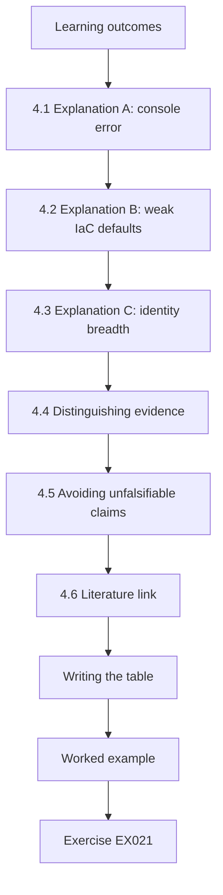

### Logical drawing

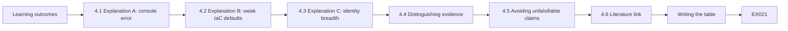

```text
[Learning outcomes]
    |
    v
[4.1 Explanation A: console error]
    |
    v
[4.2 Explanation B: weak IaC defaults]
    |
    v
[4.3 Explanation C: identity breadth]
    |
    v
[4.4 Distinguishing evidence]
    |
    v
[4.5 Avoiding unfalsifiable claims]
    |
    v
[4.6 Literature link]
    |
    v
[Writing the table]
    |
    v
[Worked example] --> [Exercise EX021]
```
<!-- cyberabc:lesson-figures:end ch-04 -->


### Learning outcomes

You will (1) state each explanation as a testable mechanism; (2) derive predictions that differ; (3) identify evidence that would distinguish them; (4) avoid unfalsifiable explanations.

### 4.1 Explanation A: console error

Manual console changes skip review and templates, so mistakes such as ticking "public" are more likely and stay unnoticed. Prediction: higher exposure rate for console changes, persisting within teams and hours. This is the platform team's view. If console changes are riskier only because they happen at night or in one team, the subgroup checks will show it, and A would be weakened. A also predicts that fixing templates would do little for console exposures, which is a pattern the data could contradict.

### 4.2 Explanation B: weak IaC defaults

Templates copied between projects carry permissive settings, and review focuses on application logic, not storage policy. Prediction: IaC exposures cluster in resources created from a small number of templates; fixing templates would cut many exposures at once. This is the data team's view, and it comes with its own falsifying pattern: if IaC exposures are spread evenly across many templates, weak defaults in a few templates cannot explain them. Template identifiers in Larkspur's change records make the test possible. Rahman et al. give the mechanism support from other organisations.

### 4.3 Explanation C: identity breadth

Exposure depends on how many identities can change access settings, whatever the origin. Prediction: exposures concentrate where many identities hold storage administration rights. This explanation came from Lucas's seminar argument, not from either Larkspur team. It would be contradicted if accounts with few storage administrators showed exposure rates as high as accounts with many. Because console users might also hold broad rights, identity breadth must be counted alongside origin, or C could make A look stronger than it is. Dr Tanaka asked him to state this in the proposal.

### 4.4 Distinguishing evidence

A and B can both be true. The study measures rates by origin, clustering by template and the number of identities with storage admin rights per account. Each measure tests one explanation's prediction without assuming the others are false. Lucas sets these out in a table with the pattern that would contradict each explanation, so that the results chapter can say which predictions held and which did not. If all three hold, the study shows that all three contribute, which is itself a useful answer for Larkspur.

### 4.5 Avoiding unfalsifiable claims

"Human error" alone explains everything and predicts nothing; each explanation must say what pattern would contradict it. At Larkspur, each team had been using "human error" for the other team's changes. Asking each explanation to name a contradicting pattern forced the argument into a form data could settle. The rule also binds Lucas: his own identity-breadth explanation must say what would count against it, which he wrote into the proposal table. Each contradicting pattern appears in the proposal table, next to the analysis that would reveal it.

### 4.6 Literature link

Rahman et al. (2019) supports B's mechanism; provider guidance on blocking public access at account level addresses all three. Account-level blocking matters for the study's recommendations because it limits exposure whichever explanation turns out strongest. Lucas notes, though, that such guidance is a control, not evidence about causes, so it informs the recommendations rather than the analysis. The literature review keeps the two uses apart. Lucas also cites the providers' own documentation for account-level blocking, so Larkspur's engineers can follow the same guidance when they apply it, and notes the date each page was checked.

### Writing the table

Each row of Lucas's table lists the explanation, its mechanism, its prediction, the evidence that would contradict it and the data field that measures it. Writing the contradicting evidence is the hardest column and the most useful: it forces each explanation to risk being wrong. The table becomes the first figure of the thesis.

### Worked example

Lucas tables the three explanations with their predictions and contradicting patterns. Dr Tanaka points out that C could make A look stronger if console users also hold broad rights; Lucas adds identity breadth as a control variable.

> **Synthetic case.** Explanations are framed for the synthetic case.

### Errors and limits

Supporting one explanation does not rule out others; look for the pattern that would contradict each.

### Exercises

- **EX021 — Explanation A.** State explanation A's prediction. *Rubric:* 3 = higher console rate within teams and hours; 2 = partial; 1 = vague; 0 = none.
- **EX022 — Explanation B.** What does explanation B predict? *Rubric:* 3 = clustering by template; 2 = partial; 1 = vague; 0 = none.
- **EX023 — Explanation C.** What does C predict? *Rubric:* 3 = exposures where many identities have admin rights; 2 = partial; 1 = vague; 0 = none.
- **EX024 — Human error.** Why is "human error" alone weak? *Rubric:* 3 = predicts nothing; 2 = partial; 1 = vague; 0 = none.
- **EX025 — Control variable.** What control variable was added? *Rubric:* 3 = identity breadth; 2 = partial; 1 = vague; 0 = none.
- **EX026 — Both true.** Can A and B both be true? *Rubric:* 3 = yes; 2 = partial; 1 = vague; 0 = none.

### Synthesis

Turn explanations into predictions that evidence could contradict.

### Continue studying — chapter 04 of 08

[← Chapter 03 (draft)](#ch-03) · [Course chapter index](../SUBJECTS.md) · [Chapter 05 (draft) →](#ch-05)

<a id="ch-05"></a>

## Chapter 5 — Proposal and pilot

<!-- cyberabc:lesson-figures:start ch-05 -->
### Lesson map

Lesson 05 published. Map, example, EX027.

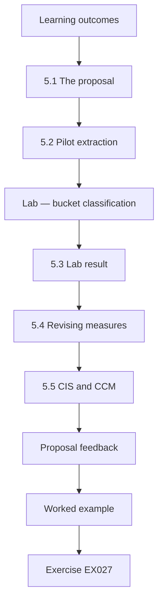

### Logical drawing

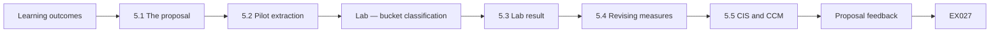

```text
[Learning outcomes]
    |
    v
[5.1 The proposal]
    |
    v
[5.2 Pilot extraction]
    |
    v
[Lab — bucket classification]
    |
    v
[5.3 Lab result]
    |
    v
[5.4 Revising measures]
    |
    v
[5.5 CIS and CCM]
    |
    v
[Proposal feedback]
    |
    v
[Worked example] --> [Exercise EX027]
```
<!-- cyberabc:lesson-figures:end ch-05 -->


### Learning outcomes

You will (1) write the research proposal; (2) pilot the data extraction on a small sample; (3) check measures work; (4) revise before the main collection.

### 5.1 The proposal

Twelve pages: background, question, explanations and predictions, design, data, ethics, analysis, risks and timeline. Each prediction maps to an analysis. Mapping each prediction to an analysis lets Dr Tanaka check that nothing in the proposal is untestable. The risks part names the main threats: missing origin labels, an incomplete register of intended public resources and the possibility that Larkspur cannot export a full year. The timeline leaves time to rerun the analysis after examination corrections. Her sign-off came before any pilot data existed.

### 5.2 Pilot extraction

Lucas extracts one month of synthetic-format records from a test account and classifies current bucket settings to check that the classification works. The pilot uses a test account so that no production records are involved before the data agreement is signed. It checks that Lucas's scripts read the export format, that origin labels are present, and that bucket settings can be classified consistently. Problems found here can still change the method without biasing results. No customer data sit in the test account.

### Lab — bucket classification

```python
"""Classify synthetic storage bucket settings against a simple baseline (stdlib only)."""
buckets = [  # name, public, encrypted, access_logging, origin
    ("orders-archive", False, True, True, "iac"), ("marketing-assets", True, True, False, "console"),
    ("tmp-export-0412", True, False, False, "console"), ("ml-features", False, True, False, "iac"),
    ("receipts", False, True, True, "iac"), ("partner-drop", True, True, True, "iac"),
]
for n, pub, enc, log, origin in buckets:
    issues = [x for x, bad in (("public", pub), ("unencrypted", not enc), ("no access logs", not log)) if bad]
    print(f"{n:17} {origin:8} {', '.join(issues) or 'ok'}")
print("public buckets:", sum(b[1] for b in buckets), "of", len(buckets))
```

Run with `python3 lab_buckets.py`. Verified output:

```text
orders-archive    iac      ok
marketing-assets  console  public, no access logs
tmp-export-0412   console  public, unencrypted, no access logs
ml-features       iac      no access logs
receipts          iac      ok
partner-drop      iac      public
public buckets: 3 of 6
```

### 5.3 Lab result

Of six synthetic buckets, three are public: marketing-assets (console; also no access logs), tmp-export-0412 (console; also unencrypted and no access logs) and partner-drop (IaC; public by design for a partner). orders-archive and receipts are ok; ml-features lacks access logs. The pilot shows that "public" needs a field for intended public access: partner-drop's exposure was approved. The other findings, missing access logs and an unencrypted bucket, are outside the study's question, but Lucas reports them to Larkspur through the agreed channel. The pilot's main lesson is about the measure: without an intended-public field, the study would have counted approved exposures as errors.

### 5.4 Revising measures

Exposure is now "unintended public access", with intended public resources recorded in an approved register. This change is made before the main data are seen and is noted in the pre-registration log. The register comes from Larkspur's existing approvals for public resources, such as partner-drop, so Lucas does not decide himself what was intended. The mobile-app labelling rule found in the pilot is logged the same way. Both changes are listed in the dissertation's method chapter with their dates, so an examiner can see that they preceded the main analysis.

### 5.5 CIS and CCM

The baseline checks align with CIS Benchmark recommendations for storage and with CSA CCM v4 control domains for data security, which helps relate findings to frameworks Larkspur already uses. Mapping findings to these frameworks lets Larkspur file them where its auditors already look, and lets other organisations compare their own checks. Lucas uses the frameworks as vocabulary, not as evidence that a control works; whether account-level blocking reduces exposure is a question for the follow-up measurement, not for the benchmark.

### Proposal feedback

The proposal reviewers ask for a power estimate. Using the pilot's rough rates, Lucas estimates that a year of records gives enough changes to detect a difference of about three percentage points between origins, and states that smaller differences may be missed.

### Worked example

The pilot also shows that console changes made through a provider's mobile app are logged with a different origin label. Lucas maps both to "console" and records the rule.

> **Synthetic case.** Buckets and labels are synthetic.

### Errors and limits

Changing measures after seeing main data is a source of bias; change them only after pilots, and log why.

### Exercises

- **EX027 — Lab public.** Which buckets were public? *Rubric:* 3 = marketing-assets, tmp-export-0412, partner-drop; 2 = two; 1 = one; 0 = none.
- **EX028 — tmp-export.** What issues did tmp-export-0412 have? *Rubric:* 3 = public, unencrypted, no logs; 2 = two; 1 = one; 0 = none.
- **EX029 — Revised measure.** How was exposure redefined? *Rubric:* 3 = unintended public access; 2 = partial; 1 = vague; 0 = none.
- **EX030 — Mobile app.** What labelling issue was found? *Rubric:* 3 = mobile app console origin label; 2 = partial; 1 = vague; 0 = none.
- **EX031 — Framework links.** Which frameworks do checks align with? *Rubric:* 3 = CIS Benchmarks, CSA CCM v4; 2 = partial; 1 = vague; 0 = none.
- **EX032 — When to change measures.** When may measures change? *Rubric:* 3 = after pilots, before main data, logged; 2 = partial; 1 = vague; 0 = none.

### Synthesis

Pilots refine measures before they can bias results.

### Continue studying — chapter 05 of 08

[← Chapter 04 (draft)](#ch-04) · [Course chapter index](../SUBJECTS.md) · [Chapter 06 (draft) →](#ch-06)

<a id="ch-06"></a>

## Chapter 6 — Data collection and analysis

<!-- cyberabc:lesson-figures:start ch-06 -->
### Lesson map

Lesson 06 published. Map, example, EX033.

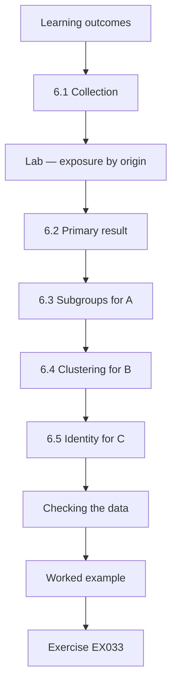

### Logical drawing

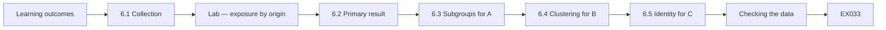

```text
[Learning outcomes]
    |
    v
[6.1 Collection]
    |
    v
[Lab — exposure by origin]
    |
    v
[6.2 Primary result]
    |
    v
[6.3 Subgroups for A]
    |
    v
[6.4 Clustering for B]
    |
    v
[6.5 Identity for C]
    |
    v
[Checking the data]
    |
    v
[Worked example] --> [Exercise EX033]
```
<!-- cyberabc:lesson-figures:end ch-06 -->


### Learning outcomes

You will (1) collect the full dataset under the agreed rules; (2) run the pre-registered analysis; (3) test subgroup patterns for each explanation; (4) interpret with care.

### 6.1 Collection

Larkspur exports one year of storage change records, pseudonymised, with origin, team group, hour, resource and template identifier. Lucas checks counts against Larkspur's monthly totals before analysis. The check against Larkspur's monthly totals guards against a month missing from the export. Team groups follow the ethics rule merging small teams, and origin labels include the mobile-app mapping found in the pilot. Lucas records the export date and the hash of each file in the archive before running the pre-registered scripts.

### Lab — exposure by origin

```python
"""Exposure events by change origin: rates and a chi-square test of independence (stdlib only)."""
import math
table = {"iac": (12, 1188), "console": (27, 573)}  # (exposing changes, other changes)
for k, (e, o) in table.items():
    print(f"{k:8} {e}/{e+o} changes exposing = {100*e/(e+o):.1f}%")
rows = list(table.values()); N = sum(sum(r) for r in rows)
cols = [sum(r[i] for r in rows) for i in (0, 1)]
chi = sum((rows[i][j] - sum(rows[i]) * cols[j] / N) ** 2 / (sum(rows[i]) * cols[j] / N) for i in (0, 1) for j in (0, 1))
p = math.erfc(math.sqrt(chi / 2))  # 1 degree of freedom
rr = (27/600) / (12/1200)
print(f"chi-square {chi:.1f} (df 1), p {p:.2g}; risk ratio console/iac {rr:.1f}")
```

Run with `python3 lab_origin.py`. Verified output:

```text
iac      12/1200 changes exposing = 1.0%
console  27/600 changes exposing = 4.5%
chi-square 23.1 (df 1), p 1.5e-06; risk ratio console/iac 4.5
```

### 6.2 Primary result

In the synthetic dataset, 12 of 1,200 IaC changes (1.0%) and 27 of 600 console changes (4.5%) caused unintended public exposure. The chi-square statistic is 23.1 with one degree of freedom, p about 1.5 × 10⁻⁶, and the risk ratio is 4.5: console changes were four and a half times as likely to expose storage. The result supports explanation A's main prediction, but on its own it cannot show why console changes are riskier. That requires the subgroup checks and the tests of B and C. Counts sit beside each rate, so readers can recheck them.

### 6.3 Subgroups for A

The difference holds within daytime and night-time changes and within the three largest team groups, which supports explanation A beyond timing or team effects. Lucas reports the rate in each subgroup with its counts, so readers can see that the difference is not driven by one large team. Smaller teams merged under the ethics rule are reported as one group. Identity breadth, added as a control, is examined with explanation C. The subgroup tables are in an appendix with their counts.

### 6.4 Clustering for B

Nine of the twelve IaC exposures come from two templates, supporting explanation B: weak defaults spread. Fixing those templates would address most IaC exposures. The two templates were copied into several projects, carrying the same permissive storage setting each time. The remaining three IaC exposures came from other templates, which is consistent with B explaining most but not all IaC exposures. Template identifiers make the fix concrete: Larkspur knows exactly which files to change. Larkspur's platform team uses the template identifiers to find every copy of the permissive setting before changing the source template.

### 6.5 Identity for C

Accounts where more than ten identities hold storage administration rights have higher exposure rates for both origins, supporting C as a contributing factor. The pattern holds for both origins, which means identity breadth is not simply a disguise for console use. Lucas reports C as a contributing factor rather than the main cause, because the study observes accounts at one organisation and cannot separate breadth from other account differences. The threshold of ten identities was chosen before analysis. Breadth counts per account are in the appendix, so readers can see how many accounts sit above the ten-identity threshold.

### Checking the data

Before analysis, Lucas checks for duplicate records, missing origins and impossible timestamps. He finds 14 records with no origin, all from an automation account; after checking with Larkspur, they are classed as IaC pipeline changes and the rule is logged. A sensitivity analysis excluding them gives the same conclusion.

### Worked example

Lucas's conclusion is that all three explanations contribute, with different remedies: guardrails for console changes, template fixes for IaC and fewer storage administrators. Dr Tanaka praises the result for replacing an argument between teams with evidence that both were partly right.

> **Synthetic case.** All counts are synthetic.

### Errors and limits

A small p-value shows the difference is unlikely by chance, not that it is large or causal.

### Exercises

- **EX033 — Rates.** What were the exposure rates? *Rubric:* 3 = IaC 1.0%, console 4.5%; 2 = partial; 1 = vague; 0 = none.
- **EX034 — Statistics.** What were the chi-square and risk ratio? *Rubric:* 3 = 23.1, RR 4.5; 2 = partial; 1 = vague; 0 = none.
- **EX035 — Template clustering.** How many IaC exposures came from two templates? *Rubric:* 3 = 9 of 12; 2 = partial; 1 = vague; 0 = none.
- **EX036 — Identity finding.** What did identity breadth show? *Rubric:* 3 = >10 admins higher rates both origins; 2 = partial; 1 = vague; 0 = none.
- **EX037 — Remedies.** Match each explanation to a remedy. *Rubric:* 3 = guardrails, template fixes, fewer admins; 2 = two; 1 = one; 0 = none.
- **EX038 — p-value meaning.** What does the small p-value show? *Rubric:* 3 = unlikely by chance, not size or cause; 2 = partial; 1 = vague; 0 = none.

### Synthesis

Test each explanation's prediction and match remedies to causes.

### Continue studying — chapter 06 of 08

[← Chapter 05 (draft)](#ch-05) · [Course chapter index](../SUBJECTS.md) · [Chapter 07 (draft) →](#ch-07)

<a id="ch-07"></a>

## Chapter 7 — Dissertation writing and limitations

<!-- cyberabc:lesson-figures:start ch-07 -->
### Lesson map

Lesson 07 published. Map, example, EX039.

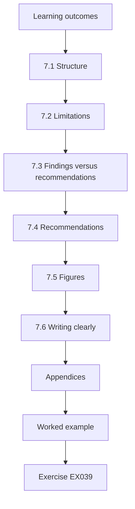

### Logical drawing

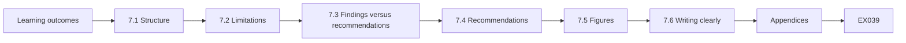

```text
[Learning outcomes]
    |
    v
[7.1 Structure]
    |
    v
[7.2 Limitations]
    |
    v
[7.3 Findings versus recommendations]
    |
    v
[7.4 Recommendations]
    |
    v
[7.5 Figures]
    |
    v
[7.6 Writing clearly]
    |
    v
[Appendices]
    |
    v
[Worked example] --> [Exercise EX039]
```
<!-- cyberabc:lesson-figures:end ch-07 -->


### Learning outcomes

You will (1) write the dissertation clearly; (2) present limitations honestly; (3) separate findings from recommendations; (4) prepare figures and appendices.

### 7.1 Structure

Introduction and question; literature review with the search method; design and ethics; results by explanation; discussion; limitations; recommendations; appendices with search log, analysis scripts and the synthetic generator. The structure mirrors the study's logic: each explanation gets its own results heading, with its prediction stated first and the evidence after. Findings and recommendations are kept in separate chapters. Appendices let an examiner rerun every table from the archive without contacting Lucas. A short abstract states the question, the three explanations and the main results with their limits.

### 7.2 Limitations

One organisation and one year; origin labels depend on logging accuracy; intended public resources depend on a register that may be incomplete; the study measures exposure, not whether data were accessed. Each limitation is tied to a claim. One organisation limits how far the rates generalise, though the mechanisms may transfer; logging accuracy matters for the origin comparison; the register matters for the exposure measure; and the study cannot say whether any exposed data were read. Lucas states these where the related results appear, not only in a final list.

### 7.3 Findings versus recommendations

Findings say what the data show; recommendations say what Larkspur might do, labelled as Lucas's judgement. Mixing them would overstate the evidence. The dissertation marks the boundary in its wording: results use "in this dataset", and recommendations begin with phrases such as "Lucas recommends". Dr Tanaka's comment on the draft sentence claiming the recommendations "will prevent exposures" is an example of this boundary being enforced. The revised sentence names a test Larkspur could run. Each recommendation names the explanation and table it rests on, so Larkspur can judge how strong the evidence is for that change.

### 7.4 Recommendations

Block public access at account level by default with approved exceptions, as provider guidance suggests; fix the two templates and add policy checks to IaC review; reduce storage administrators; route urgent data requests through a pre-approved, private export process. Each recommendation answers one explanation: account-level blocking and the private export process for console changes, template fixes and policy checks for IaC, and fewer storage administrators for identity breadth. Lucas labels them as his judgement based on the findings, and suggests repeating the measurement to see whether they work.

### 7.5 Figures

One figure per explanation shows its prediction against the data, using the same scale. Using the same scale prevents a small difference from looking dramatic in one figure and a large one looking minor in another. Each figure also shows the counts behind the rates. A reader comparing the three explanations can then see at a glance which predictions fit the data best. Figures are produced by the archived scripts, so a rerun reproduces them exactly, and each caption states the dataset and period it covers.

### 7.6 Writing clearly

Short paragraphs, defined terms and one claim per paragraph. Dr Tanaka asks Lucas to remove phrases like "clearly" and "proves", which overstate observational results. Each defined term, such as unintended public access, is used the same way throughout, so readers do not have to guess whether exposure means something different in one chapter. A glossary at the front lists the terms with their definitions. Dr Tanaka reads one chapter at a time and marks any paragraph that makes more than one claim, which Lucas then splits.

### Appendices

The appendices let readers check everything without cluttering the main text. They contain the full search log with screening decisions, the pre-registration and its dated amendments, the analysis scripts with a short guide to rerunning them, the synthetic data generator and a table mapping each recommendation to the finding that supports it. Dr Tanaka asks Lucas to test the guide by having a classmate follow it; the classmate reproduces every figure on the first attempt.

### Word limits

Lucas keeps within the word limit by moving detail to appendices.

### Worked example

In draft review, Dr Tanaka marks a sentence claiming the recommendations "will prevent exposures". Lucas changes it to "are expected to reduce exposures, which Larkspur could test by repeating the measurement after a year".

> **Synthetic case.** Text and outcomes are synthetic.

### Errors and limits

Recommendations framed as findings mislead readers about certainty.

### Exercises

- **EX039 — Limitations.** Name three limitations. *Rubric:* 3 = one org/year, logging accuracy, register, no access data; 2 = two; 1 = one; 0 = none.
- **EX040 — Findings vs recommendations.** How do findings differ from recommendations? *Rubric:* 3 = data vs judgement; 2 = partial; 1 = vague; 0 = none.
- **EX041 — Recommendations.** List two recommendations. *Rubric:* 3 = account-level block, template fixes, fewer admins, private export; 2 = one; 1 = vague; 0 = none.
- **EX042 — Figures.** How are figures organised? *Rubric:* 3 = one per explanation, same scale; 2 = partial; 1 = vague; 0 = none.
- **EX043 — Overclaiming.** How was the overclaim fixed? *Rubric:* 3 = expected to reduce; test later; 2 = partial; 1 = vague; 0 = none.
- **EX044 — Exposure vs access.** Why is exposure not access? *Rubric:* 3 = data may not have been read; 2 = partial; 1 = vague; 0 = none.

### Synthesis

Write clearly, limit claims and separate judgement from evidence.

### Continue studying — chapter 07 of 08

[← Chapter 06 (draft)](#ch-06) · [Course chapter index](../SUBJECTS.md) · [Chapter 08 (draft) →](#ch-08)

<a id="ch-08"></a>

## Chapter 8 — Independent review and defense

<!-- cyberabc:lesson-figures:start ch-08 -->
### Lesson map

Lesson 08 published. Map, example, EX045.

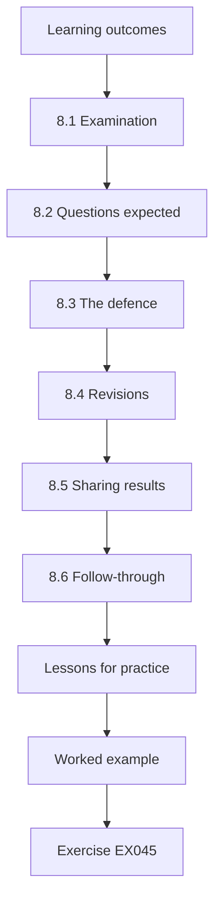

### Logical drawing

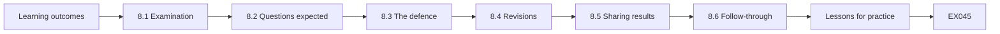

```text
[Learning outcomes]
    |
    v
[8.1 Examination]
    |
    v
[8.2 Questions expected]
    |
    v
[8.3 The defence]
    |
    v
[8.4 Revisions]
    |
    v
[8.5 Sharing results]
    |
    v
[8.6 Follow-through]
    |
    v
[Lessons for practice]
    |
    v
[Worked example] --> [Exercise EX045]
```
<!-- cyberabc:lesson-figures:end ch-08 -->


### Learning outcomes

You will (1) prepare for independent examination; (2) respond to examiner questions; (3) revise the dissertation; (4) share results responsibly.

### 8.1 Examination

An external examiner reads the dissertation and the archive. Lucas prepares by rerunning all scripts from the archive on a clean machine. Rerunning on a clean machine checks that the archive is complete and that the readme's instructions work for someone other than Lucas. Any difference between the rerun and the dissertation's tables would be found before the examiner finds it. He records the rerun date and the matching outputs in the archive. He also rereads the pre-registration, so he can say which choices were fixed before the data arrived.

### 8.2 Questions expected

Could origin labels be wrong? He shows the logging checks and mobile-app rule. Is chi-square appropriate? Expected counts exceed five in all cells. Do findings generalise? Mechanisms may, rates may not. Each answer points to evidence in the dissertation: the pilot's labelling checks, the expected-count check before the chi-square test, and the limitations chapter on generalisation. Preparing them in advance helps him answer briefly and accurately under pressure. He also prepares an answer on the register: who approves intended public resources, and what happens if it is incomplete.

### 8.3 The defence

In a 45-minute viva, the examiner asks why Lucas did not use multilevel models for team effects. Lucas explains the pre-registered approach and shows the subgroup checks, agreeing that multilevel models would be a good extension. Lucas does not defend the simpler method as better; he defends it as the one he committed to before seeing the data, and shows that the subgroup checks address the concern for now. Agreeing that a multilevel model would be a good extension is honest and costs him nothing.

### 8.4 Revisions

Minor corrections: clarify the register definition, add the power estimate to the results chapter. The register definition is clarified to say who approves an intended public resource and where approvals are recorded. The power estimate shows how large a difference the study could detect with 1,200 IaC and 600 console changes, which answers the examiner's question about the sample size. Both corrections are made in the archive version too. The archive manifest is regenerated after the corrections, so the digests match the corrected files.

### 8.5 Sharing results

Larkspur receives a summary with the recommendations; a short paper is submitted with synthetic data and scripts; no engineer or team names are published. The summary for Larkspur leads with the three explanations and their remedies, followed by the limits. The paper uses the synthetic dataset so that other researchers can run the analysis without Larkspur's records. Merged small teams and pseudonyms protect individuals in both, as the ethics application required. The data agreement required the summary to go to Larkspur's data protection officer before wider release.

### 8.6 Follow-through

Larkspur enables account-level public access blocking and fixes the two templates within a quarter. These are the two recommendations most directly supported by the data, and Larkspur chose to act on them first. Reducing the number of storage administrators takes longer because roles must be reviewed with their owners, as the seminar discussion about unused permissions anticipated. The later repeat measurement used Lucas's scripts unchanged. The repeat measurement is the test that Lucas's revised wording proposed, and its before-after design has the limits he noted.

### Lessons for practice

Lucas writes a two-page note for practitioners: measure exposure by change origin, look for template clustering, count identities with storage admin rights, and use provider account-level controls to make private the default. The note avoids naming Larkspur and links to the shared responsibility pages and CIS Benchmarks instead of recommending products. It is shared on the university's practitioner network and later used in a cloud governance workshop.

### Archive updates

After corrections, the archive gets a new version and manifest, recorded with the date.

### Worked example

Six months later Larkspur repeats the measurement with Lucas's scripts: console exposure has fallen to 1.2% and IaC to 0.3% in synthetic follow-up data, supporting the recommendations while Lucas notes the before-after design's limits.

> **Synthetic case.** Examination and outcomes are synthetic.

### Errors and limits

A before-after improvement may reflect other changes too; note them.

### Exercises

- **EX045 — Preparation.** How did Lucas prepare? *Rubric:* 3 = reran scripts on clean machine; 2 = partial; 1 = vague; 0 = none.
- **EX046 — Chi-square check.** Why was chi-square appropriate? *Rubric:* 3 = expected counts over five; 2 = partial; 1 = vague; 0 = none.
- **EX047 — Examiner suggestion.** What did the examiner suggest? *Rubric:* 3 = multilevel models; 2 = partial; 1 = vague; 0 = none.
- **EX048 — Follow-up rates.** What were follow-up rates? *Rubric:* 3 = console 1.2%, IaC 0.3%; 2 = partial; 1 = vague; 0 = none.
- **EX049 — Before-after limit.** What limits the follow-up? *Rubric:* 3 = other changes may explain; 2 = partial; 1 = vague; 0 = none.
- **EX050 — Sharing.** What is never published? *Rubric:* 3 = engineer or team names; 2 = partial; 1 = vague; 0 = none.

### Synthesis

Prepare reproducibly, answer openly and share responsibly.

### Continue studying — chapter 08 of 08

[← Chapter 07 (draft)](#ch-07) · [Course chapter index](../SUBJECTS.md) · [Worked results ↓](#worked-results) · [Next course via chapter index →](../SUBJECTS.md)

<a id="worked-results"></a>

## Worked results

Model answers for EX001–EX050. Lucas Moreau, Dr Mei Tanaka, Ashcombe University, Larkspur Retail and every figure are synthetic. Lab answers quote verified outputs. Any answer meeting the rubric scores equally.

**EX001.** A console-created bucket of order exports was public for nine days.

**EX002.** Manual console changes versus weak IaC template defaults.

**EX003.** Whether console changes are more likely than reviewed IaC changes to expose storage, and what explains it.

**EX004.** A storage resource readable without authentication.

**EX005.** Search strings, dates, result counts, screening decisions and reasons.

**EX006.** A review supporting only one explanation cannot judge between two.

**EX007.** The customer's, under shared responsibility models.

**EX008.** Permissions attach to roles, not individuals.

**EX009.** 4 of 11, 36%.

**EX010.** db.admin and storage.write.

**EX011.** A job that can write storage settings could change them.

**EX012.** Private by default with access granted to named identities.

**EX013.** Unused permissions might be needed for rare tasks.

**EX014.** Treat them as review candidates with the owner, not automatic removals.

**EX015.** Larkspur cannot randomly assign how teams make changes.

**EX016.** Time pressure, team, hour and resource type.

**EX017.** They are pseudonymised and results are reported by team and origin.

**EX018.** Hypotheses, primary comparison and planned subgroup checks.

**EX019.** Proportion exposing by origin, risk ratio and chi-square test.

**EX020.** Teams under five engineers are merged into "other".

**EX021.** Higher exposure rate for console changes, persisting within teams and hours.

**EX022.** IaC exposures cluster in a few templates.

**EX023.** Exposures concentrate where many identities hold storage admin rights.

**EX024.** It explains everything and predicts nothing.

**EX025.** Identity breadth.

**EX026.** Yes, both can contribute.

**EX027.** marketing-assets, tmp-export-0412 and partner-drop.

**EX028.** Public, unencrypted and no access logs.

**EX029.** As unintended public access, with an approved register.

**EX030.** Mobile-app console changes had a different origin label.

**EX031.** CIS Benchmarks and CSA CCM v4.

**EX032.** After pilots and before main data, with the reason logged.

**EX033.** IaC 1.0% (12/1,200), console 4.5% (27/600).

**EX034.** Chi-square 23.1 (df 1), risk ratio 4.5.

**EX035.** Nine of twelve.

**EX036.** Accounts with over ten storage admins had higher rates for both origins.

**EX037.** Console: guardrails; IaC: template fixes; identity: fewer storage admins.

**EX038.** The difference is unlikely by chance, not that it is large or causal.

**EX039.** One organisation and year, logging accuracy, incomplete register, exposure not access.

**EX040.** Findings report data; recommendations are labelled judgement.

**EX041.** Account-level public access block, template fixes, fewer admins, a private export process.

**EX042.** One per explanation, on the same scale.

**EX043.** "Expected to reduce", with a suggestion to re-measure.

**EX044.** A public resource may or may not have been read.

**EX045.** He reran all scripts from the archive on a clean machine.

**EX046.** All expected cell counts exceeded five.

**EX047.** Multilevel models for team effects.

**EX048.** Console 1.2%, IaC 0.3%.

**EX049.** Other changes could explain the improvement.

**EX050.** Engineer or team names.

<a id="references"></a>

## References

Links checked 12 October 2026; re-verify editions before citing. Organisations, people, systems, code and data in this book are synthetic unless a sentence cites a public source.

- Amazon Web Services. (n.d.). *Shared responsibility model*. <https://aws.amazon.com/compliance/shared-responsibility-model/>
- Armbrust, M., Fox, A., Griffith, R., Joseph, A. D., Katz, R., Konwinski, A., Lee, G., Patterson, D., Rabkin, A., Stoica, I., & Zaharia, M. (2010). A view of cloud computing. *Communications of the ACM*, 53(4), 50–58. <https://doi.org/10.1145/1721654.1721672>
- Burns, B., Grant, B., Oppenheimer, D., Brewer, E., & Wilkes, J. (2016). Borg, Omega, and Kubernetes. *Communications of the ACM*, 59(5), 50–57. <https://doi.org/10.1145/2890784>
- Center for Internet Security. (n.d.). *CIS Benchmarks*. <https://www.cisecurity.org/cis-benchmarks>
- Cloud Security Alliance. (2021). *Cloud Controls Matrix (CCM) v4*. <https://cloudsecurityalliance.org/research/cloud-controls-matrix>
- Google Cloud. (n.d.). *Shared responsibilities and shared fate on Google Cloud*. <https://cloud.google.com/architecture/framework/security/shared-responsibility-shared-fate>
- Hu, V. C., Iorga, M., Bao, W., Li, A., Li, Q., & Gouglidis, A. (2020). *General access control guidance for cloud systems* (NIST SP 800-210). NIST. <https://doi.org/10.6028/NIST.SP.800-210>
- Jacobs, J., Romanosky, S., Edwards, B., Adjerid, I., & Roytman, M. (2021). Exploit Prediction Scoring System (EPSS). *Digital Threats: Research and Practice*, 2(3), 1–17. <https://doi.org/10.1145/3436242>
- Kubernetes Authors. (n.d.). *Pod Security Standards*. <https://kubernetes.io/docs/concepts/security/pod-security-standards/>
- Kubernetes Authors. (n.d.). *Using RBAC authorization*. <https://kubernetes.io/docs/reference/access-authn-authz/rbac/>
- Kubernetes Authors. (n.d.). *Network policies*. <https://kubernetes.io/docs/concepts/services-networking/network-policies/>
- Kubernetes Authors. (n.d.). *Good practices for Kubernetes Secrets*. <https://kubernetes.io/docs/concepts/security/secrets-good-practices/>
- Landis, J. R., & Koch, G. G. (1977). The measurement of observer agreement for categorical data. *Biometrics*, 33(1), 159–174. <https://doi.org/10.2307/2529310>
- Mell, P., & Grance, T. (2011). *The NIST definition of cloud computing* (NIST SP 800-145). NIST. <https://doi.org/10.6028/NIST.SP.800-145>
- Microsoft. (n.d.). *Shared responsibility in the cloud*. <https://learn.microsoft.com/en-us/azure/security/fundamentals/shared-responsibility>
- Rahman, A., Parnin, C., & Williams, L. (2019). The seven sins: Security smells in infrastructure as code scripts. *41st International Conference on Software Engineering (ICSE)*, 164–175. <https://doi.org/10.1109/ICSE.2019.00033>
- Ristenpart, T., Tromer, E., Shacham, H., & Savage, S. (2009). Hey, you, get off of my cloud: Exploring information leakage in third-party compute clouds. *16th ACM Conference on Computer and Communications Security (CCS '09)*, 199–212. <https://doi.org/10.1145/1653662.1653687>
- Rose, S., Borchert, O., Mitchell, S., & Connelly, S. (2020). *Zero trust architecture* (NIST SP 800-207). NIST. <https://doi.org/10.6028/NIST.SP.800-207>
- Sandhu, R. S., Coyne, E. J., Feinstein, H. L., & Youman, C. E. (1996). Role-based access control models. *Computer*, 29(2), 38–47. <https://doi.org/10.1109/2.485845>
- Shu, R., Gu, X., & Enck, W. (2017). A study of security vulnerabilities on Docker Hub. *7th ACM Conference on Data and Application Security and Privacy (CODASPY '17)*, 269–280. <https://doi.org/10.1145/3029806.3029832>
- Souppaya, M., Morello, J., & Scarfone, K. (2017). *Application container security guide* (NIST SP 800-190). NIST. <https://doi.org/10.6028/NIST.SP.800-190>
- Verma, A., Pedrosa, L., Korupolu, M., Oppenheimer, D., Tune, E., & Wilkes, J. (2015). Large-scale cluster management at Google with Borg. *10th European Conference on Computer Systems (EuroSys '15)*, 1–17. <https://doi.org/10.1145/2741948.2741964>
