# Critical Infrastructure and Sector Security: Applied Research Design and the Master's Dissertation

- Language: English (`en`); master's course, two years; approximately 1,200 hours of planned study (course 184 of 207 in the [study path](../../../../../STUDY_PATH.md)).
- Editorial state: **published**. Chapters 1–8 of 8 have authored teaching text, exercises EX001–EX050 and matching worked results. Independent subject-matter review, source re-verification, accessibility review, language editing and the 300-page A4 verification remain open. Draft-chapter coverage is not a completed book.
- Audience: beginning researchers who know the field from practice or earlier study and now need to answer one bounded question about the security and resilience of critical infrastructure — healthcare, energy, water, transport, communications, finance and public services — with evidence that another person could check. Entry knowledge: the content planned for the [engineering](../../../../engineering-5-years/critical-sector-security/en/book/PLAN.md) or [bachelor's](../../../../bachelors-4-years/critical-sector-security/en/book/PLAN.md) tracks in this area (still outlines at the time of writing), or equivalent professional experience, plus introductory statistics (means, variance, confidence intervals, linear regression) and the ability to run a short Python script.
- Relation to the doctoral course: the [doctoral book in this area](../../../../doctorate-2-years/critical-sector-security/en/book/MANUSCRIPT.md) asks a researcher to make and defend an *original* contribution — a new method, validated independently, with a publication programme. This master's book asks for something different and earlier: to **design, pilot and execute one ethically reviewed empirical study well**, to report exactly what it can and cannot show, and to defend it before examiners. Where the doctoral book builds simulations and replicates baselines, this book works mostly with observational data, quasi-experimental designs and interviews, because that is what most master's projects in this field can access.
- Author and editorial responsibility: [hiagokinlevi](https://github.com/hiagokinlevi). Original maintainer-owned teaching text is dedicated under [CC0 1.0](../../../../../LICENSE); cited works keep their own rights and are not relicensed here.
- Educational boundary: this course is an independent educational blueprint. It is not an accredited master's programme, grants no degree and grants no authority to access, scan, test or study any real infrastructure, operator, dataset or person. Every organization, region, hospital, person, record, dataset and numerical result in a worked example is **synthetic** unless a sentence explicitly cites a public source. Nothing in this book is an operational procedure for a real hospital, utility or emergency service, and nothing in it is legal or clinical advice.

[Course home](../../README.md) · [Chapter index](../SUBJECTS.md) · [Book plan](PLAN.md) · [Course skill](../../skill/SKILL.md) · [Book standard](../../../../../BOOK_STANDARD.md) · [Worked results](#worked-results)

## How to use this draft

Read the eight chapters in order; together they follow one master's dissertation from first idea to examination. Chapter 1 turns a topic into an answerable question and builds a documented literature search. Chapter 2 is the advanced seminar: it surveys how the sectors differ, what evidence exists for each, and how to read a sector paper critically. Chapter 3 chooses a design, writes the ethics application and sets up a reproducible project before any data arrive. Chapter 4 lists the explanations that could produce the same data as the hypothesis and builds the tests that separate them. Chapter 5 writes the proposal and runs a pilot whose job is to test feasibility, not to find an effect. Chapter 6 collects and analyses the data, quantitative and qualitative. Chapter 7 writes the dissertation and its limitations. Chapter 8 prepares for independent examination, the oral defense and responsible sharing of results.

Every chapter contains teaching sections, definitions, a worked example, a practical activity with an offline Python lab, a list of common errors and limits, numbered exercises and a synthesis. Labs use the Python 3 standard library only; no network access, packages or real data are needed. Write your answer to each exercise before opening the [worked results](#worked-results). Many exercises have more than one defensible answer; the worked result shows one, and the rubric shows what an examiner would reward.

Keep four labels in every research note you write while studying: **observation** (what a named source recorded), **inference** (what you conclude, under which assumptions), **claim** (what you intend to defend, with its scope) and **decision** (what someone chose to do because of it). Infrastructure research adds a fifth: **consequence** — the effect on people who depend on a service. The commonest error at master's level is not a wrong calculation; it is a correct calculation attached to a claim larger than the design can carry.

### What "applied research" means at this level

A master's dissertation in this field is usually judged on four things: whether the question is clear and worth answering; whether the design fits the question and the data actually available; whether the analysis was carried out competently and reproducibly; and whether the conclusions stay inside the evidence. Originality is welcome but not required in the doctoral sense. A well-executed replication of a published design in a new region, a careful descriptive study of something nobody has measured, or a mixed-methods study that explains *why* an observed effect occurred are all legitimate master's contributions. What is not acceptable is a dissertation whose claims could not be checked, whose data were obtained without proper approval, or whose limitations section lists weaknesses without saying which way they bias the answer.

### The synthetic dissertation used in this book

The book follows one invented master's project, the **Spillover Study**. Its question, refined in Chapter 1, is: *when a hospital system is disrupted by a ransomware attack and diverts ambulances, how much do ambulance arrivals and waiting times rise at neighbouring hospitals, and does the rise decrease with distance?* The question is modelled on a real line of published work — [Dameff et al. (2023)](https://doi.org/10.1001/jamanetworkopen.2023.12270) reported increased volume, ambulance arrivals and waiting times at emergency departments adjacent to a health system under a month-long ransomware attack in 2021 — but every place, organization, person and number in the Spillover Study is fictional.

| Synthetic element | Role in the book | Boundary |
|---|---|---|
| **Tamsin Valley** — Kestrel Health (two hospitals, attacked), Alder Point Hospital (AP, 6 km away), Brookfield Community Hospital (BF, 14 km), Calloway General (CG, 38 km), Tamsin Valley EMS, county dispatch, Tamsin Valley Healthcare Coalition | Study region. Day 0 is the start of a 21-day ambulance diversion at Kestrel (Chapters 3–8). | Invented region; no real hospital, agency, staff, patient or record. |
| **Wexmoor** — Wexmoor General (W1) and St. Aldric (W2) | Unaffected comparison region with a similar seasonal pattern (Chapters 3, 4, 6, 8). | Invented. |
| Search records with DOIs beginning `10.9999/syn` | A synthetic search export for practising deduplication and screening (Chapter 1). | Invented records; the prefix is not a real publisher's and should not be searched for. |
| Interviewees **I01–I10** | Emergency department managers, EMS supervisors and coalition staff (Chapters 3, 5, 6). | Invented; no human-subjects data appear in this book. |
| The candidate and supervisor | The people whose decisions the worked examples follow. | Invented roles, not real people. |

The labs generate all data from seeded random numbers printed in the text. Because the data are synthetic, the book can tell you something a real study never knows: the **true** effect built into the generator. Alder Point's arrivals were generated with a 22% increase during diversion, Brookfield's with 10% and Calloway's with none. Several chapters use this privilege to show how often honest methods miss or misstate a real effect. Never present any lab number as a finding about real hospitals.

### Source policy

Every factual statement about a law, a standard, a public incident or a published study links to a source the author consulted in October 2026. Laws and standards change; each is cited with its version and date and should be re-verified before you rely on it. Where a statement is standard methodological vocabulary — for example, that a confidence interval describes sampling uncertainty under a model — the text says so rather than inventing a reference. A source supports the general claim beside it, never the synthetic case details. Public incidents are described only at the level of detail their publishers released, and where later evidence revised an early account, both are cited.

## Contents

1. [Research question and literature method](#ch-01) — from topic to answerable question, claim scope, documented searching across disciplines and grey literature, deduplication, dual screening and the concept matrix.
2. [Critical infrastructure and sector security: advanced seminar](#ch-02) — sector profiles and consequence units, what public incident catalogues can and cannot tell you, reading and presenting a sector paper, and documented cases whose first account was revised.
3. [Study design, ethics and reproducibility](#ch-03) — choosing among quasi-experimental and qualitative designs, design analysis before data, ethics review, data protection and infrastructure-information sensitivity, and a reproducible project.
4. [Critical infrastructure and sector security: competing explanations](#ch-04) — multiple working hypotheses, causal diagrams, comparison regions, negative controls, placebo tests and dose–response as discriminating evidence.
5. [Proposal and pilot](#ch-05) — the proposal as a contract, timeline and risk register, data-access agreements, feasibility pilots with predeclared go/no-go criteria and a pilot data audit.
6. [Data collection and analysis](#ch-06) — controlled interrupted time series with autocorrelation-robust intervals, placebo windows, interviews and thematic analysis, coder agreement and integration of the two strands.
7. [Dissertation writing and limitations](#ch-07) — structure and argument, reporting results honestly, number provenance, reporting guidelines, directional limitations, accessible figures and data availability under sensitivity.
8. [Independent review and defense](#ch-08) — how examiners read, specification curves for "what if" questions, the oral defense, corrections and sharing results responsibly with the sector.

The [worked results](#worked-results) contain EX001–EX050. A [glossary](#glossary) and [references](#references) close the book.

<a id="ch-01"></a>

## Chapter 1 — Research question and literature method

<!-- open-cyber-academy:lesson-figures:start ch-01 -->
### Lesson map

Lesson 01 published. Map, example, EX001.

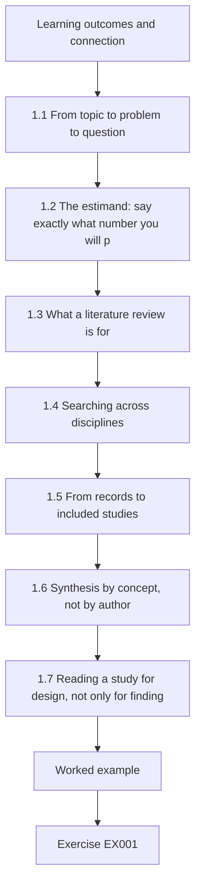

### Logical drawing

```mermaid
flowchart LR
  N0["Learning outcomes and connection"]
  N1["1.1 From topic to problem to question"]
  N2["1.2 The estimand: say exactly what number you will p"]
  N3["1.3 What a literature review is for"]
  N4["1.4 Searching across disciplines"]
  N5["1.5 From records to included studies"]
  N6["1.6 Synthesis by concept, not by author"]
  N7["1.7 Reading a study for design, not only for finding"]
  N0 --> N1 --> N2 --> N3 --> N4 --> N5 --> N6 --> N7 --> Q["EX001"]
```

```text
[Learning outcomes and connection]
    |
    v
[1.1 From topic to problem to question]
    |
    v
[1.2 The estimand: say exactly what number you will p]
    |
    v
[1.3 What a literature review is for]
    |
    v
[1.4 Searching across disciplines]
    |
    v
[1.5 From records to included studies]
    |
    v
[1.6 Synthesis by concept, not by author]
    |
    v
[1.7 Reading a study for design, not only for finding]
    |
    v
[Worked example] --> [Exercise EX001]
```
<!-- open-cyber-academy:lesson-figures:end ch-01 -->


### Learning outcomes and connection

By the end of this chapter the learner will be able to:

1. Move from a topic ("ransomware in hospitals") through a problem to a single answerable research question, and test it against the FINER criteria and an infrastructure version of PICOT.
2. Classify a question as descriptive, associational, causal, explanatory or evaluative, and state the kind of design and claim each permits.
3. Define the quantity the study will estimate — its **estimand** — in words precise enough that two analysts would compute the same thing.
4. Choose a review type (narrative, scoping, systematic) appropriate for a master's dissertation and justify it.
5. Build, run and document a cross-disciplinary search that includes grey literature, test it against known items, and stop it by a predeclared rule.
6. Deduplicate records, screen them with two reviewers, measure agreement with Cohen's kappa, repair eligibility criteria where disagreement concentrates, and report a flow diagram.
7. Organize what was found in a concept matrix rather than an author-by-author summary.

The chapter sets the question and the evidence map that every later chapter uses. Chapter 2 widens the map to the other sectors; Chapter 3 chooses a design for the question fixed here; Chapter 4 lists rival explanations the literature has already raised; Chapter 7 writes the literature review chapter from the concept matrix built here.

### 1.1 From topic to problem to question

#### 1.1.1 Three different things

Most dissertations begin with a **topic**, which is an area of interest: "cyberattacks on hospitals". A topic cannot be answered. A **problem** is a gap between what is known and what someone needs to know in order to act: "regional emergency planners do not know how much a cyber-induced diversion at one hospital burdens its neighbours, so mutual-aid agreements are written without numbers." A **research question** is the specific question whose answer would reduce that gap: "During a ransomware-induced ambulance diversion, how much do daily ambulance arrivals change at hospitals within 40 km, relative to what would have been expected without the diversion?"

The movement from topic to question is a narrowing, and every narrowing is a decision you must be able to defend. Narrowing to *ambulance arrivals* rather than "patient harm" trades importance for measurability. Narrowing to *one region* trades generality for depth and data access. Narrowing to *ransomware-induced diversion* rather than "cyber incidents" makes the exposure observable: a diversion has a start and an end that an emergency medical services (EMS) agency records, whereas "a cyber incident" may be unknown even to the hospital for weeks.

#### 1.1.2 FINER and an infrastructure PICOT

Clinical researchers test questions against the FINER criteria — feasible, interesting, novel, ethical and relevant — and structure them with PICOT: population, intervention, comparison, outcome and time ([Farrugia et al., 2010](https://www.ncbi.nlm.nih.gov/pmc/articles/PMC2912019/), summarizing Hulley and colleagues' *Designing Clinical Research*). Both transfer to infrastructure research with one change: most infrastructure studies observe an **exposure** that the researcher did not assign, so the "I" becomes "E".

| Element | Meaning in infrastructure research | Spillover Study (first version) |
|---|---|---|
| **P**opulation / units | The service-delivering units studied: hospitals, emergency departments, feeders, water systems, payment processors. State the unit of analysis and the unit of observation (they can differ: the unit might be a hospital-day). | Emergency departments in Tamsin Valley other than Kestrel's; unit of observation: the ED-day. |
| **E**xposure | The event or condition whose consequence is studied, defined so that its start and end are observable. | Ambulance diversion at Kestrel caused by a ransomware attack (days 0–20). |
| **C**omparison | What the exposed experience is compared with: the same units before, unexposed units at the same time, or both. | The same EDs in the 180 days before; Wexmoor EDs over the same days. |
| **O**utcome | A consequence measured in service units. Name the primary outcome and at most a few secondary ones. | Primary: daily ambulance arrivals. Secondary: median minutes from arrival to first clinician. |
| **T**ime | Window, follow-up and resolution (hourly, daily, monthly). | Daily, from day −180 to day +89. |

FINER is a screen, not a score. **Feasible** means the data exist, you can obtain them lawfully within the course's time, and the analysis is within your competence. **Interesting** means someone who must make a decision cares about the answer. **Novel** at master's level includes "measured for the first time in this setting" and "replicated with a stronger design". **Ethical** means a review board could approve it (Chapter 3). **Relevant** means the answer would change a plan, a policy or a later study.

#### 1.1.3 Question types and the claims they permit

| Type | Form | Example | What the design must provide | Strongest claim |
|---|---|---|---|---|
| Descriptive | How much, how often, what? | How many hours of ambulance diversion did Tamsin Valley EDs record last year, by cause? | A defined population and complete records. | A measured quantity in that population. |
| Associational | Is X associated with Y? | Are diversion hours higher at EDs closer to a diverting hospital? | Variation in X and Y; adjustment for obvious confounders. | An association, with its size and uncertainty. |
| Causal | How much did X change Y? | How much did Kestrel's diversion increase arrivals at Alder Point? | A credible counterfactual: what would have happened without X (Chapters 3–4). | An effect estimate under stated assumptions. |
| Explanatory | Why or how did X change Y? | Through which decisions did dispatchers redistribute patients? | Process evidence: interviews, documents, logs. | A mechanism supported by converging accounts. |
| Evaluative | Did a measure work? | Did the coalition's diversion protocol shorten waiting times? | A causal design plus an operational definition of "work". | An effect of the measure, under assumptions. |

The Spillover Study's primary question is causal, its secondary question explanatory. That combination — a quantitative estimate plus an account of mechanism — is typical of a strong master's dissertation and is the reason this book teaches both strands.

### 1.2 The estimand: say exactly what number you will produce

A question in words still leaves room for many different numbers. "How much do arrivals rise?" could mean the rise on the first day, the average rise over the diversion, the rise relative to last year, the rise relative to a comparison region, or the total extra patients. An **estimand** is the precise quantity a study aims to estimate, defined before data are seen. A useful template has five parts:

1. **Units:** which units and which days (Alder Point ED, days 0–20).
2. **Outcome:** what is counted and how (ambulance arrivals per calendar day, as recorded by the ED's arrival log).
3. **Contrast:** compared with what (the arrivals that would have occurred in the absence of the diversion).
4. **Summary:** the scale (ratio of the observed to the counterfactual mean, reported as a percentage change).
5. **Population of inference:** whom the answer is about (this ED during this event — not "hospitals in general").

The Spillover Study's primary estimand is therefore: *for each neighbouring ED, the percentage change in mean daily ambulance arrivals during days 0–20, relative to the arrivals expected from that ED's own pre-event trend and the concurrent change at unaffected Wexmoor EDs.* The counterfactual "would have occurred" is never observed; Chapters 3 and 4 decide how to approximate it. Writing the estimand first prevents a common failure: choosing the comparison after seeing which one gives the most impressive number.

#### 1.2.1 Claim scope

The [doctoral book in this area](../../../../doctorate-2-years/critical-sector-security/en/book/MANUSCRIPT.md#ch-01) describes a five-rung ladder from observation to research claim. At master's level the essential discipline is simpler: **write the claim you hope to make and the scope it will have before you start**, then check at the end whether the evidence reached it. The Spillover Study hopes to claim: *"In one synthetic regional event, ambulance arrivals at the nearest neighbouring ED rose during the diversion by an amount we estimate with stated uncertainty, and the rise was smaller at more distant EDs."* It does not hope to claim that ransomware harms patients, that all regions behave this way, or that diversion policies should change — although the discussion may suggest which studies could support those larger claims.

### 1.3 What a literature review is for

At master's level the review has four jobs: to show that the question is open or worth re-asking; to find **methods and measures** others have used, so you do not reinvent them; to find **rival explanations** already raised (Chapter 4); and to place the eventual result in context. It is not an annotated bibliography and it is not a demonstration of how much you read.

| Review type | Purpose | Method requirements | Fits a master's project when |
|---|---|---|---|
| Narrative (traditional) | Expert synthesis and argument | Few formal rules; risk of selective citing | The review supports a primary empirical study and the field is small |
| Scoping | Map the extent, range and nature of evidence; clarify concepts | Framework of [Arksey and O'Malley (2005)](https://doi.org/10.1080/1364557032000119616); reporting by [PRISMA-ScR (Tricco et al., 2018)](https://doi.org/10.7326/M18-0850) | The literature is scattered across disciplines and the question is still being shaped |
| Systematic | Answer a focused question with exhaustive search and appraisal | Protocol, dual screening, risk of bias, [PRISMA 2020](https://doi.org/10.1136/bmj.n71) reporting | The review *is* the dissertation, and there is enough literature to synthesize |
| Integrative / semi-systematic | Combine diverse study types into a conceptual synthesis | Documented search with flexible synthesis ([Snyder, 2019](https://doi.org/10.1016/j.jbusres.2019.07.039)) | The field mixes empirical, technical and policy work |

For the Spillover Study the review is a **structured scoping review** supporting an empirical study: documented search, explicit eligibility, two reviewers on a sample, a flow diagram and a concept matrix — but no formal risk-of-bias scoring or meta-analysis, because the handful of relevant studies use incomparable designs. State this choice and its reason in the methods chapter; a reader should never have to guess whether a review was meant to be exhaustive.

### 1.4 Searching across disciplines

#### 1.4.1 Why infrastructure literature is scattered

Evidence on the Spillover question is spread across emergency medicine, health-services research, health economics, disaster medicine, information security, public administration and government audit. The same idea carries different names: "ambulance diversion", "ED crowding", "regional surge", "patient redistribution", "blast radius". Security databases rarely index hospital operations; medical databases rarely index security conference papers; and some of the most informative evidence — audit reports, regulator statements, after-action reports, healthcare-coalition exercise reports — is **grey literature** that no bibliographic database indexes.

#### 1.4.2 Concept blocks

Build the search from concept blocks combined with AND; inside each block, synonyms combined with OR:

- **Block A — cyber exposure:** ransomware OR cyberattack OR "cyber attack" OR "cyber incident" OR "IT outage" OR "downtime" OR "information system failure".
- **Block B — setting:** hospital OR "emergency department" OR "health system" OR "health care delivery organization" OR EMS OR ambulance.
- **Block C — regional consequence:** diversion OR crowding OR "neighbouring" OR "neighboring" OR adjacent OR regional OR spillover OR "surge".

Including "downtime" and "IT outage" in Block A is a deliberate choice: non-malicious outages produce similar operational effects and may supply methods and rivals (Chapter 4). Record the choice; it expands screening work and must be handled by eligibility criteria.

#### 1.4.3 Sources and the known-item test

Search at least one biomedical index, one general scholarly index and one computing index, plus a grey-literature plan: government audit offices, health ministries and agencies, sector coordinating bodies, hospital associations and coalition reports. Before running the full search, assemble a **known-item set** — studies you already know are relevant — and check that your search finds them. For the Spillover question a reasonable known-item set is [Dameff et al. (2023)](https://doi.org/10.1001/jamanetworkopen.2023.12270), [Ghafur et al. (2019)](https://doi.org/10.1038/s41746-019-0161-6) on WannaCry in the English NHS and [Neprash et al. (2022)](https://doi.org/10.1001/jamahealthforum.2022.4873) on ransomware trends in U.S. health care delivery organizations. A search that misses a known item is too narrow; revise it and log the revision.

#### 1.4.4 Citation chaining and stopping

Database searches miss papers that use unexpected vocabulary. **Backward chaining** reads the reference lists of included studies; **forward chaining** finds later papers that cite them. [Wohlin (2014)](https://doi.org/10.1145/2601248.2601268) gives guidelines for this "snowballing" and shows it can complement or substitute for database search in some fields. Decide in advance when to stop: for example, *after two consecutive chaining rounds that add no included study*. Record every search in a **search log**: date, source, exact string, filters, number of hits, and who ran it.

### 1.5 From records to included studies

#### 1.5.1 Deduplication

The same paper appears in several databases, with different capitalization, punctuation, hyphenation and sometimes without a DOI. Deduplicate before screening, so that two reviewers do not screen the same study twice and the flow diagram is honest. A sound two-pass procedure is: (1) match exact DOIs after lower-casing; (2) match normalized titles plus year among the remainder — lower-case, strip punctuation, collapse spaces and normalize known variants (for example "turn-around" and "turnaround"). Inspect every automatic match by eye on a small project; automatic rules can merge different papers with generic titles ("Editorial", "Correction").

#### 1.5.2 Two-stage screening and agreement

Screen titles and abstracts against eligibility criteria, then read full texts of everything that passes. At master's level, two reviewers often cannot screen everything; a defensible compromise is that a second reviewer (a peer or the supervisor) independently screens a sample, agreement is measured, criteria are repaired where disagreement concentrates, and the first reviewer then screens the rest with the repaired criteria.

Agreement is measured with **Cohen's kappa** ([Cohen, 1960](https://doi.org/10.1177/001316446002000104)), which corrects observed agreement *p*ₒ for the agreement *p*ₑ expected by chance from each reviewer's include rate: κ = (*p*ₒ − *p*ₑ) / (1 − *p*ₑ). Two reviewers who each include half the records would agree half the time by chance alone, so 80% raw agreement may be unimpressive. Interpretation bands vary, and [McHugh (2012)](https://doi.org/10.11613/BM.2012.031) argues that the widely quoted bands are too lenient for health research, where low agreement means unreliable data. Treat kappa as a diagnostic: **where** reviewers disagree tells you which criterion is unclear.

#### 1.5.3 The flow diagram

Report records identified per source, duplicates removed, records screened, records excluded, full texts assessed, full texts excluded *with reasons*, and studies included. PRISMA 2020 provides a standard flow diagram ([Page et al., 2021](https://doi.org/10.1136/bmj.n71)). Even a non-systematic review benefits from it, because it lets an examiner see the denominator behind "the literature shows".

### 1.6 Synthesis by concept, not by author

[Webster and Watson (2002)](https://www.jstor.org/stable/4132319) recommended that reviews be **concept-centric** rather than author-centric: instead of a paragraph per paper ("Smith found…; Jones found…"), organize the review around the concepts the question needs and show which studies inform each. A **concept matrix** has studies as rows and concepts as columns. For the Spillover Study the columns are: unit of analysis; exposure definition; comparison; outcome; design; what the study can support; rivals it raises.

| Study | Unit | Exposure | Comparison | Outcomes relevant to spillover | Design (as published) | What it can support |
|---|---|---|---|---|---|---|
| [Dameff et al., 2023](https://doi.org/10.1001/jamanetworkopen.2023.12270) | Two EDs adjacent to an attacked organization | Month-long ransomware attack on four adjacent hospitals (May 2021) | The same EDs in the four weeks before and after | Census, ambulance arrivals, waiting times, left without being seen, length of stay, county EMS diversion, stroke metrics | Before-and-after cohort | An association between the attack period and burden at neighbouring EDs in one region |
| [Ghafur et al., 2019](https://doi.org/10.1038/s41746-019-0161-6) | English NHS trusts | WannaCry (May 2017) | Baseline weeks; infected versus non-infected trusts | Admissions, A&E attendances, outpatient cancellations, A&E deaths | Retrospective analysis of Hospital Episode Statistics | Activity reductions at infected trusts; no detectable change in A&E deaths (a crude harm measure, as the authors note) |
| [Neprash et al., 2022](https://doi.org/10.1001/jamahealthforum.2022.4873) | U.S. health care delivery organizations | Ransomware attacks in a database built from public reports, 2016–2021 | Time trends | Frequency, PHI exposure, operational disruption including ambulance diversion | Cohort of reported attacks | Trends and characteristics of *reported* attacks |

The matrix makes the gap visible: one before-and-after study of neighbouring EDs, no study with an unaffected comparison region, and no study of whether the burden decreases with distance. That is the Spillover Study's justification.

### 1.7 Reading a study for design, not only for findings

When you extract a study, record not only what it found but what it **could** have found. Ask: What is the unit? Is the exposure defined by its start and end? What is the comparison, and what else changed between the compared periods? Is the outcome a consequence (patients delayed) or an activity (visits counted)? What population could the result generalize to? A before-and-after comparison within the same units, for example, cannot separate the exposure from anything else that changed at the same time — season, policy, staffing, a concurrent epidemic. Saying this is not criticism of the authors; it is the evidence your own design must improve upon.

### 1.8 Worked example: from topic to the Spillover question (synthetic)

The candidate's first proposal paragraph read: *"This dissertation will investigate the impact of cyberattacks on hospitals and show that they endanger patients across the region."* The supervisor's review:

| Problem | Why it fails | Revision |
|---|---|---|
| "Investigate the impact of cyberattacks on hospitals" | A topic, not a question; "impact" is undefined. | Name the outcome: daily ambulance arrivals and waiting time at neighbouring EDs. |
| "Show that they endanger patients" | Presupposes the answer; a design to "show" cannot fail. | Ask "how much" and allow zero as an answer. |
| "Across the region" | No unit or boundary. | EDs within 40 km of the attacked system; distance as a moderator. |
| "Cyberattacks" | Exposure not observable or timed. | Ambulance diversion caused by a ransomware attack, with EMS-recorded start and end. |
| No comparison | Before-and-after alone cannot separate the attack from the season. | Add an unaffected comparison region. |
| No mechanism | Even a credible number would not tell planners what to change. | Secondary explanatory question with interviews of ED, EMS and coalition staff. |
| "Patients are endangered" | Patient outcomes need clinical data and approvals beyond a master's timeline. | Keep patient outcomes out of scope; name them as future work. |

Final questions:

- **RQ1 (causal):** During a ransomware-induced ambulance diversion at one hospital system, by what percentage do daily ambulance arrivals at each neighbouring ED change relative to the counterfactual estimated from its own pre-event trend and an unaffected comparison region?
- **RQ2 (associational):** Does that change decrease with distance from the diverting system?
- **RQ3 (explanatory):** According to ED managers, EMS supervisors and coalition staff, through which decisions and constraints was the load redistributed?

### 1.9 Practical activity: deduplicate, screen and measure agreement

The lab below holds a synthetic export of 20 records from three databases and a grey-literature search. It deduplicates them in two passes, takes two reviewers' title-and-abstract decisions on the remaining records, computes kappa and lists disagreements. Run it with Python 3; no packages are needed.

```python
# Lab 1 - deduplicate a synthetic search export, measure screening agreement, count the flow (offline)
# Each record: (source, title, year, doi_or_empty). Decisions: reviewer A and B, I = include, X = exclude.
import re

RECORDS = [
    ("medline", "Ransomware and emergency department crowding at neighbouring hospitals", 2023, "10.9999/syn.001"),
    ("scopus",  "Ransomware and Emergency Department Crowding at Neighbouring Hospitals.", 2023, "10.9999/SYN.001"),
    ("ieee",    "Anomaly detection for water distribution SCADA", 2019, "10.9999/syn.002"),
    ("medline", "Hospital IT downtime and laboratory turnaround times", 2021, ""),
    ("scopus",  "Hospital IT downtime and laboratory turn-around times", 2021, "10.9999/syn.003"),
    ("grey",    "After-action report: regional EMS diversion during a hospital network outage", 2022, ""),
    ("scopus",  "Ambulance diversion policies and patient outcomes: a review", 2018, "10.9999/syn.004"),
    ("medline", "Ambulance diversion policies and patient outcomes - a review", 2018, ""),
    ("ieee",    "Cyber-physical attack graphs for substations", 2020, "10.9999/syn.005"),
    ("grey",    "State health department memo on downtime procedures", 2024, ""),
    ("scopus",  "Interrupted time series of ED arrivals after hospital closure", 2017, "10.9999/syn.006"),
    ("medline", "Mortality after hospital cyberattacks in Medicare beneficiaries", 2024, "10.9999/syn.007"),
    ("scopus",  "Mortality after hospital cyberattacks in Medicare beneficiaries", 2024, "10.9999/syn.007"),
    ("ieee",    "A survey of ransomware families 2015-2022", 2022, "10.9999/syn.008"),
    ("grey",    "Regional healthcare coalition cyber-incident exercise report", 2023, ""),
    ("medline", "Stroke care times during regional diversion", 2020, "10.9999/syn.009"),
    ("scopus",  "Electronic health record downtime: a scoping review", 2022, "10.9999/syn.010"),
    ("medline", "Electronic Health Record Downtime: A Scoping Review", 2022, "10.9999/syn.010"),
    ("ieee",    "Blockchain for hospital supply chains", 2021, "10.9999/syn.011"),
    ("grey",    "Vendor white paper: ransomware readiness in hospitals", 2023, ""),
]

def norm_title(t):
    t = t.lower().replace("turn-around", "turnaround")
    t = re.sub(r"[^a-z0-9 ]+", " ", t)
    return " ".join(t.split())

def key(rec):
    _, title, year, doi = rec
    return ("doi", doi.lower()) if doi else ("ty", norm_title(title), year)

seen, unique, dup = {}, [], 0
for rec in RECORDS:                       # pass 1: DOI or title+year
    k = key(rec)
    if k in seen:
        dup += 1
        continue
    seen[k] = rec
    unique.append(rec)
by_title = {}
final = []
for rec in unique:                        # pass 2: same normalized title+year, one record lacks a DOI
    tk = (norm_title(rec[1]), rec[2])
    if tk in by_title:
        dup += 1
        continue
    by_title[tk] = rec
    final.append(rec)

# Title/abstract screening decisions by two reviewers, in the order of `final`
A = "I X I I I X X I I X I I I X X".split()
B = "I X I I I X I I I X X I I X I".split()

def kappa(a, b):
    n = len(a)
    po = sum(x == y for x, y in zip(a, b)) / n
    cats = set(a) | set(b)
    pe = sum((a.count(c) / n) * (b.count(c) / n) for c in cats)
    return po, pe, (po - pe) / (1 - pe)

po, pe, k = kappa(A, B)
both = sum(x == y == "I" for x, y in zip(A, B))
disagree = [final[i][1] for i in range(len(final)) if A[i] != B[i]]
print(f"records identified: {len(RECORDS)}  duplicates removed: {dup}  screened: {len(final)}")
print(f"agreement po={po:.3f} pe={pe:.3f} kappa={k:.3f}")
print(f"both include: {both}  disagreements: {len(disagree)}")
for t in disagree:
    print("  resolve:", t)
```

Expected output:

```text
records identified: 20  duplicates removed: 5  screened: 15
agreement po=0.800 pe=0.533 kappa=0.571
both include: 8  disagreements: 3
  resolve: State health department memo on downtime procedures
  resolve: Regional healthcare coalition cyber-incident exercise report
  resolve: Vendor white paper: ransomware readiness in hospitals
```

Five duplicates were removed: three by DOI (one with a differently capitalized DOI) and two by normalized title and year, including one pair that differed only by "turn-around" versus "turnaround" and one that differed only by a dash versus a colon. Raw agreement on the 15 screened records is 80%, but chance agreement is 53%, so κ = 0.571 — moderate at best. The diagnostic value is in the list: **all three disagreements are grey literature** (a health-department memo, a coalition exercise report and a vendor white paper). The criteria said nothing about grey literature. Repair them before screening continues: for example, include government, regulator, coalition and after-action reports that describe a specific event's operational effects; exclude vendor marketing and documents that describe procedures without reporting effects. Then re-screen the sample and recompute kappa.

### 1.10 Common errors and limits

- Starting with a conclusion ("show that…") rather than a question that can come out either way.
- Asking a causal question with a design that can only describe.
- Leaving the estimand undefined until the analysis, then choosing the comparison that gives the largest effect.
- Searching one discipline's database and calling the result "the literature".
- Ignoring grey literature in a field where audits, regulator statements and after-action reports carry much of the evidence — or including it without criteria.
- Reporting raw agreement without correcting for chance, or reporting kappa without examining where disagreement lies.
- Writing the review author by author rather than concept by concept.
- Treating a study's finding as transferable without recording its unit, comparison and setting.

The limit of a master's review is time: it will not be exhaustive, and it should not pretend to be. Its credibility comes from a documented, repeatable search and an honest statement of what was not searched.

### Exercises — chapter 1

**EX001 — From topic to question.** *Objective:* narrow a topic into an answerable question. *Inputs:* the topic "cyber incidents at drinking-water utilities". *Constraints:* one primary question; an observable, timed exposure; an outcome in service units. *Steps:* (1) state a problem a decision-maker faces; (2) write a question in infrastructure PICOT form; (3) test it against each FINER criterion in one sentence; (4) state the claim you hope to make and its scope. *Expected evidence:* a half-page memo. *Rubric:* 3 = question answerable with plausible data, exposure and outcome observable, FINER honestly applied (including what is not feasible), claim scoped to the design; 2 = one element vague; 1 = still a topic; 0 = none.

**EX002 — Question types.** *Objective:* match questions to designs and claims. *Inputs:* (a) "How many hours of ambulance diversion were recorded in the county in 2024, by cause?" (b) "Do EDs that adopted downtime drills have shorter waiting times during IT outages?" (c) "How much did the diversion increase arrivals at Alder Point?" (d) "Why did dispatchers send stroke patients past the nearest open hospital?" (e) "Did the coalition's new diversion protocol reduce time on diversion?" *Constraints:* use the table in §1.1.3. *Steps:* classify each; name the minimum design; name the strongest claim. *Expected evidence:* table. *Rubric:* 3 = all classified correctly with designs that would actually support the claims, and (b) recognized as associational unless drill adoption can be treated as an exposure with a credible counterfactual; 2 = one error; 1 = designs generic; 0 = none.

**EX003 — Search strategy and known-item test.** *Objective:* build a documented, cross-disciplinary search. *Inputs:* RQ1–RQ3 in §1.8. *Constraints:* three concept blocks; at least three bibliographic sources from different disciplines and a grey-literature plan with at least four source types. *Steps:* (1) write the blocks; (2) list sources and justify each; (3) define a known-item set of three studies and describe how you would check that each is retrieved; (4) define a stopping rule for citation chaining; (5) design a search-log template. *Expected evidence:* one-page protocol and log template. *Rubric:* 3 = blocks include cross-disciplinary synonyms, grey literature specified by source type, known-item test and stopping rule concrete; 2 = one element missing; 1 = single-discipline search; 0 = none.

**EX004 — Deduplication and agreement.** *Objective:* test whether title-based deduplication catches a near-duplicate grey-literature record, and see how a single reviewer disagreement moves Cohen's kappa. *Inputs:* Lab 1 code. *Constraints:* offline. *Steps:* (1) run the lab and record the output; (2) add a record `("grey", "Ransomware & emergency department crowding at neighbouring hospitals", 2023, "")` at the end of `RECORDS`, append `I` to both reviewers' decision strings (the record reaches screening only if deduplication misses it), rerun, and report whether the two-pass procedure removed it, and why; (3) change reviewer B's decision on "Cyber-physical attack graphs for substations" from X to I and report the new kappa; (4) explain in 100 words why one extra disagreement changes kappa more than raw agreement suggests. *Expected evidence:* outputs and explanation. *Rubric:* 3 = correct outputs, the ampersand failure diagnosed with a proposed fix, kappa recomputed correctly, chance-correction explained; 2 = one error; 1 = not run; 0 = none.

**EX005 — Repair the eligibility criteria.** *Objective:* turn disagreement into clearer criteria. *Inputs:* the three disagreements in Lab 1. *Constraints:* criteria must be decidable from a title and abstract or the first page of a report. *Steps:* (1) write inclusion and exclusion criteria for grey literature; (2) apply them to the three records; (3) state what you would do with a record you still cannot decide. *Expected evidence:* criteria and decisions. *Rubric:* 3 = criteria decidable, decisions consistent, undecidable records sent to full-text review rather than excluded; 2 = one decision inconsistent; 1 = criteria restate the topic; 0 = none.

**EX006 — Concept matrix.** *Objective:* synthesize by concept. *Inputs:* the three studies in §1.6 plus the [NAO report on WannaCry and the NHS](https://www.nao.org.uk/reports/investigation-wannacry-cyber-attack-and-the-nhs/) (October 2017). *Constraints:* read the NAO summary yourself; quote numbers with their source. *Steps:* (1) add the NAO report as a row; (2) add a column "rivals the study raises or leaves open"; (3) write a 200-word concept-centric paragraph on "regional effects of hospital cyber incidents". *Expected evidence:* matrix and paragraph. *Rubric:* 3 = NAO row accurate (scope of disruption and the recorded-versus-estimated cancellation distinction), rivals specific, paragraph organized by concept; 2 = paragraph author by author; 1 = numbers unsourced; 0 = none.

**EX007 — Estimand and scope memo.** *Objective:* define exactly what will be estimated. *Inputs:* RQ1 and RQ2. *Constraints:* the five-part template in §1.2. *Steps:* (1) write the estimand for RQ1; (2) write one for RQ2; (3) list two estimands a careless analyst might compute instead and why they differ; (4) state the hoped-for claim and the claims explicitly out of scope. *Expected evidence:* one page. *Rubric:* 3 = estimands unambiguous with a counterfactual contrast, alternatives genuinely different (for example first-day rise, rise versus last year), out-of-scope claims explicit; 2 = one estimand ambiguous; 1 = no contrast; 0 = none.

### Chapter synthesis

A dissertation stands on its question. Move from topic to problem to question deliberately, making each narrowing defensible; test the question against FINER and write it in an infrastructure PICOT form with an observable exposure and a consequence outcome. Classify the question, because its type decides the design and the strongest claim available. Define the estimand before seeing data. Choose a review type that fits the project and say so. Search across disciplines and grey literature, test the search with known items, chain citations to a predeclared stopping point and log everything. Deduplicate, screen with a second reviewer on at least a sample, use kappa as a diagnostic of unclear criteria, and report the flow. Synthesize by concept: the concept matrix shows both what is known and the gap your study will fill.

<!-- open-cyber-academy:chapter-navigation:start ch-01 -->
### Continue studying — chapter 01 of 08

[← Course home](../../README.md) · [Course chapter index](../SUBJECTS.md) · [Chapter 02 →](#ch-02)

Continue to the next authored lesson.
<!-- open-cyber-academy:chapter-navigation:end -->

<a id="ch-02"></a>

## Chapter 2 — Critical infrastructure and sector security: advanced seminar

<!-- open-cyber-academy:lesson-figures:start ch-02 -->
### Lesson map

Lesson 02 published. Map, example, EX008.

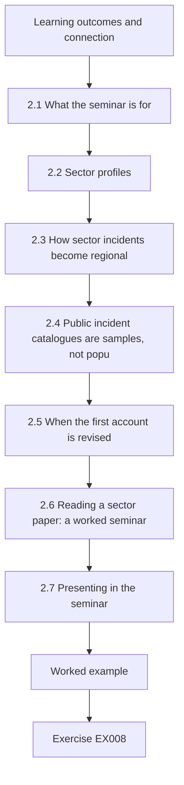

### Logical drawing

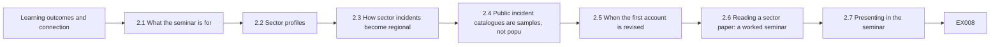

```text
[Learning outcomes and connection]
    |
    v
[2.1 What the seminar is for]
    |
    v
[2.2 Sector profiles]
    |
    v
[2.3 How sector incidents become regional]
    |
    v
[2.4 Public incident catalogues are samples, not popu]
    |
    v
[2.5 When the first account is revised]
    |
    v
[2.6 Reading a sector paper: a worked seminar]
    |
    v
[2.7 Presenting in the seminar]
    |
    v
[Worked example] --> [Exercise EX008]
```
<!-- open-cyber-academy:lesson-figures:end ch-02 -->


### Learning outcomes and connection

By the end of this chapter the learner will be able to:

1. Describe for each major sector its characteristic consequence unit, buffers, governing instruments and the evidence a master's researcher can realistically obtain.
2. Distinguish **dependency cascades** (a supplier fails and its dependants fail after their buffers) from **load-transfer spillover** (peers absorb the demand of a failed unit), and recognize which a study measures.
3. Treat public incident catalogues as data with a selection process, and quantify how disclosure that rises with severity inflates apparent severity and how a change in reporting rules creates a spurious trend.
4. Code incidents whose first public account was later revised, without either repeating the first account or erasing it.
5. Read a sector paper with a fixed critical protocol and present it in a seminar so that the discussion is about evidence, not opinion.

This chapter widens the evidence map built in Chapter 1 from one sector to the field. The doctoral book's [research-frontier chapter](../../../../doctorate-2-years/critical-sector-security/en/book/MANUSCRIPT.md#ch-02) surveys standards as hypotheses and the families of interdependency models; this seminar does not repeat that survey. It concentrates on what a beginning researcher needs: how sectors differ in the consequences they produce and the evidence they leave, how to read the evidence that exists, and how to discuss it with peers.

### 2.1 What the seminar is for

A research seminar trains three habits that a dissertation needs and that lectures do not: reading a paper for what it can support, presenting another person's work fairly before criticizing it, and accepting criticism of your own reading. Each session in this course follows the same protocol, which you will reuse when you write Chapter 7's literature review:

1. **Claim.** What does the paper claim, at what scope? Quote the sentence.
2. **Evidence.** What data, from which units, over which period?
3. **Warrant.** Why does that evidence support that claim — what design logic connects them?
4. **Rivals.** What else could have produced the same evidence? Which rivals does the paper address, and how?
5. **Transfer.** To which other units, sectors or jurisdictions might the result apply, and under what conditions?
6. **So what.** What decision or later study does it inform?
7. **Next study.** What one study would most reduce the remaining uncertainty?

The presenter answers questions 1–3 and 5–6 in the paper's own terms, then opens 4 and 7 to the group. Critique of a published paper is not a verdict on its authors; most limitations follow from the data that existed.

### 2.2 Sector profiles

Sectors differ in what is lost, how fast and for whom, in who regulates them and in what evidence escapes into the public record. The following profiles are a starting point; each instrument is cited with its version and date and should be re-verified before you rely on it.

| Sector | Typical consequence unit | Key buffers | Examples of governing instruments | Evidence a master's student can usually obtain | Public case discussed in this book |
|---|---|---|---|---|---|
| Healthcare | Patients delayed, diverted or harmed; procedures and appointments postponed | Downtime procedures, paper records, staff, regional mutual aid, other hospitals' capacity | U.S. [HPH Cybersecurity Performance Goals](https://hphcyber.hhs.gov/performance-goals.html) (voluntary, January 2024); health is an [NIS2](https://eur-lex.europa.eu/eli/dir/2022/2555/oj/) sector in the EU | Aggregate activity data (with approval), public statements, audits, interviews | Dameff et al. (2023); WannaCry and the NHS; Synnovis (2024); Change Healthcare (2024) |
| Energy — electricity | Customers and customer-hours without power; critical loads lost | Generators, storage, manual operation, switching | [NERC CIP standards](https://www.nerc.com/pa/Stand/Pages/CIPStandards.aspx) (mandatory for the North American bulk electric system); NIS2 energy sector | Outage statistics, public after-action reports; operational data rarely | Ukraine 2015 (see the doctoral book, Chapter 1) |
| Energy — oil and gas, pipelines | Product not delivered; supply shortages | Inventories, alternative transport | Pipeline security directives issued by the U.S. Transportation Security Administration after Colonial Pipeline, as described by [CISA (2023)](https://www.cisa.gov/news-events/news/attack-colonial-pipeline-what-weve-learned-what-weve-done-over-past-two-years) | Public timelines, energy-agency situation reports, price and supply data | Colonial Pipeline (2021) |
| Water | People without safe water or pressure; advisories issued | Storage, manual dosing, interconnections | U.S. [America's Water Infrastructure Act of 2018](https://www.epa.gov/waterresilience/americas-water-infrastructure-act-2018-risk-assessments-and-emergency-response-plans), which requires community water systems serving more than 3,300 people to complete risk and resilience assessments and emergency response plans | Advisory notices, regulator summaries, small-utility surveys | Oldsmar (2021) and its later revision |
| Finance | Transactions not processed; settlement delayed; customers unable to pay | Manual processing, backup sites, alternative payment channels | EU [Digital Operational Resilience Act, Regulation (EU) 2022/2554](https://eur-lex.europa.eu/eli/reg/2022/2554/oj); [CPMI–IOSCO guidance](https://www.bis.org/cpmi/publ/d146.htm) (June 2016) for financial market infrastructures | Supervisory publications, aggregate statistics; firm data almost never | Change Healthcare's payment and claims disruption (2024), where healthcare and finance meet |
| Communications and shared IT | Users or organizations without service; dependent services degraded | Redundant links, fallback procedures | Sector-specific telecom rules; cross-sector [CISA CPGs](https://www.cisa.gov/cross-sector-cybersecurity-performance-goals) | Provider statements, outage reports | The July 2024 faulty security-software update (non-malicious) |
| Public and emergency services | Calls not answered, responses delayed | Neighbouring dispatch centres, manual dispatch | National emergency-communications rules; [CER](https://eur-lex.europa.eu/eli/dir/2022/2557/oj) and NIS2 in the EU | Dispatch and EMS aggregates, after-action reports | County EMS diversion reported by Dameff et al. (2023) |

Two features of the table matter for research design. First, the **consequence unit** differs by sector, so a cross-sector study that compares "impact" without a common unit is comparing incommensurable things; choose a common functional unit (people without a service for a stated duration) or stay within one sector. Second, **evidence availability** is inversely related to sensitivity: the sectors whose operational data would answer the best questions are the ones least likely to release them. A realistic master's project chooses a question that aggregate, public or consented data can answer.

### 2.3 How sector incidents become regional

#### 2.3.1 Two propagation mechanisms

The doctoral book models **dependency cascades**: a supplier fails, and each dependant fails when its buffer runs out — a hospital loses water pressure hours after a treatment plant loses power. The Spillover Study measures a different mechanism, **load-transfer spillover**: a unit fails or withdraws, and its demand moves to peers that did not fail. Ambulances diverted from Kestrel arrive at Alder Point; patients who cannot get a prescription filled at one pharmacy go to another; customers of a failed payment processor queue at banks. Load transfer is often faster than a dependency cascade (it begins as soon as the unit withdraws) and is limited by the peers' **spare capacity** rather than by buffers.

| Feature | Dependency cascade | Load-transfer spillover |
|---|---|---|
| Path | Supplier → dependant | Failed unit → peers |
| Timing | After the dependant's buffer is exhausted | Immediately on withdrawal |
| Limiting factor | Buffer size and restoration time | Peers' spare capacity and distance |
| Typical measurement | Time-to-impact, service hours lost | Excess demand at peers, waiting times, refusals |
| Example in public sources | Colonial Pipeline's shutdown and fuel distribution effects ([U.S. Department of Energy](https://www.energy.gov/ceser/colonial-pipeline-cyber-incident)) | Increased volume at EDs adjacent to an attacked system ([Dameff et al., 2023](https://doi.org/10.1001/jamanetworkopen.2023.12270)) |

Real events usually involve both. During the Synnovis pathology ransomware attack in June 2024, the dependency was laboratory services on which hospitals depended; [NHS England reported](https://www.england.nhs.uk/london/2024/06/14/update-on-cyber-incident-clinical-impact-in-south-east-london-friday-14-june-2024/) that in the first week (3–9 June) King's College Hospital and Guy's and St Thomas' postponed 814 elective procedures and 861 hospital and community outpatient appointments, and work was redirected to other providers — load transfer. A dissertation should name which mechanism it measures, because the design, the outcome and the policy implications differ.

#### 2.3.2 Concentration and shared services

When many organizations depend on one service provider, an incident at the provider becomes simultaneous across them. The [AHA survey](https://www.aha.org/2024-03-15-aha-survey-change-healthcare-cyberattack-significantly-disrupts-patient-care-hospitals-finances) of nearly 1,000 hospitals in March 2024 reported that 94% experienced a financial impact from the Change Healthcare cyberattack, which disrupted claims and payment processing. A non-malicious example makes the same structural point: Microsoft [estimated](https://blogs.microsoft.com/blog/2024/07/20/helping-our-customers-through-the-crowdstrike-outage/) that a faulty security-software update in July 2024 affected 8.5 million Windows devices — less than one percent of all Windows machines — yet disrupted services widely because the affected machines were concentrated in enterprises running critical services. For researchers, concentration incidents are natural experiments with many simultaneously exposed units, but there may be no unexposed comparison group of the same kind.

### 2.4 Public incident catalogues are samples, not populations

Most cross-sector evidence comes from catalogues assembled from public reports: news, regulatory breach notifications, company statements and agency advisories. [Neprash et al. (2022)](https://doi.org/10.1001/jamahealthforum.2022.4873) built such a database for ransomware attacks on U.S. health care delivery organizations and reported 374 attacks from 2016 to 2021, an annual count that more than doubled from 43 to 91, and operational disruption in 44.4% of attacks, including ambulance diversion in 16 (4.3%). The authors frame their counts as attacks that became publicly known. That framing matters, because a catalogue's contents are shaped by two processes that have nothing to do with the true incidence:

1. **Severity-dependent disclosure.** Long, visible disruptions are more likely to be reported than short ones absorbed internally. The catalogue's average severity is therefore higher than the population's.
2. **Changing reporting rules and attention.** A new reporting mandate, a change in a regulator's publication practice or a surge in media attention increases the fraction of incidents that become public. Counts rise even if incidence does not.

Neither process makes catalogues useless. They make them suitable for some questions (what kinds of disruption have occurred; which characteristics appear among reported events; how reported events changed after a rule) and unsuitable for others (how often incidents occur; how severe a typical incident is; whether incidence is rising) unless the disclosure process is modelled. Lab 2 shows the size of both distortions in a synthetic population.

### 2.5 When the first account is revised

Public records of infrastructure incidents are revised as investigations proceed. Two documented cases show why a researcher must record **what was claimed, by whom, when, and how it was later revised**.

- **Oldsmar, Florida, February 2021.** Early public statements described a remote intruder raising the sodium hydroxide setpoint at a water treatment plant, and CISA issued a joint advisory, [AA21-042A, "Compromise of U.S. Water Treatment Facility"](https://www.cisa.gov/news-events/cybersecurity-advisories/aa21-042a). In April 2023 the city manager at the time said the FBI had concluded the incident was likely caused by an employee, and an FBI spokesperson said the investigation "was not able to confirm that this incident was initiated by a targeted cyber intrusion" ([WUSF, 13 April 2023](https://www.wusf.org/local-state/2023-04-13/official-hack-oldsmar-city-water-treatment-plant-2021)). The incident still appears in many lists of water-sector cyberattacks.
- **Düsseldorf, Germany, September 2020.** A ransomware attack disrupted the university hospital, a patient was taken to a more distant hospital and died, and prosecutors opened a negligent-homicide investigation that drew worldwide attention as possibly the first death caused by ransomware. In November 2020 prosecutors concluded that the delay was not decisive for the outcome ([MIT Technology Review, 12 November 2020](https://www.technologyreview.com/2020/11/12/1012015/ransomware-did-not-kill-a-german-hospital-patient/)).

Neither revision shows that the underlying risk is imaginary. Both show that a catalogue coding the first account as fact — "cyber intrusion at a water plant", "death caused by ransomware" — contains errors that propagate into every analysis using it. A sound coding scheme stores, for each incident, the claim, its source, the source type (official, company, media), the date of the claim, the current status (confirmed, disputed, revised, unknown) and the date of the last check. A secondary source repeating the first account is not independent confirmation of it.

### 2.6 Reading a sector paper: a worked seminar

The seminar protocol (§2.1) applied to [Dameff et al. (2023)](https://doi.org/10.1001/jamanetworkopen.2023.12270), using only what the published abstract and article state:

1. **Claim.** Hospitals adjacent to health care delivery organizations under ransomware attack "may see increases in patient census and may experience resource constraints affecting time-sensitive care", and such attacks should be considered a regional disaster.
2. **Evidence.** Two academic urban EDs in San Diego County; 19,857 ED visits; three four-week phases around an attack on a separate organization beginning 1 May 2021: before (3–30 April), attack and recovery (1–28 May), after (29 May–25 June). The targeted organization accounted for about a quarter of regional inpatient discharges.
3. **Warrant.** If nothing else changed between phases, differences between phases are associated with the attack.
4. **Rivals (for the group).** Seasonal change from April to June; the evolving COVID-19 situation in spring 2021; other regional events; many outcomes compared, raising the chance that some differences arise by chance. The design compares phases within the same EDs; it does not include an unaffected comparison region, which is the main addition a follow-up study could make.
5. **Transfer.** To regions where one organization holds a large share of capacity, so that its withdrawal moves substantial load; less to regions with many small providers.
6. **So what.** Regional cyber-disaster planning, mutual aid and EMS diversion protocols — the paper's own conclusion — and the case for measuring regional effects in other events.
7. **Next study.** A controlled design: the same outcomes in unaffected comparable EDs over the same weeks, plus a distance gradient. That is the Spillover Study's design.

Notice the tone. The paper made the first published measurement of a regional effect; the seminar's critique identifies what a *next* study can add, not what the authors "got wrong".

### 2.7 Presenting in the seminar

A ten-minute presentation has a fixed shape: one slide for the question and why it matters; one for the design (units, exposure, comparison, outcome, period); one for the main result in the authors' words with its uncertainty; one for what the design rules out and what it leaves open; one for the next study. Put the rivals on the slide as questions, not accusations. When questioned, separate three kinds of answer: "the paper says…", "I infer…", and "I don't know; it would take…". The same three registers will serve you in the oral defense (Chapter 8).

### 2.8 Worked example: an apparent contradiction (seminar exercise)

In the seminar, a participant objects: "Ghafur et al. found that WannaCry *reduced* hospital activity, and the NHS saw no increase in deaths; Dameff et al. found that ransomware *increased* activity. The evidence contradicts itself." The seminar resolves it with the concept matrix:

| Dimension | [Ghafur et al., 2019](https://doi.org/10.1038/s41746-019-0161-6) | [Dameff et al., 2023](https://doi.org/10.1001/jamanetworkopen.2023.12270) |
|---|---|---|
| Units measured | Infected trusts (and all trusts) | Unaffected EDs adjacent to the attacked organization |
| Direction expected | Infected units do less (cancelled appointments, fewer admissions) | Neighbours absorb displaced demand |
| Health system | English NHS, May 2017 | San Diego County, May 2021 |
| Duration | One week of acute disruption | Month-long attack and recovery |
| Harm outcome | A&E deaths: no detectable change, described by the authors as a crude measure | Stroke-care metrics and process times |

The findings are complementary: an attacked unit's activity falls and its neighbours' rises. Together they suggest the Spillover Study's mechanism. The "no mortality change" result is also not evidence of no harm; it is an absence of detected change in one crude outcome over one week. The [NAO's investigation](https://www.nao.org.uk/reports/investigation-wannacry-cyber-attack-and-the-nhs/) adds scope: at least 81 of 236 trusts in England were disrupted, along with 603 primary care and other NHS organizations, and NHS England recorded 6,912 cancelled appointments while estimating that more than 19,000 were cancelled in total — a reminder that recorded counts and estimated totals are different quantities.

### 2.9 Practical activity: what a catalogue does to severity and trend

The lab creates a synthetic population of 2,400 service-disrupting incidents, 400 per year for six years, so the true incidence is constant. Outage durations are log-normal with a median of 6 hours. Each incident is disclosed with a probability that rises with duration (50% at 24 hours), and a reporting mandate from year 4 multiplies disclosure by 1.8.

```python
# Lab 2 - what a public incident catalogue does to severity and trend (offline, standard library only)
# Synthetic population of service-disrupting incidents over six years. Each has an outage duration (hours).
# Disclosure probability rises with duration; a reporting mandate raises disclosure from year 4.
import math, random

rng = random.Random(42)
TRUE_PER_YEAR = 400                      # constant true incidence: there is NO real trend

def p_report(hours, year):
    base = 1 / (1 + math.exp(-(math.log(hours) - math.log(24)) * 1.5))   # 50% at 24 h
    return min(1.0, base * (1.0 if year < 4 else 1.8))                   # mandate from year 4

pop = []
for year in range(1, 7):
    for _ in range(TRUE_PER_YEAR):
        hours = rng.lognormvariate(math.log(6), 1.2)                       # median 6 h
        pop.append((year, hours, rng.random() < p_report(hours, year)))

def summary(rows):
    h = sorted(r[1] for r in rows)
    n = len(h)
    med = h[n // 2] if n % 2 else (h[n // 2 - 1] + h[n // 2]) / 2
    return n, sum(h) / n, med, sum(x > 24 for x in h) / n

print("set           n     mean_h  median_h  share>24h")
for label, rows in (("population", pop), ("catalogue", [r for r in pop if r[2]])):
    n, mean, med, big = summary(rows)
    print(f"{label:12} {n:5d}  {mean:7.1f}  {med:8.1f}  {big:9.2f}")
print("year  true  catalogued")
for y in range(1, 7):
    print(f"{y:4d}  {sum(r[0] == y for r in pop):4d}  {sum(r[0] == y and r[2] for r in pop):10d}")
```

Expected output:

```text
set           n     mean_h  median_h  share>24h
population    2400     12.8       6.1       0.13
catalogue      646     29.2      18.4       0.40
year  true  catalogued
   1   400          99
   2   400          73
   3   400          90
   4   400         125
   5   400         133
   6   400         126
```

Read both tables. The catalogue's mean outage (29.2 h) is more than twice the population's (12.8 h); its median is three times larger; and the share of incidents longer than 24 hours rises from 13% to 40%. A study that described "typical" incidents from the catalogue would greatly overstate them. The yearly counts show a step from about 87 per year to about 128 per year after the mandate — a 47% "increase" in a population whose incidence never changed. An honest analysis of a catalogue either restricts itself to questions the selection does not distort, models the disclosure process with stated assumptions, or uses an external denominator (for example, all incidents reported under a mandate with known completeness).

### 2.10 Common errors and limits

- Comparing "impact" across sectors without a common consequence unit.
- Confusing dependency cascades with load-transfer spillover, and therefore measuring the wrong outcome.
- Treating counts from a public catalogue as incidence, or catalogue averages as typical severity.
- Reading a rise in reported incidents after a mandate as a rise in attacks.
- Coding an early public account as fact and never revisiting it.
- Treating a secondary source that repeats a first account as independent confirmation.
- Critiquing a paper for not doing what its data could never support, rather than identifying the next study.
- Treating "no detected change" in a crude outcome as evidence of no effect.

The limit of a seminar is that it reads only what was published. Unpublished evidence — incidents never disclosed, operational data never released — remains outside it, and the seminar should say so rather than assume the published record is complete.

### Exercises — chapter 2

**EX008 — Sector profile.** *Objective:* profile a sector as a research setting. *Inputs:* the table in §2.2. *Constraints:* choose a sector other than healthcare; cite at least two primary sources for its instruments and one documented public case. *Steps:* (1) define the consequence unit; (2) list buffers; (3) name governing instruments with version and date; (4) list evidence a master's student could obtain lawfully; (5) propose one answerable question that this evidence can support. *Expected evidence:* one-page profile. *Rubric:* 3 = consequence unit precise, instruments cited exactly, evidence realistic, question matched to evidence; 2 = one element vague; 1 = uncited; 0 = none.

**EX009 — Catalogue distortion.** *Objective:* separate the trend bias a reporting mandate creates from the severity bias that selective disclosure creates in an incident catalogue. *Inputs:* Lab 2 code. *Constraints:* offline; do not change the seed. *Steps:* (1) run the lab and record the output; (2) set the mandate multiplier to 1.0 and report the catalogue's mean, median, share above 24 hours and yearly counts; (3) explain why the severity distortion persists without the mandate; (4) propose one question this catalogue *can* answer without modelling disclosure. *Expected evidence:* outputs and two paragraphs. *Rubric:* 3 = correct outputs, severity distortion attributed to severity-dependent disclosure, trend distortion attributed to the mandate, a defensible answerable question; 2 = one explanation missing; 1 = not run; 0 = none.

**EX010 — Seminar protocol.** *Objective:* apply the seven-question protocol. *Inputs:* [Ghafur et al. (2019)](https://doi.org/10.1038/s41746-019-0161-6). *Constraints:* use only what the paper states; quote its claim. *Steps:* answer the seven questions of §2.1; mark which rivals the paper addresses and how. *Expected evidence:* one page. *Rubric:* 3 = claim quoted, design described accurately (data source, comparison, outcomes), rivals specific, next study feasible; 2 = one question thin; 1 = opinion rather than evidence; 0 = none.

**EX011 — Mechanism classification.** *Objective:* distinguish propagation mechanisms. *Inputs:* (a) Colonial Pipeline's shutdown and fuel supply effects (DOE page); (b) Synnovis and postponed procedures (NHS England); (c) Change Healthcare and hospital cash flow (AHA); (d) Kestrel's diversion and Alder Point's arrivals (synthetic). *Constraints:* use §2.3.1. *Steps:* classify each as dependency cascade, load-transfer spillover or both; name the consequence unit; name the limiting factor. *Expected evidence:* table. *Rubric:* 3 = classifications justified, "both" recognized where substitution follows dependency failure, limiting factors specific; 2 = one misclassification; 1 = no justification; 0 = none.

**EX012 — Coding a revised incident.** *Objective:* design a catalogue entry that survives revision. *Inputs:* the Oldsmar sources in §2.5. *Constraints:* fields from §2.5 at minimum. *Steps:* (1) write the entry as it would have stood in March 2021; (2) update it as of April 2023; (3) state how an analysis counting "confirmed intrusions at water utilities" should treat the entry; (4) state how you would check the entry's status before using it in 2026. *Expected evidence:* two entries and a paragraph. *Rubric:* 3 = both entries preserve source, date and status, analysis rule explicit, re-check procedure concrete; 2 = history lost in the update; 1 = entry asserts a cause; 0 = none.

**EX013 — Apparent contradiction.** *Objective:* resolve conflicting-looking findings. *Inputs:* the claims "WannaCry reduced activity at infected NHS trusts" and "ransomware increased volume at neighbouring EDs in San Diego". *Constraints:* use a concept matrix with at least five dimensions. *Steps:* (1) build the matrix; (2) state whether the findings conflict; (3) state what single study could test the combined mechanism. *Expected evidence:* matrix and paragraph. *Rubric:* 3 = units and direction distinguished, harm-measure limitation noted, combined study measures both attacked and neighbouring units; 2 = one dimension missing; 1 = asserts contradiction; 0 = none.

**EX014 — Seminar presentation.** *Objective:* present a paper fairly. *Inputs:* a published sector paper of your choice with a quantitative result. *Constraints:* five slides as in §2.7; rivals posed as questions. *Steps:* (1) prepare the slides; (2) write three questions you expect and your answers in the three registers ("the paper says", "I infer", "I don't know; it would take"); (3) after presenting to peers, record one point where your reading changed. *Expected evidence:* slide outline, question sheet and reflection. *Rubric:* 3 = fair summary before critique, rivals precise, registers used correctly, honest reflection; 2 = critique precedes summary; 1 = opinion-based; 0 = none.

### Chapter synthesis

Sectors differ in what they lose, how fast and for whom; in who governs them; and in what evidence escapes into public view. Choose a common consequence unit or stay within a sector. Distinguish dependency cascades from load-transfer spillover and measure the mechanism you claim. Public catalogues are samples shaped by severity-dependent disclosure and by changing reporting rules: their averages overstate typical severity and their trends can be artifacts. Early public accounts are revised — Oldsmar and Düsseldorf are documented examples — so code claims with source, date and status, and re-check before use. Read papers with a fixed protocol, summarize fairly before critiquing, and turn critique into the design of the next study.

<!-- open-cyber-academy:chapter-navigation:start ch-02 -->
### Continue studying — chapter 02 of 08

[← Chapter 01](#ch-01) · [Course chapter index](../SUBJECTS.md) · [Chapter 03 →](#ch-03)

Continue to the next authored lesson.
<!-- open-cyber-academy:chapter-navigation:end -->

<a id="ch-03"></a>

## Chapter 3 — Study design, ethics and reproducibility

<!-- open-cyber-academy:lesson-figures:start ch-03 -->
### Lesson map

Lesson 03 published. Map, example, EX015.

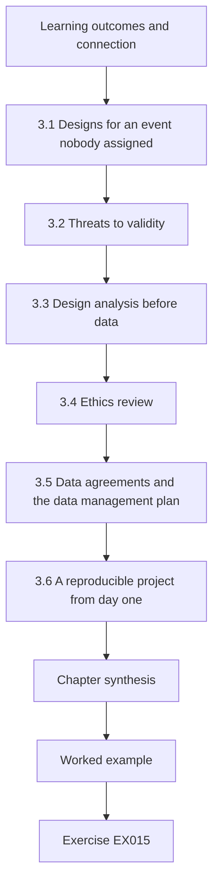

### Logical drawing

```mermaid
flowchart LR
  N0["Learning outcomes and connection"]
  N1["3.1 Designs for an event nobody assigned"]
  N2["3.2 Threats to validity"]
  N3["3.3 Design analysis before data"]
  N4["3.4 Ethics review"]
  N5["3.5 Data agreements and the data management plan"]
  N6["3.6 A reproducible project from day one"]
  N7["Chapter synthesis"]
  N0 --> N1 --> N2 --> N3 --> N4 --> N5 --> N6 --> N7 --> Q["EX015"]
```

```text
[Learning outcomes and connection]
    |
    v
[3.1 Designs for an event nobody assigned]
    |
    v
[3.2 Threats to validity]
    |
    v
[3.3 Design analysis before data]
    |
    v
[3.4 Ethics review]
    |
    v
[3.5 Data agreements and the data management plan]
    |
    v
[3.6 A reproducible project from day one]
    |
    v
[Chapter synthesis]
    |
    v
[Worked example] --> [Exercise EX015]
```
<!-- open-cyber-academy:lesson-figures:end ch-03 -->


### Learning outcomes and connection

By the end of this chapter the learner will be able to:

1. Compare the designs available for a causal question about an unplanned infrastructure event — before-and-after, interrupted time series, controlled interrupted time series, difference-in-differences, synthetic control, case study and mixed methods — and choose one by the assumptions it needs and the data it requires.
2. Name the main threats to internal, construct, statistical-conclusion and external validity, and attach each to a design feature that reduces it.
3. Run a **design analysis** before data access: estimate how large an effect the planned design can detect and how biased a simpler design would be.
4. Prepare an ethics application for a study that combines aggregate operational data and interviews, including risks to staff, organizations and the public, and information-sensitivity safeguards.
5. Specify data agreements and a data management plan proportionate to the data's sensitivity.
6. Set up a reproducible project — structure, environment, seeds, codebook, version control and a registered pre-analysis plan — before the first data arrive.

The chapter turns Chapter 1's estimand into a design. Chapter 4 examines the rival explanations that the design must defeat; Chapter 5 tests feasibility; Chapter 6 executes the analysis specified here.

### 3.1 Designs for an event nobody assigned

#### 3.1.1 The core problem

A ransomware attack is not an experiment: nobody randomly assigned it to Kestrel or chose its timing to help researchers. Every design for the Spillover Study is therefore a way of **approximating the counterfactual** — what Alder Point's arrivals would have been without the diversion — from data that exist. Designs differ in where they find that approximation and in the assumptions that make it valid.

| Design | Counterfactual comes from | Key assumption | Data needed | Main weakness |
|---|---|---|---|---|
| Before-and-after | The same units' level before the event | Nothing else changed between periods | A few weeks before and during | Confounded by season, trends and concurrent events |
| Interrupted time series (ITS) | The same units' pre-event trend, projected forward | The pre-event trend would have continued; no concurrent shock | Many time points before and after ([Wagner et al., 2002](https://doi.org/10.1046/j.1365-2710.2002.00430.x); [Lopez Bernal et al., 2017](https://doi.org/10.1093/ije/dyw098)) | A concurrent shock (an epidemic, a policy change) is attributed to the event |
| Controlled ITS / difference-in-differences | The pre-event trend plus the concurrent change in unexposed comparison units | Treated and comparison units would have changed alike ("parallel trends") | Time series for treated and comparison units | Fails if the comparison region experiences a different shock ([Roth et al., 2023](https://doi.org/10.1016/j.jeconom.2023.03.008)) |
| Synthetic control | A weighted combination of many unexposed units that matches the treated unit's pre-event path | The weighted combination would have tracked the unit without the event | Many potential donor units and a long pre-period ([Abadie, 2021](https://doi.org/10.1257/jel.20191450)) | Few donors in a region; poor pre-period fit |
| Case study / process tracing | Accounts of what happened and why | Converging, independent accounts | Documents, interviews, logs | Cannot quantify an effect size by itself |
| Mixed methods | Quantitative estimate plus process evidence | Each strand valid on its own terms; integration explicit | Both of the above ([Fetters et al., 2013](https://doi.org/10.1111/1475-6773.12117)) | Twice the work; integration often left implicit |

If the study pools several events at different times — for example, attacks on different hospital systems in different years — standard two-way fixed-effects difference-in-differences can give misleading weights to some comparisons; [Goodman-Bacon (2021)](https://doi.org/10.1016/j.jeconom.2021.03.014) decomposes the estimator and Roth et al. (2023) survey the alternatives. A single-event master's study avoids that problem but gives up generality.

#### 3.1.2 The Spillover Study's choice

The study uses a **controlled interrupted time series** for RQ1 and RQ2: daily ambulance arrivals at each neighbouring ED over 180 days before and 90 days after day 0, relative to the pooled Wexmoor EDs, with a linear trend, a step for the 21-day diversion window and a step for the following period. It adds **interviews** for RQ3. The reasons, recorded in the proposal: the comparison region removes shared seasonal change (an uncontrolled ITS cannot); two Wexmoor EDs are too few donors for a synthetic control; daily data give enough time points for the trend; and planners need the *mechanism* (RQ3) as much as the number.

A methodological review of ITS studies evaluating health-system interventions found that 81% used no control series, only 55% considered autocorrelation, 20.8% seasonality and 8.3% non-stationarity, and only 49.2% specified the expected form of the impact ([Hategeka et al., 2020](https://doi.org/10.1136/bmjgh-2020-003567)). Those are the common failures this chapter's design is built to avoid.

### 3.2 Threats to validity

The following vocabulary is standard in quasi-experimental methods. Attach each threat to the design feature that addresses it — and admit the threats no feature addresses.

| Validity | Threat | In the Spillover Study | Design response |
|---|---|---|---|
| Internal | **History**: another event coincides with the exposure | A respiratory-illness season starts near day 0 | Comparison region with the same season; placebo tests (Chapter 4) |
| Internal | **Maturation / trend** | Population growth raises arrivals slowly | Linear trend over 180 pre-event days |
| Internal | **Instrumentation**: measurement changes | Alder Point changes its arrival-logging system | Ask partners about system changes; check discontinuities (Chapter 5) |
| Internal | **Regression to the mean** | The event "started" on a day already chosen because it looked unusual | Day 0 defined by the EMS diversion log, not by outcome data ([Barnett et al., 2005](https://doi.org/10.1093/ije/dyh299)) |
| Internal | **Selection** | The comparison region differs systematically | Check pre-event paths are similar; report differences |
| Construct | Outcome does not measure the construct | "Ambulance arrivals" counts transports, not patients' need | State the construct exactly; triangulate with interviews |
| Statistical conclusion | Low power; autocorrelation; many outcomes | One event, daily counts, two outcomes | Design analysis (§3.3); robust intervals (Chapter 6); one primary outcome |
| External | Transfer to other regions | One region with one dominant system | Scope the claim; describe the region's structure so others can judge transfer |

### 3.3 Design analysis before data

#### 3.3.1 Why calculate before collecting

For a planned experiment, a sample-size calculation fixes how many participants to recruit. An observational study of one event cannot recruit more events, but it can and should ask before data access: **how large an effect could this design detect, and how wrong would a simpler design be?** [Lakens (2022)](https://doi.org/10.1525/collabra.33267) lists six ways to justify a sample size, including measuring (almost) the whole population, accepting resource constraints and planning for a desired accuracy; whichever is used, the researcher should state which effects the data can and cannot inform. For the Spillover Study, the sample is fixed by the event: one diversion of 21 days and as many pre-event days as the partners can supply.

#### 3.3.2 The smallest effect of interest

A design analysis needs a reference effect. The Tamsin Valley coalition (synthetic) activates mutual aid when an ED expects four or more extra ambulance arrivals per day — about 10% at Alder Point's baseline of 40. That gives the study a **smallest effect of interest** grounded in a real decision: 10%. Write where the number came from; an effect size invented to make a study look adequately powered is a common and easily detected weakness.

#### 3.3.3 Simulating the design

The lab below simulates the planned study many times under known truths, using synthetic daily arrivals with day-of-week variation and extra day-to-day variation. It compares an **uncontrolled** design (the treated ED's change from its own baseline) with a **controlled** design (the same change minus the change at an unaffected comparison ED), for baselines of 28, 90 and 180 days, with and without a shared seasonal rise starting near day 0. It reports the mean estimated effect (bias) and the share of simulated studies in which the 95% interval excludes zero ("flagged").

```python
# Lab 3 - design check before data access: bias and detection of two designs (offline, standard library only)
# Synthetic daily ambulance arrivals at a neighbouring hospital (treated) and an unaffected comparison hospital.
# Days -pre..-1 are baseline; days 0..20 are the 21-day diversion window at the attacked hospital.
import math, random

DOW = [1.08, 1.02, 1.00, 0.98, 1.00, 0.96, 0.96]

def poisson(rng, lam):                        # Knuth's method; adequate for lam < ~500
    L, k, p = math.exp(-lam), 0, 1.0
    while True:
        p *= rng.random()
        if p <= L:
            return k
        k += 1

def season(t, ramp):                          # respiratory season starting around day 0, shared by both
    return 1 + (0.18 / (1 + math.exp(-(t - 10) / 6)) if ramp else 0.0)

def day(rng, base, t, effect, ramp):
    lam = base * DOW[t % 7] * season(t, ramp) * (1 + effect) * rng.gammavariate(60, 1 / 60)
    return poisson(rng, lam)

def mean_var(x):
    m = sum(x) / len(x)
    return m, sum((v - m) ** 2 for v in x) / (len(x) - 1)

def log_ratio(pre, ev):                       # log(mean_event / mean_pre) and its approximate SE
    mp, vp = mean_var(pre)
    me, ve = mean_var(ev)
    return math.log(me / mp), math.sqrt(ve / (len(ev) * me ** 2) + vp / (len(pre) * mp ** 2))

def one_study(rng, pre_len, effect, ramp):
    days = range(-pre_len, 21)
    tr = {t: day(rng, 40, t, effect if t >= 0 else 0.0, ramp) for t in days}
    co = {t: day(rng, 35, t, 0.0, ramp) for t in days}
    pre, ev = [t for t in days if t < 0], [t for t in days if t >= 0]
    u, su = log_ratio([tr[t] for t in pre], [tr[t] for t in ev])           # uncontrolled pre/post
    c1, s1 = log_ratio([co[t] for t in pre], [co[t] for t in ev])
    return (u, su), (u - c1, math.sqrt(su ** 2 + s1 ** 2))                  # controlled (DiD on logs)

def run(pre_len, effect, ramp, sims=400, seed=11):
    rng = random.Random(seed)
    res = {"uncontrolled": [], "controlled": []}
    for _ in range(sims):
        a, b = one_study(rng, pre_len, effect, ramp)
        res["uncontrolled"].append(a)
        res["controlled"].append(b)
    out = {}
    for k, v in res.items():
        est = [math.exp(e) - 1 for e, _ in v]
        hits = sum(abs(e) / s > 1.96 for e, s in v) / sims
        out[k] = (sum(est) / sims, hits)
    return out

if __name__ == "__main__":
    print("season  true  pre_days  design        mean_est  share_flagged")
    for ramp in (False, True):
        for effect in (0.0, 0.10):
            for pre_len in (28, 90, 180):
                r = run(pre_len, effect, ramp)
                for k in ("uncontrolled", "controlled"):
                    m, h = r[k]
                    print(f"{'ramp' if ramp else 'flat':6}  {effect:4.2f}  {pre_len:8d}  {k:12}  {m:+8.3f}  {h:13.2f}")
```

Expected output (about three seconds):

```text
season  true  pre_days  design        mean_est  share_flagged
flat    0.00        28  uncontrolled    +0.004           0.06
flat    0.00        28  controlled      +0.010           0.04
flat    0.00        90  uncontrolled    +0.001           0.04
flat    0.00        90  controlled      +0.004           0.02
flat    0.00       180  uncontrolled    +0.004           0.05
flat    0.00       180  controlled      +0.000           0.04
flat    0.10        28  uncontrolled    +0.102           0.39
flat    0.10        28  controlled      +0.115           0.24
flat    0.10        90  uncontrolled    +0.105           0.52
flat    0.10        90  controlled      +0.110           0.33
flat    0.10       180  uncontrolled    +0.101           0.52
flat    0.10       180  controlled      +0.109           0.29
ramp    0.00        28  uncontrolled    +0.084           0.27
ramp    0.00        28  controlled      +0.003           0.07
ramp    0.00        90  uncontrolled    +0.088           0.40
ramp    0.00        90  controlled      +0.002           0.06
ramp    0.00       180  uncontrolled    +0.096           0.52
ramp    0.00       180  controlled      +0.006           0.07
ramp    0.10        28  uncontrolled    +0.191           0.84
ramp    0.10        28  controlled      +0.105           0.23
ramp    0.10        90  uncontrolled    +0.198           0.94
ramp    0.10        90  controlled      +0.106           0.28
ramp    0.10       180  uncontrolled    +0.202           0.97
ramp    0.10       180  controlled      +0.106           0.31
```

Four conclusions follow, and the proposal must state them before any data are seen:

1. **Without a seasonal shift, both designs are unbiased**, and the uncontrolled design flags a true 10% effect more often (about 52% versus about 30% with 90 or 180 baseline days) because subtracting a comparison series adds its noise.
2. **With a shared seasonal rise, the uncontrolled design is badly biased.** When the true effect is zero it estimates about +8% to +10% and flags a non-existent effect in 27% to 52% of studies — *more often with longer baselines*, because the baseline then reaches further back into the low season. More data did not fix a design problem; it made the false conclusion more confident.
3. **The controlled design removes the seasonal bias** (mean estimates near zero; flagged in 6–7% of null studies, close to the nominal 5% given the approximate standard errors) but detects a true 10% effect in only 23–31% of studies.
4. Therefore **one neighbouring ED cannot reliably detect the smallest effect of interest**. The study should be framed as *estimation with intervals*, not as a test that "shows" spillover; it should report the interval and the effects it rules out; and RQ2's distance gradient should be read across all three neighbours, not from one test. (The controlled estimates average about 0.105–0.115 when the truth is 0.10 because the average of exponentiated log ratios is slightly larger than the exponentiated average — a small, known bias.)

### 3.4 Ethics review

#### 3.4.1 What needs review

Interviews with ED managers, EMS supervisors and coalition staff are research with human participants in almost every jurisdiction and need approval from the institution's research ethics committee or institutional review board before recruitment. In the United States, the [Common Rule (45 CFR Part 46)](https://www.ecfr.gov/current/title-45/subtitle-A/subchapter-A/part-46) defines human-subjects research and the categories that may be exempt; the institution, not the student, decides whether a study qualifies. Aggregate daily counts per ED usually contain no information about individuals, but the institution may still require review, and a data custodian may require its own approval. In the EU, health data are a special category under [Article 9 of the GDPR](https://eur-lex.europa.eu/eli/reg/2016/679/oj), and processing for scientific research relies on safeguards under Article 89. If individual-level records were ever needed, U.S. health data would bring the HIPAA Privacy Rule's de-identification standards and, for a limited data set, a data use agreement ([HHS guidance](https://www.hhs.gov/hipaa/for-professionals/special-topics/de-identification/index.html)). The Spillover Study avoids individual-level records entirely — data minimization is the strongest ethical safeguard available.

#### 3.4.2 Risks particular to infrastructure studies

The [Menlo Report](https://www.dhs.gov/sites/default/files/publications/CSD-MenloPrinciplesCORE-20120803_1.pdf) principles — respect for persons, beneficence, justice, and respect for law and public interest — structure the risk analysis. In this study the main risks are:

- **To interviewees:** being blamed for decisions during the incident; disclosure of identity through role plus organization (there is one EMS operations supervisor in Tamsin Valley); professional consequences of criticizing an employer or a neighbouring hospital.
- **To organizations:** reputational harm ("Alder Point could not cope"); regulatory exposure; disclosure of security weaknesses at Kestrel.
- **To the public:** a published finding such as "this region's EDs lose a quarter of their spare capacity when one system diverts" could, combined with other information, help an adversary choose a target that maximizes regional harm. The doctoral book's [information-sensitivity test](../../../../doctorate-2-years/critical-sector-security/en/book/MANUSCRIPT.md#ch-01) applies: does an artifact identify a specific asset, its vulnerability or its dependency in a way that would help someone harm it?
- **To the researcher:** pressure from partners to soften results; access to information whose handling the researcher is not trained for.

#### 3.4.3 Safeguards

| Risk | Safeguard |
|---|---|
| Interviewee identification | Role categories broad enough to contain several people; quotations checked for identifying detail; organization names replaced in all outputs |
| Blame | Questions about systems and constraints, not individual decisions; consent form states that data will not be shared with employers |
| Withdrawal | Participants may withdraw until a stated date before analysis is finalized; their data are then deleted |
| Organizational harm | Partners review drafts for factual errors and protected information within a fixed period, with no veto over findings |
| Public targeting risk | No facility-level capacity figures published; regional synthesis only; findings on specific weaknesses routed privately to the organization concerned |
| Small cells | Suppress or aggregate counts below the custodian's minimum cell size |
| Contact with systems | None: the study never touches, scans or tests any hospital, EMS or dispatch system; it uses only data supplied by custodians and interviews |

#### 3.4.4 The application

A typical application contains: the question and its benefit; the design and data sources; recruitment, consent and withdrawal; risks and safeguards; data handling, storage, retention and destruction; dissemination; conflicts of interest; and the researcher's training. Attach the interview guide, information sheet, consent form and data agreements. Write for a committee member who is not a security specialist: explain why a finding about regional capacity is sensitive in plain language.

### 3.5 Data agreements and the data management plan

Before any data move, put in writing: what data, at what level of aggregation, for which period; purpose limitation; storage location and access; retention and destruction; publication review (factual and protected-information review only, within a fixed number of days, with no veto); acknowledgement and authorship; and breach notification. A **data management plan** then records, for each data asset, its source, sensitivity tier, format, location, who may access it, retention and what may be shared at the end. Use sensitivity tiers consistently across the project:

| Tier | Contents in the Spillover Study | Handling |
|---|---|---|
| Public | Code, synthetic test data, codebook, aggregated regional results | Repository |
| Restricted | Daily counts per ED from custodians | Encrypted institutional storage; named access; destroyed after the retention period |
| Confidential | Interview recordings, transcripts before de-identification, consent forms | Encrypted, separate from data; recordings destroyed after transcription if consent so states |

### 3.6 A reproducible project from day one

Reproducibility is easier to build than to retrofit. [Sandve et al. (2013)](https://doi.org/10.1371/journal.pcbi.1003285) give ten rules, among them: record how every result was produced; avoid manual data manipulation; archive exact versions of external programs; version-control custom scripts; record intermediate results; and note the seeds of random processes. [The Turing Way](https://book.the-turing-way.org/) community handbook expands these into practice. The [FAIR principles](https://doi.org/10.1038/sdata.2016.18) — findable, accessible, interoperable, reusable — apply to what can be shared; for restricted data, FAIR metadata can describe a dataset that cannot itself be released.

A minimal structure:

```text
spillover-study/
  README.md            question, how to run everything, environment, contacts
  data/raw/            read-only copies as received (restricted; never in version control)
  data/derived/        produced only by scripts
  code/01_audit.py     numbered in execution order
  code/02_build.py
  code/03_analysis.py
  output/              tables and figures, regenerated by scripts
  docs/codebook.md     every variable: source, definition, unit, missing-value code
  docs/deviations.md   every change to the plan, dated, with reason and whether results had been seen
  docs/environment.txt Python version and package versions
```

A **pre-analysis plan** fixes before outcome data are examined: the estimands, primary and secondary outcomes, comparison units, windows, model, interval method, robustness checks and how deviations will be reported. Registering it with a timestamp — for example in the [OSF Registries](https://osf.io/registries) — makes the plan verifiable; [Nosek et al. (2018)](https://doi.org/10.1073/pnas.1708274114) describe why preregistration distinguishes prediction from postdiction. In an observational study the data may already exist, so state honestly what had been seen when the plan was registered (for example, "pre-event data for one ED were examined during the pilot for completeness only").

### 3.7 Worked example: the ethics committee's questions (synthetic)

The committee returned the candidate's first application with five questions. The candidate's responses:

| Committee question | Response |
|---|---|
| "Why are interviews needed? Could the data alone answer the question?" | The data estimate *how much* load moved (RQ1–2) but not *how* (RQ3). Planners need the mechanism to change protocols. Ten interviews of 45 minutes each. |
| "Could participants be identified?" | Yes, by role and organization. Roles will be reported as "ED leadership", "EMS operations" or "coalition", each containing at least three participants; organization names will be removed; quotations will be reviewed. |
| "What if a participant describes an error that harmed a patient?" | The guide avoids individual clinical cases. If one is volunteered, it is not recorded in identifiable form; the information sheet explains the limits of confidentiality required by law. |
| "Could the results help an attacker?" | Facility-level capacity estimates will not be published; the dissertation reports regional patterns and the distance gradient. Specific weaknesses will be reported privately to the organization concerned. |
| "Who can stop the study?" | The supervisor, the committee and any partner for its own data; participants for their own interviews until the stated withdrawal date. |

The application was approved with one condition: the consent form had to state that the researcher is not employed by any participating organization and will not share identifiable data with them.

### 3.8 Common errors and limits

- Choosing a before-and-after design because the data are easy, then claiming a causal effect.
- Using an uncontrolled ITS when a shared shock (season, epidemic, policy) is plausible.
- Assuming parallel trends without inspecting pre-event paths.
- Running a power calculation with an effect size chosen to make the study look adequate, rather than a smallest effect of interest tied to a decision.
- Believing that more baseline data always reduce bias; with a trend or seasonal shift, they can increase it.
- Submitting an ethics application that treats aggregate infrastructure data as risk-free.
- Agreeing to a partner review without a time limit and a "no veto on findings" clause.
- Setting up reproducibility at the end; manual edits to data files that no script records.
- Registering a pre-analysis plan without stating what data had already been seen.

The limit of design is that it can only reduce, not remove, the dependence on untestable assumptions. A controlled ITS is credible only if the comparison region had no different shock at the same time; Chapter 4 tests that assumption as far as data allow.

### Exercises — chapter 3

**EX015 — Choose and defend a design.** *Objective:* select a design by assumptions and data. *Inputs:* the designs in §3.1.1; a scenario in which a regional payment processor suffered a three-day outage and you have weekly card-transaction counts for 40 merchant categories in the affected region and in three unaffected regions for two years. *Constraints:* one primary design and one robustness design. *Steps:* (1) state the estimand; (2) compare at least three designs on assumption, data and weakness; (3) choose; (4) say what would make you abandon the choice. *Expected evidence:* one page. *Rubric:* 3 = weekly resolution's consequence for a three-day event recognized, parallel-trends or donor-pool assumptions stated and checkable, abandonment condition concrete; 2 = one design misdescribed; 1 = no assumptions; 0 = none.

**EX016 — Design analysis.** *Objective:* find the smallest spillover effect a controlled before-after design can reliably detect, and reframe RQ1 to match that power. *Inputs:* Lab 3 code. *Constraints:* offline; keep seed 11 and 400 simulations. *Steps:* (1) run the lab and record the output; (2) add a true effect of 0.20 and report the controlled design's flagged share for 28, 90 and 180 baseline days under the seasonal rise; (3) state the smallest effect the controlled design detects in at least about three quarters of studies with 180 days; (4) rewrite RQ1 as an estimation question that this design can honestly answer. *Expected evidence:* outputs, a sentence on detectable effects, revised RQ1. *Rubric:* 3 = correct values, detectable effect stated as about 20% rather than 10%, RQ1 reframed toward estimation; 2 = one value wrong; 1 = not run; 0 = none.

**EX017 — Ethics application risks.** *Objective:* identify and mitigate risks. *Inputs:* a study interviewing water-utility operators about a disinfection-system outage at a small utility. *Constraints:* use the four Menlo principles; at least five stakeholders. *Steps:* (1) list stakeholders and risks; (2) propose safeguards; (3) identify the information-sensitivity risk specific to a small utility; (4) draft the two sentences of the information sheet about confidentiality limits. *Expected evidence:* table and draft text. *Rubric:* 3 = small-population identification risk recognized, public-targeting risk addressed, safeguards concrete, information-sheet text honest about limits; 2 = one principle thin; 1 = generic; 0 = none.

**EX018 — Data management plan.** *Objective:* tier and handle data. *Inputs:* the Spillover Study's assets: custodian daily counts; Wexmoor counts from a public dashboard; interview recordings; transcripts; codebook; analysis code; consent forms; the coalition's mutual-aid thresholds. *Constraints:* the three tiers in §3.5. *Steps:* assign a tier, storage, access, retention and end-of-project sharing for each. *Expected evidence:* table. *Rubric:* 3 = tiers consistent with sensitivity (recordings and consent forms confidential, custodian counts restricted, code and codebook public), public-dashboard data handled according to its terms, mutual-aid thresholds treated as sensitive; 2 = one misassigned; 1 = everything public or everything confidential; 0 = none.

**EX019 — Pre-analysis plan.** *Objective:* fix the analysis before outcomes are seen. *Inputs:* §3.1.2 and Chapter 1's estimands. *Constraints:* two pages at most. *Steps:* specify estimands, outcomes (primary and secondary), comparison, windows, model, interval method, robustness checks, multiplicity handling and the deviation rule; state what data had been seen at registration. *Expected evidence:* plan. *Rubric:* 3 = every element specific enough that another analyst would produce the same estimate, deviations rule explicit, prior data access disclosed; 2 = one element vague; 1 = model unspecified; 0 = none.

**EX020 — Reproducibility audit.** *Objective:* test whether a project can be rerun. *Inputs:* a folder containing the Chapter 1 and 3 labs and their outputs. *Constraints:* a second person reruns it from the README alone. *Steps:* (1) write the README; (2) record the environment; (3) have someone else rerun it; (4) list every point where they had to ask you something and fix it. *Expected evidence:* README, environment file and an issues list with fixes. *Rubric:* 3 = rerun succeeded with identical outputs and every question answered in the README; 2 = one manual step remains; 1 = outputs differ unexplained; 0 = none.

### Chapter synthesis

An unplanned infrastructure event offers no randomization, so every design is an approximation to a counterfactual, and its credibility rests on assumptions you must state. A controlled interrupted time series removes shared seasonal shocks that a before-and-after or uncontrolled ITS would attribute to the event; interviews supply the mechanism. Attach every validity threat to a design feature, or admit it. Simulate the design before data access: Lab 3 shows that a shared seasonal rise makes an uncontrolled design confidently wrong — more so with longer baselines — while the controlled design is nearly unbiased but too imprecise to detect a 10% effect at one ED. Frame the study as estimation. Ethics review must cover interviewees, organizations and the public, because regional-capacity findings can be sensitive. Agreements, tiers and a reproducible project with a registered pre-analysis plan come before the first data file.

<!-- open-cyber-academy:chapter-navigation:start ch-03 -->
### Continue studying — chapter 03 of 08

[← Chapter 02](#ch-02) · [Course chapter index](../SUBJECTS.md) · [Chapter 04 →](#ch-04)

Continue to the next authored lesson.
<!-- open-cyber-academy:chapter-navigation:end -->

<a id="ch-04"></a>

## Chapter 4 — Critical infrastructure and sector security: competing explanations

<!-- open-cyber-academy:lesson-figures:start ch-04 -->
### Lesson map

Lesson 04 published. Map, example, EX021.

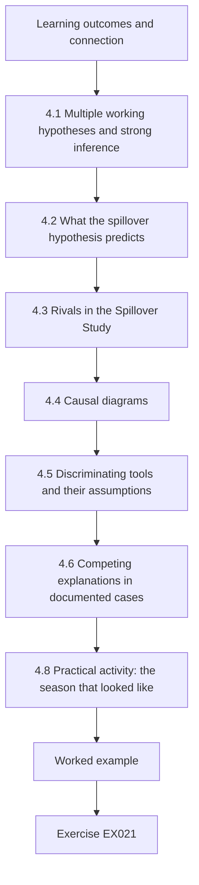

### Logical drawing

```mermaid
flowchart LR
  N0["Learning outcomes and connection"]
  N1["4.1 Multiple working hypotheses and strong inference"]
  N2["4.2 What the spillover hypothesis predicts"]
  N3["4.3 Rivals in the Spillover Study"]
  N4["4.4 Causal diagrams"]
  N5["4.5 Discriminating tools and their assumptions"]
  N6["4.6 Competing explanations in documented cases"]
  N7["4.8 Practical activity: the season that looked like"]
  N0 --> N1 --> N2 --> N3 --> N4 --> N5 --> N6 --> N7 --> Q["EX021"]
```

```text
[Learning outcomes and connection]
    |
    v
[4.1 Multiple working hypotheses and strong inference]
    |
    v
[4.2 What the spillover hypothesis predicts]
    |
    v
[4.3 Rivals in the Spillover Study]
    |
    v
[4.4 Causal diagrams]
    |
    v
[4.5 Discriminating tools and their assumptions]
    |
    v
[4.6 Competing explanations in documented cases]
    |
    v
[4.8 Practical activity: the season that looked like]
    |
    v
[Worked example] --> [Exercise EX021]
```
<!-- open-cyber-academy:lesson-figures:end ch-04 -->


### Learning outcomes and connection

By the end of this chapter the learner will be able to:

1. Apply the method of multiple working hypotheses: list every explanation that could produce the observed data before favouring one.
2. Derive, for each rival, a **prediction that differs** from the main hypothesis's prediction, and choose data that can tell them apart.
3. Draw a causal diagram for an infrastructure event, identify paths that would bias a comparison, and name what must be measured or designed around.
4. Use comparison populations, negative controls, placebo dates, dose–response gradients and timing alignment as discriminating evidence, and state the assumption each relies on.
5. Analyse documented public cases in which a cyber explanation competed with another explanation, and say what evidence decided between them.
6. Run a lab in which a naive comparison attributes a seasonal rise to an incident, and show how a comparison region and placebo windows expose it.

Chapter 3 chose a design; this chapter attacks it. The rival table built here becomes the robustness section of Chapter 6, the limitations of Chapter 7 and the examiners' questions of Chapter 8.

### 4.1 Multiple working hypotheses and strong inference

In 1890 the geologist T. C. Chamberlin warned against the "ruling theory": once a researcher has a favourite explanation, evidence is unconsciously selected to fit it. His remedy was to hold **multiple working hypotheses** at once, so that every observation is weighed against all of them ([Chamberlin, reprinted 1965](https://doi.org/10.1126/science.148.3671.754)). [Platt (1964)](https://doi.org/10.1126/science.146.3642.347) turned this into a procedure he called **strong inference**: devise alternative hypotheses; devise a crucial experiment whose possible outcomes exclude one or more of them; carry it out; repeat. Infrastructure researchers rarely run experiments, but the logic survives: for each rival, find an observation the rival predicts differently from your hypothesis.

The practical rule for this course: **a rival explanation is not addressed until you have stated what it predicts that your hypothesis does not, and looked.** "We controlled for seasonality" is not an answer; "a seasonal rise would also appear in Wexmoor, and the estimate is net of Wexmoor's change" is.

### 4.2 What the spillover hypothesis predicts

Before listing rivals, write the main hypothesis's full pattern of predictions. If Kestrel's ambulance diversion moved load to its neighbours, then:

1. **Timing:** arrivals at neighbours rise when the EMS diversion log says diversion started, not before, and fall back when it ends (perhaps with a short tail).
2. **Place:** the rise is larger at nearer EDs (a distance gradient).
3. **Population:** there is no corresponding rise in an unaffected region over the same days.
4. **Channel:** ambulance arrivals rise more than walk-in arrivals, if Kestrel's ED stayed open to walk-ins.
5. **Mechanism:** EMS destination records show transports that would normally have gone to Kestrel going to neighbours; staff describe the redistribution.

A rival that reproduces all five predictions cannot be distinguished by these data. Most rivals fail at least one, and that failure is the test.

### 4.3 Rivals in the Spillover Study

| Rival | What it would predict | Discriminating evidence |
|---|---|---|
| R1 Seasonal respiratory surge | Rise in all regions' EDs, beginning with the season, not with the diversion; no distance gradient; walk-ins rise too | Comparison region's change; walk-in channel; placebo dates in previous seasons |
| R2 Concurrent regional event (heat wave, mass gathering, road closure) | Rise tied to the event's dates and geography | Event calendars; weather; road data; timing alignment |
| R3 EMS policy change at the same time | Shift in destinations starting on the policy date, possibly lasting beyond diversion | EMS policy log; interviews; persistence after day 20 |
| R4 Measurement change (new logging system at a neighbour; Kestrel's own data loss) | Step in the series coinciding with the system change; possibly in all outcomes from that system | Partner questions; discontinuity checks in unrelated outcomes from the same system |
| R5 Regression to the mean | Event dated by an unusual outcome value; subsequent fall toward the mean | Day 0 defined from the diversion log, independent of outcomes ([Barnett et al., 2005](https://doi.org/10.1093/ije/dyh299)) |
| R6 Anticipation | Change before day 0 (rumours, partial outages) | Inspect days −14 to −1; interviews about the incident's early phase |
| R7 Chance | Estimates within the range of fake events in normal periods | Placebo-in-time distribution; intervals |
| R8 Different shock in the comparison region | Wexmoor changes for its own reasons, biasing the difference | Compare each Wexmoor ED separately; check Wexmoor's own events; alternative comparison units (Chapter 8) |
| R9 Non-cyber diversion at Kestrel at other times | Similar rises at other diversion episodes | Analyse non-cyber diversions as a mechanism check (a strength, not a threat, if the pattern is similar) |

Note R9's role. If Kestrel's ordinary diversions for crowding also move load to Alder Point, that supports the mechanism and suggests that what matters is **diversion**, not **ransomware** — which narrows the claim honestly. The study's exposure is "ransomware-induced diversion"; whether a ransomware diversion differs from an ordinary one (longer, less predictable, with information systems down at the diverting hospital) is a further question.

### 4.4 Causal diagrams

A **causal diagram** (directed acyclic graph, DAG) draws variables as nodes and assumed causal effects as arrows. Its value is that it makes assumptions visible and tells you which comparisons are biased by which paths ([Greenland, Pearl and Robins, 1999](https://doi.org/10.1097/00001648-199901000-00008); [Hernán and Robins, *Causal Inference: What If*](https://miguelhernan.org/whatifbook)). For the Spillover Study, think of the "exposure" as *being in the diversion period* and the outcome as *arrivals at Alder Point on that day*:

```text
Attack ──► Diversion ──► EMS destination choices ──► Arrivals at AP
                                                       ▲   ▲
Calendar time ──► Season ──────────────────────────────┘   │
      │                                                     │
      └──────────► (period: before vs during) ── Trend ─────┘

Season ──► Arrivals in Wexmoor          Distance (AP, BF, CG) modifies EMS destination choices
```

Text description of the diagram: the attack causes diversion, which changes EMS destination choices, which raise arrivals at Alder Point. Calendar time determines both whether a day is in the diversion period and the season; the season also raises arrivals at Alder Point and in Wexmoor. Distance modifies how strongly diversion changes destinations at each neighbour.

The diagram shows why a before-and-after comparison is biased: "before versus during" is tied to calendar time, and calendar time reaches the outcome through the season — a **back-door path** from the exposure period to the outcome that does not pass through diversion. Adjusting for the season directly is impossible (it is not measured precisely), but Wexmoor's arrivals are caused by the season and not by the diversion, so subtracting Wexmoor's change removes the seasonal path *if* the season affects both regions alike. That "if" is the parallel-trends assumption of Chapter 3, now visible as an assumption about arrows.

### 4.5 Discriminating tools and their assumptions

| Tool | How it works | Assumption it relies on |
|---|---|---|
| **Comparison population** | An unexposed population shares the rival causes; its change estimates the rivals' contribution | It shares the rivals equally and has no rival of its own (R8) |
| **Negative-control population** | A population that *cannot* be affected by the exposure; any "effect" there reveals bias in the method ([Lipsitch et al., 2010](https://doi.org/10.1097/EDE.0b013e3181d61eeb)) | It is subject to the same biases as the treated population |
| **Negative-control outcome** | An outcome the exposure cannot affect but the confounders can; an "effect" on it signals confounding (same source) | The exposure truly cannot affect it — argue this, do not assume it |
| **Placebo-in-time** | Apply the analysis to fake event dates when nothing happened; the real estimate should be unusual among them | Fake windows resemble the real one in season and noise |
| **Dose–response** | A larger exposure (nearer ED) should produce a larger effect | Distance is a valid proxy for exposure intensity |
| **Timing alignment** | The change should start and end with the exposure as recorded independently of the outcome | Independent exposure records exist and are accurate |
| **Mechanism evidence** | Destination records and interviews show the pathway | Records are complete; accounts are not shaped by hindsight |

Two cautions. First, negative controls need arguments, not labels. Walk-in arrivals at Alder Point look like a negative-control outcome for an *ambulance* diversion, but if patients who would have walked into Kestrel also went elsewhere, walk-ins are partly exposed; use them as a channel comparison (prediction 4), not as a pure negative control. Second, interviews conducted after an incident are subject to **hindsight bias**: knowing the outcome changes people's judgement of how foreseeable it was ([Fischhoff, 1975](https://doi.org/10.1037/0096-1523.1.3.288)). Ask about what was known and decided at each point, anchored to dated records, rather than "what went wrong".

### 4.6 Competing explanations in documented cases

Public infrastructure incidents repeatedly show a cyber explanation competing with another. The cases below are described only at the level their public sources report.

| Case | Competing explanations | Evidence that discriminated, as publicly reported | Lesson for research design |
|---|---|---|---|
| Oldsmar water plant, 2021 | Remote intrusion versus employee action | According to the former city manager, the FBI found no evidence of outside access; an FBI spokesperson said it could not confirm a targeted intrusion ([WUSF, 2023](https://www.wusf.org/local-state/2023-04-13/official-hack-oldsmar-city-water-treatment-plant-2021)); CISA's advisory [AA21-042A](https://www.cisa.gov/news-events/cybersecurity-advisories/aa21-042a) had reported a compromise | Code incident causes with status and source; an advisory is not a final finding |
| Düsseldorf hospital, 2020 | Treatment delay caused by the attack versus the patient's underlying condition | Prosecutors concluded after the autopsy that the delay was not decisive ([MIT Technology Review, 2020](https://www.technologyreview.com/2020/11/12/1012015/ransomware-did-not-kill-a-german-hospital-patient/)) | Individual-outcome claims need a counterfactual for the individual; population-level designs ask a different question |
| Colonial Pipeline, 2021 | Pipeline stopped because operational systems were attacked versus a precautionary shutdown after a ransomware attack on the company | DOE describes the company as having "proactively shut down its pipeline system in response to a ransomware attack" ([DOE](https://www.energy.gov/ceser/colonial-pipeline-cyber-incident)) | A consequence may be caused by the *response* to an attack; a study must model decisions, not only compromises |
| July 2024 global outage | Cyberattack versus faulty software update | Microsoft attributed the disruption to a faulty update to security software on 8.5 million devices ([Microsoft, 2024](https://blogs.microsoft.com/blog/2024/07/20/helping-our-customers-through-the-crowdstrike-outage/)) | Non-malicious failures produce cyber-like consequences; they are both rivals and useful comparisons |

The Colonial row deserves emphasis for the Spillover Study. Kestrel's diversion was a **decision** made in response to the attack, not a mechanical consequence of it. The same attack at a hospital with different leadership, procedures or information could have led to a shorter diversion or none. The study's exposure is therefore the diversion, and its claim is about the consequences of diversion; it should not be read as estimating the effect of ransomware as such.

### 4.7 Worked example: the rival table in the proposal (synthetic)

The candidate's first rival paragraph read: *"Possible confounders such as seasonality were controlled for by using a comparison region."* The supervisor asked for each rival's distinct prediction and test. The revised section of the proposal:

- **R1 Season.** Predicts a rise in Wexmoor as well. *Test:* report Wexmoor's own pre/post change (a negative-control population); estimate effects net of Wexmoor; run placebo windows. *If it fails:* if Wexmoor's change is as large as Alder Point's, the spillover estimate is near zero and the study says so.
- **R3 EMS policy.** Predicts a change starting on a policy date and persisting. *Test:* request the EMS policy log for days −60 to +90; ask EMS supervisors (RQ3). *If it fails:* report the policy change as a co-intervention and narrow the claim.
- **R4 Measurement.** Predicts a step in all outcomes from Alder Point's system. *Test:* ask the custodian about system changes; inspect walk-ins and waiting times for the same step.
- **R6 Anticipation.** Predicts a change before day 0. *Test:* inspect days −14 to −1 in the event-study plot; ask interviewees when they learned of the attack.
- **R7 Chance.** *Test:* the real estimate's rank among placebo windows; intervals.
- **R8 Comparison shock.** *Test:* estimate against each Wexmoor ED separately and pooled (Chapter 8's specification curve); ask the Wexmoor custodian about events.

A rival the study cannot test — for example, an unrecorded change in how Kestrel's own ambulances were dispatched — goes into the limitations with its likely direction (Chapter 7).

### 4.8 Practical activity: the season that looked like spillover

Save the following file as `lab4_data.py`; Labs 6 and 8 import it. It generates the synthetic Tamsin Valley and Wexmoor data for days −180 to +89 with day-of-week variation, extra day-to-day variation, two regional holidays and a respiratory season that starts rising near day 0 in both regions. The true spillover effects are fixed in the `TRUE` dictionary: +22% at Alder Point during days 0–20 (+5% in days 21–34), +10% at Brookfield (+2%) and none at Calloway. The script then compares a naive before-and-after estimate (28 days before versus days 0–20) with the same change expressed relative to Wexmoor, and runs the naive comparison at 19 fake 21-day windows in the baseline.

```python
# Lab 4 - competing explanations for a post-incident rise in ambulance arrivals (offline, standard library only)
# Save as lab4_data.py: Labs 6 and 8 import make_region() from it.
# Synthetic Tamsin Valley (treated region) and Wexmoor (comparison region); day 0 = start of the
# 21-day ambulance diversion at the attacked Kestrel hospitals. Days -180..89.
import math, random

DOW = [1.08, 1.02, 1.00, 0.98, 1.00, 0.96, 0.96]
BASE = {"AP": 40, "BF": 30, "CG": 22, "W1": 35, "W2": 28}           # ambulance arrivals per day
DIST_KM = {"AP": 6, "BF": 14, "CG": 38}                            # distance from Kestrel
TRUE = {"AP": (0.22, 0.05), "BF": (0.10, 0.02), "CG": (0.0, 0.0)}  # (days 0-20, days 21-34)
HOLIDAYS = {-100, 45}                                              # regional holidays, both regions
DAYS = range(-180, 90)

def poisson(rng, lam):
    L, k, p = math.exp(-lam), 0, 1.0
    while True:
        p *= rng.random()
        if p <= L:
            return k
        k += 1

def season(t, amp):
    return 1 + amp / (1 + math.exp(-(t - 10) / 6))

def effect(site, t):
    during, tail = TRUE.get(site, (0.0, 0.0))
    return during if 0 <= t <= 20 else tail if 21 <= t <= 34 else 0.0

def make_region(seed=2026):
    rng = random.Random(seed)
    data = {}
    for site, base in BASE.items():
        amp = 0.18 if site in TRUE else 0.17
        series = {}
        for t in DAYS:
            lam = base * DOW[t % 7] * season(t, amp) * (1 + effect(site, t))
            lam *= (0.85 if t in HOLIDAYS else 1.0) * rng.gammavariate(60, 1 / 60)
            series[t] = poisson(rng, lam)
        data[site] = series
    wait = {}                                                     # AP median minutes to provider
    for t in DAYS:
        wait[t] = max(5.0, rng.gauss(28 + (4 if 0 <= t <= 20 else 0) + 3 * (season(t, 0.18) - 1) / 0.18, 6))
    data["AP_wait"] = wait
    return data

def mean(xs):
    xs = list(xs)
    return sum(xs) / len(xs)

def naive(series, pre=(-28, -1), ev=(0, 20)):
    return mean(series[t] for t in range(pre[0], pre[1] + 1)), mean(series[t] for t in range(ev[0], ev[1] + 1))

if __name__ == "__main__":
    d = make_region()
    comp = {t: d["W1"][t] + d["W2"][t] for t in DAYS}
    print("site  km  pre28  event  naive_change  relative_to_Wexmoor")
    cp, ce = naive(comp)
    for s in ("AP", "BF", "CG", "W1", "W2"):
        p, e = naive(d[s])
        rel = (e / p) / (ce / cp) - 1
        km = DIST_KM.get(s, "-")
        print(f"{s:4}  {str(km):>2}  {p:5.1f}  {e:5.1f}  {e / p - 1:+12.3f}  {rel:+19.3f}")
    print(f"Wexmoor pooled pre/post change: {ce / cp - 1:+.3f}  (no exposure: a negative-control population)")
    # placebo-in-time: the same naive comparison at 21-day windows that end before day 0
    pl = []
    for start in range(-150, -21, 7):
        p, e = naive(d["AP"], pre=(start - 28, start - 1), ev=(start, start + 20))
        pl.append(e / p - 1)
    print(f"AP naive placebo windows: n={len(pl)} min={min(pl):+.3f} max={max(pl):+.3f}")
```

Expected output:

```text
site  km  pre28  event  naive_change  relative_to_Wexmoor
AP     6   38.4   51.1        +0.330               +0.246
BF    14   30.4   33.8        +0.112               +0.042
CG    38   22.6   24.5        +0.081               +0.013
W1     -   33.5   37.0        +0.106               +0.036
W2     -   28.1   28.7        +0.022               -0.043
Wexmoor pooled pre/post change: +0.067  (no exposure: a negative-control population)
AP naive placebo windows: n=19 min=-0.064 max=+0.091
```

Read the output as a seminar would:

- **Naive estimates overstate everywhere.** Alder Point appears to rise by 33.0% when the generator's truth is 22%; Calloway, 38 km away and truly unaffected, appears to rise by 8.1%.
- **The negative-control population exposes the bias.** Wexmoor, which cannot be affected by Kestrel's diversion, "rose" by 6.7% (W1 by 10.6%). Any method that finds an effect in Wexmoor is measuring something other than spillover — here, the season.
- **Relative to Wexmoor, a gradient appears:** +24.6% at 6 km, +4.2% at 14 km and +1.3% at 38 km. Alder Point's estimate is close to the truth. Brookfield's is less than half its true 10% — single-ED estimates are noisy, as Lab 3 warned.
- **Placebo windows calibrate the naive method.** In 19 fake windows during ordinary baseline periods, the naive change at Alder Point ranged from −6.4% to +9.1%. A +33% change is far outside that range, so chance (R7) is an unlikely explanation for Alder Point — but the placebo windows lie in a season-free baseline, so they do not test R1. That is why both tools are needed.

The relative-to-Wexmoor figures in this lab are crude ratios of means. Chapter 6 replaces them with a controlled interrupted time series that also models the trend and gives autocorrelation-robust intervals.

### 4.9 Common errors and limits

- Naming a rival and declaring it "controlled for" without stating its distinct prediction.
- Treating a comparison region as automatically valid; parallel trends is an assumption that can fail.
- Labelling an outcome a negative control without arguing that the exposure cannot affect it.
- Using placebo windows from a different season and treating them as a test of seasonal confounding.
- Interviewing for "what went wrong" and receiving hindsight.
- Claiming the effect of "ransomware" when the exposure was a human decision taken in response to it.
- Repeating an early public account of a case (Oldsmar, Düsseldorf) as if it were settled.
- Stopping the search for rivals when the first one is addressed.

The limit of this chapter's tools is that each relies on an assumption that cannot be fully tested with the same data. The defence against that limit is triangulation: when timing, place, population, channel and mechanism evidence all point the same way, the remaining rivals must explain all of them at once.

### Exercises — chapter 4

**EX021 — Rival table.** *Objective:* list rivals with distinct predictions. *Inputs:* a synthetic finding: "after a ransomware attack on a regional pharmacy chain, prescription fills at independent pharmacies within 10 km rose 18% in the following two weeks." *Constraints:* at least six rivals. *Steps:* (1) state the main hypothesis's five predictions (timing, place, population, channel, mechanism); (2) for each rival, state what it predicts differently; (3) name the data that would discriminate. *Expected evidence:* table. *Rubric:* 3 = rivals include season, concurrent events (for example insurer changes), measurement and comparison-region shock, each with a distinct and testable prediction; 2 = one rival without a distinct prediction; 1 = generic list; 0 = none.

**EX022 — Baseline length and the naive estimate.** *Objective:* show why a longer pre-period shifts the naive before-after estimate while the Wexmoor-relative estimate barely moves. *Inputs:* Lab 4 code. *Constraints:* offline; do not change the seed. *Steps:* (1) run the lab and record the output; (2) change the naive baseline from 28 to 56 days (`pre=(-56, -1)`) for every site including the pooled comparison, and report the naive and relative-to-Wexmoor changes; (3) explain why the naive estimates changed but the relative estimates changed little. *Expected evidence:* outputs and a paragraph. *Rubric:* 3 = correct values, explanation that the season reaches both regions so the ratio cancels most of its effect, while the naive estimate depends on how much pre-season baseline it includes; 2 = one value wrong; 1 = not run; 0 = none.

**EX023 — Causal diagram.** *Objective:* make assumptions explicit. *Inputs:* the Spillover Study with an added fact: during the diversion, the county also opened a temporary urgent-care tent near Brookfield. *Constraints:* text or drawn DAG with a text description. *Steps:* (1) add the tent to the diagram; (2) identify how it biases Brookfield's estimate and in which direction; (3) propose data or design to address it; (4) state whether it threatens Alder Point's estimate. *Expected evidence:* diagram, description and paragraph. *Rubric:* 3 = tent shown as a co-intervention affecting Brookfield's arrivals (likely reducing walk-ins and possibly ambulance arrivals), direction reasoned, response concrete (channel analysis, tent attendance data, sensitivity), Alder Point assessed by distance and catchment; 2 = direction unstated; 1 = diagram without reasoning; 0 = none.

**EX024 — Negative controls.** *Objective:* argue, not label. *Inputs:* candidate negative controls: (a) Wexmoor ambulance arrivals; (b) Alder Point walk-in arrivals; (c) Alder Point scheduled outpatient infusions; (d) Calloway ambulance arrivals. *Constraints:* use Lipsitch et al.'s logic. *Steps:* for each, state whether it is a negative-control population or outcome, whether the exposure could affect it, whether it shares the confounders, and your verdict. *Expected evidence:* table. *Rubric:* 3 = (a) accepted as population with parallel-season caveat, (b) rejected as pure negative control but useful for the channel, (c) unaffected by diversion but probably not by the season either, so weak, (d) rejected because Calloway is part of the hypothesis's distance gradient; 2 = one verdict unjustified; 1 = labels only; 0 = none.

**EX025 — A documented competing explanation.** *Objective:* analyse a public case. *Inputs:* the Düsseldorf sources in §4.6 and §2.5. *Constraints:* do not speculate beyond the sources. *Steps:* (1) state the two competing explanations; (2) state what evidence decided between them, as reported; (3) explain why an individual-death claim and a population-level claim about diversion and outcomes require different designs; (4) propose a population-level question that could be studied ethically. *Expected evidence:* one page. *Rubric:* 3 = explanations stated, autopsy-based conclusion reported with source, individual versus population counterfactual distinguished, ethical population design proposed (for example time-sensitive emergencies during diversions using aggregate registry data); 2 = one element missing; 1 = speculation; 0 = none.

**EX026 — The decision as exposure.** *Objective:* separate attack from response. *Inputs:* the Colonial Pipeline row in §4.6 and Kestrel's diversion. *Constraints:* half a page. *Steps:* (1) explain why the Spillover Study's exposure is the diversion; (2) list two ways the same attack could have produced a different diversion; (3) rewrite the study's claim so that it does not overstate the role of ransomware; (4) propose a question about diversion *decisions* for a later study. *Expected evidence:* paragraph and claim. *Rubric:* 3 = response-as-cause articulated, plausible alternative decisions, claim scoped to diversion, decision question answerable; 2 = claim still about ransomware generally; 1 = confuses attack and diversion; 0 = none.

### Chapter synthesis

Hold several explanations at once and look for observations that separate them. Write the main hypothesis's full pattern — timing, place, population, channel, mechanism — and require each rival to explain all of it. A causal diagram shows why a before-and-after comparison is biased by the season and what assumption a comparison region needs. Comparison populations, negative controls, placebo dates, dose–response and timing alignment each discriminate under an assumption you must argue. Public cases show cyber explanations competing with operator error, underlying illness, precautionary decisions and faulty updates; the lesson is to record status and to model decisions. Lab 4 shows a naive method finding "spillover" 38 km away and in an unaffected region, and a comparison region revealing a gradient close to the truth.

<!-- open-cyber-academy:chapter-navigation:start ch-04 -->
### Continue studying — chapter 04 of 08

[← Chapter 03](#ch-03) · [Course chapter index](../SUBJECTS.md) · [Chapter 05 →](#ch-05)

Continue to the next authored lesson.
<!-- open-cyber-academy:chapter-navigation:end -->

<a id="ch-05"></a>

## Chapter 5 — Proposal and pilot

<!-- open-cyber-academy:lesson-figures:start ch-05 -->
### Lesson map

Lesson 05 published. Map, example, EX027.

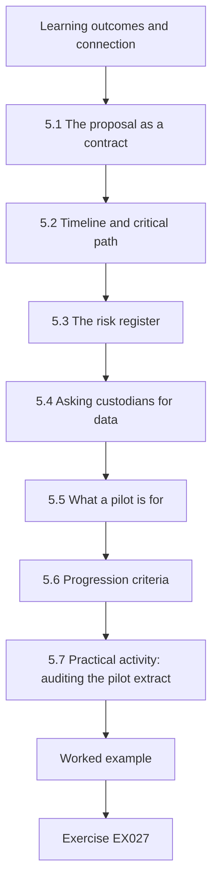

### Logical drawing

```mermaid
flowchart LR
  N0["Learning outcomes and connection"]
  N1["5.1 The proposal as a contract"]
  N2["5.2 Timeline and critical path"]
  N3["5.3 The risk register"]
  N4["5.4 Asking custodians for data"]
  N5["5.5 What a pilot is for"]
  N6["5.6 Progression criteria"]
  N7["5.7 Practical activity: auditing the pilot extract"]
  N0 --> N1 --> N2 --> N3 --> N4 --> N5 --> N6 --> N7 --> Q["EX027"]
```

```text
[Learning outcomes and connection]
    |
    v
[5.1 The proposal as a contract]
    |
    v
[5.2 Timeline and critical path]
    |
    v
[5.3 The risk register]
    |
    v
[5.4 Asking custodians for data]
    |
    v
[5.5 What a pilot is for]
    |
    v
[5.6 Progression criteria]
    |
    v
[5.7 Practical activity: auditing the pilot extract]
    |
    v
[Worked example] --> [Exercise EX027]
```
<!-- open-cyber-academy:lesson-figures:end ch-05 -->


### Learning outcomes and connection

By the end of this chapter the learner will be able to:

1. Write a research proposal that functions as a contract with a supervisor, a committee and data partners: specific enough to be checked, flexible only where flexibility is declared.
2. Plan a two-year master's project with its critical path, and keep a risk register with triggers and owners.
3. Approach data custodians with a precise request and negotiate access that the study can survive.
4. Design a **feasibility pilot** whose purpose is to test procedures, not to estimate effects, and explain why pilot effect estimates should not be used to justify the main study.
5. Set predeclared **progression (go/no-go) criteria**, including an amend-and-re-pilot outcome.
6. Audit a pilot data extract systematically and turn each finding into a question for the custodian or a change in procedure.

Chapters 1–4 produced the question, the seminar map, the design and the rival table. This chapter packages them into a proposal and tests whether the study can actually be done. Chapter 6 runs it.

### 5.1 The proposal as a contract

A proposal answers three audiences at once. The **supervisor** needs to know the project is feasible and the candidate understands it. The **committee** (and later the examiners) needs to see that the question, design and analysis are coherent. **Data partners** need to know exactly what will be requested, how it will be protected and what will be published. A proposal that satisfies all three is specific about what is fixed and explicit about what is open.

A standard structure for the Spillover Study:

1. **Title and summary** (250 words): question, design, data, expected contribution.
2. **Problem and rationale:** the decision that the answer informs; the gap from the concept matrix (Chapter 1).
3. **Questions and estimands:** RQ1–RQ3 with the estimand definitions.
4. **Background:** a two-page concept-centric summary of the literature.
5. **Design:** controlled interrupted time series and interviews; why these and not others.
6. **Data and access:** custodians, variables, period, aggregation, agreements, fallback sources.
7. **Ethics and information protection:** the approved or submitted application; sensitivity tiers.
8. **Analysis plan:** a summary of the pre-analysis plan with a link to its registration.
9. **Rivals and robustness:** the Chapter 4 rival table with tests.
10. **Timeline and milestones.**
11. **Risks and mitigations.**
12. **Outputs:** dissertation, partner briefing, possible paper; what will and will not be published.
13. **References.**

Mark each element as **fixed** (changes require a dated entry in the deviation log and the supervisor's agreement) or **open** (to be decided by a stated date or after the pilot). In the Spillover Study, the estimands, primary outcome, comparison region and model are fixed; the exact number of interviews (8–12) and the secondary outcome's definition (pending the custodian's data dictionary) are open.

### 5.2 Timeline and critical path

A two-year master's at about 1,200 hours of study time leaves perhaps 600–700 hours for the dissertation itself once taught components are counted; the rest of this course's hours are the chapters you are studying. The scarce resource is not analysis time but **elapsed time waiting for other people**: ethics committees, data custodians, partners' legal teams and interviewees' calendars.

| Semester | Milestones | Elapsed-time dependencies |
|---|---|---|
| 1 | Question, search and concept matrix (Chapter 1); seminar (Chapter 2); first contact with custodians | Custodians' first replies often take weeks |
| 2 | Design, design analysis, ethics application, data agreements, pre-analysis plan (Chapters 3–4) | Ethics review; legal review of agreements — the **critical path** |
| 3 | Proposal approved; pilot; main data collection; interviews (Chapters 5–6) | Pilot re-run if criteria fail; interview scheduling |
| 4 | Analysis, writing, examination (Chapters 6–8) | Partner factual review period; examination scheduling |

The **critical path** is the chain of tasks whose delay delays the whole project: here, ethics approval and data agreements, which must both precede the pilot. Start them early, even before the design is final, by sharing a draft data request and asking custodians what approvals they require.

### 5.3 The risk register

| Risk | Likelihood | Impact | Mitigation | Trigger for action | Owner |
|---|---|---|---|---|---|
| Custodian delays data | High | High | Early contact; minimal request; public-dashboard fallback for Wexmoor | No signed agreement by end of semester 2 | Candidate, supervisor |
| Partner withdraws after seeing results | Medium | High | Publication agreement with factual review and no veto, signed before access | Request to suppress findings | Supervisor |
| Data quality inadequate | Medium | High | Pilot audit with progression criteria | Criteria fail twice | Candidate |
| Ethics approval delayed or conditional | Medium | Medium | Submit early; pre-consult the committee | No decision eight weeks after submission | Candidate |
| Too few interviewees | Medium | Medium | Recruit through the coalition; broaden roles | Fewer than six by mid-semester 3 | Candidate |
| Scope creep (adding outcomes, regions) | High | Medium | Fixed elements; deviation log | Any new outcome proposed | Supervisor |
| Partner suffers a new security incident | Low | High | Pause; never request incident details; follow partner instructions | Partner notification | Candidate |
| Findings judged sensitive | Medium | Medium | Sensitivity tiers; regional reporting; private routing of specific weaknesses | Partner or committee concern | Supervisor |

Review the register at every supervision meeting. A risk register that is written once for the proposal and never opened again is decoration.

### 5.4 Asking custodians for data

Custodians receive many vague requests and answer precise ones. A good request states: the purpose in two sentences; the exact variables and their definitions as you understand them; the period; the aggregation (daily counts per ED; no patient-level records); how the data will be stored and destroyed; what will be published and in what form; the ethics approval status; and what you will give back (a briefing, a check of their data's quality). Ask the custodian three questions that every time-series study needs: *Did the recording system, its definitions or the site's catchment change during the period? Are there known gaps or downtime days? How are late entries and corrections handled?* The answers often matter more than the data.

For the Spillover Study, Alder Point and Brookfield agreed to supply daily aggregates; Calloway agreed after the coalition intervened; Wexmoor's counts came from a public regional dashboard whose terms allow research use, which the candidate recorded in the data management plan.

### 5.5 What a pilot is for

A **pilot** or **feasibility study** asks whether the main study can be done as planned: whether data can be obtained in the expected form, whether participants can be recruited, whether the procedures and instruments work and how long they take. [Thabane et al. (2010)](https://doi.org/10.1186/1471-2288-10-1) give a tutorial on the what, why and how; [Lancaster, Dodd and Williamson (2004)](https://doi.org/10.1111/j..2002.384.doc.x) recommend that pilots have clear feasibility objectives and be analysed descriptively; the [CONSORT extension for pilot and feasibility trials](https://doi.org/10.1136/bmj.i5239) (Eldridge et al., 2016) asks authors to report the criteria used to decide whether to proceed. Although those sources address trials, their core logic transfers directly to observational and mixed-methods studies.

What a pilot is **not** for: estimating the effect, or estimating the effect size for a power calculation. [Leon, Davis and Kraemer (2011)](https://doi.org/10.1016/j.jpsychires.2010.10.008) explain why: pilot samples are small, so their effect estimates are too imprecise to guide sample-size decisions and can mislead in either direction. In an observational event study there is an additional reason: if the candidate examines outcome data around the event during the "pilot", the subsequent analysis is no longer planned blind to the result. The Spillover Study's data pilot therefore uses a **35-day baseline extract from Alder Point, entirely before day −60**, and examines completeness and plausibility only.

The Spillover Study's pilot has three components:

1. **Data pilot:** the baseline extract, audited against predeclared criteria (Lab 5).
2. **Interview pilot:** two interviews with people outside the sample (a retired ED manager and an EMS educator from another region), testing the guide's clarity, length and sensitivity.
3. **Pipeline pilot:** the full analysis code run end to end on synthetic data (Lab 4's generator) to check that it produces every planned table and figure.

### 5.6 Progression criteria

**Progression criteria** state in advance what pilot results lead to proceeding, amending or stopping. A common format uses three zones: *go* (proceed as planned), *amend* (proceed after specified changes, possibly re-piloting) and *stop* (the study as designed is not feasible). The Spillover Study's data criteria:

| Criterion | Go | Amend | Stop |
|---|---|---|---|
| Cell completeness of the four variables | ≥ 97% | 90–97% | < 90% after one re-pilot |
| Conflicting duplicate days | None | Explained by custodian | Unexplained |
| Missing calendar days | ≤ 1 | 2–5, explained | > 5 or unexplained |
| Values out of range (negative counts, diversion > 1,440 minutes per day) | None | Corrected by custodian | Persisting |

Interview criteria: the guide fits in 45 minutes; neither pilot participant reports discomfort with any question; both understand every question without rephrasing. Pipeline criterion: every planned output produced without manual steps.

### 5.7 Practical activity: auditing the pilot extract

The lab below audits a synthetic 35-day extract from Alder Point against the criteria in §5.6. It checks site codes, duplicate dates (and whether duplicates conflict), missing values, out-of-range values, missing calendar days and implausibly low days, and reports a decision.

```python
# Lab 5 - audit a pilot extract against predeclared go/no-go criteria (offline, standard library only)
# A synthetic 35-day daily extract from one neighbouring hospital (AP), as a partner might send it.
import csv, io, datetime as dt

EXTRACT = """date,site,amb_arrivals,walkins,diversion_min,median_wait_min
2025-03-01,AP,41,96,0,27
2025-03-02,AP,37,88,0,25
2025-03-03,AP,44,102,35,31
2025-03-04,AP,40,99,0,29
2025-03-05,AP,39,,0,28
2025-03-06,AP,42,101,0,30
2025-03-07,AP,38,93,0,26
2025-03-08,AP,36,90,0,24
2025-03-09,AP,35,87,0,23
2025-03-10,AP,45,104,120,33
2025-03-11,AP,43,100,0,30
2025-03-11,AP,43,100,0,30
2025-03-12,AP,41,97,0,N/A
2025-03-13,AP,40,95,0,29
2025-03-15,AP,37,91,0,25
2025-03-16,AP,36,89,0,24
2025-03-17,AP,46,105,-15,34
2025-03-18,AP,44,103,0,31
2025-03-19,ALDR,42,98,0,29
2025-03-20,AP,41,96,0,28
2025-03-21,AP,39,94,0,27
2025-03-22,AP,37,90,0,26
2025-03-23,AP,35,86,0,24
2025-03-24,AP,47,106,1600,35
2025-03-25,AP,44,101,0,31
2025-03-26,AP,43,99,0,30
2025-03-27,AP,41,97,0,29
2025-03-28,AP,40,95,0,28
2025-03-29,AP,38,92,0,26
2025-03-30,AP,23,55,0,25
2025-03-31,AP,45,103,0,32
2025-04-01,AP,44,102,0,31
2025-04-02,AP,42,99,0,30
2025-04-03,AP,40,96,0,29
2025-04-04,AP,39,94,0,28
"""
FIELDS = ["amb_arrivals", "walkins", "diversion_min", "median_wait_min"]
rows = list(csv.DictReader(io.StringIO(EXTRACT)))
issues, seen, by_date = [], {}, {}
for i, r in enumerate(rows, start=2):                      # line numbers as in the file
    d = dt.date.fromisoformat(r["date"])
    if r["site"] != "AP":
        issues.append((i, "site code", r["site"]))
    if d in seen:
        same = all(r[f] == rows[seen[d] - 2][f] for f in FIELDS)
        issues.append((i, "duplicate date", "identical" if same else "CONFLICTING"))
        continue
    seen[d] = i
    by_date[d] = r
    for f in FIELDS:
        v = r[f].strip()
        if v in ("", "N/A", "NA"):
            issues.append((i, "missing", f))
            continue
        x = float(v)
        if x < 0 or (f == "diversion_min" and x > 1440):
            issues.append((i, "out of range", f"{f}={v}"))

start, end = min(by_date), max(by_date)
expected = (end - start).days + 1
missing_days = [start + dt.timedelta(k) for k in range(expected) if start + dt.timedelta(k) not in by_date]
cells = expected * len(FIELDS)
bad_cells = sum(1 for _, kind, _ in issues if kind in ("missing", "out of range")) + len(missing_days) * len(FIELDS)
arr = [int(by_date[d]["amb_arrivals"]) for d in sorted(by_date)]
mu = sum(arr) / len(arr)
low = [(str(d), int(r["amb_arrivals"])) for d, r in sorted(by_date.items()) if int(r["amb_arrivals"]) < 0.7 * mu]

for line, kind, detail in issues:
    print(f"line {line:2d}: {kind}: {detail}")
print("missing calendar days:", [str(d) for d in missing_days])
print("implausibly low days (<70% of mean):", low)
complete = 1 - bad_cells / cells
print(f"cell completeness {complete:.3f} over {expected} days x {len(FIELDS)} fields")
CRITERIA = {                                                # predeclared in the pilot protocol
    "completeness >= 0.97": complete >= 0.97,
    "no conflicting duplicates": not any(d == "CONFLICTING" for _, k, d in issues if k == "duplicate date"),
    "<= 1 missing calendar day": len(missing_days) <= 1,
    "all values in range": not any(k == "out of range" for _, k, _ in issues),
}
for c, ok in CRITERIA.items():
    print(f"  {'PASS' if ok else 'FAIL'}  {c}")
print("decision:", "GO" if all(CRITERIA.values()) else "AMEND AND RE-PILOT (no outcome analysis)")
```

Expected output:

```text
line  6: missing: walkins
line 13: duplicate date: identical
line 14: missing: median_wait_min
line 18: out of range: diversion_min=-15
line 20: site code: ALDR
line 25: out of range: diversion_min=1600
missing calendar days: ['2025-03-14']
implausibly low days (<70% of mean): [('2025-03-30', 23)]
cell completeness 0.943 over 35 days x 4 fields
  FAIL  completeness >= 0.97
  PASS  no conflicting duplicates
  PASS  <= 1 missing calendar day
  FAIL  all values in range
decision: AMEND AND RE-PILOT (no outcome analysis)
```

Each finding becomes a question, not a silent fix:

- **Line 13, duplicate date (identical):** likely an export artefact. Ask how the extract is produced; remove the duplicate only after the custodian confirms.
- **Lines 6 and 14, missing values:** ask whether walk-ins on 5 March and waiting time on 12 March were not recorded or not exported. Do not impute in the pilot.
- **Line 18, diversion −15 minutes; line 25, 1,600 minutes:** impossible values. A negative duration suggests a sign or subtraction error; 1,600 minutes exceeds a day. Ask the custodian for the source records and how diversion minutes are computed.
- **Line 20, site code `ALDR`:** a legacy or alternative code for Alder Point. Ask for the code list; if `ALDR` is another site, the row must be removed.
- **14 March missing:** ask whether the day was lost in export or not recorded.
- **30 March, 23 arrivals (about 57% of the mean):** not impossible, but implausible. In the synthetic scenario the custodian explains that Alder Point had a six-hour electronic health record downtime that day; arrivals were logged on paper and only partly entered afterwards. That is a **measurement artefact at a neighbouring hospital** — the very thing a study of IT disruption must expect. The main study adds a rule: days flagged by the custodian as downtime days are identified in the codebook and analysed with and without them.

Completeness is 94.3%, in the *amend* zone, and two values are out of range. The decision is to amend and re-pilot — and, as the output states, **no outcome analysis** of any kind is done on the pilot extract.

### 5.8 Worked example: the pilot report (synthetic)

The candidate's pilot report to the supervisor, one page:

- **Data.** First extract failed two criteria (completeness 94.3%; two out-of-range values). Custodian confirmed: the duplicate was an export artefact; −15 should be 15 and 1,600 should be 160 (data-entry errors in the source system); `ALDR` is Alder Point's legacy code; 14 March was omitted from the export and was supplied; the walk-in count for 5 March and the waiting time for 12 March were never recorded. Corrected extract: completeness 98.6%; all criteria pass → **go**. Change to procedure: the codebook now records custodian-flagged downtime days and corrected values with the custodian's explanation.
- **Interviews.** Pilot interviews took 68 and 72 minutes against a 45-minute target. One question — "What mistakes were made during the diversion?" — made both pilot participants defensive. Changes: the guide was cut from 14 to 9 questions; the question was rewritten as "Walk me through the first twelve hours: what information did you have, and what did you decide at each point?" — anchored to time and information, which also reduces hindsight bias (Chapter 4). Re-piloted with one participant: 44 minutes → **go**.
- **Pipeline.** The analysis code ran end to end on synthetic data and produced all planned outputs except the event-study plot, which required a manual axis fix; the fix was moved into code → **go**.
- **Deviation log entries:** interview guide revised (before any study interview; no outcome data seen); downtime-day rule added (before any outcome data around the event were seen).

### 5.9 Common errors and limits

- Writing a proposal that cannot fail: no fixed elements, no stated criteria, no deviation rule.
- Ignoring elapsed-time dependencies; starting ethics and data agreements after the design is "perfect".
- A risk register without triggers or owners, never reviewed.
- Vague data requests ("all relevant data") that custodians cannot answer or that ask for more than the question needs.
- Using a pilot to estimate the effect or to "check whether there is anything there".
- Fixing data problems silently in a spreadsheet instead of asking the custodian and recording the fix.
- Deleting implausible days without understanding them — and thereby deleting the very disruption the study is about.
- Progression criteria written after the pilot results are seen.

The limit of a pilot is its size: passing it shows that procedures can work, not that the main data will be clean. Keep the audit script and run it on every extract in the main study.

### Exercises — chapter 5

**EX027 — Proposal summary.** *Objective:* compress the study into a checkable summary. *Inputs:* Chapters 1–4. *Constraints:* 250 words; must name question, estimand, design, comparison, data sources, ethics status and expected contribution; no claims of results. *Steps:* (1) draft; (2) mark each sentence fixed or open; (3) ask a peer to state the study's primary estimate from your summary alone. *Expected evidence:* summary and the peer's restatement. *Rubric:* 3 = peer restates the estimand correctly, every required element present, nothing promised that the design cannot deliver; 2 = one element missing; 1 = topic-level; 0 = none.

**EX028 — Timeline and risk register.** *Objective:* plan against elapsed time. *Inputs:* §5.2–5.3. *Constraints:* a different study: interviews with twelve water-utility operators about cyber-incident exercises, plus analysis of three utilities' exercise reports. *Steps:* (1) build a four-semester timeline; (2) identify the critical path; (3) write six risks with likelihood, impact, mitigation, trigger and owner. *Expected evidence:* table and timeline. *Rubric:* 3 = critical path correctly identified (approvals and access to exercise reports), triggers measurable, mitigations specific to small utilities; 2 = one risk without trigger; 1 = generic; 0 = none.

**EX029 — Pilot audit and re-pilot.** *Objective:* apply a custodian's corrections to pilot extract data and decide GO or NO-GO on recorded completeness, without imputing values that were never recorded. *Inputs:* Lab 5 code. *Constraints:* offline. *Steps:* (1) run the lab and record the output; (2) apply the custodian's corrections from §5.8 (remove the duplicate; add `2025-03-14,AP,38,92,0,27`; −15 → 15; 1,600 → 160; `ALDR` → `AP`; leave the two never-recorded values missing) and rerun; (3) report completeness and the decision; (4) state what the audit still reports and what you will do about it. *Expected evidence:* both outputs and a paragraph. *Rubric:* 3 = completeness 98.6% and GO reported, remaining missing cells and the 30 March low day explained with the downtime rule, no imputation in the pilot; 2 = one value wrong; 1 = not run; 0 = none.

**EX030 — Interview guide pilot.** *Objective:* test an instrument. *Inputs:* a draft guide of your own for RQ3 (at least ten questions). *Constraints:* pilot with one or two people outside the intended sample; record duration and every point of confusion or discomfort. *Steps:* (1) pilot; (2) revise; (3) document the changes and their reasons; (4) state whether the revision should be recorded in the deviation log. *Expected evidence:* original guide, revised guide and change log. *Rubric:* 3 = revisions respond to observed problems, questions anchored to time and information, deviation-log decision justified; 2 = revisions cosmetic; 1 = no pilot; 0 = none.

**EX031 — Progression criteria.** *Objective:* define go/amend/stop before seeing pilot results. *Inputs:* a feasibility pilot for a survey of 200 hospital IT managers about downtime procedures. *Constraints:* at least four criteria (for example response rate, item completion, time to complete, comprehension). *Steps:* (1) set thresholds for each zone; (2) justify each with the main study's needs; (3) state what "amend" changes for each. *Expected evidence:* table and justification. *Rubric:* 3 = thresholds tied to the main study's precision or feasibility, amend actions concrete, no effect-size criterion; 2 = one threshold arbitrary; 1 = criteria about results rather than feasibility; 0 = none.

**EX032 — Supervisor memo on scope.** *Objective:* make and record a scope decision. *Inputs:* after the pilot, the coalition offers patient-level stroke-care data for the diversion period if the candidate adds a stroke outcome. *Constraints:* one page; consider ethics, timeline, design and claim. *Steps:* (1) list benefits and costs; (2) decide; (3) write the deviation-log entry; (4) if declined, state how the offer becomes future work. *Expected evidence:* memo. *Rubric:* 3 = recognizes new ethics approval and individual-level data, timeline impact, multiplicity and the fixed primary outcome; decision defensible either way; deviation entry complete; 2 = decision without costs; 1 = accepts without approvals; 0 = none.

### Chapter synthesis

A proposal is a contract: it fixes the question, estimands, design and analysis, declares what remains open, and states how deviations will be recorded. The critical path of a master's project runs through other people's time — ethics, custodians, legal review — so start those early and keep a living risk register. Ask custodians precise questions, especially about system changes, gaps and corrections. A pilot tests feasibility, not effects; never estimate an effect from it, and in an event study never look at outcomes around the event. Predeclare go/amend/stop criteria. Audit every extract with a script, turn each anomaly into a question, and treat downtime days at the very hospitals you study as measurement artefacts to flag, not rows to delete.

<!-- open-cyber-academy:chapter-navigation:start ch-05 -->
### Continue studying — chapter 05 of 08

[← Chapter 04](#ch-04) · [Course chapter index](../SUBJECTS.md) · [Chapter 06 →](#ch-06)

Continue to the next authored lesson.
<!-- open-cyber-academy:chapter-navigation:end -->

<a id="ch-06"></a>

## Chapter 6 — Data collection and analysis

<!-- open-cyber-academy:lesson-figures:start ch-06 -->
### Lesson map

Lesson 06 published. Map, example, EX034.

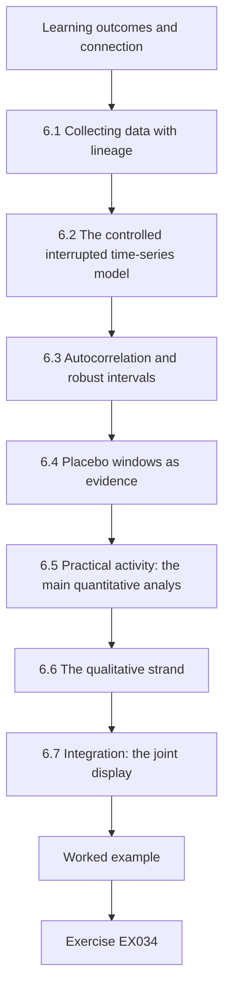

### Logical drawing

```mermaid
flowchart LR
  N0["Learning outcomes and connection"]
  N1["6.1 Collecting data with lineage"]
  N2["6.2 The controlled interrupted time-series model"]
  N3["6.3 Autocorrelation and robust intervals"]
  N4["6.4 Placebo windows as evidence"]
  N5["6.5 Practical activity: the main quantitative analys"]
  N6["6.6 The qualitative strand"]
  N7["6.7 Integration: the joint display"]
  N0 --> N1 --> N2 --> N3 --> N4 --> N5 --> N6 --> N7 --> Q["EX034"]
```

```text
[Learning outcomes and connection]
    |
    v
[6.1 Collecting data with lineage]
    |
    v
[6.2 The controlled interrupted time-series model]
    |
    v
[6.3 Autocorrelation and robust intervals]
    |
    v
[6.4 Placebo windows as evidence]
    |
    v
[6.5 Practical activity: the main quantitative analys]
    |
    v
[6.6 The qualitative strand]
    |
    v
[6.7 Integration: the joint display]
    |
    v
[Worked example] --> [Exercise EX034]
```
<!-- open-cyber-academy:lesson-figures:end ch-06 -->


### Learning outcomes and connection

By the end of this chapter the learner will be able to:

1. Run a data-collection procedure that preserves lineage: every file received, audited, frozen and traceable to the analysis that used it.
2. Specify and fit a controlled interrupted time-series model by segmented regression, and interpret each coefficient.
3. Diagnose residual autocorrelation and compute autocorrelation-robust (Newey–West) intervals, reporting how the choice of lag affects them.
4. Use placebo windows as rank-based evidence and state the smallest p-value a given number of placebos can produce.
5. Conduct and analyse interviews with a documented thematic analysis, and use coder agreement as a reflexive check rather than a guarantee.
6. Integrate quantitative and qualitative strands in a joint display, naming where they confirm, expand or conflict.

This chapter executes the plan fixed in Chapters 3 and 5 and confronts the rivals of Chapter 4 with data. Chapter 7 writes what it finds; Chapter 8 defends it.

### 6.1 Collecting data with lineage

Every number in the dissertation must be traceable to a file, a script and a version. A minimal procedure for each extract:

1. **Receive** through the channel named in the data agreement; never by personal email.
2. **Record** the file name, sender, date received and a cryptographic checksum (for example SHA-256) in a data log.
3. **Store** the original read-only in the restricted area (Chapter 3's tiers).
4. **Audit** with the Lab 5 script; send findings to the custodian; record their answers in the codebook.
5. **Freeze**: when an extract passes, record its checksum as the analysis version. Derived files are produced only by scripts from frozen inputs.
6. **Capture public sources** (here, Wexmoor's dashboard) with the date of capture, because dashboards are revised.

The Spillover Study received daily aggregates for days −180 to +89 from three custodians and captured Wexmoor's series from the regional dashboard on a recorded date. All passed the audit after one round of corrections, and custodian-flagged downtime days were recorded in the codebook. (The lab generator does not simulate downtime days, so the labs analyse every day.)

### 6.2 The controlled interrupted time-series model

For each neighbouring ED, the outcome on day *t* is the log ratio of its arrivals to the pooled Wexmoor arrivals:

*y*ₜ = log(*A*ₜ + 0.5) − log(*W*ₜ + 0.5) = β₀ + β₁·*t* + β₂·*D*ₜ + β₃·*P*ₜ + *e*ₜ

where *D*ₜ = 1 during the diversion window (days 0–20) and *P*ₜ = 1 after it (days 21–89). Reading the coefficients:

- **β₀, β₁:** the pre-event level and linear trend of the ratio. If the treated and comparison regions share the season, the ratio is roughly flat even when each series is not.
- **β₂:** the change in the log ratio during diversion, relative to the projected trend. **exp(β₂) − 1 is the estimated percentage change** — the primary estimate.
- **β₃:** the change after diversion ends, which absorbs any tail so that post-event days do not contaminate the trend.

Choices and their reasons, all fixed in the pre-analysis plan: the **log ratio** treats effects as multiplicative, which suits counts whose variability grows with their level, and removes shared day-of-week and seasonal patterns; adding **0.5** avoids log(0) on very small counts and has negligible effect at these volumes; a **linear trend** over 180 days captures slow drift without chasing noise; a separate **post-window step** avoids assuming that the system returns to its trend the day diversion ends. [Lopez Bernal, Cummins and Gasparrini (2017)](https://doi.org/10.1093/ije/dyw098) give a tutorial on segmented regression for ITS, including the need to specify the impact model (a step, a slope change, or both) in advance; the Spillover Study prespecified a step.

### 6.3 Autocorrelation and robust intervals

Daily operational series are rarely independent from one day to the next: a busy day may be followed by another busy day. Ordinary least-squares coefficients remain unbiased under autocorrelation, but their usual standard errors are wrong — usually too small when autocorrelation is positive. Two responses are common:

1. **Diagnose:** inspect residual autocorrelation at lags 1 and 7, or compute the Durbin–Watson statistic ([Durbin and Watson, 1950](https://doi.org/10.1093/biomet/37.3-4.409)); values near 2 suggest little first-order autocorrelation.
2. **Make inference robust:** use heteroskedasticity- and autocorrelation-consistent (HAC) standard errors such as the [Newey–West (1987)](https://doi.org/10.2307/1913610) estimator, which weights cross-products of residuals up to a chosen lag *L* with declining Bartlett weights 1 − *l*/(*L* + 1). Alternatively, model the error process directly (for example with ARIMA errors), as Lopez Bernal et al. discuss.

The Spillover Study prespecified Newey–West with lag 7 (one week, matching the weekly cycle) and a sensitivity analysis with lags 0 and 14. For Alder Point, the residuals showed lag-1 autocorrelation of 0.03, lag-7 autocorrelation of −0.12 and a Durbin–Watson statistic of 1.92: autocorrelation is weak, so the robust interval should not differ greatly from the naive one — and it does not (EX034).

### 6.4 Placebo windows as evidence

Chapter 4 introduced placebo-in-time tests. Here they are made precise: fit the same model to fake 21-day windows placed in the baseline, using only data before the real event, and record each fake "effect". If the real estimate is larger than all *k* placebo estimates, its rank is 1 of *k* + 1, and under the assumption that the real window is exchangeable with the fake ones, the one-sided probability of a rank that extreme by chance is 1/(*k* + 1). **With 15 placebos the smallest attainable value is 1/16 = 0.0625.** Placebo tests therefore cannot reach 0.05 with fewer than 19 windows (or fall below it with fewer than 20), whatever the data; report the rank, not a misleading p-value. The placebo windows also have a weakness: fits near the start of the series rest on short pre-periods and are noisier than the real fit, which makes the test conservative.

### 6.5 Practical activity: the main quantitative analysis

Save Lab 4 as `lab4_data.py` and the following file as `lab6_its.py` in the same folder (Lab 8 imports it). It implements least squares by Gauss–Jordan elimination, Newey–West standard errors and the controlled ITS of §6.2, fits it for each neighbour against pooled Wexmoor, runs 15 placebo windows per site and fits an uncontrolled ITS for Alder Point's waiting time.

```python
# Lab 6 - controlled interrupted time series with autocorrelation-robust intervals (offline)
# Save Lab 4 as lab4_data.py in the same folder first. Save this file as lab6_its.py (Lab 8 imports it).
import math
from lab4_data import make_region, DAYS

def solve(A, b):                                   # Gauss-Jordan with partial pivoting
    n = len(A)
    M = [row[:] + [b[i]] for i, row in enumerate(A)]
    for c in range(n):
        p = max(range(c, n), key=lambda r: abs(M[r][c]))
        M[c], M[p] = M[p], M[c]
        for r in range(n):
            if r != c:
                f = M[r][c] / M[c][c]
                M[r] = [x - f * y for x, y in zip(M[r], M[c])]
    return [M[i][n] / M[i][i] for i in range(n)]

def inverse(A):
    n = len(A)
    cols = [solve(A, [1.0 if i == j else 0.0 for i in range(n)]) for j in range(n)]
    return [[cols[j][i] for j in range(n)] for i in range(n)]

def ols_nw(X, y, lag=7):
    k = len(X[0])
    XtX = [[sum(r[i] * r[j] for r in X) for j in range(k)] for i in range(k)]
    beta = solve(XtX, [sum(r[i] * v for r, v in zip(X, y)) for i in range(k)])
    e = [v - sum(b * x for b, x in zip(beta, r)) for r, v in zip(X, y)]
    S = [[0.0] * k for _ in range(k)]
    for l in range(lag + 1):                         # Newey-West with Bartlett weights
        w = 1.0 if l == 0 else 1 - l / (lag + 1)
        for t in range(l, len(y)):
            for i in range(k):
                for j in range(k):
                    v = e[t] * e[t - l] * X[t][i] * X[t - l][j]
                    S[i][j] += w * (v if l == 0 else v + e[t] * e[t - l] * X[t - l][i] * X[t][j])
    B = inverse(XtX)
    V = [[sum(B[i][a] * S[a][b] * B[b][j] for a in range(k) for b in range(k)) for j in range(k)] for i in range(k)]
    return beta, [math.sqrt(V[i][i]) for i in range(k)], e

def design_row(t, start, ev_len):
    return [1.0, t / 100, 1.0 if start <= t < start + ev_len else 0.0, 1.0 if t >= start + ev_len else 0.0]

def fit(treated, control, days, start, ev_len):
    """log(treated) - log(control) = b0 + b1*t + b2*[event window] + b3*[after window]; b2 as % change."""
    X = [design_row(t, start, ev_len) for t in days]
    y = [math.log(treated[t] + 0.5) - math.log(control[t] + 0.5) for t in days]
    beta, se, _ = ols_nw(X, y)
    b, s = beta[2], se[2]
    return math.exp(b) - 1, math.exp(b - 1.96 * s) - 1, math.exp(b + 1.96 * s) - 1

def cits(treated, control, pre_len=180, ev_len=21, post_end=89, drop=frozenset()):
    days = [t for t in range(-pre_len, post_end + 1) if t not in drop]
    return fit(treated, control, days, 0, ev_len)

def placebo(treated, control, ev_len=21, first=-150, last=-28, step=7):
    """Fake event windows inside the baseline; each fit uses only days before the real event."""
    out = []
    for s in range(first, last - ev_len + 1, step):
        days = range(-180, s + ev_len + 7)
        out.append(fit(treated, control, days, s, ev_len)[0])
    return out

if __name__ == "__main__":
    d = make_region()
    comp = {t: d["W1"][t] + d["W2"][t] for t in DAYS}
    print("site  effect  95% interval        placebo_min  placebo_max  rank")
    for s in ("AP", "BF", "CG"):
        est, lo, hi = cits(d[s], comp)
        pl = placebo(d[s], comp)
        rank = 1 + sum(p >= est for p in pl)
        print(f"{s:4}  {est:+.3f}  ({lo:+.3f}, {hi:+.3f})  {min(pl):+11.3f}  {max(pl):+11.3f}  {rank}/{len(pl) + 1}")
    # secondary outcome: AP median minutes to provider, uncontrolled ITS with linear trend (no comparison)
    rows, y = [], []
    for t in DAYS:
        rows.append([1.0, t / 100, 1.0 if 0 <= t <= 20 else 0.0, 1.0 if t > 20 else 0.0])
        y.append(d["AP_wait"][t])
    beta, se, _ = ols_nw(rows, y)
    print(f"AP wait: event-window change {beta[2]:+.1f} min (95% interval {beta[2] - 1.96 * se[2]:+.1f} to {beta[2] + 1.96 * se[2]:+.1f})")
```

Expected output (under a second):

```text
site  effect  95% interval        placebo_min  placebo_max  rank
AP    +0.244  (+0.067, +0.449)       -0.190       +0.166  1/16
BF    +0.058  (-0.067, +0.199)       -0.137       +0.255  8/16
CG    +0.008  (-0.093, +0.121)       -0.104       +0.242  9/16
AP wait: event-window change +5.9 min (95% interval +2.6 to +9.2)
```

Interpretation, written as the dissertation's results chapter would state it:

- **RQ1, Alder Point (6 km).** Ambulance arrivals during the diversion were an estimated 24.4% higher than expected from the pre-event trend and Wexmoor's concurrent change (95% interval 6.7% to 44.9%). The estimate exceeded all 15 placebo estimates (rank 1 of 16). The generator's true value is 22%; the estimate is close, but the interval is wide — consistent with Lab 3's warning about precision at one ED.
- **RQ1, Brookfield (14 km).** +5.8% (−6.7% to +19.9%); rank 8 of 16. The data are compatible with no change and with a change of about 20%. The true value was 10%: the study **did not detect an effect that exists**. The honest statement is "inconclusive", never "no effect".
- **RQ1, Calloway (38 km).** +0.8% (−9.3% to +12.1%); rank 9 of 16. Compatible with no change; increases above about 12% are unlikely under the model.
- **RQ2, distance.** The point estimates decline with distance (24.4%, 5.8%, 0.8%), consistent with load transfer concentrated on the nearest ED. Brookfield's and Calloway's intervals overlap heavily, so the data cannot say whether the decline is gradual or confined to the nearest hospital.
- **Secondary outcome, Alder Point waiting time.** +5.9 minutes during diversion (2.6 to 9.2). This model has **no comparison series**, because Wexmoor publishes no waiting times; the estimate therefore includes any seasonal crowding. In the synthetic generator, the season adds up to 3 minutes and the true diversion effect is 4 minutes; the estimate combines both. The dissertation must say the waiting-time estimate is confounded by season and likely overstates the diversion's contribution.

### 6.6 The qualitative strand

#### 6.6.1 Sampling and interviewing

RQ3 asks how load was redistributed, which only people involved can tell. Sampling is **purposive**: ED leadership at each neighbour, EMS operations and dispatch supervisors, and coalition staff. How many interviews are enough has no single answer. [Guest, Bunce and Johnson (2006)](https://doi.org/10.1177/1525822X05279903) found in one study of relatively homogeneous participants that most themes appeared within the first twelve interviews; [Malterud, Siersma and Guassora (2016)](https://doi.org/10.1177/1049732315617444) propose **information power**: the more relevant information each participant holds for a narrow aim, the fewer participants are needed. The Spillover Study's aim is narrow and its participants hold direct, specific knowledge; ten interviews (I01–I10) across the three roles gave adequate information power, a judgement the dissertation must explain rather than assert.

Interviews followed the revised guide (Chapter 5), anchored to time and information. They were recorded with consent, transcribed, de-identified (names, organization names, unique role titles and dates replaced) and the recordings destroyed after transcription as the consent form stated.

#### 6.6.2 Thematic analysis

[Braun and Clarke (2006)](https://doi.org/10.1191/1478088706qp063oa) describe thematic analysis in six phases: familiarization with the data; generating initial codes; searching for themes; reviewing themes; defining and naming themes; and producing the report. Keep an **audit trail**: the codebook with definitions and examples, memos explaining each decision, and the versions of the theme structure.

#### 6.6.3 Coder agreement

Whether to measure agreement between coders is debated. [O'Connor and Joffe (2020)](https://doi.org/10.1177/1609406919899220) review the debate and suggest that intercoder reliability can add rigour and transparency when a codebook is applied consistently, while it fits poorly with interpretive approaches in which the researcher's perspective is part of the analysis. The Spillover Study uses a codebook-based approach for the operational questions, so a second coder independently coded a sample of excerpts; agreement was measured with Cohen's kappa (Chapter 1) and every disagreement was discussed and resolved by refining code definitions. The kappa is reported as evidence that the codebook can be applied consistently — not as proof that the themes are true.

#### 6.6.4 Themes (synthetic)

| Theme | Description | Illustrative de-identified excerpt (synthetic) |
|---|---|---|
| T1 Road geography governed destinations | Crews took diverted patients to the nearest open ED on their route, which was usually Alder Point; there was no regional load-balancing | "If you're on the valley road and Kestrel's closed, Alder Point is just the next exit. Nobody told us to spread it out." (EMS operations) |
| T2 Neighbours learned late and informally | Alder Point learned of the attack from arriving crews hours before any formal notice | "Our first notice was a paramedic saying 'Kestrel's down, you're getting everything.'" (ED leadership) |
| T3 Night-shift strain | The extra load arrived disproportionately at night, when staffing was thinnest | "Days we could absorb. Nights we were boarding in the corridor by two a.m." (ED leadership) |
| T4 Diversion lasted as long as downtime procedures did | Kestrel stayed on diversion until its systems could support safe triage, not until the attack was contained | "They weren't going to come off diversion on paper charts." (coalition) |

### 6.7 Integration: the joint display

[Fetters, Curry and Creswell (2013)](https://doi.org/10.1111/1475-6773.12117) describe integration at the levels of design, methods and interpretation, and the **joint display** as a way to bring results together. Each row pairs a quantitative result with a qualitative finding and states a meta-inference: **confirmation** (both strands agree), **expansion** (one adds to the other) or **discordance** (they conflict, which requires explanation).

| Quantitative result | Qualitative finding | Meta-inference |
|---|---|---|
| Alder Point +24.4% (6.7% to 44.9%), largest of the three | T1: road geography sent diverted ambulances to the next exit | **Confirmation and expansion**: the gradient has a mechanism — route, not distance as such |
| Brookfield +5.8%, inconclusive | Brookfield leaders described the period as "very heavy" | **Discordance**. Possible explanations: low power (true effect 10% in the generator); Brookfield had a concurrent staffing shortage, so the same load *felt* heavier; perceptions anchored on the worst nights. The dissertation reports the discordance and does not let either strand overrule the other |
| Waiting time +5.9 minutes, confounded by season | T3: strain concentrated at night | **Expansion**: daily medians may hide night-time peaks; a later study should use hourly data |
| Effect confined to days 0–20 with a small tail | T4: diversion ended when downtime procedures could be retired | **Expansion**: diversion length depended on recovery of clinical systems — a lever for planners |

The discordance row is not a weakness of the study; it is a finding. A dissertation that hides discordance to tell a cleaner story loses the most informative part of mixed methods.

### 6.8 Worked example: the deviation that was nearly hidden (synthetic)

After the main analysis, the candidate noticed that dropping the two regional holidays changed Brookfield's estimate slightly and was tempted to report the version with holidays dropped, which "looked more like the expected gradient". The supervisor's rule: the prespecified model is the primary analysis; any alternative is reported as a robustness check with the reason it was examined, in the deviation log, dated, noting that results had been seen. Chapter 8's specification curve then reports all reasonable choices together, so that no single choice — made after seeing results — carries the conclusion. The episode is typical: the risk of flexible analysis is not dishonesty but the quiet pull of a preferred story ([Gelman and Loken, 2014](https://doi.org/10.1511/2014.111.460)).

### 6.9 Common errors and limits

- Editing data by hand after freezing, or analysing an extract whose version cannot be identified.
- Fitting an uncontrolled ITS and calling the result an effect when a shared shock is plausible.
- Reporting ordinary least-squares intervals for autocorrelated daily data without checking.
- Converting a placebo rank into "p < 0.05" when the number of placebos makes that impossible.
- Reporting an inconclusive estimate as "no effect".
- Presenting a confounded secondary outcome with the same confidence as the controlled primary outcome.
- Claiming saturation or adequacy of interview numbers without explaining the reasoning.
- Treating a high kappa as proof that themes are valid.
- Hiding discordance between strands.
- Choosing among analysis variants after seeing results and reporting only the preferred one.

The limit of this analysis is that it rests on one event, one comparison region and a model whose assumptions — parallel trends, a linear pre-trend, a step-shaped effect — can be probed but not proven. Chapter 8 tests how much the conclusion depends on them.

### Exercises — chapter 6

**EX033 — Run and report the main analysis.** *Objective:* use Lab 6 and write results. *Inputs:* Labs 4 and 6. *Constraints:* offline; do not change seeds. *Steps:* (1) run Lab 6 and record the output; (2) write a 200-word results paragraph for RQ1 and RQ2 using estimates, intervals and placebo ranks; (3) write one sentence on the waiting-time result that states its limitation. *Expected evidence:* output and text. *Rubric:* 3 = numbers exact, Brookfield described as inconclusive rather than null, gradient stated with the overlap caveat, waiting time flagged as uncontrolled; 2 = one overstatement; 1 = "significant" used as a conclusion without estimates; 0 = none.

**EX034 — Lag sensitivity.** *Objective:* test the interval method. *Inputs:* `lab6_its.py`. *Constraints:* change only the Newey–West lag. *Steps:* (1) compute Alder Point's interval with lags 0, 7 and 14; (2) compute the residual autocorrelation at lags 1 and 7 and the Durbin–Watson statistic; (3) explain why a longer lag does not always widen the interval; (4) state what you would report. *Expected evidence:* table and paragraph. *Rubric:* 3 = intervals and diagnostics correct, non-monotonic behaviour explained (Bartlett-weighted sample autocovariances can be negative), prespecified lag reported with sensitivity; 2 = one value wrong; 1 = chooses the narrowest interval; 0 = none.

**EX035 — Placebo arithmetic.** *Objective:* interpret rank-based evidence. *Inputs:* Lab 6's placebo output. *Constraints:* no new code needed. *Steps:* (1) state the one-sided rank-based p-value for each site; (2) state how many placebo windows would be needed for the smallest attainable value to reach 0.05 and 0.01, and to fall strictly below them; (3) explain why early placebo windows are noisier than the real fit; (4) propose a change that adds windows without using post-event data. *Expected evidence:* answers. *Rubric:* 3 = 1/16, 8/16, 9/16 computed; 19 and 99 windows to reach 0.05 and 0.01, 20 and 100 to fall below; short pre-periods explained; a valid proposal (for example daily rather than weekly start steps, or windows from earlier years if data exist) with its dependence caveat; 2 = one error; 1 = treats placebo p as exact; 0 = none.

**EX036 — Repair the secondary outcome.** *Objective:* address a confounded estimate. *Inputs:* the waiting-time result and §6.5. *Constraints:* no new data may be invented. *Steps:* (1) explain the confounding; (2) propose two designs that could remove it with obtainable data; (3) state the claim the current estimate supports; (4) write the sentence for the limitations section. *Expected evidence:* one page. *Rubric:* 3 = confounding by season explained, designs feasible (Calloway as a within-region comparison for waiting time given its null arrival effect, or a comparison series from another region's published data), claim limited to "consistent with an increase; magnitude confounded", limitation directional; 2 = one design infeasible; 1 = no limitation; 0 = none.

**EX037 — Coder agreement.** *Objective:* apply and interpret kappa for qualitative coding. *Inputs:* twelve synthetic excerpts coded by two coders with codes DIV (EMS destination decisions), INFO (information and notification), STAFF (staffing and strain), PROC (procedures). Coder A: DIV, INFO, STAFF, DIV, PROC, INFO, INFO, STAFF, DIV, PROC, INFO, STAFF. Coder B: DIV, INFO, STAFF, STAFF, PROC, INFO, DIV, STAFF, DIV, PROC, PROC, STAFF. Excerpt 4: "We had two crews waiting at the door and nobody to take handover." Excerpt 7: "Dispatch didn't know Kestrel was closed, so the crew decided on the road." Excerpt 11: "We didn't know whether to start the paper triage process or wait for word from IT." *Constraints:* compute by hand or with the Lab 1 function. *Steps:* (1) compute observed agreement, chance agreement and kappa; (2) for each disagreement, decide whether the codebook definition or the excerpt is the problem; (3) revise one definition. *Expected evidence:* calculation, analysis and revised definition. *Rubric:* 3 = κ ≈ 0.67 computed correctly, disagreements diagnosed as boundary problems (excerpts that fit two codes), a revision that allows or rules on double-coding; 2 = calculation correct, diagnosis thin; 1 = raw agreement only; 0 = none.

**EX038 — Joint display.** *Objective:* integrate strands. *Inputs:* §6.5 and §6.6.4. *Constraints:* at least four rows; at least one discordance. *Steps:* (1) build the display; (2) state the meta-inference for each row; (3) for each discordance, list explanations and the evidence that could choose among them. *Expected evidence:* table and paragraph. *Rubric:* 3 = meta-inferences labelled correctly, discordance explained without letting one strand overrule the other, follow-up evidence specific; 2 = discordance omitted; 1 = strands side by side without inference; 0 = none.

### Chapter synthesis

Keep lineage: every extract logged, audited, frozen and used only through scripts. The controlled ITS models the log ratio of a neighbour's arrivals to the comparison region's with a trend, a diversion step and a post-diversion step; exp(β₂) − 1 is the estimate. Check autocorrelation and use robust intervals with a prespecified lag and sensitivity. Placebo ranks are honest evidence whose smallest attainable p-value depends on the number of windows. In the synthetic Spillover Study, Alder Point's arrivals rose by about a quarter during diversion with a wide interval; Brookfield's result is inconclusive even though a real effect existed; Calloway's is compatible with none; the waiting-time estimate is confounded by season. Interviews explain the gradient through road geography and reveal late notification, night-time strain and the link between diversion length and clinical-system recovery. Integrate strands in a joint display and report discordance as a finding.

<!-- open-cyber-academy:chapter-navigation:start ch-06 -->
### Continue studying — chapter 06 of 08

[← Chapter 05](#ch-05) · [Course chapter index](../SUBJECTS.md) · [Chapter 07 →](#ch-07)

Continue to the next authored lesson.
<!-- open-cyber-academy:chapter-navigation:end -->

<a id="ch-07"></a>

## Chapter 7 — Dissertation writing and limitations

<!-- open-cyber-academy:lesson-figures:start ch-07 -->
### Lesson map

Lesson 07 published. Map, example, EX039.

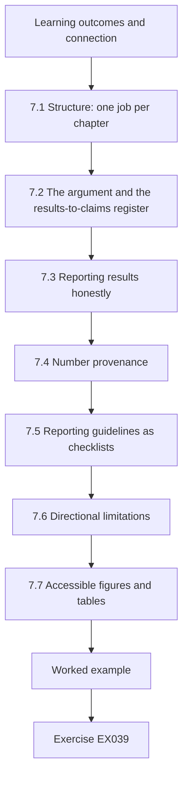

### Logical drawing

```mermaid
flowchart LR
  N0["Learning outcomes and connection"]
  N1["7.1 Structure: one job per chapter"]
  N2["7.2 The argument and the results-to-claims register"]
  N3["7.3 Reporting results honestly"]
  N4["7.4 Number provenance"]
  N5["7.5 Reporting guidelines as checklists"]
  N6["7.6 Directional limitations"]
  N7["7.7 Accessible figures and tables"]
  N0 --> N1 --> N2 --> N3 --> N4 --> N5 --> N6 --> N7 --> Q["EX039"]
```

```text
[Learning outcomes and connection]
    |
    v
[7.1 Structure: one job per chapter]
    |
    v
[7.2 The argument and the results-to-claims register]
    |
    v
[7.3 Reporting results honestly]
    |
    v
[7.4 Number provenance]
    |
    v
[7.5 Reporting guidelines as checklists]
    |
    v
[7.6 Directional limitations]
    |
    v
[7.7 Accessible figures and tables]
    |
    v
[Worked example] --> [Exercise EX039]
```
<!-- open-cyber-academy:lesson-figures:end ch-07 -->


### Learning outcomes and connection

By the end of this chapter the learner will be able to:

1. Structure an empirical master's dissertation so that each chapter has one job and the argument runs visibly from question to conclusion.
2. Keep a **results-to-claims register** linking every claim in the abstract, discussion and conclusion to a specific result and its limits.
3. Report estimates with their uncertainty, avoid dichotomous "significance" language, and calibrate causal verbs to the design.
4. Make every number in the text traceable to analysis output, and check it with a script.
5. Use reporting guidelines for observational, routinely collected and qualitative data as checklists.
6. Write limitations that state the **direction** and likely size of each bias and what would resolve it.
7. Produce accessible figures and tables, and a data and code availability statement that respects information sensitivity.

This chapter turns Chapters 1–6 into a document an examiner can assess. Chapter 8 prepares for that assessment.

### 7.1 Structure: one job per chapter

A typical empirical master's dissertation has the following parts. Word budgets vary by institution; the proportions below are a common starting point for a 20,000-word dissertation.

| Part | Its single job | Approximate share |
|---|---|---|
| Abstract | State question, design, main results with uncertainty, and the main limitation | 300 words |
| 1 Introduction | Establish the problem, the decision it affects and the questions | 10% |
| 2 Literature review | Show what is known and the gap, concept by concept (Chapter 1's matrix) | 20% |
| 3 Methods | Let a reader reproduce the study: design, data, ethics, analysis, deviations | 20% |
| 4 Results | Report what was found for each question, without interpretation beyond the data | 20% |
| 5 Discussion | Answer the questions, relate them to the literature, explain mechanisms, state implications | 20% |
| 6 Limitations and conclusion | Bound the claims; say what follows and what does not | 10% |
| Appendices | Codebook, pre-analysis plan and deviation log, audit reports, interview guide, consent materials, reporting checklists | — |

Write methods first (they are already in the pre-analysis plan), then results, then discussion, and the introduction and abstract last, when you know what the dissertation actually shows. Many weak dissertations are weak because the introduction was written first and promised a finding the results did not deliver.

### 7.2 The argument and the results-to-claims register

Examiners follow the thread from the questions in Chapter 1 to the answers in the conclusion. Make it visible: every research question is answered explicitly in the discussion, using the same wording, and the conclusion repeats those answers in their scoped form.

A **results-to-claims register** is a table you keep while writing and attach as an appendix or use privately before submission. Each row is a claim that appears anywhere in the dissertation:

| ID | Claim (as written) | Where it appears | Result supporting it | Scope and conditions | Status |
|---|---|---|---|---|---|
| C1 | "Ambulance arrivals at the nearest neighbouring ED rose by about a quarter during the diversion." | Abstract, 5.1, 6 | Table 4.2: +24.4% (6.7% to 44.9%); placebo rank 1/16 | One synthetic event; relative to Wexmoor; parallel trends assumed | Supported |
| C2 | "The rise decreased with distance." | Abstract, 5.2 | Point estimates 24.4%, 5.8%, 0.8% | Brookfield and Calloway intervals overlap | Supported for nearest versus others only |
| C3 | "Brookfield was unaffected." | Draft 5.2 | Table 4.2: +5.8% (−6.7% to 19.9%) | — | **Not supported** — inconclusive, rewrite |
| C4 | "Diversion increased waiting times by six minutes." | Draft abstract | Table 4.3: +5.9 (2.6 to 9.2), uncontrolled | Confounded by season | **Overstated** — rewrite as consistent with an increase whose size is confounded |
| C5 | "Load followed road geography." | 5.3 | Theme T1 (I02, I04, I07, I09) and the gradient | Interview accounts; one region | Supported as mechanism |

The register catches the commonest failure: a claim that grew while moving from results to abstract.

### 7.3 Reporting results honestly

#### 7.3.1 Estimates and intervals, not verdicts

Report the estimate, its interval and what the interval rules out. "Alder Point's arrivals rose by 24.4% (95% interval 6.7% to 44.9%)" carries information; "a statistically significant increase (p < 0.05)" carries less and invites misreading. The [American Statistical Association's statement on p-values](https://doi.org/10.1080/00031305.2016.1154108) (Wasserstein and Lazar, 2016) sets out principles including that p-values do not measure the probability that a hypothesis is true, that scientific conclusions should not rest only on whether a p-value passes a threshold, and that a p-value does not measure the size or importance of an effect. For an inconclusive result, report what the interval excludes: Calloway's interval excludes increases above about 12%; Brookfield's excludes neither zero nor a 20% increase.

#### 7.3.2 Calibrated verbs

| Design support | Appropriate wording | Avoid |
|---|---|---|
| Descriptive count | "was recorded", "was observed" | "showed that X causes" |
| Association | "was associated with", "co-occurred with" | "led to", "caused" |
| Controlled design with stated assumptions | "rose relative to the comparison region", "is estimated to have increased, assuming…" | "proves", "demonstrates conclusively" |
| Converging quantitative and qualitative evidence | "is consistent with", "suggests the mechanism was…" | "establishes" |

Causal language is not forbidden; a controlled ITS is a causal design. It must be accompanied by its assumptions in the same paragraph.

#### 7.3.3 Multiplicity

The Spillover Study had one primary outcome (arrivals), three sites and one secondary outcome. State in the methods which estimates are primary, report all of them, and do not select the most striking for the abstract. When many outcomes are examined, some will look notable by chance; the prespecified primary outcome is the defence.

### 7.4 Number provenance

Every number in the text should come from the analysis output, not from memory or an earlier draft. Three practices help: generate results tables directly from scripts; keep a machine-readable results file from the final run; and check the text against it before submission. Lab 7 below automates a first pass.

Rounding deserves its own rule. The Spillover Study's main estimate is 24.4% in Table 4.2 and 24% in the rewritten abstract; both are correct only if the dissertation states that the abstract rounds to whole percentages. Keep the same precision for the same quantity in every chapter, and record units beside each value in the results file, so that a percentage cannot be confused with a count of minutes. When a figure changes in a late rerun, search the whole text for the old value, including captions, the abstract and the appendices, before resubmitting the draft.

### 7.5 Reporting guidelines as checklists

Reporting guidelines list what a reader needs to assess a study; using them as a writing checklist prevents omissions. Relevant ones for this field:

- **STROBE** for observational studies ([von Elm et al., 2007](https://doi.org/10.1016/S0140-6736(07)61602-X)).
- **RECORD**, its extension for studies using routinely collected health data ([Benchimol et al., 2015](https://doi.org/10.1371/journal.pmed.1001885)) — relevant whenever data come from operational systems not designed for research, which is nearly always true in infrastructure research.
- **SRQR** ([O'Brien et al., 2014](https://doi.org/10.1097/ACM.0000000000000388)) and **COREQ** ([Tong, Sainsbury and Craig, 2007](https://doi.org/10.1093/intqhc/mzm042)) for qualitative research and interviews.
- For interrupted time series there is no single reporting standard; [Lopez Bernal et al. (2017)](https://doi.org/10.1093/ije/dyw098) and the methodological review by [Hategeka et al. (2020)](https://doi.org/10.1136/bmjgh-2020-003567) identify what readers need: the impact model, the handling of autocorrelation, seasonality and trends, and the control series.

Attach the completed checklists as appendices with page or section references.

### 7.6 Directional limitations

A list of weaknesses ("small sample; one region; possible confounding") tells an examiner nothing they could not have guessed. A **directional limitation** states the problem, its likely effect on the main estimate (direction and rough size), what the study did about it, and what would resolve it.

| Limitation | Likely effect on the main estimate | What was done | What would resolve it |
|---|---|---|---|
| Parallel trends assumed between Tamsin Valley and Wexmoor | Either direction; if Wexmoor's season was milder, effects are overstated | Pre-event ratio inspected; each Wexmoor ED used separately (Chapter 8) | More comparison regions; synthetic control with more donors |
| One event, one region | No bias in itself; limits transfer, especially to regions without one dominant system | Region's structure described | Pooled analysis of several events with staggered-timing methods |
| Ambulance arrivals measure transports, not need | Understates burden if acuity rose more than counts | Interviews on acuity (T3) | Acuity-weighted counts from triage categories |
| Waiting-time model has no comparison | Overstates the diversion's effect on waiting time (season included) | Reported as confounded | A comparison series for waiting times |
| Daily resolution | Understates peak strain, which was concentrated at night (T3) | Noted in discussion | Hourly data |
| Brookfield underpowered | Biases interpretation toward "no effect" if misread | Reported as inconclusive with interval | Pooling neighbours; more events |
| Interviews after the event | Hindsight may make the mechanism seem more coherent than it was | Questions anchored to dated records | Contemporaneous logs; interviews soon after events |
| Partners' review of drafts | Possible pressure toward softer wording | Agreement with no veto; changes logged | Independent replication |

### 7.7 Accessible figures and tables

Follow the [book standard](../../../../../BOOK_STANDARD.md)'s expectations for your own work: every figure has a caption that states its message and a text alternative that conveys its content to a reader who cannot see it; colour is never the only carrier of meaning; tables have descriptive headers and a one-sentence plain-language summary when they are complex. An event-study figure's text alternative might read: *"Daily log ratio of Alder Point to Wexmoor arrivals, days −180 to +89, with the fitted trend. The ratio is flat before day 0, rises during days 0–20 by about 0.2 on the log scale, and returns near the trend after day 34."* Write numbers in text with the same precision as in tables.

### 7.8 Data and code availability under sensitivity

Infrastructure studies often cannot release their data. Say what is available, at what tier, and why the rest is not:

> *Code and synthetic test data are available in the project repository [link] under CC0. Daily ED aggregates were provided by the participating hospitals under data agreements that do not permit redistribution; researchers may request access from the custodians, whose contact routes are listed in Appendix C. Interview transcripts are not available because participants were promised confidentiality and some could be identified by role. Facility-level capacity figures are withheld because of their potential to aid targeting; regional summaries are reported in Chapter 4.*

A statement like this meets the spirit of the FAIR principles for what can be shared and is honest about what cannot.

### 7.9 Worked example: rewriting the abstract (synthetic)

The candidate's first abstract ended: *"This study proves that ransomware attacks significantly increase emergency-department crowding across the region, demonstrating the urgent need for cyber-resilience investment."* The results-to-claims register flagged four problems: "proves" (the design supports estimation under assumptions); "ransomware" (the exposure was diversion); "across the region" (only the nearest ED showed a clear increase); "urgent need for investment" (the study did not evaluate any investment). Rewritten conclusion of the abstract:

> *During a 21-day ransomware-induced ambulance diversion in one synthetic region, ambulance arrivals at the nearest neighbouring emergency department rose by an estimated 24% (95% interval 7% to 45%) relative to an unaffected comparison region; estimates at more distant departments were small and inconclusive. Interviews indicated that diverted ambulances followed road geography and that neighbours learned of the diversion informally. Regional diversion plans may need explicit load-sharing and notification arrangements; whether these reduce strain was not tested.*

### 7.10 Practical activity: number provenance

The lab holds the results from Lab 6 and a draft paragraph written partly from memory. It extracts every number from the text, checks whether it matches a recorded result (allowing rounding), and flags wording that overstates. Save it as `lab7_provenance.py`: the EX039 worked answer reads the draft from that file.

```python
# Lab 7 - every number in the results text must trace to the analysis output (offline)
# RESULTS mirrors the Lab 6 output; DRAFT is a synthetic dissertation paragraph written from memory.
import re

RESULTS = {                      # value, as a percentage or a count, from the analysis log
    "AP_effect": 24.4, "AP_lo": 6.7, "AP_hi": 44.9,
    "BF_effect": 5.8, "BF_lo": -6.7, "BF_hi": 19.9,
    "CG_effect": 0.8, "CG_lo": -9.3, "CG_hi": 12.1,
    "AP_naive": 33.0, "placebo_n": 15, "event_days": 21,
}
DRAFT = """During the 21-day diversion, ambulance arrivals at Alder Point rose by 24.4%
(95% interval 6.7% to 44.9%) relative to the Wexmoor comparison hospitals, larger than any of
the 16 placebo windows. Brookfield rose by 5.8% (-6.7% to 19.9%) and Calloway by 0.8%.
A simple before-and-after comparison would have suggested a 33% rise. The attack caused
a significant increase in arrivals at Brookfield, and waiting times rose by 6 minutes."""
CAUSAL = ("caused", "proves", "significant increase", "due to the attack")

values = set(RESULTS.values())
def traced(x):
    return any(abs(x - v) <= 0.05 or (float(x).is_integer() and abs(x - round(v)) == 0) for v in values)

problems = []
for m in re.finditer(r"-?\d+(?:\.\d+)?", DRAFT):
    x = float(m.group())
    if x == 95:                  # the interval level, declared in the methods
        continue
    if not traced(x):
        problems.append(f"untraced number {m.group()!r}")
for phrase in CAUSAL:
    if phrase in DRAFT.lower():
        problems.append(f"check wording: {phrase!r}")
print("\n".join(problems) if problems else "all numbers traced")
```

Expected output:

```text
untraced number '16'
check wording: 'caused'
check wording: 'significant increase'
```

The check found three problems: "16 placebo windows" (there were 15; 16 is the rank denominator), "caused" and "significant increase" applied to Brookfield, whose result is inconclusive. It **missed** two: "waiting times rose by 6 minutes" passed only because 6 matches the *rounded Brookfield percentage* (5.8%) — a false match across units — and the waiting-time result is not in `RESULTS` at all; and Calloway's estimate is given without its interval. A script is a first pass: it catches transcription errors cheaply, but only a reader with the results-to-claims register catches a claim that is wrong in substance. EX039 asks you to improve the check.

### 7.11 Common errors and limits

- Writing the introduction first and letting it promise results.
- Claims that grow between results, discussion and abstract.
- "Statistically significant" as a conclusion; "not significant" as "no effect".
- Causal verbs without assumptions, or causal timidity when the design supports a qualified causal estimate.
- Numbers typed from memory; tables pasted from an earlier run.
- A limitations section that lists weaknesses without direction or resolution.
- Figures without text alternatives; colour-only encodings.
- Data statements that promise availability the agreements do not permit, or that publish sensitive facility-level figures.

The limit of good writing is that it cannot rescue a weak design; its job is to make the design's strengths and weaknesses visible so that readers can judge the claims correctly.

### Exercises — chapter 7

**EX039 — Improve the provenance check.** *Objective:* use and extend Lab 7. *Inputs:* the lab code. *Constraints:* offline. *Steps:* (1) run the lab and record the output; (2) change the check so that each number is matched only against results with the same unit (percent or minutes) using the word that follows the number; (3) add the waiting-time result (5.9 minutes, interval 2.6 to 9.2) to `RESULTS` with its unit; (4) add a check that every site estimate is followed by an interval; (5) rewrite the draft so the check passes and the text is accurate. *Expected evidence:* code, output and corrected paragraph. *Rubric:* 3 = unit-aware matching catches the minutes/percent false match, the missing Calloway interval is flagged, the corrected paragraph has accurate numbers, calibrated verbs and Brookfield described as inconclusive; 2 = one check missing; 1 = only the text corrected; 0 = none.

**EX040 — Directional limitations.** *Objective:* write limitations that inform. *Inputs:* a synthetic study estimating the effect of a payment-processor outage on pharmacy prescription fills using weekly data from one chain. *Constraints:* at least five limitations in the format of §7.6. *Steps:* for each, state the likely direction and rough size of bias, what was done and what would resolve it; rank them by threat to the main conclusion. *Expected evidence:* table and ranking. *Rubric:* 3 = directions reasoned (for example weekly resolution dilutes a three-day effect toward zero; one chain's customers may shift to competitors, which would overstate the drop in total fills), ranking justified; 2 = one direction missing; 1 = undirected list; 0 = none.

**EX041 — Structured abstract.** *Objective:* compress without overclaiming. *Inputs:* Lab 6's output and §6.6.4. *Constraints:* 300 words; background, objective, design, setting, outcomes, results with intervals, conclusions, main limitation; synthetic status stated. *Steps:* (1) draft; (2) check every claim against the results-to-claims register; (3) have a peer identify the main limitation from the abstract alone. *Expected evidence:* abstract and register excerpt. *Rubric:* 3 = numbers exact with intervals, exposure correctly named as diversion, distant sites described as inconclusive, limitation explicit, synthetic status stated; 2 = one overclaim; 1 = no intervals; 0 = none.

**EX042 — Reporting checklist mapping.** *Objective:* use guidelines as checklists. *Inputs:* the RECORD statement and the Spillover Study's methods as described in Chapters 3, 5 and 6. *Constraints:* map at least eight items. *Steps:* (1) list eight RECORD or STROBE items relevant to the study; (2) give the section that addresses each; (3) identify any item the study does not yet address and draft the missing text. *Expected evidence:* mapping table and drafted text. *Rubric:* 3 = items correctly chosen (data sources, validation of codes, linkage, data cleaning, access to the population), sections accurate, a genuine gap found (for example how the data custodians' definitions of an ambulance arrival were validated) and addressed; 2 = mapping superficial; 1 = checklist copied without mapping; 0 = none.

**EX043 — Availability statement.** *Objective:* be open within constraints. *Inputs:* the sensitivity tiers of Chapter 3 and a request from a journal that "all data be made publicly available". *Constraints:* one paragraph plus a two-sentence reply to the editor. *Steps:* (1) list what can be released, at what tier; (2) write the statement; (3) write the reply explaining what is withheld and why, and offering an alternative (for example access through the custodians, or synthetic data with the same structure). *Expected evidence:* statement and reply. *Rubric:* 3 = everything releasable is released, withheld items justified by agreements, consent or targeting risk, alternative access route concrete; 2 = vague on routes; 1 = promises release of restricted data; 0 = none.

**EX044 — Accessible figure.** *Objective:* communicate a result to every reader. *Inputs:* Lab 6's estimates for the three sites. *Constraints:* a figure description (you need not draw it), caption, text alternative and plain-language summary; no colour-only encoding. *Steps:* (1) choose a figure type (for example estimates with interval bars against distance); (2) write the caption stating the message; (3) write the text alternative giving every value; (4) write a one-sentence plain-language summary. *Expected evidence:* the four texts. *Rubric:* 3 = figure type suits the comparison, caption states the message and the inconclusive distant estimates, text alternative complete, summary accurate for a non-specialist; 2 = one text incomplete; 1 = caption describes rather than informs; 0 = none.

### Chapter synthesis

Give each part of the dissertation one job and write it in the order that keeps promises honest: methods, results, discussion, then introduction and abstract. Keep a results-to-claims register so that claims cannot grow on the way to the abstract. Report estimates with intervals and what they exclude; avoid significance verdicts; calibrate causal verbs to the design and state assumptions alongside them. Make every number traceable and check it with a script, knowing that scripts catch transcription errors but not wrong claims. Use STROBE, RECORD, SRQR and COREQ as checklists. Write limitations with direction and resolution. Make figures accessible, and state data availability honestly within the constraints of agreements, consent and infrastructure sensitivity.

<!-- open-cyber-academy:chapter-navigation:start ch-07 -->
### Continue studying — chapter 07 of 08

[← Chapter 06](#ch-06) · [Course chapter index](../SUBJECTS.md) · [Chapter 08 →](#ch-08)

Continue to the next authored lesson.
<!-- open-cyber-academy:chapter-navigation:end -->

<a id="ch-08"></a>

## Chapter 8 — Independent review and defense

<!-- open-cyber-academy:lesson-figures:start ch-08 -->
### Lesson map

Lesson 08 published. Map, example, EX045.

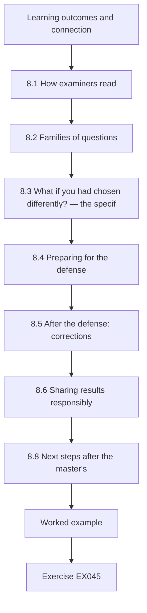

### Logical drawing

```mermaid
flowchart LR
  N0["Learning outcomes and connection"]
  N1["8.1 How examiners read"]
  N2["8.2 Families of questions"]
  N3["8.3 What if you had chosen differently? — the specif"]
  N4["8.4 Preparing for the defense"]
  N5["8.5 After the defense: corrections"]
  N6["8.6 Sharing results responsibly"]
  N7["8.8 Next steps after the master's"]
  N0 --> N1 --> N2 --> N3 --> N4 --> N5 --> N6 --> N7 --> Q["EX045"]
```

```text
[Learning outcomes and connection]
    |
    v
[8.1 How examiners read]
    |
    v
[8.2 Families of questions]
    |
    v
[8.3 What if you had chosen differently? — the specif]
    |
    v
[8.4 Preparing for the defense]
    |
    v
[8.5 After the defense: corrections]
    |
    v
[8.6 Sharing results responsibly]
    |
    v
[8.8 Next steps after the master's]
    |
    v
[Worked example] --> [Exercise EX045]
```
<!-- open-cyber-academy:lesson-figures:end ch-08 -->


### Learning outcomes and connection

By the end of this chapter the learner will be able to:

1. Explain how examiners typically read a dissertation and prepare the document and the candidate for that reading.
2. Anticipate the families of questions examiners ask of an applied study and prepare evidence-based answers, including honest "I don't know" answers.
3. Answer "what if you had chosen differently?" with a **specification curve** that shows how the main estimate depends on defensible analysis choices — and explain why robustness to choices is not the same as accuracy.
4. Conduct a mock defense and use it to find gaps in the work, not only in the presentation.
5. Respond to an examiners' report with a corrections table that maps every comment to an action and a location.
6. Share findings with partners and the sector without disclosing sensitive information, and route any security weakness found incidentally to the right party.

This chapter closes the dissertation cycle that began in Chapter 1. It draws on every earlier chapter: the question and scope (1), the literature and seminar map (2), the design and ethics (3), the rival table (4), the proposal's fixed elements (5), the analysis (6) and the results-to-claims register (7).

### 8.1 How examiners read

Examination formats differ widely. Some master's dissertations are assessed only from the written document by one internal and one external examiner; others include an oral defense (viva voce) or a presentation. Outcomes commonly include acceptance, acceptance with minor or major corrections, resubmission or failure; your institution's regulations are the only authority on which apply.

Research on how experienced examiners assess theses — mostly at doctoral level but instructive for master's work — suggests patterns worth preparing for. [Mullins and Kiley (2002)](https://doi.org/10.1080/0307507022000011507) interviewed experienced examiners and reported that they generally expect a thesis to pass, form early impressions from the opening and closing chapters, look for coherence between the question, the work and the conclusions, and are irritated by carelessness in presentation, which colours their reading of the rest. The practical implications are simple: the abstract, introduction and conclusion must be precise and consistent; the questions must be answered visibly in the order asked; and small errors — inconsistent numbers, broken references, unlabelled figures — cost more than their size suggests. Chapter 7's provenance check and results-to-claims register exist for exactly this reader.

### 8.2 Families of questions

Examiners' questions on an applied infrastructure study fall into recognizable families. Prepare at least two questions per family, with answers that cite your evidence.

| Family | Typical question | What a good answer contains |
|---|---|---|
| Question and contribution | "Why does this question matter, and what does your study add?" | The decision it informs; the gap from the concept matrix; what is new (controlled design, distance gradient, mechanism) |
| Design choice | "Why not a synthetic control?" | Donor pool too small (two comparison EDs); assumptions of each design compared |
| Data and measurement | "What does an 'ambulance arrival' mean in these systems?" | Custodian definitions; audit; downtime-day rule; what the count misses (acuity) |
| Analysis choices | "What if you had used a different comparison or baseline?" | The specification curve (§8.3) |
| Rivals | "Couldn't the season explain this?" | The rival's distinct prediction and the test: Wexmoor, placebo windows, timing |
| Ethics and sensitivity | "Could your results help an attacker?" | Sensitivity tiers; what was withheld and why; regional reporting |
| Limitations | "What is the weakest part of the study?" | The top-ranked directional limitation and its likely effect |
| Transfer | "Would this happen in a city with ten hospitals?" | The mechanism (load transfer limited by peers' spare capacity and routes) predicts smaller per-hospital effects where load spreads; untested |
| Implications | "What should a coalition do differently?" | Only what the evidence supports, with confidence; what was not tested |
| Next study | "If you had another year?" | The study that would most reduce uncertainty: more events pooled, hourly data, acuity |

### 8.3 "What if you had chosen differently?" — the specification curve

#### 8.3.1 The idea

Every analysis involves choices that are defensible in more than one way: baseline length, comparison units, the length of the event window, whether to exclude holidays. A prespecified primary analysis protects against choosing after seeing results (Chapter 6), but an examiner may reasonably ask whether the conclusion depends on the particular choices made. A **specification curve** answers by estimating the effect under every combination of reasonable choices and reporting the whole distribution ([Simonsohn, Simmons and Nelson, 2020](https://doi.org/10.1038/s41562-020-0912-z)); a **multiverse analysis** applies the same idea to data-processing choices ([Steegen et al., 2016](https://doi.org/10.1177/1745691616658637)). The prespecified estimate remains primary; the curve shows how fragile or robust it is.

#### 8.3.2 Practical activity: the Spillover specification curve

Save Lab 4 as `lab4_data.py` and Lab 6 as `lab6_its.py` first. The lab below estimates Alder Point's effect under 54 specifications: baseline of 90, 120 or 180 days; comparison W1, W2 or pooled; event window of 14, 21 or 28 days; holidays kept or dropped.

```python
# Lab 8 - specification curve for the examiner's "what if you had chosen differently?" (offline)
# Save Lab 4 as lab4_data.py and Lab 6 as lab6_its.py in the same folder first.
import itertools, statistics
from lab4_data import make_region, DAYS
from lab6_its import cits

d = make_region()
controls = {"W1": d["W1"], "W2": d["W2"], "pooled": {t: d["W1"][t] + d["W2"][t] for t in DAYS}}
specs = []
for pre_len, ctrl, ev_len, drop_hol in itertools.product((90, 120, 180), controls, (14, 21, 28), (False, True)):
    drop = frozenset({-100, 45}) if drop_hol else frozenset()
    est, lo, hi = cits(d["AP"], controls[ctrl], pre_len=pre_len, ev_len=ev_len, drop=drop)
    specs.append((est, lo, hi, pre_len, ctrl, ev_len, drop_hol))
specs.sort()
ests = [s[0] for s in specs]
print(f"specifications: {len(specs)}")
print(f"median effect {statistics.median(ests):+.3f}; range {ests[0]:+.3f} to {ests[-1]:+.3f}")
print(f"intervals excluding zero: {sum(s[1] > 0 for s in specs)} of {len(specs)}")
for label, idx in (("pre_len", 3), ("control", 4), ("event_len", 5), ("drop_holidays", 6)):
    groups = {}
    for s in specs:
        groups.setdefault(s[idx], []).append(s[0])
    print(label + ": " + ", ".join(f"{k}={statistics.median(v):+.3f}" for k, v in sorted(groups.items(), key=lambda kv: str(kv[0]))))
print("lowest three:", [(round(s[0], 3), s[3], s[4], s[5], s[6]) for s in specs[:3]])
```

Expected output:

```text
specifications: 54
median effect +0.245; range +0.199 to +0.332
intervals excluding zero: 54 of 54
pre_len: 120=+0.237, 180=+0.205, 90=+0.271
control: W1=+0.221, W2=+0.259, pooled=+0.238
event_len: 14=+0.237, 21=+0.260, 28=+0.217
drop_holidays: False=+0.244, True=+0.246
lowest three: [(0.199, 180, 'pooled', 14, False), (0.201, 180, 'pooled', 14, True), (0.202, 180, 'W2', 28, False)]
```

Reading the curve:

- **Alder Point's conclusion is robust to these choices.** All 54 intervals exclude zero; the median estimate is +24.5% and the range +19.9% to +33.2%. No reasonable choice in this set turns the increase into "no effect".
- **Choices still move the estimate.** Shorter baselines give larger estimates (median +27.1% with 90 days, +20.5% with 180), because the linear trend fitted to a shorter period is less stable. W2 as the only comparison gives larger estimates than W1. A 21-day window gives the largest median because it matches the true diversion period; 14 days omits part of it and 28 days dilutes it with the tail.
- **Holidays barely matter** (median +24.4% kept, +24.6% dropped): the regional holidays fall outside the event window and affect both regions.

Running the same curve for Brookfield (EX045) gives a median of +2.5%, a range of −1.5% to +6.9%, and **no** interval excluding zero. The Brookfield result is robustly inconclusive — yet the generator's true effect was +10%, above every one of the 54 point estimates. This is the specification curve's limit: it shows how much a conclusion depends on *analysis choices*, but every specification uses the same data with the same noise. Robustness to choices is not accuracy. Only more information — more events, more neighbours, finer data — can resolve Brookfield.

### 8.4 Preparing for the defense

#### 8.4.1 The opening summary

If the format includes an oral defense, you will usually be asked to summarize the work in 10–15 minutes. Use the structure of the seminar presentation (Chapter 2) applied to your own work: question and why it matters; design and data; main results with intervals; what the design rules out and leaves open; limitations and what next. Show the specification curve if the examiners are likely to ask about choices. End with the scoped answer to each research question in the words of the dissertation.

#### 8.4.2 Mock defenses

Ask two people to examine you for an hour — ideally one methodologist and one practitioner from the sector — with the question families of §8.2. Record the session with their consent. Afterwards, sort every question you answered poorly into one of three kinds:

1. **Presentation gaps:** you knew the answer but could not find it or say it clearly. Fix with preparation.
2. **Document gaps:** the dissertation does not contain information it should. Fix the dissertation before submission if possible, or prepare an honest answer.
3. **Work gaps:** the study cannot answer the question. Do not hide these; prepare to state them as limitations and to describe the study that would address them.

#### 8.4.3 Answering

Use the three registers from the seminar: "the dissertation shows…", "I infer…", "I don't know; it would take…". Concede what should be conceded promptly; defending an indefensible point damages the credibility of the defensible ones. When an examiner proposes an alternative analysis, do not improvise a new result in the room; explain what you would expect and why, and offer to run it as a correction if requested. When asked about the real world, remember the scope: in this book's synthetic study, nothing is known about real hospitals.

### 8.5 After the defense: corrections

Examiners' reports list required corrections, sometimes with recommendations. Respond with a **corrections table**:

| # | Examiner comment | Response | Action | Location |
|---|---|---|---|---|
| 1 | "The abstract describes the Brookfield result as showing no effect." | Agreed; the result is inconclusive. | Abstract and §5.2 rewritten with the interval and what it excludes. | Abstract; p. 54 |
| 2 | "Justify ten interviews." | Agreed that justification was thin. | Added an information-power paragraph with the aim, sample specificity and dialogue quality. | §3.6 |
| 3 | "Run the analysis with Calloway as an additional comparison." | Partly agreed: Calloway is part of the distance hypothesis, so using it as a comparison assumes the answer for RQ2. | Added as a sensitivity analysis for RQ1 only, with this caveat. | Appendix F |
| 4 | "The waiting-time result should not appear in the conclusion." | Agreed. | Removed from the conclusion; retained in results with the confounding caveat. | §6 |

Where you disagree, say so politely with reasons and evidence, as in row 3; examiners generally accept a reasoned partial agreement. Keep the table with the corrected dissertation.

### 8.6 Sharing results responsibly

#### 8.6.1 Partners first

Before any public presentation, give partners the factual and protected-information review promised in the data agreement (Chapter 3), within its fixed period and without a veto on findings. Offer each partner a private briefing that includes anything specific to them — for example, that their ED learned of the diversion informally and late. Findings about a specific organization's weaknesses belong to that organization first.

#### 8.6.2 The sector and the public

A briefing for the regional healthcare coalition can present the regional pattern, the mechanism and the recommendations with confidence levels:

- *Moderate confidence:* the nearest open ED on the main ambulance routes absorbs most diverted load in the first days; plans should name it and provide surge support.
- *Moderate confidence:* neighbours need formal, early notification; informal notice through arriving crews cost hours.
- *Low confidence (not tested):* explicit EMS load-sharing rules would reduce the nearest ED's peak burden.

Do not publish facility-level spare-capacity estimates or a ranked list of which hospital's loss would cause the most regional strain; such outputs would help someone seeking to maximize harm and add little defensive value beyond the organizations concerned (the doctoral book's [dual-use questions](../../../../doctorate-2-years/critical-sector-security/en/book/MANUSCRIPT.md#ch-06) apply). Synthetic or anonymized regions are acceptable for publication when the structure cannot be matched to a real place.

#### 8.6.3 Incidental security findings

Research on operations sometimes reveals a security weakness — an interviewee mentions an exposed remote-access service, or a data extract contains credentials. Do not investigate it, test it or describe it publicly. Report it privately to the organization concerned through the contact named in your agreement; if it concerns a vendor product rather than one organization's configuration, coordinated vulnerability disclosure through the vendor or a coordinator such as [CISA's CVD programme](https://www.cisa.gov/resources-tools/programs/coordinated-vulnerability-disclosure-cvd-program) is the established route. Record what you did, and tell your supervisor and the ethics committee if your protocol requires it.

### 8.7 Worked example: a mock-defense exchange (synthetic)

**Examiner (methodologist):** "Your main result depends on Wexmoor having the same season. How do you know it did?"

**Candidate:** "The dissertation shows the pre-event ratio of Alder Point to Wexmoor was flat over 180 days, with no trend break, and the result holds against each Wexmoor hospital separately — the specification curve's lowest estimate is about 20%. I infer that a different season in Wexmoor is unlikely to explain the whole increase. I don't know whether Wexmoor's respiratory season started on exactly the same day; that would take regional surveillance data I did not have, and it is in the limitations with its likely direction: if Wexmoor's season were milder, my estimate would be too high."

**Examiner (practitioner):** "Brookfield's managers said they were swamped. Your numbers say nothing happened. Who is right?"

**Candidate:** "My numbers don't say nothing happened — Brookfield's estimate is +5.8% with an interval from about −7% to +20%, so they can't distinguish no change from a substantial one. The interviews describe heavy nights and a concurrent staffing shortage. The joint display reports this as a discordance with three possible explanations. Settling it would need hourly data and staffing records."

**Examiner:** "Then should coalitions plan for spillover beyond the nearest hospital?"

**Candidate:** "This study can't tell them how much. It can tell them the nearest ED on the main routes took most of the load in this event, and that the evidence for more distant hospitals is inconclusive rather than negative."

The answers use the three registers, concede promptly, cite evidence and keep the claims inside the design.

### 8.8 Next steps after the master's

A completed dissertation leaves a list of studies that would reduce its remaining uncertainty: pooling several diversion events with methods for staggered timing; hourly and acuity-weighted outcomes; evaluating a load-sharing protocol. Some of these are practical projects for an operator or coalition; others are doctoral in scale. The [doctoral course in this area](../../../../doctorate-2-years/critical-sector-security/en/book/MANUSCRIPT.md) shows how such a question becomes an original contribution with independent validation. In the study path, the next course is the [doctoral Cybersecurity track](../../../../doctorate-2-years/cybersecurity/en/SUBJECTS.md).

### 8.9 Common errors and limits

- Treating the abstract and conclusion as formalities; examiners read them first.
- Preparing answers about presentation but not about the work's real gaps.
- Treating a specification curve as proof of truth rather than of robustness to choices.
- Improvising new analyses in the defense.
- Defending every point equally, including indefensible ones.
- Responding to corrections without a table that maps each comment to a change.
- Presenting findings publicly before partners have had their agreed review.
- Publishing facility-level capacity or vulnerability details.
- Investigating an incidental security finding instead of reporting it privately.

The limit of examination is that it judges the dissertation, not the world. Passing confirms that the study was done competently and its claims are bounded; it does not make the synthetic or single-region findings general.

### Exercises — chapter 8

**EX045 — Specification curves for two sites.** *Objective:* use Lab 8. *Inputs:* Labs 4, 6 and 8. *Constraints:* offline. *Steps:* (1) run Lab 8 and record the output; (2) replace `d["AP"]` with `d["BF"]` and record the output; (3) compare the two curves; (4) explain why Brookfield's true 10% effect lies above every point estimate and what this says about specification curves. *Expected evidence:* outputs and a paragraph. *Rubric:* 3 = both outputs correct, Brookfield described as robustly inconclusive, the limit (same data, same noise; robustness is not accuracy) explained; 2 = one output wrong; 1 = Brookfield described as "no effect"; 0 = none.

**EX046 — Question bank.** *Objective:* prepare for examiners. *Inputs:* §8.2 and your own or the Spillover dissertation. *Constraints:* two questions per family; answers of at most 120 words citing evidence. *Steps:* (1) write the questions; (2) write answers using the three registers; (3) mark the three hardest and the gap each reveals (presentation, document or work). *Expected evidence:* question bank. *Rubric:* 3 = hardest questions genuinely hard (parallel trends, Brookfield discordance, transfer), answers cite evidence and concede where appropriate, gaps correctly typed; 2 = answers generic; 1 = questions easy; 0 = none.

**EX047 — Corrections table.** *Objective:* respond to examiners. *Inputs:* a synthetic report with four comments: (a) "The literature review is author-by-author"; (b) "Why was the post-diversion step included? It looks like a way to absorb inconvenient data"; (c) "The ethics section does not mention partner review"; (d) "Please add patient outcomes". *Constraints:* the table format of §8.5. *Steps:* respond to each with agree, partly agree or disagree, giving reasons and actions. *Expected evidence:* table. *Rubric:* 3 = (a) agreed and restructured by concept, (b) defended with the prespecification and the reason (avoiding contamination of the trend by the tail) and a sensitivity analysis offered, (c) agreed and added, (d) declined as outside scope and approvals with a future-work note; 2 = one response unreasoned; 1 = agrees to everything including (d); 0 = none.

**EX048 — Mock defense and gap sorting.** *Objective:* use a mock defense to improve the work. *Inputs:* your dissertation or the Spillover materials. *Constraints:* a 45-minute mock with two examiners; consented recording. *Steps:* (1) run the mock; (2) list every weak answer; (3) sort them into presentation, document and work gaps; (4) fix what can be fixed and draft limitation text for the rest. *Expected evidence:* list, sorting and fixes. *Rubric:* 3 = honest sorting with at least one work gap acknowledged, document fixes made, limitation text directional; 2 = all gaps classed as presentation; 1 = no mock; 0 = none.

**EX049 — Coalition briefing.** *Objective:* share findings responsibly. *Inputs:* the Spillover results and themes. *Constraints:* one page; recommendations with confidence levels; a "what this study does not show" paragraph; no facility-level capacity figures. *Steps:* (1) draft; (2) mark each sentence with its source in the dissertation; (3) list what was shared privately with individual partners instead. *Expected evidence:* briefing and list. *Rubric:* 3 = recommendations traceable and calibrated, untested recommendations labelled, limits explicit, sensitive details routed privately; 2 = one uncalibrated recommendation; 1 = facility-specific weaknesses published; 0 = none.

**EX050 — The next study.** *Objective:* turn limitations into a feasible proposal. *Inputs:* the directional limitations in §7.6. *Constraints:* one page; choose the limitation whose resolution would most change the conclusions. *Steps:* (1) justify the choice; (2) state the question and estimand; (3) choose a design and the data it needs; (4) state the result that would change planners' decisions; (5) say whether it is a master's, doctoral or practitioner project and why. *Expected evidence:* one-page proposal. *Rubric:* 3 = chosen limitation is consequential (for example a single event), design feasible (pooled events with staggered-timing methods, or hourly acuity-weighted data), decision-relevant result stated, scale judgement reasoned; 2 = design vague; 1 = repeats the original study; 0 = none.

### Chapter synthesis

Examiners read for coherence and are influenced by care; make the abstract, introduction and conclusion precise and consistent, and the answers to each question visible. Prepare for predictable families of questions with evidence. Answer "what if" with a specification curve that keeps the prespecified estimate primary and shows its dependence on reasonable choices — remembering that robustness to choices is not accuracy, as Brookfield's robustly inconclusive estimate of a real effect shows. Use mock defenses to find gaps in the work, not only in the talk. Respond to corrections with a mapped table and reasons. Share with partners first, publish regional patterns rather than facility-level weaknesses, and route incidental security findings privately. The dissertation's limitations become the next study.

<!-- open-cyber-academy:chapter-navigation:start ch-08 -->
### Continue studying — chapter 08 of 08

[← Chapter 07](#ch-07) · [Course chapter index](../SUBJECTS.md) · [Next course via chapter index →](../SUBJECTS.md)

This is the final chapter of this course; the index links the next course in the full study path.
<!-- open-cyber-academy:chapter-navigation:end -->

<a id="worked-results"></a>

## Worked results and assessment notes

Each worked result shows one defensible answer and explains what the rubric rewards. A different answer can earn full credit when it meets the same standard of evidence, scope and honesty about limits. Numerical results come from the offline labs in this book run with Python 3 (3.13 was used for this draft) and the standard library only; if your output differs, first check the Python version, the seed, and whether you changed the order of random draws.

### Chapter 1: EX001–EX007

**EX001 — From topic to question.** *Problem:* state drinking-water regulators and utility associations do not know how often cyber incidents at small utilities interrupt treatment or monitoring, or for how long, so support programmes cannot be targeted. *Question (PICOT form):* among community water systems serving 3,300–50,000 people in one state (P), how often did cyber incidents reported to the state primacy agency (E) coincide with a recorded treatment or monitoring interruption, compared with non-cyber equipment failures (C), measured as the number and duration of interruptions (O) over five years (T)? *FINER:* feasible only if the primacy agency's incident records distinguish causes and can be shared in aggregate — check this first; interesting to the agency and to utilities; novel if no state-level description exists; ethical because aggregate records involve no individuals, though small-utility identification risk must be handled (Chapter 3); relevant because it would show whether cyber causes are a meaningful share of interruptions. *Hoped-for claim:* "In one state over five years, recorded cyber incidents accounted for a stated share of treatment or monitoring interruptions, with stated durations." *Out of scope:* incidence of unreported incidents; health effects. Full credit requires honesty about feasibility (records may not code cause reliably) and a claim limited to reported incidents.

**EX002 — Question types.**

| Q | Type | Minimum design | Strongest claim |
|---|---|---|---|
| (a) | Descriptive | Complete county diversion log for 2024 with cause codes | Hours of diversion by cause in that county and year |
| (b) | Associational (causal only with more) | Cross-sectional or panel comparison of EDs with and without drills, adjusted for size and case mix | An association between drill adoption and waiting times during outages; causal only if adoption timing can be exploited (for example a staggered rollout) with credible comparisons |
| (c) | Causal | Controlled ITS or equivalent | Percentage change relative to a counterfactual, under stated assumptions |
| (d) | Explanatory | Interviews with dispatchers and crews, dispatch records | A mechanism supported by converging accounts |
| (e) | Evaluative (causal) | ITS around the protocol's start, ideally with a comparison region | Effect of the protocol on time on diversion, under assumptions |

The rubric's key point is (b): adoption of drills is chosen by hospitals, so better-run hospitals both adopt drills and have shorter waits; without a design that handles this, the claim is associational.

**EX003 — Search strategy and known-item test.** Blocks as in §1.4.2, with additions such as "health information technology failure", "cyber incident" and "EHR outage" in Block A and "regional surge", "patient redistribution" and "mutual aid" in Block C. Sources: a biomedical index (for emergency medicine and health services), a general scholarly index (for economics and public administration) and a computing index (for security), each justified by the discipline it covers. Grey literature: audit offices (for example the NAO), health agencies and ministries, regulators' statements, healthcare-coalition and EMS after-action reports, hospital-association surveys (for example the AHA's), and sector coordinating bodies. Known-item set: Dameff et al. (2023), Ghafur et al. (2019), Neprash et al. (2022); check by searching each source and confirming the item appears in the results, revising the string if not and logging the revision. Stopping rule: two consecutive chaining rounds with no new included study. Log fields: date, source, exact string, filters, hits, exported file name, person. The rubric rewards a search that would find the NAO report — impossible through bibliographic databases alone — and a known-item check that is actually executable.

**EX004 — Deduplication and agreement.** (1) The expected output as in §1.9: 20 identified, 5 duplicates, 15 screened, κ = 0.571. (2) With the ampersand record added and `I` appended for both reviewers, the output is `records identified: 21 duplicates removed: 5 screened: 16`, `po=0.812 pe=0.547 kappa=0.586`: the record was **not** removed. The normalized title "ransomware emergency department crowding at neighbouring hospitals" differs from "ransomware and emergency department crowding…" because the normalizer strips "&" but does not map it to "and". Fix: replace "&" with " and " before stripping punctuation, and add a manual review of near-matches (for example titles whose normalized forms differ by one word). (3) Starting from the original lab, changing B's decision on the substation paper to I gives `po=0.733 pe=0.547 kappa=0.412`. (4) Raw agreement fell by 6.7 points, but kappa fell from 0.571 to 0.412 because kappa rescales agreement above chance onto the remaining range: with chance agreement near 0.55, only 0.45 of the scale is "earned", so one extra disagreement among 15 records removes a large share of it.

**EX005 — Repair the eligibility criteria.** Criteria for grey literature: *include* reports by government bodies, regulators, audit offices, healthcare coalitions, EMS agencies or hospital associations that describe the operational effects (activity, diversion, delays, cancellations) of a specific cyber incident or IT outage on one or more health care organizations; *exclude* documents that describe procedures, guidance or products without reporting effects of an event, and vendor marketing. Decisions: the state health department memo on downtime procedures → exclude (procedure without effects) unless the full text reports an event's effects; the coalition exercise report → exclude for RQ1–2 (an exercise is not an event) but keep in a separate "methods and planning" list useful for RQ3 and the discussion; the vendor white paper → exclude. A record that remains undecidable from its first page goes to full-text review rather than being excluded, so that uncertainty does not silently reduce the evidence base.

**EX006 — Concept matrix.** NAO row: *unit* — NHS organizations in England; *exposure* — WannaCry, May 2017; *comparison* — none in the statistical sense; an investigation of what happened and why; *outcomes* — at least 81 of 236 trusts disrupted, plus 603 primary care and other NHS organizations (including 595 GP practices); 6,912 appointments recorded as cancelled and an estimated 19,000+ in total; *design* — audit investigation; *supports* — the scale of disruption and the gap between recorded and estimated cancellations; *rivals raised or left open* — incomplete recording; precautionary disconnection by unaffected organizations. Model paragraph: "Evidence on regional effects comes from three kinds of study. Audit investigations (NAO, 2017) establish the scale of disruption but rely on recorded counts that understate totals. Administrative-data analyses (Ghafur et al., 2019) quantify reduced activity at infected trusts — about 6% fewer admissions per infected hospital per day — and find no difference in deaths in A&E, a measure the authors call crude. A before-and-after study of neighbouring EDs (Dameff et al., 2023) associates an attack period with increased volume at unaffected neighbours. No study yet compares neighbours with an unaffected region or examines distance…" The rubric rewards the recorded-versus-estimated distinction and organization by concept.

**EX007 — Estimand and scope memo.** RQ1 estimand: "For each of Alder Point, Brookfield and Calloway: exp(β₂) − 1, the percentage difference between mean daily ambulance arrivals during days 0–20 and the arrivals expected from the ED's pre-event trend adjusted for the concurrent change in pooled Wexmoor arrivals." RQ2: "the pattern of these three estimates against distance, summarized as the difference between the nearest ED's estimate and the mean of the two more distant EDs' estimates, with intervals." Alternative estimands a careless analyst might compute: the first-day rise (captures the initial shock only); the rise relative to the same days last year (confounded by a year of trend and a different season); the total number of extra patients over 21 days (a different scale, sensitive to baseline size). Hoped-for claim as in §1.2.1; out of scope: patient outcomes, the effect of ransomware as distinct from diversion, other regions.

### Chapter 2: EX008–EX014

**EX008 — Sector profile (example: water).** Consequence unit: people served by a system without water meeting a stated pressure or quality threshold, for a stated duration, and the number and duration of advisories. Buffers: storage, manual dosing and monitoring, interconnections with neighbouring systems, bottled-water distribution. Instruments: America's Water Infrastructure Act of 2018 (risk and resilience assessments and emergency response plans for community water systems serving more than 3,300 people, per the EPA page); in the EU, drinking water is an NIS2 sector and a CER sector. Evidence: advisory notices (public), state primacy-agency summaries, surveys of utilities, interviews; operational data rarely. Question: "In one state, how many boil-water advisories over five years were attributed by the primacy agency to equipment or control-system failures, and how long did they last?" Public case: Oldsmar, coded with its revision (§2.5). Full credit requires exact instrument citations and a question matched to public or aggregate evidence.

**EX009 — Catalogue distortion.** (1) Output as in §2.9. (2) With the multiplier at 1.0: population unchanged; catalogue `n=491, mean 31.8 h, median 18.9 h, share>24h 0.42`; yearly catalogued counts 99, 73, 90, 75, 77, 77. (3) The severity distortion persists because it is caused by severity-dependent disclosure, which operates every year regardless of the mandate; the mandate only changes how many incidents are disclosed, not which ones are favoured. (The catalogue's mean rises slightly without the mandate because the mandate admits proportionally more short incidents.) The trend disappears: years 4–6 now look like years 1–3, apart from noise. (4) Answerable question: "Among catalogued incidents, did the share involving a particular characteristic (for example, ambulance diversion) change after the mandate?" — still affected if the mandate changes *which* incidents are disclosed, so the safest answers describe characteristics within the catalogue rather than rates. The rubric rewards attributing each distortion to its mechanism.

**EX010 — Seminar protocol on Ghafur et al. (2019).** *Claim (quoted from the abstract):* "Among hospitals infected with WannaCry ransomware, there was a significant decrease in the number of attendances and admissions, which corresponded to £5.9 m in lost hospital activity. There was no increase in mortality reported, though this is a crude measure of patient harm." *Evidence:* Hospital Episode Statistics for NHS trusts in England, 1 April to 30 June 2017, aggregated to hospital-day; 34 infected trusts compared with non-infected trusts. *Design:* difference-in-differences by ordinary least squares with hospital fixed effects and day-of-week and bank-holiday terms, comparing the WannaCry week with baseline weeks; outcomes were cancelled outpatient appointments, elective and emergency admissions, A&E attendances and deaths in A&E. *Warrant:* non-infected trusts show what infected trusts would have done that week. *Rivals the paper addresses:* national fluctuation (weeks before and after are modelled and the all-trust change is shown to be within normal volatility); time-invariant hospital differences (fixed effects). *Rivals it raises or leaves open:* recording failure at infected trusts — the authors themselves note that if systems used to code administrative data were down, the data may not reflect events fully, a measurement rival specific to IT-disruption studies; "affected" but not infected trusts that disconnected as a precaution, which complicate the comparison group (the paper tests them separately); and load transfer to neighbours, which the paper names as a gap ("we have no understanding on the network effect"). *Transfer:* to centralized health systems with comparable data and short attacks. *So what:* even a short attack had measurable activity and financial costs. *Next study:* neighbouring hospitals' activity during closures and diversions, which is precisely the Spillover Study's question. Full credit includes the recording-failure rival and an accurate description of the comparison.

**EX011 — Mechanism classification.**

| Case | Mechanism | Consequence unit | Limiting factor |
|---|---|---|---|
| (a) Colonial Pipeline | Dependency cascade (fuel distribution depends on the pipeline), with load transfer to alternative supply routes | Product not delivered; supply shortfalls | Inventories and alternative transport capacity |
| (b) Synnovis | Both: hospitals depended on pathology services (cascade); work was redirected to other providers (load transfer) | Procedures and appointments postponed | Laboratory capacity elsewhere |
| (c) Change Healthcare | Dependency cascade through claims and payment processing | Cash-flow disruption; delayed claims | Alternative processors and cash reserves |
| (d) Kestrel diversion | Load-transfer spillover | Excess arrivals and waiting time at neighbours | Neighbours' spare capacity and routes |

The rubric rewards recognizing "both" where substitution follows a dependency failure.

**EX012 — Coding a revised incident.** March 2021 entry: *claim* — "an unauthorized remote user changed the sodium hydroxide setpoint at the Oldsmar water treatment plant"; *source* — CISA advisory AA21-042A and local officials' public statements; *source type* — official; *claim date* — February 2021; *status* — reported, under investigation; *last checked* — March 2021. April 2023 update: keep the original claim and its sources, add *revision* — "former city manager stated that the FBI concluded the event was likely caused by an employee; the FBI said it could not confirm a targeted intrusion" (WUSF, 13 April 2023); *status* — disputed (or "not confirmed"); *last checked* — April 2023. Analysis rule: an analysis counting confirmed intrusions excludes the entry, while a sensitivity analysis including disputed entries reports both counts. Re-check procedure for 2026: search for official statements after April 2023 (FBI records, CISA advisory updates), record what was found and the date.

**EX013 — Apparent contradiction.** Matrix dimensions: units (infected trusts versus unaffected neighbours), direction expected (activity falls versus rises), health system and year (NHS 2017 versus San Diego 2021), duration (about a week versus a month), outcomes (admissions, attendances, cancellations, A&E deaths versus census, arrivals, waits, stroke metrics), design (administrative data with baseline and infected/non-infected comparison versus before-and-after within neighbours). They do not conflict: they measure opposite ends of the same load transfer. A combined study would measure both the attacked organization's lost activity and neighbours' gained activity in the same event, with an unaffected comparison region, so that the net regional effect and its redistribution can be estimated together.

**EX014 — Seminar presentation.** Assessed by rubric. A full-credit submission summarizes the paper in its own terms before critique; states rivals as questions ("Could the April-to-May change reflect the season?"); and uses the three registers in prepared answers — for example: "The paper says the targeted organization handled about a quarter of regional discharges. I infer that a smaller organization's withdrawal would move less load. I don't know how the result would differ in a region with many providers; it would take a multi-region comparison." The reflection names a specific change in reading prompted by peers.

### Chapter 3: EX015–EX020

**EX015 — Choose and defend a design.** Estimand: percentage change in weekly card transactions per merchant category in the affected region during the outage week, relative to the counterfactual from the region's own trend and the unaffected regions. Comparison: uncontrolled ITS (fails if a national shock occurs that week — holidays, paydays); controlled ITS/difference-in-differences with three unaffected regions (needs parallel trends; checkable over two years of weekly data); synthetic control with three donor regions × 40 categories (possible at the category level, but three donor regions is a thin pool). Choice: controlled ITS by category, with a synthetic control as robustness. Key insight for full credit: weekly resolution dilutes a three-day outage — the outage occupies at most three-sevenths of a week — so effects will be attenuated and recovery within the same week may cancel part of the drop; ask for daily data before committing. Abandonment: pre-period ratios between the affected and comparison regions show diverging trends or breaks that the model cannot absorb.

**EX016 — Design analysis.** (1) Output as in §3.3.3. (2) With a true effect of 0.20 under the seasonal rise, the controlled design's mean estimates are about +0.196, +0.202 and +0.199 and its flagged shares are 0.56 (28 days), 0.73 (90 days) and 0.77 (180 days); the uncontrolled design flags every simulated study (1.00) but its mean estimates are about +0.30 — biased upward by the season. (3) The controlled design detects an effect of about 20% in roughly three quarters of studies with 180 baseline days; it cannot reliably detect 10%. (4) Revised RQ1: "By how much did daily ambulance arrivals at each neighbouring ED change during the diversion relative to the comparison-adjusted counterfactual, and which changes can the data rule out?" The rubric rewards moving from a test framing to an estimation framing and stating the detectable effect honestly.

**EX017 — Ethics application risks.** Stakeholders: interviewed operators; the utility; its customers; the primacy agency; neighbouring utilities sharing staff or interconnections; the researcher. Risks and safeguards by Menlo principle: *respect for persons* — a small utility may have two or three operators, so any role description identifies them; report roles only at sector level, review quotations, allow withdrawal; *beneficence* — publishing that a small utility's disinfection monitoring failed for hours could reveal a weakness others could exploit; withhold facility identity and technical detail, share specifics privately with the utility; *justice* — avoid concentrating research burden on small under-resourced utilities that cannot refuse a regulator-linked researcher; *law and public interest* — comply with any confidentiality obligations around utility security information and with the institution's human-research rules. Information-sheet text: "We will not use your name or your utility's name in anything we publish, and we will remove details that could identify you. Because few people do your job in this region, someone who knows the utility well might still recognize you, and we cannot rule this out completely."

**EX018 — Data management plan.**

| Asset | Tier | Storage and access | Retention | End-of-project sharing |
|---|---|---|---|---|
| Custodian daily counts | Restricted | Encrypted institutional storage; candidate and supervisor | Per agreement (for example five years), then destroyed | Not shared; access through custodians |
| Wexmoor dashboard counts | Public source, terms recorded | Project storage with capture date | Per dashboard terms | Shared if the terms permit redistribution; otherwise share the capture method |
| Interview recordings | Confidential | Encrypted, separate from data | Destroyed after transcription and verification | Never |
| De-identified transcripts | Confidential (restricted at best) | Encrypted | Per consent | Not shared; quotations in the dissertation only |
| Codebook (data and qualitative) | Public | Repository | Permanent | Shared |
| Analysis code and synthetic test data | Public | Repository | Permanent | Shared under an open licence |
| Consent forms | Confidential | Locked or encrypted, separate | Per institutional policy | Never |
| Coalition mutual-aid thresholds | Restricted (sensitive) | Encrypted | Per agreement | Not shared; described only generally |

**EX019 — Pre-analysis plan.** A full-credit plan fixes: estimands (EX007); primary outcome (daily ambulance arrivals as defined in the custodian data dictionaries) and secondary outcome (daily median minutes from arrival to first clinician); comparison (pooled Wexmoor EDs); windows (days −180 to +89; diversion 0–20; post 21–89); model (§6.2, log ratio with 0.5 offset, linear trend, two steps); intervals (Newey–West, lag 7; sensitivity lags 0 and 14); robustness (each Wexmoor ED separately; baselines of 90 and 120 days; event windows of 14 and 28 days; holidays excluded; placebo windows); multiplicity (one primary outcome; three sites reported together; secondary outcome described as such); deviations (dated log with reason and whether results had been seen); prior data access ("a 35-day baseline extract from Alder Point, before day −60, was examined for completeness only").

**EX020 — Reproducibility audit.** Assessed by rubric. Typical issues a second person finds: the README does not say Lab 6 needs Lab 4 saved as `lab4_data.py` in the same folder; the Python version is not recorded; an output was produced with an edited seed; Lab 3 takes several seconds and looks hung. Fixes: explicit run order and file names; `python3 --version` recorded in `environment.txt`; seeds stated next to each command; expected run times stated.

### Chapter 4: EX021–EX026

**EX021 — Rival table (pharmacy example).** Main hypothesis predictions: fills rise at independents when the chain's outage starts and fall back when it ends; the rise is larger nearer the chain's stores; no rise in comparable unaffected areas; the channel is new-customer transfers (patients new to the independent pharmacy) rather than existing patients filling more; pharmacists report transfers. Rivals: *season* (respiratory-season prescriptions — predicts rises everywhere; test with a comparison area); *insurer or formulary change that week* (predicts changes tied to specific drugs or plans; test by drug class and payer); *measurement* (a claims-system backlog releasing delayed fills — predicts a spike in fills dated earlier but processed late; test fill date versus processing date); *comparison shock* (test each comparison area separately); *chain store closures unrelated to the attack* (test store-level records); *chance* (placebo weeks). Full credit requires distinct predictions, not a list of topics.

**EX022 — Baseline length and the naive estimate.** With `pre=(-56, -1)` for every site and for the pooled comparison:

| Site | Pre (56 days) | Event | Naive change | Relative to Wexmoor |
|---|---:|---:|---:|---:|
| AP | 39.2 | 51.1 | +0.302 | +0.235 |
| BF | 30.2 | 33.8 | +0.118 | +0.060 |
| CG | 22.9 | 24.5 | +0.069 | +0.014 |
| W1 | 35.3 | 37.0 | +0.050 | −0.004 |
| W2 | 27.1 | 28.7 | +0.059 | +0.005 |

Pooled Wexmoor's change is +0.054. The naive estimates change (Alder Point from +33.0% to +30.2%) because the baseline now covers a different stretch of the series with different noise and slightly different seasonal level; the relative estimates change little (Alder Point +24.6% to +23.5%; Calloway +1.3% to +1.4%) because the season affects both regions similarly, so whatever part of the season the baseline includes is largely cancelled in the ratio. W1 and W2 relative to pooled Wexmoor are near zero by construction, since they make up the pooled comparison.

**EX023 — Causal diagram.** Add a node "Tent" with arrows Tent → Brookfield walk-ins (strong) and Tent → Brookfield ambulance arrivals (possible, if EMS took low-acuity patients to the tent). The tent is a **co-intervention** concurrent with the diversion and concentrated near Brookfield. If it absorbed low-acuity patients, it *reduces* Brookfield's arrivals and biases Brookfield's spillover estimate **toward zero** (or below). It also distorts RQ2's gradient, making the decline from Alder Point to Brookfield look steeper. Responses: obtain tent attendance by day; analyse ambulance and walk-in channels separately; run a sensitivity analysis adding back tent attendances that EMS records attribute to Brookfield's catchment. Alder Point is less affected if its catchment does not overlap the tent's; check with the EMS destination records.

**EX024 — Negative controls.**

| Candidate | Kind | Could the exposure affect it? | Shares confounders? | Verdict |
|---|---|---|---|---|
| (a) Wexmoor arrivals | Population | No (different region, no shared EMS) | Yes, the season, if similar | Accept, with the parallel-season caveat |
| (b) Alder Point walk-ins | Outcome | Yes, if patients who would have walked into Kestrel went elsewhere | Yes | Reject as a pure negative control; use as a channel comparison |
| (c) Alder Point scheduled outpatient infusions | Outcome | Unlikely | Probably not — scheduled care is not driven by the respiratory season | Weak: it would not reveal seasonal confounding |
| (d) Calloway arrivals | Population/outcome | Possibly, at a small level — it is part of the distance hypothesis | Yes | Reject: using it as a negative control assumes the answer to RQ2 |

**EX025 — A documented competing explanation.** Explanations: the treatment delay caused by the attack's diversion caused the death, versus the patient's underlying condition. As publicly reported, prosecutors concluded after the autopsy that the delay was not decisive and that the medical condition alone caused the death (MIT Technology Review, November 2020). An individual-death claim requires the individual counterfactual — would *this* patient have survived with earlier treatment? — which an autopsy and clinical review can sometimes address; a population-level claim asks whether outcomes for a *group* of time-sensitive patients worsen during diversions, which requires comparing groups and says nothing definitive about any single death. Ethical population question: "During ambulance diversions at a regional stroke centre, did door-to-treatment times for stroke patients in the region change, relative to comparable periods without diversion?" — using aggregate or registry data under appropriate approvals.

**EX026 — The decision as exposure.** The study's exposure is the diversion because that is what moved ambulances; the attack mattered through the decision to divert. Two alternative decisions: Kestrel could have stayed open to ambulances on downtime procedures (no diversion, little spillover), or diverted only specific categories such as stroke and trauma (partial spillover concentrated on specialist centres). Rewritten claim: "In one synthetic event, a 21-day ambulance diversion following a ransomware attack was followed by an estimated 24% increase in ambulance arrivals at the nearest neighbouring ED; the result concerns the consequences of the diversion as decided, not of ransomware as such." Later question: "What information and criteria do hospital leaders use to decide whether and for how long to divert ambulances during a cyber incident, and how do these decisions vary?"

### Chapter 5: EX027–EX032

**EX027 — Proposal summary.** Model (about 200 words): "When a hospital diverts ambulances after a cyber incident, neighbouring emergency departments absorb the load, but how much and how far it spreads is rarely measured. This study asks how daily ambulance arrivals at the three EDs nearest Kestrel Health changed during its 21-day ransomware-related diversion (RQ1), whether the change declined with distance (RQ2) and how the load was redistributed in practice (RQ3). The primary estimand is, for each ED, the percentage difference between mean daily arrivals during the diversion and the arrivals expected from its pre-event trend adjusted for the concurrent change at two EDs in an unaffected region (Wexmoor). The design is a controlled interrupted time series on daily custodian data (180 days before, 90 days from the start of diversion), with placebo windows and prespecified robustness checks, and ten semi-structured interviews with ED, EMS and coalition staff analysed thematically and integrated in a joint display. Ethics approval [status]; data agreements [status]. The study will contribute an estimate with an interval for each ED, a mechanism account and recommendations for regional diversion planning, and will not estimate patient outcomes." Fixed: question, estimand, design, comparison and data; open: approval status, interview number. Full credit requires the peer to restate the estimand as "percentage change relative to a comparison-adjusted trend", not "the increase in patients".

**EX028 — Timeline and risk register.** Critical path: ethics approval → agreement with each utility to see its exercise reports → document collection; interviews can start after approval but report access depends on each utility's legal review. Timeline: semester 1 question and literature, first contacts; semester 2 ethics, agreements, interview guide and pilot; semester 3 interviews and document analysis; semester 4 integration, writing and examination. Risks (likelihood/impact; mitigation; trigger; owner): (1) utilities refuse to share exercise reports (high/high; ask for redacted summaries, or interview about the exercise rather than share it; no agreement from two of three utilities by the end of semester 2; candidate); (2) small-utility operators cannot be released for interviews (medium/high; offer 30-minute versions and off-shift times; fewer than six booked by mid-semester 3; candidate); (3) identification risk in a tiny population (high/medium; sector-level reporting, quotation review; any participant concern; supervisor); (4) a utility suffers an incident during the study (low/high; pause, no incident questions; utility notification; candidate); (5) exercise reports contain security-sensitive details (high/medium; read on site or redacted, no copies; any document marked sensitive; supervisor); (6) state-agency approval required for participation (medium/medium; ask the primacy agency early; agency request; supervisor).

**EX029 — Pilot audit and re-pilot.** (1) First run: completeness 0.943; FAIL completeness and range; PASS duplicates and calendar days → `AMEND AND RE-PILOT (no outcome analysis)`. (2–3) Corrected extract output:

```text
line  6: missing: walkins
line 13: missing: median_wait_min
missing calendar days: []
implausibly low days (<70% of mean): [('2025-03-30', 23)]
cell completeness 0.986 over 35 days x 4 fields
  PASS  completeness >= 0.97
  PASS  no conflicting duplicates
  PASS  <= 1 missing calendar day
  PASS  all values in range
decision: GO
```

(Line numbers shift because the duplicate was removed: the missing waiting time is now on line 13.) (4) The audit still reports two missing cells, which the custodian confirmed were never recorded; they stay missing, and the main study's plan states how missing values are handled (neither is the primary outcome, ambulance arrivals). The 30 March low day remains because it is real data: the custodian identified a six-hour EHR downtime, so under the new rule the day is flagged in the codebook and the main analysis is run with and without flagged days. Nothing is imputed in the pilot.

**EX030 — Interview guide pilot.** Assessed by rubric. Typical full-credit changes: questions asking for evaluations ("Was the diversion handled well?") replaced by questions anchored to time and records ("What did you know at 06:00, and from whom?"); double-barrelled questions split; jargon replaced with participants' own terms (for example "going on divert"); duration cut to the target. Deviation-log decision: changes made before any study interview are recorded as protocol amendments, with the date and the reason, and noted as made before any data were collected; a change after study interviews have begun is a deviation and is reported as such.

**EX031 — Progression criteria.**

| Criterion | Go | Amend | Stop | Justification and amend action |
|---|---|---|---|---|
| Response rate in the pilot sample | ≥ 30% | 15–30% | < 15% after one amended re-pilot | At 30% of 200, about 60 responses give a proportion's 95% interval of roughly ±13 points, enough for the main descriptive aims; amend = change the invitation route (for example through the hospital association) and add two reminders |
| Item completion (median share of items answered) | ≥ 90% | 75–90% | < 75% | Low completion biases item estimates; amend = shorten and remove items most often skipped |
| Median completion time | ≤ 15 minutes | 15–25 | > 25 | Busy managers abandon long surveys; amend = cut items |
| Comprehension (cognitive interviews, 5 participants) | No item misunderstood by ≥ 2 | 1–2 items | ≥ 3 items | Misunderstood items measure the wrong thing; amend = reword and retest those items |

No criterion concerns what respondents answered (for example the share with downtime drills): that would be an outcome, not feasibility.

**EX032 — Supervisor memo on scope.** Benefits: stroke care is a time-sensitive outcome that matters to planners; the data are offered. Costs: individual-level health data require a new or amended ethics approval and a new data agreement (with GDPR Article 9 or HIPAA implications in the relevant jurisdiction) — months on the critical path in semester 3; small numbers of stroke patients in 21 days make any estimate imprecise; adding an outcome after registration creates multiplicity and must not displace the fixed primary outcome. Decision (defensible): decline for the dissertation, accept as future work. Deviation-log entry: "Date; offer of patient-level stroke data from the coalition; declined for this study because of approvals, timeline and precision; no outcome data had been seen; recorded as a future-work proposal." Future work: a separate approved study pooling several diversion events with registry data on door-to-treatment times. Accepting is also defensible if the timeline allows a new approval and the outcome is labelled exploratory and secondary.

### Chapter 6: EX033–EX038

**EX033 — Run and report the main analysis.** Lab 6 output: AP +0.244 (+0.067, +0.449), placebo range −0.190 to +0.166, rank 1/16; BF +0.058 (−0.067, +0.199), rank 8/16; CG +0.008 (−0.093, +0.121), rank 9/16; Alder Point waiting time +5.9 minutes (+2.6 to +9.2). Model paragraph: "During the 21-day diversion, ambulance arrivals at Alder Point (6 km) were 24.4% higher than expected from its pre-event trend relative to the Wexmoor comparison (95% interval 6.7% to 44.9%), larger than all 15 placebo estimates from pre-event windows (rank 1 of 16). At Brookfield (14 km) the estimate was +5.8% (−6.7% to 19.9%) and at Calloway (38 km) +0.8% (−9.3% to 12.1%); both are inconclusive: the data are compatible with no change and with increases of up to about 20% and 12% respectively, and both rank in the middle of their placebo distributions. The estimates decline with distance, but Brookfield's and Calloway's intervals overlap heavily, so the data cannot distinguish a gradual decline from an effect confined to the nearest ED." Waiting-time sentence: "Median waiting time at Alder Point was 5.9 minutes longer during diversion (2.6 to 9.2), but this model has no comparison series and includes seasonal crowding, so it likely overstates the diversion's contribution."

**EX034 — Lag sensitivity.**

| Newey–West lag | Alder Point 95% interval |
|---:|---|
| 0 (ordinary heteroskedasticity-robust) | +0.096 to +0.411 |
| 7 (prespecified) | +0.067 to +0.449 |
| 14 | +0.111 to +0.393 |

Diagnostics: residual autocorrelation 0.03 at lag 1 and −0.124 at lag 7; Durbin–Watson 1.92. A longer lag does not always widen the interval because the estimator adds Bartlett-weighted sample autocovariances of the score, and these can be negative (as at lag 7 here); including more lags can add negative terms and shrink the variance. With little autocorrelation the three intervals mostly reflect sampling noise in the autocovariances. Report the prespecified lag 7 as primary, with lags 0 and 14 as sensitivity; never choose the narrowest after seeing it.

**EX035 — Placebo arithmetic.** (1) With 15 placebo windows plus the real window, the one-sided rank-based p-value is rank/16: Alder Point 1/16 = 0.0625, Brookfield 8/16 = 0.50, Calloway 9/16 ≈ 0.56. (2) The smallest attainable value is 1/(n+1): it reaches 0.05 with n = 19 windows (1/20) and 0.01 with n = 99 (1/100); to fall strictly below them needs 20 windows (1/21 ≈ 0.048) and 100 windows (1/101 ≈ 0.0099). (3) Early placebo windows have short pre-periods — the window starting at day −150 has only 30 baseline days from day −180 — so their trends are estimated imprecisely and their estimates vary more than the real fit, which has 180 baseline days; this makes the placebo test conservative. (4) Start placebo windows every day rather than every seven days (adding windows, though overlapping windows are strongly dependent, so the rank is less informative than the count suggests), or use the same calendar windows in an earlier year if the custodians can supply it. Post-event data must not be used.

**EX036 — Repair the secondary outcome.** Confounding: the waiting-time model has no comparison series, so the seasonal rise in crowding during the event window enters the estimate (in the generator, up to 3 minutes of season and a true diversion effect of 4 minutes). Designs: (a) use Calloway's waiting times as a within-region comparison, since its arrival effect is close to zero — this requires obtaining Calloway's waiting-time series from its custodian and still assumes Calloway shares Alder Point's seasonal crowding pattern; (b) use a published waiting-time series from another region's EDs, if one exists at daily resolution, as an external comparison. Supported claim: "Alder Point's median waiting time was higher during diversion, consistent with an increase attributable to the diversion; the magnitude is confounded by season." Limitation sentence: "The waiting-time estimate has no comparison series and therefore includes seasonal crowding; it likely overstates the diversion's effect."

**EX037 — Coder agreement.** Observed agreement: 9 of 12 = 0.75 (disagreements at excerpts 4, 7 and 11). Marginal counts — A: DIV 3, INFO 4, STAFF 3, PROC 2; B: DIV 3, INFO 2, STAFF 4, PROC 3. Chance agreement: (3·3 + 4·2 + 3·4 + 2·3)/144 = 35/144 ≈ 0.243. κ = (0.75 − 0.243)/(1 − 0.243) ≈ 0.670. Diagnoses: excerpt 4 ("two crews waiting… nobody to take handover") is about the consequence of diverted arrivals for staff — it fits DIV and STAFF; excerpt 7 ("Dispatch didn't know…, so the crew decided on the road") is about missing information that caused a destination decision — INFO and DIV; excerpt 11 ("whether to start the paper triage process or wait for word from IT") is uncertainty about procedure caused by missing information — INFO and PROC. All three are boundary problems in the codebook rather than coder error. Revised definition: "INFO — the content, timing or absence of information about the incident or diversion. Code INFO whenever the excerpt's main point is what someone knew or did not know; if the excerpt also describes the decision or action that followed, double-code it with DIV or PROC." Double-coding changes how agreement is computed (per code, presence or absence), which the codebook must state.

**EX038 — Joint display.** Use the four rows of §6.7 and add, for example: *Quantitative:* Calloway +0.8%, inconclusive and centred near zero. *Qualitative:* Calloway staff described "no noticeable change" apart from two transfers. *Meta-inference:* **confirmation** — both strands suggest little load reached the most distant ED. For the Brookfield discordance, explanations and evidence: low power (check whether the interval includes the generator-scale effect, which it does); a concurrent staffing shortage at Brookfield (check rosters or agency-staff hours); perceptions anchored on the worst nights (check hourly arrivals or boarding logs for night peaks); recall shaped by the coalition's after-action narrative (compare interviews with dated contemporaneous logs). Full credit keeps the discordance in the display and names evidence that could resolve it without letting either strand overrule the other.

### Chapter 7: EX039–EX044

**EX039 — Improve the provenance check.** (1) Lab 7 output as in §7.10. (2–4) A unit-aware version of the check:

```python
# EX039 worked answer: unit-aware provenance check (extends Lab 7)
import re
RESULTS = {  # name: (value, unit)
    "AP_effect": (24.4, "%"), "AP_lo": (6.7, "%"), "AP_hi": (44.9, "%"),
    "BF_effect": (5.8, "%"), "BF_lo": (-6.7, "%"), "BF_hi": (19.9, "%"),
    "CG_effect": (0.8, "%"), "CG_lo": (-9.3, "%"), "CG_hi": (12.1, "%"),
    "AP_naive": (33.0, "%"), "placebo_n": (15, "count"), "event_days": (21, "day"),
    "wait": (5.9, "min"), "wait_lo": (2.6, "min"), "wait_hi": (9.2, "min"),
}
UNITS = {"%": "%", "minutes": "min", "minute": "min", "day": "day", "days": "day",
         "placebo": "count", "windows": "count"}
CAUSAL = ("caused", "proves", "significant increase", "due to the attack")
NUM = r"-?\d+(?:\.\d+)?"

def unit_after(text, end):
    m = re.match(r"\s*-?\s*(%|[A-Za-z]+)", text[end:])
    if m and m.group(1).lower() == "to":              # "2.6 to 9.2 minutes": take the unit after the pair
        m2 = re.match(r"\s*to\s*" + NUM, text[end:])
        return unit_after(text, end + m2.end()) if m2 else None
    return UNITS.get(m.group(1).lower()) if m else None

def check(text):
    problems = []
    for m in re.finditer(NUM, text):
        x, u = float(m.group()), unit_after(text, m.end())
        if x == 95 and text[m.end():m.end() + 10] == "% interval":
            continue                                  # the interval level, declared in the methods
        ok = any(unit == u and (abs(x - v) <= 0.05 or (x.is_integer() and round(v) == x))
                 for v, unit in RESULTS.values())
        if not ok:
            problems.append(f"untraced number {m.group()!r} (unit: {u})")
    for site in ("Alder Point", "Brookfield", "Calloway"):
        i = text.find(site)
        if i >= 0 and not re.search(NUM + r"%?\s+to\s+" + NUM, text[i:i + 140]):
            problems.append(f"no interval near {site}")
    problems += [f"check wording: {p!r}" for p in CAUSAL if p in text.lower()]
    return problems

DRAFT = open("lab7_provenance.py").read().split('DRAFT = """')[1].split('"""')[0]
FIXED = """During the 21-day diversion, ambulance arrivals at Alder Point rose by 24.4% (95% interval 6.7% to 44.9%)
relative to the Wexmoor comparison hospitals, larger than all 15 placebo estimates. Brookfield's change of 5.8%
(-6.7% to 19.9%) and Calloway's of 0.8% (-9.3% to 12.1%) were inconclusive. A simple before-and-after comparison
would have suggested a 33% rise. Median waiting time at Alder Point was 5.9 minutes longer (2.6 to 9.2 minutes),
an estimate without a comparison series that includes seasonal crowding."""
for label, text in (("draft", DRAFT), ("fixed", FIXED)):
    print(label + ":", "; ".join(check(text)) or "all numbers traced")
```

Output:

```text
draft: untraced number '16' (unit: count); no interval near Calloway; check wording: 'caused'; check wording: 'significant increase'
fixed: all numbers traced
```

The check now matches each number only against results with the same unit, inheriting the unit for the first number of a pair such as "2.6 to 9.2 minutes". Draft findings: the "6 minutes" in the draft is now traced to the waiting-time result (5.9 minutes, rounded) instead of being falsely matched to Brookfield's 5.8%; "16 placebo windows" is untraced (there are 15 windows, the 16th estimate being the real one); Calloway has no interval; two causal phrases are flagged. Alder Point and Brookfield intervals are present in the draft and are not flagged. (5) The corrected paragraph (in the script as `FIXED`) uses "rose by" with "relative to the Wexmoor comparison hospitals" rather than "caused", calls Brookfield and Calloway inconclusive, gives every interval, and states the waiting-time limitation. A checker cannot judge wording fully: "were inconclusive" is right only because a person read the intervals.

**EX040 — Directional limitations.** Ranked by threat to the conclusion:

| Rank | Limitation | Likely direction and size | What was done | What would resolve it |
|---:|---|---|---|---|
| 1 | Weekly resolution for a three-day outage | Toward zero: at most three-sevenths of the week is exposed, and catch-up within the week cancels some of the drop — possibly halving the apparent effect | Reported per week with this caveat | Daily data |
| 2 | One chain's data only | Overstates the drop in total fills, because customers shifted to competitors who are not observed | Stated; competitor data requested | Market-wide claims data |
| 3 | Concurrent events (holidays, insurer changes) | Either direction | Calendar and payer checks | A comparison chain or region |
| 4 | Fills dated by processing rather than dispensing | Shifts the drop later and creates a rebound spike, exaggerating both | Checked processing versus fill dates | Dispensing dates |
| 5 | Single event | No bias; limits transfer | Context described | More events |

**EX041 — Structured abstract.** Assessed by rubric; the key sentences: *Design* — "controlled interrupted time series of daily ambulance arrivals (180 days before, 90 days from the start of diversion) with an unaffected comparison region, placebo windows, and ten interviews analysed thematically; synthetic teaching data." *Results* — Alder Point +24.4% (6.7% to 44.9%; rank 1 of 16 against placebo windows); Brookfield +5.8% (−6.7% to 19.9%) and Calloway +0.8% (−9.3% to 12.1%), both inconclusive; interviews attributed destinations to road geography and described late, informal notification. *Conclusions* — "A 21-day ambulance diversion was followed by a substantial increase in arrivals at the nearest ED; effects at more distant EDs could not be determined." *Main limitation* — "one event and one comparison region; parallel seasonal trends assumed." The exposure is named as the diversion, not ransomware.

**EX042 — Reporting checklist mapping.** Example mapping (RECORD extends STROBE for routinely collected data): study design and setting (STROBE 4–5) → Chapter 3, §3.1 and the pre-analysis plan; participants/units and data sources (STROBE 6, 8; RECORD 6.1) → the three neighbouring EDs and the custodian extracts (Chapter 6, §6.1); variables and their definitions (STROBE 7; RECORD 7.1, codes and algorithms) → the codebook; data access and cleaning (RECORD 12.1–12.2) → pilot audit and corrections (Chapter 5); linkage (RECORD 12.3) → not applicable, stated as such; bias (STROBE 9) → rival table and negative controls (Chapter 4); statistical methods (STROBE 12) → §6.2–6.4; limitations (STROBE 19) → §7.6; accessibility of protocol and data (RECORD 22.1) → availability statement. Genuine gap: how the custodians' definitions of an "ambulance arrival" were validated (for example, whether inter-facility transfers count, and whether the definition changed during the study period). Drafted text: "Each custodian supplied its definition of an ambulance arrival; we confirmed that all three exclude inter-facility transfers and that no definition changed between days −180 and 89, and we compared the extract's monthly totals with the custodians' published annual reports."

**EX043 — Availability statement.** Releasable: analysis code and synthetic data reproducing the structure of the analysis (public); codebook and pre-analysis plan with the deviation log (public); aggregate results tables at regional level (public). Withheld: custodian daily counts (restricted by data agreements); transcripts (confidential under consent); Wexmoor captures if the dashboard's terms forbid redistribution (method shared instead); coalition mutual-aid thresholds (sensitive). Statement: "Analysis code, a synthetic dataset with the same structure, the codebook, the pre-analysis plan and the deviation log are available at [repository and DOI]. Daily counts were provided under agreements with the data custodians and can be requested from them under the same conditions; interview transcripts cannot be shared because participants consented only to the use of de-identified quotations." Reply to the editor: "We have released everything our agreements and participants' consent allow, including code that reproduces every result from a synthetic dataset. The daily data belong to the custodians, who have agreed to consider requests from qualified researchers under the same terms, and the transcripts cannot be released without breaking participants' consent."

**EX044 — Accessible figure.** Figure type: a dot-and-interval plot with distance on the horizontal axis (6, 14, 38 km) and percentage change on the vertical axis, a reference line at zero, each site labelled directly, and no colour encoding. Caption: "Ambulance arrivals rose substantially at the nearest neighbouring ED during the 21-day diversion; changes at the two more distant EDs could not be distinguished from zero. Dots: estimated percentage change relative to a comparison-adjusted trend; bars: 95% intervals. Synthetic teaching data." Text alternative: "Alder Point, 6 km: +24.4% (6.7% to 44.9%). Brookfield, 14 km: +5.8% (−6.7% to 19.9%). Calloway, 38 km: +0.8% (−9.3% to 12.1%)." Plain-language summary: "When the hospital stopped taking ambulances, the nearest neighbouring hospital received about a quarter more ambulances than expected; we could not tell whether hospitals further away were affected."

### Chapter 8: EX045–EX050

**EX045 — Specification curves for two sites.** (1) Alder Point, as in §8.3.2: 54 specifications; median +0.245, range +0.199 to +0.332; all 54 intervals exclude zero. (2) Brookfield:

```text
specifications: 54
median effect +0.025; range -0.015 to +0.069
intervals excluding zero: 0 of 54
pre_len: 120=+0.005, 180=+0.034, 90=+0.022
control: W1=+0.007, W2=+0.041, pooled=+0.022
event_len: 14=+0.022, 21=+0.043, 28=+0.014
drop_holidays: False=+0.025, True=+0.025
lowest three: [(-0.015, 120, 'W1', 28, False), (-0.013, 120, 'W1', 28, True), (-0.008, 120, 'W1', 14, False)]
```

(3) Alder Point's conclusion is robust to every reasonable choice; Brookfield is **robustly inconclusive** — no specification excludes zero and none reaches the generator's true effect. (4) Brookfield's true 10% effect lies above every point estimate (the maximum is +6.9%) because all 54 specifications analyse the same realized data with the same noise: in this draw, Brookfield's arrivals happened to fall below expectation, and no choice of baseline, comparison or window can remove noise that is in the data themselves. A specification curve shows sensitivity to analytic choices, not accuracy; robustness is not truth. Describing Brookfield as "no effect" would be wrong — the intervals include effects around 20%.

**EX046 — Question bank.** Assessed by rubric. The three hardest questions for the Spillover dissertation are typically: "Why should we believe Wexmoor's season matched Tamsin Valley's?" (answer: pre-event ratio flat, each Wexmoor ED separately in the specification curve, but parallel trends cannot be proven — a *work* gap if there is no third comparison); "Your interviews say Brookfield was heavy; your numbers say inconclusive. Which is right?" (answer: neither overrules the other; low power, staffing and night peaks are explanations, with the evidence that would choose — a *document* gap if the discordance was not discussed); "Would this transfer to a city with ten hospitals?" (answer: the mechanism, road geography, suggests load spreads more thinly; the estimate does not transfer — a *presentation* gap if the candidate overclaims).

**EX047 — Corrections table.**

| # | Comment | Response | Action |
|---|---|---|---|
| (a) | Literature review is author-by-author | Agreed | Chapter restructured by concept using the concept matrix; each section ends with what remains unknown |
| (b) | Post-diversion step "absorbs inconvenient data" | Disagree, with reasons | The step was prespecified in the registered plan (dated) to prevent tail effects after diversion from contaminating the trend; added a sensitivity analysis without the step and with days 21–89 excluded, showing the primary estimate's change |
| (c) | Ethics section omits partner review | Agreed | Added the publication agreement (factual review, no veto) and the log of partner-requested changes |
| (d) | Add patient outcomes | Disagree for this dissertation | Outside the approved scope and data agreements; would need new approvals and individual-level data; added to future work with a design sketch |

**EX048 — Mock defense and gap sorting.** Assessed by rubric. Full credit requires at least one honest *work* gap (for example: "I cannot show parallel trends beyond the pre-period ratio"), document fixes actually made (for example, the discordance paragraph added), and limitation text that states direction ("if Wexmoor's season was milder, our estimates are overstated").

**EX049 — Coalition briefing.** Assessed by rubric. A model briefing states the main result with its interval; recommendations with confidence levels — for example, "Notify neighbouring EDs formally within one hour of a diversion decision (supported by interviews T2; high confidence that notification was late; the effect of earlier notification is untested)", "Consider destination guidance for EMS that spreads load beyond the nearest exit (supported by T1 and the Alder Point estimate; untested intervention)"; a "what this study does not show" paragraph (patient outcomes, other regions, effects of ransomware as such); and no facility-level capacity numbers, which go privately to each partner along with any specific weakness raised in interviews.

**EX050 — The next study.** Most consequential limitation: one event and one region. Question: across many ambulance-diversion episodes following cyber incidents, by how much do arrivals at the nearest neighbouring ED change, and how does this depend on regional hospital density? Estimand: the average percentage change in arrivals at nearest neighbours during diversion relative to comparison-adjusted trends, by density tier. Design: a pooled event study across incidents with staggered timing, using estimators robust to heterogeneous effects (Roth et al., 2023; Goodman-Bacon, 2021), with data obtained from several regions' custodians or from a national ED dataset, and events identified from public incident sources coded with provenance and status (Chapter 2). Decision-relevant result: if effects are concentrated at the nearest ED in low-density regions, planners should prioritize destination guidance and surge staffing there. Scale: doctoral (multiple data agreements, a catalogue of events, new methods), or a practitioner project inside a national agency with existing data access — not a master's project.

<a id="glossary"></a>

## Glossary

- **Audit trail** — The codebook, memos and versions of a qualitative analysis that let another person follow how codes became themes.
- **Autocorrelation** — Correlation between a series' values (or a model's residuals) on nearby days; it leaves least-squares estimates unbiased but makes their usual standard errors wrong.
- **Cohen's kappa (κ)** — Agreement between two raters beyond what their marginal frequencies would produce by chance: (observed − chance) / (1 − chance).
- **Concept matrix** — A table that organizes studies by the concepts a review is about (units, exposure, comparison, outcomes, design, rivals), so that synthesis proceeds by concept rather than author by author.
- **Controlled interrupted time series (CITS)** — An interrupted time series analysed relative to a comparison series that was not exposed, so that shared shocks such as the season are removed.
- **Critical path** — The chain of tasks whose delay delays the whole project; in a master's dissertation usually approvals and data agreements.
- **Dependency cascade** — Propagation of a disruption from a failed supplier to the services that depend on it.
- **Design analysis** — Simulating a planned study on data generated with known effects to learn its bias, precision and probability of detecting effects of plausible size before collecting real data.
- **Deviation log** — A dated record of every change to a registered plan, its reason, and whether outcome data had been seen when it was made.
- **Directed acyclic graph (DAG)** — A diagram of assumed causal relations used to identify confounders, mediators and colliders.
- **Directional limitation** — A limitation stated with the likely direction and rough size of its bias, what was done about it and what would resolve it.
- **Discordance** — In mixed methods, a result in one strand that conflicts with the other; reported and explained rather than resolved by letting one strand win.
- **Diversion (ambulance diversion)** — A hospital's request that ambulances take patients to other hospitals; in this book the exposure of the Spillover Study.
- **Estimand** — The precise quantity a study aims to estimate: unit, outcome, exposure contrast, time window and summary measure.
- **FINER** — Feasible, interesting, novel, ethical and relevant: criteria for a research question.
- **Grey literature** — Reports and documents produced outside commercial academic publishing (audits, agency reports, after-action reviews).
- **Information power** — The idea that the more relevant information each participant holds for a narrow aim, the fewer interviews are needed.
- **Joint display** — A table pairing quantitative results with qualitative findings and stating a meta-inference for each row.
- **Known-item set** — Studies already known to be relevant, used to check that a search strategy retrieves them.
- **Load-transfer spillover** — Propagation of a disruption by substitution: demand that the disrupted provider cannot serve moves to others.
- **Meta-inference** — The conclusion drawn from integrating two strands: confirmation, expansion or discordance.
- **Multiple working hypotheses** — Holding several explanations at once and designing evidence that discriminates among them.
- **Negative control** — An outcome or population that the exposure should not affect but that shares the study's confounders, used to detect bias.
- **Newey–West (HAC) standard errors** — Standard errors robust to heteroskedasticity and autocorrelation up to a chosen lag, using declining Bartlett weights.
- **Parallel trends** — The assumption that, without the exposure, the treated and comparison series would have moved together.
- **PICOT (infrastructure form)** — Population or units, exposure, comparison, outcome and time, used to make a question answerable.
- **Pilot (feasibility) study** — A small study that tests whether the main study can be done as planned — data, instruments and procedures — not whether the hypothesis is true.
- **Placebo-in-time test** — Fitting the main model to windows before the real event, where no effect should exist, and ranking the real estimate among the placebo estimates.
- **Pre-analysis plan** — A registered, dated specification of estimands, outcomes, models and robustness checks written before outcome data are seen.
- **Progression criteria** — Thresholds set before a pilot that decide whether the main study proceeds, proceeds after amendment or stops.
- **Provenance (of a number)** — The traceable path from a number in the text back to the code and output that produced it.
- **Regression to the mean** — The tendency of unusually extreme measurements to be followed by less extreme ones, which can mimic an effect when units are selected on extreme values.
- **Reporting bias (catalogue bias)** — Distortion in incident catalogues because which incidents are disclosed depends on their severity, on mandates and on attention.
- **Results-to-claims register** — A table linking each claim in the dissertation to its result, the strength of the evidence and the verb the evidence allows.
- **Scoping review** — A review that maps the extent and kinds of evidence on a broad question rather than pooling effects.
- **Segmented regression** — Regression with level and slope terms that change at an interruption; the usual model for interrupted time series.
- **Specification curve** — The set of estimates from all reasonable analytic choices, displayed together so that no single choice carries the conclusion.
- **Synthetic control** — A weighted combination of unexposed units chosen to reproduce the exposed unit's pre-event path, used as its counterfactual.
- **Thematic analysis** — A method for identifying, analysing and reporting patterns of meaning in qualitative data, in six phases.

<a id="references"></a>

## References

Laws, guidance and public incident pages change. Versions and dates below are those consulted for this draft (October 2026); re-verify before relying on them.

**Policy, law and standards**

- Bank for International Settlements, Committee on Payments and Market Infrastructures, and International Organization of Securities Commissions. [Guidance on Cyber Resilience for Financial Market Infrastructures](https://www.bis.org/cpmi/publ/d146.htm). June 2016.
- Cybersecurity and Infrastructure Security Agency. [Cross-Sector Cybersecurity Performance Goals](https://www.cisa.gov/cross-sector-cybersecurity-performance-goals).
- Cybersecurity and Infrastructure Security Agency. [Coordinated Vulnerability Disclosure (CVD) Program](https://www.cisa.gov/resources-tools/programs/coordinated-vulnerability-disclosure-cvd-program).
- Dittrich, D., and Kenneally, E. [The Menlo Report: Ethical Principles Guiding Information and Communication Technology Research](https://www.dhs.gov/sites/default/files/publications/CSD-MenloPrinciplesCORE-20120803_1.pdf). U.S. Department of Homeland Security, August 2012.
- European Union. [Regulation (EU) 2016/679 (General Data Protection Regulation)](https://eur-lex.europa.eu/eli/reg/2016/679/oj). Official Journal, 4 May 2016.
- European Union. [Regulation (EU) 2022/2554 on digital operational resilience for the financial sector (DORA)](https://eur-lex.europa.eu/eli/reg/2022/2554/oj). Official Journal, 27 December 2022.
- European Union. [Directive (EU) 2022/2555 (NIS2 Directive)](https://eur-lex.europa.eu/eli/dir/2022/2555/oj/). Official Journal, 27 December 2022.
- European Union. [Directive (EU) 2022/2557 on the resilience of critical entities (CER Directive)](https://eur-lex.europa.eu/eli/dir/2022/2557/oj). Official Journal, 27 December 2022.
- North American Electric Reliability Corporation. [Critical Infrastructure Protection (CIP) Standards](https://www.nerc.com/pa/Stand/Pages/CIPStandards.aspx).
- U.S. Department of Health and Human Services. [Healthcare and Public Health Cybersecurity Performance Goals](https://hphcyber.hhs.gov/performance-goals.html). January 2024.
- U.S. Department of Health and Human Services. [Guidance Regarding Methods for De-identification of Protected Health Information in Accordance with the HIPAA Privacy Rule](https://www.hhs.gov/hipaa/for-professionals/special-topics/de-identification/index.html).
- U.S. Environmental Protection Agency. [America's Water Infrastructure Act of 2018: Risk Assessments and Emergency Response Plans](https://www.epa.gov/waterresilience/americas-water-infrastructure-act-2018-risk-assessments-and-emergency-response-plans).
- U.S. Government. [45 CFR Part 46 — Protection of Human Subjects](https://www.ecfr.gov/current/title-45/subtitle-A/subchapter-A/part-46). Electronic Code of Federal Regulations.

**Incidents and sector evidence**

- American Hospital Association. [AHA Survey: Change Healthcare Cyberattack Significantly Disrupts Patient Care, Hospitals' Finances](https://www.aha.org/2024-03-15-aha-survey-change-healthcare-cyberattack-significantly-disrupts-patient-care-hospitals-finances). 15 March 2024.
- Cybersecurity and Infrastructure Security Agency. [Compromise of U.S. Water Treatment Facility (AA21-042A)](https://www.cisa.gov/news-events/cybersecurity-advisories/aa21-042a). February 2021.
- Cybersecurity and Infrastructure Security Agency. [The Attack on Colonial Pipeline: What We've Learned & What We've Done Over the Past Two Years](https://www.cisa.gov/news-events/news/attack-colonial-pipeline-what-weve-learned-what-weve-done-over-past-two-years). May 2023.
- Dameff, C., Tully, J., Chan, T. C., et al. [Ransomware Attack Associated With Disruptions at Adjacent Emergency Departments in the US](https://doi.org/10.1001/jamanetworkopen.2023.12270). *JAMA Network Open*, 6(5), e2312270, 2023.
- Ghafur, S., Kristensen, S., Honeyford, K., Martin, G., Darzi, A., and Aylin, P. [A Retrospective Impact Analysis of the WannaCry Cyberattack on the NHS](https://doi.org/10.1038/s41746-019-0161-6). *npj Digital Medicine*, 2, 98, 2019.
- Microsoft. [Helping Our Customers Through the CrowdStrike Outage](https://blogs.microsoft.com/blog/2024/07/20/helping-our-customers-through-the-crowdstrike-outage/). 20 July 2024.
- MIT Technology Review. [Ransomware Did Not Kill a German Hospital Patient](https://www.technologyreview.com/2020/11/12/1012015/ransomware-did-not-kill-a-german-hospital-patient/). 12 November 2020.
- National Audit Office. [Investigation: WannaCry Cyber Attack and the NHS](https://www.nao.org.uk/reports/investigation-wannacry-cyber-attack-and-the-nhs/). October 2017.
- Neprash, H. T., McGlave, C. C., Cross, D. A., et al. [Trends in Ransomware Attacks on US Hospitals, Clinics, and Other Health Care Delivery Organizations, 2016–2021](https://doi.org/10.1001/jamahealthforum.2022.4873). *JAMA Health Forum*, 3(12), e224873, 2022.
- NHS England (London). [Update on Cyber Incident: Clinical Impact in South East London — Friday 14 June 2024](https://www.england.nhs.uk/london/2024/06/14/update-on-cyber-incident-clinical-impact-in-south-east-london-friday-14-june-2024/). 14 June 2024.
- U.S. Department of Energy, Office of Cybersecurity, Energy Security, and Emergency Response. [Colonial Pipeline Cyber Incident](https://www.energy.gov/ceser/colonial-pipeline-cyber-incident).
- WUSF Public Media. [Former Oldsmar City Manager Says 2021 Water Treatment Plant 'Hack' Was Likely Employee Error](https://www.wusf.org/local-state/2023-04-13/official-hack-oldsmar-city-water-treatment-plant-2021). 13 April 2023.

**Questions, reviews and argument**

- Arksey, H., and O'Malley, L. [Scoping Studies: Towards a Methodological Framework](https://doi.org/10.1080/1364557032000119616). *International Journal of Social Research Methodology*, 8(1), 19–32, 2005.
- Chamberlin, T. C. [The Method of Multiple Working Hypotheses](https://doi.org/10.1126/science.148.3671.754). *Science*, 148(3671), 754–759, 1965 (reprint of the 1890 paper).
- Farrugia, P., Petrisor, B. A., Farrokhyar, F., and Bhandari, M. [Research Questions, Hypotheses and Objectives](https://www.ncbi.nlm.nih.gov/pmc/articles/PMC2912019/). *Canadian Journal of Surgery*, 53(4), 278–281, 2010.
- Page, M. J., McKenzie, J. E., Bossuyt, P. M., et al. [The PRISMA 2020 Statement: An Updated Guideline for Reporting Systematic Reviews](https://doi.org/10.1136/bmj.n71). *BMJ*, 372, n71, 2021.
- Platt, J. R. [Strong Inference](https://doi.org/10.1126/science.146.3642.347). *Science*, 146(3642), 347–353, 1964.
- Snyder, H. [Literature Review as a Research Methodology: An Overview and Guidelines](https://doi.org/10.1016/j.jbusres.2019.07.039). *Journal of Business Research*, 104, 333–339, 2019.
- Tricco, A. C., Lillie, E., Zarin, W., et al. [PRISMA Extension for Scoping Reviews (PRISMA-ScR): Checklist and Explanation](https://doi.org/10.7326/M18-0850). *Annals of Internal Medicine*, 169(7), 467–473, 2018.
- Webster, J., and Watson, R. T. [Analyzing the Past to Prepare for the Future: Writing a Literature Review](https://www.jstor.org/stable/4132319). *MIS Quarterly*, 26(2), xiii–xxiii, 2002.
- Wohlin, C. [Guidelines for Snowballing in Systematic Literature Studies and a Replication in Software Engineering](https://doi.org/10.1145/2601248.2601268). *Proceedings of the 18th International Conference on Evaluation and Assessment in Software Engineering (EASE)*, 2014.

**Quantitative design and analysis**

- Abadie, A. [Using Synthetic Controls: Feasibility, Data Requirements, and Methodological Aspects](https://doi.org/10.1257/jel.20191450). *Journal of Economic Literature*, 59(2), 391–425, 2021.
- Barnett, A. G., van der Pols, J. C., and Dobson, A. J. [Regression to the Mean: What It Is and How to Deal With It](https://doi.org/10.1093/ije/dyh299). *International Journal of Epidemiology*, 34(1), 215–220, 2005.
- Durbin, J., and Watson, G. S. [Testing for Serial Correlation in Least Squares Regression. I](https://doi.org/10.1093/biomet/37.3-4.409). *Biometrika*, 37(3–4), 409–428, 1950.
- Gelman, A., and Loken, E. [The Statistical Crisis in Science](https://doi.org/10.1511/2014.111.460). *American Scientist*, 102(6), 460, 2014.
- Goodman-Bacon, A. [Difference-in-Differences with Variation in Treatment Timing](https://doi.org/10.1016/j.jeconom.2021.03.014). *Journal of Econometrics*, 225(2), 254–277, 2021.
- Greenland, S., Pearl, J., and Robins, J. M. [Causal Diagrams for Epidemiologic Research](https://doi.org/10.1097/00001648-199901000-00008). *Epidemiology*, 10(1), 37–48, 1999.
- Hategeka, C., Ruton, H., Karamouzian, M., Lynd, L. D., and Law, M. R. [Use of Interrupted Time Series Methods in the Evaluation of Health System Quality Improvement Interventions: A Methodological Systematic Review](https://doi.org/10.1136/bmjgh-2020-003567). *BMJ Global Health*, 5, e003567, 2020.
- Hernán, M. A., and Robins, J. M. [Causal Inference: What If](https://miguelhernan.org/whatifbook). Chapman & Hall/CRC, 2020 (open online edition).
- Lakens, D. [Sample Size Justification](https://doi.org/10.1525/collabra.33267). *Collabra: Psychology*, 8(1), 33267, 2022.
- Lipsitch, M., Tchetgen Tchetgen, E., and Cohen, T. [Negative Controls: A Tool for Detecting Confounding and Bias in Observational Studies](https://doi.org/10.1097/EDE.0b013e3181d61eeb). *Epidemiology*, 21(3), 383–388, 2010.
- Lopez Bernal, J., Cummins, S., and Gasparrini, A. [Interrupted Time Series Regression for the Evaluation of Public Health Interventions: A Tutorial](https://doi.org/10.1093/ije/dyw098). *International Journal of Epidemiology*, 46(1), 348–355, 2017.
- Newey, W. K., and West, K. D. [A Simple, Positive Semi-Definite, Heteroskedasticity and Autocorrelation Consistent Covariance Matrix](https://doi.org/10.2307/1913610). *Econometrica*, 55(3), 703–708, 1987.
- Roth, J., Sant'Anna, P. H. C., Bilinski, A., and Poe, J. [What's Trending in Difference-in-Differences? A Synthesis of the Recent Econometrics Literature](https://doi.org/10.1016/j.jeconom.2023.03.008). *Journal of Econometrics*, 235(2), 2218–2244, 2023.
- Simonsohn, U., Simmons, J. P., and Nelson, L. D. [Specification Curve Analysis](https://doi.org/10.1038/s41562-020-0912-z). *Nature Human Behaviour*, 4, 1208–1214, 2020.
- Steegen, S., Tuerlinckx, F., Gelman, A., and Vanpaemel, W. [Increasing Transparency Through a Multiverse Analysis](https://doi.org/10.1177/1745691616658637). *Perspectives on Psychological Science*, 11(5), 702–712, 2016.
- Wagner, A. K., Soumerai, S. B., Zhang, F., and Ross-Degnan, D. [Segmented Regression Analysis of Interrupted Time Series Studies in Medication Use Research](https://doi.org/10.1046/j.1365-2710.2002.00430.x). *Journal of Clinical Pharmacy and Therapeutics*, 27(4), 299–309, 2002.
- Wasserstein, R. L., and Lazar, N. A. [The ASA Statement on p-Values: Context, Process, and Purpose](https://doi.org/10.1080/00031305.2016.1154108). *The American Statistician*, 70(2), 129–133, 2016.

**Qualitative and mixed methods**

- Braun, V., and Clarke, V. [Using Thematic Analysis in Psychology](https://doi.org/10.1191/1478088706qp063oa). *Qualitative Research in Psychology*, 3(2), 77–101, 2006.
- Cohen, J. [A Coefficient of Agreement for Nominal Scales](https://doi.org/10.1177/001316446002000104). *Educational and Psychological Measurement*, 20(1), 37–46, 1960.
- Fetters, M. D., Curry, L. A., and Creswell, J. W. [Achieving Integration in Mixed Methods Designs — Principles and Practices](https://doi.org/10.1111/1475-6773.12117). *Health Services Research*, 48(6 Pt 2), 2134–2156, 2013.
- Fischhoff, B. [Hindsight ≠ Foresight: The Effect of Outcome Knowledge on Judgment Under Uncertainty](https://doi.org/10.1037/0096-1523.1.3.288). *Journal of Experimental Psychology: Human Perception and Performance*, 1(3), 288–299, 1975.
- Guest, G., Bunce, A., and Johnson, L. [How Many Interviews Are Enough? An Experiment with Data Saturation and Variability](https://doi.org/10.1177/1525822X05279903). *Field Methods*, 18(1), 59–82, 2006.
- Malterud, K., Siersma, V. D., and Guassora, A. D. [Sample Size in Qualitative Interview Studies: Guided by Information Power](https://doi.org/10.1177/1049732315617444). *Qualitative Health Research*, 26(13), 1753–1760, 2016.
- McHugh, M. L. [Interrater Reliability: The Kappa Statistic](https://doi.org/10.11613/BM.2012.031). *Biochemia Medica*, 22(3), 276–282, 2012.
- O'Connor, C., and Joffe, H. [Intercoder Reliability in Qualitative Research: Debates and Practical Guidelines](https://doi.org/10.1177/1609406919899220). *International Journal of Qualitative Methods*, 19, 2020.

**Pilots, reporting, reproducibility and examination**

- Benchimol, E. I., Smeeth, L., Guttmann, A., et al. [The REporting of Studies Conducted Using Observational Routinely-Collected Health Data (RECORD) Statement](https://doi.org/10.1371/journal.pmed.1001885). *PLOS Medicine*, 12(10), e1001885, 2015.
- Eldridge, S. M., Chan, C. L., Campbell, M. J., et al. [CONSORT 2010 Statement: Extension to Randomised Pilot and Feasibility Trials](https://doi.org/10.1136/bmj.i5239). *BMJ*, 355, i5239, 2016.
- Lancaster, G. A., Dodd, S., and Williamson, P. R. [Design and Analysis of Pilot Studies: Recommendations for Good Practice](https://doi.org/10.1111/j..2002.384.doc.x). *Journal of Evaluation in Clinical Practice*, 10(2), 307–312, 2004.
- Leon, A. C., Davis, L. L., and Kraemer, H. C. [The Role and Interpretation of Pilot Studies in Clinical Research](https://doi.org/10.1016/j.jpsychires.2010.10.008). *Journal of Psychiatric Research*, 45(5), 626–629, 2011.
- Mullins, G., and Kiley, M. ['It's a PhD, Not a Nobel Prize': How Experienced Examiners Assess Research Theses](https://doi.org/10.1080/0307507022000011507). *Studies in Higher Education*, 27(4), 369–386, 2002.
- Nosek, B. A., Ebersole, C. R., DeHaven, A. C., and Mellor, D. T. [The Preregistration Revolution](https://doi.org/10.1073/pnas.1708274114). *Proceedings of the National Academy of Sciences*, 115(11), 2600–2606, 2018.
- O'Brien, B. C., Harris, I. B., Beckman, T. J., Reed, D. A., and Cook, D. A. [Standards for Reporting Qualitative Research: A Synthesis of Recommendations (SRQR)](https://doi.org/10.1097/ACM.0000000000000388). *Academic Medicine*, 89(9), 1245–1251, 2014.
- Open Science Framework. [OSF Registries](https://osf.io/registries).
- Sandve, G. K., Nekrutenko, A., Taylor, J., and Hovig, E. [Ten Simple Rules for Reproducible Computational Research](https://doi.org/10.1371/journal.pcbi.1003285). *PLOS Computational Biology*, 9(10), e1003285, 2013.
- Thabane, L., Ma, J., Chu, R., et al. [A Tutorial on Pilot Studies: The What, Why and How](https://doi.org/10.1186/1471-2288-10-1). *BMC Medical Research Methodology*, 10, 1, 2010.
- The Turing Way Community. [The Turing Way: A Handbook for Reproducible, Ethical and Collaborative Research](https://book.the-turing-way.org/).
- Tong, A., Sainsbury, P., and Craig, J. [Consolidated Criteria for Reporting Qualitative Research (COREQ): A 32-Item Checklist for Interviews and Focus Groups](https://doi.org/10.1093/intqhc/mzm042). *International Journal for Quality in Health Care*, 19(6), 349–357, 2007.
- von Elm, E., Altman, D. G., Egger, M., et al. [The Strengthening the Reporting of Observational Studies in Epidemiology (STROBE) Statement: Guidelines for Reporting Observational Studies](https://doi.org/10.1016/S0140-6736(07)61602-X). *The Lancet*, 370(9596), 1453–1457, 2007.
- Wilkinson, M. D., Dumontier, M., Aalbersberg, I. J., et al. [The FAIR Guiding Principles for Scientific Data Management and Stewardship](https://doi.org/10.1038/sdata.2016.18). *Scientific Data*, 3, 160018, 2016.

Companion OpenCyber Academy material: the [doctoral Critical Infrastructure book](../../../../doctorate-2-years/critical-sector-security/en/book/MANUSCRIPT.md), which takes the research methods of this book to an original, simulation-based contribution.

**Case boundary.** Tamsin Valley, Kestrel Health, Alder Point Hospital, Brookfield Community Hospital, Calloway General, Tamsin Valley EMS, the county dispatch centre, the Tamsin Valley Healthcare Coalition, the Wexmoor region and its hospitals, interviewees I01–I10, records with DOIs beginning 10.9999/syn, the Spillover Study and every number produced by the labs are invented for teaching. Sources support the general statements beside which they are cited, never the synthetic details.

**Edition metadata.** Draft edition, October 2026. Reviewer: pending. A4 verification: not yet rendered.
