# Infraestrutura Crítica e Segurança Setorial: Desenho de Pesquisa Aplicada e a Dissertação de Mestrado

- Idioma: português do Brasil (`pt`); curso de mestrado, dois anos; aproximadamente 1.200 horas de estudo planejado (curso 184 de 207 da [trilha de estudo](../../../../../STUDY_PATH.md)). Edição de referência: [inglês](../../en/book/MANUSCRIPT.md).
- Estado editorial: **publicado**. Os capítulos 1–8 de 8 têm texto didático escrito, os exercícios EX001–EX050 e as resoluções correspondentes. Revisão independente por especialistas, nova verificação das fontes, revisão de acessibilidade, revisão linguística e a verificação de 300 páginas A4 continuam em aberto. Cobertura de capítulos em rascunho não é um livro concluído.
- Público: pesquisadores iniciantes que conhecem a área pela prática ou por estudos anteriores e agora precisam responder a uma pergunta delimitada sobre a segurança e a resiliência da infraestrutura crítica — saúde, energia, água, transporte, comunicações, finanças e serviços públicos — com evidências que outra pessoa possa verificar. Conhecimento de entrada: o conteúdo planejado para as trilhas de [engenharia](../../../../engineering-5-years/critical-sector-security/en/book/PLAN.md) ou de [bacharelado](../../../../bachelors-4-years/critical-sector-security/en/book/PLAN.md) desta área (ainda esboços quando este texto foi escrito), ou experiência profissional equivalente, mais estatística introdutória (médias, variância, intervalos de confiança, regressão linear) e a capacidade de executar um script curto em Python.
- Relação com o curso de doutorado: o [livro de doutorado desta área](../../../../doctorate-2-years/critical-sector-security/en/book/MANUSCRIPT.md) pede a um pesquisador que faça e defenda uma contribuição *original* — um método novo, validado de forma independente, com um programa de publicações. Este livro de mestrado pede algo diferente e anterior: **desenhar, pilotar e executar bem um estudo empírico com revisão ética**, relatar exatamente o que ele pode e não pode mostrar e defendê-lo diante dos examinadores. Onde o livro de doutorado constrói simulações e replica linhas de base, este livro trabalha sobretudo com dados observacionais, desenhos quase experimentais e entrevistas, porque é a isso que a maioria dos projetos de mestrado nesta área consegue ter acesso.
- Autoria e responsabilidade editorial: [hiagokinlevi](https://github.com/hiagokinlevi). O texto didático original, de titularidade do mantenedor, é dedicado sob [CC0 1.0](../../../../../LICENSE); as obras citadas mantêm seus próprios direitos e não são relicenciadas aqui.
- Limite educacional: este curso é um projeto educacional independente. Não é um programa de mestrado credenciado, não concede diploma e não concede nenhuma autorização para acessar, varrer, testar ou estudar qualquer infraestrutura, operador, conjunto de dados ou pessoa reais. Toda organização, região, hospital, pessoa, registro, conjunto de dados e resultado numérico de um exemplo resolvido é **sintético**, a menos que uma frase cite explicitamente uma fonte pública. Nada neste livro é um procedimento operacional para um hospital, uma concessionária ou um serviço de emergência reais, e nada nele é aconselhamento jurídico ou clínico.

[Página do curso](../../README.md) · [Índice de capítulos](../SUBJECTS.md) · [Plano do livro](PLAN.md) · [Skill do curso](../../skill/SKILL.md) · [Padrão de livros](../../../../../BOOK_STANDARD.md) · [Resoluções](#worked-results)

## Como usar este rascunho

Leia os oito capítulos em ordem; juntos, eles acompanham uma dissertação de mestrado da primeira ideia até a banca. O Capítulo 1 transforma um tema numa pergunta respondível e constrói uma busca bibliográfica documentada. O Capítulo 2 é o seminário avançado: ele examina como os setores diferem, que evidências existem para cada um e como ler criticamente um artigo setorial. O Capítulo 3 escolhe um desenho, escreve a submissão ao comitê de ética e monta um projeto reprodutível antes que chegue qualquer dado. O Capítulo 4 lista as explicações que poderiam produzir os mesmos dados que a hipótese e constrói os testes que as separam. O Capítulo 5 escreve a proposta e executa um piloto cuja tarefa é testar a viabilidade, e não encontrar um efeito. O Capítulo 6 coleta e analisa os dados, quantitativos e qualitativos. O Capítulo 7 escreve a dissertação e suas limitações. O Capítulo 8 prepara o exame independente, a defesa oral e o compartilhamento responsável dos resultados.

Cada capítulo contém seções didáticas, definições, um exemplo resolvido, uma atividade prática com um laboratório offline em Python, uma lista de erros comuns e limites, exercícios numerados e uma síntese. Os laboratórios usam apenas a biblioteca padrão do Python 3; não é preciso acesso à rede, pacotes nem dados reais. Escreva sua resposta a cada exercício antes de abrir as [resoluções](#worked-results). Muitos exercícios têm mais de uma resposta defensável; a resolução mostra uma, e a rubrica mostra o que um examinador recompensaria.

Mantenha quatro rótulos em toda nota de pesquisa que escrever enquanto estuda: **observação** (o que uma fonte nomeada registrou), **inferência** (o que você conclui, sob quais pressupostos), **alegação** (o que você pretende defender, com seu escopo) e **decisão** (o que alguém escolheu fazer por causa disso). A pesquisa sobre infraestrutura acrescenta um quinto: **consequência** — o efeito sobre as pessoas que dependem de um serviço. O erro mais comum no nível do mestrado não é um cálculo errado; é um cálculo correto ligado a uma alegação maior do que o desenho consegue sustentar.

### O que "pesquisa aplicada" significa neste nível

Uma dissertação de mestrado nesta área costuma ser julgada por quatro coisas: se a pergunta é clara e vale a pena ser respondida; se o desenho se ajusta à pergunta e aos dados efetivamente disponíveis; se a análise foi feita com competência e de forma reprodutível; e se as conclusões ficam dentro das evidências. A originalidade é bem-vinda, mas não é exigida no sentido do doutorado. Uma replicação bem executada de um desenho publicado numa nova região, um estudo descritivo cuidadoso de algo que ninguém mediu ou um estudo de métodos mistos que explica *por que* um efeito observado ocorreu são todas contribuições legítimas de mestrado. O que não é aceitável é uma dissertação cujas alegações não possam ser verificadas, cujos dados tenham sido obtidos sem a devida aprovação ou cuja seção de limitações liste fraquezas sem dizer em que direção elas enviesam a resposta.

### A dissertação sintética usada neste livro

O livro acompanha um projeto de mestrado inventado, o **Spillover Study**. Sua pergunta, refinada no Capítulo 1, é: *quando um sistema hospitalar é perturbado por um ataque de ransomware e desvia ambulâncias, quanto aumentam as chegadas de ambulâncias e os tempos de espera nos hospitais vizinhos, e esse aumento diminui com a distância?* A pergunta segue uma linha real de trabalhos publicados — [Dameff et al. (2023)](https://doi.org/10.1001/jamanetworkopen.2023.12270) relataram aumento de volume, de chegadas de ambulâncias e dos tempos de espera em departamentos de emergência adjacentes a um sistema de saúde sob um ataque de ransomware de um mês, em 2021 —, mas todo lugar, organização, pessoa e número do Spillover Study é fictício.

| Elemento sintético | Papel no livro | Limite |
|---|---|---|
| **Tamsin Valley** — Kestrel Health (dois hospitais, atacados), Alder Point Hospital (AP, a 6 km), Brookfield Community Hospital (BF, 14 km), Calloway General (CG, 38 km), Tamsin Valley EMS, central de despacho do condado, Tamsin Valley Healthcare Coalition | Região do estudo. O dia 0 é o início de um desvio de ambulâncias de 21 dias no Kestrel (Capítulos 3–8). | Região inventada; nenhum hospital, órgão, funcionário, paciente ou registro real. |
| **Wexmoor** — Wexmoor General (W1) e St. Aldric (W2) | Região de comparação não afetada, com padrão sazonal semelhante (Capítulos 3, 4, 6, 8). | Inventada. |
| Registros de busca com DOIs começando por `10.9999/syn` | Uma exportação de busca sintética para praticar a deduplicação e a triagem (Capítulo 1). | Registros inventados; o prefixo não pertence a nenhuma editora real e não deve ser buscado. |
| Entrevistados **I01–I10** | Gestores de departamentos de emergência, supervisores de EMS e equipe da coalizão (Capítulos 3, 5, 6). | Inventados; nenhum dado de seres humanos aparece neste livro. |
| O candidato e o orientador | As pessoas cujas decisões os exemplos resolvidos acompanham. | Papéis inventados, não pessoas reais. |

Os laboratórios geram todos os dados a partir de números aleatórios com semente impressos no texto. Como os dados são sintéticos, o livro pode dizer algo que um estudo real nunca sabe: o efeito **verdadeiro** embutido no gerador. As chegadas de Alder Point foram geradas com um aumento de 22% durante o desvio, as de Brookfield com 10% e as de Calloway com nenhum. Vários capítulos usam esse privilégio para mostrar com que frequência métodos honestos deixam de detectar ou descrevem mal um efeito real. Nunca apresente nenhum número dos laboratórios como constatação sobre hospitais reais.

### Política de fontes

Toda afirmação factual sobre uma lei, uma norma, um incidente público ou um estudo publicado remete a uma fonte consultada pelo autor em outubro de 2026. Leis e normas mudam; cada uma é citada com sua versão e data e deve ser verificada de novo antes que você se apoie nela. Onde uma afirmação é vocabulário metodológico padrão — por exemplo, que um intervalo de confiança descreve a incerteza amostral sob um modelo —, o texto diz isso em vez de inventar uma referência. Uma fonte apoia a afirmação geral ao seu lado, nunca os detalhes do caso sintético. Incidentes públicos são descritos apenas no nível de detalhe que seus editores divulgaram e, onde evidências posteriores revisaram um relato inicial, ambos são citados.

## Sumário

1. [Pergunta de pesquisa e método de revisão da literatura](#ch-01) — do tema à pergunta respondível, escopo da alegação, busca documentada entre disciplinas e na literatura cinzenta, deduplicação, triagem dupla e a matriz de conceitos.
2. [Infraestrutura crítica e segurança setorial: seminário avançado](#ch-02) — perfis setoriais e unidades de consequência, o que os catálogos públicos de incidentes podem e não podem dizer, leitura e apresentação de um artigo setorial e casos documentados cujo primeiro relato foi revisado.
3. [Desenho do estudo, ética e reprodutibilidade](#ch-03) — escolha entre desenhos quase experimentais e qualitativos, análise do desenho antes dos dados, revisão ética, proteção de dados e sensibilidade das informações de infraestrutura, e um projeto reprodutível.
4. [Infraestrutura crítica e segurança setorial: explicações concorrentes](#ch-04) — múltiplas hipóteses de trabalho, diagramas causais, regiões de comparação, controles negativos, testes placebo e dose–resposta como evidência discriminante.
5. [Proposta e piloto](#ch-05) — a proposta como contrato, cronograma e registro de riscos, acordos de acesso a dados, pilotos de viabilidade com critérios de prosseguir/não prosseguir declarados com antecedência e uma auditoria dos dados do piloto.
6. [Coleta e análise dos dados](#ch-06) — séries temporais interrompidas controladas com intervalos robustos à autocorrelação, janelas placebo, entrevistas e análise temática, concordância entre codificadores e integração das duas vertentes.
7. [Redação da dissertação e limitações](#ch-07) — estrutura e argumento, relato honesto dos resultados, procedência dos números, diretrizes de relato, limitações direcionais, figuras acessíveis e disponibilidade dos dados sob sensibilidade.
8. [Revisão independente e defesa](#ch-08) — como os examinadores leem, curvas de especificação para perguntas do tipo "e se", a defesa oral, correções e o compartilhamento responsável dos resultados com o setor.

As [resoluções](#worked-results) contêm EX001–EX050. Um [glossário](#glossary) e as [referências](#references) encerram o livro.

<a id="ch-01"></a>

## Capítulo 1 — Pergunta de pesquisa e método de revisão da literatura

<!-- open-cyber-academy:lesson-figures:start ch-01 -->
### Mapa da aula

Aula 01 publicada. Mapa, exemplo, EX001.

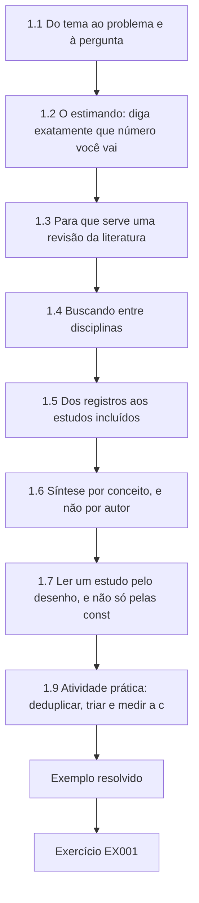

### Desenho lógico

```mermaid
flowchart LR
  N0["1.1 Do tema ao problema e à pergunta"]
  N1["1.2 O estimando: diga exatamente que número você vai"]
  N2["1.3 Para que serve uma revisão da literatura"]
  N3["1.4 Buscando entre disciplinas"]
  N4["1.5 Dos registros aos estudos incluídos"]
  N5["1.6 Síntese por conceito, e não por autor"]
  N6["1.7 Ler um estudo pelo desenho, e não só pelas const"]
  N7["1.9 Atividade prática: deduplicar, triar e medir a c"]
  N0 --> N1 --> N2 --> N3 --> N4 --> N5 --> N6 --> N7 --> Q["EX001"]
```

```text
[1.1 Do tema ao problema e à pergunta]
    |
    v
[1.2 O estimando: diga exatamente que número você vai]
    |
    v
[1.3 Para que serve uma revisão da literatura]
    |
    v
[1.4 Buscando entre disciplinas]
    |
    v
[1.5 Dos registros aos estudos incluídos]
    |
    v
[1.6 Síntese por conceito, e não por autor]
    |
    v
[1.7 Ler um estudo pelo desenho, e não só pelas const]
    |
    v
[1.9 Atividade prática: deduplicar, triar e medir a c]
    |
    v
[Exemplo resolvido] --> [Exercício EX001]
```
<!-- open-cyber-academy:lesson-figures:end ch-01 -->


### Objetivos de aprendizagem e conexão

Ao fim deste capítulo, o estudante será capaz de:

1. Passar de um tema ("ransomware em hospitais"), por um problema, a uma única pergunta de pesquisa respondível, e testá-la segundo os critérios FINER e uma versão do PICOT para infraestrutura.
2. Classificar uma pergunta como descritiva, associativa, causal, explicativa ou avaliativa, e declarar o tipo de desenho e de alegação que cada uma permite.
3. Definir a quantidade que o estudo vai estimar — seu **estimando** — em palavras precisas o bastante para que dois analistas calculem a mesma coisa.
4. Escolher um tipo de revisão (narrativa, de escopo, sistemática) adequado a uma dissertação de mestrado e justificá-lo.
5. Construir, executar e documentar uma busca interdisciplinar que inclua a literatura cinzenta, testá-la contra itens conhecidos e encerrá-la por uma regra declarada com antecedência.
6. Deduplicar registros, triá-los com dois revisores, medir a concordância com o kappa de Cohen, reparar os critérios de elegibilidade onde a discordância se concentra e relatar um diagrama de fluxo.
7. Organizar o que foi encontrado numa matriz de conceitos, em vez de um resumo autor por autor.

O capítulo fixa a pergunta e o mapa de evidências que todos os capítulos seguintes usam. O Capítulo 2 amplia o mapa para os outros setores; o Capítulo 3 escolhe um desenho para a pergunta fixada aqui; o Capítulo 4 lista as explicações rivais que a literatura já levantou; o Capítulo 7 escreve o capítulo de revisão da literatura a partir da matriz de conceitos construída aqui.

### 1.1 Do tema ao problema e à pergunta

#### 1.1.1 Três coisas diferentes

A maioria das dissertações começa com um **tema**, que é uma área de interesse: "ataques cibernéticos a hospitais". Um tema não pode ser respondido. Um **problema** é uma lacuna entre o que se sabe e o que alguém precisa saber para agir: "os planejadores regionais de emergência não sabem quanto um desvio induzido por ataque cibernético num hospital sobrecarrega seus vizinhos, então os acordos de ajuda mútua são escritos sem números." Uma **pergunta de pesquisa** é a pergunta específica cuja resposta reduziria essa lacuna: "Durante um desvio de ambulâncias induzido por ransomware, quanto mudam as chegadas diárias de ambulâncias nos hospitais num raio de 40 km, em relação ao que seria esperado sem o desvio?"

O movimento do tema à pergunta é um estreitamento, e todo estreitamento é uma decisão que você precisa ser capaz de defender. Estreitar para as *chegadas de ambulâncias* em vez de "danos aos pacientes" troca importância por mensurabilidade. Estreitar para *uma região* troca generalidade por profundidade e acesso aos dados. Estreitar para o *desvio induzido por ransomware* em vez de "incidentes cibernéticos" torna a exposição observável: um desvio tem um início e um fim que um serviço de atendimento médico de emergência (EMS) registra, enquanto "um incidente cibernético" pode permanecer desconhecido até para o próprio hospital por semanas.

#### 1.1.2 FINER e um PICOT para infraestrutura

Os pesquisadores clínicos testam as perguntas segundo os critérios FINER — viável (feasible), interessante, nova (novel), ética e relevante — e as estruturam com o PICOT: população, intervenção, comparação, desfecho (outcome) e tempo ([Farrugia et al., 2010](https://www.ncbi.nlm.nih.gov/pmc/articles/PMC2912019/), resumindo o *Designing Clinical Research* de Hulley e colaboradores). Ambos se transferem para a pesquisa sobre infraestrutura com uma mudança: a maioria dos estudos de infraestrutura observa uma **exposição** que o pesquisador não atribuiu, então o "I" se torna "E".

| Elemento | Significado na pesquisa sobre infraestrutura | Spillover Study (primeira versão) |
|---|---|---|
| **P**opulação / unidades | As unidades prestadoras de serviço estudadas: hospitais, departamentos de emergência, alimentadores, sistemas de água, processadores de pagamento. Declare a unidade de análise e a unidade de observação (elas podem diferir: a unidade pode ser um hospital-dia). | Departamentos de emergência (DEs) de Tamsin Valley, exceto os do Kestrel; unidade de observação: o DE-dia. |
| **E**xposição | O evento ou a condição cuja consequência é estudada, definido de modo que seu início e seu fim sejam observáveis. | Desvio de ambulâncias no Kestrel causado por um ataque de ransomware (dias 0–20). |
| **C**omparação | Com o que a experiência dos expostos é comparada: as mesmas unidades antes, unidades não expostas ao mesmo tempo, ou ambos. | Os mesmos DEs nos 180 dias anteriores; os DEs de Wexmoor nos mesmos dias. |
| Desfecho (**O**utcome) | Uma consequência medida em unidades de serviço. Nomeie o desfecho primário e no máximo alguns secundários. | Primário: chegadas diárias de ambulâncias. Secundário: mediana dos minutos entre a chegada e o primeiro atendimento clínico. |
| **T**empo | Janela, seguimento e resolução (por hora, por dia, por mês). | Diária, do dia −180 ao dia +89. |

O FINER é uma triagem, não uma pontuação. **Viável** significa que os dados existem, que você pode obtê-los licitamente dentro do tempo do curso e que a análise está ao alcance da sua competência. **Interessante** significa que alguém que precisa tomar uma decisão se importa com a resposta. **Nova**, no nível do mestrado, inclui "medido pela primeira vez neste contexto" e "replicado com um desenho mais forte". **Ética** significa que um comitê de ética poderia aprová-la (Capítulo 3). **Relevante** significa que a resposta mudaria um plano, uma política ou um estudo posterior.

#### 1.1.3 Tipos de pergunta e as alegações que permitem

| Tipo | Forma | Exemplo | O que o desenho precisa fornecer | Alegação mais forte |
|---|---|---|---|---|
| Descritiva | Quanto, com que frequência, o quê? | Quantas horas de desvio de ambulâncias os DEs de Tamsin Valley registraram no ano passado, por causa? | Uma população definida e registros completos. | Uma quantidade medida nessa população. |
| Associativa | X está associado a Y? | As horas de desvio são maiores nos DEs mais próximos de um hospital em desvio? | Variação em X e Y; ajuste para os fatores de confusão óbvios. | Uma associação, com seu tamanho e sua incerteza. |
| Causal | Quanto X mudou Y? | Quanto o desvio do Kestrel aumentou as chegadas em Alder Point? | Um contrafactual crível: o que teria acontecido sem X (Capítulos 3–4). | Uma estimativa de efeito sob pressupostos declarados. |
| Explicativa | Por que ou como X mudou Y? | Por meio de quais decisões os despachantes redistribuíram os pacientes? | Evidências de processo: entrevistas, documentos, registros. | Um mecanismo apoiado por relatos convergentes. |
| Avaliativa | Uma medida funcionou? | O protocolo de desvio da coalizão encurtou os tempos de espera? | Um desenho causal mais uma definição operacional de "funcionar". | Um efeito da medida, sob pressupostos. |

A pergunta primária do Spillover Study é causal; a secundária, explicativa. Essa combinação — uma estimativa quantitativa mais uma explicação do mecanismo — é típica de uma dissertação de mestrado forte e é a razão pela qual este livro ensina as duas vertentes.

### 1.2 O estimando: diga exatamente que número você vai produzir

Uma pergunta em palavras ainda deixa espaço para muitos números diferentes. "Quanto as chegadas aumentam?" poderia significar o aumento no primeiro dia, o aumento médio durante o desvio, o aumento em relação ao ano anterior, o aumento em relação a uma região de comparação ou o total de pacientes adicionais. Um **estimando** é a quantidade precisa que um estudo pretende estimar, definida antes que os dados sejam vistos. Um modelo útil tem cinco partes:

1. **Unidades:** quais unidades e quais dias (DE de Alder Point, dias 0–20).
2. **Desfecho:** o que é contado e como (chegadas de ambulâncias por dia corrido, conforme registradas no livro de chegadas do DE).
3. **Contraste:** em comparação com o quê (as chegadas que teriam ocorrido na ausência do desvio).
4. **Resumo:** a escala (razão entre a média observada e a contrafactual, relatada como variação percentual).
5. **População de inferência:** sobre quem é a resposta (este DE durante este evento — não "os hospitais em geral").

O estimando primário do Spillover Study é, portanto: *para cada DE vizinho, a variação percentual da média diária de chegadas de ambulâncias durante os dias 0–20, em relação às chegadas esperadas a partir da tendência pré-evento desse DE e da variação simultânea nos DEs não afetados de Wexmoor.* O contrafactual "teria ocorrido" nunca é observado; os Capítulos 3 e 4 decidem como aproximá-lo. Escrever o estimando primeiro evita uma falha comum: escolher a comparação depois de ver qual delas dá o número mais impressionante.

#### 1.2.1 Escopo da alegação

O [livro de doutorado desta área](../../../../doctorate-2-years/critical-sector-security/en/book/MANUSCRIPT.md#ch-01) descreve uma escada de cinco degraus, da observação à alegação de pesquisa. No nível do mestrado, a disciplina essencial é mais simples: **escreva a alegação que você espera fazer e o escopo que ela terá antes de começar**, e depois verifique, no fim, se as evidências chegaram lá. O Spillover Study espera alegar: *"Num evento regional sintético, as chegadas de ambulâncias no DE vizinho mais próximo aumentaram durante o desvio num montante que estimamos com incerteza declarada, e o aumento foi menor nos DEs mais distantes."* Ele não espera alegar que o ransomware prejudica os pacientes, que todas as regiões se comportam assim nem que as políticas de desvio devam mudar — embora a discussão possa sugerir quais estudos poderiam sustentar essas alegações maiores.

### 1.3 Para que serve uma revisão da literatura

No nível do mestrado, a revisão tem quatro tarefas: mostrar que a pergunta está em aberto ou vale a pena ser feita de novo; encontrar os **métodos e as medidas** que outros usaram, para que você não os reinvente; encontrar as **explicações rivais** já levantadas (Capítulo 4); e situar o resultado final no contexto. Ela não é uma bibliografia anotada nem uma demonstração de quanto você leu.

| Tipo de revisão | Propósito | Requisitos do método | Adequada a um projeto de mestrado quando |
|---|---|---|---|
| Narrativa (tradicional) | Síntese e argumentação especializadas | Poucas regras formais; risco de citação seletiva | A revisão apoia um estudo empírico primário e a área é pequena |
| De escopo | Mapear a extensão, a variedade e a natureza das evidências; esclarecer conceitos | Arcabouço de [Arksey and O'Malley (2005)](https://doi.org/10.1080/1364557032000119616); relato segundo o [PRISMA-ScR (Tricco et al., 2018)](https://doi.org/10.7326/M18-0850) | A literatura está espalhada entre disciplinas e a pergunta ainda está sendo moldada |
| Sistemática | Responder a uma pergunta focada com busca exaustiva e avaliação crítica | Protocolo, triagem dupla, risco de viés, relato segundo o [PRISMA 2020](https://doi.org/10.1136/bmj.n71) | A revisão *é* a dissertação, e há literatura suficiente para sintetizar |
| Integrativa / semissistemática | Combinar tipos diversos de estudo numa síntese conceitual | Busca documentada com síntese flexível ([Snyder, 2019](https://doi.org/10.1016/j.jbusres.2019.07.039)) | A área mistura trabalhos empíricos, técnicos e de políticas |

Para o Spillover Study, a revisão é uma **revisão de escopo estruturada** que apoia um estudo empírico: busca documentada, elegibilidade explícita, dois revisores numa amostra, um diagrama de fluxo e uma matriz de conceitos — mas sem pontuação formal do risco de viés nem metanálise, porque o punhado de estudos relevantes usa desenhos incomparáveis. Declare essa escolha e sua razão no capítulo de métodos; um leitor nunca deveria ter de adivinhar se uma revisão pretendia ser exaustiva.

### 1.4 Buscando entre disciplinas

#### 1.4.1 Por que a literatura sobre infraestrutura é dispersa

As evidências sobre a pergunta do Spillover estão espalhadas entre medicina de emergência, pesquisa em serviços de saúde, economia da saúde, medicina de desastres, segurança da informação, administração pública e auditoria governamental. A mesma ideia tem nomes diferentes: "ambulance diversion", "ED crowding", "regional surge", "patient redistribution", "blast radius". As bases de segurança raramente indexam as operações hospitalares; as bases médicas raramente indexam os artigos de conferências de segurança; e algumas das evidências mais informativas — relatórios de auditoria, declarações de reguladores, relatórios pós-ação, relatórios de exercícios das coalizões de saúde — são **literatura cinzenta** que nenhuma base bibliográfica indexa.

#### 1.4.2 Blocos de conceitos

Construa a busca a partir de blocos de conceitos combinados com AND; dentro de cada bloco, sinônimos combinados com OR:

- **Bloco A — exposição cibernética:** ransomware OR cyberattack OR "cyber attack" OR "cyber incident" OR "IT outage" OR "downtime" OR "information system failure".
- **Bloco B — cenário:** hospital OR "emergency department" OR "health system" OR "health care delivery organization" OR EMS OR ambulance.
- **Bloco C — consequência regional:** diversion OR crowding OR "neighbouring" OR "neighboring" OR adjacent OR regional OR spillover OR "surge".

Incluir "downtime" e "IT outage" no Bloco A é uma escolha deliberada: as interrupções não maliciosas produzem efeitos operacionais semelhantes e podem fornecer métodos e rivais (Capítulo 4). Registre a escolha; ela amplia o trabalho de triagem e precisa ser tratada pelos critérios de elegibilidade.

#### 1.4.3 Fontes e o teste dos itens conhecidos

Busque em pelo menos um índice biomédico, um índice acadêmico geral e um índice de computação, mais um plano para a literatura cinzenta: tribunais de contas e órgãos de auditoria governamentais, ministérios e agências de saúde, órgãos de coordenação setorial, associações de hospitais e relatórios das coalizões. Antes de executar a busca completa, monte um **conjunto de itens conhecidos** — estudos que você já sabe serem relevantes — e verifique se a sua busca os encontra. Para a pergunta do Spillover, um conjunto razoável de itens conhecidos é [Dameff et al. (2023)](https://doi.org/10.1001/jamanetworkopen.2023.12270), [Ghafur et al. (2019)](https://doi.org/10.1038/s41746-019-0161-6) sobre o WannaCry no NHS inglês e [Neprash et al. (2022)](https://doi.org/10.1001/jamahealthforum.2022.4873) sobre as tendências do ransomware nas organizações prestadoras de cuidados de saúde dos EUA. Uma busca que deixa escapar um item conhecido é estreita demais; revise-a e registre a revisão.

#### 1.4.4 Encadeamento de citações e encerramento

As buscas em bases deixam escapar artigos que usam vocabulário inesperado. O **encadeamento para trás** lê as listas de referências dos estudos incluídos; o **encadeamento para a frente** encontra artigos posteriores que os citam. [Wohlin (2014)](https://doi.org/10.1145/2601248.2601268) dá diretrizes para essa "bola de neve" (snowballing) e mostra que ela pode complementar ou substituir a busca em bases em algumas áreas. Decida com antecedência quando parar: por exemplo, *após duas rodadas consecutivas de encadeamento que não acrescentem nenhum estudo incluído*. Registre cada busca num **registro de buscas**: data, fonte, expressão exata, filtros, número de resultados e quem a executou.

### 1.5 Dos registros aos estudos incluídos

#### 1.5.1 Deduplicação

O mesmo artigo aparece em várias bases, com maiúsculas, pontuação e hifenização diferentes e às vezes sem DOI. Deduplique antes da triagem, para que dois revisores não triem o mesmo estudo duas vezes e o diagrama de fluxo seja honesto. Um procedimento sólido em duas passadas é: (1) casar os DOIs exatos após converter para minúsculas; (2) entre os restantes, casar os títulos normalizados mais o ano — minúsculas, sem pontuação, espaços colapsados e variantes conhecidas normalizadas (por exemplo, "turn-around" e "turnaround"). Inspecione a olho cada correspondência automática num projeto pequeno; as regras automáticas podem fundir artigos diferentes com títulos genéricos ("Editorial", "Correction").

#### 1.5.2 Triagem em duas etapas e concordância

Trie os títulos e os resumos segundo os critérios de elegibilidade e depois leia os textos completos de tudo o que passar. No nível do mestrado, muitas vezes dois revisores não conseguem triar tudo; um meio-termo defensável é que um segundo revisor (um colega ou o orientador) trie de forma independente uma amostra, a concordância seja medida, os critérios sejam reparados onde a discordância se concentra e o primeiro revisor então trie o restante com os critérios reparados.

A concordância é medida com o **kappa de Cohen** ([Cohen, 1960](https://doi.org/10.1177/001316446002000104)), que corrige a concordância observada *p*ₒ pela concordância *p*ₑ esperada ao acaso a partir da taxa de inclusão de cada revisor: κ = (*p*ₒ − *p*ₑ) / (1 − *p*ₑ). Dois revisores que incluem, cada um, metade dos registros concordariam metade das vezes só por acaso, então 80% de concordância bruta pode não impressionar. As faixas de interpretação variam, e [McHugh (2012)](https://doi.org/10.11613/BM.2012.031) argumenta que as faixas mais citadas são lenientes demais para a pesquisa em saúde, em que baixa concordância significa dados não confiáveis. Trate o kappa como um diagnóstico: **onde** os revisores discordam diz qual critério está pouco claro.

#### 1.5.3 O diagrama de fluxo

Relate os registros identificados por fonte, as duplicatas removidas, os registros triados, os registros excluídos, os textos completos avaliados, os textos completos excluídos *com as razões* e os estudos incluídos. O PRISMA 2020 fornece um diagrama de fluxo padrão ([Page et al., 2021](https://doi.org/10.1136/bmj.n71)). Mesmo uma revisão não sistemática se beneficia dele, porque ele permite que um examinador veja o denominador por trás de "a literatura mostra".

### 1.6 Síntese por conceito, e não por autor

[Webster and Watson (2002)](https://www.jstor.org/stable/4132319) recomendaram que as revisões sejam **centradas em conceitos**, e não em autores: em vez de um parágrafo por artigo ("Smith constatou…; Jones constatou…"), organize a revisão em torno dos conceitos de que a pergunta precisa e mostre quais estudos informam cada um. Uma **matriz de conceitos** tem os estudos como linhas e os conceitos como colunas. Para o Spillover Study, as colunas são: unidade de análise; definição da exposição; comparação; desfecho; desenho; o que o estudo pode sustentar; rivais que levanta.

| Estudo | Unidade | Exposição | Comparação | Desfechos relevantes para o transbordamento | Desenho (como publicado) | O que pode sustentar |
|---|---|---|---|---|---|---|
| [Dameff et al., 2023](https://doi.org/10.1001/jamanetworkopen.2023.12270) | Dois DEs adjacentes a uma organização atacada | Ataque de ransomware de um mês a quatro hospitais adjacentes (maio de 2021) | Os mesmos DEs nas quatro semanas anteriores e posteriores | Censo, chegadas de ambulâncias, tempos de espera, saídas sem atendimento, tempo de permanência, desvio do EMS do condado, métricas de AVC | Coorte antes e depois | Uma associação entre o período do ataque e a sobrecarga nos DEs vizinhos numa região |
| [Ghafur et al., 2019](https://doi.org/10.1038/s41746-019-0161-6) | Trusts do NHS inglês | WannaCry (maio de 2017) | Semanas de linha de base; trusts infectados versus não infectados | Internações, atendimentos de A&E, cancelamentos de ambulatório, óbitos em A&E | Análise retrospectiva das Hospital Episode Statistics | Reduções de atividade nos trusts infectados; nenhuma variação detectável nos óbitos em A&E (uma medida grosseira de dano, como os autores observam) |
| [Neprash et al., 2022](https://doi.org/10.1001/jamahealthforum.2022.4873) | Organizações prestadoras de cuidados de saúde dos EUA | Ataques de ransomware numa base construída a partir de relatos públicos, 2016–2021 | Tendências temporais | Frequência, exposição de PHI, interrupção operacional, incluindo desvio de ambulâncias | Coorte de ataques relatados | Tendências e características dos ataques *relatados* |

A matriz torna a lacuna visível: um estudo antes e depois de DEs vizinhos, nenhum estudo com uma região de comparação não afetada e nenhum estudo sobre se a sobrecarga diminui com a distância. Essa é a justificativa do Spillover Study.

### 1.7 Ler um estudo pelo desenho, e não só pelas constatações

Ao extrair um estudo, registre não apenas o que ele constatou, mas o que ele **poderia** ter constatado. Pergunte: Qual é a unidade? A exposição é definida por seu início e seu fim? Qual é a comparação, e o que mais mudou entre os períodos comparados? O desfecho é uma consequência (pacientes atrasados) ou uma atividade (atendimentos contados)? Para que população o resultado poderia ser generalizado? Uma comparação antes e depois dentro das mesmas unidades, por exemplo, não consegue separar a exposição de tudo o mais que mudou ao mesmo tempo — estação do ano, política, quadro de pessoal, uma epidemia simultânea. Dizer isso não é uma crítica aos autores; é a evidência que o seu próprio desenho precisa superar.

### 1.8 Exemplo resolvido: do tema à pergunta do Spillover (sintético)

O primeiro parágrafo da proposta do candidato dizia: *"Esta dissertação investigará o impacto dos ataques cibernéticos sobre os hospitais e mostrará que eles põem em perigo os pacientes em toda a região."* A revisão do orientador:

| Problema | Por que falha | Revisão |
|---|---|---|
| "Investigar o impacto dos ataques cibernéticos sobre os hospitais" | Um tema, não uma pergunta; "impacto" não está definido. | Nomear o desfecho: chegadas diárias de ambulâncias e tempo de espera nos DEs vizinhos. |
| "Mostrar que eles põem em perigo os pacientes" | Pressupõe a resposta; um desenho para "mostrar" não pode falhar. | Perguntar "quanto" e permitir zero como resposta. |
| "Em toda a região" | Nenhuma unidade nem fronteira. | DEs num raio de 40 km do sistema atacado; a distância como moderador. |
| "Ataques cibernéticos" | Exposição não observável nem datada. | Desvio de ambulâncias causado por um ataque de ransomware, com início e fim registrados pelo EMS. |
| Nenhuma comparação | Um antes e depois sozinho não consegue separar o ataque da estação do ano. | Acrescentar uma região de comparação não afetada. |
| Nenhum mecanismo | Mesmo um número crível não diria aos planejadores o que mudar. | Pergunta explicativa secundária com entrevistas com as equipes do DE, do EMS e da coalizão. |
| "Os pacientes são postos em perigo" | Os desfechos dos pacientes exigem dados clínicos e aprovações além do cronograma de um mestrado. | Manter os desfechos dos pacientes fora do escopo; nomeá-los como trabalho futuro. |

Perguntas finais:

- **RQ1 (causal):** Durante um desvio de ambulâncias induzido por ransomware num sistema hospitalar, em que percentual variam as chegadas diárias de ambulâncias em cada DE vizinho em relação ao contrafactual estimado a partir de sua própria tendência pré-evento e de uma região de comparação não afetada?
- **RQ2 (associativa):** Essa variação diminui com a distância do sistema em desvio?
- **RQ3 (explicativa):** Segundo os gestores dos DEs, os supervisores do EMS e a equipe da coalizão, por meio de quais decisões e restrições a carga foi redistribuída?

### 1.9 Atividade prática: deduplicar, triar e medir a concordância

O laboratório abaixo contém uma exportação sintética de 20 registros de três bases e de uma busca na literatura cinzenta. Ele os deduplica em duas passadas, toma as decisões de dois revisores sobre títulos e resumos dos registros restantes, calcula o kappa e lista as discordâncias. Execute-o com o Python 3; nenhum pacote é necessário.

```python
# Lab 1 - deduplicate a synthetic search export, measure screening agreement, count the flow (offline)
# Each record: (source, title, year, doi_or_empty). Decisions: reviewer A and B, I = include, X = exclude.
import re

RECORDS = [
    ("medline", "Ransomware and emergency department crowding at neighbouring hospitals", 2023, "10.9999/syn.001"),
    ("scopus",  "Ransomware and Emergency Department Crowding at Neighbouring Hospitals.", 2023, "10.9999/SYN.001"),
    ("ieee",    "Anomaly detection for water distribution SCADA", 2019, "10.9999/syn.002"),
    ("medline", "Hospital IT downtime and laboratory turnaround times", 2021, ""),
    ("scopus",  "Hospital IT downtime and laboratory turn-around times", 2021, "10.9999/syn.003"),
    ("grey",    "After-action report: regional EMS diversion during a hospital network outage", 2022, ""),
    ("scopus",  "Ambulance diversion policies and patient outcomes: a review", 2018, "10.9999/syn.004"),
    ("medline", "Ambulance diversion policies and patient outcomes - a review", 2018, ""),
    ("ieee",    "Cyber-physical attack graphs for substations", 2020, "10.9999/syn.005"),
    ("grey",    "State health department memo on downtime procedures", 2024, ""),
    ("scopus",  "Interrupted time series of ED arrivals after hospital closure", 2017, "10.9999/syn.006"),
    ("medline", "Mortality after hospital cyberattacks in Medicare beneficiaries", 2024, "10.9999/syn.007"),
    ("scopus",  "Mortality after hospital cyberattacks in Medicare beneficiaries", 2024, "10.9999/syn.007"),
    ("ieee",    "A survey of ransomware families 2015-2022", 2022, "10.9999/syn.008"),
    ("grey",    "Regional healthcare coalition cyber-incident exercise report", 2023, ""),
    ("medline", "Stroke care times during regional diversion", 2020, "10.9999/syn.009"),
    ("scopus",  "Electronic health record downtime: a scoping review", 2022, "10.9999/syn.010"),
    ("medline", "Electronic Health Record Downtime: A Scoping Review", 2022, "10.9999/syn.010"),
    ("ieee",    "Blockchain for hospital supply chains", 2021, "10.9999/syn.011"),
    ("grey",    "Vendor white paper: ransomware readiness in hospitals", 2023, ""),
]

def norm_title(t):
    t = t.lower().replace("turn-around", "turnaround")
    t = re.sub(r"[^a-z0-9 ]+", " ", t)
    return " ".join(t.split())

def key(rec):
    _, title, year, doi = rec
    return ("doi", doi.lower()) if doi else ("ty", norm_title(title), year)

seen, unique, dup = {}, [], 0
for rec in RECORDS:                       # pass 1: DOI or title+year
    k = key(rec)
    if k in seen:
        dup += 1
        continue
    seen[k] = rec
    unique.append(rec)
by_title = {}
final = []
for rec in unique:                        # pass 2: same normalized title+year, one record lacks a DOI
    tk = (norm_title(rec[1]), rec[2])
    if tk in by_title:
        dup += 1
        continue
    by_title[tk] = rec
    final.append(rec)

# Title/abstract screening decisions by two reviewers, in the order of `final`
A = "I X I I I X X I I X I I I X X".split()
B = "I X I I I X I I I X X I I X I".split()

def kappa(a, b):
    n = len(a)
    po = sum(x == y for x, y in zip(a, b)) / n
    cats = set(a) | set(b)
    pe = sum((a.count(c) / n) * (b.count(c) / n) for c in cats)
    return po, pe, (po - pe) / (1 - pe)

po, pe, k = kappa(A, B)
both = sum(x == y == "I" for x, y in zip(A, B))
disagree = [final[i][1] for i in range(len(final)) if A[i] != B[i]]
print(f"records identified: {len(RECORDS)}  duplicates removed: {dup}  screened: {len(final)}")
print(f"agreement po={po:.3f} pe={pe:.3f} kappa={k:.3f}")
print(f"both include: {both}  disagreements: {len(disagree)}")
for t in disagree:
    print("  resolve:", t)
```

Saída esperada:

```text
records identified: 20  duplicates removed: 5  screened: 15
agreement po=0.800 pe=0.533 kappa=0.571
both include: 8  disagreements: 3
  resolve: State health department memo on downtime procedures
  resolve: Regional healthcare coalition cyber-incident exercise report
  resolve: Vendor white paper: ransomware readiness in hospitals
```

Cinco duplicatas foram removidas: três pelo DOI (uma com o DOI em maiúsculas diferentes) e duas pelo título normalizado e pelo ano, incluindo um par que diferia apenas por "turn-around" versus "turnaround" e outro que diferia apenas por um travessão versus dois-pontos. A concordância bruta nos 15 registros triados é de 80%, mas a concordância ao acaso é de 53%, então κ = 0,571 — moderada, na melhor das hipóteses. O valor diagnóstico está na lista: **as três discordâncias são literatura cinzenta** (um memorando de um departamento estadual de saúde, um relatório de exercício de uma coalizão e um white paper de fornecedor). Os critérios nada diziam sobre a literatura cinzenta. Repare-os antes de continuar a triagem: por exemplo, incluir relatórios governamentais, de reguladores, de coalizões e pós-ação que descrevam os efeitos operacionais de um evento específico; excluir material de marketing de fornecedores e documentos que descrevam procedimentos sem relatar efeitos. Depois, trie de novo a amostra e recalcule o kappa.

### 1.10 Erros comuns e limites

- Começar com uma conclusão ("mostrar que…") em vez de uma pergunta que possa dar em qualquer direção.
- Fazer uma pergunta causal com um desenho que só consegue descrever.
- Deixar o estimando indefinido até a análise e então escolher a comparação que dá o maior efeito.
- Buscar na base de uma única disciplina e chamar o resultado de "a literatura".
- Ignorar a literatura cinzenta numa área em que auditorias, declarações de reguladores e relatórios pós-ação trazem boa parte das evidências — ou incluí-la sem critérios.
- Relatar a concordância bruta sem corrigir pelo acaso, ou relatar o kappa sem examinar onde está a discordância.
- Escrever a revisão autor por autor em vez de conceito por conceito.
- Tratar a constatação de um estudo como transferível sem registrar sua unidade, sua comparação e seu contexto.

O limite de uma revisão de mestrado é o tempo: ela não será exaustiva e não deve fingir que é. Sua credibilidade vem de uma busca documentada e repetível e de uma declaração honesta do que não foi buscado.

### Exercícios — capítulo 1

**EX001 — Do tema à pergunta.** *Objetivo:* estreitar um tema até uma pergunta respondível. *Insumos:* o tema "incidentes cibernéticos em concessionárias de água potável". *Restrições:* uma pergunta primária; uma exposição observável e datada; um desfecho em unidades de serviço. *Passos:* (1) declarar um problema que um tomador de decisão enfrenta; (2) escrever uma pergunta na forma PICOT para infraestrutura; (3) testá-la segundo cada critério FINER, numa frase; (4) declarar a alegação que você espera fazer e seu escopo. *Evidência esperada:* um memorando de meia página. *Rubrica:* 3 = pergunta respondível com dados plausíveis, exposição e desfecho observáveis, FINER aplicado com honestidade (incluindo o que não é viável), alegação delimitada ao desenho; 2 = um elemento vago; 1 = ainda um tema; 0 = nada.

**EX002 — Tipos de pergunta.** *Objetivo:* associar perguntas a desenhos e alegações. *Insumos:* (a) "Quantas horas de desvio de ambulâncias foram registradas no condado em 2024, por causa?" (b) "Os DEs que adotaram simulados de indisponibilidade têm tempos de espera menores durante as interrupções de TI?" (c) "Quanto o desvio aumentou as chegadas em Alder Point?" (d) "Por que os despachantes levaram pacientes com AVC para além do hospital aberto mais próximo?" (e) "O novo protocolo de desvio da coalizão reduziu o tempo em desvio?" *Restrições:* usar a tabela de §1.1.3. *Passos:* classificar cada uma; nomear o desenho mínimo; nomear a alegação mais forte. *Evidência esperada:* tabela. *Rubrica:* 3 = todas classificadas corretamente, com desenhos que de fato sustentariam as alegações, e (b) reconhecida como associativa, a menos que a adoção dos simulados possa ser tratada como uma exposição com um contrafactual crível; 2 = um erro; 1 = desenhos genéricos; 0 = nada.

**EX003 — Estratégia de busca e teste dos itens conhecidos.** *Objetivo:* construir uma busca documentada e interdisciplinar. *Insumos:* RQ1–RQ3 de §1.8. *Restrições:* três blocos de conceitos; pelo menos três fontes bibliográficas de disciplinas diferentes e um plano para a literatura cinzenta com pelo menos quatro tipos de fonte. *Passos:* (1) escrever os blocos; (2) listar as fontes e justificar cada uma; (3) definir um conjunto de três estudos conhecidos e descrever como você verificaria se cada um é recuperado; (4) definir uma regra de encerramento para o encadeamento de citações; (5) desenhar um modelo de registro de buscas. *Evidência esperada:* protocolo de uma página e modelo de registro. *Rubrica:* 3 = os blocos incluem sinônimos de várias disciplinas, a literatura cinzenta é especificada por tipo de fonte, o teste dos itens conhecidos e a regra de encerramento são concretos; 2 = falta um elemento; 1 = busca numa única disciplina; 0 = nada.

**EX004 — Deduplicação e concordância.** *Objetivo:* testar se a deduplicação pelo título detecta um registro quase duplicado da literatura cinzenta e ver como uma única discordância entre revisores move o kappa de Cohen. *Insumos:* código do Laboratório 1. *Restrições:* off-line. *Passos:* (1) executar o laboratório e registrar a saída; (2) acrescentar um registro `("grey", "Ransomware & emergency department crowding at neighbouring hospitals", 2023, "")` ao fim de `RECORDS`, acrescentar `I` às cadeias de decisões dos dois revisores (o registro só chega à triagem se a deduplicação deixá-lo passar), reexecutar e relatar se o procedimento em duas passadas o removeu, e por quê; (3) mudar a decisão do revisor B sobre "Cyber-physical attack graphs for substations" de X para I e relatar o novo kappa; (4) explicar em 100 palavras por que uma discordância a mais muda o kappa mais do que a concordância bruta sugere. *Evidência esperada:* saídas e explicação. *Rubrica:* 3 = saídas corretas, a falha do "e comercial" diagnosticada com uma correção proposta, kappa recalculado corretamente, correção pelo acaso explicada; 2 = um erro; 1 = não executado; 0 = nada.

**EX005 — Repare os critérios de elegibilidade.** *Objetivo:* transformar a discordância em critérios mais claros. *Insumos:* as três discordâncias do Laboratório 1. *Restrições:* os critérios precisam ser decidíveis a partir de um título e de um resumo ou da primeira página de um relatório. *Passos:* (1) escrever critérios de inclusão e exclusão para a literatura cinzenta; (2) aplicá-los aos três registros; (3) declarar o que você faria com um registro que ainda não consegue decidir. *Evidência esperada:* critérios e decisões. *Rubrica:* 3 = critérios decidíveis, decisões consistentes, registros indecidíveis enviados à revisão do texto completo em vez de excluídos; 2 = uma decisão inconsistente; 1 = os critérios repetem o tema; 0 = nada.

**EX006 — Matriz de conceitos.** *Objetivo:* sintetizar por conceito. *Insumos:* os três estudos de §1.6 mais o [relatório do NAO sobre o WannaCry e o NHS](https://www.nao.org.uk/reports/investigation-wannacry-cyber-attack-and-the-nhs/) (outubro de 2017). *Restrições:* ler você mesmo o resumo do NAO; citar os números com sua fonte. *Passos:* (1) acrescentar o relatório do NAO como uma linha; (2) acrescentar uma coluna "rivais que o estudo levanta ou deixa em aberto"; (3) escrever um parágrafo de 200 palavras, centrado em conceitos, sobre os "efeitos regionais dos incidentes cibernéticos em hospitais". *Evidência esperada:* matriz e parágrafo. *Rubrica:* 3 = linha do NAO acurada (escopo da interrupção e a distinção entre cancelamentos registrados e estimados), rivais específicos, parágrafo organizado por conceito; 2 = parágrafo autor por autor; 1 = números sem fonte; 0 = nada.

**EX007 — Memorando do estimando e do escopo.** *Objetivo:* definir exatamente o que será estimado. *Insumos:* RQ1 e RQ2. *Restrições:* o modelo de cinco partes de §1.2. *Passos:* (1) escrever o estimando de RQ1; (2) escrever um para RQ2; (3) listar dois estimandos que um analista descuidado poderia calcular em vez deles e por que diferem; (4) declarar a alegação esperada e as alegações explicitamente fora do escopo. *Evidência esperada:* uma página. *Rubrica:* 3 = estimandos inequívocos, com um contraste contrafactual, alternativas genuinamente diferentes (por exemplo, o aumento no primeiro dia, o aumento em relação ao ano anterior), alegações fora do escopo explícitas; 2 = um estimando ambíguo; 1 = sem contraste; 0 = nada.

### Síntese do capítulo

Uma dissertação se apoia em sua pergunta. Passe do tema ao problema e à pergunta deliberadamente, tornando cada estreitamento defensável; teste a pergunta segundo o FINER e escreva-a numa forma PICOT para infraestrutura, com uma exposição observável e um desfecho de consequência. Classifique a pergunta, porque seu tipo decide o desenho e a alegação mais forte disponível. Defina o estimando antes de ver os dados. Escolha um tipo de revisão que se ajuste ao projeto e diga isso. Busque entre disciplinas e na literatura cinzenta, teste a busca com itens conhecidos, encadeie as citações até um ponto de encerramento declarado com antecedência e registre tudo. Deduplique, trie com um segundo revisor pelo menos numa amostra, use o kappa como diagnóstico de critérios pouco claros e relate o fluxo. Sintetize por conceito: a matriz de conceitos mostra tanto o que se sabe quanto a lacuna que o seu estudo vai preencher.

<!-- open-cyber-academy:chapter-navigation:start ch-01 -->
### Continue estudando — capítulo 01 de 08

[← Página do curso](../../README.md) · [Índice de capítulos do curso](../SUBJECTS.md) · [Capítulo 02 →](#ch-02)

Siga para a próxima lição escrita.
<!-- open-cyber-academy:chapter-navigation:end -->

<a id="ch-02"></a>

## Capítulo 2 — Infraestrutura crítica e segurança setorial: seminário avançado

<!-- open-cyber-academy:lesson-figures:start ch-02 -->
### Mapa da aula

Aula 02 publicada. Mapa, exemplo, EX008.

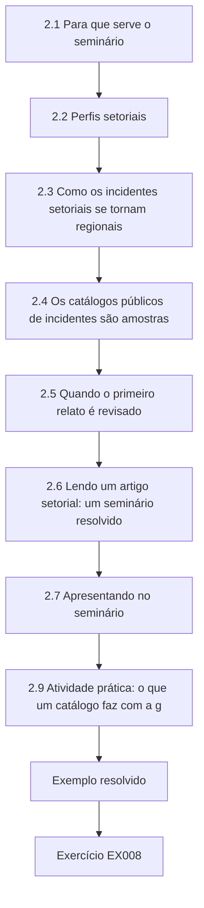

### Desenho lógico

```mermaid
flowchart LR
  N0["2.1 Para que serve o seminário"]
  N1["2.2 Perfis setoriais"]
  N2["2.3 Como os incidentes setoriais se tornam regionais"]
  N3["2.4 Os catálogos públicos de incidentes são amostras"]
  N4["2.5 Quando o primeiro relato é revisado"]
  N5["2.6 Lendo um artigo setorial: um seminário resolvido"]
  N6["2.7 Apresentando no seminário"]
  N7["2.9 Atividade prática: o que um catálogo faz com a g"]
  N0 --> N1 --> N2 --> N3 --> N4 --> N5 --> N6 --> N7 --> Q["EX008"]
```

```text
[2.1 Para que serve o seminário]
    |
    v
[2.2 Perfis setoriais]
    |
    v
[2.3 Como os incidentes setoriais se tornam regionais]
    |
    v
[2.4 Os catálogos públicos de incidentes são amostras]
    |
    v
[2.5 Quando o primeiro relato é revisado]
    |
    v
[2.6 Lendo um artigo setorial: um seminário resolvido]
    |
    v
[2.7 Apresentando no seminário]
    |
    v
[2.9 Atividade prática: o que um catálogo faz com a g]
    |
    v
[Exemplo resolvido] --> [Exercício EX008]
```
<!-- open-cyber-academy:lesson-figures:end ch-02 -->


### Objetivos de aprendizagem e conexão

Ao fim deste capítulo, o estudante será capaz de:

1. Descrever, para cada setor principal, sua unidade de consequência característica, suas reservas, seus instrumentos de governança e as evidências que um pesquisador de mestrado pode obter de forma realista.
2. Distinguir as **cascatas de dependências** (um fornecedor falha e seus dependentes falham depois de suas reservas) do **transbordamento por transferência de carga** (os pares absorvem a demanda de uma unidade que falhou), e reconhecer qual delas um estudo mede.
3. Tratar os catálogos públicos de incidentes como dados com um processo de seleção e quantificar como uma divulgação que cresce com a gravidade infla a gravidade aparente e como uma mudança nas regras de notificação cria uma tendência espúria.
4. Codificar incidentes cujo primeiro relato público foi depois revisado, sem repetir o primeiro relato nem apagá-lo.
5. Ler um artigo setorial com um protocolo crítico fixo e apresentá-lo num seminário de modo que a discussão seja sobre evidências, e não sobre opiniões.

Este capítulo amplia o mapa de evidências construído no Capítulo 1 de um setor para a área. O [capítulo de fronteira da pesquisa](../../../../doctorate-2-years/critical-sector-security/en/book/MANUSCRIPT.md#ch-02) do livro de doutorado examina as normas como hipóteses e as famílias de modelos de interdependência; este seminário não repete esse exame. Ele se concentra no que um pesquisador iniciante precisa: como os setores diferem nas consequências que produzem e nas evidências que deixam, como ler as evidências que existem e como discuti-las com os colegas.

### 2.1 Para que serve o seminário

Um seminário de pesquisa treina três hábitos de que uma dissertação precisa e que as aulas expositivas não treinam: ler um artigo pelo que ele pode sustentar, apresentar com justiça o trabalho de outra pessoa antes de criticá-lo e aceitar críticas à sua própria leitura. Cada sessão deste curso segue o mesmo protocolo, que você vai reutilizar ao escrever a revisão da literatura do Capítulo 7:

1. **Alegação.** O que o artigo alega, com que escopo? Cite a frase.
2. **Evidências.** Que dados, de quais unidades, em que período?
3. **Garantia.** Por que essas evidências sustentam essa alegação — que lógica de desenho as liga?
4. **Rivais.** O que mais poderia ter produzido as mesmas evidências? Quais rivais o artigo trata, e como?
5. **Transferência.** A quais outras unidades, setores ou jurisdições o resultado poderia se aplicar, e sob quais condições?
6. **E daí.** Que decisão ou estudo posterior ele informa?
7. **Próximo estudo.** Que estudo único mais reduziria a incerteza restante?

O apresentador responde às perguntas 1–3 e 5–6 nos termos do próprio artigo e depois abre as perguntas 4 e 7 ao grupo. A crítica a um artigo publicado não é um veredito sobre seus autores; a maioria das limitações decorre dos dados que existiam.

### 2.2 Perfis setoriais

Os setores diferem no que se perde, com que rapidez e para quem, em quem os regula e em quais evidências chegam ao registro público. Os perfis a seguir são um ponto de partida; cada instrumento é citado com sua versão e data e deve ser verificado de novo antes que você se apoie nele.

| Setor | Unidade de consequência típica | Reservas principais | Exemplos de instrumentos de governança | Evidências que um estudante de mestrado geralmente consegue obter | Caso público discutido neste livro |
|---|---|---|---|---|---|
| Saúde | Pacientes atrasados, desviados ou prejudicados; procedimentos e consultas adiados | Procedimentos de indisponibilidade, prontuários em papel, pessoal, ajuda mútua regional, capacidade de outros hospitais | As [HPH Cybersecurity Performance Goals](https://hphcyber.hhs.gov/performance-goals.html) dos EUA (voluntárias, janeiro de 2024); a saúde é um setor da [NIS2](https://eur-lex.europa.eu/eli/dir/2022/2555/oj/) na UE | Dados agregados de atividade (com aprovação), declarações públicas, auditorias, entrevistas | Dameff et al. (2023); WannaCry e o NHS; Synnovis (2024); Change Healthcare (2024) |
| Energia — eletricidade | Clientes e clientes-hora sem energia; cargas críticas perdidas | Geradores, armazenamento, operação manual, manobras | [Normas CIP da NERC](https://www.nerc.com/pa/Stand/Pages/CIPStandards.aspx) (obrigatórias para o sistema elétrico de grande porte da América do Norte); setor de energia da NIS2 | Estatísticas de interrupções, relatórios pós-ação públicos; raramente dados operacionais | Ucrânia, 2015 (ver o livro de doutorado, Capítulo 1) |
| Energia — petróleo e gás, dutos | Produto não entregue; desabastecimento | Estoques, transporte alternativo | Diretivas de segurança de dutos emitidas pela Transportation Security Administration dos EUA após o Colonial Pipeline, conforme descrito pela [CISA (2023)](https://www.cisa.gov/news-events/news/attack-colonial-pipeline-what-weve-learned-what-weve-done-over-past-two-years) | Cronologias públicas, relatórios de situação das agências de energia, dados de preço e de abastecimento | Colonial Pipeline (2021) |
| Água | Pessoas sem água segura ou sem pressão; avisos emitidos | Armazenamento, dosagem manual, interconexões | O [America's Water Infrastructure Act of 2018](https://www.epa.gov/waterresilience/americas-water-infrastructure-act-2018-risk-assessments-and-emergency-response-plans) dos EUA, que exige que os sistemas comunitários de água que atendem mais de 3.300 pessoas concluam avaliações de risco e resiliência e planos de resposta a emergências | Avisos à população, resumos dos reguladores, levantamentos com concessionárias pequenas | Oldsmar (2021) e sua revisão posterior |
| Finanças | Transações não processadas; liquidação atrasada; clientes impossibilitados de pagar | Processamento manual, sites de contingência, canais alternativos de pagamento | O [Digital Operational Resilience Act, Regulamento (UE) 2022/2554](https://eur-lex.europa.eu/eli/reg/2022/2554/oj), da UE; a [orientação do CPMI–IOSCO](https://www.bis.org/cpmi/publ/d146.htm) (junho de 2016) para as infraestruturas do mercado financeiro | Publicações de supervisão, estatísticas agregadas; dados das empresas quase nunca | A interrupção de pagamentos e de faturamento de convênios da Change Healthcare (2024), onde saúde e finanças se encontram |
| Comunicações e TI compartilhada | Usuários ou organizações sem serviço; serviços dependentes degradados | Enlaces redundantes, procedimentos de contingência | Regras setoriais de telecomunicações; as [CPGs intersetoriais da CISA](https://www.cisa.gov/cross-sector-cybersecurity-performance-goals) | Declarações dos provedores, relatórios de interrupção | A atualização defeituosa de software de segurança de julho de 2024 (não maliciosa) |
| Serviços públicos e de emergência | Chamadas não atendidas, respostas atrasadas | Centrais de despacho vizinhas, despacho manual | Regras nacionais de comunicações de emergência; a [CER](https://eur-lex.europa.eu/eli/dir/2022/2557/oj) e a NIS2 na UE | Agregados do despacho e do EMS, relatórios pós-ação | O desvio do EMS do condado relatado por Dameff et al. (2023) |

Duas características da tabela importam para o desenho da pesquisa. Primeiro, a **unidade de consequência** difere por setor, então um estudo intersetorial que compara o "impacto" sem uma unidade comum está comparando coisas incomensuráveis; escolha uma unidade funcional comum (pessoas sem um serviço por uma duração declarada) ou fique dentro de um setor. Segundo, a **disponibilidade das evidências** é inversamente relacionada à sensibilidade: os setores cujos dados operacionais responderiam às melhores perguntas são os que menos provavelmente os liberam. Um projeto de mestrado realista escolhe uma pergunta que dados agregados, públicos ou consentidos consigam responder.

### 2.3 Como os incidentes setoriais se tornam regionais

#### 2.3.1 Dois mecanismos de propagação

O livro de doutorado modela as **cascatas de dependências**: um fornecedor falha, e cada dependente falha quando sua reserva se esgota — um hospital perde a pressão da água horas depois que uma estação de tratamento perde a energia. O Spillover Study mede um mecanismo diferente, o **transbordamento por transferência de carga**: uma unidade falha ou se retira, e sua demanda passa para pares que não falharam. As ambulâncias desviadas do Kestrel chegam a Alder Point; os pacientes que não conseguem aviar uma receita numa farmácia vão a outra; os clientes de um processador de pagamentos que falhou fazem fila nos bancos. A transferência de carga é muitas vezes mais rápida do que uma cascata de dependências (ela começa assim que a unidade se retira) e é limitada pela **capacidade ociosa** dos pares, e não pelas reservas.

| Característica | Cascata de dependências | Transbordamento por transferência de carga |
|---|---|---|
| Caminho | Fornecedor → dependente | Unidade que falhou → pares |
| Temporização | Depois que a reserva do dependente se esgota | Imediatamente, na retirada |
| Fator limitante | Tamanho da reserva e tempo de restauração | Capacidade ociosa dos pares e distância |
| Medição típica | Tempo até o impacto, horas de serviço perdidas | Demanda excedente nos pares, tempos de espera, recusas |
| Exemplo em fontes públicas | A paralisação do Colonial Pipeline e seus efeitos na distribuição de combustível ([U.S. Department of Energy](https://www.energy.gov/ceser/colonial-pipeline-cyber-incident)) | Aumento de volume nos DEs adjacentes a um sistema atacado ([Dameff et al., 2023](https://doi.org/10.1001/jamanetworkopen.2023.12270)) |

Os eventos reais geralmente envolvem os dois. Durante o ataque de ransomware ao laboratório de patologia Synnovis, em junho de 2024, a dependência eram os serviços laboratoriais de que os hospitais dependiam; o [NHS England relatou](https://www.england.nhs.uk/london/2024/06/14/update-on-cyber-incident-clinical-impact-in-south-east-london-friday-14-june-2024/) que, na primeira semana (3–9 de junho), o King's College Hospital e o Guy's and St Thomas' adiaram 814 procedimentos eletivos e 861 consultas ambulatoriais hospitalares e comunitárias, e o trabalho foi redirecionado para outros prestadores — transferência de carga. Uma dissertação deve nomear qual mecanismo ela mede, porque o desenho, o desfecho e as implicações para as políticas diferem.

#### 2.3.2 Concentração e serviços compartilhados

Quando muitas organizações dependem de um único prestador de serviço, um incidente no prestador se torna simultâneo em todas elas. O [levantamento da AHA](https://www.aha.org/2024-03-15-aha-survey-change-healthcare-cyberattack-significantly-disrupts-patient-care-hospitals-finances) com quase 1.000 hospitais, em março de 2024, relatou que 94% sofreram um impacto financeiro do ataque cibernético à Change Healthcare, que interrompeu o faturamento de convênios e o processamento de pagamentos. Um exemplo não malicioso mostra o mesmo ponto estrutural: a Microsoft [estimou](https://blogs.microsoft.com/blog/2024/07/20/helping-our-customers-through-the-crowdstrike-outage/) que uma atualização defeituosa de software de segurança em julho de 2024 afetou 8,5 milhões de dispositivos Windows — menos de um por cento de todas as máquinas Windows —, mas interrompeu serviços amplamente porque as máquinas afetadas estavam concentradas em empresas que operavam serviços críticos. Para os pesquisadores, os incidentes de concentração são experimentos naturais com muitas unidades expostas simultaneamente, mas pode não haver nenhum grupo de comparação não exposto do mesmo tipo.

### 2.4 Os catálogos públicos de incidentes são amostras, e não populações

A maior parte das evidências intersetoriais vem de catálogos montados a partir de relatos públicos: notícias, notificações regulatórias de violações, declarações de empresas e alertas de agências. [Neprash et al. (2022)](https://doi.org/10.1001/jamahealthforum.2022.4873) construíram uma base desse tipo para os ataques de ransomware às organizações prestadoras de cuidados de saúde dos EUA e relataram 374 ataques de 2016 a 2021, uma contagem anual que mais do que dobrou, de 43 para 91, e interrupção operacional em 44,4% dos ataques, incluindo desvio de ambulâncias em 16 (4,3%). Os autores enquadram suas contagens como ataques que se tornaram publicamente conhecidos. Esse enquadramento importa, porque o conteúdo de um catálogo é moldado por dois processos que nada têm a ver com a incidência verdadeira:

1. **Divulgação dependente da gravidade.** Interrupções longas e visíveis têm mais probabilidade de ser relatadas do que as curtas, absorvidas internamente. A gravidade média do catálogo é, portanto, maior do que a da população.
2. **Mudanças nas regras de notificação e na atenção.** Uma nova obrigação de notificação, uma mudança na prática de publicação de um regulador ou um surto de atenção da mídia aumentam a fração de incidentes que se tornam públicos. As contagens sobem mesmo que a incidência não suba.

Nenhum dos dois processos torna os catálogos inúteis. Eles os tornam adequados para algumas perguntas (que tipos de interrupção ocorreram; que características aparecem entre os eventos relatados; como os eventos relatados mudaram após uma regra) e inadequados para outras (com que frequência os incidentes ocorrem; quão grave é um incidente típico; se a incidência está aumentando), a menos que o processo de divulgação seja modelado. O Laboratório 2 mostra o tamanho das duas distorções numa população sintética.

### 2.5 Quando o primeiro relato é revisado

Os registros públicos de incidentes de infraestrutura são revisados à medida que as investigações avançam. Dois casos documentados mostram por que um pesquisador precisa registrar **o que foi alegado, por quem, quando e como isso foi depois revisado**.

- **Oldsmar, Flórida, fevereiro de 2021.** As primeiras declarações públicas descreveram um invasor remoto elevando o ponto de ajuste do hidróxido de sódio numa estação de tratamento de água, e a CISA emitiu um alerta conjunto, o [AA21-042A, "Compromise of U.S. Water Treatment Facility"](https://www.cisa.gov/news-events/cybersecurity-advisories/aa21-042a). Em abril de 2023, o então administrador municipal disse que o FBI havia concluído que o incidente provavelmente tinha sido causado por um funcionário, e um porta-voz do FBI disse que a investigação "não conseguiu confirmar que este incidente foi iniciado por uma intrusão cibernética direcionada" ([WUSF, 13 de abril de 2023](https://www.wusf.org/local-state/2023-04-13/official-hack-oldsmar-city-water-treatment-plant-2021)). O incidente ainda aparece em muitas listas de ataques cibernéticos ao setor de água.
- **Düsseldorf, Alemanha, setembro de 2020.** Um ataque de ransomware perturbou o hospital universitário, uma paciente foi levada a um hospital mais distante e morreu, e o Ministério Público abriu uma investigação por homicídio culposo que atraiu atenção mundial como possivelmente a primeira morte causada por ransomware. Em novembro de 2020, o Ministério Público concluiu que o atraso não foi decisivo para o desfecho ([MIT Technology Review, 12 de novembro de 2020](https://www.technologyreview.com/2020/11/12/1012015/ransomware-did-not-kill-a-german-hospital-patient/)).

Nenhuma das revisões mostra que o risco subjacente é imaginário. Ambas mostram que um catálogo que codifica o primeiro relato como fato — "intrusão cibernética numa estação de água", "morte causada por ransomware" — contém erros que se propagam para toda análise que o usa. Um esquema de codificação sólido armazena, para cada incidente, a alegação, sua fonte, o tipo de fonte (oficial, empresa, mídia), a data da alegação, a situação atual (confirmada, contestada, revisada, desconhecida) e a data da última verificação. Uma fonte secundária que repete o primeiro relato não é uma confirmação independente dele.

### 2.6 Lendo um artigo setorial: um seminário resolvido

O protocolo do seminário (§2.1) aplicado a [Dameff et al. (2023)](https://doi.org/10.1001/jamanetworkopen.2023.12270), usando apenas o que o resumo e o artigo publicados declaram:

1. **Alegação.** Os hospitais adjacentes a organizações prestadoras de cuidados de saúde sob ataque de ransomware "podem ver aumentos no censo de pacientes e podem enfrentar restrições de recursos que afetam o atendimento sensível ao tempo", e esses ataques devem ser considerados um desastre regional.
2. **Evidências.** Dois DEs acadêmicos urbanos no condado de San Diego; 19.857 atendimentos no DE; três fases de quatro semanas em torno de um ataque a uma organização distinta, iniciado em 1º de maio de 2021: antes (3–30 de abril), ataque e recuperação (1–28 de maio), depois (29 de maio–25 de junho). A organização atacada respondia por cerca de um quarto das altas hospitalares da região.
3. **Garantia.** Se nada mais mudou entre as fases, as diferenças entre as fases estão associadas ao ataque.
4. **Rivais (para o grupo).** A mudança sazonal de abril para junho; a situação da COVID-19 em evolução na primavera de 2021; outros eventos regionais; muitos desfechos comparados, o que aumenta a chance de que algumas diferenças surjam por acaso. O desenho compara as fases dentro dos mesmos DEs; ele não inclui uma região de comparação não afetada, que é o principal acréscimo que um estudo de seguimento poderia fazer.
5. **Transferência.** Para regiões em que uma organização detém uma grande parcela da capacidade, de modo que sua retirada desloca uma carga substancial; menos para regiões com muitos prestadores pequenos.
6. **E daí.** O planejamento regional para desastres cibernéticos, a ajuda mútua e os protocolos de desvio do EMS — a própria conclusão do artigo — e a justificativa para medir os efeitos regionais em outros eventos.
7. **Próximo estudo.** Um desenho controlado: os mesmos desfechos em DEs comparáveis não afetados nas mesmas semanas, mais um gradiente de distância. Esse é o desenho do Spillover Study.

Observe o tom. O artigo fez a primeira medição publicada de um efeito regional; a crítica do seminário identifica o que um *próximo* estudo pode acrescentar, e não o que os autores "erraram".

### 2.7 Apresentando no seminário

Uma apresentação de dez minutos tem uma forma fixa: um slide para a pergunta e por que ela importa; um para o desenho (unidades, exposição, comparação, desfecho, período); um para o resultado principal nas palavras dos autores, com sua incerteza; um para o que o desenho descarta e o que deixa em aberto; um para o próximo estudo. Coloque os rivais no slide como perguntas, e não como acusações. Ao ser questionado, separe três tipos de resposta: "o artigo diz…", "eu infiro…" e "não sei; isso exigiria…". Os mesmos três registros vão servir na defesa oral (Capítulo 8).

### 2.8 Exemplo resolvido: uma contradição aparente (exercício do seminário)

No seminário, um participante objeta: "Ghafur et al. constataram que o WannaCry *reduziu* a atividade hospitalar, e o NHS não viu aumento nos óbitos; Dameff et al. constataram que o ransomware *aumentou* a atividade. As evidências se contradizem." O seminário resolve a questão com a matriz de conceitos:

| Dimensão | [Ghafur et al., 2019](https://doi.org/10.1038/s41746-019-0161-6) | [Dameff et al., 2023](https://doi.org/10.1001/jamanetworkopen.2023.12270) |
|---|---|---|
| Unidades medidas | Trusts infectados (e todos os trusts) | DEs não afetados adjacentes à organização atacada |
| Direção esperada | As unidades infectadas fazem menos (consultas canceladas, menos internações) | Os vizinhos absorvem a demanda deslocada |
| Sistema de saúde | NHS inglês, maio de 2017 | Condado de San Diego, maio de 2021 |
| Duração | Uma semana de perturbação aguda | Ataque e recuperação de um mês |
| Desfecho de dano | Óbitos em A&E: nenhuma variação detectável, descrita pelos autores como uma medida grosseira | Métricas do atendimento ao AVC e tempos de processo |

As constatações são complementares: a atividade de uma unidade atacada cai e a de seus vizinhos sobe. Juntas, elas sugerem o mecanismo do Spillover Study. O resultado "nenhuma variação na mortalidade" também não é evidência de ausência de dano; é a ausência de variação detectada num desfecho grosseiro ao longo de uma semana. A [investigação do NAO](https://www.nao.org.uk/reports/investigation-wannacry-cyber-attack-and-the-nhs/) acrescenta o escopo: pelo menos 81 dos 236 trusts da Inglaterra foram afetados, junto com 603 organizações de atenção primária e outras do NHS, e o NHS England registrou 6.912 consultas canceladas, ao mesmo tempo em que estimou que mais de 19.000 foram canceladas no total — um lembrete de que as contagens registradas e os totais estimados são quantidades diferentes.

### 2.9 Atividade prática: o que um catálogo faz com a gravidade e a tendência

O laboratório cria uma população sintética de 2.400 incidentes que interrompem serviços, 400 por ano durante seis anos, de modo que a incidência verdadeira é constante. As durações das interrupções são log-normais, com mediana de 6 horas. Cada incidente é divulgado com uma probabilidade que cresce com a duração (50% em 24 horas), e uma obrigação de notificação a partir do ano 4 multiplica a divulgação por 1,8.

```python
# Lab 2 - what a public incident catalogue does to severity and trend (offline, standard library only)
# Synthetic population of service-disrupting incidents over six years. Each has an outage duration (hours).
# Disclosure probability rises with duration; a reporting mandate raises disclosure from year 4.
import math, random

rng = random.Random(42)
TRUE_PER_YEAR = 400                      # constant true incidence: there is NO real trend

def p_report(hours, year):
    base = 1 / (1 + math.exp(-(math.log(hours) - math.log(24)) * 1.5))   # 50% at 24 h
    return min(1.0, base * (1.0 if year < 4 else 1.8))                   # mandate from year 4

pop = []
for year in range(1, 7):
    for _ in range(TRUE_PER_YEAR):
        hours = rng.lognormvariate(math.log(6), 1.2)                       # median 6 h
        pop.append((year, hours, rng.random() < p_report(hours, year)))

def summary(rows):
    h = sorted(r[1] for r in rows)
    n = len(h)
    med = h[n // 2] if n % 2 else (h[n // 2 - 1] + h[n // 2]) / 2
    return n, sum(h) / n, med, sum(x > 24 for x in h) / n

print("set           n     mean_h  median_h  share>24h")
for label, rows in (("population", pop), ("catalogue", [r for r in pop if r[2]])):
    n, mean, med, big = summary(rows)
    print(f"{label:12} {n:5d}  {mean:7.1f}  {med:8.1f}  {big:9.2f}")
print("year  true  catalogued")
for y in range(1, 7):
    print(f"{y:4d}  {sum(r[0] == y for r in pop):4d}  {sum(r[0] == y and r[2] for r in pop):10d}")
```

Saída esperada:

```text
set           n     mean_h  median_h  share>24h
population    2400     12.8       6.1       0.13
catalogue      646     29.2      18.4       0.40
year  true  catalogued
   1   400          99
   2   400          73
   3   400          90
   4   400         125
   5   400         133
   6   400         126
```

Leia as duas tabelas. A interrupção média do catálogo (29,2 h) é mais que o dobro da da população (12,8 h); sua mediana é três vezes maior; e a parcela de incidentes com mais de 24 horas sobe de 13% para 40%. Um estudo que descrevesse os incidentes "típicos" a partir do catálogo os exageraria muito. As contagens anuais mostram um degrau de cerca de 87 por ano para cerca de 128 por ano após a obrigação — um "aumento" de 47% numa população cuja incidência nunca mudou. Uma análise honesta de um catálogo ou se restringe às perguntas que a seleção não distorce, ou modela o processo de divulgação com pressupostos declarados, ou usa um denominador externo (por exemplo, todos os incidentes notificados sob uma obrigação de completude conhecida).

### 2.10 Erros comuns e limites

- Comparar o "impacto" entre setores sem uma unidade de consequência comum.
- Confundir as cascatas de dependências com o transbordamento por transferência de carga e, por isso, medir o desfecho errado.
- Tratar as contagens de um catálogo público como incidência, ou as médias do catálogo como a gravidade típica.
- Ler um aumento nos incidentes notificados após uma obrigação como um aumento nos ataques.
- Codificar um relato público inicial como fato e nunca revisitá-lo.
- Tratar uma fonte secundária que repete um primeiro relato como confirmação independente.
- Criticar um artigo por não fazer o que seus dados nunca poderiam sustentar, em vez de identificar o próximo estudo.
- Tratar "nenhuma variação detectada" num desfecho grosseiro como evidência de ausência de efeito.

O limite de um seminário é que ele lê apenas o que foi publicado. As evidências não publicadas — incidentes nunca divulgados, dados operacionais nunca liberados — ficam fora dele, e o seminário deve dizer isso em vez de presumir que o registro publicado é completo.

### Exercícios — capítulo 2

**EX008 — Perfil setorial.** *Objetivo:* traçar o perfil de um setor como cenário de pesquisa. *Insumos:* a tabela de §2.2. *Restrições:* escolher um setor que não seja a saúde; citar pelo menos duas fontes primárias para seus instrumentos e um caso público documentado. *Passos:* (1) definir a unidade de consequência; (2) listar as reservas; (3) nomear os instrumentos de governança, com versão e data; (4) listar as evidências que um estudante de mestrado poderia obter licitamente; (5) propor uma pergunta respondível que essas evidências possam sustentar. *Evidência esperada:* perfil de uma página. *Rubrica:* 3 = unidade de consequência precisa, instrumentos citados com exatidão, evidências realistas, pergunta ajustada às evidências; 2 = um elemento vago; 1 = sem citações; 0 = nada.

**EX009 — Distorção do catálogo.** *Objetivo:* separar o viés de tendência que uma obrigação de notificação cria do viés de gravidade que a divulgação seletiva cria num catálogo de incidentes. *Insumos:* código do Laboratório 2. *Restrições:* off-line; não mudar a semente. *Passos:* (1) executar o laboratório e registrar a saída; (2) definir o multiplicador da obrigação como 1,0 e relatar a média, a mediana, a parcela acima de 24 horas e as contagens anuais do catálogo; (3) explicar por que a distorção da gravidade persiste sem a obrigação; (4) propor uma pergunta que este catálogo *consegue* responder sem modelar a divulgação. *Evidência esperada:* saídas e dois parágrafos. *Rubrica:* 3 = saídas corretas, distorção da gravidade atribuída à divulgação dependente da gravidade, distorção da tendência atribuída à obrigação, uma pergunta respondível defensável; 2 = falta uma explicação; 1 = não executado; 0 = nada.

**EX010 — Protocolo do seminário.** *Objetivo:* aplicar o protocolo de sete perguntas. *Insumos:* [Ghafur et al. (2019)](https://doi.org/10.1038/s41746-019-0161-6). *Restrições:* usar apenas o que o artigo declara; citar sua alegação. *Passos:* responder às sete perguntas de §2.1; marcar quais rivais o artigo trata, e como. *Evidência esperada:* uma página. *Rubrica:* 3 = alegação citada, desenho descrito com acurácia (fonte de dados, comparação, desfechos), rivais específicos, próximo estudo viável; 2 = uma pergunta rala; 1 = opinião em vez de evidências; 0 = nada.

**EX011 — Classificação do mecanismo.** *Objetivo:* distinguir os mecanismos de propagação. *Insumos:* (a) a paralisação do Colonial Pipeline e seus efeitos no abastecimento de combustível (página do DOE); (b) a Synnovis e os procedimentos adiados (NHS England); (c) a Change Healthcare e o fluxo de caixa dos hospitais (AHA); (d) o desvio do Kestrel e as chegadas em Alder Point (sintético). *Restrições:* usar §2.3.1. *Passos:* classificar cada um como cascata de dependências, transbordamento por transferência de carga ou ambos; nomear a unidade de consequência; nomear o fator limitante. *Evidência esperada:* tabela. *Rubrica:* 3 = classificações justificadas, "ambos" reconhecido onde a substituição se segue à falha de uma dependência, fatores limitantes específicos; 2 = uma classificação errada; 1 = sem justificativa; 0 = nada.

**EX012 — Codificando um incidente revisado.** *Objetivo:* desenhar uma entrada de catálogo que sobreviva à revisão. *Insumos:* as fontes sobre Oldsmar em §2.5. *Restrições:* no mínimo os campos de §2.5. *Passos:* (1) escrever a entrada como ela estaria em março de 2021; (2) atualizá-la para abril de 2023; (3) declarar como uma análise que conta as "intrusões confirmadas em concessionárias de água" deve tratar a entrada; (4) declarar como você verificaria a situação da entrada antes de usá-la em 2026. *Evidência esperada:* duas entradas e um parágrafo. *Rubrica:* 3 = as duas entradas preservam a fonte, a data e a situação, regra de análise explícita, procedimento de nova verificação concreto; 2 = histórico perdido na atualização; 1 = a entrada afirma uma causa; 0 = nada.

**EX013 — Contradição aparente.** *Objetivo:* resolver constatações que parecem conflitantes. *Insumos:* as alegações "o WannaCry reduziu a atividade nos trusts infectados do NHS" e "o ransomware aumentou o volume nos DEs vizinhos em San Diego". *Restrições:* usar uma matriz de conceitos com pelo menos cinco dimensões. *Passos:* (1) construir a matriz; (2) declarar se as constatações conflitam; (3) declarar que estudo único poderia testar o mecanismo combinado. *Evidência esperada:* matriz e parágrafo. *Rubrica:* 3 = unidades e direção distinguidas, limitação da medida de dano observada, estudo combinado que mede tanto as unidades atacadas quanto as vizinhas; 2 = falta uma dimensão; 1 = afirma uma contradição; 0 = nada.

**EX014 — Apresentação no seminário.** *Objetivo:* apresentar um artigo com justiça. *Insumos:* um artigo setorial publicado, de sua escolha, com um resultado quantitativo. *Restrições:* cinco slides como em §2.7; rivais apresentados como perguntas. *Passos:* (1) preparar os slides; (2) escrever três perguntas que você espera e suas respostas nos três registros ("o artigo diz", "eu infiro", "não sei; isso exigiria"); (3) depois de apresentar aos colegas, registrar um ponto em que a sua leitura mudou. *Evidência esperada:* roteiro dos slides, folha de perguntas e reflexão. *Rubrica:* 3 = resumo justo antes da crítica, rivais precisos, registros usados corretamente, reflexão honesta; 2 = a crítica precede o resumo; 1 = baseada em opinião; 0 = nada.

### Síntese do capítulo

Os setores diferem no que perdem, com que rapidez e para quem; em quem os governa; e em quais evidências chegam à vista do público. Escolha uma unidade de consequência comum ou fique dentro de um setor. Distinga as cascatas de dependências do transbordamento por transferência de carga e meça o mecanismo que você alega. Os catálogos públicos são amostras moldadas pela divulgação dependente da gravidade e pelas mudanças nas regras de notificação: suas médias exageram a gravidade típica e suas tendências podem ser artefatos. Os relatos públicos iniciais são revisados — Oldsmar e Düsseldorf são exemplos documentados —, então codifique as alegações com fonte, data e situação, e verifique-as de novo antes de usá-las. Leia os artigos com um protocolo fixo, resuma com justiça antes de criticar e transforme a crítica no desenho do próximo estudo.

<!-- open-cyber-academy:chapter-navigation:start ch-02 -->
### Continue estudando — capítulo 02 de 08

[← Capítulo 01](#ch-01) · [Índice de capítulos do curso](../SUBJECTS.md) · [Capítulo 03 →](#ch-03)

Siga para a próxima lição escrita.
<!-- open-cyber-academy:chapter-navigation:end -->

<a id="ch-03"></a>

## Capítulo 3 — Desenho do estudo, ética e reprodutibilidade

<!-- open-cyber-academy:lesson-figures:start ch-03 -->
### Mapa da aula

Aula 03 publicada. Mapa, exemplo, EX015.

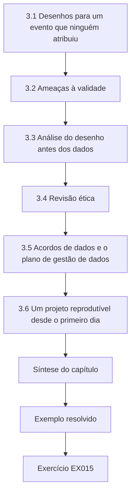

### Desenho lógico

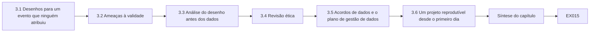

```text
[3.1 Desenhos para um evento que ninguém atribuiu]
    |
    v
[3.2 Ameaças à validade]
    |
    v
[3.3 Análise do desenho antes dos dados]
    |
    v
[3.4 Revisão ética]
    |
    v
[3.5 Acordos de dados e o plano de gestão de dados]
    |
    v
[3.6 Um projeto reprodutível desde o primeiro dia]
    |
    v
[Síntese do capítulo]
    |
    v
[Exemplo resolvido] --> [Exercício EX015]
```
<!-- open-cyber-academy:lesson-figures:end ch-03 -->


### Objetivos de aprendizagem e conexão

Ao fim deste capítulo, o estudante será capaz de:

1. Comparar os desenhos disponíveis para uma pergunta causal sobre um evento de infraestrutura não planejado — antes e depois, série temporal interrompida, série temporal interrompida controlada, diferença em diferenças, controle sintético, estudo de caso e métodos mistos — e escolher um pelos pressupostos de que precisa e pelos dados que exige.
2. Nomear as principais ameaças à validade interna, de construto, de conclusão estatística e externa, e associar cada uma a uma característica do desenho que a reduza.
3. Executar uma **análise do desenho** antes do acesso aos dados: estimar quão grande precisa ser um efeito para que o desenho planejado o detecte e quão enviesado seria um desenho mais simples.
4. Preparar uma submissão ao comitê de ética para um estudo que combina dados operacionais agregados e entrevistas, incluindo os riscos para os funcionários, as organizações e o público, e as salvaguardas de sensibilidade da informação.
5. Especificar acordos de dados e um plano de gestão de dados proporcionais à sensibilidade dos dados.
6. Montar um projeto reprodutível — estrutura, ambiente, sementes, livro de códigos, controle de versões e um plano de pré-análise registrado — antes que cheguem os primeiros dados.

O capítulo transforma o estimando do Capítulo 1 num desenho. O Capítulo 4 examina as explicações rivais que o desenho precisa derrotar; o Capítulo 5 testa a viabilidade; o Capítulo 6 executa a análise especificada aqui.

### 3.1 Desenhos para um evento que ninguém atribuiu

#### 3.1.1 O problema central

Um ataque de ransomware não é um experimento: ninguém o atribuiu aleatoriamente ao Kestrel nem escolheu o seu momento para ajudar os pesquisadores. Todo desenho para o Spillover Study é, portanto, uma forma de **aproximar o contrafactual** — como teriam sido as chegadas em Alder Point sem o desvio — a partir dos dados que existem. Os desenhos diferem em onde encontram essa aproximação e nos pressupostos que a tornam válida.

| Desenho | O contrafactual vem de | Pressuposto-chave | Dados necessários | Principal fraqueza |
|---|---|---|---|---|
| Antes e depois | O nível das mesmas unidades antes do evento | Nada mais mudou entre os períodos | Algumas semanas antes e durante | Confundido pela estação do ano, pelas tendências e por eventos simultâneos |
| Série temporal interrompida (ITS) | A tendência pré-evento das mesmas unidades, projetada para a frente | A tendência pré-evento teria continuado; nenhum choque simultâneo | Muitos pontos no tempo antes e depois ([Wagner et al., 2002](https://doi.org/10.1046/j.1365-2710.2002.00430.x); [Lopez Bernal et al., 2017](https://doi.org/10.1093/ije/dyw098)) | Um choque simultâneo (uma epidemia, uma mudança de política) é atribuído ao evento |
| ITS controlada / diferença em diferenças | A tendência pré-evento mais a variação simultânea nas unidades de comparação não expostas | As unidades tratadas e de comparação teriam variado da mesma forma ("tendências paralelas") | Séries temporais das unidades tratadas e de comparação | Falha se a região de comparação sofrer um choque diferente ([Roth et al., 2023](https://doi.org/10.1016/j.jeconom.2023.03.008)) |
| Controle sintético | Uma combinação ponderada de muitas unidades não expostas que reproduz a trajetória pré-evento da unidade tratada | A combinação ponderada teria acompanhado a unidade sem o evento | Muitas unidades doadoras potenciais e um período prévio longo ([Abadie, 2021](https://doi.org/10.1257/jel.20191450)) | Poucos doadores numa região; ajuste ruim no período prévio |
| Estudo de caso / rastreamento de processos | Relatos do que aconteceu e por quê | Relatos convergentes e independentes | Documentos, entrevistas, registros | Não consegue quantificar um tamanho de efeito por si só |
| Métodos mistos | Estimativa quantitativa mais evidências de processo | Cada vertente válida em seus próprios termos; integração explícita | Ambos os anteriores ([Fetters et al., 2013](https://doi.org/10.1111/1475-6773.12117)) | O dobro do trabalho; a integração muitas vezes fica implícita |

Se o estudo agregar vários eventos em momentos diferentes — por exemplo, ataques a diferentes sistemas hospitalares em anos diferentes —, a diferença em diferenças padrão com efeitos fixos bidirecionais pode dar pesos enganosos a algumas comparações; [Goodman-Bacon (2021)](https://doi.org/10.1016/j.jeconom.2021.03.014) decompõe o estimador e Roth et al. (2023) examinam as alternativas. Um estudo de mestrado de um único evento evita esse problema, mas abre mão da generalidade.

#### 3.1.2 A escolha do Spillover Study

O estudo usa uma **série temporal interrompida controlada** para a RQ1 e a RQ2: chegadas diárias de ambulâncias em cada DE vizinho durante 180 dias antes e 90 dias depois do dia 0, em relação aos DEs de Wexmoor agregados, com uma tendência linear, um degrau para a janela de 21 dias do desvio e um degrau para o período seguinte. Ele acrescenta **entrevistas** para a RQ3. As razões, registradas na proposta: a região de comparação remove a variação sazonal compartilhada (uma ITS não controlada não consegue); dois DEs de Wexmoor são doadores de menos para um controle sintético; os dados diários dão pontos no tempo suficientes para a tendência; e os planejadores precisam do *mecanismo* (RQ3) tanto quanto do número.

Uma revisão metodológica dos estudos de ITS que avaliaram intervenções em sistemas de saúde constatou que 81% não usaram nenhuma série de controle, apenas 55% consideraram a autocorrelação, 20,8% a sazonalidade e 8,3% a não estacionariedade, e apenas 49,2% especificaram a forma esperada do impacto ([Hategeka et al., 2020](https://doi.org/10.1136/bmjgh-2020-003567)). Essas são as falhas comuns que o desenho deste capítulo foi construído para evitar.

### 3.2 Ameaças à validade

O vocabulário a seguir é padrão nos métodos quase experimentais. Associe cada ameaça à característica do desenho que a trata — e admita as ameaças que nenhuma característica trata.

| Validade | Ameaça | No Spillover Study | Resposta do desenho |
|---|---|---|---|
| Interna | **História**: outro evento coincide com a exposição | Uma temporada de doenças respiratórias começa perto do dia 0 | Região de comparação com a mesma estação; testes placebo (Capítulo 4) |
| Interna | **Maturação / tendência** | O crescimento populacional aumenta as chegadas lentamente | Tendência linear ao longo de 180 dias pré-evento |
| Interna | **Instrumentação**: a medição muda | Alder Point muda seu sistema de registro de chegadas | Perguntar aos parceiros sobre mudanças de sistema; verificar descontinuidades (Capítulo 5) |
| Interna | **Regressão à média** | O evento "começou" num dia já escolhido porque parecia incomum | Dia 0 definido pelo registro de desvios do EMS, e não pelos dados de desfecho ([Barnett et al., 2005](https://doi.org/10.1093/ije/dyh299)) |
| Interna | **Seleção** | A região de comparação difere sistematicamente | Verificar se as trajetórias pré-evento são semelhantes; relatar as diferenças |
| De construto | O desfecho não mede o construto | "Chegadas de ambulâncias" conta transportes, e não a necessidade dos pacientes | Declarar o construto com exatidão; triangular com as entrevistas |
| De conclusão estatística | Baixo poder; autocorrelação; muitos desfechos | Um evento, contagens diárias, dois desfechos | Análise do desenho (§3.3); intervalos robustos (Capítulo 6); um único desfecho primário |
| Externa | Transferência para outras regiões | Uma região com um sistema dominante | Delimitar a alegação; descrever a estrutura da região para que outros possam julgar a transferência |

### 3.3 Análise do desenho antes dos dados

#### 3.3.1 Por que calcular antes de coletar

Para um experimento planejado, um cálculo de tamanho de amostra fixa quantos participantes recrutar. Um estudo observacional de um único evento não pode recrutar mais eventos, mas pode e deve perguntar, antes do acesso aos dados: **quão grande precisa ser um efeito para que este desenho o detecte, e quão errado estaria um desenho mais simples?** [Lakens (2022)](https://doi.org/10.1525/collabra.33267) lista seis formas de justificar um tamanho de amostra, entre elas medir (quase) toda a população, aceitar restrições de recursos e planejar para uma acurácia desejada; seja qual for a usada, o pesquisador deve declarar sobre quais efeitos os dados podem e não podem informar. Para o Spillover Study, a amostra é fixada pelo evento: um desvio de 21 dias e tantos dias pré-evento quantos os parceiros puderem fornecer.

#### 3.3.2 O menor efeito de interesse

Uma análise do desenho precisa de um efeito de referência. A coalizão de Tamsin Valley (sintética) aciona a ajuda mútua quando um DE espera quatro ou mais chegadas de ambulâncias adicionais por dia — cerca de 10% sobre a linha de base de 40 de Alder Point. Isso dá ao estudo um **menor efeito de interesse** ancorado numa decisão real: 10%. Escreva de onde veio o número; um tamanho de efeito inventado para fazer um estudo parecer ter poder adequado é uma fraqueza comum e facilmente detectada.

#### 3.3.3 Simulando o desenho

O laboratório abaixo simula o estudo planejado muitas vezes sob verdades conhecidas, usando chegadas diárias sintéticas com variação por dia da semana e variação adicional de um dia para o outro. Ele compara um desenho **não controlado** (a variação do DE tratado em relação à sua própria linha de base) com um desenho **controlado** (a mesma variação menos a variação num DE de comparação não afetado), para linhas de base de 28, 90 e 180 dias, com e sem um aumento sazonal compartilhado que começa perto do dia 0. Ele relata o efeito médio estimado (viés) e a parcela dos estudos simulados em que o intervalo de 95% exclui o zero ("sinalizados").

```python
# Lab 3 - design check before data access: bias and detection of two designs (offline, standard library only)
# Synthetic daily ambulance arrivals at a neighbouring hospital (treated) and an unaffected comparison hospital.
# Days -pre..-1 are baseline; days 0..20 are the 21-day diversion window at the attacked hospital.
import math, random

DOW = [1.08, 1.02, 1.00, 0.98, 1.00, 0.96, 0.96]

def poisson(rng, lam):                        # Knuth's method; adequate for lam < ~500
    L, k, p = math.exp(-lam), 0, 1.0
    while True:
        p *= rng.random()
        if p <= L:
            return k
        k += 1

def season(t, ramp):                          # respiratory season starting around day 0, shared by both
    return 1 + (0.18 / (1 + math.exp(-(t - 10) / 6)) if ramp else 0.0)

def day(rng, base, t, effect, ramp):
    lam = base * DOW[t % 7] * season(t, ramp) * (1 + effect) * rng.gammavariate(60, 1 / 60)
    return poisson(rng, lam)

def mean_var(x):
    m = sum(x) / len(x)
    return m, sum((v - m) ** 2 for v in x) / (len(x) - 1)

def log_ratio(pre, ev):                       # log(mean_event / mean_pre) and its approximate SE
    mp, vp = mean_var(pre)
    me, ve = mean_var(ev)
    return math.log(me / mp), math.sqrt(ve / (len(ev) * me ** 2) + vp / (len(pre) * mp ** 2))

def one_study(rng, pre_len, effect, ramp):
    days = range(-pre_len, 21)
    tr = {t: day(rng, 40, t, effect if t >= 0 else 0.0, ramp) for t in days}
    co = {t: day(rng, 35, t, 0.0, ramp) for t in days}
    pre, ev = [t for t in days if t < 0], [t for t in days if t >= 0]
    u, su = log_ratio([tr[t] for t in pre], [tr[t] for t in ev])           # uncontrolled pre/post
    c1, s1 = log_ratio([co[t] for t in pre], [co[t] for t in ev])
    return (u, su), (u - c1, math.sqrt(su ** 2 + s1 ** 2))                  # controlled (DiD on logs)

def run(pre_len, effect, ramp, sims=400, seed=11):
    rng = random.Random(seed)
    res = {"uncontrolled": [], "controlled": []}
    for _ in range(sims):
        a, b = one_study(rng, pre_len, effect, ramp)
        res["uncontrolled"].append(a)
        res["controlled"].append(b)
    out = {}
    for k, v in res.items():
        est = [math.exp(e) - 1 for e, _ in v]
        hits = sum(abs(e) / s > 1.96 for e, s in v) / sims
        out[k] = (sum(est) / sims, hits)
    return out

if __name__ == "__main__":
    print("season  true  pre_days  design        mean_est  share_flagged")
    for ramp in (False, True):
        for effect in (0.0, 0.10):
            for pre_len in (28, 90, 180):
                r = run(pre_len, effect, ramp)
                for k in ("uncontrolled", "controlled"):
                    m, h = r[k]
                    print(f"{'ramp' if ramp else 'flat':6}  {effect:4.2f}  {pre_len:8d}  {k:12}  {m:+8.3f}  {h:13.2f}")
```

Saída esperada (cerca de três segundos):

```text
season  true  pre_days  design        mean_est  share_flagged
flat    0.00        28  uncontrolled    +0.004           0.06
flat    0.00        28  controlled      +0.010           0.04
flat    0.00        90  uncontrolled    +0.001           0.04
flat    0.00        90  controlled      +0.004           0.02
flat    0.00       180  uncontrolled    +0.004           0.05
flat    0.00       180  controlled      +0.000           0.04
flat    0.10        28  uncontrolled    +0.102           0.39
flat    0.10        28  controlled      +0.115           0.24
flat    0.10        90  uncontrolled    +0.105           0.52
flat    0.10        90  controlled      +0.110           0.33
flat    0.10       180  uncontrolled    +0.101           0.52
flat    0.10       180  controlled      +0.109           0.29
ramp    0.00        28  uncontrolled    +0.084           0.27
ramp    0.00        28  controlled      +0.003           0.07
ramp    0.00        90  uncontrolled    +0.088           0.40
ramp    0.00        90  controlled      +0.002           0.06
ramp    0.00       180  uncontrolled    +0.096           0.52
ramp    0.00       180  controlled      +0.006           0.07
ramp    0.10        28  uncontrolled    +0.191           0.84
ramp    0.10        28  controlled      +0.105           0.23
ramp    0.10        90  uncontrolled    +0.198           0.94
ramp    0.10        90  controlled      +0.106           0.28
ramp    0.10       180  uncontrolled    +0.202           0.97
ramp    0.10       180  controlled      +0.106           0.31
```

Quatro conclusões se seguem, e a proposta precisa declará-las antes que qualquer dado seja visto:

1. **Sem uma mudança sazonal, os dois desenhos são não enviesados**, e o desenho não controlado sinaliza um efeito verdadeiro de 10% com mais frequência (cerca de 52% contra cerca de 30% com 90 ou 180 dias de linha de base) porque subtrair uma série de comparação acrescenta o ruído dela.
2. **Com um aumento sazonal compartilhado, o desenho não controlado fica muito enviesado.** Quando o efeito verdadeiro é zero, ele estima cerca de +8% a +10% e sinaliza um efeito inexistente em 27% a 52% dos estudos — *com mais frequência com linhas de base mais longas*, porque a linha de base então recua mais para dentro da estação baixa. Mais dados não corrigiram um problema de desenho; tornaram a conclusão falsa mais confiante.
3. **O desenho controlado remove o viés sazonal** (estimativas médias perto de zero; sinalizado em 6–7% dos estudos nulos, perto dos 5% nominais, dados os erros-padrão aproximados), mas detecta um efeito verdadeiro de 10% em apenas 23–31% dos estudos.
4. Portanto, **um único DE vizinho não consegue detectar de forma confiável o menor efeito de interesse**. O estudo deve ser enquadrado como *estimação com intervalos*, e não como um teste que "mostra" o transbordamento; ele deve relatar o intervalo e os efeitos que descarta; e o gradiente de distância da RQ2 deve ser lido nos três vizinhos, e não a partir de um único teste. (As estimativas controladas têm média de cerca de 0,105–0,115 quando a verdade é 0,10 porque a média das razões logarítmicas exponenciadas é ligeiramente maior do que a média exponenciada — um viés pequeno e conhecido.)

### 3.4 Revisão ética

#### 3.4.1 O que precisa de revisão

Entrevistas com gestores de DEs, supervisores do EMS e equipe da coalizão são pesquisa com seres humanos em quase todas as jurisdições e precisam de aprovação do comitê de ética em pesquisa ou do institutional review board da instituição antes do recrutamento. Nos Estados Unidos, a [Common Rule (45 CFR Part 46)](https://www.ecfr.gov/current/title-45/subtitle-A/subchapter-A/part-46) define a pesquisa com seres humanos e as categorias que podem ser dispensadas; é a instituição, e não o estudante, que decide se um estudo se enquadra. As contagens diárias agregadas por DE geralmente não contêm informações sobre indivíduos, mas a instituição pode ainda assim exigir revisão, e um custodiante dos dados pode exigir sua própria aprovação. Na UE, os dados de saúde são uma categoria especial segundo o [artigo 9º do GDPR](https://eur-lex.europa.eu/eli/reg/2016/679/oj), e o tratamento para pesquisa científica se apoia nas salvaguardas do artigo 89. No Brasil, o dado referente à saúde é dado pessoal sensível (art. 5º, II, da [LGPD](https://www.planalto.gov.br/ccivil_03/_ato2015-2018/2018/lei/l13709.htm)), e seu tratamento para a realização de estudos por órgão de pesquisa é admitido pelo art. 11, II, "c", garantida, sempre que possível, a anonimização. Se algum dia fossem necessários registros individuais, os dados de saúde dos EUA trariam os padrões de desidentificação da HIPAA Privacy Rule e, para um conjunto limitado de dados, um acordo de uso de dados ([orientação do HHS](https://www.hhs.gov/hipaa/for-professionals/special-topics/de-identification/index.html)). O Spillover Study evita totalmente os registros individuais — a minimização de dados é a salvaguarda ética mais forte disponível.

#### 3.4.2 Riscos próprios dos estudos de infraestrutura

Os princípios do [Menlo Report](https://www.dhs.gov/sites/default/files/publications/CSD-MenloPrinciplesCORE-20120803_1.pdf) — respeito às pessoas, beneficência, justiça e respeito à lei e ao interesse público — estruturam a análise de riscos. Neste estudo, os principais riscos são:

- **Para os entrevistados:** serem culpados por decisões tomadas durante o incidente; revelação da identidade pela combinação de função e organização (há um único supervisor de operações do EMS em Tamsin Valley); consequências profissionais por criticar um empregador ou um hospital vizinho.
- **Para as organizações:** dano à reputação ("Alder Point não deu conta"); exposição regulatória; revelação de fraquezas de segurança no Kestrel.
- **Para o público:** uma constatação publicada como "os DEs desta região perdem um quarto de sua capacidade ociosa quando um sistema desvia" poderia, combinada com outras informações, ajudar um adversário a escolher um alvo que maximize o dano regional. O [teste de sensibilidade da informação](../../../../doctorate-2-years/critical-sector-security/en/book/MANUSCRIPT.md#ch-01) do livro de doutorado se aplica: um artefato identifica um ativo específico, sua vulnerabilidade ou sua dependência de uma forma que ajudaria alguém a danificá-lo?
- **Para o pesquisador:** pressão dos parceiros para suavizar os resultados; acesso a informações para cujo manuseio o pesquisador não foi treinado.

#### 3.4.3 Salvaguardas

| Risco | Salvaguarda |
|---|---|
| Identificação dos entrevistados | Categorias de função amplas o bastante para conter várias pessoas; citações verificadas quanto a detalhes identificadores; nomes das organizações substituídos em todos os produtos |
| Culpa | Perguntas sobre sistemas e restrições, e não sobre decisões individuais; o termo de consentimento declara que os dados não serão compartilhados com os empregadores |
| Desistência | Os participantes podem desistir até uma data declarada, antes da finalização da análise; seus dados são então apagados |
| Dano organizacional | Os parceiros revisam as minutas quanto a erros factuais e informações protegidas dentro de um prazo fixo, sem veto sobre as constatações |
| Risco de definição de alvos pelo público | Nenhum número de capacidade por instalação publicado; apenas síntese regional; constatações sobre fraquezas específicas encaminhadas em privado à organização em questão |
| Células pequenas | Suprimir ou agregar as contagens abaixo do tamanho mínimo de célula do custodiante |
| Contato com sistemas | Nenhum: o estudo nunca toca, varre ou testa nenhum sistema hospitalar, do EMS ou do despacho; usa apenas os dados fornecidos pelos custodiantes e as entrevistas |

#### 3.4.4 A submissão

Uma submissão típica contém: a pergunta e seu benefício; o desenho e as fontes de dados; o recrutamento, o consentimento e a desistência; os riscos e as salvaguardas; o manuseio, o armazenamento, a retenção e a destruição dos dados; a divulgação; os conflitos de interesse; e a formação do pesquisador. Anexe o roteiro de entrevista, a folha de informações, o termo de consentimento e os acordos de dados. Escreva para um membro do comitê que não é especialista em segurança: explique em linguagem simples por que uma constatação sobre a capacidade regional é sensível.

### 3.5 Acordos de dados e o plano de gestão de dados

Antes que qualquer dado se mova, coloque por escrito: quais dados, em que nível de agregação, para qual período; a limitação da finalidade; o local de armazenamento e o acesso; a retenção e a destruição; a revisão antes da publicação (apenas revisão factual e de informações protegidas, dentro de um número fixo de dias, sem veto); o reconhecimento e a autoria; e a notificação de violações. Um **plano de gestão de dados** registra então, para cada ativo de dados, sua fonte, seu nível de sensibilidade, seu formato, seu local, quem pode acessá-lo, a retenção e o que pode ser compartilhado no fim. Use os níveis de sensibilidade de forma consistente em todo o projeto:

| Nível | Conteúdo no Spillover Study | Manuseio |
|---|---|---|
| Público | Código, dados de teste sintéticos, livro de códigos, resultados regionais agregados | Repositório |
| Restrito | Contagens diárias por DE fornecidas pelos custodiantes | Armazenamento institucional criptografado; acesso nominal; destruídas após o período de retenção |
| Confidencial | Gravações das entrevistas, transcrições antes da desidentificação, termos de consentimento | Criptografados, separados dos dados; gravações destruídas após a transcrição, se o consentimento assim declarar |

### 3.6 Um projeto reprodutível desde o primeiro dia

A reprodutibilidade é mais fácil de construir do que de adaptar depois. [Sandve et al. (2013)](https://doi.org/10.1371/journal.pcbi.1003285) dão dez regras, entre elas: registrar como cada resultado foi produzido; evitar a manipulação manual dos dados; arquivar as versões exatas dos programas externos; colocar os scripts próprios sob controle de versões; registrar os resultados intermediários; e anotar as sementes dos processos aleatórios. O manual comunitário [The Turing Way](https://book.the-turing-way.org/) desdobra essas regras em prática. Os [princípios FAIR](https://doi.org/10.1038/sdata.2016.18) — localizáveis, acessíveis, interoperáveis, reutilizáveis — se aplicam ao que pode ser compartilhado; para dados restritos, metadados FAIR podem descrever um conjunto de dados que não pode ser liberado.

Uma estrutura mínima:

```text
spillover-study/
  README.md            question, how to run everything, environment, contacts
  data/raw/            read-only copies as received (restricted; never in version control)
  data/derived/        produced only by scripts
  code/01_audit.py     numbered in execution order
  code/02_build.py
  code/03_analysis.py
  output/              tables and figures, regenerated by scripts
  docs/codebook.md     every variable: source, definition, unit, missing-value code
  docs/deviations.md   every change to the plan, dated, with reason and whether results had been seen
  docs/environment.txt Python version and package versions
```

Um **plano de pré-análise** fixa, antes que os dados de desfecho sejam examinados: os estimandos, os desfechos primário e secundários, as unidades de comparação, as janelas, o modelo, o método dos intervalos, as verificações de robustez e como os desvios serão relatados. Registrá-lo com carimbo de tempo — por exemplo, nos [OSF Registries](https://osf.io/registries) — torna o plano verificável; [Nosek et al. (2018)](https://doi.org/10.1073/pnas.1708274114) descrevem por que o pré-registro distingue a previsão da pós-dição. Num estudo observacional, os dados podem já existir, então declare com honestidade o que tinha sido visto quando o plano foi registrado (por exemplo, "os dados pré-evento de um DE foram examinados durante o piloto apenas quanto à completude").

### 3.7 Exemplo resolvido: as perguntas do comitê de ética (sintético)

O comitê devolveu a primeira submissão do candidato com cinco perguntas. As respostas do candidato:

| Pergunta do comitê | Resposta |
|---|---|
| "Por que as entrevistas são necessárias? Os dados sozinhos não poderiam responder à pergunta?" | Os dados estimam *quanto* da carga se deslocou (RQ1–2), mas não *como* (RQ3). Os planejadores precisam do mecanismo para mudar os protocolos. Dez entrevistas de 45 minutos cada. |
| "Os participantes poderiam ser identificados?" | Sim, pela função e pela organização. As funções serão relatadas como "liderança do DE", "operações do EMS" ou "coalizão", cada uma contendo pelo menos três participantes; os nomes das organizações serão removidos; as citações serão revisadas. |
| "E se um participante descrever um erro que prejudicou um paciente?" | O roteiro evita casos clínicos individuais. Se algum for relatado espontaneamente, não será registrado de forma identificável; a folha de informações explica os limites da confidencialidade exigidos por lei. |
| "Os resultados poderiam ajudar um atacante?" | Estimativas de capacidade por instalação não serão publicadas; a dissertação relata padrões regionais e o gradiente de distância. Fraquezas específicas serão relatadas em privado à organização em questão. |
| "Quem pode interromper o estudo?" | O orientador, o comitê e qualquer parceiro, quanto aos seus próprios dados; os participantes, quanto às suas próprias entrevistas, até a data de desistência declarada. |

A submissão foi aprovada com uma condição: o termo de consentimento tinha de declarar que o pesquisador não é empregado de nenhuma organização participante e não compartilhará com elas dados identificáveis.

### 3.8 Erros comuns e limites

- Escolher um desenho antes e depois porque os dados são fáceis e depois alegar um efeito causal.
- Usar uma ITS não controlada quando um choque compartilhado (estação do ano, epidemia, política) é plausível.
- Presumir tendências paralelas sem inspecionar as trajetórias pré-evento.
- Executar um cálculo de poder com um tamanho de efeito escolhido para fazer o estudo parecer adequado, em vez de um menor efeito de interesse ligado a uma decisão.
- Acreditar que mais dados de linha de base sempre reduzem o viés; com uma tendência ou uma mudança sazonal, eles podem aumentá-lo.
- Enviar uma submissão ao comitê de ética que trate os dados agregados de infraestrutura como isentos de risco.
- Concordar com uma revisão pelos parceiros sem prazo e sem uma cláusula de "nenhum veto sobre as constatações".
- Montar a reprodutibilidade no fim; edições manuais nos arquivos de dados que nenhum script registra.
- Registrar um plano de pré-análise sem declarar quais dados já tinham sido vistos.

O limite do desenho é que ele só consegue reduzir, e não eliminar, a dependência de pressupostos não testáveis. Uma ITS controlada só é crível se a região de comparação não tiver sofrido um choque diferente ao mesmo tempo; o Capítulo 4 testa esse pressuposto até onde os dados permitem.

### Exercícios — capítulo 3

**EX015 — Escolha e defenda um desenho.** *Objetivo:* selecionar um desenho pelos pressupostos e pelos dados. *Insumos:* os desenhos de §3.1.1; um cenário em que um processador regional de pagamentos sofreu uma interrupção de três dias e você tem as contagens semanais de transações com cartão de 40 categorias de comércio na região afetada e em três regiões não afetadas, ao longo de dois anos. *Restrições:* um desenho primário e um desenho de robustez. *Passos:* (1) declarar o estimando; (2) comparar pelo menos três desenhos quanto ao pressuposto, aos dados e à fraqueza; (3) escolher; (4) dizer o que faria você abandonar a escolha. *Evidência esperada:* uma página. *Rubrica:* 3 = consequência da resolução semanal para um evento de três dias reconhecida, pressupostos de tendências paralelas ou do conjunto de doadores declarados e verificáveis, condição de abandono concreta; 2 = um desenho mal descrito; 1 = sem pressupostos; 0 = nada.

**EX016 — Análise do desenho.** *Objetivo:* encontrar o menor efeito de transbordamento que um desenho antes e depois controlado consegue detectar de forma confiável e reenquadrar a RQ1 para se ajustar a esse poder. *Insumos:* código do Laboratório 3. *Restrições:* off-line; manter a semente 11 e as 400 simulações. *Passos:* (1) executar o laboratório e registrar a saída; (2) acrescentar um efeito verdadeiro de 0,20 e relatar a parcela sinalizada do desenho controlado para 28, 90 e 180 dias de linha de base sob o aumento sazonal; (3) declarar o menor efeito que o desenho controlado detecta em pelo menos cerca de três quartos dos estudos com 180 dias; (4) reescrever a RQ1 como uma pergunta de estimação que este desenho consiga responder com honestidade. *Evidência esperada:* saídas, uma frase sobre os efeitos detectáveis, RQ1 revisada. *Rubrica:* 3 = valores corretos, efeito detectável declarado como cerca de 20%, e não 10%, RQ1 reenquadrada para a estimação; 2 = um valor errado; 1 = não executado; 0 = nada.

**EX017 — Riscos na submissão ao comitê de ética.** *Objetivo:* identificar e mitigar riscos. *Insumos:* um estudo que entrevista operadores de concessionárias de água sobre uma interrupção do sistema de desinfecção numa concessionária pequena. *Restrições:* usar os quatro princípios do Menlo; pelo menos cinco partes interessadas. *Passos:* (1) listar as partes interessadas e os riscos; (2) propor salvaguardas; (3) identificar o risco de sensibilidade da informação específico de uma concessionária pequena; (4) redigir as duas frases da folha de informações sobre os limites da confidencialidade. *Evidência esperada:* tabela e texto redigido. *Rubrica:* 3 = risco de identificação numa população pequena reconhecido, risco de definição de alvos pelo público tratado, salvaguardas concretas, texto da folha de informações honesto quanto aos limites; 2 = um princípio ralo; 1 = genérico; 0 = nada.

**EX018 — Plano de gestão de dados.** *Objetivo:* classificar e manusear os dados por nível. *Insumos:* os ativos do Spillover Study: contagens diárias dos custodiantes; contagens de Wexmoor de um painel público; gravações das entrevistas; transcrições; livro de códigos; código de análise; termos de consentimento; os limiares de ajuda mútua da coalizão. *Restrições:* os três níveis de §3.5. *Passos:* atribuir a cada um nível, armazenamento, acesso, retenção e compartilhamento no fim do projeto. *Evidência esperada:* tabela. *Rubrica:* 3 = níveis consistentes com a sensibilidade (gravações e termos de consentimento confidenciais, contagens dos custodiantes restritas, código e livro de códigos públicos), dados do painel público tratados segundo seus termos, limiares de ajuda mútua tratados como sensíveis; 2 = um mal atribuído; 1 = tudo público ou tudo confidencial; 0 = nada.

**EX019 — Plano de pré-análise.** *Objetivo:* fixar a análise antes que os desfechos sejam vistos. *Insumos:* §3.1.2 e os estimandos do Capítulo 1. *Restrições:* no máximo duas páginas. *Passos:* especificar os estimandos, os desfechos (primário e secundários), a comparação, as janelas, o modelo, o método dos intervalos, as verificações de robustez, o tratamento da multiplicidade e a regra dos desvios; declarar quais dados tinham sido vistos no registro. *Evidência esperada:* plano. *Rubrica:* 3 = cada elemento específico o bastante para que outro analista produza a mesma estimativa, regra dos desvios explícita, acesso prévio aos dados declarado; 2 = um elemento vago; 1 = modelo não especificado; 0 = nada.

**EX020 — Auditoria da reprodutibilidade.** *Objetivo:* testar se um projeto pode ser reexecutado. *Insumos:* uma pasta com os laboratórios dos Capítulos 1 e 3 e suas saídas. *Restrições:* uma segunda pessoa o reexecuta apenas a partir do README. *Passos:* (1) escrever o README; (2) registrar o ambiente; (3) pedir a outra pessoa que o reexecute; (4) listar cada ponto em que ela precisou perguntar algo a você e corrigi-lo. *Evidência esperada:* README, arquivo de ambiente e uma lista de problemas com as correções. *Rubrica:* 3 = a reexecução teve sucesso com saídas idênticas e cada pergunta foi respondida no README; 2 = resta um passo manual; 1 = saídas diferentes sem explicação; 0 = nada.

### Síntese do capítulo

Um evento de infraestrutura não planejado não oferece aleatorização, então todo desenho é uma aproximação de um contrafactual, e sua credibilidade se apoia em pressupostos que você precisa declarar. Uma série temporal interrompida controlada remove os choques sazonais compartilhados que um antes e depois ou uma ITS não controlada atribuiriam ao evento; as entrevistas fornecem o mecanismo. Associe cada ameaça à validade a uma característica do desenho, ou admita-a. Simule o desenho antes do acesso aos dados: o Laboratório 3 mostra que um aumento sazonal compartilhado torna um desenho não controlado confiantemente errado — e mais ainda com linhas de base mais longas —, enquanto o desenho controlado é quase não enviesado, mas impreciso demais para detectar um efeito de 10% num único DE. Enquadre o estudo como estimação. A revisão ética precisa cobrir os entrevistados, as organizações e o público, porque as constatações sobre a capacidade regional podem ser sensíveis. Os acordos, os níveis e um projeto reprodutível com um plano de pré-análise registrado vêm antes do primeiro arquivo de dados.

<!-- open-cyber-academy:chapter-navigation:start ch-03 -->
### Continue estudando — capítulo 03 de 08

[← Capítulo 02](#ch-02) · [Índice de capítulos do curso](../SUBJECTS.md) · [Capítulo 04 →](#ch-04)

Siga para a próxima lição escrita.
<!-- open-cyber-academy:chapter-navigation:end -->

<a id="ch-04"></a>

## Capítulo 4 — Infraestrutura crítica e segurança setorial: explicações concorrentes

<!-- open-cyber-academy:lesson-figures:start ch-04 -->
### Mapa da aula

Aula 04 publicada. Mapa, exemplo, EX021.

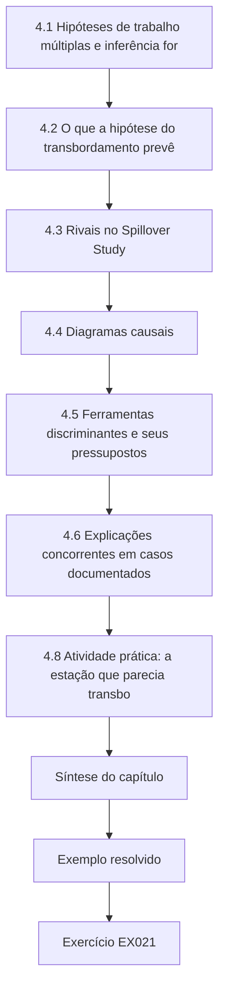

### Desenho lógico

```mermaid
flowchart LR
  N0["4.1 Hipóteses de trabalho múltiplas e inferência for"]
  N1["4.2 O que a hipótese do transbordamento prevê"]
  N2["4.3 Rivais no Spillover Study"]
  N3["4.4 Diagramas causais"]
  N4["4.5 Ferramentas discriminantes e seus pressupostos"]
  N5["4.6 Explicações concorrentes em casos documentados"]
  N6["4.8 Atividade prática: a estação que parecia transbo"]
  N7["Síntese do capítulo"]
  N0 --> N1 --> N2 --> N3 --> N4 --> N5 --> N6 --> N7 --> Q["EX021"]
```

```text
[4.1 Hipóteses de trabalho múltiplas e inferência for]
    |
    v
[4.2 O que a hipótese do transbordamento prevê]
    |
    v
[4.3 Rivais no Spillover Study]
    |
    v
[4.4 Diagramas causais]
    |
    v
[4.5 Ferramentas discriminantes e seus pressupostos]
    |
    v
[4.6 Explicações concorrentes em casos documentados]
    |
    v
[4.8 Atividade prática: a estação que parecia transbo]
    |
    v
[Síntese do capítulo]
    |
    v
[Exemplo resolvido] --> [Exercício EX021]
```
<!-- open-cyber-academy:lesson-figures:end ch-04 -->


### Objetivos de aprendizagem e conexão

Ao fim deste capítulo, o estudante será capaz de:

1. Aplicar o método das hipóteses de trabalho múltiplas: listar todas as explicações que poderiam produzir os dados observados antes de favorecer uma delas.
2. Derivar, para cada rival, uma **previsão que difere** da previsão da hipótese principal e escolher os dados capazes de distingui-las.
3. Desenhar um diagrama causal para um evento de infraestrutura, identificar os caminhos que enviesariam uma comparação e dizer o que precisa ser medido ou contornado pelo desenho.
4. Usar populações de comparação, controles negativos, datas placebo, gradientes de dose–resposta e alinhamento temporal como evidência discriminante e declarar o pressuposto em que cada um se apoia.
5. Analisar casos públicos documentados em que uma explicação cibernética concorreu com outra explicação e dizer qual evidência decidiu entre elas.
6. Executar um laboratório em que uma comparação ingênua atribui um aumento sazonal a um incidente e mostrar como uma região de comparação e janelas placebo o expõem.

O Capítulo 3 escolheu um desenho; este capítulo o ataca. A tabela de rivais construída aqui torna-se a seção de robustez do Capítulo 6, as limitações do Capítulo 7 e as perguntas dos examinadores do Capítulo 8.

### 4.1 Hipóteses de trabalho múltiplas e inferência forte

Em 1890, o geólogo T. C. Chamberlin alertou contra a "teoria dominante": quando um pesquisador tem uma explicação favorita, as evidências são selecionadas inconscientemente para se ajustarem a ela. Seu remédio era manter **hipóteses de trabalho múltiplas** ao mesmo tempo, de modo que cada observação seja pesada contra todas elas ([Chamberlin, reimpresso em 1965](https://doi.org/10.1126/science.148.3671.754)). [Platt (1964)](https://doi.org/10.1126/science.146.3642.347) transformou isso num procedimento que chamou de **inferência forte**: conceber hipóteses alternativas; conceber um experimento crucial cujos resultados possíveis excluam uma ou mais delas; realizá-lo; repetir. Pesquisadores de infraestrutura raramente realizam experimentos, mas a lógica sobrevive: para cada rival, encontre uma observação que o rival preveja de forma diferente da sua hipótese.

A regra prática deste curso: **uma explicação rival não está tratada até que você tenha declarado o que ela prevê que a sua hipótese não prevê — e tenha olhado.** "Controlamos a sazonalidade" não é uma resposta; "um aumento sazonal também apareceria em Wexmoor, e a estimativa é líquida da variação de Wexmoor" é.

### 4.2 O que a hipótese do transbordamento prevê

Antes de listar os rivais, escreva o padrão completo de previsões da hipótese principal. Se o desvio de ambulâncias do Kestrel deslocou carga para os seus vizinhos, então:

1. **Tempo:** as chegadas aos vizinhos sobem quando o registro de desvios do EMS diz que o desvio começou, e não antes, e voltam a cair quando ele termina (talvez com uma cauda curta).
2. **Lugar:** o aumento é maior nos DEs mais próximos (um gradiente de distância).
3. **População:** não há aumento correspondente numa região não afetada nos mesmos dias.
4. **Canal:** as chegadas de ambulâncias sobem mais do que as chegadas espontâneas, se o DE do Kestrel permaneceu aberto aos pacientes que chegam por conta própria.
5. **Mecanismo:** os registros de destino do EMS mostram transportes que normalmente teriam ido para o Kestrel indo para os vizinhos; a equipe descreve a redistribuição.

Um rival que reproduza todas as cinco previsões não pode ser distinguido por estes dados. A maioria dos rivais falha em pelo menos uma, e essa falha é o teste.

### 4.3 Rivais no Spillover Study

| Rival | O que ele preveria | Evidência discriminante |
|---|---|---|
| R1 Surto respiratório sazonal | Aumento nos DEs de todas as regiões, começando com a estação, e não com o desvio; sem gradiente de distância; as chegadas espontâneas também sobem | Variação da região de comparação; canal das chegadas espontâneas; datas placebo em estações anteriores |
| R2 Evento regional simultâneo (onda de calor, aglomeração em massa, interdição de estrada) | Aumento ligado às datas e à geografia do evento | Calendários de eventos; clima; dados viários; alinhamento temporal |
| R3 Mudança de política do EMS ao mesmo tempo | Deslocamento dos destinos a partir da data da política, possivelmente durando além do desvio | Registro de políticas do EMS; entrevistas; persistência após o dia 20 |
| R4 Mudança de medição (novo sistema de registro num vizinho; perda de dados do próprio Kestrel) | Degrau na série coincidindo com a mudança de sistema; possivelmente em todos os desfechos daquele sistema | Perguntas aos parceiros; verificações de descontinuidade em desfechos não relacionados do mesmo sistema |
| R5 Regressão à média | Evento datado por um valor incomum do desfecho; queda posterior em direção à média | Dia 0 definido pelo registro de desvios, independentemente dos desfechos ([Barnett et al., 2005](https://doi.org/10.1093/ije/dyh299)) |
| R6 Antecipação | Variação antes do dia 0 (rumores, interrupções parciais) | Inspecionar os dias −14 a −1; entrevistas sobre a fase inicial do incidente |
| R7 Acaso | Estimativas dentro da faixa de eventos falsos em períodos normais | Distribuição de placebos no tempo; intervalos |
| R8 Choque diferente na região de comparação | Wexmoor varia por razões próprias, enviesando a diferença | Comparar cada DE de Wexmoor separadamente; verificar os eventos próprios de Wexmoor; unidades de comparação alternativas (Capítulo 8) |
| R9 Desvio não cibernético no Kestrel em outros momentos | Aumentos semelhantes em outros episódios de desvio | Analisar os desvios não cibernéticos como verificação do mecanismo (uma força, e não uma ameaça, se o padrão for semelhante) |

Observe o papel de R9. Se os desvios comuns do Kestrel por superlotação também deslocam carga para Alder Point, isso sustenta o mecanismo e sugere que o que importa é o **desvio**, e não o **ransomware** — o que estreita a alegação com honestidade. A exposição do estudo é o "desvio induzido por ransomware"; se um desvio por ransomware difere de um comum (mais longo, menos previsível, com os sistemas de informação fora do ar no hospital que desvia) é outra pergunta.

### 4.4 Diagramas causais

Um **diagrama causal** (grafo acíclico dirigido, DAG) representa as variáveis como nós e os efeitos causais presumidos como setas. Seu valor está em tornar os pressupostos visíveis e em dizer quais comparações são enviesadas por quais caminhos ([Greenland, Pearl e Robins, 1999](https://doi.org/10.1097/00001648-199901000-00008); [Hernán e Robins, *Causal Inference: What If*](https://miguelhernan.org/whatifbook)). Para o Spillover Study, pense na "exposição" como *estar no período do desvio* e no desfecho como *as chegadas a Alder Point naquele dia*:

```text
Attack ──► Diversion ──► EMS destination choices ──► Arrivals at AP
                                                       ▲   ▲
Calendar time ──► Season ──────────────────────────────┘   │
      │                                                     │
      └──────────► (period: before vs during) ── Trend ─────┘

Season ──► Arrivals in Wexmoor          Distance (AP, BF, CG) modifies EMS destination choices
```

Descrição textual do diagrama: o ataque causa o desvio, que altera as escolhas de destino do EMS, que aumentam as chegadas a Alder Point. O tempo de calendário determina tanto se um dia está no período do desvio quanto a estação; a estação também aumenta as chegadas a Alder Point e em Wexmoor. A distância modifica a intensidade com que o desvio altera os destinos em cada vizinho.

O diagrama mostra por que uma comparação antes e depois é enviesada: "antes versus durante" está ligado ao tempo de calendário, e o tempo de calendário chega ao desfecho pela estação — um **caminho de porta dos fundos** do período de exposição até o desfecho que não passa pelo desvio. Ajustar diretamente pela estação é impossível (ela não é medida com precisão), mas as chegadas de Wexmoor são causadas pela estação e não pelo desvio, então subtrair a variação de Wexmoor remove o caminho sazonal *se* a estação afetar as duas regiões da mesma forma. Esse "se" é o pressuposto de tendências paralelas do Capítulo 3, agora visível como um pressuposto sobre setas.

### 4.5 Ferramentas discriminantes e seus pressupostos

| Ferramenta | Como funciona | Pressuposto em que se apoia |
|---|---|---|
| **População de comparação** | Uma população não exposta compartilha as causas rivais; sua variação estima a contribuição dos rivais | Ela compartilha os rivais por igual e não tem um rival próprio (R8) |
| **População de controle negativo** | Uma população que *não pode* ser afetada pela exposição; qualquer "efeito" nela revela viés no método ([Lipsitch et al., 2010](https://doi.org/10.1097/EDE.0b013e3181d61eeb)) | Está sujeita aos mesmos vieses da população tratada |
| **Desfecho de controle negativo** | Um desfecho que a exposição não pode afetar, mas os confundidores podem; um "efeito" sobre ele sinaliza confundimento (mesma fonte) | A exposição realmente não pode afetá-lo — argumente isso, não o presuma |
| **Placebo no tempo** | Aplicar a análise a datas de evento falsas em que nada aconteceu; a estimativa real deve ser incomum entre elas | As janelas falsas se parecem com a real em estação e ruído |
| **Dose–resposta** | Uma exposição maior (DE mais próximo) deve produzir um efeito maior | A distância é uma aproximação válida da intensidade da exposição |
| **Alinhamento temporal** | A variação deve começar e terminar com a exposição registrada independentemente do desfecho | Existem registros independentes da exposição, e eles são exatos |
| **Evidência do mecanismo** | Os registros de destino e as entrevistas mostram o caminho | Os registros estão completos; os relatos não foram moldados pela retrospectiva |

Duas cautelas. Primeiro, controles negativos precisam de argumentos, não de rótulos. As chegadas espontâneas a Alder Point parecem um desfecho de controle negativo para um desvio de *ambulâncias*, mas, se os pacientes que teriam ido por conta própria ao Kestrel também foram para outro lugar, as chegadas espontâneas estão parcialmente expostas; use-as como comparação de canais (previsão 4), e não como um controle negativo puro. Segundo, entrevistas realizadas depois de um incidente estão sujeitas ao **viés de retrospectiva**: conhecer o desfecho muda o julgamento das pessoas sobre quão previsível ele era ([Fischhoff, 1975](https://doi.org/10.1037/0096-1523.1.3.288)). Pergunte sobre o que se sabia e o que se decidiu em cada momento, ancorado em registros datados, em vez de "o que deu errado".

### 4.6 Explicações concorrentes em casos documentados

Os incidentes públicos de infraestrutura mostram repetidamente uma explicação cibernética concorrendo com outra. Os casos abaixo são descritos apenas no nível em que suas fontes públicas os relatam.

| Caso | Explicações concorrentes | Evidência que discriminou, conforme relatado publicamente | Lição para o desenho da pesquisa |
|---|---|---|---|
| Estação de tratamento de água de Oldsmar, 2021 | Intrusão remota versus ação de um funcionário | Segundo o ex-administrador municipal, o FBI não encontrou evidências de acesso externo; um porta-voz do FBI disse que não podia confirmar uma intrusão direcionada ([WUSF, 2023](https://www.wusf.org/local-state/2023-04-13/official-hack-oldsmar-city-water-treatment-plant-2021)); o alerta [AA21-042A](https://www.cisa.gov/news-events/cybersecurity-advisories/aa21-042a) da CISA havia relatado um comprometimento | Codifique as causas dos incidentes com status e fonte; um alerta não é uma constatação final |
| Hospital de Düsseldorf, 2020 | Atraso no tratamento causado pelo ataque versus a condição subjacente da paciente | Os promotores concluíram, após a autópsia, que o atraso não foi decisivo ([MIT Technology Review, 2020](https://www.technologyreview.com/2020/11/12/1012015/ransomware-did-not-kill-a-german-hospital-patient/)) | Alegações sobre desfechos individuais precisam de um contrafactual para o indivíduo; desenhos no nível da população fazem uma pergunta diferente |
| Colonial Pipeline, 2021 | Oleoduto parado porque os sistemas operacionais foram atacados versus uma parada preventiva após um ataque de ransomware à empresa | O DOE descreve a empresa como tendo "proactively shut down its pipeline system in response to a ransomware attack" ([DOE](https://www.energy.gov/ceser/colonial-pipeline-cyber-incident)) | Uma consequência pode ser causada pela *resposta* a um ataque; um estudo precisa modelar decisões, e não apenas comprometimentos |
| Interrupção global de julho de 2024 | Ataque cibernético versus atualização de software defeituosa | A Microsoft atribuiu a interrupção a uma atualização defeituosa de um software de segurança em 8,5 milhões de dispositivos ([Microsoft, 2024](https://blogs.microsoft.com/blog/2024/07/20/helping-our-customers-through-the-crowdstrike-outage/)) | Falhas não maliciosas produzem consequências semelhantes às cibernéticas; são ao mesmo tempo rivais e comparações úteis |

A linha da Colonial merece ênfase para o Spillover Study. O desvio do Kestrel foi uma **decisão** tomada em resposta ao ataque, e não uma consequência mecânica dele. O mesmo ataque num hospital com outra liderança, outros procedimentos ou outras informações poderia ter levado a um desvio mais curto ou a nenhum. A exposição do estudo é, portanto, o desvio, e sua alegação diz respeito às consequências do desvio; ela não deve ser lida como uma estimativa do efeito do ransomware enquanto tal.

### 4.7 Exemplo resolvido: a tabela de rivais na proposta (sintético)

O primeiro parágrafo do candidato sobre os rivais dizia: *"Possíveis confundidores, como a sazonalidade, foram controlados pelo uso de uma região de comparação."* O orientador pediu a previsão distinta e o teste de cada rival. A seção revisada da proposta:

- **R1 Estação.** Prevê um aumento também em Wexmoor. *Teste:* relatar a variação pré/pós da própria Wexmoor (uma população de controle negativo); estimar os efeitos líquidos de Wexmoor; executar janelas placebo. *Se falhar:* se a variação de Wexmoor for tão grande quanto a de Alder Point, a estimativa de transbordamento fica perto de zero, e o estudo o diz.
- **R3 Política do EMS.** Prevê uma variação que começa numa data de política e persiste. *Teste:* solicitar o registro de políticas do EMS para os dias −60 a +90; perguntar aos supervisores do EMS (RQ3). *Se falhar:* relatar a mudança de política como uma cointervenção e estreitar a alegação.
- **R4 Medição.** Prevê um degrau em todos os desfechos do sistema de Alder Point. *Teste:* perguntar ao custodiante sobre mudanças de sistema; inspecionar as chegadas espontâneas e os tempos de espera em busca do mesmo degrau.
- **R6 Antecipação.** Prevê uma variação antes do dia 0. *Teste:* inspecionar os dias −14 a −1 no gráfico de estudo de evento; perguntar aos entrevistados quando souberam do ataque.
- **R7 Acaso.** *Teste:* a posição da estimativa real entre as janelas placebo; intervalos.
- **R8 Choque na comparação.** *Teste:* estimar contra cada DE de Wexmoor separadamente e agregado (a curva de especificação do Capítulo 8); perguntar ao custodiante de Wexmoor sobre eventos.

Um rival que o estudo não consegue testar — por exemplo, uma mudança não registrada na forma como as próprias ambulâncias do Kestrel eram despachadas — vai para as limitações, com sua direção provável (Capítulo 7).

### 4.8 Atividade prática: a estação que parecia transbordamento

Salve o arquivo a seguir como `lab4_data.py`; os Laboratórios 6 e 8 o importam. Ele gera os dados sintéticos de Tamsin Valley e Wexmoor para os dias −180 a +89, com variação por dia da semana, variação adicional de um dia para o outro, dois feriados regionais e uma estação respiratória que começa a subir perto do dia 0 nas duas regiões. Os efeitos verdadeiros de transbordamento estão fixados no dicionário `TRUE`: +22% em Alder Point nos dias 0–20 (+5% nos dias 21–34), +10% em Brookfield (+2%) e nenhum em Calloway. O script então compara uma estimativa ingênua antes e depois (28 dias antes versus os dias 0–20) com a mesma variação expressa em relação a Wexmoor e executa a comparação ingênua em 19 janelas falsas de 21 dias na linha de base.

```python
# Lab 4 - competing explanations for a post-incident rise in ambulance arrivals (offline, standard library only)
# Save as lab4_data.py: Labs 6 and 8 import make_region() from it.
# Synthetic Tamsin Valley (treated region) and Wexmoor (comparison region); day 0 = start of the
# 21-day ambulance diversion at the attacked Kestrel hospitals. Days -180..89.
import math, random

DOW = [1.08, 1.02, 1.00, 0.98, 1.00, 0.96, 0.96]
BASE = {"AP": 40, "BF": 30, "CG": 22, "W1": 35, "W2": 28}           # ambulance arrivals per day
DIST_KM = {"AP": 6, "BF": 14, "CG": 38}                            # distance from Kestrel
TRUE = {"AP": (0.22, 0.05), "BF": (0.10, 0.02), "CG": (0.0, 0.0)}  # (days 0-20, days 21-34)
HOLIDAYS = {-100, 45}                                              # regional holidays, both regions
DAYS = range(-180, 90)

def poisson(rng, lam):
    L, k, p = math.exp(-lam), 0, 1.0
    while True:
        p *= rng.random()
        if p <= L:
            return k
        k += 1

def season(t, amp):
    return 1 + amp / (1 + math.exp(-(t - 10) / 6))

def effect(site, t):
    during, tail = TRUE.get(site, (0.0, 0.0))
    return during if 0 <= t <= 20 else tail if 21 <= t <= 34 else 0.0

def make_region(seed=2026):
    rng = random.Random(seed)
    data = {}
    for site, base in BASE.items():
        amp = 0.18 if site in TRUE else 0.17
        series = {}
        for t in DAYS:
            lam = base * DOW[t % 7] * season(t, amp) * (1 + effect(site, t))
            lam *= (0.85 if t in HOLIDAYS else 1.0) * rng.gammavariate(60, 1 / 60)
            series[t] = poisson(rng, lam)
        data[site] = series
    wait = {}                                                     # AP median minutes to provider
    for t in DAYS:
        wait[t] = max(5.0, rng.gauss(28 + (4 if 0 <= t <= 20 else 0) + 3 * (season(t, 0.18) - 1) / 0.18, 6))
    data["AP_wait"] = wait
    return data

def mean(xs):
    xs = list(xs)
    return sum(xs) / len(xs)

def naive(series, pre=(-28, -1), ev=(0, 20)):
    return mean(series[t] for t in range(pre[0], pre[1] + 1)), mean(series[t] for t in range(ev[0], ev[1] + 1))

if __name__ == "__main__":
    d = make_region()
    comp = {t: d["W1"][t] + d["W2"][t] for t in DAYS}
    print("site  km  pre28  event  naive_change  relative_to_Wexmoor")
    cp, ce = naive(comp)
    for s in ("AP", "BF", "CG", "W1", "W2"):
        p, e = naive(d[s])
        rel = (e / p) / (ce / cp) - 1
        km = DIST_KM.get(s, "-")
        print(f"{s:4}  {str(km):>2}  {p:5.1f}  {e:5.1f}  {e / p - 1:+12.3f}  {rel:+19.3f}")
    print(f"Wexmoor pooled pre/post change: {ce / cp - 1:+.3f}  (no exposure: a negative-control population)")
    # placebo-in-time: the same naive comparison at 21-day windows that end before day 0
    pl = []
    for start in range(-150, -21, 7):
        p, e = naive(d["AP"], pre=(start - 28, start - 1), ev=(start, start + 20))
        pl.append(e / p - 1)
    print(f"AP naive placebo windows: n={len(pl)} min={min(pl):+.3f} max={max(pl):+.3f}")
```

Saída esperada:

```text
site  km  pre28  event  naive_change  relative_to_Wexmoor
AP     6   38.4   51.1        +0.330               +0.246
BF    14   30.4   33.8        +0.112               +0.042
CG    38   22.6   24.5        +0.081               +0.013
W1     -   33.5   37.0        +0.106               +0.036
W2     -   28.1   28.7        +0.022               -0.043
Wexmoor pooled pre/post change: +0.067  (no exposure: a negative-control population)
AP naive placebo windows: n=19 min=-0.064 max=+0.091
```

Leia a saída como um seminário a leria:

- **As estimativas ingênuas superestimam em toda parte.** Alder Point parece subir 33,0% quando a verdade do gerador é 22%; Calloway, a 38 km e de fato não afetado, parece subir 8,1%.
- **A população de controle negativo expõe o viés.** Wexmoor, que não pode ser afetada pelo desvio do Kestrel, "subiu" 6,7% (W1, 10,6%). Qualquer método que encontre um efeito em Wexmoor está medindo outra coisa que não o transbordamento — aqui, a estação.
- **Em relação a Wexmoor, surge um gradiente:** +24,6% a 6 km, +4,2% a 14 km e +1,3% a 38 km. A estimativa de Alder Point está perto da verdade. A de Brookfield é menos da metade dos seus 10% verdadeiros — as estimativas de um único DE são ruidosas, como o Laboratório 3 alertou.
- **As janelas placebo calibram o método ingênuo.** Em 19 janelas falsas durante períodos comuns de linha de base, a variação ingênua em Alder Point foi de −6,4% a +9,1%. Uma variação de +33% está muito fora dessa faixa, então o acaso (R7) é uma explicação improvável para Alder Point — mas as janelas placebo ficam numa linha de base sem estação, então não testam R1. É por isso que as duas ferramentas são necessárias.

Os números em relação a Wexmoor neste laboratório são razões brutas de médias. O Capítulo 6 os substitui por uma série temporal interrompida controlada que também modela a tendência e dá intervalos robustos à autocorrelação.

### 4.9 Erros comuns e limites

- Nomear um rival e declará-lo "controlado" sem declarar a sua previsão distinta.
- Tratar uma região de comparação como automaticamente válida; tendências paralelas são um pressuposto que pode falhar.
- Rotular um desfecho como controle negativo sem argumentar que a exposição não pode afetá-lo.
- Usar janelas placebo de outra estação e tratá-las como um teste do confundimento sazonal.
- Entrevistar em busca de "o que deu errado" e receber retrospectiva.
- Alegar o efeito do "ransomware" quando a exposição foi uma decisão humana tomada em resposta a ele.
- Repetir um relato público inicial de um caso (Oldsmar, Düsseldorf) como se estivesse resolvido.
- Parar a busca por rivais quando o primeiro é tratado.

O limite das ferramentas deste capítulo é que cada uma se apoia num pressuposto que não pode ser totalmente testado com os mesmos dados. A defesa contra esse limite é a triangulação: quando as evidências de tempo, lugar, população, canal e mecanismo apontam todas na mesma direção, os rivais restantes precisam explicar todas elas ao mesmo tempo.

### Exercícios — capítulo 4

**EX021 — Tabela de rivais.** *Objetivo:* listar rivais com previsões distintas. *Insumos:* uma constatação sintética: "após um ataque de ransomware a uma rede regional de farmácias, as dispensações de receitas nas farmácias independentes num raio de 10 km subiram 18% nas duas semanas seguintes." *Restrições:* pelo menos seis rivais. *Passos:* (1) declarar as cinco previsões da hipótese principal (tempo, lugar, população, canal, mecanismo); (2) para cada rival, declarar o que ele prevê de forma diferente; (3) nomear os dados que discriminariam. *Evidência esperada:* tabela. *Rubrica:* 3 = os rivais incluem estação, eventos simultâneos (por exemplo, mudanças de operadoras de planos), medição e choque na região de comparação, cada um com uma previsão distinta e testável; 2 = um rival sem previsão distinta; 1 = lista genérica; 0 = nada.

**EX022 — Duração da linha de base e a estimativa ingênua.** *Objetivo:* mostrar por que um período prévio mais longo desloca a estimativa ingênua antes e depois, enquanto a estimativa relativa a Wexmoor quase não se move. *Insumos:* código do Laboratório 4. *Restrições:* off-line; não alterar a semente. *Passos:* (1) executar o laboratório e registrar a saída; (2) mudar a linha de base ingênua de 28 para 56 dias (`pre=(-56, -1)`) para todos os locais, incluindo a comparação agregada, e relatar as variações ingênuas e relativas a Wexmoor; (3) explicar por que as estimativas ingênuas mudaram, mas as relativas mudaram pouco. *Evidência esperada:* saídas e um parágrafo. *Rubrica:* 3 = valores corretos, explicação de que a estação atinge as duas regiões, de modo que a razão cancela a maior parte do seu efeito, enquanto a estimativa ingênua depende de quanto da linha de base pré-estação ela inclui; 2 = um valor errado; 1 = não executado; 0 = nada.

**EX023 — Diagrama causal.** *Objetivo:* tornar os pressupostos explícitos. *Insumos:* o Spillover Study com um fato a mais: durante o desvio, o condado também abriu uma tenda temporária de pronto atendimento perto de Brookfield. *Restrições:* DAG em texto ou desenhado, com uma descrição textual. *Passos:* (1) acrescentar a tenda ao diagrama; (2) identificar como ela enviesa a estimativa de Brookfield e em que direção; (3) propor dados ou um desenho para tratá-la; (4) declarar se ela ameaça a estimativa de Alder Point. *Evidência esperada:* diagrama, descrição e parágrafo. *Rubrica:* 3 = tenda mostrada como uma cointervenção que afeta as chegadas a Brookfield (provavelmente reduzindo as chegadas espontâneas e possivelmente as de ambulâncias), direção fundamentada, resposta concreta (análise por canal, dados de atendimento da tenda, sensibilidade), Alder Point avaliado pela distância e pela área de captação; 2 = direção não declarada; 1 = diagrama sem fundamentação; 0 = nada.

**EX024 — Controles negativos.** *Objetivo:* argumentar, não rotular. *Insumos:* controles negativos candidatos: (a) chegadas de ambulâncias em Wexmoor; (b) chegadas espontâneas a Alder Point; (c) infusões ambulatoriais agendadas em Alder Point; (d) chegadas de ambulâncias em Calloway. *Restrições:* usar a lógica de Lipsitch et al. *Passos:* para cada um, declarar se é uma população ou um desfecho de controle negativo, se a exposição poderia afetá-lo, se ele compartilha os confundidores, e o seu veredito. *Evidência esperada:* tabela. *Rubrica:* 3 = (a) aceita como população, com a ressalva da estação paralela, (b) rejeitada como controle negativo puro, mas útil para o canal, (c) não afetada pelo desvio, mas provavelmente também não pela estação, portanto fraca, (d) rejeitada porque Calloway faz parte do gradiente de distância da hipótese; 2 = um veredito sem justificativa; 1 = apenas rótulos; 0 = nada.

**EX025 — Uma explicação concorrente documentada.** *Objetivo:* analisar um caso público. *Insumos:* as fontes de Düsseldorf em §4.6 e §2.5. *Restrições:* não especular além das fontes. *Passos:* (1) declarar as duas explicações concorrentes; (2) declarar qual evidência decidiu entre elas, conforme relatado; (3) explicar por que uma alegação sobre uma morte individual e uma alegação no nível da população sobre desvios e desfechos exigem desenhos diferentes; (4) propor uma pergunta no nível da população que possa ser estudada de forma ética. *Evidência esperada:* uma página. *Rubrica:* 3 = explicações declaradas, conclusão baseada na autópsia relatada com a fonte, contrafactual individual versus populacional distinguido, desenho populacional ético proposto (por exemplo, emergências sensíveis ao tempo durante desvios, usando dados agregados de registros); 2 = falta um elemento; 1 = especulação; 0 = nada.

**EX026 — A decisão como exposição.** *Objetivo:* separar o ataque da resposta. *Insumos:* a linha da Colonial Pipeline em §4.6 e o desvio do Kestrel. *Restrições:* meia página. *Passos:* (1) explicar por que a exposição do Spillover Study é o desvio; (2) listar duas formas pelas quais o mesmo ataque poderia ter produzido um desvio diferente; (3) reescrever a alegação do estudo de modo que ela não exagere o papel do ransomware; (4) propor uma pergunta sobre as *decisões* de desvio para um estudo posterior. *Evidência esperada:* parágrafo e alegação. *Rubrica:* 3 = resposta como causa articulada, decisões alternativas plausíveis, alegação delimitada ao desvio, pergunta sobre decisões respondível; 2 = alegação ainda sobre o ransomware em geral; 1 = confunde ataque e desvio; 0 = nada.

### Síntese do capítulo

Mantenha várias explicações ao mesmo tempo e procure observações que as separem. Escreva o padrão completo da hipótese principal — tempo, lugar, população, canal, mecanismo — e exija que cada rival explique todo ele. Um diagrama causal mostra por que uma comparação antes e depois é enviesada pela estação e de que pressuposto uma região de comparação precisa. Populações de comparação, controles negativos, datas placebo, dose–resposta e alinhamento temporal discriminam, cada um, sob um pressuposto que você precisa argumentar. Os casos públicos mostram explicações cibernéticas concorrendo com erro do operador, doença subjacente, decisões preventivas e atualizações defeituosas; a lição é registrar o status e modelar as decisões. O Laboratório 4 mostra um método ingênuo encontrando "transbordamento" a 38 km e numa região não afetada, e uma região de comparação revelando um gradiente próximo da verdade.

<!-- open-cyber-academy:chapter-navigation:start ch-04 -->
### Continue estudando — capítulo 04 de 08

[← Capítulo 03](#ch-03) · [Índice de capítulos do curso](../SUBJECTS.md) · [Capítulo 05 →](#ch-05)

Siga para a próxima lição escrita.
<!-- open-cyber-academy:chapter-navigation:end -->

<a id="ch-05"></a>

## Capítulo 5 — Proposta e piloto

<!-- open-cyber-academy:lesson-figures:start ch-05 -->
### Mapa da aula

Aula 05 publicada. Mapa, exemplo, EX027.

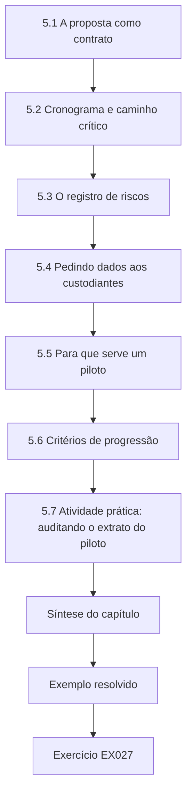

### Desenho lógico

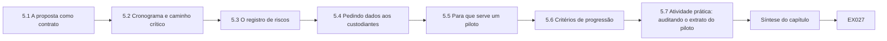

```text
[5.1 A proposta como contrato]
    |
    v
[5.2 Cronograma e caminho crítico]
    |
    v
[5.3 O registro de riscos]
    |
    v
[5.4 Pedindo dados aos custodiantes]
    |
    v
[5.5 Para que serve um piloto]
    |
    v
[5.6 Critérios de progressão]
    |
    v
[5.7 Atividade prática: auditando o extrato do piloto]
    |
    v
[Síntese do capítulo]
    |
    v
[Exemplo resolvido] --> [Exercício EX027]
```
<!-- open-cyber-academy:lesson-figures:end ch-05 -->


### Objetivos de aprendizagem e conexão

Ao fim deste capítulo, o estudante será capaz de:

1. Escrever uma proposta de pesquisa que funcione como um contrato com um orientador, um comitê e os parceiros de dados: específica o bastante para ser verificada, flexível apenas onde a flexibilidade for declarada.
2. Planejar um projeto de mestrado de dois anos com o seu caminho crítico e manter um registro de riscos com gatilhos e responsáveis.
3. Abordar os custodiantes dos dados com um pedido preciso e negociar um acesso a que o estudo consiga sobreviver.
4. Desenhar um **piloto de viabilidade** cujo propósito é testar procedimentos, e não estimar efeitos, e explicar por que as estimativas de efeito do piloto não devem ser usadas para justificar o estudo principal.
5. Definir de antemão **critérios de progressão (prosseguir/não prosseguir)**, incluindo um resultado de alterar e repetir o piloto.
6. Auditar sistematicamente um extrato de dados do piloto e transformar cada constatação numa pergunta ao custodiante ou numa mudança de procedimento.

Os Capítulos 1–4 produziram a pergunta, o mapa do seminário, o desenho e a tabela de rivais. Este capítulo os empacota numa proposta e testa se o estudo pode de fato ser feito. O Capítulo 6 o executa.

### 5.1 A proposta como contrato

Uma proposta responde a três públicos ao mesmo tempo. O **orientador** precisa saber que o projeto é viável e que o candidato o entende. O **comitê** (e, mais tarde, os examinadores) precisa ver que a pergunta, o desenho e a análise são coerentes. Os **parceiros de dados** precisam saber exatamente o que será solicitado, como será protegido e o que será publicado. Uma proposta que satisfaz os três é específica sobre o que está fixado e explícita sobre o que está em aberto.

Uma estrutura padrão para o Spillover Study:

1. **Título e resumo** (250 palavras): pergunta, desenho, dados, contribuição esperada.
2. **Problema e justificativa:** a decisão que a resposta informa; a lacuna da matriz de conceitos (Capítulo 1).
3. **Perguntas e estimandos:** RQ1–RQ3 com as definições dos estimandos.
4. **Fundamentação:** um resumo da literatura centrado em conceitos, de duas páginas.
5. **Desenho:** série temporal interrompida controlada e entrevistas; por que estes, e não outros.
6. **Dados e acesso:** custodiantes, variáveis, período, agregação, acordos, fontes alternativas.
7. **Ética e proteção da informação:** a submissão aprovada ou enviada; níveis de sensibilidade.
8. **Plano de análise:** um resumo do plano de pré-análise, com link para o seu registro.
9. **Rivais e robustez:** a tabela de rivais do Capítulo 4, com os testes.
10. **Cronograma e marcos.**
11. **Riscos e mitigações.**
12. **Produtos:** dissertação, briefing aos parceiros, possível artigo; o que será e o que não será publicado.
13. **Referências.**

Marque cada elemento como **fixado** (mudanças exigem uma entrada datada no registro de desvios e a concordância do orientador) ou **em aberto** (a ser decidido até uma data declarada ou após o piloto). No Spillover Study, os estimandos, o desfecho primário, a região de comparação e o modelo estão fixados; o número exato de entrevistas (8–12) e a definição do desfecho secundário (dependendo do dicionário de dados do custodiante) estão em aberto.

### 5.2 Cronograma e caminho crítico

Um mestrado de dois anos, com cerca de 1.200 horas de estudo, deixa talvez 600–700 horas para a dissertação propriamente dita, uma vez contados os componentes de aulas; as demais horas deste curso são os capítulos que você está estudando. O recurso escasso não é o tempo de análise, mas o **tempo decorrido à espera de outras pessoas**: comitês de ética, custodiantes dos dados, equipes jurídicas dos parceiros e as agendas dos entrevistados. Planeje em torno dessas esperas, e não em torno das suas próprias horas de trabalho.

| Semestre | Marcos | Dependências de tempo decorrido |
|---|---|---|
| 1 | Pergunta, busca e matriz de conceitos (Capítulo 1); seminário (Capítulo 2); primeiro contato com os custodiantes | As primeiras respostas dos custodiantes muitas vezes levam semanas |
| 2 | Desenho, análise do desenho, submissão ao comitê de ética, acordos de dados, plano de pré-análise (Capítulos 3–4) | Revisão ética; revisão jurídica dos acordos — o **caminho crítico** |
| 3 | Proposta aprovada; piloto; coleta principal de dados; entrevistas (Capítulos 5–6) | Repetição do piloto se os critérios falharem; agendamento das entrevistas |
| 4 | Análise, redação, exame (Capítulos 6–8) | Período de revisão factual pelos parceiros; agendamento do exame |

O **caminho crítico** é a cadeia de tarefas cujo atraso atrasa o projeto inteiro: aqui, a aprovação ética e os acordos de dados, que precisam ambos preceder o piloto. Comece-os cedo, mesmo antes de o desenho estar finalizado, compartilhando uma minuta do pedido de dados e perguntando aos custodiantes quais aprovações eles exigem.

### 5.3 O registro de riscos

| Risco | Probabilidade | Impacto | Mitigação | Gatilho para agir | Responsável |
|---|---|---|---|---|---|
| Custodiante atrasa os dados | Alta | Alto | Contato precoce; pedido mínimo; painel público como alternativa para Wexmoor | Nenhum acordo assinado até o fim do semestre 2 | Candidato, orientador |
| Parceiro desiste após ver os resultados | Média | Alto | Acordo de publicação com revisão factual e sem veto, assinado antes do acesso | Pedido para suprimir constatações | Orientador |
| Qualidade dos dados inadequada | Média | Alto | Auditoria no piloto com critérios de progressão | Os critérios falham duas vezes | Candidato |
| Aprovação ética atrasada ou condicionada | Média | Médio | Submeter cedo; consultar previamente o comitê | Nenhuma decisão oito semanas após a submissão | Candidato |
| Poucos entrevistados | Média | Médio | Recrutar pela coalizão; ampliar as funções | Menos de seis até a metade do semestre 3 | Candidato |
| Expansão do escopo (acrescentar desfechos, regiões) | Alta | Médio | Elementos fixados; registro de desvios | Qualquer novo desfecho proposto | Orientador |
| Parceiro sofre um novo incidente de segurança | Baixa | Alto | Pausar; nunca pedir detalhes do incidente; seguir as instruções do parceiro | Notificação do parceiro | Candidato |
| Constatações julgadas sensíveis | Média | Médio | Níveis de sensibilidade; relato regional; encaminhamento privado das fraquezas específicas | Preocupação do parceiro ou do comitê | Orientador |

Revise o registro em cada reunião de orientação. Um registro de riscos escrito uma vez para a proposta e nunca mais aberto é decoração.

### 5.4 Pedindo dados aos custodiantes

Os custodiantes recebem muitos pedidos vagos e respondem aos precisos. Um bom pedido declara: o propósito em duas frases; as variáveis exatas e suas definições, tal como você as entende; o período; a agregação (contagens diárias por DE; nenhum registro de pacientes); como os dados serão armazenados e destruídos; o que será publicado e de que forma; o status da aprovação ética; e o que você dará em troca (um briefing, uma verificação da qualidade dos dados deles). Faça ao custodiante três perguntas de que todo estudo de séries temporais precisa: *O sistema de registro, suas definições ou a área de captação do local mudaram durante o período? Há lacunas conhecidas ou dias de indisponibilidade? Como são tratados os lançamentos tardios e as correções?* As respostas muitas vezes importam mais do que os dados.

No Spillover Study, Alder Point e Brookfield concordaram em fornecer agregados diários; Calloway concordou depois que a coalizão interveio; as contagens de Wexmoor vieram de um painel regional público cujos termos permitem o uso em pesquisa, o que o candidato registrou no plano de gestão de dados.

### 5.5 Para que serve um piloto

Um **piloto** ou **estudo de viabilidade** pergunta se o estudo principal pode ser feito como planejado: se os dados podem ser obtidos na forma esperada, se os participantes podem ser recrutados, se os procedimentos e instrumentos funcionam e quanto tempo levam. [Thabane et al. (2010)](https://doi.org/10.1186/1471-2288-10-1) oferecem um tutorial sobre o quê, o porquê e o como; [Lancaster, Dodd e Williamson (2004)](https://doi.org/10.1111/j..2002.384.doc.x) recomendam que os pilotos tenham objetivos de viabilidade claros e sejam analisados de forma descritiva; a [extensão do CONSORT para ensaios piloto e de viabilidade](https://doi.org/10.1136/bmj.i5239) (Eldridge et al., 2016) pede que os autores relatem os critérios usados para decidir se prosseguem. Embora essas fontes tratem de ensaios, sua lógica central se transfere diretamente para estudos observacionais e de métodos mistos.

Para o que um piloto **não** serve: estimar o efeito, ou estimar o tamanho de efeito para um cálculo de poder. [Leon, Davis e Kraemer (2011)](https://doi.org/10.1016/j.jpsychires.2010.10.008) explicam por quê: as amostras dos pilotos são pequenas, então suas estimativas de efeito são imprecisas demais para orientar decisões de tamanho de amostra e podem enganar em qualquer direção. Num estudo observacional de evento há uma razão adicional: se o candidato examinar os dados de desfecho em torno do evento durante o "piloto", a análise subsequente deixa de ser planejada às cegas quanto ao resultado. O piloto de dados do Spillover Study usa, portanto, um **extrato de 35 dias de linha de base de Alder Point, inteiramente anterior ao dia −60**, e examina apenas a completude e a plausibilidade.

O piloto do Spillover Study tem três componentes:

1. **Piloto de dados:** o extrato de linha de base, auditado contra critérios definidos de antemão (Laboratório 5).
2. **Piloto de entrevistas:** duas entrevistas com pessoas fora da amostra (uma gestora de DE aposentada e um educador de EMS de outra região), testando a clareza, a duração e a sensibilidade do roteiro.
3. **Piloto do pipeline:** o código completo da análise executado de ponta a ponta sobre dados sintéticos (o gerador do Laboratório 4) para verificar se ele produz todas as tabelas e figuras planejadas.

### 5.6 Critérios de progressão

Os **critérios de progressão** declaram de antemão quais resultados do piloto levam a prosseguir, alterar ou parar. Um formato comum usa três zonas: *prosseguir* (seguir como planejado), *alterar* (seguir após mudanças especificadas, possivelmente repetindo o piloto) e *parar* (o estudo, tal como desenhado, não é viável). Os critérios de dados do Spillover Study:

| Critério | Prosseguir | Alterar | Parar |
|---|---|---|---|
| Completude das células das quatro variáveis | ≥ 97% | 90–97% | < 90% após uma repetição do piloto |
| Dias duplicados conflitantes | Nenhum | Explicados pelo custodiante | Sem explicação |
| Dias de calendário ausentes | ≤ 1 | 2–5, explicados | > 5 ou sem explicação |
| Valores fora da faixa (contagens negativas, desvio > 1.440 minutos por dia) | Nenhum | Corrigidos pelo custodiante | Persistentes |

Critérios das entrevistas: o roteiro cabe em 45 minutos; nenhum dos participantes do piloto relata desconforto com alguma pergunta; ambos entendem todas as perguntas sem reformulação. Critério do pipeline: todos os produtos planejados gerados sem passos manuais.

### 5.7 Atividade prática: auditando o extrato do piloto

O laboratório abaixo audita um extrato sintético de 35 dias de Alder Point contra os critérios de §5.6. Ele verifica os códigos de local, as datas duplicadas (e se as duplicatas conflitam), os valores ausentes, os valores fora da faixa, os dias de calendário ausentes e os dias implausivelmente baixos, e relata uma decisão.

```python
# Lab 5 - audit a pilot extract against predeclared go/no-go criteria (offline, standard library only)
# A synthetic 35-day daily extract from one neighbouring hospital (AP), as a partner might send it.
import csv, io, datetime as dt

EXTRACT = """date,site,amb_arrivals,walkins,diversion_min,median_wait_min
2025-03-01,AP,41,96,0,27
2025-03-02,AP,37,88,0,25
2025-03-03,AP,44,102,35,31
2025-03-04,AP,40,99,0,29
2025-03-05,AP,39,,0,28
2025-03-06,AP,42,101,0,30
2025-03-07,AP,38,93,0,26
2025-03-08,AP,36,90,0,24
2025-03-09,AP,35,87,0,23
2025-03-10,AP,45,104,120,33
2025-03-11,AP,43,100,0,30
2025-03-11,AP,43,100,0,30
2025-03-12,AP,41,97,0,N/A
2025-03-13,AP,40,95,0,29
2025-03-15,AP,37,91,0,25
2025-03-16,AP,36,89,0,24
2025-03-17,AP,46,105,-15,34
2025-03-18,AP,44,103,0,31
2025-03-19,ALDR,42,98,0,29
2025-03-20,AP,41,96,0,28
2025-03-21,AP,39,94,0,27
2025-03-22,AP,37,90,0,26
2025-03-23,AP,35,86,0,24
2025-03-24,AP,47,106,1600,35
2025-03-25,AP,44,101,0,31
2025-03-26,AP,43,99,0,30
2025-03-27,AP,41,97,0,29
2025-03-28,AP,40,95,0,28
2025-03-29,AP,38,92,0,26
2025-03-30,AP,23,55,0,25
2025-03-31,AP,45,103,0,32
2025-04-01,AP,44,102,0,31
2025-04-02,AP,42,99,0,30
2025-04-03,AP,40,96,0,29
2025-04-04,AP,39,94,0,28
"""
FIELDS = ["amb_arrivals", "walkins", "diversion_min", "median_wait_min"]
rows = list(csv.DictReader(io.StringIO(EXTRACT)))
issues, seen, by_date = [], {}, {}
for i, r in enumerate(rows, start=2):                      # line numbers as in the file
    d = dt.date.fromisoformat(r["date"])
    if r["site"] != "AP":
        issues.append((i, "site code", r["site"]))
    if d in seen:
        same = all(r[f] == rows[seen[d] - 2][f] for f in FIELDS)
        issues.append((i, "duplicate date", "identical" if same else "CONFLICTING"))
        continue
    seen[d] = i
    by_date[d] = r
    for f in FIELDS:
        v = r[f].strip()
        if v in ("", "N/A", "NA"):
            issues.append((i, "missing", f))
            continue
        x = float(v)
        if x < 0 or (f == "diversion_min" and x > 1440):
            issues.append((i, "out of range", f"{f}={v}"))

start, end = min(by_date), max(by_date)
expected = (end - start).days + 1
missing_days = [start + dt.timedelta(k) for k in range(expected) if start + dt.timedelta(k) not in by_date]
cells = expected * len(FIELDS)
bad_cells = sum(1 for _, kind, _ in issues if kind in ("missing", "out of range")) + len(missing_days) * len(FIELDS)
arr = [int(by_date[d]["amb_arrivals"]) for d in sorted(by_date)]
mu = sum(arr) / len(arr)
low = [(str(d), int(r["amb_arrivals"])) for d, r in sorted(by_date.items()) if int(r["amb_arrivals"]) < 0.7 * mu]

for line, kind, detail in issues:
    print(f"line {line:2d}: {kind}: {detail}")
print("missing calendar days:", [str(d) for d in missing_days])
print("implausibly low days (<70% of mean):", low)
complete = 1 - bad_cells / cells
print(f"cell completeness {complete:.3f} over {expected} days x {len(FIELDS)} fields")
CRITERIA = {                                                # predeclared in the pilot protocol
    "completeness >= 0.97": complete >= 0.97,
    "no conflicting duplicates": not any(d == "CONFLICTING" for _, k, d in issues if k == "duplicate date"),
    "<= 1 missing calendar day": len(missing_days) <= 1,
    "all values in range": not any(k == "out of range" for _, k, _ in issues),
}
for c, ok in CRITERIA.items():
    print(f"  {'PASS' if ok else 'FAIL'}  {c}")
print("decision:", "GO" if all(CRITERIA.values()) else "AMEND AND RE-PILOT (no outcome analysis)")
```

Saída esperada:

```text
line  6: missing: walkins
line 13: duplicate date: identical
line 14: missing: median_wait_min
line 18: out of range: diversion_min=-15
line 20: site code: ALDR
line 25: out of range: diversion_min=1600
missing calendar days: ['2025-03-14']
implausibly low days (<70% of mean): [('2025-03-30', 23)]
cell completeness 0.943 over 35 days x 4 fields
  FAIL  completeness >= 0.97
  PASS  no conflicting duplicates
  PASS  <= 1 missing calendar day
  FAIL  all values in range
decision: AMEND AND RE-PILOT (no outcome analysis)
```

Cada constatação se torna uma pergunta, e não uma correção silenciosa:

- **Linha 13, data duplicada (idêntica):** provavelmente um artefato da exportação. Pergunte como o extrato é produzido; remova a duplicata só depois que o custodiante confirmar.
- **Linhas 6 e 14, valores ausentes:** pergunte se as chegadas espontâneas de 5 de março e o tempo de espera de 12 de março não foram registrados ou não foram exportados. Não faça imputação no piloto.
- **Linha 18, desvio de −15 minutos; linha 25, 1.600 minutos:** valores impossíveis. Uma duração negativa sugere um erro de sinal ou de subtração; 1.600 minutos excedem um dia. Peça ao custodiante os registros de origem e como os minutos de desvio são calculados.
- **Linha 20, código de local `ALDR`:** um código legado ou alternativo de Alder Point. Peça a lista de códigos; se `ALDR` for outro local, a linha precisa ser removida.
- **14 de março ausente:** pergunte se o dia se perdeu na exportação ou não foi registrado.
- **30 de março, 23 chegadas (cerca de 57% da média):** não é impossível, mas é implausível. No cenário sintético, o custodiante explica que Alder Point teve seis horas de indisponibilidade do prontuário eletrônico naquele dia; as chegadas foram registradas em papel e só parcialmente lançadas depois. Isso é um **artefato de medição num hospital vizinho** — exatamente o que um estudo sobre interrupções de TI precisa esperar. O estudo principal acrescenta uma regra: os dias sinalizados pelo custodiante como dias de indisponibilidade são identificados no livro de códigos e analisados com e sem eles.

A completude é de 94,3%, na zona de *alterar*, e dois valores estão fora da faixa. A decisão é alterar e repetir o piloto — e, como a saída declara, **nenhuma análise de desfecho** de qualquer tipo é feita sobre o extrato do piloto.

### 5.8 Exemplo resolvido: o relatório do piloto (sintético)

O relatório do piloto do candidato ao orientador, em uma página:

- **Dados.** O primeiro extrato falhou em dois critérios (completude de 94,3%; dois valores fora da faixa). O custodiante confirmou: a duplicata era um artefato da exportação; −15 deveria ser 15 e 1.600 deveria ser 160 (erros de digitação no sistema de origem); `ALDR` é o código legado de Alder Point; 14 de março foi omitido da exportação e foi fornecido; a contagem de chegadas espontâneas de 5 de março e o tempo de espera de 12 de março nunca foram registrados. Extrato corrigido: completude de 98,6%; todos os critérios aprovados → **prosseguir**. Mudança de procedimento: o livro de códigos agora registra os dias de indisponibilidade sinalizados pelo custodiante e os valores corrigidos, com a explicação do custodiante.
- **Entrevistas.** As entrevistas do piloto levaram 68 e 72 minutos, contra uma meta de 45 minutos. Uma pergunta — "Que erros foram cometidos durante o desvio?" — deixou os dois participantes do piloto na defensiva. Mudanças: o roteiro foi cortado de 14 para 9 perguntas; a pergunta foi reescrita como "Conte-me as primeiras doze horas: que informações você tinha e o que decidiu em cada momento?" — ancorada no tempo e na informação, o que também reduz o viés de retrospectiva (Capítulo 4). Piloto repetido com um participante: 44 minutos → **prosseguir**.
- **Pipeline.** O código de análise rodou de ponta a ponta sobre dados sintéticos e produziu todos os produtos planejados, exceto o gráfico de estudo de evento, que exigiu um ajuste manual de eixo; o ajuste foi levado para o código → **prosseguir**.
- **Entradas no registro de desvios:** roteiro de entrevista revisado (antes de qualquer entrevista do estudo; nenhum dado de desfecho visto); regra dos dias de indisponibilidade acrescentada (antes que qualquer dado de desfecho em torno do evento fosse visto).

### 5.9 Erros comuns e limites

- Escrever uma proposta que não pode falhar: nenhum elemento fixado, nenhum critério declarado, nenhuma regra de desvios.
- Ignorar as dependências de tempo decorrido; começar a ética e os acordos de dados depois que o desenho estiver "perfeito".
- Um registro de riscos sem gatilhos nem responsáveis, nunca revisado.
- Pedidos de dados vagos ("todos os dados relevantes") que os custodiantes não conseguem atender ou que pedem mais do que a pergunta precisa.
- Usar um piloto para estimar o efeito ou para "ver se tem alguma coisa ali".
- Corrigir problemas nos dados silenciosamente numa planilha, em vez de perguntar ao custodiante e registrar a correção.
- Apagar dias implausíveis sem entendê-los — e, com isso, apagar a própria interrupção de que o estudo trata.
- Critérios de progressão escritos depois que os resultados do piloto foram vistos.

O limite de um piloto é o seu tamanho: passar nele mostra que os procedimentos podem funcionar, e não que os dados principais estarão limpos. Mantenha o script de auditoria e execute-o em cada extrato do estudo principal.

### Exercícios — capítulo 5

**EX027 — Resumo da proposta.** *Objetivo:* comprimir o estudo num resumo verificável. *Insumos:* Capítulos 1–4. *Restrições:* 250 palavras; precisa nomear a pergunta, o estimando, o desenho, a comparação, as fontes de dados, o status ético e a contribuição esperada; nenhuma alegação de resultados. *Passos:* (1) redigir; (2) marcar cada frase como fixada ou em aberto; (3) pedir a um colega que declare a estimativa primária do estudo apenas a partir do seu resumo. *Evidência esperada:* resumo e a reformulação do colega. *Rubrica:* 3 = o colega reformula o estimando corretamente, todos os elementos exigidos presentes, nada prometido que o desenho não possa entregar; 2 = falta um elemento; 1 = nível de tema; 0 = nada.

**EX028 — Cronograma e registro de riscos.** *Objetivo:* planejar contra o tempo decorrido. *Insumos:* §5.2–5.3. *Restrições:* um estudo diferente: entrevistas com doze operadores de concessionárias de água sobre exercícios de incidentes cibernéticos, mais a análise dos relatórios de exercícios de três concessionárias. *Passos:* (1) montar um cronograma de quatro semestres; (2) identificar o caminho crítico; (3) escrever seis riscos com probabilidade, impacto, mitigação, gatilho e responsável. *Evidência esperada:* tabela e cronograma. *Rubrica:* 3 = caminho crítico corretamente identificado (aprovações e acesso aos relatórios de exercícios), gatilhos mensuráveis, mitigações específicas para concessionárias pequenas; 2 = um risco sem gatilho; 1 = genérico; 0 = nada.

**EX029 — Auditoria e repetição do piloto.** *Objetivo:* aplicar as correções de um custodiante aos dados do extrato do piloto e decidir PROSSEGUIR ou NÃO PROSSEGUIR pela completude registrada, sem imputar valores que nunca foram registrados. *Insumos:* código do Laboratório 5. *Restrições:* off-line. *Passos:* (1) executar o laboratório e registrar a saída; (2) aplicar as correções do custodiante de §5.8 (remover a duplicata; acrescentar `2025-03-14,AP,38,92,0,27`; −15 → 15; 1.600 → 160; `ALDR` → `AP`; deixar ausentes os dois valores nunca registrados) e executar de novo; (3) relatar a completude e a decisão; (4) declarar o que a auditoria ainda relata e o que você fará a respeito. *Evidência esperada:* as duas saídas e um parágrafo. *Rubrica:* 3 = completude de 98,6% e GO relatados, células ausentes restantes e o dia baixo de 30 de março explicados com a regra da indisponibilidade, nenhuma imputação no piloto; 2 = um valor errado; 1 = não executado; 0 = nada.

**EX030 — Piloto do roteiro de entrevista.** *Objetivo:* testar um instrumento. *Insumos:* um roteiro próprio para a RQ3 (pelo menos dez perguntas). *Restrições:* pilotar com uma ou duas pessoas fora da amostra pretendida; registrar a duração e cada ponto de confusão ou desconforto. *Passos:* (1) pilotar; (2) revisar; (3) documentar as mudanças e suas razões; (4) declarar se a revisão deve ser registrada no registro de desvios. *Evidência esperada:* roteiro original, roteiro revisado e registro de mudanças. *Rubrica:* 3 = revisões respondem aos problemas observados, perguntas ancoradas no tempo e na informação, decisão sobre o registro de desvios justificada; 2 = revisões cosméticas; 1 = sem piloto; 0 = nada.

**EX031 — Critérios de progressão.** *Objetivo:* definir prosseguir/alterar/parar antes de ver os resultados do piloto. *Insumos:* um piloto de viabilidade para um questionário a 200 gestores de TI hospitalar sobre procedimentos de contingência. *Restrições:* pelo menos quatro critérios (por exemplo, taxa de resposta, preenchimento dos itens, tempo de preenchimento, compreensão). *Passos:* (1) definir os limiares de cada zona; (2) justificar cada um pelas necessidades do estudo principal; (3) declarar o que "alterar" muda em cada um. *Evidência esperada:* tabela e justificativa. *Rubrica:* 3 = limiares ligados à precisão ou à viabilidade do estudo principal, ações de alteração concretas, nenhum critério de tamanho de efeito; 2 = um limiar arbitrário; 1 = critérios sobre resultados, e não sobre viabilidade; 0 = nada.

**EX032 — Memorando ao orientador sobre o escopo.** *Objetivo:* tomar e registrar uma decisão de escopo. *Insumos:* após o piloto, a coalizão oferece dados de pacientes sobre o atendimento de AVC no período do desvio, se o candidato acrescentar um desfecho de AVC. *Restrições:* uma página; considerar a ética, o cronograma, o desenho e a alegação. *Passos:* (1) listar benefícios e custos; (2) decidir; (3) escrever a entrada no registro de desvios; (4) se recusar, declarar como a oferta se torna trabalho futuro. *Evidência esperada:* memorando. *Rubrica:* 3 = reconhece a nova aprovação ética e os dados individuais, o impacto no cronograma, a multiplicidade e o desfecho primário fixado; decisão defensável em qualquer sentido; entrada de desvio completa; 2 = decisão sem custos; 1 = aceita sem aprovações; 0 = nada.

### Síntese do capítulo

Uma proposta é um contrato: ela fixa a pergunta, os estimandos, o desenho e a análise, declara o que permanece em aberto e diz como os desvios serão registrados. O caminho crítico de um projeto de mestrado passa pelo tempo de outras pessoas — ética, custodiantes, revisão jurídica —, então comece essas frentes cedo e mantenha um registro de riscos vivo. Faça aos custodiantes perguntas precisas, sobretudo sobre mudanças de sistema, lacunas e correções. Um piloto testa a viabilidade, e não os efeitos; nunca estime um efeito a partir dele e, num estudo de evento, nunca olhe para os desfechos em torno do evento. Defina de antemão os critérios de prosseguir/alterar/parar. Audite cada extrato com um script, transforme cada anomalia numa pergunta e trate os dias de indisponibilidade nos próprios hospitais que você estuda como artefatos de medição a sinalizar, e não como linhas a apagar.

<!-- open-cyber-academy:chapter-navigation:start ch-05 -->
### Continue estudando — capítulo 05 de 08

[← Capítulo 04](#ch-04) · [Índice de capítulos do curso](../SUBJECTS.md) · [Capítulo 06 →](#ch-06)

Siga para a próxima lição escrita.
<!-- open-cyber-academy:chapter-navigation:end -->

<a id="ch-06"></a>

## Capítulo 6 — Coleta e análise dos dados

<!-- open-cyber-academy:lesson-figures:start ch-06 -->
### Mapa da aula

Aula 06 publicada. Mapa, exemplo, EX034.

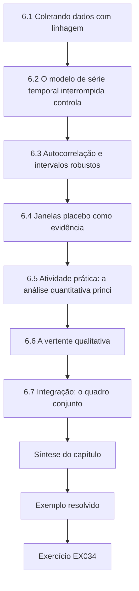

### Desenho lógico

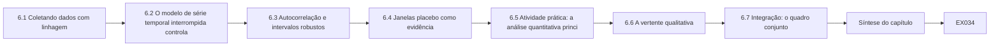

```text
[6.1 Coletando dados com linhagem]
    |
    v
[6.2 O modelo de série temporal interrompida controla]
    |
    v
[6.3 Autocorrelação e intervalos robustos]
    |
    v
[6.4 Janelas placebo como evidência]
    |
    v
[6.5 Atividade prática: a análise quantitativa princi]
    |
    v
[6.6 A vertente qualitativa]
    |
    v
[6.7 Integração: o quadro conjunto]
    |
    v
[Síntese do capítulo]
    |
    v
[Exemplo resolvido] --> [Exercício EX034]
```
<!-- open-cyber-academy:lesson-figures:end ch-06 -->


### Objetivos de aprendizagem e conexão

Ao fim deste capítulo, o estudante será capaz de:

1. Executar um procedimento de coleta de dados que preserve a linhagem: cada arquivo recebido, auditado, congelado e rastreável até a análise que o usou.
2. Especificar e ajustar um modelo de série temporal interrompida controlada por regressão segmentada e interpretar cada coeficiente.
3. Diagnosticar a autocorrelação dos resíduos e calcular intervalos robustos à autocorrelação (Newey–West), relatando como a escolha da defasagem os afeta.
4. Usar janelas placebo como evidência baseada em postos e declarar o menor valor-p que um dado número de placebos pode produzir.
5. Conduzir e analisar entrevistas com uma análise temática documentada e usar a concordância entre codificadores como verificação reflexiva, e não como garantia.
6. Integrar as vertentes quantitativa e qualitativa num quadro conjunto, nomeando onde elas confirmam, ampliam ou conflitam.

Este capítulo executa o plano fixado nos Capítulos 3 e 5 e confronta os rivais do Capítulo 4 com os dados. O Capítulo 7 escreve o que ele encontra; o Capítulo 8 o defende.

### 6.1 Coletando dados com linhagem

Cada número da dissertação precisa ser rastreável até um arquivo, um script e uma versão. Sem isso, nem o candidato, nem o orientador, nem um examinador consegue saber de qual extrato veio um resultado, se ele foi corrigido ou se o script que o produziu ainda é o mesmo. Um procedimento mínimo para cada extrato:

1. **Receber** pelo canal indicado no acordo de dados; nunca por e-mail pessoal.
2. **Registrar** o nome do arquivo, o remetente, a data de recebimento e uma soma de verificação criptográfica (por exemplo, SHA-256) num registro de dados.
3. **Armazenar** o original somente para leitura na área restrita (os níveis do Capítulo 3).
4. **Auditar** com o script do Laboratório 5; enviar as constatações ao custodiante; registrar suas respostas no livro de códigos.
5. **Congelar**: quando um extrato for aprovado, registrar a sua soma de verificação como a versão da análise. Os arquivos derivados são produzidos apenas por scripts a partir de insumos congelados.
6. **Capturar as fontes públicas** (aqui, o painel de Wexmoor) com a data da captura, porque os painéis são revisados.

O Spillover Study recebeu agregados diários dos dias −180 a +89 de três custodiantes e capturou a série de Wexmoor do painel regional numa data registrada. Todos passaram na auditoria após uma rodada de correções, e os dias de indisponibilidade sinalizados pelos custodiantes foram registrados no livro de códigos. (O gerador do laboratório não simula dias de indisponibilidade, então os laboratórios analisam todos os dias.)

### 6.2 O modelo de série temporal interrompida controlada

Para cada DE vizinho, o desfecho no dia *t* é a razão logarítmica entre as suas chegadas e as chegadas agregadas de Wexmoor:

*y*ₜ = log(*A*ₜ + 0.5) − log(*W*ₜ + 0.5) = β₀ + β₁·*t* + β₂·*D*ₜ + β₃·*P*ₜ + *e*ₜ

em que *D*ₜ = 1 durante a janela do desvio (dias 0–20) e *P*ₜ = 1 depois dela (dias 21–89). Lendo os coeficientes:

- **β₀, β₁:** o nível e a tendência linear pré-evento da razão. Se as regiões tratada e de comparação compartilham a estação, a razão é aproximadamente plana mesmo quando cada série não é.
- **β₂:** a variação da razão logarítmica durante o desvio, em relação à tendência projetada. **exp(β₂) − 1 é a variação percentual estimada** — a estimativa primária.
- **β₃:** a variação após o fim do desvio, que absorve qualquer cauda, de modo que os dias pós-evento não contaminem a tendência.

As escolhas e suas razões, todas fixadas no plano de pré-análise: a **razão logarítmica** trata os efeitos como multiplicativos, o que convém a contagens cuja variabilidade cresce com o nível, e remove os padrões compartilhados de dia da semana e de estação; somar **0,5** evita log(0) em contagens muito pequenas e tem efeito desprezível nestes volumes; uma **tendência linear** ao longo de 180 dias capta a deriva lenta sem perseguir o ruído; um **degrau separado pós-janela** evita presumir que o sistema volta à sua tendência no dia em que o desvio termina. [Lopez Bernal, Cummins e Gasparrini (2017)](https://doi.org/10.1093/ije/dyw098) oferecem um tutorial de regressão segmentada para ITS, incluindo a necessidade de especificar de antemão o modelo de impacto (um degrau, uma mudança de inclinação ou ambos); o Spillover Study pré-especificou um degrau.

### 6.3 Autocorrelação e intervalos robustos

As séries operacionais diárias raramente são independentes de um dia para o outro: um dia movimentado pode ser seguido de outro dia movimentado. Os coeficientes de mínimos quadrados ordinários continuam não enviesados sob autocorrelação, mas seus erros-padrão usuais estão errados — geralmente pequenos demais quando a autocorrelação é positiva. Duas respostas são comuns:

1. **Diagnosticar:** inspecionar a autocorrelação dos resíduos nas defasagens 1 e 7, ou calcular a estatística de Durbin–Watson ([Durbin e Watson, 1950](https://doi.org/10.1093/biomet/37.3-4.409)); valores perto de 2 sugerem pouca autocorrelação de primeira ordem.
2. **Tornar a inferência robusta:** usar erros-padrão consistentes com heterocedasticidade e autocorrelação (HAC), como o estimador de [Newey–West (1987)](https://doi.org/10.2307/1913610), que pondera os produtos cruzados dos resíduos até uma defasagem escolhida *L* com pesos de Bartlett decrescentes 1 − *l*/(*L* + 1). Alternativamente, modelar diretamente o processo de erro (por exemplo, com erros ARIMA), como Lopez Bernal et al. discutem.

O Spillover Study pré-especificou Newey–West com defasagem 7 (uma semana, coincidindo com o ciclo semanal) e uma análise de sensibilidade com as defasagens 0 e 14. Para Alder Point, os resíduos mostraram autocorrelação de 0,03 na defasagem 1, de −0,12 na defasagem 7 e uma estatística de Durbin–Watson de 1,92: a autocorrelação é fraca, então o intervalo robusto não deveria diferir muito do ingênuo — e não difere (EX034).

### 6.4 Janelas placebo como evidência

O Capítulo 4 introduziu os testes de placebo no tempo. Aqui eles se tornam precisos: ajuste o mesmo modelo a janelas falsas de 21 dias colocadas na linha de base, usando apenas dados anteriores ao evento real, e registre cada "efeito" falso. Se a estimativa real for maior do que todas as *k* estimativas placebo, seu posto é 1 de *k* + 1 e, sob o pressuposto de que a janela real é permutável com as falsas, a probabilidade unilateral de um posto tão extremo por acaso é 1/(*k* + 1). **Com 15 placebos, o menor valor atingível é 1/16 = 0,0625.** Os testes placebo, portanto, não conseguem chegar a 0,05 com menos de 19 janelas (nem ficar abaixo disso com menos de 20), sejam quais forem os dados; relate o posto, e não um valor-p enganoso. As janelas placebo também têm uma fraqueza: os ajustes perto do início da série se apoiam em períodos prévios curtos e são mais ruidosos do que o ajuste real, o que torna o teste conservador.

### 6.5 Atividade prática: a análise quantitativa principal

Salve o Laboratório 4 como `lab4_data.py` e o arquivo a seguir como `lab6_its.py` na mesma pasta (o Laboratório 8 o importa). Ele implementa mínimos quadrados por eliminação de Gauss–Jordan, erros-padrão de Newey–West e a ITS controlada de §6.2, ajusta-a para cada vizinho contra Wexmoor agregada, executa 15 janelas placebo por local e ajusta uma ITS não controlada para o tempo de espera de Alder Point.

```python
# Lab 6 - controlled interrupted time series with autocorrelation-robust intervals (offline)
# Save Lab 4 as lab4_data.py in the same folder first. Save this file as lab6_its.py (Lab 8 imports it).
import math
from lab4_data import make_region, DAYS

def solve(A, b):                                   # Gauss-Jordan with partial pivoting
    n = len(A)
    M = [row[:] + [b[i]] for i, row in enumerate(A)]
    for c in range(n):
        p = max(range(c, n), key=lambda r: abs(M[r][c]))
        M[c], M[p] = M[p], M[c]
        for r in range(n):
            if r != c:
                f = M[r][c] / M[c][c]
                M[r] = [x - f * y for x, y in zip(M[r], M[c])]
    return [M[i][n] / M[i][i] for i in range(n)]

def inverse(A):
    n = len(A)
    cols = [solve(A, [1.0 if i == j else 0.0 for i in range(n)]) for j in range(n)]
    return [[cols[j][i] for j in range(n)] for i in range(n)]

def ols_nw(X, y, lag=7):
    k = len(X[0])
    XtX = [[sum(r[i] * r[j] for r in X) for j in range(k)] for i in range(k)]
    beta = solve(XtX, [sum(r[i] * v for r, v in zip(X, y)) for i in range(k)])
    e = [v - sum(b * x for b, x in zip(beta, r)) for r, v in zip(X, y)]
    S = [[0.0] * k for _ in range(k)]
    for l in range(lag + 1):                         # Newey-West with Bartlett weights
        w = 1.0 if l == 0 else 1 - l / (lag + 1)
        for t in range(l, len(y)):
            for i in range(k):
                for j in range(k):
                    v = e[t] * e[t - l] * X[t][i] * X[t - l][j]
                    S[i][j] += w * (v if l == 0 else v + e[t] * e[t - l] * X[t - l][i] * X[t][j])
    B = inverse(XtX)
    V = [[sum(B[i][a] * S[a][b] * B[b][j] for a in range(k) for b in range(k)) for j in range(k)] for i in range(k)]
    return beta, [math.sqrt(V[i][i]) for i in range(k)], e

def design_row(t, start, ev_len):
    return [1.0, t / 100, 1.0 if start <= t < start + ev_len else 0.0, 1.0 if t >= start + ev_len else 0.0]

def fit(treated, control, days, start, ev_len):
    """log(treated) - log(control) = b0 + b1*t + b2*[event window] + b3*[after window]; b2 as % change."""
    X = [design_row(t, start, ev_len) for t in days]
    y = [math.log(treated[t] + 0.5) - math.log(control[t] + 0.5) for t in days]
    beta, se, _ = ols_nw(X, y)
    b, s = beta[2], se[2]
    return math.exp(b) - 1, math.exp(b - 1.96 * s) - 1, math.exp(b + 1.96 * s) - 1

def cits(treated, control, pre_len=180, ev_len=21, post_end=89, drop=frozenset()):
    days = [t for t in range(-pre_len, post_end + 1) if t not in drop]
    return fit(treated, control, days, 0, ev_len)

def placebo(treated, control, ev_len=21, first=-150, last=-28, step=7):
    """Fake event windows inside the baseline; each fit uses only days before the real event."""
    out = []
    for s in range(first, last - ev_len + 1, step):
        days = range(-180, s + ev_len + 7)
        out.append(fit(treated, control, days, s, ev_len)[0])
    return out

if __name__ == "__main__":
    d = make_region()
    comp = {t: d["W1"][t] + d["W2"][t] for t in DAYS}
    print("site  effect  95% interval        placebo_min  placebo_max  rank")
    for s in ("AP", "BF", "CG"):
        est, lo, hi = cits(d[s], comp)
        pl = placebo(d[s], comp)
        rank = 1 + sum(p >= est for p in pl)
        print(f"{s:4}  {est:+.3f}  ({lo:+.3f}, {hi:+.3f})  {min(pl):+11.3f}  {max(pl):+11.3f}  {rank}/{len(pl) + 1}")
    # secondary outcome: AP median minutes to provider, uncontrolled ITS with linear trend (no comparison)
    rows, y = [], []
    for t in DAYS:
        rows.append([1.0, t / 100, 1.0 if 0 <= t <= 20 else 0.0, 1.0 if t > 20 else 0.0])
        y.append(d["AP_wait"][t])
    beta, se, _ = ols_nw(rows, y)
    print(f"AP wait: event-window change {beta[2]:+.1f} min (95% interval {beta[2] - 1.96 * se[2]:+.1f} to {beta[2] + 1.96 * se[2]:+.1f})")
```

Saída esperada (menos de um segundo):

```text
site  effect  95% interval        placebo_min  placebo_max  rank
AP    +0.244  (+0.067, +0.449)       -0.190       +0.166  1/16
BF    +0.058  (-0.067, +0.199)       -0.137       +0.255  8/16
CG    +0.008  (-0.093, +0.121)       -0.104       +0.242  9/16
AP wait: event-window change +5.9 min (95% interval +2.6 to +9.2)
```

Interpretação, escrita como o capítulo de resultados da dissertação a declararia:

- **RQ1, Alder Point (6 km).** As chegadas de ambulâncias durante o desvio foram cerca de 24,4% maiores do que o esperado pela tendência pré-evento e pela variação simultânea de Wexmoor (intervalo de 95% de 6,7% a 44,9%). A estimativa superou todas as 15 estimativas placebo (posto 1 de 16). O valor verdadeiro do gerador é 22%; a estimativa está perto, mas o intervalo é largo — coerente com o alerta do Laboratório 3 sobre a precisão num único DE.
- **RQ1, Brookfield (14 km).** +5,8% (−6,7% a +19,9%); posto 8 de 16. Os dados são compatíveis com nenhuma variação e com uma variação de cerca de 20%. O valor verdadeiro era 10%: o estudo **não detectou um efeito que existe**. A afirmação honesta é "inconclusivo", nunca "nenhum efeito".
- **RQ1, Calloway (38 km).** +0,8% (−9,3% a +12,1%); posto 9 de 16. Compatível com nenhuma variação; aumentos acima de cerca de 12% são improváveis sob o modelo.
- **RQ2, distância.** As estimativas pontuais diminuem com a distância (24,4%, 5,8%, 0,8%), coerentes com uma transferência de carga concentrada no DE mais próximo. Os intervalos de Brookfield e de Calloway se sobrepõem muito, então os dados não conseguem dizer se a queda é gradual ou confinada ao hospital mais próximo.
- **Desfecho secundário, tempo de espera em Alder Point.** +5,9 minutos durante o desvio (2,6 a 9,2). Este modelo **não tem série de comparação**, porque Wexmoor não publica tempos de espera; a estimativa, portanto, inclui qualquer superlotação sazonal. No gerador sintético, a estação acrescenta até 3 minutos e o efeito verdadeiro do desvio é de 4 minutos; a estimativa combina os dois. A dissertação precisa dizer que a estimativa do tempo de espera está confundida pela estação e provavelmente superestima a contribuição do desvio.

### 6.6 A vertente qualitativa

#### 6.6.1 Amostragem e entrevistas

A RQ3 pergunta como a carga foi redistribuída, o que só as pessoas envolvidas podem contar. A amostragem é **intencional**: a liderança dos DEs de cada vizinho, os supervisores de operações e de despacho do EMS e a equipe da coalizão. Quantas entrevistas bastam não tem uma resposta única. [Guest, Bunce e Johnson (2006)](https://doi.org/10.1177/1525822X05279903) constataram, num estudo com participantes relativamente homogêneos, que a maioria dos temas apareceu nas primeiras doze entrevistas; [Malterud, Siersma e Guassora (2016)](https://doi.org/10.1177/1049732315617444) propõem o **poder informacional**: quanto mais informação relevante cada participante detém para um objetivo estreito, menos participantes são necessários. O objetivo do Spillover Study é estreito e seus participantes detêm um conhecimento direto e específico; dez entrevistas (I01–I10) nas três funções deram um poder informacional adequado, um julgamento que a dissertação precisa explicar, e não apenas afirmar.

As entrevistas seguiram o roteiro revisado (Capítulo 5), ancorado no tempo e na informação. Foram gravadas com consentimento, transcritas, desidentificadas (nomes, nomes das organizações, títulos de função únicos e datas substituídos), e as gravações foram destruídas após a transcrição, como o termo de consentimento declarava.

#### 6.6.2 Análise temática

[Braun e Clarke (2006)](https://doi.org/10.1191/1478088706qp063oa) descrevem a análise temática em seis fases: familiarização com os dados; geração dos códigos iniciais; busca de temas; revisão dos temas; definição e nomeação dos temas; e produção do relatório. Cada fase deixa um produto que outra pessoa pode inspecionar, e é isso que distingue uma análise documentada de uma leitura impressionista das transcrições. Mantenha uma **trilha de auditoria**: o livro de códigos com definições e exemplos, memorandos que expliquem cada decisão e as versões da estrutura de temas.

#### 6.6.3 Concordância entre codificadores

Se se deve medir a concordância entre codificadores é algo debatido. [O'Connor e Joffe (2020)](https://doi.org/10.1177/1609406919899220) revisam o debate e sugerem que a confiabilidade entre codificadores pode acrescentar rigor e transparência quando um livro de códigos é aplicado de forma consistente, enquanto se ajusta mal a abordagens interpretativas em que a perspectiva do pesquisador faz parte da análise. O Spillover Study usa uma abordagem baseada em livro de códigos para as perguntas operacionais, então um segundo codificador codificou independentemente uma amostra de trechos; a concordância foi medida com o kappa de Cohen (Capítulo 1) e cada divergência foi discutida e resolvida refinando as definições dos códigos. O kappa é relatado como evidência de que o livro de códigos pode ser aplicado de forma consistente — e não como prova de que os temas são verdadeiros.

#### 6.6.4 Temas (sintéticos)

| Tema | Descrição | Trecho desidentificado ilustrativo (sintético) |
|---|---|---|
| T1 A geografia viária governou os destinos | As equipes levaram os pacientes desviados ao DE aberto mais próximo na sua rota, que geralmente era Alder Point; não houve balanceamento regional da carga | "Se você está na estrada do vale e o Kestrel está fechado, Alder Point é simplesmente a próxima saída. Ninguém nos mandou distribuir." (operações do EMS) |
| T2 Os vizinhos souberam tarde e informalmente | Alder Point soube do ataque pelas equipes que chegavam, horas antes de qualquer aviso formal | "Nosso primeiro aviso foi um socorrista dizendo: 'O Kestrel caiu, vocês vão receber tudo.'" (liderança do DE) |
| T3 Sobrecarga no turno da noite | A carga extra chegou desproporcionalmente à noite, quando o quadro de pessoal era mais enxuto | "De dia a gente absorvia. À noite, às duas da manhã, já estávamos com pacientes no corredor." (liderança do DE) |
| T4 O desvio durou tanto quanto os procedimentos de contingência | O Kestrel permaneceu em desvio até que seus sistemas pudessem sustentar uma triagem segura, e não até que o ataque fosse contido | "Eles não iam sair do desvio com prontuários em papel." (coalizão) |

### 6.7 Integração: o quadro conjunto

[Fetters, Curry e Creswell (2013)](https://doi.org/10.1111/1475-6773.12117) descrevem a integração nos níveis do desenho, dos métodos e da interpretação, e o **quadro conjunto** como uma forma de reunir os resultados. Cada linha emparelha um resultado quantitativo com uma constatação qualitativa e declara uma metainferência: **confirmação** (as duas vertentes concordam), **ampliação** (uma acrescenta algo à outra) ou **discordância** (elas conflitam, o que exige explicação).

| Resultado quantitativo | Constatação qualitativa | Metainferência |
|---|---|---|
| Alder Point +24,4% (6,7% a 44,9%), o maior dos três | T1: a geografia viária mandou as ambulâncias desviadas para a próxima saída | **Confirmação e ampliação**: o gradiente tem um mecanismo — a rota, e não a distância enquanto tal |
| Brookfield +5,8%, inconclusivo | Os dirigentes de Brookfield descreveram o período como "muito pesado" | **Discordância**. Explicações possíveis: baixo poder (efeito verdadeiro de 10% no gerador); Brookfield tinha uma falta simultânea de pessoal, então a mesma carga *pareceu* mais pesada; percepções ancoradas nas piores noites. A dissertação relata a discordância e não deixa nenhuma das vertentes se sobrepor à outra |
| Tempo de espera +5,9 minutos, confundido pela estação | T3: sobrecarga concentrada à noite | **Ampliação**: as medianas diárias podem esconder picos noturnos; um estudo posterior deveria usar dados por hora |
| Efeito confinado aos dias 0–20, com uma pequena cauda | T4: o desvio terminou quando os procedimentos de contingência puderam ser desativados | **Ampliação**: a duração do desvio dependeu da recuperação dos sistemas clínicos — uma alavanca para os planejadores |

A linha da discordância não é uma fraqueza do estudo; é uma constatação. Uma dissertação que esconde a discordância para contar uma história mais limpa perde a parte mais informativa dos métodos mistos.

### 6.8 Exemplo resolvido: o desvio que quase foi escondido (sintético)

Após a análise principal, o candidato notou que retirar os dois feriados regionais mudava ligeiramente a estimativa de Brookfield e ficou tentado a relatar a versão sem os feriados, que "parecia mais com o gradiente esperado". A regra do orientador: o modelo pré-especificado é a análise primária; qualquer alternativa é relatada como verificação de robustez, com a razão pela qual foi examinada, no registro de desvios, datada, anotando que os resultados já tinham sido vistos. A curva de especificação do Capítulo 8 então relata todas as escolhas razoáveis em conjunto, de modo que nenhuma escolha isolada — feita depois de ver os resultados — sustente a conclusão. O episódio é típico: o risco da análise flexível não é a desonestidade, mas a atração silenciosa de uma história preferida ([Gelman e Loken, 2014](https://doi.org/10.1511/2014.111.460)).

### 6.9 Erros comuns e limites

- Editar dados à mão depois do congelamento, ou analisar um extrato cuja versão não pode ser identificada.
- Ajustar uma ITS não controlada e chamar o resultado de efeito quando um choque compartilhado é plausível.
- Relatar intervalos de mínimos quadrados ordinários para dados diários autocorrelacionados sem verificar.
- Converter um posto placebo em "p < 0,05" quando o número de placebos torna isso impossível.
- Relatar uma estimativa inconclusiva como "nenhum efeito".
- Apresentar um desfecho secundário confundido com a mesma confiança que o desfecho primário controlado.
- Alegar saturação ou adequação do número de entrevistas sem explicar o raciocínio.
- Tratar um kappa alto como prova de que os temas são válidos.
- Esconder a discordância entre as vertentes.
- Escolher entre variantes da análise depois de ver os resultados e relatar apenas a preferida.

O limite desta análise é que ela se apoia num único evento, numa única região de comparação e num modelo cujos pressupostos — tendências paralelas, uma tendência pré-evento linear, um efeito em forma de degrau — podem ser sondados, mas não provados. O Capítulo 8 testa quanto a conclusão depende deles.

### Exercícios — capítulo 6

**EX033 — Execute e relate a análise principal.** *Objetivo:* usar o Laboratório 6 e escrever os resultados. *Insumos:* Laboratórios 4 e 6. *Restrições:* off-line; não alterar as sementes. *Passos:* (1) executar o Laboratório 6 e registrar a saída; (2) escrever um parágrafo de resultados de 200 palavras para a RQ1 e a RQ2, usando estimativas, intervalos e postos placebo; (3) escrever uma frase sobre o resultado do tempo de espera que declare a sua limitação. *Evidência esperada:* saída e texto. *Rubrica:* 3 = números exatos, Brookfield descrito como inconclusivo, e não nulo, gradiente declarado com a ressalva da sobreposição, tempo de espera sinalizado como não controlado; 2 = um exagero; 1 = "significativo" usado como conclusão sem estimativas; 0 = nada.

**EX034 — Sensibilidade à defasagem.** *Objetivo:* testar o método dos intervalos. *Insumos:* `lab6_its.py`. *Restrições:* alterar apenas a defasagem de Newey–West. *Passos:* (1) calcular o intervalo de Alder Point com as defasagens 0, 7 e 14; (2) calcular a autocorrelação dos resíduos nas defasagens 1 e 7 e a estatística de Durbin–Watson; (3) explicar por que uma defasagem maior nem sempre alarga o intervalo; (4) declarar o que você relataria. *Evidência esperada:* tabela e parágrafo. *Rubrica:* 3 = intervalos e diagnósticos corretos, comportamento não monotônico explicado (as autocovariâncias amostrais ponderadas por Bartlett podem ser negativas), defasagem pré-especificada relatada com a sensibilidade; 2 = um valor errado; 1 = escolhe o intervalo mais estreito; 0 = nada.

**EX035 — Aritmética dos placebos.** *Objetivo:* interpretar evidência baseada em postos. *Insumos:* a saída placebo do Laboratório 6. *Restrições:* nenhum código novo necessário. *Passos:* (1) declarar o valor-p unilateral baseado em postos para cada local; (2) declarar quantas janelas placebo seriam necessárias para que o menor valor atingível chegue a 0,05 e a 0,01, e para que fique estritamente abaixo deles; (3) explicar por que as primeiras janelas placebo são mais ruidosas do que o ajuste real; (4) propor uma mudança que acrescente janelas sem usar dados pós-evento. *Evidência esperada:* respostas. *Rubrica:* 3 = 1/16, 8/16, 9/16 calculados; 19 e 99 janelas para chegar a 0,05 e 0,01, 20 e 100 para ficar abaixo; períodos prévios curtos explicados; uma proposta válida (por exemplo, inícios diários em vez de semanais, ou janelas de anos anteriores, se os dados existirem) com a sua ressalva de dependência; 2 = um erro; 1 = trata o p placebo como exato; 0 = nada.

**EX036 — Repare o desfecho secundário.** *Objetivo:* tratar uma estimativa confundida. *Insumos:* o resultado do tempo de espera e §6.5. *Restrições:* nenhum dado novo pode ser inventado. *Passos:* (1) explicar o confundimento; (2) propor dois desenhos que possam removê-lo com dados obteníveis; (3) declarar a alegação que a estimativa atual sustenta; (4) escrever a frase para a seção de limitações. *Evidência esperada:* uma página. *Rubrica:* 3 = confundimento pela estação explicado, desenhos viáveis (Calloway como comparação dentro da região para o tempo de espera, dado o seu efeito nulo nas chegadas, ou uma série de comparação a partir de dados publicados de outra região), alegação limitada a "coerente com um aumento; magnitude confundida", limitação com direção; 2 = um desenho inviável; 1 = sem limitação; 0 = nada.

**EX037 — Concordância entre codificadores.** *Objetivo:* aplicar e interpretar o kappa na codificação qualitativa. *Insumos:* doze trechos sintéticos codificados por dois codificadores com os códigos DIV (decisões de destino do EMS), INFO (informação e notificação), STAFF (pessoal e sobrecarga), PROC (procedimentos). Codificador A: DIV, INFO, STAFF, DIV, PROC, INFO, INFO, STAFF, DIV, PROC, INFO, STAFF. Codificador B: DIV, INFO, STAFF, STAFF, PROC, INFO, DIV, STAFF, DIV, PROC, PROC, STAFF. Trecho 4: "Tínhamos duas equipes esperando na porta e ninguém para receber a passagem do caso." Trecho 7: "O despacho não sabia que o Kestrel estava fechado, então a equipe decidiu na estrada." Trecho 11: "Não sabíamos se começávamos o processo de triagem em papel ou se esperávamos notícia da TI." *Restrições:* calcular à mão ou com a função do Laboratório 1. *Passos:* (1) calcular a concordância observada, a concordância ao acaso e o kappa; (2) para cada divergência, decidir se o problema é a definição do livro de códigos ou o trecho; (3) revisar uma definição. *Evidência esperada:* cálculo, análise e definição revisada. *Rubrica:* 3 = κ ≈ 0,67 calculado corretamente, divergências diagnosticadas como problemas de fronteira (trechos que se encaixam em dois códigos), uma revisão que permita ou regule a dupla codificação; 2 = cálculo correto, diagnóstico ralo; 1 = apenas a concordância bruta; 0 = nada.

**EX038 — Quadro conjunto.** *Objetivo:* integrar as vertentes. *Insumos:* §6.5 e §6.6.4. *Restrições:* pelo menos quatro linhas; pelo menos uma discordância. *Passos:* (1) montar o quadro; (2) declarar a metainferência de cada linha; (3) para cada discordância, listar as explicações e as evidências que poderiam escolher entre elas. *Evidência esperada:* tabela e parágrafo. *Rubrica:* 3 = metainferências rotuladas corretamente, discordância explicada sem deixar uma vertente se sobrepor à outra, evidências de acompanhamento específicas; 2 = discordância omitida; 1 = vertentes lado a lado sem inferência; 0 = nada.

### Síntese do capítulo

Mantenha a linhagem: cada extrato registrado, auditado, congelado e usado apenas por meio de scripts. A ITS controlada modela a razão logarítmica entre as chegadas de um vizinho e as da região de comparação, com uma tendência, um degrau do desvio e um degrau pós-desvio; exp(β₂) − 1 é a estimativa. Verifique a autocorrelação e use intervalos robustos com uma defasagem pré-especificada e sensibilidade. Os postos placebo são evidências honestas cujo menor valor-p atingível depende do número de janelas. No Spillover Study sintético, as chegadas a Alder Point subiram cerca de um quarto durante o desvio, com um intervalo largo; o resultado de Brookfield é inconclusivo, embora um efeito real existisse; o de Calloway é compatível com nenhum; a estimativa do tempo de espera está confundida pela estação. As entrevistas explicam o gradiente pela geografia viária e revelam a notificação tardia, a sobrecarga noturna e a ligação entre a duração do desvio e a recuperação dos sistemas clínicos. Integre as vertentes num quadro conjunto e relate a discordância como uma constatação.

<!-- open-cyber-academy:chapter-navigation:start ch-06 -->
### Continue estudando — capítulo 06 de 08

[← Capítulo 05](#ch-05) · [Índice de capítulos do curso](../SUBJECTS.md) · [Capítulo 07 →](#ch-07)

Siga para a próxima lição escrita.
<!-- open-cyber-academy:chapter-navigation:end -->

<a id="ch-07"></a>

## Capítulo 7 — Redação da dissertação e limitações

<!-- open-cyber-academy:lesson-figures:start ch-07 -->
### Mapa da aula

Aula 07 publicada. Mapa, exemplo, EX039.

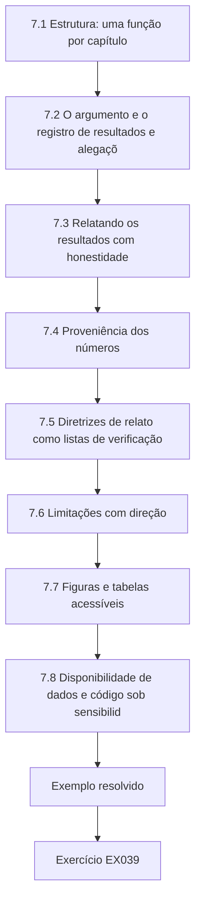

### Desenho lógico

```mermaid
flowchart LR
  N0["7.1 Estrutura: uma função por capítulo"]
  N1["7.2 O argumento e o registro de resultados e alegaçõ"]
  N2["7.3 Relatando os resultados com honestidade"]
  N3["7.4 Proveniência dos números"]
  N4["7.5 Diretrizes de relato como listas de verificação"]
  N5["7.6 Limitações com direção"]
  N6["7.7 Figuras e tabelas acessíveis"]
  N7["7.8 Disponibilidade de dados e código sob sensibilid"]
  N0 --> N1 --> N2 --> N3 --> N4 --> N5 --> N6 --> N7 --> Q["EX039"]
```

```text
[7.1 Estrutura: uma função por capítulo]
    |
    v
[7.2 O argumento e o registro de resultados e alegaçõ]
    |
    v
[7.3 Relatando os resultados com honestidade]
    |
    v
[7.4 Proveniência dos números]
    |
    v
[7.5 Diretrizes de relato como listas de verificação]
    |
    v
[7.6 Limitações com direção]
    |
    v
[7.7 Figuras e tabelas acessíveis]
    |
    v
[7.8 Disponibilidade de dados e código sob sensibilid]
    |
    v
[Exemplo resolvido] --> [Exercício EX039]
```
<!-- open-cyber-academy:lesson-figures:end ch-07 -->


### Objetivos de aprendizagem e conexão

Ao fim deste capítulo, o estudante será capaz de:

1. Estruturar uma dissertação de mestrado empírica de modo que cada capítulo tenha uma única função e o argumento corra visivelmente da pergunta à conclusão.
2. Manter um **registro de resultados e alegações** que ligue cada alegação do resumo, da discussão e da conclusão a um resultado específico e aos seus limites.
3. Relatar as estimativas com a sua incerteza, evitar a linguagem dicotômica da "significância" e calibrar os verbos causais ao desenho.
4. Tornar cada número do texto rastreável até a saída da análise e verificá-lo com um script.
5. Usar diretrizes de relato para dados observacionais, dados coletados rotineiramente e dados qualitativos como listas de verificação.
6. Escrever limitações que declarem a **direção** e o tamanho provável de cada viés e o que o resolveria.
7. Produzir figuras e tabelas acessíveis e uma declaração de disponibilidade de dados e código que respeite a sensibilidade da informação.

Este capítulo transforma os Capítulos 1–6 num documento que um examinador pode avaliar. O Capítulo 8 prepara essa avaliação.

### 7.1 Estrutura: uma função por capítulo

Uma dissertação de mestrado empírica típica tem as partes a seguir. Os limites de palavras variam conforme a instituição; as proporções abaixo são um ponto de partida comum para uma dissertação de 20.000 palavras. O que importa não é a proporção exata, mas que cada parte faça apenas a sua função e não invada a das outras.

| Parte | Sua única função | Parcela aproximada |
|---|---|---|
| Resumo | Declarar a pergunta, o desenho, os principais resultados com incerteza e a principal limitação | 300 palavras |
| 1 Introdução | Estabelecer o problema, a decisão que ele afeta e as perguntas | 10% |
| 2 Revisão da literatura | Mostrar o que se sabe e a lacuna, conceito por conceito (a matriz do Capítulo 1) | 20% |
| 3 Métodos | Permitir que um leitor reproduza o estudo: desenho, dados, ética, análise, desvios | 20% |
| 4 Resultados | Relatar o que foi encontrado para cada pergunta, sem interpretação além dos dados | 20% |
| 5 Discussão | Responder às perguntas, relacioná-las com a literatura, explicar os mecanismos, declarar as implicações | 20% |
| 6 Limitações e conclusão | Delimitar as alegações; dizer o que se segue e o que não se segue | 10% |
| Apêndices | Livro de códigos, plano de pré-análise e registro de desvios, relatórios de auditoria, roteiro de entrevista, materiais de consentimento, listas de verificação de relato | — |

Escreva primeiro os métodos (eles já estão no plano de pré-análise), depois os resultados, depois a discussão, e a introdução e o resumo por último, quando você souber o que a dissertação de fato mostra. Muitas dissertações fracas são fracas porque a introdução foi escrita primeiro e prometeu uma constatação que os resultados não entregaram.

### 7.2 O argumento e o registro de resultados e alegações

Os examinadores seguem o fio que vai das perguntas do Capítulo 1 às respostas da conclusão. Torne-o visível: cada pergunta de pesquisa é respondida explicitamente na discussão, com a mesma redação, e a conclusão repete essas respostas na sua forma delimitada.

Um **registro de resultados e alegações** é uma tabela que você mantém enquanto escreve e anexa como apêndice ou usa em privado antes da entrega. Cada linha é uma alegação que aparece em algum ponto da dissertação:

| ID | Alegação (tal como escrita) | Onde aparece | Resultado que a sustenta | Escopo e condições | Status |
|---|---|---|---|---|---|
| C1 | "As chegadas de ambulâncias ao DE vizinho mais próximo subiram cerca de um quarto durante o desvio." | Resumo, 5.1, 6 | Tabela 4.2: +24,4% (6,7% a 44,9%); posto placebo 1/16 | Um evento sintético; em relação a Wexmoor; tendências paralelas presumidas | Sustentada |
| C2 | "O aumento diminuiu com a distância." | Resumo, 5.2 | Estimativas pontuais de 24,4%, 5,8%, 0,8% | Os intervalos de Brookfield e de Calloway se sobrepõem | Sustentada apenas para o mais próximo versus os demais |
| C3 | "Brookfield não foi afetado." | Minuta de 5.2 | Tabela 4.2: +5,8% (−6,7% a 19,9%) | — | **Não sustentada** — inconclusiva, reescrever |
| C4 | "O desvio aumentou os tempos de espera em seis minutos." | Minuta do resumo | Tabela 4.3: +5,9 (2,6 a 9,2), não controlada | Confundida pela estação | **Exagerada** — reescrever como coerente com um aumento cujo tamanho está confundido |
| C5 | "A carga seguiu a geografia viária." | 5.3 | Tema T1 (I02, I04, I07, I09) e o gradiente | Relatos de entrevistas; uma região | Sustentada como mecanismo |

O registro capta a falha mais comum: uma alegação que cresceu no caminho dos resultados ao resumo.

### 7.3 Relatando os resultados com honestidade

#### 7.3.1 Estimativas e intervalos, não veredictos

Relate a estimativa, o seu intervalo e o que o intervalo descarta. "As chegadas a Alder Point subiram 24,4% (intervalo de 95% de 6,7% a 44,9%)" carrega informação; "um aumento estatisticamente significativo (p < 0,05)" carrega menos e convida a leituras erradas. A [declaração da American Statistical Association sobre os valores-p](https://doi.org/10.1080/00031305.2016.1154108) (Wasserstein e Lazar, 2016) estabelece princípios, entre eles o de que os valores-p não medem a probabilidade de uma hipótese ser verdadeira, o de que as conclusões científicas não devem se apoiar apenas em um valor-p ultrapassar um limiar e o de que um valor-p não mede o tamanho nem a importância de um efeito. Para um resultado inconclusivo, relate o que o intervalo exclui: o intervalo de Calloway exclui aumentos acima de cerca de 12%; o de Brookfield não exclui nem o zero nem um aumento de 20%.

#### 7.3.2 Verbos calibrados

| Sustentação do desenho | Redação adequada | Evitar |
|---|---|---|
| Contagem descritiva | "foi registrado", "foi observado" | "mostrou que X causa" |
| Associação | "esteve associado a", "coocorreu com" | "levou a", "causou" |
| Desenho controlado com pressupostos declarados | "subiu em relação à região de comparação", "estima-se que tenha aumentado, presumindo que…" | "prova", "demonstra conclusivamente" |
| Evidências quantitativas e qualitativas convergentes | "é coerente com", "sugere que o mecanismo foi…" | "estabelece" |

A linguagem causal não é proibida; uma ITS controlada é um desenho causal. Ela precisa vir acompanhada dos seus pressupostos no mesmo parágrafo.

#### 7.3.3 Multiplicidade

O Spillover Study teve um desfecho primário (chegadas), três locais e um desfecho secundário. Declare nos métodos quais estimativas são primárias, relate todas e não selecione a mais chamativa para o resumo. Quando muitos desfechos são examinados, alguns parecerão notáveis por acaso; o desfecho primário pré-especificado é a defesa.

### 7.4 Proveniência dos números

Cada número do texto deve vir da saída da análise, e não da memória ou de uma minuta anterior. Três práticas ajudam: gerar as tabelas de resultados diretamente a partir dos scripts; manter um arquivo de resultados legível por máquina da execução final; e conferir o texto contra ele antes da entrega. O Laboratório 7 abaixo automatiza uma primeira passada.

O arredondamento merece uma regra própria. A estimativa principal do Spillover Study é 24,4% na Tabela 4.2 e 24% no resumo reescrito; as duas só estão corretas se a dissertação declarar que o resumo arredonda para percentuais inteiros. Mantenha a mesma precisão para a mesma grandeza em todos os capítulos e registre as unidades ao lado de cada valor no arquivo de resultados, para que um percentual não possa ser confundido com uma contagem de minutos. Quando um número muda numa reexecução tardia, procure o valor antigo no texto inteiro, incluindo as legendas, o resumo e os apêndices, antes de reenviar a minuta.

### 7.5 Diretrizes de relato como listas de verificação

As diretrizes de relato listam o que um leitor precisa para avaliar um estudo; usá-las como lista de verificação durante a redação evita omissões. As pertinentes a este campo:

- **STROBE**, para estudos observacionais ([von Elm et al., 2007](https://doi.org/10.1016/S0140-6736(07)61602-X)).
- **RECORD**, sua extensão para estudos que usam dados de saúde coletados rotineiramente ([Benchimol et al., 2015](https://doi.org/10.1371/journal.pmed.1001885)) — pertinente sempre que os dados vêm de sistemas operacionais não desenhados para a pesquisa, o que quase sempre é verdade na pesquisa de infraestrutura.
- **SRQR** ([O'Brien et al., 2014](https://doi.org/10.1097/ACM.0000000000000388)) e **COREQ** ([Tong, Sainsbury e Craig, 2007](https://doi.org/10.1093/intqhc/mzm042)), para pesquisa qualitativa e entrevistas.
- Para séries temporais interrompidas não há um padrão de relato único; [Lopez Bernal et al. (2017)](https://doi.org/10.1093/ije/dyw098) e a revisão metodológica de [Hategeka et al. (2020)](https://doi.org/10.1136/bmjgh-2020-003567) identificam o que os leitores precisam: o modelo de impacto, o tratamento da autocorrelação, da sazonalidade e das tendências, e a série de controle.

Anexe as listas de verificação preenchidas como apêndices, com referências às páginas ou seções.

### 7.6 Limitações com direção

Uma lista de fraquezas ("amostra pequena; uma região; possível confundimento") não diz a um examinador nada que ele não pudesse ter adivinhado. Uma **limitação com direção** declara o problema, o seu efeito provável sobre a estimativa principal (direção e tamanho aproximado), o que o estudo fez a respeito e o que o resolveria.

| Limitação | Efeito provável sobre a estimativa principal | O que foi feito | O que a resolveria |
|---|---|---|---|
| Tendências paralelas presumidas entre Tamsin Valley e Wexmoor | Qualquer direção; se a estação de Wexmoor foi mais branda, os efeitos estão superestimados | Razão pré-evento inspecionada; cada DE de Wexmoor usado separadamente (Capítulo 8) | Mais regiões de comparação; controle sintético com mais doadores |
| Um evento, uma região | Nenhum viés em si; limita a transferência, sobretudo para regiões sem um sistema dominante | Estrutura da região descrita | Análise agregada de vários eventos com métodos para momentos escalonados |
| As chegadas de ambulâncias medem transportes, e não necessidade | Subestima a carga se a gravidade subiu mais do que as contagens | Entrevistas sobre a gravidade (T3) | Contagens ponderadas pela gravidade a partir das categorias de triagem |
| O modelo do tempo de espera não tem comparação | Superestima o efeito do desvio sobre o tempo de espera (estação incluída) | Relatado como confundido | Uma série de comparação para os tempos de espera |
| Resolução diária | Subestima a sobrecarga de pico, que se concentrou à noite (T3) | Anotado na discussão | Dados por hora |
| Brookfield com poder insuficiente | Enviesa a interpretação para "nenhum efeito", se mal lido | Relatado como inconclusivo, com o intervalo | Agregar os vizinhos; mais eventos |
| Entrevistas depois do evento | A retrospectiva pode fazer o mecanismo parecer mais coerente do que foi | Perguntas ancoradas em registros datados | Registros contemporâneos; entrevistas logo após os eventos |
| Revisão das minutas pelos parceiros | Possível pressão por uma redação mais branda | Acordo sem veto; mudanças registradas | Replicação independente |

### 7.7 Figuras e tabelas acessíveis

Siga as expectativas do [padrão do livro](../../../../../BOOK_STANDARD.md) no seu próprio trabalho: cada figura tem uma legenda que declara a sua mensagem e uma alternativa textual que transmite o seu conteúdo a um leitor que não pode vê-la; a cor nunca é o único portador de significado; as tabelas têm cabeçalhos descritivos e, quando complexas, um resumo de uma frase em linguagem simples. A alternativa textual de uma figura de estudo de evento poderia dizer: *"Razão logarítmica diária entre as chegadas de Alder Point e as de Wexmoor, dias −180 a +89, com a tendência ajustada. A razão é plana antes do dia 0, sobe cerca de 0,2 na escala logarítmica durante os dias 0–20 e volta para perto da tendência depois do dia 34."* Escreva os números no texto com a mesma precisão das tabelas.

### 7.8 Disponibilidade de dados e código sob sensibilidade

Os estudos de infraestrutura muitas vezes não podem liberar os seus dados. Diga o que está disponível, em que nível, e por que o resto não está:

> *O código e os dados de teste sintéticos estão disponíveis no repositório do projeto [link], sob CC0. Os agregados diários dos DEs foram fornecidos pelos hospitais participantes sob acordos de dados que não permitem a redistribuição; os pesquisadores podem solicitar acesso aos custodiantes, cujas vias de contato estão listadas no Apêndice C. As transcrições das entrevistas não estão disponíveis porque se prometeu confidencialidade aos participantes e alguns poderiam ser identificados pela função. Os números de capacidade por instalação foram retidos por seu potencial de auxiliar na definição de alvos; os resumos regionais são relatados no Capítulo 4.*

Uma declaração como esta atende ao espírito dos princípios FAIR para o que pode ser compartilhado e é honesta sobre o que não pode.

### 7.9 Exemplo resolvido: reescrevendo o resumo (sintético)

O primeiro resumo do candidato terminava assim: *"Este estudo prova que os ataques de ransomware aumentam significativamente a superlotação dos departamentos de emergência em toda a região, demonstrando a necessidade urgente de investimento em ciber-resiliência."* O registro de resultados e alegações sinalizou quatro problemas: "prova" (o desenho sustenta uma estimação sob pressupostos); "ransomware" (a exposição foi o desvio); "em toda a região" (só o DE mais próximo mostrou um aumento claro); "necessidade urgente de investimento" (o estudo não avaliou nenhum investimento). Conclusão reescrita do resumo:

> *Durante um desvio de ambulâncias de 21 dias induzido por ransomware, numa região sintética, as chegadas de ambulâncias ao departamento de emergência vizinho mais próximo subiram cerca de 24% (intervalo de 95% de 7% a 45%) em relação a uma região de comparação não afetada; as estimativas nos departamentos mais distantes foram pequenas e inconclusivas. As entrevistas indicaram que as ambulâncias desviadas seguiram a geografia viária e que os vizinhos souberam do desvio informalmente. Os planos regionais de desvio podem precisar de arranjos explícitos de compartilhamento da carga e de notificação; se eles reduzem a sobrecarga não foi testado.*

### 7.10 Atividade prática: proveniência dos números

O laboratório guarda os resultados do Laboratório 6 e um parágrafo de minuta escrito em parte de memória. Ele extrai todos os números do texto, verifica se cada um corresponde a um resultado registrado (admitindo arredondamento) e sinaliza a redação que exagera. Salve-o como `lab7_provenance.py`: a resposta resolvida do EX039 lê a minuta a partir desse arquivo.

```python
# Lab 7 - every number in the results text must trace to the analysis output (offline)
# RESULTS mirrors the Lab 6 output; DRAFT is a synthetic dissertation paragraph written from memory.
import re

RESULTS = {                      # value, as a percentage or a count, from the analysis log
    "AP_effect": 24.4, "AP_lo": 6.7, "AP_hi": 44.9,
    "BF_effect": 5.8, "BF_lo": -6.7, "BF_hi": 19.9,
    "CG_effect": 0.8, "CG_lo": -9.3, "CG_hi": 12.1,
    "AP_naive": 33.0, "placebo_n": 15, "event_days": 21,
}
DRAFT = """During the 21-day diversion, ambulance arrivals at Alder Point rose by 24.4%
(95% interval 6.7% to 44.9%) relative to the Wexmoor comparison hospitals, larger than any of
the 16 placebo windows. Brookfield rose by 5.8% (-6.7% to 19.9%) and Calloway by 0.8%.
A simple before-and-after comparison would have suggested a 33% rise. The attack caused
a significant increase in arrivals at Brookfield, and waiting times rose by 6 minutes."""
CAUSAL = ("caused", "proves", "significant increase", "due to the attack")

values = set(RESULTS.values())
def traced(x):
    return any(abs(x - v) <= 0.05 or (float(x).is_integer() and abs(x - round(v)) == 0) for v in values)

problems = []
for m in re.finditer(r"-?\d+(?:\.\d+)?", DRAFT):
    x = float(m.group())
    if x == 95:                  # the interval level, declared in the methods
        continue
    if not traced(x):
        problems.append(f"untraced number {m.group()!r}")
for phrase in CAUSAL:
    if phrase in DRAFT.lower():
        problems.append(f"check wording: {phrase!r}")
print("\n".join(problems) if problems else "all numbers traced")
```

Saída esperada:

```text
untraced number '16'
check wording: 'caused'
check wording: 'significant increase'
```

A verificação encontrou três problemas: "16 placebo windows" (eram 15; 16 é o denominador do posto), "caused" e "significant increase" aplicados a Brookfield, cujo resultado é inconclusivo. Ela **deixou passar** dois: "waiting times rose by 6 minutes" passou apenas porque 6 corresponde ao *percentual arredondado de Brookfield* (5,8%) — uma falsa correspondência entre unidades —, e o resultado do tempo de espera nem está em `RESULTS`; e a estimativa de Calloway é dada sem o seu intervalo. Um script é uma primeira passada: ele capta erros de transcrição a baixo custo, mas só um leitor com o registro de resultados e alegações capta uma alegação errada em substância. O EX039 pede que você melhore a verificação.

### 7.11 Erros comuns e limites

- Escrever a introdução primeiro e deixar que ela prometa resultados.
- Alegações que crescem entre os resultados, a discussão e o resumo.
- "Estatisticamente significativo" como conclusão; "não significativo" como "nenhum efeito".
- Verbos causais sem pressupostos, ou timidez causal quando o desenho sustenta uma estimativa causal qualificada.
- Números digitados de memória; tabelas coladas de uma execução anterior.
- Uma seção de limitações que lista fraquezas sem direção nem resolução.
- Figuras sem alternativas textuais; codificações apenas por cor.
- Declarações de dados que prometem uma disponibilidade que os acordos não permitem, ou que publicam números sensíveis por instalação.

O limite da boa redação é que ela não consegue salvar um desenho fraco; sua função é tornar visíveis as forças e as fraquezas do desenho, para que os leitores possam julgar as alegações corretamente.

### Exercícios — capítulo 7

**EX039 — Melhore a verificação de proveniência.** *Objetivo:* usar e estender o Laboratório 7. *Insumos:* o código do laboratório. *Restrições:* off-line. *Passos:* (1) executar o laboratório e registrar a saída; (2) alterar a verificação para que cada número seja comparado apenas com resultados da mesma unidade (percentual ou minutos), usando a palavra que segue o número; (3) acrescentar a `RESULTS` o resultado do tempo de espera (5,9 minutos, intervalo de 2,6 a 9,2) com a sua unidade; (4) acrescentar uma verificação de que cada estimativa de local é seguida de um intervalo; (5) reescrever a minuta para que a verificação passe e o texto fique exato. *Evidência esperada:* código, saída e parágrafo corrigido. *Rubrica:* 3 = a correspondência por unidade capta a falsa correspondência minutos/percentual, o intervalo ausente de Calloway é sinalizado, o parágrafo corrigido tem números exatos, verbos calibrados e Brookfield descrito como inconclusivo; 2 = falta uma verificação; 1 = apenas o texto corrigido; 0 = nada.

**EX040 — Limitações com direção.** *Objetivo:* escrever limitações que informem. *Insumos:* um estudo sintético que estima o efeito de uma interrupção de um processador de pagamentos sobre as dispensações de receitas em farmácias, usando dados semanais de uma única rede. *Restrições:* pelo menos cinco limitações no formato de §7.6. *Passos:* para cada uma, declarar a direção provável e o tamanho aproximado do viés, o que foi feito e o que a resolveria; ordená-las pela ameaça à conclusão principal. *Evidência esperada:* tabela e ordenação. *Rubrica:* 3 = direções fundamentadas (por exemplo, a resolução semanal dilui um efeito de três dias em direção a zero; os clientes de uma rede podem migrar para os concorrentes, o que superestimaria a queda do total de dispensações), ordenação justificada; 2 = falta uma direção; 1 = lista sem direção; 0 = nada.

**EX041 — Resumo estruturado.** *Objetivo:* comprimir sem exagerar. *Insumos:* a saída do Laboratório 6 e §6.6.4. *Restrições:* 300 palavras; contexto, objetivo, desenho, cenário, desfechos, resultados com intervalos, conclusões, principal limitação; status sintético declarado. *Passos:* (1) redigir; (2) conferir cada alegação contra o registro de resultados e alegações; (3) pedir a um colega que identifique a principal limitação apenas a partir do resumo. *Evidência esperada:* resumo e trecho do registro. *Rubrica:* 3 = números exatos com intervalos, exposição corretamente nomeada como o desvio, locais distantes descritos como inconclusivos, limitação explícita, status sintético declarado; 2 = um exagero; 1 = sem intervalos; 0 = nada.

**EX042 — Mapeamento da lista de verificação de relato.** *Objetivo:* usar as diretrizes como listas de verificação. *Insumos:* a declaração RECORD e os métodos do Spillover Study tal como descritos nos Capítulos 3, 5 e 6. *Restrições:* mapear pelo menos oito itens. *Passos:* (1) listar oito itens do RECORD ou do STROBE pertinentes ao estudo; (2) indicar a seção que trata de cada um; (3) identificar qualquer item que o estudo ainda não trate e redigir o texto faltante. *Evidência esperada:* tabela de mapeamento e texto redigido. *Rubrica:* 3 = itens corretamente escolhidos (fontes de dados, validação dos códigos, vinculação, limpeza dos dados, acesso à população), seções exatas, uma lacuna genuína encontrada (por exemplo, como foram validadas as definições de chegada de ambulância dos custodiantes) e tratada; 2 = mapeamento superficial; 1 = lista copiada sem mapeamento; 0 = nada.

**EX043 — Declaração de disponibilidade.** *Objetivo:* ser aberto dentro das restrições. *Insumos:* os níveis de sensibilidade do Capítulo 3 e um pedido de uma revista para que "todos os dados sejam disponibilizados publicamente". *Restrições:* um parágrafo mais uma resposta de duas frases ao editor. *Passos:* (1) listar o que pode ser liberado, em que nível; (2) escrever a declaração; (3) escrever a resposta explicando o que é retido e por quê, oferecendo uma alternativa (por exemplo, o acesso por meio dos custodiantes, ou dados sintéticos com a mesma estrutura). *Evidência esperada:* declaração e resposta. *Rubrica:* 3 = tudo o que é liberável é liberado, itens retidos justificados pelos acordos, pelo consentimento ou pelo risco de definição de alvos, via alternativa de acesso concreta; 2 = vago quanto às vias; 1 = promete liberar dados restritos; 0 = nada.

**EX044 — Figura acessível.** *Objetivo:* comunicar um resultado a todos os leitores. *Insumos:* as estimativas do Laboratório 6 para os três locais. *Restrições:* uma descrição da figura (não é preciso desenhá-la), legenda, alternativa textual e resumo em linguagem simples; nenhuma codificação apenas por cor. *Passos:* (1) escolher um tipo de figura (por exemplo, estimativas com barras de intervalo contra a distância); (2) escrever a legenda declarando a mensagem; (3) escrever a alternativa textual com todos os valores; (4) escrever um resumo de uma frase em linguagem simples. *Evidência esperada:* os quatro textos. *Rubrica:* 3 = tipo de figura adequado à comparação, legenda declara a mensagem e as estimativas distantes inconclusivas, alternativa textual completa, resumo exato para um não especialista; 2 = um texto incompleto; 1 = a legenda descreve em vez de informar; 0 = nada.

### Síntese do capítulo

Dê a cada parte da dissertação uma única função e escreva-as na ordem que mantém as promessas honestas: métodos, resultados, discussão e, depois, introdução e resumo. Mantenha um registro de resultados e alegações para que as alegações não possam crescer no caminho até o resumo. Relate as estimativas com intervalos e com o que elas excluem; evite veredictos de significância; calibre os verbos causais ao desenho e declare os pressupostos junto com eles. Torne cada número rastreável e verifique-o com um script, sabendo que os scripts captam erros de transcrição, mas não alegações erradas. Use STROBE, RECORD, SRQR e COREQ como listas de verificação. Escreva as limitações com direção e resolução. Torne as figuras acessíveis e declare a disponibilidade dos dados com honestidade, dentro das restrições dos acordos, do consentimento e da sensibilidade da infraestrutura.

<!-- open-cyber-academy:chapter-navigation:start ch-07 -->
### Continue estudando — capítulo 07 de 08

[← Capítulo 06](#ch-06) · [Índice de capítulos do curso](../SUBJECTS.md) · [Capítulo 08 →](#ch-08)

Siga para a próxima lição escrita.
<!-- open-cyber-academy:chapter-navigation:end -->

<a id="ch-08"></a>

## Capítulo 8 — Revisão independente e defesa

<!-- open-cyber-academy:lesson-figures:start ch-08 -->
### Mapa da aula

Aula 08 publicada. Mapa, exemplo, EX045.

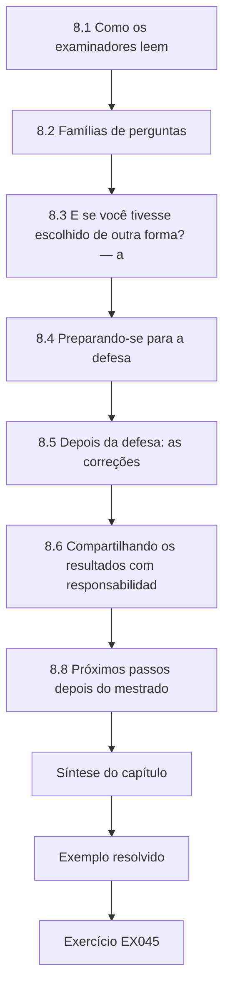

### Desenho lógico

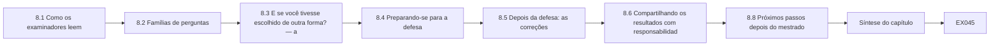

```text
[8.1 Como os examinadores leem]
    |
    v
[8.2 Famílias de perguntas]
    |
    v
[8.3 E se você tivesse escolhido de outra forma? — a]
    |
    v
[8.4 Preparando-se para a defesa]
    |
    v
[8.5 Depois da defesa: as correções]
    |
    v
[8.6 Compartilhando os resultados com responsabilidad]
    |
    v
[8.8 Próximos passos depois do mestrado]
    |
    v
[Síntese do capítulo]
    |
    v
[Exemplo resolvido] --> [Exercício EX045]
```
<!-- open-cyber-academy:lesson-figures:end ch-08 -->


### Objetivos de aprendizagem e conexão

Ao fim deste capítulo, o estudante será capaz de:

1. Explicar como os examinadores costumam ler uma dissertação e preparar o documento e o candidato para essa leitura.
2. Antecipar as famílias de perguntas que os examinadores fazem a um estudo aplicado e preparar respostas baseadas em evidências, incluindo respostas honestas do tipo "não sei".
3. Responder a "e se você tivesse escolhido de outra forma?" com uma **curva de especificação** que mostre como a estimativa principal depende de escolhas analíticas defensáveis — e explicar por que a robustez às escolhas não é o mesmo que acurácia.
4. Conduzir uma defesa simulada e usá-la para encontrar lacunas no trabalho, e não apenas na apresentação.
5. Responder ao parecer dos examinadores com uma tabela de correções que associe cada comentário a uma ação e a um local.
6. Compartilhar as constatações com os parceiros e com o setor sem revelar informações sensíveis, e encaminhar à parte certa qualquer fraqueza de segurança encontrada incidentalmente.

Este capítulo fecha o ciclo da dissertação que começou no Capítulo 1. Ele se apoia em todos os capítulos anteriores: a pergunta e o escopo (1), a literatura e o mapa do seminário (2), o desenho e a ética (3), a tabela de rivais (4), os elementos fixados da proposta (5), a análise (6) e o registro de resultados e alegações (7).

### 8.1 Como os examinadores leem

Os formatos de exame variam muito. Algumas dissertações de mestrado são avaliadas apenas a partir do documento escrito, por um examinador interno e um externo; outras incluem uma defesa oral (viva voce) ou uma apresentação. Os resultados comuns incluem a aprovação, a aprovação com correções menores ou maiores, a reapresentação ou a reprovação; o regulamento da sua instituição é a única autoridade sobre quais se aplicam.

A pesquisa sobre como examinadores experientes avaliam teses — sobretudo no nível do doutorado, mas instrutiva para o trabalho de mestrado — sugere padrões para os quais vale a pena se preparar. [Mullins e Kiley (2002)](https://doi.org/10.1080/0307507022000011507) entrevistaram examinadores experientes e relataram que eles geralmente esperam que uma tese seja aprovada, formam as primeiras impressões a partir dos capítulos de abertura e de fechamento, procuram coerência entre a pergunta, o trabalho e as conclusões e se irritam com o descuido na apresentação, que tinge a leitura do resto. As implicações práticas são simples: o resumo, a introdução e a conclusão precisam ser precisos e consistentes; as perguntas precisam ser respondidas visivelmente, na ordem em que foram feitas; e pequenos erros — números inconsistentes, referências quebradas, figuras sem rótulo — custam mais do que o seu tamanho sugere. A verificação de proveniência e o registro de resultados e alegações do Capítulo 7 existem exatamente para esse leitor.

### 8.2 Famílias de perguntas

As perguntas dos examinadores sobre um estudo aplicado de infraestrutura caem em famílias reconhecíveis. Prepare pelo menos duas perguntas por família, com respostas que citem as suas evidências.

| Família | Pergunta típica | O que uma boa resposta contém |
|---|---|---|
| Pergunta e contribuição | "Por que esta pergunta importa, e o que o seu estudo acrescenta?" | A decisão que ela informa; a lacuna da matriz de conceitos; o que é novo (desenho controlado, gradiente de distância, mecanismo) |
| Escolha do desenho | "Por que não um controle sintético?" | Conjunto de doadores pequeno demais (dois DEs de comparação); pressupostos de cada desenho comparados |
| Dados e medição | "O que significa uma 'chegada de ambulância' nestes sistemas?" | As definições dos custodiantes; a auditoria; a regra dos dias de indisponibilidade; o que a contagem deixa de fora (a gravidade) |
| Escolhas da análise | "E se você tivesse usado outra comparação ou outra linha de base?" | A curva de especificação (§8.3) |
| Rivais | "A estação não poderia explicar isto?" | A previsão distinta do rival e o teste: Wexmoor, janelas placebo, tempo |
| Ética e sensibilidade | "Os seus resultados poderiam ajudar um atacante?" | Níveis de sensibilidade; o que foi retido e por quê; relato regional |
| Limitações | "Qual é a parte mais fraca do estudo?" | A limitação com direção mais bem classificada e o seu efeito provável |
| Transferência | "Isto aconteceria numa cidade com dez hospitais?" | O mecanismo (transferência de carga limitada pela capacidade ociosa e pelas rotas dos pares) prevê efeitos menores por hospital onde a carga se espalha; não testado |
| Implicações | "O que uma coalizão deveria fazer de diferente?" | Apenas o que as evidências sustentam, com o grau de confiança; o que não foi testado |
| Próximo estudo | "Se você tivesse mais um ano?" | O estudo que mais reduziria a incerteza: mais eventos agregados, dados por hora, gravidade |

### 8.3 "E se você tivesse escolhido de outra forma?" — a curva de especificação

#### 8.3.1 A ideia

Toda análise envolve escolhas defensáveis de mais de uma forma: a duração da linha de base, as unidades de comparação, a duração da janela do evento, a exclusão ou não dos feriados. Uma análise primária pré-especificada protege contra escolher depois de ver os resultados (Capítulo 6), mas um examinador pode razoavelmente perguntar se a conclusão depende das escolhas específicas feitas. Uma **curva de especificação** responde estimando o efeito sob todas as combinações de escolhas razoáveis e relatando a distribuição inteira ([Simonsohn, Simmons e Nelson, 2020](https://doi.org/10.1038/s41562-020-0912-z)); uma **análise multiverso** aplica a mesma ideia às escolhas de processamento dos dados ([Steegen et al., 2016](https://doi.org/10.1177/1745691616658637)). A estimativa pré-especificada continua primária; a curva mostra quão frágil ou robusta ela é.

#### 8.3.2 Atividade prática: a curva de especificação do Spillover

Salve primeiro o Laboratório 4 como `lab4_data.py` e o Laboratório 6 como `lab6_its.py`. O laboratório abaixo estima o efeito em Alder Point sob 54 especificações: linha de base de 90, 120 ou 180 dias; comparação W1, W2 ou agregada; janela do evento de 14, 21 ou 28 dias; feriados mantidos ou retirados.

```python
# Lab 8 - specification curve for the examiner's "what if you had chosen differently?" (offline)
# Save Lab 4 as lab4_data.py and Lab 6 as lab6_its.py in the same folder first.
import itertools, statistics
from lab4_data import make_region, DAYS
from lab6_its import cits

d = make_region()
controls = {"W1": d["W1"], "W2": d["W2"], "pooled": {t: d["W1"][t] + d["W2"][t] for t in DAYS}}
specs = []
for pre_len, ctrl, ev_len, drop_hol in itertools.product((90, 120, 180), controls, (14, 21, 28), (False, True)):
    drop = frozenset({-100, 45}) if drop_hol else frozenset()
    est, lo, hi = cits(d["AP"], controls[ctrl], pre_len=pre_len, ev_len=ev_len, drop=drop)
    specs.append((est, lo, hi, pre_len, ctrl, ev_len, drop_hol))
specs.sort()
ests = [s[0] for s in specs]
print(f"specifications: {len(specs)}")
print(f"median effect {statistics.median(ests):+.3f}; range {ests[0]:+.3f} to {ests[-1]:+.3f}")
print(f"intervals excluding zero: {sum(s[1] > 0 for s in specs)} of {len(specs)}")
for label, idx in (("pre_len", 3), ("control", 4), ("event_len", 5), ("drop_holidays", 6)):
    groups = {}
    for s in specs:
        groups.setdefault(s[idx], []).append(s[0])
    print(label + ": " + ", ".join(f"{k}={statistics.median(v):+.3f}" for k, v in sorted(groups.items(), key=lambda kv: str(kv[0]))))
print("lowest three:", [(round(s[0], 3), s[3], s[4], s[5], s[6]) for s in specs[:3]])
```

Saída esperada:

```text
specifications: 54
median effect +0.245; range +0.199 to +0.332
intervals excluding zero: 54 of 54
pre_len: 120=+0.237, 180=+0.205, 90=+0.271
control: W1=+0.221, W2=+0.259, pooled=+0.238
event_len: 14=+0.237, 21=+0.260, 28=+0.217
drop_holidays: False=+0.244, True=+0.246
lowest three: [(0.199, 180, 'pooled', 14, False), (0.201, 180, 'pooled', 14, True), (0.202, 180, 'W2', 28, False)]
```

Lendo a curva:

- **A conclusão de Alder Point é robusta a estas escolhas.** Todos os 54 intervalos excluem o zero; a estimativa mediana é +24,5% e a faixa vai de +19,9% a +33,2%. Nenhuma escolha razoável deste conjunto transforma o aumento em "nenhum efeito".
- **As escolhas ainda movem a estimativa.** Linhas de base mais curtas dão estimativas maiores (mediana de +27,1% com 90 dias, +20,5% com 180), porque a tendência linear ajustada a um período mais curto é menos estável. W2 como única comparação dá estimativas maiores do que W1. Uma janela de 21 dias dá a maior mediana porque coincide com o período verdadeiro do desvio; 14 dias omitem parte dele e 28 dias o diluem com a cauda.
- **Os feriados quase não importam** (mediana de +24,4% mantidos, +24,6% retirados): os feriados regionais caem fora da janela do evento e afetam as duas regiões.

Executar a mesma curva para Brookfield (EX045) dá uma mediana de +2,5%, uma faixa de −1,5% a +6,9% e **nenhum** intervalo que exclua o zero. O resultado de Brookfield é robustamente inconclusivo — e, no entanto, o efeito verdadeiro do gerador era +10%, acima de cada uma das 54 estimativas pontuais. Este é o limite da curva de especificação: ela mostra quanto uma conclusão depende das *escolhas analíticas*, mas todas as especificações usam os mesmos dados, com o mesmo ruído. Robustez às escolhas não é acurácia. Só mais informação — mais eventos, mais vizinhos, dados mais finos — pode resolver Brookfield.

### 8.4 Preparando-se para a defesa

#### 8.4.1 O resumo de abertura

Se o formato incluir uma defesa oral, geralmente lhe pedirão que resuma o trabalho em 10–15 minutos. Use a estrutura da apresentação do seminário (Capítulo 2) aplicada ao seu próprio trabalho: a pergunta e por que ela importa; o desenho e os dados; os principais resultados com intervalos; o que o desenho descarta e o que deixa em aberto; as limitações e o que vem a seguir. Mostre a curva de especificação se for provável que os examinadores perguntem sobre as escolhas. Termine com a resposta delimitada a cada pergunta de pesquisa, nas palavras da dissertação.

#### 8.4.2 Defesas simuladas

Peça a duas pessoas que o examinem por uma hora — idealmente um metodologista e um profissional do setor — com as famílias de perguntas de §8.2. Grave a sessão com o consentimento delas. Depois, classifique cada pergunta que você respondeu mal num de três tipos:

1. **Lacunas de apresentação:** você sabia a resposta, mas não conseguiu encontrá-la ou dizê-la com clareza. Corrija com preparação.
2. **Lacunas do documento:** a dissertação não contém informações que deveria conter. Corrija a dissertação antes da entrega, se possível, ou prepare uma resposta honesta.
3. **Lacunas do trabalho:** o estudo não consegue responder à pergunta. Não as esconda; prepare-se para declará-las como limitações e para descrever o estudo que as trataria.

#### 8.4.3 Respondendo

Use os três registros do seminário: "a dissertação mostra…", "eu infiro…", "não sei; seria preciso…". Conceda prontamente o que deve ser concedido; defender um ponto indefensável prejudica a credibilidade dos defensáveis. Quando um examinador propuser uma análise alternativa, não improvise um resultado novo na sala; explique o que você esperaria e por quê, e ofereça-se para executá-la como correção, se for solicitado. Quando lhe perguntarem sobre o mundo real, lembre-se do escopo: no estudo sintético deste livro, nada se sabe sobre hospitais reais.

### 8.5 Depois da defesa: as correções

Os pareceres dos examinadores listam as correções exigidas, às vezes com recomendações. Responda com uma **tabela de correções**:

| # | Comentário do examinador | Resposta | Ação | Local |
|---|---|---|---|---|
| 1 | "O resumo descreve o resultado de Brookfield como mostrando nenhum efeito." | De acordo; o resultado é inconclusivo. | Resumo e §5.2 reescritos com o intervalo e o que ele exclui. | Resumo; p. 54 |
| 2 | "Justifique as dez entrevistas." | De acordo que a justificativa era rala. | Acrescentado um parágrafo sobre o poder informacional, com o objetivo, a especificidade da amostra e a qualidade do diálogo. | §3.6 |
| 3 | "Execute a análise com Calloway como comparação adicional." | Parcialmente de acordo: Calloway faz parte da hipótese da distância, então usá-lo como comparação presume a resposta da RQ2. | Acrescentada como análise de sensibilidade apenas para a RQ1, com esta ressalva. | Apêndice F |
| 4 | "O resultado do tempo de espera não deveria aparecer na conclusão." | De acordo. | Removido da conclusão; mantido nos resultados com a ressalva do confundimento. | §6 |

Quando discordar, diga-o com polidez, com razões e evidências, como na linha 3; os examinadores geralmente aceitam uma concordância parcial fundamentada. Guarde a tabela junto com a dissertação corrigida.

### 8.6 Compartilhando os resultados com responsabilidade

#### 8.6.1 Primeiro os parceiros

Antes de qualquer apresentação pública, dê aos parceiros a revisão factual e de informações protegidas prometida no acordo de dados (Capítulo 3), dentro do seu prazo fixo e sem veto sobre as constatações. Ofereça a cada parceiro um briefing privado que inclua tudo o que for específico dele — por exemplo, que o seu DE soube do desvio de forma informal e tardia. As constatações sobre as fraquezas de uma organização específica pertencem primeiro a essa organização.

#### 8.6.2 O setor e o público

Um briefing para a coalizão regional de saúde pode apresentar o padrão regional, o mecanismo e as recomendações com níveis de confiança:

- *Confiança moderada:* o DE aberto mais próximo nas principais rotas das ambulâncias absorve a maior parte da carga desviada nos primeiros dias; os planos deveriam nomeá-lo e prever apoio para o pico.
- *Confiança moderada:* os vizinhos precisam de uma notificação formal e precoce; o aviso informal pelas equipes que chegavam custou horas.
- *Confiança baixa (não testada):* regras explícitas de compartilhamento da carga pelo EMS reduziriam a sobrecarga de pico do DE mais próximo.

Não publique estimativas de capacidade ociosa por instalação nem uma lista ordenada de qual perda de hospital causaria a maior sobrecarga regional; esses produtos ajudariam quem buscasse maximizar o dano e acrescentariam pouco valor defensivo além das organizações em questão (aplicam-se as [questões de uso dual](../../../../doctorate-2-years/critical-sector-security/en/book/MANUSCRIPT.md#ch-06) do livro de doutorado). Regiões sintéticas ou anonimizadas são aceitáveis para publicação quando a estrutura não pode ser associada a um lugar real.

#### 8.6.3 Constatações de segurança incidentais

A pesquisa sobre operações às vezes revela uma fraqueza de segurança — um entrevistado menciona um serviço de acesso remoto exposto, ou um extrato de dados contém credenciais. Não a investigue, não a teste e não a descreva publicamente. Relate-a em privado à organização em questão, pelo contato indicado no seu acordo; se ela disser respeito a um produto de um fornecedor, e não à configuração de uma organização, a divulgação coordenada de vulnerabilidades por meio do fornecedor ou de um coordenador como o [programa de CVD da CISA](https://www.cisa.gov/resources-tools/programs/coordinated-vulnerability-disclosure-cvd-program) é a via estabelecida. Registre o que você fez e informe o seu orientador e o comitê de ética, se o seu protocolo o exigir.

### 8.7 Exemplo resolvido: uma troca na defesa simulada (sintético)

**Examinador (metodologista):** "O seu resultado principal depende de Wexmoor ter tido a mesma estação. Como você sabe que teve?"

**Candidato:** "A dissertação mostra que a razão pré-evento entre Alder Point e Wexmoor foi plana ao longo de 180 dias, sem ruptura de tendência, e que o resultado se mantém contra cada hospital de Wexmoor separadamente — a menor estimativa da curva de especificação é de cerca de 20%. Eu infiro que uma estação diferente em Wexmoor dificilmente explica todo o aumento. Não sei se a estação respiratória de Wexmoor começou exatamente no mesmo dia; seriam precisos dados regionais de vigilância que eu não tinha, e isso está nas limitações com a sua direção provável: se a estação de Wexmoor tivesse sido mais branda, a minha estimativa estaria alta demais."

**Examinador (profissional):** "Os gestores de Brookfield disseram que ficaram sobrecarregados. Os seus números dizem que nada aconteceu. Quem tem razão?"

**Candidato:** "Os meus números não dizem que nada aconteceu — a estimativa de Brookfield é +5,8%, com um intervalo de cerca de −7% a +20%, então eles não conseguem distinguir nenhuma variação de uma variação substancial. As entrevistas descrevem noites pesadas e uma falta simultânea de pessoal. O quadro conjunto relata isso como uma discordância, com três explicações possíveis. Resolvê-la exigiria dados por hora e registros de pessoal."

**Examinador:** "Então as coalizões deveriam planejar para o transbordamento além do hospital mais próximo?"

**Candidato:** "Este estudo não consegue dizer a elas quanto. Ele pode dizer que o DE mais próximo nas rotas principais recebeu a maior parte da carga neste evento e que a evidência para os hospitais mais distantes é inconclusiva, e não negativa."

As respostas usam os três registros, concedem prontamente, citam evidências e mantêm as alegações dentro do desenho.

### 8.8 Próximos passos depois do mestrado

Uma dissertação concluída deixa uma lista de estudos que reduziriam a sua incerteza restante: agregar vários eventos de desvio com métodos para momentos escalonados; desfechos por hora e ponderados pela gravidade; avaliar um protocolo de compartilhamento da carga. Alguns deles são projetos práticos para um operador ou uma coalizão; outros têm escala de doutorado. O [curso de doutorado desta área](../../../../doctorate-2-years/critical-sector-security/en/book/MANUSCRIPT.md) mostra como uma pergunta assim se torna uma contribuição original com validação independente. Na trilha de estudos, o próximo curso é a [trilha de doutorado em Cibersegurança](../../../../doctorate-2-years/cybersecurity/en/SUBJECTS.md).

### 8.9 Erros comuns e limites

- Tratar o resumo e a conclusão como formalidades; os examinadores os leem primeiro.
- Preparar respostas sobre a apresentação, mas não sobre as lacunas reais do trabalho.
- Tratar uma curva de especificação como prova de verdade, e não de robustez às escolhas.
- Improvisar análises novas na defesa.
- Defender todos os pontos por igual, incluindo os indefensáveis.
- Responder às correções sem uma tabela que associe cada comentário a uma mudança.
- Apresentar as constatações publicamente antes que os parceiros tenham feito a revisão acordada.
- Publicar detalhes de capacidade ou de vulnerabilidade por instalação.
- Investigar uma constatação de segurança incidental em vez de relatá-la em privado.

O limite do exame é que ele julga a dissertação, e não o mundo. Ser aprovado confirma que o estudo foi feito com competência e que suas alegações estão delimitadas; não torna gerais as constatações sintéticas ou de uma única região.

### Exercícios — capítulo 8

**EX045 — Curvas de especificação para dois locais.** *Objetivo:* usar o Laboratório 8. *Insumos:* Laboratórios 4, 6 e 8. *Restrições:* off-line. *Passos:* (1) executar o Laboratório 8 e registrar a saída; (2) substituir `d["AP"]` por `d["BF"]` e registrar a saída; (3) comparar as duas curvas; (4) explicar por que o efeito verdadeiro de 10% de Brookfield fica acima de todas as estimativas pontuais e o que isso diz sobre as curvas de especificação. *Evidência esperada:* saídas e um parágrafo. *Rubrica:* 3 = as duas saídas corretas, Brookfield descrito como robustamente inconclusivo, o limite (mesmos dados, mesmo ruído; robustez não é acurácia) explicado; 2 = uma saída errada; 1 = Brookfield descrito como "nenhum efeito"; 0 = nada.

**EX046 — Banco de perguntas.** *Objetivo:* preparar-se para os examinadores. *Insumos:* §8.2 e a sua dissertação ou a do Spillover. *Restrições:* duas perguntas por família; respostas de no máximo 120 palavras, citando evidências. *Passos:* (1) escrever as perguntas; (2) escrever as respostas usando os três registros; (3) marcar as três mais difíceis e a lacuna que cada uma revela (de apresentação, do documento ou do trabalho). *Evidência esperada:* banco de perguntas. *Rubrica:* 3 = as perguntas mais difíceis são de fato difíceis (tendências paralelas, discordância de Brookfield, transferência), as respostas citam evidências e concedem onde cabe, lacunas corretamente classificadas; 2 = respostas genéricas; 1 = perguntas fáceis; 0 = nada.

**EX047 — Tabela de correções.** *Objetivo:* responder aos examinadores. *Insumos:* um parecer sintético com quatro comentários: (a) "A revisão da literatura é autor por autor"; (b) "Por que o degrau pós-desvio foi incluído? Parece um jeito de absorver dados inconvenientes"; (c) "A seção de ética não menciona a revisão pelos parceiros"; (d) "Por favor, acrescente desfechos de pacientes". *Restrições:* o formato de tabela de §8.5. *Passos:* responder a cada um com de acordo, parcialmente de acordo ou em desacordo, dando razões e ações. *Evidência esperada:* tabela. *Rubrica:* 3 = (a) aceito e reestruturado por conceito, (b) defendido com a pré-especificação e a razão (evitar a contaminação da tendência pela cauda) e uma análise de sensibilidade oferecida, (c) aceito e acrescentado, (d) recusado por estar fora do escopo e das aprovações, com uma nota de trabalho futuro; 2 = uma resposta sem fundamentação; 1 = aceita tudo, inclusive (d); 0 = nada.

**EX048 — Defesa simulada e classificação das lacunas.** *Objetivo:* usar uma defesa simulada para melhorar o trabalho. *Insumos:* a sua dissertação ou os materiais do Spillover. *Restrições:* uma simulação de 45 minutos com dois examinadores; gravação consentida. *Passos:* (1) realizar a simulação; (2) listar cada resposta fraca; (3) classificá-las em lacunas de apresentação, do documento e do trabalho; (4) corrigir o que puder ser corrigido e redigir o texto de limitação para o resto. *Evidência esperada:* lista, classificação e correções. *Rubrica:* 3 = classificação honesta, com pelo menos uma lacuna do trabalho reconhecida, correções do documento feitas, texto de limitação com direção; 2 = todas as lacunas classificadas como de apresentação; 1 = sem simulação; 0 = nada.

**EX049 — Briefing para a coalizão.** *Objetivo:* compartilhar as constatações com responsabilidade. *Insumos:* os resultados e os temas do Spillover. *Restrições:* uma página; recomendações com níveis de confiança; um parágrafo "o que este estudo não mostra"; nenhum número de capacidade por instalação. *Passos:* (1) redigir; (2) marcar cada frase com a sua fonte na dissertação; (3) listar o que foi compartilhado em privado com cada parceiro, em vez disso. *Evidência esperada:* briefing e lista. *Rubrica:* 3 = recomendações rastreáveis e calibradas, recomendações não testadas rotuladas, limites explícitos, detalhes sensíveis encaminhados em privado; 2 = uma recomendação não calibrada; 1 = fraquezas específicas de instalações publicadas; 0 = nada.

**EX050 — O próximo estudo.** *Objetivo:* transformar as limitações numa proposta viável. *Insumos:* as limitações com direção de §7.6. *Restrições:* uma página; escolher a limitação cuja resolução mais mudaria as conclusões. *Passos:* (1) justificar a escolha; (2) declarar a pergunta e o estimando; (3) escolher um desenho e os dados de que ele precisa; (4) declarar o resultado que mudaria as decisões dos planejadores; (5) dizer se é um projeto de mestrado, de doutorado ou de profissionais, e por quê. *Evidência esperada:* proposta de uma página. *Rubrica:* 3 = a limitação escolhida é consequente (por exemplo, um único evento), desenho viável (eventos agregados com métodos para momentos escalonados, ou dados por hora ponderados pela gravidade), resultado relevante para decisões declarado, julgamento de escala fundamentado; 2 = desenho vago; 1 = repete o estudo original; 0 = nada.

### Síntese do capítulo

Os examinadores leem em busca de coerência e são influenciados pelo cuidado; torne o resumo, a introdução e a conclusão precisos e consistentes, e as respostas a cada pergunta visíveis. Prepare-se para famílias previsíveis de perguntas com evidências. Responda ao "e se" com uma curva de especificação que mantenha a estimativa pré-especificada como primária e mostre a sua dependência de escolhas razoáveis — lembrando que robustez às escolhas não é acurácia, como mostra a estimativa robustamente inconclusiva de um efeito real em Brookfield. Use as defesas simuladas para encontrar lacunas no trabalho, e não apenas na fala. Responda às correções com uma tabela associada e com razões. Compartilhe primeiro com os parceiros, publique padrões regionais em vez de fraquezas de instalações e encaminhe em privado as constatações de segurança incidentais. As limitações da dissertação tornam-se o próximo estudo.

<!-- open-cyber-academy:chapter-navigation:start ch-08 -->
### Continue estudando — capítulo 08 de 08

[← Capítulo 07](#ch-07) · [Índice de capítulos do curso](../SUBJECTS.md) · [Resoluções →](#worked-results)

Siga para a próxima lição escrita.
<!-- open-cyber-academy:chapter-navigation:end -->

<a id="worked-results"></a>

## Resoluções e notas de avaliação

Cada resolução mostra uma resposta defensável e explica o que a rubrica recompensa. Uma resposta diferente pode receber a pontuação máxima quando atende ao mesmo padrão de evidências, escopo e honestidade sobre os limites. Os resultados numéricos vêm dos laboratórios offline deste livro, executados com o Python 3 (a versão 3.13 foi usada neste rascunho) e apenas a biblioteca padrão; se sua saída for diferente, confira primeiro a versão do Python, a semente e se você mudou a ordem dos sorteios aleatórios.

### Capítulo 1: EX001–EX007

**EX001 — Do tema à pergunta.** *Problema:* os reguladores estaduais de água potável e as associações de concessionárias não sabem com que frequência os incidentes cibernéticos em concessionárias pequenas interrompem o tratamento ou o monitoramento, nem por quanto tempo, então os programas de apoio não podem ser direcionados. *Pergunta (forma PICOT):* entre os sistemas comunitários de água que atendem de 3.300 a 50.000 pessoas num estado (P), com que frequência os incidentes cibernéticos notificados à agência estadual de primazia (E) coincidiram com uma interrupção registrada do tratamento ou do monitoramento, em comparação com as falhas de equipamento não cibernéticas (C), medida como o número e a duração das interrupções (O) ao longo de cinco anos (T)? *FINER:* viável apenas se os registros de incidentes da agência de primazia distinguirem as causas e puderem ser compartilhados de forma agregada — verifique isso primeiro; interessante para a agência e para as concessionárias; nova se não existir nenhuma descrição em nível estadual; ética porque os registros agregados não envolvem indivíduos, embora o risco de identificação das concessionárias pequenas precise ser tratado (Capítulo 3); relevante porque mostraria se as causas cibernéticas são uma parcela significativa das interrupções. *Alegação esperada:* "Num estado, ao longo de cinco anos, os incidentes cibernéticos registrados responderam por uma parcela declarada das interrupções do tratamento ou do monitoramento, com durações declaradas." *Fora do escopo:* a incidência dos incidentes não notificados; os efeitos sobre a saúde. A nota máxima exige honestidade sobre a viabilidade (os registros podem não codificar a causa de forma confiável) e uma alegação limitada aos incidentes notificados.

**EX002 — Tipos de pergunta.**

| P | Tipo | Desenho mínimo | Alegação mais forte |
|---|---|---|---|
| (a) | Descritiva | Registro completo dos desvios do condado em 2024, com códigos de causa | Horas de desvio por causa naquele condado e naquele ano |
| (b) | Associativa (causal só com mais) | Comparação transversal ou em painel de DEs com e sem simulados, ajustada por porte e perfil de casos | Uma associação entre a adoção dos simulados e os tempos de espera durante as interrupções; causal apenas se o momento da adoção puder ser explorado (por exemplo, uma implantação escalonada) com comparações críveis |
| (c) | Causal | ITS controlada ou equivalente | Variação percentual em relação a um contrafactual, sob pressupostos declarados |
| (d) | Explicativa | Entrevistas com despachantes e equipes, registros do despacho | Um mecanismo apoiado por relatos convergentes |
| (e) | Avaliativa (causal) | ITS em torno do início do protocolo, idealmente com uma região de comparação | Efeito do protocolo sobre o tempo em desvio, sob pressupostos |

O ponto-chave da rubrica é (b): a adoção dos simulados é escolhida pelos hospitais, então os hospitais mais bem geridos tanto adotam os simulados quanto têm esperas menores; sem um desenho que trate disso, a alegação é associativa.

**EX003 — Estratégia de busca e teste dos itens conhecidos.** Blocos como em §1.4.2, com acréscimos como "health information technology failure", "cyber incident" e "EHR outage" no Bloco A e "regional surge", "patient redistribution" e "mutual aid" no Bloco C. Fontes: um índice biomédico (para medicina de emergência e serviços de saúde), um índice acadêmico geral (para economia e administração pública) e um índice de computação (para segurança), cada um justificado pela disciplina que cobre. Literatura cinzenta: órgãos de auditoria (por exemplo, o NAO), agências e ministérios da saúde, declarações de reguladores, relatórios pós-ação de coalizões de saúde e de EMS, levantamentos de associações de hospitais (por exemplo, o da AHA) e órgãos de coordenação setorial. Conjunto de itens conhecidos: Dameff et al. (2023), Ghafur et al. (2019), Neprash et al. (2022); verificar buscando em cada fonte e confirmando que o item aparece nos resultados, revisando a expressão se não aparecer e registrando a revisão. Regra de encerramento: duas rodadas consecutivas de encadeamento sem nenhum novo estudo incluído. Campos do registro: data, fonte, expressão exata, filtros, resultados, nome do arquivo exportado, pessoa. A rubrica recompensa uma busca que encontraria o relatório do NAO — impossível apenas por meio de bases bibliográficas — e uma verificação de itens conhecidos que seja de fato executável.

**EX004 — Deduplicação e concordância.** (1) A saída esperada como em §1.9: 20 identificados, 5 duplicatas, 15 triados, κ = 0,571. (2) Com o registro do "e comercial" acrescentado e `I` acrescentado para os dois revisores, a saída é `records identified: 21  duplicates removed: 5  screened: 16`, `po=0.812 pe=0.547 kappa=0.586`: o registro **não** foi removido. O título normalizado "ransomware emergency department crowding at neighbouring hospitals" difere de "ransomware and emergency department crowding…" porque o normalizador retira o "&", mas não o converte em "and". Correção: substituir "&" por " and " antes de retirar a pontuação e acrescentar uma revisão manual das quase correspondências (por exemplo, títulos cujas formas normalizadas diferem por uma palavra). (3) Partindo do laboratório original, mudar para I a decisão de B sobre o artigo das subestações dá `po=0.733 pe=0.547 kappa=0.412`. (4) A concordância bruta caiu 6,7 pontos, mas o kappa caiu de 0,571 para 0,412 porque o kappa reescala a concordância acima do acaso para a faixa restante: com a concordância ao acaso perto de 0,55, apenas 0,45 da escala é "conquistado", então uma discordância a mais entre 15 registros remove uma grande parte dele.

**EX005 — Repare os critérios de elegibilidade.** Critérios para a literatura cinzenta: *incluir* relatórios de órgãos governamentais, reguladores, órgãos de auditoria, coalizões de saúde, agências de EMS ou associações de hospitais que descrevam os efeitos operacionais (atividade, desvio, atrasos, cancelamentos) de um incidente cibernético ou de uma interrupção de TI específicos sobre uma ou mais organizações de saúde; *excluir* documentos que descrevam procedimentos, orientações ou produtos sem relatar os efeitos de um evento, e material de marketing de fornecedores. Decisões: o memorando do departamento estadual de saúde sobre procedimentos de indisponibilidade → excluir (procedimento sem efeitos), a menos que o texto completo relate os efeitos de um evento; o relatório de exercício da coalizão → excluir para RQ1–2 (um exercício não é um evento), mas mantê-lo numa lista separada de "métodos e planejamento", útil para a RQ3 e para a discussão; o white paper do fornecedor → excluir. Um registro que continue indecidível pela primeira página vai para a revisão do texto completo em vez de ser excluído, para que a incerteza não reduza silenciosamente a base de evidências.

**EX006 — Matriz de conceitos.** Linha do NAO: *unidade* — organizações do NHS na Inglaterra; *exposição* — WannaCry, maio de 2017; *comparação* — nenhuma no sentido estatístico; uma investigação do que aconteceu e por quê; *desfechos* — pelo menos 81 dos 236 trusts afetados, mais 603 organizações de atenção primária e outras do NHS (incluindo 595 consultórios de clínica geral); 6.912 consultas registradas como canceladas e um total estimado de mais de 19.000; *desenho* — investigação de auditoria; *sustenta* — a escala da interrupção e a diferença entre os cancelamentos registrados e os estimados; *rivais levantados ou deixados em aberto* — registro incompleto; desconexão preventiva por organizações não afetadas. Parágrafo-modelo: "As evidências sobre os efeitos regionais vêm de três tipos de estudo. As investigações de auditoria (NAO, 2017) estabelecem a escala da interrupção, mas se apoiam em contagens registradas que subestimam os totais. As análises de dados administrativos (Ghafur et al., 2019) quantificam a redução da atividade nos trusts infectados — cerca de 6% menos internações por hospital infectado por dia — e não encontram diferença nos óbitos em A&E, uma medida que os autores chamam de grosseira. Um estudo antes e depois de DEs vizinhos (Dameff et al., 2023) associa um período de ataque a um aumento de volume em vizinhos não afetados. Nenhum estudo ainda compara os vizinhos com uma região não afetada nem examina a distância…" A rubrica recompensa a distinção entre registrado e estimado e a organização por conceito.

**EX007 — Memorando do estimando e do escopo.** Estimando da RQ1: "Para cada um de Alder Point, Brookfield e Calloway: exp(β₂) − 1, a diferença percentual entre a média diária de chegadas de ambulâncias durante os dias 0–20 e as chegadas esperadas a partir da tendência pré-evento do DE, ajustada pela variação simultânea das chegadas agregadas de Wexmoor." RQ2: "o padrão dessas três estimativas em função da distância, resumido como a diferença entre a estimativa do DE mais próximo e a média das estimativas dos dois DEs mais distantes, com intervalos." Estimandos alternativos que um analista descuidado poderia calcular: o aumento no primeiro dia (capta apenas o choque inicial); o aumento em relação aos mesmos dias do ano anterior (confundido por um ano de tendência e por uma estação diferente); o número total de pacientes adicionais em 21 dias (uma escala diferente, sensível ao tamanho da linha de base). Alegação esperada como em §1.2.1; fora do escopo: desfechos dos pacientes, o efeito do ransomware como distinto do desvio, outras regiões.

### Capítulo 2: EX008–EX014

**EX008 — Perfil setorial (exemplo: água).** Unidade de consequência: pessoas atendidas por um sistema sem água que atenda a um limiar declarado de pressão ou de qualidade, por uma duração declarada, e o número e a duração dos avisos à população. Reservas: armazenamento, dosagem e monitoramento manuais, interconexões com sistemas vizinhos, distribuição de água engarrafada. Instrumentos: o America's Water Infrastructure Act of 2018 (avaliações de risco e resiliência e planos de resposta a emergências para os sistemas comunitários de água que atendem mais de 3.300 pessoas, segundo a página da EPA); na UE, a água potável é um setor da NIS2 e da CER. Evidências: avisos à população (públicos), resumos da agência estadual de primazia, levantamentos com concessionárias, entrevistas; raramente dados operacionais. Pergunta: "Num estado, quantos avisos de fervura da água, ao longo de cinco anos, foram atribuídos pela agência de primazia a falhas de equipamento ou do sistema de controle, e quanto tempo duraram?" Caso público: Oldsmar, codificado com sua revisão (§2.5). A nota máxima exige citações exatas dos instrumentos e uma pergunta ajustada às evidências públicas ou agregadas.

**EX009 — Distorção do catálogo.** (1) Saída como em §2.9. (2) Com o multiplicador em 1,0: a população não muda; catálogo `n=491, mean 31.8 h, median 18.9 h, share>24h 0.42`; contagens anuais catalogadas 99, 73, 90, 75, 77, 77. (3) A distorção da gravidade persiste porque é causada pela divulgação dependente da gravidade, que opera todos os anos independentemente da obrigação; a obrigação muda apenas quantos incidentes são divulgados, e não quais são favorecidos. (A média do catálogo sobe ligeiramente sem a obrigação porque a obrigação admite proporcionalmente mais incidentes curtos.) A tendência desaparece: os anos 4–6 agora se parecem com os anos 1–3, salvo pelo ruído. (4) Pergunta respondível: "Entre os incidentes catalogados, a parcela que envolve uma característica específica (por exemplo, desvio de ambulâncias) mudou após a obrigação?" — ainda afetada se a obrigação mudar *quais* incidentes são divulgados, então as respostas mais seguras descrevem características dentro do catálogo, e não taxas. A rubrica recompensa atribuir cada distorção ao seu mecanismo.

**EX010 — Protocolo do seminário sobre Ghafur et al. (2019).** *Alegação (citada do resumo):* "Entre os hospitais infectados pelo ransomware WannaCry, houve uma redução significativa no número de atendimentos e de internações, o que correspondeu a £5,9 milhões em atividade hospitalar perdida. Não houve aumento relatado da mortalidade, embora esta seja uma medida grosseira de dano ao paciente." *Evidências:* Hospital Episode Statistics dos trusts do NHS na Inglaterra, de 1º de abril a 30 de junho de 2017, agregadas por hospital-dia; 34 trusts infectados comparados com trusts não infectados. *Desenho:* diferença em diferenças por mínimos quadrados ordinários com efeitos fixos de hospital e termos de dia da semana e de feriado bancário, comparando a semana do WannaCry com semanas de linha de base; os desfechos foram consultas ambulatoriais canceladas, internações eletivas e de emergência, atendimentos de A&E e óbitos em A&E. *Garantia:* os trusts não infectados mostram o que os trusts infectados teriam feito naquela semana. *Rivais que o artigo trata:* a flutuação nacional (as semanas anteriores e posteriores são modeladas e a variação de todos os trusts se mostra dentro da volatilidade normal); as diferenças invariantes no tempo entre hospitais (efeitos fixos). *Rivais que ele levanta ou deixa em aberto:* a falha de registro nos trusts infectados — os próprios autores observam que, se os sistemas usados para codificar os dados administrativos estavam fora do ar, os dados podem não refletir plenamente os eventos, um rival de medição específico dos estudos de interrupção de TI; trusts "afetados", mas não infectados, que se desconectaram por precaução, o que complica o grupo de comparação (o artigo os testa separadamente); e a transferência de carga para os vizinhos, que o artigo nomeia como lacuna ("não temos nenhuma compreensão do efeito de rede"). *Transferência:* para sistemas de saúde centralizados, com dados comparáveis e ataques curtos. *E daí:* mesmo um ataque curto teve custos mensuráveis de atividade e financeiros. *Próximo estudo:* a atividade dos hospitais vizinhos durante fechamentos e desvios, que é exatamente a pergunta do Spillover Study. A nota máxima inclui o rival da falha de registro e uma descrição acurada da comparação.

**EX011 — Classificação do mecanismo.**

| Caso | Mecanismo | Unidade de consequência | Fator limitante |
|---|---|---|---|
| (a) Colonial Pipeline | Cascata de dependências (a distribuição de combustível depende do duto), com transferência de carga para rotas alternativas de abastecimento | Produto não entregue; déficits de abastecimento | Estoques e capacidade de transporte alternativo |
| (b) Synnovis | Ambos: os hospitais dependiam dos serviços de patologia (cascata); o trabalho foi redirecionado para outros prestadores (transferência de carga) | Procedimentos e consultas adiados | Capacidade laboratorial em outros lugares |
| (c) Change Healthcare | Cascata de dependências pelo faturamento de convênios e pelo processamento de pagamentos | Perturbação do fluxo de caixa; faturas atrasadas | Processadores alternativos e reservas de caixa |
| (d) Desvio do Kestrel | Transbordamento por transferência de carga | Chegadas excedentes e tempo de espera nos vizinhos | Capacidade ociosa e rotas dos vizinhos |

A rubrica recompensa reconhecer "ambos" onde a substituição se segue à falha de uma dependência.

**EX012 — Codificando um incidente revisado.** Entrada de março de 2021: *alegação* — "um usuário remoto não autorizado mudou o ponto de ajuste do hidróxido de sódio na estação de tratamento de água de Oldsmar"; *fonte* — alerta da CISA AA21-042A e declarações públicas das autoridades locais; *tipo de fonte* — oficial; *data da alegação* — fevereiro de 2021; *situação* — relatada, sob investigação; *última verificação* — março de 2021. Atualização de abril de 2023: manter a alegação original e suas fontes, acrescentar *revisão* — "o ex-administrador municipal declarou que o FBI concluiu que o evento provavelmente foi causado por um funcionário; o FBI disse que não pôde confirmar uma intrusão direcionada" (WUSF, 13 de abril de 2023); *situação* — contestada (ou "não confirmada"); *última verificação* — abril de 2023. Regra de análise: uma análise que conta as intrusões confirmadas exclui a entrada, enquanto uma análise de sensibilidade que inclui as entradas contestadas relata as duas contagens. Procedimento de nova verificação para 2026: buscar declarações oficiais posteriores a abril de 2023 (registros do FBI, atualizações do alerta da CISA), registrar o que foi encontrado e a data.

**EX013 — Contradição aparente.** Dimensões da matriz: unidades (trusts infectados versus vizinhos não afetados), direção esperada (a atividade cai versus sobe), sistema de saúde e ano (NHS 2017 versus San Diego 2021), duração (cerca de uma semana versus um mês), desfechos (internações, atendimentos, cancelamentos, óbitos em A&E versus censo, chegadas, esperas, métricas de AVC), desenho (dados administrativos com linha de base e comparação entre infectados e não infectados versus antes e depois dentro dos vizinhos). Elas não conflitam: medem as extremidades opostas da mesma transferência de carga. Um estudo combinado mediria tanto a atividade perdida da organização atacada quanto a atividade ganha pelos vizinhos no mesmo evento, com uma região de comparação não afetada, para que o efeito regional líquido e sua redistribuição possam ser estimados juntos.

**EX014 — Apresentação no seminário.** Avaliada pela rubrica. Uma entrega de nota máxima resume o artigo nos termos dele antes da crítica; apresenta os rivais como perguntas ("A variação de abril para maio poderia refletir a estação do ano?"); e usa os três registros nas respostas preparadas — por exemplo: "O artigo diz que a organização atacada respondia por cerca de um quarto das altas da região. Eu infiro que a retirada de uma organização menor deslocaria menos carga. Não sei como o resultado diferiria numa região com muitos prestadores; isso exigiria uma comparação entre várias regiões." A reflexão nomeia uma mudança específica de leitura provocada pelos colegas.

### Capítulo 3: EX015–EX020

**EX015 — Escolha e defenda um desenho.** Estimando: variação percentual das transações semanais com cartão por categoria de comércio na região afetada durante a semana da interrupção, em relação ao contrafactual obtido da tendência da própria região e das regiões não afetadas. Comparação: ITS não controlada (falha se ocorrer um choque nacional naquela semana — feriados, dias de pagamento); ITS controlada/diferença em diferenças com três regiões não afetadas (precisa de tendências paralelas; verificável ao longo de dois anos de dados semanais); controle sintético com três regiões doadoras × 40 categorias (possível no nível da categoria, mas três regiões doadoras são um conjunto ralo). Escolha: ITS controlada por categoria, com um controle sintético como robustez. Percepção-chave para a nota máxima: a resolução semanal dilui uma interrupção de três dias — a interrupção ocupa no máximo três sétimos de uma semana —, então os efeitos serão atenuados e a recuperação dentro da mesma semana pode anular parte da queda; peça dados diários antes de se comprometer. Abandono: as razões do período prévio entre a região afetada e as de comparação mostram tendências divergentes ou rupturas que o modelo não consegue absorver.

**EX016 — Análise do desenho.** (1) Saída como em §3.3.3. (2) Com um efeito verdadeiro de 0,20 sob o aumento sazonal, as estimativas médias do desenho controlado são cerca de +0,196, +0,202 e +0,199, e suas parcelas sinalizadas são 0,56 (28 dias), 0,73 (90 dias) e 0,77 (180 dias); o desenho não controlado sinaliza todos os estudos simulados (1,00), mas suas estimativas médias são cerca de +0,30 — enviesadas para cima pela estação. (3) O desenho controlado detecta um efeito de cerca de 20% em aproximadamente três quartos dos estudos com 180 dias de linha de base; não consegue detectar 10% de forma confiável. (4) RQ1 revisada: "Quanto variaram as chegadas diárias de ambulâncias em cada DE vizinho durante o desvio em relação ao contrafactual ajustado pela comparação, e quais variações os dados conseguem descartar?" A rubrica premia a passagem de um enquadramento de teste para um enquadramento de estimação e a declaração honesta do efeito detectável.

**EX017 — Riscos na submissão ao comitê de ética.** Partes interessadas: os operadores entrevistados; a concessionária; seus clientes; a agência reguladora com primazia; as concessionárias vizinhas que compartilham pessoal ou interconexões; o pesquisador. Riscos e salvaguardas por princípio do Menlo: *respeito às pessoas* — uma concessionária pequena pode ter dois ou três operadores, então qualquer descrição de função os identifica; relatar as funções apenas no nível do setor, revisar as citações, permitir a desistência; *beneficência* — publicar que o monitoramento da desinfecção de uma concessionária pequena falhou por horas poderia revelar uma fraqueza que outros poderiam explorar; reter a identidade da instalação e os detalhes técnicos, compartilhar os detalhes em privado com a concessionária; *justiça* — evitar concentrar o ônus da pesquisa em concessionárias pequenas e com poucos recursos que não podem recusar um pesquisador ligado a um regulador; *lei e interesse público* — cumprir quaisquer obrigações de confidencialidade relativas às informações de segurança da concessionária e as regras da instituição para pesquisa com seres humanos. Texto da folha de informações: "Não usaremos o seu nome nem o nome da sua concessionária em nada que publicarmos e removeremos os detalhes que possam identificá-lo. Como poucas pessoas fazem o seu trabalho nesta região, alguém que conheça bem a concessionária ainda poderia reconhecê-lo, e não podemos descartar isso por completo."

**EX018 — Plano de gestão de dados.**

| Ativo | Nível | Armazenamento e acesso | Retenção | Compartilhamento no fim do projeto |
|---|---|---|---|---|
| Contagens diárias dos custodiantes | Restrito | Armazenamento institucional criptografado; candidato e orientador | Conforme o acordo (por exemplo, cinco anos), depois destruídas | Não compartilhadas; acesso por meio dos custodiantes |
| Contagens do painel de Wexmoor | Fonte pública, termos registrados | Armazenamento do projeto com a data de captura | Conforme os termos do painel | Compartilhadas se os termos permitirem a redistribuição; caso contrário, compartilhar o método de captura |
| Gravações das entrevistas | Confidencial | Criptografadas, separadas dos dados | Destruídas após a transcrição e a verificação | Nunca |
| Transcrições desidentificadas | Confidencial (no máximo restrito) | Criptografadas | Conforme o consentimento | Não compartilhadas; apenas citações na dissertação |
| Livro de códigos (dados e qualitativo) | Público | Repositório | Permanente | Compartilhado |
| Código de análise e dados de teste sintéticos | Público | Repositório | Permanente | Compartilhados sob uma licença aberta |
| Termos de consentimento | Confidencial | Trancados ou criptografados, separados | Conforme a política institucional | Nunca |
| Limiares de ajuda mútua da coalizão | Restrito (sensível) | Criptografados | Conforme o acordo | Não compartilhados; descritos apenas de forma geral |

**EX019 — Plano de pré-análise.** Um plano de nota máxima fixa: os estimandos (EX007); o desfecho primário (chegadas diárias de ambulâncias, conforme definidas nos dicionários de dados dos custodiantes) e o desfecho secundário (mediana diária de minutos da chegada até o primeiro clínico); a comparação (DEs de Wexmoor agregados); as janelas (dias −180 a +89; desvio 0–20; período posterior 21–89); o modelo (§6.2, razão logarítmica com deslocamento de 0,5, tendência linear, dois degraus); os intervalos (Newey–West, defasagem 7; defasagens 0 e 14 como sensibilidade); a robustez (cada DE de Wexmoor separadamente; linhas de base de 90 e 120 dias; janelas do evento de 14 e 28 dias; feriados excluídos; janelas placebo); a multiplicidade (um desfecho primário; três locais relatados em conjunto; desfecho secundário descrito como tal); os desvios (registro datado com a razão e se os resultados tinham sido vistos); o acesso prévio aos dados ("um extrato de 35 dias de linha de base de Alder Point, anterior ao dia −60, foi examinado apenas quanto à completude").

**EX020 — Auditoria da reprodutibilidade.** Avaliado pela rubrica. Problemas típicos que uma segunda pessoa encontra: o README não diz que o Laboratório 6 precisa do Laboratório 4 salvo como `lab4_data.py` na mesma pasta; a versão do Python não está registrada; uma saída foi produzida com uma semente editada; o Laboratório 3 leva vários segundos e parece travado. Correções: ordem de execução e nomes de arquivo explícitos; `python3 --version` registrado em `environment.txt`; sementes declaradas junto a cada comando; tempos de execução esperados declarados.

### Capítulo 4: EX021–EX026

**EX021 — Tabela de rivais (exemplo das farmácias).** Previsões da hipótese principal: as dispensações sobem nas independentes quando começa a interrupção da rede e voltam a cair quando ela termina; o aumento é maior perto das lojas da rede; não há aumento em áreas comparáveis não afetadas; o canal são as transferências de clientes novos (pacientes novos na farmácia independente), e não pacientes existentes dispensando mais; os farmacêuticos relatam transferências. Rivais: *estação* (receitas da estação respiratória — prevê aumentos em toda parte; testar com uma área de comparação); *mudança de operadora ou de formulário naquela semana* (prevê variações ligadas a medicamentos ou planos específicos; testar por classe de medicamento e por pagador); *medição* (um acúmulo no sistema de autorizações liberando dispensações atrasadas — prevê um pico de dispensações datadas antes, mas processadas tarde; testar a data da dispensação versus a data do processamento); *choque na comparação* (testar cada área de comparação separadamente); *fechamentos de lojas da rede não relacionados ao ataque* (testar os registros por loja); *acaso* (semanas placebo). A nota máxima exige previsões distintas, e não uma lista de temas.

**EX022 — Duração da linha de base e a estimativa ingênua.** Com `pre=(-56, -1)` para todos os locais e para a comparação agregada:

| Local | Pré (56 dias) | Evento | Variação ingênua | Relativa a Wexmoor |
|---|---:|---:|---:|---:|
| AP | 39,2 | 51,1 | +0,302 | +0,235 |
| BF | 30,2 | 33,8 | +0,118 | +0,060 |
| CG | 22,9 | 24,5 | +0,069 | +0,014 |
| W1 | 35,3 | 37,0 | +0,050 | −0,004 |
| W2 | 27,1 | 28,7 | +0,059 | +0,005 |

A variação de Wexmoor agregada é +0,054. As estimativas ingênuas mudam (Alder Point de +33,0% para +30,2%) porque a linha de base agora cobre outro trecho da série, com outro ruído e um nível sazonal ligeiramente diferente; as estimativas relativas mudam pouco (Alder Point de +24,6% para +23,5%; Calloway de +1,3% para +1,4%) porque a estação afeta as duas regiões de forma semelhante, de modo que a parte da estação que a linha de base inclui é em grande parte cancelada na razão. W1 e W2 em relação a Wexmoor agregada ficam perto de zero por construção, já que compõem a comparação agregada.

**EX023 — Diagrama causal.** Acrescente um nó "Tenda" com as setas Tenda → chegadas espontâneas a Brookfield (forte) e Tenda → chegadas de ambulâncias a Brookfield (possível, se o EMS levou pacientes de baixa gravidade à tenda). A tenda é uma **cointervenção** simultânea ao desvio e concentrada perto de Brookfield. Se ela absorveu pacientes de baixa gravidade, ela *reduz* as chegadas a Brookfield e enviesa a estimativa de transbordamento de Brookfield **em direção a zero** (ou abaixo). Ela também distorce o gradiente da RQ2, fazendo a queda de Alder Point para Brookfield parecer mais acentuada. Respostas: obter o atendimento diário da tenda; analisar separadamente os canais de ambulâncias e de chegadas espontâneas; executar uma análise de sensibilidade que acrescente de volta os atendimentos da tenda que os registros do EMS atribuem à área de captação de Brookfield. Alder Point é menos afetado se a sua área de captação não se sobrepõe à da tenda; verificar com os registros de destino do EMS.

**EX024 — Controles negativos.**

| Candidato | Tipo | A exposição poderia afetá-lo? | Compartilha os confundidores? | Veredito |
|---|---|---|---|---|
| (a) Chegadas em Wexmoor | População | Não (outra região, sem EMS compartilhado) | Sim, a estação, se for semelhante | Aceitar, com a ressalva da estação paralela |
| (b) Chegadas espontâneas a Alder Point | Desfecho | Sim, se os pacientes que teriam ido por conta própria ao Kestrel foram para outro lugar | Sim | Rejeitar como controle negativo puro; usar como comparação de canais |
| (c) Infusões ambulatoriais agendadas em Alder Point | Desfecho | Improvável | Provavelmente não — o atendimento agendado não é movido pela estação respiratória | Fraco: não revelaria o confundimento sazonal |
| (d) Chegadas em Calloway | População/desfecho | Possivelmente, num nível pequeno — faz parte da hipótese da distância | Sim | Rejeitar: usá-lo como controle negativo presume a resposta da RQ2 |

**EX025 — Uma explicação concorrente documentada.** Explicações: o atraso no tratamento causado pelo desvio decorrente do ataque causou a morte, versus a condição subjacente da paciente. Conforme relatado publicamente, os promotores concluíram, após a autópsia, que o atraso não foi decisivo e que a condição médica sozinha causou a morte (MIT Technology Review, novembro de 2020). Uma alegação sobre uma morte individual exige o contrafactual individual — *esta* paciente teria sobrevivido com um tratamento mais precoce? —, que uma autópsia e uma revisão clínica às vezes conseguem tratar; uma alegação no nível da população pergunta se os desfechos de um *grupo* de pacientes sensíveis ao tempo pioram durante os desvios, o que exige comparar grupos e não diz nada definitivo sobre nenhuma morte isolada. Pergunta populacional ética: "Durante desvios de ambulâncias num centro regional de AVC, os tempos da porta ao tratamento dos pacientes com AVC na região variaram, em relação a períodos comparáveis sem desvio?" — usando dados agregados ou de registros, com as aprovações adequadas.

**EX026 — A decisão como exposição.** A exposição do estudo é o desvio porque foi ele que deslocou as ambulâncias; o ataque importou por meio da decisão de desviar. Duas decisões alternativas: o Kestrel poderia ter permanecido aberto às ambulâncias com procedimentos de contingência (sem desvio, pouco transbordamento), ou desviado apenas categorias específicas, como AVC e trauma (transbordamento parcial concentrado nos centros especializados). Alegação reescrita: "Num evento sintético, um desvio de ambulâncias de 21 dias após um ataque de ransomware foi seguido de um aumento estimado de 24% nas chegadas de ambulâncias ao DE vizinho mais próximo; o resultado diz respeito às consequências do desvio tal como decidido, e não do ransomware enquanto tal." Pergunta posterior: "Que informações e critérios os dirigentes hospitalares usam para decidir se e por quanto tempo desviar ambulâncias durante um incidente cibernético, e como essas decisões variam?"

### Capítulo 5: EX027–EX032

**EX027 — Resumo da proposta.** Modelo (cerca de 200 palavras): "Quando um hospital desvia ambulâncias após um incidente cibernético, os departamentos de emergência vizinhos absorvem a carga, mas quanto e até onde ela se espalha raramente é medido. Este estudo pergunta como variaram as chegadas diárias de ambulâncias aos três DEs mais próximos da Kestrel Health durante o seu desvio de 21 dias relacionado a ransomware (RQ1), se a variação diminuiu com a distância (RQ2) e como a carga foi redistribuída na prática (RQ3). O estimando primário é, para cada DE, a diferença percentual entre a média diária de chegadas durante o desvio e as chegadas esperadas pela sua tendência pré-evento, ajustada pela variação simultânea em dois DEs de uma região não afetada (Wexmoor). O desenho é uma série temporal interrompida controlada sobre dados diários dos custodiantes (180 dias antes, 90 dias a partir do início do desvio), com janelas placebo e verificações de robustez pré-especificadas, e dez entrevistas semiestruturadas com a equipe dos DEs, do EMS e da coalizão, analisadas tematicamente e integradas num quadro conjunto. Aprovação ética [status]; acordos de dados [status]. O estudo contribuirá com uma estimativa com intervalo para cada DE, um relato do mecanismo e recomendações para o planejamento regional de desvios, e não estimará desfechos de pacientes." Fixados: pergunta, estimando, desenho, comparação e dados; em aberto: status da aprovação, número de entrevistas. A nota máxima exige que o colega reformule o estimando como "variação percentual em relação a uma tendência ajustada pela comparação", e não como "o aumento de pacientes".

**EX028 — Cronograma e registro de riscos.** Caminho crítico: aprovação ética → acordo com cada concessionária para ver os seus relatórios de exercícios → coleta dos documentos; as entrevistas podem começar após a aprovação, mas o acesso aos relatórios depende da revisão jurídica de cada concessionária. Cronograma: semestre 1, pergunta e literatura, primeiros contatos; semestre 2, ética, acordos, roteiro de entrevista e piloto; semestre 3, entrevistas e análise documental; semestre 4, integração, redação e exame. Riscos (probabilidade/impacto; mitigação; gatilho; responsável): (1) as concessionárias se recusam a compartilhar os relatórios de exercícios (alta/alto; pedir resumos com tarjas, ou entrevistar sobre o exercício em vez de compartilhá-lo; nenhum acordo de duas das três concessionárias até o fim do semestre 2; candidato); (2) os operadores das concessionárias pequenas não podem ser liberados para as entrevistas (média/alto; oferecer versões de 30 minutos e horários fora do turno; menos de seis agendadas até a metade do semestre 3; candidato); (3) risco de identificação numa população minúscula (alta/médio; relato no nível do setor, revisão das citações; qualquer preocupação de um participante; orientador); (4) uma concessionária sofre um incidente durante o estudo (baixa/alto; pausar, nenhuma pergunta sobre o incidente; notificação da concessionária; candidato); (5) os relatórios de exercícios contêm detalhes sensíveis para a segurança (alta/médio; leitura no local ou com tarjas, sem cópias; qualquer documento marcado como sensível; orientador); (6) aprovação da agência estadual exigida para a participação (média/médio; consultar cedo a agência com primazia; pedido da agência; orientador).

**EX029 — Auditoria e repetição do piloto.** (1) Primeira execução: completude de 0,943; FAIL na completude e na faixa; PASS nas duplicatas e nos dias de calendário → `AMEND AND RE-PILOT (no outcome analysis)`. (2–3) Saída do extrato corrigido:

```text
line  6: missing: walkins
line 13: missing: median_wait_min
missing calendar days: []
implausibly low days (<70% of mean): [('2025-03-30', 23)]
cell completeness 0.986 over 35 days x 4 fields
  PASS  completeness >= 0.97
  PASS  no conflicting duplicates
  PASS  <= 1 missing calendar day
  PASS  all values in range
decision: GO
```

(Os números de linha mudam porque a duplicata foi removida: o tempo de espera ausente agora está na linha 13.) (4) A auditoria ainda relata duas células ausentes, que o custodiante confirmou nunca terem sido registradas; elas permanecem ausentes, e o plano do estudo principal declara como os valores ausentes são tratados (nenhum deles é o desfecho primário, as chegadas de ambulâncias). O dia baixo de 30 de março permanece porque é um dado real: o custodiante identificou seis horas de indisponibilidade do prontuário eletrônico, então, pela nova regra, o dia é sinalizado no livro de códigos e a análise principal é executada com e sem os dias sinalizados. Nada é imputado no piloto.

**EX030 — Piloto do roteiro de entrevista.** Avaliado pela rubrica. Mudanças típicas de nota máxima: perguntas que pedem avaliações ("O desvio foi bem conduzido?") substituídas por perguntas ancoradas no tempo e nos registros ("O que você sabia às 06:00, e por quem?"); perguntas duplas desmembradas; jargão substituído pelos termos dos próprios participantes (por exemplo, "entrar em desvio"); duração reduzida à meta. Decisão sobre o registro de desvios: mudanças feitas antes de qualquer entrevista do estudo são registradas como emendas ao protocolo, com a data e a razão, e anotadas como feitas antes da coleta de qualquer dado; uma mudança depois que as entrevistas do estudo começaram é um desvio e é relatada como tal.

**EX031 — Critérios de progressão.**

| Critério | Prosseguir | Alterar | Parar | Justificativa e ação de alteração |
|---|---|---|---|---|
| Taxa de resposta na amostra do piloto | ≥ 30% | 15–30% | < 15% após uma repetição alterada do piloto | Com 30% de 200, cerca de 60 respostas dão a uma proporção um intervalo de 95% de aproximadamente ±13 pontos, o bastante para os objetivos descritivos principais; alterar = mudar a via de convite (por exemplo, pela associação hospitalar) e acrescentar dois lembretes |
| Preenchimento dos itens (parcela mediana de itens respondidos) | ≥ 90% | 75–90% | < 75% | Um preenchimento baixo enviesa as estimativas dos itens; alterar = encurtar e remover os itens mais pulados |
| Tempo mediano de preenchimento | ≤ 15 minutos | 15–25 | > 25 | Gestores ocupados abandonam questionários longos; alterar = cortar itens |
| Compreensão (entrevistas cognitivas, 5 participantes) | Nenhum item mal entendido por ≥ 2 | 1–2 itens | ≥ 3 itens | Itens mal entendidos medem a coisa errada; alterar = reformular e testar de novo esses itens |

Nenhum critério diz respeito ao que os respondentes responderam (por exemplo, a parcela com simulados de contingência): isso seria um desfecho, e não viabilidade.

**EX032 — Memorando ao orientador sobre o escopo.** Benefícios: o atendimento de AVC é um desfecho sensível ao tempo que importa aos planejadores; os dados estão sendo oferecidos. Custos: os dados de saúde individuais exigem uma aprovação ética nova ou emendada e um novo acordo de dados (com implicações do artigo 9º do GDPR ou da HIPAA na jurisdição pertinente; no Brasil, da LGPD, art. 11, por se tratar de dado pessoal sensível) — meses no caminho crítico no semestre 3; o pequeno número de pacientes com AVC em 21 dias torna qualquer estimativa imprecisa; acrescentar um desfecho após o registro cria multiplicidade e não pode deslocar o desfecho primário fixado. Decisão (defensável): recusar para a dissertação, aceitar como trabalho futuro. Entrada no registro de desvios: "Data; oferta de dados de pacientes com AVC pela coalizão; recusada para este estudo por causa das aprovações, do cronograma e da precisão; nenhum dado de desfecho havia sido visto; registrada como proposta de trabalho futuro." Trabalho futuro: um estudo separado e aprovado que agregue vários eventos de desvio com dados de registros sobre os tempos da porta ao tratamento. Aceitar também é defensável se o cronograma permitir uma nova aprovação e o desfecho for rotulado como exploratório e secundário.

### Capítulo 6: EX033–EX038

**EX033 — Execute e relate a análise principal.** Saída do Laboratório 6: AP +0,244 (+0,067, +0,449), faixa placebo de −0,190 a +0,166, posto 1/16; BF +0,058 (−0,067, +0,199), posto 8/16; CG +0,008 (−0,093, +0,121), posto 9/16; tempo de espera em Alder Point +5,9 minutos (+2,6 a +9,2). Parágrafo modelo: "Durante o desvio de 21 dias, as chegadas de ambulâncias a Alder Point (6 km) foram 24,4% maiores do que o esperado pela sua tendência pré-evento em relação à comparação de Wexmoor (intervalo de 95% de 6,7% a 44,9%), maiores do que todas as 15 estimativas placebo das janelas pré-evento (posto 1 de 16). Em Brookfield (14 km) a estimativa foi +5,8% (−6,7% a 19,9%) e em Calloway (38 km), +0,8% (−9,3% a 12,1%); ambas são inconclusivas: os dados são compatíveis com nenhuma variação e com aumentos de até cerca de 20% e 12%, respectivamente, e ambas ficam no meio das suas distribuições placebo. As estimativas diminuem com a distância, mas os intervalos de Brookfield e de Calloway se sobrepõem muito, então os dados não conseguem distinguir uma queda gradual de um efeito confinado ao DE mais próximo." Frase do tempo de espera: "O tempo de espera mediano em Alder Point foi 5,9 minutos maior durante o desvio (2,6 a 9,2), mas este modelo não tem série de comparação e inclui a superlotação sazonal, então provavelmente superestima a contribuição do desvio."

**EX034 — Sensibilidade à defasagem.**

| Defasagem de Newey–West | Intervalo de 95% de Alder Point |
|---:|---|
| 0 (robusto apenas à heterocedasticidade) | +0,096 a +0,411 |
| 7 (pré-especificada) | +0,067 a +0,449 |
| 14 | +0,111 a +0,393 |

Diagnósticos: autocorrelação dos resíduos de 0,03 na defasagem 1 e de −0,124 na defasagem 7; Durbin–Watson de 1,92. Uma defasagem maior nem sempre alarga o intervalo porque o estimador soma autocovariâncias amostrais do escore ponderadas por Bartlett, e estas podem ser negativas (como na defasagem 7 aqui); incluir mais defasagens pode acrescentar termos negativos e encolher a variância. Com pouca autocorrelação, os três intervalos refletem sobretudo o ruído amostral das autocovariâncias. Relate a defasagem 7 pré-especificada como primária, com as defasagens 0 e 14 como sensibilidade; nunca escolha a mais estreita depois de vê-la.

**EX035 — Aritmética dos placebos.** (1) Com 15 janelas placebo mais a janela real, o valor-p unilateral baseado em postos é posto/16: Alder Point 1/16 = 0,0625, Brookfield 8/16 = 0,50, Calloway 9/16 ≈ 0,56. (2) O menor valor atingível é 1/(n+1): ele chega a 0,05 com n = 19 janelas (1/20) e a 0,01 com n = 99 (1/100); para ficar estritamente abaixo deles são necessárias 20 janelas (1/21 ≈ 0,048) e 100 janelas (1/101 ≈ 0,0099). (3) As primeiras janelas placebo têm períodos prévios curtos — a janela que começa no dia −150 tem apenas 30 dias de linha de base a partir do dia −180 —, então suas tendências são estimadas com imprecisão e suas estimativas variam mais do que o ajuste real, que tem 180 dias de linha de base; isso torna o teste placebo conservador. (4) Iniciar janelas placebo todos os dias em vez de a cada sete dias (o que acrescenta janelas, embora janelas sobrepostas sejam fortemente dependentes, de modo que o posto é menos informativo do que a contagem sugere), ou usar as mesmas janelas de calendário num ano anterior, se os custodiantes puderem fornecê-lo. Os dados pós-evento não podem ser usados.

**EX036 — Repare o desfecho secundário.** Confundimento: o modelo do tempo de espera não tem série de comparação, então o aumento sazonal da superlotação durante a janela do evento entra na estimativa (no gerador, até 3 minutos de estação e um efeito verdadeiro do desvio de 4 minutos). Desenhos: (a) usar os tempos de espera de Calloway como comparação dentro da região, já que o seu efeito nas chegadas é próximo de zero — isso exige obter a série de tempos de espera de Calloway junto ao seu custodiante e ainda presume que Calloway compartilha o padrão de superlotação sazonal de Alder Point; (b) usar uma série publicada de tempos de espera dos DEs de outra região, se houver uma em resolução diária, como comparação externa. Alegação sustentada: "O tempo de espera mediano de Alder Point foi maior durante o desvio, coerente com um aumento atribuível ao desvio; a magnitude está confundida pela estação." Frase de limitação: "A estimativa do tempo de espera não tem série de comparação e, portanto, inclui a superlotação sazonal; provavelmente superestima o efeito do desvio."

**EX037 — Concordância entre codificadores.** Concordância observada: 9 de 12 = 0,75 (divergências nos trechos 4, 7 e 11). Contagens marginais — A: DIV 3, INFO 4, STAFF 3, PROC 2; B: DIV 3, INFO 2, STAFF 4, PROC 3. Concordância ao acaso: (3·3 + 4·2 + 3·4 + 2·3)/144 = 35/144 ≈ 0,243. κ = (0,75 − 0,243)/(1 − 0,243) ≈ 0,670. Diagnósticos: o trecho 4 ("duas equipes esperando… ninguém para receber a passagem do caso") trata da consequência das chegadas desviadas para a equipe — encaixa-se em DIV e STAFF; o trecho 7 ("O despacho não sabia…, então a equipe decidiu na estrada") trata de uma informação ausente que causou uma decisão de destino — INFO e DIV; o trecho 11 ("se começávamos o processo de triagem em papel ou se esperávamos notícia da TI") é uma incerteza sobre o procedimento causada por informação ausente — INFO e PROC. Os três são problemas de fronteira no livro de códigos, e não erros dos codificadores. Definição revisada: "INFO — o conteúdo, o momento ou a ausência de informações sobre o incidente ou o desvio. Codifique INFO sempre que o ponto principal do trecho for o que alguém sabia ou não sabia; se o trecho também descrever a decisão ou a ação que se seguiu, codifique-o duplamente com DIV ou PROC." A dupla codificação muda a forma de calcular a concordância (por código, presença ou ausência), o que o livro de códigos precisa declarar.

**EX038 — Quadro conjunto.** Use as quatro linhas de §6.7 e acrescente, por exemplo: *Quantitativo:* Calloway +0,8%, inconclusivo e centrado perto de zero. *Qualitativo:* a equipe de Calloway descreveu "nenhuma mudança perceptível", além de duas transferências. *Metainferência:* **confirmação** — as duas vertentes sugerem que pouca carga chegou ao DE mais distante. Para a discordância de Brookfield, explicações e evidências: baixo poder (verificar se o intervalo inclui o efeito na escala do gerador, o que ocorre); uma falta simultânea de pessoal em Brookfield (verificar as escalas ou as horas de pessoal terceirizado); percepções ancoradas nas piores noites (verificar as chegadas por hora ou os registros de pacientes em espera por leito em busca de picos noturnos); lembranças moldadas pela narrativa pós-ação da coalizão (comparar as entrevistas com registros contemporâneos datados). A nota máxima mantém a discordância no quadro e nomeia as evidências que poderiam resolvê-la, sem deixar nenhuma vertente se sobrepor à outra.

### Capítulo 7: EX039–EX044

**EX039 — Melhore a verificação de proveniência.** (1) Saída do Laboratório 7 como em §7.10. (2–4) Uma versão da verificação que leva em conta as unidades:

```python
# EX039 worked answer: unit-aware provenance check (extends Lab 7)
import re
RESULTS = {  # name: (value, unit)
    "AP_effect": (24.4, "%"), "AP_lo": (6.7, "%"), "AP_hi": (44.9, "%"),
    "BF_effect": (5.8, "%"), "BF_lo": (-6.7, "%"), "BF_hi": (19.9, "%"),
    "CG_effect": (0.8, "%"), "CG_lo": (-9.3, "%"), "CG_hi": (12.1, "%"),
    "AP_naive": (33.0, "%"), "placebo_n": (15, "count"), "event_days": (21, "day"),
    "wait": (5.9, "min"), "wait_lo": (2.6, "min"), "wait_hi": (9.2, "min"),
}
UNITS = {"%": "%", "minutes": "min", "minute": "min", "day": "day", "days": "day",
         "placebo": "count", "windows": "count"}
CAUSAL = ("caused", "proves", "significant increase", "due to the attack")
NUM = r"-?\d+(?:\.\d+)?"

def unit_after(text, end):
    m = re.match(r"\s*-?\s*(%|[A-Za-z]+)", text[end:])
    if m and m.group(1).lower() == "to":              # "2.6 to 9.2 minutes": take the unit after the pair
        m2 = re.match(r"\s*to\s*" + NUM, text[end:])
        return unit_after(text, end + m2.end()) if m2 else None
    return UNITS.get(m.group(1).lower()) if m else None

def check(text):
    problems = []
    for m in re.finditer(NUM, text):
        x, u = float(m.group()), unit_after(text, m.end())
        if x == 95 and text[m.end():m.end() + 10] == "% interval":
            continue                                  # the interval level, declared in the methods
        ok = any(unit == u and (abs(x - v) <= 0.05 or (x.is_integer() and round(v) == x))
                 for v, unit in RESULTS.values())
        if not ok:
            problems.append(f"untraced number {m.group()!r} (unit: {u})")
    for site in ("Alder Point", "Brookfield", "Calloway"):
        i = text.find(site)
        if i >= 0 and not re.search(NUM + r"%?\s+to\s+" + NUM, text[i:i + 140]):
            problems.append(f"no interval near {site}")
    problems += [f"check wording: {p!r}" for p in CAUSAL if p in text.lower()]
    return problems

DRAFT = open("lab7_provenance.py").read().split('DRAFT = """')[1].split('"""')[0]
FIXED = """During the 21-day diversion, ambulance arrivals at Alder Point rose by 24.4% (95% interval 6.7% to 44.9%)
relative to the Wexmoor comparison hospitals, larger than all 15 placebo estimates. Brookfield's change of 5.8%
(-6.7% to 19.9%) and Calloway's of 0.8% (-9.3% to 12.1%) were inconclusive. A simple before-and-after comparison
would have suggested a 33% rise. Median waiting time at Alder Point was 5.9 minutes longer (2.6 to 9.2 minutes),
an estimate without a comparison series that includes seasonal crowding."""
for label, text in (("draft", DRAFT), ("fixed", FIXED)):
    print(label + ":", "; ".join(check(text)) or "all numbers traced")
```

Saída:

```text
draft: untraced number '16' (unit: count); no interval near Calloway; check wording: 'caused'; check wording: 'significant increase'
fixed: all numbers traced
```

A verificação agora compara cada número apenas com resultados da mesma unidade, herdando a unidade para o primeiro número de um par como "2.6 to 9.2 minutes". Constatações sobre a minuta: o "6 minutes" da minuta agora é rastreado até o resultado do tempo de espera (5,9 minutos, arredondado), em vez de corresponder falsamente aos 5,8% de Brookfield; "16 placebo windows" não é rastreado (há 15 janelas, sendo a 16ª estimativa a real); Calloway não tem intervalo; duas expressões causais são sinalizadas. Os intervalos de Alder Point e de Brookfield estão presentes na minuta e não são sinalizados. (5) O parágrafo corrigido (no script, como `FIXED`) usa "rose by" com "relative to the Wexmoor comparison hospitals" em vez de "caused", chama Brookfield e Calloway de inconclusivos, dá todos os intervalos e declara a limitação do tempo de espera. Um verificador não consegue julgar plenamente a redação: "were inconclusive" só está certo porque uma pessoa leu os intervalos.

**EX040 — Limitações com direção.** Ordenadas pela ameaça à conclusão:

| Ordem | Limitação | Direção e tamanho prováveis | O que foi feito | O que a resolveria |
|---:|---|---|---|---|
| 1 | Resolução semanal para uma interrupção de três dias | Em direção a zero: no máximo três sétimos da semana estão expostos, e a recuperação dentro da semana anula parte da queda — possivelmente reduzindo à metade o efeito aparente | Relatado por semana, com esta ressalva | Dados diários |
| 2 | Dados de uma única rede | Superestima a queda do total de dispensações, porque os clientes migraram para concorrentes que não são observados | Declarado; dados dos concorrentes solicitados | Dados de autorizações de todo o mercado |
| 3 | Eventos simultâneos (feriados, mudanças de operadoras) | Qualquer direção | Verificações de calendário e de pagadores | Uma rede ou região de comparação |
| 4 | Dispensações datadas pelo processamento, e não pela entrega | Desloca a queda para mais tarde e cria um pico de rebote, exagerando os dois | Datas de processamento versus de dispensação verificadas | Datas de dispensação |
| 5 | Evento único | Nenhum viés; limita a transferência | Contexto descrito | Mais eventos |

**EX041 — Resumo estruturado.** Avaliado pela rubrica; as frases-chave: *Desenho* — "série temporal interrompida controlada das chegadas diárias de ambulâncias (180 dias antes, 90 dias a partir do início do desvio) com uma região de comparação não afetada, janelas placebo e dez entrevistas analisadas tematicamente; dados didáticos sintéticos." *Resultados* — Alder Point +24,4% (6,7% a 44,9%; posto 1 de 16 contra as janelas placebo); Brookfield +5,8% (−6,7% a 19,9%) e Calloway +0,8% (−9,3% a 12,1%), ambos inconclusivos; as entrevistas atribuíram os destinos à geografia viária e descreveram uma notificação tardia e informal. *Conclusões* — "Um desvio de ambulâncias de 21 dias foi seguido de um aumento substancial das chegadas ao DE mais próximo; os efeitos nos DEs mais distantes não puderam ser determinados." *Principal limitação* — "um evento e uma região de comparação; tendências sazonais paralelas presumidas." A exposição é nomeada como o desvio, e não como o ransomware.

**EX042 — Mapeamento da lista de verificação de relato.** Mapeamento de exemplo (o RECORD estende o STROBE para dados coletados rotineiramente): desenho e cenário do estudo (STROBE 4–5) → Capítulo 3, §3.1 e o plano de pré-análise; participantes/unidades e fontes de dados (STROBE 6, 8; RECORD 6.1) → os três DEs vizinhos e os extratos dos custodiantes (Capítulo 6, §6.1); variáveis e suas definições (STROBE 7; RECORD 7.1, códigos e algoritmos) → o livro de códigos; acesso e limpeza dos dados (RECORD 12.1–12.2) → auditoria e correções do piloto (Capítulo 5); vinculação (RECORD 12.3) → não se aplica, declarado como tal; viés (STROBE 9) → tabela de rivais e controles negativos (Capítulo 4); métodos estatísticos (STROBE 12) → §6.2–6.4; limitações (STROBE 19) → §7.6; acessibilidade do protocolo e dos dados (RECORD 22.1) → declaração de disponibilidade. Lacuna genuína: como foram validadas as definições de "chegada de ambulância" dos custodiantes (por exemplo, se as transferências entre instituições contam e se a definição mudou durante o período do estudo). Texto redigido: "Cada custodiante forneceu a sua definição de chegada de ambulância; confirmamos que as três excluem as transferências entre instituições e que nenhuma definição mudou entre os dias −180 e 89, e comparamos os totais mensais do extrato com os relatórios anuais publicados pelos custodiantes."

**EX043 — Declaração de disponibilidade.** Liberável: código de análise e dados sintéticos que reproduzem a estrutura da análise (público); livro de códigos e plano de pré-análise com o registro de desvios (público); tabelas de resultados agregados no nível regional (público). Retido: contagens diárias dos custodiantes (restritas pelos acordos de dados); transcrições (confidenciais, nos termos do consentimento); capturas de Wexmoor, se os termos do painel proibirem a redistribuição (o método é compartilhado em seu lugar); limiares de ajuda mútua da coalizão (sensíveis). Declaração: "O código de análise, um conjunto de dados sintético com a mesma estrutura, o livro de códigos, o plano de pré-análise e o registro de desvios estão disponíveis em [repositório e DOI]. As contagens diárias foram fornecidas sob acordos com os custodiantes dos dados e podem ser solicitadas a eles nas mesmas condições; as transcrições das entrevistas não podem ser compartilhadas porque os participantes consentiram apenas no uso de citações desidentificadas." Resposta ao editor: "Liberamos tudo o que os nossos acordos e o consentimento dos participantes permitem, incluindo um código que reproduz todos os resultados a partir de um conjunto de dados sintético. Os dados diários pertencem aos custodiantes, que concordaram em considerar pedidos de pesquisadores qualificados nos mesmos termos, e as transcrições não podem ser liberadas sem quebrar o consentimento dos participantes."

**EX044 — Figura acessível.** Tipo de figura: um gráfico de pontos e intervalos, com a distância no eixo horizontal (6, 14, 38 km) e a variação percentual no eixo vertical, uma linha de referência no zero, cada local rotulado diretamente e nenhuma codificação por cor. Legenda: "As chegadas de ambulâncias subiram substancialmente no DE vizinho mais próximo durante o desvio de 21 dias; as variações nos dois DEs mais distantes não puderam ser distinguidas de zero. Pontos: variação percentual estimada em relação a uma tendência ajustada pela comparação; barras: intervalos de 95%. Dados didáticos sintéticos." Alternativa textual: "Alder Point, 6 km: +24,4% (6,7% a 44,9%). Brookfield, 14 km: +5,8% (−6,7% a 19,9%). Calloway, 38 km: +0,8% (−9,3% a 12,1%)." Resumo em linguagem simples: "Quando o hospital deixou de receber ambulâncias, o hospital vizinho mais próximo recebeu cerca de um quarto a mais de ambulâncias do que o esperado; não conseguimos dizer se os hospitais mais distantes foram afetados."

### Capítulo 8: EX045–EX050

**EX045 — Curvas de especificação para dois locais.** (1) Alder Point, como em §8.3.2: 54 especificações; mediana +0,245, faixa de +0,199 a +0,332; todos os 54 intervalos excluem o zero. (2) Brookfield:

```text
specifications: 54
median effect +0.025; range -0.015 to +0.069
intervals excluding zero: 0 of 54
pre_len: 120=+0.005, 180=+0.034, 90=+0.022
control: W1=+0.007, W2=+0.041, pooled=+0.022
event_len: 14=+0.022, 21=+0.043, 28=+0.014
drop_holidays: False=+0.025, True=+0.025
lowest three: [(-0.015, 120, 'W1', 28, False), (-0.013, 120, 'W1', 28, True), (-0.008, 120, 'W1', 14, False)]
```

(3) A conclusão de Alder Point é robusta a todas as escolhas razoáveis; Brookfield é **robustamente inconclusivo** — nenhuma especificação exclui o zero e nenhuma chega ao efeito verdadeiro do gerador. (4) O efeito verdadeiro de 10% de Brookfield fica acima de todas as estimativas pontuais (o máximo é +6,9%) porque as 54 especificações analisam os mesmos dados realizados, com o mesmo ruído: nesta realização, as chegadas a Brookfield calharam de ficar abaixo do esperado, e nenhuma escolha de linha de base, comparação ou janela pode remover um ruído que está nos próprios dados. Uma curva de especificação mostra a sensibilidade às escolhas analíticas, e não a acurácia; robustez não é verdade. Descrever Brookfield como "nenhum efeito" seria errado — os intervalos incluem efeitos em torno de 20%.

**EX046 — Banco de perguntas.** Avaliado pela rubrica. As três perguntas mais difíceis para a dissertação do Spillover costumam ser: "Por que deveríamos acreditar que a estação de Wexmoor coincidiu com a de Tamsin Valley?" (resposta: razão pré-evento plana, cada DE de Wexmoor separadamente na curva de especificação, mas as tendências paralelas não podem ser provadas — uma lacuna *do trabalho* se não houver uma terceira comparação); "As suas entrevistas dizem que Brookfield ficou pesado; os seus números dizem inconclusivo. Qual está certo?" (resposta: nenhum se sobrepõe ao outro; baixo poder, pessoal e picos noturnos são explicações, com as evidências que escolheriam entre elas — uma lacuna *do documento* se a discordância não foi discutida); "Isto se transferiria para uma cidade com dez hospitais?" (resposta: o mecanismo, a geografia viária, sugere que a carga se espalha de forma mais rala; a estimativa não se transfere — uma lacuna *de apresentação* se o candidato exagerar).

**EX047 — Tabela de correções.**

| # | Comentário | Resposta | Ação |
|---|---|---|---|
| (a) | A revisão da literatura é autor por autor | De acordo | Capítulo reestruturado por conceito usando a matriz de conceitos; cada seção termina com o que permanece desconhecido |
| (b) | O degrau pós-desvio "absorve dados inconvenientes" | Em desacordo, com razões | O degrau foi pré-especificado no plano registrado (datado) para impedir que os efeitos de cauda depois do desvio contaminassem a tendência; acrescentada uma análise de sensibilidade sem o degrau e com os dias 21–89 excluídos, mostrando a variação da estimativa primária |
| (c) | A seção de ética omite a revisão pelos parceiros | De acordo | Acrescentados o acordo de publicação (revisão factual, sem veto) e o registro das mudanças solicitadas pelos parceiros |
| (d) | Acrescentar desfechos de pacientes | Em desacordo para esta dissertação | Fora do escopo aprovado e dos acordos de dados; exigiria novas aprovações e dados individuais; acrescentado ao trabalho futuro, com um esboço de desenho |

**EX048 — Defesa simulada e classificação das lacunas.** Avaliado pela rubrica. A nota máxima exige pelo menos uma lacuna *do trabalho* honesta (por exemplo: "Não consigo mostrar tendências paralelas além da razão do período prévio"), correções do documento de fato feitas (por exemplo, o parágrafo da discordância acrescentado) e um texto de limitação que declare a direção ("se a estação de Wexmoor foi mais branda, as nossas estimativas estão superestimadas").

**EX049 — Briefing para a coalizão.** Avaliado pela rubrica. Um briefing modelo declara o resultado principal com o seu intervalo; recomendações com níveis de confiança — por exemplo, "Notificar formalmente os DEs vizinhos até uma hora após a decisão de desvio (sustentado pelas entrevistas, T2; confiança alta de que a notificação foi tardia; o efeito de uma notificação mais precoce não foi testado)", "Considerar uma orientação de destino para o EMS que espalhe a carga além da saída mais próxima (sustentado por T1 e pela estimativa de Alder Point; intervenção não testada)"; um parágrafo "o que este estudo não mostra" (desfechos de pacientes, outras regiões, efeitos do ransomware enquanto tal); e nenhum número de capacidade por instalação, que vai em privado a cada parceiro, junto com qualquer fraqueza específica levantada nas entrevistas.

**EX050 — O próximo estudo.** Limitação mais consequente: um evento e uma região. Pergunta: em muitos episódios de desvio de ambulâncias após incidentes cibernéticos, quanto variam as chegadas ao DE vizinho mais próximo, e como isso depende da densidade hospitalar regional? Estimando: a variação percentual média das chegadas aos vizinhos mais próximos durante o desvio, em relação às tendências ajustadas pela comparação, por faixa de densidade. Desenho: um estudo de evento agregado entre incidentes com momentos escalonados, usando estimadores robustos a efeitos heterogêneos (Roth et al., 2023; Goodman-Bacon, 2021), com dados obtidos dos custodiantes de várias regiões ou de uma base nacional de DEs, e eventos identificados a partir de fontes públicas de incidentes codificadas com proveniência e status (Capítulo 2). Resultado relevante para decisões: se os efeitos se concentram no DE mais próximo em regiões de baixa densidade, os planejadores deveriam priorizar ali a orientação de destino e o reforço de pessoal para picos. Escala: doutorado (vários acordos de dados, um catálogo de eventos, métodos novos), ou um projeto de profissionais dentro de uma agência nacional com acesso a dados já existente — não um projeto de mestrado.

<a id="glossary"></a>

## Glossário

- **Trilha de auditoria (audit trail)** — O livro de códigos, os memorandos e as versões de uma análise qualitativa que permitem a outra pessoa acompanhar como os códigos se tornaram temas.
- **Autocorrelação** — Correlação entre os valores de uma série (ou os resíduos de um modelo) em dias próximos; ela deixa as estimativas de mínimos quadrados sem viés, mas torna errados seus erros-padrão usuais.
- **Kappa de Cohen (κ)** — Concordância entre dois avaliadores além da que suas frequências marginais produziriam ao acaso: (observada − acaso) / (1 − acaso).
- **Matriz de conceitos** — Uma tabela que organiza os estudos pelos conceitos de que trata uma revisão (unidades, exposição, comparação, desfechos, desenho, rivais), para que a síntese avance por conceito, e não autor por autor.
- **Série temporal interrompida controlada (CITS)** — Uma série temporal interrompida analisada em relação a uma série de comparação que não foi exposta, para que os choques compartilhados, como a estação do ano, sejam removidos.
- **Caminho crítico** — A cadeia de tarefas cujo atraso atrasa o projeto inteiro; numa dissertação de mestrado, geralmente as aprovações e os acordos de dados.
- **Cascata de dependências** — A propagação de uma perturbação de um fornecedor que falhou para os serviços que dependem dele.
- **Análise do desenho** — Simular um estudo planejado sobre dados gerados com efeitos conhecidos para conhecer seu viés, sua precisão e sua probabilidade de detectar efeitos de tamanho plausível antes de coletar os dados reais.
- **Registro de desvios** — Um registro datado de cada mudança num plano registrado, sua razão e se os dados de desfecho já tinham sido vistos quando ela foi feita.
- **Grafo acíclico dirigido (DAG)** — Um diagrama das relações causais presumidas, usado para identificar fatores de confusão, mediadores e colisores.
- **Limitação direcional** — Uma limitação declarada com a direção provável e o tamanho aproximado de seu viés, o que foi feito a respeito e o que a resolveria.
- **Discordância** — Em métodos mistos, um resultado numa vertente que conflita com a outra; relatado e explicado, em vez de resolvido deixando uma vertente vencer.
- **Desvio (desvio de ambulâncias)** — O pedido de um hospital para que as ambulâncias levem os pacientes a outros hospitais; neste livro, a exposição do Spillover Study.
- **Estimando** — A quantidade precisa que um estudo pretende estimar: unidade, desfecho, contraste de exposição, janela de tempo e medida-resumo.
- **FINER** — Viável (feasible), interessante, nova (novel), ética e relevante: critérios para uma pergunta de pesquisa.
- **Literatura cinzenta** — Relatórios e documentos produzidos fora da publicação acadêmica comercial (auditorias, relatórios de agências, revisões pós-ação).
- **Poder de informação (information power)** — A ideia de que, quanto mais informação relevante cada participante tiver para um objetivo estreito, menos entrevistas são necessárias.
- **Exibição conjunta (joint display)** — Uma tabela que emparelha os resultados quantitativos com as constatações qualitativas e declara uma metainferência para cada linha.
- **Conjunto de itens conhecidos** — Estudos que já se sabe serem relevantes, usados para verificar se uma estratégia de busca os recupera.
- **Transbordamento por transferência de carga** — A propagação de uma perturbação por substituição: a demanda que o prestador perturbado não consegue atender passa para outros.
- **Metainferência** — A conclusão tirada da integração de duas vertentes: confirmação, expansão ou discordância.
- **Múltiplas hipóteses de trabalho** — Manter várias explicações ao mesmo tempo e desenhar evidências que discriminem entre elas.
- **Controle negativo** — Um desfecho ou uma população que a exposição não deveria afetar, mas que compartilha os fatores de confusão do estudo, usado para detectar viés.
- **Erros-padrão de Newey–West (HAC)** — Erros-padrão robustos à heterocedasticidade e à autocorrelação até uma defasagem escolhida, usando pesos de Bartlett decrescentes.
- **Tendências paralelas** — O pressuposto de que, sem a exposição, as séries tratada e de comparação teriam se movido juntas.
- **PICOT (forma para infraestrutura)** — População ou unidades, exposição, comparação, desfecho e tempo, usados para tornar uma pergunta respondível.
- **Estudo piloto (de viabilidade)** — Um estudo pequeno que testa se o estudo principal pode ser feito como planejado — dados, instrumentos e procedimentos —, e não se a hipótese é verdadeira.
- **Teste placebo no tempo** — Ajustar o modelo principal a janelas anteriores ao evento real, onde nenhum efeito deveria existir, e classificar a estimativa real entre as estimativas placebo.
- **Plano de pré-análise** — Uma especificação registrada e datada dos estimandos, dos desfechos, dos modelos e das verificações de robustez, escrita antes que os dados de desfecho sejam vistos.
- **Critérios de progressão** — Limiares definidos antes de um piloto que decidem se o estudo principal prossegue, prossegue após emenda ou para.
- **Procedência (de um número)** — O caminho rastreável de um número no texto de volta ao código e à saída que o produziram.
- **Regressão à média** — A tendência de medições incomumente extremas serem seguidas por outras menos extremas, o que pode imitar um efeito quando as unidades são selecionadas por valores extremos.
- **Viés de relato (viés de catálogo)** — Distorção nos catálogos de incidentes porque quais incidentes são divulgados depende de sua gravidade, das obrigações e da atenção.
- **Registro de resultados e alegações** — Uma tabela que liga cada alegação da dissertação a seu resultado, à força das evidências e ao verbo que as evidências permitem.
- **Revisão de escopo** — Uma revisão que mapeia a extensão e os tipos de evidências sobre uma pergunta ampla, em vez de agregar efeitos.
- **Regressão segmentada** — Regressão com termos de nível e de inclinação que mudam numa interrupção; o modelo usual para séries temporais interrompidas.
- **Curva de especificação** — O conjunto de estimativas de todas as escolhas analíticas razoáveis, exibidas juntas para que nenhuma escolha isolada carregue a conclusão.
- **Controle sintético** — Uma combinação ponderada de unidades não expostas, escolhida para reproduzir a trajetória pré-evento da unidade exposta, usada como seu contrafactual.
- **Análise temática** — Um método para identificar, analisar e relatar padrões de significado em dados qualitativos, em seis fases.

<a id="references"></a>

## Referências

Leis, orientações e páginas públicas de incidentes mudam. As versões e datas abaixo são as consultadas para este rascunho (outubro de 2026); verifique-as de novo antes de se apoiar nelas. A lista é idêntica à da edição em inglês, com o acréscimo da LGPD, citada na §3.4.1 e na resposta do EX032.

**Políticas, leis e normas**

- Bank for International Settlements, Committee on Payments and Market Infrastructures, and International Organization of Securities Commissions. [Guidance on Cyber Resilience for Financial Market Infrastructures](https://www.bis.org/cpmi/publ/d146.htm). June 2016.
- Brasil. (2018). *Lei nº 13.709, de 14 de agosto de 2018 — Lei Geral de Proteção de Dados Pessoais (LGPD)*. Diário Oficial da União. <https://www.planalto.gov.br/ccivil_03/_ato2015-2018/2018/lei/l13709.htm>
- Cybersecurity and Infrastructure Security Agency. [Cross-Sector Cybersecurity Performance Goals](https://www.cisa.gov/cross-sector-cybersecurity-performance-goals).
- Cybersecurity and Infrastructure Security Agency. [Coordinated Vulnerability Disclosure (CVD) Program](https://www.cisa.gov/resources-tools/programs/coordinated-vulnerability-disclosure-cvd-program).
- Dittrich, D., and Kenneally, E. [The Menlo Report: Ethical Principles Guiding Information and Communication Technology Research](https://www.dhs.gov/sites/default/files/publications/CSD-MenloPrinciplesCORE-20120803_1.pdf). U.S. Department of Homeland Security, August 2012.
- European Union. [Regulation (EU) 2016/679 (General Data Protection Regulation)](https://eur-lex.europa.eu/eli/reg/2016/679/oj). Official Journal, 4 May 2016.
- European Union. [Regulation (EU) 2022/2554 on digital operational resilience for the financial sector (DORA)](https://eur-lex.europa.eu/eli/reg/2022/2554/oj). Official Journal, 27 December 2022.
- European Union. [Directive (EU) 2022/2555 (NIS2 Directive)](https://eur-lex.europa.eu/eli/dir/2022/2555/oj/). Official Journal, 27 December 2022.
- European Union. [Directive (EU) 2022/2557 on the resilience of critical entities (CER Directive)](https://eur-lex.europa.eu/eli/dir/2022/2557/oj). Official Journal, 27 December 2022.
- North American Electric Reliability Corporation. [Critical Infrastructure Protection (CIP) Standards](https://www.nerc.com/pa/Stand/Pages/CIPStandards.aspx).
- U.S. Department of Health and Human Services. [Healthcare and Public Health Cybersecurity Performance Goals](https://hphcyber.hhs.gov/performance-goals.html). January 2024.
- U.S. Department of Health and Human Services. [Guidance Regarding Methods for De-identification of Protected Health Information in Accordance with the HIPAA Privacy Rule](https://www.hhs.gov/hipaa/for-professionals/special-topics/de-identification/index.html).
- U.S. Environmental Protection Agency. [America's Water Infrastructure Act of 2018: Risk Assessments and Emergency Response Plans](https://www.epa.gov/waterresilience/americas-water-infrastructure-act-2018-risk-assessments-and-emergency-response-plans).
- U.S. Government. [45 CFR Part 46 — Protection of Human Subjects](https://www.ecfr.gov/current/title-45/subtitle-A/subchapter-A/part-46). Electronic Code of Federal Regulations.

**Incidentes e evidências setoriais**

- American Hospital Association. [AHA Survey: Change Healthcare Cyberattack Significantly Disrupts Patient Care, Hospitals' Finances](https://www.aha.org/2024-03-15-aha-survey-change-healthcare-cyberattack-significantly-disrupts-patient-care-hospitals-finances). 15 March 2024.
- Cybersecurity and Infrastructure Security Agency. [Compromise of U.S. Water Treatment Facility (AA21-042A)](https://www.cisa.gov/news-events/cybersecurity-advisories/aa21-042a). February 2021.
- Cybersecurity and Infrastructure Security Agency. [The Attack on Colonial Pipeline: What We've Learned & What We've Done Over the Past Two Years](https://www.cisa.gov/news-events/news/attack-colonial-pipeline-what-weve-learned-what-weve-done-over-past-two-years). May 2023.
- Dameff, C., Tully, J., Chan, T. C., et al. [Ransomware Attack Associated With Disruptions at Adjacent Emergency Departments in the US](https://doi.org/10.1001/jamanetworkopen.2023.12270). *JAMA Network Open*, 6(5), e2312270, 2023.
- Ghafur, S., Kristensen, S., Honeyford, K., Martin, G., Darzi, A., and Aylin, P. [A Retrospective Impact Analysis of the WannaCry Cyberattack on the NHS](https://doi.org/10.1038/s41746-019-0161-6). *npj Digital Medicine*, 2, 98, 2019.
- Microsoft. [Helping Our Customers Through the CrowdStrike Outage](https://blogs.microsoft.com/blog/2024/07/20/helping-our-customers-through-the-crowdstrike-outage/). 20 July 2024.
- MIT Technology Review. [Ransomware Did Not Kill a German Hospital Patient](https://www.technologyreview.com/2020/11/12/1012015/ransomware-did-not-kill-a-german-hospital-patient/). 12 November 2020.
- National Audit Office. [Investigation: WannaCry Cyber Attack and the NHS](https://www.nao.org.uk/reports/investigation-wannacry-cyber-attack-and-the-nhs/). October 2017.
- Neprash, H. T., McGlave, C. C., Cross, D. A., et al. [Trends in Ransomware Attacks on US Hospitals, Clinics, and Other Health Care Delivery Organizations, 2016–2021](https://doi.org/10.1001/jamahealthforum.2022.4873). *JAMA Health Forum*, 3(12), e224873, 2022.
- NHS England (London). [Update on Cyber Incident: Clinical Impact in South East London — Friday 14 June 2024](https://www.england.nhs.uk/london/2024/06/14/update-on-cyber-incident-clinical-impact-in-south-east-london-friday-14-june-2024/). 14 June 2024.
- U.S. Department of Energy, Office of Cybersecurity, Energy Security, and Emergency Response. [Colonial Pipeline Cyber Incident](https://www.energy.gov/ceser/colonial-pipeline-cyber-incident).
- WUSF Public Media. [Former Oldsmar City Manager Says 2021 Water Treatment Plant 'Hack' Was Likely Employee Error](https://www.wusf.org/local-state/2023-04-13/official-hack-oldsmar-city-water-treatment-plant-2021). 13 April 2023.

**Perguntas, revisões e argumentação**

- Arksey, H., and O'Malley, L. [Scoping Studies: Towards a Methodological Framework](https://doi.org/10.1080/1364557032000119616). *International Journal of Social Research Methodology*, 8(1), 19–32, 2005.
- Chamberlin, T. C. [The Method of Multiple Working Hypotheses](https://doi.org/10.1126/science.148.3671.754). *Science*, 148(3671), 754–759, 1965 (reprint of the 1890 paper).
- Farrugia, P., Petrisor, B. A., Farrokhyar, F., and Bhandari, M. [Research Questions, Hypotheses and Objectives](https://www.ncbi.nlm.nih.gov/pmc/articles/PMC2912019/). *Canadian Journal of Surgery*, 53(4), 278–281, 2010.
- Page, M. J., McKenzie, J. E., Bossuyt, P. M., et al. [The PRISMA 2020 Statement: An Updated Guideline for Reporting Systematic Reviews](https://doi.org/10.1136/bmj.n71). *BMJ*, 372, n71, 2021.
- Platt, J. R. [Strong Inference](https://doi.org/10.1126/science.146.3642.347). *Science*, 146(3642), 347–353, 1964.
- Snyder, H. [Literature Review as a Research Methodology: An Overview and Guidelines](https://doi.org/10.1016/j.jbusres.2019.07.039). *Journal of Business Research*, 104, 333–339, 2019.
- Tricco, A. C., Lillie, E., Zarin, W., et al. [PRISMA Extension for Scoping Reviews (PRISMA-ScR): Checklist and Explanation](https://doi.org/10.7326/M18-0850). *Annals of Internal Medicine*, 169(7), 467–473, 2018.
- Webster, J., and Watson, R. T. [Analyzing the Past to Prepare for the Future: Writing a Literature Review](https://www.jstor.org/stable/4132319). *MIS Quarterly*, 26(2), xiii–xxiii, 2002.
- Wohlin, C. [Guidelines for Snowballing in Systematic Literature Studies and a Replication in Software Engineering](https://doi.org/10.1145/2601248.2601268). *Proceedings of the 18th International Conference on Evaluation and Assessment in Software Engineering (EASE)*, 2014.

**Desenho e análise quantitativos**

- Abadie, A. [Using Synthetic Controls: Feasibility, Data Requirements, and Methodological Aspects](https://doi.org/10.1257/jel.20191450). *Journal of Economic Literature*, 59(2), 391–425, 2021.
- Barnett, A. G., van der Pols, J. C., and Dobson, A. J. [Regression to the Mean: What It Is and How to Deal With It](https://doi.org/10.1093/ije/dyh299). *International Journal of Epidemiology*, 34(1), 215–220, 2005.
- Durbin, J., and Watson, G. S. [Testing for Serial Correlation in Least Squares Regression. I](https://doi.org/10.1093/biomet/37.3-4.409). *Biometrika*, 37(3–4), 409–428, 1950.
- Gelman, A., and Loken, E. [The Statistical Crisis in Science](https://doi.org/10.1511/2014.111.460). *American Scientist*, 102(6), 460, 2014.
- Goodman-Bacon, A. [Difference-in-Differences with Variation in Treatment Timing](https://doi.org/10.1016/j.jeconom.2021.03.014). *Journal of Econometrics*, 225(2), 254–277, 2021.
- Greenland, S., Pearl, J., and Robins, J. M. [Causal Diagrams for Epidemiologic Research](https://doi.org/10.1097/00001648-199901000-00008). *Epidemiology*, 10(1), 37–48, 1999.
- Hategeka, C., Ruton, H., Karamouzian, M., Lynd, L. D., and Law, M. R. [Use of Interrupted Time Series Methods in the Evaluation of Health System Quality Improvement Interventions: A Methodological Systematic Review](https://doi.org/10.1136/bmjgh-2020-003567). *BMJ Global Health*, 5, e003567, 2020.
- Hernán, M. A., and Robins, J. M. [Causal Inference: What If](https://miguelhernan.org/whatifbook). Chapman & Hall/CRC, 2020 (open online edition).
- Lakens, D. [Sample Size Justification](https://doi.org/10.1525/collabra.33267). *Collabra: Psychology*, 8(1), 33267, 2022.
- Lipsitch, M., Tchetgen Tchetgen, E., and Cohen, T. [Negative Controls: A Tool for Detecting Confounding and Bias in Observational Studies](https://doi.org/10.1097/EDE.0b013e3181d61eeb). *Epidemiology*, 21(3), 383–388, 2010.
- Lopez Bernal, J., Cummins, S., and Gasparrini, A. [Interrupted Time Series Regression for the Evaluation of Public Health Interventions: A Tutorial](https://doi.org/10.1093/ije/dyw098). *International Journal of Epidemiology*, 46(1), 348–355, 2017.
- Newey, W. K., and West, K. D. [A Simple, Positive Semi-Definite, Heteroskedasticity and Autocorrelation Consistent Covariance Matrix](https://doi.org/10.2307/1913610). *Econometrica*, 55(3), 703–708, 1987.
- Roth, J., Sant'Anna, P. H. C., Bilinski, A., and Poe, J. [What's Trending in Difference-in-Differences? A Synthesis of the Recent Econometrics Literature](https://doi.org/10.1016/j.jeconom.2023.03.008). *Journal of Econometrics*, 235(2), 2218–2244, 2023.
- Simonsohn, U., Simmons, J. P., and Nelson, L. D. [Specification Curve Analysis](https://doi.org/10.1038/s41562-020-0912-z). *Nature Human Behaviour*, 4, 1208–1214, 2020.
- Steegen, S., Tuerlinckx, F., Gelman, A., and Vanpaemel, W. [Increasing Transparency Through a Multiverse Analysis](https://doi.org/10.1177/1745691616658637). *Perspectives on Psychological Science*, 11(5), 702–712, 2016.
- Wagner, A. K., Soumerai, S. B., Zhang, F., and Ross-Degnan, D. [Segmented Regression Analysis of Interrupted Time Series Studies in Medication Use Research](https://doi.org/10.1046/j.1365-2710.2002.00430.x). *Journal of Clinical Pharmacy and Therapeutics*, 27(4), 299–309, 2002.
- Wasserstein, R. L., and Lazar, N. A. [The ASA Statement on p-Values: Context, Process, and Purpose](https://doi.org/10.1080/00031305.2016.1154108). *The American Statistician*, 70(2), 129–133, 2016.

**Métodos qualitativos e mistos**

- Braun, V., and Clarke, V. [Using Thematic Analysis in Psychology](https://doi.org/10.1191/1478088706qp063oa). *Qualitative Research in Psychology*, 3(2), 77–101, 2006.
- Cohen, J. [A Coefficient of Agreement for Nominal Scales](https://doi.org/10.1177/001316446002000104). *Educational and Psychological Measurement*, 20(1), 37–46, 1960.
- Fetters, M. D., Curry, L. A., and Creswell, J. W. [Achieving Integration in Mixed Methods Designs — Principles and Practices](https://doi.org/10.1111/1475-6773.12117). *Health Services Research*, 48(6 Pt 2), 2134–2156, 2013.
- Fischhoff, B. [Hindsight ≠ Foresight: The Effect of Outcome Knowledge on Judgment Under Uncertainty](https://doi.org/10.1037/0096-1523.1.3.288). *Journal of Experimental Psychology: Human Perception and Performance*, 1(3), 288–299, 1975.
- Guest, G., Bunce, A., and Johnson, L. [How Many Interviews Are Enough? An Experiment with Data Saturation and Variability](https://doi.org/10.1177/1525822X05279903). *Field Methods*, 18(1), 59–82, 2006.
- Malterud, K., Siersma, V. D., and Guassora, A. D. [Sample Size in Qualitative Interview Studies: Guided by Information Power](https://doi.org/10.1177/1049732315617444). *Qualitative Health Research*, 26(13), 1753–1760, 2016.
- McHugh, M. L. [Interrater Reliability: The Kappa Statistic](https://doi.org/10.11613/BM.2012.031). *Biochemia Medica*, 22(3), 276–282, 2012.
- O'Connor, C., and Joffe, H. [Intercoder Reliability in Qualitative Research: Debates and Practical Guidelines](https://doi.org/10.1177/1609406919899220). *International Journal of Qualitative Methods*, 19, 2020.

**Pilotos, relato, reprodutibilidade e exame**

- Benchimol, E. I., Smeeth, L., Guttmann, A., et al. [The REporting of Studies Conducted Using Observational Routinely-Collected Health Data (RECORD) Statement](https://doi.org/10.1371/journal.pmed.1001885). *PLOS Medicine*, 12(10), e1001885, 2015.
- Eldridge, S. M., Chan, C. L., Campbell, M. J., et al. [CONSORT 2010 Statement: Extension to Randomised Pilot and Feasibility Trials](https://doi.org/10.1136/bmj.i5239). *BMJ*, 355, i5239, 2016.
- Lancaster, G. A., Dodd, S., and Williamson, P. R. [Design and Analysis of Pilot Studies: Recommendations for Good Practice](https://doi.org/10.1111/j..2002.384.doc.x). *Journal of Evaluation in Clinical Practice*, 10(2), 307–312, 2004.
- Leon, A. C., Davis, L. L., and Kraemer, H. C. [The Role and Interpretation of Pilot Studies in Clinical Research](https://doi.org/10.1016/j.jpsychires.2010.10.008). *Journal of Psychiatric Research*, 45(5), 626–629, 2011.
- Mullins, G., and Kiley, M. ['It's a PhD, Not a Nobel Prize': How Experienced Examiners Assess Research Theses](https://doi.org/10.1080/0307507022000011507). *Studies in Higher Education*, 27(4), 369–386, 2002.
- Nosek, B. A., Ebersole, C. R., DeHaven, A. C., and Mellor, D. T. [The Preregistration Revolution](https://doi.org/10.1073/pnas.1708274114). *Proceedings of the National Academy of Sciences*, 115(11), 2600–2606, 2018.
- O'Brien, B. C., Harris, I. B., Beckman, T. J., Reed, D. A., and Cook, D. A. [Standards for Reporting Qualitative Research: A Synthesis of Recommendations (SRQR)](https://doi.org/10.1097/ACM.0000000000000388). *Academic Medicine*, 89(9), 1245–1251, 2014.
- Open Science Framework. [OSF Registries](https://osf.io/registries).
- Sandve, G. K., Nekrutenko, A., Taylor, J., and Hovig, E. [Ten Simple Rules for Reproducible Computational Research](https://doi.org/10.1371/journal.pcbi.1003285). *PLOS Computational Biology*, 9(10), e1003285, 2013.
- Thabane, L., Ma, J., Chu, R., et al. [A Tutorial on Pilot Studies: The What, Why and How](https://doi.org/10.1186/1471-2288-10-1). *BMC Medical Research Methodology*, 10, 1, 2010.
- The Turing Way Community. [The Turing Way: A Handbook for Reproducible, Ethical and Collaborative Research](https://book.the-turing-way.org/).
- Tong, A., Sainsbury, P., and Craig, J. [Consolidated Criteria for Reporting Qualitative Research (COREQ): A 32-Item Checklist for Interviews and Focus Groups](https://doi.org/10.1093/intqhc/mzm042). *International Journal for Quality in Health Care*, 19(6), 349–357, 2007.
- von Elm, E., Altman, D. G., Egger, M., et al. [The Strengthening the Reporting of Observational Studies in Epidemiology (STROBE) Statement: Guidelines for Reporting Observational Studies](https://doi.org/10.1016/S0140-6736(07)61602-X). *The Lancet*, 370(9596), 1453–1457, 2007.
- Wilkinson, M. D., Dumontier, M., Aalbersberg, I. J., et al. [The FAIR Guiding Principles for Scientific Data Management and Stewardship](https://doi.org/10.1038/sdata.2016.18). *Scientific Data*, 3, 160018, 2016.

Material complementar do OpenCyber Academy: o [livro de doutorado sobre Infraestrutura Crítica](../../../../doctorate-2-years/critical-sector-security/en/book/MANUSCRIPT.md), que leva os métodos de pesquisa deste livro a uma contribuição original baseada em simulação.

**Limite do caso.** Tamsin Valley, Kestrel Health, o Alder Point Hospital, o Brookfield Community Hospital, o Calloway General, o Tamsin Valley EMS, a central de despacho do condado, a Tamsin Valley Healthcare Coalition, a região de Wexmoor e seus hospitais, os entrevistados I01–I10, os registros com DOIs começando por 10.9999/syn, o Spillover Study e todos os números produzidos pelos laboratórios foram inventados para o ensino. As fontes apoiam as afirmações gerais ao lado das quais são citadas, nunca os detalhes sintéticos.

**Metadados da edição.** Edição em rascunho, outubro de 2026; tradução para o português de outubro de 2026. Revisor: pendente. Verificação A4: ainda não renderizada.
