# Data Governance: Master's Course

- Language: English (`en`); course 164, Master's course (2 years).
- Editorial state: **published**. Chapters 1–8 of 8 have hand-written teaching text; exercises EX001–EX050 have matching worked results with 0–3 rubrics; two offline labs use only the Python 3 standard library on synthetic data, and their outputs are embedded from real runs. Independent review and the 300-page A4 verification remain open.
- Audience: master's students evaluating whether data stewardship improves data quality in a public organisation.
- Author: [hiagokinlevi](https://github.com/hiagokinlevi). Original text [CC0 1.0](../../../../../LICENSE); cited works keep their rights.
- Boundary: the labs count duplicate addresses before and after normalisation in a synthetic register and estimate a difference-in-differences effect on synthetic correction times with a bootstrap interval. Standards are cited by edition and paraphrased. All people, organisations, systems and data are **synthetic** unless a sentence cites a public source.

[Course home](../../README.md) · [Chapter index](../SUBJECTS.md) · [Book plan](PLAN.md) · [Course skill](../../skill/SKILL.md) · [Worked results](#worked-results)

## How to use this draft

Read in order. The chapters follow one master's student from a structured literature search and seminar through a quasi-experimental design, rival explanations, a measurement pilot, analysis, dissertation writing and an independently reviewed defense. Run each lab where it appears, attempt the exercises before the worked results, and score yourself with the rubrics.

### Synthetic running case

| Element | Role | Boundary |
|---|---|---|
| **Tomás Ferreira** | Master's student | Invented |
| **Dr. Ingrid Solberg** | Supervisor | Invented |
| **Kestrel Institute of Technology** | Fictional institute | Invented |
| **Arden County Council** | Fictional council, five departments holding address copies | Invented |

### Core sources

DAMA-DMBOK2 (2017); ISO/IEC 38505-1:2017; ISO 8000-1:2022; Khatri and Brown (2010), [doi:10.1145/1629175.1629210](https://doi.org/10.1145/1629175.1629210); Wang and Strong (1996); Shadish, Cook and Campbell (2002). Full list in [References](#references).

## Contents

| Chapters |
|---|
| [1](#ch-01) · [2](#ch-02) · [3](#ch-03) · [4](#ch-04) · [5](#ch-05) · [6](#ch-06) · [7](#ch-07) · [8](#ch-08) |

[Worked results](#worked-results) · [References](#references)

<a id="ch-01"></a>

## Chapter 1 — Research question and literature method

<!-- cyberabc:lesson-figures:start ch-01 -->
### Lesson map

Lesson 01 published. Map, example, EX001.

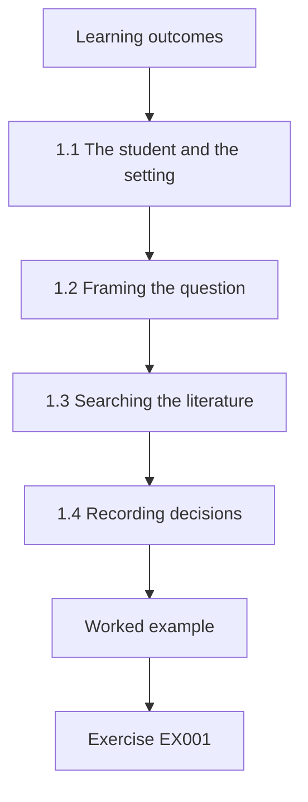

### Logical drawing

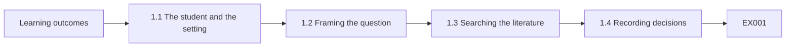

```text
[Learning outcomes]
    |
    v
[1.1 The student and the setting]
    |
    v
[1.2 Framing the question]
    |
    v
[1.3 Searching the literature]
    |
    v
[1.4 Recording decisions]
    |
    v
[Worked example] --> [Exercise EX001]
```
<!-- cyberabc:lesson-figures:end ch-01 -->


### Learning outcomes

You will (1) frame a master's research question on data stewardship; (2) run a structured literature search; (3) record search decisions transparently.

### 1.1 The student and the setting

Tomás Ferreira starts a two-year master's programme at the fictional Kestrel Institute of Technology, supervised by Dr. Ingrid Solberg. His partner organisation is the fictional Arden County Council, where five departments keep their own copies of residents' addresses for council tax, waste collection, libraries, parking permits and social care. Addresses are keyed differently in each system, so the same household appears several times, letters go to old addresses and errors take weeks to fix. The council plans to appoint data stewards in two departments as a pilot.

### 1.2 Framing the question

Tomás drafts a question: does appointing data stewards reduce the time taken to correct address errors? Dr. Solberg asks him to make it answerable. He specifies the outcome as days from an error report to its correction in the system, the intervention as named stewards with defined responsibilities, the comparison as departments without stewards, and the period as six months before and after the pilot. DAMA-DMBOK2 describes stewardship as accountability for data on behalf of others, which gives him a definition to test rather than a slogan.

### 1.3 Searching the literature

Tomás searches two academic databases and the publications of DAMA and ISO using fixed terms: data stewardship, data governance, master data and data quality improvement. He records the date, database, terms and number of results for each search, and screens titles and abstracts against written criteria. Studies must report an outcome measured before and after a governance change. He finds many frameworks and case descriptions but few studies that measure outcomes, which matches the gap other reviewers report. Grey literature is logged separately.

### 1.4 Recording decisions

Every inclusion and exclusion is logged with a reason, such as no outcome measure or not about governance. Dr. Solberg checks a random tenth of his decisions and agrees with all but one, which they discuss and resolve. Tomás learns that a transparent search allows readers to judge whether evidence was missed and lets him update the review later without starting again. He keeps the log with his dissertation materials, so examiners can see how the evidence base was assembled rather than having to trust it.

### Worked example

Tomás frames a stewardship question with outcome, intervention, comparison and period, searches with fixed terms, screens against written criteria and logs every decision with a supervisor check.

> **Synthetic case.** Kestrel, Arden and all people are synthetic; DAMA-DMBOK2 is real.

### Errors and limits

Search terms shape what is found; test alternative terms before finalising.

### Exercises

- **EX001 — Partner problem.** What problem does Arden County Council face? *Rubric:* 3 = duplicated addresses across five departments causing errors;; 2 = mentions duplicates;; 1 = vague;; 0 = none.
- **EX002 — Outcome measure.** What is Tomás's outcome measure? *Rubric:* 3 = days from error report to correction;; 2 = partly correct;; 1 = vague;; 0 = none.
- **EX003 — Comparison group.** What is the comparison in his question? *Rubric:* 3 = departments without stewards;; 2 = partly correct;; 1 = vague;; 0 = none.
- **EX004 — Stewardship definition.** How does DAMA-DMBOK2 describe stewardship? *Rubric:* 3 = accountability for data on behalf of others;; 2 = mentions accountability;; 1 = vague;; 0 = none.
- **EX005 — Inclusion criterion.** What must included studies report? *Rubric:* 3 = an outcome measured before and after a governance change;; 2 = partly correct;; 1 = vague;; 0 = none.
- **EX006 — Supervisor check.** What share of decisions did Dr. Solberg check? *Rubric:* 3 = a random tenth;; 2 = partly correct;; 1 = vague;; 0 = none.
- **EX007 — Literature gap.** What did the search find lacking? *Rubric:* 3 = studies that measure outcomes;; 2 = partly correct;; 1 = vague;; 0 = none.

<!-- cyberabc:chapter-navigation:start ch-01 -->
### Continue studying — lesson 01 (chapter 01 of 08)

[← Course home](../../README.md) · [Course chapter index](../SUBJECTS.md) · [Chapter 02 →](#ch-02)

Continue to the next authored lesson.
<!-- cyberabc:chapter-navigation:end -->

<a id="ch-02"></a>

## Chapter 2 — Data governance: advanced seminar

<!-- cyberabc:lesson-figures:start ch-02 -->
### Lesson map

Lesson 02 published. Map, example, EX008.

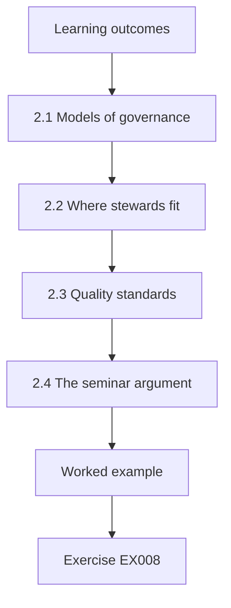

### Logical drawing


```text
[Learning outcomes]
    |
    v
[2.1 Models of governance]
    |
    v
[2.2 Where stewards fit]
    |
    v
[2.3 Quality standards]
    |
    v
[2.4 The seminar argument]
    |
    v
[Worked example] --> [Exercise EX008]
```
<!-- cyberabc:lesson-figures:end ch-02 -->


### Learning outcomes

You will (1) compare governance models critically; (2) relate stewardship to decision rights and standards; (3) present a seminar argument.

### 2.1 Models of governance

In the advanced seminar, Tomás compares three views. DAMA-DMBOK2 presents governance as a function that sets policies, roles and standards for other data management areas. Khatri and Brown organise governance into decision domains, including data principles, quality, metadata, access and lifecycle, and ask who holds decision rights in each. ISO/IEC 38505-1 places accountability with the governing body, which directs, evaluates and monitors the use of data. He notes that the three views emphasise different levels: function, decisions and board accountability. Each view adds something.

### 2.2 Where stewards fit

Tomás maps stewardship onto each view. In DAMA terms, stewards carry out governance in daily work, such as defining address standards and resolving conflicts. In Khatri and Brown's terms, stewards may hold decision rights for quality within a domain, or only input rights while a council officer decides. In ISO terms, stewards act under direction from the governing body and report to it. He argues that the pilot's effect will depend on which decision rights stewards actually receive, not on the job title alone.

### 2.3 Quality standards

The seminar also covers quality standards. ISO 8000-1 gives an overview of the ISO 8000 series and its principles, including that quality is judged against stated requirements. Wang and Strong's dimensions show that users care about accessibility and timeliness, not only accuracy. For Arden, timeliness means how quickly a corrected address reaches every department. Tomás argues that his outcome, days to correct, is a timeliness measure grounded in requirements users actually state, such as residents expecting bins to be collected at their new home within a month.

### 2.4 The seminar argument

Tomás presents his argument: stewardship will shorten correction times only where stewards have decision rights over cross-department address standards and a channel to propagate corrections. Peers challenge him that council culture may matter more than structure. He accepts the point and adds culture as a competing explanation to examine later. Dr. Solberg praises his move from describing models to deriving a testable condition, which turns a seminar discussion into a research hypothesis the pilot can confirm or refute. Culture enters the design.

### Worked example

Tomás compares DAMA, Khatri and Brown and ISO/IEC 38505-1, maps stewards to decision rights, frames correction time as a timeliness measure and derives a testable condition for stewardship to work.

> **Synthetic case.** The seminar is synthetic; DAMA-DMBOK2, Khatri and Brown (2010), ISO/IEC 38505-1:2017, ISO 8000-1:2022 and Wang and Strong (1996) are real.

### Errors and limits

Models describe ideals; real councils mix them.

### Exercises

- **EX008 — Three levels.** Which levels do the three views emphasise? *Rubric:* 3 = function, decisions and board accountability;; 2 = all;; 1 = one;; 0 = none.
- **EX009 — ISO verbs.** What does the governing body do under ISO/IEC 38505-1? *Rubric:* 3 = directs, evaluates and monitors;; 2 = all;; 1 = one;; 0 = none.
- **EX010 — Title not enough.** Why might a steward title have no effect? *Rubric:* 3 = stewards may lack decision rights;; 2 = mentions rights;; 1 = vague;; 0 = none.
- **EX011 — Timeliness.** Which quality dimension is days to correct? *Rubric:* 3 = timeliness;; 2 = partly correct;; 1 = accuracy;; 0 = none.
- **EX012 — ISO 8000 principle.** Against what is quality judged in ISO 8000? *Rubric:* 3 = stated requirements;; 2 = partly correct;; 1 = vague;; 0 = none.
- **EX013 — Peer challenge.** What competing explanation did peers raise? *Rubric:* 3 = council culture;; 2 = partly correct;; 1 = vague;; 0 = none.
- **EX014 — Testable condition.** What condition did Tomás derive? *Rubric:* 3 = stewards need decision rights and a propagation channel;; 2 = both;; 1 = one;; 0 = none.

<!-- cyberabc:chapter-navigation:start ch-02 -->
### Continue studying — lesson 02 (chapter 02 of 08)

[← Chapter 01](#ch-01) · [Course chapter index](../SUBJECTS.md) · [Chapter 03 →](#ch-03)

Continue to the next authored lesson.
<!-- cyberabc:chapter-navigation:end -->

<a id="ch-03"></a>

## Chapter 3 — Study design, ethics and reproducibility

<!-- cyberabc:lesson-figures:start ch-03 -->
### Lesson map

Lesson 03 published. Map, example, EX015.

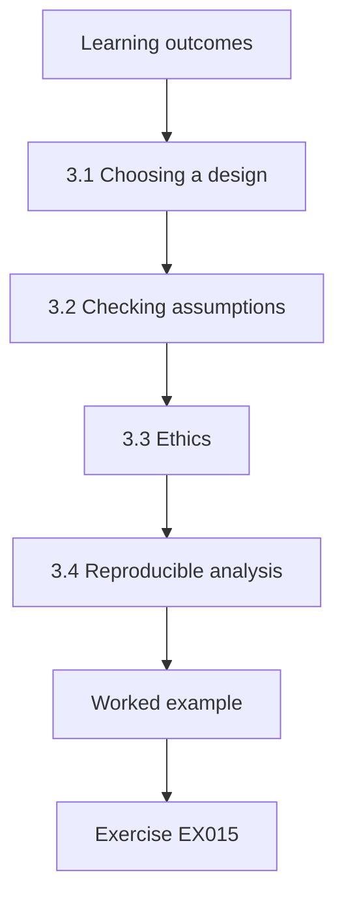

### Logical drawing


```text
[Learning outcomes]
    |
    v
[3.1 Choosing a design]
    |
    v
[3.2 Checking assumptions]
    |
    v
[3.3 Ethics]
    |
    v
[3.4 Reproducible analysis]
    |
    v
[Worked example] --> [Exercise EX015]
```
<!-- cyberabc:lesson-figures:end ch-03 -->


### Learning outcomes

You will (1) design a quasi-experimental evaluation; (2) address ethics in workplace research; (3) plan reproducible analysis.

### 3.1 Choosing a design

The council will not randomise which departments get stewards; it has chosen council tax and waste collection. Tomás therefore uses a difference-in-differences design. He compares the change in correction times in the two stewarded departments with the change in the three comparison departments over the same period. The design removes stable differences between departments and common trends, such as a council-wide software update, provided the departments would have followed parallel trends without the pilot. It cannot remove changes that affect only one group, such as a new manager in council tax.

### 3.2 Checking assumptions

Tomás examines twelve months of correction times before the pilot using a synthetic replica built from summary figures the council publishes. Trends in both groups look similar, which supports the parallel trends assumption, although it cannot prove it. He also lists threats: stewarded departments might receive extra attention, staff turnover might differ and a change in reporting might alter which errors are recorded. He plans to check each threat with council records and interviews rather than assuming it away. Each threat gets a check.

### 3.3 Ethics

The study involves council employees, whose performance might seem to be judged. Tomás's ethics application states that he analyses department-level times only, never individual staff performance, and that interview participants are anonymous and can withdraw. Residents' addresses are not used; the replica contains synthetic addresses with the same error patterns. The council's data protection officer confirms that no personal data leave the council. Dr. Solberg notes that workplace research needs particular care because power differences make refusal difficult. Participation is voluntary.

### 3.4 Reproducible analysis

Tomás writes the analysis plan before collecting data: the estimator, the confidence interval method, the bootstrap resampling count and the threshold for practical importance, which he sets at five days. All code uses the Python standard library, fixed random seeds and version control. He records the plan with a date so he cannot later change the outcome or threshold after seeing results. Reproducibility, he notes, is especially important for governance studies that councils might use to justify spending on new roles.

### Worked example

Tomás chooses difference-in-differences, checks pre-pilot trends on a synthetic replica, lists threats, limits analysis to department level for ethics and fixes an analysis plan with a five-day importance threshold.

> **Synthetic case.** The design is synthetic.

### Errors and limits

Parallel trends can hold before and fail after; watch for new events.

### Exercises

- **EX015 — Why not randomise.** Why can Tomás not randomise? *Rubric:* 3 = the council chose the pilot departments;; 2 = partly correct;; 1 = vague;; 0 = none.
- **EX016 — Design name.** Which design does Tomás use? *Rubric:* 3 = difference-in-differences;; 2 = partly correct;; 1 = other;; 0 = none.
- **EX017 — Key assumption.** What assumption does the design need? *Rubric:* 3 = parallel trends;; 2 = partly correct;; 1 = vague;; 0 = none.
- **EX018 — Threat example.** Name one threat to the design. *Rubric:* 3 = extra attention, turnover differences, reporting changes;; 2 = one;; 1 = vague;; 0 = none.
- **EX019 — Ethics level.** At what level is performance analysed? *Rubric:* 3 = department level only;; 2 = partly correct;; 1 = individual;; 0 = none.
- **EX020 — Importance threshold.** What threshold of practical importance was set? *Rubric:* 3 = five days;; 2 = partly correct;; 1 = wrong;; 0 = none.

<!-- cyberabc:chapter-navigation:start ch-03 -->
### Continue studying — lesson 03 (chapter 03 of 08)

[← Chapter 02](#ch-02) · [Course chapter index](../SUBJECTS.md) · [Chapter 04 →](#ch-04)

Continue to the next authored lesson.
<!-- cyberabc:chapter-navigation:end -->

<a id="ch-04"></a>

## Chapter 4 — Data governance: competing explanations

<!-- cyberabc:lesson-figures:start ch-04 -->
### Lesson map

Lesson 04 published. Map, example, EX021.

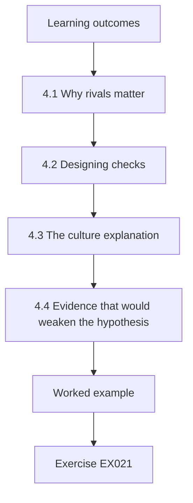

### Logical drawing

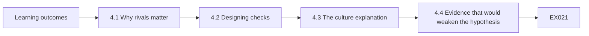

```text
[Learning outcomes]
    |
    v
[4.1 Why rivals matter]
    |
    v
[4.2 Designing checks]
    |
    v
[4.3 The culture explanation]
    |
    v
[4.4 Evidence that would weaken the hypothesis]
    |
    v
[Worked example] --> [Exercise EX021]
```
<!-- cyberabc:lesson-figures:end ch-04 -->


### Learning outcomes

You will (1) list rival explanations for an expected effect; (2) design checks for each; (3) decide what evidence would weaken the main hypothesis.

### 4.1 Why rivals matter

Tomás expects stewarded departments to fix errors faster. Dr. Solberg asks what else could produce that result. He lists rivals: a new address lookup tool introduced at the same time, a fall in the number of errors reported so staff have more time per error, more experienced staff moving into the stewarded departments, and a Hawthorne effect where staff work harder because they know they are observed. Shadish, Cook and Campbell describe such threats to internal validity, and naming them in advance prevents convenient interpretation later.

### 4.2 Designing checks

For each rival, Tomás designs a check. The lookup tool was deployed in all five departments, so it affects both groups and is removed by the design, but he confirms deployment dates. Error volume is measured per department per month. Staff experience is checked with anonymised tenure figures from human resources at department level. The Hawthorne effect is harder to test, so he plans interviews asking how work changed and compares the first two months with later months, expecting any novelty effect to fade.

### 4.3 The culture explanation

Peers had suggested that culture matters more than stewardship. Tomás operationalises culture modestly: whether departments already shared corrections informally before the pilot. Interviews and written summaries from managers indicate that waste collection already phoned council tax about changes, while libraries did not. He realises this could inflate the waste department's apparent improvement if informal sharing increased. He adds a department-level comparison within the stewarded group to see whether both stewarded departments improve similarly or only the one with prior collaboration. Both are compared.

### 4.4 Evidence that would weaken the hypothesis

Tomás writes down what results would count against stewardship: improvement concentrated in months with low error volume, improvement equal in both groups, or improvement only in the department with prior informal sharing. He commits to reporting such results honestly. Dr. Solberg explains that a hypothesis is useful only if some evidence could contradict it, and that writing those conditions down protects researchers from the temptation to explain away awkward findings after months of investment in a project. These conditions enter the analysis plan.

### Worked example

Tomás lists four rivals, designs checks for each, operationalises culture as prior informal sharing and states in advance which results would weaken the stewardship hypothesis.

> **Synthetic case.** The rivals and checks are synthetic; Shadish, Cook and Campbell (2002) is a real source on validity threats.

### Errors and limits

Some rivals cannot be fully ruled out; report them as limits.

### Exercises

- **EX021 — Four rivals.** Name two rival explanations. *Rubric:* 3 = new tool, lower error volume, experienced staff, Hawthorne effect;; 2 = two;; 1 = one;; 0 = none.
- **EX022 — Tool rival.** Why does the design remove the lookup tool rival? *Rubric:* 3 = deployed in all departments;; 2 = partly correct;; 1 = vague;; 0 = none.
- **EX023 — Hawthorne check.** How will Tomás check the Hawthorne effect? *Rubric:* 3 = interviews and comparing early with later months;; 2 = mentions months;; 1 = vague;; 0 = none.
- **EX024 — Culture measure.** How is culture operationalised? *Rubric:* 3 = prior informal sharing of corrections;; 2 = partly correct;; 1 = vague;; 0 = none.
- **EX025 — Contrary evidence.** Name one result that would weaken the hypothesis. *Rubric:* 3 = improvement only in low-volume months, equal in both groups, or only where sharing existed;; 2 = one;; 1 = vague;; 0 = none.
- **EX026 — Falsifiability.** Why write contrary conditions in advance? *Rubric:* 3 = to avoid explaining away awkward results;; 2 = mentions bias;; 1 = vague;; 0 = none.

<!-- cyberabc:chapter-navigation:start ch-04 -->
### Continue studying — lesson 04 (chapter 04 of 08)

[← Chapter 03](#ch-03) · [Course chapter index](../SUBJECTS.md) · [Chapter 05 →](#ch-05)

Continue to the next authored lesson.
<!-- cyberabc:chapter-navigation:end -->

<a id="ch-05"></a>

## Chapter 5 — Proposal and pilot

<!-- cyberabc:lesson-figures:start ch-05 -->
### Lesson map

Lesson 05 published. Map, example, EX027.

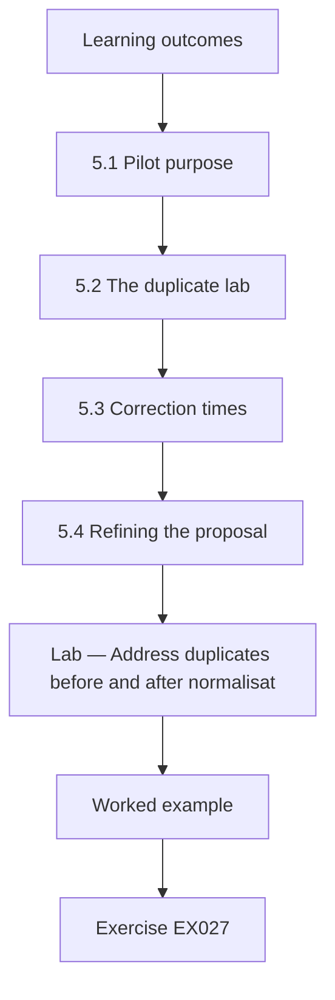

### Logical drawing

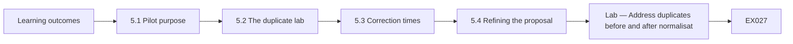

```text
[Learning outcomes]
    |
    v
[5.1 Pilot purpose]
    |
    v
[5.2 The duplicate lab]
    |
    v
[5.3 Correction times]
    |
    v
[5.4 Refining the proposal]
    |
    v
[Lab — Address duplicates before and after normalisat]
    |
    v
[Worked example] --> [Exercise EX027]
```
<!-- cyberabc:lesson-figures:end ch-05 -->


### Learning outcomes

You will (1) pilot measurement of duplicates and correction times; (2) normalise address data; (3) refine the proposal from pilot lessons.

### 5.1 Pilot purpose

Before the main data collection, Tomás pilots his measurements on a synthetic replica of the address registers. He wants to know whether duplicates can be counted reliably, whether correction times can be extracted from ticket logs and how long each step takes. A pilot is not meant to answer the research question; it tests whether the methods work. Dr. Solberg reminds him that problems found in a pilot are cheap, while the same problems found during the main study can cost months.

### 5.2 The duplicate lab

The pilot lab builds 3,305 synthetic address records in which a second department sometimes keys the same address with abbreviations, extra spaces and different capitals. Exact matching finds no duplicates at all, because no two strings are identical. After normalisation, which lowercases text, expands abbreviations such as St and Rd and collapses spaces, 384 duplicates appear, 11.6% of records. The result shows that any duplicate measure depends heavily on the normalisation rules chosen, which are themselves a governance decision. The abbreviation rules decide what counts as the same address.

### 5.3 Correction times

Ticket logs record when an error was reported and when it was closed, but closure does not always mean the address changed in every system. In the replica, some tickets close when the reporting department fixes its own copy while other departments remain wrong. Tomás redefines the outcome as days until the corrected address appears in all five systems, which matches what residents experience. ISO 8000-1's emphasis on requirements helps him justify the change: the requirement is a correct address everywhere, not a closed ticket.

### 5.4 Refining the proposal

From the pilot, Tomás updates his proposal: duplicate counts will use documented normalisation rules agreed with the stewards, correction time will be measured to the last system updated, and data extraction will take two weeks rather than one. He records the changes and their reasons in his decision log before collecting real outcome data, so the changes cannot be accused of chasing results. Dr. Solberg approves, noting that the pilot has already produced a finding about how definitions shape measured quality.

### Lab — Address duplicates before and after normalisation

```python
"""Find duplicate address records before and after normalisation in a synthetic council register (stdlib only)."""
import random, re, collections
random.seed(12)
streets = ["High Street", "Mill Lane", "Church Road", "Station Road", "Park Avenue", "Kings Way"]
base = [(random.randint(1, 120), random.choice(streets), f"AR{random.randint(1,9)} {random.randint(1,9)}QX") for _ in range(3000)]
base = list(dict.fromkeys(base))
recs = []
for n, s, p in base:
    recs.append(f"{n} {s}, {p}")
    if random.random() < 0.12:   # a second department keys the same address differently
        v = s.replace("Street", "St").replace("Road", "Rd").replace("Avenue", "Ave")
        recs.append(f"{n}  {v.upper()},{p.lower()}")
def norm(a):
    a = a.lower().replace(",", " ")
    for k, v in {" st ": " street ", " rd ": " road ", " ave ": " avenue "}.items():
        a = (" " + a + " ").replace(k, v).strip()
    return re.sub(r"\s+", " ", a)
exact = len(recs) - len(set(recs))
normd = len(recs) - len({norm(r) for r in recs})
print(f"records {len(recs)}; exact duplicates {exact}; duplicates after normalisation {normd} ({100*normd/len(recs):.1f}%)")
```

Run with `python3 lab_dupes.py`. Verified output:

```text
records 3305; exact duplicates 0; duplicates after normalisation 384 (11.6%)
```

### Worked example

Tomás finds no exact duplicates but 384 (11.6%) after normalisation among 3,305 synthetic records, redefines correction time to the last system updated and logs proposal changes before main data collection.

> **Synthetic case.** Records are synthetic; ISO 8000-1:2022 is real.

### Errors and limits

Aggressive normalisation can merge different addresses; check a sample by hand.

### Exercises

- **EX027 — Pilot aim.** What is a pilot meant to test? *Rubric:* 3 = whether the methods work;; 2 = partly correct;; 1 = answer question;; 0 = none.
- **EX028 — Exact matches.** How many exact duplicates were found? *Rubric:* 3 = none;; 2 = hedged (few or none);; 1 = wrong;; 0 = no answer.
- **EX029 — Normalised duplicates.** How many duplicates after normalisation? *Rubric:* 3 = 384, 11.6%;; 2 = partly correct;; 1 = wrong;; 0 = none.
- **EX030 — Normalisation steps.** Name two normalisation steps. *Rubric:* 3 = lowercase, expand abbreviations, collapse spaces;; 2 = two;; 1 = one;; 0 = none.
- **EX031 — New outcome.** How was correction time redefined? *Rubric:* 3 = days until correct in all five systems;; 2 = partly correct;; 1 = ticket closure;; 0 = none.
- **EX032 — Logged changes.** When were proposal changes logged? *Rubric:* 3 = before collecting real outcome data;; 2 = partly correct;; 1 = after;; 0 = none.

<!-- cyberabc:chapter-navigation:start ch-05 -->
### Continue studying — lesson 05 (chapter 05 of 08)

[← Chapter 04](#ch-04) · [Course chapter index](../SUBJECTS.md) · [Chapter 06 →](#ch-06)

Continue to the next authored lesson.
<!-- cyberabc:chapter-navigation:end -->

<a id="ch-06"></a>

## Chapter 6 — Data collection and analysis

<!-- cyberabc:lesson-figures:start ch-06 -->
### Lesson map

Lesson 06 published. Map, example, EX033.

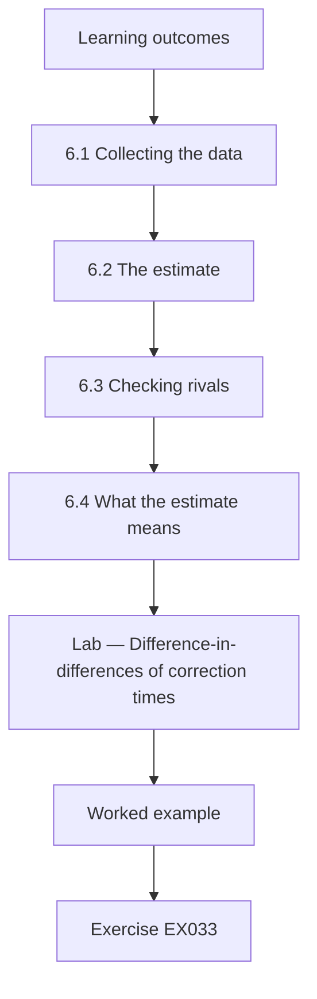

### Logical drawing

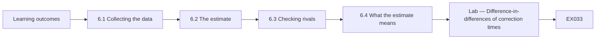

```text
[Learning outcomes]
    |
    v
[6.1 Collecting the data]
    |
    v
[6.2 The estimate]
    |
    v
[6.3 Checking rivals]
    |
    v
[6.4 What the estimate means]
    |
    v
[Lab — Difference-in-differences of correction times]
    |
    v
[Worked example] --> [Exercise EX033]
```
<!-- cyberabc:lesson-figures:end ch-06 -->


### Learning outcomes

You will (1) collect department-level outcome data; (2) estimate a difference-in-differences effect with a bootstrap interval; (3) check rival explanations.

### 6.1 Collecting the data

Tomás extracts correction times for six months before and six months after the pilot, 120 corrections per group per period, using the definition from the pilot. Extraction follows a written script reviewed by the council's data team, which runs it inside the council's systems and returns only department-level tables. The analysis in this book reproduces those tables with synthetic data generated from the same summary figures, so every reader can run it without any access to council systems or residents' details. Nothing identifiable leaves.

### 6.2 The estimate

The lab shows mean correction times in stewarded departments falling from 24.1 to 14.8 days, while comparison departments move from 21.9 to 19.6 days. The difference-in-differences estimate is -7.0 days, with a bootstrap 95% interval from -9.1 to -4.8 days based on 2,000 resamples. The whole interval lies beyond the five-day threshold set in advance, so the pilot effect is both statistically clear and practically important by the criterion Tomás fixed before seeing data. The comparison departments also improved slightly, by about two days, perhaps because of the shared lookup tool, and the design subtracts that common change from the stewarded departments' gain.

### 6.3 Checking rivals

Error volumes are stable in both groups, so lower workload does not explain the change. Tenure figures show no shift of experienced staff. Monthly results show improvement throughout the six months rather than fading, which argues against a pure novelty effect. Within the stewarded group, both departments improve, including council tax, which had no prior informal sharing, weakening the culture rival. Tomás reports each check in a table alongside the main estimate, so readers can judge how well rivals were addressed.

### 6.4 What the estimate means

Tomás interprets the result carefully: in this synthetic reproduction of one council's pilot, appointing stewards with decision rights over address standards was associated with corrections reaching all systems about a week sooner. Interviews suggest the mechanism: stewards agreed a single address standard and a weekly propagation routine. He avoids claiming that stewardship works everywhere. Dr. Solberg notes that his careful wording respects both the evidence and the limits of a two-department pilot. Other councils may differ in staffing, systems and the number of departments holding addresses.

### Lab — Difference-in-differences of correction times with bootstrap interval

```python
"""Difference-in-differences of days to fix address errors, stewarded vs comparison departments, with bootstrap CI (stdlib only)."""
import random, statistics as st
random.seed(30)
def sample(mu, n): return [max(1, random.gauss(mu, 6)) for _ in range(n)]
treat_pre, treat_post = sample(24, 120), sample(15, 120)
comp_pre, comp_post = sample(22, 120), sample(19, 120)
def did(a, b, c, d): return (st.mean(b) - st.mean(a)) - (st.mean(d) - st.mean(c))
est = did(treat_pre, treat_post, comp_pre, comp_post)
boots = sorted(did(*(random.choices(x, k=len(x)) for x in (treat_pre, treat_post, comp_pre, comp_post))) for _ in range(2000))
print(f"mean days: stewarded {st.mean(treat_pre):.1f} -> {st.mean(treat_post):.1f}; comparison {st.mean(comp_pre):.1f} -> {st.mean(comp_post):.1f}")
print(f"difference-in-differences {est:.1f} days (95% CI {boots[50]:.1f} to {boots[1949]:.1f})")
```

Run with `python3 lab_did.py`. Verified output:

```text
mean days: stewarded 24.1 -> 14.8; comparison 21.9 -> 19.6
difference-in-differences -7.0 days (95% CI -9.1 to -4.8)
```

### Worked example

Tomás estimates a difference-in-differences of -7.0 days (95% CI -9.1 to -4.8), beyond the five-day threshold, checks volume, tenure, novelty and culture rivals and identifies a single standard and weekly propagation as the mechanism.

> **Synthetic case.** Data are synthetic.

### Errors and limits

A bootstrap interval reflects sampling variation, not design bias.

### Exercises

- **EX033 — Stewarded change.** How did stewarded correction times change? *Rubric:* 3 = 24.1 to 14.8 days;; 2 = partly correct;; 1 = wrong;; 0 = none.
- **EX034 — DiD estimate.** What was the difference-in-differences estimate? *Rubric:* 3 = -7.0 days;; 2 = partly correct;; 1 = wrong;; 0 = none.
- **EX035 — Interval.** What was the 95% interval? *Rubric:* 3 = -9.1 to -4.8 days;; 2 = partly correct;; 1 = wrong;; 0 = none.
- **EX036 — Threshold met.** Does the interval exceed the five-day threshold? *Rubric:* 3 = yes, entirely;; 2 = partly correct;; 1 = no;; 0 = none.
- **EX037 — Culture rival.** Why is the culture rival weakened? *Rubric:* 3 = council tax improved without prior sharing;; 2 = partly correct;; 1 = vague;; 0 = none.
- **EX038 — Mechanism.** What mechanism did interviews suggest? *Rubric:* 3 = single address standard and weekly propagation;; 2 = both;; 1 = one;; 0 = none.

<!-- cyberabc:chapter-navigation:start ch-06 -->
### Continue studying — lesson 06 (chapter 06 of 08)

[← Chapter 05](#ch-05) · [Course chapter index](../SUBJECTS.md) · [Chapter 07 →](#ch-07)

Continue to the next authored lesson.
<!-- cyberabc:chapter-navigation:end -->

<a id="ch-07"></a>

## Chapter 7 — Dissertation writing and limitations

<!-- cyberabc:lesson-figures:start ch-07 -->
### Lesson map

Lesson 07 published. Map, example, EX039.

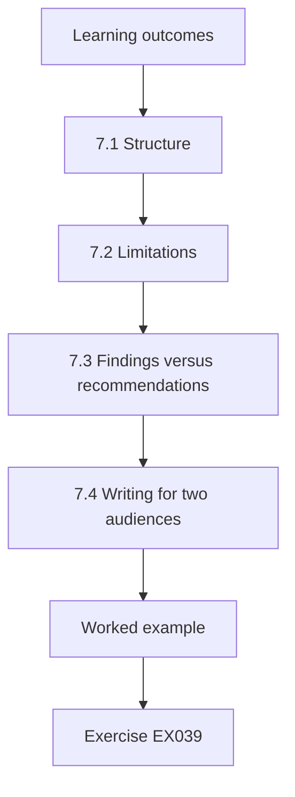

### Logical drawing


```text
[Learning outcomes]
    |
    v
[7.1 Structure]
    |
    v
[7.2 Limitations]
    |
    v
[7.3 Findings versus recommendations]
    |
    v
[7.4 Writing for two audiences]
    |
    v
[Worked example] --> [Exercise EX039]
```
<!-- cyberabc:lesson-figures:end ch-07 -->


### Learning outcomes

You will (1) structure a master's dissertation; (2) write limitations that inform readers; (3) separate findings from recommendations.

### 7.1 Structure

Tomás structures his dissertation around the question: introduction and question, literature and governance models, design and ethics, pilot findings on measurement, main results, rival checks, discussion, limitations and recommendations. He writes the abstract last, stating the effect, interval, design and main limit in four sentences. Dr. Solberg advises him to put the pilot's finding about normalisation in its own section, because it is a separate contribution: measured duplicate rates depend on rules, so organisations must govern their quality rules. Each chapter answers one part of the question.

### 7.2 Limitations

Tomás's limitations section names five issues: two treated departments, non-random selection, a synthetic reproduction of figures rather than direct analysis of all records, a six-month follow-up that cannot show whether gains persist, and possible unmeasured differences such as manager quality. For each, he explains the likely direction of bias and what future work could address it. He avoids generic statements such as more research is needed, which tell readers nothing about what research or why. Most of these would bias the estimate upward.

### 7.3 Findings versus recommendations

Tomás separates what the evidence shows from what he recommends. The finding is the estimated effect and its mechanism under the pilot's conditions. The recommendations are to extend stewardship to the other three departments with the same decision rights, keep measuring correction time to the last system and publish the address normalisation rules. He flags the recommendations as judgements informed by evidence, so readers who disagree with his weighting can still use the findings independently. Judgement and evidence stay clearly labelled.

### 7.4 Writing for two audiences

The dissertation serves examiners and the council. Tomás writes a two-page summary for council officers with the main result in plain words, a chart of correction times and the recommendations. The full dissertation keeps technical detail for examiners. He checks that both versions agree on numbers and claims. Dr. Solberg notes that inconsistency between technical and summary versions is a common way for research to lose credibility once it reaches decision-makers who compare them. Both versions cite the same table of results.

### Worked example

Tomás structures the dissertation, names five specific limitations with bias direction, separates findings from recommendations and writes a consistent two-page council summary.

> **Synthetic case.** The dissertation is synthetic.

### Errors and limits

Summaries tend to drop caveats; keep the main limit in the summary.

### Exercises

- **EX039 — Separate contribution.** What separate contribution gets its own section? *Rubric:* 3 = duplicate rates depend on normalisation rules;; 2 = mentions rules;; 1 = vague;; 0 = none.
- **EX040 — Limitations count.** How many limitations does Tomás name? *Rubric:* 3 = five;; 2 = partly correct;; 1 = wrong;; 0 = none.
- **EX041 — Follow-up limit.** Why is six months a limit? *Rubric:* 3 = cannot show whether gains persist;; 2 = partly correct;; 1 = vague;; 0 = none.
- **EX042 — Generic phrase.** Which generic phrase does Tomás avoid? *Rubric:* 3 = more research is needed;; 2 = partly correct;; 1 = vague;; 0 = none.
- **EX043 — Recommendation example.** Name one recommendation. *Rubric:* 3 = extend stewardship, measure to last system, publish rules;; 2 = one;; 1 = vague;; 0 = none.
- **EX044 — Consistency.** Why must summary and dissertation agree? *Rubric:* 3 = inconsistency damages credibility;; 2 = mentions credibility;; 1 = vague;; 0 = none.

<!-- cyberabc:chapter-navigation:start ch-07 -->
### Continue studying — lesson 07 (chapter 07 of 08)

[← Chapter 06](#ch-06) · [Course chapter index](../SUBJECTS.md) · [Chapter 08 →](#ch-08)

Continue to the next authored lesson.
<!-- cyberabc:chapter-navigation:end -->

<a id="ch-08"></a>

## Chapter 8 — Independent review and defense

<!-- cyberabc:lesson-figures:start ch-08 -->
### Lesson map

Lesson 08 published. Map, example, EX045.

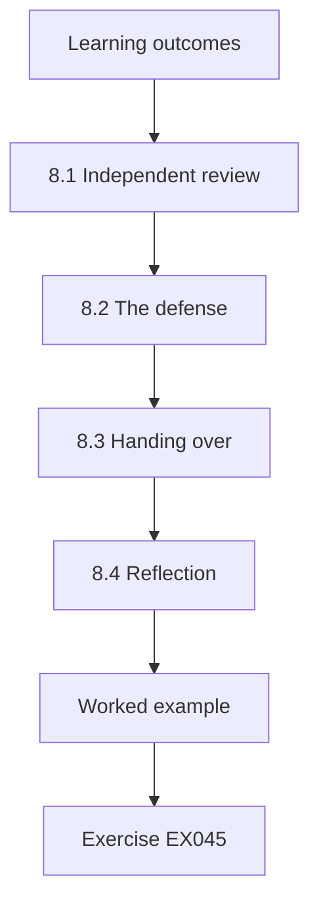

### Logical drawing


```text
[Learning outcomes]
    |
    v
[8.1 Independent review]
    |
    v
[8.2 The defense]
    |
    v
[8.3 Handing over]
    |
    v
[8.4 Reflection]
    |
    v
[Worked example] --> [Exercise EX045]
```
<!-- cyberabc:lesson-figures:end ch-08 -->


### Learning outcomes

You will (1) obtain independent review of analysis; (2) defend a master's dissertation; (3) hand findings to the partner organisation.

### 8.1 Independent review

Before submission, a statistician from another department at Kestrel reviews Tomás's code and data without his help. She reruns the analysis from the archive and obtains the same estimate and interval. She questions whether 2,000 bootstrap resamples are enough; Tomás reruns with 10,000 and the interval changes by less than a tenth of a day. She also asks for a placebo test using a pre-pilot period as if it were the pilot, which shows no effect, supporting the design. The placebo result is reported in an appendix.

### 8.2 The defense

At the defense, examiners ask why the council should trust a result from two departments. Tomás answers that the result is consistent across months, robust to the checks reported and supported by a plausible mechanism, but that extension should itself be evaluated. An examiner asks about the synthetic reproduction; he explains that the council's data team ran the extraction internally and the synthetic data match its published summaries. The examiners award a pass and praise the treatment of rival explanations. Minor edits follow.

### 8.3 Handing over

Tomás presents the findings to Arden's data governance board. The board decides to extend stewardship to libraries and parking, while social care waits for a review of its legal duties. It adopts the normalisation rules as a council standard and asks the data team to keep reporting correction time to the last system. Tomás hands over the analysis scripts and a guide so council staff can rerun the evaluation for the extension without him. The guide includes the placebo test and the normalisation rules.

### 8.4 Reflection

Tomás reflects that the most useful part of his work may be the measurement definitions, which the council will keep using, rather than the single estimate. He notes that governance research must respect the people whose work is studied: the stewards were anxious about being evaluated, and department-level reporting kept their trust. Dr. Solberg closes the supervision by reminding him that good evaluations make it easy for organisations to learn from both success and failure. Tomás later joins Arden's data team.

### Worked example

An independent statistician reproduces the estimate, checks resample count and runs a placebo test; Tomás passes the defense, and the council extends stewardship and adopts his definitions.

> **Synthetic case.** The review and board are synthetic.

### Errors and limits

Extensions to new departments may not reproduce pilot effects; evaluate them.

### Exercises

- **EX045 — Reviewer check.** What did the reviewer change in the bootstrap? *Rubric:* 3 = resamples from 2,000 to 10,000;; 2 = partly correct;; 1 = vague;; 0 = none.
- **EX046 — Placebo.** What did the placebo test show? *Rubric:* 3 = no effect in a pre-pilot period;; 2 = partly correct;; 1 = vague;; 0 = none.
- **EX047 — Examiner concern.** What did examiners question? *Rubric:* 3 = trusting a two-department result;; 2 = partly correct;; 1 = vague;; 0 = none.
- **EX048 — Board decision.** Which departments does stewardship extend to next? *Rubric:* 3 = libraries and parking;; 2 = both;; 1 = one;; 0 = none.
- **EX049 — Social care.** Why does social care wait? *Rubric:* 3 = review of its legal duties;; 2 = partly correct;; 1 = vague;; 0 = none.
- **EX050 — Lasting value.** What may be the most useful part of Tomás's work? *Rubric:* 3 = the measurement definitions;; 2 = partly correct;; 1 = vague;; 0 = none.

<!-- cyberabc:chapter-navigation:start ch-08 -->
### Continue studying — lesson 08 (chapter 08 of 08)

[← Chapter 07](#ch-07) · [Course chapter index](../SUBJECTS.md) · [Next course via chapter index →](../SUBJECTS.md)

The chapter index leads to the next course in the study path.
<!-- cyberabc:chapter-navigation:end -->

<a id="worked-results"></a>

## Worked results

Model answers for EX001–EX050. Tomás Ferreira, Dr. Ingrid Solberg, Kestrel Institute of Technology, Arden County Council and every figure are synthetic. Lab answers quote verified outputs. Any answer meeting the rubric scores equally.

**EX001.** Five departments keep their own address copies, causing duplicates and slow fixes.

**EX002.** Days from an error report to its correction.

**EX003.** Departments without data stewards.

**EX004.** Accountability for data on behalf of others.

**EX005.** An outcome measured before and after a governance change.

**EX006.** A random tenth.

**EX007.** Studies that measure outcomes of governance changes.

**EX008.** Function (DAMA), decisions (Khatri and Brown) and board accountability (ISO).

**EX009.** Directs, evaluates and monitors the use of data.

**EX010.** Without decision rights, the title changes little.

**EX011.** Timeliness.

**EX012.** Against stated requirements.

**EX013.** Council culture rather than structure.

**EX014.** Stewardship works where stewards hold decision rights and can propagate corrections.

**EX015.** The council had already chosen the stewarded departments.

**EX016.** Difference-in-differences.

**EX017.** Parallel trends without the pilot.

**EX018.** Stewarded departments receiving extra attention.

**EX019.** Department level only, never individuals.

**EX020.** Five days.

**EX021.** A new lookup tool and lower error volume.

**EX022.** It affected both groups equally.

**EX023.** Interviews and comparing the first two months with later ones.

**EX024.** Whether departments already shared corrections informally.

**EX025.** Equal improvement in both groups.

**EX026.** So awkward findings cannot be explained away later.

**EX027.** Whether the measurement methods work, not the research question.

**EX028.** None.

**EX029.** 384 (11.6%).

**EX030.** Lowercasing and expanding abbreviations.

**EX031.** Days until the corrected address appears in all five systems.

**EX032.** Before main outcome data were collected.

**EX033.** From 24.1 to 14.8 days.

**EX034.** -7.0 days.

**EX035.** -9.1 to -4.8 days.

**EX036.** Yes, the whole interval lies beyond five days.

**EX037.** Council tax improved too, despite no prior informal sharing.

**EX038.** A single address standard and weekly propagation routine.

**EX039.** The finding that measured duplicate rates depend on normalisation rules.

**EX040.** Five.

**EX041.** It cannot show whether gains persist.

**EX042.** More research is needed.

**EX043.** Extend stewardship to the other three departments.

**EX044.** Inconsistencies cost credibility with decision-makers.

**EX045.** She asked for 10,000 resamples instead of 2,000.

**EX046.** No effect when a pre-pilot period was treated as the pilot.

**EX047.** Whether two departments justify trust in the result.

**EX048.** Libraries and parking.

**EX049.** Its legal duties need review first.

**EX050.** The measurement definitions the council keeps using.

<a id="references"></a>
## References

Every DOI was resolved through doi.org on 12 October 2026, and standards were checked against their publisher pages. Organisations, people, systems and figures in the running cases are synthetic; only the works below are real.

- DAMA International. (2017). *DAMA-DMBOK: Data management body of knowledge* (2nd ed., D. Henderson & S. Earley, Eds.). Technics Publications. ISBN 978-1-63462-234-9.
- ISO. (2022). *ISO 8000-1:2022 Data quality — Part 1: Overview*. International Organization for Standardization. <https://www.iso.org/standard/81745.html>
- ISO/IEC. (2017). *ISO/IEC 38505-1:2017 Information technology — Governance of IT — Governance of data — Part 1: Application of ISO/IEC 38500 to the governance of data*. <https://www.iso.org/standard/56639.html>
- Khatri, V., & Brown, C. V. (2010). Designing data governance. *Communications of the ACM, 53*(1), 148–152. https://doi.org/10.1145/1629175.1629210
- Wang, R. Y., & Strong, D. M. (1996). Beyond accuracy: What data quality means to data consumers. *Journal of Management Information Systems, 12*(4), 5–33. https://doi.org/10.1080/07421222.1996.11518099
- Shadish, W. R., Cook, T. D., & Campbell, D. T. (2002). *Experimental and quasi-experimental designs for generalized causal inference*. Houghton Mifflin.
