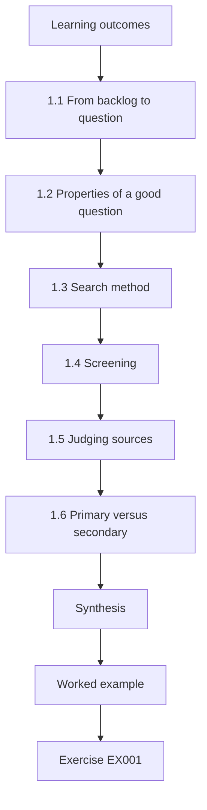
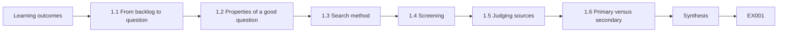
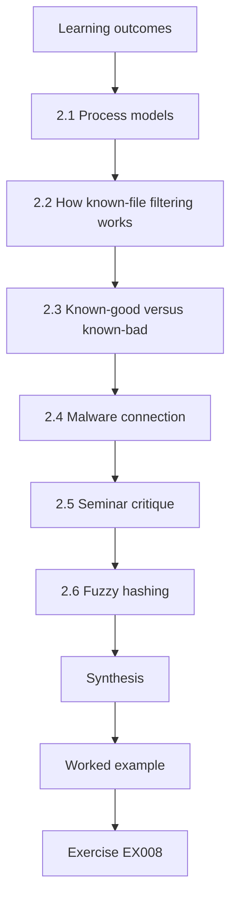
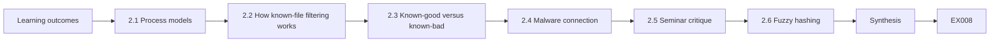
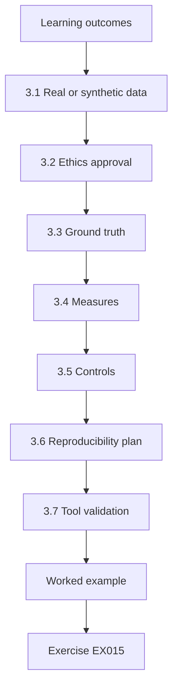
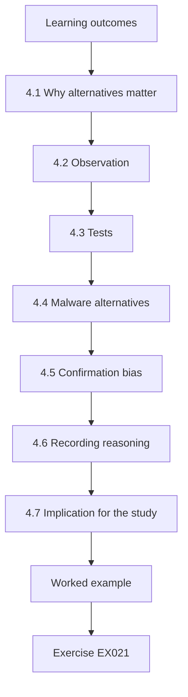
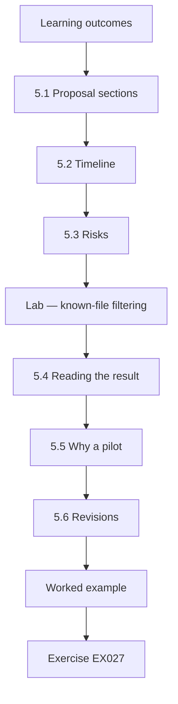
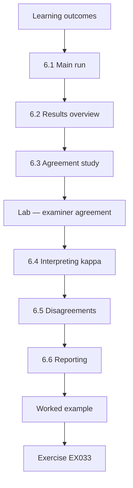
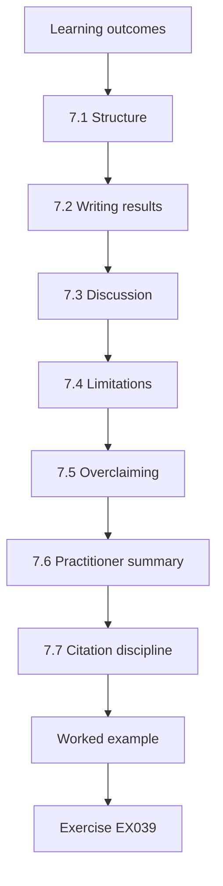
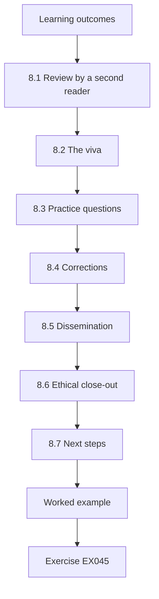

# Digital Forensics and Malware Analysis: Master's Course

- Language: English (`en`); course 178, Master's course (2 years).
- Editorial state: **published**. Chapters 1–8 of 8 have hand-written teaching text; exercises EX001–EX050 have matching worked results with 0–3 rubrics; two offline labs use only the Python 3 standard library on synthetic evidence, and their outputs are embedded from real runs. Independent review and the 300-page A4 verification remain open.
- Audience: beginning researchers with strong forensic foundations and research-method literacy.
- Author: [hiagokinlevi](https://github.com/hiagokinlevi). Original text [CC0 1.0](../../../../../LICENSE); cited works keep their rights.
- Ethical and legal boundary: examine only media and systems you are authorised to examine; no live malware, no exploit code, no payloads and no instructions for defeating protections. Malware is discussed through behaviour, artefacts and safe static descriptions of synthetic samples. All evidence, people and organisations are **synthetic** unless a sentence cites a public source.

[Course home](../../README.md) · [Chapter index](../SUBJECTS.md) · [Book plan](PLAN.md) · [Course skill](../../skill/SKILL.md) · [Worked results](#worked-results)

## How to use this draft

Read the chapters in order: they follow one master's project from question to defence. Run each lab where it appears, attempt the exercises before the worked results, and score yourself with the rubrics.

### Synthetic running case

| Element | Role | Boundary |
|---|---|---|
| **Tomás Lindqvist** | Master's student and part-time police examiner | Invented |
| **Dr Amara Osei** | Supervisor, Ridgeway University | Invented |
| **Ridgeway University** | Fictional university | Invented |

### Core sources

NIST [SP 800-86](https://doi.org/10.6028/NIST.SP.800-86) and [SP 800-101r1](https://doi.org/10.6028/NIST.SP.800-101r1); [RFC 3227](https://www.rfc-editor.org/rfc/rfc3227); ISO/IEC [27037](https://www.iso.org/standard/44381.html), [27041](https://www.iso.org/standard/44405.html), [27042](https://www.iso.org/standard/44406.html) and [27043](https://www.iso.org/standard/44407.html); [SWGDE](https://www.swgde.org/documents/published-complete-listing); Carrier, *File System Forensic Analysis* (2005). Full list in [References](#references).

## Contents

| Chapters |
|---|
| [1](#ch-01) · [2](#ch-02) · [3](#ch-03) · [4](#ch-04) · [5](#ch-05) · [6](#ch-06) · [7](#ch-07) · [8](#ch-08) |

[Worked results](#worked-results) · [References](#references)

<a id="ch-01"></a>

## Chapter 1 — Research question and literature method

<!-- cyberabc:lesson-figures:start ch-01 -->
### Lesson map

Lesson 01 published. Map, example, EX001.



### Logical drawing



```text
[Learning outcomes]
    |
    v
[1.1 From backlog to question]
    |
    v
[1.2 Properties of a good question]
    |
    v
[1.3 Search method]
    |
    v
[1.4 Screening]
    |
    v
[1.5 Judging sources]
    |
    v
[1.6 Primary versus secondary]
    |
    v
[Synthesis]
    |
    v
[Worked example] --> [Exercise EX001]
```
<!-- cyberabc:lesson-figures:end ch-01 -->


### Learning outcomes

You will (1) turn a casework problem into a researchable question; (2) search and screen forensic literature systematically; (3) judge the quality of a source; (4) record the search so others can repeat it.

### 1.1 From backlog to question

Tomás Lindqvist works part-time in a police digital forensics unit while studying at the fictional Ridgeway University. His unit has a backlog: seized laptops wait weeks because examiners review thousands of operating-system files. Garfinkel (2010) argued that growing data volumes are a central challenge for forensic research. Tomás's problem is real, but "fix the backlog" is not a question. He narrows it: *by what proportion does known-file filtering against a reference hash set reduce the files an examiner must review, and what does it miss?*

### 1.2 Properties of a good question

It is answerable with data he can lawfully obtain, measurable (a proportion, an error count), bounded (one file-system type, one reference set) and useful to practitioners. Tomás's question meets each test: images he builds himself can be used lawfully, reduction and misses can be counted, the study is limited to one file system and one version of the NSRL, and examiners in his own police unit filter casework this way every week. Dr Osei asks him to write the question so that each of these properties is visible in it.

### 1.3 Search method

He searches Digital Investigation and Forensic Science International: Digital Investigation, DFRWS proceedings and NIST publications, with terms such as "known file filtering", "hash set", "triage". He records database, date, terms and hits. Recording these details means another researcher can repeat the search and check whether he missed relevant studies. He also follows references from the studies he finds, noting which were added that way. The search log becomes an appendix to the thesis, as the examiners will expect, and he reruns the search before submission to catch any studies published during the project.

### 1.4 Screening

Titles and abstracts are screened against inclusion criteria (empirical, describes the reference set, reports reduction or error). Each exclusion gets a reason. Writing a reason for each exclusion lets his supervisor check that criteria were applied consistently, not according to whether a paper supported his expectations. Common reasons are that a paper describes a tool without testing it, or reports reduction without naming the reference set. When a decision is unclear, Tomás reads the full text and records what he found. The criteria were written into his protocol before screening began, so they could not drift towards the studies he hoped to include.

### 1.5 Judging sources

Peer-reviewed empirical work with released data ranks highest; vendor white papers are noted but treated as claims. The NIST National Software Reference Library (NSRL) documentation is primary for what the reference set contains. Ranking sources this way matters for his topic, because vendor material often reports large reductions without describing the images or whether relevant files were missed. Tomás records the type of each source in his tables, so readers can see which figures come from independent studies with data and which are claims. He treats NSRL documentation as authoritative only for what the reference set contains, not for how well filtering works in practice.

### 1.6 Primary versus secondary

If a review cites a reduction figure, Tomás traces it to the original study before relying on it. In one case, a review gives a reduction figure that the original study reported only for a single image, not as an average. Tomás cites the original with its context rather than repeating the review's summary. Tracing figures to their sources also shows which studies measured misses at all, which is the gap his project addresses. He keeps a note of each figure he traced, its source and any difference he found, and Dr Osei checks a sample of them.

### Worked example

His first search returns 212 records; 31 survive title screening; 9 meet all criteria. He tabulates each study's data set, reference set, reduction reported and whether misses were measured. Only three measured misses — his gap.

> **Synthetic case.** Tomás, his unit and his search counts are invented.

### Errors and limits

A search limited to English and two journals can miss work; he states that limitation rather than hiding it.

### Exercises

- **EX001 — Narrowing.** Rewrite "fix the backlog" as a researchable question. *Rubric:* 3 = measurable, bounded, lawful data; 2 = partly bounded; 1 = still vague; 0 = none.
- **EX002 — Four properties.** List four properties of a good research question. *Rubric:* 3 = answerable, measurable, bounded, useful; 2 = three; 1 = one; 0 = none.
- **EX003 — Search record.** What must a search log record? *Rubric:* 3 = database, date, terms, hits; 2 = three; 1 = one; 0 = none.
- **EX004 — Vendor paper.** How should a vendor white paper claiming 95% reduction be treated? *Rubric:* 3 = as a claim; seek independent evidence; 2 = partial; 1 = accept; 0 = none.
- **EX005 — Tracing figures.** A review quotes a reduction rate. What do you do before citing it? *Rubric:* 3 = trace to original study, check context; 2 = partial; 1 = cite review; 0 = none.
- **EX006 — Gap.** From the worked example, what gap does Tomás find? *Rubric:* 3 = only 3 of 9 measured misses; 2 = vague gap; 1 = wrong; 0 = none.
- **EX007 — Stated limitation.** Write one sentence stating the search limitation. *Rubric:* 3 = names language and journal scope; 2 = one; 1 = vague; 0 = none.

### Synthesis

A good thesis begins with a narrow, measurable question and a literature search recorded well enough to repeat.

### Continue studying — chapter 01 of 08

[← Course home](../../README.md) · [Course chapter index](../SUBJECTS.md) · [Chapter 02 (draft) →](#ch-02)

<a id="ch-02"></a>

## Chapter 2 — Digital forensics and malware analysis: advanced seminar

<!-- cyberabc:lesson-figures:start ch-02 -->
### Lesson map

Lesson 02 published. Map, example, EX008.



### Logical drawing



```text
[Learning outcomes]
    |
    v
[2.1 Process models]
    |
    v
[2.2 How known-file filtering works]
    |
    v
[2.3 Known-good versus known-bad]
    |
    v
[2.4 Malware connection]
    |
    v
[2.5 Seminar critique]
    |
    v
[2.6 Fuzzy hashing]
    |
    v
[Synthesis]
    |
    v
[Worked example] --> [Exercise EX008]
```
<!-- cyberabc:lesson-figures:end ch-02 -->


### Learning outcomes

You will (1) explain the forensic process models used in research; (2) relate hash-based triage to them; (3) critique a published method in seminar; (4) connect malware analysis to known-file filtering.

### 2.1 Process models

In NIST SP 800-86 terms, filtering falls in the second of four phases: collection, examination, analysis and reporting. ISO/IEC 27043 sets out investigation principles and processes across readiness, initialisation, acquisition and investigation. Tomás places filtering in examination: it reduces data before analysis. Placing filtering in examination matters for his argument: decisions made there shape what an examiner later analyses and reports, so a file set aside at this stage may never be looked at again. Tomás uses both models to explain where errors introduced by filtering could enter an investigation.

### 2.2 How known-file filtering works

Each file on the image is hashed; hashes found in a reference set of known software (such as the NSRL) are set aside as "known". The NSRL documentation describes it as a collection of hashes of published software; it does not label files good or bad. The distinction between known and good is the centre of his study: a file set aside as known is identical to published software, but nothing in the match says whether it was used for a legitimate purpose. Examiners sometimes treat known files as harmless, which is the assumption he tests.

### 2.3 Known-good versus known-bad

Some labs maintain "known-bad" sets of contraband or malware hashes. Matching a known-bad hash flags a file for attention; matching a known software hash only shows the file equals a published file. The two kinds of set work in opposite directions: a known-bad match draws attention to a file, while a known software match removes it from view. Tomás studies only the second, because that is where relevant files could disappear without anyone noticing. His thesis explains the difference early, so readers do not confuse the two, and his synthetic images use only a known software reference set.

### 2.4 Malware connection

Malware may replace a system file. The replaced file's hash no longer matches the reference set, so filtering correctly leaves it for review. But if an attacker uses a legitimate, unmodified tool, its hash matches and filtering hides it. Sikorski and Honig (2012) stress that legitimate binaries can be misused. The second case is the one his study is designed to measure. A remote-administration tool used by an intruder is identical to the published version, so filtering sets it aside as known. Tomás plants such cases in his synthetic images as designed misses, so he can count how often filtering hides them.

### 2.5 Seminar critique

Tomás presents a paper reporting 70% reduction. Peers ask: what images? Which version of the reference set? Were relevant files excluded? The paper does not say, which limits its weight. The seminar shapes Tomás's own reporting: he decides to state the images, the reference set version and the number of relevant files set aside for every result. That way his figures can be judged in a way the paper's 70% could not. Dr Osei asks him to keep the seminar's three questions as a checklist for his own results chapter.

### 2.6 Fuzzy hashing

Similarity digests (Roussev's sdhash, Kornblum's ssdeep) find near-matches; Tomás keeps them out of scope to bound his study. Similarity digests could catch modified versions of known tools, which is a related but different problem from his. Including them would add new measures, settings and error types, enough for a separate study. Tomás describes them in the literature review so readers know why they are excluded, and he names them as future work in the thesis. Keeping them out lets him answer one question well within a master's timetable.

### Worked example

On a synthetic image, a remote-administration tool appears in the reference set because it is published software. Filtering marks it "known". In the synthetic scenario it was used by an intruder. Tomás records this as a category of miss: legitimate tool, illegitimate use.

> **Synthetic case.** The image and intrusion are invented.

### Errors and limits

"Known" is not "irrelevant"; reports must not imply that filtered files were examined and cleared.

### Exercises

- **EX008 — Placement.** Where does filtering sit in the SP 800-86 phases? *Rubric:* 3 = examination, before analysis; 2 = phase only; 1 = wrong; 0 = none.
- **EX009 — NSRL meaning.** What does an NSRL match tell you? *Rubric:* 3 = file equals published software; not good/bad; 2 = partial; 1 = file is safe; 0 = none.
- **EX010 — Known-bad.** Contrast known-bad and known software sets. *Rubric:* 3 = flag vs set aside, different meaning; 2 = partial; 1 = same; 0 = none.
- **EX011 — Replaced file.** Why does a trojanised system file survive filtering? *Rubric:* 3 = modified hash no longer matches; 2 = partial; 1 = wrong; 0 = none.
- **EX012 — Hidden tool.** What miss category does the worked example show? *Rubric:* 3 = legitimate tool, illegitimate use; 2 = partial; 1 = malware; 0 = none.
- **EX013 — Seminar questions.** Give three questions to ask of a 70% reduction claim. *Rubric:* 3 = images, reference version, exclusions; 2 = two; 1 = one; 0 = none.
- **EX014 — Report wording.** Write a sentence describing filtered files accurately. *Rubric:* 3 = set aside, not examined; 2 = partial; 1 = "cleared"; 0 = none.

### Synthesis

Filtering is an examination-phase data reduction step; its matches mean "published", never "innocent".

### Continue studying — chapter 02 of 08

[← Chapter 01 (draft)](#ch-01) · [Course chapter index](../SUBJECTS.md) · [Chapter 03 (draft) →](#ch-03)

<a id="ch-03"></a>

## Chapter 3 — Study design, ethics and reproducibility

<!-- cyberabc:lesson-figures:start ch-03 -->
### Lesson map

Lesson 03 published. Map, example, EX015.



### Logical drawing


```text
[Learning outcomes]
    |
    v
[3.1 Real or synthetic data]
    |
    v
[3.2 Ethics approval]
    |
    v
[3.3 Ground truth]
    |
    v
[3.4 Measures]
    |
    v
[3.5 Controls]
    |
    v
[3.6 Reproducibility plan]
    |
    v
[3.7 Tool validation]
    |
    v
[Worked example] --> [Exercise EX015]
```
<!-- cyberabc:lesson-figures:end ch-03 -->


### Learning outcomes

You will (1) choose between real and synthetic evidence; (2) obtain ethical and legal approval; (3) design measurements of reduction and misses; (4) plan for reproducibility.

### 3.1 Real or synthetic data

Real casework images hold personal data and are restricted by law and by court orders. Garfinkel et al. (2009) argued for standardised, shareable forensic corpora so that results can be compared. Tomás uses synthetic laptop images he builds: a clean OS install, standard applications and planted user documents, so the ground truth is known. Building images himself means every file's origin and label are known before filtering, so misses can be counted exactly. The cost is realism: synthetic images lack the clutter of real laptops, which he records as a limitation.

### 3.2 Ethics approval

Even synthetic work needs ethics review if it involves people (an examiner agreement study does). He applies to the university committee, describing consent for examiner participants and confirming no casework data leave the police unit. His application explains that examiners will classify events from synthetic images only, that their results will be anonymised, and that they can withdraw. It confirms that his police role gives him no access to the study's data beyond what any participant would see. The committee approves the application before any examiner is recruited, and he keeps the approval letter in the project archive.

### 3.3 Ground truth

Every planted file is labelled "relevant" or "not relevant" before filtering. A miss is a relevant file set aside as known. Labelling before filtering prevents hindsight from changing what counts as relevant. Tomás records each label with the reason, such as a user document related to the synthetic scenario or a legitimate tool planted with illegitimate use. Designed misses are labelled relevant from the start. When a check prompted by his committee found that one planted manual was identical to an NSRL entry, he relabelled it as a designed miss with a documented reason rather than deleting it. The labels are archived with each image's seed, so anyone rebuilding an image also gets the ground truth used to count its misses.

### 3.4 Measures

Reduction = known files ÷ all files. Miss rate = relevant files set aside ÷ relevant files. Both are reported with counts. Reporting counts as well as percentages lets readers see how many files a figure is based on: a miss rate from a handful of relevant files means less than one from hundreds. The two measures pull in opposite directions, since a filter that sets aside more files raises reduction but may also raise misses. Tomás reports both for each image so that neither is presented alone. His results tables show the file counts behind every reduction and miss percentage, image by image.

### 3.5 Controls

He fixes the reference set version and hashing tool version, and records them, because a newer reference set changes results. Freezing these versions turns the reference set into a controlled condition rather than a moving one. Without it, a release added during the study could change which files count as known, and differences between images could reflect the date they were processed. Tomás records the version and hash tool in every log entry. His pilot later showed how strongly reduction depends on how current the reference set is, which made the control even more important.

### 3.6 Reproducibility plan

Scripts, image build recipes, seed values and the reference set version are archived; every result traces to a script run. Seed values mean the image builder produces the same files each time, so another researcher can recreate the images rather than trusting his description. Tomás tests the plan during the pilot by rebuilding an image from the archive and checking that file hashes match. The archive is released with the thesis, apart from the examiners' raw responses, which stay anonymised under the ethics approval.

### 3.7 Tool validation

NIST's Computer Forensics Tool Testing programme publishes test methods and reports; Tomás checks his hashing tool against known test vectors before use. A hashing error would make files appear unknown or, worse, known when they are not, so tool validation protects both measures. Tomás records which test vectors he used, the tool version and the results. When the pilot produced an unexpectedly low reduction on one image, he could rule out tool failure partly because the tool had passed these checks, and a second tool gave identical hashes. The validation record is part of the archive, so examiners can check the tool version against the test vectors he used.

### Data management plan

The plan lists where images and scripts are stored, who can access them, and how long they are kept. Because the images are synthetic, they can be published after the study.

### Worked example

His committee asks whether planted "relevant" files could accidentally equal published files. He checks: one planted PDF was a vendor manual identical to an NSRL entry. He relabels it carefully as a designed miss, documenting why, rather than deleting it.

> **Synthetic case.** The committee exchange is invented.

### Errors and limits

Synthetic images can lack the clutter of real laptops; reduction measured on them may overstate real-world effect.

### Exercises

- **EX015 — Why synthetic.** Give two reasons for synthetic images here. *Rubric:* 3 = no personal data, known ground truth; 2 = one; 1 = cheaper; 0 = none.
- **EX016 — Ethics trigger.** Which part of the study needs human-participant ethics review? *Rubric:* 3 = examiner agreement study, consent; 2 = partial; 1 = none needed; 0 = none.
- **EX017 — Miss rate.** Define the miss rate formula. *Rubric:* 3 = relevant set aside ÷ relevant; 2 = partial; 1 = wrong ratio; 0 = none.
- **EX018 — Version control.** Why record the reference set version? *Rubric:* 3 = new versions change matches and results; 2 = partial; 1 = habit; 0 = none.
- **EX019 — Manual PDF.** How was the vendor manual handled, and why? *Rubric:* 3 = kept as designed miss, documented; 2 = partial; 1 = deleted; 0 = none.
- **EX020 — Clutter.** State the external-validity risk of synthetic images. *Rubric:* 3 = less clutter may overstate reduction; 2 = vague; 1 = minimal attempt; 0 = none.

### Synthesis

Known ground truth, fixed versions, ethics approval and archived scripts turn a triage idea into a defensible study.

### Continue studying — chapter 03 of 08

[← Chapter 02 (draft)](#ch-02) · [Course chapter index](../SUBJECTS.md) · [Chapter 04 (draft) →](#ch-04)

<a id="ch-04"></a>

## Chapter 4 — Digital forensics and malware analysis: competing explanations

<!-- cyberabc:lesson-figures:start ch-04 -->
### Lesson map

Lesson 04 published. Map, example, EX021.



### Logical drawing


```text
[Learning outcomes]
    |
    v
[4.1 Why alternatives matter]
    |
    v
[4.2 Observation]
    |
    v
[4.3 Tests]
    |
    v
[4.4 Malware alternatives]
    |
    v
[4.5 Confirmation bias]
    |
    v
[4.6 Recording reasoning]
    |
    v
[4.7 Implication for the study]
    |
    v
[Worked example] --> [Exercise EX021]
```
<!-- cyberabc:lesson-figures:end ch-04 -->


### Learning outcomes

You will (1) state competing explanations for a forensic observation; (2) design tests that separate them; (3) apply the idea to triage results; (4) avoid confirmation bias.

### 4.1 Why alternatives matter

Casey (2011) emphasises that examiners must consider alternative explanations before reaching conclusions. ISO/IEC 27042 likewise addresses the analysis and interpretation of digital evidence, including the need for documented, repeatable reasoning. For Tomás, this applies to his research as much as to casework: an unexpected result needs alternative explanations considered before it is interpreted. His notes list each explanation with the test that could rule it out, as he would for an examination in his police role. Dr Osei reviews these notes at each supervision meeting, starting with the three explanations for the low-reduction pilot image.

### 4.2 Observation

In a pilot run, reduction on one image was only 40%, far below the others. Tomás lists explanations: (a) the image had more user files; (b) the OS build was newer than the reference set; (c) the hashing tool failed on some files. A result this far from the others could reflect a real property of the image, or a fault in his method. Listing the explanations before testing any of them keeps him from settling on the first that seems plausible. Each explanation is written in the pilot notes with the test he plans to use.

### 4.3 Tests

(a) Count user files: similar to others. (b) Compare OS build date with reference set release: the build was newer, so many system files lack entries. (c) Rehash with a second tool: identical hashes. Explanation (b) survives. Each test was chosen to rule out one explanation independently of the others. The surviving explanation changes how the study must be designed, because reduction now appears to depend on how current the reference set is relative to the operating system. The pilot notes record every test and result, including the two rejected explanations, so a reviewer can follow the reasoning.

### 4.4 Malware alternatives

When an unknown executable remains after filtering, explanations include malware, a custom in-house tool, or a software update newer than the reference set. Static examination of the synthetic sample's metadata — signer, version resource, install path — helps separate them without running it. These explanations matter because the synthetic images include software updates that postdate the reference set, so an unknown executable is not automatically suspicious. Tomás records what each metadata feature showed and which explanation it supports. He does not run unknown samples, in keeping with the course's ethical boundary.

### 4.5 Confirmation bias

Examiners who expect malware may read every unknown file as hostile. Blind review, where a colleague assesses without the hypothesis, reduces this risk. In his study, designed misses are known to Tomás but not to the examiners in the agreement study, who classify events without knowing which files were planted. He also asks a colleague to review a sample of his own classifications without telling them his expectations, and records where they differed and why. Blind review is also used for the hand checks of unknown executables.

### 4.6 Recording reasoning

Each explanation, its test and its result go in the notes, so a reviewer can see why rejected options were rejected. Recording rejected explanations protects the work in two ways. A reviewer can check whether the tests were adequate, and a later researcher can see which explanations were already considered. Tomás's pilot notes for the low-reduction image are written this way: three explanations, three tests, and a short statement of which explanation survived and why. The same format is used for unknown executables in the main run.

### 4.7 Implication for the study

Reduction depends on reference-set currency; Tomás adds "days between OS build and reference release" as a variable. The pilot finding turns into a design change: rather than treating the low-reduction image as an outlier, Tomás measures the gap between OS build and reference release for every image. The main run can then show how reduction changes with that gap, which is more useful to practitioners than a single average. He records the change and its reason in the protocol before the main run begins.

### Worked example

The pilot notes read: "Image L3: 40% reduction. H(a) user volume — rejected, 102 user files vs mean 98. H(b) newer OS — supported, build 73 days after reference release. H(c) tool fault — rejected, second tool matched all hashes."

> **Synthetic case.** Image L3 and its numbers are invented.

### Errors and limits

Surviving one test does not prove an explanation; it is the best-supported so far.

### Exercises

- **EX021 — Three explanations.** List the three explanations for low reduction on L3. *Rubric:* 3 = user volume, newer OS, tool fault; 2 = two; 1 = one; 0 = none.
- **EX022 — Tool test.** How was tool failure tested? *Rubric:* 3 = rehash with second tool, identical; 2 = partial; 1 = wrong; 0 = none.
- **EX023 — Unknown executable.** Name three explanations for an unknown executable after filtering. *Rubric:* 3 = malware, in-house tool, newer update; 2 = two; 1 = malware only; 0 = none.
- **EX024 — Static separation.** Which metadata help separate them without execution? *Rubric:* 3 = signer, version resource, path; 2 = two; 1 = run it; 0 = none.
- **EX025 — Bias control.** Describe one control for confirmation bias. *Rubric:* 3 = blind review by colleague; 2 = vague; 1 = minimal attempt; 0 = none.
- **EX026 — New variable.** What variable did the study add, and why? *Rubric:* 3 = days between build and reference release; currency drives reduction; 2 = partial; 1 = wrong; 0 = none.

### Synthesis

Name rival explanations, test each, record why rejected ones failed, and let the result reshape the study.

### Continue studying — chapter 04 of 08

[← Chapter 03 (draft)](#ch-03) · [Course chapter index](../SUBJECTS.md) · [Chapter 05 (draft) →](#ch-05)

<a id="ch-05"></a>

## Chapter 5 — Proposal and pilot

<!-- cyberabc:lesson-figures:start ch-05 -->
### Lesson map

Lesson 05 published. Map, example, EX027.



### Logical drawing


```text
[Learning outcomes]
    |
    v
[5.1 Proposal sections]
    |
    v
[5.2 Timeline]
    |
    v
[5.3 Risks]
    |
    v
[Lab — known-file filtering]
    |
    v
[5.4 Reading the result]
    |
    v
[5.5 Why a pilot]
    |
    v
[5.6 Revisions]
    |
    v
[Worked example] --> [Exercise EX027]
```
<!-- cyberabc:lesson-figures:end ch-05 -->


### Learning outcomes

You will (1) write a master's proposal for a forensic study; (2) run a pilot; (3) compute reduction on synthetic data; (4) revise the plan from pilot findings.

### 5.1 Proposal sections

Question; background; method (images, reference set, tools, measures); ethics and legal; risks; timeline; outputs. Tomás keeps it to twelve pages. Twelve pages force him to state the method clearly enough for the committee to judge feasibility, without the detail that belongs in the thesis. The ethics and legal part explains why images are synthetic and how examiner participants are protected. Outputs include the thesis, the released image builder and a practitioner summary. Dr Osei reviews a full draft before it goes to the committee.

### 5.2 Timeline

Months 1–4 literature and image building; 5–8 pilot and main runs; 9–12 agreement study; 13–18 analysis and writing; 19–24 review and defence. Placing the agreement study after the main runs means examiners classify events from the final reduced sets rather than from pilot images. Writing starts in month 13, but Tomás drafts the literature review and method chapters as he goes, so the last months are spent on results and revision. Each phase ends with a short report to Dr Osei, who checks progress against the plan. The timeline is part of the proposal the committee approves, so a slipped phase has to be explained against it.

### 5.3 Risks

Reference set update mid-study (mitigation: freeze a version); police unit access changes (mitigation: all data synthetic); participant recruitment for the agreement study (mitigation: recruit from two units). Each risk is paired with a mitigation that can be applied before the risk occurs. Freezing the reference set version removes the first risk entirely. Using only synthetic images means a change in his police unit's access rules cannot stop the study. Recruiting from two units makes it more likely that enough examiners take part in the agreement study. Tomás reviews the risk list with Dr Osei at each phase.

### Lab — known-file filtering

```python
"""Known-file filtering on a synthetic triage set (stdlib only)."""
import hashlib
known = {hashlib.sha256(f"os-file-{i}".encode()).hexdigest() for i in range(800)}
files = [f"os-file-{i}" for i in range(0, 800, 2)] + [f"user-doc-{i}" for i in range(100)]
hits = sum(hashlib.sha256(f.encode()).hexdigest() in known for f in files)
print(f"files={len(files)} known={hits} left_for_review={len(files)-hits}")
print(f"reduction={hits/len(files):.1%}")
```

Run with `python3 lab_nsrl.py`. Verified output:

```text
files=500 known=400 left_for_review=100
reduction=80.0%
```

### 5.4 Reading the result

Of 500 synthetic files, 400 match the synthetic reference set and 100 remain for review: an 80.0% reduction. All 100 remaining files are user documents, and none of the user documents were set aside, so in this pilot the miss count is zero. The zero miss count shows that the scripts worked, not that filtering is safe: the pilot planted no designed misses, so there was nothing for filtering to hide. Tomás states this beside the pilot figures, so no reader mistakes them for a test of the hypothesis. The main run adds designed misses.

### 5.5 Why a pilot

The pilot tests scripts, timing and measures, not the hypothesis. It found the hashing step took four minutes per image, allowing the main study budget to be set. Because the pilot tests procedure, its results are not combined with the main run's. Its main lesson for the budget is time: at four minutes of hashing per image, thirty images need two hours of hashing, leaving most of the time for building images and checking labels. The pilot also found the low-reduction image that led to a new variable.

### 5.6 Revisions

The pilot showed the image builder placed no third-party software; Tomás adds common applications so the reference set's coverage of applications is tested too. Without third-party applications, the images contained only operating system files and user documents, so the study could not show how well the reference set covers common software. Adding applications also allows designed misses involving legitimate tools to be planted realistically. The revision is recorded in the protocol before the main run, with the pilot finding that prompted it.

### 5.7 Supervisor review

Dr Amara Osei asks for a stopping rule: the main run uses 30 images, fixed in advance, so results are not tuned by adding images until numbers look good. Fixing the number in advance protects the result from a common temptation: running more images until an effect appears or disappears. Thirty images is enough to show how reduction changes with the gap to the reference release, and it fits within the time budget set by the pilot. Tomás records the stopping rule in the protocol. If an image fails to build, it is reported as missing rather than replaced.

### Budget

Storage for thirty images, a workstation and examiner time for the agreement study are costed. The police unit contributes no data, only optional advice from staff in their own time.

### Worked example

Tomás writes in the proposal: "Primary measure: reduction with counts. Secondary: miss rate against planted ground truth. Pilot: 500 files, 80.0% reduction, 0 misses — expected, as the pilot planted no designed misses."

> **Synthetic case.** The pilot data are generated by the lab script.

### Errors and limits

A zero-miss pilot says nothing about real miss rates; designed miss cases must be added.

### Exercises

- **EX027 — Lab figures.** Report the lab's reduction and remaining files. *Rubric:* 3 = 80.0%, 100 remaining of 500; 2 = one; 1 = wrong; 0 = none.
- **EX028 — Pilot purpose.** What does a pilot test? *Rubric:* 3 = scripts, timing, measures, not hypothesis; 2 = partial; 1 = answers question; 0 = none.
- **EX029 — Three risks.** Name three proposal risks and mitigations. *Rubric:* 3 = three paired; 2 = two; 1 = risks only; 0 = none.
- **EX030 — Builder revision.** What was changed after the pilot, and why? *Rubric:* 3 = add common applications to test coverage; 2 = partial; 1 = wrong; 0 = none.
- **EX031 — Stopping rule.** Why fix 30 images in advance? *Rubric:* 3 = prevents tuning by adding images; 2 = partial; 1 = convenience; 0 = none.
- **EX032 — Zero misses.** Why is the pilot's zero miss count uninformative? *Rubric:* 3 = no designed misses planted; 2 = partial; 1 = proves safe; 0 = none.

### Synthesis

A short proposal, a working pilot, and a pre-fixed stopping rule prepare the main study.

### Continue studying — chapter 05 of 08

[← Chapter 04 (draft)](#ch-04) · [Course chapter index](../SUBJECTS.md) · [Chapter 06 (draft) →](#ch-06)

<a id="ch-06"></a>

## Chapter 6 — Data collection and analysis

<!-- cyberabc:lesson-figures:start ch-06 -->
### Lesson map

Lesson 06 published. Map, example, EX033.



### Logical drawing


```text
[Learning outcomes]
    |
    v
[6.1 Main run]
    |
    v
[6.2 Results overview]
    |
    v
[6.3 Agreement study]
    |
    v
[Lab — examiner agreement]
    |
    v
[6.4 Interpreting kappa]
    |
    v
[6.5 Disagreements]
    |
    v
[6.6 Reporting]
    |
    v
[Worked example] --> [Exercise EX033]
```
<!-- cyberabc:lesson-figures:end ch-06 -->


### Learning outcomes

You will (1) run the main study under fixed conditions; (2) measure examiner agreement with Cohen's kappa; (3) analyse reduction against reference currency; (4) report results with counts.

### 6.1 Main run

Thirty synthetic images, frozen reference set, recorded tool versions. Each image yields reduction, misses and days since reference release. Every image follows the same steps: build from the recorded seed, hash with the validated tool, filter against the frozen NSRL version, and compare results with the labels. Each run writes a log entry with the image, versions and results. Tomás checks a few images by hand to confirm that the scripts count files correctly. The main run uses the revised image builder, which includes common third-party applications.

### 6.2 Results overview

Mean reduction is high when the OS build precedes the reference release and falls as the gap grows. Designed misses (legitimate tools with planted illegitimate use, vendor documents) are all set aside — filtering cannot distinguish them by hash. The relationship between reduction and the gap to the reference release confirms what the pilot suggested. The designed misses show the limit of hashing: a legitimate tool used for harm and an unmodified vendor document are identical to published files, so no hash comparison can tell them apart from their legitimate copies. Tomás reports the misses by type with their counts, separating legitimate tools used for harm from vendor documents identical to NSRL entries.

### 6.3 Agreement study

Two examiners classify 40 timeline events from the remaining files as user or system activity. Agreement shows whether the reduced set can be interpreted consistently. Using events from the reduced sets tests whether what remains after filtering can be read consistently by different examiners. The examiners work separately, using a written coding guide, and do not know the study's hypothesis or which files were planted. Their classifications are compared event by event, and each disagreement is recorded with both answers. The examiners come from two units, as planned.

### Lab — examiner agreement

```python
"""Cohen's kappa for two examiners classifying 40 synthetic timeline events."""
a = ["user"]*18 + ["system"]*14 + ["user"]*4 + ["system"]*4
b = ["user"]*18 + ["system"]*14 + ["system"]*4 + ["user"]*4
n = len(a); po = sum(x == y for x, y in zip(a, b)) / n
pe = sum((a.count(c)/n) * (b.count(c)/n) for c in ("user", "system"))
print(f"events={n} observed_agreement={po:.2f} expected={pe:.2f} kappa={(po-pe)/(1-pe):.2f}")
```

Run with `python3 lab_kappa.py`. Verified output:

```text
events=40 observed_agreement=0.80 expected=0.51 kappa=0.60
```

### 6.4 Interpreting kappa

Observed agreement is 0.80, but chance alone would give 0.505 given each examiner's category proportions (the lab prints this rounded to 0.51). Kappa = (0.80 − 0.505) / (1 − 0.505) = 0.596, reported as 0.60, corrects for chance. Landis and Koch (1977) proposed labels in which 0.41–0.60 is "moderate"; Tomás cites the labels as convention, not law. Both examiners used the two categories in the same proportions, 22 user and 18 system events each, so chance alone would produce a match about half the time. Kappa shows how much agreement exceeds that level. Tomás reports observed agreement, chance agreement, kappa and the number of events, so readers can check the calculation and judge the result for themselves.

### 6.5 Disagreements

The eight disagreements involve scheduled tasks that ran under a user account. The category definition was ambiguous; he records it as a finding for the coding guide. A scheduled task running under a user account can reasonably be read either way: it was set up by a user but runs automatically. The coding guide did not say which category applied, so the examiners each made a sensible choice. Tomás does not count the disagreements as examiner error. He revises the guide to define such tasks explicitly and recommends that future agreement studies test the revised definition.

### 6.6 Reporting

Tables show counts per image; figures plot reduction against days gap. Every number has a script and a log entry. Plotting reduction against the gap shows the relationship more clearly than an average would. The tables also list misses per image, so readers can see that designed misses were set aside on every image where they were planted. Tomás checks each table against the logs before including it in the thesis. Figures use the same axes for every image group, so they can be compared directly.

### 6.7 Missing data

One image failed to build; he reports 29 analysed of 30 planned, with the reason. The failed image is reported, not replaced, as the stopping rule required. The build log showed the image builder stopped when installing one application, and the image was never filtered. Tomás records the failure and its cause in the results chapter, so readers know the analysis covers 29 images. He also checks that the failed image was not unusual in any planned variable, so its absence is unlikely to change the results.

### Analysis scripts

One script computes reduction and misses per image; another plots reduction against the days gap; a third computes kappa. Each writes its outputs with a hash so tables can be checked against the archive later, and each run is noted in the log with its date and parameters.

### Worked example

Tomás drafts: "Kappa was 0.60 (observed 0.80, chance 0.505, n = 40). Disagreements concentrated on scheduled tasks under user accounts; the coding guide will define them explicitly."

> **Synthetic case.** Agreement data come from the lab script.

### Errors and limits

Two examiners and 40 events give an imprecise kappa; it is a feasibility estimate.

### Exercises

- **EX033 — Kappa figures.** Report observed agreement, chance agreement and kappa. *Rubric:* 3 = 0.80, 0.505, 0.60; 2 = two; 1 = one; 0 = none.
- **EX034 — Why kappa.** Why not report observed agreement alone? *Rubric:* 3 = corrects for chance agreement; 2 = partial; 1 = no reason; 0 = none.
- **EX035 — Label caution.** How should the "moderate" label be presented? *Rubric:* 3 = as Landis–Koch convention; 2 = partial; 1 = as fact; 0 = none.
- **EX036 — Disagreement source.** What caused the disagreements? *Rubric:* 3 = scheduled tasks under user accounts; ambiguous definition; 2 = partial; 1 = examiner error; 0 = none.
- **EX037 — Designed misses.** Why were all designed misses set aside? *Rubric:* 3 = hashes equal published files; filtering cannot judge use; 2 = partial; 1 = tool bug; 0 = none.
- **EX038 — Missing image.** How is the failed image reported? *Rubric:* 3 = 29 of 30 with reason; 2 = partial; 1 = hidden; 0 = none.

### Synthesis

Report the main run with counts, correct agreement for chance, and treat ambiguity as a finding.

### Continue studying — chapter 06 of 08

[← Chapter 05 (draft)](#ch-05) · [Course chapter index](../SUBJECTS.md) · [Chapter 07 (draft) →](#ch-07)

<a id="ch-07"></a>

## Chapter 7 — Dissertation writing and limitations

<!-- cyberabc:lesson-figures:start ch-07 -->
### Lesson map

Lesson 07 published. Map, example, EX039.



### Logical drawing


```text
[Learning outcomes]
    |
    v
[7.1 Structure]
    |
    v
[7.2 Writing results]
    |
    v
[7.3 Discussion]
    |
    v
[7.4 Limitations]
    |
    v
[7.5 Overclaiming]
    |
    v
[7.6 Practitioner summary]
    |
    v
[7.7 Citation discipline]
    |
    v
[Worked example] --> [Exercise EX039]
```
<!-- cyberabc:lesson-figures:end ch-07 -->


### Learning outcomes

You will (1) structure a master's dissertation; (2) write findings without overclaiming; (3) state limitations honestly; (4) write for both examiners and practitioners.

### 7.1 Structure

Introduction; literature review; method; results; discussion; limitations; conclusion; appendices with scripts, coding guide and search log. This structure follows what examiners at Ridgeway University expect from a master's thesis. Keeping limitations in their own chapter makes them easy to find, rather than scattered through the discussion. The appendices let examiners check the work: scripts reproduce every number, the coding guide shows how events were classified, and the search log shows how the literature was found. Dr Osei agrees the chapter outline before Tomás drafts, so the limitations chapter is planned rather than added at the end.

### 7.2 Writing results

Results state what was measured, in numbers: "Mean reduction was high where the OS build preceded the reference release; designed misses were all set aside." Interpretation waits for the discussion. Keeping interpretation separate lets readers see the measured results before Tomás explains them. Each statement in the results chapter can be traced to a table and a script. He reports counts with percentages and does not use words like "safe" or "unsafe" there. Dr Osei marks any interpretation that slips into the chapter.

### 7.3 Discussion

Tomás links findings to practice: filtering saves review time but can hide legitimate tools used for harm. He recommends that examiners keep a "watch list" of dual-use tool hashes to pull back from the known set. The recommendation follows directly from the designed misses: since hashing cannot distinguish a legitimate tool used for harm, examiners need a separate list of such tools that are always reviewed even when they match the reference set. Tomás notes that a watch list adds review time and must be maintained, and that his study did not test it.

### 7.4 Limitations

Synthetic images; one file system; one reference set version; two examiners; moderate kappa; one failed image. Each limitation is paired with its likely effect on the results. For example, synthetic images contain fewer user files and less clutter than real laptops, which probably makes reduction higher than in casework. A single reference set version means results may differ with other versions. Two examiners and a moderate kappa limit how far the agreement study can be generalised. Stating each likely effect helps readers judge how much weight to give each result.

### 7.5 Overclaiming

He removes "filtering is safe" from a draft; the data show it is efficient with a specific, documented blind spot. The rewritten sentence describes what the data support: filtering reduced review sharply, but set aside every designed case of a legitimate tool used for harm. Tomás checks the whole thesis for similar claims and records each change in a revision log, so Dr Osei can see what was removed and why. The log also records claims he strengthened where the data allowed, such as reduction on images built before the reference release.

### 7.6 Practitioner summary

A one-page annex: what filtering does, what it cannot do, how to log its use in case notes, and how to report it in court statements without implying files were examined. The annex is written for examiners in units like Tomás's own, who need practical guidance rather than the whole thesis. It explains that a file set aside as known has been matched to published software, not examined, and gives example wording for case notes and statements. Dr Osei and a colleague in his unit review it before submission.

### 7.7 Citation discipline

Each claim about the NSRL cites NIST documentation; each claim about process cites SP 800-86 or ISO/IEC 27042; nothing cites an unchecked secondary source. This discipline matters because claims about the NSRL are easy to misstate, such as describing it as a list of good files. Tomás checks each citation against the source itself before submission, and where he could not obtain an original, he says so and does not rely on the claim. His reference list includes only sources he has read himself, which rules out repeating a review's summary of an NSRL figure.

### Figures and tables

Every figure has a caption that states the data source, the number of images and the reference set version. Tables give raw counts as well as percentages, so readers can recompute any ratio. Axis labels use plain units, and colour is never the only way to distinguish series, keeping figures readable for everyone.

### Worked example

A draft sentence reads: "Known-file filtering eliminates irrelevant files." Tomás rewrites: "Known-file filtering set aside files identical to published software; on 29 synthetic images this included every designed case of legitimate tools used for harm."

> **Synthetic case.** The draft sentences are invented.

### Errors and limits

A limitations section is not a confession; it tells readers where the results apply.

### Exercises

- **EX039 — Results vs discussion.** What belongs in results rather than discussion? *Rubric:* 3 = measured numbers, no interpretation; 2 = partial; 1 = opinions; 0 = none.
- **EX040 — Watch list.** Explain the watch-list recommendation. *Rubric:* 3 = dual-use tool hashes pulled back from known set; 2 = partial; 1 = wrong; 0 = none.
- **EX041 — Limitation pairing.** Pair one limitation with its likely effect. *Rubric:* 3 = e.g. synthetic images may overstate reduction; 2 = limitation only; 1 = wrong; 0 = none.
- **EX042 — Overclaim fix.** Why was "filtering is safe" removed? *Rubric:* 3 = data show a documented blind spot; 2 = partial; 1 = style; 0 = none.
- **EX043 — Annex content.** List four items in the practitioner annex. *Rubric:* 3 = does, cannot, logging, court reporting; 2 = three; 1 = one; 0 = none.
- **EX044 — Sentence rewrite.** Why is the rewritten sentence better? *Rubric:* 3 = precise, bounded, states blind spot; 2 = partial; 1 = shorter; 0 = none.

### Synthesis

Write numbers in results, meaning in discussion, honest limits with effects, and a practitioner annex.

### Continue studying — chapter 07 of 08

[← Chapter 06 (draft)](#ch-06) · [Course chapter index](../SUBJECTS.md) · [Chapter 08 (draft) →](#ch-08)

<a id="ch-08"></a>

## Chapter 8 — Independent review and defense

<!-- cyberabc:lesson-figures:start ch-08 -->
### Lesson map

Lesson 08 published. Map, example, EX045.



### Logical drawing


```text
[Learning outcomes]
    |
    v
[8.1 Review by a second reader]
    |
    v
[8.2 The viva]
    |
    v
[8.3 Practice questions]
    |
    v
[8.4 Corrections]
    |
    v
[8.5 Dissemination]
    |
    v
[8.6 Ethical close-out]
    |
    v
[8.7 Next steps]
    |
    v
[Worked example] --> [Exercise EX045]
```
<!-- cyberabc:lesson-figures:end ch-08 -->


### Learning outcomes

You will (1) prepare for independent review; (2) answer method and practice questions; (3) handle corrections; (4) plan dissemination.

### 8.1 Review by a second reader

Before submission, a lecturer outside the project reruns the scripts from the archive and checks three tables. One figure was mislabelled; Tomás fixes and logs it. Rerunning the scripts tests the archive as well as the results: if the second reader can reproduce the tables from the archive alone, examiners can too. The mislabelled figure had the axes correct but the legend reversed. Tomás records the fix in his revision log and reruns the script that produced it.

### 8.2 The viva

Examiners ask: Why NSRL? It is a public, documented reference set maintained by NIST. Why not fuzzy hashing? Scope; it is named as future work. Is synthetic data realistic? Answered with the clutter limitation and its likely effect. Tomás's answers draw directly on the thesis: the NSRL's public documentation, the scope decision recorded in the literature review, and the limitations chapter. He rehearses with Dr Osei and a colleague beforehand, practising short, direct answers that point to evidence in the thesis.

### 8.3 Practice questions

An external examiner from industry asks how a defence expert might challenge filtering in court. Tomás answers that the challenge is legitimate if files were set aside without being disclosed; the remedy is logging the filter, its reference version and its results. The question links the research to his police work, where filtering decisions may be examined by a defence expert. His answer reflects the practitioner summary: an examiner who logs the filter and its results can explain what was set aside and why. The examiners note that this makes the study useful beyond the university.

### 8.4 Corrections

Minor corrections are tracked in a table: comment, change, page. He submits within the deadline. The table makes it easy for examiners to check each change. Tomás completes the corrections within the deadline and Dr Osei confirms they are done. Where a correction affects a figure or table, he reruns the script from the archive and updates the log, so the final thesis and archive match. He also reruns the reproducibility check once more before final submission. The corrections table is filed with the final thesis, so the examiners can see how each of their comments was answered.

### 8.5 Dissemination

A short paper for a practitioner conference; the image builder and scripts released openly; a briefing to his unit. The practitioner paper reports the reduction results, the designed misses and the watch-list recommendation, with the limitations of synthetic images. Releasing the image builder and scripts lets other researchers test filtering on their own images. The briefing to his unit explains how to log filtering in case notes, using the practitioner summary from the thesis. Each output links to the archived version tag cited in the thesis.

### 8.6 Ethical close-out

Participant data from the agreement study are anonymised and stored per the ethics approval; no casework data were used. The examiners' responses are kept only as long as the approval allows and are then deleted, as the consent forms state. Tomás confirms to the ethics committee that the study ended as approved, with no deviations affecting participants. The confirmation is filed with the project archive, and Dr Osei signs it as supervisor. Synthetic images and scripts remain public, since they contain no personal data.

### 8.7 Next steps

The unit trials the watch-list practice for three months, measuring how often pulled-back files matter. The trial tests the recommendation his study proposed but did not evaluate. Examiners record each time a watch-list file is pulled back from the known set and whether it turned out to be relevant to the case. Tomás designs the recording form, and the unit's manager reviews the results after three months to decide whether to keep the practice. Tomás will present the trial's results to his unit alongside the thesis recommendation the trial was designed to test.

### Rehearsal

Two weeks before the viva, Tomás rehearses with fellow students who play hostile examiners. They push on realism, sample size and the court question. He notes each weak answer and tightens it, citing the exact table or limitation that supports his reply, and practises saying "I do not know" where the data do not reach.

### Worked example

Asked "So should examiners stop filtering?", Tomás replies: "No. Filtering reduced review sharply on these images. Examiners should log it, keep a dual-use watch list, and never describe filtered files as examined."

> **Synthetic case.** The viva exchange is invented.

### Errors and limits

Passing a viva validates the dissertation, not the method for every lab; local validation remains necessary.

### Exercises

- **EX045 — Rerun check.** What did the second reader do and find? *Rubric:* 3 = reran scripts; mislabelled figure; 2 = one; 1 = vague; 0 = none.
- **EX046 — Why NSRL.** Justify the reference set choice. *Rubric:* 3 = public, documented, NIST-maintained; 2 = partial; 1 = popular; 0 = none.
- **EX047 — Court challenge.** How should the court-challenge question be answered? *Rubric:* 3 = legitimate if undisclosed; log filter, version, results; 2 = partial; 1 = dismiss; 0 = none.
- **EX048 — Corrections table.** What columns does the corrections table hold? *Rubric:* 3 = comment, change, page; 2 = two; 1 = one; 0 = none.
- **EX049 — Stop filtering?** Summarise the answer to "stop filtering?" *Rubric:* 3 = no; log, watch list, accurate wording; 2 = partial; 1 = yes; 0 = none.
- **EX050 — Local validation.** Why does a passed viva not validate the method everywhere? *Rubric:* 3 = labs differ; local validation needed; 2 = partial; 1 = it does; 0 = none.

### Synthesis

Have the work rerun, answer with bounded claims, track corrections and give practitioners something usable.

### Continue studying — chapter 08 of 08

[← Chapter 07 (draft)](#ch-07) · [Course chapter index](../SUBJECTS.md) · [Worked results ↓](#worked-results) · [Next course via chapter index →](../SUBJECTS.md)

<a id="worked-results"></a>

## Worked results

Model answers for EX001–EX050. Tomás Lindqvist, Dr Amara Osei, Ridgeway University and every figure are synthetic. Lab answers quote verified outputs. Any answer meeting the rubric scores equally.

**EX001.** "By what proportion does known-file filtering with the NSRL reduce files needing review on NTFS laptop images, and how many relevant files does it wrongly exclude?"

**EX002.** Answerable with lawful data, measurable, bounded in scope, and useful to practitioners.

**EX003.** The database searched, the date of the search, the exact terms and the number of hits returned.

**EX004.** As an unverified claim from an interested party; look for independent, peer-reviewed measurement before relying on it.

**EX005.** Find the original study, confirm the figure and the conditions under which it was measured, then cite the original.

**EX006.** Only three of the nine included studies measured what filtering misses, so the cost side is under-studied.

**EX007.** "The search covered English-language papers in two journals and DFRWS proceedings, so relevant work elsewhere may be missing."

**EX008.** In examination, where data are reduced and extracted before the analysis phase draws conclusions.

**EX009.** Only that the file is byte-identical to a file in published software the NSRL has hashed; it says nothing about whether it was used for good or harm.

**EX010.** A known-bad match draws attention to a file; a known software match sets a file aside as common published content. They carry opposite workflow meanings.

**EX011.** Modification changes its hash, so it no longer matches the reference entry and stays in the review set.

**EX012.** A legitimate, unmodified tool used for an illegitimate purpose, which filtering hides because its hash is published.

**EX013.** Which images were tested? Which reference set version was used? Were any relevant files excluded, and how was that checked?

**EX014.** "Files matching the reference set were set aside and not individually examined."

**EX015.** They contain no personal data from real cases, and every file's relevance is known in advance, giving true ground truth.

**EX016.** The examiner agreement study, because it involves human participants who must consent.

**EX017.** Miss rate = number of relevant files set aside as known ÷ total number of relevant files.

**EX018.** Reference sets grow; a different version can match different files, changing both reduction and misses.

**EX019.** It stayed in the data as a deliberate, documented miss case, because removing it would hide exactly the risk the study measures.

**EX020.** Real laptops hold far more unique user and application clutter, so the reduction on clean synthetic images may overstate real-world benefit.

**EX021.** More user files on the image, an OS build newer than the reference set, or a fault in the hashing tool.

**EX022.** Every file was rehashed with a second, independent tool; the hashes were identical, so tool failure was rejected.

**EX023.** It could be malware, a custom tool built in-house, or a legitimate update released after the reference set.

**EX024.** The code-signing signer, the version information resource, and where on disk it was installed.

**EX025.** Have a colleague assess the files blind, without being told the malware hypothesis.

**EX026.** The number of days between the OS build and the reference set release, because L3 showed reference-set currency drives reduction.

**EX027.** 80.0% reduction: 400 of 500 files matched, leaving 100 for review.

**EX028.** Whether scripts run, how long steps take and whether measures can be computed — not whether the hypothesis holds.

**EX029.** Reference set update — freeze a version; loss of unit access — use only synthetic data; recruitment shortfall — recruit from two units.

**EX030.** Common third-party applications were added to the images, because the pilot tested only OS files and the study needs application coverage too.

**EX031.** Fixing the count beforehand stops the researcher adding images until results look favourable.

**EX032.** No relevant files that equal published software were planted, so a miss was impossible by design.

**EX033.** Observed agreement 0.80, expected chance agreement 0.505 (printed as 0.51), kappa 0.596, reported as 0.60.

**EX034.** Because some agreement happens by chance given each examiner's category mix; kappa removes that portion.

**EX035.** As a widely used convention from Landis and Koch (1977), not as an objective threshold.

**EX036.** Scheduled tasks that ran under a user account, which the category definitions did not settle.

**EX037.** Their hashes equal published software or documents, and a hash match says nothing about how a file was used.

**EX038.** "29 of 30 planned images were analysed; one failed to build," with the failure reason stated.

**EX039.** The measured values and counts, stated without interpretation or recommendations.

**EX040.** Examiners keep hashes of dual-use tools and pull matching files back out of the known set so they are reviewed.

**EX041.** Synthetic images lack real clutter, so measured reduction probably overstates what real laptops would show.

**EX042.** The results show filtering hides legitimate tools used for harm, so "safe" contradicts the evidence.

**EX043.** What filtering does, what it cannot do, how to log its use in case notes, and how to describe it in court statements.

**EX044.** It says exactly what was set aside and under what conditions, and it names the blind spot instead of implying completeness.

**EX045.** The reader reran the archived scripts, reproduced three tables and found one mislabelled figure, which was corrected and logged.

**EX046.** The NSRL is public, documented and maintained by NIST, so others can obtain the same version and repeat the study.

**EX047.** The challenge is fair if filtering was undisclosed; examiners should log the filter, reference set version and outcomes so it can be scrutinised.

**EX048.** The examiner's comment, the change made, and the page where it appears.

**EX049.** Keep filtering because it saves much review, but log it, maintain a dual-use watch list and never call filtered files examined.

**EX050.** Each laboratory's tools, data and reference versions differ, so each must validate the method under its own conditions.

<a id="references"></a>

## References

Links checked 12 October 2026; re-verify editions before citing. Organisations, people, devices and artefacts in this book are synthetic unless a sentence cites a public source.


- Carrier, B. (2005). *File System Forensic Analysis*. Addison-Wesley. ISBN 978-0-321-26817-4.
- Casey, E. (2011). *Digital Evidence and Computer Crime* (3rd ed.). Academic Press. ISBN 978-0-12-374268-1.
- Garfinkel, S. L. (2010). Digital forensics research: The next 10 years. *Digital Investigation*, 7, S64–S73. <https://doi.org/10.1016/j.diin.2010.05.009>
- Garfinkel, S., Farrell, P., Roussev, V., & Dinolt, G. (2009). Bringing science to digital forensics with standardized forensic corpora. *Digital Investigation*, 6, S2–S11. <https://doi.org/10.1016/j.diin.2009.06.016>
- IETF RFC 3227 (2002). Brezinski, D., & Killalea, T. Guidelines for Evidence Collection and Archiving. <https://www.rfc-editor.org/rfc/rfc3227>
- ISO/IEC 27037:2012. Guidelines for identification, collection, acquisition and preservation of digital evidence. <https://www.iso.org/standard/44381.html>
- ISO/IEC 27041:2015. Guidance on assuring suitability and adequacy of incident investigative method. <https://www.iso.org/standard/44405.html>
- ISO/IEC 27042:2015. Guidelines for the analysis and interpretation of digital evidence. <https://www.iso.org/standard/44406.html>
- ISO/IEC 27043:2015. Incident investigation principles and processes. <https://www.iso.org/standard/44407.html>
- Kornblum, J. (2006). Identifying almost identical files using context triggered piecewise hashing. *Digital Investigation*, 3(S), 91–97. <https://doi.org/10.1016/j.diin.2006.06.015>
- Landis, J. R., & Koch, G. G. (1977). The measurement of observer agreement for categorical data. *Biometrics*, 33(1), 159–174. <https://doi.org/10.2307/2529310>
- MITRE ATT&CK. <https://attack.mitre.org/>
- NIST Computer Forensics Tool Testing (CFTT) Program. <https://www.nist.gov/itl/ssd/software-quality-group/computer-forensics-tool-testing-program-cftt>
- NIST National Software Reference Library (NSRL). <https://www.nist.gov/itl/ssd/software-quality-group/national-software-reference-library-nsrl>
- NIST SP 800-101 Rev. 1 (2014). Ayers, R., Brothers, S., & Jansen, W. Guidelines on Mobile Device Forensics. <https://doi.org/10.6028/NIST.SP.800-101r1>
- NIST SP 800-61 Rev. 3 (2025). Incident Response Recommendations and Considerations for Cybersecurity Risk Management. <https://doi.org/10.6028/NIST.SP.800-61r3>
- NIST SP 800-86 (2006). Kent, K., Chevalier, S., Grance, T., & Dang, H. Guide to Integrating Forensic Techniques into Incident Response. <https://doi.org/10.6028/NIST.SP.800-86>
- Roussev, V. (2010). Data fingerprinting with similarity digests. In *Advances in Digital Forensics VI*, IFIP AICT 337, 207–226. Springer. <https://doi.org/10.1007/978-3-642-15506-2_15>
- Sikorski, M., & Honig, A. (2012). *Practical Malware Analysis*. No Starch Press. <https://nostarch.com/malware>
- SWGDE (Scientific Working Group on Digital Evidence). Published documents. <https://www.swgde.org/documents/published-complete-listing>
