# Perícia Digital e Análise de Malware: Curso de Mestrado

- Idioma: português do Brasil (`pt`); curso 178, curso de mestrado (2 anos). Edição de referência: [inglês](../../en/book/MANUSCRIPT.md).
- Estado editorial: **publicado**. Os capítulos 1–8 de 8 têm texto didático escrito à mão; os exercícios EX001–EX050 têm resoluções correspondentes com rubricas de 0 a 3; dois laboratórios offline usam apenas a biblioteca padrão do Python 3 sobre evidências sintéticas, e suas saídas foram incorporadas a partir de execuções reais. A revisão independente e a verificação de 300 páginas A4 continuam em aberto.
- Público: pesquisadores iniciantes com sólida base pericial e familiaridade com métodos de pesquisa.
- Autor: [hiagokinlevi](https://github.com/hiagokinlevi). Texto original sob [CC0 1.0](../../../../../LICENSE); as obras citadas mantêm seus direitos.
- Limite ético e legal: examine apenas mídias e sistemas que você está autorizado a examinar; nada de malware ativo, código de exploração, *payloads* ou instruções para burlar proteções. O malware é discutido por meio de comportamento, artefatos e descrições estáticas seguras de amostras sintéticas. Todas as evidências, pessoas e organizações são **sintéticas**, salvo quando uma frase cita uma fonte pública.

[Página do curso](../../README.md) · [Índice de capítulos](../SUBJECTS.md) · [Plano do livro](PLAN.md) · [Skill do curso](../../skill/SKILL.md) · [Resoluções](#worked-results)

## Como usar este rascunho

Leia os capítulos em ordem: eles acompanham um projeto de mestrado da pergunta à defesa. Execute cada laboratório onde ele aparece, tente os exercícios antes das resoluções e pontue-se com as rubricas.

### Caso contínuo sintético

| Elemento | Papel | Limite |
|---|---|---|
| **Tomás Lindqvist** | Mestrando e perito policial em tempo parcial | Inventado |
| **Dra. Amara Osei** | Orientadora, Ridgeway University | Inventada |
| **Ridgeway University** | Universidade fictícia | Inventada |

### Fontes principais

NIST [SP 800-86](https://doi.org/10.6028/NIST.SP.800-86) e [SP 800-101r1](https://doi.org/10.6028/NIST.SP.800-101r1); [RFC 3227](https://www.rfc-editor.org/rfc/rfc3227); ISO/IEC [27037](https://www.iso.org/standard/44381.html), [27041](https://www.iso.org/standard/44405.html), [27042](https://www.iso.org/standard/44406.html) e [27043](https://www.iso.org/standard/44407.html); [SWGDE](https://www.swgde.org/documents/published-complete-listing); Carrier, *File System Forensic Analysis* (2005). Lista completa em [Referências](#references).

## Sumário

| Capítulos |
|---|
| [1](#ch-01) · [2](#ch-02) · [3](#ch-03) · [4](#ch-04) · [5](#ch-05) · [6](#ch-06) · [7](#ch-07) · [8](#ch-08) |

[Resoluções](#worked-results) · [Referências](#references)

<a id="ch-01"></a>

## Capítulo 1 — Pergunta de pesquisa e método de revisão da literatura

<!-- open-cyber-academy:lesson-figures:start ch-01 -->
### Mapa da aula

Aula 01 publicada. Mapa, exemplo, EX001.

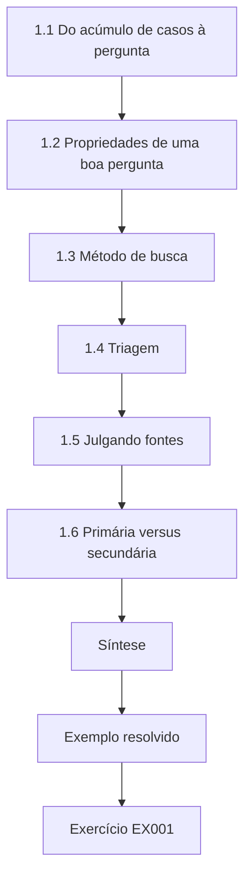

### Desenho lógico

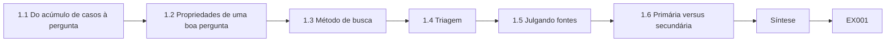

```text
[1.1 Do acúmulo de casos à pergunta]
    |
    v
[1.2 Propriedades de uma boa pergunta]
    |
    v
[1.3 Método de busca]
    |
    v
[1.4 Triagem]
    |
    v
[1.5 Julgando fontes]
    |
    v
[1.6 Primária versus secundária]
    |
    v
[Síntese]
    |
    v
[Exemplo resolvido] --> [Exercício EX001]
```
<!-- open-cyber-academy:lesson-figures:end ch-01 -->


### Objetivos de aprendizagem

Você vai (1) transformar um problema do trabalho com casos numa pergunta pesquisável; (2) buscar e triar a literatura pericial de forma sistemática; (3) julgar a qualidade de uma fonte; (4) registrar a busca para que outros possam repeti-la.

### 1.1 Do acúmulo de casos à pergunta

Tomás Lindqvist trabalha em tempo parcial numa unidade policial de perícia digital enquanto estuda na fictícia Ridgeway University. Sua unidade tem um acúmulo de casos: notebooks apreendidos esperam semanas porque os peritos revisam milhares de arquivos do sistema operacional. Garfinkel (2010) argumentou que o volume crescente de dados é um desafio central para a pesquisa pericial. O problema de Tomás é real, mas "resolver o acúmulo" não é uma pergunta. Ele a estreita: *em que proporção a filtragem de arquivos conhecidos contra um conjunto de hashes de referência reduz os arquivos que um perito precisa revisar, e o que ela deixa escapar?*

### 1.2 Propriedades de uma boa pergunta

Ela pode ser respondida com dados que ele consegue obter licitamente, é mensurável (uma proporção, uma contagem de erros), é delimitada (um tipo de sistema de arquivos, um conjunto de referência) e é útil para os profissionais. A pergunta de Tomás passa em cada teste: imagens que ele mesmo constrói podem ser usadas licitamente, a redução e as perdas podem ser contadas, o estudo se limita a um sistema de arquivos e a uma versão da NSRL, e os peritos de sua própria unidade policial filtram casos dessa forma toda semana. A Dra. Osei pede que ele escreva a pergunta de modo que cada uma dessas propriedades fique visível nela.

### 1.3 Método de busca

Ele busca na Digital Investigation e na Forensic Science International: Digital Investigation, nos anais do DFRWS e nas publicações do NIST, com termos como "known file filtering", "hash set" e "triage". Ele registra a base, a data, os termos e os resultados. Registrar esses detalhes significa que outro pesquisador pode repetir a busca e conferir se ele deixou de fora estudos relevantes. Ele também segue as referências dos estudos que encontra, anotando quais foram acrescentados dessa forma. O registro da busca se torna um apêndice da dissertação, como os examinadores vão esperar, e ele refaz a busca antes da submissão para captar estudos publicados durante o projeto.

### 1.4 Triagem

Títulos e resumos são triados contra critérios de inclusão (empírico, descreve o conjunto de referência, relata redução ou erro). Cada exclusão recebe uma razão. Escrever uma razão para cada exclusão permite que sua orientadora confira se os critérios foram aplicados de forma consistente, e não conforme um artigo apoiasse ou não as expectativas dele. Razões comuns são que um artigo descreve uma ferramenta sem testá-la ou relata redução sem nomear o conjunto de referência. Quando uma decisão não é clara, Tomás lê o texto completo e registra o que encontrou. Os critérios foram escritos em seu protocolo antes do início da triagem, de modo que não pudessem derivar em direção aos estudos que ele esperava incluir.

### 1.5 Julgando fontes

Trabalhos empíricos revisados por pares e com dados liberados ocupam a posição mais alta; *white papers* de fornecedores são anotados, mas tratados como alegações. A documentação da National Software Reference Library (NSRL) do NIST é a fonte primária sobre o que o conjunto de referência contém. Ordenar as fontes dessa forma importa para o tema dele, porque o material de fornecedores costuma relatar grandes reduções sem descrever as imagens nem dizer se arquivos relevantes foram perdidos. Tomás registra o tipo de cada fonte em suas tabelas, para que os leitores vejam quais valores vêm de estudos independentes com dados e quais são alegações. Ele trata a documentação da NSRL como autoridade apenas sobre o que o conjunto de referência contém, não sobre quão bem a filtragem funciona na prática.

### 1.6 Primária versus secundária

Se uma revisão cita um valor de redução, Tomás o rastreia até o estudo original antes de se apoiar nele. Num caso, uma revisão dá um valor de redução que o estudo original relatou apenas para uma única imagem, não como média. Tomás cita o original com seu contexto em vez de repetir o resumo da revisão. Rastrear os valores até suas fontes também mostra quais estudos chegaram a medir perdas, que é a lacuna que seu projeto aborda. Ele mantém uma anotação de cada valor rastreado, sua fonte e qualquer diferença encontrada, e a Dra. Osei confere uma amostra delas.

### Exemplo resolvido

Sua primeira busca retorna 212 registros; 31 sobrevivem à triagem por título; 9 atendem a todos os critérios. Ele tabula, para cada estudo, o conjunto de dados, o conjunto de referência, a redução relatada e se as perdas foram medidas. Só três mediram perdas — essa é a lacuna dele.

> **Caso sintético.** Tomás, sua unidade e suas contagens de busca são inventados.

### Erros e limites

Uma busca limitada ao inglês e a dois periódicos pode deixar trabalhos de fora; ele declara essa limitação em vez de escondê-la.

### Exercícios

- **EX001 — Estreitamento.** Reescreva "resolver o acúmulo" como uma pergunta pesquisável. *Rubrica:* 3 = mensurável, delimitada, dados lícitos; 2 = parcialmente delimitada; 1 = ainda vaga; 0 = nada.
- **EX002 — Quatro propriedades.** Liste quatro propriedades de uma boa pergunta de pesquisa. *Rubrica:* 3 = respondível, mensurável, delimitada, útil; 2 = três; 1 = uma; 0 = nada.
- **EX003 — Registro da busca.** O que um registro de busca deve anotar? *Rubrica:* 3 = base, data, termos, resultados; 2 = três; 1 = um; 0 = nada.
- **EX004 — Artigo de fornecedor.** Como deve ser tratado um *white paper* de fornecedor que alega 95% de redução? *Rubrica:* 3 = como alegação; buscar evidência independente; 2 = parcial; 1 = aceitar; 0 = nada.
- **EX005 — Rastreando valores.** Uma revisão cita uma taxa de redução. O que você faz antes de citá-la? *Rubrica:* 3 = rastrear até o estudo original, conferir o contexto; 2 = parcial; 1 = citar a revisão; 0 = nada.
- **EX006 — Lacuna.** A partir do exemplo resolvido, que lacuna Tomás encontra? *Rubrica:* 3 = só 3 de 9 mediram perdas; 2 = lacuna vaga; 1 = errado; 0 = nada.
- **EX007 — Limitação declarada.** Escreva uma frase que declare a limitação da busca. *Rubrica:* 3 = nomeia o escopo de idioma e de periódicos; 2 = um; 1 = vago; 0 = nada.

### Síntese

Uma boa dissertação começa com uma pergunta estreita e mensurável e com uma busca de literatura registrada bem o bastante para ser repetida.

### Continue estudando — capítulo 01 de 08

[← Página do curso](../../README.md) · [Índice de capítulos do curso](../SUBJECTS.md) · [Capítulo 02 (rascunho) →](#ch-02)

<a id="ch-02"></a>

## Capítulo 2 — Perícia digital e análise de malware: seminário avançado

<!-- open-cyber-academy:lesson-figures:start ch-02 -->
### Mapa da aula

Aula 02 publicada. Mapa, exemplo, EX008.

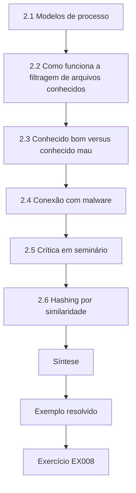

### Desenho lógico

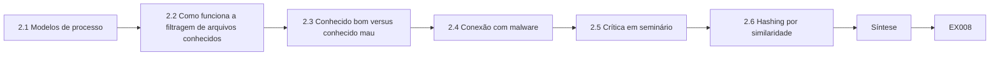

```text
[2.1 Modelos de processo]
    |
    v
[2.2 Como funciona a filtragem de arquivos conhecidos]
    |
    v
[2.3 Conhecido bom versus conhecido mau]
    |
    v
[2.4 Conexão com malware]
    |
    v
[2.5 Crítica em seminário]
    |
    v
[2.6 Hashing por similaridade]
    |
    v
[Síntese]
    |
    v
[Exemplo resolvido] --> [Exercício EX008]
```
<!-- open-cyber-academy:lesson-figures:end ch-02 -->


### Objetivos de aprendizagem

Você vai (1) explicar os modelos de processo pericial usados em pesquisa; (2) relacionar a triagem baseada em hash a eles; (3) criticar um método publicado em seminário; (4) conectar a análise de malware à filtragem de arquivos conhecidos.

### 2.1 Modelos de processo

Nos termos do NIST SP 800-86, a filtragem fica na segunda de quatro fases: coleta, exame, análise e relato. A ISO/IEC 27043 estabelece princípios e processos de investigação que abrangem prontidão, iniciação, aquisição e investigação. Tomás situa a filtragem no exame: ela reduz os dados antes da análise. Situar a filtragem no exame importa para o argumento dele: as decisões tomadas ali moldam o que o perito depois analisa e relata, de modo que um arquivo posto de lado nessa etapa pode nunca mais ser examinado. Tomás usa os dois modelos para explicar onde erros introduzidos pela filtragem poderiam entrar numa investigação.

### 2.2 Como funciona a filtragem de arquivos conhecidos

Calcula-se o hash de cada arquivo da imagem; os hashes encontrados num conjunto de referência de *software* conhecido (como a NSRL) são postos de lado como "conhecidos". A documentação da NSRL a descreve como uma coleção de hashes de *software* publicado; ela não rotula arquivos como bons ou maus. A distinção entre conhecido e bom é o centro do estudo dele: um arquivo posto de lado como conhecido é idêntico a um *software* publicado, mas nada na correspondência diz se ele foi usado para um propósito legítimo. Os peritos às vezes tratam arquivos conhecidos como inofensivos, e é esse o pressuposto que ele testa.

### 2.3 Conhecido bom versus conhecido mau

Alguns laboratórios mantêm conjuntos "conhecidos maus" com hashes de material ilícito ou de malware. Corresponder a um hash conhecido mau sinaliza um arquivo para atenção; corresponder a um hash de *software* conhecido mostra apenas que o arquivo é igual a um arquivo publicado. Os dois tipos de conjunto funcionam em sentidos opostos: uma correspondência conhecida má chama a atenção para um arquivo, enquanto uma correspondência de *software* conhecido o tira de vista. Tomás estuda apenas o segundo, porque é ali que arquivos relevantes poderiam desaparecer sem que ninguém percebesse. Sua dissertação explica a diferença logo no início, para que os leitores não confundam os dois, e suas imagens sintéticas usam apenas um conjunto de referência de *software* conhecido.

### 2.4 Conexão com malware

Um malware pode substituir um arquivo de sistema. O hash do arquivo substituído deixa de corresponder ao conjunto de referência, de modo que a filtragem corretamente o deixa para revisão. Mas, se um atacante usa uma ferramenta legítima e não modificada, seu hash corresponde e a filtragem a esconde. Sikorski e Honig (2012) enfatizam que binários legítimos podem ser mal utilizados. O segundo caso é o que o estudo dele foi projetado para medir. Uma ferramenta de administração remota usada por um intruso é idêntica à versão publicada, por isso a filtragem a põe de lado como conhecida. Tomás planta casos assim em suas imagens sintéticas como perdas projetadas, para poder contar com que frequência a filtragem os esconde.

### 2.5 Crítica em seminário

Tomás apresenta um artigo que relata 70% de redução. Os colegas perguntam: quais imagens? Qual versão do conjunto de referência? Arquivos relevantes foram excluídos? O artigo não diz, o que limita seu peso. O seminário molda o próprio relato de Tomás: ele decide declarar, para cada resultado, as imagens, a versão do conjunto de referência e o número de arquivos relevantes postos de lado. Assim, seus valores podem ser julgados de um modo que os 70% do artigo não podiam. A Dra. Osei pede que ele mantenha as três perguntas do seminário como lista de verificação para seu próprio capítulo de resultados.

### 2.6 Hashing por similaridade

Resumos de similaridade (o sdhash de Roussev, o ssdeep de Kornblum) encontram correspondências aproximadas; Tomás os mantém fora do escopo para delimitar seu estudo. Resumos de similaridade poderiam captar versões modificadas de ferramentas conhecidas, o que é um problema relacionado, mas diferente do dele. Incluí-los acrescentaria novas medidas, configurações e tipos de erro, o suficiente para um estudo separado. Tomás os descreve na revisão de literatura para que os leitores saibam por que foram excluídos, e os nomeia como trabalho futuro na dissertação. Mantê-los de fora permite que ele responda bem a uma pergunta dentro do calendário de um mestrado.

### Exemplo resolvido

Numa imagem sintética, uma ferramenta de administração remota aparece no conjunto de referência porque é *software* publicado. A filtragem a marca como "conhecida". No cenário sintético, ela foi usada por um intruso. Tomás registra isso como uma categoria de perda: ferramenta legítima, uso ilegítimo.

> **Caso sintético.** A imagem e a intrusão são inventadas.

### Erros e limites

"Conhecido" não é "irrelevante"; os relatos não devem sugerir que arquivos filtrados foram examinados e liberados.

### Exercícios

- **EX008 — Posição.** Em que fase do SP 800-86 fica a filtragem? *Rubrica:* 3 = exame, antes da análise; 2 = só a fase; 1 = errado; 0 = nada.
- **EX009 — Significado da NSRL.** O que uma correspondência com a NSRL lhe diz? *Rubrica:* 3 = o arquivo é igual a *software* publicado; não é bom/mau; 2 = parcial; 1 = o arquivo é seguro; 0 = nada.
- **EX010 — Conhecido mau.** Contraste conjuntos conhecidos maus e conjuntos de *software* conhecido. *Rubrica:* 3 = sinalizar vs. pôr de lado, significados diferentes; 2 = parcial; 1 = iguais; 0 = nada.
- **EX011 — Arquivo substituído.** Por que um arquivo de sistema adulterado por um trojan sobrevive à filtragem? *Rubrica:* 3 = o hash modificado deixa de corresponder; 2 = parcial; 1 = errado; 0 = nada.
- **EX012 — Ferramenta escondida.** Que categoria de perda o exemplo resolvido mostra? *Rubrica:* 3 = ferramenta legítima, uso ilegítimo; 2 = parcial; 1 = malware; 0 = nada.
- **EX013 — Perguntas do seminário.** Dê três perguntas a fazer diante de uma alegação de 70% de redução. *Rubrica:* 3 = imagens, versão da referência, exclusões; 2 = duas; 1 = uma; 0 = nada.
- **EX014 — Redação do relato.** Escreva uma frase que descreva com exatidão os arquivos filtrados. *Rubrica:* 3 = postos de lado, não examinados; 2 = parcial; 1 = "liberados"; 0 = nada.

### Síntese

A filtragem é uma etapa de redução de dados na fase de exame; suas correspondências significam "publicado", nunca "inocente".

### Continue estudando — capítulo 02 de 08

[← Capítulo 01 (rascunho)](#ch-01) · [Índice de capítulos do curso](../SUBJECTS.md) · [Capítulo 03 (rascunho) →](#ch-03)

<a id="ch-03"></a>

## Capítulo 3 — Desenho do estudo, ética e reprodutibilidade

<!-- open-cyber-academy:lesson-figures:start ch-03 -->
### Mapa da aula

Aula 03 publicada. Mapa, exemplo, EX015.

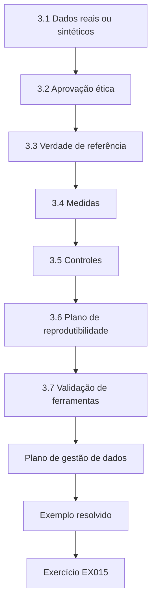

### Desenho lógico

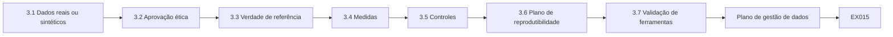

```text
[3.1 Dados reais ou sintéticos]
    |
    v
[3.2 Aprovação ética]
    |
    v
[3.3 Verdade de referência]
    |
    v
[3.4 Medidas]
    |
    v
[3.5 Controles]
    |
    v
[3.6 Plano de reprodutibilidade]
    |
    v
[3.7 Validação de ferramentas]
    |
    v
[Plano de gestão de dados]
    |
    v
[Exemplo resolvido] --> [Exercício EX015]
```
<!-- open-cyber-academy:lesson-figures:end ch-03 -->


### Objetivos de aprendizagem

Você vai (1) escolher entre evidências reais e sintéticas; (2) obter aprovação ética e legal; (3) projetar medições de redução e de perdas; (4) planejar a reprodutibilidade.

### 3.1 Dados reais ou sintéticos

Imagens de casos reais contêm dados pessoais e são restritas por lei e por ordens judiciais. Garfinkel et al. (2009) defenderam corpora forenses padronizados e compartilháveis para que os resultados possam ser comparados. Tomás usa imagens sintéticas de notebooks que ele mesmo constrói: uma instalação limpa do sistema operacional, aplicativos-padrão e documentos de usuário plantados, de modo que a verdade de referência é conhecida. Construir as imagens ele mesmo significa que a origem e o rótulo de cada arquivo são conhecidos antes da filtragem, de modo que as perdas podem ser contadas com exatidão. O custo é o realismo: imagens sintéticas não têm a desordem de notebooks reais, o que ele registra como limitação.

### 3.2 Aprovação ética

Mesmo um trabalho sintético precisa de revisão ética se envolver pessoas (um estudo de concordância entre peritos envolve). Ele submete o projeto ao comitê da universidade, descrevendo o consentimento dos peritos participantes e confirmando que nenhum dado de casos sai da unidade policial. Sua submissão explica que os peritos vão classificar eventos apenas de imagens sintéticas, que seus resultados serão anonimizados e que eles podem desistir. Ela confirma que sua função policial não lhe dá acesso aos dados do estudo além do que qualquer participante veria. O comitê aprova a submissão antes de qualquer perito ser recrutado, e ele guarda a carta de aprovação no arquivo do projeto.

### 3.3 Verdade de referência

Cada arquivo plantado é rotulado como "relevante" ou "não relevante" antes da filtragem. Uma perda é um arquivo relevante posto de lado como conhecido. Rotular antes de filtrar impede que a visão retrospectiva mude o que conta como relevante. Tomás registra cada rótulo com a razão, como um documento de usuário ligado ao cenário sintético ou uma ferramenta legítima plantada com uso ilegítimo. As perdas projetadas são rotuladas como relevantes desde o início. Quando uma conferência motivada por sua banca constatou que um manual plantado era idêntico a uma entrada da NSRL, ele o rerrotulou como perda projetada, com uma razão documentada, em vez de excluí-lo. Os rótulos são arquivados com a semente de cada imagem, de modo que quem reconstrói uma imagem também recebe a verdade de referência usada para contar suas perdas.

### 3.4 Medidas

Redução = arquivos conhecidos ÷ todos os arquivos. Taxa de perda = arquivos relevantes postos de lado ÷ arquivos relevantes. Ambas são relatadas com as contagens. Relatar as contagens além das porcentagens permite que os leitores vejam em quantos arquivos um valor se baseia: uma taxa de perda calculada sobre um punhado de arquivos relevantes significa menos do que uma calculada sobre centenas. As duas medidas puxam em sentidos opostos, já que um filtro que põe de lado mais arquivos eleva a redução, mas pode também elevar as perdas. Tomás relata ambas para cada imagem, para que nenhuma seja apresentada sozinha. Suas tabelas de resultados mostram, imagem por imagem, as contagens de arquivos por trás de cada porcentagem de redução e de perda.

### 3.5 Controles

Ele fixa a versão do conjunto de referência e a versão da ferramenta de hash, e as registra, porque um conjunto de referência mais novo muda os resultados. Congelar essas versões transforma o conjunto de referência numa condição controlada em vez de móvel. Sem isso, uma versão lançada durante o estudo poderia mudar quais arquivos contam como conhecidos, e as diferenças entre imagens poderiam refletir a data em que foram processadas. Tomás registra a versão e a ferramenta de hash em cada entrada do registro. Mais tarde, seu piloto mostrou o quanto a redução depende da atualidade do conjunto de referência, o que tornou o controle ainda mais importante.

### 3.6 Plano de reprodutibilidade

*Scripts*, receitas de construção das imagens, valores de semente e a versão do conjunto de referência são arquivados; cada resultado remete a uma execução de *script*. Os valores de semente fazem o construtor de imagens produzir os mesmos arquivos a cada vez, de modo que outro pesquisador pode recriar as imagens em vez de confiar na descrição dele. Tomás testa o plano durante o piloto, reconstruindo uma imagem a partir do arquivo e conferindo se os hashes dos arquivos coincidem. O arquivo é liberado com a dissertação, exceto as respostas brutas dos peritos, que permanecem anonimizadas sob a aprovação ética.

### 3.7 Validação de ferramentas

O programa Computer Forensics Tool Testing do NIST publica métodos e relatórios de teste; Tomás confere sua ferramenta de hash contra vetores de teste conhecidos antes de usá-la. Um erro de hash faria arquivos parecerem desconhecidos ou, pior, conhecidos quando não são, por isso a validação da ferramenta protege as duas medidas. Tomás registra quais vetores de teste usou, a versão da ferramenta e os resultados. Quando o piloto produziu uma redução inesperadamente baixa numa imagem, ele pôde descartar falha da ferramenta em parte porque ela havia passado nessas conferências, e uma segunda ferramenta deu hashes idênticos. O registro de validação faz parte do arquivo, para que os examinadores possam conferir a versão da ferramenta contra os vetores de teste que ele usou.

### Plano de gestão de dados

O plano lista onde as imagens e os *scripts* ficam armazenados, quem pode acessá-los e por quanto tempo são mantidos. Como as imagens são sintéticas, elas podem ser publicadas depois do estudo.

### Exemplo resolvido

Sua banca pergunta se arquivos "relevantes" plantados poderiam, por acidente, ser iguais a arquivos publicados. Ele confere: um PDF plantado era um manual de fornecedor idêntico a uma entrada da NSRL. Ele o rerrotula com cuidado como perda projetada, documentando por quê, em vez de excluí-lo.

> **Caso sintético.** A conversa com a banca é inventada.

### Erros e limites

Imagens sintéticas podem não ter a desordem de notebooks reais; a redução medida nelas pode superestimar o efeito no mundo real.

### Exercícios

- **EX015 — Por que sintéticas.** Dê duas razões para usar imagens sintéticas aqui. *Rubrica:* 3 = nenhum dado pessoal, verdade de referência conhecida; 2 = uma; 1 = mais baratas; 0 = nada.
- **EX016 — Gatilho ético.** Que parte do estudo precisa de revisão ética de participantes humanos? *Rubrica:* 3 = estudo de concordância entre peritos, consentimento; 2 = parcial; 1 = nenhuma necessária; 0 = nada.
- **EX017 — Taxa de perda.** Defina a fórmula da taxa de perda. *Rubrica:* 3 = relevantes postos de lado ÷ relevantes; 2 = parcial; 1 = razão errada; 0 = nada.
- **EX018 — Controle de versão.** Por que registrar a versão do conjunto de referência? *Rubrica:* 3 = versões novas mudam correspondências e resultados; 2 = parcial; 1 = hábito; 0 = nada.
- **EX019 — PDF do manual.** Como o manual do fornecedor foi tratado, e por quê? *Rubrica:* 3 = mantido como perda projetada, documentada; 2 = parcial; 1 = excluído; 0 = nada.
- **EX020 — Desordem.** Declare o risco de validade externa das imagens sintéticas. *Rubrica:* 3 = menos desordem pode superestimar a redução; 2 = vago; 1 = tentativa mínima; 0 = nada.

### Síntese

Verdade de referência conhecida, versões fixas, aprovação ética e *scripts* arquivados transformam uma ideia de triagem num estudo defensável.

### Continue estudando — capítulo 03 de 08

[← Capítulo 02 (rascunho)](#ch-02) · [Índice de capítulos do curso](../SUBJECTS.md) · [Capítulo 04 (rascunho) →](#ch-04)

<a id="ch-04"></a>

## Capítulo 4 — Perícia digital e análise de malware: explicações concorrentes

<!-- open-cyber-academy:lesson-figures:start ch-04 -->
### Mapa da aula

Aula 04 publicada. Mapa, exemplo, EX021.

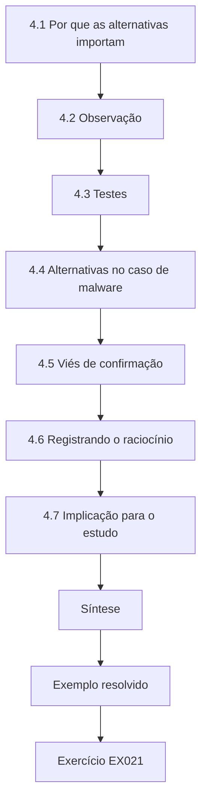

### Desenho lógico

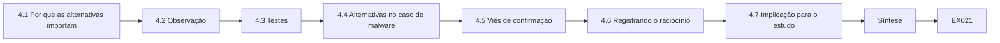

```text
[4.1 Por que as alternativas importam]
    |
    v
[4.2 Observação]
    |
    v
[4.3 Testes]
    |
    v
[4.4 Alternativas no caso de malware]
    |
    v
[4.5 Viés de confirmação]
    |
    v
[4.6 Registrando o raciocínio]
    |
    v
[4.7 Implicação para o estudo]
    |
    v
[Síntese]
    |
    v
[Exemplo resolvido] --> [Exercício EX021]
```
<!-- open-cyber-academy:lesson-figures:end ch-04 -->


### Objetivos de aprendizagem

Você vai (1) enunciar explicações concorrentes para uma observação pericial; (2) projetar testes que as separem; (3) aplicar a ideia a resultados de triagem; (4) evitar o viés de confirmação.

### 4.1 Por que as alternativas importam

Casey (2011) enfatiza que os peritos devem considerar explicações alternativas antes de chegar a conclusões. A ISO/IEC 27042 também trata da análise e da interpretação de evidências digitais, incluindo a necessidade de raciocínio documentado e repetível. Para Tomás, isso se aplica à sua pesquisa tanto quanto ao trabalho com casos: um resultado inesperado precisa ter explicações alternativas consideradas antes de ser interpretado. Suas anotações listam cada explicação com o teste que poderia descartá-la, como ele faria num exame em sua função policial. A Dra. Osei revisa essas anotações em cada reunião de orientação, começando pelas três explicações para a imagem do piloto com redução baixa.

### 4.2 Observação

Numa execução do piloto, a redução numa imagem foi de apenas 40%, muito abaixo das outras. Tomás lista explicações: (a) a imagem tinha mais arquivos de usuário; (b) a versão do sistema operacional era mais nova do que o conjunto de referência; (c) a ferramenta de hash falhou em alguns arquivos. Um resultado tão distante dos demais poderia refletir uma propriedade real da imagem ou uma falha em seu método. Listar as explicações antes de testar qualquer uma delas o impede de se fixar na primeira que parecer plausível. Cada explicação é escrita nas anotações do piloto com o teste que ele planeja usar.

### 4.3 Testes

(a) Contar os arquivos de usuário: semelhante às outras. (b) Comparar a data da versão do sistema operacional com o lançamento do conjunto de referência: a versão era mais nova, por isso muitos arquivos de sistema não têm entradas. (c) Recalcular os hashes com uma segunda ferramenta: hashes idênticos. A explicação (b) sobrevive. Cada teste foi escolhido para descartar uma explicação independentemente das outras. A explicação sobrevivente muda a forma como o estudo precisa ser projetado, porque a redução agora parece depender da atualidade do conjunto de referência em relação ao sistema operacional. As anotações do piloto registram cada teste e cada resultado, incluindo as duas explicações rejeitadas, para que um revisor possa acompanhar o raciocínio.

### 4.4 Alternativas no caso de malware

Quando um executável desconhecido permanece depois da filtragem, as explicações incluem malware, uma ferramenta interna feita sob medida ou uma atualização de *software* mais nova do que o conjunto de referência. O exame estático dos metadados da amostra sintética — assinante, recurso de versão, caminho de instalação — ajuda a separá-las sem executá-la. Essas explicações importam porque as imagens sintéticas incluem atualizações de *software* posteriores ao conjunto de referência, de modo que um executável desconhecido não é automaticamente suspeito. Tomás registra o que cada característica dos metadados mostrou e qual explicação ela apoia. Ele não executa amostras desconhecidas, de acordo com o limite ético do curso.

### 4.5 Viés de confirmação

Peritos que esperam malware podem ler cada arquivo desconhecido como hostil. A revisão cega, em que um colega avalia sem conhecer a hipótese, reduz esse risco. No estudo dele, as perdas projetadas são conhecidas por Tomás, mas não pelos peritos do estudo de concordância, que classificam eventos sem saber quais arquivos foram plantados. Ele também pede a um colega que revise uma amostra de suas próprias classificações sem lhe contar suas expectativas, e registra onde diferiram e por quê. A revisão cega também é usada nas conferências manuais de executáveis desconhecidos.

### 4.6 Registrando o raciocínio

Cada explicação, seu teste e seu resultado vão para as anotações, para que um revisor veja por que as opções rejeitadas foram rejeitadas. Registrar as explicações rejeitadas protege o trabalho de duas formas. Um revisor pode conferir se os testes foram adequados, e um pesquisador posterior pode ver quais explicações já foram consideradas. As anotações do piloto de Tomás para a imagem com redução baixa são escritas dessa forma: três explicações, três testes e uma declaração curta de qual explicação sobreviveu e por quê. O mesmo formato é usado para os executáveis desconhecidos na execução principal.

### 4.7 Implicação para o estudo

A redução depende da atualidade do conjunto de referência; Tomás acrescenta "dias entre a versão do sistema operacional e o lançamento da referência" como variável. O achado do piloto se converte numa mudança de desenho: em vez de tratar a imagem com redução baixa como ponto fora da curva, Tomás mede para cada imagem o intervalo entre a versão do sistema operacional e o lançamento da referência. A execução principal pode então mostrar como a redução muda com esse intervalo, o que é mais útil para os profissionais do que uma média única. Ele registra a mudança e sua razão no protocolo antes do início da execução principal.

### Exemplo resolvido

As anotações do piloto dizem: "Imagem L3: redução de 40%. H(a) volume de usuário — rejeitada, 102 arquivos de usuário vs. média de 98. H(b) sistema operacional mais novo — apoiada, versão 73 dias após o lançamento da referência. H(c) falha da ferramenta — rejeitada, a segunda ferramenta coincidiu em todos os hashes."

> **Caso sintético.** A imagem L3 e seus números são inventados.

### Erros e limites

Sobreviver a um teste não prova uma explicação; ela é apenas a mais bem apoiada até agora.

### Exercícios

- **EX021 — Três explicações.** Liste as três explicações para a redução baixa em L3. *Rubrica:* 3 = volume de usuário, sistema operacional mais novo, falha da ferramenta; 2 = duas; 1 = uma; 0 = nada.
- **EX022 — Teste da ferramenta.** Como a falha da ferramenta foi testada? *Rubrica:* 3 = novo cálculo de hash com segunda ferramenta, idêntico; 2 = parcial; 1 = errado; 0 = nada.
- **EX023 — Executável desconhecido.** Nomeie três explicações para um executável desconhecido depois da filtragem. *Rubrica:* 3 = malware, ferramenta interna, atualização mais nova; 2 = duas; 1 = só malware; 0 = nada.
- **EX024 — Separação estática.** Que metadados ajudam a separá-las sem execução? *Rubrica:* 3 = assinante, recurso de versão, caminho; 2 = dois; 1 = executá-lo; 0 = nada.
- **EX025 — Controle de viés.** Descreva um controle contra o viés de confirmação. *Rubrica:* 3 = revisão cega por um colega; 2 = vago; 1 = tentativa mínima; 0 = nada.
- **EX026 — Nova variável.** Que variável o estudo acrescentou, e por quê? *Rubrica:* 3 = dias entre a versão e o lançamento da referência; a atualidade determina a redução; 2 = parcial; 1 = errado; 0 = nada.

### Síntese

Nomeie explicações rivais, teste cada uma, registre por que as rejeitadas falharam e deixe o resultado remodelar o estudo.

### Continue estudando — capítulo 04 de 08

[← Capítulo 03 (rascunho)](#ch-03) · [Índice de capítulos do curso](../SUBJECTS.md) · [Capítulo 05 (rascunho) →](#ch-05)

<a id="ch-05"></a>

## Capítulo 5 — Proposta e piloto

<!-- open-cyber-academy:lesson-figures:start ch-05 -->
### Mapa da aula

Aula 05 publicada. Mapa, exemplo, EX027.

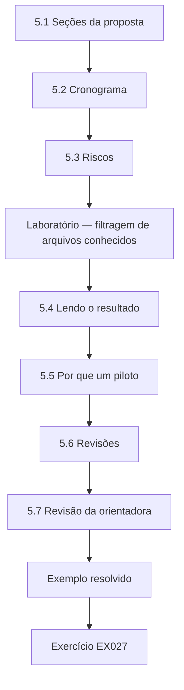

### Desenho lógico

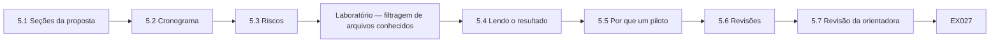

```text
[5.1 Seções da proposta]
    |
    v
[5.2 Cronograma]
    |
    v
[5.3 Riscos]
    |
    v
[Laboratório — filtragem de arquivos conhecidos]
    |
    v
[5.4 Lendo o resultado]
    |
    v
[5.5 Por que um piloto]
    |
    v
[5.6 Revisões]
    |
    v
[5.7 Revisão da orientadora]
    |
    v
[Exemplo resolvido] --> [Exercício EX027]
```
<!-- open-cyber-academy:lesson-figures:end ch-05 -->


### Objetivos de aprendizagem

Você vai (1) escrever uma proposta de mestrado para um estudo pericial; (2) conduzir um piloto; (3) calcular a redução sobre dados sintéticos; (4) revisar o plano a partir dos achados do piloto.

### 5.1 Seções da proposta

Pergunta; fundamentação; método (imagens, conjunto de referência, ferramentas, medidas); ética e aspectos legais; riscos; cronograma; produtos. Tomás a mantém em doze páginas. Doze páginas o obrigam a declarar o método com clareza suficiente para que a banca julgue a viabilidade, sem o detalhe que pertence à dissertação. A parte de ética e aspectos legais explica por que as imagens são sintéticas e como os peritos participantes são protegidos. Os produtos incluem a dissertação, o construtor de imagens liberado e um resumo para profissionais. A Dra. Osei revisa uma versão completa antes que ela vá para a banca.

### 5.2 Cronograma

Meses 1–4: literatura e construção das imagens; 5–8: piloto e execuções principais; 9–12: estudo de concordância; 13–18: análise e redação; 19–24: revisão e defesa. Colocar o estudo de concordância depois das execuções principais significa que os peritos classificam eventos dos conjuntos reduzidos finais, e não das imagens do piloto. A redação começa no mês 13, mas Tomás rascunha os capítulos de revisão de literatura e de método ao longo do caminho, de modo que os últimos meses são dedicados aos resultados e à revisão. Cada fase termina com um relatório curto à Dra. Osei, que confere o andamento contra o plano. O cronograma faz parte da proposta que a banca aprova, por isso uma fase atrasada precisa ser explicada em relação a ele.

### 5.3 Riscos

Atualização do conjunto de referência no meio do estudo (mitigação: congelar uma versão); mudanças no acesso à unidade policial (mitigação: todos os dados sintéticos); recrutamento de participantes para o estudo de concordância (mitigação: recrutar em duas unidades). Cada risco é pareado com uma mitigação que pode ser aplicada antes que o risco ocorra. Congelar a versão do conjunto de referência elimina por completo o primeiro risco. Usar apenas imagens sintéticas significa que uma mudança nas regras de acesso de sua unidade policial não pode interromper o estudo. Recrutar em duas unidades torna mais provável que peritos suficientes participem do estudo de concordância. Tomás revisa a lista de riscos com a Dra. Osei a cada fase.

### Laboratório — filtragem de arquivos conhecidos

```python
"""Known-file filtering on a synthetic triage set (stdlib only)."""
import hashlib
known = {hashlib.sha256(f"os-file-{i}".encode()).hexdigest() for i in range(800)}
files = [f"os-file-{i}" for i in range(0, 800, 2)] + [f"user-doc-{i}" for i in range(100)]
hits = sum(hashlib.sha256(f.encode()).hexdigest() in known for f in files)
print(f"files={len(files)} known={hits} left_for_review={len(files)-hits}")
print(f"reduction={hits/len(files):.1%}")
```

Execute com `python3 lab_nsrl.py`. Saída verificada:

```text
files=500 known=400 left_for_review=100
reduction=80.0%
```

### 5.4 Lendo o resultado

Dos 500 arquivos sintéticos, 400 correspondem ao conjunto de referência sintético e 100 permanecem para revisão: uma redução de 80,0%. Todos os 100 arquivos restantes são documentos de usuário, e nenhum documento de usuário foi posto de lado, de modo que neste piloto a contagem de perdas é zero. A contagem zero de perdas mostra que os *scripts* funcionaram, não que a filtragem é segura: o piloto não plantou perdas projetadas, então não havia nada para a filtragem esconder. Tomás declara isso ao lado dos valores do piloto, para que nenhum leitor os confunda com um teste da hipótese. A execução principal acrescenta perdas projetadas.

### 5.5 Por que um piloto

O piloto testa *scripts*, tempos e medidas, não a hipótese. Ele constatou que a etapa de hash levava quatro minutos por imagem, o que permitiu definir o orçamento do estudo principal. Como o piloto testa o procedimento, seus resultados não são combinados com os da execução principal. Sua principal lição para o orçamento é o tempo: com quatro minutos de hash por imagem, trinta imagens precisam de duas horas de hash, o que deixa a maior parte do tempo para construir imagens e conferir rótulos. O piloto também encontrou a imagem com redução baixa que levou a uma nova variável.

### 5.6 Revisões

O piloto mostrou que o construtor de imagens não instalava nenhum *software* de terceiros; Tomás acrescenta aplicativos comuns para que a cobertura de aplicativos do conjunto de referência também seja testada. Sem aplicativos de terceiros, as imagens continham apenas arquivos do sistema operacional e documentos de usuário, de modo que o estudo não poderia mostrar quão bem o conjunto de referência cobre o *software* comum. Acrescentar aplicativos também permite plantar de forma realista perdas projetadas que envolvem ferramentas legítimas. A revisão é registrada no protocolo antes da execução principal, com o achado do piloto que a motivou.

### 5.7 Revisão da orientadora

A Dra. Amara Osei pede uma regra de parada: a execução principal usa 30 imagens, fixadas de antemão, para que os resultados não sejam ajustados acrescentando imagens até que os números pareçam bons. Fixar o número de antemão protege o resultado de uma tentação comum: executar mais imagens até que um efeito apareça ou desapareça. Trinta imagens bastam para mostrar como a redução muda com o intervalo até o lançamento da referência, e cabem no orçamento de tempo definido pelo piloto. Tomás registra a regra de parada no protocolo. Se uma imagem falhar na construção, ela é relatada como ausente em vez de substituída.

### Orçamento

São orçados o armazenamento de trinta imagens, uma estação de trabalho e o tempo dos peritos para o estudo de concordância. A unidade policial não fornece dados, apenas orientação opcional de servidores em seu próprio tempo.

### Exemplo resolvido

Tomás escreve na proposta: "Medida primária: redução com contagens. Secundária: taxa de perda contra a verdade de referência plantada. Piloto: 500 arquivos, redução de 80,0%, 0 perdas — esperado, pois o piloto não plantou perdas projetadas."

> **Caso sintético.** Os dados do piloto são gerados pelo *script* do laboratório.

### Erros e limites

Um piloto sem perdas não diz nada sobre as taxas de perda reais; é preciso acrescentar casos de perdas projetadas.

### Exercícios

- **EX027 — Valores do laboratório.** Relate a redução e os arquivos restantes do laboratório. *Rubrica:* 3 = 80,0%, 100 restantes de 500; 2 = um; 1 = errado; 0 = nada.
- **EX028 — Propósito do piloto.** O que um piloto testa? *Rubrica:* 3 = *scripts*, tempos, medidas, não a hipótese; 2 = parcial; 1 = responde à pergunta; 0 = nada.
- **EX029 — Três riscos.** Nomeie três riscos da proposta e suas mitigações. *Rubrica:* 3 = três pareados; 2 = dois; 1 = só os riscos; 0 = nada.
- **EX030 — Revisão do construtor.** O que foi mudado depois do piloto, e por quê? *Rubrica:* 3 = acrescentar aplicativos comuns para testar a cobertura; 2 = parcial; 1 = errado; 0 = nada.
- **EX031 — Regra de parada.** Por que fixar 30 imagens de antemão? *Rubrica:* 3 = impede o ajuste por acréscimo de imagens; 2 = parcial; 1 = conveniência; 0 = nada.
- **EX032 — Zero perdas.** Por que a contagem zero de perdas do piloto não é informativa? *Rubrica:* 3 = nenhuma perda projetada plantada; 2 = parcial; 1 = prova que é seguro; 0 = nada.

### Síntese

Uma proposta curta, um piloto que funciona e uma regra de parada fixada de antemão preparam o estudo principal.

### Continue estudando — capítulo 05 de 08

[← Capítulo 04 (rascunho)](#ch-04) · [Índice de capítulos do curso](../SUBJECTS.md) · [Capítulo 06 (rascunho) →](#ch-06)

<a id="ch-06"></a>

## Capítulo 6 — Coleta e análise de dados

<!-- open-cyber-academy:lesson-figures:start ch-06 -->
### Mapa da aula

Aula 06 publicada. Mapa, exemplo, EX033.

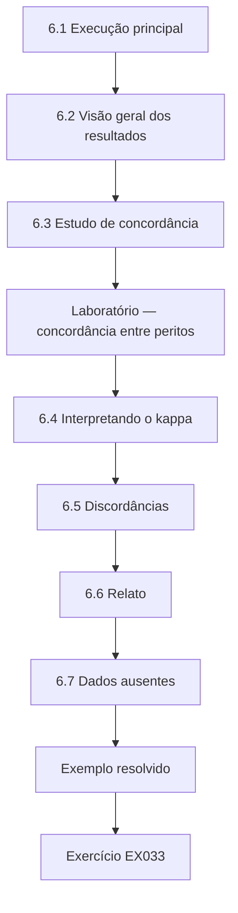

### Desenho lógico

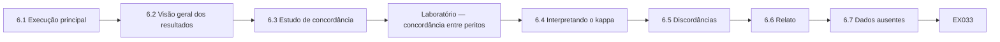

```text
[6.1 Execução principal]
    |
    v
[6.2 Visão geral dos resultados]
    |
    v
[6.3 Estudo de concordância]
    |
    v
[Laboratório — concordância entre peritos]
    |
    v
[6.4 Interpretando o kappa]
    |
    v
[6.5 Discordâncias]
    |
    v
[6.6 Relato]
    |
    v
[6.7 Dados ausentes]
    |
    v
[Exemplo resolvido] --> [Exercício EX033]
```
<!-- open-cyber-academy:lesson-figures:end ch-06 -->


### Objetivos de aprendizagem

Você vai (1) conduzir o estudo principal em condições fixas; (2) medir a concordância entre peritos com o kappa de Cohen; (3) analisar a redução em função da atualidade da referência; (4) relatar resultados com contagens.

### 6.1 Execução principal

Trinta imagens sintéticas, conjunto de referência congelado, versões de ferramentas registradas. Cada imagem produz redução, perdas e dias desde o lançamento da referência. Cada imagem segue os mesmos passos: construção a partir da semente registrada, cálculo de hash com a ferramenta validada, filtragem contra a versão congelada da NSRL e comparação dos resultados com os rótulos. Cada execução grava uma entrada de registro com a imagem, as versões e os resultados. Tomás confere algumas imagens à mão para confirmar que os *scripts* contam os arquivos corretamente. A execução principal usa o construtor de imagens revisado, que inclui aplicativos comuns de terceiros.

### 6.2 Visão geral dos resultados

A redução média é alta quando a versão do sistema operacional antecede o lançamento da referência e cai à medida que o intervalo cresce. As perdas projetadas (ferramentas legítimas com uso ilegítimo plantado, documentos de fornecedores) são todas postas de lado — a filtragem não consegue distingui-las por hash. A relação entre a redução e o intervalo até o lançamento da referência confirma o que o piloto sugeria. As perdas projetadas mostram o limite do hash: uma ferramenta legítima usada para causar dano e um documento de fornecedor não modificado são idênticos a arquivos publicados, de modo que nenhuma comparação de hash consegue distingui-los de suas cópias legítimas. Tomás relata as perdas por tipo com suas contagens, separando as ferramentas legítimas usadas para causar dano dos documentos de fornecedores idênticos a entradas da NSRL.

### 6.3 Estudo de concordância

Dois peritos classificam 40 eventos de linha do tempo, extraídos dos arquivos restantes, como atividade de usuário ou de sistema. A concordância mostra se o conjunto reduzido pode ser interpretado de forma consistente. Usar eventos dos conjuntos reduzidos testa se o que resta depois da filtragem pode ser lido de forma consistente por peritos diferentes. Os peritos trabalham separadamente, com um guia de codificação escrito, e não conhecem a hipótese do estudo nem quais arquivos foram plantados. Suas classificações são comparadas evento a evento, e cada discordância é registrada com as duas respostas. Os peritos vêm de duas unidades, como planejado.

### Laboratório — concordância entre peritos

```python
"""Cohen's kappa for two examiners classifying 40 synthetic timeline events."""
a = ["user"]*18 + ["system"]*14 + ["user"]*4 + ["system"]*4
b = ["user"]*18 + ["system"]*14 + ["system"]*4 + ["user"]*4
n = len(a); po = sum(x == y for x, y in zip(a, b)) / n
pe = sum((a.count(c)/n) * (b.count(c)/n) for c in ("user", "system"))
print(f"events={n} observed_agreement={po:.2f} expected={pe:.2f} kappa={(po-pe)/(1-pe):.2f}")
```

Execute com `python3 lab_kappa.py`. Saída verificada:

```text
events=40 observed_agreement=0.80 expected=0.51 kappa=0.60
```

### 6.4 Interpretando o kappa

A concordância observada é 0,80, mas o acaso sozinho daria 0,505, dadas as proporções de categorias de cada perito (o laboratório imprime esse valor arredondado para 0,51). O kappa = (0,80 − 0,505) / (1 − 0,505) = 0,596, relatado como 0,60, corrige o acaso. Landis e Koch (1977) propuseram rótulos nos quais 0,41–0,60 é "moderado"; Tomás cita os rótulos como convenção, não como lei. Os dois peritos usaram as duas categorias nas mesmas proporções, 22 eventos de usuário e 18 de sistema cada um, de modo que o acaso sozinho produziria uma coincidência cerca de metade das vezes. O kappa mostra quanto a concordância excede esse nível. Tomás relata a concordância observada, a concordância por acaso, o kappa e o número de eventos, para que os leitores possam conferir o cálculo e julgar o resultado por si mesmos.

### 6.5 Discordâncias

As oito discordâncias envolvem tarefas agendadas que rodaram sob uma conta de usuário. A definição da categoria era ambígua; ele registra isso como um achado para o guia de codificação. Uma tarefa agendada que roda sob uma conta de usuário pode razoavelmente ser lida das duas formas: foi configurada por um usuário, mas roda automaticamente. O guia de codificação não dizia qual categoria se aplicava, de modo que cada perito fez uma escolha sensata. Tomás não conta as discordâncias como erro dos peritos. Ele revisa o guia para definir essas tarefas explicitamente e recomenda que futuros estudos de concordância testem a definição revisada.

### 6.6 Relato

As tabelas mostram contagens por imagem; os gráficos plotam a redução contra os dias de intervalo. Cada número tem um *script* e uma entrada de registro. Plotar a redução contra o intervalo mostra a relação com mais clareza do que uma média mostraria. As tabelas também listam as perdas por imagem, para que os leitores vejam que as perdas projetadas foram postas de lado em todas as imagens em que foram plantadas. Tomás confere cada tabela contra os registros antes de incluí-la na dissertação. Os gráficos usam os mesmos eixos para todos os grupos de imagens, para que possam ser comparados diretamente.

### 6.7 Dados ausentes

Uma imagem falhou na construção; ele relata 29 analisadas de 30 planejadas, com a razão. A imagem que falhou é relatada, não substituída, como exigia a regra de parada. O registro de construção mostrou que o construtor de imagens parou ao instalar um aplicativo, e a imagem nunca foi filtrada. Tomás registra a falha e sua causa no capítulo de resultados, para que os leitores saibam que a análise cobre 29 imagens. Ele também confere que a imagem que falhou não era incomum em nenhuma variável planejada, de modo que sua ausência dificilmente muda os resultados.

### Scripts de análise

Um *script* calcula a redução e as perdas por imagem; outro plota a redução contra os dias de intervalo; um terceiro calcula o kappa. Cada um grava suas saídas com um hash, para que as tabelas possam ser conferidas depois contra o arquivo, e cada execução é anotada no registro com sua data e seus parâmetros.

### Exemplo resolvido

Tomás rascunha: "O kappa foi 0,60 (observada 0,80, acaso 0,505, n = 40). As discordâncias se concentraram em tarefas agendadas sob contas de usuário; o guia de codificação vai defini-las explicitamente."

> **Caso sintético.** Os dados de concordância vêm do *script* do laboratório.

### Erros e limites

Dois peritos e 40 eventos dão um kappa impreciso; é uma estimativa de viabilidade.

### Exercícios

- **EX033 — Valores do kappa.** Relate a concordância observada, a concordância por acaso e o kappa. *Rubrica:* 3 = 0,80, 0,505, 0,60; 2 = dois; 1 = um; 0 = nada.
- **EX034 — Por que kappa.** Por que não relatar apenas a concordância observada? *Rubrica:* 3 = corrige a concordância por acaso; 2 = parcial; 1 = sem razão; 0 = nada.
- **EX035 — Cautela com rótulos.** Como o rótulo "moderado" deve ser apresentado? *Rubrica:* 3 = como convenção de Landis–Koch; 2 = parcial; 1 = como fato; 0 = nada.
- **EX036 — Origem das discordâncias.** O que causou as discordâncias? *Rubrica:* 3 = tarefas agendadas sob contas de usuário; definição ambígua; 2 = parcial; 1 = erro dos peritos; 0 = nada.
- **EX037 — Perdas projetadas.** Por que todas as perdas projetadas foram postas de lado? *Rubrica:* 3 = os hashes são iguais aos de arquivos publicados; a filtragem não julga o uso; 2 = parcial; 1 = defeito da ferramenta; 0 = nada.
- **EX038 — Imagem ausente.** Como a imagem que falhou é relatada? *Rubrica:* 3 = 29 de 30, com a razão; 2 = parcial; 1 = escondida; 0 = nada.

### Síntese

Relate a execução principal com contagens, corrija a concordância pelo acaso e trate a ambiguidade como um achado.

### Continue estudando — capítulo 06 de 08

[← Capítulo 05 (rascunho)](#ch-05) · [Índice de capítulos do curso](../SUBJECTS.md) · [Capítulo 07 (rascunho) →](#ch-07)

<a id="ch-07"></a>

## Capítulo 7 — Redação da dissertação e limitações

<!-- open-cyber-academy:lesson-figures:start ch-07 -->
### Mapa da aula

Aula 07 publicada. Mapa, exemplo, EX039.

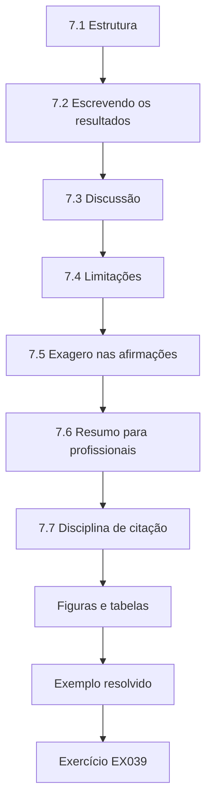

### Desenho lógico

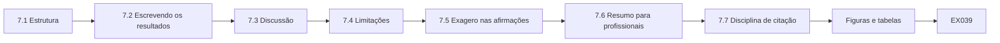

```text
[7.1 Estrutura]
    |
    v
[7.2 Escrevendo os resultados]
    |
    v
[7.3 Discussão]
    |
    v
[7.4 Limitações]
    |
    v
[7.5 Exagero nas afirmações]
    |
    v
[7.6 Resumo para profissionais]
    |
    v
[7.7 Disciplina de citação]
    |
    v
[Figuras e tabelas]
    |
    v
[Exemplo resolvido] --> [Exercício EX039]
```
<!-- open-cyber-academy:lesson-figures:end ch-07 -->


### Objetivos de aprendizagem

Você vai (1) estruturar uma dissertação de mestrado; (2) escrever achados sem exagerar as afirmações; (3) declarar limitações com honestidade; (4) escrever tanto para examinadores quanto para profissionais.

### 7.1 Estrutura

Introdução; revisão de literatura; método; resultados; discussão; limitações; conclusão; apêndices com *scripts*, guia de codificação e registro da busca. Essa estrutura segue o que os examinadores da Ridgeway University esperam de uma dissertação de mestrado. Manter as limitações num capítulo próprio as torna fáceis de encontrar, em vez de espalhadas pela discussão. Os apêndices permitem que os examinadores confiram o trabalho: os *scripts* reproduzem cada número, o guia de codificação mostra como os eventos foram classificados e o registro da busca mostra como a literatura foi encontrada. A Dra. Osei aprova o sumário dos capítulos antes que Tomás comece a redigir, para que o capítulo de limitações seja planejado e não acrescentado no fim.

### 7.2 Escrevendo os resultados

Os resultados declaram o que foi medido, em números: "A redução média foi alta onde a versão do sistema operacional antecedia o lançamento da referência; as perdas projetadas foram todas postas de lado." A interpretação espera pela discussão. Manter a interpretação separada permite que os leitores vejam os resultados medidos antes que Tomás os explique. Cada afirmação do capítulo de resultados pode ser rastreada até uma tabela e um *script*. Ele relata contagens com porcentagens e não usa ali palavras como "seguro" ou "inseguro". A Dra. Osei marca qualquer interpretação que escape para dentro do capítulo.

### 7.3 Discussão

Tomás liga os achados à prática: a filtragem economiza tempo de revisão, mas pode esconder ferramentas legítimas usadas para causar dano. Ele recomenda que os peritos mantenham uma "lista de vigilância" de hashes de ferramentas de uso dual, a serem retirados de volta do conjunto conhecido. A recomendação decorre diretamente das perdas projetadas: como o hash não consegue distinguir uma ferramenta legítima usada para causar dano, os peritos precisam de uma lista separada dessas ferramentas, que são sempre revisadas mesmo quando correspondem ao conjunto de referência. Tomás observa que uma lista de vigilância acrescenta tempo de revisão e precisa ser mantida, e que seu estudo não a testou.

### 7.4 Limitações

Imagens sintéticas; um sistema de arquivos; uma versão do conjunto de referência; dois peritos; kappa moderado; uma imagem que falhou. Cada limitação é pareada com seu efeito provável sobre os resultados. Por exemplo, imagens sintéticas contêm menos arquivos de usuário e menos desordem do que notebooks reais, o que provavelmente torna a redução maior do que no trabalho com casos. Uma única versão do conjunto de referência significa que os resultados podem diferir com outras versões. Dois peritos e um kappa moderado limitam o quanto o estudo de concordância pode ser generalizado. Declarar cada efeito provável ajuda os leitores a julgar quanto peso dar a cada resultado.

### 7.5 Exagero nas afirmações

Ele remove "a filtragem é segura" de um rascunho; os dados mostram que ela é eficiente, com um ponto cego específico e documentado. A frase reescrita descreve o que os dados sustentam: a filtragem reduziu fortemente a revisão, mas pôs de lado todos os casos projetados de ferramenta legítima usada para causar dano. Tomás confere a dissertação inteira em busca de afirmações semelhantes e registra cada mudança num registro de revisões, para que a Dra. Osei veja o que foi removido e por quê. O registro também anota as afirmações que ele reforçou onde os dados permitiam, como a redução em imagens construídas antes do lançamento da referência.

### 7.6 Resumo para profissionais

Um anexo de uma página: o que a filtragem faz, o que ela não pode fazer, como registrar seu uso nas anotações do caso e como relatá-la em depoimentos judiciais sem sugerir que os arquivos foram examinados. O anexo é escrito para peritos de unidades como a do próprio Tomás, que precisam de orientação prática em vez da dissertação inteira. Ele explica que um arquivo posto de lado como conhecido foi comparado a *software* publicado, não examinado, e dá exemplos de redação para anotações de caso e depoimentos. A Dra. Osei e um colega da unidade dele o revisam antes da submissão.

### 7.7 Disciplina de citação

Cada afirmação sobre a NSRL cita documentação do NIST; cada afirmação sobre processo cita o SP 800-86 ou a ISO/IEC 27042; nada cita uma fonte secundária não conferida. Essa disciplina importa porque afirmações sobre a NSRL são fáceis de enunciar mal, como descrevê-la como uma lista de arquivos bons. Tomás confere cada citação contra a própria fonte antes da submissão e, quando não conseguiu obter um original, diz isso e não se apoia na afirmação. Sua lista de referências inclui apenas fontes que ele mesmo leu, o que exclui repetir o resumo de uma revisão sobre um valor da NSRL.

### Figuras e tabelas

Cada figura tem uma legenda que declara a fonte dos dados, o número de imagens e a versão do conjunto de referência. As tabelas dão as contagens brutas além das porcentagens, para que os leitores possam recalcular qualquer razão. Os rótulos dos eixos usam unidades simples, e a cor nunca é o único meio de distinguir séries, o que mantém as figuras legíveis para todos.

### Exemplo resolvido

Uma frase do rascunho diz: "A filtragem de arquivos conhecidos elimina arquivos irrelevantes." Tomás reescreve: "A filtragem de arquivos conhecidos pôs de lado arquivos idênticos a *software* publicado; em 29 imagens sintéticas, isso incluiu todos os casos projetados de ferramentas legítimas usadas para causar dano."

> **Caso sintético.** As frases do rascunho são inventadas.

### Erros e limites

Uma seção de limitações não é uma confissão; ela diz aos leitores onde os resultados se aplicam.

### Exercícios

- **EX039 — Resultados vs. discussão.** O que pertence aos resultados e não à discussão? *Rubrica:* 3 = números medidos, sem interpretação; 2 = parcial; 1 = opiniões; 0 = nada.
- **EX040 — Lista de vigilância.** Explique a recomendação da lista de vigilância. *Rubrica:* 3 = hashes de ferramentas de uso dual retirados de volta do conjunto conhecido; 2 = parcial; 1 = errado; 0 = nada.
- **EX041 — Pareamento de limitações.** Pareie uma limitação com seu efeito provável. *Rubrica:* 3 = p. ex., imagens sintéticas podem superestimar a redução; 2 = só a limitação; 1 = errado; 0 = nada.
- **EX042 — Correção do exagero.** Por que "a filtragem é segura" foi removida? *Rubrica:* 3 = os dados mostram um ponto cego documentado; 2 = parcial; 1 = estilo; 0 = nada.
- **EX043 — Conteúdo do anexo.** Liste quatro itens do anexo para profissionais. *Rubrica:* 3 = o que faz, o que não pode fazer, registro, relato judicial; 2 = três; 1 = um; 0 = nada.
- **EX044 — Reescrita da frase.** Por que a frase reescrita é melhor? *Rubrica:* 3 = precisa, delimitada, declara o ponto cego; 2 = parcial; 1 = mais curta; 0 = nada.

### Síntese

Escreva números nos resultados, significado na discussão, limites honestos com seus efeitos e um anexo para profissionais.

### Continue estudando — capítulo 07 de 08

[← Capítulo 06 (rascunho)](#ch-06) · [Índice de capítulos do curso](../SUBJECTS.md) · [Capítulo 08 (rascunho) →](#ch-08)

<a id="ch-08"></a>

## Capítulo 8 — Revisão independente e defesa

<!-- open-cyber-academy:lesson-figures:start ch-08 -->
### Mapa da aula

Aula 08 publicada. Mapa, exemplo, EX045.

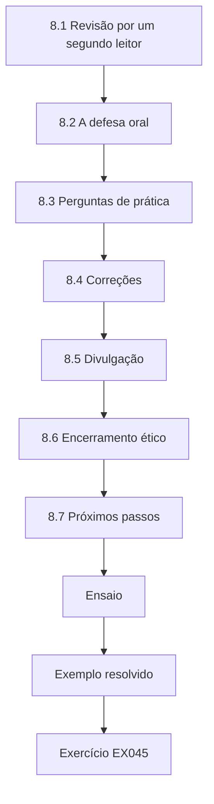

### Desenho lógico

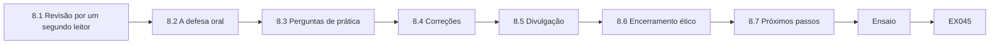

```text
[8.1 Revisão por um segundo leitor]
    |
    v
[8.2 A defesa oral]
    |
    v
[8.3 Perguntas de prática]
    |
    v
[8.4 Correções]
    |
    v
[8.5 Divulgação]
    |
    v
[8.6 Encerramento ético]
    |
    v
[8.7 Próximos passos]
    |
    v
[Ensaio]
    |
    v
[Exemplo resolvido] --> [Exercício EX045]
```
<!-- open-cyber-academy:lesson-figures:end ch-08 -->


### Objetivos de aprendizagem

Você vai (1) preparar-se para a revisão independente; (2) responder a perguntas de método e de prática; (3) lidar com correções; (4) planejar a divulgação.

### 8.1 Revisão por um segundo leitor

Antes da submissão, um professor de fora do projeto executa de novo os *scripts* a partir do arquivo e confere três tabelas. Uma figura estava com o rótulo errado; Tomás a corrige e registra a correção. Executar os *scripts* de novo testa o arquivo além dos resultados: se o segundo leitor consegue reproduzir as tabelas apenas a partir do arquivo, os examinadores também conseguem. A figura com rótulo errado tinha os eixos corretos, mas a legenda invertida. Tomás registra a correção em seu registro de revisões e executa de novo o *script* que a produziu.

### 8.2 A defesa oral

Os examinadores perguntam: Por que a NSRL? É um conjunto de referência público e documentado, mantido pelo NIST. Por que não hashing por similaridade? Escopo; é nomeado como trabalho futuro. Os dados sintéticos são realistas? A resposta vem da limitação de desordem e de seu efeito provável. As respostas de Tomás se apoiam diretamente na dissertação: a documentação pública da NSRL, a decisão de escopo registrada na revisão de literatura e o capítulo de limitações. Ele ensaia antes com a Dra. Osei e com um colega, praticando respostas curtas e diretas que apontam para evidências na dissertação.

### 8.3 Perguntas de prática

Um examinador externo vindo da indústria pergunta como um assistente técnico da defesa poderia contestar a filtragem no tribunal. Tomás responde que a contestação é legítima se arquivos foram postos de lado sem serem divulgados; o remédio é registrar o filtro, a versão da referência e seus resultados. A pergunta liga a pesquisa ao trabalho policial dele, em que as decisões de filtragem podem ser examinadas por um assistente técnico da defesa. Sua resposta reflete o resumo para profissionais: um perito que registra o filtro e seus resultados consegue explicar o que foi posto de lado e por quê. Os examinadores observam que isso torna o estudo útil para além da universidade.

### 8.4 Correções

As correções menores são acompanhadas numa tabela: comentário, mudança, página. Ele submete dentro do prazo. A tabela facilita que os examinadores confiram cada mudança. Tomás conclui as correções dentro do prazo, e a Dra. Osei confirma que estão feitas. Quando uma correção afeta uma figura ou tabela, ele executa de novo o *script* a partir do arquivo e atualiza o registro, para que a dissertação final e o arquivo coincidam. Ele também refaz a conferência de reprodutibilidade mais uma vez antes da submissão final. A tabela de correções é arquivada com a dissertação final, para que os examinadores vejam como cada um de seus comentários foi respondido.

### 8.5 Divulgação

Um artigo curto para uma conferência de profissionais; o construtor de imagens e os *scripts* liberados abertamente; uma apresentação para sua unidade. O artigo para profissionais relata os resultados de redução, as perdas projetadas e a recomendação da lista de vigilância, com as limitações das imagens sintéticas. Liberar o construtor de imagens e os *scripts* permite que outros pesquisadores testem a filtragem em suas próprias imagens. A apresentação para sua unidade explica como registrar a filtragem nas anotações do caso, usando o resumo para profissionais da dissertação. Cada produto aponta para a *tag* de versão arquivada citada na dissertação.

### 8.6 Encerramento ético

Os dados dos participantes do estudo de concordância são anonimizados e armazenados conforme a aprovação ética; nenhum dado de casos foi usado. As respostas dos peritos são mantidas apenas pelo tempo que a aprovação permite e depois são excluídas, como dizem os termos de consentimento. Tomás confirma ao comitê de ética que o estudo terminou como aprovado, sem desvios que afetassem os participantes. A confirmação é arquivada com o arquivo do projeto, e a Dra. Osei a assina como orientadora. As imagens sintéticas e os *scripts* permanecem públicos, pois não contêm dados pessoais.

### 8.7 Próximos passos

A unidade testa a prática da lista de vigilância por três meses, medindo com que frequência os arquivos retirados de volta importam. O teste avalia a recomendação que seu estudo propôs, mas não avaliou. Os peritos registram cada vez que um arquivo da lista de vigilância é retirado de volta do conjunto conhecido e se ele se mostrou relevante para o caso. Tomás projeta o formulário de registro, e o gestor da unidade revisa os resultados depois de três meses para decidir se mantém a prática. Tomás vai apresentar os resultados do teste à sua unidade junto com a recomendação da dissertação que o teste foi projetado para avaliar.

### Ensaio

Duas semanas antes da defesa oral, Tomás ensaia com colegas de curso que fazem o papel de examinadores hostis. Eles insistem em realismo, tamanho da amostra e na pergunta sobre o tribunal. Ele anota cada resposta fraca e a aperta, citando a tabela ou a limitação exata que sustenta sua resposta, e pratica dizer "não sei" onde os dados não alcançam.

### Exemplo resolvido

Perguntado "Então os peritos deveriam parar de filtrar?", Tomás responde: "Não. A filtragem reduziu fortemente a revisão nestas imagens. Os peritos devem registrá-la, manter uma lista de vigilância de uso dual e nunca descrever arquivos filtrados como examinados."

> **Caso sintético.** A troca na defesa oral é inventada.

### Erros e limites

Ser aprovado na defesa oral valida a dissertação, não o método para todo laboratório; a validação local continua necessária.

### Exercícios

- **EX045 — Conferência por nova execução.** O que o segundo leitor fez e encontrou? *Rubrica:* 3 = executou de novo os *scripts*; figura com rótulo errado; 2 = um; 1 = vago; 0 = nada.
- **EX046 — Por que a NSRL.** Justifique a escolha do conjunto de referência. *Rubrica:* 3 = público, documentado, mantido pelo NIST; 2 = parcial; 1 = popular; 0 = nada.
- **EX047 — Contestação judicial.** Como deve ser respondida a pergunta sobre a contestação no tribunal? *Rubrica:* 3 = legítima se não divulgada; registrar filtro, versão, resultados; 2 = parcial; 1 = descartar; 0 = nada.
- **EX048 — Tabela de correções.** Que colunas a tabela de correções contém? *Rubrica:* 3 = comentário, mudança, página; 2 = duas; 1 = uma; 0 = nada.
- **EX049 — Parar de filtrar?** Resuma a resposta a "parar de filtrar?" *Rubrica:* 3 = não; registro, lista de vigilância, redação exata; 2 = parcial; 1 = sim; 0 = nada.
- **EX050 — Validação local.** Por que uma defesa aprovada não valida o método em todo lugar? *Rubrica:* 3 = os laboratórios diferem; validação local necessária; 2 = parcial; 1 = valida; 0 = nada.

### Síntese

Faça o trabalho ser executado de novo, responda com afirmações delimitadas, acompanhe as correções e dê aos profissionais algo utilizável.

### Continue estudando — capítulo 08 de 08

[← Capítulo 07 (rascunho)](#ch-07) · [Índice de capítulos do curso](../SUBJECTS.md) · [Resoluções ↓](#worked-results) · [Próximo curso pelo índice de capítulos →](../SUBJECTS.md)

<a id="worked-results"></a>

## Resoluções

Respostas-modelo para EX001–EX050. Tomás Lindqvist, a Dra. Amara Osei, a Ridgeway University e todos os valores são sintéticos. As respostas dos laboratórios citam saídas verificadas. Qualquer resposta que atenda à rubrica recebe a mesma pontuação.

**EX001.** "Em que proporção a filtragem de arquivos conhecidos com a NSRL reduz os arquivos que precisam de revisão em imagens NTFS de notebooks, e quantos arquivos relevantes ela exclui indevidamente?"

**EX002.** Respondível com dados lícitos, mensurável, delimitada no escopo e útil para os profissionais.

**EX003.** A base consultada, a data da busca, os termos exatos e o número de resultados retornados.

**EX004.** Como uma alegação não verificada de uma parte interessada; procure medição independente e revisada por pares antes de se apoiar nela.

**EX005.** Encontrar o estudo original, confirmar o valor e as condições em que foi medido e então citar o original.

**EX006.** Só três dos nove estudos incluídos mediram o que a filtragem deixa escapar, de modo que o lado do custo é pouco estudado.

**EX007.** "A busca cobriu artigos em língua inglesa de dois periódicos e dos anais do DFRWS, por isso trabalhos relevantes publicados em outros lugares podem estar ausentes."

**EX008.** No exame, em que os dados são reduzidos e extraídos antes que a fase de análise tire conclusões.

**EX009.** Apenas que o arquivo é idêntico, byte a byte, a um arquivo de *software* publicado cujo hash a NSRL calculou; não diz nada sobre se foi usado para o bem ou para causar dano.

**EX010.** Uma correspondência conhecida má chama a atenção para um arquivo; uma correspondência de *software* conhecido põe o arquivo de lado como conteúdo publicado comum. Elas têm significados opostos no fluxo de trabalho.

**EX011.** A modificação muda seu hash, de modo que ele deixa de corresponder à entrada de referência e permanece no conjunto de revisão.

**EX012.** Uma ferramenta legítima e não modificada usada para um propósito ilegítimo, que a filtragem esconde porque seu hash é publicado.

**EX013.** Quais imagens foram testadas? Qual versão do conjunto de referência foi usada? Algum arquivo relevante foi excluído, e como isso foi conferido?

**EX014.** "Os arquivos correspondentes ao conjunto de referência foram postos de lado e não foram examinados individualmente."

**EX015.** Elas não contêm dados pessoais de casos reais, e a relevância de cada arquivo é conhecida de antemão, o que dá uma verdadeira verdade de referência.

**EX016.** O estudo de concordância entre peritos, porque envolve participantes humanos que precisam consentir.

**EX017.** Taxa de perda = número de arquivos relevantes postos de lado como conhecidos ÷ número total de arquivos relevantes.

**EX018.** Os conjuntos de referência crescem; uma versão diferente pode corresponder a arquivos diferentes, mudando tanto a redução quanto as perdas.

**EX019.** Ele permaneceu nos dados como um caso de perda deliberado e documentado, porque removê-lo esconderia exatamente o risco que o estudo mede.

**EX020.** Notebooks reais guardam muito mais desordem única de usuário e de aplicativos, de modo que a redução em imagens sintéticas limpas pode superestimar o benefício no mundo real.

**EX021.** Mais arquivos de usuário na imagem, uma versão do sistema operacional mais nova do que o conjunto de referência ou uma falha da ferramenta de hash.

**EX022.** O hash de cada arquivo foi recalculado com uma segunda ferramenta independente; os hashes foram idênticos, por isso a falha da ferramenta foi rejeitada.

**EX023.** Pode ser malware, uma ferramenta feita sob medida internamente ou uma atualização legítima lançada depois do conjunto de referência.

**EX024.** O assinante da assinatura de código, o recurso de informação de versão e o local do disco em que foi instalado.

**EX025.** Pedir a um colega que avalie os arquivos às cegas, sem que lhe digam a hipótese de malware.

**EX026.** O número de dias entre a versão do sistema operacional e o lançamento do conjunto de referência, porque L3 mostrou que a atualidade do conjunto de referência determina a redução.

**EX027.** Redução de 80,0%: 400 de 500 arquivos corresponderam, deixando 100 para revisão.

**EX028.** Se os *scripts* rodam, quanto tempo as etapas levam e se as medidas podem ser calculadas — não se a hipótese se sustenta.

**EX029.** Atualização do conjunto de referência — congelar uma versão; perda do acesso à unidade — usar apenas dados sintéticos; recrutamento insuficiente — recrutar em duas unidades.

**EX030.** Aplicativos comuns de terceiros foram acrescentados às imagens, porque o piloto testou apenas arquivos do sistema operacional e o estudo também precisa da cobertura de aplicativos.

**EX031.** Fixar a quantidade de antemão impede que o pesquisador acrescente imagens até que os resultados pareçam favoráveis.

**EX032.** Nenhum arquivo relevante igual a *software* publicado foi plantado, de modo que uma perda era impossível por construção.

**EX033.** Concordância observada de 0,80, concordância esperada por acaso de 0,505 (impressa como 0,51), kappa de 0,596, relatado como 0,60.

**EX034.** Porque parte da concordância acontece por acaso, dada a combinação de categorias de cada perito; o kappa remove essa parcela.

**EX035.** Como uma convenção amplamente usada, de Landis e Koch (1977), não como um limiar objetivo.

**EX036.** Tarefas agendadas que rodaram sob uma conta de usuário, que as definições das categorias não resolviam.

**EX037.** Seus hashes são iguais aos de *software* ou documentos publicados, e uma correspondência de hash não diz nada sobre como um arquivo foi usado.

**EX038.** "Foram analisadas 29 das 30 imagens planejadas; uma falhou na construção", com a razão da falha declarada.

**EX039.** Os valores medidos e as contagens, declarados sem interpretação nem recomendações.

**EX040.** Os peritos mantêm hashes de ferramentas de uso dual e retiram os arquivos correspondentes de volta do conjunto conhecido, para que sejam revisados.

**EX041.** Imagens sintéticas não têm a desordem real, por isso a redução medida provavelmente superestima o que notebooks reais mostrariam.

**EX042.** Os resultados mostram que a filtragem esconde ferramentas legítimas usadas para causar dano, de modo que "segura" contradiz as evidências.

**EX043.** O que a filtragem faz, o que ela não pode fazer, como registrar seu uso nas anotações do caso e como descrevê-la em depoimentos judiciais.

**EX044.** Ela diz exatamente o que foi posto de lado e em que condições, e nomeia o ponto cego em vez de sugerir completude.

**EX045.** O leitor executou de novo os *scripts* arquivados, reproduziu três tabelas e encontrou uma figura com rótulo errado, que foi corrigida e registrada.

**EX046.** A NSRL é pública, documentada e mantida pelo NIST, de modo que outros podem obter a mesma versão e repetir o estudo.

**EX047.** A contestação é justa se a filtragem não foi divulgada; os peritos devem registrar o filtro, a versão do conjunto de referência e os resultados, para que possam ser examinados.

**EX048.** O comentário do examinador, a mudança feita e a página em que ela aparece.

**EX049.** Manter a filtragem, porque ela economiza muita revisão, mas registrá-la, manter uma lista de vigilância de uso dual e nunca chamar arquivos filtrados de examinados.

**EX050.** As ferramentas, os dados e as versões de referência de cada laboratório diferem, por isso cada um precisa validar o método em suas próprias condições.

<a id="references"></a>
## Referências

Todos os DOIs foram resolvidos em doi.org em 12 de outubro de 2026, e as normas foram conferidas nas páginas de seus editores. A lista é idêntica à da edição em inglês e cobre o livro inteiro; nenhuma das normas técnicas citadas foi verificada aqui como adotada pela ABNT, por isso são citadas em sua edição internacional. Organizações, pessoas, sistemas e números dos casos são sintéticos; somente as obras abaixo são reais.

- Carrier, B. (2005). *File System Forensic Analysis*. Addison-Wesley. ISBN 978-0-321-26817-4.
- Casey, E. (2011). *Digital Evidence and Computer Crime* (3rd ed.). Academic Press. ISBN 978-0-12-374268-1.
- Garfinkel, S. L. (2010). Digital forensics research: The next 10 years. *Digital Investigation*, 7, S64–S73. <https://doi.org/10.1016/j.diin.2010.05.009>
- Garfinkel, S., Farrell, P., Roussev, V., & Dinolt, G. (2009). Bringing science to digital forensics with standardized forensic corpora. *Digital Investigation*, 6, S2–S11. <https://doi.org/10.1016/j.diin.2009.06.016>
- IETF RFC 3227 (2002). Brezinski, D., & Killalea, T. Guidelines for Evidence Collection and Archiving. <https://www.rfc-editor.org/rfc/rfc3227>
- ISO/IEC 27037:2012. Guidelines for identification, collection, acquisition and preservation of digital evidence. <https://www.iso.org/standard/44381.html>
- ISO/IEC 27041:2015. Guidance on assuring suitability and adequacy of incident investigative method. <https://www.iso.org/standard/44405.html>
- ISO/IEC 27042:2015. Guidelines for the analysis and interpretation of digital evidence. <https://www.iso.org/standard/44406.html>
- ISO/IEC 27043:2015. Incident investigation principles and processes. <https://www.iso.org/standard/44407.html>
- Kornblum, J. (2006). Identifying almost identical files using context triggered piecewise hashing. *Digital Investigation*, 3(S), 91–97. <https://doi.org/10.1016/j.diin.2006.06.015>
- Landis, J. R., & Koch, G. G. (1977). The measurement of observer agreement for categorical data. *Biometrics*, 33(1), 159–174. <https://doi.org/10.2307/2529310>
- MITRE ATT&CK. <https://attack.mitre.org/>
- NIST Computer Forensics Tool Testing (CFTT) Program. <https://www.nist.gov/itl/ssd/software-quality-group/computer-forensics-tool-testing-program-cftt>
- NIST National Software Reference Library (NSRL). <https://www.nist.gov/itl/ssd/software-quality-group/national-software-reference-library-nsrl>
- NIST SP 800-101 Rev. 1 (2014). Ayers, R., Brothers, S., & Jansen, W. Guidelines on Mobile Device Forensics. <https://doi.org/10.6028/NIST.SP.800-101r1>
- NIST SP 800-61 Rev. 3 (2025). Incident Response Recommendations and Considerations for Cybersecurity Risk Management. <https://doi.org/10.6028/NIST.SP.800-61r3>
- NIST SP 800-86 (2006). Kent, K., Chevalier, S., Grance, T., & Dang, H. Guide to Integrating Forensic Techniques into Incident Response. <https://doi.org/10.6028/NIST.SP.800-86>
- Roussev, V. (2010). Data fingerprinting with similarity digests. In *Advances in Digital Forensics VI*, IFIP AICT 337, 207–226. Springer. <https://doi.org/10.1007/978-3-642-15506-2_15>
- Sikorski, M., & Honig, A. (2012). *Practical Malware Analysis*. No Starch Press. <https://nostarch.com/malware>
- SWGDE (Scientific Working Group on Digital Evidence). Published documents. <https://www.swgde.org/documents/published-complete-listing>
