# Human Factors and Cyber Policy: Master's Course

- Language: English (`en`); course 167, Master's course (2 years).
- Editorial state: **published**. Chapters 1–8 of 8 have hand-written teaching text; exercises EX001–EX050 have matching worked results with 0–3 rubrics; three offline labs use only the Python 3 standard library on synthetic data, and their outputs are embedded from real runs. Independent review and the 300-page A4 verification remain open.
- Audience: master's students evaluating how a security policy change affects staff behaviour and workload.
- Author: [hiagokinlevi](https://github.com/hiagokinlevi). Original text [CC0 1.0](../../../../../LICENSE); cited works keep their rights.
- Boundary: the labs fit an interrupted time series, bootstrap a survey difference and run a leave-one-month-out check on synthetic data; no real staff, passwords or accounts are involved. Surveys described here never ask for passwords and are anonymous. All people, organisations, systems and data are **synthetic** unless a sentence cites a public source.

[Course home](../../README.md) · [Chapter index](../SUBJECTS.md) · [Book plan](PLAN.md) · [Course skill](../../skill/SKILL.md) · [Worked results](#worked-results)

## How to use this draft

Read in order. The chapters follow one master's student evaluating a hospital trust's decision to end forced password changes and offer a password manager: question and literature method, theory seminar, design and ethics, competing explanations, proposal and pilot, data and analysis, writing and limitations, and defense. Run each lab where it appears, attempt the exercises before the worked results, and score yourself with the rubrics.

### Synthetic running case

| Element | Role | Boundary |
|---|---|---|
| **Sofia Lindqvist** | Master's student | Invented |
| **Dr Paul Nakamura** | Supervisor | Invented |
| **Harrowgate Institute** | Fictional university | Invented |
| **Orchard Lane Hospital Trust** | Fictional hospital trust | Invented |

### Core sources

Adams and Sasse (1999), [doi:10.1145/322796.322806](https://doi.org/10.1145/322796.322806); Sasse, Brostoff and Weirich (2001), [doi:10.1023/A:1011902718709](https://doi.org/10.1023/A:1011902718709); Herley (2009), [doi:10.1145/1719030.1719050](https://doi.org/10.1145/1719030.1719050); Beautement, Sasse and Wonham (2008), [doi:10.1145/1595676.1595684](https://doi.org/10.1145/1595676.1595684); Ajzen (1991), [doi:10.1016/0749-5978(91)90020-T](https://doi.org/10.1016/0749-5978(91)90020-T). Full list in [References](#references).

## Contents

| Chapters |
|---|
| [1](#ch-01) · [2](#ch-02) · [3](#ch-03) · [4](#ch-04) · [5](#ch-05) · [6](#ch-06) · [7](#ch-07) · [8](#ch-08) |

[Worked results](#worked-results) · [References](#references)

<a id="ch-01"></a>

## Chapter 1 — Research question and literature method

<!-- open-cyber-academy:lesson-figures:start ch-01 -->
### Lesson map

Lesson 01 published. Map, example, EX001.

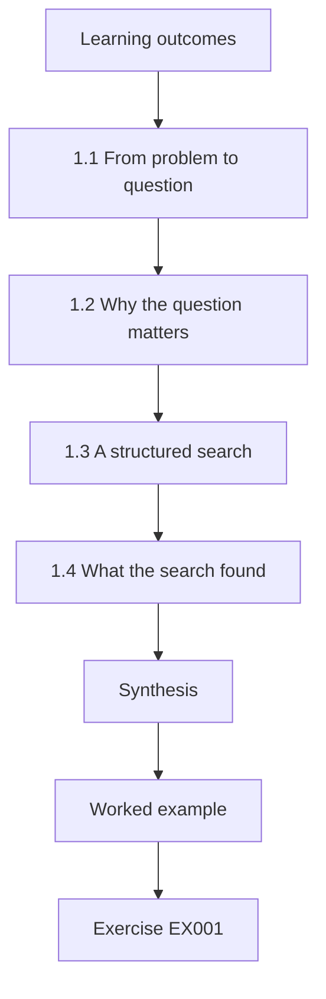

### Logical drawing

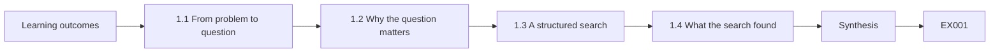

```text
[Learning outcomes]
    |
    v
[1.1 From problem to question]
    |
    v
[1.2 Why the question matters]
    |
    v
[1.3 A structured search]
    |
    v
[1.4 What the search found]
    |
    v
[Synthesis]
    |
    v
[Worked example] --> [Exercise EX001]
```
<!-- open-cyber-academy:lesson-figures:end ch-01 -->


### Learning outcomes

You will (1) turn a workplace problem into a research question; (2) run a structured literature search; (3) record sources so the search can be repeated.

### 1.1 From problem to question

Sofia Lindqvist is a master's student at the fictional Harrowgate Institute, supervised by Dr Paul Nakamura. She works part time in the IT department of the fictional Orchard Lane Hospital Trust, where staff must change passwords every sixty days and the help desk handles hundreds of resets a month. Clinical staff complain that the rules waste time during shifts. Sofia turns the complaint into a question: after the trust stopped forced periodic changes and offered a password manager, did reset requests fall, and did staff report less password reuse?

### 1.2 Why the question matters

Sofia explains to Dr Nakamura why the question is worth a dissertation. Adams and Sasse (1999) found that demanding password rules led staff to write passwords down and reuse them, because the rules ignored how people actually work. Forced changes are a common example of a rule whose costs are visible every day while its benefits are uncertain. If the trust's change reduced burden without new risks, other hospitals could learn from it. If it did not, that would also be useful evidence for policy makers deciding on password rules.

### 1.3 A structured search

Sofia searches two academic databases and one standards collection using planned terms: password policy, password expiration, password manager, usable security and help desk. She records the date, database, search string and number of results for each search. She screens titles and abstracts against written inclusion rules: empirical studies or official guidance on workplace passwords. She keeps a table of excluded items with reasons. Dr Nakamura stresses that a repeatable search protects her review from the charge that she only cited studies supporting her view.

### 1.4 What the search found

Sofia's search returns a manageable set of sources. Key works include Adams and Sasse (1999), Sasse, Brostoff and Weirich (2001) on designing usable security, Herley (2009) on users rationally rejecting costly advice, and Beautement, Sasse and Wonham (2008) on the compliance budget. She also finds NIST and national guidance that has moved away from routine forced changes, which she notes as context rather than evidence of effect. She records gaps: few studies measure what happens in a hospital after such a policy change. She saves the full search log as an appendix to the dissertation.

### Worked example

Sofia turns a complaint into a before-and-after research question, justifies it, runs a recorded search with inclusion rules and summarises key sources and gaps.

> **Synthetic case.** Harrowgate, Orchard Lane and all people are synthetic; the cited works are real.

### Errors and limits

Database searches miss grey literature. Guidance documents state positions rather than measured effects.

### Exercises

- **EX001 — Research question.** What research question did Sofia form? *Rubric:* 3 = after ending forced changes and offering a manager, did resets fall and reuse reports drop?;; 2 = two outcomes;; 1 = vague;; 0 = none.
- **EX002 — Adams and Sasse relevance.** Why is Adams and Sasse (1999) relevant? *Rubric:* 3 = demanding rules led to writing down and reuse;; 2 = workarounds;; 1 = vague;; 0 = none.
- **EX003 — Search record.** What does Sofia record for each search? *Rubric:* 3 = date, database, search string and result count;; 2 = three;; 1 = vague;; 0 = none.
- **EX004 — Excluded items.** Why keep a table of excluded items? *Rubric:* 3 = so the search can be repeated and is not seen as selective;; 2 = transparency;; 1 = vague;; 0 = none.
- **EX005 — Guidance as context.** Why treat official guidance as context, not evidence? *Rubric:* 3 = it states positions rather than measured effects;; 2 = positions;; 1 = evidence;; 0 = none.
- **EX006 — Gap found.** What gap did Sofia record? *Rubric:* 3 = few studies measure effects in a hospital after such a change;; 2 = hospital;; 1 = vague;; 0 = none.
- **EX007 — Herley's point.** Which source argues users rationally reject costly advice? *Rubric:* 3 = Herley (2009);; 2 = Herley;; 1 = Whitten;; 0 = none.

### Synthesis

A focused question and a recorded, repeatable search give a dissertation a defensible starting point.

### Continue studying — chapter 01 of 08

[← Course home](../../README.md) · [Course chapter index](../SUBJECTS.md) · [Chapter 02 (draft) →](#ch-02)

<a id="ch-02"></a>

## Chapter 2 — Human factors and cyber policy: advanced seminar

<!-- open-cyber-academy:lesson-figures:start ch-02 -->
### Lesson map

Lesson 02 published. Map, example, EX008.

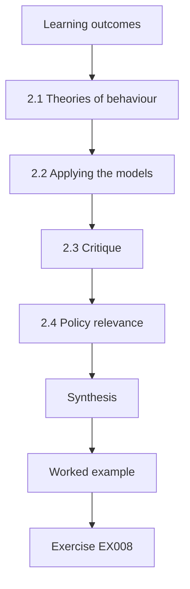

### Logical drawing

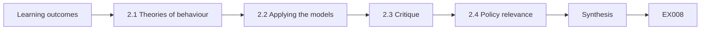

```text
[Learning outcomes]
    |
    v
[2.1 Theories of behaviour]
    |
    v
[2.2 Applying the models]
    |
    v
[2.3 Critique]
    |
    v
[2.4 Policy relevance]
    |
    v
[Synthesis]
    |
    v
[Worked example] --> [Exercise EX008]
```
<!-- open-cyber-academy:lesson-figures:end ch-02 -->


### Learning outcomes

You will (1) critique key human factors theories; (2) compare behavioural models for security; (3) apply them to the trust's password change.

### 2.1 Theories of behaviour

In the seminar, Dr Nakamura asks students to compare theories that explain security behaviour. The theory of planned behaviour (Ajzen, 1991) says intentions depend on attitudes, social norms and perceived control. The compliance budget (Beautement, Sasse and Wonham, 2008) says people spend limited effort on security and stop complying when demands exceed it. Sofia notes that the first focuses on what people believe and the second on what demands cost. Both offer predictions about the trust's policy change, which she can compare. She summarises both in a short comparison table.

### 2.2 Applying the models

Using planned behaviour, Sofia predicts that staff who believe a password manager is easy and see colleagues using it will adopt it. Using the compliance budget, she predicts that removing forced changes frees effort, which may increase compliance with other rules, such as locking screens. The models make different predictions about who changes behaviour: planned behaviour points to attitudes and norms, while the budget points to workload. Her study design can test some of these differences by surveying beliefs and measuring workload. She writes each prediction in one testable sentence.

### 2.3 Critique

The seminar critiques both. Planned behaviour often explains intentions better than actions, and security actions are frequently habits rather than deliberate choices. The compliance budget is persuasive but hard to measure directly. Bada, Sasse and Nurse (2019) argue that awareness campaigns fail when they assume information alone changes behaviour. Sofia concludes that no single model will explain her results and that she should state which predictions come from which model, so readers can see which theories her data supports and which it does not. The seminar group agrees with this approach.

### 2.4 Policy relevance

Sofia links theory to policy. If the budget model holds, policy makers should count the cost of each rule and remove low-value ones. If planned behaviour holds, they should focus on making secure options easy and visible. ISO/IEC 27001:2022 requires awareness and competence but leaves the method to organisations. She notes that theory helps policy only when it leads to measurable predictions, and she adds two such predictions to her study plan to test in the trust's data. She notes both predictions in her proposal before seeing any data from after the change.

### Worked example

Sofia compares planned behaviour and the compliance budget, derives different predictions for the password change, critiques both and links them to policy.

> **Synthetic case.** Predictions are synthetic; Ajzen (1991), Beautement et al. (2008), Bada et al. (2019) and ISO/IEC 27001:2022 are real.

### Errors and limits

Models simplify behaviour. Survey measures of attitudes are imperfect.

### Exercises

- **EX008 — Planned behaviour inputs.** What three factors shape intention in planned behaviour? *Rubric:* 3 = attitudes, social norms and perceived control;; 2 = two;; 1 = vague;; 0 = none.
- **EX009 — Budget prediction.** What does the compliance budget predict after forced changes end? *Rubric:* 3 = freed effort may raise compliance with other rules;; 2 = freed effort;; 1 = vague;; 0 = none.
- **EX010 — Intention gap.** What is a known weakness of planned behaviour? *Rubric:* 3 = it explains intentions better than actions;; 2 = intention-action;; 1 = vague;; 0 = none.
- **EX011 — Campaign failure.** Why do campaigns fail according to Bada et al.? *Rubric:* 3 = they assume information alone changes behaviour;; 2 = information;; 1 = vague;; 0 = none.
- **EX012 — Theory for policy.** When does theory help policy, in Sofia's view? *Rubric:* 3 = when it yields measurable predictions;; 2 = predictions;; 1 = always;; 0 = none.
- **EX013 — Two predictions.** Name the two model-based predictions she adds. *Rubric:* 3 = manager adoption by attitudes and norms; better screen locking from freed effort;; 2 = one;; 1 = vague;; 0 = none.
- **EX014 — Budget measurement.** Why is the compliance budget hard to test? *Rubric:* 3 = it is hard to measure directly;; 2 = measurement;; 1 = vague;; 0 = none.

### Synthesis

Behavioural theories are useful when they make distinct, testable predictions about a real policy change.

### Continue studying — chapter 02 of 08

[← Chapter 01 (draft)](#ch-01) · [Course chapter index](../SUBJECTS.md) · [Chapter 03 (draft) →](#ch-03)

<a id="ch-03"></a>

## Chapter 3 — Study design, ethics and reproducibility

<!-- open-cyber-academy:lesson-figures:start ch-03 -->
### Lesson map

Lesson 03 published. Map, example, EX015.

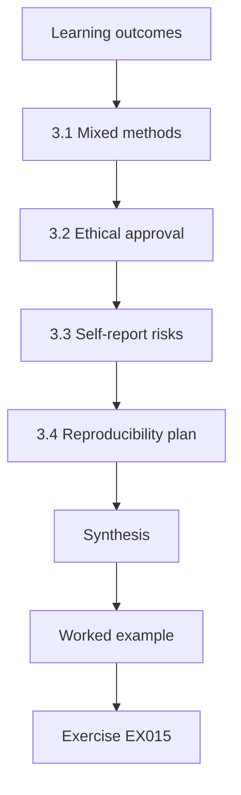

### Logical drawing

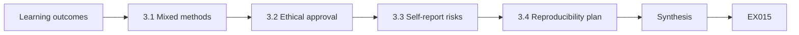

```text
[Learning outcomes]
    |
    v
[3.1 Mixed methods]
    |
    v
[3.2 Ethical approval]
    |
    v
[3.3 Self-report risks]
    |
    v
[3.4 Reproducibility plan]
    |
    v
[Synthesis]
    |
    v
[Worked example] --> [Exercise EX015]
```
<!-- open-cyber-academy:lesson-figures:end ch-03 -->


### Learning outcomes

You will (1) design a mixed-methods study of a policy change; (2) obtain ethical approval for staff research; (3) plan for reproducibility.

### 3.1 Mixed methods

Sofia designs a study with three parts. First, she analyses monthly help desk password reset counts for eighteen months before and twelve months after the policy change, an interrupted time series that checks whether the level or trend changed. Second, she surveys staff about password habits, including reuse and writing passwords down, using anonymous questions. Third, she interviews twelve staff from different roles about how the change affected their work. Combining counts, survey answers and interviews lets each method cover weaknesses in the others.

### 3.2 Ethical approval

Sofia applies to Harrowgate's ethics committee and to the trust's research office. Her survey collects no names and asks no questions about actual passwords; it asks only about habits. Interviewees give written consent, can withdraw and are quoted only by role. Help desk data is provided as monthly counts without any names. The committee asks her to avoid recruiting her own direct colleagues to interviews, because they might feel unable to refuse. She agrees and recruits through a neutral notice instead. All consent forms are stored securely at Harrowgate.

### 3.3 Self-report risks

Asking staff whether they reuse passwords invites socially desirable answers. Sofia uses wording that normalises the behaviour, such as noting that many people reuse passwords for convenience, and asks about frequency rather than yes or no. She keeps the survey anonymous and avoids any link to individual accounts. She still expects reuse to be under-reported and plans to compare before and after answers rather than treating the absolute level as accurate. Knowing a measure's bias lets her interpret it sensibly. She explains this choice in her methods chapter.

### 3.4 Reproducibility plan

Sofia writes an analysis plan before she sees the after-change data. She stores code, the survey instrument, the interview guide and anonymised data in a versioned repository. Interview transcripts are not shared because they could identify staff; instead, she shares her coding frame and counts. Dr Nakamura reminds her that reproducibility in human research means sharing everything that can be shared safely and explaining clearly what cannot be shared and why, rather than either sharing nothing or risking participants' privacy. She lists the shared items in a short data statement.

### Worked example

Sofia designs a time series, survey and interview study, obtains approval with safeguards, reduces self-report bias and writes a reproducibility plan.

> **Synthetic case.** The study and committees are synthetic.

### Errors and limits

Interrupted time series can be confounded by other changes at the same time. Surveys under-report sensitive habits.

### Exercises

- **EX015 — Three parts.** What are the three parts of Sofia's study? *Rubric:* 3 = reset counts time series, anonymous survey and interviews;; 2 = two;; 1 = vague;; 0 = none.
- **EX016 — Survey limits.** What does the survey not ask? *Rubric:* 3 = names or actual passwords;; 2 = passwords;; 1 = vague;; 0 = none.
- **EX017 — Colleague recruitment.** Why avoid recruiting direct colleagues? *Rubric:* 3 = they might feel unable to refuse;; 2 = pressure;; 1 = vague;; 0 = none.
- **EX018 — Normalising wording.** How does Sofia reduce socially desirable answers? *Rubric:* 3 = wording that normalises reuse and asks frequency;; 2 = wording;; 1 = vague;; 0 = none.
- **EX019 — Comparing levels.** Why compare before and after rather than trust absolute levels? *Rubric:* 3 = reuse is likely under-reported consistently;; 2 = relative;; 1 = absolute;; 0 = none.
- **EX020 — Unshared transcripts.** What is shared instead of interview transcripts? *Rubric:* 3 = the coding frame and counts;; 2 = coding frame;; 1 = transcripts;; 0 = none.

### Synthesis

Mixed methods with careful ethics and an honest reproducibility plan suit research on staff security behaviour.

### Continue studying — chapter 03 of 08

[← Chapter 02 (draft)](#ch-02) · [Course chapter index](../SUBJECTS.md) · [Chapter 04 (draft) →](#ch-04)

<a id="ch-04"></a>

## Chapter 4 — Human factors and cyber policy: competing explanations

<!-- open-cyber-academy:lesson-figures:start ch-04 -->
### Lesson map

Lesson 04 published. Map, example, EX021.

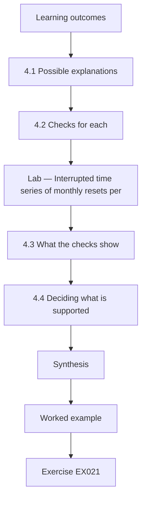

### Logical drawing

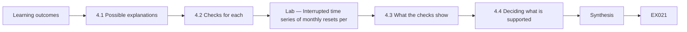

```text
[Learning outcomes]
    |
    v
[4.1 Possible explanations]
    |
    v
[4.2 Checks for each]
    |
    v
[Lab — Interrupted time series of monthly resets per]
    |
    v
[4.3 What the checks show]
    |
    v
[4.4 Deciding what is supported]
    |
    v
[Synthesis]
    |
    v
[Worked example] --> [Exercise EX021]
```
<!-- open-cyber-academy:lesson-figures:end ch-04 -->


### Learning outcomes

You will (1) list explanations for a change in reset counts; (2) design checks for each; (3) decide what the evidence supports.

### 4.1 Possible explanations

Early data shows password resets fell after the policy change. Dr Nakamura asks Sofia to list every plausible explanation before claiming success. Resets could fall because forced changes stopped; because the password manager helped people remember; because a new self-service reset tool moved requests away from the help desk; because staffing fell over summer; or because the help desk changed how it logged tickets. Listing explanations prevents her from accepting the first story that fits her hopes. She writes each explanation on a separate line of a table so that she can attach a specific check and its result to every one.

### 4.2 Checks for each

Sofia designs a check for each. For self-service, she obtains self-service reset counts and adds them to help desk counts. For staffing, she divides resets by the number of active accounts. For logging changes, she reads the help desk change log and interviews the help desk lead. For seasonal effects, she compares the same months in the previous year. For the password manager, she compares departments with high and low manager adoption. Each check targets one explanation directly rather than relying on a general impression.

### Lab — Interrupted time series of monthly resets per 1,000 accounts

```python
# Interrupted time series on resets per 1,000 accounts: 18 months before, 12 after (synthetic).
import random
random.seed(3)
y = [62 - 0.2 * t + random.gauss(0, 2) for t in range(18)] + [39 - 0.25 * (t - 18) + random.gauss(0, 2) for t in range(18, 30)]
def fit(xs, ys):
    n = len(xs); mx = sum(xs) / n; my = sum(ys) / n
    b = sum((x - mx) * (v - my) for x, v in zip(xs, ys)) / sum((x - mx) ** 2 for x in xs)
    return my - b * mx, b
a0, b0 = fit(range(18), y[:18]); a1, b1 = fit(range(18, 30), y[18:])
pred = a0 + b0 * 18; obs = a1 + b1 * 18
print(f"before: level at month 18 predicted {pred:.1f}, slope {b0:+.2f}/month")
print(f"after: level at month 18 fitted {obs:.1f}, slope {b1:+.2f}/month")
print(f"level change {obs - pred:+.1f} per 1,000 accounts; slope change {b1 - b0:+.2f}")
```

Run with `python3 lab_its.py`. Verified output:

```text
before: level at month 18 predicted 56.9, slope -0.37/month
after: level at month 18 fitted 38.1, slope -0.27/month
level change -18.8 per 1,000 accounts; slope change +0.09
```

### 4.3 What the checks show

Self-service resets account for part of the drop but not all: total resets per thousand accounts still fall after the change. Staffing changes are small. The help desk logging change happened four months later, so it cannot explain the immediate drop. The lab estimates a fall in level at the change point with little change in trend. Departments with higher manager adoption show slightly larger falls, which is consistent with but does not prove a manager effect, since adopters may differ in other ways.

### 4.4 Deciding what is supported

Sofia writes her conclusion in levels of confidence. Strongly supported: total resets per thousand accounts fell at the change point. Moderately supported: ending forced changes contributed, since the timing matches and alternatives are mostly ruled out. Weakly supported: the password manager contributed. Not tested: whether security improved. Dr Nakamura praises the structure, noting that ranking explanations by evidence is more honest and more useful to policy makers than a single cause stated with false certainty. She presents the four levels as a short table in the discussion chapter so that readers can see at a glance how strongly each claim is supported.

### Worked example

Sofia lists five explanations for falling resets, designs specific checks, runs an interrupted time series and ranks conclusions by confidence.

> **Synthetic case.** Data and departments are synthetic.

### Errors and limits

Department comparisons are confounded by adoption choices. Time series need enough points before and after.

### Exercises

- **EX021 — Explanation list.** Name three explanations for falling resets. *Rubric:* 3 = ended forced changes, password manager, self-service tool, staffing, logging change;; 2 = two;; 1 = vague;; 0 = none.
- **EX022 — Self-service check.** How did Sofia handle the self-service tool? *Rubric:* 3 = added self-service counts to help desk counts;; 2 = combine;; 1 = ignore;; 0 = none.
- **EX023 — Staffing check.** How did she control for staffing changes? *Rubric:* 3 = divided resets by active accounts;; 2 = rate;; 1 = vague;; 0 = none.
- **EX024 — Lab level change.** What did the lab estimate at the change point? *Rubric:* 3 = a level drop of 18.8 resets per 1,000 accounts, slope change +0.09;; 2 = level drop;; 1 = rise;; 0 = none.
- **EX025 — Logging timing.** Why can the logging change not explain the immediate drop? *Rubric:* 3 = it happened four months later;; 2 = timing;; 1 = vague;; 0 = none.
- **EX026 — Weakest claim.** Which explanation is only weakly supported? *Rubric:* 3 = that the password manager contributed;; 2 = manager;; 1 = forced changes;; 0 = none.

### Synthesis

Listing and checking competing explanations lets a study rank its conclusions honestly by strength of evidence.

### Continue studying — chapter 04 of 08

[← Chapter 03 (draft)](#ch-03) · [Course chapter index](../SUBJECTS.md) · [Chapter 05 (draft) →](#ch-05)

<a id="ch-05"></a>

## Chapter 5 — Proposal and pilot

<!-- open-cyber-academy:lesson-figures:start ch-05 -->
### Lesson map

Lesson 05 published. Map, example, EX027.

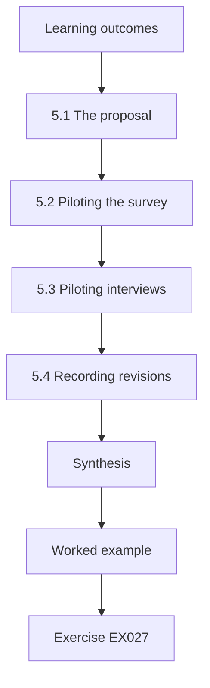

### Logical drawing

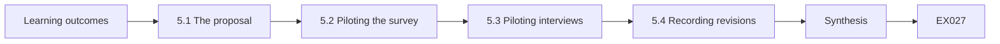

```text
[Learning outcomes]
    |
    v
[5.1 The proposal]
    |
    v
[5.2 Piloting the survey]
    |
    v
[5.3 Piloting interviews]
    |
    v
[5.4 Recording revisions]
    |
    v
[Synthesis]
    |
    v
[Worked example] --> [Exercise EX027]
```
<!-- open-cyber-academy:lesson-figures:end ch-05 -->


### Learning outcomes

You will (1) write a dissertation proposal; (2) pilot the survey and interview guide; (3) revise instruments from pilot evidence.

### 5.1 The proposal

Sofia's proposal sets out the question, the literature, the theories with their predictions, the three-part design, ethics, the analysis plan and a timeline. It states what would count as support and what would count against: if resets per thousand accounts do not fall at the change point, or if survey reports of writing passwords down rise, she will report the change as not beneficial. Dr Nakamura approves it after she shortens the literature section and adds a risk register for data access delays. The approved proposal is filed with the ethics application.

### 5.2 Piloting the survey

Sofia pilots the survey with ten staff from a department not in her sample. She times completion and asks each person to explain what they understood by each question. Two problems emerge. Staff interpret "password manager" differently, some thinking of the browser's saved passwords and others of the trust's approved tool. A question about sharing passwords is read as sharing with family by some and with colleagues by others. She rewrites both questions with examples and adds a short definition at the start. Completion takes about eight minutes.

### 5.3 Piloting interviews

She runs two pilot interviews. The first runs too long because her questions invite general complaints about IT. She reorders the guide to start with a specific recent experience, such as the last time the participant forgot a password, then moves to wider views. The second pilot works better and yields concrete examples. She also learns to pause and let participants finish, rather than filling silences, which produces richer accounts of how password rules interact with clinical work. She records these lessons in her research diary for later reflection.

### 5.4 Recording revisions

Sofia records every change from the pilot in a revision log with the reason and the evidence that prompted it. Pilot data is not used in the main analysis, which she notes in the plan. Dr Nakamura explains that examiners look for this record because it shows the instruments were tested rather than assumed to work. He also notes that pilots often reveal that researchers and participants use the same words differently, which is especially common in security, where technical terms carry everyday meanings.

### Worked example

Sofia writes a proposal with falsifying criteria, pilots the survey and interviews, fixes ambiguous questions and reorders the guide, and logs revisions.

> **Synthetic case.** Pilots and staff are synthetic.

### Errors and limits

Small pilots miss rare problems. Revisions after piloting may introduce new ambiguities.

### Exercises

- **EX027 — Counting against.** What results would count against the policy change? *Rubric:* 3 = no fall in resets per 1,000 or more writing down reported;; 2 = either;; 1 = vague;; 0 = none.
- **EX028 — Proposal revision.** What did Dr Nakamura ask her to add? *Rubric:* 3 = a risk register for data access delays;; 2 = risk register;; 1 = vague;; 0 = none.
- **EX029 — Ambiguous term.** Which term did staff interpret in different ways? *Rubric:* 3 = password manager;; 2 = manager;; 1 = vague;; 0 = none.
- **EX030 — Interview fix.** How was the interview guide reordered? *Rubric:* 3 = start with a specific recent experience, then wider views;; 2 = specific first;; 1 = vague;; 0 = none.
- **EX031 — Pilot data use.** Is pilot data used in the main analysis? *Rubric:* 3 = no;; 2 = excluded;; 1 = yes;; 0 = none.
- **EX032 — Shared words.** What common problem do pilots reveal in security research? *Rubric:* 3 = researchers and participants use words differently;; 2 = meaning;; 1 = vague;; 0 = none.

### Synthesis

Pilots test whether instruments mean what the researcher intends, and logged revisions show examiners they were tested.

### Continue studying — chapter 05 of 08

[← Chapter 04 (draft)](#ch-04) · [Course chapter index](../SUBJECTS.md) · [Chapter 06 (draft) →](#ch-06)

<a id="ch-06"></a>

## Chapter 6 — Data collection and analysis

<!-- open-cyber-academy:lesson-figures:start ch-06 -->
### Lesson map

Lesson 06 published. Map, example, EX033.

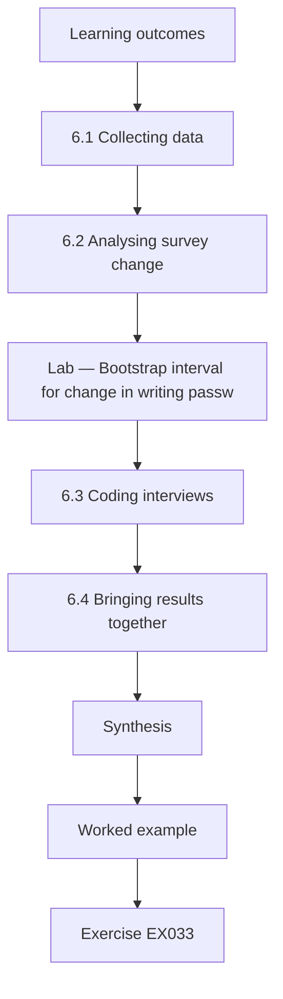

### Logical drawing

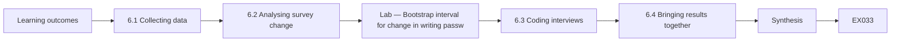

```text
[Learning outcomes]
    |
    v
[6.1 Collecting data]
    |
    v
[6.2 Analysing survey change]
    |
    v
[Lab — Bootstrap interval for change in writing passw]
    |
    v
[6.3 Coding interviews]
    |
    v
[6.4 Bringing results together]
    |
    v
[Synthesis]
    |
    v
[Worked example] --> [Exercise EX033]
```
<!-- open-cyber-academy:lesson-figures:end ch-06 -->


### Learning outcomes

You will (1) collect survey and interview data ethically; (2) analyse change in survey responses; (3) code interviews into themes.

### 6.1 Collecting data

Sofia runs the survey three months after the policy change, using the same questions the trust had asked in an earlier staff survey before the change. The before survey was anonymous and had the same wording for two questions on reuse and writing passwords down, which lets her compare. Four hundred and twelve staff respond after the change, against three hundred and ninety before. She conducts twelve interviews across nursing, medical, administrative and estates staff, stopping when new interviews add few new ideas. All interviews are recorded with consent.

### 6.2 Analysing survey change

Sofia compares the share of staff reporting that they write passwords down. The lab estimates the before and after shares and a bootstrap interval for the difference, which resamples the responses many times to show how much the difference could vary by chance. The share fell by a few percentage points, and the interval does not cross zero, so the fall is unlikely to be chance alone. She notes the samples are different people, since the surveys were anonymous, so this is a comparison of groups, not of individuals.

### Lab — Bootstrap interval for change in writing passwords down

```python
# Bootstrap interval for the change in share reporting writing passwords down (synthetic anonymous surveys).
import random
rng = random.Random(9)
before = [1] * 82 + [0] * 308    # 390 respondents
after = [1] * 62 + [0] * 350     # 412 respondents
pb, pa = sum(before) / len(before), sum(after) / len(after)
diffs = []
for _ in range(4000):
    b = [rng.choice(before) for _ in before]; a = [rng.choice(after) for _ in after]
    diffs.append(sum(a) / len(a) - sum(b) / len(b))
diffs.sort()
print(f"before {pb:.1%}, after {pa:.1%}, difference {pa - pb:+.1%}")
print(f"95% bootstrap interval {diffs[100]:+.1%} to {diffs[3899]:+.1%}")
```

Run with `python3 lab_boot.py`. Verified output:

```text
before 21.0%, after 15.0%, difference -6.0%
95% bootstrap interval -11.3% to -0.8%
```

### 6.3 Coding interviews

Sofia codes interview transcripts using a frame built from her theories and refined by reading. Themes include time pressure on shift, workarounds such as shared notes, relief at fewer changes and confusion about the password manager. A second coder codes three transcripts independently; they agree on most codes and discuss differences. The interviews explain the numbers: staff describe forced changes as interrupting patient care, and several say the password manager was introduced without training, limiting adoption. Agreed codes are recorded in a shared codebook with definitions and an example quote for each, so that the frame can be reused by others.

### 6.4 Bringing results together

Sofia combines findings. Resets fell at the change point; fewer staff report writing passwords down; interviews describe relief and less disruption. Manager adoption is lower than hoped, explained by missing training. She judges that the evidence supports the compliance budget prediction about reduced burden, while planned behaviour helps explain low manager adoption through perceived difficulty. Integrating methods shows a fuller picture than any one method, and also where they disagree, such as staff overestimating how often they still reset. She shows these links in a joint display table.

### Worked example

Sofia compares anonymous before and after surveys with a bootstrap interval, codes twelve interviews with a second coder and integrates findings with theory.

> **Synthetic case.** Surveys, interviews and figures are synthetic.

### Errors and limits

Anonymous repeated surveys compare groups, not individuals. Saturation judgements are subjective.

### Exercises

- **EX033 — Comparable questions.** Why could Sofia compare before and after survey answers? *Rubric:* 3 = an earlier anonymous survey used the same wording;; 2 = same wording;; 1 = vague;; 0 = none.
- **EX034 — Response numbers.** How many staff responded before and after? *Rubric:* 3 = 390 before and 412 after;; 2 = numbers;; 1 = vague;; 0 = none.
- **EX035 — Bootstrap result.** What did the lab find for writing passwords down? *Rubric:* 3 = 21.0% before, 15.0% after; difference -6.0 points, interval below zero;; 2 = fall;; 1 = rise;; 0 = none.
- **EX036 — Group comparison.** Why is the survey comparison only between groups? *Rubric:* 3 = anonymous surveys cannot link the same people;; 2 = anonymity;; 1 = vague;; 0 = none.
- **EX037 — Low adoption reason.** Why was password manager adoption low, according to interviews? *Rubric:* 3 = it was introduced without training;; 2 = training;; 1 = vague;; 0 = none.
- **EX038 — Theory support.** Which theory's prediction about burden did the evidence support? *Rubric:* 3 = the compliance budget;; 2 = budget;; 1 = vague;; 0 = none.

### Synthesis

Combining counts, survey change and interview themes gives a fuller and more honest picture than any single method.

### Continue studying — chapter 06 of 08

[← Chapter 05 (draft)](#ch-05) · [Course chapter index](../SUBJECTS.md) · [Chapter 07 (draft) →](#ch-07)

<a id="ch-07"></a>

## Chapter 7 — Dissertation writing and limitations

<!-- open-cyber-academy:lesson-figures:start ch-07 -->
### Lesson map

Lesson 07 published. Map, example, EX039.

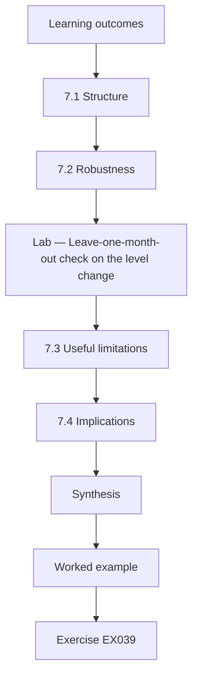

### Logical drawing

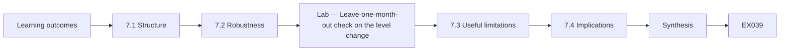

```text
[Learning outcomes]
    |
    v
[7.1 Structure]
    |
    v
[7.2 Robustness]
    |
    v
[Lab — Leave-one-month-out check on the level change]
    |
    v
[7.3 Useful limitations]
    |
    v
[7.4 Implications]
    |
    v
[Synthesis]
    |
    v
[Worked example] --> [Exercise EX039]
```
<!-- open-cyber-academy:lesson-figures:end ch-07 -->


### Learning outcomes

You will (1) structure a dissertation chapter by chapter; (2) write limitations that inform rather than excuse; (3) test the robustness of the main result.

### 7.1 Structure

Sofia's dissertation follows a clear structure: introduction, literature and theory, methods, results for each part, integrated discussion, limitations, implications and conclusion. Each results chapter opens with the question it answers and ends with a short summary. She writes the methods chapter first, while details are fresh, and the introduction last, once she knows what she found. Dr Nakamura reads chapters as they are drafted and asks her to cut repetition between the literature review and the discussion. She keeps a running list of decisions to explain in the methods chapter.

### 7.2 Robustness

Before writing the conclusion, Sofia checks whether her main result depends on choices she made. She reruns the time series analysis dropping each month in turn, to see whether any single unusual month drives the result. The lab shows the level change stays within a narrow range whichever month is dropped. She also tries counting resets per staff member rather than per account, with similar results. Robustness checks show readers that the conclusion would not collapse if a reasonable analytic choice were made differently.

### Lab — Leave-one-month-out check on the level change

```python
# Leave-one-month-out check on the interrupted time series level change (same synthetic data as lab_its).
import random
random.seed(3)
y = [62 - 0.2 * t + random.gauss(0, 2) for t in range(18)] + [39 - 0.25 * (t - 18) + random.gauss(0, 2) for t in range(18, 30)]
def fit(xs, ys):
    n = len(xs); mx = sum(xs) / n; my = sum(ys) / n
    b = sum((x - mx) * (v - my) for x, v in zip(xs, ys)) / sum((x - mx) ** 2 for x in xs)
    return my - b * mx, b
def level(skip):
    pts = [(t, v) for t, v in enumerate(y) if t != skip]
    pre = [p for p in pts if p[0] < 18]; post = [p for p in pts if p[0] >= 18]
    a0, b0 = fit([p[0] for p in pre], [p[1] for p in pre]); a1, b1 = fit([p[0] for p in post], [p[1] for p in post])
    return (a1 + b1 * 18) - (a0 + b0 * 18)
vals = [level(s) for s in range(30)]
print(f"full data level change {level(-1):+.1f}; leave-one-out range {min(vals):+.1f} to {max(vals):+.1f}")
```

Run with `python3 lab_robust.py`. Verified output:

```text
full data level change -18.8; leave-one-out range -19.3 to -17.8
```

### 7.3 Useful limitations

Sofia writes limitations that tell readers how to interpret the work. The study covers one trust, so results may differ in organisations with different staff or systems. Survey groups are not matched individuals. The password manager's effect cannot be separated from training gaps. The study did not measure security outcomes such as account compromise, because those data were not available. For each limitation she states its likely direction of bias and what kind of study could address it. She keeps the section short and specific to avoid diluting it.

### 7.4 Implications

Sofia separates implications for the trust, for other hospitals and for policy. For the trust: keep the change, provide manager training and track compromise indicators. For other hospitals: the change reduced burden here and is worth trialling with measurement. For policy: guidance against routine forced changes is consistent with these findings, though one study cannot settle the question. Writing implications at three levels prevents the overreach that occurs when single-site findings are presented as universal truths. Each implication cites the specific result that supports it, so that readers can trace every recommendation back to evidence.

### Worked example

Sofia structures the dissertation, checks robustness by leaving out each month, writes directional limitations and states implications at three levels.

> **Synthetic case.** Results are synthetic.

### Errors and limits

Robustness checks cover only chosen alternatives. Implications may be read more broadly than intended.

### Exercises

- **EX039 — Writing order.** Which chapters does Sofia write first and last? *Rubric:* 3 = methods first, introduction last;; 2 = order;; 1 = vague;; 0 = none.
- **EX040 — Leave-one-out.** What does dropping each month in turn test? *Rubric:* 3 = whether one unusual month drives the result;; 2 = influence;; 1 = vague;; 0 = none.
- **EX041 — Robust range.** What range did the leave-one-month-out lab show? *Rubric:* 3 = level change between -19.3 and -17.8;; 2 = narrow;; 1 = wide;; 0 = none.
- **EX042 — Missing outcome.** Which security outcome was not measured? *Rubric:* 3 = account compromise;; 2 = compromise;; 1 = resets;; 0 = none.
- **EX043 — Trust implications.** What did Sofia recommend to the trust? *Rubric:* 3 = keep the change, train on the manager and track compromise;; 2 = three;; 1 = vague;; 0 = none.
- **EX044 — Three levels.** At which three levels are implications stated? *Rubric:* 3 = trust, other hospitals and policy;; 2 = two;; 1 = vague;; 0 = none.

### Synthesis

Robustness checks and directional limitations make a dissertation's conclusions credible and correctly scoped.

### Continue studying — chapter 07 of 08

[← Chapter 06 (draft)](#ch-06) · [Course chapter index](../SUBJECTS.md) · [Chapter 08 (draft) →](#ch-08)

<a id="ch-08"></a>

## Chapter 8 — Independent review and defense

<!-- open-cyber-academy:lesson-figures:start ch-08 -->
### Lesson map

Lesson 08 published. Map, example, EX045.

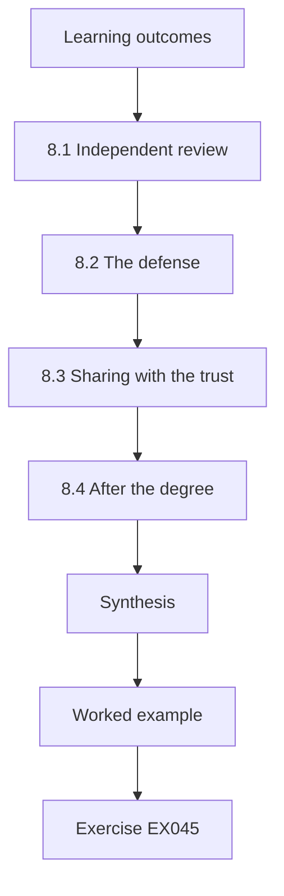

### Logical drawing

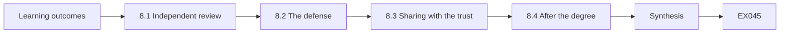

```text
[Learning outcomes]
    |
    v
[8.1 Independent review]
    |
    v
[8.2 The defense]
    |
    v
[8.3 Sharing with the trust]
    |
    v
[8.4 After the degree]
    |
    v
[Synthesis]
    |
    v
[Worked example] --> [Exercise EX045]
```
<!-- open-cyber-academy:lesson-figures:end ch-08 -->


### Learning outcomes

You will (1) prepare for independent examination; (2) answer challenges about methods and ethics; (3) share findings responsibly with the partner organisation.

### 8.1 Independent review

Before submission, Sofia asks a researcher from another institution to read the dissertation as an examiner would. The reviewer questions whether the earlier survey's sample was comparable and asks for response rates by staff group. Sofia adds a table showing both surveys had similar proportions of nursing, medical and administrative staff. The reviewer also suggests clarifying how she reached interview saturation. Independent reading catches gaps that a supervisor who has followed the work closely may no longer notice. She thanks the reviewer in the acknowledgements.

### 8.2 The defense

At her viva, examiners ask why she did not run a randomised trial. She explains that the policy change applied to the whole trust at once, making randomisation impossible, and that an interrupted time series is a recognised design for such cases. They ask about ethics: whether interviewees felt safe criticising IT. She describes recruitment through a neutral notice and quoting only by role. Examiners note that her answers show she understands the trade-offs of her design rather than defending it as perfect. She is asked for minor corrections only.

### 8.3 Sharing with the trust

Sofia presents findings to the trust's information governance group. She shows aggregate results only, with no quotes that could identify staff, and explains limitations in plain terms. The group decides to keep the policy and fund password manager training. They ask whether they can say that security improved; Sofia advises them to say that burden fell and that security outcomes were not measured. Responsible sharing ensures research informs decisions without being stretched beyond what it shows. She leaves a two-page summary with the group for future reference.

### 8.4 After the degree

Sofia publishes a short paper with Dr Nakamura and shares her anonymised data and code. The trust asks her to lead the training rollout and to set up monitoring of compromise indicators, which would let a future study examine security outcomes. She reflects that the most important skill she learned was to separate what evidence shows from what people hope it shows, especially when the result supports a change she personally favoured from the start. She also keeps in touch with Dr Nakamura about a possible follow-up study comparing several trusts, which would show whether her findings hold more widely.

### Worked example

Sofia uses an independent reader, defends design and ethics choices, shares aggregate findings with careful wording and continues with training and monitoring.

> **Synthetic case.** Reviews and decisions are synthetic.

### Errors and limits

Partners may still overstate findings. Viva performance depends on preparation as well as work quality.

### Exercises

- **EX045 — Comparability table.** What did Sofia add after the independent review? *Rubric:* 3 = a table of staff group proportions in both surveys;; 2 = comparability;; 1 = vague;; 0 = none.
- **EX046 — No randomisation.** Why was a randomised trial impossible? *Rubric:* 3 = the policy applied to the whole trust at once;; 2 = whole trust;; 1 = cost;; 0 = none.
- **EX047 — Safe criticism.** How did she help interviewees feel safe criticising IT? *Rubric:* 3 = neutral recruitment and quoting only by role;; 2 = neutral;; 1 = vague;; 0 = none.
- **EX048 — Correct claim.** What should the trust say about security? *Rubric:* 3 = burden fell; security outcomes were not measured;; 2 = burden;; 1 = security improved;; 0 = none.
- **EX049 — Trust decision.** What did the governance group decide? *Rubric:* 3 = keep the policy and fund manager training;; 2 = both;; 1 = reverse;; 0 = none.
- **EX050 — Key skill.** What skill does Sofia value most? *Rubric:* 3 = separating what evidence shows from what people hope;; 2 = evidence;; 1 = vague;; 0 = none.

### Synthesis

Independent review, a reasoned defense and careful communication carry a dissertation's findings responsibly into practice.

### Continue studying — chapter 08 of 08

[← Chapter 07 (draft)](#ch-07) · [Course chapter index](../SUBJECTS.md) · [Worked results ↓](#worked-results) · [Next course via chapter index →](../SUBJECTS.md)

<a id="worked-results"></a>

## Worked results

Model answers for EX001–EX050. Sofia Lindqvist, Dr Paul Nakamura, Harrowgate Institute, Orchard Lane Hospital Trust and every figure are synthetic. Lab answers quote verified outputs. Any answer meeting the rubric scores equally.

**EX001.** Whether reset requests fell and reported password reuse dropped after forced changes ended and a manager was offered.

**EX002.** Because it showed demanding password rules led staff to write passwords down and reuse them.

**EX003.** The date, database, search string and number of results.

**EX004.** To show the search was not selective and can be repeated.

**EX005.** Because guidance states recommended positions rather than measured effects.

**EX006.** Few studies measure what happens in a hospital after a password policy change.

**EX007.** Herley (2009).

**EX008.** Attitudes, social norms and perceived behavioural control.

**EX009.** That freed effort may increase compliance with other rules such as screen locking.

**EX010.** It often explains intentions better than actual actions, which are frequently habits.

**EX011.** Because they assume information alone will change behaviour.

**EX012.** When it leads to measurable predictions.

**EX013.** Manager adoption linked to attitudes and norms, and improved screen locking from freed effort.

**EX014.** Because the budget itself is hard to measure directly.

**EX015.** An interrupted time series of reset counts, an anonymous staff survey and interviews.

**EX016.** It asks neither for names nor for actual passwords, only habits.

**EX017.** Because colleagues might feel unable to refuse.

**EX018.** By normalising the behaviour in the question wording and asking how often rather than yes or no.

**EX019.** Because reuse is likely under-reported, so changes are more trustworthy than levels.

**EX020.** Her coding frame and counts, since transcripts could identify staff.

**EX021.** Ending forced changes, the password manager and the self-service tool, among others.

**EX022.** By adding self-service reset counts to help desk counts.

**EX023.** By using resets per thousand active accounts.

**EX024.** A drop in level of 18.8 resets per 1,000 accounts (56.9 predicted, 38.1 fitted), with a slope change of only +0.09 per month.

**EX025.** Because it happened four months after the change.

**EX026.** That the password manager contributed to the fall.

**EX027.** No fall in resets per thousand accounts at the change point, or more reports of writing passwords down.

**EX028.** A risk register for delays in data access.

**EX029.** "Password manager", which some read as browser saved passwords.

**EX030.** To begin with a specific recent experience, such as the last forgotten password, before wider views.

**EX031.** No, pilot data is excluded and this is stated in the plan.

**EX032.** That researchers and participants use the same words with different meanings.

**EX033.** Because an earlier anonymous survey asked two questions with identical wording.

**EX034.** 390 before the change and 412 after.

**EX035.** It fell from 21.0% to 15.0%, a 6-point fall with a bootstrap interval of -11.3 to -0.8 points.

**EX036.** Because anonymous surveys cannot link answers from the same individuals.

**EX037.** Because it was introduced without training.

**EX038.** The compliance budget prediction that reducing burden helps.

**EX039.** The methods chapter first and the introduction last.

**EX040.** Whether a single unusual month drives the result.

**EX041.** The level change stayed between -19.3 and -17.8 resets per 1,000 accounts, against -18.8 with all months.

**EX042.** Account compromise, because the data was not available.

**EX043.** Keep the change, provide password manager training and track compromise indicators.

**EX044.** For the trust, for other hospitals and for policy.

**EX045.** A table showing similar proportions of staff groups in both surveys.

**EX046.** Because the policy changed for the whole trust at once.

**EX047.** By recruiting through a neutral notice and quoting only by role.

**EX048.** That burden fell, while security outcomes were not measured.

**EX049.** To keep the policy and fund password manager training.

**EX050.** Separating what evidence shows from what people hope it shows.

<a id="references"></a>

## References

Links checked 12 October 2026; re-verify editions before citing. Organisations, people, systems and data in this book are synthetic unless a sentence cites a public source.

- Adams, A., & Sasse, M. A. (1999). Users are not the enemy. *Communications of the ACM*, 42(12), 40–46. <https://doi.org/10.1145/322796.322806>
- Ajzen, I. (1991). The theory of planned behavior. *Organizational Behavior and Human Decision Processes*, 50(2), 179–211. <https://doi.org/10.1016/0749-5978(91)90020-T>
- Bada, M., Sasse, M. A., & Nurse, J. R. C. (2019). *Cyber security awareness campaigns: Why do they fail to change behaviour?* arXiv:1901.02672. <https://arxiv.org/abs/1901.02672>
- Beautement, A., Sasse, M. A., & Wonham, M. (2008). The compliance budget: Managing security behaviour in organisations. *Proceedings of the 2008 New Security Paradigms Workshop*, 47–58. <https://doi.org/10.1145/1595676.1595684>
- Herley, C. (2009). So long, and no thanks for the externalities: The rational rejection of security advice by users. *Proceedings of the 2009 New Security Paradigms Workshop*, 133–144. <https://doi.org/10.1145/1719030.1719050>
- International Organization for Standardization. (2022). *ISO/IEC 27001:2022 Information security, cybersecurity and privacy protection — Information security management systems — Requirements*. <https://www.iso.org/standard/27001>
- Sasse, M. A., Brostoff, S., & Weirich, D. (2001). Transforming the 'weakest link' — a human/computer interaction approach to usable and effective security. *BT Technology Journal*, 19(3), 122–131. <https://doi.org/10.1023/A:1011902718709>
