# Information Security: Master's Course

- Language: English (`en`); course 163, Master's course (2 years).
- Editorial state: **published**. Chapters 1–8 of 8 have hand-written teaching text; exercises EX001–EX050 have matching worked results with 0–3 rubrics; two offline labs use only the Python 3 standard library on synthetic data, and their outputs are embedded from real runs. Independent review and the 300-page A4 verification remain open.
- Audience: master's students evaluating whether just-in-time phishing feedback reduces simulated phishing clicks in a health organisation.
- Author: [hiagokinlevi](https://github.com/hiagokinlevi). Original text [CC0 1.0](../../../../../LICENSE); cited works keep their rights.
- Boundary: the labs separate mail-scanner pre-fetch clicks from human clicks in a synthetic phishing simulation log and estimate a difference-in-differences effect on synthetic click rates with a bootstrap interval. Standards are cited by edition and paraphrased. All people, organisations, systems and data are **synthetic** unless a sentence cites a public source.

[Course home](../../README.md) · [Chapter index](../SUBJECTS.md) · [Book plan](PLAN.md) · [Course skill](../../skill/SKILL.md) · [Worked results](#worked-results)

## How to use this draft

Read in order. The chapters follow one master's student from a structured literature search and seminar through a quasi-experimental design, rival explanations, a measurement pilot, analysis, dissertation writing and an independently reviewed defense. Run each lab where it appears, attempt the exercises before the worked results, and score yourself with the rubrics.

### Synthetic running case

| Element | Role | Boundary |
|---|---|---|
| **Priya Natarajan** | Master's student | Invented |
| **Dr. Olumide Bello** | Supervisor | Invented |
| **Ashcombe University** | Fictional university | Invented |
| **Harrowgate Community Health** | Fictional health organisation, about 2,400 staff in six departments | Invented |

### Core sources

Anderson (2020), [doi:10.1002/9781119644682](https://doi.org/10.1002/9781119644682); ISO/IEC 27000:2026; ISO/IEC 27001:2022; ISO/IEC 27002:2022; NIST SP 800-53 Rev. 5; NIST CSWP 29 (CSF 2.0); Saltzer and Schroeder (1975), [doi:10.1109/PROC.1975.9939](https://doi.org/10.1109/PROC.1975.9939); Shadish, Cook and Campbell (2002). Full list in [References](#references).

## Contents

| Chapters |
|---|
| [1](#ch-01) · [2](#ch-02) · [3](#ch-03) · [4](#ch-04) · [5](#ch-05) · [6](#ch-06) · [7](#ch-07) · [8](#ch-08) |

[Worked results](#worked-results) · [References](#references)

<a id="ch-01"></a>

## Chapter 1 — Research question and literature method

<!-- cyberabc:lesson-figures:start ch-01 -->
### Lesson map

Lesson 01 published. Map, example, EX001.

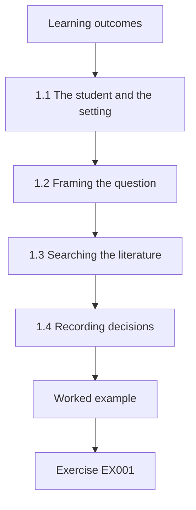

### Logical drawing

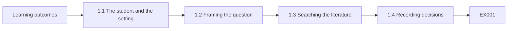

```text
[Learning outcomes]
    |
    v
[1.1 The student and the setting]
    |
    v
[1.2 Framing the question]
    |
    v
[1.3 Searching the literature]
    |
    v
[1.4 Recording decisions]
    |
    v
[Worked example] --> [Exercise EX001]
```
<!-- cyberabc:lesson-figures:end ch-01 -->


### Learning outcomes

You will (1) frame an answerable information security research question; (2) run a structured literature search; (3) record inclusion decisions so others can repeat them.

### 1.1 The student and the setting

Priya Natarajan starts a two-year master's programme in information security at the fictional Ashcombe University, supervised by Dr. Olumide Bello. Her partner organisation is the fictional Harrowgate Community Health, which employs about 2,400 staff across six departments and runs a phishing simulation every quarter. The security team is debating whether to replace once-a-year awareness training with immediate feedback shown when a person clicks a simulated phishing link. Priya sees a chance to answer a practical question with real organisational evidence. Dr. Bello agrees to supervise the project.

### 1.2 Framing the question

Priya's first draft asks whether training makes staff more secure. Dr. Bello points out that secure is not measurable and training is not specific. She rewrites it: in departments that adopt just-in-time feedback, does the share of staff clicking simulated phishing links fall more than in departments keeping annual training only? The revised question names the intervention, the outcome, the comparison and the population, so she can decide in advance what evidence would answer it and what would not. Dr. Bello approves the revised wording.

### 1.3 Searching the literature

Priya searches two academic databases and the publications of national standards bodies, using fixed search strings combining phishing, simulation, training and feedback. She restricts results to studies reporting measured behaviour rather than opinions, because her question concerns clicks rather than attitudes. She also reads general texts, including Anderson's Security Engineering, whose discussion of psychology and usability warns that blaming users rarely fixes systems. That warning shapes how she later frames the ethics of her study and its recommendations. She keeps a dated record of every search.

### 1.4 Recording decisions

Every inclusion and exclusion is logged in a spreadsheet with the reason, such as no behavioural measure, no comparison group or simulation conducted only in a laboratory. Dr. Bello asks her to keep the search strings and dates so another student could repeat the search and reach the same list. Priya ends with twenty-three included studies. She notes that many report large effects from single organisations without comparison groups, which makes her more cautious about expecting a large effect herself. The spreadsheet is archived.

### Worked example

Priya narrows a vague question to a measurable comparison of click rates between feedback and annual-training departments, then runs and logs a repeatable literature search.

> **Synthetic case.** Priya, Ashcombe and Harrowgate are synthetic.

### Errors and limits

A question about whether staff are secure cannot be answered with any measure.

### Exercises

- **EX001 — Partner size.** How many staff does Harrowgate employ? *Rubric:* 3 = about 2,400;; 2 = partly correct;; 1 = wrong;; 0 = none.
- **EX002 — Revised question.** What is Priya's revised question? *Rubric:* 3 = whether feedback departments' click rates fall more than comparison;; 2 = partly correct;; 1 = vague;; 0 = none.
- **EX003 — Four elements.** Which four elements does the revised question name? *Rubric:* 3 = intervention, outcome, comparison, population;; 2 = all;; 1 = some;; 0 = none.
- **EX004 — Inclusion restriction.** Which studies does Priya include? *Rubric:* 3 = those measuring behaviour;; 2 = partly correct;; 1 = opinions;; 0 = none.
- **EX005 — Anderson warning.** What warning does Anderson's text give? *Rubric:* 3 = blaming users rarely fixes systems;; 2 = partly correct;; 1 = vague;; 0 = none.
- **EX006 — Logged reasons.** Give an exclusion reason Priya logs. *Rubric:* 3 = no behavioural measure;; 2 = one;; 1 = vague;; 0 = none.
- **EX007 — Included count.** How many studies are included? *Rubric:* 3 = twenty-three;; 2 = partly correct;; 1 = wrong;; 0 = none.

<!-- cyberabc:chapter-navigation:start ch-01 -->
### Continue studying — lesson 01 (chapter 01 of 08)

[← Course home](../../README.md) · [Course chapter index](../SUBJECTS.md) · [Chapter 02 →](#ch-02)

Continue to the next authored lesson.
<!-- cyberabc:chapter-navigation:end -->

<a id="ch-02"></a>

## Chapter 2 — Information security: advanced seminar

<!-- cyberabc:lesson-figures:start ch-02 -->
### Lesson map

Lesson 02 published. Map, example, EX008.

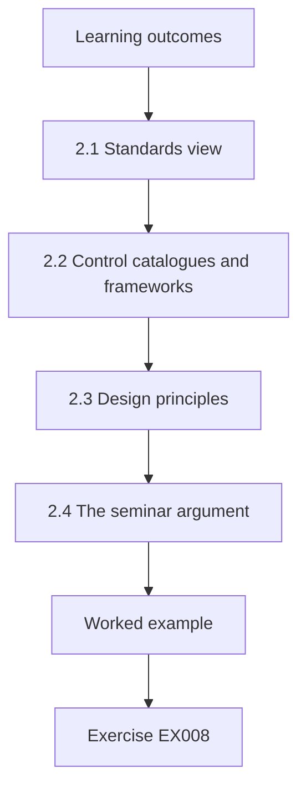

### Logical drawing

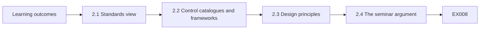

```text
[Learning outcomes]
    |
    v
[2.1 Standards view]
    |
    v
[2.2 Control catalogues and frameworks]
    |
    v
[2.3 Design principles]
    |
    v
[2.4 The seminar argument]
    |
    v
[Worked example] --> [Exercise EX008]
```
<!-- cyberabc:lesson-figures:end ch-02 -->


### Learning outcomes

You will (1) relate awareness training to management standards and control catalogues; (2) connect user behaviour to design principles; (3) build an argument linking intervention to outcome.

### 2.1 Standards view

In the advanced seminar, Priya maps her topic onto recognised standards. ISO/IEC 27001:2022 requires an organisation running an information security management system to make people aware of the security policy and their contribution to it. ISO/IEC 27002:2022 gives guidance on awareness, education and training as an organisational and people control. ISO/IEC 27000:2026, the current overview of the family, explains how these documents fit together. Priya notes that none prescribes a particular training method, which leaves her question open. She cites each standard by its edition.

### 2.2 Control catalogues and frameworks

NIST SP 800-53 Revision 5 groups training controls in its awareness and training family, including literacy training that covers recognising phishing. The NIST Cybersecurity Framework 2.0 places awareness and training within its Protect function. Priya observes that catalogues and frameworks describe what an organisation should have, while her study asks which way of delivering it changes behaviour. She records this difference between having a control and the control working, because her dissertation must address the second. Dr. Bello agrees that this distinction gives the dissertation a clear purpose beyond describing existing controls.

### 2.3 Design principles

Dr. Bello asks the seminar to read Saltzer and Schroeder's 1975 paper, which lists psychological acceptability among its design principles: protection should be easy enough that people apply it routinely and correctly. Priya argues that immediate feedback follows this principle, because it teaches at the moment of error instead of months later. Classmates counter that feedback might also embarrass staff and reduce reporting. She adds reporting rates as a secondary outcome so the study can detect this side effect. The class agrees this addition strengthens the design.

### 2.4 The seminar argument

Priya presents her argument: just-in-time feedback will reduce clicks because it connects the lesson to a concrete mistake while it is fresh. She states the expected direction and a plausible size, a few percentage points, based on the literature she found. Dr. Bello praises the argument for naming a mechanism and a side effect. He asks her to write down which result would count against her hypothesis before she sees any data, a step she completes in the following chapter. Priya accepts the task.

### Worked example

Priya places training within ISO/IEC 27001, ISO/IEC 27002, SP 800-53 and CSF 2.0, links feedback to psychological acceptability and adds reporting as a secondary outcome.

> **Synthetic case.** Standards are paraphrased; consult the editions cited.

### Errors and limits

Assuming a control works because a standard requires it confuses having with working.

### Exercises

- **EX008 — 27001 requirement.** What does ISO/IEC 27001:2022 require about people? *Rubric:* 3 = awareness of policy and their contribution;; 2 = partly correct;; 1 = vague;; 0 = none.
- **EX009 — 27000 role.** What is ISO/IEC 27000:2026? *Rubric:* 3 = the overview of the family;; 2 = partly correct;; 1 = vocabulary only;; 0 = none.
- **EX010 — SP 800-53 family.** Which SP 800-53 family holds training controls? *Rubric:* 3 = awareness and training;; 2 = partly correct;; 1 = other;; 0 = none.
- **EX011 — CSF function.** Which CSF 2.0 function includes awareness and training? *Rubric:* 3 = Protect;; 2 = partly correct;; 1 = other;; 0 = none.
- **EX012 — Design principle.** Which Saltzer and Schroeder principle supports feedback? *Rubric:* 3 = psychological acceptability;; 2 = partly correct;; 1 = other;; 0 = none.
- **EX013 — Secondary outcome.** What secondary outcome is added? *Rubric:* 3 = reporting rates;; 2 = partly correct;; 1 = vague;; 0 = none.
- **EX014 — Expected size.** What effect size does Priya expect? *Rubric:* 3 = a few percentage points;; 2 = partly correct;; 1 = large;; 0 = none.

<!-- cyberabc:chapter-navigation:start ch-02 -->
### Continue studying — lesson 02 (chapter 02 of 08)

[← Chapter 01](#ch-01) · [Course chapter index](../SUBJECTS.md) · [Chapter 03 →](#ch-03)

Continue to the next authored lesson.
<!-- cyberabc:chapter-navigation:end -->

<a id="ch-03"></a>

## Chapter 3 — Study design, ethics and reproducibility

<!-- cyberabc:lesson-figures:start ch-03 -->
### Lesson map

Lesson 03 published. Map, example, EX015.

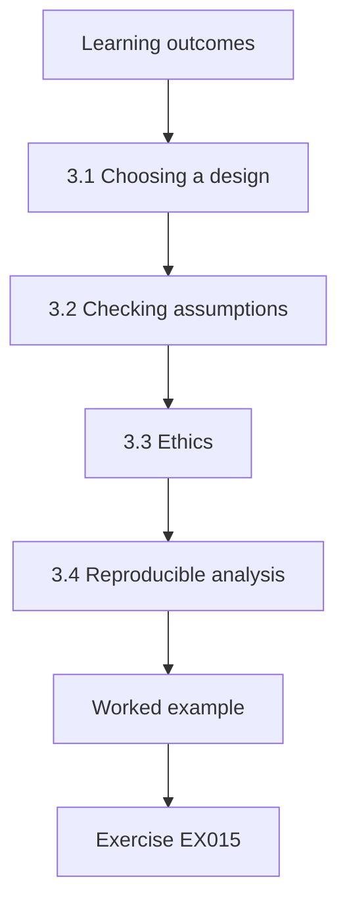

### Logical drawing

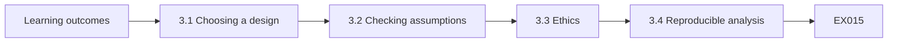

```text
[Learning outcomes]
    |
    v
[3.1 Choosing a design]
    |
    v
[3.2 Checking assumptions]
    |
    v
[3.3 Ethics]
    |
    v
[3.4 Reproducible analysis]
    |
    v
[Worked example] --> [Exercise EX015]
```
<!-- cyberabc:lesson-figures:end ch-03 -->


### Learning outcomes

You will (1) choose a quasi-experimental design when randomisation is impossible; (2) obtain ethical approval for workplace security research; (3) fix an analysis plan before data collection.

### 3.1 Choosing a design

Harrowgate will not randomise staff, because the security team has already chosen three departments to pilot feedback. Priya therefore uses a difference-in-differences design, following Shadish, Cook and Campbell's guidance on quasi-experiments: compare the change in click rate in feedback departments with the change in comparison departments over the same period. The comparison removes influences shared by both groups, such as a seasonal rise in real phishing or a news story about fraud, which would otherwise be credited to feedback. Dr. Bello approves the design choice.

### 3.2 Checking assumptions

The design assumes both groups would have changed similarly without feedback. Priya examines four earlier quarterly simulations and finds that click rates in the two groups moved together, with neither trending faster. She also checks that simulation emails were identical across groups, because harder lures in one group would distort comparisons. Dr. Bello asks her to report these checks in full so examiners can judge the assumption, rather than asserting it is satisfied in a single sentence. She plots the four quarters for both groups.

### 3.3 Ethics

The study involves staff whose clicks might be seen as failures. The university ethics committee approves it on conditions: results are reported only at department level, individuals are pseudonymised by the security team before Priya receives data, no one is disciplined on the basis of study data and staff are told that simulations are part of training. Priya agrees and adds that the dissertation will avoid language blaming staff, consistent with the usability literature. The security team confirms in writing that it will apply the pseudonyms before export.

### 3.4 Reproducible analysis

Priya writes her analysis plan before collecting outcome data: primary outcome, click rate per department group; secondary outcome, report rate; estimator, difference-in-differences; uncertainty, a bootstrap interval from a thousand resamples with a fixed seed. She stores scripts in version control and labels any later analysis as exploratory. Dr. Bello signs and dates the plan. She notes that fixing the plan protects her from choosing analyses after seeing which one looks best. A copy of the signed plan is lodged with the programme office, and the security team receives one too, so every party knows which analyses are confirmatory.

### Worked example

Priya uses difference-in-differences, checks parallel trends and identical lures, obtains approval with department-level reporting and no discipline, and freezes the analysis plan.

> **Synthetic case.** Approval conditions are synthetic.

### Errors and limits

Using simulation results to discipline staff undermines trust and reporting.

### Exercises

- **EX015 — Design chosen.** Which design does Priya use? *Rubric:* 3 = difference-in-differences;; 2 = partly correct;; 1 = randomised;; 0 = none.
- **EX016 — Shared influences.** What does the comparison group remove? *Rubric:* 3 = influences shared by both groups;; 2 = partly correct;; 1 = vague;; 0 = none.
- **EX017 — Assumption check.** What did the four earlier simulations show? *Rubric:* 3 = rates moved together;; 2 = partly correct;; 1 = diverged;; 0 = none.
- **EX018 — Lure check.** Why check that emails were identical? *Rubric:* 3 = harder lures would distort comparison;; 2 = partly correct;; 1 = vague;; 0 = none.
- **EX019 — Reporting level.** At what level are results reported? *Rubric:* 3 = department level;; 2 = partly correct;; 1 = individual;; 0 = none.
- **EX020 — Uncertainty method.** How is uncertainty estimated? *Rubric:* 3 = bootstrap with a thousand resamples and fixed seed;; 2 = partly correct;; 1 = vague;; 0 = none.

<!-- cyberabc:chapter-navigation:start ch-03 -->
### Continue studying — lesson 03 (chapter 03 of 08)

[← Chapter 02](#ch-02) · [Course chapter index](../SUBJECTS.md) · [Chapter 04 →](#ch-04)

Continue to the next authored lesson.
<!-- cyberabc:chapter-navigation:end -->

<a id="ch-04"></a>

## Chapter 4 — Information security: competing explanations

<!-- cyberabc:lesson-figures:start ch-04 -->
### Lesson map

Lesson 04 published. Map, example, EX021.

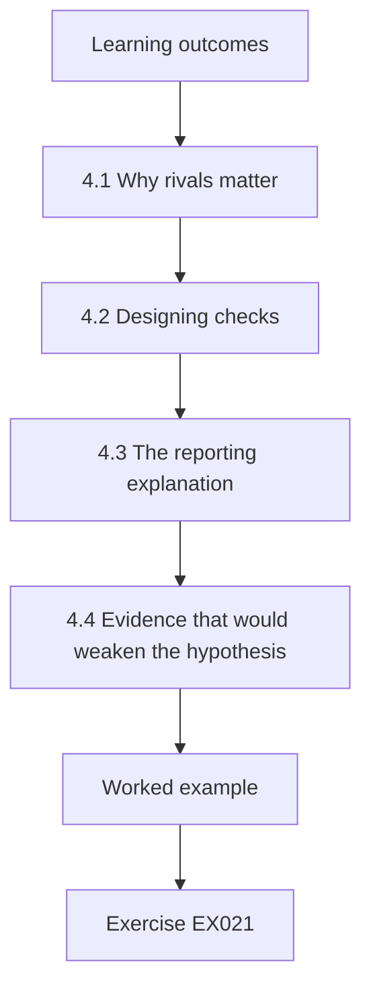

### Logical drawing

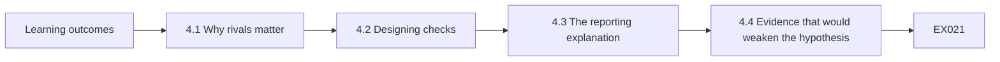

```text
[Learning outcomes]
    |
    v
[4.1 Why rivals matter]
    |
    v
[4.2 Designing checks]
    |
    v
[4.3 The reporting explanation]
    |
    v
[4.4 Evidence that would weaken the hypothesis]
    |
    v
[Worked example] --> [Exercise EX021]
```
<!-- cyberabc:lesson-figures:end ch-04 -->


### Learning outcomes

You will (1) list rival explanations for a security improvement; (2) design checks for each rival; (3) state evidence that would weaken your hypothesis.

### 4.1 Why rivals matter

Priya expects feedback departments to click less, but other causes could produce the same pattern. Staff might learn to recognise simulation emails rather than phishing in general. A mail filter change might block more lures in some departments. Staff turnover might replace experienced people with newcomers in comparison departments. Managers in feedback departments might remind staff more often because they know a pilot is running. Each of these would reduce clicks without feedback being the reason, so each needs a check. Priya lists them.

### 4.2 Designing checks

For each rival, Priya designs a check. She asks the security team to vary simulation templates so staff cannot learn a single pattern. She confirms with the mail administrators that filtering rules were identical across departments during the study. She compares turnover between groups using anonymised human resources counts. For manager reminders, she asks department heads to log any security messages they send, accepting that this measure depends on honest reporting and noting it as a weakness. Each check is written into the plan before collection.

### 4.3 The reporting explanation

Peers had suggested that feedback might embarrass staff, making them stop reporting suspicious emails to avoid attention. This would be a harmful side effect, because reports help the security team find real attacks quickly. Priya's secondary outcome, the report rate, tests this directly. If clicks fall but reports also fall, the intervention may be trading one risk for another. She writes this possibility into her plan so a fall in reports cannot be ignored if it appears. The security team supports including this outcome.

### 4.4 Evidence that would weaken the hypothesis

Priya writes down results that would count against her: a difference-in-differences interval that includes zero, pre-period trends that diverge, a fall in report rates in feedback departments or turnover differences large enough to explain the change. Dr. Bello adds one more: a fall in clicks only on repeated templates and not on new ones. Recording these in advance means she cannot reinterpret disappointing results afterwards, and examiners can check her conclusions against her stated tests. Dr. Bello signs the list, and Priya attaches it to the analysis plan.

### Worked example

Priya lists template learning, filter changes, turnover and manager reminders as rivals, designs a check for each, tests the reporting side effect and records weakening results in advance.

> **Synthetic case.** Rivals and checks are synthetic.

### Errors and limits

Ignoring a fall in reporting would hide a harmful side effect.

### Exercises

- **EX021 — Template rival.** Why vary simulation templates? *Rubric:* 3 = so staff cannot learn one pattern;; 2 = partly correct;; 1 = vague;; 0 = none.
- **EX022 — Filter check.** How is the mail filter rival checked? *Rubric:* 3 = confirm identical rules across departments;; 2 = partly correct;; 1 = vague;; 0 = none.
- **EX023 — Weak measure.** Which check depends on honest reporting? *Rubric:* 3 = manager reminder logs;; 2 = partly correct;; 1 = other;; 0 = none.
- **EX024 — Side effect.** What harmful side effect might feedback cause? *Rubric:* 3 = fewer reports of suspicious emails;; 2 = partly correct;; 1 = vague;; 0 = none.
- **EX025 — Supervisor addition.** What weakening result does Dr. Bello add? *Rubric:* 3 = fall only on repeated templates;; 2 = partly correct;; 1 = vague;; 0 = none.
- **EX026 — Advance purpose.** Why record weakening results in advance? *Rubric:* 3 = prevents reinterpretation afterwards;; 2 = partly correct;; 1 = vague;; 0 = none.

<!-- cyberabc:chapter-navigation:start ch-04 -->
### Continue studying — lesson 04 (chapter 04 of 08)

[← Chapter 03](#ch-03) · [Course chapter index](../SUBJECTS.md) · [Chapter 05 →](#ch-05)

Continue to the next authored lesson.
<!-- cyberabc:chapter-navigation:end -->

<a id="ch-05"></a>

## Chapter 5 — Proposal and pilot

<!-- cyberabc:lesson-figures:start ch-05 -->
### Lesson map

Lesson 05 published. Map, example, EX027.

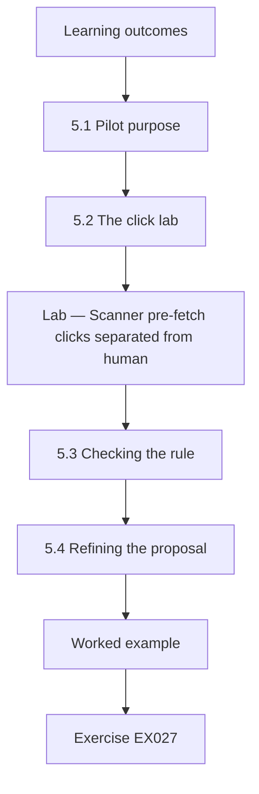

### Logical drawing

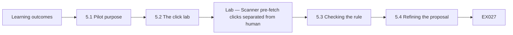

```text
[Learning outcomes]
    |
    v
[5.1 Pilot purpose]
    |
    v
[5.2 The click lab]
    |
    v
[Lab — Scanner pre-fetch clicks separated from human]
    |
    v
[5.3 Checking the rule]
    |
    v
[5.4 Refining the proposal]
    |
    v
[Worked example] --> [Exercise EX027]
```
<!-- cyberabc:lesson-figures:end ch-05 -->


### Learning outcomes

You will (1) pilot an outcome measure before main collection; (2) detect automated activity contaminating security metrics; (3) refine a proposal from pilot evidence.

### 5.1 Pilot purpose

Before the main data collection, Priya pilots her outcome measure on one earlier simulation. She wants to know whether a click recorded by the simulation platform really means a person clicked. Dr. Bello reminds her that many mail security gateways open links automatically to check them for malicious content, and that such scanner activity can appear in logs as clicks. If the pilot finds this, her outcome needs a correction rule before the main study starts. The security team supplies an anonymised export from one earlier quarter.

### 5.2 The click lab

The pilot lab builds a synthetic log for 1,200 staff, recording the seconds between delivery and any click. It finds 239 raw clicks, a rate of 19.9 percent. Of these, 77 occur within two seconds of delivery, far faster than a person could read an email, and are attributed to the scanner. Removing them leaves 162 human clicks, 13.5 percent. The raw figure would have overstated clicking by more than six percentage points. Priya shows the security team a chart comparing raw and human rates. The team had been reporting raw figures to the board for two years and agrees the correction matters.

### Lab — Scanner pre-fetch clicks separated from human clicks in a synthetic simulation log

```python
"""Separate scanner pre-fetch clicks from human clicks in a synthetic phishing simulation log (stdlib only)."""
import random
random.seed(41)
rows = []
for staff in range(1200):
    sec = None
    r = random.random()
    if r < 0.07:
        sec = random.uniform(0.2, 1.8)          # mail scanner opens the link almost at once
    elif r < 0.21:
        sec = random.uniform(30, 86400)        # a person clicks later
    rows.append((staff, sec))
clicked = [s for s in rows if s[1] is not None]
auto = [s for s in clicked if s[1] < 2]
human = len(clicked) - len(auto)
print(f"staff {len(rows)}; raw clicks {len(clicked)} ({len(clicked)/len(rows):.1%})")
print(f"clicks within 2 s (scanner) {len(auto)}; human clicks {human} ({human/len(rows):.1%})")
```

Run with `python3 lab_clicks.py`. Verified output:

```text
staff 1200; raw clicks 239 (19.9%)
clicks within 2 s (scanner) 77; human clicks 162 (13.5%)
```

### 5.3 Checking the rule

A two-second threshold is a judgement, so Priya checks it. She asks the mail administrators whether the gateway scans links, and they confirm it does and that scans come from known addresses. Matching by address would be better than timing, but the platform does not keep addresses in the export she receives. She keeps the timing rule, reports it as a limitation and tests whether changing the threshold to five seconds changes conclusions in the main analysis. Dr. Bello agrees the approach is reasonable for a master's study.

### 5.4 Refining the proposal

From the pilot, Priya updates her proposal: the primary outcome becomes human click rate, excluding clicks within two seconds; report rates are measured from the reporting button logs; and simulations use varied templates. She adds a sentence explaining that unadjusted platform figures, sometimes quoted in vendor reports, can overstate risk. Dr. Bello approves the change and confirms that it happened before main data collection, so it remains part of the pre-registered plan. The revised proposal is circulated to the security team and to the ethics committee, which confirms that the change needs no further approval.

### Worked example

Priya pilots the click measure, finds 77 of 239 clicks are scanner activity within two seconds, redefines the outcome as human click rate (13.5 percent rather than 19.9 percent) and updates her plan.

> **Synthetic case.** Log data are synthetic; outputs come from lab_clicks.py.

### Errors and limits

Counting scanner clicks as human clicks inflates measured risk.

### Exercises

- **EX027 — Raw clicks.** How many raw clicks does the pilot find? *Rubric:* 3 = 239, 19.9 percent;; 2 = partly correct;; 1 = wrong;; 0 = none.
- **EX028 — Scanner clicks.** How many clicks occur within two seconds? *Rubric:* 3 = 77;; 2 = partly correct;; 1 = wrong;; 0 = none.
- **EX029 — Human rate.** What is the human click rate? *Rubric:* 3 = 13.5 percent;; 2 = partly correct;; 1 = wrong;; 0 = none.
- **EX030 — Better method.** What would be better than timing? *Rubric:* 3 = matching known scanner addresses;; 2 = partly correct;; 1 = vague;; 0 = none.
- **EX031 — Threshold test.** Which alternative threshold is tested? *Rubric:* 3 = five seconds;; 2 = partly correct;; 1 = other;; 0 = none.
- **EX032 — New outcome.** What is the new primary outcome? *Rubric:* 3 = human click rate excluding two-second clicks;; 2 = partly correct;; 1 = raw;; 0 = none.

<!-- cyberabc:chapter-navigation:start ch-05 -->
### Continue studying — lesson 05 (chapter 05 of 08)

[← Chapter 04](#ch-04) · [Course chapter index](../SUBJECTS.md) · [Chapter 06 →](#ch-06)

Continue to the next authored lesson.
<!-- cyberabc:chapter-navigation:end -->

<a id="ch-06"></a>

## Chapter 6 — Data collection and analysis

<!-- cyberabc:lesson-figures:start ch-06 -->
### Lesson map

Lesson 06 published. Map, example, EX033.

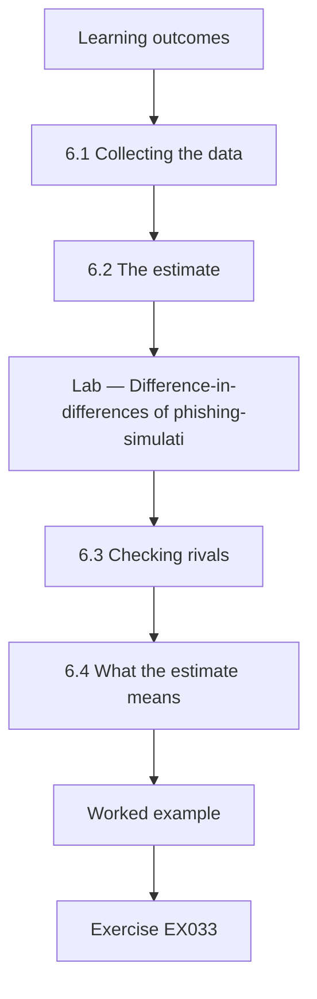

### Logical drawing

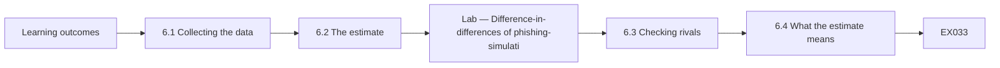

```text
[Learning outcomes]
    |
    v
[6.1 Collecting the data]
    |
    v
[6.2 The estimate]
    |
    v
[Lab — Difference-in-differences of phishing-simulati]
    |
    v
[6.3 Checking rivals]
    |
    v
[6.4 What the estimate means]
    |
    v
[Worked example] --> [Exercise EX033]
```
<!-- cyberabc:lesson-figures:end ch-06 -->


### Learning outcomes

You will (1) collect outcome data under a frozen plan; (2) estimate a difference-in-differences effect with a bootstrap interval; (3) check rival explanations against the data.

### 6.1 Collecting the data

Priya receives pseudonymised human click records for a quarter before and a quarter after feedback starts, taking samples of six hundred staff from each group in each period. The security team applies the two-second rule before export, and Priya checks a random selection of records to confirm it. She also receives department-level report counts, turnover figures and the manager reminder logs. Data are stored on an encrypted university drive, as the ethics approval requires. Priya logs the date of every extract she receives from the team.

### 6.2 The estimate

The lab shows click rates in feedback departments falling from 15.8 to 6.7 percent, while comparison departments fall from 14.0 to 11.0 percent. The difference-in-differences is minus 6.2 percentage points, with a 95 percent bootstrap interval from minus 10.7 to minus 1.2. The interval excludes zero, so the data support a reduction larger than the shared change. The interval is wide, however, meaning the true effect could be as small as about one percentage point. Priya reports the point estimate and both interval limits together, so readers see the uncertainty alongside the effect. She does not round the upper limit away from zero.

### Lab — Difference-in-differences of phishing-simulation click rates with a bootstrap interval

```python
"""Difference-in-differences of phishing-simulation click rates with a bootstrap interval (stdlib only)."""
import random
random.seed(17)
def grp(n, p): return [1 if random.random() < p else 0 for _ in range(n)]
t_pre, t_post = grp(600, 0.16), grp(600, 0.08)   # departments with just-in-time feedback
c_pre, c_post = grp(600, 0.15), grp(600, 0.13)   # departments with annual training only
m = lambda x: sum(x) / len(x)
did = (m(t_post) - m(t_pre)) - (m(c_post) - m(c_pre))
bs = []
for _ in range(1000):
    r = lambda x: [random.choice(x) for _ in x]
    bs.append((m(r(t_post)) - m(r(t_pre))) - (m(r(c_post)) - m(r(c_pre))))
bs.sort()
print(f"click rates: feedback {m(t_pre):.1%} -> {m(t_post):.1%}; comparison {m(c_pre):.1%} -> {m(c_post):.1%}")
print(f"difference-in-differences {did*100:.1f} points; 95% bootstrap CI {bs[25]*100:.1f} to {bs[974]*100:.1f}")
```

Run with `python3 lab_did.py`. Verified output:

```text
click rates: feedback 15.8% -> 6.7%; comparison 14.0% -> 11.0%
difference-in-differences -6.2 points; 95% bootstrap CI -10.7 to -1.2
```

### 6.3 Checking rivals

Templates varied, and the fall appears on new templates as well as familiar ones, weakening the template-learning rival. Filtering rules were identical. Turnover was similar in both groups. Manager reminder logs show slightly more messages in feedback departments, so part of the effect could reflect attention rather than feedback, which Priya reports. Report rates did not fall in feedback departments; they rose slightly, so the embarrassment side effect does not appear. Changing the threshold to five seconds leaves conclusions unchanged. She tabulates each check.

### 6.4 What the estimate means

Priya interprets the result carefully: in this synthetic setting, feedback departments reduced human clicking by about six percentage points more than comparison departments, with considerable uncertainty. She does not claim feedback prevents breaches, because simulation clicks are a proxy for real behaviour, and real attackers adapt. Dr. Bello reminds her that one organisation over two quarters cannot show the effect persists. She writes these points directly beside the estimate rather than in a distant limitations section. Priya also notes that results could differ in larger organisations.

### Worked example

Priya estimates a difference-in-differences of minus 6.2 points (interval minus 10.7 to minus 1.2), finds no fall in reporting, notes the manager reminder concern and states the proxy limits beside the estimate.

> **Synthetic case.** Records are synthetic; outputs come from lab_did.py.

### Errors and limits

Treating a simulation click rate as a breach rate overstates the finding.

### Exercises

- **EX033 — Feedback rates.** How did feedback departments' click rates change? *Rubric:* 3 = 15.8 to 6.7 percent;; 2 = partly correct;; 1 = wrong;; 0 = none.
- **EX034 — Comparison rates.** How did comparison click rates change? *Rubric:* 3 = 14.0 to 11.0 percent;; 2 = partly correct;; 1 = wrong;; 0 = none.
- **EX035 — DiD and interval.** What is the estimate and interval? *Rubric:* 3 = minus 6.2 points, minus 10.7 to minus 1.2;; 2 = partly correct;; 1 = wrong;; 0 = none.
- **EX036 — Remaining rival.** Which rival is not fully ruled out? *Rubric:* 3 = manager reminders;; 2 = partly correct;; 1 = other;; 0 = none.
- **EX037 — Reporting result.** What happened to report rates? *Rubric:* 3 = rose slightly in feedback departments;; 2 = partly correct;; 1 = fell;; 0 = none.
- **EX038 — Proxy limit.** Why not claim feedback prevents breaches? *Rubric:* 3 = simulation clicks are a proxy;; 2 = partly correct;; 1 = vague;; 0 = none.

<!-- cyberabc:chapter-navigation:start ch-06 -->
### Continue studying — lesson 06 (chapter 06 of 08)

[← Chapter 05](#ch-05) · [Course chapter index](../SUBJECTS.md) · [Chapter 07 →](#ch-07)

Continue to the next authored lesson.
<!-- cyberabc:chapter-navigation:end -->

<a id="ch-07"></a>

## Chapter 7 — Dissertation writing and limitations

<!-- cyberabc:lesson-figures:start ch-07 -->
### Lesson map

Lesson 07 published. Map, example, EX039.

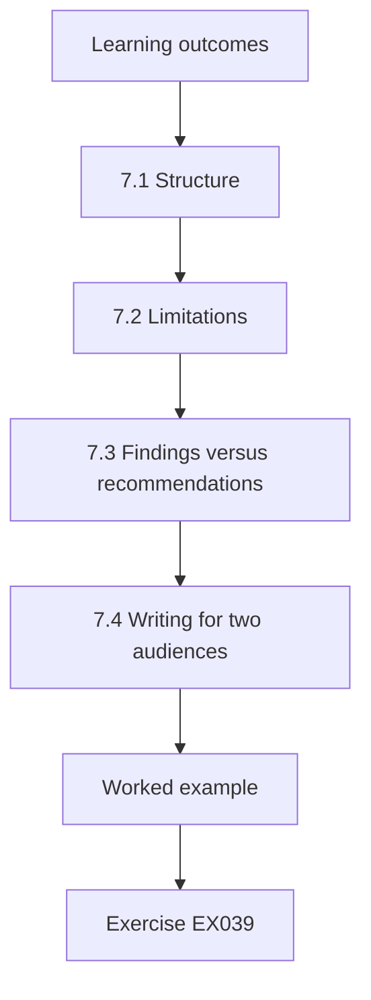

### Logical drawing

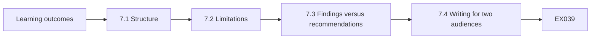

```text
[Learning outcomes]
    |
    v
[7.1 Structure]
    |
    v
[7.2 Limitations]
    |
    v
[7.3 Findings versus recommendations]
    |
    v
[7.4 Writing for two audiences]
    |
    v
[Worked example] --> [Exercise EX039]
```
<!-- cyberabc:lesson-figures:end ch-07 -->


### Learning outcomes

You will (1) structure a dissertation around a question; (2) write specific limitations; (3) separate findings from recommendations.

### 7.1 Structure

Priya structures her dissertation around the question: introduction and question, literature, standards and design principles, design and ethics, pilot and measurement, results, rivals, discussion and limitations. Each chapter ends with a short statement of what it contributes to answering the question. Dr. Bello reads the plan and asks her to move the scanner-click finding into its own section, because it is useful to other researchers even apart from the main result about feedback. Priya agrees, and the new section becomes one of the clearest parts of the dissertation.

### 7.2 Limitations

Priya's limitations section names five issues: three treated departments chosen by the security team rather than randomly; possible extra manager attention; a timing rule for scanner clicks instead of address matching; simulation clicks as a proxy for real phishing; and only two quarters of follow-up. For each, she states how it could bias the estimate and in which direction. Dr. Bello says this specificity is what distinguishes a useful limitations section from a list of disclaimers. Priya revises the section twice before submission.

### 7.3 Findings versus recommendations

Priya separates what the evidence shows from what she recommends. The finding is that, in this setting, feedback departments reduced human clicking more than comparison departments, without reducing reports. Her recommendations are to extend feedback to further departments as a staged rollout so comparison remains possible, to filter scanner clicks before reporting rates, and to measure reporting alongside clicks. She labels recommendations as judgements that go beyond the data, so readers can weigh them separately. Dr. Bello checks that every recommendation is marked.

### 7.4 Writing for two audiences

The dissertation serves examiners and Harrowgate's security team. For the team, Priya writes a two-page summary with the main estimate, the scanner-click correction and the recommendations, avoiding statistical terms where possible and never naming departments negatively. For examiners, the full text gives methods, checks and code. She asks a security team member to read the summary for clarity and revises two sentences that implied staff were careless, replacing them with neutral descriptions of behaviour. The security team member approves the revised summary, and Priya keeps both versions.

### Worked example

Priya structures the dissertation by question, writes five specific limitations with bias direction, separates findings from labelled recommendations and produces a neutral summary for the security team.

> **Synthetic case.** The dissertation is synthetic.

### Errors and limits

Generic disclaimers do not help readers judge a result.

### Exercises

- **EX039 — Separate section.** Which finding gets its own section? *Rubric:* 3 = the scanner-click correction;; 2 = partly correct;; 1 = other;; 0 = none.
- **EX040 — Five limitations.** Name one of the five limitations. *Rubric:* 3 = non-random treated departments;; 2 = one;; 1 = vague;; 0 = none.
- **EX041 — Limitation detail.** What does Priya state for each limitation? *Rubric:* 3 = how it biases and in which direction;; 2 = partly correct;; 1 = vague;; 0 = none.
- **EX042 — Staged rollout.** Why recommend a staged rollout? *Rubric:* 3 = comparison remains possible;; 2 = partly correct;; 1 = vague;; 0 = none.
- **EX043 — Summary length.** How long is the team summary? *Rubric:* 3 = two pages;; 2 = partly correct;; 1 = wrong;; 0 = none.
- **EX044 — Revised wording.** What wording was revised? *Rubric:* 3 = sentences implying carelessness;; 2 = partly correct;; 1 = vague;; 0 = none.

<!-- cyberabc:chapter-navigation:start ch-07 -->
### Continue studying — lesson 07 (chapter 07 of 08)

[← Chapter 06](#ch-06) · [Course chapter index](../SUBJECTS.md) · [Chapter 08 →](#ch-08)

Continue to the next authored lesson.
<!-- cyberabc:chapter-navigation:end -->

<a id="ch-08"></a>

## Chapter 8 — Independent review and defense

<!-- cyberabc:lesson-figures:start ch-08 -->
### Lesson map

Lesson 08 published. Map, example, EX045.

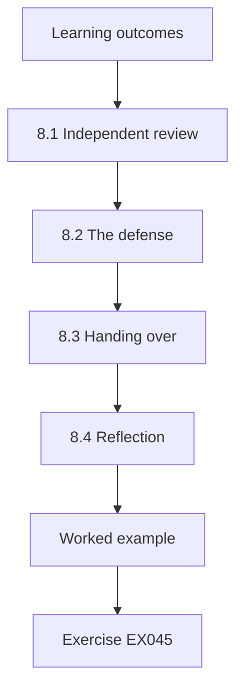

### Logical drawing

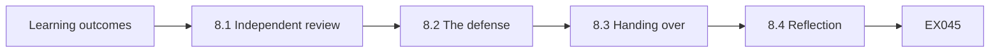

```text
[Learning outcomes]
    |
    v
[8.1 Independent review]
    |
    v
[8.2 The defense]
    |
    v
[8.3 Handing over]
    |
    v
[8.4 Reflection]
    |
    v
[Worked example] --> [Exercise EX045]
```
<!-- cyberabc:lesson-figures:end ch-08 -->


### Learning outcomes

You will (1) obtain independent review of analysis; (2) defend a dissertation under questioning; (3) hand findings to an organisation responsibly.

### 8.1 Independent review

Before submission, a statistician from another department reruns Priya's scripts on the synthetic data and obtains the same figures. She suggests checking whether a few departments drive the result. Priya repeats the estimate leaving out each feedback department in turn; the direction holds each time, though one omission widens the interval to nearly touch zero. Priya reports this exploratory check, noting that with only three treated departments the result depends noticeably on each one. The statistician's report is included as an appendix with her permission.

### 8.2 The defense

At the defense, examiners ask why Harrowgate should trust a result from three departments. Priya answers that it should treat the result as encouraging but provisional, supporting a staged rollout with continued measurement rather than a full switch. Another examiner asks whether feedback is ethical if it shows staff their mistakes. She explains the department-level reporting, the absence of discipline and the rise in reports, which suggests staff did not experience feedback as punitive in this setting. The examiners record her answers.

### 8.3 Handing over

Priya presents the findings to Harrowgate's security committee, using the two-page summary. The committee agrees to extend feedback to two further departments and keep one comparison department for another two quarters. It also asks the platform supplier to include scanner addresses in exports, so future measurement can match addresses instead of timing. Priya archives her scripts, synthetic data and analysis plan in the university repository, so the committee or another student can repeat the study. The committee thanks the staff who took part in the study.

### 8.4 Reflection

Priya reflects that the most useful part of her work may be the scanner-click correction, which changes how the organisation reads every future simulation. The main estimate is promising but uncertain. She notes that the next course in this area, data governance, examines who decides how data such as simulation logs are defined and used, which matters because her outcome depended on such a definition. Dr. Bello agrees and recommends the scanner finding for a short practitioner paper. Priya begins drafting the paper.

### Worked example

Priya passes independent review with a leave-one-out check, defends the result as provisional, hands over findings leading to a staged rollout and archives her materials.

> **Synthetic case.** The review and defense are synthetic.

### Errors and limits

Presenting a three-department result as definitive overstates certainty.

### Exercises

- **EX045 — Leave-one-out.** What does leaving out each department show? *Rubric:* 3 = direction holds, one omission nearly touches zero;; 2 = partly correct;; 1 = vague;; 0 = none.
- **EX046 — Trust answer.** How should Harrowgate treat the result? *Rubric:* 3 = encouraging but provisional;; 2 = partly correct;; 1 = definitive;; 0 = none.
- **EX047 — Ethics answer.** What suggests feedback was not punitive? *Rubric:* 3 = reports rose;; 2 = partly correct;; 1 = vague;; 0 = none.
- **EX048 — Committee decision.** What does the committee decide? *Rubric:* 3 = extend to two departments, keep one comparison;; 2 = partly correct;; 1 = vague;; 0 = none.
- **EX049 — Supplier request.** What does the committee ask the supplier for? *Rubric:* 3 = scanner addresses in exports;; 2 = partly correct;; 1 = vague;; 0 = none.
- **EX050 — Practitioner paper.** What does Dr. Bello recommend for a practitioner paper? *Rubric:* 3 = the scanner finding;; 2 = partly correct;; 1 = other;; 0 = none.

<!-- cyberabc:chapter-navigation:start ch-08 -->
### Continue studying — lesson 08 (chapter 08 of 08)

[← Chapter 07](#ch-07) · [Course chapter index](../SUBJECTS.md) · [Next course via chapter index →](../SUBJECTS.md)

The chapter index leads to the next course in the study path.
<!-- cyberabc:chapter-navigation:end -->

<a id="worked-results"></a>

## Worked results

Model answers for EX001–EX050. Priya Natarajan, Dr. Olumide Bello, Ashcombe University, Harrowgate Community Health and every figure are synthetic. Lab answers quote verified outputs. Any answer meeting the rubric scores equally.

**EX001.** About 2,400 staff across six departments.

**EX002.** Whether click rates fall more in feedback departments than in annual-training departments.

**EX003.** Intervention, outcome, comparison and population.

**EX004.** Studies reporting measured behaviour rather than opinions.

**EX005.** That blaming users rarely fixes security systems.

**EX006.** No behavioural measure, no comparison group or laboratory-only simulation.

**EX007.** Twenty-three studies.

**EX008.** That people are aware of the policy and their contribution to security.

**EX009.** The current overview explaining how the family fits together.

**EX010.** The awareness and training family.

**EX011.** The Protect function.

**EX012.** Psychological acceptability.

**EX013.** The rate at which staff report simulated phishing.

**EX014.** A reduction of a few percentage points.

**EX015.** Difference-in-differences.

**EX016.** Influences shared by both groups, such as seasonal phishing.

**EX017.** Click rates in both groups moved together.

**EX018.** Harder lures in one group would distort the comparison.

**EX019.** Only at department level.

**EX020.** A bootstrap interval from a thousand resamples with a fixed seed.

**EX021.** So staff cannot simply learn to recognise one simulation pattern.

**EX022.** By confirming filtering rules were identical across departments.

**EX023.** The log of manager security reminders.

**EX024.** Staff reporting fewer suspicious emails.

**EX025.** A fall in clicks only on repeated templates, not new ones.

**EX026.** To prevent reinterpreting disappointing results afterwards.

**EX027.** 239 clicks, 19.9 percent of staff.

**EX028.** 77 clicks attributed to the scanner.

**EX029.** 162 human clicks, 13.5 percent.

**EX030.** Matching clicks against the gateway's known scanning addresses.

**EX031.** A five-second threshold.

**EX032.** Human click rate, excluding clicks within two seconds.

**EX033.** From 15.8 to 6.7 percent.

**EX034.** From 14.0 to 11.0 percent.

**EX035.** Minus 6.2 points, interval minus 10.7 to minus 1.2.

**EX036.** Extra manager reminders in feedback departments.

**EX037.** They rose slightly in feedback departments.

**EX038.** Simulation clicks are only a proxy for real behaviour.

**EX039.** The section on scanner clicks inflating raw rates.

**EX040.** Treated departments were chosen by the security team rather than randomly.

**EX041.** How it could bias the estimate and in which direction.

**EX042.** So comparison between departments remains possible.

**EX043.** Two pages.

**EX044.** Two sentences that implied staff were careless.

**EX045.** The direction holds, but one omission widens the interval nearly to zero.

**EX046.** As encouraging but provisional.

**EX047.** Report rates rose in feedback departments.

**EX048.** To extend feedback to two departments and keep one comparison department.

**EX049.** Scanner addresses included in exports.

**EX050.** The finding on scanner clicks, suited to practitioners.

<a id="references"></a>
## References

Every DOI was resolved through doi.org on 12 October 2026, and ISO/IEC editions were checked against iso.org on the same day. Organisations, people, systems and figures in the running cases are synthetic; only the works below are real.

- Anderson, R. (2020). *Security engineering: A guide to building dependable distributed systems* (3rd ed.). Wiley. https://doi.org/10.1002/9781119644682
- ISO/IEC. (2022). *ISO/IEC 27001:2022 Information security, cybersecurity and privacy protection — Information security management systems — Requirements* (with Amd 1:2024). <https://www.iso.org/standard/27001>
- ISO/IEC. (2022). *ISO/IEC 27002:2022 Information security, cybersecurity and privacy protection — Information security controls*. <https://www.iso.org/standard/75652.html>
- ISO/IEC. (2026). *ISO/IEC 27000:2026 Information security, cybersecurity and privacy protection — Information security management systems — Overview* (6th ed., replacing ISO/IEC 27000:2018). <https://www.iso.org/standard/27000>
- Joint Task Force. (2020). *Security and privacy controls for information systems and organizations* (NIST SP 800-53 Rev. 5). National Institute of Standards and Technology. https://doi.org/10.6028/NIST.SP.800-53r5
- National Institute of Standards and Technology. (2024). *The NIST Cybersecurity Framework (CSF) 2.0* (NIST CSWP 29). https://doi.org/10.6028/NIST.CSWP.29
- Saltzer, J. H., & Schroeder, M. D. (1975). The protection of information in computer systems. *Proceedings of the IEEE, 63*(9), 1278–1308. https://doi.org/10.1109/PROC.1975.9939
- Shadish, W. R., Cook, T. D., & Campbell, D. T. (2002). *Experimental and quasi-experimental designs for generalized causal inference*. Houghton Mifflin.
