# Segurança da Informação: Curso de Mestrado

- Idioma: português do Brasil (`pt`); curso 163, curso de mestrado (2 anos). Edição de referência: [inglês](../../en/book/MANUSCRIPT.md).
- Estado editorial: **publicado**. Os capítulos 1–8 de 8 têm texto didático escrito à mão; os exercícios EX001–EX050 têm resoluções correspondentes com rubricas de 0 a 3; os dois laboratórios offline usam apenas a biblioteca padrão do Python 3 sobre dados sintéticos, e suas saídas foram incorporadas de execuções reais, idênticas às da edição em inglês. Revisão independente, revisão linguística e a verificação de 300 páginas A4 continuam em aberto.
- Público: mestrandos que avaliam se o feedback imediato sobre phishing reduz os cliques em simulações de phishing numa organização de saúde.
- Autor: [hiagokinlevi](https://github.com/hiagokinlevi). Texto original sob [CC0 1.0](../../../../../LICENSE); as obras citadas mantêm seus direitos.
- Limites: os laboratórios separam os cliques de pré-carregamento do scanner de e-mail dos cliques humanos num log sintético de simulação de phishing e estimam um efeito de diferença em diferenças sobre taxas sintéticas de cliques com um intervalo bootstrap. As normas são citadas pela edição e parafraseadas. Pessoas, organizações, sistemas e dados são **sintéticos**, salvo quando uma frase cita uma fonte pública.

[Página do curso](../../README.md) · [Índice de capítulos](../SUBJECTS.md) · [Plano do livro](PLAN.md) · [Skill do curso](../../skill/SKILL.md) · [Resoluções](#worked-results)

## Como usar este rascunho

Leia na ordem. Os capítulos acompanham uma mestranda desde uma busca estruturada na literatura e um seminário, passando por um desenho quase experimental, explicações rivais, um piloto de medição, a análise e a redação da dissertação, até uma defesa com revisão independente. Execute cada laboratório onde ele aparece, tente os exercícios antes de consultar as resoluções e avalie-se com as rubricas.

### Caso sintético

| Elemento | Papel | Natureza |
|---|---|---|
| **Priya Natarajan** | Mestranda | Inventada |
| **Dr. Olumide Bello** | Orientador | Inventado |
| **Ashcombe University** | Universidade fictícia | Inventada |
| **Harrowgate Community Health** | Organização de saúde fictícia, com cerca de 2.400 funcionários em seis departamentos | Inventada |

### Fontes principais

Anderson (2020), [doi:10.1002/9781119644682](https://doi.org/10.1002/9781119644682); ISO/IEC 27000:2026; ISO/IEC 27001:2022 (no Brasil, ABNT NBR ISO/IEC 27001:2022); ISO/IEC 27002:2022; NIST SP 800-53 Rev. 5; NIST CSWP 29 (CSF 2.0); Saltzer e Schroeder (1975), [doi:10.1109/PROC.1975.9939](https://doi.org/10.1109/PROC.1975.9939); Shadish, Cook e Campbell (2002). Lista completa em [Referências](#references).

## Sumário

| Capítulos em português |
|---|
| [1](#ch-01) · [2](#ch-02) · [3](#ch-03) · [4](#ch-04) · [5](#ch-05) · [6](#ch-06) · [7](#ch-07) · [8](#ch-08) |

[Resoluções](#worked-results) · [Referências](#references)

<a id="ch-01"></a>

## Capítulo 1 — Pergunta de pesquisa e método de revisão da literatura

<!-- cykin:lesson-figures:start ch-01 -->
### Mapa da aula

Aula 01 publicada. Mapa, exemplo, EX001.

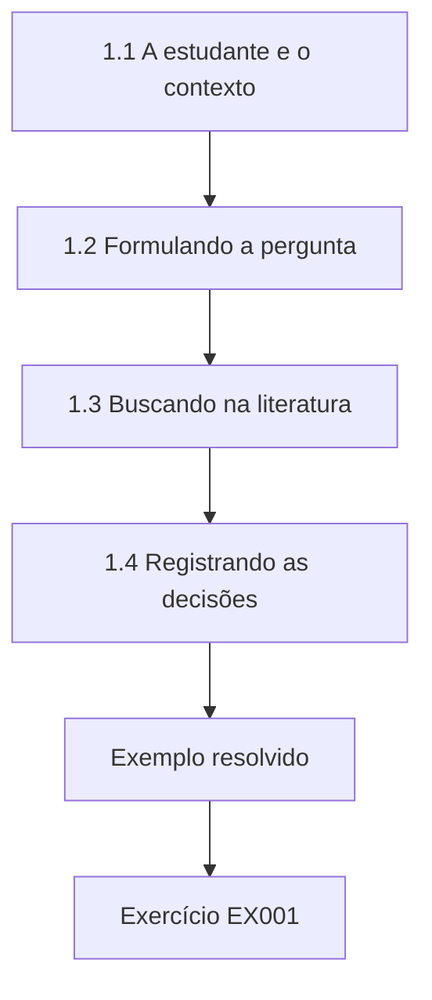

### Desenho lógico

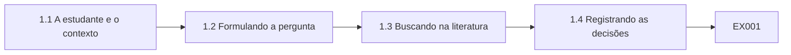

```text
[1.1 A estudante e o contexto]
    |
    v
[1.2 Formulando a pergunta]
    |
    v
[1.3 Buscando na literatura]
    |
    v
[1.4 Registrando as decisões]
    |
    v
[Exemplo resolvido] --> [Exercício EX001]
```
<!-- cykin:lesson-figures:end ch-01 -->


### Objetivos de aprendizagem

Você vai (1) formular uma pergunta de pesquisa em segurança da informação que possa ser respondida; (2) executar uma busca estruturada na literatura; (3) registrar as decisões de inclusão para que outros possam repeti-las.

### 1.1 A estudante e o contexto

Priya Natarajan começa um mestrado de dois anos em segurança da informação na fictícia Ashcombe University, sob orientação do Dr. Olumide Bello. Sua organização parceira é a fictícia Harrowgate Community Health, que emprega cerca de 2.400 funcionários em seis departamentos e realiza uma simulação de phishing a cada trimestre. A equipe de segurança discute se deve substituir o treinamento anual de conscientização por um feedback imediato, exibido quando uma pessoa clica num link de phishing simulado. Priya vê a chance de responder a uma pergunta prática com evidências organizacionais reais. O Dr. Bello concorda em orientar o projeto.

### 1.2 Formulando a pergunta

O primeiro rascunho de Priya pergunta se o treinamento torna os funcionários mais seguros. O Dr. Bello aponta que seguro não é mensurável e que treinamento não é específico. Ela a reescreve: nos departamentos que adotam o feedback imediato, a proporção de funcionários que clicam em links de phishing simulado cai mais do que nos departamentos que mantêm apenas o treinamento anual? A pergunta revisada nomeia a intervenção, o desfecho, a comparação e a população, então ela pode decidir de antemão que evidências a responderiam e quais não. O Dr. Bello aprova a nova redação.

### 1.3 Buscando na literatura

Priya pesquisa em duas bases de dados acadêmicas e nas publicações de organismos nacionais de normalização, usando expressões de busca fixas que combinam phishing, simulação, treinamento e feedback. Ela restringe os resultados a estudos que relatam comportamento medido, e não opiniões, porque sua pergunta diz respeito a cliques, e não a atitudes. Ela também lê textos gerais, entre eles o Security Engineering de Anderson, cuja discussão sobre psicologia e usabilidade alerta que culpar os usuários raramente conserta os sistemas. Esse alerta molda a forma como ela depois enquadra a ética do estudo e suas recomendações. Ela mantém um registro datado de cada busca.

### 1.4 Registrando as decisões

Cada inclusão e exclusão é registrada numa planilha com o motivo, como ausência de medida comportamental, ausência de grupo de comparação ou simulação feita apenas em laboratório. O Dr. Bello pede que ela guarde as expressões de busca e as datas para que outro estudante possa repetir a busca e chegar à mesma lista. Priya termina com vinte e três estudos incluídos. Ela observa que muitos relatam grandes efeitos em organizações isoladas, sem grupos de comparação, o que a deixa mais cautelosa quanto a esperar ela mesma um grande efeito. A planilha é arquivada.

### Exemplo resolvido

Priya estreita uma pergunta vaga até uma comparação mensurável das taxas de cliques entre os departamentos com feedback e os com treinamento anual, e depois executa e registra uma busca repetível na literatura.

> **Caso sintético.** Priya, a Ashcombe e a Harrowgate são sintéticas.

### Erros e limites

Uma pergunta sobre se os funcionários estão seguros não pode ser respondida com nenhuma medida.

### Exercícios

- **EX001 — Porte do parceiro.** Quantos funcionários a Harrowgate emprega? *Rubrica:* 3 = cerca de 2.400;; 2 = parcialmente correto;; 1 = errado;; 0 = nenhuma.

- **EX002 — Pergunta revisada.** Qual é a pergunta revisada de Priya? *Rubrica:* 3 = se as taxas de cliques dos departamentos com feedback caem mais que as da comparação;; 2 = parcialmente correto;; 1 = vaga;; 0 = nenhuma.

- **EX003 — Quatro elementos.** Que quatro elementos a pergunta revisada nomeia? *Rubrica:* 3 = intervenção, desfecho, comparação, população;; 2 = todos;; 1 = alguns;; 0 = nenhuma.

- **EX004 — Restrição de inclusão.** Que estudos Priya inclui? *Rubrica:* 3 = os que medem comportamento;; 2 = parcialmente correto;; 1 = opiniões;; 0 = nenhuma.

- **EX005 — Alerta de Anderson.** Que alerta o texto de Anderson dá? *Rubrica:* 3 = culpar os usuários raramente conserta os sistemas;; 2 = parcialmente correto;; 1 = vago;; 0 = nenhuma.

- **EX006 — Motivos registrados.** Dê um motivo de exclusão que Priya registra. *Rubrica:* 3 = ausência de medida comportamental;; 2 = um;; 1 = vago;; 0 = nenhuma.

- **EX007 — Número de incluídos.** Quantos estudos são incluídos? *Rubrica:* 3 = vinte e três;; 2 = parcialmente correto;; 1 = errado;; 0 = nenhuma.

<!-- cykin:chapter-navigation:start ch-01 -->
### Continue estudando — aula 01 (capítulo 01 de 08)

[← Início do curso](../../README.md) · [Índice das aulas](../SUBJECTS.md) · [Capítulo 02 →](#ch-02)

Continue para a próxima aula já escrita.
<!-- cykin:chapter-navigation:end -->

<a id="ch-02"></a>

## Capítulo 2 — Segurança da informação: seminário avançado

<!-- cykin:lesson-figures:start ch-02 -->
### Mapa da aula

Aula 02 publicada. Mapa, exemplo, EX008.

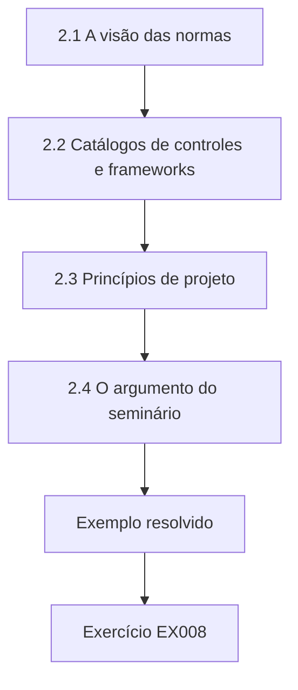

### Desenho lógico

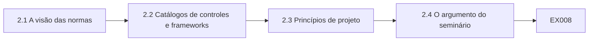

```text
[2.1 A visão das normas]
    |
    v
[2.2 Catálogos de controles e frameworks]
    |
    v
[2.3 Princípios de projeto]
    |
    v
[2.4 O argumento do seminário]
    |
    v
[Exemplo resolvido] --> [Exercício EX008]
```
<!-- cykin:lesson-figures:end ch-02 -->


### Objetivos de aprendizagem

Você vai (1) relacionar o treinamento de conscientização às normas de gestão e aos catálogos de controles; (2) ligar o comportamento dos usuários aos princípios de projeto; (3) construir um argumento que liga a intervenção ao desfecho.

### 2.1 A visão das normas

No seminário avançado, Priya situa seu tema nas normas reconhecidas. A ISO/IEC 27001:2022 (no Brasil, ABNT NBR ISO/IEC 27001:2022) exige que uma organização que opera um sistema de gestão da segurança da informação torne as pessoas conscientes da política de segurança e da sua contribuição para ela. A ISO/IEC 27002:2022 dá orientações sobre conscientização, educação e treinamento como controle organizacional e de pessoas. A ISO/IEC 27000:2026, a visão geral atual da família, explica como esses documentos se encaixam. Priya observa que nenhuma delas prescreve um método de treinamento específico, o que deixa sua pergunta em aberto. Ela cita cada norma pela sua edição.

### 2.2 Catálogos de controles e frameworks

A NIST SP 800-53 Revisão 5 agrupa os controles de treinamento na sua família de conscientização e treinamento, incluindo o treinamento de letramento que abrange o reconhecimento de phishing. O NIST Cybersecurity Framework 2.0 situa a conscientização e o treinamento na sua função Proteger. Priya observa que os catálogos e os frameworks descrevem o que uma organização deve ter, enquanto seu estudo pergunta que forma de entregá-lo muda o comportamento. Ela registra essa diferença entre ter um controle e o controle funcionar, porque sua dissertação precisa tratar da segunda. O Dr. Bello concorda que essa distinção dá à dissertação um propósito claro, além de descrever os controles existentes.

### 2.3 Princípios de projeto

O Dr. Bello pede que o seminário leia o artigo de Saltzer e Schroeder de 1975, que inclui a aceitabilidade psicológica entre seus princípios de projeto: a proteção deve ser fácil o bastante para que as pessoas a apliquem de forma rotineira e correta. Priya argumenta que o feedback imediato segue esse princípio, porque ensina no momento do erro, e não meses depois. Os colegas contra-argumentam que o feedback também pode constranger os funcionários e reduzir os relatos. Ela acrescenta as taxas de relato como desfecho secundário para que o estudo possa detectar esse efeito colateral. A turma concorda que esse acréscimo fortalece o desenho.

### 2.4 O argumento do seminário

Priya apresenta seu argumento: o feedback imediato vai reduzir os cliques porque liga a lição a um erro concreto enquanto ele ainda está fresco. Ela declara a direção esperada e um tamanho plausível, alguns pontos percentuais, com base na literatura que encontrou. O Dr. Bello elogia o argumento por nomear um mecanismo e um efeito colateral. Ele pede que ela escreva que resultado contaria contra sua hipótese antes de ver qualquer dado, uma etapa que ela conclui no capítulo seguinte. Priya aceita a tarefa.

### Exemplo resolvido

Priya situa o treinamento na ISO/IEC 27001, na ISO/IEC 27002, na SP 800-53 e no CSF 2.0, liga o feedback à aceitabilidade psicológica e acrescenta os relatos como desfecho secundário.

> **Caso sintético.** As normas são parafraseadas; consulte as edições citadas.

### Erros e limites

Presumir que um controle funciona porque uma norma o exige confunde ter com funcionar.

### Exercícios

- **EX008 — Requisito da 27001.** O que a ISO/IEC 27001:2022 (no Brasil, ABNT NBR ISO/IEC 27001:2022) exige sobre as pessoas? *Rubrica:* 3 = consciência da política e da sua contribuição;; 2 = parcialmente correto;; 1 = vago;; 0 = nenhuma.

- **EX009 — Papel da 27000.** O que é a ISO/IEC 27000:2026? *Rubrica:* 3 = a visão geral da família;; 2 = parcialmente correto;; 1 = só vocabulário;; 0 = nenhuma.

- **EX010 — Família da SP 800-53.** Que família da SP 800-53 contém os controles de treinamento? *Rubrica:* 3 = conscientização e treinamento;; 2 = parcialmente correto;; 1 = outra;; 0 = nenhuma.

- **EX011 — Função do CSF.** Que função do CSF 2.0 inclui a conscientização e o treinamento? *Rubrica:* 3 = Proteger;; 2 = parcialmente correto;; 1 = outra;; 0 = nenhuma.

- **EX012 — Princípio de projeto.** Que princípio de Saltzer e Schroeder sustenta o feedback? *Rubrica:* 3 = aceitabilidade psicológica;; 2 = parcialmente correto;; 1 = outro;; 0 = nenhuma.

- **EX013 — Desfecho secundário.** Que desfecho secundário é acrescentado? *Rubrica:* 3 = taxas de relato;; 2 = parcialmente correto;; 1 = vago;; 0 = nenhuma.

- **EX014 — Tamanho esperado.** Que tamanho de efeito Priya espera? *Rubrica:* 3 = alguns pontos percentuais;; 2 = parcialmente correto;; 1 = grande;; 0 = nenhuma.

<!-- cykin:chapter-navigation:start ch-02 -->
### Continue estudando — aula 02 (capítulo 02 de 08)

[← Capítulo 01](#ch-01) · [Índice das aulas](../SUBJECTS.md) · [Capítulo 03 →](#ch-03)

Continue para a próxima aula já escrita.
<!-- cykin:chapter-navigation:end -->

<a id="ch-03"></a>

## Capítulo 3 — Desenho do estudo, ética e reprodutibilidade

<!-- cykin:lesson-figures:start ch-03 -->
### Mapa da aula

Aula 03 publicada. Mapa, exemplo, EX015.

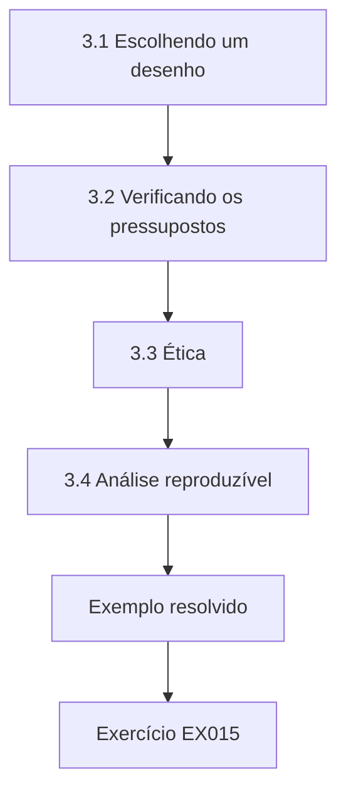

### Desenho lógico

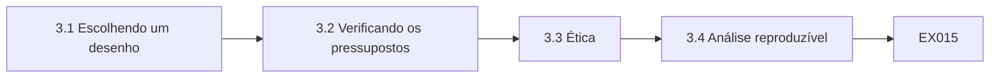

```text
[3.1 Escolhendo um desenho]
    |
    v
[3.2 Verificando os pressupostos]
    |
    v
[3.3 Ética]
    |
    v
[3.4 Análise reproduzível]
    |
    v
[Exemplo resolvido] --> [Exercício EX015]
```
<!-- cykin:lesson-figures:end ch-03 -->


### Objetivos de aprendizagem

Você vai (1) escolher um desenho quase experimental quando a randomização é impossível; (2) obter aprovação ética para a pesquisa em segurança no local de trabalho; (3) fixar um plano de análise antes da coleta de dados.

### 3.1 Escolhendo um desenho

A Harrowgate não vai randomizar os funcionários, porque a equipe de segurança já escolheu três departamentos para pilotar o feedback. Priya usa, portanto, um desenho de diferença em diferenças, seguindo as orientações de Shadish, Cook e Campbell sobre quase experimentos: comparar a mudança na taxa de cliques nos departamentos com feedback com a mudança nos departamentos de comparação no mesmo período. A comparação remove as influências compartilhadas pelos dois grupos, como um aumento sazonal do phishing real ou uma notícia sobre fraude, que de outra forma seriam creditadas ao feedback. O Dr. Bello aprova a escolha do desenho.

### 3.2 Verificando os pressupostos

O desenho pressupõe que os dois grupos teriam mudado de forma semelhante sem o feedback. Priya examina quatro simulações trimestrais anteriores e descobre que as taxas de cliques dos dois grupos se moveram juntas, sem que nenhum tivesse tendência mais rápida. Ela também confere se os e-mails de simulação foram idênticos entre os grupos, porque iscas mais difíceis num grupo distorceriam as comparações. O Dr. Bello pede que ela relate essas verificações por completo para que os examinadores possam julgar o pressuposto, em vez de afirmar numa única frase que ele é atendido. Ela traça os quatro trimestres dos dois grupos.

### 3.3 Ética

O estudo envolve funcionários cujos cliques poderiam ser vistos como falhas. O comitê de ética da universidade o aprova sob condições: os resultados são relatados apenas por departamento, os indivíduos são pseudonimizados pela equipe de segurança antes que Priya receba os dados, ninguém é punido com base nos dados do estudo e os funcionários são informados de que as simulações fazem parte do treinamento. Priya concorda e acrescenta que a dissertação vai evitar uma linguagem que culpe os funcionários, em linha com a literatura de usabilidade. A equipe de segurança confirma por escrito que vai aplicar os pseudônimos antes da exportação.

### 3.4 Análise reproduzível

Priya escreve seu plano de análise antes de coletar os dados de desfecho: desfecho primário, a taxa de cliques por grupo de departamentos; desfecho secundário, a taxa de relatos; estimador, a diferença em diferenças; incerteza, um intervalo bootstrap de mil reamostragens com uma semente fixa. Ela guarda os scripts em controle de versão e rotula qualquer análise posterior como exploratória. O Dr. Bello assina e data o plano. Ela observa que fixar o plano a protege de escolher as análises depois de ver qual parece melhor. Uma cópia do plano assinado é depositada na secretaria do programa, e a equipe de segurança também recebe uma, para que todas as partes saibam quais análises são confirmatórias.

### Exemplo resolvido

Priya usa a diferença em diferenças, verifica as tendências paralelas e as iscas idênticas, obtém aprovação com relato por departamento e sem punições, e congela o plano de análise.

> **Caso sintético.** As condições de aprovação são sintéticas.

### Erros e limites

Usar os resultados das simulações para punir funcionários mina a confiança e os relatos.

### Exercícios

- **EX015 — Desenho escolhido.** Que desenho Priya usa? *Rubrica:* 3 = diferença em diferenças;; 2 = parcialmente correto;; 1 = randomizado;; 0 = nenhuma.

- **EX016 — Influências compartilhadas.** O que o grupo de comparação remove? *Rubrica:* 3 = influências compartilhadas pelos dois grupos;; 2 = parcialmente correto;; 1 = vago;; 0 = nenhuma.

- **EX017 — Verificação do pressuposto.** O que as quatro simulações anteriores mostraram? *Rubrica:* 3 = as taxas se moveram juntas;; 2 = parcialmente correto;; 1 = divergiram;; 0 = nenhuma.

- **EX018 — Verificação das iscas.** Por que conferir se os e-mails eram idênticos? *Rubrica:* 3 = iscas mais difíceis distorceriam a comparação;; 2 = parcialmente correto;; 1 = vago;; 0 = nenhuma.

- **EX019 — Nível do relato.** Em que nível os resultados são relatados? *Rubrica:* 3 = por departamento;; 2 = parcialmente correto;; 1 = individual;; 0 = nenhuma.

- **EX020 — Método da incerteza.** Como a incerteza é estimada? *Rubrica:* 3 = bootstrap com mil reamostragens e semente fixa;; 2 = parcialmente correto;; 1 = vago;; 0 = nenhuma.

<!-- cykin:chapter-navigation:start ch-03 -->
### Continue estudando — aula 03 (capítulo 03 de 08)

[← Capítulo 02](#ch-02) · [Índice das aulas](../SUBJECTS.md) · [Capítulo 04 →](#ch-04)

Continue para a próxima aula já escrita.
<!-- cykin:chapter-navigation:end -->

<a id="ch-04"></a>

## Capítulo 4 — Segurança da informação: explicações concorrentes

<!-- cykin:lesson-figures:start ch-04 -->
### Mapa da aula

Aula 04 publicada. Mapa, exemplo, EX021.

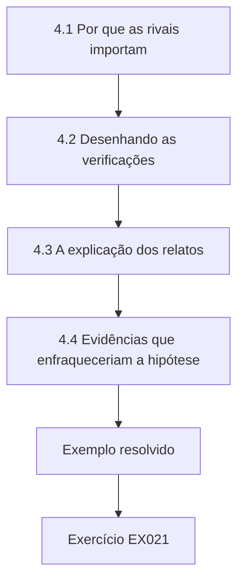

### Desenho lógico

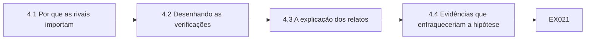

```text
[4.1 Por que as rivais importam]
    |
    v
[4.2 Desenhando as verificações]
    |
    v
[4.3 A explicação dos relatos]
    |
    v
[4.4 Evidências que enfraqueceriam a hipótese]
    |
    v
[Exemplo resolvido] --> [Exercício EX021]
```
<!-- cykin:lesson-figures:end ch-04 -->


### Objetivos de aprendizagem

Você vai (1) listar explicações rivais para uma melhora de segurança; (2) desenhar verificações para cada rival; (3) declarar as evidências que enfraqueceriam sua hipótese.

### 4.1 Por que as rivais importam

Priya espera que os departamentos com feedback cliquem menos, mas outras causas poderiam produzir o mesmo padrão. Os funcionários podem aprender a reconhecer os e-mails de simulação, e não o phishing em geral. Uma mudança no filtro de e-mail pode bloquear mais iscas em alguns departamentos. A rotatividade pode substituir pessoas experientes por recém-chegados nos departamentos de comparação. Os gerentes dos departamentos com feedback podem lembrar os funcionários com mais frequência por saberem que há um piloto em andamento. Cada uma delas reduziria os cliques sem que o feedback fosse o motivo, então cada uma precisa de uma verificação. Priya as lista.

### 4.2 Desenhando as verificações

Para cada rival, Priya desenha uma verificação. Ela pede à equipe de segurança que varie os modelos de simulação para que os funcionários não possam aprender um único padrão. Ela confirma com os administradores de e-mail que as regras de filtragem foram idênticas entre os departamentos durante o estudo. Ela compara a rotatividade entre os grupos usando contagens anonimizadas de recursos humanos. Para os lembretes dos gerentes, ela pede aos chefes de departamento que registrem quaisquer mensagens de segurança que enviem, aceitando que essa medida depende de um relato honesto e anotando isso como uma fraqueza. Cada verificação é escrita no plano antes da coleta.

### 4.3 A explicação dos relatos

Os colegas tinham sugerido que o feedback poderia constranger os funcionários, levando-os a parar de relatar e-mails suspeitos para não chamar atenção. Isso seria um efeito colateral prejudicial, porque os relatos ajudam a equipe de segurança a encontrar ataques reais rapidamente. O desfecho secundário de Priya, a taxa de relatos, testa isso diretamente. Se os cliques caírem, mas os relatos também caírem, a intervenção pode estar trocando um risco por outro. Ela escreve essa possibilidade no plano para que uma queda nos relatos não possa ser ignorada se aparecer. A equipe de segurança apoia a inclusão desse desfecho.

### 4.4 Evidências que enfraqueceriam a hipótese

Priya escreve os resultados que contariam contra ela: um intervalo da diferença em diferenças que inclua o zero, tendências do período anterior que divirjam, uma queda nas taxas de relato dos departamentos com feedback ou diferenças de rotatividade grandes o bastante para explicar a mudança. O Dr. Bello acrescenta mais um: uma queda nos cliques apenas nos modelos repetidos, e não nos novos. Registrar isso de antemão significa que ela não pode reinterpretar resultados decepcionantes depois, e os examinadores podem conferir suas conclusões contra os testes declarados. O Dr. Bello assina a lista, e Priya a anexa ao plano de análise.

### Exemplo resolvido

Priya lista o aprendizado dos modelos, as mudanças de filtro, a rotatividade e os lembretes dos gerentes como rivais, desenha uma verificação para cada uma, testa o efeito colateral sobre os relatos e registra de antemão os resultados que enfraqueceriam a hipótese.

> **Caso sintético.** As rivais e as verificações são sintéticas.

### Erros e limites

Ignorar uma queda nos relatos esconderia um efeito colateral prejudicial.

### Exercícios

- **EX021 — Rival dos modelos.** Por que variar os modelos de simulação? *Rubrica:* 3 = para que os funcionários não aprendam um único padrão;; 2 = parcialmente correto;; 1 = vago;; 0 = nenhuma.

- **EX022 — Verificação do filtro.** Como se verifica a rival do filtro de e-mail? *Rubrica:* 3 = confirmar regras idênticas entre os departamentos;; 2 = parcialmente correto;; 1 = vago;; 0 = nenhuma.

- **EX023 — Medida fraca.** Que verificação depende de um relato honesto? *Rubrica:* 3 = os registros de lembretes dos gerentes;; 2 = parcialmente correto;; 1 = outra;; 0 = nenhuma.

- **EX024 — Efeito colateral.** Que efeito colateral prejudicial o feedback poderia causar? *Rubrica:* 3 = menos relatos de e-mails suspeitos;; 2 = parcialmente correto;; 1 = vago;; 0 = nenhuma.

- **EX025 — Acréscimo do orientador.** Que resultado enfraquecedor o Dr. Bello acrescenta? *Rubrica:* 3 = queda apenas nos modelos repetidos;; 2 = parcialmente correto;; 1 = vago;; 0 = nenhuma.

- **EX026 — Propósito do registro antecipado.** Por que registrar de antemão os resultados enfraquecedores? *Rubrica:* 3 = impede a reinterpretação posterior;; 2 = parcialmente correto;; 1 = vago;; 0 = nenhuma.

<!-- cykin:chapter-navigation:start ch-04 -->
### Continue estudando — aula 04 (capítulo 04 de 08)

[← Capítulo 03](#ch-03) · [Índice das aulas](../SUBJECTS.md) · [Capítulo 05 →](#ch-05)

Continue para a próxima aula já escrita.
<!-- cykin:chapter-navigation:end -->

<a id="ch-05"></a>

## Capítulo 5 — Proposta e piloto

<!-- cykin:lesson-figures:start ch-05 -->
### Mapa da aula

Aula 05 publicada. Mapa, exemplo, EX027.

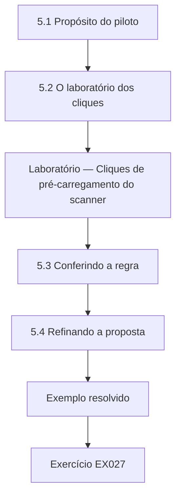

### Desenho lógico

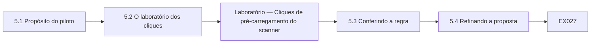

```text
[5.1 Propósito do piloto]
    |
    v
[5.2 O laboratório dos cliques]
    |
    v
[Laboratório — Cliques de pré-carregamento do scanner]
    |
    v
[5.3 Conferindo a regra]
    |
    v
[5.4 Refinando a proposta]
    |
    v
[Exemplo resolvido] --> [Exercício EX027]
```
<!-- cykin:lesson-figures:end ch-05 -->


### Objetivos de aprendizagem

Você vai (1) pilotar uma medida de desfecho antes da coleta principal; (2) detectar atividade automatizada que contamina as métricas de segurança; (3) refinar uma proposta a partir das evidências do piloto.

### 5.1 Propósito do piloto

Antes da coleta de dados principal, Priya pilota sua medida de desfecho numa simulação anterior. Ela quer saber se um clique registrado pela plataforma de simulação significa de fato que uma pessoa clicou. O Dr. Bello lembra que muitos gateways de segurança de e-mail abrem os links automaticamente para verificar se têm conteúdo malicioso, e que essa atividade do scanner pode aparecer nos logs como cliques. Se o piloto encontrar isso, seu desfecho vai precisar de uma regra de correção antes do início do estudo principal. A equipe de segurança fornece uma exportação anonimizada de um trimestre anterior.

### 5.2 O laboratório dos cliques

O laboratório do piloto monta um log sintético para 1.200 funcionários, registrando os segundos entre a entrega e qualquer clique. Ele encontra 239 cliques brutos, uma taxa de 19,9 por cento. Desses, 77 ocorrem em até dois segundos após a entrega, muito mais rápido do que uma pessoa conseguiria ler um e-mail, e são atribuídos ao scanner. Removê-los deixa 162 cliques humanos, 13,5 por cento. O número bruto teria exagerado os cliques em mais de seis pontos percentuais. Priya mostra à equipe de segurança um gráfico que compara as taxas bruta e humana. A equipe vinha relatando números brutos à diretoria havia dois anos e concorda que a correção importa.

### Laboratório — Cliques de pré-carregamento do scanner separados dos cliques humanos num log sintético de simulação

```python
"""Separate scanner pre-fetch clicks from human clicks in a synthetic phishing simulation log (stdlib only)."""
import random
random.seed(41)
rows = []
for staff in range(1200):
    sec = None
    r = random.random()
    if r < 0.07:
        sec = random.uniform(0.2, 1.8)          # mail scanner opens the link almost at once
    elif r < 0.21:
        sec = random.uniform(30, 86400)        # a person clicks later
    rows.append((staff, sec))
clicked = [s for s in rows if s[1] is not None]
auto = [s for s in clicked if s[1] < 2]
human = len(clicked) - len(auto)
print(f"staff {len(rows)}; raw clicks {len(clicked)} ({len(clicked)/len(rows):.1%})")
print(f"clicks within 2 s (scanner) {len(auto)}; human clicks {human} ({human/len(rows):.1%})")
```

Execute com `python3 lab_clicks.py`. Saída verificada:

```text
staff 1200; raw clicks 239 (19.9%)
clicks within 2 s (scanner) 77; human clicks 162 (13.5%)
```

### 5.3 Conferindo a regra

Um limiar de dois segundos é um julgamento, então Priya o confere. Ela pergunta aos administradores de e-mail se o gateway varre os links, e eles confirmam que sim e que as varreduras vêm de endereços conhecidos. Casar pelos endereços seria melhor do que pelo tempo, mas a plataforma não guarda os endereços na exportação que ela recebe. Ela mantém a regra do tempo, relata-a como limitação e testa se mudar o limiar para cinco segundos altera as conclusões na análise principal. O Dr. Bello concorda que a abordagem é razoável para um estudo de mestrado.

### 5.4 Refinando a proposta

A partir do piloto, Priya atualiza sua proposta: o desfecho primário passa a ser a taxa de cliques humanos, excluindo os cliques em até dois segundos; as taxas de relato são medidas a partir dos logs do botão de relato; e as simulações usam modelos variados. Ela acrescenta uma frase explicando que os números não ajustados das plataformas, às vezes citados em relatórios de fornecedores, podem exagerar o risco. O Dr. Bello aprova a mudança e confirma que ela ocorreu antes da coleta de dados principal, então continua fazendo parte do plano pré-registrado. A proposta revisada é enviada à equipe de segurança e ao comitê de ética, que confirma que a mudança não precisa de nova aprovação.

### Exemplo resolvido

Priya pilota a medida de cliques, descobre que 77 de 239 cliques são atividade do scanner em até dois segundos, redefine o desfecho como taxa de cliques humanos (13,5 por cento em vez de 19,9 por cento) e atualiza seu plano.

> **Caso sintético.** Os dados do log são sintéticos; as saídas vêm de lab_clicks.py.

### Erros e limites

Contar cliques do scanner como cliques humanos infla o risco medido.

### Exercícios

- **EX027 — Cliques brutos.** Quantos cliques brutos o piloto encontra? *Rubrica:* 3 = 239, 19,9 por cento;; 2 = parcialmente correto;; 1 = errado;; 0 = nenhuma.

- **EX028 — Cliques do scanner.** Quantos cliques ocorrem em até dois segundos? *Rubrica:* 3 = 77;; 2 = parcialmente correto;; 1 = errado;; 0 = nenhuma.

- **EX029 — Taxa humana.** Qual é a taxa de cliques humanos? *Rubrica:* 3 = 13,5 por cento;; 2 = parcialmente correto;; 1 = errado;; 0 = nenhuma.

- **EX030 — Método melhor.** O que seria melhor do que o tempo? *Rubrica:* 3 = casar com os endereços conhecidos do scanner;; 2 = parcialmente correto;; 1 = vago;; 0 = nenhuma.

- **EX031 — Teste do limiar.** Que limiar alternativo é testado? *Rubrica:* 3 = cinco segundos;; 2 = parcialmente correto;; 1 = outro;; 0 = nenhuma.

- **EX032 — Novo desfecho.** Qual é o novo desfecho primário? *Rubrica:* 3 = taxa de cliques humanos excluindo os cliques em até dois segundos;; 2 = parcialmente correto;; 1 = bruta;; 0 = nenhuma.

<!-- cykin:chapter-navigation:start ch-05 -->
### Continue estudando — aula 05 (capítulo 05 de 08)

[← Capítulo 04](#ch-04) · [Índice das aulas](../SUBJECTS.md) · [Capítulo 06 →](#ch-06)

Continue para a próxima aula já escrita.
<!-- cykin:chapter-navigation:end -->

<a id="ch-06"></a>

## Capítulo 6 — Coleta e análise de dados

<!-- cykin:lesson-figures:start ch-06 -->
### Mapa da aula

Aula 06 publicada. Mapa, exemplo, EX033.

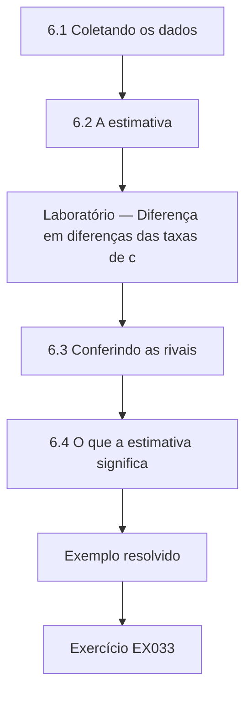

### Desenho lógico

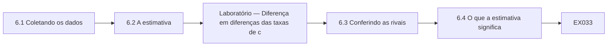

```text
[6.1 Coletando os dados]
    |
    v
[6.2 A estimativa]
    |
    v
[Laboratório — Diferença em diferenças das taxas de c]
    |
    v
[6.3 Conferindo as rivais]
    |
    v
[6.4 O que a estimativa significa]
    |
    v
[Exemplo resolvido] --> [Exercício EX033]
```
<!-- cykin:lesson-figures:end ch-06 -->


### Objetivos de aprendizagem

Você vai (1) coletar os dados de desfecho sob um plano congelado; (2) estimar um efeito de diferença em diferenças com um intervalo bootstrap; (3) conferir as explicações rivais contra os dados.

### 6.1 Coletando os dados

Priya recebe registros pseudonimizados de cliques humanos de um trimestre antes e de um trimestre depois do início do feedback, tomando amostras de seiscentos funcionários de cada grupo em cada período. A equipe de segurança aplica a regra dos dois segundos antes da exportação, e Priya confere uma seleção aleatória de registros para confirmá-lo. Ela também recebe as contagens de relatos por departamento, os números de rotatividade e os registros de lembretes dos gerentes. Os dados ficam armazenados num drive cifrado da universidade, como a aprovação ética exige. Priya registra a data de cada extrato que recebe da equipe.

### 6.2 A estimativa

O laboratório mostra as taxas de cliques dos departamentos com feedback caindo de 15,8 para 6,7 por cento, enquanto as dos departamentos de comparação caem de 14,0 para 11,0 por cento. A diferença em diferenças é de menos 6,2 pontos percentuais, com um intervalo bootstrap de 95 por cento de menos 10,7 a menos 1,2. O intervalo exclui o zero, então os dados sustentam uma redução maior que a mudança compartilhada. O intervalo é amplo, porém, o que significa que o efeito verdadeiro poderia ser tão pequeno quanto cerca de um ponto percentual. Priya relata juntos a estimativa pontual e os dois limites do intervalo, para que os leitores vejam a incerteza ao lado do efeito. Ela não arredonda o limite superior para longe do zero.

### Laboratório — Diferença em diferenças das taxas de cliques em simulações de phishing com intervalo bootstrap

```python
"""Difference-in-differences of phishing-simulation click rates with a bootstrap interval (stdlib only)."""
import random
random.seed(17)
def grp(n, p): return [1 if random.random() < p else 0 for _ in range(n)]
t_pre, t_post = grp(600, 0.16), grp(600, 0.08)   # departments with just-in-time feedback
c_pre, c_post = grp(600, 0.15), grp(600, 0.13)   # departments with annual training only
m = lambda x: sum(x) / len(x)
did = (m(t_post) - m(t_pre)) - (m(c_post) - m(c_pre))
bs = []
for _ in range(1000):
    r = lambda x: [random.choice(x) for _ in x]
    bs.append((m(r(t_post)) - m(r(t_pre))) - (m(r(c_post)) - m(r(c_pre))))
bs.sort()
print(f"click rates: feedback {m(t_pre):.1%} -> {m(t_post):.1%}; comparison {m(c_pre):.1%} -> {m(c_post):.1%}")
print(f"difference-in-differences {did*100:.1f} points; 95% bootstrap CI {bs[25]*100:.1f} to {bs[974]*100:.1f}")
```

Execute com `python3 lab_did.py`. Saída verificada:

```text
click rates: feedback 15.8% -> 6.7%; comparison 14.0% -> 11.0%
difference-in-differences -6.2 points; 95% bootstrap CI -10.7 to -1.2
```

### 6.3 Conferindo as rivais

Os modelos variaram, e a queda aparece tanto nos modelos novos quanto nos conhecidos, o que enfraquece a rival do aprendizado dos modelos. As regras de filtragem foram idênticas. A rotatividade foi semelhante nos dois grupos. Os registros de lembretes dos gerentes mostram um pouco mais de mensagens nos departamentos com feedback, então parte do efeito poderia refletir atenção, e não o feedback, o que Priya relata. As taxas de relato não caíram nos departamentos com feedback; subiram um pouco, então o efeito colateral do constrangimento não aparece. Mudar o limiar para cinco segundos deixa as conclusões inalteradas. Ela tabula cada verificação.

### 6.4 O que a estimativa significa

Priya interpreta o resultado com cuidado: neste cenário sintético, os departamentos com feedback reduziram os cliques humanos em cerca de seis pontos percentuais a mais que os departamentos de comparação, com incerteza considerável. Ela não afirma que o feedback previne violações, porque os cliques em simulações são um indicador indireto do comportamento real, e os atacantes reais se adaptam. O Dr. Bello lembra que uma única organização ao longo de dois trimestres não pode mostrar que o efeito persiste. Ela escreve esses pontos logo ao lado da estimativa, e não numa seção de limitações distante. Priya também observa que os resultados poderiam ser diferentes em organizações maiores.

### Exemplo resolvido

Priya estima uma diferença em diferenças de menos 6,2 pontos (intervalo de menos 10,7 a menos 1,2), não encontra queda nos relatos, anota a preocupação com os lembretes dos gerentes e declara os limites do indicador indireto ao lado da estimativa.

> **Caso sintético.** Os registros são sintéticos; as saídas vêm de lab_did.py.

### Erros e limites

Tratar uma taxa de cliques em simulação como taxa de violações exagera o achado.

### Exercícios

- **EX033 — Taxas com feedback.** Como mudaram as taxas de cliques dos departamentos com feedback? *Rubrica:* 3 = de 15,8 para 6,7 por cento;; 2 = parcialmente correto;; 1 = errado;; 0 = nenhuma.

- **EX034 — Taxas de comparação.** Como mudaram as taxas de cliques da comparação? *Rubrica:* 3 = de 14,0 para 11,0 por cento;; 2 = parcialmente correto;; 1 = errado;; 0 = nenhuma.

- **EX035 — DiD e intervalo.** Qual é a estimativa e o intervalo? *Rubrica:* 3 = menos 6,2 pontos, de menos 10,7 a menos 1,2;; 2 = parcialmente correto;; 1 = errado;; 0 = nenhuma.

- **EX036 — Rival restante.** Que rival não é totalmente descartada? *Rubrica:* 3 = os lembretes dos gerentes;; 2 = parcialmente correto;; 1 = outra;; 0 = nenhuma.

- **EX037 — Resultado dos relatos.** O que aconteceu com as taxas de relato? *Rubrica:* 3 = subiram um pouco nos departamentos com feedback;; 2 = parcialmente correto;; 1 = caíram;; 0 = nenhuma.

- **EX038 — Limite do indicador.** Por que não afirmar que o feedback previne violações? *Rubrica:* 3 = os cliques em simulações são um indicador indireto;; 2 = parcialmente correto;; 1 = vago;; 0 = nenhuma.

<!-- cykin:chapter-navigation:start ch-06 -->
### Continue estudando — aula 06 (capítulo 06 de 08)

[← Capítulo 05](#ch-05) · [Índice das aulas](../SUBJECTS.md) · [Capítulo 07 →](#ch-07)

Continue para a próxima aula já escrita.
<!-- cykin:chapter-navigation:end -->

<a id="ch-07"></a>

## Capítulo 7 — Redação da dissertação e limitações

<!-- cykin:lesson-figures:start ch-07 -->
### Mapa da aula

Aula 07 publicada. Mapa, exemplo, EX039.

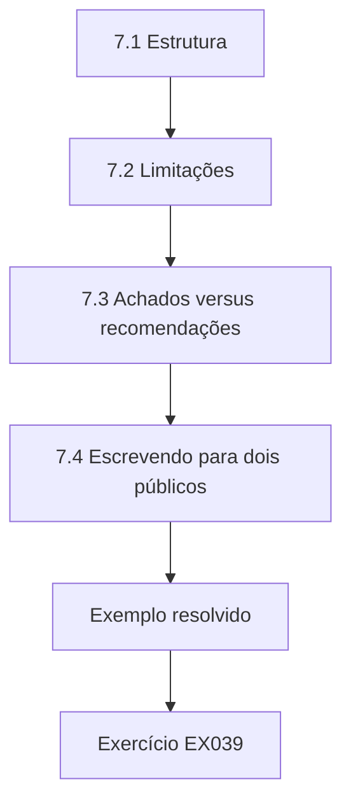

### Desenho lógico

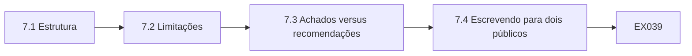

```text
[7.1 Estrutura]
    |
    v
[7.2 Limitações]
    |
    v
[7.3 Achados versus recomendações]
    |
    v
[7.4 Escrevendo para dois públicos]
    |
    v
[Exemplo resolvido] --> [Exercício EX039]
```
<!-- cykin:lesson-figures:end ch-07 -->


### Objetivos de aprendizagem

Você vai (1) estruturar uma dissertação em torno de uma pergunta; (2) escrever limitações específicas; (3) separar os achados das recomendações.

### 7.1 Estrutura

Priya estrutura a dissertação em torno da pergunta: introdução e pergunta, literatura, normas e princípios de projeto, desenho e ética, piloto e medição, resultados, rivais, discussão e limitações. Cada capítulo termina com uma breve declaração do que contribui para responder à pergunta. O Dr. Bello lê o plano e pede que ela mova o achado dos cliques do scanner para uma seção própria, porque ele é útil para outros pesquisadores mesmo independentemente do resultado principal sobre o feedback. Priya concorda, e a nova seção se torna uma das partes mais claras da dissertação.

### 7.2 Limitações

A seção de limitações de Priya nomeia cinco questões: três departamentos tratados escolhidos pela equipe de segurança, e não aleatoriamente; possível atenção extra dos gerentes; uma regra de tempo para os cliques do scanner em vez do casamento de endereços; os cliques em simulações como indicador indireto do phishing real; e apenas dois trimestres de acompanhamento. Para cada uma, ela declara como poderia enviesar a estimativa e em que direção. O Dr. Bello diz que essa especificidade é o que distingue uma seção de limitações útil de uma lista de ressalvas. Priya revisa a seção duas vezes antes da submissão.

### 7.3 Achados versus recomendações

Priya separa o que as evidências mostram do que ela recomenda. O achado é que, neste contexto, os departamentos com feedback reduziram os cliques humanos mais que os departamentos de comparação, sem reduzir os relatos. Suas recomendações são estender o feedback a outros departamentos numa implantação em etapas, para que a comparação continue possível, filtrar os cliques do scanner antes de relatar as taxas e medir os relatos junto com os cliques. Ela rotula as recomendações como julgamentos que vão além dos dados, para que os leitores possam pesá-las separadamente. O Dr. Bello confere se cada recomendação está marcada.

### 7.4 Escrevendo para dois públicos

A dissertação serve aos examinadores e à equipe de segurança da Harrowgate. Para a equipe, Priya escreve um resumo de duas páginas com a estimativa principal, a correção dos cliques do scanner e as recomendações, evitando termos estatísticos sempre que possível e nunca citando departamentos de forma negativa. Para os examinadores, o texto completo traz os métodos, as verificações e o código. Ela pede a um membro da equipe de segurança que leia o resumo para avaliar a clareza e revisa duas frases que sugeriam que os funcionários eram descuidados, substituindo-as por descrições neutras do comportamento. O membro da equipe de segurança aprova o resumo revisado, e Priya guarda as duas versões.

### Exemplo resolvido

Priya estrutura a dissertação pela pergunta, escreve cinco limitações específicas com a direção do viés, separa os achados das recomendações rotuladas e produz um resumo neutro para a equipe de segurança.

> **Caso sintético.** A dissertação é sintética.

### Erros e limites

Ressalvas genéricas não ajudam os leitores a julgar um resultado.

### Exercícios

- **EX039 — Seção própria.** Que achado ganha uma seção própria? *Rubrica:* 3 = a correção dos cliques do scanner;; 2 = parcialmente correto;; 1 = outro;; 0 = nenhuma.

- **EX040 — Cinco limitações.** Cite uma das cinco limitações. *Rubrica:* 3 = departamentos tratados não aleatórios;; 2 = uma;; 1 = vago;; 0 = nenhuma.

- **EX041 — Detalhe da limitação.** O que Priya declara para cada limitação? *Rubrica:* 3 = como ela enviesa e em que direção;; 2 = parcialmente correto;; 1 = vago;; 0 = nenhuma.

- **EX042 — Implantação em etapas.** Por que recomendar uma implantação em etapas? *Rubrica:* 3 = a comparação continua possível;; 2 = parcialmente correto;; 1 = vago;; 0 = nenhuma.

- **EX043 — Extensão do resumo.** Qual é a extensão do resumo para a equipe? *Rubrica:* 3 = duas páginas;; 2 = parcialmente correto;; 1 = errada;; 0 = nenhuma.

- **EX044 — Redação revisada.** Que redação foi revisada? *Rubrica:* 3 = frases que sugeriam descuido;; 2 = parcialmente correto;; 1 = vago;; 0 = nenhuma.

<!-- cykin:chapter-navigation:start ch-07 -->
### Continue estudando — aula 07 (capítulo 07 de 08)

[← Capítulo 06](#ch-06) · [Índice das aulas](../SUBJECTS.md) · [Capítulo 08 →](#ch-08)

Continue para a próxima aula já escrita.
<!-- cykin:chapter-navigation:end -->

<a id="ch-08"></a>

## Capítulo 8 — Revisão independente e defesa

<!-- cykin:lesson-figures:start ch-08 -->
### Mapa da aula

Aula 08 publicada. Mapa, exemplo, EX045.

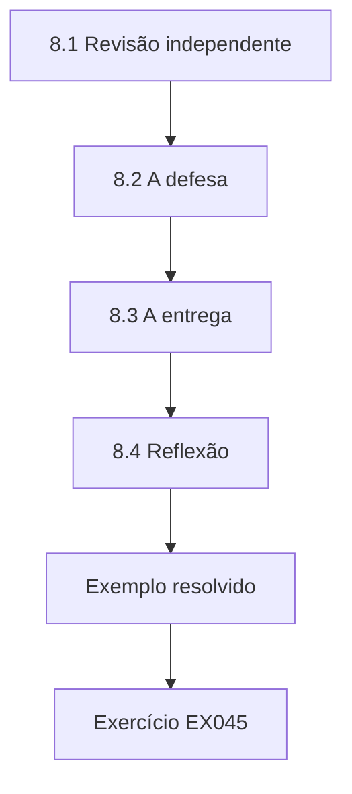

### Desenho lógico

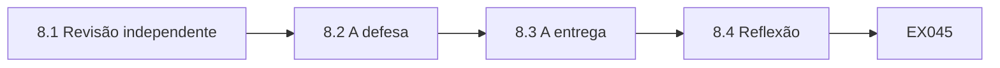

```text
[8.1 Revisão independente]
    |
    v
[8.2 A defesa]
    |
    v
[8.3 A entrega]
    |
    v
[8.4 Reflexão]
    |
    v
[Exemplo resolvido] --> [Exercício EX045]
```
<!-- cykin:lesson-figures:end ch-08 -->


### Objetivos de aprendizagem

Você vai (1) obter a revisão independente da análise; (2) defender uma dissertação sob arguição; (3) entregar os achados a uma organização de forma responsável.

### 8.1 Revisão independente

Antes da submissão, uma estatística de outro departamento executa de novo os scripts de Priya sobre os dados sintéticos e obtém os mesmos números. Ela sugere verificar se alguns poucos departamentos determinam o resultado. Priya repete a estimativa deixando de fora, um de cada vez, cada departamento com feedback; a direção se mantém todas as vezes, embora uma das omissões alargue o intervalo até quase tocar o zero. Priya relata essa verificação exploratória, observando que, com apenas três departamentos tratados, o resultado depende visivelmente de cada um. O relatório da estatística é incluído como apêndice, com a permissão dela.

### 8.2 A defesa

Na defesa, os examinadores perguntam por que a Harrowgate deveria confiar num resultado de três departamentos. Priya responde que ela deve tratar o resultado como animador, mas provisório, sustentando uma implantação em etapas com medição contínua, e não uma troca completa. Outro examinador pergunta se o feedback é ético quando mostra aos funcionários seus erros. Ela explica o relato por departamento, a ausência de punições e o aumento dos relatos, o que sugere que os funcionários não viveram o feedback como punitivo neste contexto. Os examinadores registram suas respostas.

### 8.3 A entrega

Priya apresenta os achados ao comitê de segurança da Harrowgate, usando o resumo de duas páginas. O comitê concorda em estender o feedback a mais dois departamentos e manter um departamento de comparação por mais dois trimestres. Ele também pede ao fornecedor da plataforma que inclua os endereços do scanner nas exportações, para que as medições futuras possam casar endereços em vez de tempos. Priya arquiva seus scripts, os dados sintéticos e o plano de análise no repositório da universidade, para que o comitê ou outro estudante possa repetir o estudo. O comitê agradece aos funcionários que participaram do estudo.

### 8.4 Reflexão

Priya reflete que a parte mais útil do seu trabalho pode ser a correção dos cliques do scanner, que muda a forma como a organização lê cada simulação futura. A estimativa principal é promissora, mas incerta. Ela observa que o próximo curso desta área, governança de dados, examina quem decide como dados como os logs de simulação são definidos e usados, o que importa porque seu desfecho dependeu de uma definição desse tipo. O Dr. Bello concorda e recomenda o achado do scanner para um artigo curto voltado a profissionais. Priya começa a redigir o artigo.

### Exemplo resolvido

Priya passa pela revisão independente com uma verificação de deixar um de fora, defende o resultado como provisório, entrega os achados que levam a uma implantação em etapas e arquiva seus materiais.

> **Caso sintético.** A revisão e a defesa são sintéticas.

### Erros e limites

Apresentar um resultado de três departamentos como definitivo exagera a certeza.

### Exercícios

- **EX045 — Deixar um de fora.** O que mostra deixar de fora cada departamento? *Rubrica:* 3 = a direção se mantém, uma omissão quase toca o zero;; 2 = parcialmente correto;; 1 = vago;; 0 = nenhuma.

- **EX046 — Resposta sobre a confiança.** Como a Harrowgate deve tratar o resultado? *Rubrica:* 3 = animador, mas provisório;; 2 = parcialmente correto;; 1 = definitivo;; 0 = nenhuma.

- **EX047 — Resposta ética.** O que sugere que o feedback não foi punitivo? *Rubrica:* 3 = os relatos aumentaram;; 2 = parcialmente correto;; 1 = vago;; 0 = nenhuma.

- **EX048 — Decisão do comitê.** O que o comitê decide? *Rubrica:* 3 = estender a dois departamentos, manter uma comparação;; 2 = parcialmente correto;; 1 = vago;; 0 = nenhuma.

- **EX049 — Pedido ao fornecedor.** O que o comitê pede ao fornecedor? *Rubrica:* 3 = endereços do scanner nas exportações;; 2 = parcialmente correto;; 1 = vago;; 0 = nenhuma.

- **EX050 — Artigo para profissionais.** O que o Dr. Bello recomenda para um artigo voltado a profissionais? *Rubrica:* 3 = o achado do scanner;; 2 = parcialmente correto;; 1 = outro;; 0 = nenhuma.

<!-- cykin:chapter-navigation:start ch-08 -->
### Continue estudando — aula 08 (capítulo 08 de 08)

[← Capítulo 07](#ch-07) · [Índice das aulas](../SUBJECTS.md) · [Próximo curso pelo índice →](../SUBJECTS.md)

O índice aponta para o próximo curso do percurso de estudos.
<!-- cykin:chapter-navigation:end -->

<a id="worked-results"></a>

## Resoluções

Respostas-modelo para EX001–EX050. Priya Natarajan, o Dr. Olumide Bello, a Ashcombe University, a Harrowgate Community Health e todos os números são sintéticos; as respostas dos laboratórios citam saídas verificadas. Qualquer resposta que atenda à rubrica recebe a mesma pontuação.

**EX001.** Cerca de 2.400 funcionários em seis departamentos.

**EX002.** Se as taxas de cliques caem mais nos departamentos com feedback do que nos departamentos com treinamento anual.

**EX003.** Intervenção, desfecho, comparação e população.

**EX004.** Estudos que relatam comportamento medido, e não opiniões.

**EX005.** Que culpar os usuários raramente conserta os sistemas de segurança.

**EX006.** Ausência de medida comportamental, ausência de grupo de comparação ou simulação apenas em laboratório.

**EX007.** Vinte e três estudos.

**EX008.** Que as pessoas estejam conscientes da política e da sua contribuição para a segurança.

**EX009.** A visão geral atual que explica como a família se encaixa.

**EX010.** A família de conscientização e treinamento.

**EX011.** A função Proteger.

**EX012.** A aceitabilidade psicológica.

**EX013.** A taxa com que os funcionários relatam o phishing simulado.

**EX014.** Uma redução de alguns pontos percentuais.

**EX015.** Diferença em diferenças.

**EX016.** As influências compartilhadas pelos dois grupos, como o phishing sazonal.

**EX017.** As taxas de cliques dos dois grupos se moveram juntas.

**EX018.** Iscas mais difíceis num grupo distorceriam a comparação.

**EX019.** Apenas por departamento.

**EX020.** Um intervalo bootstrap de mil reamostragens com uma semente fixa.

**EX021.** Para que os funcionários não possam simplesmente aprender a reconhecer um padrão de simulação.

**EX022.** Confirmando que as regras de filtragem foram idênticas entre os departamentos.

**EX023.** O registro dos lembretes de segurança dos gerentes.

**EX024.** Os funcionários relatarem menos e-mails suspeitos.

**EX025.** Uma queda nos cliques apenas nos modelos repetidos, e não nos novos.

**EX026.** Para impedir a reinterpretação de resultados decepcionantes depois.

**EX027.** 239 cliques, 19,9 por cento dos funcionários.

**EX028.** 77 cliques atribuídos ao scanner.

**EX029.** 162 cliques humanos, 13,5 por cento.

**EX030.** Casar os cliques com os endereços de varredura conhecidos do gateway.

**EX031.** Um limiar de cinco segundos.

**EX032.** A taxa de cliques humanos, excluindo os cliques em até dois segundos.

**EX033.** De 15,8 para 6,7 por cento.

**EX034.** De 14,0 para 11,0 por cento.

**EX035.** Menos 6,2 pontos, intervalo de menos 10,7 a menos 1,2.

**EX036.** Lembretes extras dos gerentes nos departamentos com feedback.

**EX037.** Subiram um pouco nos departamentos com feedback.

**EX038.** Os cliques em simulações são apenas um indicador indireto do comportamento real.

**EX039.** A seção sobre os cliques do scanner que inflam as taxas brutas.

**EX040.** Os departamentos tratados foram escolhidos pela equipe de segurança, e não aleatoriamente.

**EX041.** Como ela poderia enviesar a estimativa e em que direção.

**EX042.** Para que a comparação entre os departamentos continue possível.

**EX043.** Duas páginas.

**EX044.** Duas frases que sugeriam que os funcionários eram descuidados.

**EX045.** A direção se mantém, mas uma omissão alarga o intervalo até quase o zero.

**EX046.** Como animador, mas provisório.

**EX047.** As taxas de relato aumentaram nos departamentos com feedback.

**EX048.** Estender o feedback a dois departamentos e manter um departamento de comparação.

**EX049.** Os endereços do scanner incluídos nas exportações.

**EX050.** O achado sobre os cliques do scanner, adequado aos profissionais.

<a id="references"></a>
## Referências

Todos os DOIs foram resolvidos em doi.org em 12 de outubro de 2026, e as normas foram conferidas nas páginas de seus editores. A lista é idêntica à da edição em inglês e cobre o livro inteiro, acrescida apenas da ABNT NBR ISO/IEC 27001:2022, citada nesta edição como referência brasileira e conferida em sua fonte oficial; as adoções brasileiras da ABNT listadas foram conferidas no catálogo oficial da ABNT, e as demais normas técnicas são citadas em sua edição internacional. Organizações, pessoas, sistemas e números dos casos são sintéticos; somente as obras abaixo são reais.

- Anderson, R. (2020). *Security engineering: A guide to building dependable distributed systems* (3rd ed.). Wiley. https://doi.org/10.1002/9781119644682
- Associação Brasileira de Normas Técnicas. (2022). *ABNT NBR ISO/IEC 27001:2022 — Segurança da informação, segurança cibernética e proteção à privacidade — Sistemas de gestão da segurança da informação — Requisitos* (versão corrigida 2023). ABNT. <https://www.abntcatalogo.com.br/>
- ISO/IEC. (2022). *ISO/IEC 27001:2022 Information security, cybersecurity and privacy protection — Information security management systems — Requirements* (with Amd 1:2024). <https://www.iso.org/standard/27001>
- ISO/IEC. (2022). *ISO/IEC 27002:2022 Information security, cybersecurity and privacy protection — Information security controls*. <https://www.iso.org/standard/75652.html>
- ISO/IEC. (2026). *ISO/IEC 27000:2026 Information security, cybersecurity and privacy protection — Information security management systems — Overview* (6th ed., replacing ISO/IEC 27000:2018). <https://www.iso.org/standard/27000>
- Joint Task Force. (2020). *Security and privacy controls for information systems and organizations* (NIST SP 800-53 Rev. 5). National Institute of Standards and Technology. https://doi.org/10.6028/NIST.SP.800-53r5
- National Institute of Standards and Technology. (2024). *The NIST Cybersecurity Framework (CSF) 2.0* (NIST CSWP 29). https://doi.org/10.6028/NIST.CSWP.29
- Saltzer, J. H., & Schroeder, M. D. (1975). The protection of information in computer systems. *Proceedings of the IEEE, 63*(9), 1278–1308. https://doi.org/10.1109/PROC.1975.9939
- Shadish, W. R., Cook, T. D., & Campbell, D. T. (2002). *Experimental and quasi-experimental designs for generalized causal inference*. Houghton Mifflin.
