# Authorized Offensive Security and Red Team: A Master's Research Book

- Language: English (`en`); master's programme, two years; approximately 1,600 hours of planned study.
- Editorial state: **published**. Chapters 1–8 of 8 have authored teaching text; exercises EX001–EX050 have matching worked results with 0–3 rubrics; offline labs use the Python 3 standard library and their printed outputs were produced by real runs against synthetic data only. Independent review and the 300-page A4 verification remain open. Draft-chapter coverage is not a completed book.
- Audience: beginning researchers who will design, run and defend a supervised dissertation in authorized offensive security and red-team practice.
- Relation to neighbouring books: the [postgraduate book](../../../../postgraduate-2-years/offensive-security-red-team/en/book/MANUSCRIPT.md) is practice-led; the [doctoral book](../../../../doctorate-2-years/offensive-security-red-team/en/book/MANUSCRIPT.md) asks for an original contribution tested independently. **This book teaches the full research cycle once, under supervision**: question, literature, design, competing explanations, pilot, analysis, writing and defence.
- Author: [hiagokinlevi](https://github.com/hiagokinlevi). Original text [CC0 1.0](../../../../../LICENSE); cited works keep their rights.
- Educational boundary: not a qualification and **no authority to test real systems**. All organizations, people, findings and numbers are **synthetic** unless a sentence cites a public source. Labs teach scoping, measurement and reporting — never weaponised techniques.

[Course home](../../README.md) · [Chapter index](../SUBJECTS.md) · [Book plan](PLAN.md) · [Course skill](../../skill/SKILL.md) · [Worked results](#worked-results)

## How to use this draft

Eight chapters teach one supervised research cycle. Each chapter has learning outcomes, teaching text, a worked example, errors and limits, exercises scored 0–3, a synthesis and a **Continue studying** block. Labs run offline with `python3 file.py` on synthetic data only.

### The running example (synthetic): Cedar Bridge Mutual

> **Synthetic case — fiction.** **Cedar Bridge Mutual (CBM)** is an invented regional insurer. Master's student *Noah Kim* is placed with CBM's authorized internal assessment team. His dissertation asks whether **ATT&CK-tagged findings** increase remediation completion within 30 days compared with narrative-only findings, on synthetic network segments used for training assessments. Every number about CBM is invented.

### Source policy

Sources checked 12 October 2026: [NIST SP 800-115](https://doi.org/10.6028/NIST.SP.800-115); [PTES](https://pentest-standard.readthedocs.io/en/latest/); [MITRE ATT&CK](https://attack.mitre.org/); [OWASP WSTG](https://owasp.org/www-project-web-security-testing-guide/); [TIBER-EU](https://www.ecb.europa.eu/paym/cyber-resilience/tiber-eu/html/index.en.html); [CBEST](https://www.bankofengland.co.uk/financial-stability/operational-resilience-of-the-financial-sector/cbest-threat-intelligence-led-assessments-implementation-guide) (2024 Implementation Guide). Papers by arXiv ID were title-checked. Legal content is orientation, not advice.

## Contents

| Stage | Chapter |
|---|---|
| 1 | [1 Research question and literature method](#ch-01) |
| 1 | [2 Authorized offensive security and red team: advanced seminar](#ch-02) |
| 2 | [3 Study design, ethics and reproducibility](#ch-03) |
| 2 | [4 Authorized offensive security and red team: competing explanations](#ch-04) |
| 3 | [5 Proposal and pilot](#ch-05) |
| 3 | [6 Data collection and analysis](#ch-06) |
| 4 | [7 Dissertation writing and limitations](#ch-07) |
| 4 | [8 Independent review and defense](#ch-08) |

[Worked results](#worked-results) · [References](#references)

<a id="ch-01"></a>

## Chapter 1 — Research question and literature method

<!-- open-cyber-academy:lesson-figures:start ch-01 -->
### Lesson map

Lesson 01 published. Map, example, EX001.

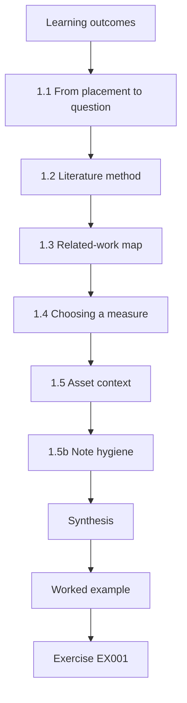

### Logical drawing

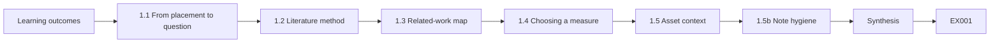

```text
[Learning outcomes]
    |
    v
[1.1 From placement to question]
    |
    v
[1.2 Literature method]
    |
    v
[1.3 Related-work map]
    |
    v
[1.4 Choosing a measure]
    |
    v
[1.5 Asset context]
    |
    v
[1.5b Note hygiene]
    |
    v
[Synthesis]
    |
    v
[Worked example] --> [Exercise EX001]
```
<!-- open-cyber-academy:lesson-figures:end ch-01 -->


### Learning outcomes

You will (1) turn a workplace observation into a research question; (2) search and organise literature on red-team methodology and reporting; (3) write a one-page related-work map; (4) choose a measure of remediation uptake; and (5) keep notes that separate claims from evidence.

### 1.1 From placement to question

Noah notices that some findings are fixed quickly and others linger. A researchable form asks whether a reporting choice — tagging each finding with MITRE ATT&CK technique IDs — changes remediation completion within 30 days on CBM's synthetic training segments.

The workplace observation is not yet a question: it names no comparison, no time limit and no data source. Noah's version fixes all three. The intervention is ATT&CK tagging, the comparison is narrative-only text, and the measure is completion within 30 days in CBM's ticket system. Because the segments are synthetic training segments, the question also states its own limit on generalisation.

### 1.2 Literature method

Search PTES, NIST SP 800-115, ATT&CK documentation, OWASP WSTG, TIBER-EU and CBEST materials, plus academic critiques of security scoring (Albrecht and Jensen, arXiv:2010.06377). For each source, capture: claim, method, measure, limits, relevance to reporting.

A five-field note keeps each source honest. For NIST SP 800-115, the claim is that assessments need planning through reporting, the method is process guidance, and the limit is that it offers no measured remediation outcomes. Record the search strings and date for each database you use, so the search can be repeated when the frameworks are updated before submission.

### 1.3 Related-work map

Cluster sources into: engagement methodology; threat-led frameworks; web testing cases; reporting and scoring critiques; blue-team remediation studies. Your gap should sit at an intersection — for Noah, reporting format × remediation uptake.

Noah's map shows many sources on reporting guidance and some on remediation, but few that compare ATT&CK tags with narrative text on completion. That empty intersection is his gap. Draw the map as one page, with each source placed in a cluster, so a supervisor can see at a glance whether the gap is real or whether a cluster has not been searched.

### 1.4 Choosing a measure

Remediation completion within 30 days is observable in CBM's ticket system for synthetic findings. Avoid measures you cannot see (attacker 'skill') or that invent a single security score.

For Noah, remediated means closed with verifying evidence attached and not reopened within 30 days, checked by someone blind to the hypothesis. That definition can be applied to every ticket the same way. A measure such as 'risk reduced' cannot, because nobody could check it from the data, and examiners would ask how it was observed.

### 1.5 Asset context

Before studying reports, know what is being assessed. Rank synthetic assets by exposure, data sensitivity and blast radius so the dissertation's scenarios are realistic.

```python
"""Rank synthetic assets for authorized engagement scoping."""
assets = [
    ("public-web-portal", 3, 3, 3),      # exposure, data_sensitivity, blast_radius 1-3
    ("staging-admin-ui", 2, 3, 2),
    ("corp-vpn-edge", 3, 2, 3),
    ("internal-wiki", 1, 2, 1),
    ("printer-fleet", 2, 1, 1),
    ("lab-jump-host", 1, 1, 2),
]
print(f"{'asset':20} score exposure data blast")
for name, e, d, b in sorted(assets, key=lambda x: -(x[1]+x[2]+x[3])):
    print(f"{name:20} {e+d+b:5} {e:8} {d:4} {b:5}")
```

Expected output:

```text
asset                score exposure data blast
public-web-portal        9        3    3     3
corp-vpn-edge            8        3    2     3
staging-admin-ui         7        2    3     2
internal-wiki            4        1    2     1
printer-fleet            4        2    1     1
lab-jump-host            4        1    1     2
```

The inventory lab adds exposure, data sensitivity and blast radius, each from 1 to 3. The public web portal scores 9, the VPN edge 8 and the staging admin UI 7, while the internal wiki, printer fleet and lab jump host score 4. Scenarios built around the higher-scoring assets reflect where CBM schedules its training assessments first. The three lowest assets tie at 4, so their order is arbitrary.

### 1.5b Note hygiene

Keep a research log that separates quotations, paraphrases and your own claims. Record search strings and dates so literature updates can be repeated. When a source is a living framework (ATT&CK, WSTG), note the version or access date beside every citation.

Noah's log also records which sources changed his mind and why. When a framework releases a new version during the dissertation, the access dates show which citations need checking. Mark each claim in your notes with its source, so a reader can tell your view from the author's. This saves hours when writing the related-work chapter.

### 1.6 Worked example (synthetic CBM case)

Noah's question: On CBM synthetic segments, do ATT&CK-tagged findings have a higher 30-day remediation rate than narrative-only findings? The inventory lab ranks public-web-portal highest (score 9), matching where CBM schedules training assessments first.

The question names the setting, the comparison and the measure, so it can be answered with ticket data. The asset ranking keeps the study close to how CBM actually works, which matters when examiners ask whether the scenarios were realistic. Both appear in the first chapter of Noah's dissertation, with the lab output as evidence.

### 1.7 Errors and limits

- Questions that only praise a tool.
- Literature notes that copy abstracts.
- Measures with no data source.

Each error weakens the dissertation from the start. A question that only praises a tool assumes its answer and cannot be falsified. Notes that copy abstracts lose the method and limits that decide whether a source supports your claim. A measure with no data source cannot be collected, however interesting it sounds, and the problem appears only when collection starts. Check your first chapter for all three before your supervisor reads it.

### Exercises

- **EX001 — Observation — Turn Noah's observation into a falsifiable question.** Rubric: 3 = population, intervention, measure; 2 = two; 1 = vague; 0 = none.
- **EX002 — Note — Write a five-field note on NIST SP 800-115.** Rubric: 3 = claim, method, measure, limits, relevance; 2 = four; 1 = two; 0 = none.
- **EX003 — Map — Place five sources on the related-work map.** Rubric: 3 = five clustered; 2 = four; 1 = two; 0 = none.
- **EX004 — Measure — Justify 30-day remediation completion.** Rubric: 3 = observable, timed, relevant; 2 = two; 1 = one; 0 = none.
- **EX005 — Inventory lab — Why does public-web-portal outrank lab-jump-host?** Rubric: 3 = exposure/data/blast; 2 = partial; 1 = vague; 0 = wrong.
- **EX006 — Gap — State Noah's gap in three sentences.** Rubric: 3 = prior, gap, contribution; 2 = two; 1 = one; 0 = none.
- **EX007 — Ethics seed — List two ethics constraints already implied.** Rubric: 3 = synthetic only, authorization; 2 = one; 1 = vague; 0 = none.

### Synthesis

Seminar and literature habits turn red-team practice into researchable questions with ethical boundaries.

### Continue studying — chapter 01 of 08

[← Course home](../../README.md) · [Course chapter index](../SUBJECTS.md) · [Chapter 02 (draft) →](#ch-02)

<a id="ch-02"></a>

## Chapter 2 — Authorized offensive security and red team: advanced seminar

<!-- open-cyber-academy:lesson-figures:start ch-02 -->
### Lesson map

Lesson 02 published. Map, example, EX008.

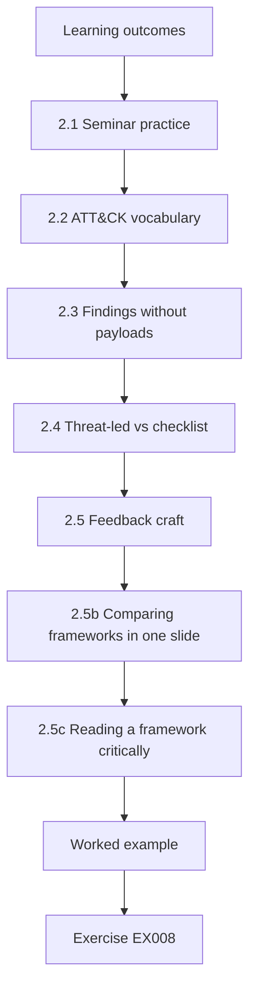

### Logical drawing

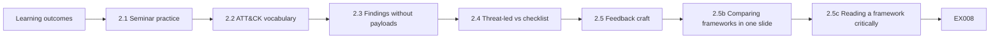

```text
[Learning outcomes]
    |
    v
[2.1 Seminar practice]
    |
    v
[2.2 ATT&CK vocabulary]
    |
    v
[2.3 Findings without payloads]
    |
    v
[2.4 Threat-led vs checklist]
    |
    v
[2.5 Feedback craft]
    |
    v
[2.5b Comparing frameworks in one slide]
    |
    v
[2.5c Reading a framework critically]
    |
    v
[Worked example] --> [Exercise EX008]
```
<!-- open-cyber-academy:lesson-figures:end ch-02 -->


### Learning outcomes

You will (1) present and critique methodology papers and frameworks; (2) use ATT&CK as a shared vocabulary; (3) prioritise synthetic findings without exploit detail; (4) debate threat-led vs checklist testing; and (5) give structured peer feedback.

### 2.1 Seminar practice

Each week one student presents a framework or paper: claim, evidence, what a master's study could reuse. Peers file written feedback: major issue, minor issue, question.

Written feedback keeps the discussion on the work rather than on the presenter. When Noah presents ATT&CK tagging as a reporting intervention, the major issue his peers raise is that tagging quality may vary. That comment later becomes his tag audit. Keep each week's feedback in the research log, with the action you took in response.

### 2.2 ATT&CK vocabulary

Label planned and observed techniques. Coverage is communication, not proof of safety.

ATT&CK technique IDs give testers and defenders shared names for behaviour, such as T1046 Network Service Discovery or T1078 Valid Accounts. In the coverage lab, five of seven planned techniques were observed, or 71%. That figure says what the assessment exercised, not what risk remains. Planned techniques that were not seen go on the next authorized plan rather than being tested freelance. Use one pinned ATT&CK version for all labels, so tags stay comparable throughout the study.

### 2.3 Findings without payloads

Practice writing findings as title, affected asset, evidence reference, impact, likelihood, recommendation — never as exploit recipes.

The findings lab scores each synthetic finding as impact times four, plus exploitability times two, plus exposure. SYN-001, a default admin password on the staging web UI, scores 20 and is critical; SYN-002, missing headers on the public site, scores 9 and is medium. Neither entry says how to exploit anything. A remediator needs the asset, evidence reference and fix, not the attack. SYN-005, a lab service account with domain admin rights, scores 17 and is also critical.

### 2.4 Threat-led vs checklist

TIBER-EU and CBEST emphasise intelligence-led scenarios for critical financial services. PTES and WSTG support structured technical coverage. A dissertation should say which logic it uses.

Noah's study uses the structured logic: synthetic findings from training assessments on CBM segments, recorded in tickets. It borrows no threat-intelligence phase, so its results say nothing about intelligence-led tests of live financial services. Stating this early stops readers from assuming the comparison applies to TIBER-EU or CBEST engagements, and it shapes the limitations chapter.

### 2.5 Feedback craft

Major issues change conclusions; minor issues polish. Cite evidence when you disagree.

```python
"""ATT&CK-style coverage matrix over synthetic authorized techniques (names only)."""
# Synthetic engagement log: technique_id -> observed (True/False)
PLAN = ["T1046", "T1595", "T1082", "T1083", "T1059", "T1078", "T1021"]
OBSERVED = {"T1046", "T1595", "T1082", "T1083", "T1078"}
LABELS = {
    "T1046": "Network Service Discovery",
    "T1595": "Active Scanning",
    "T1082": "System Information Discovery",
    "T1083": "File and Directory Discovery",
    "T1059": "Command and Scripting Interpreter",
    "T1078": "Valid Accounts",
    "T1021": "Remote Services",
}
covered = 0
for tid in PLAN:
    hit = tid in OBSERVED
    covered += hit
    print(f"{tid} {LABELS[tid]:34} {'COVERED' if hit else 'PLANNED-NOT-SEEN'}")
print(f"coverage={covered}/{len(PLAN)} ({100*covered/len(PLAN):.0f}%)")
```

Expected output:

```text
T1046 Network Service Discovery          COVERED
T1595 Active Scanning                    COVERED
T1082 System Information Discovery       COVERED
T1083 File and Directory Discovery       COVERED
T1059 Command and Scripting Interpreter  PLANNED-NOT-SEEN
T1078 Valid Accounts                     COVERED
T1021 Remote Services                    PLANNED-NOT-SEEN
coverage=5/7 (71%)
```

```python
"""Score synthetic findings for report priority (no exploit details)."""
# impact 0-3, exploitability 0-3, exposure 0-3  -> priority
findings = [
    ("SYN-001", "default admin password on staging web UI", 3, 3, 2),
    ("SYN-002", "missing security headers on public site", 1, 1, 3),
    ("SYN-003", "outdated TLS on internal admin port", 2, 2, 1),
    ("SYN-004", "verbose error messages disclose paths", 1, 2, 2),
    ("SYN-005", "service account with domain admin in lab AD", 3, 2, 1),
]

def priority(impact, exploitability, exposure):
    score = impact*4 + exploitability*2 + exposure
    if score >= 16: return "critical", score
    if score >= 11: return "high", score
    if score >= 7: return "medium", score
    return "low", score

for fid, title, i, e, x in findings:
    p, s = priority(i, e, x)
    print(f"{fid} priority={p:8} score={s:2} impact={i} exploitability={e} exposure={x} :: {title}")
```

Expected output:

```text
SYN-001 priority=critical score=20 impact=3 exploitability=3 exposure=2 :: default admin password on staging web UI
SYN-002 priority=medium   score= 9 impact=1 exploitability=1 exposure=3 :: missing security headers on public site
SYN-003 priority=high     score=13 impact=2 exploitability=2 exposure=1 :: outdated TLS on internal admin port
SYN-004 priority=medium   score=10 impact=1 exploitability=2 exposure=2 :: verbose error messages disclose paths
SYN-005 priority=critical score=17 impact=3 exploitability=2 exposure=1 :: service account with domain admin in lab AD
```

A useful major comment on Noah's idea is that tag quality is unmeasured; a useful minor comment is that the ATT&CK version should be named. Both are specific and actionable. Feedback that only praises gives the presenter nothing to fix. When you disagree, point to the source, the data or the lab output that supports your view. Separate major from minor clearly, so the presenter knows which comments must be answered before the design is fixed.

### 2.5b Comparing frameworks in one slide

A useful seminar slide has three columns: question the framework answers, artefact it expects (ROE, scenario, test case), and a failure mode (checkbox theatre, intel theatre, coverage theatre). Students leave knowing when not to force-fit a framework.

For example, ATT&CK answers what an adversary might do, expects technique-level observations, and fails when coverage percentages are read as safety. Keep each column to one line. Draw the same three columns for PTES, WSTG, TIBER-EU and CBEST. Noah's slide shows that his study fits PTES and WSTG logic best, and says plainly where ATT&CK cannot name a process flaw.

### 2.5c Reading a framework critically

Each framework embeds an assumption you should test before citing it in a dissertation. PTES assumes a client who can state business impact before testing starts; at Cedar Bridge Mutual the claims team could not, so Noah's scoping meeting produced a list of crown-jewel processes (claim intake, payout approval) rather than hosts. ATT&CK assumes behaviour can be named at technique granularity; a finding about a missing approval step in payouts has no technique, and forcing one (T1078, Valid Accounts) would hide the process flaw. TIBER-EU assumes a regulator-led threat-intelligence phase; a mid-sized insurer outside that regime borrows its structure but must say so. Write each assumption as one sentence in your methods chapter and state whether it held in your setting.

### 2.6 Worked example (synthetic CBM case)

Noah presents ATT&CK tagging as a reporting intervention. Peers note that tagging quality may vary. The coverage lab shows 71% of a planned set observed; the findings lab ranks SYN-001 critical without describing an exploit path.

The peer comment about tag quality changes the design: Noah plans a tag audit against ATT&CK definitions. The coverage figure of 71% is reported as what the assessment exercised. SYN-001 is ranked critical with a score of 20, and the report entry gives its asset, evidence reference and fix, with no exploit path.

### 2.7 Errors and limits

- Seminars that demo attacks.
- Feedback that only praises.
- Treating coverage % as residual risk.

Each error damages the seminar. Attack demonstrations spread dual-use detail and break the course boundary. Feedback that only praises leaves weak designs unchallenged until examiners find the problems. Reading coverage as residual risk turns a description of what was exercised into a false claim of safety, the error the coverage lab warns about. Check your seminar plan and feedback for all three. A reviewer outside the seminar can spot them quickly.

### Exercises

- **EX008 — Present — Outline a 10-minute seminar on PTES.** Rubric: 3 = claim, phases, limits, reuse; 2 = three; 1 = one; 0 = none.
- **EX009 — Coverage — Interpret planned-not-seen rows ethically.** Rubric: 3 = next authorized work, not freelancing; 2 = partial; 1 = attack now; 0 = none.
- **EX010 — Finding — Rewrite SYN-005 as a report entry (no exploit steps).** Rubric: 3 = asset, impact, evidence ref, recommendation; 2 = three; 1 = steps; 0 = none.
- **EX011 — Threat-led — When is CBEST-style testing more appropriate than a checklist web test?** Rubric: 3 = critical services, intel-led, oversight; 2 = two; 1 = one; 0 = none.
- **EX012 — Feedback — Write one major and one minor comment on Noah's idea.** Rubric: 3 = both specific; 2 = one; 1 = vague; 0 = none.
- **EX013 — WSTG — What does WSTG add that ATT&CK does not?** Rubric: 3 = web test cases/procedures for authorized web apps; 2 = partial; 1 = vague; 0 = wrong.
- **EX014 — Dual-use — Why ban exploit demos in seminar?** Rubric: 3 = dual-use, ethics, course boundary; 2 = two; 1 = one; 0 = none.

### Synthesis

Seminar and literature habits turn red-team practice into researchable questions with ethical boundaries.

### Continue studying — chapter 02 of 08

[← Chapter 01 (draft)](#ch-01) · [Course chapter index](../SUBJECTS.md) · [Chapter 03 (draft) →](#ch-03)

<a id="ch-03"></a>

## Chapter 3 — Study design, ethics and reproducibility

<!-- open-cyber-academy:lesson-figures:start ch-03 -->
### Lesson map

Lesson 03 published. Map, example, EX015.

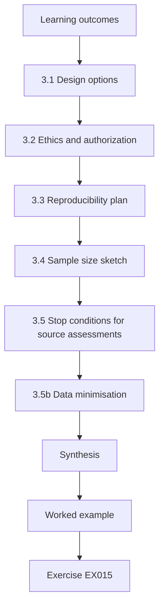

### Logical drawing

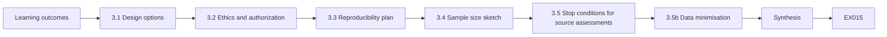

```text
[Learning outcomes]
    |
    v
[3.1 Design options]
    |
    v
[3.2 Ethics and authorization]
    |
    v
[3.3 Reproducibility plan]
    |
    v
[3.4 Sample size sketch]
    |
    v
[3.5 Stop conditions for source assessments]
    |
    v
[3.5b Data minimisation]
    |
    v
[Synthesis]
    |
    v
[Worked example] --> [Exercise EX015]
```
<!-- open-cyber-academy:lesson-figures:end ch-03 -->


### Learning outcomes

You will (1) choose a study design that compares reporting formats fairly; (2) define inclusion and ethics rules; (3) plan reproducibility from day one; (4) size the sample from a pilot guess; and (5) write stop conditions for the assessment work that generates findings.

### 3.1 Design options

A between-findings design randomly assigns each synthetic finding to ATT&CK-tagged or narrative-only report text, holding severity and asset class fixed. That yields many units and supports stratification.

A between-engagement design alternates report formats by week. It is simpler operationally but confounds format with time and team load. Prefer between-findings when the ticket system can store a format flag.

For Noah, the format flag can be stored in CBM's ticket system, so between-findings randomisation is possible. Holding severity and asset class fixed matters because tagged findings could otherwise cluster in high-severity tickets that are fixed faster for that reason alone.

### 3.2 Ethics and authorization

All assessments that produce study findings run under written authorization on synthetic segments only. Operators and remediators consent to research use of ticket metadata. No real customer data enters the dissertation.

Dual-use rule: findings describe impact and evidence references, never exploit steps. If a training assessment unexpectedly touches a production host, stop conditions fire and research pauses with the assessment.

Noah files the authorization and remediator consent before the first finding enters the study. Consent forms state the purpose, the ticket metadata used, the right to withdraw and a supervisor contact.

### 3.3 Reproducibility plan

Publish the randomisation script, both report templates, the operational definition of remediated, and a synthetic ticket export schema. Pin the ATT&CK version used for tags. A peer should regenerate your tables from the synthetic export.

Each item answers a question an examiner may ask. The script shows how findings were assigned; the templates show what remediators saw; the definition shows what counted as remediated; and the schema lets others check the export. With the ATT&CK version pinned, tags written at the start of the study keep the same meaning at the end, even after framework updates.

### 3.4 Sample size sketch

If narrative completion is about 40% in 30 days, detecting a rise to 60% needs on the order of 100 findings per arm for a rough comparison. Treat this as a planning sketch; refine after the pilot's variance estimate.

The sketch also warns about feasibility. If CBM's training assessments produce only a few dozen findings a month, reaching 100 per arm may take a full term or more. Noah records this as a timeline risk in his proposal. The pilot in Chapter 5 is meant to improve the estimate, not to answer the question.

### 3.5 Stop conditions for source assessments

Out-of-scope host, appearance of real personal data, or availability impact on shared services — stop, escalate, and pause research data collection until cleared. Research never pressures assessors to continue unsafely.


```python
"""Evaluate proposed actions against synthetic rules of engagement."""
ROE = {
    "hours": ("09:00", "17:00"),
    "deny_actions": {"denial-of-service", "phishing-staff", "exfiltrate-real-data"},
    "require_approval": {"password-spray-lab", "privilege-escalation-lab"},
    "max_concurrency": 5,
}
proposals = [
    ("service-enum", "10:30", 3, False),
    ("denial-of-service", "10:30", 1, False),
    ("password-spray-lab", "10:30", 2, False),
    ("password-spray-lab", "10:30", 2, True),
    ("service-enum", "18:00", 2, False),
    ("service-enum", "11:00", 20, False),
]

def ok_time(t):
    return ROE["hours"][0] <= t <= ROE["hours"][1]

for action, when, conc, approved in proposals:
    reasons=[]
    if action in ROE["deny_actions"]: reasons.append("deny-action")
    if action in ROE["require_approval"] and not approved: reasons.append("needs-approval")
    if not ok_time(when): reasons.append("outside-hours")
    if conc > ROE["max_concurrency"]: reasons.append("concurrency")
    print(f"action={action:20} when={when} conc={conc:2} approved={approved} -> {'ALLOW' if not reasons else 'DENY'} {','.join(reasons) or '-'}")
```

Expected output:

```text
action=service-enum         when=10:30 conc= 3 approved=False -> ALLOW -
action=denial-of-service    when=10:30 conc= 1 approved=False -> DENY deny-action
action=password-spray-lab   when=10:30 conc= 2 approved=False -> DENY needs-approval
action=password-spray-lab   when=10:30 conc= 2 approved=True -> ALLOW -
action=service-enum         when=18:00 conc= 2 approved=False -> DENY outside-hours
action=service-enum         when=11:00 conc=20 approved=False -> DENY concurrency
```

The ROE lab shows the same logic for proposed actions: service enumeration inside working hours is allowed; denial of service is denied; a lab password spray is denied until approved; work at 18:00 or with concurrency 20 is denied. Findings produced by work outside these rules never enter the study data.

### 3.5b Data minimisation

Ticket exports for research should drop names where possible, keep role IDs, and exclude free-text that might hold credentials. Store exports encrypted at rest in the university drive, with access limited to Noah and supervisors. Retention ends at dissertation archive freeze plus one year unless ethics requires sooner deletion.

Noah's export drops remediator names and free-text fields. Role IDs keep the analysis possible without naming people: Noah can still check that writers did not grade their own findings. Free text is excluded because remediators sometimes paste configuration snippets or passwords into ticket comments. The retention rule is written into the ethics application and the data management plan, so the deletion date is checked rather than remembered.

### 3.6 Worked example (synthetic CBM case)

Noah chooses between-findings randomisation on CBM synthetic VLAN 40. Authorization and remediator consent are filed. The ROE lab pattern — deny unsafe actions, require approval for sensitive labs, enforce hours — is mirrored in assessment runbooks so study data only accrues from well-governed work.

VLAN 40 is a synthetic training segment, so no customer data is involved. The runbooks mean that a denied or unapproved action is stopped before it can produce a finding, and research data comes only from work the authorization allows. The design, authorization and consent are filed with the supervisor before collection starts.

### 3.7 Errors and limits

- Randomising after seeing outcomes.
- Using live customer segments.
- No definition of remediated.

Each error is costly to fix later. Randomising after seeing outcomes lets the researcher steer findings into the arm that suits the hypothesis, which destroys the comparison. Live customer segments expose real data and break the authorization. Without a definition of remediated, each ticket is judged differently, and the primary measure has no meaning. Check the design for all three before collection begins. Noah's design addresses each one in writing.

### Exercises

- **EX015 — Design — Compare between-findings vs between-engagement designs.** Rubric: 3 = trade-offs on power and confounders; 2 = one design; 1 = vague; 0 = none.
- **EX016 — Ethics — List five ethics controls.** Rubric: 3 = five apt; 2 = four; 1 = two; 0 = none.
- **EX017 — Remediated — Define remediated operationally.** Rubric: 3 = verifiable criteria and who checks; 2 = partial; 1 = vague; 0 = none.
- **EX018 — ROE link — Why research inherits assessment stop conditions.** Rubric: 3 = safety first, data quality; 2 = one; 1 = vague; 0 = none.
- **EX019 — Sample — Critique the 100-per-arm sketch.** Rubric: 3 = assumptions, pilot need, feasibility; 2 = two; 1 = one; 0 = none.
- **EX020 — Consent — Write remediator consent bullets.** Rubric: 3 = purpose, data, withdrawal, contacts; 2 = three; 1 = one; 0 = none.

### Synthesis

Design, ethics and reproducibility decisions are made before tickets accrue — they are not afterthoughts.

### Continue studying — chapter 03 of 08

[← Chapter 02 (draft)](#ch-02) · [Course chapter index](../SUBJECTS.md) · [Chapter 04 (draft) →](#ch-04)

<a id="ch-04"></a>

## Chapter 4 — Authorized offensive security and red team: competing explanations

<!-- open-cyber-academy:lesson-figures:start ch-04 -->
### Lesson map

Lesson 04 published. Map, example, EX021.

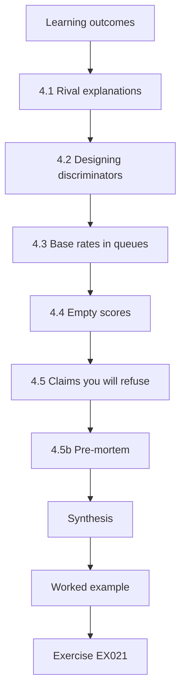

### Logical drawing

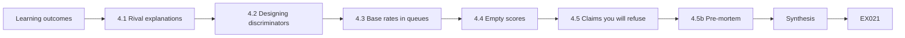

```text
[Learning outcomes]
    |
    v
[4.1 Rival explanations]
    |
    v
[4.2 Designing discriminators]
    |
    v
[4.3 Base rates in queues]
    |
    v
[4.4 Empty scores]
    |
    v
[4.5 Claims you will refuse]
    |
    v
[4.5b Pre-mortem]
    |
    v
[Synthesis]
    |
    v
[Worked example] --> [Exercise EX021]
```
<!-- open-cyber-academy:lesson-figures:end ch-04 -->


### Learning outcomes

You will (1) list alternative explanations for a remediation-rate difference; (2) design checks that separate them; (3) use base rates when interpreting ticket alerts; (4) avoid empty security scores; and (5) pre-specify which explanations you can test.

### 4.1 Rival explanations

If tagged findings remediate faster, rivals include: tags make tickets clearer; tags correlate with higher severity by construction; remediators treat research tickets differently (Hawthorne); ATT&CK tags were applied only when the writer was more careful overall.

Each rival predicts something different, which is what makes them testable. If tags simply make tickets clearer, the gain should appear across severities. If severity drives the difference, balancing severity should remove it. If remediators react to being studied, both arms should improve together. If careful writers tag more, the tag audit and writing quality checks should show it.

### 4.2 Designing discriminators

Balance severity and asset class across arms with stratified randomisation. Blind remediators to the research hypothesis. Audit a sample of tags for correctness against ATT&CK definitions. Measure time-to-first-response as well as 30-day completion.

Each check targets a rival. Stratification answers severity imbalance; blinding answers the Hawthorne effect; the tag audit answers poor tagging; and time-to-first-response shows whether tagged tickets are picked up sooner as well as finished sooner. Noah writes these checks into his pre-registration, so the analysis cannot choose them after the data arrives.

### 4.3 Base rates in queues

Security queues are full of low-prevalence true issues. A noisy urgent flag creates mostly false urgency. The same arithmetic that governs detection precision at low prevalence governs ticket escalation policies.

The base-rate lab makes this concrete. With a 95% true-positive rate and a 5% false-positive rate, a flag applied where 1% of tickets are truly urgent has a precision of about 0.161, so most flagged tickets are not urgent. Remediators who learn this stop trusting the flag, which can slow the work it was meant to speed up.

### 4.4 Empty scores

Albrecht and Jensen (arXiv:2010.06377) argue that OSSTMM's rav is not a valid operational security quantity. Your dissertation should not invent a new single score; compare concrete remediation outcomes under stated conditions.

For Noah, the concrete outcome is completion within 30 days, reported by arm with an interval. Readers can check it against the ticket export. A composite score would combine things that cannot be checked separately, and examiners would ask what a change of one point means. Noah's tables report outcomes with their counts.

### 4.5 Claims you will refuse

You will not claim that faster remediation means fewer breaches or that ATT&CK coverage equals safety. Say what ticket data can support — and stop there.


```python
"""Lab B: base rates and alarm precision (Bayes' rule).
An urgent flag with given true- and false-positive rates is applied
to ticket queues with different shares of truly urgent issues."""
for tpr, fpr in ((0.95, 0.05), (0.95, 0.01), (0.80, 0.001)):
    for prev in (0.10, 0.01, 0.001):
        tp = tpr * prev; fp = fpr * (1 - prev)
        prec = tp / (tp + fp)
        per_10k = round(10000 * (tp + fp))
        print(f"tpr={tpr:.2f} fpr={fpr:.3f} prevalence={prev:.3f} precision={prec:.3f} alerts_per_10k={per_10k}")
```

Expected output:

```text
tpr=0.95 fpr=0.050 prevalence=0.100 precision=0.679 alerts_per_10k=1400
tpr=0.95 fpr=0.050 prevalence=0.010 precision=0.161 alerts_per_10k=590
tpr=0.95 fpr=0.050 prevalence=0.001 precision=0.019 alerts_per_10k=509
tpr=0.95 fpr=0.010 prevalence=0.100 precision=0.913 alerts_per_10k=1040
tpr=0.95 fpr=0.010 prevalence=0.010 precision=0.490 alerts_per_10k=194
tpr=0.95 fpr=0.010 prevalence=0.001 precision=0.087 alerts_per_10k=109
tpr=0.80 fpr=0.001 prevalence=0.100 precision=0.989 alerts_per_10k=809
tpr=0.80 fpr=0.001 prevalence=0.010 precision=0.890 alerts_per_10k=90
tpr=0.80 fpr=0.001 prevalence=0.001 precision=0.445 alerts_per_10k=18
```

Write the refused claims into the limitations chapter in plain words. For Noah, they include breach reduction, matrix coverage as safety and any claim about live enterprise programmes such as CBEST or TIBER-EU. Naming them early prevents the discussion chapter, or a manager reading it, from drifting past the evidence. Keep the list short and specific.

### 4.5b Pre-mortem

Before the main study, write a pre-mortem: "The study failed because…" listing severity imbalance, tag errors, UI blindness, staff turnover and authorization expiry. Assign a detector and a mitigation to each line. Pre-mortems catch issues cheaply.

Noah's detector for tag errors is the tag audit; his mitigation is second-person review. For authorization expiry, he notes the end date and asks for renewal a month before it. Write the pre-mortem as a short table and review it with the supervisor before the instrument lock. Severity imbalance is detected by checking arm balance after randomisation; staff turnover by tracking which remediators leave during collection.

### 4.6 Worked example (synthetic CBM case)

Noah pre-specifies rivals: severity imbalance, tag quality, Hawthorne effects. The base-rate lab shows that at 1% prevalence and 5% false positives, precision is about 0.161 — a warning against promiscuous urgency labels. He will report tag-audit agreement alongside the primary result.

Pre-specifying the rivals means Noah cannot add or drop them once results arrive. The precision figure supports his decision not to add urgent flags to research tickets, since most would be false at that prevalence. Reporting tag-audit agreement beside the primary result lets readers judge how much of the effect depends on correct tags.

### 4.7 Errors and limits

- Claiming breach reduction.
- Ignoring tag quality.
- Single composite security improvement scores.

Each error overstates what the study shows. Ticket data cannot measure breaches, so a claim of breach reduction goes beyond the evidence. Ignoring tag quality hides measurement error in the intervention itself. A single composite improvement score combines things that cannot be checked separately, the error Albrecht and Jensen describe. Check the discussion chapter for all three before submission. Noah's pre-registration and limitations chapter address each of them in writing.

### Exercises

- **EX021 — Rivals — List four rival explanations.** Rubric: 3 = four apt; 2 = three; 1 = one; 0 = none.
- **EX022 — Balance — How will you balance severity across arms?** Rubric: 3 = stratification or constrained randomisation; 2 = partial; 1 = ignore; 0 = none.
- **EX023 — Base rate — Using the lab, explain urgency-flag risk at 1% prevalence / 5% FPR.** Rubric: 3 = precision ~0.16, alert burden; 2 = numbers; 1 = vague; 0 = wrong.
- **EX024 — OSSTMM — Why avoid a rav-like score in this dissertation?** Rubric: 3 = validity critique, prefer concrete outcomes; 2 = partial; 1 = vague; 0 = none.
- **EX025 — Blind — How can remediators be blinded?** Rubric: 3 = hide hypothesis/format purpose; 2 = partial; 1 = skip blinding; 0 = none.
- **EX026 — Limits of claim — Write a claim you will not make.** Rubric: 3 = breach/risk overclaim refused with reason; 2 = partial; 1 = still overclaims; 0 = none.

### Synthesis

Competing explanations keep you honest: design checks for rivals and refuse claims your data cannot support.

### Continue studying — chapter 04 of 08

[← Chapter 03 (draft)](#ch-03) · [Course chapter index](../SUBJECTS.md) · [Chapter 05 (draft) →](#ch-05)

<a id="ch-05"></a>

## Chapter 5 — Proposal and pilot

<!-- open-cyber-academy:lesson-figures:start ch-05 -->
### Lesson map

Lesson 05 published. Map, example, EX027.

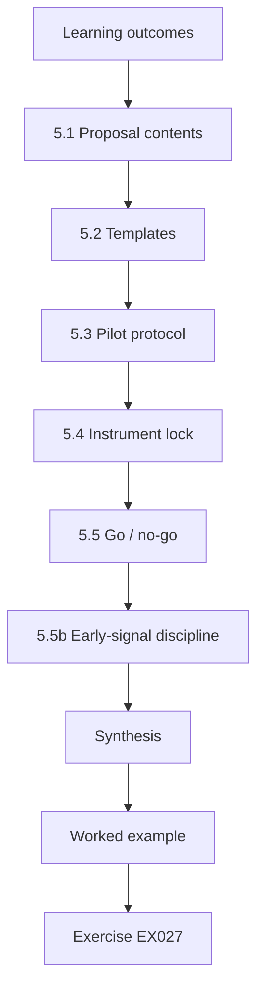

### Logical drawing

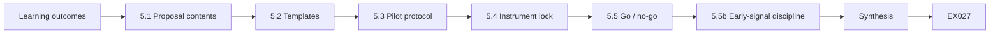

```text
[Learning outcomes]
    |
    v
[5.1 Proposal contents]
    |
    v
[5.2 Templates]
    |
    v
[5.3 Pilot protocol]
    |
    v
[5.4 Instrument lock]
    |
    v
[5.5 Go / no-go]
    |
    v
[5.5b Early-signal discipline]
    |
    v
[Synthesis]
    |
    v
[Worked example] --> [Exercise EX027]
```
<!-- open-cyber-academy:lesson-figures:end ch-05 -->


### Learning outcomes

You will (1) write a short proposal your supervisor can approve; (2) build report templates for both arms; (3) run a pilot on synthetic findings; (4) estimate completion rates and tag-audit effort; and (5) lock instruments before the main collection.

### 5.1 Proposal contents

Include question, rationale, design, measures, ethics, timeline and risks. Attach authorization for synthetic assessments and consent forms. State dual-use limits in one paragraph your supervisor can quote.

For Noah, the question line reads: on CBM's synthetic segments, do ATT&CK-tagged findings reach a higher 30-day remediation rate than narrative-only findings? The design paragraph names between-findings randomisation on VLAN 40 with strata for severity and asset class. The risks section lists the planning sketch from chapter 3: if narrative completion sits near 40%, detecting a rise to 60% needs on the order of 100 findings per arm, so a slow assessment calendar is itself a risk to the timeline.


### 5.2 Templates

Narrative template fields: title, asset, evidence reference, impact, recommendation. Tagged template: the same plus ATT&CK technique IDs and parent tactic. Both templates explicitly forbid exploit steps or credentials.

Keeping every other field identical is what makes the comparison fair: if the tagged template also had a longer impact section, any difference in remediation could come from that extra text rather than from the ATT&CK fields. Noah therefore builds the tagged template by adding fields to the narrative one, never by rewriting it. The pinned ATT&CK version goes into the template footer, so a remediator opening a ticket months later sees the same technique definitions the writer used.


### 5.3 Pilot protocol

Generate 40 synthetic findings from a training assessment on VLAN 40; randomise; deliver tickets; observe a 14-day early signal if 30 days exceeds the term calendar; audit tags for correctness.

Forty findings is far below the roughly 100 per arm needed for the main comparison, so the pilot is not meant to answer the question. Its job is to show that randomisation produces balanced arms, that tickets arrive in CBM's system with the format flag recorded, that remediators can see the tag fields, and that the tag audit catches incorrect technique IDs. The 14-day signal is only an early check on variance for refining the sample-size sketch, never a preliminary result.


### 5.4 Instrument lock

Freeze templates, ATT&CK version, remediation definition and randomisation code. Record versions in the methods chapter. After lock, changes require a supervisor-approved amendment.

Locking matters most for the remediation definition. If Noah decided after seeing pilot tickets that a ticket closed as risk accepted counts as remediated, he could move the 30-day rate in either arm. With the lock in place, such a change becomes an amendment his supervisor must approve and that the methods chapter must report, so examiners can see whether any rule moved after data arrived.


### 5.5 Go / no-go

Go if authorization holds, templates are usable in the ticket UI, and format is recorded per ticket. No-go or redesign if remediators cannot see tags without opening a hidden field.

The hidden-field condition is not cosmetic. If remediators must click into a collapsed panel to see the technique IDs, many tagged tickets would in practice be read as narrative tickets, and the study would compare two arms that look the same to the people doing the work. A no-go here costs weeks; going ahead would cost the validity of the whole dissertation.


```python
"""Check proposed engagement targets against a written scope (synthetic)."""
SCOPE_CIDRS = [("10.20.0.0", 16), ("192.168.50.0", 24)]  # inclusive synthetic ranges
SCOPE_PORTS = {22, 80, 443, 8080}
DENY_HOSTS = {"10.20.0.1", "192.168.50.1"}  # out-of-scope infra

def ip_int(s):
    a,b,c,d = map(int, s.split("."))
    return (a<<24)|(b<<16)|(c<<8)|d

def in_cidr(ip, net, bits):
    mask = (0xFFFFFFFF << (32-bits)) & 0xFFFFFFFF
    return (ip_int(ip) & mask) == (ip_int(net) & mask)

def check(host, port):
    reasons = []
    if host in DENY_HOSTS:
        reasons.append("deny-list")
    if not any(in_cidr(host, n, b) for n,b in SCOPE_CIDRS):
        reasons.append("outside-cidr")
    if port not in SCOPE_PORTS:
        reasons.append("port-not-in-scope")
    return ("ALLOW" if not reasons else "DENY"), reasons

tests = [
    ("10.20.1.10", 443),
    ("10.20.0.1", 443),
    ("192.168.50.20", 22),
    ("192.168.50.20", 3389),
    ("8.8.8.8", 80),
    ("192.168.1.10", 80),
]
for h,p in tests:
    v, r = check(h,p)
    print(f"target={h}:{p} decision={v} reasons={','.join(r) or '-'}")
```

Expected output:

```text
target=10.20.1.10:443 decision=ALLOW reasons=-
target=10.20.0.1:443 decision=DENY reasons=deny-list
target=192.168.50.20:22 decision=ALLOW reasons=-
target=192.168.50.20:3389 decision=DENY reasons=port-not-in-scope
target=8.8.8.8:80 decision=DENY reasons=outside-cidr
target=192.168.1.10:80 decision=DENY reasons=outside-cidr
```

### 5.5b Early-signal discipline

A 14-day early signal can inform logistics but must not rewrite the primary 30-day measure. If you report it, label it exploratory. The dissertation's confirmatory claim remains the pre-registered 30-day completion comparison.

In Noah's pilot, the 14-day signal of 10 of 20 tagged against 6 of 20 narrative early responses is used only to refine the sample-size sketch. It is never reported as a preliminary result. If the main study's 30-day result differs, the confirmatory claim stays with the 30-day result. Keep the exploratory label in every table.

### 5.6 Worked example (synthetic CBM case)

Pilot early signal: tagged 10/20 early responses versus narrative 6/20. Tag audit: 2/20 tags wrong — Noah adds a second-person tag check. Scope lab rules remain in the assessment runbook: deny-listed hosts and out-of-scope ports never enter study data.

The pilot met its purpose: randomisation, delivery and the format flag worked, and the tag audit found a problem early. Two wrong tags in twenty is a 10% error rate, enough to blur a difference between arms, so Noah adds a second-person check before the main collection. The early-response figures inform logistics, not conclusions.

### 5.7 Errors and limits

- Pilots on production.
- Changing templates mid-main-study.
- Skipping tag audit.

Each error damages the main study. Pilots on production systems break the authorization and expose real data. Changing templates during the main study means the two halves of the data measure different things, and the instrument lock exists to prevent it. Skipping the tag audit leaves wrong technique IDs undetected, as the pilot's 2 of 20 showed. Check the pilot plan for all three before the go decision. Noah's go decision lists each one.

### Exercises

- **EX027 — Proposal — List eight proposal headings.** Rubric: 3 = eight apt; 2 = six; 1 = three; 0 = none.
- **EX028 — Template — Write the tagged template fields.** Rubric: 3 = narrative fields plus ATT&CK IDs, no exploit steps; 2 = missing one; 1 = includes exploit steps; 0 = none.
- **EX029 — Scope lab — Name two DENY cases assessors must respect.** Rubric: 3 = two correct lab reasons; 2 = one; 1 = vague; 0 = wrong.
- **EX030 — Tag audit — What does 2/20 wrong tags imply?** Rubric: 3 = measurement error, add review, report; 2 = partial; 1 = ignore; 0 = none.
- **EX031 — Go criteria — Write four go criteria.** Rubric: 3 = four; 2 = three; 1 = one; 0 = none.
- **EX032 — UI risk — Ticket UI hides tags — response?** Rubric: 3 = no-go until visible; 2 = partial; 1 = continue; 0 = none.

### Synthesis

Proposal and pilot turn a question into locked instruments and a realistic go / no-go gate.

### Continue studying — chapter 05 of 08

[← Chapter 04 (draft)](#ch-04) · [Course chapter index](../SUBJECTS.md) · [Chapter 06 (draft) →](#ch-06)

<a id="ch-06"></a>

## Chapter 6 — Data collection and analysis

<!-- open-cyber-academy:lesson-figures:start ch-06 -->
### Lesson map

Lesson 06 published. Map, example, EX033.

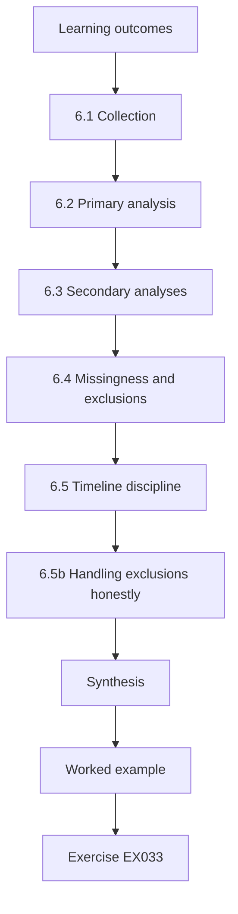

### Logical drawing

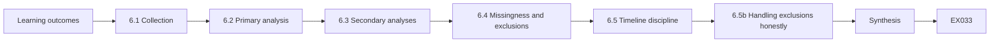

```text
[Learning outcomes]
    |
    v
[6.1 Collection]
    |
    v
[6.2 Primary analysis]
    |
    v
[6.3 Secondary analyses]
    |
    v
[6.4 Missingness and exclusions]
    |
    v
[6.5 Timeline discipline]
    |
    v
[6.5b Handling exclusions honestly]
    |
    v
[Synthesis]
    |
    v
[Worked example] --> [Exercise EX033]
```
<!-- open-cyber-academy:lesson-figures:end ch-06 -->


### Learning outcomes

You will (1) collect ticket data without breaking blinding; (2) analyse primary and secondary measures with uncertainty; (3) report tag-audit quality; (4) separate confirmatory from exploratory analyses; and (5) handle missingness and exclusions transparently.

### 6.1 Collection

Export tickets weekly with format flag, severity, asset class, timestamps, and closed-reason. Do not tell remediators which arm is "expected to win". Assessors who write findings should not grade remediation.

Weekly exports let Noah spot missing fields early, without looking at results by arm. Keeping remediators unaware of the expected winner protects against the Hawthorne effect named in Chapter 4. Separating writers from graders prevents an assessor from judging their own findings more kindly. Store each export with its date and hash.

### 6.2 Primary analysis

Compare 30-day remediation proportions with intervals. Prefer a risk difference or risk ratio with a confidence interval. Stratify or adjust for severity if randomisation used strata.

```python
"""Lab S: reporting attack-success rates honestly: Wilson intervals,
seed variation and a paired bootstrap. Synthetic trial outcomes only."""
import math, random
def wilson(k, n, z=1.96):
    p = k/n; d = 1 + z*z/n
    c = (p + z*z/(2*n))/d; h = z*math.sqrt(p*(1-p)/n + z*z/(4*n*n))/d
    return c - h, c + h
for k, n in ((3, 20), (30, 200), (300, 2000)):
    lo, hi = wilson(k, n); print(f"successes={k}/{n} rate={k/n:.3f} wilson95=[{lo:.3f}, {hi:.3f}]")
# five seeds of a synthetic defence evaluation: per-seed attack success rate
rates = []
for seed in range(5):
    r = random.Random(seed); rates.append(sum(r.random() < 0.12 for _ in range(200))/200)
m = sum(rates)/5; sd = math.sqrt(sum((x-m)**2 for x in rates)/4)
print("per-seed rates:", " ".join(f"{x:.3f}" for x in rates), f"mean={m:.3f} sd={sd:.3f}")
# paired bootstrap: baseline vs defence on the same 300 synthetic trials
r = random.Random(42)
base = [r.random() < 0.30 for _ in range(300)]
defn = [b and r.random() < 0.6 for b in base]   # defence blocks ~40% of successes
diffs = []
for _ in range(2000):
    idx = [r.randrange(300) for _ in range(300)]
    diffs.append(sum(base[i] for i in idx)/300 - sum(defn[i] for i in idx)/300)
diffs.sort()
print(f"baseline_asr={sum(base)/300:.3f} defended_asr={sum(defn)/300:.3f} "
      f"reduction_ci95=[{diffs[50]:.3f}, {diffs[1949]:.3f}]")
```

Expected output:

```text
successes=3/20 rate=0.150 wilson95=[0.052, 0.360]
successes=30/200 rate=0.150 wilson95=[0.107, 0.206]
successes=300/2000 rate=0.150 wilson95=[0.135, 0.166]
per-seed rates: 0.110 0.130 0.135 0.105 0.145 mean=0.125 sd=0.017
baseline_asr=0.350 defended_asr=0.190 reduction_ci95=[0.120, 0.203]
```

Lab S shows the habit with synthetic trials: 3 successes in 20 give a Wilson interval from 0.052 to 0.360, while 300 in 2,000 give 0.135 to 0.166. The same rate means very different certainty, so report the counts and the interval beside every proportion. For Noah, the primary result is a risk difference of about 18 points between 62% of 110 tagged and 44% of 108 narrative findings, with an interval that excludes zero. Severity was a stratum, so he also reports the difference within each severity level.

### 6.3 Secondary analyses

Time-to-first-response; tag-audit agreement; completion by asset class. Label secondary analyses clearly. Do not promote a secondary result to "the finding" if the primary is null.

For Noah, the secondary analyses help explain the primary result. Tag-audit agreement shows how reliable the intervention was; time-to-first-response shows whether tagged tickets were picked up sooner; and asset-class results show where any effect was largest. Each is reported with its interval and labelled secondary or exploratory. If the primary result had been null, none of these would have become the headline.

### 6.4 Missingness and exclusions

Pre-register rules: tickets reopened within 30 days count as not lastingly remediated; tickets on decommissioned synthetic assets are excluded and listed. Report exclusion counts.

Noah applies both rules from a script written before collection, so a reopened ticket moves to the not-remediated column without any judgement by the analyst. The VLAN 40 rebuild week falls under a pre-registered infrastructure exclusion, and the results table shows the difference with and without it, 18 and 16 points. Exclusion counts appear in the results table, not only in an appendix. Readers should be able to check that no other tickets were dropped and that the excluded week did not change the conclusion.

### 6.5 Timeline discipline

Keep an operations timeline of assessments, exports and incidents (even synthetic training incidents) so analysis can be reconstructed.

```python
"""Rebuild a synthetic engagement timeline from event records."""
events = [
    ("09:00", "ROE brief signed", "auth"),
    ("09:15", "scoped host inventory loaded (12 hosts)", "prep"),
    ("10:02", "service enumeration on 10.20.1.0/28", "enum"),
    ("10:45", "finding SYN-001 noted on staging UI", "find"),
    ("11:10", "stop: host 10.20.0.1 probed — out of scope", "stop"),
    ("11:12", "escalated to client contact; confirmed deny-list", "comm"),
    ("13:00", "resume on in-scope hosts only", "auth"),
    ("15:30", "debrief draft shared with client", "report"),
]
# print chronological with phase tags; compute stop latency
print("phase timeline:")
for t, msg, phase in events:
    print(f"  {t} [{phase:6}] {msg}")
t0 = 10*60+45; t1 = 11*60+10
print(f"minutes from SYN-001 note to stop: {t1-t0}")
print(f"stop reason present: yes")
print(f"events={len(events)} phases={len(set(p for _,_,p in events))}")
```

Expected output:

```text
phase timeline:
  09:00 [auth  ] ROE brief signed
  09:15 [prep  ] scoped host inventory loaded (12 hosts)
  10:02 [enum  ] service enumeration on 10.20.1.0/28
  10:45 [find  ] finding SYN-001 noted on staging UI
  11:10 [stop  ] stop: host 10.20.0.1 probed — out of scope
  11:12 [comm  ] escalated to client contact; confirmed deny-list
  13:00 [auth  ] resume on in-scope hosts only
  15:30 [report] debrief draft shared with client
minutes from SYN-001 note to stop: 25
stop reason present: yes
events=8 phases=7
```

The timeline lab rebuilds a synthetic engagement from eight events, including the stop when out-of-scope host 10.20.0.1 was probed and the escalation two minutes later. For Noah's study, the timeline records assessment windows, weekly exports, the VLAN 40 rebuild and authorization renewals, so examiners can see when each event happened relative to the data. Record each event as it happens, with its source.

### 6.5b Handling exclusions honestly

The VLAN 40 rebuild week is the chapter's lesson in exclusions. An exclusion is legitimate only when it was named in the pre-registration with its trigger ("infrastructure rebuild affecting the test segment"), when it is applied blind to the outcome, and when the report shows the result with and without it. Here the 18-point difference becomes 16 points if the week is kept; both numbers appear in the results table, and the conclusion does not depend on the choice. An exclusion invented after seeing the data, or one that flips the conclusion, must be reported as a limitation rather than silently applied.

### 6.6 Worked example (synthetic CBM case)

Main collection: 110 tagged and 108 narrative findings. Remediated in 30 days: 62% vs 44% (difference about 18 points; interval excludes 0). Tag-audit agreement 96% after second-person review. Exploratory: largest lift on medium-severity web findings. One week excluded when VLAN 40 was rebuilt — pre-registered infra exclusion.

The primary result is reported with its interval and conditions. The tag audit shows that the intervention was applied correctly in most tickets after the second-person check. The medium-severity web lift is labelled exploratory, because it was not pre-registered. The excluded week is named in the results table and limitations, with the result shown both ways.

### 6.7 Errors and limits

- Peeking weekly and stopping early.
- Silent exclusions.
- Treating exploratory subgroup lifts as confirmatory.

Each error biases the result. Peeking weekly and stopping when the difference looks good inflates the chance of a false finding. Silent exclusions let the researcher shape the data without readers knowing. Treating exploratory subgroup lifts as confirmatory turns one of many comparisons into a headline. Check the analysis plan and results chapter for all three before writing. Noah's analysis plan, written before collection, addresses all three.

### Exercises

- **EX033 — Blinding.** Who should not see arm expectations? Rubric: 3 = remediators and remediation graders; 2 = one; 1 = vague; 0 = none.
- **EX034 — Primary.** Report Noah's primary result in one sentence. Rubric: 3 = rates, n, interval idea, conditions; 2 = rates; 1 = "it worked"; 0 = none.
- **EX035 — Stats lab.** Why prefer intervals over a single p-value story? Rubric: 3 = magnitude + uncertainty; 2 = partial; 1 = vague; 0 = wrong.
- **EX036 — Exclusion.** Justify the VLAN rebuild exclusion. Rubric: 3 = pre-reg, reported; 2 = partial; 1 = hide; 0 = none.
- **EX037 — Exploratory.** How should the subgroup lift be labelled? Rubric: 3 = exploratory, not primary; 2 = partial; 1 = as main claim; 0 = none.
- **EX038 — Timeline.** List four timeline events to retain. Rubric: 3 = four apt; 2 = three; 1 = one; 0 = none.

### Synthesis

Collection protects blinding; analysis respects the pre-registered primary measure and tells the truth about exclusions and uncertainty.

### Continue studying — chapter 06 of 08

[← Chapter 05 (draft)](#ch-05) · [Course chapter index](../SUBJECTS.md) · [Chapter 07 (draft) →](#ch-07)

<a id="ch-07"></a>

## Chapter 7 — Dissertation writing and limitations

<!-- open-cyber-academy:lesson-figures:start ch-07 -->
### Lesson map

Lesson 07 published. Map, example, EX039.

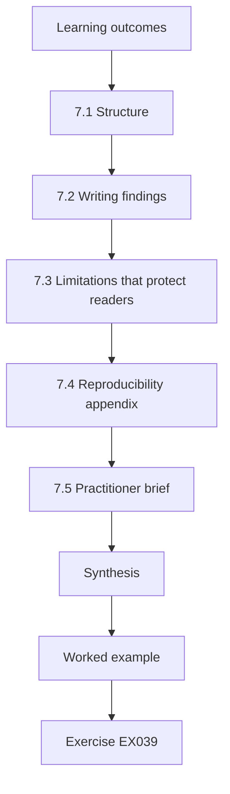

### Logical drawing

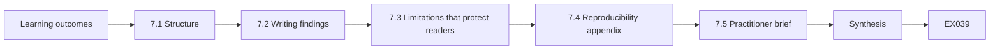

```text
[Learning outcomes]
    |
    v
[7.1 Structure]
    |
    v
[7.2 Writing findings]
    |
    v
[7.3 Limitations that protect readers]
    |
    v
[7.4 Reproducibility appendix]
    |
    v
[7.5 Practitioner brief]
    |
    v
[Synthesis]
    |
    v
[Worked example] --> [Exercise EX039]
```
<!-- open-cyber-academy:lesson-figures:end ch-07 -->


### Learning outcomes

You will (1) structure the dissertation around the research cycle; (2) write findings without exploit detail; (3) state limitations that bound claims; (4) prepare a reproducibility appendix; and (5) draft a practitioner brief.

### 7.1 Structure

Use: introduction; background (NIST SP 800-115, PTES, ATT&CK, WSTG, TIBER-EU/CBEST); related work; methods; results; discussion; ethics; limitations; conclusion; appendices (templates, pre-registration, synthetic schema). Readers should find the question, measure and answer within five minutes of opening the PDF.

Noah's introduction states the question and the 30-day measure in its first paragraph, and the abstract gives the 62% against 44% result with its conditions. Each chapter answers one stage of the research cycle: background and related work explain the gap; methods give design, measures and ethics; results give the numbers; and the discussion and limitations say what they mean and where they stop. Appendices hold what examiners need to check the work.

### 7.2 Writing findings

In examples, show report fields and remediation outcomes. Never include working attack procedures. When quoting synthetic evidence, use hashes and ticket IDs. Severity language should match your scoring sheet, not marketing adjectives.

For Noah, a finding example in the dissertation shows the ticket ID, the asset class, the severity from his scoring sheet, the ATT&CK technique ID where the tagged arm applies, the recommendation and the remediation outcome within 30 days. It never shows the request that triggered the issue or any credential. Quoting a hash of the synthetic evidence lets an examiner confirm the example matches the archive without the dissertation itself carrying anything an attacker could reuse.

```python
"""Score synthetic findings for report priority (no exploit details)."""
# impact 0-3, exploitability 0-3, exposure 0-3  -> priority
findings = [
    ("SYN-001", "default admin password on staging web UI", 3, 3, 2),
    ("SYN-002", "missing security headers on public site", 1, 1, 3),
    ("SYN-003", "outdated TLS on internal admin port", 2, 2, 1),
    ("SYN-004", "verbose error messages disclose paths", 1, 2, 2),
    ("SYN-005", "service account with domain admin in lab AD", 3, 2, 1),
]

def priority(impact, exploitability, exposure):
    score = impact*4 + exploitability*2 + exposure
    if score >= 16: return "critical", score
    if score >= 11: return "high", score
    if score >= 7: return "medium", score
    return "low", score

for fid, title, i, e, x in findings:
    p, s = priority(i, e, x)
    print(f"{fid} priority={p:8} score={s:2} impact={i} exploitability={e} exposure={x} :: {title}")
```

Expected output:

```text
SYN-001 priority=critical score=20 impact=3 exploitability=3 exposure=2 :: default admin password on staging web UI
SYN-002 priority=medium   score= 9 impact=1 exploitability=1 exposure=3 :: missing security headers on public site
SYN-003 priority=high     score=13 impact=2 exploitability=2 exposure=1 :: outdated TLS on internal admin port
SYN-004 priority=medium   score=10 impact=1 exploitability=2 exposure=2 :: verbose error messages disclose paths
SYN-005 priority=critical score=17 impact=3 exploitability=2 exposure=1 :: service account with domain admin in lab AD
```

### 7.3 Limitations that protect readers

State: synthetic segments; one organisation; volunteer remediators; imperfect ATT&CK tags; 30 days may miss slow fixes; no claim about breach rates. Limitations are part of the contribution because they stop unsafe generalisation into live enterprise programmes such as CBEST or TIBER-EU without further study.

Noah places these limitations before the discussion, so readers meet them before any recommendation. Each limitation narrows a claim. Synthetic segments mean the result may differ on live systems; one organisation means CBM's ticket culture may not be typical; volunteer remediators may be more engaged than average; and imperfect tags mean the effect could be stronger or weaker with perfect tagging. The 30-day window may miss slow fixes that eventually close.

### 7.4 Reproducibility appendix

Include scripts, templates, ATT&CK version pin, synthetic export and an analysis notebook that rebuilds the primary table. Hash the release so examiners can detect accidental edits.

For CBM, the notebook should rebuild the primary result from the synthetic export: 110 tagged and 108 narrative findings, 62% against 44% remediated in 30 days, with the VLAN 40 rebuild week excluded and also shown kept in. An examiner who can regenerate that table on a clean machine does not need to trust Noah's summary, and any hash mismatch tells them a file changed after release.

```python
"""Verify integrity of a synthetic evidence package."""
import hashlib, json
files = {
    "roe.pdf": b"SYNTHETIC-ROE-v1",
    "scope.csv": b"host,port\n10.20.1.10,443\n",
    "findings.json": b'[{"id":"SYN-001"}]',
}
expected = {n: hashlib.sha256(b).hexdigest()[:16] for n,b in files.items()}
# Simulate tampering of findings.json
current = dict(expected)
current["findings.json"] = hashlib.sha256(b'[{"id":"SYN-001"},{"id":"TAMPERED"}]').hexdigest()[:16]
print(json.dumps(expected, indent=1))
for n in sorted(expected):
    status = "OK" if expected[n] == current[n] else "MISMATCH"
    print(f"{n:16} {status}")
```

Expected output:

```text
{
 "roe.pdf": "18d74983d403e7db",
 "scope.csv": "01cc4815eddf3de6",
 "findings.json": "7f5f178ab43ef00f"
}
findings.json    MISMATCH
roe.pdf          OK
scope.csv        OK
```

### 7.5 Practitioner brief

Two pages: how to add ATT&CK fields to tickets; how to audit tags; which metric to watch (30-day completion by severity); what not to claim (breach reduction, matrix coverage as safety). Ask one CBM engineer to follow the brief cold and note where they stall.

The brief is written for CBM engineers, not examiners. It shows a tagged ticket next to a narrative one, so readers see the difference at once, and lists the refused claims in plain words.

### 7.6 Worked example (synthetic CBM case)

Noah's limitations page leads with synthetic scope. His appendix regenerates Table 1 from `tickets_synth.csv`. The findings lab style — priority without an exploit path — matches his templates. Hash verification catches a mistaken edit to the appendix sample before submission.

The mistaken edit matters because the appendix exists so examiners can rebuild Table 1: an undetected change could have left their rebuilt numbers out of line with the 62% and 44% in the results chapter, and the mismatch would have cast doubt on the whole analysis rather than on one file.

### 7.7 Errors and limits

- Methods chapters that omit ethics.
- Results without limitations.
- Appendices that do not run.

Each error weakens the dissertation. Without ethics in the methods chapter, examiners cannot judge whether the data was collected properly. Results without limitations invite readers to apply them in settings the study never covered. Appendices that do not run cannot support the reproducibility claim, which is why Noah hashes and tests his release. Check the final draft for all three. Ask a reviewer to check them too.

### Exercises

- **EX039 — Outline.** List ten dissertation sections. Rubric: 3 = ten coherent; 2 = eight; 1 = five; 0 = none.
- **EX040 — Finding style.** Write SYN-003 in dissertation example style. Rubric: 3 = fields, no exploit steps; 2 = partial; 1 = steps included; 0 = none.
- **EX041 — Limits.** List six limitations. Rubric: 3 = six apt; 2 = four; 1 = two; 0 = none.
- **EX042 — Hash lab.** What does MISMATCH require before submission? Rubric: 3 = investigate, restore, re-hash; 2 = two; 1 = ignore; 0 = none.
- **EX043 — Brief.** Outline the practitioner brief headings. Rubric: 3 = fields, audit, metric, non-claims; 2 = three; 1 = one; 0 = none.
- **EX044 — Generalisation.** Why not claim CBEST applicability yet? Rubric: 3 = different context/oversight/intel-led; 2 = two; 1 = vague; 0 = none.

### Synthesis

Writing makes the cycle inspectable: structured claims, bounded limits, runnable appendices and a brief practitioners can actually use.

### Continue studying — chapter 07 of 08

[← Chapter 06 (draft)](#ch-06) · [Course chapter index](../SUBJECTS.md) · [Chapter 08 (draft) →](#ch-08)

<a id="ch-08"></a>

## Chapter 8 — Independent review and defense

<!-- open-cyber-academy:lesson-figures:start ch-08 -->
### Lesson map

Lesson 08 published. Map, example, EX045.

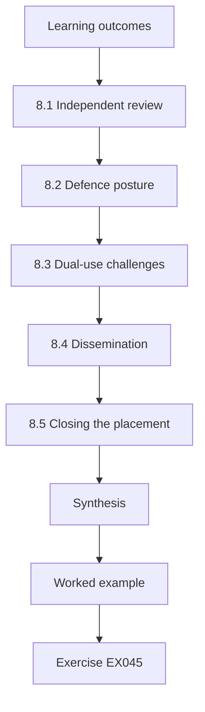

### Logical drawing

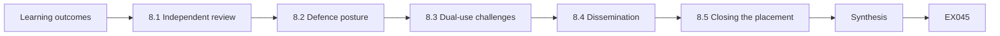

```text
[Learning outcomes]
    |
    v
[8.1 Independent review]
    |
    v
[8.2 Defence posture]
    |
    v
[8.3 Dual-use challenges]
    |
    v
[8.4 Dissemination]
    |
    v
[8.5 Closing the placement]
    |
    v
[Synthesis]
    |
    v
[Worked example] --> [Exercise EX045]
```
<!-- open-cyber-academy:lesson-figures:end ch-08 -->


### Learning outcomes

You will (1) prepare materials for independent review; (2) answer methods and ethics questions under defence; (3) handle dual-use challenges; (4) plan revisions and dissemination; and (5) close the placement cleanly.

### 8.1 Independent review

Share the dissertation, synthetic appendix and ethics package with an internal reviewer who did not supervise weekly. Ask them to check: measure–claim fit; blinding; tag audit; whether any section drifts into attack instruction.

Choosing a reviewer who did not supervise weekly matters because a weekly supervisor has already accepted Noah's framing. A fresh reader is more likely to notice, for example, that the tag audit reached 96% agreement only after second-person review, and to ask how many tags were wrong before that check. The reviewer's written comments go into the response trail alongside Noah's replies.

### 8.2 Defence posture

Open with question, design, primary result and conditions. Expect questions on randomisation, severity balance, why synthetic segments, and what would falsify the result. Bring a one-page methods cheat sheet.

For Noah, the opening fits in about ninety seconds: does ATT&CK tagging raise 30-day remediation on CBM's synthetic segments; stratified randomisation by severity and asset class; 62% against 44%, a difference of about 18 points with an interval excluding zero; synthetic training segments, volunteer remediators and one organisation. The cheat sheet adds what would falsify the result, such as a tag audit showing that correct tags made no difference.

### 8.3 Dual-use challenges

If asked to "show how the finding was exploited", refuse and show the report template fields instead. Reaffirm authorization boundaries and coordinated disclosure for any real issues encountered during placement.

A demand for exploit detail at a defence is usually a test of judgement, not a request for data. Noah's answer has four parts: he declines; he shows the template, which deliberately has no field for exploit steps; he explains that his authorization covered synthetic training assessments only; and he notes that any real issue found during the placement would go through CBM's coordinated disclosure route, not into a dissertation.

### 8.4 Dissemination

Submit a short paper to a measurement or SOUPS-like human-factors venue if appropriate; present the practitioner brief internally; release the synthetic appendix with hashes. Do not release client-identifying materials.

Each output has its own exclusions. The short paper reports the 30-day comparison and its limits but no CBM identifiers. The internal brief may name CBM teams because it stays inside CBM. The public appendix contains only the synthetic export, scripts and templates, released with hashes so later readers can confirm they hold the same files the examiners checked.

```python
"""ATT&CK-style coverage matrix over synthetic authorized techniques (names only)."""
# Synthetic engagement log: technique_id -> observed (True/False)
PLAN = ["T1046", "T1595", "T1082", "T1083", "T1059", "T1078", "T1021"]
OBSERVED = {"T1046", "T1595", "T1082", "T1083", "T1078"}
LABELS = {
    "T1046": "Network Service Discovery",
    "T1595": "Active Scanning",
    "T1082": "System Information Discovery",
    "T1083": "File and Directory Discovery",
    "T1059": "Command and Scripting Interpreter",
    "T1078": "Valid Accounts",
    "T1021": "Remote Services",
}
covered = 0
for tid in PLAN:
    hit = tid in OBSERVED
    covered += hit
    print(f"{tid} {LABELS[tid]:34} {'COVERED' if hit else 'PLANNED-NOT-SEEN'}")
print(f"coverage={covered}/{len(PLAN)} ({100*covered/len(PLAN):.0f}%)")
```

Expected output:

```text
T1046 Network Service Discovery          COVERED
T1595 Active Scanning                    COVERED
T1082 System Information Discovery       COVERED
T1083 File and Directory Discovery       COVERED
T1059 Command and Scripting Interpreter  PLANNED-NOT-SEEN
T1078 Valid Accounts                     COVERED
T1021 Remote Services                    PLANNED-NOT-SEEN
coverage=5/7 (71%)
```

### 8.5 Closing the placement

Return access; confirm synthetic data only remains in the archive; thank remediators; leave the ticket templates behind if CBM wants them. Coverage language from the lab becomes a teaching reminder: planned-not-seen items wait for the next authorized plan.

Closing cleanly is part of the evidence that the work was governed. Noah returns his assessment accounts on the last day, asks CBM to confirm their removal in writing, and checks that the archive holds only synthetic tickets. Offering the tagged templates is optional for CBM; adopting them in live work would need its own authorization, as the worked example below notes.

### 8.6 Worked example (synthetic CBM case)

At defence, Noah is asked whether ATT&CK tagging merely marks findings that were already well written. He points to stratified randomisation and the tag audit, and accepts that residual confounding is a limitation. He refuses a request for exploit detail and shows that the template has no field for exploit steps. CBM adopts tagged templates for training assessments pending a live pilot under separate authorization.

The answer to the confounding question is honest: randomisation and the audit reduce it, but cannot remove it.

### 8.7 Errors and limits

- Defences that overclaim live enterprise impact.
- Sharing real vulnerability details in the public appendix.
- Leaving privileged access active after placement.

Each error undoes earlier care. Overclaiming live enterprise impact goes beyond synthetic training segments and one organisation. Real vulnerability details in a public appendix turn research into an attack resource. Privileged access left active after the placement is a risk to CBM, which is why Noah returns his accounts and asks for written confirmation. Check the defence and closeout plan for all three.

### Exercises

- **EX045 — Review ask.** Write four questions for the independent reviewer. Rubric: 3 = four apt; 2 = three; 1 = one; 0 = none.
- **EX046 — Opening.** Write a 90-second defence opening. Rubric: 3 = question, design, result, conditions; 2 = three; 1 = vague; 0 = none.
- **EX047 — Refuse.** Answer "show the exploit" in four sentences. Rubric: 3 = refuse, template demo, ethics, CVD; 2 = three; 1 = complies; 0 = none.
- **EX048 — Dissemination.** Plan two outputs with exclusions. Rubric: 3 = both with exclusions; 2 = one; 1 = vague; 0 = none.
- **EX049 — Coverage.** How does planned-not-seen inform future authorized work? Rubric: 3 = backlog under authorization; 2 = partial; 1 = freelancing; 0 = none.
- **EX050 — Closeout.** List five placement closeout steps. Rubric: 3 = five apt; 2 = three; 1 = one; 0 = none.

### Synthesis

Independent review and defence test whether your claims, ethics and artefacts stand without you in the room — and whether you leave the host organisation safer and cleaner than you found it.

### Continue studying — chapter 08 of 08

[← Chapter 07 (draft)](#ch-07) · [Course chapter index](../SUBJECTS.md) · [Worked results ↓](#worked-results) · [Next course via chapter index →](../SUBJECTS.md)

<a id="worked-results"></a>

## Worked results

Model answers; any answer meeting the rubric scores equally. Cedar Bridge Mutual, Noah Kim and all their numbers are synthetic.

**EX001.** On CBM synthetic segments, do ATT&CK-tagged findings have a higher 30-day remediation rate than narrative-only findings?

**EX002.** Claim: assessments need planning through reporting. Method: process guidance. Measure: qualitative process adherence. Limits: not a detailed exploit playbook. Relevance: structures Noah's source assessments.

**EX003.** Methodology: PTES, NIST 800-115. Threat-led: TIBER-EU, CBEST. Web cases: WSTG. Scoring critique: arXiv:2010.06377. Vocabulary: ATT&CK.

**EX004.** It is visible in tickets, time-bounded, and tied to defender action — unlike vague "risk reduced" claims.

**EX005.** Higher exposure, data sensitivity and blast radius (9 vs 4).

**EX006.** Reporting guidance exists; remediation studies exist; few compare ATT&CK tags vs narrative on completion.

**EX007.** Synthetic segments only; written authorization for assessments that generate data.

**EX008.** Phases, scoping emphasis, limits (not threat-led oversight), reuse for engagement planning.

**EX009.** Put them on the next authorized plan — do not freelance-test.

**EX010.** Title SYN-005; asset lab AD service account; impact privilege concentration; evidence ref lab screenshot hash; recommendation: remove DA from service account; no exploit steps.

**EX011.** Critical financial services needing intelligence-led scenarios under regulatory oversight.

**EX012.** Major: tag quality unmeasured. Minor: define ATT&CK version.

**EX013.** Concrete web test cases for authorized web applications; ATT&CK is adversary vocabulary, not a web procedure manual.

**EX014.** Dual-use harm, course ethics, and legal risk — seminars teach critique, not weapons.

**EX015.** Between-findings: more power, needs format flag. Between-engagement: simpler, time confounders.

**EX016.** Authorization; synthetic data; consent; no exploit text; stop conditions.

**EX017.** Closed with verifying evidence attached, not reopened within 30 days; checked by a grader blind to hypothesis.

**EX018.** Safety first; data from unsafe continuing work would be tainted and unethical.

**EX019.** Assumes 40%→60%; needs pilot variance; may be heavy for one term — phase collection.

**EX020.** Purpose; ticket metadata used; voluntary withdrawal; supervisor contact.

**EX021.** Clarity; severity imbalance; Hawthorne; better writing overall.

**EX022.** Stratify randomisation by severity×asset class.

**EX023.** Precision ≈0.161 so most "urgent" flags are false at that prevalence — discipline urgency labels.

**EX024.** Single scores lack validity; compare concrete remediation outcomes instead.

**EX025.** Do not reveal which format is hypothesised to win; describe both as standard templates.

**EX026.** "Tagged reports reduce breaches" — ticket data cannot support that.

**EX027.** Question; rationale; design; measures; ethics; timeline; risks; attachments.

**EX028.** Title, asset, evidence ref, impact, recommendation, technique IDs, tactic — no exploit steps.

**EX029.** Deny-list host 10.20.0.1; port 3389 not in scope; 8.8.8.8 outside CIDR.

**EX030.** Measurement error — add second-person review and report agreement.

**EX031.** Valid authorization; tags visible; format flag stored; instruments locked.

**EX032.** No-go until the UI shows tags without hidden steps.

**EX033.** Remediators and anyone grading remediation.

**EX034.** On CBM synthetic segments, 62% of 110 tagged vs 44% of 108 narrative findings remediated in 30 days (interval on the difference excluding 0).

**EX035.** Intervals show magnitude and uncertainty; p-values alone hide both.

**EX036.** Pre-registered infra exclusion, reported in limitations.

**EX037.** Exploratory only — not the confirmatory claim.

**EX038.** Assessment windows; exports; VLAN rebuild; authorization renewals.

**EX039.** Intro; background; related work; methods; results; discussion; ethics; limitations; conclusion; appendices.

**EX040.** SYN-003 outdated TLS on internal admin — high (score 13) per score sheet; evidence ref; recommend TLS upgrade; no handshake exploit steps.

**EX041.** Synthetic only; one firm; volunteers; tag errors; 30-day window; no breach claim.

**EX042.** Investigate, restore from trusted copy, re-hash, then submit.

**EX043.** Fields; tag audit; 30-day metric; non-claims list.

**EX044.** CBEST is intel-led with regulatory oversight on live financial firms — different population and controls.

**EX045.** Measure–claim fit? Blinding held? Tag audit adequate? Any attack-instruction drift?

**EX046.** "I compared ATT&CK-tagged vs narrative findings on synthetic segments; 30-day remediation was 62% vs 44% across ~110 findings per arm under authorization."

**EX047.** "I will not show an exploit. Here is the template, which has no field for exploit steps. Ethics forbid attack procedures. Real issues go through coordinated disclosure."

**EX048.** Short paper (no client IDs); internal brief (no public vuln details).

**EX049.** Add to next authorized backlog with permission.

**EX050.** Return access; confirm data scope; thank staff; leave templates; revoke tokens.

<a id="references"></a>

## References

Links checked 12 October 2026; frameworks change, so re-verify. arXiv identifiers were opened and titles checked.

- Albrecht, M. R., Jensen, R. B. (2020). The Vacuity of the Open Source Security Testing Methodology Manual. arXiv:2010.06377.
- Bank of England / PRA. CBEST Threat Intelligence-Led Assessments — Implementation Guide (2024 update). <https://www.bankofengland.co.uk/financial-stability/operational-resilience-of-the-financial-sector/cbest-threat-intelligence-led-assessments-implementation-guide>
- European Central Bank. TIBER-EU Framework. <https://www.ecb.europa.eu/paym/cyber-resilience/tiber-eu/html/index.en.html>
- MITRE ATT&CK. <https://attack.mitre.org/>
- NIST SP 800-115 (2008). Technical Guide to Information Security Testing and Assessment. <https://doi.org/10.6028/NIST.SP.800-115>
- OWASP Web Security Testing Guide (WSTG). <https://owasp.org/www-project-web-security-testing-guide/>
- Penetration Testing Execution Standard (PTES). <https://pentest-standard.readthedocs.io/en/latest/>
