# Segurança Ofensiva Autorizada e Red Team: Um Livro de Pesquisa para o Mestrado

- Idioma: português do Brasil (`pt`); programa de mestrado, dois anos; aproximadamente 1.600 horas de estudo planejado. Edição de referência: [inglês](../../en/book/MANUSCRIPT.md).
- Estado editorial: **publicado**. Os capítulos 1–8 de 8 têm texto didático escrito; os exercícios EX001–EX050 têm resoluções correspondentes com rubricas de 0 a 3; os laboratórios offline usam a biblioteca padrão do Python 3, e as saídas impressas foram produzidas por execuções reais, apenas sobre dados sintéticos. A revisão independente e a verificação de 300 páginas A4 continuam em aberto. Cobertura de capítulos em rascunho não é um livro concluído.
- Público: pesquisadores iniciantes que vão projetar, conduzir e defender uma dissertação supervisionada em segurança ofensiva autorizada e prática de red team.
- Relação com os livros vizinhos: o [livro de pós-graduação](../../../../postgraduate-2-years/offensive-security-red-team/en/book/MANUSCRIPT.md) é guiado pela prática; o [livro de doutorado](../../../../doctorate-2-years/offensive-security-red-team/en/book/MANUSCRIPT.md) pede uma contribuição original testada de forma independente. **Este livro ensina o ciclo completo de pesquisa uma vez, sob supervisão**: pergunta, literatura, desenho, explicações concorrentes, piloto, análise, redação e defesa.
- Autor: [hiagokinlevi](https://github.com/hiagokinlevi). Texto original sob [CC0 1.0](../../../../../LICENSE); as obras citadas mantêm seus direitos.
- Limite educacional: não é uma qualificação e **não concede autorização para testar sistemas reais**. Todas as organizações, pessoas, achados e números são **sintéticos**, salvo quando uma frase cita uma fonte pública. Os laboratórios ensinam escopo, medição e relato — nunca técnicas transformadas em arma.

[Página do curso](../../README.md) · [Índice de capítulos](../SUBJECTS.md) · [Plano do livro](PLAN.md) · [Skill do curso](../../skill/SKILL.md) · [Resoluções](#worked-results)

## Como usar este rascunho

Oito capítulos ensinam um ciclo de pesquisa supervisionado. Cada capítulo tem objetivos de aprendizagem, texto didático, um exemplo resolvido, erros e limites, exercícios pontuados de 0 a 3, uma síntese e um bloco **Continue estudando**. Os laboratórios rodam offline com `python3 arquivo.py`, apenas sobre dados sintéticos.

### O exemplo contínuo (sintético): Cedar Bridge Mutual

> **Caso sintético — ficção.** A **Cedar Bridge Mutual (CBM)** é uma seguradora regional inventada. O mestrando *Noah Kim* faz estágio na equipe autorizada de avaliação interna da CBM. Sua dissertação pergunta se **achados marcados com ATT&CK** aumentam a conclusão da remediação em até 30 dias em comparação com achados apenas narrativos, em segmentos de rede sintéticos usados em avaliações de treinamento. Todos os números sobre a CBM são inventados.

### Política de fontes

As fontes foram conferidas em 12 de outubro de 2026: [NIST SP 800-115](https://doi.org/10.6028/NIST.SP.800-115); [PTES](https://pentest-standard.readthedocs.io/en/latest/); [MITRE ATT&CK](https://attack.mitre.org/); [OWASP WSTG](https://owasp.org/www-project-web-security-testing-guide/); [TIBER-EU](https://www.ecb.europa.eu/paym/cyber-resilience/tiber-eu/html/index.en.html); [CBEST](https://www.bankofengland.co.uk/financial-stability/operational-resilience-of-the-financial-sector/cbest-threat-intelligence-led-assessments-implementation-guide) (guia de implementação de 2024). Os artigos citados pelo ID arXiv tiveram o título conferido. O conteúdo jurídico é orientação, não aconselhamento.

## Sumário

| Etapa | Capítulo |
|---|---|
| 1 | [1 Pergunta de pesquisa e método de revisão da literatura](#ch-01) |
| 1 | [2 Segurança ofensiva autorizada e red team: seminário avançado](#ch-02) |
| 2 | [3 Desenho do estudo, ética e reprodutibilidade](#ch-03) |
| 2 | [4 Segurança ofensiva autorizada e red team: explicações concorrentes](#ch-04) |
| 3 | [5 Proposta e piloto](#ch-05) |
| 3 | [6 Coleta e análise de dados](#ch-06) |
| 4 | [7 Redação da dissertação e limitações](#ch-07) |
| 4 | [8 Revisão independente e defesa](#ch-08) |

[Resoluções](#worked-results) · [Referências](#references)

<a id="ch-01"></a>

## Capítulo 1 — Pergunta de pesquisa e método de revisão da literatura

<!-- cyberabc:lesson-figures:start ch-01 -->
### Mapa da aula

Aula 01 publicada. Mapa, exemplo, EX001.

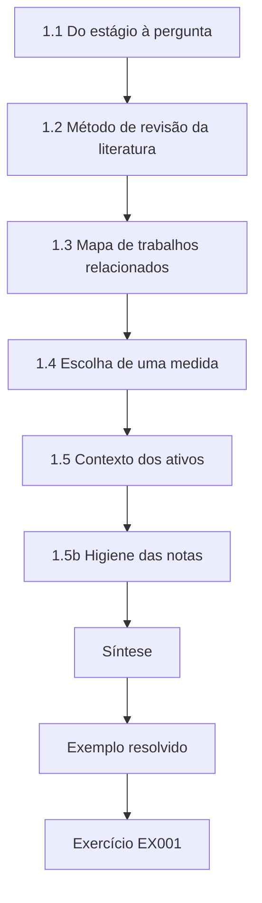

### Desenho lógico

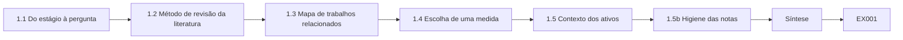

```text
[1.1 Do estágio à pergunta]
    |
    v
[1.2 Método de revisão da literatura]
    |
    v
[1.3 Mapa de trabalhos relacionados]
    |
    v
[1.4 Escolha de uma medida]
    |
    v
[1.5 Contexto dos ativos]
    |
    v
[1.5b Higiene das notas]
    |
    v
[Síntese]
    |
    v
[Exemplo resolvido] --> [Exercício EX001]
```
<!-- cyberabc:lesson-figures:end ch-01 -->


### Objetivos de aprendizagem

Você vai (1) transformar uma observação do local de trabalho numa pergunta de pesquisa; (2) buscar e organizar a literatura sobre metodologia e relato de red team; (3) escrever um mapa de trabalhos relacionados de uma página; (4) escolher uma medida de adoção da remediação; e (5) manter notas que separem alegações de evidências.

### 1.1 Do estágio à pergunta

Noah percebe que alguns achados são corrigidos depressa e outros se arrastam. Uma forma pesquisável pergunta se uma escolha de relato — marcar cada achado com IDs de técnica do MITRE ATT&CK — muda a conclusão da remediação em até 30 dias nos segmentos sintéticos de treinamento da CBM. A observação do local de trabalho ainda não é uma pergunta: não nomeia comparação, prazo nem fonte de dados. A versão de Noah fixa os três. A intervenção é a marcação ATT&CK, a comparação é o texto apenas narrativo, e a medida é a conclusão em até 30 dias no sistema de tickets da CBM. Como os segmentos são segmentos sintéticos de treinamento, a pergunta também declara seu próprio limite de generalização.

### 1.2 Método de revisão da literatura

Pesquise o PTES, o NIST SP 800-115, a documentação do ATT&CK, o OWASP WSTG e os materiais do TIBER-EU e do CBEST, além de críticas acadêmicas à pontuação de segurança (Albrecht e Jensen, arXiv:2010.06377). Para cada fonte, registre: alegação, método, medida, limites e relevância para o relato. Uma nota de cinco campos mantém cada fonte honesta. No NIST SP 800-115, a alegação é que as avaliações precisam de planejamento até o relato, o método é uma orientação de processo, e o limite é que ele não oferece resultados de remediação medidos. Registre as strings de busca e a data de cada base de dados que usar, para que a busca possa ser repetida quando os frameworks forem atualizados antes da submissão.

### 1.3 Mapa de trabalhos relacionados

Agrupe as fontes em: metodologia de engajamento; frameworks guiados por ameaças; casos de teste web; críticas ao relato e à pontuação; estudos de remediação do blue team. Sua lacuna deve ficar numa interseção — no caso de Noah, formato do relato × adoção da remediação. O mapa de Noah mostra muitas fontes sobre orientações de relato e algumas sobre remediação, mas poucas que comparem marcações ATT&CK com texto narrativo quanto à conclusão. Essa interseção vazia é a lacuna dele. Desenhe o mapa numa página, com cada fonte posicionada num grupo, para que um orientador veja de relance se a lacuna é real ou se algum grupo não foi pesquisado.

### 1.4 Escolha de uma medida

A conclusão da remediação em até 30 dias é observável no sistema de tickets da CBM para achados sintéticos. Evite medidas que você não consegue ver (a "habilidade" do atacante) ou que inventam uma pontuação única de segurança. Para Noah, remediado significa fechado com evidência de verificação anexada e não reaberto em até 30 dias, conferido por alguém que desconhece a hipótese. Essa definição pode ser aplicada a cada ticket do mesmo modo. Uma medida como "risco reduzido" não pode, porque ninguém conseguiria conferi-la a partir dos dados, e os examinadores perguntariam como ela foi observada.

### 1.5 Contexto dos ativos

Antes de estudar relatórios, saiba o que está sendo avaliado. Classifique os ativos sintéticos por exposição, sensibilidade dos dados e raio de impacto, para que os cenários da dissertação sejam realistas.

```python
"""Rank synthetic assets for authorized engagement scoping."""
assets = [
    ("public-web-portal", 3, 3, 3),      # exposure, data_sensitivity, blast_radius 1-3
    ("staging-admin-ui", 2, 3, 2),
    ("corp-vpn-edge", 3, 2, 3),
    ("internal-wiki", 1, 2, 1),
    ("printer-fleet", 2, 1, 1),
    ("lab-jump-host", 1, 1, 2),
]
print(f"{'asset':20} score exposure data blast")
for name, e, d, b in sorted(assets, key=lambda x: -(x[1]+x[2]+x[3])):
    print(f"{name:20} {e+d+b:5} {e:8} {d:4} {b:5}")
```

Saída esperada:

```text
asset                score exposure data blast
public-web-portal        9        3    3     3
corp-vpn-edge            8        3    2     3
staging-admin-ui         7        2    3     2
internal-wiki            4        1    2     1
printer-fleet            4        2    1     1
lab-jump-host            4        1    1     2
```

O laboratório de inventário soma exposição, sensibilidade dos dados e raio de impacto, cada um de 1 a 3. O portal web público pontua 9, a borda de VPN 8 e a interface administrativa de staging 7, enquanto a wiki interna, o parque de impressoras e o jump host do laboratório pontuam 4. Os cenários construídos em torno dos ativos de pontuação mais alta refletem onde a CBM agenda primeiro suas avaliações de treinamento. Os três ativos mais baixos empatam em 4, então a ordem entre eles é arbitrária.

### 1.5b Higiene das notas

Mantenha um diário de pesquisa que separe citações, paráfrases e suas próprias alegações. Registre as strings de busca e as datas para que as atualizações da literatura possam ser repetidas. Quando uma fonte for um framework vivo (ATT&CK, WSTG), anote a versão ou a data de acesso ao lado de cada citação. O diário de Noah também registra quais fontes mudaram a opinião dele e por quê. Quando um framework lança uma nova versão durante a dissertação, as datas de acesso mostram quais citações precisam ser conferidas. Marque cada alegação nas suas notas com a fonte, para que um leitor distinga a sua visão da do autor. Isso poupa horas na escrita do capítulo de trabalhos relacionados.

### 1.6 Exemplo resolvido (caso sintético da CBM)

A pergunta de Noah: nos segmentos sintéticos da CBM, os achados marcados com ATT&CK têm uma taxa de remediação em 30 dias maior que os achados apenas narrativos? O laboratório de inventário classifica o public-web-portal no topo (pontuação 9), coincidindo com onde a CBM agenda primeiro as avaliações de treinamento. A pergunta nomeia o contexto, a comparação e a medida, então pode ser respondida com dados de tickets. A classificação dos ativos mantém o estudo próximo de como a CBM realmente trabalha, o que importa quando os examinadores perguntam se os cenários eram realistas. Ambas aparecem no primeiro capítulo da dissertação de Noah, com a saída do laboratório como evidência.

### 1.7 Erros e limites

Três erros são comuns: perguntas que apenas elogiam uma ferramenta; notas de literatura que copiam resumos; e medidas sem fonte de dados. Cada erro enfraquece a dissertação desde o início. Uma pergunta que apenas elogia uma ferramenta pressupõe a resposta e não pode ser falseada. Notas que copiam resumos perdem o método e os limites que decidem se uma fonte sustenta a sua alegação. Uma medida sem fonte de dados não pode ser coletada, por mais interessante que pareça, e o problema só aparece quando a coleta começa. Verifique os três pontos no seu primeiro capítulo antes que o orientador o leia.

### Exercícios

- **EX001 — Observação — Transforme a observação de Noah numa pergunta falseável.** Rubrica: 3 = população, intervenção, medida; 2 = duas; 1 = vaga; 0 = nenhuma.
- **EX002 — Nota — Escreva uma nota de cinco campos sobre o NIST SP 800-115.** Rubrica: 3 = alegação, método, medida, limites, relevância; 2 = quatro; 1 = dois; 0 = nenhum.
- **EX003 — Mapa — Posicione cinco fontes no mapa de trabalhos relacionados.** Rubrica: 3 = cinco agrupadas; 2 = quatro; 1 = duas; 0 = nenhuma.
- **EX004 — Medida — Justifique a conclusão da remediação em 30 dias.** Rubrica: 3 = observável, com prazo, relevante; 2 = dois; 1 = um; 0 = nenhum.
- **EX005 — Laboratório de inventário — Por que o public-web-portal fica acima do lab-jump-host?** Rubrica: 3 = exposição/dados/raio de impacto; 2 = parcial; 1 = vaga; 0 = errada.
- **EX006 — Lacuna — Enuncie a lacuna de Noah em três frases.** Rubrica: 3 = trabalhos anteriores, lacuna, contribuição; 2 = dois; 1 = um; 0 = nenhum.
- **EX007 — Semente ética — Liste duas restrições éticas já implícitas.** Rubrica: 3 = apenas sintético, autorização; 2 = uma; 1 = vaga; 0 = nenhuma.

### Síntese

Os hábitos de seminário e de literatura transformam a prática de red team em perguntas pesquisáveis com limites éticos.

### Continue estudando — capítulo 01 de 08

[← Página do curso](../../README.md) · [Índice de capítulos do curso](../SUBJECTS.md) · [Capítulo 02 (rascunho) →](#ch-02)

<a id="ch-02"></a>

## Capítulo 2 — Segurança ofensiva autorizada e red team: seminário avançado

<!-- cyberabc:lesson-figures:start ch-02 -->
### Mapa da aula

Aula 02 publicada. Mapa, exemplo, EX008.

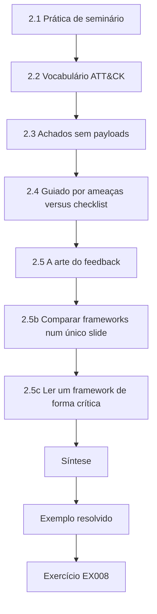

### Desenho lógico

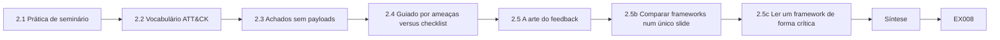

```text
[2.1 Prática de seminário]
    |
    v
[2.2 Vocabulário ATT&CK]
    |
    v
[2.3 Achados sem payloads]
    |
    v
[2.4 Guiado por ameaças versus checklist]
    |
    v
[2.5 A arte do feedback]
    |
    v
[2.5b Comparar frameworks num único slide]
    |
    v
[2.5c Ler um framework de forma crítica]
    |
    v
[Síntese]
    |
    v
[Exemplo resolvido] --> [Exercício EX008]
```
<!-- cyberabc:lesson-figures:end ch-02 -->


### Objetivos de aprendizagem

Você vai (1) apresentar e criticar artigos e frameworks de metodologia; (2) usar o ATT&CK como vocabulário comum; (3) priorizar achados sintéticos sem detalhes de exploração; (4) debater testes guiados por ameaças versus testes por checklist; e (5) dar feedback estruturado aos pares.

### 2.1 Prática de seminário

A cada semana, um estudante apresenta um framework ou artigo: alegação, evidência e o que um estudo de mestrado poderia reaproveitar. Os pares entregam feedback por escrito: questão maior, questão menor, pergunta. O feedback por escrito mantém a discussão no trabalho, e não em quem apresenta. Quando Noah apresenta a marcação ATT&CK como intervenção de relato, a questão maior levantada pelos pares é que a qualidade das marcações pode variar. Esse comentário mais tarde se torna a auditoria de marcações dele. Guarde o feedback de cada semana no diário de pesquisa, com a ação que você tomou em resposta.

### 2.2 Vocabulário ATT&CK

Rotule as técnicas planejadas e as observadas. Cobertura é comunicação, não prova de segurança. Os IDs de técnica do ATT&CK dão a testadores e defensores nomes comuns para comportamentos, como T1046 Network Service Discovery ou T1078 Valid Accounts. No laboratório de cobertura, cinco de sete técnicas planejadas foram observadas, ou 71%. Esse número diz o que a avaliação exercitou, não qual risco permanece. As técnicas planejadas que não foram vistas entram no próximo plano autorizado, em vez de serem testadas por conta própria. Use uma única versão fixada do ATT&CK para todos os rótulos, para que as marcações continuem comparáveis ao longo do estudo.

### 2.3 Achados sem payloads

Pratique escrever achados como título, ativo afetado, referência de evidência, impacto, probabilidade e recomendação — nunca como receitas de exploração. O laboratório de achados pontua cada achado sintético como impacto vezes quatro, mais explorabilidade vezes dois, mais exposição. O SYN-001, uma senha padrão de administrador na interface web de staging, pontua 20 e é crítico; o SYN-002, cabeçalhos ausentes no site público, pontua 9 e é médio. Nenhuma das entradas diz como explorar coisa alguma. Quem remedia precisa do ativo, da referência de evidência e da correção, não do ataque. O SYN-005, uma conta de serviço do laboratório com direitos de administrador de domínio, pontua 17 e também é crítico.

### 2.4 Guiado por ameaças versus checklist

O TIBER-EU e o CBEST enfatizam cenários guiados por inteligência para serviços financeiros críticos. O PTES e o WSTG apoiam uma cobertura técnica estruturada. Uma dissertação deve dizer qual lógica usa. O estudo de Noah usa a lógica estruturada: achados sintéticos de avaliações de treinamento em segmentos da CBM, registrados em tickets. Ele não toma emprestada nenhuma fase de inteligência de ameaças, então seus resultados nada dizem sobre testes guiados por inteligência de serviços financeiros em produção. Declarar isso cedo impede que os leitores suponham que a comparação se aplica a engajamentos TIBER-EU ou CBEST, e molda o capítulo de limitações.

### 2.5 A arte do feedback

Questões maiores mudam conclusões; questões menores dão acabamento. Cite evidências quando discordar.

```python
"""ATT&CK-style coverage matrix over synthetic authorized techniques (names only)."""
# Synthetic engagement log: technique_id -> observed (True/False)
PLAN = ["T1046", "T1595", "T1082", "T1083", "T1059", "T1078", "T1021"]
OBSERVED = {"T1046", "T1595", "T1082", "T1083", "T1078"}
LABELS = {
    "T1046": "Network Service Discovery",
    "T1595": "Active Scanning",
    "T1082": "System Information Discovery",
    "T1083": "File and Directory Discovery",
    "T1059": "Command and Scripting Interpreter",
    "T1078": "Valid Accounts",
    "T1021": "Remote Services",
}
covered = 0
for tid in PLAN:
    hit = tid in OBSERVED
    covered += hit
    print(f"{tid} {LABELS[tid]:34} {'COVERED' if hit else 'PLANNED-NOT-SEEN'}")
print(f"coverage={covered}/{len(PLAN)} ({100*covered/len(PLAN):.0f}%)")
```

Saída esperada:

```text
T1046 Network Service Discovery          COVERED
T1595 Active Scanning                    COVERED
T1082 System Information Discovery       COVERED
T1083 File and Directory Discovery       COVERED
T1059 Command and Scripting Interpreter  PLANNED-NOT-SEEN
T1078 Valid Accounts                     COVERED
T1021 Remote Services                    PLANNED-NOT-SEEN
coverage=5/7 (71%)
```

```python
"""Score synthetic findings for report priority (no exploit details)."""
# impact 0-3, exploitability 0-3, exposure 0-3  -> priority
findings = [
    ("SYN-001", "default admin password on staging web UI", 3, 3, 2),
    ("SYN-002", "missing security headers on public site", 1, 1, 3),
    ("SYN-003", "outdated TLS on internal admin port", 2, 2, 1),
    ("SYN-004", "verbose error messages disclose paths", 1, 2, 2),
    ("SYN-005", "service account with domain admin in lab AD", 3, 2, 1),
]

def priority(impact, exploitability, exposure):
    score = impact*4 + exploitability*2 + exposure
    if score >= 16: return "critical", score
    if score >= 11: return "high", score
    if score >= 7: return "medium", score
    return "low", score

for fid, title, i, e, x in findings:
    p, s = priority(i, e, x)
    print(f"{fid} priority={p:8} score={s:2} impact={i} exploitability={e} exposure={x} :: {title}")
```

Saída esperada:

```text
SYN-001 priority=critical score=20 impact=3 exploitability=3 exposure=2 :: default admin password on staging web UI
SYN-002 priority=medium   score= 9 impact=1 exploitability=1 exposure=3 :: missing security headers on public site
SYN-003 priority=high     score=13 impact=2 exploitability=2 exposure=1 :: outdated TLS on internal admin port
SYN-004 priority=medium   score=10 impact=1 exploitability=2 exposure=2 :: verbose error messages disclose paths
SYN-005 priority=critical score=17 impact=3 exploitability=2 exposure=1 :: service account with domain admin in lab AD
```

Um comentário maior útil sobre a ideia de Noah é que a qualidade das marcações não é medida; um comentário menor útil é que a versão do ATT&CK deveria ser nomeada. Ambos são específicos e acionáveis. Um feedback que só elogia não dá a quem apresenta nada para corrigir. Quando discordar, aponte a fonte, os dados ou a saída de laboratório que sustentam a sua visão. Separe com clareza o maior do menor, para que quem apresenta saiba quais comentários precisam ser respondidos antes de o desenho ser fixado.

### 2.5b Comparar frameworks num único slide

Um slide de seminário útil tem três colunas: a pergunta que o framework responde, o artefato que ele espera (ROE, cenário, caso de teste) e um modo de falha (teatro do checklist, teatro da inteligência, teatro da cobertura). Os estudantes saem sabendo quando não forçar o encaixe de um framework. Por exemplo, o ATT&CK responde o que um adversário pode fazer, espera observações no nível de técnica e falha quando porcentagens de cobertura são lidas como segurança. Mantenha cada coluna em uma linha. Desenhe as mesmas três colunas para o PTES, o WSTG, o TIBER-EU e o CBEST. O slide de Noah mostra que o estudo dele se encaixa melhor na lógica do PTES e do WSTG, e diz com franqueza onde o ATT&CK não consegue nomear uma falha de processo.

### 2.5c Ler um framework de forma crítica

Cada framework embute um pressuposto que você deve testar antes de citá-lo numa dissertação. O PTES pressupõe um cliente capaz de declarar o impacto no negócio antes de o teste começar; na Cedar Bridge Mutual, a equipe de sinistros não conseguiu, então a reunião de escopo de Noah produziu uma lista de processos críticos (entrada de sinistros, aprovação de pagamentos) em vez de hosts. O ATT&CK pressupõe que o comportamento pode ser nomeado na granularidade de técnica; um achado sobre uma etapa de aprovação ausente nos pagamentos não tem técnica, e forçar uma (T1078, Valid Accounts) esconderia a falha de processo. O TIBER-EU pressupõe uma fase de inteligência de ameaças conduzida pelo regulador; uma seguradora de porte médio fora desse regime toma emprestada a estrutura, mas precisa dizer isso. Escreva cada pressuposto como uma frase no seu capítulo de métodos e declare se ele se confirmou no seu contexto.

### 2.6 Exemplo resolvido (caso sintético da CBM)

Noah apresenta a marcação ATT&CK como intervenção de relato. Os pares observam que a qualidade das marcações pode variar. O laboratório de cobertura mostra 71% de um conjunto planejado observado; o laboratório de achados classifica o SYN-001 como crítico sem descrever um caminho de exploração. O comentário dos pares sobre a qualidade das marcações muda o desenho: Noah planeja uma auditoria das marcações em relação às definições do ATT&CK. O número de cobertura de 71% é relatado como aquilo que a avaliação exercitou. O SYN-001 é classificado como crítico, com pontuação 20, e a entrada do relatório traz o ativo, a referência de evidência e a correção, sem caminho de exploração.

### 2.7 Erros e limites

Três erros são comuns: seminários que demonstram ataques; feedback que só elogia; e tratar a % de cobertura como risco residual. Cada erro prejudica o seminário. Demonstrações de ataque espalham detalhes de uso dual e rompem o limite do curso. Um feedback que só elogia deixa desenhos fracos sem contestação até que os examinadores encontrem os problemas. Ler a cobertura como risco residual transforma a descrição do que foi exercitado numa falsa alegação de segurança, o erro contra o qual o laboratório de cobertura alerta. Verifique os três pontos no seu plano de seminário e no seu feedback. Um revisor de fora do seminário consegue identificá-los depressa.

### Exercícios

- **EX008 — Apresentação — Esboce um seminário de 10 minutos sobre o PTES.** Rubrica: 3 = alegação, fases, limites, reaproveitamento; 2 = três; 1 = um; 0 = nenhum.
- **EX009 — Cobertura — Interprete com ética as linhas planejadas e não vistas.** Rubrica: 3 = próximo trabalho autorizado, não ação por conta própria; 2 = parcial; 1 = atacar agora; 0 = nenhuma.
- **EX010 — Achado — Reescreva o SYN-005 como entrada de relatório (sem passos de exploração).** Rubrica: 3 = ativo, impacto, referência de evidência, recomendação; 2 = três; 1 = passos; 0 = nenhuma.
- **EX011 — Guiado por ameaças — Quando um teste no estilo CBEST é mais apropriado que um teste web por checklist?** Rubrica: 3 = serviços críticos, guiado por inteligência, supervisão; 2 = dois; 1 = um; 0 = nenhum.
- **EX012 — Feedback — Escreva um comentário maior e um menor sobre a ideia de Noah.** Rubrica: 3 = ambos específicos; 2 = um; 1 = vago; 0 = nenhum.
- **EX013 — WSTG — O que o WSTG acrescenta que o ATT&CK não oferece?** Rubrica: 3 = casos e procedimentos de teste web para aplicações web autorizadas; 2 = parcial; 1 = vaga; 0 = errada.
- **EX014 — Uso dual — Por que proibir demonstrações de exploração no seminário?** Rubrica: 3 = uso dual, ética, limite do curso; 2 = dois; 1 = um; 0 = nenhum.

### Síntese

Os hábitos de seminário e de literatura transformam a prática de red team em perguntas pesquisáveis com limites éticos.

### Continue estudando — capítulo 02 de 08

[← Capítulo 01 (rascunho)](#ch-01) · [Índice de capítulos do curso](../SUBJECTS.md) · [Capítulo 03 (rascunho) →](#ch-03)

<a id="ch-03"></a>

## Capítulo 3 — Desenho do estudo, ética e reprodutibilidade

<!-- cyberabc:lesson-figures:start ch-03 -->
### Mapa da aula

Aula 03 publicada. Mapa, exemplo, EX015.

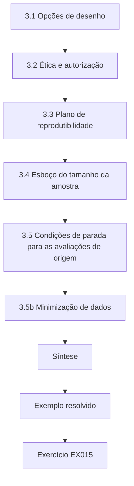

### Desenho lógico

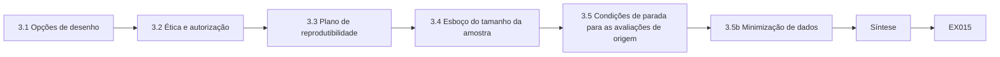

```text
[3.1 Opções de desenho]
    |
    v
[3.2 Ética e autorização]
    |
    v
[3.3 Plano de reprodutibilidade]
    |
    v
[3.4 Esboço do tamanho da amostra]
    |
    v
[3.5 Condições de parada para as avaliações de origem]
    |
    v
[3.5b Minimização de dados]
    |
    v
[Síntese]
    |
    v
[Exemplo resolvido] --> [Exercício EX015]
```
<!-- cyberabc:lesson-figures:end ch-03 -->


### Objetivos de aprendizagem

Você vai (1) escolher um desenho de estudo que compare formatos de relato de forma justa; (2) definir regras de inclusão e de ética; (3) planejar a reprodutibilidade desde o primeiro dia; (4) dimensionar a amostra a partir de uma estimativa piloto; e (5) escrever condições de parada para o trabalho de avaliação que gera os achados.

### 3.1 Opções de desenho

Um desenho entre achados atribui aleatoriamente cada achado sintético ao texto de relatório marcado com ATT&CK ou ao texto apenas narrativo, mantendo fixos a severidade e a classe do ativo. Isso gera muitas unidades e permite a estratificação. Um desenho entre engajamentos alterna os formatos de relatório por semana. É mais simples na operação, mas confunde o formato com o tempo e com a carga da equipe. Prefira o desenho entre achados quando o sistema de tickets puder armazenar uma marca de formato.

No caso de Noah, a marca de formato pode ser armazenada no sistema de tickets da CBM, então a aleatorização entre achados é possível. Manter fixas a severidade e a classe do ativo importa porque, do contrário, os achados marcados poderiam se concentrar em tickets de alta severidade, que são corrigidos mais depressa só por esse motivo.

### 3.2 Ética e autorização

Todas as avaliações que produzem achados para o estudo são executadas sob autorização por escrito e apenas em segmentos sintéticos. Operadores e responsáveis pela remediação consentem com o uso dos metadados dos tickets na pesquisa. Nenhum dado real de cliente entra na dissertação. Regra de uso dual: os achados descrevem o impacto e as referências de evidência, nunca passos de exploração. Se uma avaliação de treinamento tocar inesperadamente um host de produção, as condições de parada disparam e a pesquisa é pausada junto com a avaliação.

Noah arquiva a autorização e o consentimento dos responsáveis pela remediação antes que o primeiro achado entre no estudo. Os formulários de consentimento declaram a finalidade, os metadados de tickets usados, o direito de desistir e um contato do orientador.

### 3.3 Plano de reprodutibilidade

Publique o script de aleatorização, os dois modelos de relatório, a definição operacional de remediado e um esquema sintético de exportação de tickets. Fixe a versão do ATT&CK usada nas marcações. Um par deve conseguir regenerar suas tabelas a partir da exportação sintética. Cada item responde a uma pergunta que um examinador pode fazer. O script mostra como os achados foram atribuídos; os modelos mostram o que os responsáveis pela remediação viram; a definição mostra o que contou como remediado; e o esquema permite que outros confiram a exportação. Com a versão do ATT&CK fixada, as marcações escritas no início do estudo mantêm o mesmo significado no fim, mesmo depois de atualizações do framework.

### 3.4 Esboço do tamanho da amostra

Se a conclusão no formato narrativo for de cerca de 40% em 30 dias, detectar uma alta para 60% exige da ordem de 100 achados por braço para uma comparação aproximada. Trate isso como um esboço de planejamento; refine-o depois da estimativa de variância do piloto. O esboço também alerta sobre a viabilidade. Se as avaliações de treinamento da CBM produzirem só algumas dezenas de achados por mês, chegar a 100 por braço pode levar um período letivo inteiro ou mais. Noah registra isso como risco de cronograma na proposta. O piloto do Capítulo 5 serve para melhorar a estimativa, não para responder à pergunta.

### 3.5 Condições de parada para as avaliações de origem

Host fora do escopo, aparecimento de dados pessoais reais ou impacto na disponibilidade de serviços compartilhados — pare, escalone e pause a coleta de dados da pesquisa até a liberação. A pesquisa nunca pressiona os avaliadores a continuar de forma insegura. 
```python
"""Evaluate proposed actions against synthetic rules of engagement."""
ROE = {
    "hours": ("09:00", "17:00"),
    "deny_actions": {"denial-of-service", "phishing-staff", "exfiltrate-real-data"},
    "require_approval": {"password-spray-lab", "privilege-escalation-lab"},
    "max_concurrency": 5,
}
proposals = [
    ("service-enum", "10:30", 3, False),
    ("denial-of-service", "10:30", 1, False),
    ("password-spray-lab", "10:30", 2, False),
    ("password-spray-lab", "10:30", 2, True),
    ("service-enum", "18:00", 2, False),
    ("service-enum", "11:00", 20, False),
]

def ok_time(t):
    return ROE["hours"][0] <= t <= ROE["hours"][1]

for action, when, conc, approved in proposals:
    reasons=[]
    if action in ROE["deny_actions"]: reasons.append("deny-action")
    if action in ROE["require_approval"] and not approved: reasons.append("needs-approval")
    if not ok_time(when): reasons.append("outside-hours")
    if conc > ROE["max_concurrency"]: reasons.append("concurrency")
    print(f"action={action:20} when={when} conc={conc:2} approved={approved} -> {'ALLOW' if not reasons else 'DENY'} {','.join(reasons) or '-'}")
```

Saída esperada:

```text
action=service-enum         when=10:30 conc= 3 approved=False -> ALLOW -
action=denial-of-service    when=10:30 conc= 1 approved=False -> DENY deny-action
action=password-spray-lab   when=10:30 conc= 2 approved=False -> DENY needs-approval
action=password-spray-lab   when=10:30 conc= 2 approved=True -> ALLOW -
action=service-enum         when=18:00 conc= 2 approved=False -> DENY outside-hours
action=service-enum         when=11:00 conc=20 approved=False -> DENY concurrency
```

O laboratório de ROE mostra a mesma lógica para as ações propostas: a enumeração de serviços dentro do horário de trabalho é permitida; a negação de serviço é negada; um password spray de laboratório é negado até ser aprovado; trabalhar às 18:00 ou com concorrência 20 é negado. Achados produzidos por trabalho fora dessas regras nunca entram nos dados do estudo.

### 3.5b Minimização de dados

As exportações de tickets para a pesquisa devem remover nomes sempre que possível, manter IDs de papel e excluir texto livre que possa conter credenciais. Guarde as exportações criptografadas em repouso no drive da universidade, com acesso restrito a Noah e aos orientadores. A retenção termina no congelamento do arquivo da dissertação mais um ano, salvo se a ética exigir exclusão antes. A exportação de Noah remove os nomes dos responsáveis pela remediação e os campos de texto livre. Os IDs de papel mantêm a análise possível sem nomear pessoas: Noah ainda consegue conferir que os redatores não avaliaram os próprios achados. O texto livre é excluído porque os responsáveis pela remediação às vezes colam trechos de configuração ou senhas nos comentários dos tickets. A regra de retenção está escrita na submissão ao comitê de ética e no plano de gestão de dados, para que a data de exclusão seja conferida, e não lembrada.

### 3.6 Exemplo resolvido (caso sintético da CBM)

Noah escolhe a aleatorização entre achados na VLAN 40 sintética da CBM. A autorização e o consentimento dos responsáveis pela remediação estão arquivados. O padrão do laboratório de ROE — negar ações inseguras, exigir aprovação para laboratórios sensíveis, fazer cumprir o horário — é espelhado nos runbooks de avaliação, para que os dados do estudo só se acumulem a partir de trabalho bem governado. A VLAN 40 é um segmento sintético de treinamento, então nenhum dado de cliente está envolvido. Os runbooks fazem com que uma ação negada ou não aprovada seja interrompida antes de produzir um achado, e os dados da pesquisa venham apenas de trabalho que a autorização permite. O desenho, a autorização e o consentimento são arquivados com o orientador antes do início da coleta.

### 3.7 Erros e limites

Três erros são comuns: aleatorizar depois de ver os resultados; usar segmentos de clientes reais; e não ter definição de remediado. Cada erro custa caro para corrigir depois. Aleatorizar depois de ver os resultados permite ao pesquisador conduzir os achados para o braço que convém à hipótese, o que destrói a comparação. Segmentos de clientes reais expõem dados reais e rompem a autorização. Sem uma definição de remediado, cada ticket é julgado de um jeito, e a medida primária perde o sentido. Verifique os três pontos no desenho antes de a coleta começar. O desenho de Noah trata de cada um por escrito.

### Exercícios

- **EX015 — Desenho — Compare os desenhos entre achados e entre engajamentos.** Rubrica: 3 = compromissos de poder estatístico e confundidores; 2 = um desenho; 1 = vaga; 0 = nenhuma.
- **EX016 — Ética — Liste cinco controles éticos.** Rubrica: 3 = cinco pertinentes; 2 = quatro; 1 = dois; 0 = nenhum.
- **EX017 — Remediado — Defina remediado de forma operacional.** Rubrica: 3 = critérios verificáveis e quem confere; 2 = parcial; 1 = vaga; 0 = nenhuma.
- **EX018 — Vínculo com as ROE — Por que a pesquisa herda as condições de parada da avaliação.** Rubrica: 3 = segurança primeiro, qualidade dos dados; 2 = um; 1 = vaga; 0 = nenhuma.
- **EX019 — Amostra — Critique o esboço de 100 por braço.** Rubrica: 3 = pressupostos, necessidade do piloto, viabilidade; 2 = dois; 1 = um; 0 = nenhum.
- **EX020 — Consentimento — Escreva os itens do consentimento dos responsáveis pela remediação.** Rubrica: 3 = finalidade, dados, desistência, contatos; 2 = três; 1 = um; 0 = nenhum.

### Síntese

As decisões de desenho, ética e reprodutibilidade são tomadas antes que os tickets se acumulem — não são reflexões tardias.

### Continue estudando — capítulo 03 de 08

[← Capítulo 02 (rascunho)](#ch-02) · [Índice de capítulos do curso](../SUBJECTS.md) · [Capítulo 04 (rascunho) →](#ch-04)

<a id="ch-04"></a>

## Capítulo 4 — Segurança ofensiva autorizada e red team: explicações concorrentes

<!-- cyberabc:lesson-figures:start ch-04 -->
### Mapa da aula

Aula 04 publicada. Mapa, exemplo, EX021.

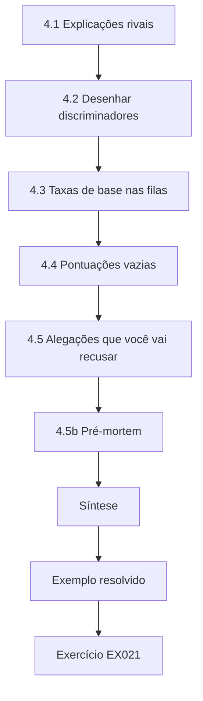

### Desenho lógico

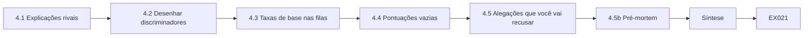

```text
[4.1 Explicações rivais]
    |
    v
[4.2 Desenhar discriminadores]
    |
    v
[4.3 Taxas de base nas filas]
    |
    v
[4.4 Pontuações vazias]
    |
    v
[4.5 Alegações que você vai recusar]
    |
    v
[4.5b Pré-mortem]
    |
    v
[Síntese]
    |
    v
[Exemplo resolvido] --> [Exercício EX021]
```
<!-- cyberabc:lesson-figures:end ch-04 -->


### Objetivos de aprendizagem

Você vai (1) listar explicações alternativas para uma diferença na taxa de remediação; (2) desenhar verificações que as separem; (3) usar taxas de base ao interpretar alertas de tickets; (4) evitar pontuações de segurança vazias; e (5) pré-especificar quais explicações você consegue testar.

### 4.1 Explicações rivais

Se os achados marcados forem remediados mais depressa, as rivais incluem: as marcações deixam os tickets mais claros; as marcações se correlacionam com severidade mais alta por construção; os responsáveis pela remediação tratam os tickets da pesquisa de outro modo (efeito Hawthorne); as marcações ATT&CK foram aplicadas só quando o redator foi mais cuidadoso de modo geral. Cada rival prevê algo diferente, e é isso que as torna testáveis. Se as marcações simplesmente deixam os tickets mais claros, o ganho deve aparecer em todas as severidades. Se a severidade gera a diferença, equilibrar a severidade deve eliminá-la. Se os responsáveis pela remediação reagem ao fato de serem estudados, os dois braços devem melhorar juntos. Se redatores cuidadosos marcam mais, a auditoria das marcações e as verificações de qualidade da redação devem mostrar isso.

### 4.2 Desenhar discriminadores

Equilibre a severidade e a classe do ativo entre os braços com aleatorização estratificada. Mantenha os responsáveis pela remediação cegos à hipótese da pesquisa. Audite uma amostra de marcações quanto à correção em relação às definições do ATT&CK. Meça o tempo até a primeira resposta, além da conclusão em 30 dias. Cada verificação mira uma rival. A estratificação responde ao desequilíbrio de severidade; o cegamento responde ao efeito Hawthorne; a auditoria das marcações responde às marcações ruins; e o tempo até a primeira resposta mostra se os tickets marcados também são assumidos mais cedo, e não só concluídos mais cedo. Noah escreve essas verificações no pré-registro, para que a análise não possa escolhê-las depois da chegada dos dados.

### 4.3 Taxas de base nas filas

As filas de segurança estão cheias de problemas verdadeiros de baixa prevalência. Uma marca de urgência ruidosa cria, na maior parte, falsa urgência. A mesma aritmética que rege a precisão da detecção em baixa prevalência rege as políticas de escalonamento de tickets. O laboratório de taxa de base torna isso concreto. Com taxa de verdadeiros positivos de 95% e taxa de falsos positivos de 5%, uma marca aplicada onde 1% dos tickets é de fato urgente tem precisão de cerca de 0,161, então a maioria dos tickets marcados não é urgente. Os responsáveis pela remediação que percebem isso deixam de confiar na marca, o que pode atrasar o trabalho que ela deveria acelerar.

### 4.4 Pontuações vazias

Albrecht e Jensen (arXiv:2010.06377) argumentam que o rav do OSSTMM não é uma grandeza válida de segurança operacional. Sua dissertação não deve inventar uma nova pontuação única; compare resultados concretos de remediação sob condições declaradas. Para Noah, o resultado concreto é a conclusão em até 30 dias, relatada por braço com um intervalo. Os leitores podem conferi-la na exportação de tickets. Uma pontuação composta combinaria coisas que não podem ser conferidas separadamente, e os examinadores perguntariam o que significa a mudança de um ponto. As tabelas de Noah relatam resultados com suas contagens.

### 4.5 Alegações que você vai recusar

Você não vai alegar que remediação mais rápida significa menos violações nem que cobertura do ATT&CK equivale a segurança. Diga o que os dados dos tickets conseguem sustentar — e pare aí. 
```python
"""Lab B: base rates and alarm precision (Bayes' rule).
An urgent flag with given true- and false-positive rates is applied
to ticket queues with different shares of truly urgent issues."""
for tpr, fpr in ((0.95, 0.05), (0.95, 0.01), (0.80, 0.001)):
    for prev in (0.10, 0.01, 0.001):
        tp = tpr * prev; fp = fpr * (1 - prev)
        prec = tp / (tp + fp)
        per_10k = round(10000 * (tp + fp))
        print(f"tpr={tpr:.2f} fpr={fpr:.3f} prevalence={prev:.3f} precision={prec:.3f} alerts_per_10k={per_10k}")
```

Saída esperada:

```text
tpr=0.95 fpr=0.050 prevalence=0.100 precision=0.679 alerts_per_10k=1400
tpr=0.95 fpr=0.050 prevalence=0.010 precision=0.161 alerts_per_10k=590
tpr=0.95 fpr=0.050 prevalence=0.001 precision=0.019 alerts_per_10k=509
tpr=0.95 fpr=0.010 prevalence=0.100 precision=0.913 alerts_per_10k=1040
tpr=0.95 fpr=0.010 prevalence=0.010 precision=0.490 alerts_per_10k=194
tpr=0.95 fpr=0.010 prevalence=0.001 precision=0.087 alerts_per_10k=109
tpr=0.80 fpr=0.001 prevalence=0.100 precision=0.989 alerts_per_10k=809
tpr=0.80 fpr=0.001 prevalence=0.010 precision=0.890 alerts_per_10k=90
tpr=0.80 fpr=0.001 prevalence=0.001 precision=0.445 alerts_per_10k=18
```

Escreva as alegações recusadas no capítulo de limitações, com palavras simples. Para Noah, elas incluem a redução de violações, a cobertura da matriz como segurança e qualquer alegação sobre programas corporativos em produção, como o CBEST ou o TIBER-EU. Nomeá-las cedo impede que o capítulo de discussão, ou um gestor que o leia, ultrapasse a evidência. Mantenha a lista curta e específica.

### 4.5b Pré-mortem

Antes do estudo principal, escreva um pré-mortem: "O estudo falhou porque…", listando desequilíbrio de severidade, erros de marcação, cegueira à interface, rotatividade da equipe e expiração da autorização. Atribua um detector e uma mitigação a cada linha. Os pré-mortems flagram problemas a baixo custo. O detector de Noah para erros de marcação é a auditoria das marcações; a mitigação é a revisão por uma segunda pessoa. Para a expiração da autorização, ele anota a data de término e pede a renovação um mês antes. Escreva o pré-mortem como uma tabela curta e revise-o com o orientador antes do travamento do instrumento. O desequilíbrio de severidade é detectado conferindo o equilíbrio dos braços depois da aleatorização; a rotatividade da equipe, acompanhando quais responsáveis pela remediação saem durante a coleta.

### 4.6 Exemplo resolvido (caso sintético da CBM)

Noah pré-especifica as rivais: desequilíbrio de severidade, qualidade das marcações, efeitos Hawthorne. O laboratório de taxa de base mostra que, com 1% de prevalência e 5% de falsos positivos, a precisão é de cerca de 0,161 — um alerta contra rótulos de urgência indiscriminados. Ele vai relatar a concordância da auditoria das marcações ao lado do resultado primário. Pré-especificar as rivais significa que Noah não pode acrescentá-las nem descartá-las quando os resultados chegarem. O número de precisão sustenta a decisão dele de não acrescentar marcas de urgência aos tickets da pesquisa, já que a maioria seria falsa nessa prevalência. Relatar a concordância da auditoria das marcações ao lado do resultado primário permite aos leitores julgar quanto do efeito depende de marcações corretas.

### 4.7 Erros e limites

Três erros são comuns: alegar redução de violações; ignorar a qualidade das marcações; e pontuações compostas únicas de melhoria da segurança. Cada erro exagera o que o estudo mostra. Os dados de tickets não conseguem medir violações, então uma alegação de redução de violações vai além da evidência. Ignorar a qualidade das marcações esconde erro de medição na própria intervenção. Uma pontuação composta única de melhoria combina coisas que não podem ser conferidas separadamente, o erro que Albrecht e Jensen descrevem. Verifique os três pontos no capítulo de discussão antes da submissão. O pré-registro e o capítulo de limitações de Noah tratam de cada um deles por escrito.

### Exercícios

- **EX021 — Rivais — Liste quatro explicações rivais.** Rubrica: 3 = quatro pertinentes; 2 = três; 1 = uma; 0 = nenhuma.
- **EX022 — Equilíbrio — Como você vai equilibrar a severidade entre os braços?** Rubrica: 3 = estratificação ou aleatorização restrita; 2 = parcial; 1 = ignorar; 0 = nenhuma.
- **EX023 — Taxa de base — Usando o laboratório, explique o risco da marca de urgência com 1% de prevalência / 5% de FPR.** Rubrica: 3 = precisão ~0,16, carga de alertas; 2 = números; 1 = vaga; 0 = errada.
- **EX024 — OSSTMM — Por que evitar uma pontuação do tipo rav nesta dissertação?** Rubrica: 3 = crítica de validade, preferência por resultados concretos; 2 = parcial; 1 = vaga; 0 = nenhuma.
- **EX025 — Cegamento — Como os responsáveis pela remediação podem ser mantidos cegos?** Rubrica: 3 = ocultar a hipótese/o propósito do formato; 2 = parcial; 1 = dispensar o cegamento; 0 = nenhuma.
- **EX026 — Limites da alegação — Escreva uma alegação que você não vai fazer.** Rubrica: 3 = exagero sobre violações/risco recusado com motivo; 2 = parcial; 1 = ainda exagera; 0 = nenhuma.

### Síntese

Explicações concorrentes mantêm você honesto: desenhe verificações para as rivais e recuse alegações que seus dados não conseguem sustentar.

### Continue estudando — capítulo 04 de 08

[← Capítulo 03 (rascunho)](#ch-03) · [Índice de capítulos do curso](../SUBJECTS.md) · [Capítulo 05 (rascunho) →](#ch-05)

<a id="ch-05"></a>

## Capítulo 5 — Proposta e piloto

<!-- cyberabc:lesson-figures:start ch-05 -->
### Mapa da aula

Aula 05 publicada. Mapa, exemplo, EX027.

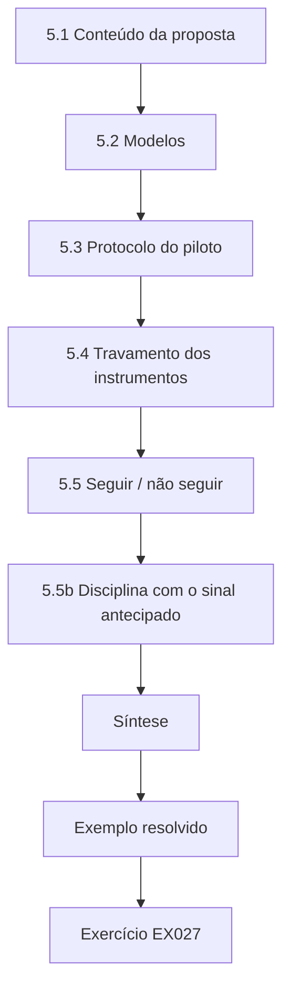

### Desenho lógico

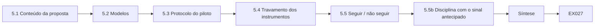

```text
[5.1 Conteúdo da proposta]
    |
    v
[5.2 Modelos]
    |
    v
[5.3 Protocolo do piloto]
    |
    v
[5.4 Travamento dos instrumentos]
    |
    v
[5.5 Seguir / não seguir]
    |
    v
[5.5b Disciplina com o sinal antecipado]
    |
    v
[Síntese]
    |
    v
[Exemplo resolvido] --> [Exercício EX027]
```
<!-- cyberabc:lesson-figures:end ch-05 -->


### Objetivos de aprendizagem

Você vai (1) escrever uma proposta curta que seu orientador possa aprovar; (2) construir modelos de relatório para os dois braços; (3) conduzir um piloto com achados sintéticos; (4) estimar as taxas de conclusão e o esforço da auditoria das marcações; e (5) travar os instrumentos antes da coleta principal.

### 5.1 Conteúdo da proposta

Inclua pergunta, justificativa, desenho, medidas, ética, cronograma e riscos. Anexe a autorização para as avaliações sintéticas e os formulários de consentimento. Declare os limites de uso dual num parágrafo que seu orientador possa citar. Para Noah, a linha da pergunta diz: nos segmentos sintéticos da CBM, os achados marcados com ATT&CK atingem uma taxa de remediação em 30 dias maior que os achados apenas narrativos? O parágrafo do desenho nomeia a aleatorização entre achados na VLAN 40, com estratos de severidade e classe do ativo. A seção de riscos traz o esboço de planejamento do capítulo 3: se a conclusão narrativa ficar perto de 40%, detectar uma alta para 60% exige da ordem de 100 achados por braço, então um calendário de avaliações lento é, por si só, um risco para o cronograma.

### 5.2 Modelos

Campos do modelo narrativo: título, ativo, referência de evidência, impacto, recomendação. Modelo marcado: os mesmos, mais os IDs de técnica do ATT&CK e a tática correspondente. Os dois modelos proíbem explicitamente passos de exploração ou credenciais. Manter todos os outros campos idênticos é o que torna a comparação justa: se o modelo marcado também tivesse uma seção de impacto mais longa, qualquer diferença na remediação poderia vir desse texto extra, e não dos campos ATT&CK. Por isso Noah constrói o modelo marcado acrescentando campos ao narrativo, nunca o reescrevendo. A versão fixada do ATT&CK vai para o rodapé do modelo, para que um responsável pela remediação que abra um ticket meses depois veja as mesmas definições de técnica que o redator usou.

### 5.3 Protocolo do piloto

Gere 40 achados sintéticos a partir de uma avaliação de treinamento na VLAN 40; aleatorize; entregue os tickets; observe um sinal antecipado de 14 dias se os 30 dias ultrapassarem o calendário do período letivo; audite as marcações quanto à correção. Quarenta achados ficam muito abaixo dos cerca de 100 por braço necessários para a comparação principal, então o piloto não serve para responder à pergunta. Sua função é mostrar que a aleatorização produz braços equilibrados, que os tickets chegam ao sistema da CBM com a marca de formato registrada, que os responsáveis pela remediação conseguem ver os campos de marcação e que a auditoria das marcações flagra IDs de técnica incorretos. O sinal de 14 dias é apenas uma verificação antecipada da variância para refinar o esboço do tamanho da amostra, nunca um resultado preliminar.

### 5.4 Travamento dos instrumentos

Congele os modelos, a versão do ATT&CK, a definição de remediação e o código de aleatorização. Registre as versões no capítulo de métodos. Depois do travamento, mudanças exigem uma emenda aprovada pelo orientador. O travamento importa sobretudo para a definição de remediação. Se Noah decidisse, depois de ver os tickets do piloto, que um ticket fechado como risco aceito conta como remediado, ele poderia mover a taxa de 30 dias em qualquer dos braços. Com o travamento em vigor, uma mudança assim vira uma emenda que o orientador precisa aprovar e que o capítulo de métodos precisa relatar, para que os examinadores vejam se alguma regra mudou depois da chegada dos dados.

### 5.5 Seguir / não seguir

Siga se a autorização se mantiver, se os modelos forem utilizáveis na interface de tickets e se o formato for registrado em cada ticket. Não siga, ou redesenhe, se os responsáveis pela remediação não conseguirem ver as marcações sem abrir um campo oculto. A condição do campo oculto não é cosmética. Se os responsáveis pela remediação precisarem clicar num painel recolhido para ver os IDs de técnica, muitos tickets marcados seriam, na prática, lidos como tickets narrativos, e o estudo compararia dois braços que parecem iguais para quem faz o trabalho. Um "não seguir" aqui custa semanas; seguir adiante custaria a validade da dissertação inteira.


```python
"""Check proposed engagement targets against a written scope (synthetic)."""
SCOPE_CIDRS = [("10.20.0.0", 16), ("192.168.50.0", 24)]  # inclusive synthetic ranges
SCOPE_PORTS = {22, 80, 443, 8080}
DENY_HOSTS = {"10.20.0.1", "192.168.50.1"}  # out-of-scope infra

def ip_int(s):
    a,b,c,d = map(int, s.split("."))
    return (a<<24)|(b<<16)|(c<<8)|d

def in_cidr(ip, net, bits):
    mask = (0xFFFFFFFF << (32-bits)) & 0xFFFFFFFF
    return (ip_int(ip) & mask) == (ip_int(net) & mask)

def check(host, port):
    reasons = []
    if host in DENY_HOSTS:
        reasons.append("deny-list")
    if not any(in_cidr(host, n, b) for n,b in SCOPE_CIDRS):
        reasons.append("outside-cidr")
    if port not in SCOPE_PORTS:
        reasons.append("port-not-in-scope")
    return ("ALLOW" if not reasons else "DENY"), reasons

tests = [
    ("10.20.1.10", 443),
    ("10.20.0.1", 443),
    ("192.168.50.20", 22),
    ("192.168.50.20", 3389),
    ("8.8.8.8", 80),
    ("192.168.1.10", 80),
]
for h,p in tests:
    v, r = check(h,p)
    print(f"target={h}:{p} decision={v} reasons={','.join(r) or '-'}")
```

Saída esperada:

```text
target=10.20.1.10:443 decision=ALLOW reasons=-
target=10.20.0.1:443 decision=DENY reasons=deny-list
target=192.168.50.20:22 decision=ALLOW reasons=-
target=192.168.50.20:3389 decision=DENY reasons=port-not-in-scope
target=8.8.8.8:80 decision=DENY reasons=outside-cidr
target=192.168.1.10:80 decision=DENY reasons=outside-cidr
```

### 5.5b Disciplina com o sinal antecipado

Um sinal antecipado de 14 dias pode orientar a logística, mas não deve reescrever a medida primária de 30 dias. Se você o relatar, rotule-o como exploratório. A alegação confirmatória da dissertação continua sendo a comparação pré-registrada da conclusão em 30 dias. No piloto de Noah, o sinal de 14 dias, de 10 em 20 respostas antecipadas no braço marcado contra 6 em 20 no narrativo, é usado apenas para refinar o esboço do tamanho da amostra. Ele nunca é relatado como resultado preliminar. Se o resultado de 30 dias do estudo principal for diferente, a alegação confirmatória fica com o resultado de 30 dias. Mantenha o rótulo de exploratório em cada tabela.

### 5.6 Exemplo resolvido (caso sintético da CBM)

Sinal antecipado do piloto: 10/20 respostas antecipadas no braço marcado contra 6/20 no narrativo. Auditoria das marcações: 2/20 marcações erradas — Noah acrescenta uma conferência das marcações por uma segunda pessoa. As regras do laboratório de escopo continuam no runbook de avaliação: hosts da lista de negação e portas fora do escopo nunca entram nos dados do estudo. O piloto cumpriu seu propósito: a aleatorização, a entrega e a marca de formato funcionaram, e a auditoria das marcações encontrou cedo um problema. Duas marcações erradas em vinte são uma taxa de erro de 10%, o suficiente para embaçar uma diferença entre os braços, então Noah acrescenta uma conferência por uma segunda pessoa antes da coleta principal. Os números de resposta antecipada orientam a logística, não as conclusões.

### 5.7 Erros e limites

Três erros são comuns: pilotos em produção; mudar os modelos no meio do estudo principal; e pular a auditoria das marcações. Cada erro prejudica o estudo principal. Pilotos em sistemas de produção rompem a autorização e expõem dados reais. Mudar os modelos durante o estudo principal significa que as duas metades dos dados medem coisas diferentes, e o travamento dos instrumentos existe para impedir isso. Pular a auditoria das marcações deixa IDs de técnica errados sem detecção, como mostraram as 2 em 20 do piloto. Verifique os três pontos no plano do piloto antes da decisão de seguir. A decisão de seguir de Noah lista cada um.

### Exercícios

- **EX027 — Proposta — Liste oito títulos de seção da proposta.** Rubrica: 3 = oito pertinentes; 2 = seis; 1 = três; 0 = nenhum.
- **EX028 — Modelo — Escreva os campos do modelo marcado.** Rubrica: 3 = campos narrativos mais IDs do ATT&CK, sem passos de exploração; 2 = falta um; 1 = inclui passos de exploração; 0 = nenhuma.
- **EX029 — Laboratório de escopo — Nomeie dois casos de DENY que os avaliadores devem respeitar.** Rubrica: 3 = dois motivos corretos do laboratório; 2 = um; 1 = vaga; 0 = errada.
- **EX030 — Auditoria das marcações — O que implicam 2/20 marcações erradas?** Rubrica: 3 = erro de medição, acrescentar revisão, relatar; 2 = parcial; 1 = ignorar; 0 = nenhuma.
- **EX031 — Critérios para seguir — Escreva quatro critérios para seguir.** Rubrica: 3 = quatro; 2 = três; 1 = um; 0 = nenhum.
- **EX032 — Risco de interface — A interface de tickets esconde as marcações — qual a resposta?** Rubrica: 3 = não seguir até ficarem visíveis; 2 = parcial; 1 = continuar; 0 = nenhuma.

### Síntese

A proposta e o piloto transformam uma pergunta em instrumentos travados e num portão realista de seguir / não seguir.

### Continue estudando — capítulo 05 de 08

[← Capítulo 04 (rascunho)](#ch-04) · [Índice de capítulos do curso](../SUBJECTS.md) · [Capítulo 06 (rascunho) →](#ch-06)

<a id="ch-06"></a>

## Capítulo 6 — Coleta e análise de dados

<!-- cyberabc:lesson-figures:start ch-06 -->
### Mapa da aula

Aula 06 publicada. Mapa, exemplo, EX033.

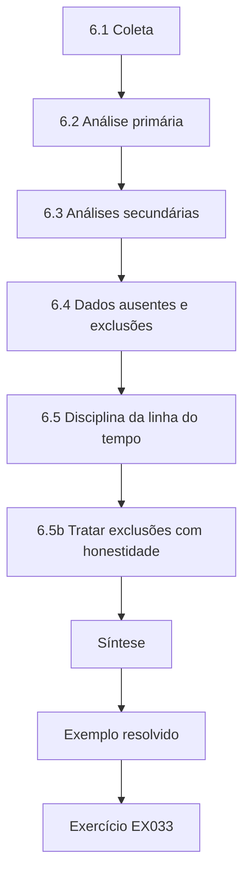

### Desenho lógico

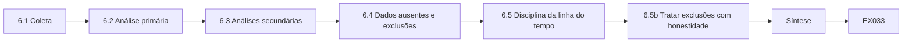

```text
[6.1 Coleta]
    |
    v
[6.2 Análise primária]
    |
    v
[6.3 Análises secundárias]
    |
    v
[6.4 Dados ausentes e exclusões]
    |
    v
[6.5 Disciplina da linha do tempo]
    |
    v
[6.5b Tratar exclusões com honestidade]
    |
    v
[Síntese]
    |
    v
[Exemplo resolvido] --> [Exercício EX033]
```
<!-- cyberabc:lesson-figures:end ch-06 -->


### Objetivos de aprendizagem

Você vai (1) coletar dados de tickets sem quebrar o cegamento; (2) analisar as medidas primárias e secundárias com incerteza; (3) relatar a qualidade da auditoria das marcações; (4) separar análises confirmatórias de exploratórias; e (5) tratar dados ausentes e exclusões com transparência.

### 6.1 Coleta

Exporte os tickets semanalmente com a marca de formato, a severidade, a classe do ativo, os carimbos de tempo e o motivo de fechamento. Não diga aos responsáveis pela remediação qual braço "deve vencer". Os avaliadores que escrevem os achados não devem avaliar a remediação. As exportações semanais permitem a Noah perceber cedo campos ausentes, sem olhar os resultados por braço. Manter os responsáveis pela remediação sem saber o vencedor esperado protege contra o efeito Hawthorne nomeado no Capítulo 4. Separar redatores de avaliadores impede que um avaliador julgue os próprios achados com mais benevolência. Guarde cada exportação com sua data e seu hash.

### 6.2 Análise primária

Compare as proporções de remediação em 30 dias com intervalos. Prefira uma diferença de riscos ou uma razão de riscos com intervalo de confiança. Estratifique ou ajuste pela severidade se a aleatorização usou estratos.

```python
"""Lab S: reporting attack-success rates honestly: Wilson intervals,
seed variation and a paired bootstrap. Synthetic trial outcomes only."""
import math, random
def wilson(k, n, z=1.96):
    p = k/n; d = 1 + z*z/n
    c = (p + z*z/(2*n))/d; h = z*math.sqrt(p*(1-p)/n + z*z/(4*n*n))/d
    return c - h, c + h
for k, n in ((3, 20), (30, 200), (300, 2000)):
    lo, hi = wilson(k, n); print(f"successes={k}/{n} rate={k/n:.3f} wilson95=[{lo:.3f}, {hi:.3f}]")
# five seeds of a synthetic defence evaluation: per-seed attack success rate
rates = []
for seed in range(5):
    r = random.Random(seed); rates.append(sum(r.random() < 0.12 for _ in range(200))/200)
m = sum(rates)/5; sd = math.sqrt(sum((x-m)**2 for x in rates)/4)
print("per-seed rates:", " ".join(f"{x:.3f}" for x in rates), f"mean={m:.3f} sd={sd:.3f}")
# paired bootstrap: baseline vs defence on the same 300 synthetic trials
r = random.Random(42)
base = [r.random() < 0.30 for _ in range(300)]
defn = [b and r.random() < 0.6 for b in base]   # defence blocks ~40% of successes
diffs = []
for _ in range(2000):
    idx = [r.randrange(300) for _ in range(300)]
    diffs.append(sum(base[i] for i in idx)/300 - sum(defn[i] for i in idx)/300)
diffs.sort()
print(f"baseline_asr={sum(base)/300:.3f} defended_asr={sum(defn)/300:.3f} "
      f"reduction_ci95=[{diffs[50]:.3f}, {diffs[1949]:.3f}]")
```

Saída esperada:

```text
successes=3/20 rate=0.150 wilson95=[0.052, 0.360]
successes=30/200 rate=0.150 wilson95=[0.107, 0.206]
successes=300/2000 rate=0.150 wilson95=[0.135, 0.166]
per-seed rates: 0.110 0.130 0.135 0.105 0.145 mean=0.125 sd=0.017
baseline_asr=0.350 defended_asr=0.190 reduction_ci95=[0.120, 0.203]
```

O Lab S mostra o hábito com ensaios sintéticos: 3 sucessos em 20 dão um intervalo de Wilson de 0,052 a 0,360, enquanto 300 em 2.000 dão de 0,135 a 0,166. A mesma taxa significa certezas muito diferentes, então relate as contagens e o intervalo ao lado de cada proporção. Para Noah, o resultado primário é uma diferença de riscos de cerca de 18 pontos entre 62% de 110 achados marcados e 44% de 108 achados narrativos, com um intervalo que exclui o zero. A severidade foi um estrato, então ele também relata a diferença dentro de cada nível de severidade.

### 6.3 Análises secundárias

Tempo até a primeira resposta; concordância da auditoria das marcações; conclusão por classe de ativo. Rotule as análises secundárias com clareza. Não promova um resultado secundário a "o achado" se o primário for nulo. Para Noah, as análises secundárias ajudam a explicar o resultado primário. A concordância da auditoria das marcações mostra quão confiável foi a intervenção; o tempo até a primeira resposta mostra se os tickets marcados foram assumidos mais cedo; e os resultados por classe de ativo mostram onde algum efeito foi maior. Cada uma é relatada com seu intervalo e rotulada como secundária ou exploratória. Se o resultado primário tivesse sido nulo, nenhuma delas teria virado a manchete.

### 6.4 Dados ausentes e exclusões

Pré-registre as regras: tickets reabertos em até 30 dias contam como não remediados de forma duradoura; tickets em ativos sintéticos desativados são excluídos e listados. Relate as contagens de exclusão. Noah aplica as duas regras com um script escrito antes da coleta, de modo que um ticket reaberto passa para a coluna de não remediados sem nenhum julgamento do analista. A semana de reconstrução da VLAN 40 se enquadra numa exclusão de infraestrutura pré-registrada, e a tabela de resultados mostra a diferença com e sem ela, 18 e 16 pontos. As contagens de exclusão aparecem na tabela de resultados, não só num apêndice. Os leitores devem conseguir conferir que nenhum outro ticket foi descartado e que a semana excluída não mudou a conclusão.

### 6.5 Disciplina da linha do tempo

Mantenha uma linha do tempo operacional das avaliações, exportações e incidentes (mesmo incidentes sintéticos de treinamento) para que a análise possa ser reconstruída.

```python
"""Rebuild a synthetic engagement timeline from event records."""
events = [
    ("09:00", "ROE brief signed", "auth"),
    ("09:15", "scoped host inventory loaded (12 hosts)", "prep"),
    ("10:02", "service enumeration on 10.20.1.0/28", "enum"),
    ("10:45", "finding SYN-001 noted on staging UI", "find"),
    ("11:10", "stop: host 10.20.0.1 probed — out of scope", "stop"),
    ("11:12", "escalated to client contact; confirmed deny-list", "comm"),
    ("13:00", "resume on in-scope hosts only", "auth"),
    ("15:30", "debrief draft shared with client", "report"),
]
# print chronological with phase tags; compute stop latency
print("phase timeline:")
for t, msg, phase in events:
    print(f"  {t} [{phase:6}] {msg}")
t0 = 10*60+45; t1 = 11*60+10
print(f"minutes from SYN-001 note to stop: {t1-t0}")
print(f"stop reason present: yes")
print(f"events={len(events)} phases={len(set(p for _,_,p in events))}")
```

Saída esperada:

```text
phase timeline:
  09:00 [auth  ] ROE brief signed
  09:15 [prep  ] scoped host inventory loaded (12 hosts)
  10:02 [enum  ] service enumeration on 10.20.1.0/28
  10:45 [find  ] finding SYN-001 noted on staging UI
  11:10 [stop  ] stop: host 10.20.0.1 probed — out of scope
  11:12 [comm  ] escalated to client contact; confirmed deny-list
  13:00 [auth  ] resume on in-scope hosts only
  15:30 [report] debrief draft shared with client
minutes from SYN-001 note to stop: 25
stop reason present: yes
events=8 phases=7
```

O laboratório de linha do tempo reconstrói um engajamento sintético a partir de oito eventos, incluindo a parada quando o host fora do escopo 10.20.0.1 foi sondado e o escalonamento dois minutos depois. No estudo de Noah, a linha do tempo registra as janelas de avaliação, as exportações semanais, a reconstrução da VLAN 40 e as renovações da autorização, para que os examinadores vejam quando cada evento aconteceu em relação aos dados. Registre cada evento quando ele acontecer, com sua fonte.

### 6.5b Tratar exclusões com honestidade

A semana de reconstrução da VLAN 40 é a lição do capítulo sobre exclusões. Uma exclusão só é legítima quando foi nomeada no pré-registro com seu gatilho ("reconstrução de infraestrutura que afeta o segmento de teste"), quando é aplicada sem conhecer o resultado e quando o relatório mostra o resultado com e sem ela. Aqui, a diferença de 18 pontos passa a 16 pontos se a semana for mantida; os dois números aparecem na tabela de resultados, e a conclusão não depende da escolha. Uma exclusão inventada depois de ver os dados, ou que inverta a conclusão, deve ser relatada como limitação, e não aplicada em silêncio.

### 6.6 Exemplo resolvido (caso sintético da CBM)

Coleta principal: 110 achados marcados e 108 narrativos. Remediados em 30 dias: 62% contra 44% (diferença de cerca de 18 pontos; o intervalo exclui o 0). Concordância da auditoria das marcações de 96% depois da revisão por uma segunda pessoa. Exploratório: o maior ganho foi nos achados web de severidade média. Uma semana excluída quando a VLAN 40 foi reconstruída — exclusão de infraestrutura pré-registrada. O resultado primário é relatado com seu intervalo e suas condições. A auditoria das marcações mostra que a intervenção foi aplicada corretamente na maioria dos tickets depois da conferência por uma segunda pessoa. O ganho nos achados web de severidade média é rotulado como exploratório, porque não foi pré-registrado. A semana excluída é nomeada na tabela de resultados e nas limitações, com o resultado mostrado das duas formas.

### 6.7 Erros e limites

Três erros são comuns: espiar toda semana e parar cedo; exclusões silenciosas; e tratar ganhos exploratórios em subgrupos como confirmatórios. Cada erro enviesa o resultado. Espiar toda semana e parar quando a diferença parece boa infla a chance de um achado falso. Exclusões silenciosas permitem ao pesquisador moldar os dados sem que os leitores saibam. Tratar ganhos exploratórios em subgrupos como confirmatórios transforma uma entre muitas comparações numa manchete. Verifique os três pontos no plano de análise e no capítulo de resultados antes de escrever. O plano de análise de Noah, escrito antes da coleta, trata dos três.

### Exercícios

- **EX033 — Cegamento.** Quem não deve ver as expectativas sobre os braços? Rubrica: 3 = responsáveis pela remediação e avaliadores da remediação; 2 = um; 1 = vaga; 0 = nenhuma.
- **EX034 — Primário.** Relate o resultado primário de Noah numa frase. Rubrica: 3 = taxas, n, ideia de intervalo, condições; 2 = taxas; 1 = "funcionou"; 0 = nenhuma.
- **EX035 — Laboratório de estatística.** Por que preferir intervalos à história de um único valor-p? Rubrica: 3 = magnitude + incerteza; 2 = parcial; 1 = vaga; 0 = errada.
- **EX036 — Exclusão.** Justifique a exclusão da reconstrução da VLAN. Rubrica: 3 = pré-registrada, relatada; 2 = parcial; 1 = esconder; 0 = nenhuma.
- **EX037 — Exploratório.** Como o ganho no subgrupo deve ser rotulado? Rubrica: 3 = exploratório, não primário; 2 = parcial; 1 = como alegação principal; 0 = nenhuma.
- **EX038 — Linha do tempo.** Liste quatro eventos da linha do tempo a guardar. Rubrica: 3 = quatro pertinentes; 2 = três; 1 = um; 0 = nenhum.

### Síntese

A coleta protege o cegamento; a análise respeita a medida primária pré-registrada e diz a verdade sobre exclusões e incerteza.

### Continue estudando — capítulo 06 de 08

[← Capítulo 05 (rascunho)](#ch-05) · [Índice de capítulos do curso](../SUBJECTS.md) · [Capítulo 07 (rascunho) →](#ch-07)

<a id="ch-07"></a>

## Capítulo 7 — Redação da dissertação e limitações

<!-- cyberabc:lesson-figures:start ch-07 -->
### Mapa da aula

Aula 07 publicada. Mapa, exemplo, EX039.

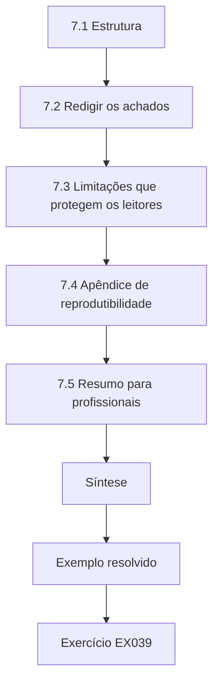

### Desenho lógico

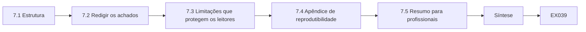

```text
[7.1 Estrutura]
    |
    v
[7.2 Redigir os achados]
    |
    v
[7.3 Limitações que protegem os leitores]
    |
    v
[7.4 Apêndice de reprodutibilidade]
    |
    v
[7.5 Resumo para profissionais]
    |
    v
[Síntese]
    |
    v
[Exemplo resolvido] --> [Exercício EX039]
```
<!-- cyberabc:lesson-figures:end ch-07 -->


### Objetivos de aprendizagem

Você vai (1) estruturar a dissertação em torno do ciclo de pesquisa; (2) escrever os achados sem detalhes de exploração; (3) declarar limitações que delimitem as alegações; (4) preparar um apêndice de reprodutibilidade; e (5) redigir um resumo para profissionais.

### 7.1 Estrutura

Use: introdução; fundamentação (NIST SP 800-115, PTES, ATT&CK, WSTG, TIBER-EU/CBEST); trabalhos relacionados; métodos; resultados; discussão; ética; limitações; conclusão; apêndices (modelos, pré-registro, esquema sintético). Os leitores devem encontrar a pergunta, a medida e a resposta em até cinco minutos depois de abrir o PDF. A introdução de Noah declara a pergunta e a medida de 30 dias no primeiro parágrafo, e o resumo traz o resultado de 62% contra 44% com suas condições. Cada capítulo responde a uma etapa do ciclo de pesquisa: a fundamentação e os trabalhos relacionados explicam a lacuna; os métodos trazem o desenho, as medidas e a ética; os resultados trazem os números; e a discussão e as limitações dizem o que eles significam e onde param. Os apêndices guardam o que os examinadores precisam para conferir o trabalho.

### 7.2 Redigir os achados

Nos exemplos, mostre os campos do relatório e os resultados da remediação. Nunca inclua procedimentos de ataque funcionais. Ao citar evidências sintéticas, use hashes e IDs de ticket. A linguagem de severidade deve corresponder à sua planilha de pontuação, não a adjetivos de marketing. Para Noah, um exemplo de achado na dissertação mostra o ID do ticket, a classe do ativo, a severidade segundo a planilha de pontuação dele, o ID de técnica do ATT&CK quando se aplica o braço marcado, a recomendação e o resultado da remediação em até 30 dias. Ele nunca mostra a requisição que disparou o problema nem qualquer credencial. Citar um hash da evidência sintética permite a um examinador confirmar que o exemplo corresponde ao arquivo, sem que a própria dissertação carregue algo que um atacante possa reaproveitar.

```python
"""Score synthetic findings for report priority (no exploit details)."""
# impact 0-3, exploitability 0-3, exposure 0-3  -> priority
findings = [
    ("SYN-001", "default admin password on staging web UI", 3, 3, 2),
    ("SYN-002", "missing security headers on public site", 1, 1, 3),
    ("SYN-003", "outdated TLS on internal admin port", 2, 2, 1),
    ("SYN-004", "verbose error messages disclose paths", 1, 2, 2),
    ("SYN-005", "service account with domain admin in lab AD", 3, 2, 1),
]

def priority(impact, exploitability, exposure):
    score = impact*4 + exploitability*2 + exposure
    if score >= 16: return "critical", score
    if score >= 11: return "high", score
    if score >= 7: return "medium", score
    return "low", score

for fid, title, i, e, x in findings:
    p, s = priority(i, e, x)
    print(f"{fid} priority={p:8} score={s:2} impact={i} exploitability={e} exposure={x} :: {title}")
```

Saída esperada:

```text
SYN-001 priority=critical score=20 impact=3 exploitability=3 exposure=2 :: default admin password on staging web UI
SYN-002 priority=medium   score= 9 impact=1 exploitability=1 exposure=3 :: missing security headers on public site
SYN-003 priority=high     score=13 impact=2 exploitability=2 exposure=1 :: outdated TLS on internal admin port
SYN-004 priority=medium   score=10 impact=1 exploitability=2 exposure=2 :: verbose error messages disclose paths
SYN-005 priority=critical score=17 impact=3 exploitability=2 exposure=1 :: service account with domain admin in lab AD
```

### 7.3 Limitações que protegem os leitores

Declare: segmentos sintéticos; uma única organização; responsáveis pela remediação voluntários; marcações ATT&CK imperfeitas; 30 dias podem não captar correções lentas; nenhuma alegação sobre taxas de violação. As limitações fazem parte da contribuição, porque impedem a generalização insegura para programas corporativos em produção, como o CBEST ou o TIBER-EU, sem estudo adicional. Noah coloca essas limitações antes da discussão, para que os leitores as encontrem antes de qualquer recomendação. Cada limitação estreita uma alegação. Segmentos sintéticos significam que o resultado pode ser diferente em sistemas em produção; uma única organização significa que a cultura de tickets da CBM pode não ser típica; responsáveis pela remediação voluntários podem ser mais engajados que a média; e marcações imperfeitas significam que o efeito poderia ser mais forte ou mais fraco com marcações perfeitas. A janela de 30 dias pode não captar correções lentas que acabam sendo fechadas.

### 7.4 Apêndice de reprodutibilidade

Inclua scripts, modelos, a versão fixada do ATT&CK, a exportação sintética e um notebook de análise que reconstrua a tabela primária. Calcule o hash da versão publicada para que os examinadores detectem edições acidentais. Para a CBM, o notebook deve reconstruir o resultado primário a partir da exportação sintética: 110 achados marcados e 108 narrativos, 62% contra 44% remediados em 30 dias, com a semana de reconstrução da VLAN 40 excluída e também mostrada mantida. Um examinador capaz de regenerar essa tabela numa máquina limpa não precisa confiar no resumo de Noah, e qualquer divergência de hash avisa que um arquivo mudou depois da publicação.

```python
"""Verify integrity of a synthetic evidence package."""
import hashlib, json
files = {
    "roe.pdf": b"SYNTHETIC-ROE-v1",
    "scope.csv": b"host,port\n10.20.1.10,443\n",
    "findings.json": b'[{"id":"SYN-001"}]',
}
expected = {n: hashlib.sha256(b).hexdigest()[:16] for n,b in files.items()}
# Simulate tampering of findings.json
current = dict(expected)
current["findings.json"] = hashlib.sha256(b'[{"id":"SYN-001"},{"id":"TAMPERED"}]').hexdigest()[:16]
print(json.dumps(expected, indent=1))
for n in sorted(expected):
    status = "OK" if expected[n] == current[n] else "MISMATCH"
    print(f"{n:16} {status}")
```

Saída esperada:

```text
{
 "roe.pdf": "18d74983d403e7db",
 "scope.csv": "01cc4815eddf3de6",
 "findings.json": "7f5f178ab43ef00f"
}
findings.json    MISMATCH
roe.pdf          OK
scope.csv        OK
```

### 7.5 Resumo para profissionais

Duas páginas: como acrescentar campos ATT&CK aos tickets; como auditar as marcações; qual métrica acompanhar (conclusão em 30 dias por severidade); o que não alegar (redução de violações, cobertura da matriz como segurança). Peça a um engenheiro da CBM que siga o resumo sem preparação e anote onde travar. O resumo é escrito para os engenheiros da CBM, não para os examinadores. Ele mostra um ticket marcado ao lado de um narrativo, para que os leitores vejam a diferença de imediato, e lista as alegações recusadas com palavras simples.

### 7.6 Exemplo resolvido (caso sintético da CBM)

A página de limitações de Noah começa pelo escopo sintético. O apêndice dele regenera a Tabela 1 a partir de `tickets_synth.csv`. O estilo do laboratório de achados — prioridade sem caminho de exploração — corresponde aos modelos dele. A verificação de hash flagra uma edição equivocada na amostra do apêndice antes da submissão. A edição equivocada importa porque o apêndice existe para que os examinadores possam reconstruir a Tabela 1: uma mudança não detectada poderia ter deixado os números reconstruídos por eles fora de linha com os 62% e 44% do capítulo de resultados, e a divergência teria lançado dúvida sobre a análise inteira, e não sobre um único arquivo.

### 7.7 Erros e limites

Três erros são comuns: capítulos de métodos que omitem a ética; resultados sem limitações; e apêndices que não rodam. Cada erro enfraquece a dissertação. Sem a ética no capítulo de métodos, os examinadores não conseguem julgar se os dados foram coletados de forma adequada. Resultados sem limitações convidam os leitores a aplicá-los em contextos que o estudo nunca cobriu. Apêndices que não rodam não podem sustentar a alegação de reprodutibilidade, e é por isso que Noah calcula o hash da versão publicada e a testa. Verifique os três pontos na versão final. Peça também a um revisor que os verifique.

### Exercícios

- **EX039 — Esboço.** Liste dez seções da dissertação. Rubrica: 3 = dez coerentes; 2 = oito; 1 = cinco; 0 = nenhuma.
- **EX040 — Estilo do achado.** Escreva o SYN-003 no estilo de exemplo da dissertação. Rubrica: 3 = campos, sem passos de exploração; 2 = parcial; 1 = passos incluídos; 0 = nenhuma.
- **EX041 — Limites.** Liste seis limitações. Rubrica: 3 = seis pertinentes; 2 = quatro; 1 = duas; 0 = nenhuma.
- **EX042 — Laboratório de hash.** O que um MISMATCH exige antes da submissão? Rubrica: 3 = investigar, restaurar, recalcular o hash; 2 = dois; 1 = ignorar; 0 = nenhuma.
- **EX043 — Resumo.** Esboce os títulos do resumo para profissionais. Rubrica: 3 = campos, auditoria, métrica, não alegações; 2 = três; 1 = um; 0 = nenhum.
- **EX044 — Generalização.** Por que ainda não alegar aplicabilidade ao CBEST? Rubrica: 3 = contexto/supervisão diferentes, guiado por inteligência; 2 = dois; 1 = vaga; 0 = nenhuma.

### Síntese

A redação torna o ciclo inspecionável: alegações estruturadas, limites delimitados, apêndices que rodam e um resumo que os profissionais conseguem de fato usar.

### Continue estudando — capítulo 07 de 08

[← Capítulo 06 (rascunho)](#ch-06) · [Índice de capítulos do curso](../SUBJECTS.md) · [Capítulo 08 (rascunho) →](#ch-08)

<a id="ch-08"></a>

## Capítulo 8 — Revisão independente e defesa

<!-- cyberabc:lesson-figures:start ch-08 -->
### Mapa da aula

Aula 08 publicada. Mapa, exemplo, EX045.

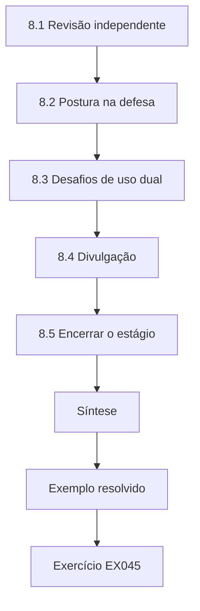

### Desenho lógico

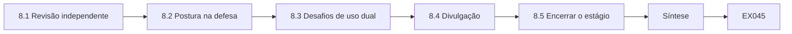

```text
[8.1 Revisão independente]
    |
    v
[8.2 Postura na defesa]
    |
    v
[8.3 Desafios de uso dual]
    |
    v
[8.4 Divulgação]
    |
    v
[8.5 Encerrar o estágio]
    |
    v
[Síntese]
    |
    v
[Exemplo resolvido] --> [Exercício EX045]
```
<!-- cyberabc:lesson-figures:end ch-08 -->


### Objetivos de aprendizagem

Você vai (1) preparar os materiais para a revisão independente; (2) responder a perguntas de métodos e de ética na defesa; (3) lidar com desafios de uso dual; (4) planejar revisões e divulgação; e (5) encerrar o estágio de forma limpa.

### 8.1 Revisão independente

Compartilhe a dissertação, o apêndice sintético e o pacote de ética com um revisor interno que não tenha feito a orientação semanal. Peça que ele confira: o ajuste entre medida e alegação; o cegamento; a auditoria das marcações; e se alguma seção resvala para instruções de ataque. Escolher um revisor que não fez a orientação semanal importa porque um orientador semanal já aceitou o enquadramento de Noah. Um leitor novo tem mais chance de perceber, por exemplo, que a auditoria das marcações só chegou a 96% de concordância depois da revisão por uma segunda pessoa, e de perguntar quantas marcações estavam erradas antes dessa conferência. Os comentários escritos do revisor entram na trilha de resposta ao lado das respostas de Noah.

### 8.2 Postura na defesa

Abra com a pergunta, o desenho, o resultado primário e as condições. Espere perguntas sobre a aleatorização, o equilíbrio de severidade, o porquê dos segmentos sintéticos e o que falsearia o resultado. Leve uma folha-resumo de métodos de uma página. Para Noah, a abertura cabe em cerca de noventa segundos: a marcação ATT&CK aumenta a remediação em 30 dias nos segmentos sintéticos da CBM?; aleatorização estratificada por severidade e classe do ativo; 62% contra 44%, uma diferença de cerca de 18 pontos com um intervalo que exclui o zero; segmentos sintéticos de treinamento, responsáveis pela remediação voluntários e uma única organização. A folha-resumo acrescenta o que falsearia o resultado, como uma auditoria das marcações mostrando que marcações corretas não fizeram diferença.

### 8.3 Desafios de uso dual

Se pedirem para "mostrar como o achado foi explorado", recuse e mostre, em vez disso, os campos do modelo de relatório. Reafirme os limites da autorização e a divulgação coordenada de quaisquer problemas reais encontrados durante o estágio. Um pedido de detalhes de exploração numa defesa costuma ser um teste de julgamento, não um pedido de dados. A resposta de Noah tem quatro partes: ele recusa; mostra o modelo, que deliberadamente não tem campo para passos de exploração; explica que a autorização dele cobria apenas avaliações sintéticas de treinamento; e observa que qualquer problema real encontrado durante o estágio seguiria o caminho de divulgação coordenada da CBM, e não iria para uma dissertação.

### 8.4 Divulgação

Submeta um artigo curto a um evento de medição ou de fatores humanos, no estilo do SOUPS, se for apropriado; apresente internamente o resumo para profissionais; publique o apêndice sintético com hashes. Não publique materiais que identifiquem o cliente. Cada produto tem suas próprias exclusões. O artigo curto relata a comparação de 30 dias e seus limites, mas nenhum identificador da CBM. O resumo interno pode nomear equipes da CBM, porque fica dentro da CBM. O apêndice público contém apenas a exportação sintética, os scripts e os modelos, publicados com hashes para que leitores futuros confirmem que têm os mesmos arquivos que os examinadores conferiram.

```python
"""ATT&CK-style coverage matrix over synthetic authorized techniques (names only)."""
# Synthetic engagement log: technique_id -> observed (True/False)
PLAN = ["T1046", "T1595", "T1082", "T1083", "T1059", "T1078", "T1021"]
OBSERVED = {"T1046", "T1595", "T1082", "T1083", "T1078"}
LABELS = {
    "T1046": "Network Service Discovery",
    "T1595": "Active Scanning",
    "T1082": "System Information Discovery",
    "T1083": "File and Directory Discovery",
    "T1059": "Command and Scripting Interpreter",
    "T1078": "Valid Accounts",
    "T1021": "Remote Services",
}
covered = 0
for tid in PLAN:
    hit = tid in OBSERVED
    covered += hit
    print(f"{tid} {LABELS[tid]:34} {'COVERED' if hit else 'PLANNED-NOT-SEEN'}")
print(f"coverage={covered}/{len(PLAN)} ({100*covered/len(PLAN):.0f}%)")
```

Saída esperada:

```text
T1046 Network Service Discovery          COVERED
T1595 Active Scanning                    COVERED
T1082 System Information Discovery       COVERED
T1083 File and Directory Discovery       COVERED
T1059 Command and Scripting Interpreter  PLANNED-NOT-SEEN
T1078 Valid Accounts                     COVERED
T1021 Remote Services                    PLANNED-NOT-SEEN
coverage=5/7 (71%)
```

### 8.5 Encerrar o estágio

Devolva os acessos; confirme que apenas dados sintéticos permanecem no arquivo; agradeça aos responsáveis pela remediação; deixe os modelos de ticket se a CBM quiser ficar com eles. A linguagem de cobertura do laboratório vira um lembrete didático: os itens planejados e não vistos esperam o próximo plano autorizado. Encerrar de forma limpa faz parte da evidência de que o trabalho foi governado. Noah devolve as contas de avaliação no último dia, pede à CBM que confirme por escrito a remoção delas e confere que o arquivo guarda apenas tickets sintéticos. Oferecer os modelos marcados é opcional para a CBM; adotá-los no trabalho em produção exigiria autorização própria, como observa o exemplo resolvido abaixo.

### 8.6 Exemplo resolvido (caso sintético da CBM)

Na defesa, perguntam a Noah se a marcação ATT&CK apenas marca achados que já estavam bem escritos. Ele aponta a aleatorização estratificada e a auditoria das marcações e aceita que o confundimento residual é uma limitação. Ele recusa um pedido de detalhes de exploração e mostra que o modelo não tem campo para passos de exploração. A CBM adota os modelos marcados para as avaliações de treinamento, enquanto aguarda um piloto em produção sob autorização separada. A resposta à pergunta sobre confundimento é honesta: a aleatorização e a auditoria o reduzem, mas não conseguem eliminá-lo.

### 8.7 Erros e limites

Três erros são comuns: defesas que exageram o impacto em empresas em produção; compartilhar detalhes de vulnerabilidades reais no apêndice público; e deixar acessos privilegiados ativos depois do estágio. Cada erro desfaz o cuidado anterior. Exagerar o impacto em empresas em produção vai além de segmentos sintéticos de treinamento e de uma única organização. Detalhes de vulnerabilidades reais num apêndice público transformam a pesquisa num recurso de ataque. Acessos privilegiados deixados ativos depois do estágio são um risco para a CBM, e é por isso que Noah devolve as contas e pede confirmação por escrito. Verifique os três pontos no plano de defesa e de encerramento.

### Exercícios

- **EX045 — Pedido de revisão.** Escreva quatro perguntas para o revisor independente. Rubrica: 3 = quatro pertinentes; 2 = três; 1 = uma; 0 = nenhuma.
- **EX046 — Abertura.** Escreva uma abertura de defesa de 90 segundos. Rubrica: 3 = pergunta, desenho, resultado, condições; 2 = três; 1 = vaga; 0 = nenhuma.
- **EX047 — Recusar.** Responda a "mostre a exploração" em quatro frases. Rubrica: 3 = recusa, demonstração do modelo, ética, CVD; 2 = três; 1 = atende ao pedido; 0 = nenhuma.
- **EX048 — Divulgação.** Planeje dois produtos com exclusões. Rubrica: 3 = ambos com exclusões; 2 = um; 1 = vaga; 0 = nenhuma.
- **EX049 — Cobertura.** Como os itens planejados e não vistos orientam o trabalho autorizado futuro? Rubrica: 3 = backlog sob autorização; 2 = parcial; 1 = ação por conta própria; 0 = nenhuma.
- **EX050 — Encerramento.** Liste cinco passos de encerramento do estágio. Rubrica: 3 = cinco pertinentes; 2 = três; 1 = um; 0 = nenhum.

### Síntese

A revisão independente e a defesa testam se as suas alegações, a sua ética e os seus artefatos se sustentam sem você na sala — e se você deixa a organização anfitriã mais segura e mais organizada do que a encontrou.

### Continue estudando — capítulo 08 de 08

[← Capítulo 07 (rascunho)](#ch-07) · [Índice de capítulos do curso](../SUBJECTS.md) · [Resoluções ↓](#worked-results) · [Próximo curso pelo índice de capítulos →](../SUBJECTS.md)

<a id="worked-results"></a>

## Resoluções

Respostas-modelo para EX001–EX050. A Cedar Bridge Mutual, Noah Kim e todos os seus números são sintéticos. Qualquer resposta que atenda à rubrica recebe a mesma pontuação.

**EX001.** Nos segmentos sintéticos da CBM, os achados marcados com ATT&CK têm uma taxa de remediação em 30 dias maior que os achados apenas narrativos?

**EX002.** Alegação: as avaliações precisam de planejamento até o relato. Método: orientação de processo. Medida: aderência qualitativa ao processo. Limites: não é um manual detalhado de exploração. Relevância: estrutura as avaliações de origem de Noah.

**EX003.** Metodologia: PTES, NIST 800-115. Guiados por ameaças: TIBER-EU, CBEST. Casos web: WSTG. Crítica à pontuação: arXiv:2010.06377. Vocabulário: ATT&CK.

**EX004.** Ela é visível nos tickets, tem prazo definido e está ligada à ação do defensor — ao contrário de alegações vagas de "risco reduzido".

**EX005.** Maior exposição, sensibilidade dos dados e raio de impacto (9 contra 4).

**EX006.** Existem orientações de relato; existem estudos de remediação; poucos comparam marcações ATT&CK com texto narrativo quanto à conclusão.

**EX007.** Apenas segmentos sintéticos; autorização por escrito para as avaliações que geram os dados.

**EX008.** Fases, ênfase no escopo, limites (sem supervisão guiada por ameaças), reaproveitamento no planejamento de engajamentos.

**EX009.** Coloque-as no próximo plano autorizado — não teste por conta própria.

**EX010.** Título SYN-005; ativo: conta de serviço do AD do laboratório; impacto: concentração de privilégios; referência de evidência: hash da captura de tela do laboratório; recomendação: remover o DA da conta de serviço; sem passos de exploração.

**EX011.** Serviços financeiros críticos que precisam de cenários guiados por inteligência sob supervisão regulatória.

**EX012.** Maior: a qualidade das marcações não é medida. Menor: definir a versão do ATT&CK.

**EX013.** Casos concretos de teste web para aplicações web autorizadas; o ATT&CK é um vocabulário do adversário, não um manual de procedimentos web.

**EX014.** Dano de uso dual, ética do curso e risco jurídico — os seminários ensinam crítica, não armas.

**EX015.** Entre achados: mais poder estatístico, exige a marca de formato. Entre engajamentos: mais simples, com confundidores temporais.

**EX016.** Autorização; dados sintéticos; consentimento; nenhum texto de exploração; condições de parada.

**EX017.** Fechado com evidência de verificação anexada e não reaberto em até 30 dias; conferido por um avaliador cego à hipótese.

**EX018.** Segurança primeiro; dados vindos de um trabalho que continuou de forma insegura estariam contaminados e seriam antiéticos.

**EX019.** Pressupõe 40%→60%; precisa da variância do piloto; pode ser pesado para um período letivo — divida a coleta em fases.

**EX020.** Finalidade; metadados de tickets usados; desistência voluntária; contato do orientador.

**EX021.** Clareza; desequilíbrio de severidade; Hawthorne; redação melhor de modo geral.

**EX022.** Estratifique a aleatorização por severidade×classe do ativo.

**EX023.** Precisão ≈0,161, então a maioria das marcas de "urgente" é falsa nessa prevalência — discipline os rótulos de urgência.

**EX024.** Pontuações únicas carecem de validade; compare, em vez disso, resultados concretos de remediação.

**EX025.** Não revele qual formato a hipótese espera que vença; descreva ambos como modelos-padrão.

**EX026.** "Relatórios marcados reduzem violações" — os dados de tickets não conseguem sustentar isso.

**EX027.** Pergunta; justificativa; desenho; medidas; ética; cronograma; riscos; anexos.

**EX028.** Título, ativo, referência de evidência, impacto, recomendação, IDs de técnica, tática — sem passos de exploração.

**EX029.** Host da lista de negação 10.20.0.1; porta 3389 fora do escopo; 8.8.8.8 fora do CIDR.

**EX030.** Erro de medição — acrescente a revisão por uma segunda pessoa e relate a concordância.

**EX031.** Autorização válida; marcações visíveis; marca de formato armazenada; instrumentos travados.

**EX032.** Não seguir até que a interface mostre as marcações sem etapas ocultas.

**EX033.** Os responsáveis pela remediação e qualquer pessoa que avalie a remediação.

**EX034.** Nos segmentos sintéticos da CBM, 62% de 110 achados marcados contra 44% de 108 achados narrativos foram remediados em 30 dias (intervalo da diferença excluindo o 0).

**EX035.** Os intervalos mostram magnitude e incerteza; valores-p sozinhos escondem ambas.

**EX036.** Exclusão de infraestrutura pré-registrada, relatada nas limitações.

**EX037.** Apenas exploratório — não é a alegação confirmatória.

**EX038.** Janelas de avaliação; exportações; reconstrução da VLAN; renovações da autorização.

**EX039.** Introdução; fundamentação; trabalhos relacionados; métodos; resultados; discussão; ética; limitações; conclusão; apêndices.

**EX040.** SYN-003, TLS desatualizado no admin interno — alta (pontuação 13) segundo a planilha de pontuação; referência de evidência; recomendar a atualização do TLS; sem passos de exploração do handshake.

**EX041.** Apenas sintético; uma única empresa; voluntários; erros de marcação; janela de 30 dias; nenhuma alegação sobre violações.

**EX042.** Investigar, restaurar a partir de uma cópia confiável, recalcular o hash e então submeter.

**EX043.** Campos; auditoria das marcações; métrica de 30 dias; lista de não alegações.

**EX044.** O CBEST é guiado por inteligência, com supervisão regulatória sobre empresas financeiras em produção — população e controles diferentes.

**EX045.** Ajuste entre medida e alegação? O cegamento se manteve? A auditoria das marcações foi adequada? Houve algum resvalo para instruções de ataque?

**EX046.** "Comparei achados marcados com ATT&CK e achados narrativos em segmentos sintéticos; a remediação em 30 dias foi de 62% contra 44%, com cerca de 110 achados por braço, sob autorização."

**EX047.** "Não vou mostrar uma exploração. Aqui está o modelo, que não tem campo para passos de exploração. A ética proíbe procedimentos de ataque. Problemas reais seguem pela divulgação coordenada."

**EX048.** Artigo curto (sem IDs do cliente); resumo interno (sem detalhes públicos de vulnerabilidades).

**EX049.** Acrescente-os ao próximo backlog autorizado, com permissão.

**EX050.** Devolver os acessos; confirmar o escopo dos dados; agradecer à equipe; deixar os modelos; revogar os tokens.

<a id="references"></a>
## Referências

Todos os DOIs foram resolvidos em doi.org em 12 de outubro de 2026, e as normas foram conferidas nas páginas de seus editores. A lista é idêntica à da edição em inglês e cobre o livro inteiro; nenhuma das normas técnicas citadas foi verificada aqui como adotada pela ABNT, por isso são citadas em sua edição internacional. Organizações, pessoas, sistemas e números dos casos são sintéticos; somente as obras abaixo são reais.

- Albrecht, M. R., Jensen, R. B. (2020). The Vacuity of the Open Source Security Testing Methodology Manual. arXiv:2010.06377.
- Bank of England / PRA. CBEST Threat Intelligence-Led Assessments — Implementation Guide (2024 update). <https://www.bankofengland.co.uk/financial-stability/operational-resilience-of-the-financial-sector/cbest-threat-intelligence-led-assessments-implementation-guide>
- European Central Bank. TIBER-EU Framework. <https://www.ecb.europa.eu/paym/cyber-resilience/tiber-eu/html/index.en.html>
- MITRE ATT&CK. <https://attack.mitre.org/>
- NIST SP 800-115 (2008). Technical Guide to Information Security Testing and Assessment. <https://doi.org/10.6028/NIST.SP.800-115>
- OWASP Web Security Testing Guide (WSTG). <https://owasp.org/www-project-web-security-testing-guide/>
- Penetration Testing Execution Standard (PTES). <https://pentest-standard.readthedocs.io/en/latest/>
