# OT, IoT and Cyber-Physical Security: Master's Research Methods and Dissertation Practice

- Language: English (`en`); master's course, two years; approximately 1,200 hours of planned study.
- Editorial state: **published**. Chapters 1–8 of 8 have authored teaching text, exercises EX001–EX050 and matching worked results. Independent review and the 300-page A4 verification remain open.
- Audience: beginning researchers with strong domain foundations and research-method literacy who will formulate a question, evaluate prior work and produce reproducible findings in OT, IoT and cyber-physical security.
- Relationship to neighbouring courses: the [master's critical-infrastructure course](../../../critical-sector-security/README.md) studies sectors and cascades; the [doctoral OT course](../../../../doctorate-2-years/ot-iot-security/README.md) deepens research integrity and thesis practice. **This book** trains you to design and complete a master's dissertation on the control-system layer: PLCs, industrial protocols, physics-based detection, safety–security co-engineering and Purdue/ISA-62443 architecture.
- Author: [hiagokinlevi](https://github.com/hiagokinlevi). Original text under [CC0 1.0](../../../../../LICENSE); cited works keep their rights.
- Educational boundary: not an accredited degree. No authority to access real plants. All organizations, datasets, testbeds and numbers in worked examples are **synthetic** unless a sentence cites a public source.

[Course home](../../README.md) · [Chapter index](../SUBJECTS.md) · [Book plan](PLAN.md) · [Course skill](../../skill/SKILL.md) · [Worked results](#worked-results)

## How to use this draft

Eight chapters follow one master's project, the **Harbor Loop Study**: *does a mass-balance residual CUSUM detect single-sensor level replay on a synthetic water-storage loop earlier and with fewer false alarms than a fixed-band process alarm, and under which attacker capability does the advantage disappear?* Chapters cover literature method, the OT seminar, design and ethics, competing explanations, proposal and pilot, analysis, writing and defense.

Keep five labels in every note: observation, inference, claim, decision, physical consequence. Labs use Python 3 standard library only.

### Synthetic corpus

| Element | Role | Boundary |
|---|---|---|
| Harbor Municipal Water, Loop L1 | Primary model: tank, pump, flow meter, level transmitter, PLC, Modbus/TCP | Invented |
| Campus Rig R2 | Pilot and validation: two-tank lab rig with independent float valve | Invented |
| Studies L1–L12 | Fictional literature for appraisal | Invented |
| Operators Q01–Q08 | Fictional interview participants | Invented |

### Core sources

- NIST [SP 800-82 Rev. 3](https://csrc.nist.gov/pubs/sp/800/82/r3/final) (2023).
- [ISA/IEC 62443](https://www.isa.org/standards-and-publications/isa-standards/isa-iec-62443-series-of-standards).
- MITRE [ATT&CK for ICS](https://attack.mitre.org/matrices/ics/).
- Modbus [*Application Protocol V1.1b3*](https://modbus.org/docs/Modbus_Application_Protocol_V1_1b3.pdf).
- Giraldo et al., [ACM CSUR 2018](https://doi.org/10.1145/3203245); Urbina et al., [CCS 2016](https://doi.org/10.1145/2976749.2978388).
- Sommer & Paxson [IEEE S&P 2010](https://doi.org/10.1109/SP.2010.25); Arp et al. [USENIX Security 2022](https://www.usenix.org/conference/usenixsecurity22/presentation/arp).
- Page, [CUSUM, Biometrika 1954](https://doi.org/10.1093/biomet/41.1-2.100).
- [Menlo Report](https://www.dhs.gov/sites/default/files/publications/CSD-MenloPrinciplesCORE-20120803_1.pdf); CISA [CVD](https://www.cisa.gov/coordinated-vulnerability-disclosure-process).
- iTrust [SWaT datasets](https://itrust.sutd.edu.sg/itrust-labs_datasets/) (public page only).

## Contents

1. [Research question and literature method](#ch-01)
2. [OT, IoT and cyber-physical security: advanced seminar](#ch-02)
3. [Study design, ethics and reproducibility](#ch-03)
4. [Competing explanations](#ch-04)
5. [Proposal and pilot](#ch-05)
6. [Data collection and analysis](#ch-06)
7. [Dissertation writing and limitations](#ch-07)
8. [Independent review and defense](#ch-08)
9. [Worked results](#worked-results)

<a id="ch-01"></a>

## Chapter 1 — Research question and literature method

<!-- cykin:lesson-figures:start ch-01 -->
### Lesson map

Lesson 01 published. Map, example, EX001.

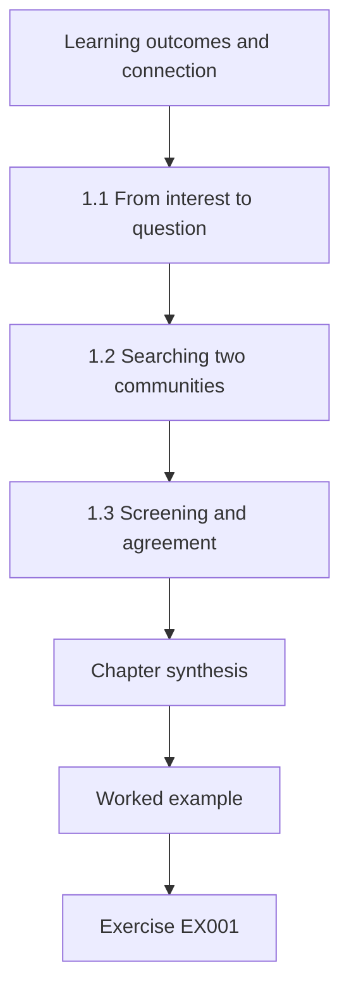

### Logical drawing

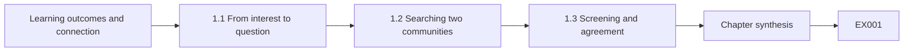

```text
[Learning outcomes and connection]
    |
    v
[1.1 From interest to question]
    |
    v
[1.2 Searching two communities]
    |
    v
[1.3 Screening and agreement]
    |
    v
[Chapter synthesis]
    |
    v
[Worked example] --> [Exercise EX001]
```
<!-- cykin:lesson-figures:end ch-01 -->


### Learning outcomes and connection

After this chapter you can (1) turn a vague interest into a researchable question about a control loop, (2) search across control engineering and security venues with synonyms, (3) deduplicate and screen with agreement metrics, and (4) write a scoping protocol. It prepares the seminar of Chapter 2.

### 1.1 From interest to question

"OT security" is a field, not a question. A researchable question names a **system**, a **phenomenon**, a **comparison** and a **scope**. Harbor Loop example: *In a synthetic single-tank level loop, does a residual CUSUM using an independently wired flow meter detect single-sensor replay with higher event recall and lower false-alarm rate than a ±1.5 band alarm, and does the advantage vanish when the flow meter is also spoofed?* The question already encodes the failure condition — a master's-level habit that saves months of overclaiming.

### 1.2 Searching two communities

Physics-based detection appears as "analytical redundancy" and "residual generation" in control journals and as "false data injection" and "sensor spoofing" in security venues. Build a synonym table before searching IEEE Xplore, ACM DL, Scopus and arXiv. Include grey literature (IEC white papers, CISA advisories) as a separate stream with its own eligibility rules, because it is not peer-reviewed in the same way.

Run each search string in every database and save the exports with the date, the exact query and the hit count, so the search can be repeated by an examiner. Expect the two communities to describe the same detector with different words, and expect duplicates across venues; Lab 1 shows how quickly they appear when one survey is indexed by both IEEE and ACM.

### 1.3 Screening and agreement

Two reviewers screen titles and abstracts independently; report Cohen's kappa. Lab 1 shows a synthetic export with DOI and title-year deduplication and a kappa of 0.462 — moderate agreement driven by disagreement on a vendor white paper and a DNP3 measurement paper. Low agreement is a signal to repair eligibility criteria, not to force consensus.

Write the eligibility rules as testable statements before screening: does the study evaluate a detector on a control loop, does it name its attacker model, does it report a metric beyond accuracy. Screen a small calibration batch together, discuss each disagreement, and only then screen the rest independently. Record each changed rule and the date it changed.

### 1.4 Worked example and Lab 1

```python
# Lab 1 (masters OT, synthetic): deduplicate a search export and compute Cohen's kappa for two screeners.
import re
RECORDS=[
 ("ieee","Physics-based anomaly detection for ICS: a survey",2018,"10.1145/3203245"),
 ("acm","Physics-Based Anomaly Detection for ICS: A Survey",2018,"10.1145/3203245"),
 ("ieee","Modbus security: a survey of attacks and defenses",2020,""),
 ("arxiv","Sensor replay attacks on water treatment testbeds",2021,""),
 ("ieee","Sensor Replay Attacks on Water Treatment Testbeds",2021,""),
 ("grey","Vendor white paper: securing SCADA with AI",2022,""),
 ("ieee","DNP3 Secure Authentication field measurements",2019,""),
 ("acm","Zone and conduit design for IEC 62443",2020,""),
 ("ieee","False data injection in power systems: a survey",2011,"10.1109/TSG.2011.2129544"),
 ("arxiv","False Data Injection Attacks against State Estimation in Electric Power Grids",2011,"10.1109/TSG.2011.2129544"),
]
def key(r):
    doi=r[3].strip().lower();
    if doi: return ("doi",doi)
    t=re.sub(r"[^a-z0-9]","",r[1].lower()); return ("title",t,r[2])
seen={}; kept=[]
for r in RECORDS:
    k=key(r)
    if k in seen: continue
    seen[k]=True; kept.append(r)
# two reviewers: I=include X=exclude; disagreements on grey and DNP3
A="IIXIXIIXIX"[:len(kept)]; B="IIXIXXXIIX"[:len(kept)]
def kappa(a,b):
    n=len(a); agree=sum(x==y for x,y in zip(a,b))/n
    pa=sum(x=="I" for x in a)/n; pb=sum(x=="I" for x in b)/n
    pe=pa*pb+(1-pa)*(1-pb)
    return round(agree,3), round((agree-pe)/(1-pe) if pe!=1 else 1.0,3)
print("raw",len(RECORDS),"kept",len(kept),"dropped",len(RECORDS)-len(kept))
print("agree,kappa",kappa(A,B))
print("kept titles:",[r[1][:40] for r in kept])

```

Expected output:

```text
raw 10 kept 7 dropped 3
agree,kappa (0.714, 0.462)
kept titles: ['Physics-based anomaly detection for ICS:', 'Modbus security: a survey of attacks and', 'Sensor replay attacks on water treatment', 'Vendor white paper: securing SCADA with ', 'DNP3 Secure Authentication field measure', 'Zone and conduit design for IEC 62443', 'False data injection in power systems: a']
```

Three duplicates dropped via DOI or normalized title. Kappa 0.462 with 71.4% raw agreement shows chance correction at work.

The lab keeps the first record of each duplicate pair, so the IEEE version of the physics-based survey stays and the ACM copy goes. Two records with no DOI are merged only because their normalized titles and years match exactly; a small change in wording would let a duplicate through. Check the kept list by eye before screening, and report raw count, kept count and dropped count in the protocol, as the lab prints them.

### 1.5 Common errors and limits

Searching only security venues; treating vendor papers as peer-reviewed evidence; reporting raw agreement without kappa; writing a question with no failure condition.

A question with no failure condition invites a dissertation that can only succeed. The Harbor Loop question avoids that by asking when the CUSUM advantage disappears. The search has a similar limit: databases change their indexing, so a search run in March may not return the same set in September. Record the date of every run and treat the corpus as a snapshot.

### Exercises — chapter 1

- **EX001 — Researchable Modbus question.** Rewrite "I want to study Modbus security" as a researchable question with system, phenomenon, comparison and scope. *Rubric:* 3 = system, phenomenon, comparison, scope with ≥90% metric; 2 = missing one element; 1 = vague Modbus interest; 0 = none.
- **EX002 — Synonym table for sensor manipulation.** Build a synonym table (≥4 control + ≥4 security terms) for detecting manipulated sensor data. *Rubric:* 3 = ≥4 control + ≥4 security terms; 2 = 3+3; 1 = one community; 0 = none.
- **EX003 — Include or exclude white paper and DNP3.** Write inclusion/exclusion criteria that decide the vendor white paper and the DNP3 paper in Lab 1. *Rubric:* 3 = criteria exclude vendor marketing, include DNP3 field measurement; 2 = decisions without criteria; 1 = one decision; 0 = none.
- **EX004 — Ampersand grey record and kappa.** Run Lab 1; add a grey record with an ampersand in the title; show whether your key() catches it; recompute kappa after changing one decision. *Rubric:* 3 = normalize key catches ampersand + kappa movement explained; 2 = key without kappa; 1 = kappa only; 0 = none.
- **EX005 — One-page scoping protocol.** Draft a one-page scoping protocol (databases, dates, synonyms, screening rules, kappa target). *Rubric:* 3 = databases/dates/synonyms/screening/κ≥0.6; 2 = missing one field; 1 = bullet list; 0 = none.
- **EX006 — DOI key before title key.** Explain why a DOI key must precede a title key in deduplication. *Rubric:* 3 = DOI identity across title variants + title-key failure mode; 2 = DOI first without failure mode; 1 = slogan; 0 = none.
- **EX007 — Evidence tiers for three sources.** Classify three sources (Giraldo survey, CISA advisory, vendor blog) by evidence tier for a dissertation. *Rubric:* 3 = Giraldo high, CISA medium, vendor blog low with reasons; 2 = tiers without reasons; 1 = one source; 0 = none.

### Chapter synthesis

A master's project starts with a question that already names its failure condition, a search that spans communities, and a screening process whose disagreements repair the criteria.

### Continue studying — chapter 01 of 08

[← Course home](../../README.md) · [Course chapter index](../SUBJECTS.md) · [Chapter 02 (draft) →](#ch-02)

<a id="ch-02"></a>

## Chapter 2 — OT, IoT and cyber-physical security: advanced seminar

<!-- cykin:lesson-figures:start ch-02 -->
### Lesson map

Lesson 02 published. Map, example, EX008.

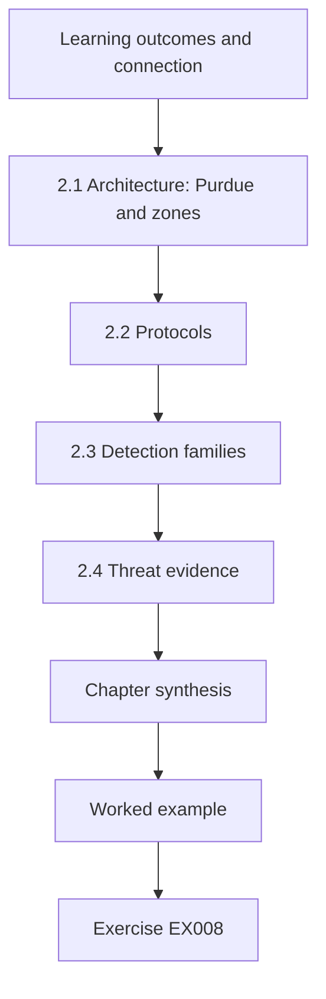

### Logical drawing

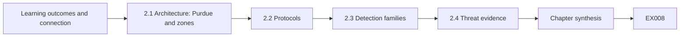

```text
[Learning outcomes and connection]
    |
    v
[2.1 Architecture: Purdue and zones]
    |
    v
[2.2 Protocols]
    |
    v
[2.3 Detection families]
    |
    v
[2.4 Threat evidence]
    |
    v
[Chapter synthesis]
    |
    v
[Worked example] --> [Exercise EX008]
```
<!-- cykin:lesson-figures:end ch-02 -->


### Learning outcomes and connection

After this chapter you can (1) explain Purdue levels and ISA/IEC 62443 zones, (2) describe why classic industrial protocols lack authentication, (3) contrast network and physics-based detection, (4) read ATT&CK for ICS as capability evidence not frequency evidence, and (5) extract a falsifiable gap from a literature map.

### 2.1 Architecture: Purdue and zones

NIST SP 800-82 Rev. 3 presents the Purdue model: levels 0–1 (process and basic control), 2 (supervisory), 3 (operations), 4–5 (enterprise), with an industrial DMZ. ISA/IEC 62443-3-2 asks you to partition into **zones** with a target security level and to control **conduits** between them. A dissertation can treat a zone design as a hypothesis: does a conduit that permits only Modbus reads from level 2 to level 1 reduce write reachability by a measured fraction in a synthetic topology?

For Harbor Loop the relevant boundary sits between the supervisory level and the PLC, where Modbus/TCP carries both reads and writes. Draw that boundary in the dissertation even though the study measures detection rather than segmentation, because a reader needs to know which attacker positions the replay assumes. A conduit that blocks writes does not stop replayed reads, which is why detection still matters.

### 2.2 Protocols

The Modbus Application Protocol defines function codes (including write single/multiple registers) and a data model but no authentication or integrity fields. DNP3 Secure Authentication and OPC UA security models show that the industry has added options; adoption and implementation quality remain empirical questions. Never present "Modbus is insecure" as a finding — it is a design property of the specification.

For the Harbor Loop study the relevant property is that a reply carrying a level value has no field that proves it came from the transmitter. That is why replay is possible at all, and why the dissertation measures detection rather than prevention. Name the function codes your attacker model uses, so a reader can see which parts of the specification the results depend on.

### 2.3 Detection families

Network detectors watch packets; physics-based detectors watch whether sensor and actuator values obey process laws. Giraldo et al. surveyed the latter; Urbina et al. argued for measuring impact under a stealthy adversary. Sommer and Paxson warned that anomaly detection fails when "normal" is open; Arp et al. listed evaluation pitfalls including point-adjusted scoring.

Harbor Loop sits in the second family: its residual CUSUM compares the level reading with an estimate driven by the flow meter. The warnings from both papers apply directly. Normal operation in a water loop is fairly closed, which helps, but scoring must use attack episodes rather than points, and the evaluation must ask what a stealthy adversary could still do. Class B is that question.

### 2.4 Threat evidence

MITRE ATT&CK for ICS lists techniques such as *Modify Parameter* and *Spoof Reporting Message*. Public reporting of Stuxnet, the 2015 Ukrainian outages and TRITON/TRISIS shows that manipulation of view and targeting of safety systems are documented adversary goals. Use these at the level of the cited public analyses; do not invent operational detail.

For the dissertation this evidence supports one sentence: manipulating what operators see is a documented adversary goal, so testing detection of a replayed level reading is relevant. It does not support claims about how often water utilities face replay. Keep the citation to the technique and the public analysis, and keep frequency claims out of the background chapter.

### 2.5 Worked example: coding a gap

From twelve synthetic studies L1–L12, only two report impact at detection, only one freezes thresholds before a second context, and none combine detector-aware adversary + frozen thresholds + impact + second plant. Gap: *No evaluation of residual detection against sensor replay reports event recall, delay and overfill-at-alarm with frozen thresholds on two contexts and an explicit two-sensor attacker class.*

Write the gap as a single sentence that names what is missing, then check each word against the coded table. If one study did combine frozen thresholds and a second plant, the gap shrinks and the sentence must change. A gap built from a coding table can be audited; a gap built from impressions of the field cannot.

### 2.6 Common errors and limits

Citing standards as evidence they work; treating ATT&CK as base rates; claiming novelty from a new dataset name.

These errors share a pattern: they mistake the existence of a document for evidence of an effect. A standard says what should be done; it does not show that doing it reduces harm. ATT&CK lists what adversaries have been seen doing, not how often. A new dataset is useful, but novelty must come from the question it lets you answer.

### Exercises — chapter 2

- **EX008 — Purdue map of Harbor Loop L1.** Map Harbor Loop L1 components to Purdue levels 0–3 and name two conduits. *Rubric:* 3 = L0–L3 components + two conduits (SCADA↔PLC, historian↔SCADA); 2 = levels only; 1 = partial; 0 = none.
- **EX009 — 62443 zone as measurable hypothesis.** Rewrite one 62443 zone recommendation as a measurable hypothesis. *Rubric:* 3 = measurable read-only conduit hypothesis with ≥90% metric; 2 = hypothesis without metric; 1 = slogan; 0 = none.
- **EX010 — Modbus versus DNP3-SA authentication.** Compare Modbus and DNP3 Secure Authentication on authentication presence using only public specs. *Rubric:* 3 = Modbus no auth vs DNP3-SA challenges; presence not adoption; 2 = presence only; 1 = adoption claim; 0 = none.
- **EX011 — Ceiling for point-adjusted F1 study.** Appraise a fictional study that reports point-adjusted F1 = 0.99 on one testbed; state what it can support. *Rubric:* 3 = support ceiling for segment flags only; excludes delay/impact/generalization/aware; 2 = ceiling without exclusions; 1 = accepts 0.99; 0 = none.
- **EX012 — Two ATT&CK techniques for Harbor Loop.** Select two ATT&CK for ICS techniques for Harbor Loop; explain why they are not frequency evidence. *Rubric:* 3 = Spoof Reporting Message + Modify Parameter + not frequency; 2 = techniques without caveat; 1 = one; 0 = none.
- **EX013 — Weak and strong residual-detection gaps.** Write weak and strong gap statements for residual detection of sensor replay. *Rubric:* 3 = weak vs strong gap matching §2.5 substance; 2 = weak/strong without OT detail; 1 = one; 0 = none.
- **EX014 — Arp pitfalls plus one OT pitfall.** List three evaluation pitfalls from Arp et al. that apply to OT detectors and one OT-specific pitfall. *Rubric:* 3 = three Arp pitfalls + OT impact-at-detection pitfall; 2 = Arp only; 1 = one pitfall; 0 = none.

### Chapter synthesis

The seminar gives you architecture, protocols, detection families and threat evidence — and the discipline to turn them into hypotheses and gaps rather than slogans.

### Continue studying — chapter 02 of 08

[← Chapter 01 (draft)](#ch-01) · [Course chapter index](../SUBJECTS.md) · [Chapter 03 (draft) →](#ch-03)

<a id="ch-03"></a>

## Chapter 3 — Study design, ethics and reproducibility

<!-- cykin:lesson-figures:start ch-03 -->
### Lesson map

Lesson 03 published. Map, example, EX015.

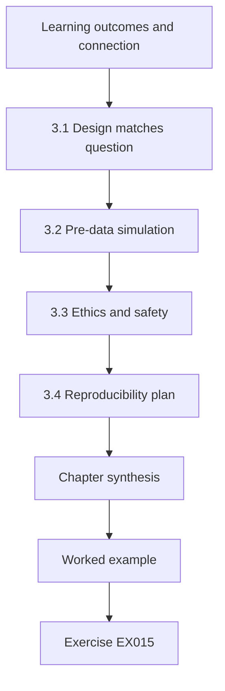

### Logical drawing

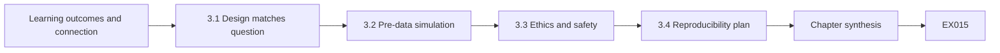

```text
[Learning outcomes and connection]
    |
    v
[3.1 Design matches question]
    |
    v
[3.2 Pre-data simulation]
    |
    v
[3.3 Ethics and safety]
    |
    v
[3.4 Reproducibility plan]
    |
    v
[Chapter synthesis]
    |
    v
[Worked example] --> [Exercise EX015]
```
<!-- cykin:lesson-figures:end ch-03 -->


### Learning outcomes and connection

After this chapter you can (1) choose a design that matches the question, (2) simulate the design's bias and power before collecting data, (3) apply Menlo principles to industrial research, and (4) write a pre-analysis plan with data tiers.

### 3.1 Design matches question

Harbor Loop compares two detectors under controlled attacks in a model and a rig — a **controlled experiment**, not an observational study. If you asked "how often do plants see replay attacks?", you would need a survey with a sampling frame and a disclosure model, because plants that never report are invisible in public catalogues. If you asked how operators trust alarms, you would need interviews with ethics review. Matching design to question is the most common master's failure mode: students borrow a method they like and then hunt for a question that fits. Write the question first.

A second matching problem is **unit of analysis**. Detector comparison operates on attack episodes. Architecture comparison operates on reachability graphs. Operator studies operate on people and shifts. Mixing units — counting packets as if they were episodes — recreates point-adjustment confusion. State the unit before you collect anything.


### 3.2 Pre-data simulation

Before any experiment, simulate. Lab 3 (below, reused as the main detector lab) already shows class A detection and class B failure. Running it *before* writing the proposal tells you the design can distinguish the hypotheses under the model assumptions. Pre-data simulation also reveals whether your planned sample size is pointless: if eighty attack seeds always produce the same binary outcome, you need sensitivity analysis on parameters that might change the outcome (allowance k, orifice coefficient, sensor lag) more than you need a thousand identical seeds.

Record the simulation as a design artifact: seed ranges, parameter grid, decision rules. When a supervisor asks "why eighty runs?", the answer is in that artifact.

### 3.3 Ethics and safety

Menlo: respect for persons (operators you interview), beneficence (bound every physical experiment with an independent safety layer — never the PLC under test), justice (small utilities bear patch costs), respect for law and public interest. **Never test on production.** Campus Rig R2's worst outcome is water in a drip tray; a mechanical float valve and a physical e-stop bound it.

Beyond Menlo, OT research inherits safety culture: job briefings before lab sessions, two-person rules for energizing pumps, and a written stop authority that overrides the researcher's wish to finish a run. Record near misses (float valve almost reached) with the same seriousness as failed hypotheses.

### 3.4 Reproducibility plan

Register metrics (event recall, delay, false-alarm runs per 80 nominal seeds, overfill at alarm), seeds, thresholds and analysis code before the validation runs. Assign data tiers T0–T3 (Chapter 7 of the doctoral companion expands this; here, at least separate public code from rig configurations).

Store the registered plan with a timestamp the supervisor can verify, such as a dated commit in the project repository. Include the frozen k and h values, the seed ranges for tuning and for evaluation, and the rule for what counts as a detection. Any later change goes into a deviations table with a date and a reason, and is reported in the dissertation.

### 3.5 Worked example and Lab 3

```python
# Lab 3: residual CUSUM vs band on synthetic tank; report event recall, delay, FA/shift, overfill@alarm.
import random
def run(seed,atk,det,k=0.8,h=6.0,steps=800,onset=400):
    rng=random.Random(seed); true=est=50.0; s=0.0; alarm=None; at=None
    for t in range(steps):
        inflow=1.0+rng.gauss(0,0.05)+(0.05 if atk and t>=onset else 0)
        true+=inflow-0.02*true
        lvl=true+rng.gauss(0,0.3); fm=inflow+rng.gauss(0,0.02)
        if atk and t>=onset: lvl=50.0+rng.gauss(0,0.3)
        if atk=="B" and t>=onset: fm=1.0+rng.gauss(0,0.02)
        est+=fm-0.02*est
        hit=abs(lvl-50)>1.5 if det=="band" else False
        if det=="cusum":
            s=max(0.0,s+abs(lvl-est)-k); hit=s>h
        if hit and alarm is None: alarm=t; at=true-50
    return alarm,at
for det in ("band","cusum"):
    fa=sum(run(i,None,det)[0] is not None for i in range(80))
    for atk in ("A","B"):
        r=[run(i,atk,det) for i in range(80)]
        hits=[(a-400,ov) for a,ov in r if a is not None and a>=400]
        d=sum(h[0] for h in hits)/len(hits) if hits else float("nan")
        ov=sum(h[1] for h in hits)/len(hits) if hits else float("nan")
        print(f"{det:5s} class{atk} FA_runs={fa}/80 detected={len(hits)}/80 mean_delay={d:.1f} mean_overfill@alarm={ov:.2f}")

```

Expected output:

```text
band  classA FA_runs=11/80 detected=0/80 mean_delay=nan mean_overfill@alarm=nan
band  classB FA_runs=11/80 detected=0/80 mean_delay=nan mean_overfill@alarm=nan
cusum classA FA_runs=0/80 detected=80/80 mean_delay=37.7 mean_overfill@alarm=1.38
cusum classB FA_runs=0/80 detected=0/80 mean_delay=nan mean_overfill@alarm=nan
```

The lab runs eighty seeds for each detector and attack class and counts false-alarm runs on the same eighty seeds without an attack. The band alarm never fires on either attack, because replay holds the reported level near 50, yet it still raises false alarms on 11 of 80 nominal runs. CUSUM detects all class A episodes and none of class B, when the flow meter is also spoofed. That single table already contains the main result and its boundary. Read it before any rig work begins.

### 3.6 Common errors and limits

Choosing design after seeing data; active polling called "passive"; using the PLC as the only safety bound.

Each error has a concrete guard. Register the design and its decision rules before collecting data. Describe any measurement that sends requests to a device as active, even when it only reads. On Rig R2 the float valve and the physical e-stop are the safety bound; the PLC under test is never relied on to stop an overflow it may be the cause of.

### Exercises — chapter 3

- **EX015 — Match questions to design types.** Match three questions (detector comparison; adoption rate of DNP3-SA; operator trust in alarms) to design types. *Rubric:* 3 = experiment/survey/interview matched correctly; 2 = two correct; 1 = one; 0 = none.
- **EX016 — Lab 3 numbers against H1 and H4.** Run Lab 3; report numbers against H1 (class A CUSUM ≥95% recall, band ≤10%) and H4 (class B ≤10%). *Rubric:* 3 = H1 80/80 vs 0/80, H4 0/80, band FA noted; 2 = H1/H4 without FA; 1 = qualitative; 0 = none.
- **EX017 — Bound pump-forcing on Rig R2.** Write the worst credible outcome, independent layer and stop authority for a pump-forcing experiment on Rig R2. *Rubric:* 3 = drip-tray overflow, float valve+tray, named manager e-stop; 2 = missing independence; 1 = PLC-only; 0 = unbounded.
- **EX018 — Menlo on publishing class B evasion.** Apply Menlo's four principles to publishing a class B evasion method. *Rubric:* 3 = Menlo principles → publish class+defence, withhold product steps pending CVD; 2 = principles without decision; 1 = publish all; 0 = none.
- **EX019 — Pre-analysis plan with frozen seeds.** Draft a one-page pre-analysis plan with frozen metrics and seeds. *Rubric:* 3 = metrics, seeds 0–79/1000–1079, k=0.8 h=6, no change after R2 load; 2 = missing seeds or freeze; 1 = vague plan; 0 = none.
- **EX020 — Tier simulator through operator quotes.** Assign T0–T3 to: simulator code, synthetic traces, R2 wiring diagram, anonymized operator quotes. *Rubric:* 3 = code T0, traces T1, wiring T2, quotes T2/T1 with anonymization note; 2 = three correct; 1 = two; 0 = none.

### Chapter synthesis

Design before data, simulate before commit, bound every physical experiment, and freeze the analysis plan.

### Continue studying — chapter 03 of 08

[← Chapter 02 (draft)](#ch-02) · [Course chapter index](../SUBJECTS.md) · [Chapter 04 (draft) →](#ch-04)

<a id="ch-04"></a>

## Chapter 4 — OT, IoT and cyber-physical security: competing explanations

<!-- cykin:lesson-figures:start ch-04 -->
### Lesson map

Lesson 04 published. Map, example, EX021.

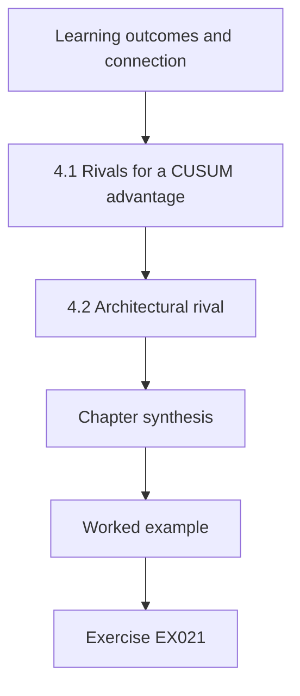

### Logical drawing

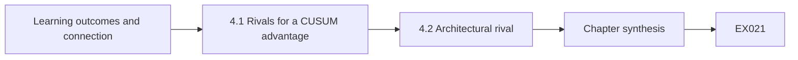

```text
[Learning outcomes and connection]
    |
    v
[4.1 Rivals for a CUSUM advantage]
    |
    v
[4.2 Architectural rival]
    |
    v
[Chapter synthesis]
    |
    v
[Worked example] --> [Exercise EX021]
```
<!-- cykin:lesson-figures:end ch-04 -->


### Learning outcomes and connection

After this chapter you can (1) list rival explanations for a detection result, (2) design observations that discriminate among them, and (3) revise claims when a rival survives.

### 4.1 Rivals for a CUSUM advantage

(1) Thresholds tuned on test data. (2) Simulator too clean (no calibration bias). (3) Attack magnitude chosen to suit CUSUM. (4) Band alarm set unusually tight or loose. (5) Evaluation uses point-adjusted F1. Each rival has a test: separate-seed tuning, bias sweeps, gain sweeps, report band false-alarm rate, report event metrics.

Write rivals before you see results. After results, it is too easy to invent only the rivals you already beat. Give the list to a colleague who has not seen Lab 3 and ask what they would add. Control engineers often add model-structure rivals; security researchers often add adaptive-adversary rivals. Both belong on the list even if a master's timeline can only partly test them.

### 4.2 Architectural rival

A deeper rival: "CUSUM only works because the flow meter is independent; if both sensors share a PLC, the method fails." This is not a confound to eliminate — it is a **boundary condition** to measure (class B). Surviving rivals become part of the claim. Many OT papers bury this kind of result in a limitations paragraph; masters examiners increasingly ask for it in the abstract. Treat a confirmed boundary as a finding: defenders learn that independent sensing paths are load-bearing assumptions.

The same logic applies elsewhere. A segmentation design that fails when engineering workstations retain permanent write paths has discovered a boundary. A protocol filter that fails when traffic is tunnelled inside another protocol has discovered a boundary. Measure them and put them where readers look first.

### 4.3 Worked example

After Lab 3, rivals (1) and (5) are addressed by design; rival (2) needs Lab 6-style bias/orifice sweeps; rival (3) needs a gain sweep; rival (4) is addressed by reporting the band's 11/80 false-alarm runs. The architectural rival is confirmed by class B = 0/80.

Write this mapping as a table in the dissertation: rival, test, status, evidence. Rivals that are only partly tested, such as the gain sweep if time runs short, stay in the table marked open rather than disappearing. The architectural rival moves from the limitations chapter into the results, because class B is a measured outcome, not an untested worry.

### 4.4 Common errors and limits

Listing rivals without tests; treating a confirmed boundary as a failure to hide.

A rival without a test is a worry, not part of the analysis. Each one needs an observation that would come out differently if it were true. When a rival survives, as the architectural rival does in class B, report it as a finding with its numbers. Hiding it would leave readers believing the residual method protects loops where one device controls both measurements. The class B result is the clearest example in this study.

### Exercises — chapter 4

- **EX021 — Five rivals for zone segmentation.** Write five rivals for "zone segmentation reduces attacks" and one test each. *Rubric:* 3 = five rivals each with a test; 2 = three rivals with tests; 1 = rivals without tests; 0 = none.
- **EX022 — Gain sweep for Urbina-style impact.** Design a gain sweep that would support or refute rival (3); predict the pattern if Urbina-style impact bounding holds. *Rubric:* 3 = gain sweep design + Urbina-style pattern prediction; 2 = sweep without prediction; 1 = vague; 0 = none.
- **EX023 — Why class B failure strengthens the thesis.** Explain why class B failure strengthens rather than weakens a careful thesis. *Rubric:* 3 = class B failure as characterized limit that sharpens claims; 2 = 'failure is honesty' without limit link; 1 = hides failure; 0 = none.
- **EX024 — Untested rivals under point-adjusted F1.** For a study reporting only point-adjusted F1, which rivals remain untested?. *Rubric:* 3 = lists untested rivals (delay, FA, impact, aware adversary, etc.); 2 = two rivals; 1 = one; 0 = none.
- **EX025 — Causal diagram to overfill at alarm.** Write a causal diagram (as a bullet list of nodes and arrows) from attacker capability to overfill at alarm. *Rubric:* 3 = nodes/arrows from capability→spoof→residual/band→alarm→overfill; 2 = nodes without arrows; 1 = partial; 0 = none.
- **EX026 — Negative control for residual CUSUM.** Propose a negative control: an attack that should *not* trigger the residual CUSUM if the warrant is correct. *Rubric:* 3 = negative control attack that should not trip residual if warrant holds; 2 = control without warrant link; 1 = vague; 0 = none.

### Chapter synthesis

Rivals with tests turn a comparison into a contribution; confirmed boundaries belong in the abstract.

### Continue studying — chapter 04 of 08

[← Chapter 03 (draft)](#ch-03) · [Course chapter index](../SUBJECTS.md) · [Chapter 05 (draft) →](#ch-05)

<a id="ch-05"></a>

## Chapter 5 — Proposal and pilot

<!-- cykin:lesson-figures:start ch-05 -->
### Lesson map

Lesson 05 published. Map, example, EX027.

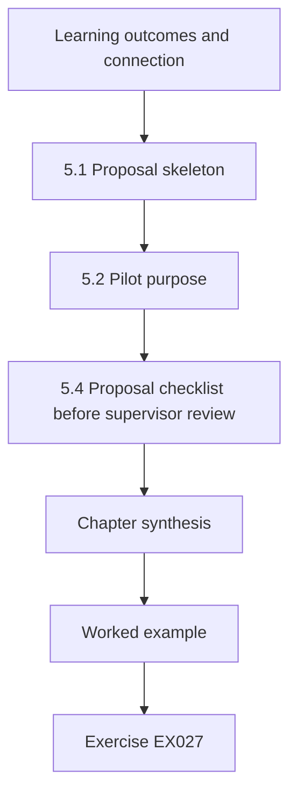

### Logical drawing

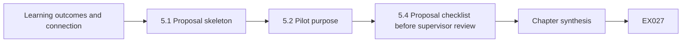

```text
[Learning outcomes and connection]
    |
    v
[5.1 Proposal skeleton]
    |
    v
[5.2 Pilot purpose]
    |
    v
[5.4 Proposal checklist before supervisor review]
    |
    v
[Chapter synthesis]
    |
    v
[Worked example] --> [Exercise EX027]
```
<!-- cykin:lesson-figures:end ch-05 -->


### Learning outcomes and connection

After this chapter you can (1) write a proposal with hypotheses and abandonment conditions, (2) define go/no-go criteria for a rig pilot, and (3) keep pilot data out of hypothesis tests.

### 5.1 Proposal skeleton

Question; gap; hypotheses H1–H4 (including failure); attacker model classes A/B; systems (simulator, Rig R2); metrics; analysis plan; ethics and safety; timeline; abandonment conditions (rig cannot be made safe; simulator fails verification).

Supervisors read proposals for **decidability**: can a reader tell what evidence would support H1 and what would refute it? "CUSUM is better" is not decidable; "event recall ≥95% with mean delay ≤60 steps and false-alarm runs ≤ those of the band alarm" is. Put failure hypothesis H4 in the same table as H1–H3 so it cannot be quietly dropped later.

Also state what you will **not** do: no production systems, no product-specific exploit development, no claims about sectors outside water storage loops. Scope exclusions are as important as inclusions.

### 5.2 Pilot purpose

Feasibility only: Can R2 run replay safely? Does the historian log at 1 Hz? Does the float valve work? Predeclared go criteria: three consecutive runs without float-valve trip, log loss <1%, e-stop tested. Pilot data do not test H1–H4.

A pilot that "looks promising" tempts peeking. Resist by writing the go/no-go sheet before the first pilot run and by storing pilot traces in a directory the analysis code refuses to read. If the pilot fails, you have learned that the rig needs work — which is the point — not that the detector is bad. Document who holds stop authority and test the e-stop in every session before attack scripts run.

### 5.3 Common errors and limits

Using pilot runs to tune thresholds that later "validate" the same runs; no abandonment condition.

Keep pilot traces in a separate directory that the analysis code refuses to read, and record in the proposal that thresholds are frozen from simulator tuning seeds only. Write abandonment conditions in measurable terms: for example, the rig is abandoned if the float valve cannot be shown to trip before the drip tray fills. Without such conditions a failing study simply drifts. Review those conditions with the supervisor before the first pilot run.

### 5.4 Proposal checklist before supervisor review

Before you send the proposal, confirm: (1) H1–H4 have numbers and H4 is a failure condition you are willing to confirm; (2) the attacker model distinguishes class A from class B; (3) metrics include event recall, delay, false-alarm runs and overfill at alarm — not point-adjusted F1 alone; (4) safety bounds name an independent layer and a stop authority; (5) abandonment conditions exist; (6) the pilot cannot leak into validation because paths are separated. A supervisor who returns the proposal with "scope clearer" is giving you a gift; a supervisor who accepts a vague proposal is setting up a painful year.

### Exercises — chapter 5

- **EX027 — H1–H4 with trip-margin thresholds.** Write H1–H4 with numeric thresholds justified by a stated trip margin. *Rubric:* 3 = H1–H4 numeric with trip-margin justification; 2 = hypotheses without justification; 1 = H1 only; 0 = none.
- **EX028 — Go/no-go with safety and data rules.** Write go/no-go criteria including one safety and one data-quality rule. *Rubric:* 3 = safety + data-quality go/no-go (float valve, log loss); 2 = one rule type; 1 = vague go; 0 = none.
- **EX029 — Three abandonment conditions.** List three abandonment conditions and what you would switch to studying if abandoned. *Rubric:* 3 = three abandonment conditions + fallback study; 2 = conditions without fallback; 1 = one; 0 = none.
- **EX030 — Attacker-model table for Harbor Loop.** Draft the attacker-model table (capabilities, knowledge, goal, out of scope). *Rubric:* 3 = capabilities/knowledge/goal/out-of-scope table for Harbor Loop; 2 = missing a column; 1 = prose only; 0 = none.
- **EX031 — Why pilots stay out of validation.** Explain why pilot traces must not enter the validation set. *Rubric:* 3 = pilot leakage into validation invalidates freeze; 2 = 'contamination' without freeze link; 1 = vague; 0 = none.
- **EX032 — Risk assessment for operator interviews.** Write a one-paragraph risk assessment for interviewing operators Q01–Q08. *Rubric:* 3 = risks for Q01–Q08 with mitigations (consent, anonymization, stop); 2 = risks without mitigations; 1 = one risk; 0 = none.

### Chapter synthesis

A proposal that states how it can fail, and a pilot that only asks whether the study can run safely, protect the dissertation from silent failure modes.

### Continue studying — chapter 05 of 08

[← Chapter 04 (draft)](#ch-04) · [Course chapter index](../SUBJECTS.md) · [Chapter 06 (draft) →](#ch-06)

<a id="ch-06"></a>

## Chapter 6 — Data collection and analysis

<!-- cykin:lesson-figures:start ch-06 -->
### Lesson map

Lesson 06 published. Map, example, EX033.

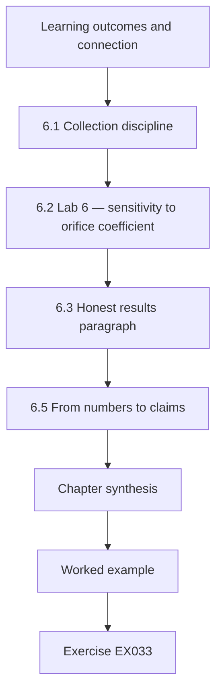

### Logical drawing

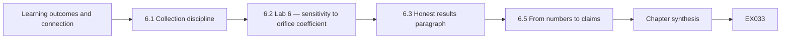

```text
[Learning outcomes and connection]
    |
    v
[6.1 Collection discipline]
    |
    v
[6.2 Lab 6 — sensitivity to orifice coefficient]
    |
    v
[6.3 Honest results paragraph]
    |
    v
[6.5 From numbers to claims]
    |
    v
[Chapter synthesis]
    |
    v
[Worked example] --> [Exercise EX033]
```
<!-- cykin:lesson-figures:end ch-06 -->


### Learning outcomes and connection

After this chapter you can (1) collect model and rig data under a frozen plan, (2) use paired seeds and bootstrap intervals, (3) run sensitivity analyses, and (4) write an honest results paragraph.

### 6.1 Collection discipline

Freeze thresholds from tuning seeds; run evaluation seeds; then Rig R2 with the same frozen values. Log seed, detector, attack class, alarm time, overfill at alarm. No peeking at R2 attack data before freezing.

Practically, write a small manifest containing `k`, `h`, tuning seed range and a hash of the analysis script, and refuse to load R2 attack files until that manifest exists. If you change k after seeing R2, you no longer have a validation — you have another tuning exercise, and you must say so. Keep a lab notebook with date, person, run IDs and anomalies (power blip, sensor recalibration); anomalies that coincide with alarms are rival explanations.

### 6.2 Lab 6 — sensitivity to orifice coefficient

```python
# Lab 6: bootstrap CI for delay difference (paired) + sensitivity to orifice coefficient.
import random
def delay(seed, orifice=0.02, k=0.8, steps=900, onset=300):
    rng=random.Random(seed); true=est=50.0; s=0.0
    # keep equilibrium near 50: nominal inflow = orifice*50
    for t in range(steps):
        inflow=orifice*50 + rng.gauss(0,0.05)+(0.05 if t>=onset else 0)
        true+=inflow-orifice*true
        lvl=(50.0 if t>=onset else true)+rng.gauss(0,0.3)
        est+=inflow+rng.gauss(0,0.02)-orifice*est
        s=max(0.0,s+abs(lvl-est)-k)
        if s>6 and t>=onset: return t-onset
    return None
for orifice in (0.015,0.02,0.025):
    d8=[]; d6=[]; diffs=[]
    for i in range(150):
        a=delay(i,orifice,0.8); b=delay(i,orifice,0.6)
        if a is not None: d8.append(a)
        if b is not None: d6.append(b)
        if a is not None and b is not None: diffs.append(a-b)
    rng=random.Random(1); boots=sorted(sum(rng.choice(diffs) for _ in diffs)/len(diffs) for _ in range(1000)) if diffs else []
    print(f"orifice={orifice} detected_k0.8={len(d8)}/150 detected_k0.6={len(d6)}/150 "
          f"mean_diff={sum(diffs)/len(diffs):.1f} 95%CI=[{boots[25]:.1f},{boots[974]:.1f}]")

```

Expected output:

```text
orifice=0.015 detected_k0.8=150/150 detected_k0.6=150/150 mean_diff=6.0 95%CI=[5.6,6.4]
orifice=0.02 detected_k0.8=150/150 detected_k0.6=150/150 mean_diff=7.1 95%CI=[6.6,7.6]
orifice=0.025 detected_k0.8=150/150 detected_k0.6=150/150 mean_diff=8.6 95%CI=[7.9,9.4]
```

The delay cost of choosing k = 0.8 over 0.6 grows as the orifice coefficient rises (faster natural dynamics / different signal). Intervals describe simulation noise only.

The lab pairs seeds: each seed is run with both allowances, and the difference is taken within the seed, which removes noise that both runs share. The bootstrap then resamples those paired differences. All three orifice settings detect every episode at both allowances, so the trade-off is purely in delay. The intervals describe only simulation noise; they say nothing about how a real tank differs from the model.

### 6.3 Honest results paragraph

"In the synthetic Harbor Loop model, residual CUSUM detected 80/80 class A replay episodes (mean delay 37.7 steps, mean overfill at alarm 1.38) with 0/80 false-alarm runs; the ±1.5 band detected 0/80 with 11/80 false-alarm runs. Class B (flow meter also spoofed) evaded CUSUM in 80/80 trials. Delay cost of the more robust allowance k = 0.8 versus 0.6 was 6.0–8.6 steps across orifice coefficients 0.015–0.025. Rig R2 validation is reported separately with frozen thresholds."

The paragraph reports the failure in the same sentence pattern as the success, so class B cannot be skimmed past. It gives every figure with its denominator and names the model as synthetic. It also points forward to the rig results without claiming them. Check that each number matches the lab output exactly before it goes into the dissertation.

### 6.4 Common errors and limits

Independent seeds for paired comparisons; intervals presented as real-world uncertainty; hiding class B.

Paired comparisons need the same seed for both settings; independent seeds add noise that hides small differences. Bootstrap intervals describe simulation variability under the model, not uncertainty about real plants. Class B belongs in the main results table, not in an appendix, because it is the measured boundary of the method and an operator needs to know it. Report the seeds used for each comparison so others can repeat the pairing exactly.

### 6.5 From numbers to claims

After Labs 3 and 6 you have detection counts, delays, false-alarm runs and a sensitivity curve. Turning them into claims requires the ladder from the doctoral companion: a protocol observation is not a process inference. Say "CUSUM alarmed at mean delay 37.7 steps while true overfill was 1.38" (observation + process inference) rather than "CUSUM prevents overflows" (consequence claim without protection-layer evidence). When Rig R2 results arrive, report them in the same units so a reader can see transportability or its failure without hunting.

Keep a short table that pairs each number with the claim it supports and the level of that claim. A delay in steps supports a detection claim; overfill at alarm supports a process inference within the model; neither supports a statement about protection, because the study did not measure a protection layer. That table later feeds the claim register.

### Exercises — chapter 6

- **EX033 — 150-word results from Lab 3 and Lab 6.** Run Lab 3 and Lab 6; write a 150-word results paragraph with numbers. *Rubric:* 3 = ~150 words with Lab 3/6 numbers for H1/H4 and bias/allowance; 2 = numbers without structure; 1 = short; 0 = none.
- **EX034 — Independent seeds CI width for k=0.6.** Rerun Lab 6 with independent seeds for k = 0.6; compare CI width. *Rubric:* 3 = wider CI under independent seeds vs paired, with direction; 2 = direction only; 1 = wrong; 0 = none.
- **EX035 — Six uncertainty sources classified.** Classify six uncertainty sources as stochastic, parametric or structural. *Rubric:* 3 = stochastic/parametric/structural with examples; 2 = classes only; 1 = one class; 0 = none.
- **EX036 — Freeze rule before R2 validation.** Write the freeze rule that must hold before R2 validation. *Rubric:* 3 = freeze k/h hashed before R2 attack data + invalidation rule; 2 = freeze without invalidation; 1 = vague; 0 = none.
- **EX037 — Summarize never-alarm runs.** Propose how to summarize runs that never alarm (right-censoring). *Rubric:* 3 = detection proportion + median among detected or survival-style summary; 2 = one better summary; 1 = mean with cap; 0 = none.
- **EX038 — What Lab 6 intervals do not mean.** State what Lab 6's intervals do *not* mean. *Rubric:* 3 = intervals ≠ plant uncertainty / structural error; 2 = one caveat; 1 = treats as plant truth; 0 = none.

### Chapter synthesis

Frozen plans, paired designs, sensitivity sweeps and honest paragraphs — including the failure condition — are the analysis standard for this dissertation.

### Continue studying — chapter 06 of 08

[← Chapter 05 (draft)](#ch-05) · [Course chapter index](../SUBJECTS.md) · [Chapter 07 (draft) →](#ch-07)

<a id="ch-07"></a>

## Chapter 7 — Dissertation writing and limitations

<!-- cykin:lesson-figures:start ch-07 -->
### Lesson map

Lesson 07 published. Map, example, EX039.

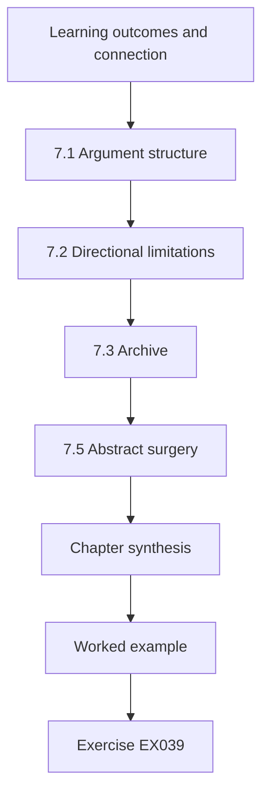

### Logical drawing

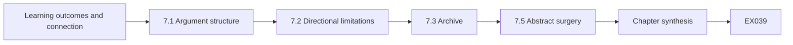

```text
[Learning outcomes and connection]
    |
    v
[7.1 Argument structure]
    |
    v
[7.2 Directional limitations]
    |
    v
[7.3 Archive]
    |
    v
[7.5 Abstract surgery]
    |
    v
[Chapter synthesis]
    |
    v
[Worked example] --> [Exercise EX039]
```
<!-- cykin:lesson-figures:end ch-07 -->


### Learning outcomes and connection

After this chapter you can (1) structure the dissertation argument, (2) write directional limitations, (3) build a minimal tiered archive, and (4) avoid overclaiming in the abstract.

### 7.1 Argument structure

Introduction (question, gap); background (seminar); methods (design, ethics, metrics); results (model, sensitivity, rig); discussion (rivals, boundaries); conclusion. Every claim in the abstract must appear with evidence and scope in the body.

A practical writing order: draft the results tables first, then the methods that produced them, then the discussion, then the introduction. The introduction written last is less likely to promise chapters you did not deliver. Keep a claim register — claim, section, evidence pointer, scope, falsifier — and update it weekly in the final semester. When a sentence in the abstract lacks a row in the register, delete the sentence or add the row.

### 7.2 Directional limitations

Noise-free flow meter in simulation → overstates recall (check on R2). Single-loop model → unknown direction for multi-loop plants. Synthetic operators → unknown. Invented parameters → not calibrated to a real plant. Censoring → understates delay when attacks are weak.

Directional language matters. "Limited sample size" says nothing about bias direction. "Invented orifice coefficient may overstate separation between detectors if real tanks have slower dynamics" tells a reader how to adjust confidence. If you truly do not know the direction, write **unknown** — that is more honest than a vague apology. Examiners treat directional limitations as evidence of research maturity.

### 7.3 Archive

Public: code and invented simulator (T0). Synthetic traces (T1). R2 configuration (T2). Never publish real plant maps. Hash-check before release; fail closed on mismatch.

Write a manifest listing every file, its tier and its hash, and run the check on the release candidate rather than on the working directory. Keep T3 material, such as campus contact details, out of the archive entirely. A reader should be able to rerun Labs 3 and 6 from the public tier alone and get the published numbers.

### 7.4 Common errors and limits

Limitations without direction; abstract claims broader than results; archives that dump everything.

Each error weakens the link between evidence and claim. A limitation without a direction does not tell the reader how to adjust confidence. An abstract that says industrial control systems when the study measured one model and one rig invites rejection. An archive containing everything makes review slow and risks releasing configuration that should stay restricted. Read the abstract against the results tables once more before submission and remove any wording the tables cannot support.

### 7.5 Abstract surgery

Write the abstract last. Paste every sentence into the claim register. If a sentence has no evidence row, cut it. Include one sentence on class B failure and one on synthetic scope. Prefer "in two synthetic contexts" to "in industrial control systems" when that is what you measured. Readers who need a broader claim will not be fooled by broader wording; examiners who enforce scope will reward precision.

Test the result with a reader who has not seen the dissertation: ask them what the study showed and when the method fails. If they cannot mention class B or the synthetic scope, the abstract still overstates or hides something. Repeat the surgery after every major revision, because results text changes faster than abstracts do.

### Exercises — chapter 7

- **EX039 — Abstract that includes class B failure.** Write an abstract (≤150 words) that includes the class B failure. *Rubric:* 3 = ≤150 words including class B failure and contexts; 2 = omits class B; 1 = overclaim; 0 = none.
- **EX040 — Directional limitations table.** Build a directional limitations table with ≥5 rows. *Rubric:* 3 = ≥5 rows with direction labels; 2 = 3–4 rows; 1 = undirected list; 0 = none.
- **EX041 — Tier eight Harbor Loop artifacts.** Assign tiers to eight artifacts and justify two borderline cases. *Rubric:* 3 = eight tiers + two borderline justifications; 2 = tiers only; 1 = four; 0 = none.
- **EX042 — Dataset card for Harbor Loop simulator.** Write a dataset card for the Harbor Loop simulator (invented vs calibrated). *Rubric:* 3 = purpose/parameters/invented/prohibited uses; 2 = missing field; 1 = purpose only; 0 = none.
- **EX043 — Chapter word budgets to a limit.** Outline chapter word budgets that sum to your institution's limit. *Rubric:* 3 = budgets sum to stated institutional limit; 2 = budgets without sum check; 1 = vague; 0 = none.
- **EX044 — Red-team one overclaim in the abstract.** Red-team your abstract: find one overclaim and rewrite it. *Rubric:* 3 = finds overclaim and narrowed rewrite; 2 = finds without rewrite; 1 = nitpick; 0 = none.

### Chapter synthesis

Write the argument so a skeptical reader can find evidence, scope and directional limits without hunting; keep the archive small, tiered and hash-checked.

### Continue studying — chapter 07 of 08

[← Chapter 06 (draft)](#ch-06) · [Course chapter index](../SUBJECTS.md) · [Chapter 08 (draft) →](#ch-08)

<a id="ch-08"></a>

## Chapter 8 — Independent review and defense

<!-- cykin:lesson-figures:start ch-08 -->
### Lesson map

Lesson 08 published. Map, example, EX045.

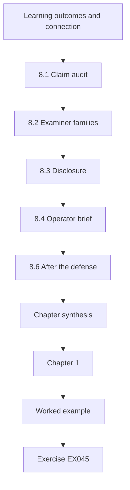

### Logical drawing

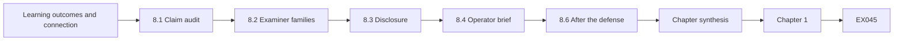

```text
[Learning outcomes and connection]
    |
    v
[8.1 Claim audit]
    |
    v
[8.2 Examiner families]
    |
    v
[8.3 Disclosure]
    |
    v
[8.4 Operator brief]
    |
    v
[8.6 After the defense]
    |
    v
[Chapter synthesis]
    |
    v
[Chapter 1]
    |
    v
[Worked example] --> [Exercise EX045]
```
<!-- cykin:lesson-figures:end ch-08 -->


### Learning outcomes and connection

After this chapter you can (1) audit claims before submission, (2) prepare for examiner questions, (3) handle disclosure for implementation flaws, and (4) translate findings for operators with confidence levels.

### 8.1 Claim audit

Every claim needs evidence, scope and a falsifier. Delete "secures water utilities"; keep "detected single-sensor replay in two synthetic contexts". Run the audit on the abstract, the contributions bullet list and the conclusion — those are where overclaims hide. Ask a peer to mark every verb that implies field effectiveness ("protects", "prevents", "secures", "hardens") and justify or remove each one. A keyword script helps as a first pass; the human audit still reads every claim in context.

Record each claim's outcome in the claim register with the date of the audit. A claim that survives needs a pointer to a table or figure; a claim that is narrowed needs its new wording; a claim that is cut needs a note of why. The audit is finished when every sentence in the abstract has a row.

### 8.2 Examiner families

Positioning (what is new?), validity (why generalize?), adversary (stronger attacker?), safety (how bounded?), ethics (what withheld?), impact (Monday morning change?). Answer to impact: require an independently wired second measurement of key variables and display predicted versus reported values.

Prepare a one-page cheat sheet with a two-sentence answer to each family and a pointer to a figure or table. In the defense, answer the question asked, then stop — do not volunteer the entire chapter. If you do not know, say what evidence would answer it and what you actually have. Practice aloud once with a peer who interrupts.

### 8.3 Disclosure

Design properties of public specs (Modbus has no authentication) are not vulnerabilities. Implementation flaws in a product go through vendor and, where appropriate, CISA CVD before detail is published.

For Harbor Loop that means describing replay as a consequence of Modbus lacking authentication, without treating it as a new flaw. If work on Rig R2 revealed a defect in a specific PLC's firmware, the product and the details would be withheld from the dissertation until the vendor had been told, with the timeline agreed and recorded.

### 8.4 Operator brief

High confidence: band alarms alone miss replayed level readings (model + design). Medium: independent flow measurement plus residual detects single-sensor replay (two synthetic contexts). None: protection if one device controls both measurements — measured failure.

Keep the brief to one page, with each statement tagged by its confidence and its evidence. Operators will act on the none line: if one device reads both the level and the flow meter, residual detection cannot be relied on. The brief should say what to check on Monday, such as whether the two measurements are wired independently.

### 8.5 Common errors and limits

Overreach in the defense talk; publishing exploit detail before disclosure; confidence labels without evidence.

In the defense, keep to the scope the dissertation measured, and answer stronger-attacker questions with class B rather than speculation. Hold implementation details until disclosure is complete. Every confidence label in the operator brief needs the evidence behind it named; a label without evidence is an opinion presented as a finding. Before the defense, rehearse each examiner family once with the cheat sheet, and mark any answer that reaches beyond the measured contexts, so it can be narrowed before the real questions arrive.

### 8.6 After the defense

Archive the final PDF, the claim register, the code tag and the ethics paperwork. If a paper will be submitted, freeze the dissertation text that the paper may not contradict. Schedule disclosure timelines before conference deadlines, not after. Thank the operators and lab managers who made Rig R2 possible — and do not surprise them with a press release that names the campus lab as a vulnerable plant.

Keep the archive manifest and hashes alongside the final text so a later reader can show which code produced the published numbers. If corrections arrive after the defense, add them as dated errata rather than editing the archived copy.

### Exercises — chapter 8

- **EX045 — Audit three Chapter 6 claims.** Audit three claims from your Chapter 6 paragraph. *Rubric:* 3 = three claims PASS/REVISE with fixes; 2 = two; 1 = one; 0 = none.
- **EX046 — Positioning and safety viva answers.** Write model answers to positioning and safety questions. *Rubric:* 3 = positioning + R2 safety bound answers; 2 = one family; 1 = vague; 0 = none.
- **EX047 — Sequence two papers from the thesis.** Sequence two papers from the dissertation and justify order. *Rubric:* 3 = two-paper order with dependency reason; 2 = order without reason; 1 = one paper; 0 = none.
- **EX048 — Three disclosure classifications.** Classify three findings as disclosure / not disclosure / lab issue. *Rubric:* 3 = disclosure / not / lab-issue correctly for three findings; 2 = two correct; 1 = one; 0 = none.
- **EX049 — Operator brief without class B tests.** Write the operator brief if class B was not tested. *Rubric:* 3 = high/medium/unknown with untested class B explicit; 2 = missing unknown; 1 = one level; 0 = none.
- **EX050 — Doctoral proposal beyond Harbor Loop.** Outline a doctoral proposal that extends Harbor Loop to multi-loop calibrated plants. *Rubric:* 3 = doctoral extension with falsifiable multi-loop hypotheses; 2 = topics without H; 1 = vague; 0 = none.

### Chapter synthesis

Audit, prepare, disclose carefully, translate with confidence labels. The master's contribution is a measured comparison and its measured limits.

### Continue studying — chapter 08 of 08

[← Chapter 07 (draft)](#ch-07) · [Course chapter index](../SUBJECTS.md) · [Worked results ↓](#worked-results) · [Doctoral OT course →](../../../../doctorate-2-years/ot-iot-security/en/SUBJECTS.md)

<a id="worked-results"></a>

## Worked results

### Chapter 1
**EX001.** "In a synthetic Modbus/TCP level loop, does enabling write-protection on setpoint registers reduce successful unauthorized setpoint changes by ≥90% versus an unprotected baseline under a scripted write storm, and does the protection break availability when the engineering workstation needs legitimate writes?"
**EX002.** Control: residual generation, analytical redundancy, observer-based FDI, sensor validation. Security: false data injection, sensor spoofing, replay, manipulation of view, physics-based ADS.
**EX003.** Include peer-reviewed measurement or survey of ICS detection/protocols 2010–2026; exclude vendor marketing without method. Vendor white paper → exclude; DNP3 field measurement → include.
**EX004.** Ampersand: key() strips non-alphanumerics, so a grey record titled "Sensor replay attacks on water-treatment testbeds" (2021) collapses onto the arXiv record, but "Modbus security: a survey of attacks & defenses" does not match the IEEE record, because the word "and" survives normalization while "&" vanishes — map "&" to "and" before stripping. Kappa moves when one decision flips because chance agreement depends on marginal rates.
**EX005.** Protocol: IEEE/ACM/Scopus/arXiv 2010–2026; synonyms from EX002; two screeners; target κ≥0.6 after criteria repair; grey stream separate.
**EX006.** DOI identifies the same work across title variants; title key alone keeps both "Survey" and "survey" duplicates when punctuation differs unless normalized — DOI first is stricter.
**EX007.** Giraldo: peer-reviewed survey (high for framing). CISA advisory: practitioner evidence (medium for existence of issues). Vendor blog: marketing (low; hypothesis only).

### Chapter 2
**EX008.** L0: tank/pump/sensors; L1: PLC; L2: SCADA; L3: historian. Conduits: SCADA↔PLC (Modbus), historian↔SCADA.
**EX009.** "A conduit allowing only Modbus function codes 3/4 (reads) from L2 to L1 reduces hosts able to write setpoints by ≥90% versus flat networking, measured by reachability on a synthetic inventory."
**EX010.** Modbus Application Protocol: no authentication fields. DNP3-SA: defines authentication challenges for critical requests. Comparison is about presence of a mechanism, not adoption.
**EX011.** Supports at most "detector flagged ≥1 point in these segments on this testbed"; not delay, impact, generalization or adversary-aware performance.
**EX012.** Spoof Reporting Message; Modify Parameter. Matrix documents techniques, not rates.
**EX013.** Weak: "Physics-based detection needs more study." Strong: the gap paragraph in §2.5.
**EX014.** Arp: inappropriate metrics, lab-only eval, training/test leakage. OT-specific: ignoring physical impact at detection.

### Chapter 3
**EX015.** Detector comparison → controlled experiment. Adoption → survey with sampling frame. Operator trust → interview/survey with ethics review.
**EX016.** H1 supported (80/80 vs 0/80). H4 supported (0/80). Band FA 11/80 noted.
**EX017.** Overflow into drip tray; mechanical float valve + tray; named lab manager with e-stop.
**EX018.** Beneficence favors publishing capability class + architectural defence; withhold product-specific steps pending CVD if a product flaw exists.
**EX019.** Metrics, seeds 0–79 eval / 1000–1079 tune, k=0.8 h=6, no threshold change after R2 load.
**EX020.** Code T0; traces T1; wiring T2; quotes T2 (identifiable) or T1 if fully anonymized.

### Chapter 4
**EX021.** Misconfiguration not segmentation; monitoring elsewhere; attacker preference; reporting bias; short study window — each with a discrimination test.
**EX022.** Sweep gains; if slow attacks evade but overfill stays small, Urbina-style bounding holds.
**EX023.** It defines the domain of the contribution (independent sensing paths), which is actionable for defenders.
**EX024.** Tuning leakage, delay, impact, false alarms/shift, adversary awareness.
**EX025.** Attacker capability → sensor honesty → residual → CUSUM → alarm time → overfill; band alarm parallel path from level.
**EX026.** Attack that changes a sensor unrelated to the mass balance (e.g. a temperature sensor) should not systematically raise the level–flow residual.

### Chapter 5
**EX027.** H1: ≥95% recall, delay ≤60; H2: CUSUM FA ≤ band FA; H3: overfill@alarm lower for CUSUM; H4: class B ≤10% recall. Thresholds tied to half-margin to trip.
**EX028.** Safety: float valve never reached in 3 runs. Data: log loss <1%.
**EX029.** Cannot bound R2; historian cannot log 1 Hz; ethics denial for interviews → switch to simulation-only dissertation with explicit scope.
**EX030.** Class A: level spoof + pump write; Class B: + flow spoof; knowledge of band; goal manipulation of view; out of scope: float valve, physical tampering.
**EX031.** Pilot used for feasibility; using it for validation double-dips and inflates performance.
**EX032.** Risk: operators reveal unsafe practices; mitigate with confidential notes, aggregate reporting, right to withdraw.

### Chapter 6
**EX033.** Use §6.3 paragraph with Lab 3/6 numbers.
**EX034.** Independent seeds widen CIs (shared noise no longer cancels).
**EX035.** Stochastic: noise draws. Parametric: orifice, k, bias. Structural: single-tank, ignoring lag.
**EX036.** "k and h hashed before any R2 attack data are opened."
**EX037.** Report detection proportion + median delay among detected, or survival curve.
**EX038.** They are not uncertainty about real plants or about structural model error.

### Chapter 7
**EX039.** Abstract including class B = 0/80 and two synthetic contexts only.
**EX040.** Five rows as in §7.2 plus fixed onset time (unknown direction) and single attacker goal (overstates generality).
**EX041.** As doctoral EX041 pattern; wiring diagram T2; operator notes T2.
**EX042.** Invented; parameters listed; prohibited: claims about real plants.
**EX043.** Example: Intro 8k, Background 10k, Methods 12k, Results 12k, Discussion 8k, Conclusion 2k (adjust to local rules).
**EX044.** Overclaim "secures plants" → "detected class A replay in synthetic model and states class B failure".

### Chapter 8
**EX045.** Audit §6.3 sentences for evidence/scope/falsifier.
**EX046.** Positioning: measurement of when cross-sensor invariants help. Safety: R2 float valve + e-stop; no production.
**EX047.** Paper 1 metrics/methodology; Paper 2 Harbor Loop comparison — methodology first.
**EX048.** Modbus no auth: not disclosure. PLC accepts writes to protected register: CVD. Shared wiring on R2: lab issue.
**EX049.** High/medium as §8.4; unknown for dual-sensor attacker — do not claim.
**EX050.** Multi-loop calibrated plant; H: recall ≥80% with FA ≤1/shift under coupling; frozen thresholds; second industry partner context.

**End of worked results.** Return to the [course chapter index](../SUBJECTS.md).

<a id="glossary"></a>

## Glossary

**ATT&CK for ICS.** MITRE technique knowledge base for industrial control adversaries; not a frequency distribution.

**Class A / class B (Harbor Loop).** Class A spoofs one sensor while an independent measurement stays honest; class B controls both consistently and defeats a mass-balance residual.

**CUSUM.** Page (1954) cumulative sum applied to a residual between independently wired measurements.

**Harbor Loop.** Masters running case: synthetic Modbus/TCP level loop used for scoping, experiments and operator-facing claims.

**Manipulation of view.** Feeding false readings so operators or detectors miss a diverging process state.

**Menlo Report.** DHS (2012) ICT research ethics principles used when deciding what evasion detail to publish.

**Rig R2.** Isolated laboratory pump/tank rig with mechanical float valve, drip tray and named e-stop; used like T2 for frozen-threshold checks.

**Purdue levels / IEC 62443 zones.** Architecture and segmentation vocabulary for stating measurable conduit hypotheses.

**Point-adjusted F1.** Score that credits an entire attack segment after one alarm; hides detection delay.

**Residual / physics-based detection.** Detectors that compare process measurements to a physical relationship (for example mass balance).

<a id="references"></a>

## References

Links checked 13 October 2026; re-verify editions before citing.

- ACM. Artifact Review and Badging, Version 1.1. <https://www.acm.org/publications/policies/artifact-review-and-badging-current>
- Arp, D. et al. Dos and Don'ts of Machine Learning in Computer Security. USENIX Security 2022. <https://www.usenix.org/conference/usenixsecurity22/presentation/arp>
- CISA. Coordinated Vulnerability Disclosure Program. <https://www.cisa.gov/coordinated-vulnerability-disclosure-process>
- Giraldo, J. et al. A Survey of Physics-Based Attack Detection in Cyber-Physical Systems. *ACM Computing Surveys* 51(4), 2018. <https://doi.org/10.1145/3203245>
- ISA. ISA/IEC 62443 series of standards (overview). <https://www.isa.org/standards-and-publications/isa-standards/isa-iec-62443-series-of-standards>
- iTrust, SUTD. Secure Water Treatment (SWaT) and related datasets (public page). <https://itrust.sutd.edu.sg/itrust-labs_datasets/>
- MITRE. ATT&CK for Industrial Control Systems. <https://attack.mitre.org/matrices/ics/>
- Modbus Organization. Modbus Application Protocol Specification V1.1b3. <https://modbus.org/docs/Modbus_Application_Protocol_V1_1b3.pdf>
- NIST SP 800-82 Rev. 3. Guide to Operational Technology (OT) Security. <https://csrc.nist.gov/pubs/sp/800/82/r3/final>
- Page, E. S. Continuous Inspection Schemes. *Biometrika* 41, 1954. <https://doi.org/10.1093/biomet/41.1-2.100>
- Sommer, R. and Paxson, V. Outside the Closed World: On Using Machine Learning for Network Intrusion Detection. IEEE S&P 2010. <https://doi.org/10.1109/SP.2010.25>
- Urbina, D. et al. Limiting the Impact of Stealthy Attacks on Industrial Control Systems. ACM CCS 2016. <https://doi.org/10.1145/2976749.2978388>
- U.S. DHS. The Menlo Report: Ethical Principles Guiding ICT Research (2012). <https://www.dhs.gov/sites/default/files/publications/CSD-MenloPrinciplesCORE-20120803_1.pdf>
