# Seguridad de TO, IoT y sistemas ciberfísicos: métodos de investigación de maestría y práctica del trabajo de fin de máster

- Idioma: español (`es`), edición en español neutro internacional; curso de maestría, dos años; aproximadamente 1200 horas de estudio planificado. Edición de referencia: [inglés](../../en/book/MANUSCRIPT.md).
- Estado editorial: **publicado**. Los capítulos 1–8 de 8 tienen texto didáctico escrito, los ejercicios EX001–EX050 y sus resultados resueltos correspondientes. Siguen abiertas la revisión independiente y la verificación de 300 páginas A4.
- Público: investigadores principiantes con sólidos fundamentos en el dominio y alfabetización en métodos de investigación que formularán una pregunta, evaluarán trabajos previos y producirán hallazgos reproducibles en seguridad de TO, IoT y sistemas ciberfísicos.
- Relación con los cursos vecinos: el [curso de maestría de infraestructura crítica](../../../critical-sector-security/README.md) estudia sectores y cascadas; el [curso doctoral de TO](../../../../doctorate-2-years/ot-iot-security/README.md) profundiza en la integridad de la investigación y la práctica de la tesis. **Este libro** lo prepara para diseñar y completar un trabajo de fin de máster sobre la capa del sistema de control: PLC, protocolos industriales, detección basada en la física, coingeniería de seguridad funcional (safety) y seguridad de la información (security) y la arquitectura Purdue/ISA-62443.
- Autoría: [hiagokinlevi](https://github.com/hiagokinlevi). Texto original bajo [CC0 1.0](../../../../../LICENSE); las obras citadas conservan sus derechos.
- Límite educativo: no es un título acreditado. No concede autorización para acceder a plantas reales. Todas las organizaciones, conjuntos de datos, bancos de pruebas y números de los ejemplos resueltos son **sintéticos**, salvo que una frase cite una fuente pública.

[Página del curso](../../README.md) · [Índice de capítulos](../SUBJECTS.md) · [Plan del libro](PLAN.md) · [Skill del curso](../../skill/SKILL.md) · [Resultados resueltos](#worked-results)

## Cómo usar este borrador

Ocho capítulos siguen un único proyecto de maestría, el **Harbor Loop Study** (Estudio del Lazo Harbor): *¿detecta un CUSUM sobre el residuo del balance de masa la repetición (replay) de un único sensor de nivel en un lazo sintético de almacenamiento de agua antes y con menos falsas alarmas que una alarma de proceso de banda fija, y bajo qué capacidad del atacante desaparece la ventaja?* Los capítulos cubren el método de revisión de la literatura, el seminario de TO, el diseño y la ética, las explicaciones rivales, la propuesta y el piloto, el análisis, la redacción y la defensa.

Mantenga cinco etiquetas en cada nota: observación, inferencia, afirmación, decisión, consecuencia física. Los laboratorios usan solo la biblioteca estándar de Python 3.

### Corpus sintético

| Elemento | Función | Límite |
|---|---|---|
| Harbor Municipal Water, lazo L1 | Modelo principal: tanque, bomba, caudalímetro, transmisor de nivel, PLC, Modbus/TCP | Inventado |
| Campus Rig R2 | Piloto y validación: instalación de laboratorio de dos tanques con válvula de flotador independiente | Inventado |
| Estudios L1–L12 | Literatura ficticia para valoración crítica | Inventado |
| Operadores Q01–Q08 | Participantes ficticios de entrevistas | Inventado |

### Fuentes principales

- NIST [SP 800-82 Rev. 3](https://csrc.nist.gov/pubs/sp/800/82/r3/final) (2023).
- [ISA/IEC 62443](https://www.isa.org/standards-and-publications/isa-standards/isa-iec-62443-series-of-standards).
- MITRE [ATT&CK for ICS](https://attack.mitre.org/matrices/ics/).
- Modbus [*Application Protocol V1.1b3*](https://modbus.org/docs/Modbus_Application_Protocol_V1_1b3.pdf).
- Giraldo et al., [ACM CSUR 2018](https://doi.org/10.1145/3203245); Urbina et al., [CCS 2016](https://doi.org/10.1145/2976749.2978388).
- Sommer & Paxson [IEEE S&P 2010](https://doi.org/10.1109/SP.2010.25); Arp et al. [USENIX Security 2022](https://www.usenix.org/conference/usenixsecurity22/presentation/arp).
- Page, [CUSUM, Biometrika 1954](https://doi.org/10.1093/biomet/41.1-2.100).
- [Menlo Report](https://www.dhs.gov/sites/default/files/publications/CSD-MenloPrinciplesCORE-20120803_1.pdf); CISA [CVD](https://www.cisa.gov/coordinated-vulnerability-disclosure-process).
- iTrust [conjuntos de datos SWaT](https://itrust.sutd.edu.sg/itrust-labs_datasets/) (solo la página pública).

## Contenido

1. [Pregunta de investigación y método de revisión de la literatura](#ch-01)
2. [Seguridad de TO, IoT y sistemas ciberfísicos: seminario avanzado](#ch-02)
3. [Diseño del estudio, ética y reproducibilidad](#ch-03)
4. [Explicaciones rivales](#ch-04)
5. [Propuesta y piloto](#ch-05)
6. [Recolección y análisis de datos](#ch-06)
7. [Redacción del trabajo de fin de máster y limitaciones](#ch-07)
8. [Revisión independiente y defensa](#ch-08)
9. [Resultados resueltos](#worked-results)

<a id="ch-01"></a>

## Capítulo 1 — Pregunta de investigación y método de revisión de la literatura

<!-- cyberabc:lesson-figures:start ch-01 -->
### Mapa de la lección

Lección 01 publicada. Mapa, ejemplo, EX001.

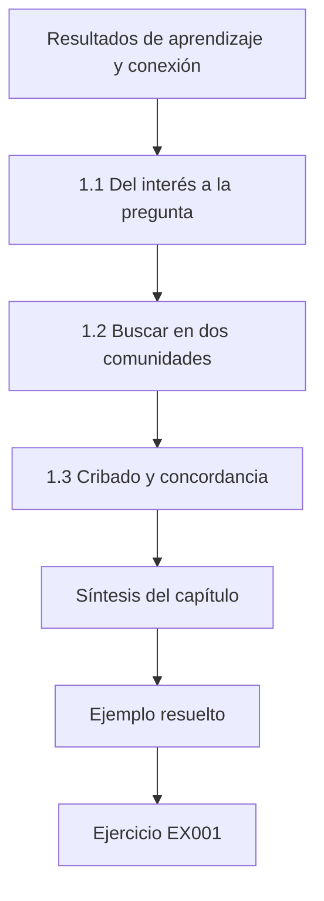

### Dibujo lógico

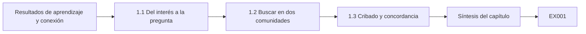

```text
[Resultados de aprendizaje y conexión]
    |
    v
[1.1 Del interés a la pregunta]
    |
    v
[1.2 Buscar en dos comunidades]
    |
    v
[1.3 Cribado y concordancia]
    |
    v
[Síntesis del capítulo]
    |
    v
[Ejemplo resuelto] --> [Ejercicio EX001]
```
<!-- cyberabc:lesson-figures:end ch-01 -->


### Resultados de aprendizaje y conexión

Después de este capítulo usted podrá (1) convertir un interés vago en una pregunta investigable sobre un lazo de control, (2) buscar con sinónimos en publicaciones de ingeniería de control y de seguridad, (3) deduplicar y cribar con métricas de concordancia y (4) redactar un protocolo de revisión de alcance. Prepara el seminario del capítulo 2.

### 1.1 Del interés a la pregunta

"Seguridad de TO" es un campo, no una pregunta. Una pregunta investigable nombra un **sistema**, un **fenómeno**, una **comparación** y un **alcance**. Ejemplo de Harbor Loop: *en un lazo sintético de nivel de un solo tanque, ¿detecta un CUSUM sobre el residuo que usa un caudalímetro cableado de forma independiente la repetición de un único sensor con mayor exhaustividad por eventos y menor tasa de falsas alarmas que una alarma de banda de ±1.5, y desaparece la ventaja cuando también se suplanta el caudalímetro?* La pregunta ya codifica la condición de fracaso, un hábito propio del nivel de maestría que ahorra meses de afirmaciones exageradas.

### 1.2 Buscar en dos comunidades

La detección basada en la física aparece como "redundancia analítica" y "generación de residuos" en las revistas de control, y como "inyección de datos falsos" y "suplantación de sensores" en las publicaciones de seguridad. Construya una tabla de sinónimos antes de buscar en IEEE Xplore, ACM DL, Scopus y arXiv. Incluya la literatura gris (documentos técnicos de la IEC, avisos de CISA) como una corriente separada con sus propias reglas de elegibilidad, porque no se revisa por pares de la misma manera.

Ejecute cada cadena de búsqueda en cada base de datos y guarde las exportaciones con la fecha, la consulta exacta y el número de resultados, para que un examinador pueda repetir la búsqueda. Espere que las dos comunidades describan el mismo detector con palabras distintas y espere duplicados entre publicaciones; el laboratorio 1 muestra con qué rapidez aparecen cuando una misma revisión está indexada tanto en IEEE como en ACM.

### 1.3 Cribado y concordancia

Dos revisores criban títulos y resúmenes de forma independiente; informe el kappa de Cohen. El laboratorio 1 muestra una exportación sintética con deduplicación por DOI y por título y año, y un kappa de 0.462: una concordancia moderada debida al desacuerdo sobre un documento técnico de un fabricante y un artículo de mediciones de DNP3. Una concordancia baja es una señal para reparar los criterios de elegibilidad, no para forzar el consenso. Redacte las reglas de elegibilidad como enunciados comprobables antes del cribado: ¿evalúa el estudio un detector en un lazo de control?, ¿nombra su modelo de atacante?, ¿informa una métrica más allá de la exactitud? Criben juntos un pequeño lote de calibración, discutan cada desacuerdo y solo después criben el resto de forma independiente. Registre cada regla modificada y la fecha en que cambió.

### 1.4 Ejemplo resuelto y laboratorio 1

```python
# Lab 1 (masters OT, synthetic): deduplicate a search export and compute Cohen's kappa for two screeners.
import re
RECORDS=[
 ("ieee","Physics-based anomaly detection for ICS: a survey",2018,"10.1145/3203245"),
 ("acm","Physics-Based Anomaly Detection for ICS: A Survey",2018,"10.1145/3203245"),
 ("ieee","Modbus security: a survey of attacks and defenses",2020,""),
 ("arxiv","Sensor replay attacks on water treatment testbeds",2021,""),
 ("ieee","Sensor Replay Attacks on Water Treatment Testbeds",2021,""),
 ("grey","Vendor white paper: securing SCADA with AI",2022,""),
 ("ieee","DNP3 Secure Authentication field measurements",2019,""),
 ("acm","Zone and conduit design for IEC 62443",2020,""),
 ("ieee","False data injection in power systems: a survey",2011,"10.1109/TSG.2011.2129544"),
 ("arxiv","False Data Injection Attacks against State Estimation in Electric Power Grids",2011,"10.1109/TSG.2011.2129544"),
]
def key(r):
    doi=r[3].strip().lower();
    if doi: return ("doi",doi)
    t=re.sub(r"[^a-z0-9]","",r[1].lower()); return ("title",t,r[2])
seen={}; kept=[]
for r in RECORDS:
    k=key(r)
    if k in seen: continue
    seen[k]=True; kept.append(r)
# two reviewers: I=include X=exclude; disagreements on grey and DNP3
A="IIXIXIIXIX"[:len(kept)]; B="IIXIXXXIIX"[:len(kept)]
def kappa(a,b):
    n=len(a); agree=sum(x==y for x,y in zip(a,b))/n
    pa=sum(x=="I" for x in a)/n; pb=sum(x=="I" for x in b)/n
    pe=pa*pb+(1-pa)*(1-pb)
    return round(agree,3), round((agree-pe)/(1-pe) if pe!=1 else 1.0,3)
print("raw",len(RECORDS),"kept",len(kept),"dropped",len(RECORDS)-len(kept))
print("agree,kappa",kappa(A,B))
print("kept titles:",[r[1][:40] for r in kept])

```

Salida esperada:

```text
raw 10 kept 7 dropped 3
agree,kappa (0.714, 0.462)
kept titles: ['Physics-based anomaly detection for ICS:', 'Modbus security: a survey of attacks and', 'Sensor replay attacks on water treatment', 'Vendor white paper: securing SCADA with ', 'DNP3 Secure Authentication field measure', 'Zone and conduit design for IEC 62443', 'False data injection in power systems: a']
```

Se eliminan tres duplicados por DOI o por título normalizado. Un kappa de 0.462 con una concordancia bruta del 71.4 % muestra la corrección por azar en acción.

El laboratorio conserva el primer registro de cada par duplicado, de modo que se queda la versión de IEEE de la revisión basada en la física y se elimina la copia de ACM. Dos registros sin DOI se fusionan solo porque sus títulos normalizados y sus años coinciden exactamente; un pequeño cambio de redacción dejaría pasar un duplicado. Revise a ojo la lista conservada antes del cribado e informe en el protocolo el recuento bruto, el conservado y el eliminado, tal como los imprime el laboratorio.

### 1.5 Errores comunes y límites

Buscar solo en publicaciones de seguridad; tratar los artículos de fabricantes como evidencia revisada por pares; informar la concordancia bruta sin kappa; redactar una pregunta sin condición de fracaso. Una pregunta sin condición de fracaso invita a un trabajo de fin de máster que solo puede tener éxito. La pregunta de Harbor Loop lo evita al preguntar cuándo desaparece la ventaja del CUSUM. La búsqueda tiene un límite parecido: las bases de datos cambian su indexación, de modo que una búsqueda ejecutada en marzo puede no devolver el mismo conjunto en septiembre. Registre la fecha de cada ejecución y trate el corpus como una instantánea.

### Ejercicios — capítulo 1

- **EX001 — Pregunta investigable sobre Modbus.** Reescriba "Quiero estudiar la seguridad de Modbus" como una pregunta investigable con sistema, fenómeno, comparación y alcance. *Rúbrica:* 3 = sistema, fenómeno, comparación y alcance con métrica de ≥90 %; 2 = falta un elemento; 1 = interés vago por Modbus; 0 = nada.
- **EX002 — Tabla de sinónimos para la manipulación de sensores.** Construya una tabla de sinónimos (≥4 términos de control + ≥4 de seguridad) para la detección de datos de sensores manipulados. *Rúbrica:* 3 = ≥4 términos de control + ≥4 de seguridad; 2 = 3+3; 1 = una sola comunidad; 0 = nada.
- **EX003 — Incluir o excluir el documento técnico y el de DNP3.** Redacte criterios de inclusión y exclusión que decidan sobre el documento técnico del fabricante y el artículo de DNP3 del laboratorio 1. *Rúbrica:* 3 = los criterios excluyen el marketing de fabricantes e incluyen la medición de campo de DNP3; 2 = decisiones sin criterios; 1 = una decisión; 0 = nada.
- **EX004 — Registro gris con ampersand y kappa.** Ejecute el laboratorio 1; añada un registro gris con un ampersand en el título; muestre si su key() lo detecta; recalcule kappa tras cambiar una decisión. *Rúbrica:* 3 = la clave normalizada detecta el ampersand + se explica el movimiento de kappa; 2 = clave sin kappa; 1 = solo kappa; 0 = nada.
- **EX005 — Protocolo de revisión de alcance de una página.** Redacte un protocolo de revisión de alcance de una página (bases de datos, fechas, sinónimos, reglas de cribado, objetivo de kappa). *Rúbrica:* 3 = bases de datos/fechas/sinónimos/cribado/κ≥0.6; 2 = falta un campo; 1 = lista de viñetas; 0 = nada.
- **EX006 — Clave DOI antes que clave de título.** Explique por qué, en la deduplicación, una clave DOI debe preceder a una clave de título. *Rúbrica:* 3 = identidad del DOI entre variantes del título + modo de fallo de la clave de título; 2 = DOI primero sin modo de fallo; 1 = eslogan; 0 = nada.
- **EX007 — Niveles de evidencia para tres fuentes.** Clasifique tres fuentes (la revisión de Giraldo, un aviso de CISA, un blog de un fabricante) por nivel de evidencia para un trabajo de fin de máster. *Rúbrica:* 3 = Giraldo alto, CISA medio, blog del fabricante bajo, con razones; 2 = niveles sin razones; 1 = una fuente; 0 = nada.

### Síntesis del capítulo

Un proyecto de maestría empieza con una pregunta que ya nombra su condición de fracaso, una búsqueda que abarca varias comunidades y un proceso de cribado cuyos desacuerdos reparan los criterios.

### Siga estudiando — capítulo 01 de 08

[← Página del curso](../../README.md) · [Índice de capítulos del curso](../SUBJECTS.md) · [Capítulo 02 (borrador) →](#ch-02)

<a id="ch-02"></a>

## Capítulo 2 — Seguridad de TO, IoT y sistemas ciberfísicos: seminario avanzado

<!-- cyberabc:lesson-figures:start ch-02 -->
### Mapa de la lección

Lección 02 publicada. Mapa, ejemplo, EX008.

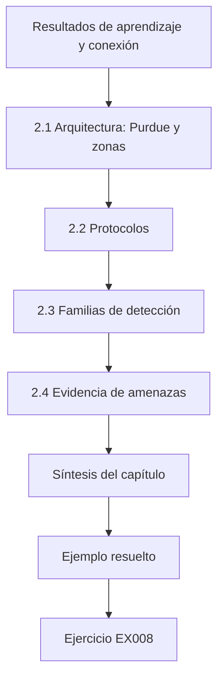

### Dibujo lógico

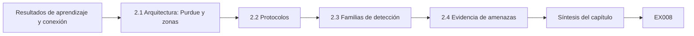

```text
[Resultados de aprendizaje y conexión]
    |
    v
[2.1 Arquitectura: Purdue y zonas]
    |
    v
[2.2 Protocolos]
    |
    v
[2.3 Familias de detección]
    |
    v
[2.4 Evidencia de amenazas]
    |
    v
[Síntesis del capítulo]
    |
    v
[Ejemplo resuelto] --> [Ejercicio EX008]
```
<!-- cyberabc:lesson-figures:end ch-02 -->


### Resultados de aprendizaje y conexión

Después de este capítulo usted podrá (1) explicar los niveles Purdue y las zonas de ISA/IEC 62443, (2) describir por qué los protocolos industriales clásicos carecen de autenticación, (3) contrastar la detección en red con la detección basada en la física, (4) leer ATT&CK for ICS como evidencia de capacidad y no como evidencia de frecuencia, y (5) extraer una laguna falsable de un mapa de la literatura.

### 2.1 Arquitectura: Purdue y zonas

NIST SP 800-82 Rev. 3 presenta el modelo Purdue: niveles 0–1 (proceso y control básico), 2 (supervisión), 3 (operaciones), 4–5 (empresa), con una DMZ industrial. ISA/IEC 62443-3-2 le pide particionar en **zonas** con un nivel de seguridad objetivo y controlar los **conductos** entre ellas. Un trabajo de fin de máster puede tratar un diseño de zonas como una hipótesis: ¿reduce un conducto que solo permite lecturas Modbus del nivel 2 al nivel 1 la alcanzabilidad de escritura en una fracción medida dentro de una topología sintética? En Harbor Loop la frontera pertinente se sitúa entre el nivel de supervisión y el PLC, donde Modbus/TCP transporta tanto lecturas como escrituras. Dibuje esa frontera en el trabajo aunque el estudio mida la detección y no la segmentación, porque el lector necesita saber qué posiciones del atacante supone la repetición. Un conducto que bloquea las escrituras no detiene las lecturas repetidas, y por eso la detección sigue importando.

### 2.2 Protocolos

El Modbus Application Protocol define códigos de función (entre ellos los de escritura de uno o varios registros) y un modelo de datos, pero ningún campo de autenticación ni de integridad. DNP3 Secure Authentication y los modelos de seguridad de OPC UA muestran que la industria ha añadido opciones; su adopción y la calidad de su implementación siguen siendo cuestiones empíricas. Nunca presente "Modbus es inseguro" como un hallazgo: es una propiedad de diseño de la especificación. Para el Harbor Loop Study la propiedad pertinente es que una respuesta que transporta un valor de nivel no tiene ningún campo que demuestre que procede del transmisor. Por eso la repetición es posible y por eso el trabajo mide la detección y no la prevención. Nombre los códigos de función que usa su modelo de atacante, para que el lector vea de qué partes de la especificación dependen los resultados.

### 2.3 Familias de detección

Los detectores de red observan paquetes; los detectores basados en la física observan si los valores de sensores y actuadores obedecen las leyes del proceso. Giraldo et al. revisaron estos últimos; Urbina et al. defendieron medir el impacto frente a un adversario sigiloso. Sommer y Paxson advirtieron que la detección de anomalías falla cuando lo "normal" es abierto; Arp et al. enumeraron errores de evaluación, entre ellos la puntuación con ajuste por puntos. Harbor Loop pertenece a la segunda familia: su CUSUM sobre el residuo compara la lectura de nivel con una estimación impulsada por el caudalímetro. Las advertencias de ambos artículos se aplican directamente. La operación normal de un lazo de agua es bastante cerrada, lo que ayuda, pero la puntuación debe usar episodios de ataque y no puntos, y la evaluación debe preguntar qué podría seguir haciendo un adversario sigiloso. La clase B es esa pregunta.

### 2.4 Evidencia de amenazas

MITRE ATT&CK for ICS enumera técnicas como *Modify Parameter* y *Spoof Reporting Message*. Los informes públicos sobre Stuxnet, los apagones de Ucrania de 2015 y TRITON/TRISIS muestran que la manipulación de la vista y el ataque a los sistemas de seguridad funcional son objetivos documentados de los adversarios. Úselos al nivel de los análisis públicos citados; no invente detalles operativos. Para el trabajo de fin de máster esta evidencia respalda una sola frase: manipular lo que ven los operadores es un objetivo documentado de los adversarios, de modo que probar la detección de una lectura de nivel repetida es pertinente. No respalda afirmaciones sobre la frecuencia con que las empresas de agua sufren repeticiones. Limite la cita a la técnica y al análisis público, y deje fuera del capítulo de antecedentes las afirmaciones de frecuencia.

### 2.5 Ejemplo resuelto: codificar una laguna

De doce estudios sintéticos L1–L12, solo dos informan el impacto en el momento de la detección, solo uno congela los umbrales antes de un segundo contexto y ninguno combina adversario consciente del detector + umbrales congelados + impacto + segunda planta. Laguna: *ninguna evaluación de la detección por residuos frente a la repetición de sensores informa la exhaustividad por eventos, el retardo y el sobrellenado en el momento de la alarma con umbrales congelados en dos contextos y una clase de atacante explícita de dos sensores.*

Escriba la laguna como una sola frase que nombre lo que falta y luego contraste cada palabra con la tabla codificada. Si un estudio sí combinara umbrales congelados y una segunda planta, la laguna se reduce y la frase debe cambiar. Una laguna construida a partir de una tabla de codificación puede auditarse; una laguna construida a partir de impresiones sobre el campo, no.

### 2.6 Errores comunes y límites

Citar normas como evidencia de que funcionan; tratar ATT&CK como tasas de base; reivindicar novedad a partir del nombre de un conjunto de datos nuevo. Estos errores comparten un patrón: confunden la existencia de un documento con la evidencia de un efecto. Una norma dice lo que debería hacerse; no demuestra que hacerlo reduzca el daño. ATT&CK enumera lo que se ha visto hacer a los adversarios, no con qué frecuencia. Un conjunto de datos nuevo es útil, pero la novedad debe venir de la pregunta que permite responder.

### Ejercicios — capítulo 2

- **EX008 — Mapa Purdue de Harbor Loop L1.** Asigne los componentes de Harbor Loop L1 a los niveles Purdue 0–3 y nombre dos conductos. *Rúbrica:* 3 = componentes L0–L3 + dos conductos (SCADA↔PLC, historiador↔SCADA); 2 = solo niveles; 1 = parcial; 0 = nada.
- **EX009 — Zona 62443 como hipótesis medible.** Reescriba una recomendación de zonas de 62443 como una hipótesis medible. *Rúbrica:* 3 = hipótesis medible de conducto de solo lectura con métrica de ≥90 %; 2 = hipótesis sin métrica; 1 = eslogan; 0 = nada.
- **EX010 — Autenticación en Modbus frente a DNP3-SA.** Compare Modbus y DNP3 Secure Authentication en cuanto a la presencia de autenticación usando solo las especificaciones públicas. *Rúbrica:* 3 = Modbus sin autenticación frente a los desafíos de DNP3-SA; presencia, no adopción; 2 = solo presencia; 1 = afirmación sobre adopción; 0 = nada.
- **EX011 — Techo para un estudio con F1 con ajuste por puntos.** Valore un estudio ficticio que informa un F1 con ajuste por puntos = 0.99 en un banco de pruebas; indique qué puede respaldar. *Rúbrica:* 3 = techo de respaldo solo para marcas de segmento; excluye retardo/impacto/generalización/adversario consciente; 2 = techo sin exclusiones; 1 = acepta el 0.99; 0 = nada.
- **EX012 — Dos técnicas de ATT&CK para Harbor Loop.** Seleccione dos técnicas de ATT&CK for ICS para Harbor Loop; explique por qué no son evidencia de frecuencia. *Rúbrica:* 3 = Spoof Reporting Message + Modify Parameter + no son frecuencia; 2 = técnicas sin salvedad; 1 = una; 0 = nada.
- **EX013 — Lagunas débil y fuerte de la detección por residuos.** Redacte enunciados de laguna débil y fuerte para la detección por residuos de la repetición de sensores. *Rúbrica:* 3 = laguna débil frente a fuerte que coincide en sustancia con §2.5; 2 = débil/fuerte sin detalle de TO; 1 = una; 0 = nada.
- **EX014 — Errores de Arp más un error de TO.** Enumere tres errores de evaluación de Arp et al. que se aplican a los detectores de TO y un error específico de TO. *Rúbrica:* 3 = tres errores de Arp + error de impacto en el momento de la detección de TO; 2 = solo Arp; 1 = un error; 0 = nada.

### Síntesis del capítulo

El seminario le da arquitectura, protocolos, familias de detección y evidencia de amenazas, y la disciplina para convertirlos en hipótesis y lagunas en lugar de eslóganes.

### Siga estudiando — capítulo 02 de 08

[← Capítulo 01 (borrador)](#ch-01) · [Índice de capítulos del curso](../SUBJECTS.md) · [Capítulo 03 (borrador) →](#ch-03)

<a id="ch-03"></a>

## Capítulo 3 — Diseño del estudio, ética y reproducibilidad

<!-- cyberabc:lesson-figures:start ch-03 -->
### Mapa de la lección

Lección 03 publicada. Mapa, ejemplo, EX015.

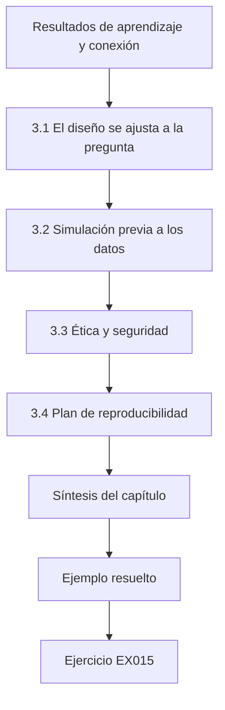

### Dibujo lógico

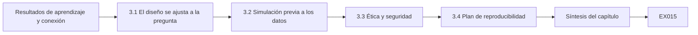

```text
[Resultados de aprendizaje y conexión]
    |
    v
[3.1 El diseño se ajusta a la pregunta]
    |
    v
[3.2 Simulación previa a los datos]
    |
    v
[3.3 Ética y seguridad]
    |
    v
[3.4 Plan de reproducibilidad]
    |
    v
[Síntesis del capítulo]
    |
    v
[Ejemplo resuelto] --> [Ejercicio EX015]
```
<!-- cyberabc:lesson-figures:end ch-03 -->


### Resultados de aprendizaje y conexión

Después de este capítulo usted podrá (1) elegir un diseño que se ajuste a la pregunta, (2) simular el sesgo y la potencia del diseño antes de recolectar datos, (3) aplicar los principios del Menlo Report a la investigación industrial y (4) redactar un plan de análisis previo con niveles de datos.

### 3.1 El diseño se ajusta a la pregunta

Harbor Loop compara dos detectores bajo ataques controlados en un modelo y en una instalación de laboratorio: es un **experimento controlado**, no un estudio observacional. Si preguntara "¿con qué frecuencia sufren las plantas ataques de repetición?", necesitaría una encuesta con un marco muestral y un modelo de divulgación, porque las plantas que nunca informan son invisibles en los catálogos públicos. Si preguntara cómo confían los operadores en las alarmas, necesitaría entrevistas con revisión ética. Ajustar el diseño a la pregunta es el modo de fallo más común en la maestría: los estudiantes toman prestado un método que les gusta y después buscan una pregunta que encaje. Escriba primero la pregunta.

Un segundo problema de ajuste es la **unidad de análisis**. La comparación de detectores opera sobre episodios de ataque. La comparación de arquitecturas opera sobre grafos de alcanzabilidad. Los estudios con operadores operan sobre personas y turnos. Mezclar unidades, contando paquetes como si fueran episodios, reproduce la confusión del ajuste por puntos. Declare la unidad antes de recolectar nada.

### 3.2 Simulación previa a los datos

Antes de cualquier experimento, simule. El laboratorio 3 (más abajo, reutilizado como laboratorio principal del detector) ya muestra la detección en la clase A y el fallo en la clase B. Ejecutarlo *antes* de redactar la propuesta le indica que el diseño puede distinguir las hipótesis bajo los supuestos del modelo. La simulación previa a los datos también revela si el tamaño de muestra planificado carece de sentido: si ochenta semillas de ataque producen siempre el mismo resultado binario, necesita más un análisis de sensibilidad sobre los parámetros que podrían cambiar el resultado (holgura k, coeficiente del orificio, retardo del sensor) que mil semillas idénticas.

Registre la simulación como un artefacto de diseño: rangos de semillas, malla de parámetros, reglas de decisión. Cuando un supervisor pregunte "¿por qué ochenta ejecuciones?", la respuesta está en ese artefacto.

### 3.3 Ética y seguridad

Menlo: respeto por las personas (los operadores que entreviste), beneficencia (acote cada experimento físico con una capa de seguridad independiente, nunca con el PLC bajo prueba), justicia (las empresas de servicios pequeñas soportan los costos de los parches), respeto por la ley y el interés público. **Nunca pruebe en producción.** El peor resultado de Campus Rig R2 es agua en una bandeja de goteo; una válvula de flotador mecánica y una parada de emergencia física lo acotan. Más allá de Menlo, la investigación en TO hereda la cultura de seguridad: reuniones informativas antes de las sesiones de laboratorio, reglas de dos personas para energizar bombas y una autoridad de parada escrita que prevalece sobre el deseo del investigador de terminar una ejecución. Registre los cuasi accidentes (casi se alcanzó la válvula de flotador) con la misma seriedad que las hipótesis fallidas.

### 3.4 Plan de reproducibilidad

Registre las métricas (exhaustividad por eventos, retardo, ejecuciones con falsa alarma por cada 80 semillas nominales, sobrellenado en el momento de la alarma), las semillas, los umbrales y el código de análisis antes de las ejecuciones de validación. Asigne los niveles de datos T0–T3 (el capítulo 7 del libro doctoral complementario lo desarrolla; aquí, como mínimo, separe el código público de las configuraciones de la instalación). Guarde el plan registrado con una marca de tiempo que el supervisor pueda verificar, como un commit fechado en el repositorio del proyecto. Incluya los valores congelados de k y h, los rangos de semillas para el ajuste y para la evaluación, y la regla de lo que cuenta como detección. Cualquier cambio posterior va a una tabla de desviaciones con fecha y motivo, y se informa en el trabajo de fin de máster.

### 3.5 Ejemplo resuelto y laboratorio 3

```python
# Lab 3: residual CUSUM vs band on synthetic tank; report event recall, delay, FA/shift, overfill@alarm.
import random
def run(seed,atk,det,k=0.8,h=6.0,steps=800,onset=400):
    rng=random.Random(seed); true=est=50.0; s=0.0; alarm=None; at=None
    for t in range(steps):
        inflow=1.0+rng.gauss(0,0.05)+(0.05 if atk and t>=onset else 0)
        true+=inflow-0.02*true
        lvl=true+rng.gauss(0,0.3); fm=inflow+rng.gauss(0,0.02)
        if atk and t>=onset: lvl=50.0+rng.gauss(0,0.3)
        if atk=="B" and t>=onset: fm=1.0+rng.gauss(0,0.02)
        est+=fm-0.02*est
        hit=abs(lvl-50)>1.5 if det=="band" else False
        if det=="cusum":
            s=max(0.0,s+abs(lvl-est)-k); hit=s>h
        if hit and alarm is None: alarm=t; at=true-50
    return alarm,at
for det in ("band","cusum"):
    fa=sum(run(i,None,det)[0] is not None for i in range(80))
    for atk in ("A","B"):
        r=[run(i,atk,det) for i in range(80)]
        hits=[(a-400,ov) for a,ov in r if a is not None and a>=400]
        d=sum(h[0] for h in hits)/len(hits) if hits else float("nan")
        ov=sum(h[1] for h in hits)/len(hits) if hits else float("nan")
        print(f"{det:5s} class{atk} FA_runs={fa}/80 detected={len(hits)}/80 mean_delay={d:.1f} mean_overfill@alarm={ov:.2f}")

```

Salida esperada:

```text
band  classA FA_runs=11/80 detected=0/80 mean_delay=nan mean_overfill@alarm=nan
band  classB FA_runs=11/80 detected=0/80 mean_delay=nan mean_overfill@alarm=nan
cusum classA FA_runs=0/80 detected=80/80 mean_delay=37.7 mean_overfill@alarm=1.38
cusum classB FA_runs=0/80 detected=0/80 mean_delay=nan mean_overfill@alarm=nan
```

El laboratorio ejecuta ochenta semillas para cada detector y clase de ataque y cuenta las ejecuciones con falsa alarma en las mismas ochenta semillas sin ataque. La alarma de banda nunca se dispara en ninguno de los dos ataques, porque la repetición mantiene el nivel informado cerca de 50, y aun así genera falsas alarmas en 11 de 80 ejecuciones nominales. El CUSUM detecta todos los episodios de la clase A y ninguno de la clase B, cuando también se suplanta el caudalímetro. Esa única tabla ya contiene el resultado principal y su frontera. Léala antes de empezar cualquier trabajo en la instalación.

### 3.6 Errores comunes y límites

Elegir el diseño después de ver los datos; llamar "pasivo" a un sondeo activo; usar el PLC como única cota de seguridad. Cada error tiene una salvaguarda concreta. Registre el diseño y sus reglas de decisión antes de recolectar datos. Describa como activa cualquier medición que envíe solicitudes a un dispositivo, aunque solo lea. En Rig R2 la válvula de flotador y la parada de emergencia física son la cota de seguridad; nunca se confía en que el PLC bajo prueba detenga un desbordamiento del que puede ser la causa.

### Ejercicios — capítulo 3

- **EX015 — Asignar preguntas a tipos de diseño.** Asigne tres preguntas (comparación de detectores; tasa de adopción de DNP3-SA; confianza de los operadores en las alarmas) a tipos de diseño. *Rúbrica:* 3 = experimento/encuesta/entrevista asignados correctamente; 2 = dos correctos; 1 = uno; 0 = nada.
- **EX016 — Números del laboratorio 3 frente a H1 y H4.** Ejecute el laboratorio 3; informe los números frente a H1 (CUSUM en clase A con exhaustividad ≥95 %, banda ≤10 %) y H4 (clase B ≤10 %). *Rúbrica:* 3 = H1 80/80 frente a 0/80, H4 0/80, se señalan las FA de la banda; 2 = H1/H4 sin FA; 1 = cualitativo; 0 = nada.
- **EX017 — Acotar el forzado de la bomba en Rig R2.** Escriba el peor resultado creíble, la capa independiente y la autoridad de parada para un experimento de forzado de la bomba en Rig R2. *Rúbrica:* 3 = desbordamiento hacia la bandeja de goteo, válvula de flotador + bandeja, parada de emergencia del responsable designado; 2 = falta la independencia; 1 = solo el PLC; 0 = sin acotar.
- **EX018 — Menlo ante la publicación de la evasión de clase B.** Aplique los cuatro principios del Menlo Report a la publicación de un método de evasión de clase B. *Rúbrica:* 3 = principios de Menlo → publicar la clase + la defensa, retener los pasos específicos del producto hasta la divulgación coordinada (CVD); 2 = principios sin decisión; 1 = publicarlo todo; 0 = nada.
- **EX019 — Plan de análisis previo con semillas congeladas.** Redacte un plan de análisis previo de una página con métricas y semillas congeladas. *Rúbrica:* 3 = métricas, semillas 0–79/1000–1079, k=0.8 h=6, sin cambios tras la carga en R2; 2 = faltan las semillas o la congelación; 1 = plan vago; 0 = nada.
- **EX020 — Niveles desde el simulador hasta las citas de operadores.** Asigne T0–T3 a: código del simulador, trazas sintéticas, diagrama de cableado de R2, citas anonimizadas de operadores. *Rúbrica:* 3 = código T0, trazas T1, cableado T2, citas T2/T1 con nota sobre la anonimización; 2 = tres correctos; 1 = dos; 0 = nada.

### Síntesis del capítulo

Diseño antes que datos, simulación antes del compromiso, cota para cada experimento físico y plan de análisis congelado.

### Siga estudiando — capítulo 03 de 08

[← Capítulo 02 (borrador)](#ch-02) · [Índice de capítulos del curso](../SUBJECTS.md) · [Capítulo 04 (borrador) →](#ch-04)

<a id="ch-04"></a>

## Capítulo 4 — Seguridad de TO, IoT y sistemas ciberfísicos: explicaciones rivales

<!-- cyberabc:lesson-figures:start ch-04 -->
### Mapa de la lección

Lección 04 publicada. Mapa, ejemplo, EX021.

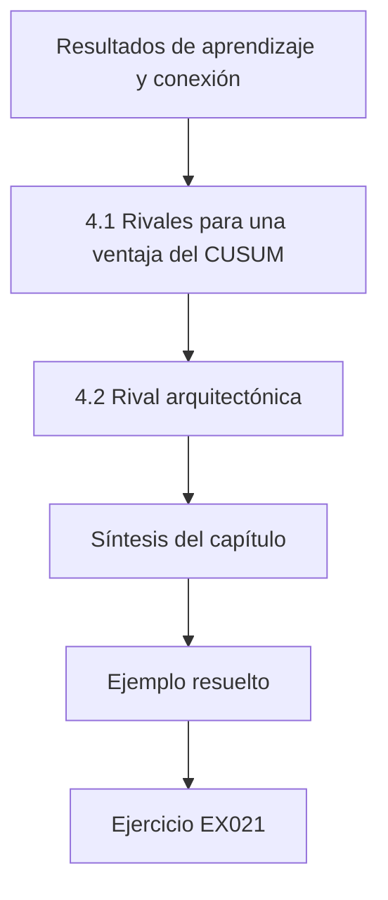

### Dibujo lógico

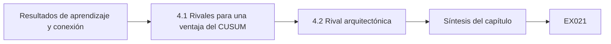

```text
[Resultados de aprendizaje y conexión]
    |
    v
[4.1 Rivales para una ventaja del CUSUM]
    |
    v
[4.2 Rival arquitectónica]
    |
    v
[Síntesis del capítulo]
    |
    v
[Ejemplo resuelto] --> [Ejercicio EX021]
```
<!-- cyberabc:lesson-figures:end ch-04 -->


### Resultados de aprendizaje y conexión

Después de este capítulo usted podrá (1) enumerar explicaciones rivales para un resultado de detección, (2) diseñar observaciones que discriminen entre ellas y (3) revisar las afirmaciones cuando una rival sobrevive.

### 4.1 Rivales para una ventaja del CUSUM

(1) Umbrales ajustados con los datos de prueba. (2) Simulador demasiado limpio (sin sesgo de calibración). (3) Magnitud del ataque elegida para favorecer al CUSUM. (4) Alarma de banda configurada de forma inusualmente estrecha o amplia. (5) Evaluación con F1 con ajuste por puntos. Cada rival tiene una prueba: ajuste con semillas separadas, barridos de sesgo, barridos de ganancia, informar la tasa de falsas alarmas de la banda, informar métricas por eventos. Escriba las rivales antes de ver los resultados. Después de los resultados es demasiado fácil inventar solo las rivales que ya ha vencido. Entregue la lista a un colega que no haya visto el laboratorio 3 y pregúntele qué añadiría. Los ingenieros de control suelen añadir rivales sobre la estructura del modelo; los investigadores de seguridad suelen añadir rivales de adversario adaptativo. Ambas pertenecen a la lista, aunque el calendario de una maestría solo permita probarlas en parte.

### 4.2 Rival arquitectónica

Una rival más profunda: "el CUSUM solo funciona porque el caudalímetro es independiente; si ambos sensores comparten un PLC, el método falla". No es un factor de confusión que eliminar: es una **condición de frontera** que medir (clase B). Las rivales que sobreviven pasan a formar parte de la afirmación. Muchos artículos de TO entierran este tipo de resultado en un párrafo de limitaciones; los examinadores de maestría lo piden cada vez más en el resumen. Trate una frontera confirmada como un hallazgo: los defensores aprenden que las rutas de medición independientes son supuestos que sostienen el resultado.

La misma lógica se aplica en otros casos. Un diseño de segmentación que falla cuando las estaciones de ingeniería conservan rutas de escritura permanentes ha descubierto una frontera. Un filtro de protocolo que falla cuando el tráfico se tuneliza dentro de otro protocolo ha descubierto una frontera. Mídalas y colóquelas donde los lectores miran primero.

### 4.3 Ejemplo resuelto

Tras el laboratorio 3, las rivales (1) y (5) quedan atendidas por el diseño; la rival (2) necesita barridos de sesgo y del orificio al estilo del laboratorio 6; la rival (3) necesita un barrido de ganancia; la rival (4) se atiende informando las 11/80 ejecuciones con falsa alarma de la banda. La rival arquitectónica queda confirmada por clase B = 0/80. Escriba esta correspondencia como una tabla en el trabajo de fin de máster: rival, prueba, estado, evidencia. Las rivales probadas solo en parte, como el barrido de ganancia si falta tiempo, permanecen en la tabla marcadas como abiertas en lugar de desaparecer. La rival arquitectónica pasa del capítulo de limitaciones a los resultados, porque la clase B es un resultado medido, no una preocupación sin probar.

### 4.4 Errores comunes y límites

Enumerar rivales sin pruebas; tratar una frontera confirmada como un fracaso que ocultar. Una rival sin prueba es una preocupación, no parte del análisis. Cada una necesita una observación que saldría distinta si fuera cierta. Cuando una rival sobrevive, como la rival arquitectónica en la clase B, infórmela como un hallazgo con sus números. Ocultarla dejaría a los lectores creyendo que el método de residuos protege lazos en los que un solo dispositivo controla ambas mediciones. El resultado de la clase B es el ejemplo más claro de este estudio.

### Ejercicios — capítulo 4

- **EX021 — Cinco rivales para la segmentación por zonas.** Escriba cinco rivales para "la segmentación por zonas reduce los ataques" y una prueba para cada una. *Rúbrica:* 3 = cinco rivales, cada una con una prueba; 2 = tres rivales con pruebas; 1 = rivales sin pruebas; 0 = nada.
- **EX022 — Barrido de ganancia para el impacto al estilo de Urbina.** Diseñe un barrido de ganancia que respaldaría o refutaría la rival (3); prediga el patrón si se cumple la acotación del impacto al estilo de Urbina. *Rúbrica:* 3 = diseño del barrido de ganancia + predicción del patrón al estilo de Urbina; 2 = barrido sin predicción; 1 = vago; 0 = nada.
- **EX023 — Por qué el fallo de la clase B refuerza la tesis.** Explique por qué el fallo de la clase B refuerza, en lugar de debilitar, una tesis cuidadosa. *Rúbrica:* 3 = el fallo de la clase B como límite caracterizado que afina las afirmaciones; 2 = "el fracaso es honestidad" sin vínculo con el límite; 1 = oculta el fallo; 0 = nada.
- **EX024 — Rivales sin probar bajo F1 con ajuste por puntos.** En un estudio que solo informa el F1 con ajuste por puntos, ¿qué rivales quedan sin probar? *Rúbrica:* 3 = enumera las rivales sin probar (retardo, FA, impacto, adversario consciente, etc.); 2 = dos rivales; 1 = una; 0 = nada.
- **EX025 — Diagrama causal hasta el sobrellenado en el momento de la alarma.** Escriba un diagrama causal (como una lista de viñetas de nodos y flechas) desde la capacidad del atacante hasta el sobrellenado en el momento de la alarma. *Rúbrica:* 3 = nodos/flechas desde capacidad→suplantación→residuo/banda→alarma→sobrellenado; 2 = nodos sin flechas; 1 = parcial; 0 = nada.
- **EX026 — Control negativo para el CUSUM sobre el residuo.** Proponga un control negativo: un ataque que *no* debería disparar el CUSUM sobre el residuo si la justificación es correcta. *Rúbrica:* 3 = ataque de control negativo que no debería disparar el residuo si se sostiene la justificación; 2 = control sin vínculo con la justificación; 1 = vago; 0 = nada.

### Síntesis del capítulo

Las rivales con pruebas convierten una comparación en una contribución; las fronteras confirmadas pertenecen al resumen.

### Siga estudiando — capítulo 04 de 08

[← Capítulo 03 (borrador)](#ch-03) · [Índice de capítulos del curso](../SUBJECTS.md) · [Capítulo 05 (borrador) →](#ch-05)

<a id="ch-05"></a>

## Capítulo 5 — Propuesta y piloto

<!-- cyberabc:lesson-figures:start ch-05 -->
### Mapa de la lección

Lección 05 publicada. Mapa, ejemplo, EX027.

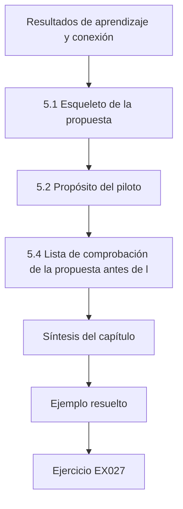

### Dibujo lógico

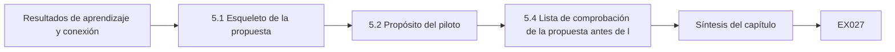

```text
[Resultados de aprendizaje y conexión]
    |
    v
[5.1 Esqueleto de la propuesta]
    |
    v
[5.2 Propósito del piloto]
    |
    v
[5.4 Lista de comprobación de la propuesta antes de l]
    |
    v
[Síntesis del capítulo]
    |
    v
[Ejemplo resuelto] --> [Ejercicio EX027]
```
<!-- cyberabc:lesson-figures:end ch-05 -->


### Resultados de aprendizaje y conexión

Después de este capítulo usted podrá (1) redactar una propuesta con hipótesis y condiciones de abandono, (2) definir criterios de continuar o no continuar para un piloto en la instalación y (3) mantener los datos del piloto fuera de las pruebas de hipótesis.

### 5.1 Esqueleto de la propuesta

Pregunta; laguna; hipótesis H1–H4 (incluido el fracaso); clases A/B del modelo de atacante; sistemas (simulador, Rig R2); métricas; plan de análisis; ética y seguridad; calendario; condiciones de abandono (la instalación no puede hacerse segura; el simulador no supera la verificación). Los supervisores leen las propuestas buscando **decidibilidad**: ¿puede un lector saber qué evidencia respaldaría H1 y cuál la refutaría? "El CUSUM es mejor" no es decidible; "exhaustividad por eventos ≥95 % con un retardo medio ≤60 pasos y ejecuciones con falsa alarma ≤ las de la alarma de banda" sí lo es. Ponga la hipótesis de fracaso H4 en la misma tabla que H1–H3 para que no pueda abandonarse en silencio más tarde.

Indique también lo que **no** hará: ningún sistema de producción, ningún desarrollo de exploits específicos de un producto, ninguna afirmación sobre sectores fuera de los lazos de almacenamiento de agua. Las exclusiones del alcance son tan importantes como las inclusiones.

### 5.2 Propósito del piloto

Solo viabilidad: ¿puede R2 ejecutar la repetición de forma segura? ¿Registra el historiador a 1 Hz? ¿Funciona la válvula de flotador? Criterios de continuación declarados de antemano: tres ejecuciones consecutivas sin disparo de la válvula de flotador, pérdida de registros <1 %, parada de emergencia probada. Los datos del piloto no prueban H1–H4. Un piloto que "parece prometedor" tienta a mirar los resultados antes de tiempo. Resista escribiendo la hoja de continuar o no continuar antes de la primera ejecución del piloto y guardando las trazas del piloto en un directorio que el código de análisis se niega a leer. Si el piloto falla, ha aprendido que la instalación necesita trabajo, que es justamente el objetivo, no que el detector sea malo. Documente quién tiene la autoridad de parada y pruebe la parada de emergencia en cada sesión antes de ejecutar los scripts de ataque.

### 5.3 Errores comunes y límites

Usar las ejecuciones del piloto para ajustar umbrales que después "validan" esas mismas ejecuciones; no tener condición de abandono. Guarde las trazas del piloto en un directorio separado que el código de análisis se niega a leer, y deje constancia en la propuesta de que los umbrales se congelan solo a partir de las semillas de ajuste del simulador. Redacte las condiciones de abandono en términos medibles: por ejemplo, la instalación se abandona si no puede demostrarse que la válvula de flotador se dispara antes de que se llene la bandeja de goteo. Sin tales condiciones, un estudio que fracasa simplemente va a la deriva. Revise esas condiciones con el supervisor antes de la primera ejecución del piloto.

### 5.4 Lista de comprobación de la propuesta antes de la revisión del supervisor

Antes de enviar la propuesta, confirme: (1) H1–H4 tienen números y H4 es una condición de fracaso que está dispuesto a confirmar; (2) el modelo de atacante distingue la clase A de la clase B; (3) las métricas incluyen la exhaustividad por eventos, el retardo, las ejecuciones con falsa alarma y el sobrellenado en el momento de la alarma, no solo el F1 con ajuste por puntos; (4) las cotas de seguridad nombran una capa independiente y una autoridad de parada; (5) existen condiciones de abandono; (6) el piloto no puede filtrarse a la validación porque las rutas están separadas. Un supervisor que le devuelve la propuesta con "aclare el alcance" le hace un regalo; un supervisor que acepta una propuesta vaga le prepara un año doloroso.

### Ejercicios — capítulo 5

- **EX027 — H1–H4 con umbrales basados en el margen hasta el disparo.** Redacte H1–H4 con umbrales numéricos justificados por un margen hasta el disparo declarado. *Rúbrica:* 3 = H1–H4 numéricas con justificación por el margen hasta el disparo; 2 = hipótesis sin justificación; 1 = solo H1; 0 = nada.
- **EX028 — Continuar o no continuar con reglas de seguridad y de datos.** Redacte criterios de continuar o no continuar que incluyan una regla de seguridad y una de calidad de los datos. *Rúbrica:* 3 = criterios de seguridad + calidad de los datos (válvula de flotador, pérdida de registros); 2 = un solo tipo de regla; 1 = continuación vaga; 0 = nada.
- **EX029 — Tres condiciones de abandono.** Enumere tres condiciones de abandono y qué pasaría a estudiar si se abandonara. *Rúbrica:* 3 = tres condiciones de abandono + estudio alternativo; 2 = condiciones sin alternativa; 1 = una; 0 = nada.
- **EX030 — Tabla del modelo de atacante para Harbor Loop.** Redacte la tabla del modelo de atacante (capacidades, conocimiento, objetivo, fuera del alcance). *Rúbrica:* 3 = tabla de capacidades/conocimiento/objetivo/fuera del alcance para Harbor Loop; 2 = falta una columna; 1 = solo prosa; 0 = nada.
- **EX031 — Por qué los pilotos quedan fuera de la validación.** Explique por qué las trazas del piloto no deben entrar en el conjunto de validación. *Rúbrica:* 3 = la fuga del piloto a la validación invalida la congelación; 2 = "contaminación" sin vínculo con la congelación; 1 = vago; 0 = nada.
- **EX032 — Evaluación de riesgos de las entrevistas a operadores.** Redacte una evaluación de riesgos de un párrafo para entrevistar a los operadores Q01–Q08. *Rúbrica:* 3 = riesgos para Q01–Q08 con mitigaciones (consentimiento, anonimización, interrupción); 2 = riesgos sin mitigaciones; 1 = un riesgo; 0 = nada.

### Síntesis del capítulo

Una propuesta que declara cómo puede fracasar y un piloto que solo pregunta si el estudio puede ejecutarse de forma segura protegen el trabajo de fin de máster de modos de fallo silenciosos.

### Siga estudiando — capítulo 05 de 08

[← Capítulo 04 (borrador)](#ch-04) · [Índice de capítulos del curso](../SUBJECTS.md) · [Capítulo 06 (borrador) →](#ch-06)

<a id="ch-06"></a>

## Capítulo 6 — Recolección y análisis de datos

<!-- cyberabc:lesson-figures:start ch-06 -->
### Mapa de la lección

Lección 06 publicada. Mapa, ejemplo, EX033.

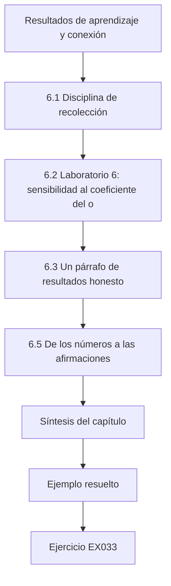

### Dibujo lógico

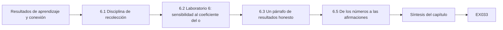

```text
[Resultados de aprendizaje y conexión]
    |
    v
[6.1 Disciplina de recolección]
    |
    v
[6.2 Laboratorio 6: sensibilidad al coeficiente del o]
    |
    v
[6.3 Un párrafo de resultados honesto]
    |
    v
[6.5 De los números a las afirmaciones]
    |
    v
[Síntesis del capítulo]
    |
    v
[Ejemplo resuelto] --> [Ejercicio EX033]
```
<!-- cyberabc:lesson-figures:end ch-06 -->


### Resultados de aprendizaje y conexión

Después de este capítulo usted podrá (1) recolectar datos del modelo y de la instalación bajo un plan congelado, (2) usar semillas emparejadas e intervalos bootstrap, (3) realizar análisis de sensibilidad y (4) redactar un párrafo de resultados honesto.

### 6.1 Disciplina de recolección

Congele los umbrales a partir de las semillas de ajuste; ejecute las semillas de evaluación; después, Rig R2 con los mismos valores congelados. Registre la semilla, el detector, la clase de ataque, el momento de la alarma y el sobrellenado en el momento de la alarma. No mire los datos de ataque de R2 antes de congelar. En la práctica, escriba un pequeño manifiesto que contenga `k`, `h`, el rango de semillas de ajuste y un hash del script de análisis, y niéguese a cargar los archivos de ataque de R2 hasta que exista ese manifiesto. Si cambia k después de ver R2, ya no tiene una validación: tiene otro ejercicio de ajuste, y debe decirlo. Lleve un cuaderno de laboratorio con fecha, persona, identificadores de ejecución y anomalías (microcorte de energía, recalibración de un sensor); las anomalías que coinciden con alarmas son explicaciones rivales.

### 6.2 Laboratorio 6: sensibilidad al coeficiente del orificio

```python
# Lab 6: bootstrap CI for delay difference (paired) + sensitivity to orifice coefficient.
import random
def delay(seed, orifice=0.02, k=0.8, steps=900, onset=300):
    rng=random.Random(seed); true=est=50.0; s=0.0
    # keep equilibrium near 50: nominal inflow = orifice*50
    for t in range(steps):
        inflow=orifice*50 + rng.gauss(0,0.05)+(0.05 if t>=onset else 0)
        true+=inflow-orifice*true
        lvl=(50.0 if t>=onset else true)+rng.gauss(0,0.3)
        est+=inflow+rng.gauss(0,0.02)-orifice*est
        s=max(0.0,s+abs(lvl-est)-k)
        if s>6 and t>=onset: return t-onset
    return None
for orifice in (0.015,0.02,0.025):
    d8=[]; d6=[]; diffs=[]
    for i in range(150):
        a=delay(i,orifice,0.8); b=delay(i,orifice,0.6)
        if a is not None: d8.append(a)
        if b is not None: d6.append(b)
        if a is not None and b is not None: diffs.append(a-b)
    rng=random.Random(1); boots=sorted(sum(rng.choice(diffs) for _ in diffs)/len(diffs) for _ in range(1000)) if diffs else []
    print(f"orifice={orifice} detected_k0.8={len(d8)}/150 detected_k0.6={len(d6)}/150 "
          f"mean_diff={sum(diffs)/len(diffs):.1f} 95%CI=[{boots[25]:.1f},{boots[974]:.1f}]")

```

Salida esperada:

```text
orifice=0.015 detected_k0.8=150/150 detected_k0.6=150/150 mean_diff=6.0 95%CI=[5.6,6.4]
orifice=0.02 detected_k0.8=150/150 detected_k0.6=150/150 mean_diff=7.1 95%CI=[6.6,7.6]
orifice=0.025 detected_k0.8=150/150 detected_k0.6=150/150 mean_diff=8.6 95%CI=[7.9,9.4]
```

El costo en retardo de elegir k = 0.8 en lugar de 0.6 crece a medida que aumenta el coeficiente del orificio (dinámica natural más rápida / señal distinta). Los intervalos describen solo el ruido de la simulación.

El laboratorio empareja semillas: cada semilla se ejecuta con ambas holguras y la diferencia se toma dentro de la semilla, lo que elimina el ruido que comparten ambas ejecuciones. Después, el bootstrap remuestrea esas diferencias emparejadas. Las tres configuraciones del orificio detectan todos los episodios con ambas holguras, de modo que el compromiso está solo en el retardo. Los intervalos describen solo el ruido de la simulación; no dicen nada sobre cómo difiere un tanque real del modelo.

### 6.3 Un párrafo de resultados honesto

"En el modelo sintético de Harbor Loop, el CUSUM sobre el residuo detectó 80/80 episodios de repetición de la clase A (retardo medio de 37.7 pasos, sobrellenado medio en el momento de la alarma de 1.38) con 0/80 ejecuciones con falsa alarma; la banda de ±1.5 detectó 0/80 con 11/80 ejecuciones con falsa alarma. La clase B (caudalímetro también suplantado) evadió el CUSUM en 80/80 ensayos. El costo en retardo de la holgura más robusta, k = 0.8, frente a 0.6 fue de 6.0–8.6 pasos para coeficientes del orificio de 0.015–0.025. La validación en Rig R2 se informa por separado con umbrales congelados."

El párrafo informa el fracaso con el mismo patrón de frase que el éxito, de modo que la clase B no puede pasarse por alto. Da cada cifra con su denominador y nombra el modelo como sintético. También remite a los resultados de la instalación sin afirmarlos. Compruebe que cada número coincide exactamente con la salida del laboratorio antes de que entre en el trabajo de fin de máster.

### 6.4 Errores comunes y límites

Semillas independientes para comparaciones emparejadas; intervalos presentados como incertidumbre del mundo real; ocultar la clase B. Las comparaciones emparejadas necesitan la misma semilla para ambas configuraciones; las semillas independientes añaden ruido que oculta las diferencias pequeñas. Los intervalos bootstrap describen la variabilidad de la simulación bajo el modelo, no la incertidumbre sobre plantas reales. La clase B pertenece a la tabla principal de resultados, no a un apéndice, porque es la frontera medida del método y un operador necesita conocerla. Informe las semillas usadas en cada comparación para que otros puedan repetir exactamente el emparejamiento.

### 6.5 De los números a las afirmaciones

Tras los laboratorios 3 y 6 usted tiene recuentos de detección, retardos, ejecuciones con falsa alarma y una curva de sensibilidad. Convertirlos en afirmaciones exige la escalera del libro doctoral complementario: una observación del protocolo no es una inferencia sobre el proceso. Diga "el CUSUM alarmó con un retardo medio de 37.7 pasos mientras el sobrellenado real era de 1.38" (observación + inferencia sobre el proceso) en lugar de "el CUSUM evita los desbordamientos" (afirmación de consecuencia sin evidencia de las capas de protección). Cuando lleguen los resultados de Rig R2, infórmelos en las mismas unidades para que el lector pueda ver la transportabilidad, o su fallo, sin tener que buscarla.

Mantenga una tabla breve que empareje cada número con la afirmación que respalda y el nivel de esa afirmación. Un retardo en pasos respalda una afirmación de detección; el sobrellenado en el momento de la alarma respalda una inferencia sobre el proceso dentro del modelo; ninguno respalda un enunciado sobre la protección, porque el estudio no midió ninguna capa de protección. Esa tabla alimenta después el registro de afirmaciones.

### Ejercicios — capítulo 6

- **EX033 — Resultados de 150 palabras a partir del laboratorio 3 y el laboratorio 6.** Ejecute los laboratorios 3 y 6; redacte un párrafo de resultados de 150 palabras con números. *Rúbrica:* 3 = ~150 palabras con números de los laboratorios 3/6 para H1/H4 y sesgo/holgura; 2 = números sin estructura; 1 = breve; 0 = nada.
- **EX034 — Anchura del IC con semillas independientes para k=0.6.** Vuelva a ejecutar el laboratorio 6 con semillas independientes para k = 0.6; compare la anchura del IC. *Rúbrica:* 3 = IC más ancho con semillas independientes que emparejadas, con la dirección; 2 = solo la dirección; 1 = incorrecto; 0 = nada.
- **EX035 — Seis fuentes de incertidumbre clasificadas.** Clasifique seis fuentes de incertidumbre como estocásticas, paramétricas o estructurales. *Rúbrica:* 3 = estocásticas/paramétricas/estructurales con ejemplos; 2 = solo las clases; 1 = una clase; 0 = nada.
- **EX036 — Regla de congelación antes de la validación en R2.** Redacte la regla de congelación que debe cumplirse antes de la validación en R2. *Rúbrica:* 3 = k/h congelados con hash antes de los datos de ataque de R2 + regla de invalidación; 2 = congelación sin invalidación; 1 = vago; 0 = nada.
- **EX037 — Resumir las ejecuciones que nunca alarman.** Proponga cómo resumir las ejecuciones que nunca alarman (censura por la derecha). *Rúbrica:* 3 = proporción de detección + mediana entre las detectadas o resumen de tipo supervivencia; 2 = un resumen mejor; 1 = media con tope; 0 = nada.
- **EX038 — Lo que no significan los intervalos del laboratorio 6.** Indique lo que *no* significan los intervalos del laboratorio 6. *Rúbrica:* 3 = intervalos ≠ incertidumbre de la planta / error estructural; 2 = una salvedad; 1 = los trata como la verdad de la planta; 0 = nada.

### Síntesis del capítulo

Planes congelados, diseños emparejados, barridos de sensibilidad y párrafos honestos, incluida la condición de fracaso, son el estándar de análisis de este trabajo de fin de máster.

### Siga estudiando — capítulo 06 de 08

[← Capítulo 05 (borrador)](#ch-05) · [Índice de capítulos del curso](../SUBJECTS.md) · [Capítulo 07 (borrador) →](#ch-07)

<a id="ch-07"></a>

## Capítulo 7 — Redacción del trabajo de fin de máster y limitaciones

<!-- cyberabc:lesson-figures:start ch-07 -->
### Mapa de la lección

Lección 07 publicada. Mapa, ejemplo, EX039.

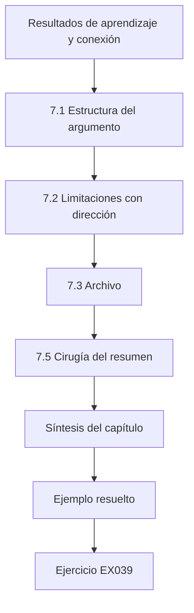

### Dibujo lógico

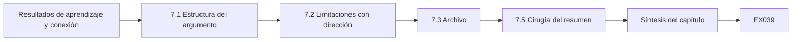

```text
[Resultados de aprendizaje y conexión]
    |
    v
[7.1 Estructura del argumento]
    |
    v
[7.2 Limitaciones con dirección]
    |
    v
[7.3 Archivo]
    |
    v
[7.5 Cirugía del resumen]
    |
    v
[Síntesis del capítulo]
    |
    v
[Ejemplo resuelto] --> [Ejercicio EX039]
```
<!-- cyberabc:lesson-figures:end ch-07 -->


### Resultados de aprendizaje y conexión

Después de este capítulo usted podrá (1) estructurar el argumento del trabajo de fin de máster, (2) redactar limitaciones con dirección, (3) construir un archivo mínimo por niveles y (4) evitar las afirmaciones exageradas en el resumen.

### 7.1 Estructura del argumento

Introducción (pregunta, laguna); antecedentes (seminario); métodos (diseño, ética, métricas); resultados (modelo, sensibilidad, instalación); discusión (rivales, fronteras); conclusión. Cada afirmación del resumen debe aparecer en el cuerpo con su evidencia y su alcance. Un orden práctico de redacción: primero las tablas de resultados, después los métodos que las produjeron, luego la discusión y por último la introducción. Una introducción escrita al final tiene menos probabilidades de prometer capítulos que no entregó. Mantenga un registro de afirmaciones (afirmación, sección, puntero a la evidencia, alcance, falsador) y actualícelo cada semana durante el último semestre. Cuando una frase del resumen no tenga una fila en el registro, elimine la frase o añada la fila.

### 7.2 Limitaciones con dirección

Caudalímetro sin ruido en la simulación → sobrestima la exhaustividad (compruébelo en R2). Modelo de un solo lazo → dirección desconocida para plantas de varios lazos. Operadores sintéticos → desconocida. Parámetros inventados → no calibrados con una planta real. Censura → subestima el retardo cuando los ataques son débiles. El lenguaje con dirección importa. "Tamaño de muestra limitado" no dice nada sobre la dirección del sesgo. "El coeficiente del orificio inventado puede sobrestimar la separación entre detectores si los tanques reales tienen una dinámica más lenta" le dice al lector cómo ajustar su confianza. Si de verdad no conoce la dirección, escriba **desconocida**: es más honesto que una disculpa vaga. Los examinadores tratan las limitaciones con dirección como evidencia de madurez investigadora.

### 7.3 Archivo

Público: código y simulador inventado (T0). Trazas sintéticas (T1). Configuración de R2 (T2). Nunca publique mapas de plantas reales. Verifique los hashes antes de la publicación; falle de forma cerrada ante una discrepancia. Escriba un manifiesto que enumere cada archivo, su nivel y su hash, y ejecute la comprobación sobre la versión candidata a publicación y no sobre el directorio de trabajo. Mantenga el material T3, como los datos de contacto del campus, completamente fuera del archivo. Un lector debería poder volver a ejecutar los laboratorios 3 y 6 solo con el nivel público y obtener los números publicados.

### 7.4 Errores comunes y límites

Limitaciones sin dirección; afirmaciones del resumen más amplias que los resultados; archivos que lo vuelcan todo. Cada error debilita el vínculo entre la evidencia y la afirmación. Una limitación sin dirección no le dice al lector cómo ajustar su confianza. Un resumen que habla de sistemas de control industrial cuando el estudio midió un modelo y una instalación invita al rechazo. Un archivo que lo contiene todo hace lenta la revisión y corre el riesgo de publicar configuraciones que deberían permanecer restringidas. Lea una vez más el resumen frente a las tablas de resultados antes de la entrega y elimine cualquier formulación que las tablas no puedan respaldar.

### 7.5 Cirugía del resumen

Escriba el resumen al final. Pegue cada frase en el registro de afirmaciones. Si una frase no tiene fila de evidencia, córtela. Incluya una frase sobre el fallo de la clase B y otra sobre el alcance sintético. Prefiera "en dos contextos sintéticos" a "en sistemas de control industrial" cuando eso sea lo que midió. Los lectores que necesitan una afirmación más amplia no se dejarán engañar por una formulación más amplia; los examinadores que hacen respetar el alcance recompensarán la precisión.

Ponga a prueba el resultado con un lector que no haya visto el trabajo: pregúntele qué demostró el estudio y cuándo falla el método. Si no puede mencionar la clase B o el alcance sintético, el resumen todavía exagera u oculta algo. Repita la cirugía después de cada revisión importante, porque el texto de los resultados cambia más deprisa que los resúmenes.

### Ejercicios — capítulo 7

- **EX039 — Resumen que incluye el fallo de la clase B.** Redacte un resumen (≤150 palabras) que incluya el fallo de la clase B. *Rúbrica:* 3 = ≤150 palabras que incluyen el fallo de la clase B y los contextos; 2 = omite la clase B; 1 = afirmación exagerada; 0 = nada.
- **EX040 — Tabla de limitaciones con dirección.** Construya una tabla de limitaciones con dirección de ≥5 filas. *Rúbrica:* 3 = ≥5 filas con etiquetas de dirección; 2 = 3–4 filas; 1 = lista sin dirección; 0 = nada.
- **EX041 — Niveles para ocho artefactos de Harbor Loop.** Asigne niveles a ocho artefactos y justifique dos casos límite. *Rúbrica:* 3 = ocho niveles + dos justificaciones de casos límite; 2 = solo niveles; 1 = cuatro; 0 = nada.
- **EX042 — Ficha del conjunto de datos del simulador de Harbor Loop.** Redacte una ficha del conjunto de datos para el simulador de Harbor Loop (inventado frente a calibrado). *Rúbrica:* 3 = propósito/parámetros/inventado/usos prohibidos; 2 = falta un campo; 1 = solo el propósito; 0 = nada.
- **EX043 — Presupuestos de palabras por capítulo hasta un límite.** Esboce presupuestos de palabras por capítulo que sumen el límite de su institución. *Rúbrica:* 3 = los presupuestos suman el límite institucional declarado; 2 = presupuestos sin comprobar la suma; 1 = vago; 0 = nada.
- **EX044 — Atacar una afirmación exagerada del resumen.** Haga de equipo rojo con su resumen: encuentre una afirmación exagerada y reescríbala. *Rúbrica:* 3 = encuentra la afirmación exagerada y la reescribe acotada; 2 = la encuentra sin reescribirla; 1 = un detalle menor; 0 = nada.

### Síntesis del capítulo

Escriba el argumento de modo que un lector escéptico encuentre la evidencia, el alcance y los límites con dirección sin tener que buscarlos; mantenga el archivo pequeño, por niveles y verificado con hashes.

### Siga estudiando — capítulo 07 de 08

[← Capítulo 06 (borrador)](#ch-06) · [Índice de capítulos del curso](../SUBJECTS.md) · [Capítulo 08 (borrador) →](#ch-08)

<a id="ch-08"></a>

## Capítulo 8 — Revisión independiente y defensa

<!-- cyberabc:lesson-figures:start ch-08 -->
### Mapa de la lección

Lección 08 publicada. Mapa, ejemplo, EX045.

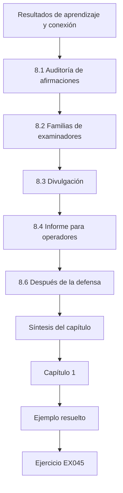

### Dibujo lógico

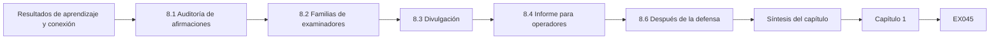

```text
[Resultados de aprendizaje y conexión]
    |
    v
[8.1 Auditoría de afirmaciones]
    |
    v
[8.2 Familias de examinadores]
    |
    v
[8.3 Divulgación]
    |
    v
[8.4 Informe para operadores]
    |
    v
[8.6 Después de la defensa]
    |
    v
[Síntesis del capítulo]
    |
    v
[Capítulo 1]
    |
    v
[Ejemplo resuelto] --> [Ejercicio EX045]
```
<!-- cyberabc:lesson-figures:end ch-08 -->


### Resultados de aprendizaje y conexión

Después de este capítulo usted podrá (1) auditar las afirmaciones antes de la entrega, (2) prepararse para las preguntas de los examinadores, (3) gestionar la divulgación de fallos de implementación y (4) traducir los hallazgos para los operadores con niveles de confianza.

### 8.1 Auditoría de afirmaciones

Cada afirmación necesita evidencia, alcance y un falsador. Elimine "protege a las empresas de agua"; conserve "detectó la repetición de un único sensor en dos contextos sintéticos". Realice la auditoría sobre el resumen, la lista de contribuciones y la conclusión: es ahí donde se esconden las afirmaciones exageradas. Pida a un compañero que marque cada verbo que implique eficacia en campo ("protege", "evita", "asegura", "endurece") y justifique o elimine cada uno. Un script de palabras clave ayuda como primera pasada; la auditoría humana sigue leyendo cada afirmación en su contexto.

Registre el resultado de cada afirmación en el registro de afirmaciones con la fecha de la auditoría. Una afirmación que sobrevive necesita un puntero a una tabla o figura; una afirmación acotada necesita su nueva formulación; una afirmación cortada necesita una nota sobre el motivo. La auditoría termina cuando cada frase del resumen tiene una fila.

### 8.2 Familias de examinadores

Posicionamiento (¿qué es nuevo?), validez (¿por qué generalizar?), adversario (¿un atacante más fuerte?), seguridad (¿cómo se acotó?), ética (¿qué se retuvo?), impacto (¿qué cambia el lunes por la mañana?). Respuesta sobre el impacto: exigir una segunda medición, cableada de forma independiente, de las variables clave y mostrar los valores previstos frente a los informados. Prepare una hoja de apoyo de una página con una respuesta de dos frases para cada familia y un puntero a una figura o tabla. En la defensa, responda a la pregunta formulada y deténgase: no ofrezca el capítulo entero. Si no lo sabe, diga qué evidencia lo respondería y qué tiene realmente. Practique una vez en voz alta con un compañero que lo interrumpa.

### 8.3 Divulgación

Las propiedades de diseño de las especificaciones públicas (Modbus no tiene autenticación) no son vulnerabilidades. Los fallos de implementación de un producto pasan por el fabricante y, cuando corresponda, por la CVD de CISA antes de publicar los detalles. En Harbor Loop eso significa describir la repetición como una consecuencia de que Modbus carece de autenticación, sin tratarla como un fallo nuevo. Si el trabajo en Rig R2 revelara un defecto en el firmware de un PLC concreto, el producto y los detalles se retendrían del trabajo de fin de máster hasta haber informado al fabricante, con el calendario acordado y registrado.

### 8.4 Informe para operadores

Confianza alta: las alarmas de banda por sí solas no detectan las lecturas de nivel repetidas (modelo + diseño). Media: una medición de caudal independiente más un residuo detectan la repetición de un único sensor (dos contextos sintéticos). Ninguna: protección si un solo dispositivo controla ambas mediciones; fallo medido. Limite el informe a una página, con cada enunciado etiquetado con su confianza y su evidencia. Los operadores actuarán sobre la línea de confianza ninguna: si un solo dispositivo lee tanto el nivel como el caudalímetro, no se puede confiar en la detección por residuos. El informe debería decir qué comprobar el lunes, por ejemplo si las dos mediciones están cableadas de forma independiente.

### 8.5 Errores comunes y límites

Extralimitarse en la exposición de la defensa; publicar detalles de explotación antes de la divulgación; etiquetas de confianza sin evidencia. En la defensa, manténgase dentro del alcance que midió el trabajo de fin de máster y responda a las preguntas sobre atacantes más fuertes con la clase B y no con especulaciones. Retenga los detalles de implementación hasta que concluya la divulgación. Cada etiqueta de confianza del informe para operadores necesita que se nombre la evidencia que la sustenta; una etiqueta sin evidencia es una opinión presentada como hallazgo. Antes de la defensa, ensaye una vez cada familia de examinadores con la hoja de apoyo y marque cualquier respuesta que vaya más allá de los contextos medidos, para poder acotarla antes de que lleguen las preguntas reales.

### 8.6 Después de la defensa

Archive el PDF final, el registro de afirmaciones, la etiqueta del código y la documentación ética. Si va a enviar un artículo, congele el texto del trabajo de fin de máster que el artículo no puede contradecir. Programe los calendarios de divulgación antes de las fechas límite de los congresos, no después. Agradezca a los operadores y a los responsables de laboratorio que hicieron posible Rig R2, y no los sorprenda con un comunicado de prensa que presente el laboratorio del campus como una planta vulnerable.

Guarde el manifiesto del archivo y los hashes junto al texto final para que un lector posterior pueda mostrar qué código produjo los números publicados. Si llegan correcciones después de la defensa, añádalas como erratas fechadas en lugar de editar la copia archivada.

### Ejercicios — capítulo 8

- **EX045 — Auditar tres afirmaciones del capítulo 6.** Audite tres afirmaciones de su párrafo del capítulo 6. *Rúbrica:* 3 = tres afirmaciones APROBADA/REVISAR con correcciones; 2 = dos; 1 = una; 0 = nada.
- **EX046 — Respuestas de la defensa sobre posicionamiento y seguridad.** Redacte respuestas modelo a preguntas de posicionamiento y de seguridad. *Rúbrica:* 3 = respuestas de posicionamiento + cota de seguridad de R2; 2 = una familia; 1 = vago; 0 = nada.
- **EX047 — Ordenar dos artículos derivados de la tesis.** Ordene dos artículos derivados del trabajo de fin de máster y justifique el orden. *Rúbrica:* 3 = orden de dos artículos con razón de dependencia; 2 = orden sin razón; 1 = un artículo; 0 = nada.
- **EX048 — Tres clasificaciones de divulgación.** Clasifique tres hallazgos como divulgación / no divulgación / problema del laboratorio. *Rúbrica:* 3 = divulgación / no / problema del laboratorio correctos para los tres hallazgos; 2 = dos correctos; 1 = uno; 0 = nada.
- **EX049 — Informe para operadores sin pruebas de la clase B.** Redacte el informe para operadores en el caso de que la clase B no se hubiera probado. *Rúbrica:* 3 = alta/media/desconocida con la clase B sin probar explícita; 2 = falta la desconocida; 1 = un nivel; 0 = nada.
- **EX050 — Propuesta doctoral más allá de Harbor Loop.** Esboce una propuesta doctoral que extienda Harbor Loop a plantas calibradas de varios lazos. *Rúbrica:* 3 = extensión doctoral con hipótesis falsables de varios lazos; 2 = temas sin H; 1 = vago; 0 = nada.

### Síntesis del capítulo

Audite, prepárese, divulgue con cuidado, traduzca con etiquetas de confianza. La contribución de la maestría es una comparación medida y sus límites medidos.

### Siga estudiando — capítulo 08 de 08

[← Capítulo 07 (borrador)](#ch-07) · [Índice de capítulos del curso](../SUBJECTS.md) · [Resultados resueltos ↓](#worked-results) · [Curso doctoral de TO →](../../../../doctorate-2-years/ot-iot-security/es/SUBJECTS.md)

<a id="worked-results"></a>

## Resultados resueltos

### Capítulo 1
**EX001.** "En un lazo sintético de nivel Modbus/TCP, ¿reduce la activación de la protección contra escritura en los registros de punto de consigna los cambios no autorizados exitosos del punto de consigna en ≥90 % frente a una línea de base sin protección bajo una tormenta de escrituras guionizada, y rompe la protección la disponibilidad cuando la estación de ingeniería necesita escrituras legítimas?"
**EX002.** Control: generación de residuos, redundancia analítica, FDI basada en observadores, validación de sensores. Seguridad: inyección de datos falsos, suplantación de sensores, repetición (replay), manipulación de la vista, ADS basados en la física.
**EX003.** Incluir mediciones o revisiones revisadas por pares sobre detección o protocolos de ICS de 2010–2026; excluir el marketing de fabricantes sin método. Documento técnico del fabricante → excluir; medición de campo de DNP3 → incluir.
**EX004.** Ampersand: key() elimina los caracteres no alfanuméricos, de modo que un registro gris titulado "Sensor replay attacks on water-treatment testbeds" (2021) se colapsa con el registro de arXiv, pero "Modbus security: a survey of attacks & defenses" no coincide con el registro de IEEE, porque la palabra "and" sobrevive a la normalización mientras que "&" desaparece; convierta "&" en "and" antes de eliminar caracteres. Kappa se mueve cuando cambia una decisión porque la concordancia por azar depende de las tasas marginales.
**EX005.** Protocolo: IEEE/ACM/Scopus/arXiv 2010–2026; sinónimos del EX002; dos revisores; objetivo κ≥0.6 tras reparar los criterios; corriente gris separada.
**EX006.** El DOI identifica la misma obra entre variantes del título; la clave de título por sí sola conserva ambos duplicados "Survey" y "survey" cuando la puntuación difiere, salvo que se normalice: poner el DOI primero es más estricto.
**EX007.** Giraldo: revisión revisada por pares (alto para el encuadre). Aviso de CISA: evidencia de profesionales (medio para la existencia de problemas). Blog del fabricante: marketing (bajo; solo hipótesis).

### Capítulo 2
**EX008.** L0: tanque/bomba/sensores; L1: PLC; L2: SCADA; L3: historiador. Conductos: SCADA↔PLC (Modbus), historiador↔SCADA.
**EX009.** "Un conducto que solo permite los códigos de función Modbus 3/4 (lecturas) de L2 a L1 reduce en ≥90 % los equipos capaces de escribir puntos de consigna frente a una red plana, medido por alcanzabilidad sobre un inventario sintético."
**EX010.** Modbus Application Protocol: sin campos de autenticación. DNP3-SA: define desafíos de autenticación para las solicitudes críticas. La comparación trata de la presencia de un mecanismo, no de su adopción.
**EX011.** Respalda como máximo "el detector marcó ≥1 punto en estos segmentos en este banco de pruebas"; no el retardo, el impacto, la generalización ni el rendimiento frente a un adversario consciente.
**EX012.** Spoof Reporting Message; Modify Parameter. La matriz documenta técnicas, no tasas.
**EX013.** Débil: "La detección basada en la física necesita más estudio". Fuerte: el párrafo de la laguna de §2.5.
**EX014.** Arp: métricas inapropiadas, evaluación solo en laboratorio, fuga entre entrenamiento y prueba. Específico de TO: ignorar el impacto físico en el momento de la detección.

### Capítulo 3
**EX015.** Comparación de detectores → experimento controlado. Adopción → encuesta con marco muestral. Confianza de los operadores → entrevista/encuesta con revisión ética.
**EX016.** H1 respaldada (80/80 frente a 0/80). H4 respaldada (0/80). Se señalan las FA de la banda, 11/80.
**EX017.** Desbordamiento hacia la bandeja de goteo; válvula de flotador mecánica + bandeja; responsable de laboratorio designado con parada de emergencia.
**EX018.** La beneficencia favorece publicar la clase de capacidad + la defensa arquitectónica; retener los pasos específicos del producto hasta la CVD si existe un fallo del producto.
**EX019.** Métricas, semillas 0–79 de evaluación / 1000–1079 de ajuste, k=0.8 h=6, sin cambios de umbral tras la carga en R2.
**EX020.** Código T0; trazas T1; cableado T2; citas T2 (identificables) o T1 si están totalmente anonimizadas.

### Capítulo 4
**EX021.** Mala configuración y no segmentación; monitorización en otro lugar; preferencias del atacante; sesgo de notificación; ventana de estudio corta, cada una con una prueba de discriminación.
**EX022.** Barra las ganancias; si los ataques lentos evaden la detección pero el sobrellenado sigue siendo pequeño, se cumple la acotación al estilo de Urbina.
**EX023.** Define el dominio de la contribución (rutas de medición independientes), lo cual es accionable para los defensores.
**EX024.** Fuga del ajuste, retardo, impacto, falsas alarmas por turno, conciencia del adversario.
**EX025.** Capacidad del atacante → honestidad del sensor → residuo → CUSUM → momento de la alarma → sobrellenado; la alarma de banda es una ruta paralela desde el nivel.
**EX026.** Un ataque que cambia un sensor ajeno al balance de masa (por ejemplo, un sensor de temperatura) no debería elevar sistemáticamente el residuo entre nivel y caudal.

### Capítulo 5
**EX027.** H1: exhaustividad ≥95 %, retardo ≤60; H2: FA del CUSUM ≤ FA de la banda; H3: sobrellenado en el momento de la alarma menor para el CUSUM; H4: exhaustividad en la clase B ≤10 %. Umbrales vinculados a la mitad del margen hasta el disparo.
**EX028.** Seguridad: nunca se alcanza la válvula de flotador en 3 ejecuciones. Datos: pérdida de registros <1 %.
**EX029.** No puede acotarse R2; el historiador no puede registrar a 1 Hz; denegación ética de las entrevistas → pasar a un trabajo de fin de máster solo de simulación con un alcance explícito.
**EX030.** Clase A: suplantación del nivel + escritura en la bomba; clase B: + suplantación del caudal; conocimiento de la banda; objetivo: manipulación de la vista; fuera del alcance: válvula de flotador, manipulación física.
**EX031.** El piloto se usa para la viabilidad; usarlo para la validación cuenta dos veces los mismos datos e infla el rendimiento.
**EX032.** Riesgo: los operadores revelan prácticas inseguras; mitigar con notas confidenciales, informes agregados y derecho a retirarse.

### Capítulo 6
**EX033.** Use el párrafo de §6.3 con los números de los laboratorios 3/6.
**EX034.** Las semillas independientes ensanchan los IC (el ruido compartido ya no se cancela).
**EX035.** Estocásticas: extracciones de ruido. Paramétricas: orificio, k, sesgo. Estructurales: un solo tanque, ignorar el retardo.
**EX036.** "k y h se registran con hash antes de abrir cualquier dato de ataque de R2".
**EX037.** Informe la proporción de detección + la mediana del retardo entre las detectadas, o una curva de supervivencia.
**EX038.** No son incertidumbre sobre plantas reales ni sobre el error estructural del modelo.

### Capítulo 7
**EX039.** Resumen que incluye clase B = 0/80 y solo dos contextos sintéticos.
**EX040.** Cinco filas como en §7.2, más el momento de inicio fijo (dirección desconocida) y un único objetivo del atacante (sobrestima la generalidad).
**EX041.** Según el patrón del EX041 doctoral; diagrama de cableado T2; notas de los operadores T2.
**EX042.** Inventado; parámetros enumerados; prohibido: afirmaciones sobre plantas reales.
**EX043.** Ejemplo: introducción 8k, antecedentes 10k, métodos 12k, resultados 12k, discusión 8k, conclusión 2k (ajuste a las normas locales).
**EX044.** Afirmación exagerada "protege las plantas" → "detectó la repetición de clase A en un modelo sintético y declara el fallo de la clase B".

### Capítulo 8
**EX045.** Audite las frases de §6.3 en cuanto a evidencia/alcance/falsador.
**EX046.** Posicionamiento: medición de cuándo ayudan las invariantes entre sensores. Seguridad: válvula de flotador + parada de emergencia de R2; nada en producción.
**EX047.** Artículo 1, métricas/metodología; artículo 2, comparación de Harbor Loop: la metodología primero.
**EX048.** Modbus sin autenticación: no es divulgación. Un PLC que acepta escrituras en un registro protegido: CVD. Cableado compartido en R2: problema del laboratorio.
**EX049.** Alta/media como en §8.4; desconocida para un atacante de dos sensores: no lo afirme.
**EX050.** Planta calibrada de varios lazos; H: exhaustividad ≥80 % con FA ≤1/turno bajo acoplamiento; umbrales congelados; contexto de un segundo socio industrial.

**Fin de los resultados resueltos.** Vuelva al [índice de capítulos del curso](../SUBJECTS.md).

<a id="glossary"></a>

## Glosario

**ATT&CK for ICS.** Base de conocimiento de técnicas de MITRE sobre adversarios de control industrial; no es una distribución de frecuencias.

**Clase A / clase B (Harbor Loop).** La clase A suplanta un sensor mientras una medición independiente sigue siendo honesta; la clase B controla ambas de forma coherente y derrota un residuo de balance de masa.

**CUSUM.** Suma acumulada de Page (1954) aplicada a un residuo entre mediciones cableadas de forma independiente.

**Harbor Loop.** Caso conductor de la maestría: lazo de nivel Modbus/TCP sintético usado para delimitar el alcance, para los experimentos y para las afirmaciones dirigidas a los operadores.

**Manipulación de la vista.** Inyectar lecturas falsas para que los operadores o los detectores no perciban un estado del proceso que diverge.

**Menlo Report.** Principios de ética de la investigación en TIC del DHS (2012), usados al decidir qué detalle de evasión publicar.

**Rig R2.** Instalación de laboratorio aislada de bomba y tanque con válvula de flotador mecánica, bandeja de goteo y parada de emergencia con responsable designado; se usa como T2 para las comprobaciones con umbrales congelados.

**Niveles Purdue / zonas IEC 62443.** Vocabulario de arquitectura y segmentación para enunciar hipótesis medibles sobre conductos.

**F1 con ajuste por puntos.** Puntuación que acredita todo un segmento de ataque tras una sola alarma; oculta el retardo de detección.

**Residuo / detección basada en la física.** Detectores que comparan las mediciones del proceso con una relación física (por ejemplo, el balance de masa).

<a id="references"></a>

## Referencias

Enlaces comprobados el 13 de octubre de 2026; vuelva a verificar las ediciones antes de citarlas. La lista es idéntica a la de la edición en inglés; los títulos de las obras se citan en su idioma original.

- ACM. Artifact Review and Badging, Version 1.1. <https://www.acm.org/publications/policies/artifact-review-and-badging-current>
- Arp, D. et al. Dos and Don'ts of Machine Learning in Computer Security. USENIX Security 2022. <https://www.usenix.org/conference/usenixsecurity22/presentation/arp>
- CISA. Coordinated Vulnerability Disclosure Program. <https://www.cisa.gov/coordinated-vulnerability-disclosure-process>
- Giraldo, J. et al. A Survey of Physics-Based Attack Detection in Cyber-Physical Systems. *ACM Computing Surveys* 51(4), 2018. <https://doi.org/10.1145/3203245>
- ISA. ISA/IEC 62443 series of standards (overview). <https://www.isa.org/standards-and-publications/isa-standards/isa-iec-62443-series-of-standards>
- iTrust, SUTD. Secure Water Treatment (SWaT) and related datasets (public page). <https://itrust.sutd.edu.sg/itrust-labs_datasets/>
- MITRE. ATT&CK for Industrial Control Systems. <https://attack.mitre.org/matrices/ics/>
- Modbus Organization. Modbus Application Protocol Specification V1.1b3. <https://modbus.org/docs/Modbus_Application_Protocol_V1_1b3.pdf>
- NIST SP 800-82 Rev. 3. Guide to Operational Technology (OT) Security. <https://csrc.nist.gov/pubs/sp/800/82/r3/final>
- Page, E. S. Continuous Inspection Schemes. *Biometrika* 41, 1954. <https://doi.org/10.1093/biomet/41.1-2.100>
- Sommer, R. and Paxson, V. Outside the Closed World: On Using Machine Learning for Network Intrusion Detection. IEEE S&P 2010. <https://doi.org/10.1109/SP.2010.25>
- Urbina, D. et al. Limiting the Impact of Stealthy Attacks on Industrial Control Systems. ACM CCS 2016. <https://doi.org/10.1145/2976749.2978388>
- U.S. DHS. The Menlo Report: Ethical Principles Guiding ICT Research (2012). <https://www.dhs.gov/sites/default/files/publications/CSD-MenloPrinciplesCORE-20120803_1.pdf>
