# Segurança de TO, IoT e Sistemas Ciberfísicos: Métodos de Pesquisa de Mestrado e Prática de Dissertação

- Idioma: português do Brasil (`pt`); curso de mestrado, dois anos; aproximadamente 1.200 horas de estudo planejado. Edição de referência: [inglês](../../en/book/MANUSCRIPT.md).
- Estado editorial: **publicado**. Os capítulos 1–8 de 8 têm texto didático escrito, os exercícios EX001–EX050 e as resoluções correspondentes. Revisão independente, revisão linguística e a verificação de 300 páginas A4 continuam em aberto.
- Público: pesquisadores iniciantes, com sólida base no domínio e familiaridade com métodos de pesquisa, que vão formular uma pergunta, avaliar trabalhos anteriores e produzir resultados reprodutíveis em segurança de TO, IoT e sistemas ciberfísicos.
- Relação com os cursos vizinhos: o [curso de mestrado em infraestrutura crítica](../../../critical-sector-security/README.md) estuda setores e cascatas; o [curso de doutorado em TO](../../../../doctorate-2-years/ot-iot-security/README.md) aprofunda a integridade da pesquisa e a prática de tese. **Este livro** prepara você para planejar e concluir uma dissertação de mestrado sobre a camada do sistema de controle: CLPs, protocolos industriais, detecção baseada em física, coengenharia de segurança física (safety) e segurança cibernética (security) e a arquitetura Purdue/ISA-62443.
- Autoria: [hiagokinlevi](https://github.com/hiagokinlevi). Texto original sob [CC0 1.0](../../../../../LICENSE); as obras citadas mantêm seus direitos.
- Limite educacional: não é um título credenciado. Não concede autorização para acessar plantas reais. Todas as organizações, conjuntos de dados, bancadas de testes e números dos exemplos resolvidos são **sintéticos**, salvo quando uma frase cita uma fonte pública.

[Página do curso](../../README.md) · [Índice de capítulos](../SUBJECTS.md) · [Plano do livro](PLAN.md) · [Skill do curso](../../skill/SKILL.md) · [Resoluções](#worked-results)

## Como usar este rascunho

Oito capítulos acompanham um único projeto de mestrado, o **Harbor Loop Study** (sintético): *um CUSUM sobre o resíduo de balanço de massa detecta a repetição (replay) da leitura de nível de um único sensor numa malha sintética de armazenamento de água mais cedo e com menos alarmes falsos do que um alarme de processo de faixa fixa, e sob qual capacidade do atacante essa vantagem desaparece?* Os capítulos cobrem o método de revisão da literatura, o seminário de TO, o desenho do estudo e a ética, as explicações concorrentes, a proposta e o piloto, a análise, a escrita e a defesa.

Mantenha cinco rótulos em toda nota: observação, inferência, alegação, decisão, consequência física. Os laboratórios usam apenas a biblioteca padrão do Python 3.

### Corpus sintético

| Elemento | Papel | Limite |
|---|---|---|
| Harbor Municipal Water, malha L1 | Modelo principal: tanque, bomba, medidor de vazão, transmissor de nível, CLP, Modbus/TCP | Inventado |
| Bancada do campus R2 | Piloto e validação: bancada de laboratório de dois tanques com válvula boia independente | Inventada |
| Estudos L1–L12 | Literatura fictícia para avaliação crítica | Inventados |
| Operadores Q01–Q08 | Participantes fictícios de entrevistas | Inventados |

### Fontes centrais

- NIST [SP 800-82 Rev. 3](https://csrc.nist.gov/pubs/sp/800/82/r3/final) (2023).
- [ISA/IEC 62443](https://www.isa.org/standards-and-publications/isa-standards/isa-iec-62443-series-of-standards).
- MITRE [ATT&CK for ICS](https://attack.mitre.org/matrices/ics/).
- Modbus [*Application Protocol V1.1b3*](https://modbus.org/docs/Modbus_Application_Protocol_V1_1b3.pdf).
- Giraldo et al., [ACM CSUR 2018](https://doi.org/10.1145/3203245); Urbina et al., [CCS 2016](https://doi.org/10.1145/2976749.2978388).
- Sommer & Paxson [IEEE S&P 2010](https://doi.org/10.1109/SP.2010.25); Arp et al. [USENIX Security 2022](https://www.usenix.org/conference/usenixsecurity22/presentation/arp).
- Page, [CUSUM, Biometrika 1954](https://doi.org/10.1093/biomet/41.1-2.100).
- [Menlo Report](https://www.dhs.gov/sites/default/files/publications/CSD-MenloPrinciplesCORE-20120803_1.pdf); CISA [CVD](https://www.cisa.gov/coordinated-vulnerability-disclosure-process).
- iTrust [SWaT datasets](https://itrust.sutd.edu.sg/itrust-labs_datasets/) (apenas a página pública).

## Sumário

1. [Pergunta de pesquisa e método de revisão da literatura](#ch-01)
2. [Segurança de TO, IoT e sistemas ciberfísicos: seminário avançado](#ch-02)
3. [Desenho do estudo, ética e reprodutibilidade](#ch-03)
4. [Explicações concorrentes](#ch-04)
5. [Proposta e piloto](#ch-05)
6. [Coleta e análise de dados](#ch-06)
7. [Escrita da dissertação e limitações](#ch-07)
8. [Revisão independente e defesa](#ch-08)
9. [Resoluções](#worked-results)

<a id="ch-01"></a>

## Capítulo 1 — Pergunta de pesquisa e método de revisão da literatura

<!-- open-cyber-academy:lesson-figures:start ch-01 -->
### Mapa da aula

Aula 01 publicada. Mapa, exemplo, EX001.

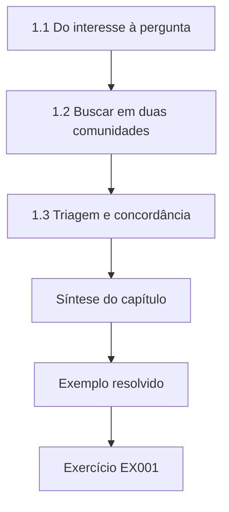

### Desenho lógico

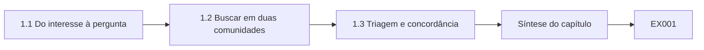

```text
[1.1 Do interesse à pergunta]
    |
    v
[1.2 Buscar em duas comunidades]
    |
    v
[1.3 Triagem e concordância]
    |
    v
[Síntese do capítulo]
    |
    v
[Exemplo resolvido] --> [Exercício EX001]
```
<!-- open-cyber-academy:lesson-figures:end ch-01 -->


### Objetivos de aprendizagem e conexão

Depois deste capítulo, você consegue (1) transformar um interesse vago numa pergunta pesquisável sobre uma malha de controle, (2) buscar em veículos de engenharia de controle e de segurança usando sinônimos, (3) remover duplicatas e fazer a triagem com métricas de concordância e (4) redigir um protocolo de revisão de escopo. Ele prepara o seminário do Capítulo 2.

### 1.1 Do interesse à pergunta

"Segurança de TO" é um campo, não uma pergunta. Uma pergunta pesquisável nomeia um **sistema**, um **fenômeno**, uma **comparação** e um **escopo**. Exemplo do Harbor Loop: *numa malha sintética de nível com um único tanque, um CUSUM de resíduo que usa um medidor de vazão com fiação independente detecta o replay de um único sensor com maior revocação por evento e menor taxa de alarmes falsos do que um alarme de faixa de ±1,5, e essa vantagem desaparece quando o medidor de vazão também é falsificado?* A pergunta já codifica a condição de falha — um hábito de nível de mestrado que poupa meses de alegações excessivas.

### 1.2 Buscar em duas comunidades

A detecção baseada em física aparece como "redundância analítica" e "geração de resíduos" nos periódicos de controle, e como "injeção de dados falsos" e "falsificação de sensores" nos veículos de segurança. Monte uma tabela de sinônimos antes de buscar no IEEE Xplore, na ACM DL, no Scopus e no arXiv. Inclua a literatura cinzenta (white papers da IEC, alertas da CISA) como um fluxo separado, com regras de elegibilidade próprias, porque ela não passa por revisão por pares da mesma forma.

Execute cada string de busca em todas as bases e salve as exportações com a data, a consulta exata e o número de resultados, para que um examinador possa repetir a busca. Espere que as duas comunidades descrevam o mesmo detector com palavras diferentes, e espere duplicatas entre veículos; o Laboratório 1 mostra com que rapidez elas aparecem quando um mesmo survey é indexado tanto pelo IEEE quanto pela ACM.

### 1.3 Triagem e concordância

Dois revisores fazem a triagem de títulos e resumos de forma independente; relate o kappa de Cohen. O Laboratório 1 mostra uma exportação sintética com remoção de duplicatas por DOI e por título-ano e um kappa de 0,462 — concordância moderada, puxada pela discordância sobre um white paper de fornecedor e um artigo de medições de DNP3. Concordância baixa é um sinal para consertar os critérios de elegibilidade, não para forçar o consenso.

Escreva as regras de elegibilidade como afirmações testáveis antes da triagem: o estudo avalia um detector numa malha de controle, nomeia seu modelo de atacante, relata uma métrica além da acurácia? Faça juntos a triagem de um pequeno lote de calibração, discuta cada discordância e só então faça a triagem do restante de forma independente. Registre cada regra alterada e a data da alteração.

### 1.4 Exemplo resolvido e Laboratório 1

```python
# Lab 1 (masters OT, synthetic): deduplicate a search export and compute Cohen's kappa for two screeners.
import re
RECORDS=[
 ("ieee","Physics-based anomaly detection for ICS: a survey",2018,"10.1145/3203245"),
 ("acm","Physics-Based Anomaly Detection for ICS: A Survey",2018,"10.1145/3203245"),
 ("ieee","Modbus security: a survey of attacks and defenses",2020,""),
 ("arxiv","Sensor replay attacks on water treatment testbeds",2021,""),
 ("ieee","Sensor Replay Attacks on Water Treatment Testbeds",2021,""),
 ("grey","Vendor white paper: securing SCADA with AI",2022,""),
 ("ieee","DNP3 Secure Authentication field measurements",2019,""),
 ("acm","Zone and conduit design for IEC 62443",2020,""),
 ("ieee","False data injection in power systems: a survey",2011,"10.1109/TSG.2011.2129544"),
 ("arxiv","False Data Injection Attacks against State Estimation in Electric Power Grids",2011,"10.1109/TSG.2011.2129544"),
]
def key(r):
    doi=r[3].strip().lower();
    if doi: return ("doi",doi)
    t=re.sub(r"[^a-z0-9]","",r[1].lower()); return ("title",t,r[2])
seen={}; kept=[]
for r in RECORDS:
    k=key(r)
    if k in seen: continue
    seen[k]=True; kept.append(r)
# two reviewers: I=include X=exclude; disagreements on grey and DNP3
A="IIXIXIIXIX"[:len(kept)]; B="IIXIXXXIIX"[:len(kept)]
def kappa(a,b):
    n=len(a); agree=sum(x==y for x,y in zip(a,b))/n
    pa=sum(x=="I" for x in a)/n; pb=sum(x=="I" for x in b)/n
    pe=pa*pb+(1-pa)*(1-pb)
    return round(agree,3), round((agree-pe)/(1-pe) if pe!=1 else 1.0,3)
print("raw",len(RECORDS),"kept",len(kept),"dropped",len(RECORDS)-len(kept))
print("agree,kappa",kappa(A,B))
print("kept titles:",[r[1][:40] for r in kept])

```

Saída esperada:

```text
raw 10 kept 7 dropped 3
agree,kappa (0.714, 0.462)
kept titles: ['Physics-based anomaly detection for ICS:', 'Modbus security: a survey of attacks and', 'Sensor replay attacks on water treatment', 'Vendor white paper: securing SCADA with ', 'DNP3 Secure Authentication field measure', 'Zone and conduit design for IEC 62443', 'False data injection in power systems: a']
```

Três duplicatas são descartadas por DOI ou por título normalizado. O kappa de 0,462 com 71,4% de concordância bruta mostra a correção pelo acaso em ação.

O laboratório mantém o primeiro registro de cada par duplicado, de modo que a versão do IEEE do survey sobre detecção baseada em física fica e a cópia da ACM sai. Dois registros sem DOI só são fundidos porque seus títulos normalizados e anos coincidem exatamente; uma pequena mudança de redação deixaria passar uma duplicata. Confira a lista mantida a olho antes da triagem e relate no protocolo a contagem bruta, a contagem mantida e a contagem descartada, como o laboratório as imprime.

### 1.5 Erros comuns e limites

Buscar apenas em veículos de segurança; tratar artigos de fornecedores como evidência revisada por pares; relatar a concordância bruta sem o kappa; escrever uma pergunta sem condição de falha.

Uma pergunta sem condição de falha convida a uma dissertação que só pode dar certo. A pergunta do Harbor Loop evita isso ao perguntar quando a vantagem do CUSUM desaparece. A busca tem um limite parecido: as bases mudam sua indexação, então uma busca feita em março pode não devolver o mesmo conjunto em setembro. Registre a data de cada execução e trate o corpus como um retrato instantâneo.

### Exercícios — capítulo 1

- **EX001 — Pergunta pesquisável sobre Modbus.** Reescreva "quero estudar a segurança do Modbus" como uma pergunta pesquisável, com sistema, fenômeno, comparação e escopo. *Rubrica:* 3 = sistema, fenômeno, comparação, escopo com métrica ≥90%; 2 = falta um elemento; 1 = interesse vago em Modbus; 0 = nenhum.
- **EX002 — Tabela de sinônimos para manipulação de sensores.** Monte uma tabela de sinônimos (≥4 termos de controle + ≥4 de segurança) para a detecção de dados de sensores manipulados. *Rubrica:* 3 = ≥4 termos de controle + ≥4 de segurança; 2 = 3+3; 1 = uma comunidade; 0 = nenhum.
- **EX003 — Incluir ou excluir o white paper e o DNP3.** Escreva critérios de inclusão/exclusão que decidam o white paper do fornecedor e o artigo de DNP3 do Laboratório 1. *Rubrica:* 3 = critérios excluem o marketing do fornecedor e incluem a medição de campo do DNP3; 2 = decisões sem critérios; 1 = uma decisão; 0 = nenhum.
- **EX004 — Registro cinzento com "e comercial" e kappa.** Execute o Laboratório 1; acrescente um registro cinzento com um "e comercial" (&) no título; mostre se a sua key() o captura; recalcule o kappa depois de mudar uma decisão. *Rubrica:* 3 = a chave normalizada captura o "e comercial" + a variação do kappa é explicada; 2 = chave sem kappa; 1 = só o kappa; 0 = nenhum.
- **EX005 — Protocolo de escopo de uma página.** Redija um protocolo de revisão de escopo de uma página (bases, datas, sinônimos, regras de triagem, meta de kappa). *Rubrica:* 3 = bases/datas/sinônimos/triagem/κ≥0,6; 2 = falta um campo; 1 = lista de tópicos; 0 = nenhum.
- **EX006 — Chave por DOI antes da chave por título.** Explique por que, na remoção de duplicatas, a chave por DOI deve vir antes da chave por título. *Rubrica:* 3 = identidade do DOI entre variantes de título + modo de falha da chave por título; 2 = DOI primeiro, sem o modo de falha; 1 = slogan; 0 = nenhum.
- **EX007 — Níveis de evidência para três fontes.** Classifique três fontes (o survey de Giraldo, um alerta da CISA, um blog de fornecedor) por nível de evidência para uma dissertação. *Rubrica:* 3 = Giraldo alto, CISA médio, blog de fornecedor baixo, com razões; 2 = níveis sem razões; 1 = uma fonte; 0 = nenhum.

### Síntese do capítulo

Um projeto de mestrado começa com uma pergunta que já nomeia sua condição de falha, uma busca que atravessa comunidades e um processo de triagem cujas discordâncias consertam os critérios.

<!-- open-cyber-academy:chapter-navigation:start ch-01 -->
### Continue estudando — capítulo 01 de 08

[← Página do curso](../../README.md) · [Índice de capítulos do curso](../SUBJECTS.md) · [Capítulo 02 →](#ch-02)

Siga para a próxima lição escrita.
<!-- open-cyber-academy:chapter-navigation:end -->

<a id="ch-02"></a>

## Capítulo 2 — Segurança de TO, IoT e sistemas ciberfísicos: seminário avançado

<!-- open-cyber-academy:lesson-figures:start ch-02 -->
### Mapa da aula

Aula 02 publicada. Mapa, exemplo, EX008.

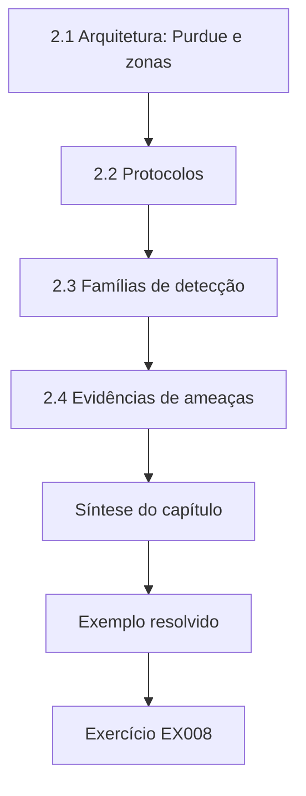

### Desenho lógico

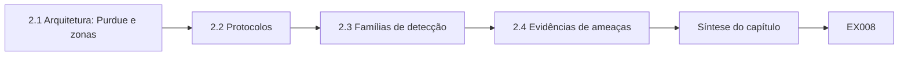

```text
[2.1 Arquitetura: Purdue e zonas]
    |
    v
[2.2 Protocolos]
    |
    v
[2.3 Famílias de detecção]
    |
    v
[2.4 Evidências de ameaças]
    |
    v
[Síntese do capítulo]
    |
    v
[Exemplo resolvido] --> [Exercício EX008]
```
<!-- open-cyber-academy:lesson-figures:end ch-02 -->


### Objetivos de aprendizagem e conexão

Depois deste capítulo, você consegue (1) explicar os níveis do modelo Purdue e as zonas da ISA/IEC 62443, (2) descrever por que os protocolos industriais clássicos não têm autenticação, (3) contrastar a detecção de rede com a detecção baseada em física, (4) ler o ATT&CK for ICS como evidência de capacidade, não de frequência, e (5) extrair uma lacuna falseável de um mapa da literatura.

### 2.1 Arquitetura: Purdue e zonas

A NIST SP 800-82 Rev. 3 apresenta o modelo Purdue: níveis 0–1 (processo e controle básico), 2 (supervisão), 3 (operações), 4–5 (corporativo), com uma DMZ industrial. A ISA/IEC 62443-3-2 pede que você particione o sistema em **zonas** com um nível de segurança-alvo e controle os **conduítes** entre elas. Uma dissertação pode tratar um desenho de zonas como hipótese: um conduíte que permite apenas leituras Modbus do nível 2 para o nível 1 reduz a alcançabilidade de escrita numa fração medida, numa topologia sintética?

No Harbor Loop, a fronteira relevante fica entre o nível de supervisão e o CLP, onde o Modbus/TCP transporta tanto leituras quanto escritas. Desenhe essa fronteira na dissertação, mesmo que o estudo meça a detecção e não a segmentação, porque o leitor precisa saber quais posições do atacante o replay pressupõe. Um conduíte que bloqueia escritas não impede leituras repetidas, e é por isso que a detecção continua importando.

### 2.2 Protocolos

O Modbus Application Protocol define códigos de função (incluindo a escrita de um único registrador ou de vários) e um modelo de dados, mas nenhum campo de autenticação ou de integridade. O DNP3 Secure Authentication e os modelos de segurança do OPC UA mostram que a indústria acrescentou opções; a adoção e a qualidade das implementações continuam sendo questões empíricas. Nunca apresente "o Modbus é inseguro" como constatação — é uma propriedade de projeto da especificação.

Para o estudo Harbor Loop, a propriedade relevante é que uma resposta que carrega um valor de nível não tem nenhum campo que prove que ele veio do transmissor. É por isso que o replay é possível, e é por isso que a dissertação mede a detecção e não a prevenção. Nomeie os códigos de função que o seu modelo de atacante usa, para que o leitor veja de quais partes da especificação os resultados dependem.

### 2.3 Famílias de detecção

Os detectores de rede observam pacotes; os detectores baseados em física observam se os valores dos sensores e atuadores obedecem às leis do processo. Giraldo et al. fizeram um levantamento destes últimos; Urbina et al. defenderam medir o impacto sob um adversário furtivo. Sommer e Paxson alertaram que a detecção de anomalias falha quando o "normal" é aberto; Arp et al. listaram armadilhas de avaliação, incluindo a pontuação com ajuste por pontos.

O Harbor Loop está na segunda família: seu CUSUM de resíduo compara a leitura de nível com uma estimativa conduzida pelo medidor de vazão. Os alertas dos dois artigos se aplicam diretamente. A operação normal de uma malha de água é razoavelmente fechada, o que ajuda, mas a pontuação deve usar episódios de ataque, não pontos, e a avaliação deve perguntar o que um adversário furtivo ainda conseguiria fazer. A classe B é essa pergunta.

### 2.4 Evidências de ameaças

O MITRE ATT&CK for ICS lista técnicas como *Modify Parameter* e *Spoof Reporting Message*. Os relatos públicos sobre o Stuxnet, os apagões ucranianos de 2015 e o TRITON/TRISIS mostram que a manipulação da visão e o ataque a sistemas de segurança são objetivos documentados de adversários. Use-os no nível das análises públicas citadas; não invente detalhes operacionais.

Para a dissertação, essas evidências sustentam uma frase: manipular o que os operadores veem é um objetivo documentado de adversários, então testar a detecção de uma leitura de nível repetida é relevante. Elas não sustentam alegações sobre a frequência com que concessionárias de água enfrentam replay. Mantenha a citação na técnica e na análise pública, e deixe as alegações de frequência fora do capítulo de fundamentação.

### 2.5 Exemplo resolvido: codificar uma lacuna

Dos doze estudos sintéticos L1–L12, apenas dois relatam o impacto no momento da detecção, apenas um congela os limiares antes de um segundo contexto e nenhum combina adversário ciente do detector + limiares congelados + impacto + segunda planta. Lacuna: *nenhuma avaliação da detecção por resíduo contra o replay de sensores relata revocação por evento, atraso e transbordamento no alarme com limiares congelados em dois contextos e uma classe explícita de atacante que controla dois sensores.*

Escreva a lacuna como uma única frase que nomeia o que falta e depois confira cada palavra contra a tabela codificada. Se um estudo tiver combinado limiares congelados e uma segunda planta, a lacuna encolhe e a frase precisa mudar. Uma lacuna construída a partir de uma tabela de codificação pode ser auditada; uma lacuna construída a partir de impressões sobre o campo, não.

### 2.6 Erros comuns e limites

Citar normas como evidência de que funcionam; tratar o ATT&CK como taxas-base; alegar novidade a partir do nome de um novo conjunto de dados.

Esses erros compartilham um padrão: confundem a existência de um documento com evidência de um efeito. Uma norma diz o que deve ser feito; não mostra que fazê-lo reduz danos. O ATT&CK lista o que adversários já foram vistos fazendo, não com que frequência. Um novo conjunto de dados é útil, mas a novidade precisa vir da pergunta que ele permite responder.

### Exercícios — capítulo 2

- **EX008 — Mapa Purdue da malha L1 do Harbor Loop.** Mapeie os componentes da malha L1 do Harbor Loop nos níveis Purdue 0–3 e nomeie dois conduítes. *Rubrica:* 3 = componentes L0–L3 + dois conduítes (SCADA↔CLP, historiador↔SCADA); 2 = só os níveis; 1 = parcial; 0 = nenhum.
- **EX009 — Zona da 62443 como hipótese mensurável.** Reescreva uma recomendação de zonas da 62443 como hipótese mensurável. *Rubrica:* 3 = hipótese mensurável de conduíte somente leitura com métrica ≥90%; 2 = hipótese sem métrica; 1 = slogan; 0 = nenhum.
- **EX010 — Autenticação no Modbus versus DNP3-SA.** Compare o Modbus e o DNP3 Secure Authentication quanto à presença de autenticação, usando apenas especificações públicas. *Rubrica:* 3 = Modbus sem autenticação vs desafios do DNP3-SA; presença, não adoção; 2 = só a presença; 1 = alegação de adoção; 0 = nenhum.
- **EX011 — Teto para um estudo com F1 com ajuste por pontos.** Avalie um estudo fictício que relata F1 com ajuste por pontos = 0,99 numa única bancada; declare o que ele pode sustentar. *Rubrica:* 3 = teto de sustentação apenas para sinalização de segmentos; exclui atraso/impacto/generalização/adversário ciente; 2 = teto sem exclusões; 1 = aceita o 0,99; 0 = nenhum.
- **EX012 — Duas técnicas do ATT&CK para o Harbor Loop.** Selecione duas técnicas do ATT&CK for ICS para o Harbor Loop; explique por que elas não são evidência de frequência. *Rubrica:* 3 = Spoof Reporting Message + Modify Parameter + não é frequência; 2 = técnicas sem ressalva; 1 = uma; 0 = nenhum.
- **EX013 — Lacunas fraca e forte sobre detecção por resíduo.** Escreva enunciados de lacuna fraca e forte para a detecção por resíduo do replay de sensores. *Rubrica:* 3 = lacuna fraca vs forte com a substância da §2.5; 2 = fraca/forte sem detalhe de TO; 1 = uma; 0 = nenhum.
- **EX014 — Armadilhas de Arp mais uma de TO.** Liste três armadilhas de avaliação de Arp et al. que se aplicam a detectores de TO e uma armadilha específica de TO. *Rubrica:* 3 = três armadilhas de Arp + a armadilha de TO do impacto na detecção; 2 = só Arp; 1 = uma armadilha; 0 = nenhum.

### Síntese do capítulo

O seminário oferece arquitetura, protocolos, famílias de detecção e evidências de ameaças — e a disciplina de transformá-los em hipóteses e lacunas, e não em slogans.

<!-- open-cyber-academy:chapter-navigation:start ch-02 -->
### Continue estudando — capítulo 02 de 08

[← Capítulo 01](#ch-01) · [Índice de capítulos do curso](../SUBJECTS.md) · [Capítulo 03 →](#ch-03)

Siga para a próxima lição escrita.
<!-- open-cyber-academy:chapter-navigation:end -->

<a id="ch-03"></a>

## Capítulo 3 — Desenho do estudo, ética e reprodutibilidade

<!-- open-cyber-academy:lesson-figures:start ch-03 -->
### Mapa da aula

Aula 03 publicada. Mapa, exemplo, EX015.

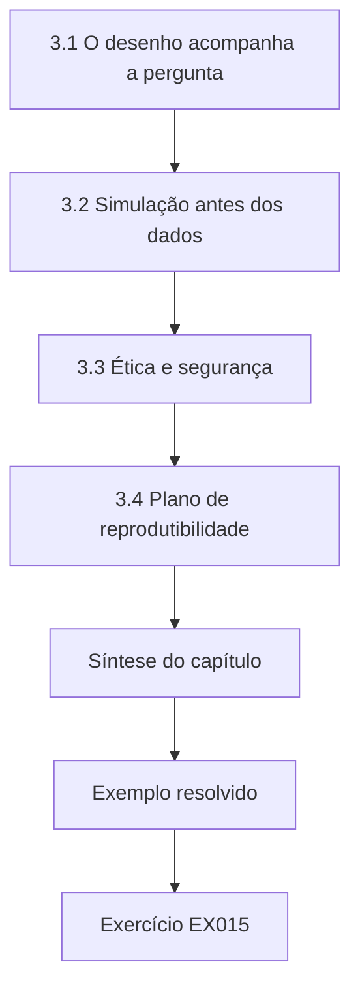

### Desenho lógico

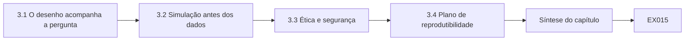

```text
[3.1 O desenho acompanha a pergunta]
    |
    v
[3.2 Simulação antes dos dados]
    |
    v
[3.3 Ética e segurança]
    |
    v
[3.4 Plano de reprodutibilidade]
    |
    v
[Síntese do capítulo]
    |
    v
[Exemplo resolvido] --> [Exercício EX015]
```
<!-- open-cyber-academy:lesson-figures:end ch-03 -->


### Objetivos de aprendizagem e conexão

Depois deste capítulo, você consegue (1) escolher um desenho compatível com a pergunta, (2) simular o viés e o poder do desenho antes de coletar dados, (3) aplicar os princípios do Menlo à pesquisa industrial e (4) redigir um plano de pré-análise com níveis de dados.

### 3.1 O desenho acompanha a pergunta

O Harbor Loop compara dois detectores sob ataques controlados num modelo e numa bancada — um **experimento controlado**, não um estudo observacional. Se você perguntasse "com que frequência as plantas sofrem ataques de replay?", precisaria de um levantamento com uma base amostral e um modelo de divulgação, porque as plantas que nunca relatam ficam invisíveis nos catálogos públicos. Se perguntasse como os operadores confiam nos alarmes, precisaria de entrevistas com revisão ética. Ajustar o desenho à pergunta é o modo de falha mais comum no mestrado: os estudantes pegam emprestado um método de que gostam e depois caçam uma pergunta que caiba nele. Escreva a pergunta primeiro.

Um segundo problema de ajuste é a **unidade de análise**. A comparação de detectores opera sobre episódios de ataque. A comparação de arquiteturas opera sobre grafos de alcançabilidade. Os estudos com operadores operam sobre pessoas e turnos. Misturar unidades — contar pacotes como se fossem episódios — recria a confusão do ajuste por pontos. Declare a unidade antes de coletar qualquer coisa.

### 3.2 Simulação antes dos dados

Antes de qualquer experimento, simule. O Laboratório 3 (abaixo, reutilizado como o laboratório principal do detector) já mostra a detecção da classe A e a falha na classe B. Executá-lo *antes* de escrever a proposta mostra que o desenho consegue distinguir as hipóteses sob os pressupostos do modelo. A simulação antes dos dados também revela se o tamanho de amostra planejado é inútil: se oitenta sementes de ataque sempre produzem o mesmo resultado binário, você precisa mais de uma análise de sensibilidade nos parâmetros que poderiam mudar o resultado (a folga k, o coeficiente do orifício, o atraso do sensor) do que de mil sementes idênticas.

Registre a simulação como um artefato de desenho: faixas de sementes, grade de parâmetros, regras de decisão. Quando um orientador perguntar "por que oitenta execuções?", a resposta está nesse artefato.

### 3.3 Ética e segurança

Menlo: respeito às pessoas (os operadores que você entrevista), beneficência (limitar cada experimento físico com uma camada de segurança independente — nunca o CLP sob teste), justiça (as pequenas concessionárias arcam com os custos das correções), respeito à lei e ao interesse público. **Nunca teste em produção.** O pior resultado da Bancada do campus R2 é água numa bandeja coletora; uma válvula boia mecânica e uma parada de emergência física o limitam.

Além do Menlo, a pesquisa em TO herda a cultura de segurança: briefings antes das sessões de laboratório, regra de duas pessoas para energizar bombas e uma autoridade de parada escrita que se sobrepõe à vontade do pesquisador de terminar uma execução. Registre os quase acidentes (a válvula boia quase alcançada) com a mesma seriedade que as hipóteses que falharam.

### 3.4 Plano de reprodutibilidade

Registre as métricas (revocação por evento, atraso, execuções com alarme falso em 80 sementes nominais, transbordamento no alarme), as sementes, os limiares e o código de análise antes das execuções de validação. Atribua os níveis de dados T0–T3 (o Capítulo 7 do livro de doutorado companheiro aprofunda isso; aqui, separe ao menos o código público das configurações da bancada).

Guarde o plano registrado com um carimbo de tempo que o orientador possa verificar, como um commit datado no repositório do projeto. Inclua os valores congelados de k e h, as faixas de sementes para ajuste e para avaliação e a regra do que conta como detecção. Qualquer mudança posterior entra numa tabela de desvios, com data e motivo, e é relatada na dissertação.

### 3.5 Exemplo resolvido e Laboratório 3

```python
# Lab 3: residual CUSUM vs band on synthetic tank; report event recall, delay, FA/shift, overfill@alarm.
import random
def run(seed,atk,det,k=0.8,h=6.0,steps=800,onset=400):
    rng=random.Random(seed); true=est=50.0; s=0.0; alarm=None; at=None
    for t in range(steps):
        inflow=1.0+rng.gauss(0,0.05)+(0.05 if atk and t>=onset else 0)
        true+=inflow-0.02*true
        lvl=true+rng.gauss(0,0.3); fm=inflow+rng.gauss(0,0.02)
        if atk and t>=onset: lvl=50.0+rng.gauss(0,0.3)
        if atk=="B" and t>=onset: fm=1.0+rng.gauss(0,0.02)
        est+=fm-0.02*est
        hit=abs(lvl-50)>1.5 if det=="band" else False
        if det=="cusum":
            s=max(0.0,s+abs(lvl-est)-k); hit=s>h
        if hit and alarm is None: alarm=t; at=true-50
    return alarm,at
for det in ("band","cusum"):
    fa=sum(run(i,None,det)[0] is not None for i in range(80))
    for atk in ("A","B"):
        r=[run(i,atk,det) for i in range(80)]
        hits=[(a-400,ov) for a,ov in r if a is not None and a>=400]
        d=sum(h[0] for h in hits)/len(hits) if hits else float("nan")
        ov=sum(h[1] for h in hits)/len(hits) if hits else float("nan")
        print(f"{det:5s} class{atk} FA_runs={fa}/80 detected={len(hits)}/80 mean_delay={d:.1f} mean_overfill@alarm={ov:.2f}")

```

Saída esperada:

```text
band  classA FA_runs=11/80 detected=0/80 mean_delay=nan mean_overfill@alarm=nan
band  classB FA_runs=11/80 detected=0/80 mean_delay=nan mean_overfill@alarm=nan
cusum classA FA_runs=0/80 detected=80/80 mean_delay=37.7 mean_overfill@alarm=1.38
cusum classB FA_runs=0/80 detected=0/80 mean_delay=nan mean_overfill@alarm=nan
```

O laboratório executa oitenta sementes para cada detector e classe de ataque e conta as execuções com alarme falso nas mesmas oitenta sementes sem ataque. O alarme de faixa nunca dispara em nenhum dos ataques, porque o replay mantém o nível relatado perto de 50, mas ainda assim gera alarmes falsos em 11 de 80 execuções nominais. O CUSUM detecta todos os episódios da classe A e nenhum da classe B, quando o medidor de vazão também é falsificado. Essa única tabela já contém o resultado principal e o seu limite. Leia-a antes de qualquer trabalho na bancada.

### 3.6 Erros comuns e limites

Escolher o desenho depois de ver os dados; chamar de "passiva" uma consulta ativa; usar o CLP como único limite de segurança.

Cada erro tem uma salvaguarda concreta. Registre o desenho e suas regras de decisão antes de coletar dados. Descreva como ativa qualquer medição que envie requisições a um dispositivo, mesmo que só leia. Na bancada R2, a válvula boia e a parada de emergência física são o limite de segurança; nunca se confia no CLP sob teste para impedir um transbordamento que ele mesmo pode estar causando.

### Exercícios — capítulo 3

- **EX015 — Associar perguntas a tipos de desenho.** Associe três perguntas (comparação de detectores; taxa de adoção do DNP3-SA; confiança dos operadores nos alarmes) a tipos de desenho. *Rubrica:* 3 = experimento/levantamento/entrevista associados corretamente; 2 = dois corretos; 1 = um; 0 = nenhum.
- **EX016 — Números do Laboratório 3 contra H1 e H4.** Execute o Laboratório 3; relate os números contra H1 (CUSUM na classe A com revocação ≥95%, faixa ≤10%) e H4 (classe B ≤10%). *Rubrica:* 3 = H1 80/80 vs 0/80, H4 0/80, alarmes falsos da faixa registrados; 2 = H1/H4 sem alarmes falsos; 1 = qualitativo; 0 = nenhum.
- **EX017 — Limitar o forçamento da bomba na bancada R2.** Escreva o pior resultado plausível, a camada independente e a autoridade de parada para um experimento de forçamento da bomba na bancada R2. *Rubrica:* 3 = transbordamento para a bandeja coletora, válvula boia+bandeja, gerente nomeado com parada de emergência; 2 = falta a independência; 1 = só o CLP; 0 = sem limites.
- **EX018 — Menlo sobre publicar a evasão da classe B.** Aplique os quatro princípios do Menlo à publicação de um método de evasão da classe B. *Rubrica:* 3 = princípios do Menlo → publicar classe+defesa, reter os passos específicos de produtos até a CVD; 2 = princípios sem decisão; 1 = publicar tudo; 0 = nenhum.
- **EX019 — Plano de pré-análise com sementes congeladas.** Redija um plano de pré-análise de uma página com métricas e sementes congeladas. *Rubrica:* 3 = métricas, sementes 0–79/1000–1079, k=0,8 h=6, nenhuma mudança depois da carga na R2; 2 = faltam as sementes ou o congelamento; 1 = plano vago; 0 = nenhum.
- **EX020 — Níveis do simulador às citações dos operadores.** Atribua T0–T3 a: código do simulador, traços sintéticos, diagrama de fiação da R2, citações anonimizadas de operadores. *Rubrica:* 3 = código T0, traços T1, fiação T2, citações T2/T1 com nota sobre a anonimização; 2 = três corretos; 1 = dois; 0 = nenhum.

### Síntese do capítulo

Desenho antes dos dados, simulação antes do compromisso, limite para cada experimento físico e plano de análise congelado.

<!-- open-cyber-academy:chapter-navigation:start ch-03 -->
### Continue estudando — capítulo 03 de 08

[← Capítulo 02](#ch-02) · [Índice de capítulos do curso](../SUBJECTS.md) · [Capítulo 04 →](#ch-04)

Siga para a próxima lição escrita.
<!-- open-cyber-academy:chapter-navigation:end -->

<a id="ch-04"></a>

## Capítulo 4 — Segurança de TO, IoT e sistemas ciberfísicos: explicações concorrentes

<!-- open-cyber-academy:lesson-figures:start ch-04 -->
### Mapa da aula

Aula 04 publicada. Mapa, exemplo, EX021.

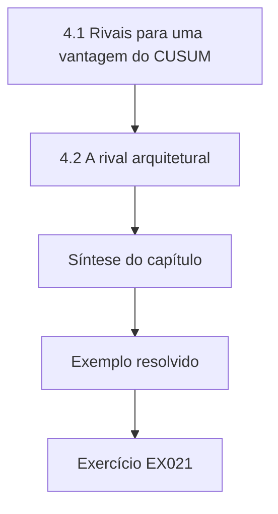

### Desenho lógico

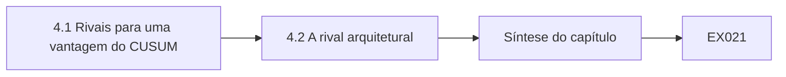

```text
[4.1 Rivais para uma vantagem do CUSUM]
    |
    v
[4.2 A rival arquitetural]
    |
    v
[Síntese do capítulo]
    |
    v
[Exemplo resolvido] --> [Exercício EX021]
```
<!-- open-cyber-academy:lesson-figures:end ch-04 -->


### Objetivos de aprendizagem e conexão

Depois deste capítulo, você consegue (1) listar explicações rivais para um resultado de detecção, (2) planejar observações que as distingam entre si e (3) revisar as alegações quando uma rival sobrevive.

### 4.1 Rivais para uma vantagem do CUSUM

(1) Limiares ajustados nos dados de teste. (2) Simulador limpo demais (sem viés de calibração). (3) Magnitude do ataque escolhida para favorecer o CUSUM. (4) Alarme de faixa ajustado de forma incomumente apertada ou frouxa. (5) A avaliação usa F1 com ajuste por pontos. Cada rival tem um teste: ajuste com sementes separadas, varreduras de viés, varreduras de ganho, relatar a taxa de alarmes falsos da faixa, relatar métricas por evento.

Escreva as rivais antes de ver os resultados. Depois dos resultados, é fácil demais inventar apenas as rivais que você já derrotou. Entregue a lista a um colega que não viu o Laboratório 3 e pergunte o que ele acrescentaria. Engenheiros de controle costumam acrescentar rivais de estrutura do modelo; pesquisadores de segurança costumam acrescentar rivais de adversário adaptativo. Ambas pertencem à lista, mesmo que o cronograma de um mestrado só permita testá-las em parte.

### 4.2 A rival arquitetural

Uma rival mais profunda: "o CUSUM só funciona porque o medidor de vazão é independente; se os dois sensores compartilham um CLP, o método falha." Isso não é um fator de confusão a eliminar — é uma **condição de contorno** a medir (classe B). As rivais que sobrevivem passam a fazer parte da alegação. Muitos artigos de TO enterram esse tipo de resultado num parágrafo de limitações; as bancas de mestrado pedem cada vez mais que ele apareça no resumo. Trate um limite confirmado como uma constatação: os defensores aprendem que caminhos de medição independentes são pressupostos estruturais.

A mesma lógica vale em outros lugares. Um desenho de segmentação que falha quando as estações de engenharia mantêm caminhos de escrita permanentes descobriu um limite. Um filtro de protocolo que falha quando o tráfego é tunelado dentro de outro protocolo descobriu um limite. Meça-os e coloque-os onde os leitores olham primeiro.

### 4.3 Exemplo resolvido

Depois do Laboratório 3, as rivais (1) e (5) são tratadas pelo desenho; a rival (2) exige varreduras de viés/orifício no estilo do Laboratório 6; a rival (3) exige uma varredura de ganho; a rival (4) é tratada relatando as 11/80 execuções com alarme falso da faixa. A rival arquitetural é confirmada pela classe B = 0/80.

Escreva esse mapeamento como uma tabela na dissertação: rival, teste, situação, evidência. As rivais testadas apenas em parte, como a varredura de ganho se o tempo ficar curto, permanecem na tabela marcadas como abertas, em vez de desaparecer. A rival arquitetural sai do capítulo de limitações e entra nos resultados, porque a classe B é um resultado medido, não uma preocupação não testada.

### 4.4 Erros comuns e limites

Listar rivais sem testes; tratar um limite confirmado como uma falha a esconder.

Uma rival sem teste é uma preocupação, não parte da análise. Cada uma precisa de uma observação que sairia diferente se ela fosse verdadeira. Quando uma rival sobrevive, como a rival arquitetural na classe B, relate-a como uma constatação com seus números. Escondê-la deixaria os leitores acreditando que o método de resíduo protege malhas em que um único dispositivo controla as duas medições. O resultado da classe B é o exemplo mais claro deste estudo.

### Exercícios — capítulo 4

- **EX021 — Cinco rivais para a segmentação em zonas.** Escreva cinco rivais para "a segmentação em zonas reduz os ataques" e um teste para cada uma. *Rubrica:* 3 = cinco rivais, cada uma com um teste; 2 = três rivais com testes; 1 = rivais sem testes; 0 = nenhum.
- **EX022 — Varredura de ganho para o impacto no estilo de Urbina.** Planeje uma varredura de ganho que sustente ou refute a rival (3); preveja o padrão caso a limitação de impacto no estilo de Urbina se confirme. *Rubrica:* 3 = desenho da varredura de ganho + previsão do padrão no estilo de Urbina; 2 = varredura sem previsão; 1 = vago; 0 = nenhum.
- **EX023 — Por que a falha na classe B fortalece a tese.** Explique por que a falha na classe B fortalece, em vez de enfraquecer, uma tese cuidadosa. *Rubrica:* 3 = falha na classe B como limite caracterizado que torna as alegações mais precisas; 2 = "falhar é honestidade" sem ligação com o limite; 1 = esconde a falha; 0 = nenhum.
- **EX024 — Rivais não testadas sob F1 com ajuste por pontos.** Para um estudo que relata apenas F1 com ajuste por pontos, quais rivais continuam sem teste? *Rubrica:* 3 = lista as rivais não testadas (atraso, alarmes falsos, impacto, adversário ciente etc.); 2 = duas rivais; 1 = uma; 0 = nenhum.
- **EX025 — Diagrama causal até o transbordamento no alarme.** Escreva um diagrama causal (como lista de nós e setas) da capacidade do atacante até o transbordamento no alarme. *Rubrica:* 3 = nós/setas de capacidade→falsificação→resíduo/faixa→alarme→transbordamento; 2 = nós sem setas; 1 = parcial; 0 = nenhum.
- **EX026 — Controle negativo para o CUSUM de resíduo.** Proponha um controle negativo: um ataque que *não* deveria disparar o CUSUM de resíduo se a garantia estiver correta. *Rubrica:* 3 = ataque de controle negativo que não deveria disparar o resíduo se a garantia se sustenta; 2 = controle sem ligação com a garantia; 1 = vago; 0 = nenhum.

### Síntese do capítulo

Rivais com testes transformam uma comparação numa contribuição; limites confirmados pertencem ao resumo.

<!-- open-cyber-academy:chapter-navigation:start ch-04 -->
### Continue estudando — capítulo 04 de 08

[← Capítulo 03](#ch-03) · [Índice de capítulos do curso](../SUBJECTS.md) · [Capítulo 05 →](#ch-05)

Siga para a próxima lição escrita.
<!-- open-cyber-academy:chapter-navigation:end -->

<a id="ch-05"></a>

## Capítulo 5 — Proposta e piloto

<!-- open-cyber-academy:lesson-figures:start ch-05 -->
### Mapa da aula

Aula 05 publicada. Mapa, exemplo, EX027.

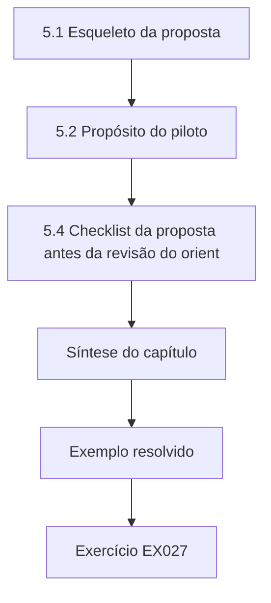

### Desenho lógico

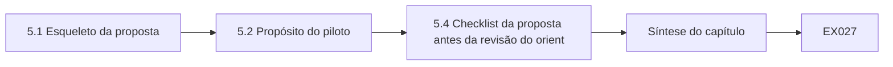

```text
[5.1 Esqueleto da proposta]
    |
    v
[5.2 Propósito do piloto]
    |
    v
[5.4 Checklist da proposta antes da revisão do orient]
    |
    v
[Síntese do capítulo]
    |
    v
[Exemplo resolvido] --> [Exercício EX027]
```
<!-- open-cyber-academy:lesson-figures:end ch-05 -->


### Objetivos de aprendizagem e conexão

Depois deste capítulo, você consegue (1) escrever uma proposta com hipóteses e condições de abandono, (2) definir critérios de prosseguir/parar para o piloto numa bancada e (3) manter os dados do piloto fora dos testes de hipóteses.

### 5.1 Esqueleto da proposta

Pergunta; lacuna; hipóteses H1–H4 (incluindo a de falha); classes de atacante A/B do modelo de atacante; sistemas (simulador, bancada R2); métricas; plano de análise; ética e segurança; cronograma; condições de abandono (a bancada não pode ser tornada segura; o simulador falha na verificação).

Os orientadores leem as propostas em busca de **decidibilidade**: um leitor consegue dizer que evidência sustentaria H1 e que evidência a refutaria? "O CUSUM é melhor" não é decidível; "revocação por evento ≥95% com atraso médio ≤60 passos e execuções com alarme falso ≤ as do alarme de faixa" é. Coloque a hipótese de falha H4 na mesma tabela que H1–H3, para que ela não possa ser descartada discretamente depois.

Declare também o que você **não** vai fazer: nenhum sistema de produção, nenhum desenvolvimento de exploit específico de produto, nenhuma alegação sobre setores fora das malhas de armazenamento de água. As exclusões de escopo são tão importantes quanto as inclusões.

### 5.2 Propósito do piloto

Apenas viabilidade: a R2 consegue executar o replay com segurança? O historiador registra a 1 Hz? A válvula boia funciona? Critérios de prosseguir declarados de antemão: três execuções consecutivas sem acionamento da válvula boia, perda de registros <1%, parada de emergência testada. Os dados do piloto não testam H1–H4.

Um piloto que "parece promissor" tenta você a espiar. Resista escrevendo a folha de prosseguir/parar antes da primeira execução do piloto e guardando os traços do piloto num diretório que o código de análise se recusa a ler. Se o piloto falhar, você aprendeu que a bancada precisa de trabalho — que é justamente o objetivo —, não que o detector é ruim. Documente quem detém a autoridade de parada e teste a parada de emergência em toda sessão, antes de os scripts de ataque rodarem.

### 5.3 Erros comuns e limites

Usar execuções do piloto para ajustar limiares que depois "validam" as mesmas execuções; não ter condição de abandono.

Mantenha os traços do piloto num diretório separado que o código de análise se recusa a ler e registre na proposta que os limiares são congelados apenas a partir das sementes de ajuste do simulador. Escreva as condições de abandono em termos mensuráveis: por exemplo, a bancada é abandonada se não for possível mostrar que a válvula boia aciona antes que a bandeja coletora encha. Sem essas condições, um estudo que está falhando simplesmente vai à deriva. Revise essas condições com o orientador antes da primeira execução do piloto.

### 5.4 Checklist da proposta antes da revisão do orientador

Antes de enviar a proposta, confirme: (1) H1–H4 têm números, e H4 é uma condição de falha que você está disposto a confirmar; (2) o modelo de atacante distingue a classe A da classe B; (3) as métricas incluem revocação por evento, atraso, execuções com alarme falso e transbordamento no alarme — não apenas F1 com ajuste por pontos; (4) os limites de segurança nomeiam uma camada independente e uma autoridade de parada; (5) existem condições de abandono; (6) o piloto não pode vazar para a validação, porque os caminhos estão separados. Um orientador que devolve a proposta com "escopo mais claro" está dando um presente; um orientador que aceita uma proposta vaga está preparando um ano doloroso.

### Exercícios — capítulo 5

- **EX027 — H1–H4 com limiares pela margem até o trip.** Escreva H1–H4 com limiares numéricos justificados por uma margem até o trip declarada. *Rubrica:* 3 = H1–H4 numéricas com justificativa pela margem até o trip; 2 = hipóteses sem justificativa; 1 = só H1; 0 = nenhum.
- **EX028 — Prosseguir/parar com regras de segurança e de dados.** Escreva critérios de prosseguir/parar que incluam uma regra de segurança e uma de qualidade dos dados. *Rubrica:* 3 = prosseguir/parar com segurança + qualidade dos dados (válvula boia, perda de registros); 2 = um tipo de regra; 1 = "prosseguir" vago; 0 = nenhum.
- **EX029 — Três condições de abandono.** Liste três condições de abandono e o que você passaria a estudar em caso de abandono. *Rubrica:* 3 = três condições de abandono + estudo alternativo; 2 = condições sem alternativa; 1 = uma; 0 = nenhum.
- **EX030 — Tabela do modelo de atacante do Harbor Loop.** Redija a tabela do modelo de atacante (capacidades, conhecimento, objetivo, fora do escopo). *Rubrica:* 3 = tabela de capacidades/conhecimento/objetivo/fora do escopo para o Harbor Loop; 2 = falta uma coluna; 1 = só prosa; 0 = nenhum.
- **EX031 — Por que os pilotos ficam fora da validação.** Explique por que os traços do piloto não podem entrar no conjunto de validação. *Rubrica:* 3 = o vazamento do piloto para a validação invalida o congelamento; 2 = "contaminação" sem ligação com o congelamento; 1 = vago; 0 = nenhum.
- **EX032 — Avaliação de riscos para entrevistas com operadores.** Escreva uma avaliação de riscos de um parágrafo para entrevistar os operadores Q01–Q08. *Rubrica:* 3 = riscos para Q01–Q08 com mitigações (consentimento, anonimização, interrupção); 2 = riscos sem mitigações; 1 = um risco; 0 = nenhum.

### Síntese do capítulo

Uma proposta que declara como pode falhar e um piloto que só pergunta se o estudo pode rodar com segurança protegem a dissertação contra modos de falha silenciosos.

<!-- open-cyber-academy:chapter-navigation:start ch-05 -->
### Continue estudando — capítulo 05 de 08

[← Capítulo 04](#ch-04) · [Índice de capítulos do curso](../SUBJECTS.md) · [Capítulo 06 →](#ch-06)

Siga para a próxima lição escrita.
<!-- open-cyber-academy:chapter-navigation:end -->

<a id="ch-06"></a>

## Capítulo 6 — Coleta e análise de dados

<!-- open-cyber-academy:lesson-figures:start ch-06 -->
### Mapa da aula

Aula 06 publicada. Mapa, exemplo, EX033.

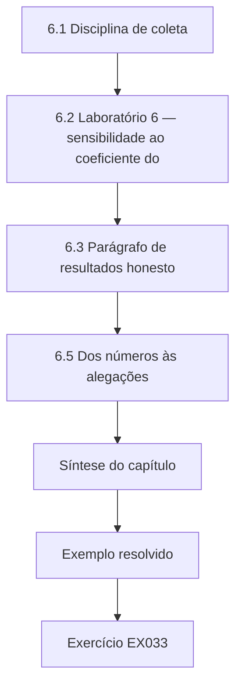

### Desenho lógico

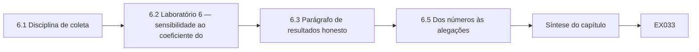

```text
[6.1 Disciplina de coleta]
    |
    v
[6.2 Laboratório 6 — sensibilidade ao coeficiente do]
    |
    v
[6.3 Parágrafo de resultados honesto]
    |
    v
[6.5 Dos números às alegações]
    |
    v
[Síntese do capítulo]
    |
    v
[Exemplo resolvido] --> [Exercício EX033]
```
<!-- open-cyber-academy:lesson-figures:end ch-06 -->


### Objetivos de aprendizagem e conexão

Depois deste capítulo, você consegue (1) coletar dados do modelo e da bancada sob um plano congelado, (2) usar sementes pareadas e intervalos de bootstrap, (3) executar análises de sensibilidade e (4) escrever um parágrafo de resultados honesto.

### 6.1 Disciplina de coleta

Congele os limiares a partir das sementes de ajuste; execute as sementes de avaliação; depois a bancada R2 com os mesmos valores congelados. Registre semente, detector, classe de ataque, instante do alarme e transbordamento no alarme. Nada de espiar os dados de ataque da R2 antes do congelamento.

Na prática, escreva um pequeno manifesto contendo `k`, `h`, a faixa de sementes de ajuste e um hash do script de análise, e recuse-se a carregar os arquivos de ataque da R2 até que esse manifesto exista. Se você mudar k depois de ver a R2, não tem mais uma validação — tem mais um exercício de ajuste, e precisa dizer isso. Mantenha um caderno de laboratório com data, pessoa, identificadores das execuções e anomalias (oscilação de energia, recalibração de sensor); anomalias que coincidem com alarmes são explicações rivais.

### 6.2 Laboratório 6 — sensibilidade ao coeficiente do orifício

```python
# Lab 6: bootstrap CI for delay difference (paired) + sensitivity to orifice coefficient.
import random
def delay(seed, orifice=0.02, k=0.8, steps=900, onset=300):
    rng=random.Random(seed); true=est=50.0; s=0.0
    # keep equilibrium near 50: nominal inflow = orifice*50
    for t in range(steps):
        inflow=orifice*50 + rng.gauss(0,0.05)+(0.05 if t>=onset else 0)
        true+=inflow-orifice*true
        lvl=(50.0 if t>=onset else true)+rng.gauss(0,0.3)
        est+=inflow+rng.gauss(0,0.02)-orifice*est
        s=max(0.0,s+abs(lvl-est)-k)
        if s>6 and t>=onset: return t-onset
    return None
for orifice in (0.015,0.02,0.025):
    d8=[]; d6=[]; diffs=[]
    for i in range(150):
        a=delay(i,orifice,0.8); b=delay(i,orifice,0.6)
        if a is not None: d8.append(a)
        if b is not None: d6.append(b)
        if a is not None and b is not None: diffs.append(a-b)
    rng=random.Random(1); boots=sorted(sum(rng.choice(diffs) for _ in diffs)/len(diffs) for _ in range(1000)) if diffs else []
    print(f"orifice={orifice} detected_k0.8={len(d8)}/150 detected_k0.6={len(d6)}/150 "
          f"mean_diff={sum(diffs)/len(diffs):.1f} 95%CI=[{boots[25]:.1f},{boots[974]:.1f}]")

```

Saída esperada:

```text
orifice=0.015 detected_k0.8=150/150 detected_k0.6=150/150 mean_diff=6.0 95%CI=[5.6,6.4]
orifice=0.02 detected_k0.8=150/150 detected_k0.6=150/150 mean_diff=7.1 95%CI=[6.6,7.6]
orifice=0.025 detected_k0.8=150/150 detected_k0.6=150/150 mean_diff=8.6 95%CI=[7.9,9.4]
```

O custo em atraso de escolher k = 0,8 em vez de 0,6 cresce à medida que o coeficiente do orifício aumenta (dinâmica natural mais rápida / sinal diferente). Os intervalos descrevem apenas o ruído da simulação.

O laboratório pareia as sementes: cada semente é executada com as duas folgas, e a diferença é tomada dentro da semente, o que remove o ruído que as duas execuções compartilham. O bootstrap então reamostra essas diferenças pareadas. As três configurações de orifício detectam todos os episódios com as duas folgas, então o compromisso está inteiramente no atraso. Os intervalos descrevem apenas o ruído da simulação; não dizem nada sobre como um tanque real difere do modelo.

### 6.3 Parágrafo de resultados honesto

"No modelo sintético do Harbor Loop, o CUSUM de resíduo detectou 80/80 episódios de replay da classe A (atraso médio de 37,7 passos, transbordamento médio no alarme de 1,38) com 0/80 execuções com alarme falso; a faixa de ±1,5 detectou 0/80, com 11/80 execuções com alarme falso. A classe B (medidor de vazão também falsificado) evadiu o CUSUM em 80/80 ensaios. O custo em atraso da folga mais robusta k = 0,8 em relação a 0,6 foi de 6,0–8,6 passos nos coeficientes de orifício de 0,015–0,025. A validação na bancada R2 é relatada separadamente, com limiares congelados."

O parágrafo relata a falha no mesmo padrão de frase que o sucesso, de modo que a classe B não pode ser lida por cima. Ele dá cada número com seu denominador e nomeia o modelo como sintético. Também aponta adiante para os resultados da bancada sem alegá-los. Confira se cada número corresponde exatamente à saída do laboratório antes que ele entre na dissertação.

### 6.4 Erros comuns e limites

Sementes independentes em comparações pareadas; intervalos apresentados como incerteza do mundo real; esconder a classe B.

As comparações pareadas precisam da mesma semente para as duas configurações; sementes independentes acrescentam ruído que esconde diferenças pequenas. Os intervalos de bootstrap descrevem a variabilidade da simulação sob o modelo, não a incerteza sobre plantas reais. A classe B pertence à tabela principal de resultados, não a um apêndice, porque é o limite medido do método e um operador precisa conhecê-lo. Relate as sementes usadas em cada comparação, para que outros possam repetir o pareamento exatamente.

### 6.5 Dos números às alegações

Depois dos Laboratórios 3 e 6, você tem contagens de detecção, atrasos, execuções com alarme falso e uma curva de sensibilidade. Transformá-los em alegações exige a escada do livro de doutorado companheiro: uma observação de protocolo não é uma inferência sobre o processo. Diga "o CUSUM alarmou com atraso médio de 37,7 passos enquanto o transbordamento real era de 1,38" (observação + inferência sobre o processo), e não "o CUSUM impede transbordamentos" (alegação de consequência sem evidência da camada de proteção). Quando chegarem os resultados da bancada R2, relate-os nas mesmas unidades, para que o leitor veja a transportabilidade, ou a sua falha, sem ter de procurar.

Mantenha uma pequena tabela que associe cada número à alegação que ele sustenta e ao nível dessa alegação. Um atraso em passos sustenta uma alegação de detecção; o transbordamento no alarme sustenta uma inferência sobre o processo dentro do modelo; nenhum dos dois sustenta uma afirmação sobre proteção, porque o estudo não mediu uma camada de proteção. Essa tabela alimenta depois o registro de alegações.

### Exercícios — capítulo 6

- **EX033 — Resultados em 150 palavras a partir dos Laboratórios 3 e 6.** Execute os Laboratórios 3 e 6; escreva um parágrafo de resultados de 150 palavras com números. *Rubrica:* 3 = ~150 palavras com números dos Laboratórios 3/6 para H1/H4 e viés/folga; 2 = números sem estrutura; 1 = curto; 0 = nenhum.
- **EX034 — Largura do IC com sementes independentes para k=0,6.** Execute de novo o Laboratório 6 com sementes independentes para k = 0,6; compare a largura do IC. *Rubrica:* 3 = IC mais largo com sementes independentes vs pareadas, com a direção; 2 = só a direção; 1 = errado; 0 = nenhum.
- **EX035 — Seis fontes de incerteza classificadas.** Classifique seis fontes de incerteza como estocásticas, paramétricas ou estruturais. *Rubrica:* 3 = estocástica/paramétrica/estrutural com exemplos; 2 = só as classes; 1 = uma classe; 0 = nenhum.
- **EX036 — Regra de congelamento antes da validação na R2.** Escreva a regra de congelamento que deve valer antes da validação na R2. *Rubrica:* 3 = congelar k/h com hash antes dos dados de ataque da R2 + regra de invalidação; 2 = congelamento sem invalidação; 1 = vago; 0 = nenhum.
- **EX037 — Resumir execuções que nunca alarmam.** Proponha como resumir as execuções que nunca alarmam (censura à direita). *Rubrica:* 3 = proporção de detecção + mediana entre os detectados ou resumo no estilo de sobrevivência; 2 = um resumo melhor; 1 = média com teto; 0 = nenhum.
- **EX038 — O que os intervalos do Laboratório 6 não significam.** Declare o que os intervalos do Laboratório 6 *não* significam. *Rubrica:* 3 = intervalos ≠ incerteza sobre a planta / erro estrutural; 2 = uma ressalva; 1 = trata-os como a verdade da planta; 0 = nenhum.

### Síntese do capítulo

Planos congelados, desenhos pareados, varreduras de sensibilidade e parágrafos honestos — incluindo a condição de falha — são o padrão de análise desta dissertação.

<!-- open-cyber-academy:chapter-navigation:start ch-06 -->
### Continue estudando — capítulo 06 de 08

[← Capítulo 05](#ch-05) · [Índice de capítulos do curso](../SUBJECTS.md) · [Capítulo 07 →](#ch-07)

Siga para a próxima lição escrita.
<!-- open-cyber-academy:chapter-navigation:end -->

<a id="ch-07"></a>

## Capítulo 7 — Escrita da dissertação e limitações

<!-- open-cyber-academy:lesson-figures:start ch-07 -->
### Mapa da aula

Aula 07 publicada. Mapa, exemplo, EX039.

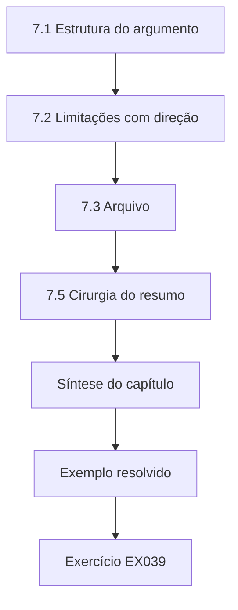

### Desenho lógico

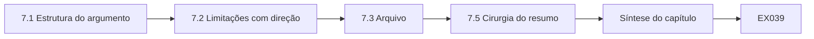

```text
[7.1 Estrutura do argumento]
    |
    v
[7.2 Limitações com direção]
    |
    v
[7.3 Arquivo]
    |
    v
[7.5 Cirurgia do resumo]
    |
    v
[Síntese do capítulo]
    |
    v
[Exemplo resolvido] --> [Exercício EX039]
```
<!-- open-cyber-academy:lesson-figures:end ch-07 -->


### Objetivos de aprendizagem e conexão

Depois deste capítulo, você consegue (1) estruturar o argumento da dissertação, (2) escrever limitações com direção, (3) montar um arquivo mínimo em níveis e (4) evitar alegações excessivas no resumo.

### 7.1 Estrutura do argumento

Introdução (pergunta, lacuna); fundamentação (seminário); métodos (desenho, ética, métricas); resultados (modelo, sensibilidade, bancada); discussão (rivais, limites); conclusão. Toda alegação do resumo precisa aparecer no corpo com evidência e escopo.

Uma ordem prática de escrita: redija primeiro as tabelas de resultados, depois os métodos que as produziram, depois a discussão e, por fim, a introdução. A introdução escrita por último tem menos chance de prometer capítulos que você não entregou. Mantenha um registro de alegações — alegação, seção, ponteiro para a evidência, escopo, falseador — e atualize-o toda semana no último semestre. Quando uma frase do resumo não tiver uma linha no registro, apague a frase ou acrescente a linha.

### 7.2 Limitações com direção

Medidor de vazão sem ruído na simulação → superestima a revocação (verificar na R2). Modelo de malha única → direção desconhecida para plantas com várias malhas. Operadores sintéticos → desconhecida. Parâmetros inventados → não calibrados para uma planta real. Censura → subestima o atraso quando os ataques são fracos.

A linguagem com direção importa. "Tamanho de amostra limitado" não diz nada sobre a direção do viés. "O coeficiente de orifício inventado pode superestimar a separação entre os detectores se os tanques reais tiverem dinâmica mais lenta" diz ao leitor como ajustar a confiança. Se você realmente não conhece a direção, escreva **desconhecida** — isso é mais honesto do que um pedido de desculpas vago. As bancas tratam as limitações com direção como evidência de maturidade de pesquisa.

### 7.3 Arquivo

Público: código e simulador inventado (T0). Traços sintéticos (T1). Configuração da R2 (T2). Nunca publique mapas de plantas reais. Verifique os hashes antes da liberação; bloqueie a liberação em caso de divergência.

Escreva um manifesto que liste cada arquivo, seu nível e seu hash, e execute a verificação no candidato à liberação, não no diretório de trabalho. Mantenha o material T3, como os contatos do campus, totalmente fora do arquivo. Um leitor deve conseguir executar de novo os Laboratórios 3 e 6 apenas a partir do nível público e obter os números publicados.

### 7.4 Erros comuns e limites

Limitações sem direção; alegações no resumo mais amplas do que os resultados; arquivos que despejam tudo.

Cada erro enfraquece o vínculo entre evidência e alegação. Uma limitação sem direção não diz ao leitor como ajustar a confiança. Um resumo que fala em sistemas de controle industrial quando o estudo mediu um modelo e uma bancada convida à rejeição. Um arquivo com tudo torna a revisão lenta e arrisca liberar configurações que deveriam permanecer restritas. Leia o resumo contra as tabelas de resultados mais uma vez antes da submissão e retire qualquer redação que as tabelas não sustentem.

### 7.5 Cirurgia do resumo

Escreva o resumo por último. Cole cada frase no registro de alegações. Se uma frase não tiver linha de evidência, corte-a. Inclua uma frase sobre a falha na classe B e uma sobre o escopo sintético. Prefira "em dois contextos sintéticos" a "em sistemas de controle industrial" quando foi isso que você mediu. Os leitores que precisam de uma alegação mais ampla não serão enganados por uma redação mais ampla; as bancas que cobram o escopo vão recompensar a precisão.

Teste o resultado com um leitor que não viu a dissertação: pergunte o que o estudo mostrou e quando o método falha. Se ele não conseguir mencionar a classe B ou o escopo sintético, o resumo ainda exagera ou esconde alguma coisa. Repita a cirurgia depois de cada revisão importante, porque o texto dos resultados muda mais depressa do que os resumos.

### Exercícios — capítulo 7

- **EX039 — Resumo que inclui a falha na classe B.** Escreva um resumo (≤150 palavras) que inclua a falha na classe B. *Rubrica:* 3 = ≤150 palavras, incluindo a falha na classe B e os contextos; 2 = omite a classe B; 1 = alegação excessiva; 0 = nenhum.
- **EX040 — Tabela de limitações com direção.** Monte uma tabela de limitações com direção, com ≥5 linhas. *Rubrica:* 3 = ≥5 linhas com rótulos de direção; 2 = 3–4 linhas; 1 = lista sem direção; 0 = nenhum.
- **EX041 — Classificar oito artefatos do Harbor Loop.** Atribua níveis a oito artefatos e justifique dois casos limítrofes. *Rubrica:* 3 = oito níveis + duas justificativas limítrofes; 2 = só os níveis; 1 = quatro; 0 = nenhum.
- **EX042 — Cartão de dados do simulador do Harbor Loop.** Escreva um cartão de dados para o simulador do Harbor Loop (inventado vs calibrado). *Rubrica:* 3 = propósito/parâmetros/inventado/usos proibidos; 2 = falta um campo; 1 = só o propósito; 0 = nenhum.
- **EX043 — Orçamentos de palavras por capítulo até um limite.** Esboce orçamentos de palavras por capítulo que somem o limite da sua instituição. *Rubrica:* 3 = os orçamentos somam o limite institucional declarado; 2 = orçamentos sem verificação da soma; 1 = vago; 0 = nenhum.
- **EX044 — Atacar uma alegação excessiva no resumo.** Ataque o seu resumo como um red team: encontre uma alegação excessiva e reescreva-a. *Rubrica:* 3 = encontra a alegação excessiva e a reescreve de forma mais estreita; 2 = encontra sem reescrever; 1 = detalhe irrelevante; 0 = nenhum.

### Síntese do capítulo

Escreva o argumento de modo que um leitor cético encontre evidência, escopo e limites com direção sem precisar procurar; mantenha o arquivo pequeno, em níveis e com hashes verificados.

<!-- open-cyber-academy:chapter-navigation:start ch-07 -->
### Continue estudando — capítulo 07 de 08

[← Capítulo 06](#ch-06) · [Índice de capítulos do curso](../SUBJECTS.md) · [Capítulo 08 →](#ch-08)

Siga para a próxima lição escrita.
<!-- open-cyber-academy:chapter-navigation:end -->

<a id="ch-08"></a>

## Capítulo 8 — Revisão independente e defesa

<!-- open-cyber-academy:lesson-figures:start ch-08 -->
### Mapa da aula

Aula 08 publicada. Mapa, exemplo, EX045.

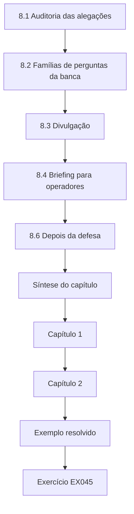

### Desenho lógico

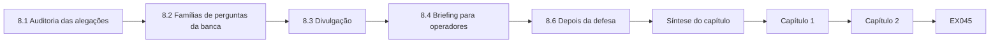

```text
[8.1 Auditoria das alegações]
    |
    v
[8.2 Famílias de perguntas da banca]
    |
    v
[8.3 Divulgação]
    |
    v
[8.4 Briefing para operadores]
    |
    v
[8.6 Depois da defesa]
    |
    v
[Síntese do capítulo]
    |
    v
[Capítulo 1]
    |
    v
[Capítulo 2]
    |
    v
[Exemplo resolvido] --> [Exercício EX045]
```
<!-- open-cyber-academy:lesson-figures:end ch-08 -->


### Objetivos de aprendizagem e conexão

Depois deste capítulo, você consegue (1) auditar as alegações antes da submissão, (2) preparar-se para as perguntas da banca, (3) conduzir a divulgação de falhas de implementação e (4) traduzir as constatações para operadores com níveis de confiança.

### 8.1 Auditoria das alegações

Toda alegação precisa de evidência, escopo e um falseador. Apague "protege concessionárias de água"; mantenha "detectou o replay de um único sensor em dois contextos sintéticos". Faça a auditoria no resumo, na lista de contribuições e na conclusão — é lá que as alegações excessivas se escondem. Peça a um colega que marque todo verbo que implique eficácia em campo ("protege", "impede", "garante a segurança", "blinda") e justifique ou remova cada um. Um script de palavras-chave ajuda numa primeira passada; a auditoria humana ainda lê cada alegação no contexto.

Registre o desfecho de cada alegação no registro de alegações, com a data da auditoria. Uma alegação que sobrevive precisa de um ponteiro para uma tabela ou figura; uma alegação estreitada precisa da nova redação; uma alegação cortada precisa de uma nota sobre o motivo. A auditoria termina quando toda frase do resumo tem uma linha.

### 8.2 Famílias de perguntas da banca

Posicionamento (o que é novo?), validade (por que generalizar?), adversário (atacante mais forte?), segurança (como foi limitado?), ética (o que foi retido?), impacto (o que muda na segunda-feira de manhã?). Resposta sobre o impacto: exigir uma segunda medição, com fiação independente, das variáveis-chave e exibir os valores previstos versus os relatados.

Prepare uma folha de consulta de uma página com uma resposta de duas frases para cada família e um ponteiro para uma figura ou tabela. Na defesa, responda à pergunta feita e pare — não ofereça o capítulo inteiro. Se não souber, diga que evidência a responderia e o que você de fato tem. Ensaie uma vez em voz alta com um colega que interrompa.

### 8.3 Divulgação

Propriedades de projeto de especificações públicas (o Modbus não tem autenticação) não são vulnerabilidades. As falhas de implementação de um produto passam pelo fornecedor e, quando apropriado, pela CVD da CISA antes que os detalhes sejam publicados.

No Harbor Loop, isso significa descrever o replay como consequência da falta de autenticação do Modbus, sem tratá-lo como uma falha nova. Se o trabalho na bancada R2 revelasse um defeito no firmware de um CLP específico, o produto e os detalhes seriam retidos da dissertação até que o fornecedor tivesse sido avisado, com o cronograma acordado e registrado.

### 8.4 Briefing para operadores

Confiança alta: alarmes de faixa sozinhos não percebem leituras de nível repetidas (modelo + desenho). Média: medição de vazão independente mais o resíduo detecta o replay de um único sensor (dois contextos sintéticos). Nenhuma: proteção quando um único dispositivo controla as duas medições — falha medida.

Mantenha o briefing em uma página, com cada afirmação marcada com sua confiança e sua evidência. Os operadores vão agir com base na linha "nenhuma": se um único dispositivo lê tanto o nível quanto o medidor de vazão, não se pode confiar na detecção por resíduo. O briefing deve dizer o que verificar na segunda-feira, por exemplo se as duas medições têm fiação independente.

### 8.5 Erros comuns e limites

Exagero na apresentação da defesa; publicar detalhes de exploits antes da divulgação; rótulos de confiança sem evidência.

Na defesa, fique dentro do escopo que a dissertação mediu e responda às perguntas sobre atacantes mais fortes com a classe B, e não com especulação. Retenha os detalhes de implementação até que a divulgação esteja concluída. Todo rótulo de confiança do briefing para operadores precisa nomear a evidência por trás dele; um rótulo sem evidência é uma opinião apresentada como constatação. Antes da defesa, ensaie uma vez cada família de perguntas com a folha de consulta e marque qualquer resposta que vá além dos contextos medidos, para que ela possa ser estreitada antes que as perguntas reais cheguem.

### 8.6 Depois da defesa

Arquive o PDF final, o registro de alegações, a tag do código e a documentação ética. Se um artigo for submetido, congele o texto da dissertação que o artigo não pode contradizer. Agende os cronogramas de divulgação antes dos prazos das conferências, não depois. Agradeça aos operadores e gerentes de laboratório que tornaram a bancada R2 possível — e não os surpreenda com um comunicado à imprensa que apresente o laboratório do campus como uma planta vulnerável.

Mantenha o manifesto e os hashes do arquivo junto ao texto final, para que um leitor posterior possa mostrar qual código produziu os números publicados. Se chegarem correções depois da defesa, acrescente-as como errata datada, em vez de editar a cópia arquivada.

### Exercícios — capítulo 8

- **EX045 — Auditar três alegações do Capítulo 6.** Audite três alegações do seu parágrafo do Capítulo 6. *Rubrica:* 3 = três alegações PASS/REVISE com correções; 2 = duas; 1 = uma; 0 = nenhum.
- **EX046 — Respostas de defesa sobre posicionamento e segurança.** Escreva respostas-modelo às perguntas de posicionamento e de segurança. *Rubrica:* 3 = respostas de posicionamento + limite de segurança da R2; 2 = uma família; 1 = vago; 0 = nenhum.
- **EX047 — Sequenciar dois artigos da dissertação.** Sequencie dois artigos da dissertação e justifique a ordem. *Rubrica:* 3 = ordem dos dois artigos com razão de dependência; 2 = ordem sem razão; 1 = um artigo; 0 = nenhum.
- **EX048 — Três classificações de divulgação.** Classifique três constatações como divulgação / não divulgação / problema do laboratório. *Rubrica:* 3 = divulgação / não / problema do laboratório corretos para as três constatações; 2 = duas corretas; 1 = uma; 0 = nenhum.
- **EX049 — Briefing para operadores sem testes da classe B.** Escreva o briefing para operadores caso a classe B não tivesse sido testada. *Rubrica:* 3 = alta/média/desconhecida com a classe B explicitamente não testada; 2 = falta a desconhecida; 1 = um nível; 0 = nenhum.
- **EX050 — Proposta de doutorado além do Harbor Loop.** Esboce uma proposta de doutorado que estenda o Harbor Loop a plantas calibradas com várias malhas. *Rubrica:* 3 = extensão de doutorado com hipóteses falseáveis para várias malhas; 2 = temas sem H; 1 = vago; 0 = nenhum.

### Síntese do capítulo

Audite, prepare-se, divulgue com cuidado, traduza com rótulos de confiança. A contribuição do mestrado é uma comparação medida e os seus limites medidos.

<!-- open-cyber-academy:chapter-navigation:start ch-08 -->
### Continue estudando — capítulo 08 de 08

[← Capítulo 07](#ch-07) · [Índice de capítulos do curso](../SUBJECTS.md) · [Resoluções →](#worked-results)

Siga para a próxima lição escrita.
<!-- open-cyber-academy:chapter-navigation:end -->

<a id="worked-results"></a>

## Resoluções

### Capítulo 1
**EX001.** "Numa malha de nível sintética com Modbus/TCP, habilitar a proteção contra escrita nos registradores de setpoint reduz em ≥90% as mudanças de setpoint não autorizadas bem-sucedidas, em relação a uma linha de base sem proteção, sob uma rajada de escritas roteirizada, e essa proteção compromete a disponibilidade quando a estação de engenharia precisa de escritas legítimas?"
**EX002.** Controle: geração de resíduos, redundância analítica, FDI baseada em observadores, validação de sensores. Segurança: injeção de dados falsos, falsificação de sensores, replay, manipulação da visão, ADS baseado em física.
**EX003.** Incluir medições ou surveys revisados por pares sobre detecção/protocolos de ICS de 2010–2026; excluir marketing de fornecedor sem método. White paper do fornecedor → excluir; medição de campo do DNP3 → incluir.
**EX004.** "E comercial": key() remove os caracteres não alfanuméricos, então um registro cinzento intitulado "Sensor replay attacks on water-treatment testbeds" (2021) colapsa sobre o registro do arXiv, mas "Modbus security: a survey of attacks & defenses" não coincide com o registro do IEEE, porque a palavra "and" sobrevive à normalização enquanto o "&" desaparece — converta "&" em "and" antes de remover os caracteres. O kappa varia quando uma decisão muda, porque a concordância ao acaso depende das taxas marginais.
**EX005.** Protocolo: IEEE/ACM/Scopus/arXiv 2010–2026; sinônimos do EX002; dois revisores de triagem; meta de κ≥0,6 depois do conserto dos critérios; fluxo cinzento separado.
**EX006.** O DOI identifica a mesma obra entre variantes de título; a chave por título sozinha mantém as duplicatas "Survey" e "survey" quando a pontuação difere, a menos que haja normalização — DOI primeiro é mais rigoroso.
**EX007.** Giraldo: survey revisado por pares (alto, para o enquadramento). Alerta da CISA: evidência de praticantes (médio, para a existência de problemas). Blog de fornecedor: marketing (baixo; só hipótese).

### Capítulo 2
**EX008.** L0: tanque/bomba/sensores; L1: CLP; L2: SCADA; L3: historiador. Conduítes: SCADA↔CLP (Modbus), historiador↔SCADA.
**EX009.** "Um conduíte que permite apenas os códigos de função Modbus 3/4 (leituras) de L2 para L1 reduz em ≥90% os hosts capazes de escrever setpoints, em relação a uma rede plana, medido pela alcançabilidade num inventário sintético."
**EX010.** Modbus Application Protocol: nenhum campo de autenticação. DNP3-SA: define desafios de autenticação para requisições críticas. A comparação é sobre a presença de um mecanismo, não sobre a adoção.
**EX011.** Sustenta no máximo "o detector sinalizou ≥1 ponto nesses segmentos nesta bancada"; não atraso, impacto, generalização nem desempenho contra um adversário ciente.
**EX012.** Spoof Reporting Message; Modify Parameter. A matriz documenta técnicas, não taxas.
**EX013.** Fraca: "A detecção baseada em física precisa de mais estudos." Forte: o parágrafo da lacuna na §2.5.
**EX014.** Arp: métricas inadequadas, avaliação só em laboratório, vazamento entre treino e teste. Específica de TO: ignorar o impacto físico no momento da detecção.

### Capítulo 3
**EX015.** Comparação de detectores → experimento controlado. Adoção → levantamento com base amostral. Confiança dos operadores → entrevista/levantamento com revisão ética.
**EX016.** H1 sustentada (80/80 vs 0/80). H4 sustentada (0/80). Alarmes falsos da faixa, 11/80, registrados.
**EX017.** Transbordamento para a bandeja coletora; válvula boia mecânica + bandeja; gerente de laboratório nomeado com parada de emergência.
**EX018.** A beneficência favorece publicar a classe de capacidade + a defesa arquitetural; reter os passos específicos de produtos até a CVD, se houver uma falha de produto.
**EX019.** Métricas, sementes 0–79 para avaliação / 1000–1079 para ajuste, k=0,8 h=6, nenhuma mudança de limiar depois da carga na R2.
**EX020.** Código T0; traços T1; fiação T2; citações T2 (identificáveis) ou T1 se totalmente anonimizadas.

### Capítulo 4
**EX021.** Má configuração, e não a segmentação; monitoramento em outro lugar; preferência do atacante; viés de relato; janela de estudo curta — cada uma com um teste que as distinga.
**EX022.** Varrer os ganhos; se os ataques lentos evadem mas o transbordamento continua pequeno, a limitação no estilo de Urbina se sustenta.
**EX023.** Ela define o domínio da contribuição (caminhos de medição independentes), o que é acionável para os defensores.
**EX024.** Vazamento do ajuste, atraso, impacto, alarmes falsos por turno, consciência do adversário.
**EX025.** Capacidade do atacante → honestidade dos sensores → resíduo → CUSUM → instante do alarme → transbordamento; o alarme de faixa é um caminho paralelo a partir do nível.
**EX026.** Um ataque que altera um sensor sem relação com o balanço de massa (por exemplo, um sensor de temperatura) não deveria elevar sistematicamente o resíduo nível–vazão.

### Capítulo 5
**EX027.** H1: revocação ≥95%, atraso ≤60; H2: alarmes falsos do CUSUM ≤ os da faixa; H3: transbordamento no alarme menor para o CUSUM; H4: revocação na classe B ≤10%. Limiares atrelados à metade da margem até o trip.
**EX028.** Segurança: válvula boia nunca alcançada em 3 execuções. Dados: perda de registros <1%.
**EX029.** Não é possível limitar a R2; o historiador não consegue registrar a 1 Hz; a ética nega as entrevistas → passar para uma dissertação só de simulação, com escopo explícito.
**EX030.** Classe A: falsificação do nível + escrita na bomba; classe B: + falsificação da vazão; conhecimento da faixa; objetivo: manipulação da visão; fora do escopo: válvula boia, adulteração física.
**EX031.** O piloto serve para viabilidade; usá-lo na validação aproveita os mesmos dados duas vezes e infla o desempenho.
**EX032.** Risco: operadores revelam práticas inseguras; mitigar com notas confidenciais, relato agregado e direito de desistir.

### Capítulo 6
**EX033.** Use o parágrafo da §6.3 com os números dos Laboratórios 3/6.
**EX034.** Sementes independentes alargam os ICs (o ruído compartilhado deixa de se cancelar).
**EX035.** Estocásticas: sorteios de ruído. Paramétricas: orifício, k, viés. Estruturais: tanque único, ignorar o atraso.
**EX036.** "k e h com hash registrado antes que qualquer dado de ataque da R2 seja aberto."
**EX037.** Relatar a proporção de detecção + a mediana do atraso entre os detectados, ou uma curva de sobrevivência.
**EX038.** Não são incerteza sobre plantas reais nem sobre o erro estrutural do modelo.

### Capítulo 7
**EX039.** Resumo que inclui a classe B = 0/80 e apenas os dois contextos sintéticos.
**EX040.** As cinco linhas da §7.2 mais o instante fixo de início do ataque (direção desconhecida) e o objetivo único do atacante (superestima a generalidade).
**EX041.** Segue o padrão do EX041 do doutorado; diagrama de fiação T2; notas dos operadores T2.
**EX042.** Inventado; parâmetros listados; proibido: alegações sobre plantas reais.
**EX043.** Exemplo: Introdução 8 mil, Fundamentação 10 mil, Métodos 12 mil, Resultados 12 mil, Discussão 8 mil, Conclusão 2 mil (ajuste às regras locais).
**EX044.** Alegação excessiva "protege plantas" → "detectou o replay da classe A num modelo sintético e declara a falha na classe B".

### Capítulo 8
**EX045.** Auditar as frases da §6.3 quanto a evidência/escopo/falseador.
**EX046.** Posicionamento: medir quando os invariantes entre sensores ajudam. Segurança: válvula boia + parada de emergência da R2; nenhuma produção.
**EX047.** Artigo 1: métricas/metodologia; Artigo 2: a comparação do Harbor Loop — metodologia primeiro.
**EX048.** Modbus sem autenticação: não é divulgação. CLP aceita escritas num registrador protegido: CVD. Fiação compartilhada na R2: problema do laboratório.
**EX049.** Alta/média como na §8.4; desconhecida para o atacante que controla os dois sensores — não alegar.
**EX050.** Planta calibrada com várias malhas; H: revocação ≥80% com alarmes falsos ≤1/turno sob acoplamento; limiares congelados; contexto de um segundo parceiro industrial.

**Fim das resoluções.** Volte ao [índice de capítulos do curso](../SUBJECTS.md).

<a id="glossary"></a>

## Glossário

**ATT&CK for ICS.** Base de conhecimento de técnicas da MITRE sobre adversários de sistemas de controle industrial; não é uma distribuição de frequências.

**Classe A / classe B (Harbor Loop).** A classe A falsifica um sensor enquanto uma medição independente continua honesta; a classe B controla as duas de forma consistente e derrota um resíduo de balanço de massa.

**CUSUM.** Soma cumulativa de Page (1954) aplicada a um resíduo entre medições com fiação independente.

**Harbor Loop.** Caso contínuo do mestrado (sintético): malha de nível Modbus/TCP usada na revisão de escopo, nos experimentos e nas alegações dirigidas aos operadores.

**Manipulação da visão.** Alimentar leituras falsas para que operadores ou detectores não percebam um estado do processo que diverge.

**Menlo Report.** Princípios éticos do DHS (2012) para pesquisa em TIC, usados para decidir que detalhes de evasão publicar.

**Bancada R2.** Bancada laboratorial isolada de bomba e tanque, com válvula boia mecânica, bandeja coletora e parada de emergência nomeada; usada, como a T2, nas verificações com limiares congelados.

**Níveis Purdue / zonas da IEC 62443.** Vocabulário de arquitetura e segmentação para enunciar hipóteses mensuráveis sobre conduítes.

**F1 com ajuste por pontos.** Pontuação que credita um segmento de ataque inteiro depois de um alarme; esconde o atraso de detecção.

**Detecção por resíduo / baseada em física.** Detectores que comparam as medições do processo com uma relação física (por exemplo, o balanço de massa).

<a id="references"></a>

## Referências

Links verificados em 13 de outubro de 2026; verifique novamente as edições antes de citar.

- ACM. Artifact Review and Badging, Version 1.1. <https://www.acm.org/publications/policies/artifact-review-and-badging-current>
- Arp, D. et al. Dos and Don'ts of Machine Learning in Computer Security. USENIX Security 2022. <https://www.usenix.org/conference/usenixsecurity22/presentation/arp>
- CISA. Coordinated Vulnerability Disclosure Program. <https://www.cisa.gov/coordinated-vulnerability-disclosure-process>
- Giraldo, J. et al. A Survey of Physics-Based Attack Detection in Cyber-Physical Systems. *ACM Computing Surveys* 51(4), 2018. <https://doi.org/10.1145/3203245>
- ISA. ISA/IEC 62443 series of standards (overview). <https://www.isa.org/standards-and-publications/isa-standards/isa-iec-62443-series-of-standards>
- iTrust, SUTD. Secure Water Treatment (SWaT) and related datasets (public page). <https://itrust.sutd.edu.sg/itrust-labs_datasets/>
- MITRE. ATT&CK for Industrial Control Systems. <https://attack.mitre.org/matrices/ics/>
- Modbus Organization. Modbus Application Protocol Specification V1.1b3. <https://modbus.org/docs/Modbus_Application_Protocol_V1_1b3.pdf>
- NIST SP 800-82 Rev. 3. Guide to Operational Technology (OT) Security. <https://csrc.nist.gov/pubs/sp/800/82/r3/final>
- Page, E. S. Continuous Inspection Schemes. *Biometrika* 41, 1954. <https://doi.org/10.1093/biomet/41.1-2.100>
- Sommer, R. and Paxson, V. Outside the Closed World: On Using Machine Learning for Network Intrusion Detection. IEEE S&P 2010. <https://doi.org/10.1109/SP.2010.25>
- Urbina, D. et al. Limiting the Impact of Stealthy Attacks on Industrial Control Systems. ACM CCS 2016. <https://doi.org/10.1145/2976749.2978388>
- U.S. DHS. The Menlo Report: Ethical Principles Guiding ICT Research (2012). <https://www.dhs.gov/sites/default/files/publications/CSD-MenloPrinciplesCORE-20120803_1.pdf>
